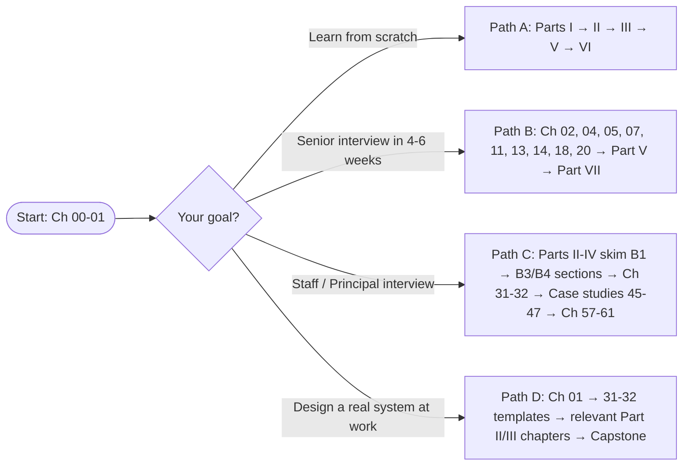
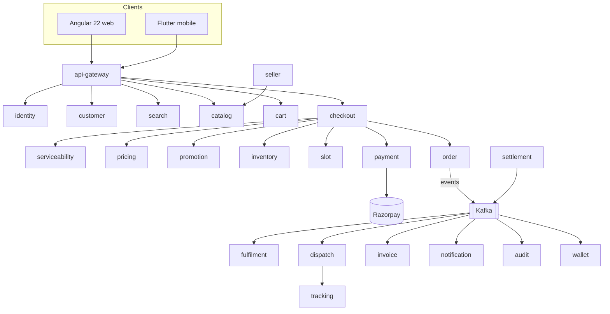
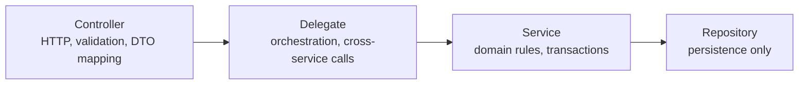

# 00. How to Use This Handbook

!!! abstract "Chapter at a glance"
    **Reader bands:** All · **Prerequisites:** None · **What you will get:** A reading path for your level, a map of the reference platform used throughout the book, the notation conventions, and a setup for the companion code · **Reading time:** 25 min

!!! note "Plan deviation"
    This is an orientation chapter, so it uses an abbreviated format. It has no code ladder and no interview Q&A. Every chapter from 01 onward follows the full 9-part format.

---

## 1. Who This Book Is For

System design is not a topic you "finish". The same question, *"How would you design checkout?"*, has a correct answer at every level of experience, and those answers differ in what they notice, not just in how much they know.

| Band | Experience | What you need from each chapter | What "good" looks like at this band |
|---|---|---|---|
| <span class="band b1">B1</span> Beginner | 0–3 yrs | Intuition, vocabulary, first working code | You can explain the concept with an analogy and build a single-instance version that works |
| <span class="band b2">B2</span> Intermediate | 3–7 yrs | Mechanisms, alternatives, Spring implementations | You can pick between alternatives and justify the pick with trade-offs |
| <span class="band b3">B3</span> Senior | 7–12 yrs | Failure modes, numbers, observability, tuning | You can predict how it breaks at 10× load and what the dashboard shows when it does |
| <span class="band b4">B4</span> Architect | 12–15+ yrs | Decision frameworks, cost, org impact, migration | You can defend why you did *not* build something, and plan how to get from today's system to the target safely |

!!! tip "The single most important shift across bands"
    Beginners ask *"How does it work?"* Seniors ask *"How does it fail?"* Architects ask *"What does it cost us to be wrong, and how do we change our mind later?"* Each chapter is written to take you one step along that arc.

## 2. Reading Paths

You don't have to read linearly. Pick the path that matches your goal.



| Path | Weekly plan (≈6–8 h/week) |
|---|---|
| **A — From scratch** | 1 chapter every 3–4 days. Do all four code levels for each chapter. Answer B1/B2 questions before revealing them. |
| **B — Senior interview** | Weeks 1–2: the listed foundation and core chapters, reading the B2/B3 sections and doing the L3 code. Weeks 3–4: one case study per day, timed at 45 min on a whiteboard before reading. Weeks 5–6: Part VII mocks. |
| **C — Staff/Principal** | Skim B1 sections, study the B4 sections and the "What distinguishes a 15-year answer" notes, write two full design documents using the Ch 32 template, and practise the Ch 61 behavioral answers aloud. |
| **D — Real design at work** | Start from the design-document template, then pull in only the chapters your NFRs demand. |

## 3. The Reference Platform: A Grocery Marketplace for India

Every chapter uses one system so that concepts compound. You learn caching on the catalog, then see that same cache break when inventory changes during a flash sale in Chapter 46.

### 3.1 Business in one paragraph

Customers order groceries in a mobile or web app. Orders are fulfilled from **dark stores** (small warehouses) and **third-party sellers**, and delivered by the platform's **own delivery fleet** in scheduled or express slots. Payments go through **Razorpay** (UPI, cards, netbanking, wallets) or cash on delivery. Every order produces a **GST-compliant invoice**. Serviceability is decided by **6-digit pincode**. Login is **mobile number + OTP**.

### 3.2 Scale assumptions used in the book

These are the default numbers for estimation exercises. Chapters override them when the point is to show what changes at a different scale.

| Metric | Default | Flash-sale / festival peak |
|---|---|---|
| Registered users | 30 M | — |
| Daily active users | 2 M | 6 M |
| Orders per day | 400 K | 1.5 M |
| Peak-to-average traffic | 5× (7–10 pm) | 20× (sale start minute) |
| SKUs in catalog | 250 K | — |
| Dark stores | 500 | — |
| Serviceable pincodes | ~8 K of India's ~19 K | — |
| Delivery riders online at peak | 40 K | 80 K |

### 3.3 Service map (26 services)

!!! warning "Align with your own conventions"
    This is the handbook's reference decomposition. If your project's `CLAUDE.md` or feature catalog names services differently, change the names here once. Every later chapter uses this table as its source of truth.

| # | Service | Bounded context | Primary store | Key events published |
|---|---|---|---|---|
| 1 | `api-gateway` | Edge | — | — |
| 2 | `identity-service` | Identity (OTP, tokens) | PostgreSQL + Redis | `identity.user.registered.v1` |
| 3 | `customer-service` | Customer profile, addresses | PostgreSQL | `customer.address.changed.v1` |
| 4 | `seller-service` | Seller onboarding, KYC | PostgreSQL | `seller.seller.approved.v1` |
| 5 | `catalog-service` | Products, categories | PostgreSQL | `catalog.product.updated.v1` |
| 6 | `pricing-service` | Prices, GST rates | PostgreSQL + Redis | `pricing.price.changed.v1` |
| 7 | `promotion-service` | Coupons, offers | PostgreSQL + Redis | `promotion.coupon.redeemed.v1` |
| 8 | `search-service` | Search, autocomplete | OpenSearch | — |
| 9 | `recommendation-service` | Personalization | Redis + feature store | — |
| 10 | `serviceability-service` | Pincode → store mapping | PostgreSQL (+ in-memory) | `serviceability.area.changed.v1` |
| 11 | `cart-service` | Cart | Redis (+ PostgreSQL snapshot) | `cart.cart.checked-out.v1` |
| 12 | `checkout-service` | Checkout orchestration | PostgreSQL | — |
| 13 | `order-service` | Orders | PostgreSQL | `order.order.placed.v1` |
| 14 | `inventory-service` | Stock per store | PostgreSQL + Redis | `inventory.stock.reserved.v1` |
| 15 | `fulfilment-service` | Picking & packing | PostgreSQL | `fulfilment.order.packed.v1` |
| 16 | `payment-service` | Razorpay integration | PostgreSQL | `payment.payment.captured.v1` |
| 17 | `wallet-service` | Wallet & refunds to wallet | PostgreSQL (ledger) | `wallet.txn.posted.v1` |
| 18 | `settlement-service` | Seller payouts | PostgreSQL | `settlement.payout.completed.v1` |
| 19 | `invoice-service` | GST invoices | PostgreSQL + object storage | `invoice.invoice.generated.v1` |
| 20 | `slot-service` | Delivery slot capacity | PostgreSQL + Redis | `slot.slot.booked.v1` |
| 21 | `dispatch-service` | Rider assignment | PostgreSQL + Redis (geo) | `dispatch.rider.assigned.v1` |
| 22 | `tracking-service` | Live rider location | Redis + time-series | `tracking.location.updated.v1` |
| 23 | `notification-service` | SMS / WhatsApp / push / email | PostgreSQL | — |
| 24 | `review-service` | Ratings & reviews | PostgreSQL | `review.review.posted.v1` |
| 25 | `support-service` | Tickets, issue resolution | PostgreSQL | `support.ticket.resolved.v1` |
| 26 | `audit-service` | Audit trail & compliance | Append-only store | — |



### 3.4 Architecture conventions used in all code

Every Spring service follows a **four-layer pattern**:



| Convention | Rule |
|---|---|
| Packages | `com.grocery.<service>.{controller,delegate,service,repository,domain,dto,config,event}` |
| DTOs | Java `record`s; never expose JPA entities over HTTP |
| Injection | Constructor injection only |
| Kafka topics | `<domain>.<entity>.<event>.v<N>`, e.g. `order.order.placed.v1` |
| Errors | RFC 9457 Problem Details (`application/problem+json`) |
| Correlation | `X-Correlation-Id` header, propagated to logs (MDC) and to Kafka headers |
| Money | `BigDecimal` in paise-safe scale 2, currency INR; never `double` |
| Time | `Instant` in UTC for storage; `Asia/Kolkata` only at presentation |

## 4. Notation

| You will see | Meaning |
|---|---|
| <span class="band b1">B1</span> <span class="band b2">B2</span> <span class="band b3">B3</span> <span class="band b4">B4</span> | Reader band a section or question targets |
| ⭐ | High interview frequency |
| `->>` in sequence diagrams | Synchronous call |
| `--)` in sequence diagrams | Asynchronous message or event |
| `-->>` in sequence diagrams | Response |
| Shaded `rect` block | One local transaction boundary |
| `// VERIFY:` in code | An API detail to confirm against the exact library version you use |
| `// excerpt` | A code fragment, not a compilable file |
| `??? question` blocks | Collapsible interview Q&A. Try answering before expanding. |

**Diagram types used:**

- **Flowchart / component**: what talks to what.
- **Sequence**: who calls whom, in what order, and what happens when a step fails.
- **State**: lifecycle of an entity (order, payment, circuit breaker).
- **C4** (Context → Container → Component): used for multi-service views, drawn as Mermaid flowcharts with the C4 level named in the title.
- **ER**: data models.

## 5. How Every Chapter Is Structured

| § | Section | Why it exists |
|---|---|---|
| 1 | Introduction & Why It Matters | A real failure story and where the concept lives in the platform |
| 2 | Core Concepts | Intuition → mechanics → internals → trade-offs (B1 → B4) |
| 3 | Architecture & Diagrams | Component, sequence (happy and failure paths) and state diagrams |
| 4 | Design Document Excerpt | The concept applied to one real feature, in design-doc form |
| 5 | Hands-On Code | L1 → L4 ladder on the same problem |
| 6 | Production Concerns | Failure modes, observability, security, performance, config, cost |
| 7 | Anti-Patterns | Symptom → cause → fix, with before/after |
| 8 | Interview Q&A | 20+ questions across bands |
| 9 | Summary & Practice | Takeaways, cheat sheet, exercises, reading |

### The L1 → L4 code ladder

| Level | You write | Proves |
|---|---|---|
| **L1 — Concept** | Plain Java, one file, runnable `main` | You understand the idea |
| **L2 — Spring** | Four-layer Spring Boot service with tests | You can build it the standard way |
| **L3 — Production** | Resilience, metrics, config, Testcontainers | You can run it |
| **L4 — Enterprise** | Multi-instance, events, rollout, ADR | You can scale it and justify doing so |

## 6. Companion Code Setup

| Tool | Version used in the book |
|---|---|
| JDK | 25 (Temurin or equivalent) |
| Build | Gradle 9 (Kotlin DSL), multi-module |
| Framework | Spring Boot 4.x / Spring Framework 7.x |
| Containers | Docker Desktop or Colima; Testcontainers for tests |
| Infra (local) | PostgreSQL 17, Redis 7, Kafka (KRaft mode) via Docker Compose |
| Docs | Python 3.11+, `mkdocs-material` |

```bash
# docs
pip install mkdocs-material
mkdocs serve            # http://127.0.0.1:8000

# local infra used from Chapter 05 onward
docker compose -f code/infra/docker-compose.yml up -d
```

Code layout (one Gradle module per chapter and level):

```text
code/
├── settings.gradle.kts
├── infra/docker-compose.yml
└── ch01-what-system-design-is/
    ├── l1-concept/
    ├── l2-spring/
    ├── l3-production/
    └── l4-enterprise/
```

!!! tip "How to study the code"
    Don't just read the L4 version. Run L1, then change one requirement (for example, "now it must survive a restart") and try to reach L2 yourself before reading it. Being able to explain why each step up the ladder was needed is exactly what interviewers probe.

## 7. How to Use the Interview Sections

1. Read the question and give your answer out loud or on paper, **timed** (60 s for B1/B2, 3 min for B3/B4).
2. Expand the answer and compare it against the **30-second answer** first. Did you lead with the conclusion?
3. Check the **red flags**. Most points are lost there, not on missing facts.
4. At B3/B4, read **"What distinguishes a 15-year answer"**. It usually covers operability, cost, migration, or what not to build.

## 8. Summary

- The book has four bands, one domain, and one code ladder per chapter.
- The grocery platform (§3) and its conventions (§3.4) are the shared vocabulary for every chapter.
- Pick a reading path in §2 and follow the interview method in §7.

**Next:** [01. What System Design Is](01-what-system-design-is.md)
