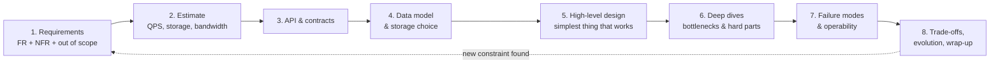
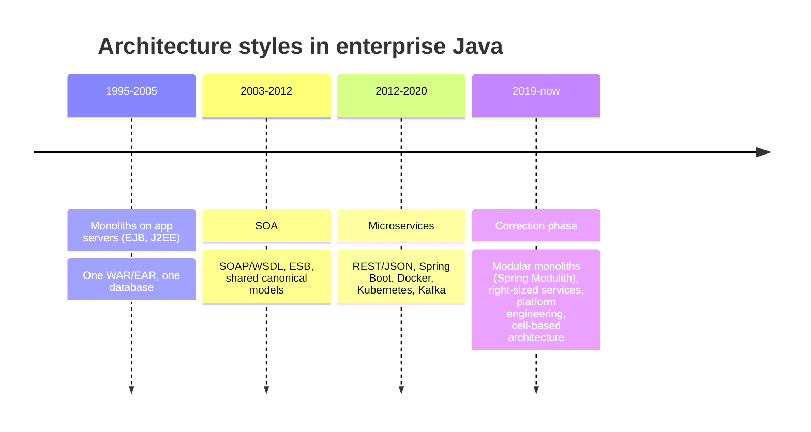
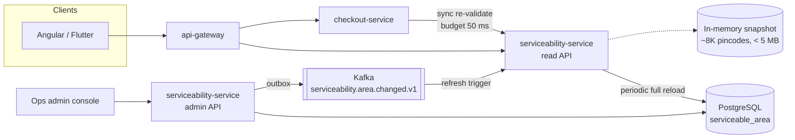
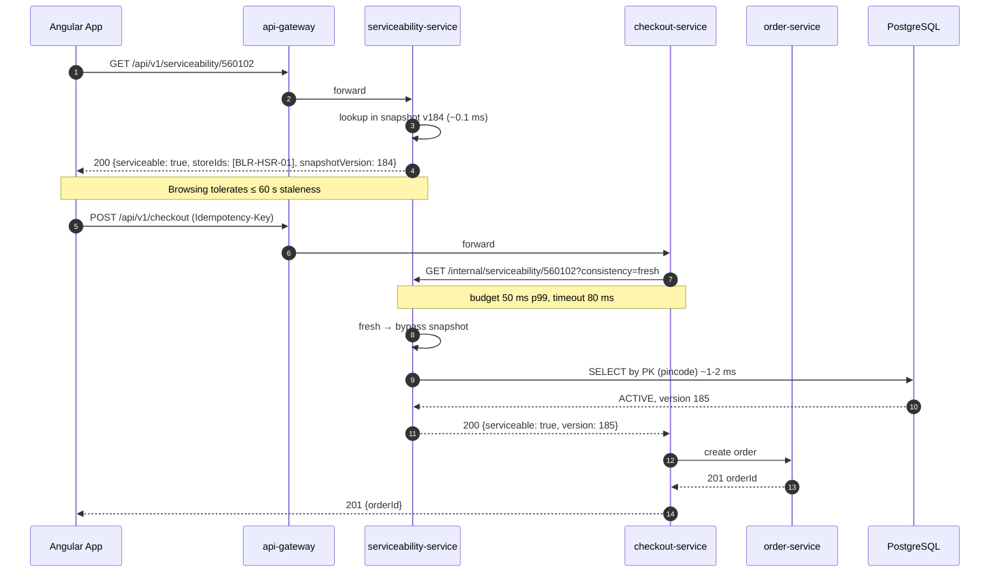
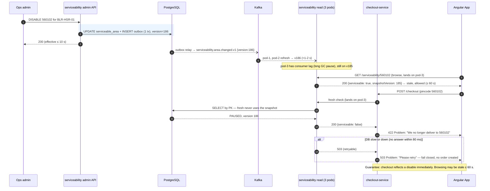
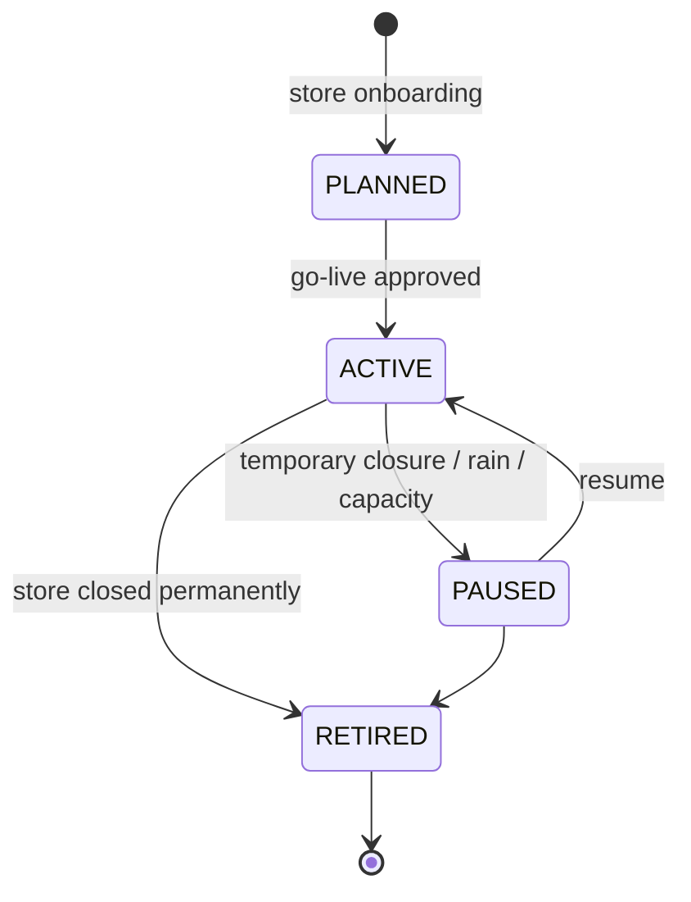
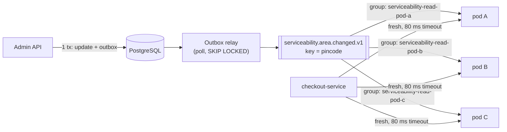

# 01. What System Design Is ⭐

!!! abstract "Chapter at a glance"
    **Reader bands:** B1 → B4 · **Prerequisites:** [Ch 00](00-how-to-use-this-handbook.md) · **What you will build:** A pincode serviceability check, taken from an in-memory map (L1) to a multi-instance, event-refreshed service with an explicit consistency guarantee (L4) · **Reading time:** 90 min + code

---

## 1. Introduction & Why It Matters

### 1.1 A story: the orders that could never be delivered

A grocery platform added 40 new pincodes when it opened a dark store in a new suburb. Three weeks later, the store closed temporarily for a lease dispute. Operations disabled those pincodes in the admin panel at 11:02 am.

Orders from those pincodes kept arriving until 3:40 pm.

Nothing had "crashed." Every service was green. The serviceability check was fast (2 ms p99) because it read from a cache that refreshed every 6 hours. Someone had chosen that number years earlier "for performance." Over those four and a half hours, **1,900 orders** were accepted, paid for through UPI, and could not be delivered. Customer support worked through the weekend and 1,900 refunds had to be issued.

The code was correct. **The design was wrong.** No one had written down how stale a serviceability answer was allowed to be. A requirement that was never stated can't be met, so the system settled on whatever an engineer had once picked for convenience.

!!! quote "The thesis of this chapter"
    System design is the practice of making the important decisions about a system **deliberately and explicitly**: what it must do, how well, under what failures, and at what cost. It doesn't mean using the most technology.

### 1.2 Where this lives in the grocery platform

Serviceability is on the critical path of almost every customer journey:

| Journey | Serviceability question | Cost of a wrong answer |
|---|---|---|
| App open | "Do we deliver to the saved address?" | Customer leaves (lost revenue) |
| Address change | "Which store serves this pincode?" | Wrong catalog and prices shown |
| Checkout | "Can this order still be delivered?" | Undeliverable paid order (refund plus support cost) |
| Slot selection | "Which slots are available here?" | Overbooked riders |

That's why this chapter's code ladder is built on it. The problem looks trivial (a map lookup), but its design depends on every quality attribute this chapter introduces.

### 1.3 Learning objectives

| Band | After this chapter you can… |
|---|---|
| <span class="band b1">B1</span> | Explain HLD vs LLD and functional vs non-functional requirements, and name the eight core quality attributes |
| <span class="band b2">B2</span> | Turn vague requirements into measurable NFRs, and follow a repeatable design process |
| <span class="band b3">B3</span> | Do availability math, find where quality attributes conflict, and design explicitly for staleness and failure |
| <span class="band b4">B4</span> | Frame decisions as reversible vs irreversible, weigh cost and operability as first-class attributes, and place monolith / SOA / microservices / modular monolith in context |

---

## 2. Core Concepts — Beginner to Deep

### 2.1 Intuition: designing a house vs building a wall <span class="band b1">B1</span>

When you write code, you are laying bricks. When you design a system, you are the architect deciding how many floors, where the load-bearing walls go, where the water pipes run, and what happens in an earthquake.

The architect decides three things before any bricks are laid:

1. **What the house must do.** Four bedrooms, a kitchen. These are *functional requirements*.
2. **How well it must do it.** Survive a magnitude-6 earthquake, stay under ₹80 lakh, be built in 10 months. These are *non-functional requirements*.
3. **How the parts fit together.** Foundation, frame, plumbing, wiring. This is the *architecture*.

A brilliant bricklayer can't save a house whose foundation was sized for two floors when the owner wanted five.

### 2.2 HLD vs LLD <span class="band b1">B1</span> <span class="band b2">B2</span>

| | High-Level Design (HLD) | Low-Level Design (LLD) |
|---|---|---|
| Question it answers | *What are the parts and how do they interact?* | *How is each part built inside?* |
| Artifacts | Component/C4 diagrams, data flow, service boundaries, storage choices, API contracts between services, sequence diagrams across services | Class diagrams, method signatures, DB schemas with indexes, algorithms, concurrency model, error handling within a service |
| Typical audience | Architects, tech leads, product, SRE | Developers implementing the component |
| Serviceability example | "`serviceability-service` owns pincode → store mappings in PostgreSQL, serves reads from an in-memory snapshot, and publishes `serviceability.area.changed.v1`. Checkout re-validates synchronously." | "`ServiceabilitySnapshot` is an immutable record held in an `AtomicReference`, refreshed by a scheduled job and by a Kafka listener. Lookup is `Map<String, Set<StoreId>>`, O(1)." |
| Interview format | "Design Swiggy Instamart" (45–60 min) | "Design a parking lot / rate limiter class" (45 min, code) |
| Changes cost | High: crosses teams and data | Lower: usually within one team's code |

!!! tip "The boundary is fuzzy on purpose"
    A choice that looks like LLD, such as "the snapshot refreshes every 6 hours", can have HLD consequences, like 1,900 undeliverable orders. Senior engineers recognize **when a low-level parameter encodes a high-level requirement** and pull it up into the design document.

### 2.3 Functional vs Non-Functional Requirements ⭐ <span class="band b1">B1</span> <span class="band b2">B2</span>

**Functional requirements (FRs)** describe **behaviour**, meaning what the system does.

> FR-1: Given a 6-digit pincode, return whether it is serviceable and which store(s) serve it.
> FR-2: Operations can enable/disable a pincode for a store.
> FR-3: Checkout must reject orders to non-serviceable pincodes.

**Non-functional requirements (NFRs)** describe **qualities**, meaning how well the system does it and under what constraints.

> NFR-1: Lookup latency p99 ≤ 10 ms at the service, ≤ 50 ms end-to-end.
> NFR-2: Lookup availability 99.95 % monthly.
> NFR-3: A disable takes effect for checkout within **10 seconds** and for browsing within **60 seconds**.
> NFR-4: Must sustain 6,000 lookups/s at flash-sale peak.

NFR-3 was the one missing in the story.

#### Turning vague requirements into measurable NFRs <span class="band b2">B2</span>

Stakeholders speak in adjectives, and designs need numbers. Use the **SMART-NFR** conversion: *metric, percentile, threshold, scope, measurement window*.

| Stakeholder says | Ask | Measurable NFR |
|---|---|---|
| "It must be fast" | Fast for whom, doing what, measured where? | Product page API p99 ≤ 300 ms at the gateway, measured over 5-min windows, excluding client network |
| "It must never go down" | What does an hour of downtime cost? What's acceptable during a deploy? | 99.95 % monthly availability for checkout (≈ 22 min/month budget) |
| "Data must be accurate" | Accurate within how long? Which data? | Stock shown on product page may lag ≤ 5 s; reservation at checkout must be exact |
| "It must scale" | To what, by when? | 3× current peak (18 K req/s) by next Diwali with ≤ 20 % cost increase |
| "It must be secure" | Against which threats? Which regulations? | OTP brute force limited to 5 attempts per 15 min per number; PII encrypted at rest; DPDP-compliant deletion within 30 days of request |

!!! warning "Averages lie"
    Always ask for **percentiles**. A 50 ms average can hide a p99 of 2 s, and at 5,000 req/s that's 50 people per second with a bad experience.

### 2.4 The Eight Core Quality Attributes ⭐ <span class="band b1">B1</span> → <span class="band b3">B3</span>

| Attribute | Plain meaning | How it is measured | Grocery example |
|---|---|---|---|
| **Scalability** | Handles more load by adding resources | Throughput vs cost curve; max sustainable QPS | 20× traffic at a sale's first minute |
| **Availability** | Is up and answering correctly when needed | % successful requests over a window (SLO) | Checkout 99.95 % |
| **Latency / Performance** | Responds quickly | p50/p95/p99/p999 response time | Search p99 ≤ 200 ms |
| **Consistency** | Everyone sees the same, correct data | Staleness bound; anomalies allowed | Inventory reservation must be exact |
| **Durability** | Once acknowledged, data is never lost | RPO; probability of loss | Paid order must never disappear |
| **Cost** | Money to build and run | ₹ per order; infra ₹/month; people | Infra ≤ ₹2.5 per order |
| **Operability** | Easy to deploy, observe, debug, recover | MTTR; deploy frequency; toil hours | On-call can disable a store in one click |
| **Security & Compliance** | Protected against misuse; lawful | Threat model coverage; audit findings | OTP abuse limits; DPDP; PCI scope |

Other attributes you'll meet later: *maintainability, testability, portability, extensibility, accessibility, privacy*. They follow the same discipline: define it, measure it, trade it.

#### 2.4.1 Scalability

A system is scalable if **adding resources adds proportional capacity** without redesign.

- **Vertical scaling** means a bigger machine. It's simple and needs no code change, but it has a hard ceiling, is a single point of failure, and gets expensive nonlinearly.
- **Horizontal scaling** means more machines. It has no hard ceiling and gives redundancy, but it requires **statelessness** or partitioned state, plus load balancing and coordination.

Scalability is always *relative to a dimension*: users, data volume, request rate, number of sellers, geography. A design that scales to 10× users may fail at 10× SKUs.

#### 2.4.2 Availability and the math of nines <span class="band b2">B2</span> <span class="band b3">B3</span>

$$
\text{Availability} = \frac{\text{successful requests}}{\text{valid requests}} \quad \text{or} \quad \frac{\text{MTBF}}{\text{MTBF} + \text{MTTR}}
$$

| SLO | Downtime / month (30 d) | Downtime / year |
|---|---|---|
| 99 % | 7 h 12 min | 3.65 days |
| 99.9 % | 43.2 min | 8.76 h |
| 99.95 % | 21.6 min | 4.38 h |
| 99.99 % | 4.32 min | 52.6 min |
| 99.999 % | 26 s | 5.26 min |

**Serial dependencies multiply.** If checkout synchronously calls five services, each at 99.9 %:

$$
0.999^5 \approx 0.995 \;\Rightarrow\; \text{99.5 \%} \approx 3.6 \text{ h/month down}
$$

**Parallel redundancy compounds in your favour.** Two independent replicas at 99.9 %:

$$
1 - (1 - 0.999)^2 = 0.999999
$$

…but only if their failures really are **independent**, meaning no shared database, zone, deploy pipeline, or config push.

!!! danger "The practical lesson"
    Every synchronous dependency on the critical path costs you availability. That is the single biggest reason for caches, async events, and "degrade instead of fail" designs. You'll see it in L3 and L4 below.

**MTTR matters as much as MTBF.** Going from 99.9 % to 99.95 % can come from failing half as often *or* from recovering twice as fast. The second is often far cheaper: better alerts, one-click rollback, feature flags.

#### 2.4.3 Latency

- **Latency** is the time for one request. **Throughput** is requests per unit time. They are related through **Little's Law**: *concurrency = throughput × latency*. At 5,000 req/s and 40 ms latency you have 200 requests in flight at any moment, which sets your thread and connection needs.
- **Tail latency amplification.** If a page fans out to 20 services and each has a 1 % chance of being slow, the page is slow $1 - 0.99^{20} \approx 18\%$ of the time.
- Reference numbers (full table in Ch 02): L1 cache ~1 ns · RAM ~100 ns · SSD random read ~100 µs · same-AZ round trip ~0.5 ms · Mumbai ↔ Singapore ~60 ms.

That last row is why the L3 design below serves lookups from memory. 100 ns vs 0.5 ms is a 5,000× difference.

#### 2.4.4 Consistency

"Consistency" here means **how fresh and agreed-upon the data a reader sees is**. That's different from the "C" in ACID, which is about invariants.

A quick spectrum (full treatment in Ch 12):

| Model | Guarantee | Grocery use |
|---|---|---|
| Strong / linearizable | Every read sees the latest write | Stock reservation, payment status |
| Read-your-writes | You see your own updates | Customer edits address, sees it immediately |
| Bounded staleness | Data is at most *T* old | Serviceability ≤ 60 s for browsing |
| Eventual | Converges "eventually" | Ratings count, recommendations |

The key design move is to **assign a consistency level per use case, not per system.** In the opening story, one staleness level (6 h) was applied to both browsing and checkout.

#### 2.4.5 Durability

Durability means an acknowledged write survives crashes. It's measured by **RPO** (Recovery Point Objective: how much data you can lose) and implemented through replication, WAL, fsync policy, and backups.

!!! note "Availability ≠ Durability"
    A system can be **available but not durable**. An in-memory cache happily answers and loses everything on restart. It can also be **durable but not available**: the database is intact but the primary is down and failover takes 90 s. Payments need both. Recommendations need neither strongly.

#### 2.4.6 Cost

Cost is an architectural attribute, not an afterthought. Track it as **unit economics**: ₹ infra per order, per active user, per GB served.

Architectural choices dominate cost far more than micro-optimizations do. Examples: cross-AZ traffic charges, over-provisioned always-on clusters, 26 services × 3 replicas × 3 environments, and log volume.

#### 2.4.7 Operability

Can a tired on-call engineer at 3 am understand what's wrong and fix it safely? Operability covers observability (Ch 24), safe deploys and rollbacks (Ch 26), runbooks, feature flags, and admin controls.

A design with no **observable signal for its most important guarantee** is not operable. In the story, there was no metric for "age of serviceability data."

#### 2.4.8 Security & Compliance

This covers authN/authZ, data protection, abuse prevention, and regulatory obligations (DPDP Act, RBI data localization, PCI DSS, GST record retention). It's treated fully in Ch 23 and Ch 36.

At the design stage, the minimum is a **threat list** and the **data classification** of what you store.

### 2.5 Quality attributes conflict: trade-off thinking ⭐ <span class="band b3">B3</span> <span class="band b4">B4</span>

You can't maximize everything. Every design is a position in a trade-off space.

| Improving… | Usually costs… | Serviceability example |
|---|---|---|
| Latency (via caching) | Consistency (staleness) | In-memory snapshot is fast but can be stale |
| Consistency (sync checks) | Latency and availability | Checking the DB on every call means +2 ms and DB outage = serviceability outage |
| Availability (serve stale on failure) | Correctness in rare windows | If refresh fails, keep answering from the old snapshot |
| Durability (sync replication) | Write latency | Every admin change waits for a replica ack |
| Scalability (more services, sharding) | Cost and operability | A separate serviceability service vs a table in catalog |
| Security (more checks) | Latency, UX | OTP on every login vs trusted-device tokens |

**How to resolve conflicts:**

1. **Split the use case.** Browsing and checkout have different needs. Give browsing speed and bounded staleness, and give checkout a fresh re-validation. This one move resolves most apparent conflicts.
2. **Make the trade-off explicit and bounded.** Instead of "eventually consistent", say "stale by at most 60 s, measured, alerted."
3. **Price the failure.** 1,900 undeliverable orders × (refund cost + support cost + churn) against the cost of a 10-second refresh. Numbers end arguments.
4. **Prefer reversible choices** when uncertain (§2.7).

### 2.6 The System Design Process <span class="band b2">B2</span>

This is the process used in real design work and in interviews. Time boxes are for a 45-minute interview. At work, each step is days.



| Step | Interview time | Key output | Common mistake |
|---|---|---|---|
| 1. Requirements | 5 min | 3–5 FRs, 3–5 numeric NFRs, explicit non-goals | Designing before asking |
| 2. Estimate | 3–5 min | Peak QPS, storage/yr, read:write | Precision theatre; skipping it entirely |
| 3. API | 3–5 min | Endpoints/events with key fields | Designing 20 endpoints |
| 4. Data model | 5 min | Entities, access patterns, store choice | Choosing DB by fashion |
| 5. HLD | 10 min | Diagram of the simplest working design | Starting with Kafka + 12 services |
| 6. Deep dives | 10–15 min | 2–3 components at LLD depth | Staying shallow everywhere |
| 7. Failure modes | 5 min | What breaks, how detected, how mitigated | Ignoring failure until asked |
| 8. Wrap-up | 2–3 min | Trade-offs, what you'd do next | Claiming the design is perfect |

### 2.7 Decision types: reversible vs irreversible <span class="band b4">B4</span>

Not every decision deserves the same rigour.

| Type | Examples | How to decide |
|---|---|---|
| **Two-way door** (cheap to reverse) | Cache TTL, library choice inside a service, instance size, a feature flag default | Decide quickly, measure, adjust |
| **One-way door** (expensive to reverse) | Service/data boundaries, public API shape, event schemas others consume, primary database, partition key, tenancy model, cloud region for regulated data | Design doc, alternatives, review, ADR |

An architect's leverage comes from **spotting which decisions are one-way doors**, and from turning one-way doors into two-way doors where possible: versioned APIs, an anti-corruption layer, the strangler pattern, feature flags, dual-running.

!!! example "Serviceability"
    The refresh interval is a two-way door. It should be a config property with a metric and an alert, not a constant. The decision "checkout re-validates against the source of truth" is closer to a one-way door, because it creates a runtime dependency and a latency budget other teams will build around. Put it in the ADR.

### 2.8 How We Got Here: Monolith → SOA → Microservices → What's Next <span class="band b2">B2</span> <span class="band b4">B4</span>



| Style | Why it appeared | What went wrong | What it still does well |
|---|---|---|---|
| **Monolith** | Simplest way to build and deploy | Big-ball-of-mud coupling; one deploy for all teams; scaling everything together | Fast to build, easy to debug, local transactions, cheap |
| **SOA** | Reuse and integration across enterprise systems | Central ESB became a bottleneck and a monolith of its own; heavy contracts; "smart pipes" | Explicit service contracts, integration of legacy systems |
| **Microservices** | Independent deploys and scaling per team; cloud and containers made it cheap | Distributed monoliths; network failures everywhere; data consistency pain; operational cost; too-small services | Team autonomy at scale, independent scaling, fault isolation (if done right) |
| **Modular monolith** | Get module boundaries without network boundaries | Needs discipline to keep modules decoupled | Best default for small teams and new domains; easy to split later |
| **Cell-based** | Limit blast radius at very large scale | Complex routing and operations | Failure isolation for huge platforms (Ch 34) |

!!! tip "The architect's summary"
    Choose service boundaries for **team autonomy and independent change rates**, not for fashion. A 26-service design is justified when multiple teams need to ship independently and scale parts differently. For a 6-person team building an MVP, the same domain model is better built as a modular monolith with the same bounded contexts, then extracted along those seams. We use 26 services in this book to teach distributed concepts, and Ch 16 revisits when that is and isn't the right call.

---

## 3. Architecture & Diagrams

### 3.1 Component view: serviceability in the platform



### 3.2 Sequence: happy path, browse and checkout



### 3.3 Sequence: failure path, pincode disabled mid-session



!!! note "What the system guarantees after this failure path"
    Checkout never accepts an order for a pincode that is already disabled in the database, **even if** event delivery is delayed or a pod is stale, because fresh checks always read the source of truth. If the database can't answer in time, checkout fails closed with a retryable error. Browsing may be stale for up to 60 seconds, which is acceptable because it causes no money movement.

### 3.4 State: a serviceable area's lifecycle



---

## 4. Design Document Excerpt: Pincode Serviceability

| Field | Value |
|---|---|
| Author / Reviewers | Platform team / Checkout, Ops, SRE |
| Status | Approved |
| Related ADRs | ADR-011 Serviceability consistency levels |

**1. Context & Problem.** Serviceability answers are read on every app open, address change, and checkout. The current 6-hour cache caused undeliverable paid orders after a store closure. We need fast reads with **explicit, bounded staleness**.

**2. Goals / Non-Goals.**

- *Goals:* fast lookups; per-use-case consistency; operator changes take effect predictably; observable staleness.
- *Non-goals:* polygon/geofence-level serviceability (future, Ch 47); slot capacity (owned by `slot-service`).

**3. Requirements.**

| ID | Requirement |
|---|---|
| FR-1 | Lookup by pincode → serviceable flag + store IDs |
| FR-2 | Ops can activate/pause/retire an area; changes are audited |
| FR-3 | Checkout rejects non-serviceable pincodes |
| NFR-1 | Browse lookup p99 ≤ 10 ms in-service |
| NFR-2 | Fresh (checkout) lookup p99 ≤ 50 ms, timeout 80 ms |
| NFR-3 | Staleness: browse ≤ 60 s; checkout ≤ 10 s after operator change |
| NFR-4 | Availability 99.95 % for reads; reads survive DB outage (stale-serving) |
| NFR-5 | Sustain 6,000 lookups/s at peak |

**4. Capacity estimates.**

- Lookups: 2 M DAU × 5 lookups/day = 10 M/day → **≈116/s average**. Evening peak 5× → ~600/s. Flash sale 20× in the first minute → **≈2,300/s**. Design target 6,000/s for headroom.
- Data: ~8,000 serviceable pincodes × ~2 stores × ~150 bytes ≈ **2.4 MB** in memory. Trivially fits on every pod.
- Fresh (checkout) checks: 400 K orders/day ≈ 5/s average; festival day 1.5 M orders with a 20× first-minute spike ≈ **350/s**. A primary-key lookup at that rate is negligible load for PostgreSQL.
- Writes: tens per day. Read:write is roughly 10⁶ : 1.

!!! success "What the estimate tells us"
    The dataset is tiny and read-dominated. The right design is a **full in-memory replica on every instance**, not a distributed cache or a DB call per request. The hard part isn't scale. It's **freshness and failure behaviour**.

**5. Proposed design.** Source of truth: PostgreSQL table `serviceable_area`. Every read pod holds an immutable snapshot. Refresh happens (a) on `serviceability.area.changed.v1` events (published via transactional outbox), typically within 1–2 s, and (b) as a full reload every 30 s as a safety net. Requests carry `consistency=browse|fresh`. **Browse** is served from the snapshot. **Fresh** (checkout only, ≈ 350/s peak) always does a primary-key read against PostgreSQL. The split works because the high-volume path tolerates staleness and the low-volume path needs correctness.

**5.2 API.**

```http
GET /api/v1/serviceability/{pincode}                      → public, browse
GET /internal/serviceability/{pincode}?consistency=fresh  → service-to-service
PUT /admin/v1/serviceability/areas/{pincode}/stores/{storeId}  {status: ACTIVE|PAUSED|RETIRED}
```

**5.3 Data model.**

```sql
CREATE TABLE serviceable_area (
    pincode      CHAR(6)      NOT NULL,
    store_id     VARCHAR(32)  NOT NULL,
    status       VARCHAR(16)  NOT NULL,       -- PLANNED | ACTIVE | PAUSED | RETIRED
    version      BIGINT       NOT NULL,       -- global monotonic, from sequence
    updated_by   VARCHAR(64)  NOT NULL,
    updated_at   TIMESTAMPTZ  NOT NULL DEFAULT now(),
    PRIMARY KEY (pincode, store_id)
);
CREATE SEQUENCE serviceability_version_seq;
CREATE INDEX idx_area_active ON serviceable_area (pincode) WHERE status = 'ACTIVE';
```

**7. Alternatives considered.**

| Option | Pros | Cons | Verdict |
|---|---|---|---|
| DB query per request | Always fresh | DB on critical path for 6 K/s; outage = total outage | Rejected for browse; **used for fresh** (low volume) |
| Redis shared cache | Shared freshness | Extra network hop and dependency for a 2.4 MB dataset | Rejected: adds a failure mode, no benefit at this size |
| Long TTL cache (status quo) | Fast, simple | Unbounded business risk | Rejected: caused the incident |
| **In-memory snapshot + event refresh + DB fallback for fresh** | Fast, bounded staleness, survives DB outage for browse | More moving parts; needs staleness metrics | **Chosen** |

**8. Failure modes.** Kafka down → 30 s full reload still bounds browse staleness. DB down → browse serves last snapshot (alert when age > 90 s); fresh checks fail **closed** after the 80 ms timeout (see ADR). Pod starts with no snapshot → readiness probe fails until first load.

**10. Observability.** `serviceability.snapshot.age.seconds` (gauge, alert > 90 s), `serviceability.snapshot.version`, `serviceability.lookup{consistency,result}` (counter/timer), `serviceability.fresh.db` (timer, with `outcome` tag).

**11. Rollout.** Feature flag `serviceability.fresh-check.enabled` in checkout; shadow-compare old vs new answers for 1 week; then enforce.

**14. Decision (ADR-011 summary).** Consistency is chosen per use case: browse gets bounded staleness (≤ 60 s) served from memory; checkout gets a fresh read from the source of truth. When a fresh check can't be answered in time, checkout **fails closed** (rejects with a retryable error). An undeliverable paid order costs more than a retried checkout.

---

## 5. Hands-On Code — Level Ladder

We implement the same feature, **pincode serviceability**, four times. Each level adds exactly what a new requirement forces, and nothing more.

| Level | New requirement that forces the step |
|---|---|
| L1 | "Tell me if we deliver to this pincode." |
| L2 | "…over HTTP, backed by a database, changeable by ops without a redeploy." |
| L3 | "…at 6 K req/s, surviving a DB outage for browsing, with observable staleness, and exact answers for checkout." |
| L4 | "…across many pods, with changes visible in seconds, checkout enforcing it safely, and a rollout plan." |

### L1 — Concept (plain Java) <span class="band b1">B1</span>

```java
// ServiceabilityL1.java — run with: java ServiceabilityL1.java
import java.util.HashMap;
import java.util.HashSet;
import java.util.Map;
import java.util.Set;

public class ServiceabilityL1 {

    /** A value object: a pincode is not just any String. Validation lives in one place. */
    record Pincode(String value) {
        Pincode {
            // Indian pincodes: 6 digits, first digit 1-9
            if (value == null || !value.matches("[1-9]\\d{5}")) {
                throw new IllegalArgumentException("Invalid pincode: " + value);
            }
        }
    }

    record StoreId(String value) {}

    record Result(Pincode pincode, boolean serviceable, Set<StoreId> stores) {}

    static final class ServiceabilityChecker {
        // pincode -> stores that currently deliver there
        private final Map<Pincode, Set<StoreId>> activeAreas = new HashMap<>();

        void activate(Pincode pincode, StoreId store) {
            activeAreas.computeIfAbsent(pincode, p -> new HashSet<>()).add(store);
        }

        void deactivate(Pincode pincode, StoreId store) {
            Set<StoreId> stores = activeAreas.get(pincode);
            if (stores == null) return;
            stores.remove(store);
            if (stores.isEmpty()) activeAreas.remove(pincode);
        }

        Result check(Pincode pincode) {
            Set<StoreId> stores = activeAreas.getOrDefault(pincode, Set.of());
            return new Result(pincode, !stores.isEmpty(), Set.copyOf(stores)); // defensive copy
        }
    }

    public static void main(String[] args) {
        var checker = new ServiceabilityChecker();
        var hsr = new StoreId("BLR-HSR-01");
        var pin = new Pincode("560102");

        checker.activate(pin, hsr);
        System.out.println(checker.check(pin));   // serviceable=true

        checker.deactivate(pin, hsr);
        System.out.println(checker.check(pin));   // serviceable=false

        try {
            new Pincode("012345");
        } catch (IllegalArgumentException e) {
            System.out.println("Rejected: " + e.getMessage());
        }
    }
}
```

**What L1 gets right:** a value object (`Pincode`) with validation, immutable results, O(1) lookup.

**What L1 can't do, and why that matters:**

| Gap | Quality attribute |
|---|---|
| Data lost on restart | Durability |
| One process, one JVM | Scalability, availability |
| Changes require code | Operability |
| `HashMap` is not thread-safe | Correctness under concurrency |
| No idea how fresh the answer is | Consistency (observability of it) |

### L2 — Spring Implementation (four layers) <span class="band b2">B2</span>

Gradle dependencies:

```kotlin
// build.gradle.kts (module l2-spring)
dependencies {
    implementation("org.springframework.boot:spring-boot-starter-web")      // VERIFY: Boot 4 may name this starter "spring-boot-starter-webmvc"
    implementation("org.springframework.boot:spring-boot-starter-data-jpa")
    implementation("org.springframework.boot:spring-boot-starter-validation")
    implementation("org.flywaydb:flyway-core")
    implementation("org.flywaydb:flyway-database-postgresql")
    runtimeOnly("org.postgresql:postgresql")
    testImplementation("org.springframework.boot:spring-boot-starter-test")
}
```

Migration (`src/main/resources/db/migration/V1__serviceable_area.sql`) is the DDL from §4.3.

=== "Domain & Repository"

    ```java
    package com.grocery.serviceability.domain;

    public enum AreaStatus { PLANNED, ACTIVE, PAUSED, RETIRED }
    ```

    ```java
    package com.grocery.serviceability.domain;

    import java.io.Serializable;

    // VERIFY: records as @IdClass require Hibernate 6.2+ (Boot 4 ships Hibernate 7.x)
    public record ServiceableAreaId(String pincode, String storeId) implements Serializable {}
    ```

    ```java
    package com.grocery.serviceability.domain;

    import jakarta.persistence.*;
    import java.time.Instant;

    @Entity
    @Table(name = "serviceable_area")
    @IdClass(ServiceableAreaId.class)
    public class ServiceableArea {

        @Id @Column(length = 6) private String pincode;
        @Id @Column(name = "store_id") private String storeId;

        @Enumerated(EnumType.STRING)
        @Column(nullable = false)
        private AreaStatus status;

        @Column(nullable = false) private long version;
        @Column(name = "updated_by", nullable = false) private String updatedBy;
        @Column(name = "updated_at", nullable = false) private Instant updatedAt;

        protected ServiceableArea() { }   // for JPA

        public String getPincode() { return pincode; }
        public String getStoreId() { return storeId; }
        public AreaStatus getStatus() { return status; }
        public long getVersion() { return version; }
    }
    ```

    ```java
    package com.grocery.serviceability.repository;

    import com.grocery.serviceability.domain.*;
    import org.springframework.data.jpa.repository.JpaRepository;
    import java.util.List;

    public interface ServiceableAreaRepository
            extends JpaRepository<ServiceableArea, ServiceableAreaId> {

        List<ServiceableArea> findByPincodeAndStatus(String pincode, AreaStatus status);
    }
    ```

=== "Service"

    ```java
    package com.grocery.serviceability.service;

    import com.grocery.serviceability.domain.*;
    import com.grocery.serviceability.repository.ServiceableAreaRepository;
    import org.springframework.stereotype.Service;
    import org.springframework.transaction.annotation.Transactional;
    import java.util.Set;
    import java.util.stream.Collectors;

    @Service
    public class ServiceabilityService {

        private final ServiceableAreaRepository repository;

        public ServiceabilityService(ServiceableAreaRepository repository) {
            this.repository = repository;
        }

        @Transactional(readOnly = true)
        public ServiceabilityResult check(Pincode pincode) {
            Set<String> stores = repository
                    .findByPincodeAndStatus(pincode.value(), AreaStatus.ACTIVE)
                    .stream()
                    .map(ServiceableArea::getStoreId)
                    .collect(Collectors.toUnmodifiableSet());
            return new ServiceabilityResult(pincode, !stores.isEmpty(), stores);
        }
    }
    ```

    ```java
    package com.grocery.serviceability.domain;

    public record Pincode(String value) {
        public Pincode {
            if (value == null || !value.matches("[1-9]\\d{5}")) {
                throw new InvalidPincodeException(value);
            }
        }
    }
    ```

    ```java
    package com.grocery.serviceability.domain;

    public class InvalidPincodeException extends RuntimeException {
        public InvalidPincodeException(String value) { super("Invalid pincode: " + value); }
    }
    ```

    ```java
    package com.grocery.serviceability.service;

    import com.grocery.serviceability.domain.Pincode;
    import java.util.Set;

    public record ServiceabilityResult(Pincode pincode, boolean serviceable, Set<String> storeIds) {}
    ```

=== "Delegate & Controller"

    ```java
    package com.grocery.serviceability.delegate;

    import com.grocery.serviceability.domain.Pincode;
    import com.grocery.serviceability.dto.ServiceabilityResponse;
    import com.grocery.serviceability.service.ServiceabilityService;
    import org.springframework.stereotype.Component;

    /** Orchestration + mapping. Grows in L3/L4 (consistency routing, metrics). */
    @Component
    public class ServiceabilityDelegate {

        private final ServiceabilityService service;

        public ServiceabilityDelegate(ServiceabilityService service) { this.service = service; }

        public ServiceabilityResponse check(String rawPincode) {
            var result = service.check(new Pincode(rawPincode));
            return new ServiceabilityResponse(result.pincode().value(), result.serviceable(), result.storeIds());
        }
    }
    ```

    ```java
    package com.grocery.serviceability.dto;

    import java.util.Set;

    public record ServiceabilityResponse(String pincode, boolean serviceable, Set<String> storeIds) {}
    ```

    ```java
    package com.grocery.serviceability.controller;

    import com.grocery.serviceability.delegate.ServiceabilityDelegate;
    import com.grocery.serviceability.dto.ServiceabilityResponse;
    import org.springframework.web.bind.annotation.*;

    @RestController
    @RequestMapping("/api/v1/serviceability")
    public class ServiceabilityController {

        private final ServiceabilityDelegate delegate;

        public ServiceabilityController(ServiceabilityDelegate delegate) { this.delegate = delegate; }

        @GetMapping("/{pincode}")
        public ServiceabilityResponse check(@PathVariable String pincode) {
            return delegate.check(pincode);
        }
    }
    ```

    ```java
    package com.grocery.serviceability.controller;

    import com.grocery.serviceability.domain.InvalidPincodeException;
    import org.springframework.http.HttpStatus;
    import org.springframework.http.ProblemDetail;
    import org.springframework.web.bind.annotation.ExceptionHandler;
    import org.springframework.web.bind.annotation.RestControllerAdvice;

    @RestControllerAdvice
    public class ApiExceptionHandler {

        @ExceptionHandler(InvalidPincodeException.class)
        public ProblemDetail invalidPincode(InvalidPincodeException ex) {
            ProblemDetail pd = ProblemDetail.forStatusAndDetail(HttpStatus.BAD_REQUEST, ex.getMessage());
            pd.setTitle("Invalid pincode");
            return pd;
        }
    }
    ```

=== "Test"

    ```java
    package com.grocery.serviceability.service;

    import com.grocery.serviceability.domain.*;
    import com.grocery.serviceability.repository.ServiceableAreaRepository;
    import org.junit.jupiter.api.Test;
    import static org.assertj.core.api.Assertions.*;
    import static org.mockito.Mockito.*;
    import java.util.List;

    class ServiceabilityServiceTest {

        private final ServiceableAreaRepository repo = mock(ServiceableAreaRepository.class);
        private final ServiceabilityService service = new ServiceabilityService(repo);

        @Test
        void serviceableWhenAnActiveStoreExists() {
            var area = mock(ServiceableArea.class);
            when(area.getStoreId()).thenReturn("BLR-HSR-01");
            when(repo.findByPincodeAndStatus("560102", AreaStatus.ACTIVE)).thenReturn(List.of(area));

            var result = service.check(new Pincode("560102"));

            assertThat(result.serviceable()).isTrue();
            assertThat(result.storeIds()).containsExactly("BLR-HSR-01");
        }

        @Test
        void notServiceableWhenNoActiveStore() {
            when(repo.findByPincodeAndStatus("110001", AreaStatus.ACTIVE)).thenReturn(List.of());
            assertThat(service.check(new Pincode("110001")).serviceable()).isFalse();
        }

        @Test
        void rejectsInvalidPincode() {
            assertThatThrownBy(() -> new Pincode("12345")).isInstanceOf(InvalidPincodeException.class);
        }
    }
    ```

**What L2 fixed:** durability (PostgreSQL), operability (ops can change rows), standard layering.

**What L2 exposes:** every lookup is a DB round trip (~1–3 ms plus a pooled connection). At 6 K req/s that's 6 K queries/s for 2.4 MB of data that changes a few times a day. And **if the DB is down, the whole app can't tell anyone whether we deliver**. Availability of serviceability is now capped by the database's availability.

### L3 — Production-Grade <span class="band b3">B3</span>

New design, straight from the design doc:

- **Browse** is served from an immutable in-memory snapshot on each pod, reloaded every 30 s. If a reload fails, the pod keeps the old snapshot (stale-but-available).
- **Fresh** (checkout) does a primary-key read from PostgreSQL with a strict timeout, and fails closed.
- **Staleness is a metric**, and the pod isn't *ready* until its first snapshot loads.

```kotlin
// additional dependencies for l3-production
dependencies {
    implementation("org.springframework.boot:spring-boot-starter-actuator")
    implementation("io.micrometer:micrometer-registry-prometheus")
    testImplementation("org.springframework.boot:spring-boot-testcontainers")
    testImplementation("org.testcontainers:junit-jupiter")   // VERIFY: Testcontainers 2.x artifact names (testcontainers-junit-jupiter)
    testImplementation("org.testcontainers:postgresql")      // VERIFY: testcontainers-postgresql in 2.x
}
```

=== "Snapshot & Holder"

    ```java
    package com.grocery.serviceability.snapshot;

    import java.time.Instant;
    import java.util.Map;
    import java.util.Set;

    /** Immutable. Replaced atomically; never mutated. Safe to read from any thread without locks. */
    public record ServiceabilitySnapshot(Map<String, Set<String>> activeStoresByPincode,
                                         long version,
                                         Instant loadedAt) {

        public ServiceabilitySnapshot {
            activeStoresByPincode = Map.copyOf(activeStoresByPincode);
        }

        public Set<String> storesFor(String pincode) {
            return activeStoresByPincode.getOrDefault(pincode, Set.of());
        }
    }
    ```

    ```java
    package com.grocery.serviceability.repository;

    import com.grocery.serviceability.domain.*;
    import org.springframework.data.jpa.repository.JpaRepository;
    import org.springframework.data.jpa.repository.Query;
    import java.util.List;

    public interface ServiceableAreaRepository
            extends JpaRepository<ServiceableArea, ServiceableAreaId> {

        List<ServiceableArea> findByPincodeAndStatus(String pincode, AreaStatus status);

        interface ActiveAreaRow { String getPincode(); String getStoreId(); }

        @Query("select a.pincode as pincode, a.storeId as storeId from ServiceableArea a where a.status = com.grocery.serviceability.domain.AreaStatus.ACTIVE")
        List<ActiveAreaRow> findAllActive();

        @Query("select coalesce(max(a.version), 0) from ServiceableArea a")
        long maxVersion();
    }
    ```

    ```java
    package com.grocery.serviceability.snapshot;

    import com.grocery.serviceability.repository.ServiceableAreaRepository;
    import io.micrometer.core.instrument.Counter;
    import io.micrometer.core.instrument.Gauge;
    import io.micrometer.core.instrument.MeterRegistry;
    import org.slf4j.Logger;
    import org.slf4j.LoggerFactory;
    import org.springframework.scheduling.annotation.Scheduled;
    import org.springframework.stereotype.Component;
    import org.springframework.transaction.support.TransactionOperations;
    import java.time.Clock;
    import java.time.Duration;
    import java.util.*;
    import java.util.concurrent.atomic.AtomicReference;
    import java.util.stream.Collectors;

    @Component
    public class ServiceabilitySnapshotHolder {

        private static final Logger log = LoggerFactory.getLogger(ServiceabilitySnapshotHolder.class);

        private final AtomicReference<ServiceabilitySnapshot> current = new AtomicReference<>();
        private final ServiceableAreaRepository repository;
        private final TransactionOperations snapshotTx;   // REPEATABLE_READ, read-only (see config)
        private final Clock clock;
        private final Counter reloadFailures;

        public ServiceabilitySnapshotHolder(ServiceableAreaRepository repository,
                                            TransactionOperations snapshotTx,
                                            Clock clock,
                                            MeterRegistry registry) {
            this.repository = repository;
            this.snapshotTx = snapshotTx;
            this.clock = clock;
            this.reloadFailures = registry.counter("serviceability.snapshot.reload.failures");
            Gauge.builder("serviceability.snapshot.age.seconds", this, h -> h.age().toMillis() / 1000.0)
                 .register(registry);
            Gauge.builder("serviceability.snapshot.version", this,
                          h -> h.current().map(ServiceabilitySnapshot::version).orElse(-1L))
                 .register(registry);
        }

        /** Full reload. Rows + version are read in ONE repeatable-read transaction so they agree. */
        @Scheduled(fixedDelayString = "${serviceability.snapshot.full-reload-interval:PT30S}",
                   initialDelay = 0)
        public void reload() {
            try {
                ServiceabilitySnapshot next = snapshotTx.execute(status -> {
                    Map<String, Set<String>> byPincode = repository.findAllActive().stream()
                            .collect(Collectors.groupingBy(
                                    ServiceableAreaRepository.ActiveAreaRow::getPincode,
                                    Collectors.mapping(ServiceableAreaRepository.ActiveAreaRow::getStoreId,
                                                       Collectors.toUnmodifiableSet())));
                    return new ServiceabilitySnapshot(byPincode, repository.maxVersion(), clock.instant());
                });
                // Never go backwards: a slow scheduled reload must not overwrite a newer
                // snapshot installed by an event-triggered reload (L4) that finished first.
                ServiceabilitySnapshot previous = current.getAndAccumulate(next,
                        (prev, candidate) -> prev == null || candidate.version() >= prev.version() ? candidate : prev);
                if (previous == null || previous.version() < next.version()) {
                    log.info("serviceability snapshot loaded version={} pincodes={}",
                             next.version(), next.activeStoresByPincode().size());
                }
            } catch (RuntimeException e) {
                // Stale-but-available: keep serving the previous snapshot. Age metric + alert tell humans.
                reloadFailures.increment();
                log.warn("serviceability snapshot reload failed; serving previous snapshot", e);
            }
        }

        public Optional<ServiceabilitySnapshot> current() { return Optional.ofNullable(current.get()); }

        public boolean isLoaded() { return current.get() != null; }

        public Duration age() {
            return current().map(s -> Duration.between(s.loadedAt(), clock.instant()))
                            .orElse(Duration.ofDays(365));   // "infinitely stale" before first load
        }
    }
    ```

=== "Service & Delegate"

    ```java
    package com.grocery.serviceability.service;

    public enum Consistency { BROWSE, FRESH }
    ```

    ```java
    package com.grocery.serviceability.service;

    import com.grocery.serviceability.domain.*;
    import com.grocery.serviceability.repository.ServiceableAreaRepository;
    import com.grocery.serviceability.snapshot.ServiceabilitySnapshotHolder;
    import org.springframework.dao.DataAccessException;
    import org.springframework.stereotype.Service;
    import org.springframework.transaction.annotation.Transactional;
    import java.util.Set;
    import java.util.stream.Collectors;

    @Service
    public class ServiceabilityService {

        private final ServiceabilitySnapshotHolder snapshots;
        private final ServiceableAreaRepository repository;

        public ServiceabilityService(ServiceabilitySnapshotHolder snapshots,
                                     ServiceableAreaRepository repository) {
            this.snapshots = snapshots;
            this.repository = repository;
        }

        /** High volume, bounded staleness, survives DB outage. */
        public ServiceabilityResult browse(Pincode pincode) {
            var snapshot = snapshots.current()
                    .orElseThrow(() -> new ServiceabilityUnavailableException("snapshot not loaded"));
            Set<String> stores = snapshot.storesFor(pincode.value());
            return new ServiceabilityResult(pincode, !stores.isEmpty(), stores, snapshot.version());
        }

        /** Low volume (checkout), exact, fails closed. Query timeout set in config (80 ms). */
        @Transactional(readOnly = true)
        public ServiceabilityResult fresh(Pincode pincode) {
            try {
                var rows = repository.findByPincodeAndStatus(pincode.value(), AreaStatus.ACTIVE);
                Set<String> stores = rows.stream().map(ServiceableArea::getStoreId)
                                         .collect(Collectors.toUnmodifiableSet());
                long version = rows.stream().mapToLong(ServiceableArea::getVersion).max().orElse(-1);
                return new ServiceabilityResult(pincode, !stores.isEmpty(), stores, version);
            } catch (DataAccessException e) {
                throw new ServiceabilityUnavailableException("source of truth unavailable", e);
            }
        }
    }
    ```

    ```java
    package com.grocery.serviceability.service;

    import com.grocery.serviceability.domain.Pincode;
    import java.util.Set;

    public record ServiceabilityResult(Pincode pincode, boolean serviceable,
                                       Set<String> storeIds, long version) {}
    ```

    ```java
    package com.grocery.serviceability.service;

    public class ServiceabilityUnavailableException extends RuntimeException {
        public ServiceabilityUnavailableException(String msg) { super(msg); }
        public ServiceabilityUnavailableException(String msg, Throwable cause) { super(msg, cause); }
    }
    ```

    ```java
    package com.grocery.serviceability.delegate;

    import com.grocery.serviceability.domain.Pincode;
    import com.grocery.serviceability.dto.ServiceabilityResponse;
    import com.grocery.serviceability.service.*;
    import io.micrometer.core.instrument.MeterRegistry;
    import io.micrometer.core.instrument.Timer;
    import org.springframework.stereotype.Component;

    @Component
    public class ServiceabilityDelegate {

        private final ServiceabilityService service;
        private final MeterRegistry registry;

        public ServiceabilityDelegate(ServiceabilityService service, MeterRegistry registry) {
            this.service = service;
            this.registry = registry;
        }

        public ServiceabilityResponse check(String rawPincode, Consistency consistency) {
            Pincode pincode = new Pincode(rawPincode);
            Timer.Sample sample = Timer.start(registry);
            String outcome = "error";
            try {
                ServiceabilityResult r = switch (consistency) {
                    case BROWSE -> service.browse(pincode);
                    case FRESH  -> service.fresh(pincode);
                };
                outcome = r.serviceable() ? "serviceable" : "not_serviceable";
                return new ServiceabilityResponse(r.pincode().value(), r.serviceable(),
                                                  r.storeIds(), r.version());
            } finally {
                sample.stop(registry.timer("serviceability.lookup",
                        "consistency", consistency.name().toLowerCase(), "outcome", outcome));
            }
        }
    }
    ```

=== "Controller, Errors, Readiness"

    ```java
    package com.grocery.serviceability.controller;

    import com.grocery.serviceability.delegate.ServiceabilityDelegate;
    import com.grocery.serviceability.dto.ServiceabilityResponse;
    import com.grocery.serviceability.service.Consistency;
    import org.springframework.web.bind.annotation.*;

    @RestController
    public class ServiceabilityController {

        private final ServiceabilityDelegate delegate;

        public ServiceabilityController(ServiceabilityDelegate delegate) { this.delegate = delegate; }

        /** Public: always browse consistency. Clients can't opt into DB reads. */
        @GetMapping("/api/v1/serviceability/{pincode}")
        public ServiceabilityResponse browse(@PathVariable String pincode) {
            return delegate.check(pincode, Consistency.BROWSE);
        }

        /** Internal only (network policy / gateway blocks external access). */
        @GetMapping("/internal/serviceability/{pincode}")
        public ServiceabilityResponse internal(@PathVariable String pincode,
                                               @RequestParam(defaultValue = "BROWSE") Consistency consistency) {
            return delegate.check(pincode, consistency);
        }
    }
    ```

    ```java
    // excerpt — add to ApiExceptionHandler
    @ExceptionHandler(ServiceabilityUnavailableException.class)
    public ResponseEntity<ProblemDetail> unavailable(ServiceabilityUnavailableException ex) {
        ProblemDetail pd = ProblemDetail.forStatusAndDetail(HttpStatus.SERVICE_UNAVAILABLE,
                "Serviceability temporarily unavailable, please retry");
        pd.setTitle("Serviceability unavailable");
        pd.setProperty("retryable", true);
        return ResponseEntity.status(HttpStatus.SERVICE_UNAVAILABLE)
                             .header(HttpHeaders.RETRY_AFTER, "1")
                             .body(pd);
    }
    ```

    ```java
    package com.grocery.serviceability.config;

    import com.grocery.serviceability.snapshot.ServiceabilitySnapshotHolder;
    import org.springframework.boot.actuate.health.Health;          // VERIFY: Boot 4 moved health API to org.springframework.boot.health.contributor
    import org.springframework.boot.actuate.health.HealthIndicator;
    import org.springframework.stereotype.Component;

    /** Pod is not READY until it can answer browse requests. Liveness is unaffected. */
    @Component("serviceabilitySnapshot")
    public class SnapshotHealthIndicator implements HealthIndicator {

        private final ServiceabilitySnapshotHolder holder;

        public SnapshotHealthIndicator(ServiceabilitySnapshotHolder holder) { this.holder = holder; }

        @Override
        public Health health() {
            if (!holder.isLoaded()) return Health.down().withDetail("reason", "snapshot not loaded").build();
            return Health.up().withDetail("ageSeconds", holder.age().toSeconds()).build();
        }
    }
    ```

    ```java
    package com.grocery.serviceability.config;

    import org.springframework.context.annotation.*;
    import org.springframework.scheduling.annotation.EnableScheduling;
    import org.springframework.transaction.PlatformTransactionManager;
    import org.springframework.transaction.TransactionDefinition;
    import org.springframework.transaction.support.*;
    import java.time.Clock;

    @Configuration
    @EnableScheduling
    public class ServiceabilityConfig {

        @Bean Clock clock() { return Clock.systemUTC(); }

        @Bean
        TransactionOperations snapshotTx(PlatformTransactionManager tm) {
            var tx = new TransactionTemplate(tm);
            tx.setReadOnly(true);
            tx.setIsolationLevel(TransactionDefinition.ISOLATION_REPEATABLE_READ);
            tx.setTimeout(5);   // seconds; a full reload should take ~50 ms
            return tx;
        }
    }
    ```

=== "application.yml"

    ```yaml
    spring:
      application:
        name: serviceability-service
      threads:
        virtual:
          enabled: true                 # request threads are virtual; lookups are CPU-trivial
      datasource:
        url: jdbc:postgresql://localhost:5432/serviceability
        hikari:
          maximum-pool-size: 10         # only fresh checks + reloads touch the DB
          connection-timeout: 250       # ms — fail fast rather than queue behind a sick DB
      jpa:
        open-in-view: false
        properties:
          jakarta.persistence.query.timeout: 80   # ms — enforces the fresh-check budget

    serviceability:
      snapshot:
        full-reload-interval: PT30S     # bounds browse staleness when events are unavailable

    management:
      endpoints.web.exposure.include: health,prometheus
      endpoint.health:
        probes.enabled: true
        group.readiness.include: readinessState,serviceabilitySnapshot
    ```

=== "Tests"

    ```java
    package com.grocery.serviceability;

    import com.grocery.serviceability.delegate.ServiceabilityDelegate;
    import com.grocery.serviceability.service.Consistency;
    import com.grocery.serviceability.snapshot.ServiceabilitySnapshotHolder;
    import org.junit.jupiter.api.*;
    import org.springframework.beans.factory.annotation.Autowired;
    import org.springframework.boot.test.context.SpringBootTest;
    import org.springframework.boot.testcontainers.service.connection.ServiceConnection;
    import org.springframework.jdbc.core.JdbcTemplate;
    import org.testcontainers.containers.PostgreSQLContainer;  // VERIFY: org.testcontainers.postgresql.PostgreSQLContainer in Testcontainers 2.x
    import org.testcontainers.junit.jupiter.*;
    import static org.assertj.core.api.Assertions.assertThat;

    // Long reload interval so the scheduler can't refresh the snapshot mid-test
    @SpringBootTest(properties = "serviceability.snapshot.full-reload-interval=PT1H")
    @Testcontainers
    class ServiceabilityConsistencyIT {

        @Container @ServiceConnection
        static PostgreSQLContainer<?> postgres = new PostgreSQLContainer<>("postgres:17-alpine");

        @Autowired JdbcTemplate jdbc;
        @Autowired ServiceabilitySnapshotHolder holder;
        @Autowired ServiceabilityDelegate delegate;

        @BeforeEach
        void seed() {
            jdbc.update("DELETE FROM serviceable_area");
            jdbc.update("""
                INSERT INTO serviceable_area(pincode, store_id, status, version, updated_by)
                VALUES ('560102','BLR-HSR-01','ACTIVE', nextval('serviceability_version_seq'), 'test')""");
            holder.reload();
        }

        @Test
        void freshSeesDisableImmediately_browseIsStaleUntilReload() {
            jdbc.update("""
                UPDATE serviceable_area SET status='PAUSED', version=nextval('serviceability_version_seq')
                WHERE pincode='560102'""");

            // Checkout path: exact
            assertThat(delegate.check("560102", Consistency.FRESH).serviceable()).isFalse();
            // Browse path: stale by design (bounded by reload interval)
            assertThat(delegate.check("560102", Consistency.BROWSE).serviceable()).isTrue();

            holder.reload();
            assertThat(delegate.check("560102", Consistency.BROWSE).serviceable()).isFalse();
        }
    }
    ```

    ```java
    package com.grocery.serviceability.snapshot;

    import com.grocery.serviceability.repository.ServiceableAreaRepository;
    import io.micrometer.core.instrument.simple.SimpleMeterRegistry;
    import org.junit.jupiter.api.Test;
    import org.springframework.dao.DataAccessResourceFailureException;
    import org.springframework.transaction.support.TransactionOperations;
    import java.time.*;
    import java.util.List;
    import static org.assertj.core.api.Assertions.assertThat;
    import static org.mockito.Mockito.*;

    /** Failure scenario: DB goes down after first load → keep serving, count failures, age grows. */
    class SnapshotHolderFailureTest {

        @Test
        void keepsPreviousSnapshotWhenReloadFails() {
            var repo = mock(ServiceableAreaRepository.class);
            var row = mock(ServiceableAreaRepository.ActiveAreaRow.class);
            when(row.getPincode()).thenReturn("560102");
            when(row.getStoreId()).thenReturn("BLR-HSR-01");
            when(repo.findAllActive()).thenReturn(List.of(row))
                                      .thenThrow(new DataAccessResourceFailureException("db down"));
            when(repo.maxVersion()).thenReturn(7L);

            var registry = new SimpleMeterRegistry();
            var holder = new ServiceabilitySnapshotHolder(repo, TransactionOperations.withoutTransaction(),
                    Clock.fixed(Instant.parse("2026-09-24T10:00:00Z"), ZoneOffset.UTC), registry);

            holder.reload();   // succeeds
            holder.reload();   // fails

            assertThat(holder.current()).isPresent();
            assertThat(holder.current().get().version()).isEqualTo(7L);
            assertThat(holder.current().get().storesFor("560102")).containsExactly("BLR-HSR-01");
            assertThat(registry.counter("serviceability.snapshot.reload.failures").count()).isEqualTo(1.0);
        }
    }
    ```

**Load note.** A snapshot lookup is a `HashMap.get` on an immutable map, so ~100 ns of CPU. A single 2-vCPU pod serves well over 6 K req/s for this endpoint. The limit becomes HTTP and JSON overhead, not the lookup. Verify with a Gatling/k6 run (Ch 25) rather than trusting this number.

**What L3 still lacks:** with 3+ pods, a change becomes visible anywhere between 0 and 30 s later, and different pods may disagree for that window. Checkout itself doesn't call this yet, and there's no safe rollout.

### L4 — Enterprise / Scale <span class="band b4">B4</span>

Three additions:

1. **Write side publishes an event via transactional outbox**, so every change reliably reaches every pod in ~1–2 s. The 30 s full reload remains as a safety net.
2. **Each pod consumes the event in its own consumer group** (broadcast, not load-balanced).
3. **Checkout enforces serviceability** through a client with strict timeouts, **fails closed**, and rolls out behind a SHADOW → ENFORCE mode.



=== "Write side + outbox"

    ```sql
    -- V2__outbox.sql
    CREATE TABLE outbox_event (
        id            BIGSERIAL PRIMARY KEY,
        topic         VARCHAR(128) NOT NULL,
        event_key     VARCHAR(64)  NOT NULL,
        payload       JSONB        NOT NULL,
        created_at    TIMESTAMPTZ  NOT NULL DEFAULT now(),
        published_at  TIMESTAMPTZ
    );
    CREATE INDEX idx_outbox_unpublished ON outbox_event (id) WHERE published_at IS NULL;
    ```

    ```java
    package com.grocery.serviceability.service;

    import com.grocery.serviceability.domain.AreaStatus;
    import org.springframework.jdbc.core.JdbcTemplate;
    import org.springframework.stereotype.Service;
    import org.springframework.transaction.annotation.Transactional;

    @Service
    public class ServiceabilityAdminService {

        static final String TOPIC = "serviceability.area.changed.v1";
        private final JdbcTemplate jdbc;

        public ServiceabilityAdminService(JdbcTemplate jdbc) { this.jdbc = jdbc; }

        /** State change and event are committed atomically — no dual write. */
        @Transactional
        public long changeStatus(String pincode, String storeId, AreaStatus status, String actor) {
            Long version = jdbc.queryForObject("SELECT nextval('serviceability_version_seq')", Long.class);
            int updated = jdbc.update("""
                INSERT INTO serviceable_area(pincode, store_id, status, version, updated_by, updated_at)
                VALUES (?, ?, ?, ?, ?, now())
                ON CONFLICT (pincode, store_id)
                DO UPDATE SET status = EXCLUDED.status, version = EXCLUDED.version,
                              updated_by = EXCLUDED.updated_by, updated_at = now()""",
                pincode, storeId, status.name(), version, actor);
            if (updated != 1) throw new IllegalStateException("upsert failed");

            jdbc.update("""
                INSERT INTO outbox_event(topic, event_key, payload)
                VALUES (?, ?, jsonb_build_object('pincode', ?::text, 'storeId', ?::text,
                                                 'status', ?::text, 'version', ?::bigint))""",
                TOPIC, pincode, pincode, storeId, status.name(), version);
            return version;
        }
    }
    ```

    ```java
    package com.grocery.serviceability.event;

    import org.springframework.jdbc.core.JdbcTemplate;
    import org.springframework.kafka.core.KafkaTemplate;
    import org.springframework.scheduling.annotation.Scheduled;
    import org.springframework.stereotype.Component;
    import org.springframework.transaction.annotation.Transactional;
    import java.util.concurrent.TimeUnit;

    /**
     * Minimal polling relay (Ch 13 replaces it with Debezium CDC).
     * At-least-once: a crash after send but before UPDATE re-sends — consumers must be idempotent.
     */
    @Component
    public class OutboxRelay {

        private final JdbcTemplate jdbc;
        private final KafkaTemplate<String, String> kafka;

        public OutboxRelay(JdbcTemplate jdbc, KafkaTemplate<String, String> kafka) {
            this.jdbc = jdbc;
            this.kafka = kafka;
        }

        @Scheduled(fixedDelayString = "${outbox.poll-interval:PT0.5S}")
        @Transactional
        public void publishPending() throws Exception {
            var rows = jdbc.queryForList("""
                SELECT id, topic, event_key, payload::text AS payload
                FROM outbox_event WHERE published_at IS NULL
                ORDER BY id LIMIT 100 FOR UPDATE SKIP LOCKED""");
            for (var row : rows) {
                kafka.send((String) row.get("topic"), (String) row.get("event_key"), (String) row.get("payload"))
                     .get(5, TimeUnit.SECONDS);   // stop on first failure to preserve order
                jdbc.update("UPDATE outbox_event SET published_at = now() WHERE id = ?", row.get("id"));
            }
        }
    }
    ```

=== "Read side: broadcast refresh"

    ```java
    package com.grocery.serviceability.event;

    public record AreaChangedEvent(String pincode, String storeId, String status, long version) {}
    ```

    ```java
    package com.grocery.serviceability.event;

    import com.grocery.serviceability.snapshot.ServiceabilitySnapshotHolder;
    import org.springframework.kafka.annotation.KafkaListener;
    import org.springframework.stereotype.Component;

    @Component
    public class AreaChangedListener {

        private final ServiceabilitySnapshotHolder holder;

        public AreaChangedListener(ServiceabilitySnapshotHolder holder) { this.holder = holder; }

        /**
         * Unique group per pod → every pod receives every event (broadcast).
         * HOSTNAME is the pod name in Kubernetes. auto-offset-reset=latest is safe because
         * the full reload on startup covers history.
         * Idempotent: duplicates / out-of-order events with version <= current are ignored.
         */
        @KafkaListener(topics = "serviceability.area.changed.v1",
                       groupId = "serviceability-read-${HOSTNAME:local}",
                       properties = "auto.offset.reset=latest")
        public void onChange(AreaChangedEvent event) {
            holder.reloadIfOlderThan(event.version());
        }
    }
    ```

    ```java
    // excerpt — add to ServiceabilitySnapshotHolder
    /** Coalesces bursts: 50 events arriving together trigger ~1 reload, not 50. */
    public synchronized void reloadIfOlderThan(long eventVersion) {
        long have = current().map(ServiceabilitySnapshot::version).orElse(-1L);
        if (eventVersion > have) {
            reload();   // full reload is ~50 ms for 8K rows — simpler & safer than applying deltas
        }
    }
    ```

    ```yaml
    # serviceability-service — consumer config for the JSON payload written by the relay
    spring:
      kafka:
        consumer:
          key-deserializer: org.apache.kafka.common.serialization.StringDeserializer
          value-deserializer: org.springframework.kafka.support.serializer.JsonDeserializer  # VERIFY: Spring Kafka 4 / Jackson 3 class name
          properties:
            spring.json.value.default.type: com.grocery.serviceability.event.AreaChangedEvent
            spring.json.use.type.headers: false
    ```

    !!! tip "Why full reload instead of applying the delta?"
        At 2.4 MB and a few changes per day, a full reload is cheap and **self-healing**: a missed or reordered event can't corrupt the snapshot. Apply deltas only when the dataset is too large to reload (Ch 15, projections).

=== "Checkout: enforce, fail closed"

    ```java
    package com.grocery.checkout.client;

    import org.springframework.boot.context.properties.ConfigurationProperties;
    import java.time.Duration;

    @ConfigurationProperties("checkout.serviceability")
    public record ServiceabilityClientProperties(String baseUrl, Duration connectTimeout,
                                                Duration readTimeout, Mode mode) {
        public enum Mode { SHADOW, ENFORCE }
    }
    ```

    ```java
    package com.grocery.checkout.client;

    import org.springframework.http.client.JdkClientHttpRequestFactory;
    import org.springframework.stereotype.Component;
    import org.springframework.web.client.RestClient;
    import org.springframework.web.client.RestClientException;
    import java.net.http.HttpClient;

    @Component
    public class ServiceabilityClient {

        public enum Decision { SERVICEABLE, NOT_SERVICEABLE, UNKNOWN }

        record Response(String pincode, boolean serviceable) {}

        private final RestClient restClient;

        public ServiceabilityClient(RestClient.Builder builder, ServiceabilityClientProperties props) {
            var http = HttpClient.newBuilder().connectTimeout(props.connectTimeout()).build();
            var factory = new JdkClientHttpRequestFactory(http);
            factory.setReadTimeout(props.readTimeout());
            this.restClient = builder.baseUrl(props.baseUrl()).requestFactory(factory).build();
        }

        /** Never throws for infrastructure problems — returns UNKNOWN and lets policy decide. */
        public Decision checkFresh(String pincode) {
            try {
                Response r = restClient.get()
                        .uri("/internal/serviceability/{p}?consistency=FRESH", pincode)
                        .retrieve()
                        .body(Response.class);
                if (r == null) return Decision.UNKNOWN;
                return r.serviceable() ? Decision.SERVICEABLE : Decision.NOT_SERVICEABLE;
            } catch (RestClientException e) {   // timeouts, 5xx, connection refused
                return Decision.UNKNOWN;
            }
        }
    }
    ```

    ```java
    package com.grocery.checkout.delegate;

    import com.grocery.checkout.client.ServiceabilityClient;
    import com.grocery.checkout.client.ServiceabilityClient.Decision;
    import com.grocery.checkout.client.ServiceabilityClientProperties;
    import com.grocery.checkout.client.ServiceabilityClientProperties.Mode;
    import io.micrometer.core.instrument.MeterRegistry;
    import org.springframework.stereotype.Component;

    /** Excerpt of the checkout delegate: the serviceability gate. */
    @Component
    public class ServiceabilityGate {

        private final ServiceabilityClient client;
        private final ServiceabilityClientProperties props;
        private final MeterRegistry registry;

        public ServiceabilityGate(ServiceabilityClient client, ServiceabilityClientProperties props,
                                  MeterRegistry registry) {
            this.client = client;
            this.props = props;
            this.registry = registry;
        }

        public void assertDeliverable(String pincode) {
            Decision d = client.checkFresh(pincode);
            registry.counter("checkout.serviceability.decision",
                             "decision", d.name(), "mode", props.mode().name()).increment();

            if (props.mode() == Mode.SHADOW) return;   // observe only during rollout

            switch (d) {
                case SERVICEABLE -> { }
                case NOT_SERVICEABLE -> throw new NotDeliverableException(pincode);        // 422
                case UNKNOWN -> throw new DependencyUnavailableException("serviceability"); // 503, retryable — FAIL CLOSED
            }
        }
    }
    ```

    ```yaml
    # checkout-service application.yml
    checkout:
      serviceability:
        base-url: http://serviceability-service
        connect-timeout: 50ms
        read-timeout: 80ms          # the ADR's budget; retries are the client's (app's) job, not ours
        mode: SHADOW                # → ENFORCE after 1 week of shadow data with no mismatches
    ```

=== "Tests"

    ```java
    package com.grocery.checkout.delegate;

    import com.grocery.checkout.client.*;
    import com.grocery.checkout.client.ServiceabilityClient.Decision;
    import com.grocery.checkout.client.ServiceabilityClientProperties.Mode;
    import io.micrometer.core.instrument.simple.SimpleMeterRegistry;
    import org.junit.jupiter.api.Test;
    import java.time.Duration;
    import static org.assertj.core.api.Assertions.*;
    import static org.mockito.Mockito.*;

    class ServiceabilityGateTest {

        private ServiceabilityGate gate(Mode mode, Decision decision) {
            var client = mock(ServiceabilityClient.class);
            when(client.checkFresh("560102")).thenReturn(decision);
            var props = new ServiceabilityClientProperties("http://x", Duration.ofMillis(50),
                                                           Duration.ofMillis(80), mode);
            return new ServiceabilityGate(client, props, new SimpleMeterRegistry());
        }

        @Test void enforceRejectsNotServiceable() {
            assertThatThrownBy(() -> gate(Mode.ENFORCE, Decision.NOT_SERVICEABLE).assertDeliverable("560102"))
                    .isInstanceOf(NotDeliverableException.class);
        }

        @Test void enforceFailsClosedWhenUnknown() {
            assertThatThrownBy(() -> gate(Mode.ENFORCE, Decision.UNKNOWN).assertDeliverable("560102"))
                    .isInstanceOf(DependencyUnavailableException.class);
        }

        @Test void shadowNeverBlocks() {
            assertThatCode(() -> gate(Mode.SHADOW, Decision.UNKNOWN).assertDeliverable("560102"))
                    .doesNotThrowAnyException();
        }
    }
    ```

    ```java
    // excerpt — read side idempotency
    @Test
    void duplicateOrOldEventsDoNotTriggerReload() {
        holder.reload();                       // snapshot version 7
        clearInvocations(repo);
        holder.reloadIfOlderThan(7);           // duplicate
        holder.reloadIfOlderThan(5);           // out of order
        verify(repo, never()).findAllActive();
        holder.reloadIfOlderThan(8);           // newer
        verify(repo, times(1)).findAllActive();
    }
    ```

!!! note "ADR-011: Serviceability consistency levels"
    **Context.** Serviceability is read ~10⁶ times per write. Stale answers at checkout cause paid, undeliverable orders (incident, 1,900 orders). The DB must not be a hard dependency for browsing.

    **Decision.** (1) Browse is served from a per-pod in-memory snapshot, refreshed by events (~1–2 s) and a 30 s full reload, so staleness is ≤ 60 s including one missed reload. (2) Checkout does a fresh primary-key read with an 80 ms budget. (3) When a fresh check is unavailable, checkout **fails closed** with a retryable 503. (4) Rollout is SHADOW for one week, then ENFORCE.

    **Consequences.** (+) Browse survives DB and Kafka outages. (+) Checkout correctness no longer depends on cache freshness. (−) Checkout availability now includes serviceability + its DB (99.95 % × 99.95 % ≈ 99.9 % for this step), accepted because a failed checkout is retryable and an undeliverable order is not. (−) One more Kafka topic and an outbox relay to operate.

    **Revisit when:** serviceability moves from pincode to geofence polygons (dataset grows ~1000×), or checkout volume grows past what PK reads can serve.

### What changed from L1 to L4

| Concern | L1 | L2 | L3 | L4 |
|---|---|---|---|---|
| Storage | HashMap | PostgreSQL | PostgreSQL + per-pod snapshot | + outbox + Kafka |
| Latency (browse) | ~100 ns | 1–3 ms + pool | ~100 ns + HTTP | same |
| Survives DB outage | n/a | ❌ | ✅ browse (stale) | ✅ browse (stale) |
| Staleness | none | none | ≤ 30 s, measured | ~1–2 s typical, ≤ 60 s worst, measured |
| Checkout correctness | n/a | exact (if used) | exact (fresh endpoint) | exact **and enforced**, fail closed |
| Multi-pod agreement | n/a | yes (shared DB) | eventual, ≤ 30 s | eventual, ~seconds |
| Operability | none | ops can edit rows | age metric, readiness | + audit via version, shadow rollout |
| Moving parts | 1 | 2 | 2 | 4 (DB, relay, Kafka, listener) |
| Right for | learning | internal tool | single-region prod | multi-team platform |

!!! question "Would you stop at L3?"
    Often, yes. If the business accepts ≤ 30 s browse staleness and checkout uses the fresh endpoint, **L3 already fixes the incident** with two fewer moving parts. L4's event path is worth it when many services need to react to serviceability changes (search index, slot-service, marketing) because then the event has several consumers. That judgement is exactly what B4 questions test.

---

## 6. Production Concerns

### 6.1 Failure modes

| Failure | Detection signal | Blast radius | Mitigation |
|---|---|---|---|
| DB down | `snapshot.reload.failures` ↑, `snapshot.age.seconds` climbing, fresh 503s | Browse: none (stale). Checkout: blocked (retryable). | Stale-serving for browse; fail-closed checkout; DB HA (Ch 10, 27) |
| Kafka down / relay stuck | Outbox unpublished-row count ↑; consumer lag | Browse staleness grows to ≤ 30 s | Full reload safety net; alert on outbox backlog > 60 s |
| Pod starts with no DB | Readiness DOWN | None: pod gets no traffic | Readiness includes `serviceabilitySnapshot` |
| Bad bulk change (ops disables a whole city) | `lookup{outcome=not_serviceable}` rate spike | All customers in the city | Admin guardrail: changes affecting > 50 pincodes require two-person approval; `version`-based rollback |
| Snapshot version goes backwards | `snapshot.version` gauge decreases | Serves older data | `getAndAccumulate` never-go-backwards rule |
| Serviceability slow → checkout slow | `checkout` p99 ↑, `serviceability.lookup{consistency=fresh}` p99 ↑ | Checkout latency | 80 ms read timeout; latency budget in ADR |
| Event storm (bulk import of 5K rows) | Reload rate ↑ | CPU on read pods | `reloadIfOlderThan` coalescing; bulk imports publish one summary event |

### 6.2 Observability

| Signal | Type | Alert |
|---|---|---|
| `serviceability.snapshot.age.seconds` | Gauge per pod | > 90 s for 2 min → page |
| `serviceability.snapshot.version` | Gauge per pod | max − min across pods > 0 for > 2 min → ticket |
| `serviceability.snapshot.reload.failures` | Counter | rate > 0 for 5 min → ticket |
| `serviceability.lookup{consistency,outcome}` | Timer | fresh p99 > 50 ms (SLO burn) → page |
| `checkout.serviceability.decision{decision,mode}` | Counter | `UNKNOWN` > 0.5 % of checkouts → page |
| Outbox backlog (`count(*) where published_at is null`) | Gauge | > 100 rows or oldest > 60 s → page |

**Log fields:** `correlationId`, `pincode`, `consistency`, `snapshotVersion`, `outcome`.
**Trace spans:** `serviceability.lookup` (attr: consistency), `db.select serviceable_area`.

**SLOs:**

- Browse availability 99.95 %, p99 ≤ 10 ms in-service.
- Fresh availability 99.9 %, p99 ≤ 50 ms.
- Staleness SLO: 99 % of minutes have max pod snapshot age ≤ 60 s.

!!! tip "Staleness is an SLO too"
    Teams write latency and availability SLOs and forget freshness. If a guarantee isn't measured, it isn't being kept.

### 6.3 Security

- The public endpoint only offers browse consistency, so external callers can't force DB reads. That closes a cheap DoS vector.
- `/internal/**` is blocked at the gateway and by a Kubernetes NetworkPolicy. Service identity via mTLS comes in Ch 23.
- The admin API requires an ops role. Every change records `updated_by` and flows to `audit-service`.
- Pincode is not PII on its own, but combined with a user ID it's location data. Keep it out of public logs keyed by user.

### 6.4 Performance & tuning knobs

| Knob | Default | Guidance |
|---|---|---|
| `full-reload-interval` | 30 s | Lower bound on worst-case staleness when events fail; 30 s × 3 pods = 0.1 reload/s, negligible |
| `jakarta.persistence.query.timeout` | 80 ms | Must be below the checkout client's read timeout, or the client gives up before the server does |
| Hikari `maximum-pool-size` | 10 | Fresh ≈ 350/s × 2 ms ≈ 0.7 concurrent (Little's Law). 10 is plenty. |
| `connection-timeout` | 250 ms | Fail fast; queueing behind a sick DB turns latency into an outage |
| Virtual threads | on | I/O-light service; removes thread-pool sizing as a concern (Ch 19) |

### 6.5 Cost

Three pods × 0.5 vCPU / 512 MB handle 6 K req/s. The Kafka topic is 1 partition with a few KB per day. The cost is dominated by the fixed platform overhead per service (CI, dashboards, on-call), not by compute. That's a real argument in the B4 question "should this be its own service?" (Q15).

---

## 7. Anti-Patterns & Pitfalls

**1. The unstated NFR.**
*Symptom:* Behaviour determined by a constant someone picked (`TTL = 6h`).
*Cause:* Requirements captured as features only.
*Fix:* Every cache, timeout, and retry value traces back to a written NFR.

```java
// ❌ before
@Cacheable(value = "serviceability")          // TTL configured somewhere as 6h "for performance"
public boolean isServiceable(String pincode) { ... }

// ✅ after: staleness is a named, configured, measured property tied to NFR-3
@Scheduled(fixedDelayString = "${serviceability.snapshot.full-reload-interval:PT30S}")
public void reload() { ... }   // + snapshot.age.seconds gauge + alert
```

**2. One consistency level for the whole system.**
*Symptom:* Either everything is slow (all strong) or correctness bugs appear (all cached).
*Fix:* Assign consistency per use case (browse vs checkout).

**3. Designing for scale you don't have, and skipping estimation.**
*Symptom:* Redis cluster plus sharding for a 2.4 MB dataset.
*Fix:* Do the estimate first. The numbers in §4 showed memory beats every distributed option here.

**4. Averages instead of percentiles.**
*Symptom:* "Average 40 ms," while the p99 is 1.2 s and checkout conversion drops.
*Fix:* SLOs on p99/p999. Dashboards show percentiles and never average them across pods.

**5. Silent fail-open on a correctness check.**

```java
// ❌ before: dependency failure silently means "yes"
try { return client.isServiceable(pin); } catch (Exception e) { return true; }

// ✅ after: explicit tri-state + explicit policy (ADR), measured
Decision d = client.checkFresh(pin);            // SERVICEABLE | NOT_SERVICEABLE | UNKNOWN
if (d == Decision.UNKNOWN) throw new DependencyUnavailableException("serviceability"); // fail closed
```

Fail-open vs fail-closed is a business decision. Make it deliberately, per check. Fail open for recommendations. Fail closed for payments and deliverability.

**6. Dual write.**

```java
// ❌ before: DB commit succeeds, Kafka send fails → pods never learn about the change
repository.save(area);
kafkaTemplate.send("serviceability.area.changed.v1", event);

// ✅ after: outbox row in the same transaction; relay publishes at-least-once (L4)
```

**7. Serving before ready.**
*Symptom:* Right after a deploy, new pods answer "not serviceable" for everything because the snapshot is empty.
*Fix:* Readiness depends on the first successful load. Never default an empty dataset to a business answer.

**8. Microservices by default.**
*Symptom:* A 5-person team runs 26 services, and every feature touches six repos.
*Fix:* Draw bounded contexts first. Deploy them as a modular monolith until team or scaling needs justify a split (§2.8, Q15).

---

## 8. Interview Q&A

### Beginner <span class="band b1">B1</span>

??? question "Q1 [B1] ⭐ What is system design, and how is HLD different from LLD?"

    **30-second answer:** System design is deciding how a software system's parts fit together so that it meets both its functional requirements and its quality requirements (scale, availability, latency, cost) under real-world failures. HLD covers the parts and their interactions: services, datastores, APIs, and data flow. LLD covers how each part is built inside: classes, schemas, algorithms, concurrency.

    **Deep answer:** HLD for serviceability says "a service with an in-memory snapshot, PostgreSQL as the source of truth, and Kafka for change events." LLD says "an immutable record in an `AtomicReference`, reloaded in a repeatable-read transaction." The two meet where a low-level parameter encodes a high-level requirement, like a cache TTL.

    **Trade-offs I'd call out:** Time spent on HLD is cheaper than time spent fixing wrong boundaries later. LLD is where correctness bugs live.

    **Follow-ups the interviewer will ask:**
    1. Give an example of an LLD decision with HLD impact. → Cache TTL on serviceability determined business correctness.
    2. Who owns each? → HLD: architect/tech lead with stakeholders. LLD: implementing team.

    **Red flags:** Saying "HLD is diagrams, LLD is code." Saying design is only about scale.

    **What distinguishes a 15-year answer:** Mentions that design means making decisions *explicit* and reviewable, and names the one-way-door decisions in HLD.

??? question "Q2 [B1] ⭐ What's the difference between functional and non-functional requirements? Give examples."

    **30-second answer:** Functional requirements say what the system does ("reject orders to non-serviceable pincodes"). Non-functional requirements say how well it does it, as measurable targets ("p99 ≤ 50 ms", "99.95 % availability", "changes effective within 10 s").

    **Deep answer:** NFRs drive architecture far more than FRs do. The same FR, a pincode lookup, is a HashMap at 10 req/s and a replicated snapshot with event refresh at 6 K req/s with a freshness requirement. Every NFR needs metric, percentile, threshold, scope, and window.

    **Trade-offs I'd call out:** NFRs conflict (latency vs freshness), so they need priorities.

    **Follow-ups:**
    1. How do you get NFRs when stakeholders say "fast"? → Ask about percentiles, scope, cost of violation, and propose numbers.
    2. Which NFR is most often missed? → Freshness/staleness and operability.

    **Red flags:** NFRs without numbers. Listing only performance.

    **What distinguishes a 15-year answer:** Treats freshness, operability, and cost as NFRs, and ties each to a metric and an alert.

??? question "Q3 [B1] What is scalability? Vertical vs horizontal?"

    **30-second answer:** Scalability is handling more load by adding resources, ideally proportionally. Vertical means a bigger machine: simple, but it has a ceiling and is a single point of failure. Horizontal means more machines: no hard ceiling and built-in redundancy, but it needs stateless services or partitioned state, plus load balancing.

    **Deep answer:** Scalability is always along a dimension: users, data, write rate, tenants. The serviceability service scales horizontally for reads trivially because each pod holds the full 2.4 MB dataset. If the dataset were 200 GB, we'd need partitioning (Ch 11).

    **Trade-offs:** Horizontal adds coordination and consistency issues, such as pods disagreeing on snapshot version.

    **Follow-ups:**
    1. When is vertical scaling the right answer? → Early stage, or databases before sharding. It's often cheaper than the engineering cost of horizontal.
    2. What makes a service hard to scale horizontally? → Local state, sticky sessions, singletons, DB write bottlenecks.

    **Red flags:** "Just add more servers" without addressing state.

    **What distinguishes a 15-year answer:** Names the dimension and the bottleneck, and knows that vertical scaling is a legitimate, often underrated choice.

??? question "Q4 [B1] What's the difference between latency and throughput?"

    **30-second answer:** Latency is how long one request takes. Throughput is how many requests are completed per unit time. They're linked by Little's Law: concurrency = throughput × latency.

    **Deep answer:** At 5,000 req/s and 40 ms latency, 200 requests are in flight at once, which sizes threads, connections, and memory. You can raise throughput with batching while making latency worse, or lower latency with caching without changing throughput capacity. Always discuss latency as percentiles.

    **Trade-offs:** Batching and queueing trade latency for throughput.

    **Follow-ups:**
    1. Why p99 and not average? → Averages hide tail pain. Fan-out amplifies tails.
    2. What happens to latency as utilization nears 100 %? → It rises sharply (queueing). Keep headroom (Ch 25).

    **Red flags:** Using the terms interchangeably.

    **What distinguishes a 15-year answer:** Uses Little's Law to size a real pool on the spot.

### Intermediate <span class="band b2">B2</span>

??? question "Q5 [B2] ⭐ Walk me through how you approach a system design problem in 45 minutes."

    **30-second answer:** Clarify requirements and non-goals (5 min), estimate load and data (5), define APIs (5), data model and storage choice (5), draw the simplest working HLD (10), deep-dive the 2–3 hardest parts (10–15), then cover failure modes and trade-offs (5).

    **Deep answer:** I state assumptions out loud and pick numbers. I start simple and evolve the design when the estimate or a failure forces it, rather than front-loading Kafka and sharding. I let the interviewer steer the deep dives, and I name the trade-off at each decision.

    **Trade-offs:** Breadth vs depth. Most candidates fail by staying shallow everywhere.

    **Follow-ups:**
    1. What if the interviewer skips requirements? → Take 2 minutes anyway and state assumptions.
    2. How do you pick deep dives? → The parts where the NFRs are hardest, such as contention, consistency, or hot keys.

    **Red flags:** Drawing boxes immediately. Having no numbers. Never mentioning failure.

    **What distinguishes a 15-year answer:** Keeps time, calls out one-way-door decisions, and ends with "what I'd build first and what I'd defer."

??? question "Q6 [B2] ⭐ Checkout synchronously calls 5 services, each 99.9 % available. What's checkout's availability, and how would you improve it?"

    **30-second answer:** About 0.999⁵ ≈ 99.5 %, roughly 3.6 hours down per month, assuming independent failures. Improve it by removing synchronous dependencies from the critical path (cache, async, precompute), adding redundancy, degrading instead of failing for non-critical calls, and reducing MTTR.

    **Deep answer:** Classify each dependency as must-be-correct (inventory reservation, payment) or nice-to-have (recommendations, loyalty points). Nice-to-have calls get timeouts and fallbacks. Some calls can become async (invoice, notifications). Parallel redundancy only helps if failures are independent, meaning no shared DB, zone, or deploy.

    **Trade-offs:** Fallbacks add complexity and can hide problems, so meter them.

    **Follow-ups:**
    1. Two replicas at 99.9 %? → 1 − 0.001² = 99.9999 % if independent, which in practice they rarely are.
    2. Is 99.99 % worth it? → Compare cost per extra nine against the revenue at risk.

    **Red flags:** Adding availabilities. Ignoring correlated failures.

    **What distinguishes a 15-year answer:** Talks about MTTR, correlated failure (shared config push), and the business cost per nine.

??? question "Q7 [B2] Give a grocery example where you'd choose strong consistency and one where you'd accept eventual consistency."

    **30-second answer:** Strong for stock reservation and payment status, where a wrong answer means overselling or double charging. Eventual (bounded) for product ratings, recommendations, and serviceability during browsing, where brief staleness costs little.

    **Deep answer:** The unit of decision is the **use case**, not the dataset. Serviceability is the same data with two consistency levels: browse ≤ 60 s stale from memory, checkout fresh from the DB. Always bound "eventual" with a number and measure it.

    **Trade-offs:** Strong consistency costs latency and availability under partitions (CAP/PACELC, Ch 06).

    **Follow-ups:**
    1. How do you enforce the bound? → Refresh interval plus event push, plus an age metric and alert.
    2. What's read-your-writes? → A user sees their own update immediately (address change).

    **Red flags:** "We use eventual consistency" with no bound.

    **What distinguishes a 15-year answer:** Splits one dataset into two consistency paths and prices the cost of staleness.

??? question "Q8 [B2] ⭐ Why aren't microservices always better than a monolith?"

    **30-second answer:** Microservices trade in-process calls and local transactions for network calls, partial failures, distributed data consistency, and much higher operational cost. They pay off for team autonomy and independent scaling at organizational scale. They cost more than they return for small teams or unclear domains.

    **Deep answer:** A distributed monolith (services that must deploy together and share a DB) gets the costs of both styles. A modular monolith with strict boundaries (Spring Modulith) gives most of the design benefits, and lets you extract services along proven seams later.

    **Trade-offs:** Speed of change per team vs system-wide complexity.

    **Follow-ups:**
    1. When would you split a module out? → Different scaling profile, different change cadence, different team, or fault isolation needs.
    2. Signs of a distributed monolith? → Lockstep deploys, shared schemas, chatty sync call chains.

    **Red flags:** "Microservices scale better," full stop.

    **What distinguishes a 15-year answer:** Frames it around Conway's law and operating cost, and has an extraction path.

??? question "Q9 [B2] A product manager says 'the app must be fast.' How do you turn that into a requirement?"

    **30-second answer:** Ask fast for which journey, measured where, at what percentile, under what load, and what a slow experience costs. Then propose numbers: "Home page API p99 ≤ 300 ms at the gateway at 3× current peak."

    **Deep answer:** Separate perceived speed (client rendering, skeleton screens) from server latency. Set budgets per hop: gateway 20 ms, service 150 ms, DB 30 ms. Make them SLOs with error budgets so they drive decisions.

    **Trade-offs:** Tighter latency targets cost money (more cache, more replicas) and can reduce freshness.

    **Follow-ups:**
    1. How do you pick the percentile? → p99 for user-facing, p999 for fan-out-heavy paths.
    2. What if the target isn't achievable? → Show the cost curve and negotiate.

    **Red flags:** Accepting "fast" as-is. Using averages.

    **What distinguishes a 15-year answer:** Latency budgets per hop, tied to business metrics like conversion.

### Senior <span class="band b3">B3</span>

??? question "Q10 [B3] ⭐ Our service meets its p99 SLO, but users say the app is slow. What's going on?"

    **30-second answer:** Likely causes: the SLO is measured in the wrong place (service, not user), the percentile is too low for a fan-out page, averaging across pods hides hot pods, client-side or network time is excluded, or specific segments (a city, low-end devices, one API) are slow while the aggregate looks fine.

    **Deep answer:** A page calling 20 services each with a good p99 is slow about 18 % of the time. Check real-user monitoring and gateway-level percentiles per journey. Break down by region, device, and endpoint. Look at p999 and at retries, which hide as success but double latency. Check whether timeouts plus retries are inflating tails.

    **Trade-offs:** More granular SLOs mean more alerting noise, so target journeys, not endpoints.

    **Follow-ups:**
    1. How do you fix fan-out tails? → Parallelize, hedge requests, cache, precompute, cut dependencies.
    2. Can you average p99s across pods? → No. Aggregate histograms.

    **Red flags:** "The SLO is met, so the users are wrong."

    **What distinguishes a 15-year answer:** Redefines the SLO around the user journey and fixes measurement before tuning.

??? question "Q11 [B3] Which quality attributes typically conflict, and how do you resolve the conflict in practice?"

    **30-second answer:** Latency vs consistency (caching), availability vs consistency (partitions), durability vs write latency (sync replication), scalability vs operability and cost (more components), security vs UX. I resolve them by splitting use cases, bounding the trade-off with numbers, pricing the failure, and preferring reversible choices.

    **Deep answer:** Serviceability is the example. Browse wants latency and availability, checkout wants correctness, so they get two paths. Bound staleness at 60 s and measure it. Price the incident (1,900 orders) against the cost of a fresher design. Record the decision in an ADR with a "revisit when" clause.

    **Trade-offs:** More paths mean more code, so only split when the costs differ materially.

    **Follow-ups:**
    1. What if stakeholders insist on both? → Show the cost of each option. There's usually a cheap split.
    2. How do you document it? → ADR (Ch 31).

    **Red flags:** Claiming a design achieves everything.

    **What distinguishes a 15-year answer:** Uses money and the incident history to decide, and writes down when to revisit.

??? question "Q12 [B3] Explain durability vs availability with an example where you have one but not the other."

    **30-second answer:** Durability means acknowledged data isn't lost. Availability means the system responds correctly when asked. An in-memory cache is available but not durable. A database whose primary is down while its data is safe on disk and replicas is durable but temporarily unavailable.

    **Deep answer:** Durability is set by replication (sync vs async), fsync policy, backups, and RPO. Availability is set by redundancy, failover time, and dependencies (RTO, MTTR). Async replication improves write latency but risks losing the last seconds of writes on failover. That's acceptable for the analytics clickstream but not for orders.

    **Trade-offs:** Sync replication costs write latency and can reduce availability if replicas lag.

    **Follow-ups:**
    1. RPO vs RTO? → Data loss tolerated vs time to recover.
    2. Where does serviceability need durability? → Source of truth (DB), not the snapshot.

    **Red flags:** Treating the terms as synonyms.

    **What distinguishes a 15-year answer:** Assigns RPO/RTO per data class and mentions tested restores ("an untested backup isn't a backup").

??? question "Q13 [B3] How do you design for operability?"

    **30-second answer:** Make the system observable (metrics for its key guarantees, not just CPU), safe to change (feature flags, canaries, fast rollback), safe to operate (admin controls with guardrails and audit), and quick to recover (runbooks, readiness and liveness done right, stale-serving modes).

    **Deep answer:** For serviceability that means a snapshot-age metric with an alert, readiness tied to the first load, SHADOW → ENFORCE rollout, version-based rollback of ops changes, and two-person approval for bulk changes. Ask "what will on-call see and do at 3 am?" during design review, not after the first incident.

    **Trade-offs:** Operability features take engineering time that doesn't ship user features. Budget it explicitly.

    **Follow-ups:**
    1. Liveness vs readiness? → Liveness says restart me. Readiness says don't route to me yet.
    2. What's a good alert? → Symptom-based, tied to SLO burn, and actionable.

    **Red flags:** "We'll add monitoring later."

    **What distinguishes a 15-year answer:** Designs metrics for the *business guarantee* (freshness, deliverability) and treats MTTR as an availability lever.

??? question "Q14 [B3] ⭐ A cached serviceability answer caused 1,900 undeliverable orders. Walk me through your fix."

    **30-second answer:** Immediately, shorten the refresh and make checkout re-validate against the source of truth. Structurally, split consistency by use case (browse from snapshot with bounded staleness, checkout fresh and fail-closed), add event-driven refresh via outbox, make staleness a measured SLO, and roll out in shadow mode first.

    **Deep answer:** Run a blameless postmortem. The root cause is an unstated freshness requirement, not "the TTL." Write NFRs (browse ≤ 60 s, checkout exact), an ADR choosing fail-closed, metrics (`snapshot.age`), and alerts. Add an ops guardrail so closing a store triggers the change and confirms propagation. Remediate: refunds and proactive customer communication.

    **Trade-offs:** Checkout now depends on the serviceability DB, costing about 0.05 % availability, accepted because failed checkouts are retryable.

    **Follow-ups:**
    1. Why not just a 30 s TTL everywhere? → Still wrong at checkout for 30 s, and staleness is unmeasured.
    2. Fail-open or fail-closed? → Closed. An undeliverable paid order costs more than a retry.

    **Red flags:** "Reduce the TTL" as the whole answer.

    **What distinguishes a 15-year answer:** Fixes the *process* (NFRs, ADRs, freshness SLOs) as well as the code, and quantifies the availability cost of the fix.

### Architect <span class="band b4">B4</span>

??? question "Q15 [B4] ⭐ A team proposes 26 microservices for an MVP with 8 engineers. What's your response in the design review?"

    **30-second answer:** Keep the 26 bounded contexts as the domain model, but deploy them as a modular monolith (or 3–4 deployables) until team count, scaling needs, or change-rate differences justify splitting. Enforce module boundaries in code so extraction stays cheap.

    **Deep answer:** 26 services for 8 people means more than 3 services per engineer. Each needs a CI pipeline, dashboards, on-call, versioning, and deployment, and distributed transactions appear on day one (checkout saga). Candidates to split early: things with a genuinely different profile, such as `tracking-service` (high-volume location writes), `search` (a different datastore), and `payment` (a PCI scope boundary). Everything else waits. Define the extraction trigger up front: "when team X exceeds N people or component Y needs independent scaling."

    **Trade-offs:** A monolith risks eroding boundaries, so mitigate with Spring Modulith verification tests and architecture fitness functions.

    **Follow-ups:**
    1. How do you prevent a big ball of mud? → Module APIs, no cross-module table access, automated architecture tests.
    2. What would make you agree to 26? → Multiple teams already exist, with independent roadmaps and a mature platform.

    **Red flags:** Dogmatic answers either way.

    **What distinguishes a 15-year answer:** Separates the *logical* architecture (contexts) from the *physical* one (deployables), and gives objective split criteria.

??? question "Q16 [B4] You're starting a new platform. How do you decide which NFRs matter most?"

    **30-second answer:** Start from business risk and value. What failure is most expensive (money, trust, regulation)? What quality differentiates the product? Rank NFRs by those, set targets per user journey, and accept weaker targets elsewhere to fund the strong ones.

    **Deep answer:** For quick-commerce grocery: correctness of money and deliverability (payments, stock, serviceability), availability during peak windows (7–10 pm, sales), and browse latency (conversion) come first. Compliance (RBI localization, DPDP, GST) is non-negotiable. Analytics freshness, recommendation quality, and admin tooling latency can be weaker. Use a utility tree (ATAM, Ch 31) to make priorities explicit, and revisit quarterly.

    **Trade-offs:** Everything "high priority" means nothing is. Force ranking.

    **Follow-ups:**
    1. How do you validate targets? → Load tests, game days, and business data such as conversion vs latency.
    2. Who signs off? → Product plus engineering plus SRE. Compliance signs off on its own items.

    **Red flags:** A generic list with no ranking.

    **What distinguishes a 15-year answer:** Links NFRs to revenue and regulatory exposure, and makes them explicit trade-offs with owners.

??? question "Q17 [B4] How do you treat cost as an architectural attribute?"

    **30-second answer:** Define unit economics (₹ infra per order or per active user), estimate them in the design doc, attribute costs to services and teams, and review them like latency. Architecture decisions such as service count, replication factor, cross-AZ traffic, and retention dominate spend.

    **Deep answer:** Examples: 26 services × 3 replicas × 3 environments is a fixed cost before any traffic. Chatty cross-AZ calls cost egress. Log volume can exceed compute cost. Over-provisioning for a 20× sale peak all year is waste, so use autoscaling plus pre-scaling for known events. Tag resources and show teams their cost per request.

    **Trade-offs:** Cost optimization can cut availability headroom. Make that explicit.

    **Follow-ups:**
    1. Where have you cut cost significantly? → Give a real story with numbers.
    2. How do you avoid penny-pinching? → Optimize only the top cost drivers.

    **Red flags:** "Cost is finance's problem."

    **What distinguishes a 15-year answer:** Has a number (₹ per order) and a mechanism (tagging, showback, review cadence).

??? question "Q18 [B4] ⭐ What are reversible vs irreversible decisions? Give examples, and how you handle each."

    **30-second answer:** Reversible (two-way door) decisions are cheap to undo: cache TTLs, library choices inside a service, instance sizes. Irreversible (one-way door) decisions are expensive to undo: service and data boundaries, public APIs, event schemas, partition keys, primary database, tenancy model, data residency. Decide reversible ones fast and measure. Give irreversible ones design docs, alternatives, reviews, and ADRs.

    **Deep answer:** An architect's leverage is turning one-way doors into two-way doors: versioned APIs and events, anti-corruption layers, feature flags, strangler migrations, abstractions over vendors where the switching risk is real. Also watch for hidden one-way doors, such as a sync dependency other teams build latency budgets around.

    **Trade-offs:** Excess abstraction to keep options open costs complexity now. Only pay it where switching is plausible.

    **Follow-ups:**
    1. Example of a one-way door you got wrong? → Tell a real story: what it cost and how you migrated.
    2. How do you speed up one-way decisions? → Timebox, prototypes, spikes.

    **Red flags:** Treating all decisions with the same process.

    **What distinguishes a 15-year answer:** Names hidden one-way doors and describes converting them.

??? question "Q19 [B4] How do you evaluate a design document you didn't write?"

    **30-second answer:** Check that requirements and NFRs are explicit and numeric. Check that the estimate supports the chosen design. Look for real alternatives, failure modes with detection and mitigation, operability, security, migration and rollback plans, cost, and one-way-door decisions called out. Then probe the riskiest assumption.

    **Deep answer:** My questions: "What happens when X is down?", "How stale can this be, and how would we know?", "What's the rollback?", "What does this cost per order?", "Who's on call for this?", "What would make us revisit this?" I separate blocking concerns from suggestions, and review the decision, not the author.

    **Trade-offs:** Heavy reviews slow teams. Scale rigour to reversibility and blast radius.

    **Follow-ups:**
    1. How do you handle disagreement with a senior author? → Data, prototypes, disagree and commit with a revisit trigger.
    2. What do most docs miss? → Failure modes and rollout.

    **Red flags:** Reviewing only diagrams, or nitpicking style.

    **What distinguishes a 15-year answer:** A consistent checklist, proportional rigour, and focus on the riskiest assumption.

??? question "Q20 [B4] Trace the evolution from monolith to SOA to microservices. What's next, and what did each era teach us?"

    **30-second answer:** Monoliths were simple but coupled. SOA added service contracts but centralized logic in ESBs. Microservices gave team autonomy via small, independently deployed services with their own data, but brought distributed-systems cost. The current correction is right-sized services, modular monoliths, platform engineering, and cell-based architectures for blast-radius control at huge scale.

    **Deep answer:** Lessons: boundaries matter more than deployment units (DDD). Smart endpoints and dumb pipes beat central ESBs. Independent data ownership is the real decoupling. Operational maturity (CI/CD, observability, platform) is a prerequisite, not a follow-up. Each era overcorrected. Today's best practice is choosing per context: a modular monolith for most, services where autonomy and scaling justify it, cells for massive scale.

    **Trade-offs:** Every style trades simplicity against autonomy and isolation.

    **Follow-ups:**
    1. What is cell-based architecture? → Independent full-stack copies serving subsets of users, limiting blast radius (Ch 34).
    2. Where does serverless fit? → Spiky, event-driven workloads. Watch cold starts and cost at steady load.

    **Red flags:** Presenting microservices as the end state.

    **What distinguishes a 15-year answer:** Has lived through the transitions and can describe a real migration: the drivers, the costs, and what went wrong.

---

## 9. Summary & Practice

### Key takeaways

1. System design means making important decisions **explicitly**: requirements, qualities, failure behaviour, and cost.
2. **HLD** decides parts and interactions. **LLD** decides internals. A low-level parameter can encode a high-level requirement.
3. NFRs need **metric + percentile + threshold + scope + window**. "Fast" is not a requirement.
4. The eight core attributes are **scalability, availability, latency, consistency, durability, cost, operability, and security/compliance**. Freshness is part of consistency, and it needs an SLO too.
5. Serial dependencies **multiply** unavailability. Redundancy helps only when failures are independent.
6. Choose consistency **per use case**, not per system. Bound "eventual" with a number.
7. Resolve conflicts by **splitting use cases**, bounding trade-offs, pricing failures, and preferring reversible choices.
8. Follow the process: requirements → estimate → API → data → HLD → deep dives → failures → trade-offs.
9. Spot **one-way doors**, and convert them to two-way doors where you can.
10. Choose monolith vs microservices by **team autonomy and change rates**, not fashion.

### Decision cheat sheet

| If… | Then consider… |
|---|---|
| Dataset is small and read-mostly | Full in-memory replica per instance + refresh |
| Correctness matters on a low-volume path | Read source of truth; fail closed |
| High-volume path tolerates staleness | Cache/snapshot with measured, bounded staleness |
| Many consumers must react to a change | Outbox + event topic |
| Dependency is nice-to-have | Timeout + fallback (fail open), metered |
| Decision is hard to undo | Design doc + ADR + review |
| Small team, new domain | Modular monolith with bounded contexts |

### Exercises

| Band | Exercise | Hint |
|---|---|---|
| B1 | Extend L1 so `deactivate` records who made the change and when | Add a record `Change(pincode, store, actor, at)` and keep a list |
| B1 | Write three NFRs for the *cart* service | Latency, freshness of prices, durability of cart contents |
| B2 | Compute checkout availability if serviceability, inventory, pricing, and payment are serial at 99.95 % each | 0.9995⁴ |
| B2 | Add an admin endpoint to L3 that changes status and verify with an integration test that fresh sees it immediately | Reuse the IT pattern |
| B3 | Add an alert rule (PromQL) for "max snapshot age across pods > 90 s for 2 min" | `max(serviceability_snapshot_age_seconds) > 90` |
| B3 | Load test L3 browse with k6 at 6 K req/s and record p99 | Watch GC and JSON serialization |
| B4 | Write the ADR for moving serviceability from pincodes to geofence polygons | Dataset grows ~1000×: snapshot per region? spatial index? (Ch 47) |
| B4 | Argue in one page whether `serviceability` should be a separate service or a module in `catalog` | Consumers, change rate, team, cost (§6.5) |

### Further reading

- *Designing Data-Intensive Applications*, Martin Kleppmann: ch. 1 (reliability, scalability, maintainability)
- *Fundamentals of Software Architecture*, Richards & Ford: architecture characteristics
- *Site Reliability Engineering* (Google): SLOs and error budgets chapters
- Michael Nygard, "Documenting Architecture Decisions" (the original ADR post)
- Jeff Dean, "Achieving Rapid Response Times in Large Online Services" (tail latency)

### Related chapters

[02 · Estimation](../01-foundations/02-back-of-the-envelope-estimation.md) · [07 · Caching](../01-foundations/07-caching.md) · [12 · Consistency](../02-distributed-core/12-consistency-time-and-consensus.md) · [13 · Distributed Transactions / Outbox](../02-distributed-core/13-distributed-transactions.md) · [16 · Microservices](../02-distributed-core/16-microservices-architecture.md) · [24 · Observability](../03-production/24-observability.md) · [31 · Decision-Making](../04-architect/31-architecture-decision-making.md)
