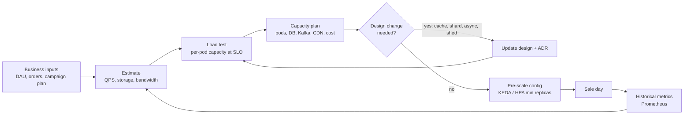
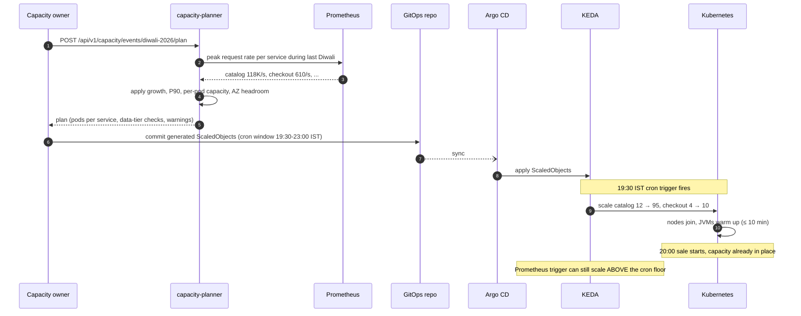
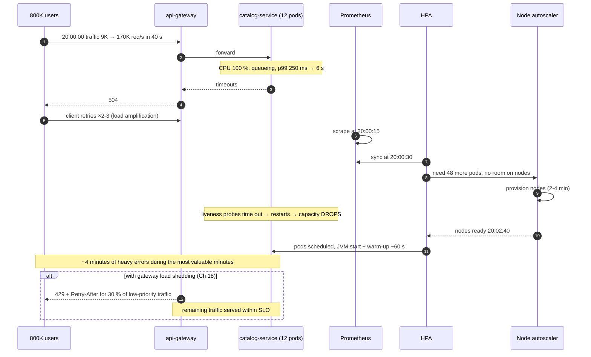
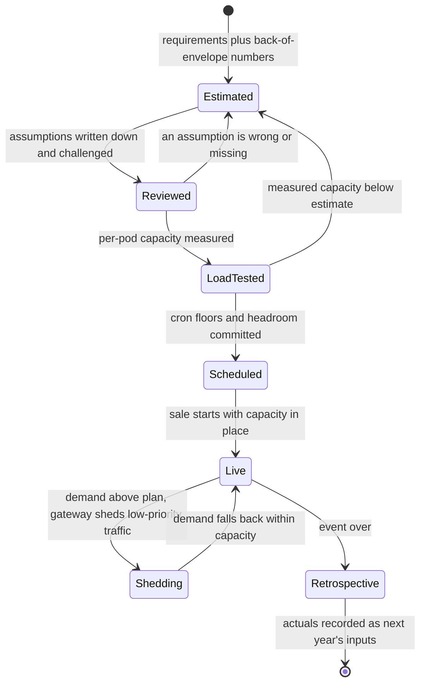
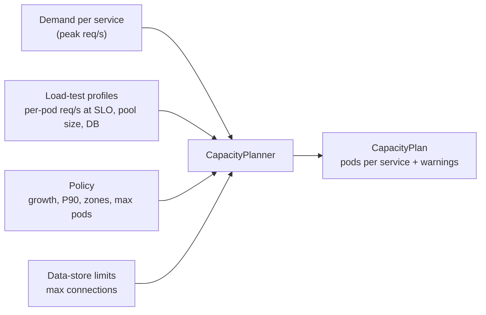

# 02. Back-of-the-Envelope Estimation ⭐

!!! abstract "Chapter at a glance"
    **Reader bands:** B1 → B4 · **Prerequisites:** [Ch 01](../00-orientation/01-what-system-design-is.md) · **What you will build:** A capacity estimator, taken from a plain-Java calculator (L1) to a planner that reads real production metrics and generates Kubernetes pre-scaling config for a festival sale (L4) · **Reading time:** 80 min + code

---

## 1. Introduction & Why It Matters

### 1.1 A story: the sale that autoscaling couldn't save

A grocery platform announced a Diwali sale starting at 8:00 pm sharp: ₹1 onions, 60 % off dry fruits. Engineering was confident. Every service had a Horizontal Pod Autoscaler (HPA) at 60 % CPU, and "the cloud scales."

At 8:00:00 pm, gateway traffic went from 9 K req/s to 170 K req/s in 40 seconds.

- **8:00:15.** Prometheus scraped the first high CPU samples.
- **8:00:30.** The HPA decided to scale `catalog-service` from 12 to 60 pods.
- **8:00:30–8:02:30.** The cluster had no spare nodes. The node autoscaler requested 30 machines, which took about 3 minutes to join.
- **8:03:40.** New JVMs finished starting and warming up.

For roughly four minutes, the existing pods were overloaded. Latency rose, clients timed out and **retried**, which multiplied load by 2–3×. Liveness checks failed, Kubernetes restarted "unhealthy" pods, and capacity dropped further. The first 10 minutes of the sale, the most valuable 10 minutes of the quarter, returned errors to most customers.

Nobody had done the arithmetic: *peak ÷ per-pod capacity = pods needed **before** 8:00 pm*. A ten-minute estimate on a whiteboard would have shown that reactive autoscaling could not react in time. The fix was trivial: **pre-scale at 7:30 pm**.

!!! quote "The thesis of this chapter"
    Estimation isn't about getting the right number. It's about finding **which part of the design the numbers break**, and doing that before production does.

### 1.2 Where this lives in the grocery platform

| Decision | Estimate that drives it |
|---|---|
| Serve serviceability from memory (Ch 01) | 2.4 MB dataset, 6 K req/s |
| Put catalog behind CDN + cache | ~110 K catalog req/s at sale start; ~2 GB/s uncompressed JSON |
| Pre-scale before sales | Pod warm-up time vs spike rise time |
| Partition count for `order.order.placed.v1` | Peak event rate × consumer processing time |
| DB connection limits across services | Σ(pods × pool size) vs `max_connections` |
| Special handling for the "₹1 onion" SKU | Reservations/s on a single inventory row |
| GST invoice storage budget | Orders/year × invoice size × retention |

### 1.3 Learning objectives

| Band | After this chapter you can… |
|---|---|
| <span class="band b1">B1</span> | Convert daily volumes to QPS, recall the key latency numbers, and estimate storage |
| <span class="band b2">B2</span> | Derive peak factors, apply Little's Law to pools, and estimate bandwidth, memory and servers |
| <span class="band b3">B3</span> | Produce a full festival-sale estimate, find hot spots and connection-budget limits, and size for zone failure |
| <span class="band b4">B4</span> | Run capacity planning as a process, present estimates with uncertainty, and tie capacity to cost and risk |

---

## 2. Core Concepts — Beginner to Deep

### 2.1 Intuition: packing for a trip <span class="band b1">B1</span>

You don't weigh every shirt before a trip. You think: "5 days, 1 shirt per day, plus 2 spare, so 7 shirts. That fits in a cabin bag." That's back-of-the-envelope estimation: **rough numbers, simple arithmetic, a decision.**

The goal is being right within a factor of 2–3, not within 1 %. A factor-of-10 error changes the design. A factor-of-2 error usually changes only the instance count.

### 2.2 The toolkit: numbers you must know by heart <span class="band b1">B1</span>

#### 2.2.1 Powers of two and ten

| Power | Exact | Approx | Name |
|---|---|---|---|
| 2¹⁰ | 1,024 | 10³ | 1 KB |
| 2²⁰ | 1,048,576 | 10⁶ | 1 MB |
| 2³⁰ | ~1.07 × 10⁹ | 10⁹ | 1 GB |
| 2⁴⁰ | ~1.1 × 10¹² | 10¹² | 1 TB |
| 2⁵⁰ | ~1.13 × 10¹⁵ | 10¹⁵ | 1 PB |

| Handy constant | Value | Use |
|---|---|---|
| Seconds per day | 86,400 ≈ **10⁵** | Per-day → per-second: divide by 10⁵ |
| Seconds per month | ~2.6 × 10⁶ | |
| Seconds per year | ~3.15 × 10⁷ ≈ **π × 10⁷** | |
| 1 M/day | ≈ **12 per second** | Memorize this one |
| 1 B/day | ≈ 12 K per second | |
| Java object header | 12–16 bytes | Memory estimates |
| UUID | 16 bytes binary, 36 as text | Index size |
| `long` / `Instant` | 8 / ~24 bytes (object) | |

#### 2.2.2 Latency numbers (order of magnitude, 2026 hardware)

| Operation | Approx. time | Relative to a RAM read |
|---|---|---|
| L1 cache reference | ~1 ns | 0.01× |
| Branch mispredict | ~3–5 ns | |
| L2 cache reference | ~4 ns | |
| Mutex lock/unlock (uncontended) | ~20 ns | |
| **Main memory reference** | **~100 ns** | 1× |
| Compress 1 KB (Snappy/LZ4) | ~1–2 µs | 10–20× |
| Send 1 KB over a 10 Gbps network | ~1 µs | |
| Read 1 MB sequentially from memory | ~10 µs | |
| **NVMe SSD random read (4 KB)** | **~20–100 µs** | ~500× |
| Read 1 MB sequentially from NVMe | ~150–300 µs | |
| **Round trip within the same AZ** | **~0.1–0.5 ms** | ~2,000–5,000× |
| Round trip across AZs (same region) | ~0.5–2 ms | |
| Simple PostgreSQL PK query (incl. network) | ~0.5–2 ms | |
| Redis GET (incl. network) | ~0.2–1 ms | |
| HDD seek | ~5–10 ms | |
| Mumbai ↔ Hyderabad | ~15–25 ms | |
| Mumbai ↔ Singapore | ~55–70 ms | |
| Mumbai ↔ US East | ~180–220 ms | |
| TLS 1.3 handshake on a new connection | +1 RTT | |
| Spring Boot pod: schedule → start → warm | ~20–90 s | Plan for it in scaling |
| New Kubernetes node joins the cluster | ~1–4 min | The hidden cost of "autoscaling" |

!!! tip "Three ratios to remember"
    - Memory is **~1,000× faster** than a network hop.
    - A same-region network hop is **~100× faster** than a cross-continent one.
    - Anything that needs a **new JVM or a new node** takes **tens of seconds to minutes**, which is an eternity during a spike.

#### 2.2.3 Throughput priors (planning defaults, replace with measurements)

These are **starting assumptions** for estimates, not facts. Every real design replaces them with load-test data (§5 L3/L4).

| Component | Planning prior | Notes |
|---|---|---|
| Spring Boot endpoint, in-memory work only | 2–5 K req/s per vCPU | JSON serialization dominates |
| Spring Boot endpoint, 1–2 DB calls | 300–1,000 req/s per vCPU | Depends on query cost |
| PostgreSQL (8 vCPU), simple PK reads | 20–50 K/s | From buffer cache; drops sharply when disk-bound |
| PostgreSQL (8 vCPU), simple writes | 3–10 K TPS | fsync, WAL and indexes matter |
| Redis, single shard | ~100 K ops/s | Single-threaded command execution |
| Kafka partition | ~5–10 MB/s write (conservative) | Consumer processing is usually the real limit |
| One hot DB row, locked updates | ~200–1,000 updates/s | Serialized by the row lock, ~1–5 ms each |
| CDN edge | Effectively unlimited | You pay per GB |

### 2.3 From users to QPS ⭐ <span class="band b1">B1</span> <span class="band b2">B2</span>

The core chain:

$$
\text{Avg QPS} = \frac{\text{DAU} \times \text{actions per user per day}}{86{,}400}
\qquad
\text{Peak QPS} = \text{Avg QPS} \times \text{peak factor}
$$

**Example (normal day).** 2 M DAU × 40 API calls per user per day = 80 M calls/day → 80 M ÷ 10⁵ ≈ **800 req/s average** at the gateway. With the evening peak factor of 5, that's **4,000 req/s**.

#### Deriving the peak factor <span class="band b2">B2</span>

Peak factors aren't magic constants. They come from **traffic shape**:

| Source of peak | Typical factor over the daily average | How to know |
|---|---|---|
| Daily curve (evening dinner rush) | 2–5× | Hour-of-day histogram from last month |
| Weekly (Sunday mornings) | 1.2–1.5× on top | Day-of-week histogram |
| Marketing push notification to 5 M users | 5–15× for 2–5 minutes | Past campaign dashboards |
| Scheduled sale start ("8 pm sharp") | 15–40× for the first 1–3 minutes | Past sales; this is the dangerous one |
| Retry storm after an incident | 2–3× on top of whatever caused it | Retry policy × failure rate |

!!! warning "Peaks are measured over the wrong window"
    A dashboard with 5-minute averages hides a 30-second spike that is 3× higher. Size for the **per-second** peak your autoscaler can't absorb. That's the rise time from §1.1.

### 2.4 Read/write ratio <span class="band b2">B2</span>

Classify every workload by its ratio, because the ratio decides the architecture:

| Ratio | Example | Architecture implication |
|---|---|---|
| 10⁶ : 1 | Serviceability, GST rate tables | Full replica in memory; push invalidation |
| 100 : 1 | Catalog, product page | Cache + CDN; read replicas |
| 10 : 1 | Cart | Cache-friendly, but writes matter; Redis |
| 1 : 1 | Inventory reservations during a sale | Contention; per-row throughput matters |
| 1 : 10+ | Rider location pings, clickstream | Write-optimized store, batching, time-series/LSM, async |

### 2.5 Storage estimation ⭐ <span class="band b1">B1</span> <span class="band b2">B2</span>

$$
\text{Storage} = \text{records/day} \times \text{bytes/record} \times \text{retention days} \times \text{overhead}
$$

The overhead multiplier covers indexes (×1.5–3), replication (×2–3) and headroom (×1.3).

**Worked example: orders.**

| Item | Estimate |
|---|---|
| Order header row | ~1 KB (IDs, amounts, address snapshot, status, timestamps) |
| Line items | 8 items × ~250 B = 2 KB |
| Status history | 6 transitions × ~150 B ≈ 1 KB |
| **Raw per order** | **~4 KB** |
| Orders/day (year-round average incl. festivals) | ~500 K |
| Raw per day | 500 K × 4 KB = **2 GB/day** |
| Per year | ~730 GB raw |
| × indexes (2) × copies (3 = primary + 2 replicas) | ~4.4 TB/year provisioned |
| GST record retention (multi-year, confirm with finance) | Hot data 1 year in OLTP, older in a cheap archive |

!!! success "What the estimate tells us"
    A few TB/year in PostgreSQL is **fine** for one well-provisioned cluster. There's no need to shard orders on day one. But plan **partitioning by month** so old data moves to archive cheaply (Ch 05, 28). The estimate turned "should we shard?" into "not yet, and here's the trigger."

**Other storage in the platform (rough):**

| Data | Volume | Store |
|---|---|---|
| GST invoice PDFs | 500 K/day × 60 KB = 30 GB/day → ~11 TB/yr | Object storage + lifecycle to a cold tier |
| Rider location pings | 40 K riders × 1 ping/4 s = 10 K writes/s × 100 B ≈ 86 GB/day | Redis (latest) + time-series (7-day retention) |
| Product images | 250 K SKUs × 6 images × 4 sizes × 60 KB ≈ 360 GB | Object storage + CDN |
| Application logs | 26 services × ~3 KB/request × 80 M requests ≈ 240 GB/day | Often the **largest cost line**; sample and set retention |

### 2.6 Bandwidth estimation <span class="band b2">B2</span>

$$
\text{Bandwidth} = \text{QPS} \times \text{response size}
$$

**Sale start, catalog API:** 110 K req/s × 20 KB JSON ≈ **2.2 GB/s ≈ 18 Gbps** uncompressed. With gzip or Brotli (~5–8× on JSON), that's ~2–3.5 Gbps. Images go to the CDN, so they aren't your origin's problem, but they are your bill: 6 M DAU × 40 images × 40 KB ≈ **9.6 TB/day** of CDN egress.

!!! tip "Bandwidth estimates catch a class of bugs early"
    A product-list API returning full product objects (80 KB) instead of list DTOs (8 KB) is a 10× bandwidth and serialization-CPU bug. Estimating response sizes during API design (Ch 04) prevents it.

### 2.7 Memory estimation <span class="band b2">B2</span>

Can it fit in memory? That question decides between an in-process cache, Redis, and "must go to disk."

$$
\text{Memory} = \text{entries} \times (\text{key} + \text{value} + \text{per-entry overhead})
$$

| Structure | Rough per-entry overhead |
|---|---|
| Java `HashMap` entry (node + refs) | ~32–48 B + key and value objects |
| Java `String` (short, compact strings) | ~40 B + 1 B/char (Latin-1) |
| Redis small key-value | ~50–90 B overhead |

**Example: carts in Redis.** 1.5 M active carts at peak × (8 items × 60 B + 200 B overhead) ≈ 1.5 M × 680 B ≈ **1 GB**. That fits comfortably in a single Redis shard (with a replica), so memory doesn't force clustering. The deciding factor is **ops/s** (§4).

### 2.8 Server count and Little's Law ⭐ <span class="band b2">B2</span> <span class="band b3">B3</span>

#### CPU-based sizing

$$
\text{cores needed} = \frac{\text{peak QPS} \times \text{CPU ms per request}}{1000 \times \text{target utilization}}
$$

Checkout at 850 req/s × 6 ms CPU/request ÷ (1000 × 0.5) ≈ **10.2 cores** → 6 pods × 2 vCPU.

!!! note "Why target 50–60 % utilization, not 90 %?"
    Queueing theory (M/M/1 intuition): waiting time grows as ρ / (1 − ρ). At 50 % utilization the multiplier is 1×. At 80 % it's 4×. At 95 % it's 19×. Tail latency explodes long before CPU hits 100 % (Ch 25).

#### Little's Law: in-flight work

$$
L = \lambda \times W
\quad\text{(in-flight = arrival rate × time in system)}
$$

| Use | Calculation | Result |
|---|---|---|
| Concurrent checkout requests | 850 req/s × 0.15 s | ~128 in flight |
| DB connections checkout needs | 850 req/s × 20 ms of DB time per request | **~17 connections busy** |
| Threads (platform threads) | 128 in flight + headroom | ~200 (virtual threads remove this limit) |
| Kafka consumer parallelism | 1,000 events/s × 30 ms processing | **≥ 30 partitions/consumers** |

!!! danger "The connection budget"
    PostgreSQL connections are expensive (several MB each, with contention above a few hundred). If 26 services × 6 pods × a pool of 20 all point at shared clusters, that's 3,120 potential connections. Little's Law says you need far fewer busy connections. **Size pools from Little's Law, not from defaults**, and add PgBouncer as pod counts grow (Ch 05).

### 2.9 Worked example: the festival-sale checkout estimate ⭐ <span class="band b3">B3</span>

**Given:** a festival day with 1.5 M orders. The sale starts at 8:00 pm. 20 % of the day's orders happen in the first hour, and minute one runs at 5× that hour's average.

| Step | Calculation | Result |
|---|---|---|
| Orders in the first hour | 1.5 M × 0.2 | 300 K |
| Average orders/s in that hour | 300 K ÷ 3,600 | ~83/s |
| Peak-minute orders/s | 83 × 5 | **~420 orders/s** |
| Checkout attempts (payment failures, retries, drop-offs: ×2) | 420 × 2 | **~850 checkout req/s** |
| Concurrent users at 8:00 pm | 6 M DAU × ~13 % online | ~800 K |
| Gateway requests (1 request per 4 s per user) | 800 K ÷ 4 | **~200 K req/s** |
| …of which catalog/search/product reads | ~55 % | **~110 K req/s** |
| Reservations for the "₹1 onion" SKU (in 30 % of orders, spread over ~50 busy stores) | 850 × 0.3 ÷ 50 | **~5/s per store-SKU row** |
| …if one metro store gets 20 % of that demand | 850 × 0.3 × 0.2 | **~50/s on one row**: fine for a row lock (~500/s max) |
| Order DB statements (order + items + outbox) | 420 × ~12 | ~5 K statements/s on the orders primary |
| Payment webhook callbacks | ~420/s + retries | Idempotent handler required (Ch 20, 45) |
| Kafka `order.order.placed.v1` | 420/s × 2 KB | ~0.8 MB/s: tiny for Kafka; partitions sized by consumer time |

!!! success "What this estimate tells us (the real value)"
    1. **Checkout compute is not the problem.** ~850 req/s needs ~6 pods.
    2. **Read traffic is the problem.** ~110 K req/s of catalog needs CDN plus multi-layer caching, and pre-scaling (Ch 07, 21).
    3. **Contention is a watch item, not a crisis.** The hot SKU row sits at ~10 % of lock capacity. We'd re-estimate if the sale became a single national flash deal (Ch 46).
    4. **Rise time kills.** From 9 K to 200 K req/s in about 40 s is faster than any reactive autoscaler. **Pre-scale.**

### 2.10 Estimation in interviews vs at work <span class="band b2">B2</span> <span class="band b4">B4</span>

| | Interview | At work |
|---|---|---|
| Time | 3–5 minutes | Hours to days |
| Inputs | Assumed, stated aloud | Measured (metrics, load tests, business forecasts) |
| Precision | Order of magnitude | Ranges with confidence (P50 / P90 forecasts) |
| Output | Which parts of the design matter | Capacity plan, budget, pre-scale schedule, risk register |
| Failure mode | Precision theatre (computing 83.33/s) | Estimating once and never validating |

**Interview script:**

> *"Let me assume 2 M DAU and about 40 API calls each, so 80 M a day, which is about 1 K per second average. Evening peak is maybe 5×, so 5 K/s. Sale starts are much spikier, maybe 20–40× in the first minute. The read:write ratio is around 100:1, so reads dominate and caching is the main lever. Storage is about 4 KB per order and 500 K orders a day, so 2 GB a day and under 1 TB a year raw. That fits one Postgres cluster, so no sharding yet, and I'll partition by month."*

### 2.11 Uncertainty, ranges and presenting estimates <span class="band b4">B4</span>

Senior estimates are **ranges with drivers**, not single numbers:

| Scenario | Orders on sale day | Peak checkout req/s | Catalog req/s | Catalog pods (before AZ headroom) |
|---|---|---|---|---|
| P50 (last year × 1.4 growth) | 1.5 M | 850 | 165 K | 55 |
| P90 (marketing overperforms, × 1.15) | 1.75 M | 980 | 190 K | 64 |
| Stress (P90 × 1.5 safety) | 2.6 M | 1,470 | 285 K | 95 |

- **Plan capacity** at P90 plus zone-failure headroom.
- **Load test** at the stress scenario.
- **Protect** beyond stress with load shedding (Ch 18): serve 429 to a slice of low-priority traffic rather than fail everyone.
- **Tell executives the drivers:** "Every extra 1 M users notified in the 7:55 pm push adds ~35 K req/s at 8:00."

### 2.12 Zone-failure headroom <span class="band b3">B3</span> <span class="band b4">B4</span>

If you run in 3 availability zones and must survive losing one **at peak**:

$$
\text{pods provisioned} = \left\lceil \text{pods needed} \times \frac{\text{zones}}{\text{zones} - 1} \right\rceil
$$

64 pods needed → 96 provisioned (32 per zone). That's the real cost of the availability NFR from Ch 01. Put it in the design doc so finance sees it as a *decision*, not waste.

---

## 3. Architecture & Diagrams

### 3.1 The estimation pipeline (how numbers become decisions)



### 3.2 Sequence: happy path, planned pre-scaling for the sale



### 3.3 Sequence: failure path, reactive-only autoscaling at sale start



!!! note "What the system guarantees after this failure path"
    Without pre-scaling, nothing: a correct design can still fail on arithmetic alone. With pre-scaling as the primary defence and **gateway load shedding** as the backstop, the platform degrades a controlled slice of traffic instead of failing everyone. Liveness probes must not depend on request latency, or overload turns into a restart storm.

### 3.4 State: the lifecycle of a capacity plan

An estimate is only useful if it becomes a plan that is checked against reality after the event. The same states apply to every sale or launch.



---

## 4. Design Document Excerpt: Diwali 2026 Capacity Plan

| Field | Value |
|---|---|
| Author / Reviewers | Platform capacity owner / SRE, Checkout, Catalog, Finance |
| Status | Approved |
| Related ADRs | ADR-014 Pre-scale for scheduled events |

**1. Context & Problem.** Last year's sale start caused ~4 minutes of errors due to reactive autoscaling lag (§1.1). This year's marketing plan is 1.4× bigger.

**2. Goals / Non-Goals.**

- *Goals:* meet SLOs at P90 demand, including loss of one AZ. Degrade gracefully up to the stress scenario.
- *Non-goals:* redesigning inventory contention (tracked in Ch 46 work); multi-region (Ch 27).

**3. Requirements.**

| ID | Requirement |
|---|---|
| NFR-1 | Gateway availability ≥ 99.9 % during 19:45–22:00 IST |
| NFR-2 | Catalog p99 ≤ 300 ms, checkout p99 ≤ 800 ms at P90 load |
| NFR-3 | Survive loss of 1 of 3 AZs at P90 without breaching NFR-2 |
| NFR-4 | Beyond stress load, shed low-priority traffic (recommendations, non-cart browsing) first |
| NFR-5 | Infra spend for the event ≤ ₹18 lakh |

**4. Capacity estimates.**

| Service | Last year peak | × growth 1.4 | P90 (× 1.15 on top) | Per-pod capacity at SLO (load test) | Pods needed | × AZ headroom 1.5 | Provision |
|---|---|---|---|---|---|---|---|
| catalog | 118 K/s | 165 K/s | 190 K/s | 3,000 req/s | 64 | 96 | **96** |
| search | 22 K/s | 31 K/s | 35 K/s | 800 req/s | 44 | 66 | **66** |
| cart | 9 K/s | 12.6 K/s | 14.5 K/s | 2,500 req/s | 6 | 9 | **9** |
| checkout | 610/s | 850/s | 980/s | 180 req/s | 6 | 9 | **9** (+1 deploy surge) |
| inventory | 2.1 K/s | 2.9 K/s | 3.4 K/s | 900 req/s | 4 | 6 | **6** |

**Data-tier checks.**

- Orders PostgreSQL: ~5 K statements/s at P50, ~6 K at P90. The load test showed 14 K/s at 60 % CPU. **OK.**
- Connection budget (orders DB): checkout 10 pods × 10 + order 8 × 10 + outbox relay 2 × 2 = 184 ≤ 300 via PgBouncer. **OK.**
- Redis carts: 14.5 K req/s × ~3 ops = 44 K ops/s on one shard (limit ~100 K). **OK at 44 %.** Watch item.
- Kafka: `order.order.placed.v1` has 24 partitions; consumers at 30 ms/event → capacity ~800 events/s vs ~560/s at P90. **OK.**

**7. Alternatives considered.**

| Option | Pros | Cons | Verdict |
|---|---|---|---|
| Reactive HPA only | Cheapest | Fails on rise time (proven last year) | Rejected |
| Permanently over-provision | Simple | ~₹60 lakh/quarter of idle capacity | Rejected |
| **Scheduled pre-scale (KEDA cron) + reactive above floor + load shedding** | Capacity ready before the spike; still elastic; bounded failure | Needs a forecast; cost for a 3.5 h window | **Chosen** |
| Staggered sale start by city | Smooths the spike ~4× | Marketing objection | Proposed for 2027 |

**8. Failure modes.** Forecast too low → reactive scaling above the cron floor, plus load shedding. Node capacity unavailable in the region → reserve capacity with the cloud provider 7 days before. A deploy during the event → change freeze 18:00–23:00.

**10. Observability.** A dedicated event dashboard showing actual vs forecast req/s per service, headroom % (capacity ÷ load), connection-pool saturation, and Kafka consumer lag. A "headroom < 25 %" alert pages the event war room.

**11. Rollout.** A full-scale load test at stress level on D-5 (shadow environment); a pre-scale dress rehearsal on D-2 (scale up, verify nodes, scale down); on the day, the cron trigger fires at 19:30.

**12. Cost.** 3.5 h × ~200 extra pods (~300 vCPU), plus reserved node capacity, plus CDN egress ≈ **₹11 lakh**, within budget.

**14. Decision (ADR-014 summary).** For any scheduled event with a forecast peak above 3× normal, pre-scale with a cron-based floor sized at P90 × AZ headroom, starting 30 minutes before the event. Reactive autoscaling stays active above the floor. Gateway load shedding is mandatory beyond the stress scenario.

---

## 5. Hands-On Code — Level Ladder

We build a **capacity estimator** four times. Each level answers a harder question:

| Level | Question it answers |
|---|---|
| L1 | "What are the rough numbers?" (a calculator you can run in 10 seconds) |
| L2 | "Can the team share, save and compare scenarios?" (a Spring service) |
| L3 | "How many pods do we actually provision, including zone failure, and what breaks first?" (a measured, policy-driven planner with warnings) |
| L4 | "Generate the sale-day plan from last year's real traffic and ship it as GitOps config." (Prometheus + KEDA) |

### L1 — Concept (plain Java) <span class="band b1">B1</span>

```java
// CapacityEstimatorL1.java — run with: java CapacityEstimatorL1.java
import java.util.Locale;

public class CapacityEstimatorL1 {

    static final double SECONDS_PER_DAY = 86_400;

    record Traffic(long dau, double actionsPerUserPerDay, double peakFactor) {
        double avgQps()  { return dau * actionsPerUserPerDay / SECONDS_PER_DAY; }
        double peakQps() { return avgQps() * peakFactor; }
    }

    record Storage(long recordsPerDay, long bytesPerRecord, int retentionDays, double overhead) {
        double totalBytes() { return (double) recordsPerDay * bytesPerRecord * retentionDays * overhead; }
    }

    /** Little's Law: items in the system = arrival rate × time in system. */
    static double inFlight(double arrivalsPerSecond, double secondsInSystem) {
        return arrivalsPerSecond * secondsInSystem;
    }

    static double coresNeeded(double qps, double cpuMsPerRequest, double targetUtilization) {
        return qps * cpuMsPerRequest / (1000.0 * targetUtilization);
    }

    static String human(double bytes) {
        String[] units = {"B", "KB", "MB", "GB", "TB", "PB"};
        int i = 0;
        while (bytes >= 1024 && i < units.length - 1) { bytes /= 1024; i++; }
        return String.format(Locale.ROOT, "%.1f %s", bytes, units[i]);
    }

    public static void main(String[] args) {
        // 1. Normal day at the gateway
        var normal = new Traffic(2_000_000, 40, 5);
        System.out.printf(Locale.ROOT, "Gateway avg %.0f req/s, evening peak %.0f req/s%n",
                normal.avgQps(), normal.peakQps());

        // 2. Festival checkout: 1.5M orders, 20% in first hour, minute-one = 5x hour avg, attempts = 2x orders
        double ordersPerSecPeak = 1_500_000 * 0.20 / 3_600 * 5;
        double checkoutQps = ordersPerSecPeak * 2;
        System.out.printf(Locale.ROOT, "Festival peak: %.0f orders/s, %.0f checkout req/s%n",
                ordersPerSecPeak, checkoutQps);

        // 3. Pods for checkout: 6 ms CPU per request, 50% target utilization, 2 vCPU pods
        double cores = coresNeeded(checkoutQps, 6, 0.5);
        System.out.printf(Locale.ROOT, "Checkout needs %.1f cores → %d pods of 2 vCPU%n",
                cores, (int) Math.ceil(cores / 2));

        // 4. DB connections actually busy (20 ms DB time per checkout)
        System.out.printf(Locale.ROOT, "Busy DB connections ≈ %.0f%n", inFlight(checkoutQps, 0.020));

        // 5. Order storage for one year: 500K/day, 4 KB, indexes x2, 3 copies
        var orders = new Storage(500_000, 4 * 1024, 365, 2 * 3);
        System.out.println("Order storage / year (provisioned): " + human(orders.totalBytes()));

        // 6. Catalog bandwidth at sale start: 110K req/s x 20 KB
        System.out.println("Catalog egress (uncompressed): " + human(110_000 * 20 * 1024.0) + "/s");
    }
}
```

Output:

```text
Gateway avg 926 req/s, evening peak 4630 req/s
Festival peak: 417 orders/s, 833 checkout req/s
Checkout needs 10.0 cores → 5 pods of 2 vCPU
Busy DB connections ≈ 17
Order storage / year (provisioned): 4.1 TB
Catalog egress (uncompressed): 2.1 GB/s
```

**What L1 gets right:** every formula from §2 in one place, with named inputs.

**What L1 can't do:**

| Gap | Why it matters |
|---|---|
| Inputs are hard-coded guesses | Nobody can review or reuse them |
| No per-pod capacity from load tests | "6 ms CPU" is a guess; real limits are often I/O, GC or locks |
| No zone-failure headroom | Plan fails exactly when an AZ fails at peak |
| No cross-service checks (DB connections, Kafka) | Local answers can be globally impossible |

### L2 — Spring Implementation (four layers) <span class="band b2">B2</span>

A small `capacity-planner` service where teams save named scenarios and compare them.

```kotlin
// build.gradle.kts (module l2-spring)
dependencies {
    implementation("org.springframework.boot:spring-boot-starter-web")      // VERIFY: Boot 4 starter name (spring-boot-starter-webmvc)
    implementation("org.springframework.boot:spring-boot-starter-validation")
    implementation("org.springframework.boot:spring-boot-starter-data-jpa")
    implementation("org.flywaydb:flyway-core")
    implementation("org.flywaydb:flyway-database-postgresql")
    runtimeOnly("org.postgresql:postgresql")
    testImplementation("org.springframework.boot:spring-boot-starter-test")
}
```

=== "Domain math"

    ```java
    package com.grocery.capacity.domain;

    /** Pure functions. No Spring, no I/O — trivially testable and reusable in L3/L4. */
    public final class CapacityMath {

        public static final double SECONDS_PER_DAY = 86_400;

        private CapacityMath() { }

        public static double avgQps(long dau, double actionsPerUserPerDay) {
            return dau * actionsPerUserPerDay / SECONDS_PER_DAY;
        }

        public static double coresNeeded(double qps, double cpuMsPerRequest, double targetUtilization) {
            if (targetUtilization <= 0 || targetUtilization >= 1) {
                throw new IllegalArgumentException("targetUtilization must be in (0,1)");
            }
            return qps * cpuMsPerRequest / (1000.0 * targetUtilization);
        }

        public static double inFlight(double qps, double latencyMs) {
            return qps * latencyMs / 1000.0;
        }

        public static int podsFor(double cores, int vcpuPerPod) {
            return Math.max(1, (int) Math.ceil(cores / vcpuPerPod));
        }
    }
    ```

=== "DTOs"

    ```java
    package com.grocery.capacity.dto;

    import jakarta.validation.constraints.*;

    public record EstimateRequest(
            @NotBlank String name,
            @Positive long dau,
            @Positive double actionsPerUserPerDay,
            @DecimalMin("1.0") double peakFactor,
            @Positive int responseBytes,
            @Positive double cpuMsPerRequest,
            @DecimalMin("0.1") @DecimalMax("0.9") double targetUtilization,
            @Positive int vcpuPerPod,
            @Positive double latencyMs) { }
    ```

    ```java
    package com.grocery.capacity.dto;

    import java.util.UUID;

    public record EstimateResponse(UUID id, String name, double avgQps, double peakQps,
                                   double egressMbPerSec, double coresNeeded, int pods,
                                   double inFlightRequests) { }
    ```

=== "Entity & Repository"

    ```java
    package com.grocery.capacity.domain;

    import jakarta.persistence.*;
    import java.time.Instant;
    import java.util.UUID;

    @Entity
    @Table(name = "capacity_scenario")
    public class CapacityScenario {

        @Id private UUID id;
        @Column(nullable = false) private String name;
        private long dau;
        private double actionsPerUserPerDay;
        private double peakFactor;
        private double peakQps;
        private double coresNeeded;
        private int pods;
        @Column(nullable = false) private Instant createdAt;

        protected CapacityScenario() { }

        public CapacityScenario(UUID id, String name, long dau, double actionsPerUserPerDay,
                                double peakFactor, double peakQps, double coresNeeded,
                                int pods, Instant createdAt) {
            this.id = id; this.name = name; this.dau = dau;
            this.actionsPerUserPerDay = actionsPerUserPerDay; this.peakFactor = peakFactor;
            this.peakQps = peakQps; this.coresNeeded = coresNeeded; this.pods = pods;
            this.createdAt = createdAt;
        }

        public UUID getId() { return id; }
        public String getName() { return name; }
        public double getPeakQps() { return peakQps; }
        public int getPods() { return pods; }
    }
    ```

    ```java
    package com.grocery.capacity.repository;

    import com.grocery.capacity.domain.CapacityScenario;
    import org.springframework.data.jpa.repository.JpaRepository;
    import java.util.List;
    import java.util.UUID;

    public interface CapacityScenarioRepository extends JpaRepository<CapacityScenario, UUID> {
        List<CapacityScenario> findTop20ByOrderByCreatedAtDesc();
    }
    ```

=== "Service, Delegate, Controller"

    ```java
    package com.grocery.capacity.service;

    import com.grocery.capacity.domain.*;
    import com.grocery.capacity.dto.*;
    import com.grocery.capacity.repository.CapacityScenarioRepository;
    import org.springframework.stereotype.Service;
    import org.springframework.transaction.annotation.Transactional;
    import java.time.Clock;
    import java.util.UUID;

    @Service
    public class EstimateService {

        private final CapacityScenarioRepository repository;
        private final Clock clock;

        public EstimateService(CapacityScenarioRepository repository, Clock clock) {
            this.repository = repository;
            this.clock = clock;
        }

        @Transactional
        public EstimateResponse estimateAndSave(EstimateRequest r) {
            double avg   = CapacityMath.avgQps(r.dau(), r.actionsPerUserPerDay());
            double peak  = avg * r.peakFactor();
            double cores = CapacityMath.coresNeeded(peak, r.cpuMsPerRequest(), r.targetUtilization());
            int pods     = CapacityMath.podsFor(cores, r.vcpuPerPod());
            double egressMb = peak * r.responseBytes() / 1_000_000.0;
            double inFlight = CapacityMath.inFlight(peak, r.latencyMs());

            var id = UUID.randomUUID();
            repository.save(new CapacityScenario(id, r.name(), r.dau(), r.actionsPerUserPerDay(),
                    r.peakFactor(), peak, cores, pods, clock.instant()));
            return new EstimateResponse(id, r.name(), avg, peak, egressMb, cores, pods, inFlight);
        }
    }
    ```

    ```java
    package com.grocery.capacity.delegate;

    import com.grocery.capacity.dto.*;
    import com.grocery.capacity.service.EstimateService;
    import org.springframework.stereotype.Component;

    @Component
    public class EstimateDelegate {
        private final EstimateService service;
        public EstimateDelegate(EstimateService service) { this.service = service; }
        public EstimateResponse estimate(EstimateRequest request) { return service.estimateAndSave(request); }
    }
    ```

    ```java
    package com.grocery.capacity.controller;

    import com.grocery.capacity.delegate.EstimateDelegate;
    import com.grocery.capacity.dto.*;
    import jakarta.validation.Valid;
    import org.springframework.http.HttpStatus;
    import org.springframework.web.bind.annotation.*;

    @RestController
    @RequestMapping("/api/v1/capacity/estimates")
    public class EstimateController {

        private final EstimateDelegate delegate;

        public EstimateController(EstimateDelegate delegate) { this.delegate = delegate; }

        @PostMapping
        @ResponseStatus(HttpStatus.CREATED)
        public EstimateResponse create(@Valid @RequestBody EstimateRequest request) {
            return delegate.estimate(request);
        }
    }
    ```

=== "Test"

    ```java
    package com.grocery.capacity.domain;

    import org.junit.jupiter.api.Test;
    import static org.assertj.core.api.Assertions.*;

    class CapacityMathTest {

        @Test
        void oneMillionPerDayIsAboutTwelvePerSecond() {
            assertThat(CapacityMath.avgQps(1_000_000, 1)).isCloseTo(11.57, within(0.01));
        }

        @Test
        void festivalCheckoutNeedsTenCores() {
            assertThat(CapacityMath.coresNeeded(833, 6, 0.5)).isCloseTo(10.0, within(0.01));
        }

        @Test
        void littlesLawForDbConnections() {
            assertThat(CapacityMath.inFlight(850, 20)).isEqualTo(17.0);
        }

        @Test
        void rejectsImpossibleUtilization() {
            assertThatThrownBy(() -> CapacityMath.coresNeeded(100, 5, 1.0))
                    .isInstanceOf(IllegalArgumentException.class);
        }
    }
    ```

**What L2 fixed:** shared, reviewable, validated scenarios, and math isolated in pure functions.

**What L2 still assumes:** CPU is the bottleneck, "6 ms CPU per request" is true, and each service can be sized in isolation. Real systems hit **connection limits, zone failures and measured per-pod ceilings** first.

### L3 — Production-Grade Planner <span class="band b3">B3</span>

L3 replaces guesses with **measured per-pod capacity from load tests**. It applies an explicit **policy** (growth, P90 factor, zone headroom) and runs **cross-service checks** that produce warnings. It refuses to plan a service it has no measurements for.



=== "Domain model"

    ```java
    package com.grocery.capacity.plan;

    public record ServiceDemand(String service, double peakQps) { }
    ```

    ```java
    package com.grocery.capacity.plan;

    /** Measured by load test: highest req/s ONE pod sustains while meeting its latency SLO. */
    public record ServiceProfile(String service, double perPodQpsAtSlo, int dbPoolPerPod,
                                 String database, int maxPods) { }
    ```

    ```java
    package com.grocery.capacity.plan;

    public record PlanPolicy(double growthFactor, double p90Factor, int zones, int minPodsPerZone) {
        public PlanPolicy {
            if (zones < 2) throw new IllegalArgumentException("zone headroom needs >= 2 zones");
            if (growthFactor <= 0 || p90Factor < 1) throw new IllegalArgumentException("invalid factors");
        }
    }
    ```

    ```java
    package com.grocery.capacity.plan;

    import java.util.List;

    public record ServicePlan(String service, double forecastQps, int podsNeeded,
                              int podsProvisioned, double headroomPercent) { }

    public record PlanWarning(Severity severity, String subject, String message) {
        public enum Severity { INFO, WARN, BLOCKER }
    }

    public record CapacityPlan(List<ServicePlan> services, List<PlanWarning> warnings) {
        public boolean hasBlockers() {
            return warnings.stream().anyMatch(w -> w.severity() == PlanWarning.Severity.BLOCKER);
        }
    }
    ```

    !!! note
        In a real module, `PlanWarning` and `CapacityPlan` each go in their own file. They're shown together here for brevity.

=== "Planner"

    ```java
    package com.grocery.capacity.plan;

    import java.util.*;
    import java.util.stream.Collectors;

    public class CapacityPlanner {

        public CapacityPlan plan(List<ServiceDemand> demands,
                                 Map<String, ServiceProfile> profiles,
                                 Map<String, Integer> dbMaxConnections,
                                 PlanPolicy policy) {

            List<ServicePlan> plans = new ArrayList<>();
            List<PlanWarning> warnings = new ArrayList<>();
            Map<String, Integer> connectionsByDb = new HashMap<>();

            for (ServiceDemand d : demands) {
                ServiceProfile p = profiles.get(d.service());
                if (p == null) {
                    // Never guess capacity for an unmeasured service.
                    warnings.add(new PlanWarning(PlanWarning.Severity.BLOCKER, d.service(),
                            "no load-test profile; run a load test before planning"));
                    continue;
                }

                double forecast = d.peakQps() * policy.growthFactor() * policy.p90Factor();
                int needed = (int) Math.ceil(forecast / p.perPodQpsAtSlo());

                // Survive loss of one zone at forecast load, then round UP to a multiple of zones
                double withHeadroom = needed * (double) policy.zones() / (policy.zones() - 1);
                int perZone = Math.max(policy.minPodsPerZone(),
                                       (int) Math.ceil(withHeadroom / policy.zones()));
                int provisioned = perZone * policy.zones();

                if (provisioned > p.maxPods()) {
                    warnings.add(new PlanWarning(PlanWarning.Severity.BLOCKER, d.service(),
                            "needs %d pods but maxPods is %d: raise the limit or change the design (cache, shed, async)"
                                    .formatted(provisioned, p.maxPods())));
                }

                double capacity = provisioned * p.perPodQpsAtSlo();
                double headroom = (capacity - forecast) / capacity * 100.0;
                plans.add(new ServicePlan(d.service(), forecast, needed, provisioned, headroom));

                if (p.database() != null) {
                    connectionsByDb.merge(p.database(), provisioned * p.dbPoolPerPod(), Integer::sum);
                }
            }

            // Cross-service check: the sum of pools must fit each database's connection limit
            connectionsByDb.forEach((db, total) -> {
                Integer max = dbMaxConnections.get(db);
                if (max == null) {
                    warnings.add(new PlanWarning(PlanWarning.Severity.WARN, db, "unknown max connections"));
                } else if (total > max) {
                    warnings.add(new PlanWarning(PlanWarning.Severity.BLOCKER, db,
                            "pools total %d connections > limit %d: shrink pools (Little's Law) or add PgBouncer"
                                    .formatted(total, max)));
                } else if (total > max * 0.8) {
                    warnings.add(new PlanWarning(PlanWarning.Severity.WARN, db,
                            "pools at %d%% of connection limit".formatted(total * 100 / max)));
                }
            });

            plans.sort(Comparator.comparing(ServicePlan::service));
            return new CapacityPlan(List.copyOf(plans), List.copyOf(warnings));
        }
    }
    ```

=== "Configuration (from load tests)"

    ```java
    package com.grocery.capacity.config;

    import com.grocery.capacity.plan.*;
    import org.springframework.boot.context.properties.ConfigurationProperties;
    import java.util.List;
    import java.util.Map;
    import java.util.function.Function;
    import java.util.stream.Collectors;

    @ConfigurationProperties("capacity")
    public record CapacityProperties(PlanPolicy policy,
                                     List<ServiceProfile> profiles,
                                     Map<String, Integer> databaseMaxConnections) {

        public Map<String, ServiceProfile> profilesByService() {
            return profiles.stream().collect(Collectors.toMap(ServiceProfile::service, Function.identity()));
        }
    }
    ```

    ```yaml
    capacity:
      policy:
        growth-factor: 1.4
        p90-factor: 1.15
        zones: 3
        min-pods-per-zone: 1
      profiles:                       # source: load-test report LT-2026-10 (link it!)
        - { service: catalog-service,   per-pod-qps-at-slo: 3000, db-pool-per-pod: 5,  database: catalog-db,   max-pods: 150 }
        - { service: search-service,    per-pod-qps-at-slo: 800,  db-pool-per-pod: 0,  database: ~,            max-pods: 120 }
        - { service: cart-service,      per-pod-qps-at-slo: 2500, db-pool-per-pod: 4,  database: cart-db,      max-pods: 40 }
        - { service: checkout-service,  per-pod-qps-at-slo: 180,  db-pool-per-pod: 10, database: orders-db,    max-pods: 40 }
        - { service: order-service,     per-pod-qps-at-slo: 400,  db-pool-per-pod: 10, database: orders-db,    max-pods: 40 }
        - { service: inventory-service, per-pod-qps-at-slo: 900,  db-pool-per-pod: 10, database: inventory-db, max-pods: 30 }
      database-max-connections:
        catalog-db: 400
        cart-db: 200
        orders-db: 300              # via PgBouncer transaction pooling
        inventory-db: 200
    ```

=== "Tests (incl. failure scenarios)"

    ```java
    package com.grocery.capacity.plan;

    import org.junit.jupiter.api.Test;
    import java.util.List;
    import java.util.Map;
    import static org.assertj.core.api.Assertions.*;

    class CapacityPlannerTest {

        private final CapacityPlanner planner = new CapacityPlanner();
        private final PlanPolicy policy = new PlanPolicy(1.4, 1.15, 3, 1);

        @Test
        void sizesCatalogForP90AndZoneLoss() {
            var plan = planner.plan(
                    List.of(new ServiceDemand("catalog-service", 118_000)),
                    Map.of("catalog-service", new ServiceProfile("catalog-service", 3000, 5, "catalog-db", 150)),
                    Map.of("catalog-db", 1000), policy);

            ServicePlan p = plan.services().getFirst();
            assertThat(p.forecastQps()).isCloseTo(189_980, within(1.0));
            assertThat(p.podsNeeded()).isEqualTo(64);
            assertThat(p.podsProvisioned()).isEqualTo(96);          // 64 × 3/2, multiple of 3 zones
            assertThat(p.podsProvisioned() % 3).isZero();
            assertThat(plan.hasBlockers()).isFalse();
        }

        @Test
        void losingOneZoneStillLeavesEnoughPods() {
            var plan = planner.plan(List.of(new ServiceDemand("checkout-service", 610)),
                    Map.of("checkout-service", new ServiceProfile("checkout-service", 180, 10, "orders-db", 40)),
                    Map.of("orders-db", 300), policy);
            ServicePlan p = plan.services().getFirst();
            int survivingPods = p.podsProvisioned() * 2 / 3;
            assertThat(survivingPods).isGreaterThanOrEqualTo(p.podsNeeded());
        }

        @Test
        void blocksWhenConnectionBudgetExceeded() {
            var plan = planner.plan(
                    List.of(new ServiceDemand("checkout-service", 610), new ServiceDemand("order-service", 2_000)),
                    Map.of("checkout-service", new ServiceProfile("checkout-service", 180, 20, "orders-db", 40),
                           "order-service",    new ServiceProfile("order-service", 400, 20, "orders-db", 40)),
                    Map.of("orders-db", 300), policy);

            assertThat(plan.hasBlockers()).isTrue();
            assertThat(plan.warnings()).anySatisfy(w -> assertThat(w.subject()).isEqualTo("orders-db"));
        }

        @Test
        void refusesToGuessUnmeasuredService() {
            var plan = planner.plan(List.of(new ServiceDemand("new-service", 500)), Map.of(), Map.of(), policy);
            assertThat(plan.services()).isEmpty();
            assertThat(plan.hasBlockers()).isTrue();
        }
    }
    ```

!!! note "Why no Testcontainers here?"
    L3's planner is pure logic, so plain unit tests are the right tool. The Testcontainers rule applies when infrastructure is involved. That starts in L4, where the planner talks to Prometheus (tested with a mock HTTP server).

**What L3 still lacks:** the demand input is typed in by hand, and the output is a report someone must turn into Kubernetes config. Both steps are error-prone on sale day.

### L4 — Enterprise: Plan from Real Traffic, Ship as GitOps <span class="band b4">B4</span>

L4 closes the loop:

1. **Demand** comes from Prometheus: last event's peak rate per service.
2. **Output** is KEDA `ScaledObject` YAML with a **cron floor** for the event window plus a **Prometheus trigger** so reactive scaling still works above the floor.
3. The YAML is committed to the GitOps repo and reviewed like code.

=== "Prometheus demand source"

    ```java
    package com.grocery.capacity.prometheus;

    import java.util.List;
    import java.util.Map;

    /** Minimal mapping of the Prometheus HTTP API instant-query response. */
    public record PromResponse(String status, Data data) {
        public record Data(String resultType, List<Series> result) { }
        public record Series(Map<String, String> metric, List<Object> value) { }
    }
    ```

    ```java
    package com.grocery.capacity.prometheus;

    import com.grocery.capacity.plan.ServiceDemand;
    import org.springframework.boot.context.properties.ConfigurationProperties;
    import org.springframework.web.client.RestClient;
    import java.time.Duration;
    import java.time.Instant;
    import java.util.List;

    public class PrometheusDemandSource {

        @ConfigurationProperties("capacity.prometheus")   // registered via @ConfigurationPropertiesScan
        public record Props(String baseUrl, String serviceLabel, Duration timeout) { }

        private final RestClient client;
        private final Props props;

        /** The RestClient is built (with timeouts) in PrometheusConfig, so tests can inject a mocked one. */
        public PrometheusDemandSource(RestClient prometheusRestClient, Props props) {
            this.client = prometheusRestClient;
            this.props = props;
        }

        /**
         * Peak 1-minute request rate per service within [windowEnd - window, windowEnd].
         * Uses a subquery so the peak is the max of per-minute rates, not a long average.
         */
        public List<ServiceDemand> peakDemand(Instant windowEnd, Duration window) {
            String label = props.serviceLabel();   // e.g. "application" (Micrometer common tag)
            String query = "max_over_time((sum by (%s) (rate(http_server_requests_seconds_count[1m])))[%dm:1m])"
                    .formatted(label, window.toMinutes());

            PromResponse response = client.get()
                    .uri(u -> u.path("/api/v1/query")
                               .queryParam("query", "{q}")
                               .queryParam("time", windowEnd.getEpochSecond())
                               .build(query))
                    .retrieve()
                    .body(PromResponse.class);

            if (response == null || !"success".equals(response.status())) {
                throw new IllegalStateException("Prometheus query failed");
            }
            return response.data().result().stream()
                    .map(s -> new ServiceDemand(s.metric().get(label),
                                                Double.parseDouble(String.valueOf(s.value().get(1)))))
                    .toList();
        }
    }
    ```

    ```java
    package com.grocery.capacity.prometheus;

    import org.springframework.context.annotation.*;
    import org.springframework.http.client.JdkClientHttpRequestFactory;
    import org.springframework.web.client.RestClient;
    import java.net.http.HttpClient;
    import java.time.Duration;

    @Configuration
    public class PrometheusConfig {

        @Bean
        RestClient prometheusRestClient(RestClient.Builder builder, PrometheusDemandSource.Props props) {
            var factory = new JdkClientHttpRequestFactory(
                    HttpClient.newBuilder().connectTimeout(Duration.ofSeconds(2)).build());
            factory.setReadTimeout(props.timeout());
            return builder.baseUrl(props.baseUrl()).requestFactory(factory).build();
        }

        @Bean
        PrometheusDemandSource prometheusDemandSource(RestClient prometheusRestClient,
                                                      PrometheusDemandSource.Props props) {
            return new PrometheusDemandSource(prometheusRestClient, props);
        }
    }
    ```

    ```yaml
    capacity:
      prometheus:
        base-url: http://prometheus.monitoring:9090
        service-label: application     # Micrometer common tag: management.metrics.tags.application
        timeout: 10s                   # range subqueries over 3 h can be slow
    ```

=== "KEDA manifest generator"

    ```java
    package com.grocery.capacity.keda;

    import com.grocery.capacity.plan.ServicePlan;
    import com.grocery.capacity.plan.ServiceProfile;
    import java.time.LocalDateTime;

    /** Generates a KEDA ScaledObject: cron floor for the event window + reactive Prometheus trigger. */
    public class KedaScaledObjectGenerator {

        public record EventWindow(String eventId, LocalDateTime startIst, LocalDateTime endIst) { }

        public String generate(ServicePlan plan, ServiceProfile profile, EventWindow window,
                               int normalMinReplicas, String prometheusUrl, double targetUtilization) {

            long perPodTarget = Math.round(profile.perPodQpsAtSlo() * targetUtilization);
            return """
                apiVersion: keda.sh/v1alpha1
                kind: ScaledObject
                metadata:
                  name: %1$s-%2$s
                  labels:
                    capacity.grocery.com/event: %2$s
                spec:
                  scaleTargetRef:
                    name: %1$s
                  minReplicaCount: %3$d
                  maxReplicaCount: %4$d
                  triggers:
                    # Floor during the event window (pre-scale 30 min before start)
                    - type: cron
                      metadata:
                        timezone: Asia/Kolkata
                        start: "%5$s"
                        end: "%6$s"
                        desiredReplicas: "%7$d"
                    # Reactive scaling above the floor
                    - type: prometheus
                      metadata:
                        serverAddress: %8$s
                        query: sum(rate(http_server_requests_seconds_count{application="%1$s"}[1m]))
                        threshold: "%9$d"
                """.formatted(
                    plan.service(), window.eventId(), normalMinReplicas, profile.maxPods(),
                    cron(window.startIst().minusMinutes(30)), cron(window.endIst()),
                    plan.podsProvisioned(), prometheusUrl, perPodTarget);
        }

        /** minute hour day-of-month month day-of-week */
        static String cron(LocalDateTime t) {
            return "%d %d %d %d *".formatted(t.getMinute(), t.getHour(), t.getDayOfMonth(), t.getMonthValue());
        }
    }
    ```

    Example output for checkout:

    ```yaml
    apiVersion: keda.sh/v1alpha1
    kind: ScaledObject
    metadata:
      name: checkout-service-diwali-2026
      labels:
        capacity.grocery.com/event: diwali-2026
    spec:
      scaleTargetRef:
        name: checkout-service
      minReplicaCount: 3
      maxReplicaCount: 40
      triggers:
        - type: cron
          metadata:
            timezone: Asia/Kolkata
            start: "30 19 8 11 *"
            end: "0 23 8 11 *"
            desiredReplicas: "9"
        - type: prometheus
          metadata:
            serverAddress: http://prometheus.monitoring:9090
            query: sum(rate(http_server_requests_seconds_count{application="checkout-service"}[1m]))
            threshold: "108"
    ```

    !!! warning "Cron without a year"
        Cron expressions have no year field. The generated window recurs every year on that date. Label the objects with the event and delete them after the event (§6.1). A stale ScaledObject that pre-scales on the wrong date is just wasted money, but that's still money.

=== "Event plan orchestration"

    ```java
    package com.grocery.capacity.service;

    import com.grocery.capacity.config.CapacityProperties;
    import com.grocery.capacity.keda.KedaScaledObjectGenerator;
    import com.grocery.capacity.keda.KedaScaledObjectGenerator.EventWindow;
    import com.grocery.capacity.plan.*;
    import com.grocery.capacity.prometheus.PrometheusDemandSource;
    import org.springframework.stereotype.Service;
    import java.time.*;
    import java.util.*;

    @Service
    public class EventPlanService {

        public record EventPlanResult(CapacityPlan plan, Map<String, String> manifests) { }

        private static final ZoneId IST = ZoneId.of("Asia/Kolkata");

        private final PrometheusDemandSource demandSource;
        private final CapacityProperties props;
        private final CapacityPlanner planner = new CapacityPlanner();
        private final KedaScaledObjectGenerator generator = new KedaScaledObjectGenerator();

        public EventPlanService(PrometheusDemandSource demandSource, CapacityProperties props) {
            this.demandSource = demandSource;
            this.props = props;
        }

        public EventPlanResult planEvent(EventWindow thisYear, LocalDateTime lastYearEndIst,
                                         Duration lastYearWindow, String prometheusUrl) {
            List<ServiceDemand> demand = demandSource.peakDemand(
                    lastYearEndIst.atZone(IST).toInstant(), lastYearWindow);

            CapacityPlan plan = planner.plan(demand, props.profilesByService(),
                    props.databaseMaxConnections(), props.policy());

            // Never emit manifests for a plan with blockers — humans must resolve them first
            if (plan.hasBlockers()) return new EventPlanResult(plan, Map.of());

            Map<String, String> manifests = new TreeMap<>();
            for (ServicePlan sp : plan.services()) {
                ServiceProfile profile = props.profilesByService().get(sp.service());
                manifests.put(sp.service() + ".yaml",
                        generator.generate(sp, profile, thisYear, 3, prometheusUrl, 0.6));
            }
            return new EventPlanResult(plan, manifests);
        }
    }
    ```

=== "Tests"

    ```java
    package com.grocery.capacity.prometheus;

    import org.junit.jupiter.api.Test;
    import org.springframework.http.MediaType;
    import org.springframework.test.web.client.MockRestServiceServer;
    import org.springframework.web.client.RestClient;
    import java.time.*;
    import static org.assertj.core.api.Assertions.assertThat;
    import static org.springframework.test.web.client.match.MockRestRequestMatchers.requestTo;
    import static org.springframework.test.web.client.response.MockRestResponseCreators.withSuccess;
    import static org.hamcrest.Matchers.startsWith;

    class PrometheusDemandSourceTest {

        @Test
        void parsesPeakDemandPerService() {
            RestClient.Builder builder = RestClient.builder().baseUrl("http://prom");
            MockRestServiceServer server = MockRestServiceServer.bindTo(builder).build();
            server.expect(requestTo(startsWith("http://prom/api/v1/query")))
                  .andRespond(withSuccess("""
                      {"status":"success","data":{"resultType":"vector","result":[
                        {"metric":{"application":"catalog-service"},"value":[1730000000,"118000"]},
                        {"metric":{"application":"checkout-service"},"value":[1730000000,"610.5"]}]}}
                      """, MediaType.APPLICATION_JSON));

            var source = new PrometheusDemandSource(builder.build(),
                    new PrometheusDemandSource.Props("http://prom", "application", Duration.ofSeconds(5)));

            var demand = source.peakDemand(Instant.parse("2025-10-20T17:30:00Z"), Duration.ofHours(3));

            assertThat(demand).extracting("service").containsExactlyInAnyOrder("catalog-service", "checkout-service");
            assertThat(demand).anySatisfy(d -> assertThat(d.peakQps()).isEqualTo(610.5));
            server.verify();
        }
    }
    ```

    ```java
    package com.grocery.capacity.keda;

    import com.grocery.capacity.plan.*;
    import org.junit.jupiter.api.Test;
    import java.time.LocalDateTime;
    import static org.assertj.core.api.Assertions.assertThat;

    class KedaScaledObjectGeneratorTest {

        @Test
        void cronFloorStartsThirtyMinutesEarlyWithPlannedReplicas() {
            var gen = new KedaScaledObjectGenerator();
            var yaml = gen.generate(
                    new ServicePlan("checkout-service", 980, 6, 9, 50),
                    new ServiceProfile("checkout-service", 180, 10, "orders-db", 40),
                    new KedaScaledObjectGenerator.EventWindow("diwali-2026",
                            LocalDateTime.of(2026, 11, 8, 20, 0), LocalDateTime.of(2026, 11, 8, 23, 0)),
                    3, "http://prometheus.monitoring:9090", 0.6);

            assertThat(yaml).contains("start: \"30 19 8 11 *\"")
                            .contains("end: \"0 23 8 11 *\"")
                            .contains("desiredReplicas: \"9\"")
                            .contains("threshold: \"108\"");      // 180 × 0.6
        }
    }
    ```

!!! note "ADR-014: Pre-scale for scheduled events"
    **Context.** Scheduled sale starts rise 15–40× within about a minute. Reactive scaling needs 2–5 minutes (scrape + HPA sync + node provisioning + JVM warm-up). The incident in §1.1 cost ~4 minutes of errors at peak.

    **Decision.** For events forecast above 3× normal peak: (1) generate the plan from the last comparable event's measured peak × growth × P90; (2) size with measured per-pod capacity and one-zone-loss headroom; (3) apply a KEDA cron floor from T−30 min to event end; (4) keep a Prometheus trigger for reactive scaling above the floor; (5) block manifest generation while the plan has blockers; (6) gateway load shedding is mandatory as the backstop.

    **Consequences.** (+) Capacity is in place before the spike. (+) The plan is reviewable in Git. (−) We pay for idle capacity for ~30 minutes before the event and during low-demand parts of the window (~₹11 lakh per major event). (−) The forecast can still be wrong, which is why the reactive trigger and load shedding remain.

    **Revisit when:** start-time staggering is accepted by marketing, or warm-up drops below ~30 s (for example with CRaC/AOT-cached JVMs), making reactive scaling viable for part of the spike.

### What changed from L1 to L4

| Concern | L1 | L2 | L3 | L4 |
|---|---|---|---|---|
| Inputs | Hard-coded guesses | Saved scenarios | Measured per-pod capacity + policy | Real past traffic + measured capacity |
| Bottleneck model | CPU | CPU | Measured SLO capacity + DB connections + max pods | Same, per service |
| Zone failure | ❌ | ❌ | ✅ (zone headroom, zone multiples) | ✅ |
| Cross-service checks | ❌ | ❌ | ✅ connection budgets | ✅ |
| Refuses to guess | ❌ | ❌ | ✅ blockers | ✅ no manifests with blockers |
| Output | Console | JSON | Plan + warnings | Plan + GitOps KEDA manifests |
| Right for | Interview, whiteboard | Team discussions | Quarterly capacity reviews | Sale-day operations |

!!! question "Would you build L4?"
    Only if you run several large scheduled events a year. For one Diwali sale, L3 plus a hand-written ScaledObject reviewed in a PR is enough. The **process** (forecast → measured capacity → zone headroom → pre-scale → shed) matters more than the tool.

---

## 6. Production Concerns

### 6.1 Failure modes of capacity planning itself

| Failure | Detection signal | Blast radius | Mitigation |
|---|---|---|---|
| Forecast too low | Actual/forecast ratio > 1.2 on the event dashboard | Services above their floor rely on reactive scaling | Reactive trigger above floor; load shedding; P90 not P50 |
| Per-pod capacity stale (code got slower since the load test) | Per-pod req/s at SLO drifts in production metrics | Every plan built on it is wrong | Re-run load tests after major releases; track "capacity per pod" as a metric |
| Node capacity unavailable in region | Pending pods; node autoscaler errors | Pre-scale silently fails | Reserve capacity ahead; dress rehearsal on D-2 |
| Cron window in the wrong timezone | Pre-scale happens 5.5 h off | Idle cost, or no capacity at start | `timezone: Asia/Kolkata` explicit; test the generated cron |
| Stale ScaledObject repeats next year | Unexpected scale-up on a random date | Cost | Label objects by event; post-event cleanup job |
| Connection budget exceeded on scale-up | `too many connections` errors; Hikari timeouts | Scaling up makes things **worse** | Planner blocker; PgBouncer; pools sized by Little's Law |
| Retry amplification during overload | Request rate rises while success rate falls | Overload feeds itself | Retry budgets, jittered backoff, `Retry-After` honored by clients (Ch 18) |
| Liveness probe tied to latency | Restart storms during overload | Capacity collapses | Liveness = process health only; readiness for traffic |

### 6.2 Observability for capacity

| Signal | Type | Why |
|---|---|---|
| `http_server_requests_seconds_count` rate per service | Counter → rate | Demand input for L4 |
| Per-pod throughput at SLO | Derived (rate ÷ ready pods, when p99 within SLO) | Validates load-test capacity in production |
| **Headroom %** = (pods × per-pod capacity − load) ÷ capacity | Recording rule | The single most useful event-day number |
| Hikari `hikaricp_connections_active` / `_pending` | Gauge | Little's Law in practice; pending > 0 means pool saturation |
| Kafka consumer lag | Gauge | Consumers under-provisioned |
| Pending pods, node provisioning time | Gauge | Scaling mechanics health |
| Actual vs forecast | Dashboard panel | Calibrates next year's estimate |

Example Prometheus recording rule for headroom (catalog, 3,000 req/s per pod):

```yaml
groups:
  - name: capacity
    rules:
      - record: capacity:headroom_ratio:catalog
        expr: |
          1 - (
            sum(rate(http_server_requests_seconds_count{application="catalog-service"}[1m]))
            /
            (count(up{application="catalog-service"} == 1) * 3000)
          )
      - alert: CatalogHeadroomLow
        expr: capacity:headroom_ratio:catalog < 0.25
        for: 2m
        labels: { severity: page }
        annotations:
          summary: "catalog-service headroom below 25 %: scale up or start shedding"
```

### 6.3 Security

- Capacity plans reveal business forecasts (order volumes, growth). Treat planner output as **confidential** and keep it in a restricted repo.
- The planner's Prometheus access should be **read-only**, through a service account.
- Load tests must not hit real payment gateways or send real SMS. Use sandbox endpoints (Razorpay test mode) and stub providers.

### 6.4 Performance & tuning knobs

| Knob | Typical value | Guidance |
|---|---|---|
| Target utilization | 50–60 % CPU | Lower for latency-critical paths; queueing grows as ρ/(1−ρ) |
| P90 factor | 1.15–1.5 | Derive from forecast error history |
| Pre-scale lead time | 30 min | ≥ node provisioning + JVM warm-up + safety |
| Zone headroom | zones ÷ (zones − 1) | 1.5 for 3 AZs; 2.0 for 2 AZs (expensive) |
| Hikari pool size | Little's Law × 1.5–2 | Not the default of 10 for every service |
| KEDA Prometheus threshold | per-pod capacity × target utilization | So reactive scaling starts before saturation |

### 6.5 Cost

A capacity plan is a **cost plan**. For the Diwali example:

| Item | Estimate |
|---|---|
| Extra pods (~200 × 1.5 vCPU × 3.5 h) | ~1,050 vCPU-hours |
| Reserved node capacity (a day's reservation) | Largest line item |
| CDN egress (~9.6 TB extra) | Per-GB pricing, negotiate committed-use |
| Load-test environment (D-5, 4 h at stress) | ~equal to one event hour |

Show finance the **cost of the alternative**: last year's four minutes of errors at ~420 orders/s is ~100 K lost or delayed orders. At an average basket of ₹700, that's ~₹7 crore of GMV at risk against ~₹11 lakh of capacity.

---

## 7. Anti-Patterns & Pitfalls

**1. Precision theatre.**
*Symptom:* "83.333 orders per second" in an interview, while the peak factor is a guess.
*Fix:* Round aggressively (10⁵ seconds/day) and spend the time on what the numbers **imply**.

**2. Sizing on averages.**
*Symptom:* "We do 1 K req/s, 10 pods is plenty," then the evening peak is 5× and a sale start is 30×.
*Fix:* Always carry a peak factor, justified by traffic shape (§2.3).

**3. Trusting reactive autoscaling for step changes.**

```yaml
# ❌ before: only reactive; nothing is ready at 20:00:00
spec:
  minReplicas: 12
  metrics: [{ type: Resource, resource: { name: cpu, target: { type: Utilization, averageUtilization: 60 } } }]

# ✅ after: cron floor for the event window + reactive above it (L4)
triggers:
  - type: cron
    metadata: { timezone: Asia/Kolkata, start: "30 19 8 11 *", end: "0 23 8 11 *", desiredReplicas: "96" }
  - type: prometheus
    metadata: { query: "...", threshold: "1800" }
```

**4. Guessing per-pod capacity.**
*Symptom:* "A pod can do 2,000 req/s" from a blog post. The real endpoint does 3 DB calls and manages 180.
*Fix:* Load test each critical service to the point where p99 breaks its SLO, and use that number.

**5. Default pool sizes everywhere.**

```yaml
# ❌ before: every service, every pod — adds up to thousands of connections
spring.datasource.hikari.maximum-pool-size: 50

# ✅ after: sized from Little's Law (850 req/s × 20 ms ≈ 17 busy across the fleet), per pod
spring.datasource.hikari.maximum-pool-size: 10     # 10 pods × 10 = 100 ≥ 2 × 17 with headroom
```

**6. Ignoring zone failure.**
*Symptom:* Capacity is exactly enough at peak. One AZ outage at peak becomes a total outage.
*Fix:* zones ÷ (zones − 1) headroom for tier-1 services, and write down which services are tier-1.

**7. Forgetting the data tier.**
*Symptom:* The app tier scales to 96 pods, and the database falls over from connections, CPU or hot rows.
*Fix:* Every capacity plan has a **data-tier check** section (§4).

**8. Estimating once.**
*Symptom:* The plan from two years ago still drives min replicas.
*Fix:* Compare actual vs forecast after every event, and recalibrate the peak factors and per-pod capacity.

---

## 8. Interview Q&A

### Beginner <span class="band b1">B1</span>

??? question "Q1 [B1] ⭐ Why do back-of-the-envelope estimates in a system design interview at all?"

    **30-second answer:** To find out which parts of the design matter. Estimates tell you whether data fits in memory, whether you need caching, sharding or async processing, and where the bottleneck will be. Without numbers, every design choice is a guess.

    **Deep answer:** A 2.4 MB dataset means an in-memory replica; 4 TB/year means one DB with partitioning; 110 K read req/s means CDN plus cache. The estimate also shows the interviewer you can reason quantitatively, which is a core senior signal.

    **Trade-offs I'd call out:** Time spent estimating is time not spent on the design. Keep it to 3–5 minutes.

    **Follow-ups:**
    1. How precise should it be? → Order of magnitude. Round freely.
    2. What if the interviewer gives no numbers? → State assumptions and carry on.

    **Red flags:** Skipping estimates, or spending 15 minutes on arithmetic.

    **What distinguishes a 15-year answer:** Ends every number with "…which means we should/shouldn't do X."

??? question "Q2 [B1] ⭐ Convert 10 million requests per day into requests per second, and give the peak."

    **30-second answer:** 10 M ÷ 10⁵ ≈ **100 req/s average** (116 exactly). Peak depends on traffic shape. With a typical 3–5× daily peak, that's **300–500 req/s**. A scheduled event can reach 20–40×.

    **Deep answer:** Use 1 M/day ≈ 12/s as the anchor. State the peak factor and why: "Food and grocery peak around dinner, so 5×."

    **Trade-offs:** Designing for the extreme peak all day is expensive, which is where pre-scaling and elasticity come in.

    **Follow-ups:**
    1. How would you find the real peak factor? → Hour-of-day histograms and past campaigns.
    2. What about per-second spikes? → Minute averages hide them. Measure at 1 s or 10 s resolution.

    **Red flags:** No peak factor at all.

    **What distinguishes a 15-year answer:** Distinguishes daily peak, campaign peak and retry amplification.

??? question "Q3 [B1] Which latency numbers should every engineer know, and why do they matter?"

    **30-second answer:** Memory ~100 ns, SSD random read ~20–100 µs, same-AZ round trip ~0.1–0.5 ms, cross-region ~50–200 ms, and new pod/JVM start in tens of seconds. They tell you what a design **can** achieve: memory is ~1,000× faster than a network call.

    **Deep answer:** A page with 10 sequential service calls at 1 ms each can't be under 10 ms. Cross-region synchronous replication adds ~60 ms to every write. Scaling that needs new JVMs can't absorb a 40-second spike.

    **Trade-offs:** Faster tiers are smaller and costlier (memory vs disk).

    **Follow-ups:**
    1. Why is a sequence of calls worse than parallel? → Latencies add in sequence; in parallel you pay roughly the max.
    2. Where does JSON serialization fit? → Often the dominant CPU cost for in-memory endpoints.

    **Red flags:** Not knowing the orders of magnitude.

    **What distinguishes a 15-year answer:** Includes operational latencies (JVM warm-up, node provisioning, DNS TTLs), not just hardware ones.

??? question "Q4 [B1] Estimate storage for 1 million orders per day for one year."

    **30-second answer:** Around 4 KB per order (header, ~8 items, status history) × 1 M/day ≈ 4 GB/day ≈ 1.5 TB/year raw. With indexes (×2) and 3 copies, ~9 TB provisioned. That fits a single well-provisioned relational cluster with monthly partitions.

    **Deep answer:** Mention what's **not** in the orders table: invoice PDFs go to object storage (~60 KB each, so a much bigger total), events go to Kafka with retention, and analytics goes to a warehouse. Retention rules (GST) decide archive strategy.

    **Trade-offs:** Hot vs cold storage cost. Partitioning makes archiving cheap.

    **Follow-ups:**
    1. When would you shard? → When write throughput or working set exceeds one primary, not on storage size alone.
    2. How do you shrink it? → Drop redundant snapshots, compress, archive.

    **Red flags:** Forgetting indexes, replicas, or the blobs.

    **What distinguishes a 15-year answer:** Separates OLTP, object storage and archive, and ties retention to regulation.

### Intermediate <span class="band b2">B2</span>

??? question "Q5 [B2] ⭐ How do you derive a peak factor instead of just picking one?"

    **30-second answer:** From traffic shape: hour-of-day and day-of-week histograms, past campaigns and sale starts, and retry behaviour during incidents. Take the per-second or 10-second maximum over the relevant window, divided by the daily average.

    **Deep answer:** Different peaks need different responses. Daily peaks are handled by autoscaling. Push-notification bursts are handled by pre-scaling or rate-limited sends. Sale starts are handled by pre-scaling, queues and shedding. Retry storms are handled by retry budgets. The factor is only useful alongside its **rise time**.

    **Trade-offs:** Higher factors mean more idle cost, so pair them with scheduled scaling.

    **Follow-ups:**
    1. What if there's no history? → Use analogous products or events, then run a canary launch.
    2. Why does the measurement window matter? → Averaging hides spikes.

    **Red flags:** "Peak is 2× average" for every system.

    **What distinguishes a 15-year answer:** Talks about rise time, and about **shaping** the peak (staggered notifications, virtual queues).

??? question "Q6 [B2] ⭐ Use Little's Law to size a database connection pool."

    **30-second answer:** Busy connections = request rate × time each request holds a connection. At 850 req/s × 20 ms = 17 busy connections across the fleet. Give 1.5–2× headroom and split across pods: with 10 pods, ~4 per pod minimum, so 10 per pod is generous.

    **Deep answer:** The common mistake is multiplying default pools (10–50) by pod count and exceeding `max_connections`. Also, a connection held during a remote HTTP call inside a transaction inflates W dramatically. Keep transactions short, and use PgBouncer when fleets grow.

    **Trade-offs:** Too small a pool means requests wait on the pool. Too large means DB contention and memory use.

    **Follow-ups:**
    1. What does `hikaricp_connections_pending > 0` mean? → Pool saturation. Check W first, not the pool size.
    2. Do virtual threads change this? → No. They remove the thread limit, which makes pool limits **more** important.

    **Red flags:** "Set the pool to 100 to be safe."

    **What distinguishes a 15-year answer:** Reasons about the sum across services per database, and about transaction scope inflating W.

??? question "Q7 [B2] Why does the read/write ratio matter for design?"

    **30-second answer:** It tells you where to optimize. Read-heavy workloads (100:1) want caches, replicas and CDNs. Write-heavy workloads want append-friendly stores, batching and partitioning. 1:1 contended workloads need attention to locking and hot keys.

    **Deep answer:** Serviceability (10⁶:1) is a full in-memory replica. Catalog (100:1) is cache plus CDN. Rider pings (write-heavy) go to Redis and a time-series store with batching. Inventory at sale time (1:1 on hot rows) needs reservation design (Ch 46).

    **Trade-offs:** Caching read-heavy data introduces staleness, so bound it (Ch 01).

    **Follow-ups:**
    1. How does the ratio change during a sale? → Inventory flips from read-heavy to contended.
    2. What store for write-heavy time series? → LSM-based or a time-series DB.

    **Red flags:** Treating all data the same way.

    **What distinguishes a 15-year answer:** Notes that the ratio changes with time and events.

??? question "Q8 [B2] Estimate bandwidth for the product listing API at peak and how to reduce it."

    **30-second answer:** 110 K req/s × 20 KB ≈ 2.2 GB/s (~18 Gbps) uncompressed. Reduce it with compression (5–8× on JSON), list DTOs instead of full objects, pagination limits, sparse fields, HTTP caching or CDN for anonymous listings, and images served only via CDN.

    **Deep answer:** Serialization CPU scales with payload size, so shrinking responses cuts both bandwidth and compute. Cache listing pages per store and pincode cluster at the edge where personalization allows.

    **Trade-offs:** Compression costs CPU; CDN caching limits personalization.

    **Follow-ups:**
    1. Brotli vs gzip? → Brotli compresses better; watch CPU at origin (pre-compress static assets).
    2. What about mobile networks? → Smaller payloads matter even more for p99 on 4G.

    **Red flags:** Ignoring payload size.

    **What distinguishes a 15-year answer:** Connects payload size to CPU, cost and mobile UX.

??? question "Q9 [B2] How many servers do you need for 20 K req/s?"

    **30-second answer:** It depends on per-request cost. If a pod sustains 1,000 req/s at SLO (from a load test), that's 20 pods at 100 % utilization. At a 60 % target, ~34. With 3-AZ headroom, ~51, rounded to a multiple of 3.

    **Deep answer:** Without a load test, estimate from CPU ms per request (profiling) or a prior, and say so. Check that dependencies scale too: DB connections, cache ops, downstream rate limits.

    **Trade-offs:** Bigger pods mean fewer JVMs to warm but a coarser scaling granularity.

    **Follow-ups:**
    1. Why not 90 % utilization? → Queueing blows up tail latency.
    2. What limits scaling besides CPU? → Locks, connections, GC, downstream limits.

    **Red flags:** A number without its assumptions.

    **What distinguishes a 15-year answer:** Includes zone headroom and dependency checks unprompted.

### Senior <span class="band b3">B3</span>

??? question "Q10 [B3] ⭐ Walk me through a capacity estimate for checkout during a festival sale."

    **30-second answer:** 1.5 M orders that day, 20 % in the first hour, first minute at 5× → ~420 orders/s, ~850 checkout attempts/s. That's ~6 pods for checkout. The real risks are ~110 K req/s of catalog reads, hot inventory rows, DB connection budgets, and the 40-second rise time, so pre-scale.

    **Deep answer:** Go through the fan-out: each checkout calls serviceability, pricing, promotion, inventory reserve, slot, order and payment. Compute per-dependency rates, then data-tier checks: orders DB ~5 K statements/s, Redis cart ops, Kafka partitions from consumer time. Identify hot keys (₹1 SKU in one metro store ~50 reservations/s, under row-lock capacity). Close with the plan: pre-scale, shed, and dashboards.

    **Trade-offs:** Pre-scaling cost vs outage risk. Staggering the sale start vs marketing impact.

    **Follow-ups:**
    1. What if the hot SKU is one national deal? → ~250/s on one row approaches lock limits, so split stock into buckets or use a reservation queue (Ch 46).
    2. How do you validate? → Load test at stress; dress rehearsal.

    **Red flags:** Sizing only checkout pods.

    **What distinguishes a 15-year answer:** Finds that the bottleneck is **reads and rise time**, not checkout compute.

??? question "Q11 [B3] ⭐ We have autoscaling. Why did the sale still fail in the first minutes?"

    **30-second answer:** Reactive scaling has latency: metrics scrape (~15 s), HPA sync (~15 s), node provisioning (1–4 min), JVM start and warm-up (20–90 s). A spike rising in 40 s outruns all of it. Meanwhile, overload, retries and latency-based liveness probes reduce capacity further.

    **Deep answer:** Fixes: scheduled pre-scaling (cron floor), reserved node capacity, probes that don't restart overloaded pods, gateway load shedding and admission control, client retry budgets, and faster starts (CDS/AOT, CRaC) to shorten the gap.

    **Trade-offs:** Pre-scaled idle capacity costs money; it's cheaper than lost GMV.

    **Follow-ups:**
    1. What's a virtual waiting room? → Queue users at the edge and admit at a controlled rate.
    2. Liveness vs readiness under overload? → Readiness can go false to shed load; liveness should stay true.

    **Red flags:** "Set min replicas higher" without a rationale or a time window.

    **What distinguishes a 15-year answer:** Quantifies each delay and treats probes and retries as part of the capacity system.

??? question "Q12 [B3] How do you manage the database connection budget across 26 services?"

    **30-second answer:** Treat connections per database as a budget. Size each service's pool from Little's Law, sum pods × pool per database including peak scale-out, and keep the total under a safe limit. Use PgBouncer (transaction pooling) when the fleet is large, and enforce this in the capacity plan.

    **Deep answer:** Scale-out multiplies pools: 96 catalog pods × 5 = 480. That's why the L3 planner blocks on budgets. Also separate read replicas for read-heavy services, keep transactions short, and don't hold connections across remote calls.

    **Trade-offs:** PgBouncer transaction pooling breaks session features (session-level prepared statements, advisory locks). Know what you rely on.

    **Follow-ups:**
    1. Symptoms when exceeded? → `too many connections`, pool timeouts, DB CPU in context switching.
    2. Who owns the budget? → The DB-owning team, with limits per consumer.

    **Red flags:** Only thinking per service.

    **What distinguishes a 15-year answer:** Plans connections at peak scale-out and knows PgBouncer's trade-offs.

??? question "Q13 [B3] How would an estimate reveal a hot key problem before production?"

    **30-second answer:** Estimate per-key load, not just total load. Multiply total rate × fraction touching the key × concentration (one store, one SKU), and compare with single-key capacity (row lock ~200–1,000 updates/s, Redis key on one shard ~100 K ops/s shared).

    **Deep answer:** 850 checkouts/s × 30 % containing the ₹1 onion × 20 % in one metro store ≈ 50/s on one row: fine. Make it a national single-SKU flash deal and it's ~250/s on one row: risky. Mitigations: split stock into N buckets, reserve in batches, or queue reservations (Ch 46).

    **Trade-offs:** Bucketing complicates "is it in stock" reads and can strand stock in empty buckets.

    **Follow-ups:**
    1. Hot keys in caches? → Replicate hot keys or add an L1 local cache.
    2. How to detect in prod? → Per-key metrics sampling, Redis `--hotkeys` / LFU stats.

    **Red flags:** Only aggregate QPS.

    **What distinguishes a 15-year answer:** Computes skew explicitly and has mitigations ready.

??? question "Q14 [B3] Your estimate was 3× off in production. What went wrong and how do you catch it earlier?"

    **30-second answer:** Usual causes: a wrong peak factor or window, per-pod capacity taken from a guess or stale load test, missing fan-out or retries, a new feature adding calls per page, or a marketing change nobody told engineering about. Catch it with actual-vs-forecast dashboards, early canary traffic, load tests after major releases, and a forecast process that includes marketing.

    **Deep answer:** Do a post-event review. Decompose the error into demand error (users, actions) and supply error (per-pod capacity). Recalibrate both, and add the missing driver (for example, "push notification size → req/s") to the model.

    **Trade-offs:** More modelling effort vs over-provisioning to compensate.

    **Follow-ups:**
    1. Which is more common, demand or supply error? → Supply is often underestimated because code slows down over releases.
    2. How do you make the forecast robust? → Ranges (P50/P90), stress test beyond P90.

    **Red flags:** Blaming "unexpected traffic" without analysis.

    **What distinguishes a 15-year answer:** Separates demand and supply error and fixes the process.

### Architect <span class="band b4">B4</span>

??? question "Q15 [B4] ⭐ How would you set up capacity planning as an ongoing process for a 26-service platform?"

    **30-second answer:** Assign ownership (a capacity owner per tier-1 service and a platform owner overall). Keep measured per-pod capacity profiles current through regular load tests. Forecast quarterly and per event with business input. Plan with policy (P90, zone headroom). Check data tiers. Ship plans as GitOps config. Review actual vs forecast after each event.

    **Deep answer:** Put capacity into the release process ("perf regression > 10 % blocks release") and into the business calendar (marketing events trigger plans automatically). Report headroom and unit cost to leadership monthly. Tooling (the L3/L4 planner) supports the process but doesn't replace it.

    **Trade-offs:** Process overhead vs incidents. Scale rigour to tier and event size.

    **Follow-ups:**
    1. Who pays for headroom? → It should be an explicit, approved line in the budget.
    2. How do you handle new services? → No profile, no plan; block launch until a load test exists.

    **Red flags:** "The cloud scales automatically."

    **What distinguishes a 15-year answer:** Ties capacity to release gates, the business calendar and finance.

??? question "Q16 [B4] How do you estimate the infrastructure cost of a new feature per order?"

    **30-second answer:** Estimate added requests per order (fan-out), CPU per request, storage and egress per order, and third-party costs (SMS, maps API). Convert to ₹ with unit prices, then divide by orders. Compare with the feature's revenue or retention impact.

    **Deep answer:** For example, live rider tracking adds 1 ping/4 s × 25-minute delivery ≈ 375 writes per order, plus WebSocket connections, plus maps API calls. Once per-order infra and third-party costs are estimated, they can be checked against the delivery margin. The estimate may also push the design toward sampling (1 ping/10 s) or server-side interpolation.

    **Trade-offs:** Cost vs UX fidelity.

    **Follow-ups:**
    1. What dominates such costs? → Often third-party APIs and logs, not compute.
    2. How do you track it after launch? → Cost allocation tags and showback.

    **Red flags:** Not knowing unit economics.

    **What distinguishes a 15-year answer:** Uses the estimate to **change the design** before building.

??? question "Q17 [B4] ⭐ The business expects 10× growth in 2 years. What breaks first and how do you plan?"

    **30-second answer:** Estimate each component at 10×. Usually the first to break are single-writer databases (write throughput, connections), hot keys, shared infra (Kafka cluster, Redis shard), cost lines like logs and CDN, and org or operational load, before stateless compute. Plan changes in order of "time to break × lead time to fix."

    **Deep answer:** Orders DB at 10× ≈ 50–60 K statements/s at peak, beyond one primary, so plan partitioning or sharding by region with a 6–9 month lead time. Carts at 10× exceed one Redis shard's ops, so cluster. Catalog scales horizontally, so it just costs money. Build a timeline: each component's break date vs the migration's lead time.

    **Trade-offs:** Premature scaling work vs a late emergency migration.

    **Follow-ups:**
    1. How do you prioritize? → Lead time to fix × likelihood × impact.
    2. What's a scalability runway? → Months until a component hits its limit on the current growth curve.

    **Red flags:** "Add more pods."

    **What distinguishes a 15-year answer:** Uses a runway-vs-lead-time chart and includes org and cost limits.

??? question "Q18 [B4] How do you present capacity estimates and their uncertainty to executives?"

    **30-second answer:** Give scenarios (P50/P90/stress) with their drivers, what each costs, and what happens if we're wrong (degradation, not outage). Lead with the decision you need: "Approve ₹11 lakh to protect ~₹7 crore of GMV at risk in the first hour."

    **Deep answer:** Show a small table, one chart of last event's actual vs forecast, and the top three risks with owners. Avoid false precision. Make the trade-off theirs to make, with numbers.

    **Trade-offs:** Simplicity vs completeness. Put details in an appendix.

    **Follow-ups:**
    1. What if they reject the budget? → Offer degraded options (smaller window, stagger, shedding) with explicit risk.
    2. How do you build trust? → Track forecast accuracy over time.

    **Red flags:** Technical detail without a decision.

    **What distinguishes a 15-year answer:** Frames capacity as a business risk decision.

??? question "Q19 [B4] How do you estimate when there's no historical data (a new city launch or a new product)?"

    **30-second answer:** Use analogues (a similar city scaled by population or penetration), top-down market sizing checked against bottom-up (store capacity × riders × slots), wide ranges, and a staged launch (invite-only, one pincode cluster) that produces real data quickly. Then design for elasticity plus hard limits (admission control, slot caps).

    **Deep answer:** Physical capacity often caps demand. A dark store can pick maybe N orders/hour, so a digital system sized for 5× the physical cap is enough. Use that as a sanity bound.

    **Trade-offs:** Under-provisioning a launch hurts the first impression. Over-provisioning wastes money on uncertainty.

    **Follow-ups:**
    1. What's the fastest way to reduce uncertainty? → Launch small and measure.
    2. Which bound do you trust most? → Physical capacity limits.

    **Red flags:** A single confident number.

    **What distinguishes a 15-year answer:** Bounds digital demand with physical operations capacity.

??? question "Q20 [B4] Is N+1 or zone-failure headroom worth the cost? How do you decide?"

    **30-second answer:** Decide per tier. Tier-1 paths (checkout, payment, catalog during events) get zones ÷ (zones − 1) headroom because an AZ loss at peak is a total outage otherwise. Tier-2/3 services accept degradation or shed load. Weigh the headroom cost against the probability of an AZ event × revenue at risk × duration.

    **Deep answer:** With 3 AZs, headroom is +50 % for tier-1 compute. You can reduce it by shedding tier-3 traffic during a zone loss (freeing capacity), by using spot instances for non-critical headroom, or by accepting degraded SLOs for a bounded time. Document it as a decision (ADR) with finance.

    **Trade-offs:** Cost vs availability, which is the Ch 01 trade-off in money terms.

    **Follow-ups:**
    1. Why not 2 AZs? → Headroom becomes +100 %, and it's weaker against a correlated failure.
    2. Does headroom help regional outages? → No. That's multi-region (Ch 27).

    **Red flags:** Always yes or always no.

    **What distinguishes a 15-year answer:** Tiers services and uses shedding to reduce headroom cost.

---

## 9. Summary & Practice

### Key takeaways

1. Estimation finds **which part of the design breaks**, not a precise number.
2. Anchors: **1 M/day ≈ 12/s**, a day ≈ 10⁵ s, memory ~100 ns, same-AZ hop ~0.5 ms, new JVM or node = tens of seconds to minutes.
3. Peak factors come from **traffic shape and rise time**. Scheduled sale starts are the dangerous case.
4. The **read/write ratio** decides the architecture: memory replica, cache/CDN, write-optimized store, or contention design.
5. Storage = records × size × retention × overhead (indexes, replicas). Separate OLTP, blobs and archive.
6. **Little's Law** sizes pools, threads and partitions. Size connection pools from it, never from defaults.
7. Target **50–60 % utilization**. Queueing makes tails explode near saturation.
8. Add **zone-failure headroom** for tier-1 services: zones ÷ (zones − 1).
9. Reactive autoscaling can't absorb step changes. **Pre-scale**, and keep **load shedding** as the backstop.
10. Present **ranges with drivers and cost**, and recalibrate after every event.

### Decision cheat sheet

| If the estimate shows… | Then… |
|---|---|
| Dataset < a few hundred MB, read-mostly | In-memory replica per instance |
| Read:write ≥ 100:1 | Cache + CDN + read replicas |
| Write-heavy time series | LSM / time-series store, batching |
| Per-key rate near single-key limits | Split keys, bucket, queue (Ch 46) |
| Σ pools > DB connection limit | Little's Law sizing, PgBouncer |
| Spike rise time < scaling time | Pre-scale (cron floor) + shedding |
| Growth breaks a component before a migration could finish | Start the migration now (runway vs lead time) |

### Exercises

| Band | Exercise | Hint |
|---|---|---|
| B1 | Estimate daily and peak QPS for `search-service` with 2 M DAU and 6 searches each | 12 M/day ≈ 140/s; evening 5× |
| B1 | Estimate one year of GST invoice PDF storage | 500 K/day × 60 KB × 365 |
| B2 | Size the Kafka partitions for `tracking.location.updated.v1` at 10 K msgs/s with 5 ms processing | Little's Law: 10 K × 0.005 = 50 concurrent |
| B2 | Extend L2 to return bandwidth in Gbps and warn when > 10 Gbps | Add a warning list to the response |
| B3 | Add a Kafka-consumer check to the L3 planner (partitions × per-consumer rate ≥ forecast events/s) | New profile fields |
| B3 | Write the PromQL for per-pod throughput when p99 < SLO | Combine the rate with a `histogram_quantile` filter |
| B4 | Write a runway-vs-lead-time table for 10× growth across orders DB, Redis carts and Kafka | Compare months-to-limit with migration months |
| B4 | Draft ADR-015: virtual waiting room vs pre-scaling for a national ₹1 flash deal | Admission control, fairness, cost |

### Further reading

- Jeff Dean, "Numbers Everyone Should Know" (and the updated community versions)
- *The Art of Capacity Planning*, John Allspaw
- *Site Reliability Engineering* (Google): "Software Engineering in SRE: capacity planning" and "Handling Overload" chapters
- John D. C. Little, "A Proof for the Queuing Formula L = λW" (1961)
- KEDA documentation: Cron and Prometheus scalers

### Related chapters

[01 · What System Design Is](../00-orientation/01-what-system-design-is.md) · [05 · Relational Databases](05-relational-databases-deep-dive.md) · [07 · Caching](07-caching.md) · [18 · Resilience Patterns](../02-distributed-core/18-resilience-patterns.md) · [25 · Performance Engineering](../03-production/25-performance-engineering.md) · [26 · Deployment & Infrastructure](../03-production/26-deployment-and-infrastructure.md) · [46 · Checkout & Inventory Reservation](../05-case-studies/46-grocery-checkout-and-inventory-reservation.md)
