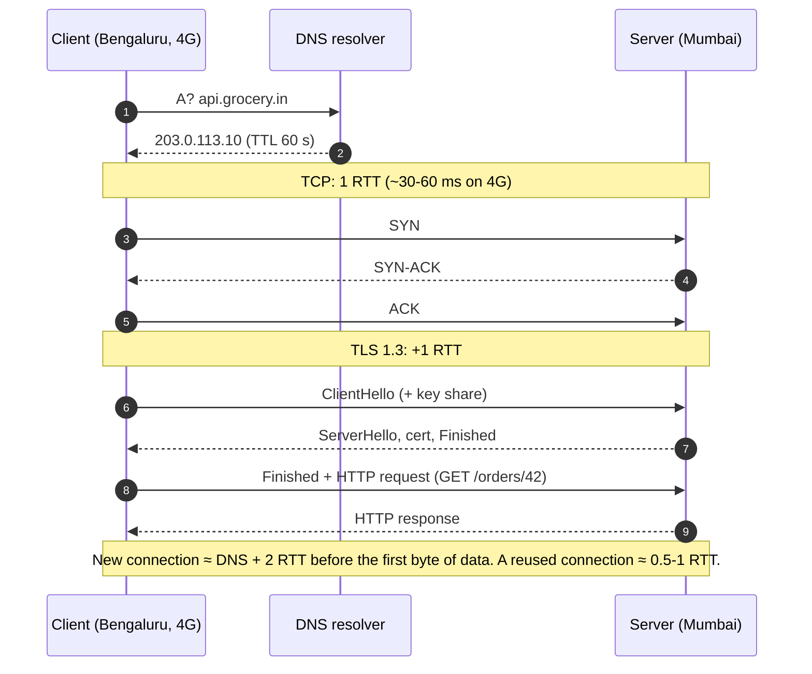
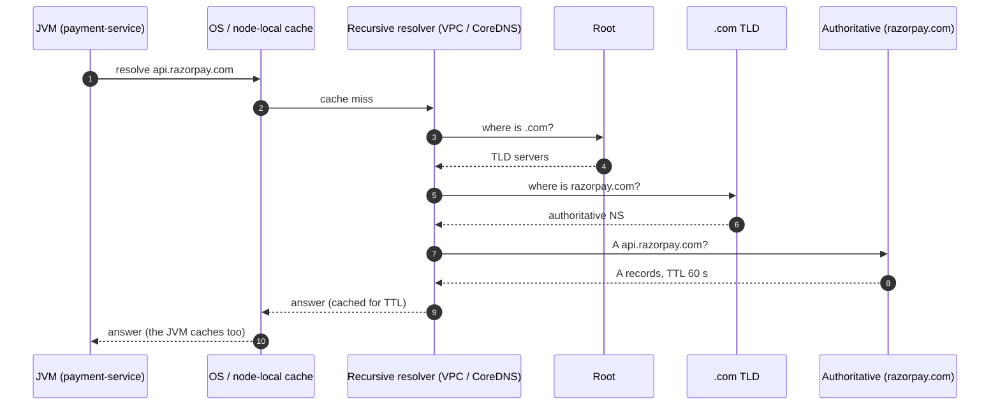
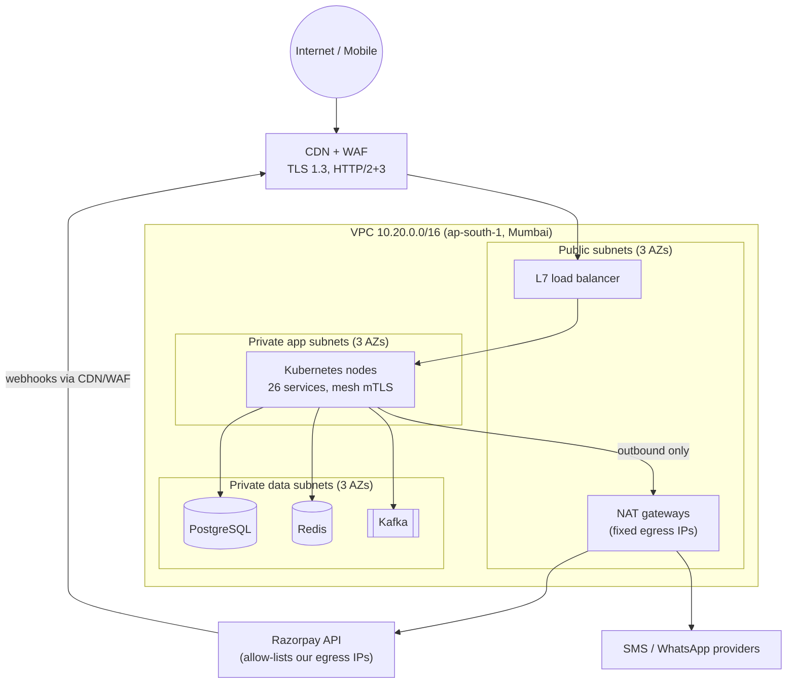
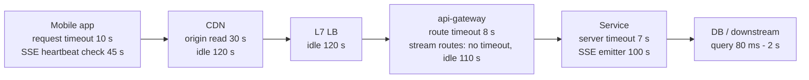
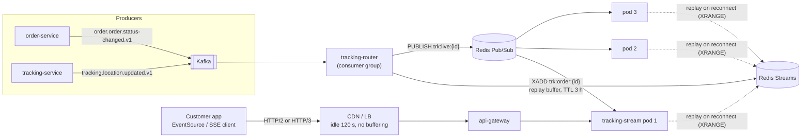
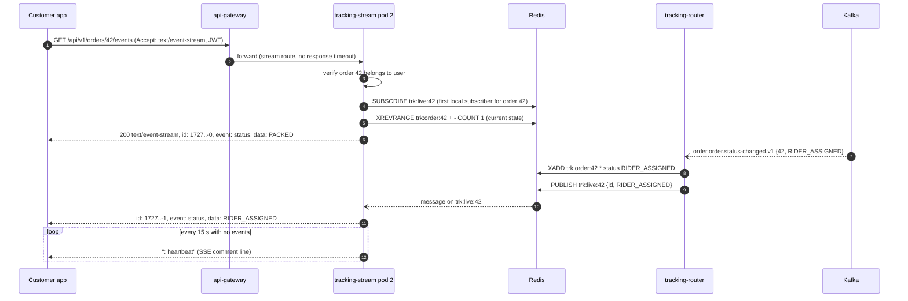
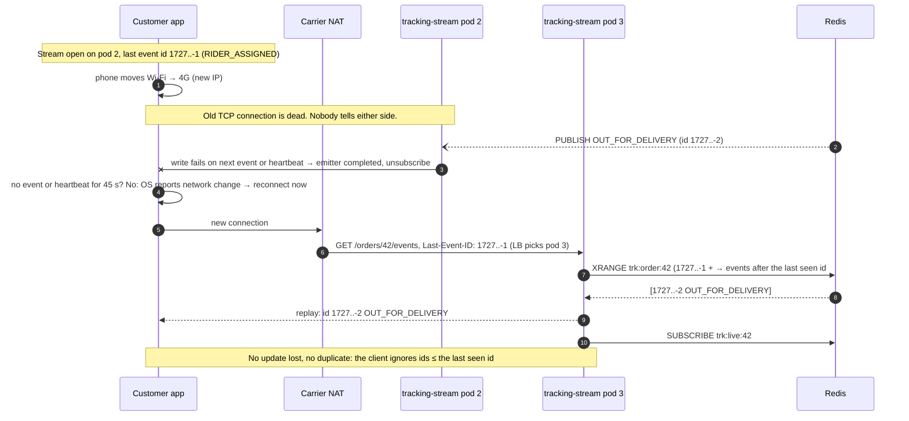
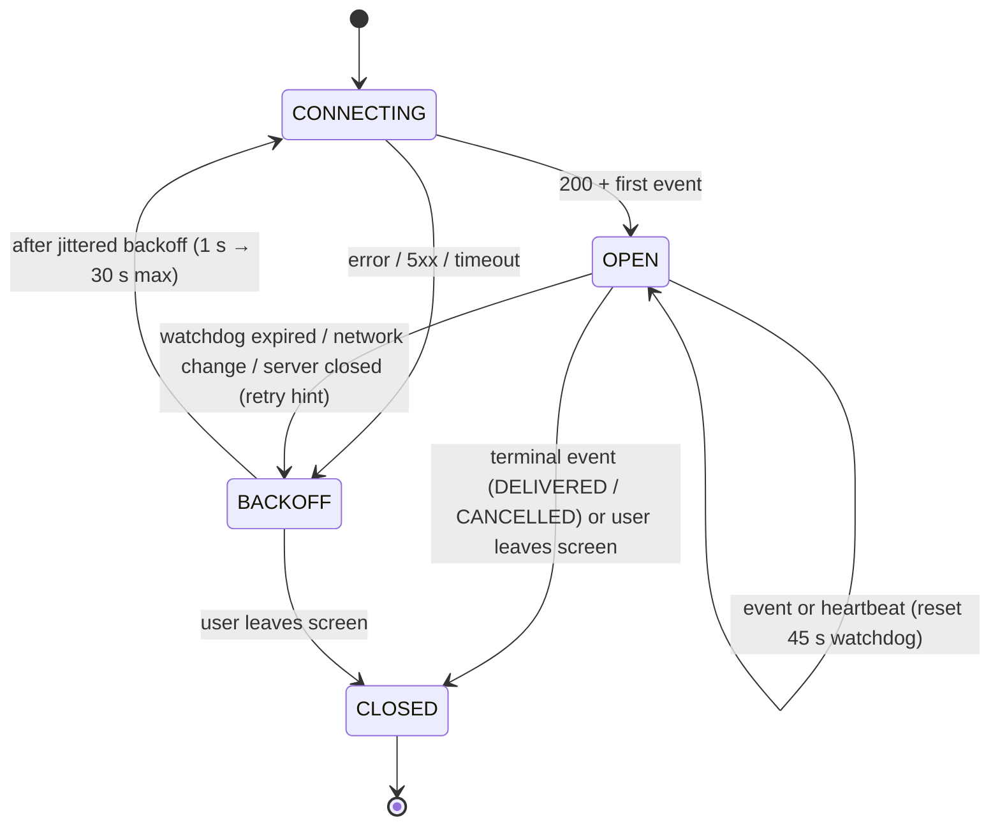
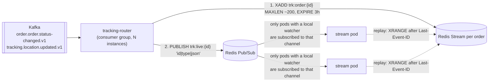

# 03. Networking Essentials

!!! abstract "Chapter at a glance"
    **Reader bands:** B1 → B4 · **Prerequisites:** [Ch 01](../00-orientation/01-what-system-design-is.md), [Ch 02](02-back-of-the-envelope-estimation.md) · **What you will build:** Live order-tracking updates, taken from polling vs a raw SSE stream (L1) to a multi-pod SSE service with heartbeats, resume-after-disconnect, Redis fan-out and graceful drain (L4) · **Reading time:** 90 min + code

---

## 1. Introduction & Why It Matters

### 1.1 A story: the tracking screen that went quiet after 60 seconds

The grocery app launched live order tracking: *Packed → Rider assigned → Out for delivery → Arriving*. It worked perfectly on office Wi-Fi. In production, a pattern emerged in support tickets: **"The app stopped updating. I reopened it and my order was already delivered."**

The team spent a week on the application code. It was fine. The problem was the network path between the phone and the server:

1. The **cloud load balancer** had a 60-second idle timeout. Between "Rider assigned" and "Out for delivery" there are often 5–10 minutes with no data, so the load balancer silently closed the connection.
2. The **mobile carrier's NAT** (carrier-grade NAT on Indian 4G networks) dropped idle TCP mappings even sooner on some networks.
3. The app's WebSocket client didn't notice the connection was dead. TCP doesn't tell you a peer vanished unless you send something.
4. When a rider's phone switched from Wi-Fi to 4G, the client's IP address changed, and every TCP connection it had was gone.

The fix was about 40 lines: a **heartbeat every 15 seconds**, a **reconnect with `Last-Event-ID`** so missed updates are replayed, and aligning **timeouts along the whole path**.

!!! quote "The thesis of this chapter"
    Every request crosses a chain of networks, proxies and timeouts you don't own. Good system design treats the network as **unreliable, stateful and full of middleboxes**, and makes every long-lived interaction survive a dropped connection.

### 1.2 Where this lives in the grocery platform

| Interaction | Networking concern |
|---|---|
| App → `api-gateway` | TLS 1.3, HTTP/2 or HTTP/3, CDN edge, mobile network variability |
| Live order tracking | Long-lived connections, idle timeouts, NAT, reconnects (this chapter's code) |
| Rider app location pings | Connection migration on network switch (QUIC), battery, batching |
| Service → service | Keep-alive, connection pools, mTLS, DNS-based discovery, timeouts |
| `payment-service` → Razorpay | Outbound TLS, egress NAT, IP allow-listing, DNS TTLs |
| Kafka, PostgreSQL, Redis | Long-lived TCP, private subnets, security groups |
| Webhooks from Razorpay | Public ingress, signature verification, firewall rules |

### 1.3 Learning objectives

| Band | After this chapter you can… |
|---|---|
| <span class="band b1">B1</span> | Explain the layers, TCP vs UDP, what DNS and TLS do, and polling vs SSE vs WebSockets |
| <span class="band b2">B2</span> | Reason about handshake costs, keep-alive and pooling, HTTP/1.1 vs 2 vs 3, and choose a real-time transport |
| <span class="band b3">B3</span> | Diagnose idle timeouts, NAT and port exhaustion, DNS caching, TLS failures, and design reconnect-safe streams |
| <span class="band b4">B4</span> | Design network topology (VPC, subnets, egress, zero trust), set org-wide timeout and TLS policy, and choose transports across a platform |

---

## 2. Core Concepts — Beginner to Deep

### 2.1 Intuition: sending a parcel across India <span class="band b1">B1</span>

Sending an HTTP request is like sending a parcel from Bengaluru to Delhi:

- **The address** (DNS) turns "Mehta Sweets, Chandni Chowk" into a precise PIN and street, just as DNS turns `api.grocery.in` into an IP address.
- **The courier's tracking and signatures** (TCP) make sure every box arrives, in order, and is re-sent if lost.
- **The sealed, tamper-proof box** (TLS) means nobody on the way can read or change the contents.
- **The language of the letter inside** (HTTP) is what the recipient actually reads.
- **Checkpoints and warehouses on the way** (proxies, load balancers, NAT) each have their own rules, such as "we throw away parcels that sit here too long."

Most production networking bugs happen at those checkpoints.

### 2.2 The layers: OSI vs TCP/IP ⭐ <span class="band b1">B1</span>

| OSI layer | TCP/IP layer | Examples | What a backend engineer controls |
|---|---|---|---|
| 7 Application | Application | HTTP, gRPC, WebSocket, DNS, Kafka protocol | Almost everything: APIs, timeouts, retries |
| 6 Presentation | (Application) | TLS, encoding (JSON, Protobuf), compression | TLS config, serialization |
| 5 Session | (Application) | Connection/session semantics | Keep-alive, reconnection logic |
| 4 Transport | Transport | TCP, UDP, QUIC (over UDP) | Socket options, pools, timeouts |
| 3 Network | Internet | IP, ICMP, routing | VPC CIDRs, routes (via IaC) |
| 2 Data link | Link | Ethernet, Wi-Fi, ARP | Rarely |
| 1 Physical | Link | Fibre, radio | Never (but it's why cross-region is 60 ms) |

!!! tip "Why load balancers are called L4 or L7"
    An **L4** load balancer sees TCP/UDP connections (IP + port) and forwards bytes without understanding HTTP. An **L7** load balancer terminates HTTP, so it can route by path or header, retry, and add headers. It also owns HTTP-level timeouts that affect your long-lived streams (Ch 08).

### 2.3 TCP vs UDP ⭐ <span class="band b1">B1</span> <span class="band b2">B2</span>

| | TCP | UDP |
|---|---|---|
| Connection | Yes (3-way handshake) | No |
| Delivery | Reliable, retransmits lost segments | Best effort |
| Ordering | In order (a byte stream) | No ordering (datagrams) |
| Flow/congestion control | Built in | None (the app must do it) |
| Head-of-line blocking | Yes: one lost segment stalls everything after it | No |
| Typical use | HTTP/1.1, HTTP/2, databases, Kafka | DNS, video/voice, gaming, **QUIC (HTTP/3)** |

#### The cost of a new connection <span class="band b2">B2</span>



On a 50 ms mobile RTT, a fresh connection costs ~100–150 ms **before** your server does any work. That's why **connection reuse** (keep-alive, pooling, HTTP/2 multiplexing) is one of the highest-leverage performance settings you have.

**TCP slow start.** A new connection begins with a small congestion window (~10 segments ≈ 14 KB) and grows as ACKs arrive. A new connection can't send a 200 KB response at full speed immediately. Warm connections can. That's another reason to reuse connections.

#### Connection teardown and `TIME_WAIT` <span class="band b3">B3</span>

The side that closes first keeps the socket in `TIME_WAIT` for 2×MSL (often ~60 s on Linux) so that late packets aren't misread. A service that opens and closes thousands of outbound connections per second (no pooling) exhausts **ephemeral ports**: ~28 K by default on Linux, per destination IP and port. The symptom is intermittent `Cannot assign requested address` or connect timeouts. The fix is connection pooling and keep-alive, not kernel tweaks.

#### Nagle, delayed ACK and small messages <span class="band b3">B3</span>

Nagle's algorithm batches small writes, and delayed ACK holds acknowledgements briefly. Together they can add tens of milliseconds to request/response patterns with small writes. Most HTTP stacks set `TCP_NODELAY`, but check it for custom protocols and for SSE, where you want each small event sent immediately (flush after each event).

### 2.4 Keep-alive, connection pools and head-of-line blocking ⭐ <span class="band b2">B2</span>

**Keep-alive** keeps a TCP (+TLS) connection open after a response so the next request can reuse it. A **connection pool** is a set of kept-alive connections a client reuses.

| Setting | Where | Typical value | Why |
|---|---|---|---|
| Client connect timeout | Every HTTP client | 0.5–2 s internal, 3–5 s external | Fail fast when the destination is unreachable |
| Client read/response timeout | Every HTTP client | From the latency budget (Ch 01: 80 ms fresh check) | Never wait forever |
| Pool max connections per route | Client | Little's Law × 1.5 (Ch 02) | Enough in-flight capacity, not a DoS on the server |
| Idle connection TTL in pool | Client | **Below** the server's/LB's idle timeout | Avoid reusing a connection the other side already closed |
| Server keep-alive timeout | Server (Tomcat/Jetty/Netty) | 60–75 s | Free resources held by idle clients |
| LB idle timeout | Cloud LB | 60 s default on many LBs; configurable | Silently kills idle long-lived connections |

!!! danger "The stale pooled connection bug"
    If a client pool keeps idle connections longer than the server or load balancer does, the client sometimes sends a request on a connection the other side has already closed. The result is an intermittent `Connection reset` on the **first request after a quiet period**. The rule: **client idle TTL < server keep-alive < LB idle timeout**, and retry idempotent requests once on a reset.

**Head-of-line (HOL) blocking** happens when one slow item blocks everything behind it:

| Protocol | Where HOL blocking happens |
|---|---|
| HTTP/1.1 | At the **HTTP level**: one request at a time per connection, so a slow response blocks the next. Browsers open ~6 connections per host to compensate. |
| HTTP/2 | Solved at HTTP level (multiplexed streams), but **still at TCP level**: one lost packet stalls all streams on that connection |
| HTTP/3 (QUIC) | Solved at transport level: streams are independent over UDP. A lost packet stalls only its own stream |

### 2.5 HTTP/1.1 vs HTTP/2 vs HTTP/3 ⭐ <span class="band b2">B2</span>

| Feature | HTTP/1.1 | HTTP/2 | HTTP/3 |
|---|---|---|---|
| Transport | TCP | TCP | QUIC over UDP |
| Framing | Text | Binary frames | Binary frames |
| Requests per connection | 1 at a time (pipelining unused in practice) | Many concurrent streams | Many concurrent streams |
| Header compression | None | HPACK | QPACK |
| TLS | Optional | Effectively required by browsers | Built in (TLS 1.3 in QUIC) |
| Handshake to first byte | TCP + TLS (2 RTT) | TCP + TLS (2 RTT) | 1 RTT, or **0-RTT** on resumption |
| Connection migration (IP change) | No | No | **Yes**: the connection ID survives Wi-Fi ↔ 4G |
| HOL blocking | HTTP + TCP | TCP only | None across streams |
| Where it shines | Simple internal calls, legacy | Service mesh, gRPC, browsers | Mobile clients on lossy networks |

**Grocery platform choices:**

- **Edge (CDN/LB → apps):** HTTP/2 and HTTP/3 enabled. Mobile users on flaky 4G benefit most from HTTP/3's migration and loss handling.
- **Edge → origin and service-to-service:** HTTP/2 (gRPC) or HTTP/1.1 with keep-alive pools. Internal networks are low-loss, so HTTP/3's benefits are smaller.
- **Long-lived streams (SSE):** HTTP/2 lets a browser open many SSE streams over one connection. HTTP/1.1 browsers limit ~6 connections per host, which SSE can exhaust.

!!! warning "0-RTT has a price"
    TLS 1.3 / QUIC 0-RTT early data can be **replayed** by an attacker. Only allow it for idempotent, safe requests (GET the catalog), never for `POST /checkout`. Most CDNs let you restrict 0-RTT to safe methods.

### 2.6 DNS: resolution, TTLs and caching ⭐ <span class="band b1">B1</span> → <span class="band b3">B3</span>



| Concept | What it means for your design |
|---|---|
| **TTL** | How long resolvers may cache an answer. Low TTL (30–60 s) enables fast failover but means more lookups. High TTL (hours) is cheap but slow to change. |
| **JVM DNS cache** | `networkaddress.cache.ttl` (security property). Default is ~30 s when no security manager is installed. Negative lookups are cached ~10 s. Never set it to "forever" in cloud environments where IPs change. |
| **Connection pools ignore DNS changes** | A pooled connection stays on the old IP until it's closed. Cap connection lifetime (e.g. 5–10 min) so traffic follows DNS failover. |
| **Kubernetes DNS** | `service-name.namespace.svc.cluster.local` resolves to a ClusterIP. `ndots:5` causes several search-path lookups for external names, so use FQDNs with a trailing dot or tune `ndots` for hot external calls. |
| **DNS as a dependency** | DNS outages look like "everything is down." Cache sensibly, run node-local DNS caches, and alert on resolver errors. |
| **DNS load balancing / GeoDNS** | Returns different IPs by location or health. Coarse-grained, and clients cache beyond TTLs. Good for region selection, not for fine load balancing (Ch 08). |

```properties
# $JAVA_HOME/conf/security/java.security (or -Dsun.net.inetaddr.ttl for older setups)
networkaddress.cache.ttl=30
networkaddress.cache.negative.ttl=5
```

### 2.7 TLS 1.3 and mTLS ⭐ <span class="band b2">B2</span> <span class="band b3">B3</span>

**TLS** provides confidentiality (encryption), integrity (tamper detection) and server authentication (certificate chain to a trusted CA, and hostname match).

| Topic | Key point |
|---|---|
| TLS 1.3 handshake | 1 RTT (vs 2 in TLS 1.2); forward secrecy mandatory; fewer, safer cipher suites |
| Session resumption / 0-RTT | Faster reconnects; 0-RTT early data is replayable (restrict to idempotent requests) |
| SNI | Client sends the hostname in the handshake so one IP can serve many certificates |
| Certificate chain | Server sends leaf + intermediates. A missing intermediate causes errors on some clients only (a classic Android issue) |
| Certificate expiry | A top cause of self-inflicted outages. Automate renewal (ACME, cert-manager) and alert at 30/14/7 days |
| **Where TLS terminates** | At the CDN/LB (common), then re-encrypted to the origin; or end-to-end. Every hop that decrypts is a trust boundary |
| **mTLS** | Both sides present certificates, so the **server authenticates the client**. Used service-to-service (service mesh, Ch 17, 23) and for some partner APIs |
| Pinning | Mobile apps pinning certificates must plan rotation (pin the public key or CA, ship backup pins) or a cert rotation bricks the app |

!!! example "In the grocery platform"
    Customers reach the CDN on TLS 1.3 (HTTP/2 + HTTP/3). The CDN talks to the regional LB over TLS. Inside the cluster, services use **mTLS via the mesh**, so `payment-service` accepts calls only from workloads with the `checkout-service` identity. Outbound calls to Razorpay use TLS with the platform's trust store, and go out through a **fixed egress IP** that Razorpay can allow-list.

### 2.8 Real-time delivery: polling, long polling, SSE, WebSockets ⭐ <span class="band b1">B1</span> → <span class="band b3">B3</span>

| | Short polling | Long polling | Server-Sent Events (SSE) | WebSocket |
|---|---|---|---|---|
| Direction | Client pulls | Client pulls, server holds until data | **Server → client** | **Bidirectional** |
| Transport | Repeated HTTP requests | Repeated HTTP requests (held open) | One long HTTP response (`text/event-stream`) | HTTP upgrade → WebSocket frames |
| Latency of an update | Up to the poll interval | ~Immediate | ~Immediate | ~Immediate |
| Wasted requests | Most | Few | None | None |
| Auto-reconnect + resume | App-built | App-built | **Built into browsers** (`EventSource`, `Last-Event-ID`) | App-built |
| Works through proxies/CDNs | Always | Mostly | Mostly (disable buffering) | Needs upgrade support; some corporate proxies block it |
| HTTP/2 multiplexing | Yes | Yes | **Yes** | Only with RFC 8441 (limited support) |
| Server cost | Request per poll | Held request | Held connection | Held connection + frame handling |
| Grocery use | Fallback, low-frequency checks | Legacy clients | **Order tracking, rider location to customer** | Customer ↔ rider chat, rider app two-way ops (Ch 41) |

The L1 program in §5 measures the difference on a compressed 2-second order lifecycle:

```text
Polling (100 ms): 18 requests for 6 status changes (67% wasted)
SSE: 1 request for 6 status changes
```

Over a real 35-minute delivery with a 10-second poll, that's ~210 requests for ~8 changes (96 % wasted), and each update is up to 10 seconds late.

!!! tip "Choosing between SSE and WebSockets"
    If the client mostly **listens**, use SSE: it's plain HTTP, reconnects and resumes automatically, and multiplexes over HTTP/2. If the client **talks back frequently and with low latency** (chat, collaborative editing, games), use WebSockets. For mobile apps, both need app-level heartbeats and reconnect logic, because OS network changes kill connections regardless.

### 2.9 NAT, firewalls and VPC basics <span class="band b2">B2</span> → <span class="band b4">B4</span>

#### NAT (Network Address Translation)

NAT rewrites private addresses to a shared public address, and keeps a **mapping table with idle timeouts**.

| Where | Effect on your design |
|---|---|
| **Mobile carrier CGNAT** (most Indian 4G/5G users) | Idle mappings can expire in minutes, silently killing idle long-lived connections. **Heartbeat every 15–30 s.** Many users share one public IP, so IP-based rate limits hit innocent users. |
| **Cloud NAT gateway** (private subnet → internet) | Has its own idle timeout (minutes) and a limit on concurrent connections **per destination**. Heavy outbound calls to one partner API can exhaust NAT ports. Pool connections. |
| **Kubernetes SNAT** (pod → outside) | Pod IPs are translated to the node's IP. Conntrack table limits apply per node. |

#### Firewalls, security groups and network policies

| Control | Scope | Stateful? | Use |
|---|---|---|---|
| Security group (cloud) | Instance / ENI | Stateful | "Only the LB may reach app nodes on 8080" |
| Network ACL (cloud) | Subnet | Stateless | Coarse deny rules, compliance boundaries |
| Kubernetes NetworkPolicy | Pod labels | Stateful (CNI-dependent) | "Only `checkout` pods may call `payment` on 8080" |
| WAF (at CDN/LB) | HTTP requests | L7 | OWASP rules, bot mitigation, rate limits (Ch 23) |
| Service mesh authorization | Workload identity (mTLS) | L7 | Identity-based rules that survive IP changes |

#### VPC layout for the platform <span class="band b4">B4</span>



| Principle | Why |
|---|---|
| Data stores in private subnets with no internet route | They can't be reached from outside, even if misconfigured |
| Egress through NAT with fixed IPs | Partners can allow-list; you can audit outbound traffic |
| Private endpoints for cloud services (object storage, KMS) | Traffic doesn't cross the internet; no NAT cost |
| Three AZs for every tier | Zone-failure tolerance (Ch 02 headroom) |
| Non-overlapping CIDRs across VPCs/regions | Future peering and multi-region (Ch 27) won't need renumbering |
| Identity-based rules (mTLS) on top of IP rules | IPs change constantly in Kubernetes; identities don't |

### 2.10 Timeouts across a path: the timeout ladder <span class="band b3">B3</span> <span class="band b4">B4</span>

Every hop has its own timeouts. They must be **ordered**, or the wrong layer gives up first, which causes retries, duplicate work and confusing errors.



**The rules:**

1. **Request/response calls:** each inner timeout is shorter than the outer one. A downstream call times out before the service does, the service before the gateway, and the gateway before the client. Otherwise the outer layer gives up and retries while the inner one is still working.
2. **Long-lived streams:** heartbeat interval < the smallest idle timeout on the path (NAT, LB, CDN). Server stream lifetime < LB idle timeout, so the **server** closes cleanly and the client reconnects, rather than a middlebox silently killing it.
3. **Pools:** client idle TTL < server keep-alive < LB idle timeout (§2.4).
4. Write the ladder in the design doc. It's an NFR, not a config detail.

---

## 3. Architecture & Diagrams

### 3.1 Component view: live order tracking



### 3.2 Sequence: happy path, subscribe and receive updates



### 3.3 Sequence: failure path, network switch mid-delivery and resume



!!! note "What the system guarantees after this failure path"
    Every status change is delivered **at least once** to a client that reconnects within the replay window (3 hours). Duplicates are removed on the client by event id. A missed heartbeat is detected within 45 s at most, and an OS-reported network change triggers an immediate reconnect. No pod stickiness is needed: any pod can serve any order.

### 3.4 State: client stream lifecycle



---

## 4. Design Document Excerpt: Live Order Tracking Stream

| Field | Value |
|---|---|
| Author / Reviewers | Fulfilment platform / Mobile, SRE, Security |
| Status | Approved |
| Related ADRs | ADR-017 SSE for customer tracking; WebSockets reserved for chat |

**1. Context & Problem.** Tracking updates were delivered over a WebSocket without heartbeats or resume. Middleboxes silently closed idle connections, and users saw frozen screens (§1.1).

**2. Goals / Non-Goals.**

- *Goals:* push status and rider-location updates within 2 s p95; survive disconnects without losing updates; work through CDN, LB and carrier NAT; no sticky sessions.
- *Non-goals:* customer ↔ rider chat (WebSocket, Ch 41); rider app telemetry ingestion (Ch 47).

**3. Requirements.**

| ID | Requirement |
|---|---|
| FR-1 | Stream order status changes and rider location (every ~4 s while out for delivery) to the order's owner |
| FR-2 | A reconnecting client receives all events missed within the last 3 hours |
| NFR-1 | Event delivery latency (Kafka publish → client) p95 ≤ 2 s |
| NFR-2 | Detect a dead connection within 45 s |
| NFR-3 | Support 150 K concurrent streams at festival peak |
| NFR-4 | Only the order's owner (or support staff with a role) can subscribe |
| NFR-5 | Pod deploys must not drop updates |

**4. Capacity estimates.**

| Item | Calculation | Result |
|---|---|---|
| Orders in flight, normal evening peak | ~48 K orders/h × 35 min lifecycle | ~28 K |
| Orders in flight, festival peak | Ch 02: first hour ≈ 300 K orders ≈ 83 orders/s sustained × 35 min | ~175 K |
| Concurrent streams | ~85 % of in-flight orders have the tracking screen open at the busiest moment | **~150 K** (sizing target) |
| Messages to clients | 150 K × (location every 4 s during ~40 % of lifecycle) + status changes | ~15 K msgs/s + heartbeats 10 K/s |
| Memory per stream (servlet async + buffers + emitter) | ~30–60 KB | 150 K × 60 KB ≈ **9 GB** across the fleet |
| Pods (≈ 15 K streams per 2 vCPU / 2 GB pod, to be load-tested) | 150 K ÷ 15 K × AZ headroom 1.5 | **15 pods** |
| Redis Pub/Sub channels | One per watched order | ~150 K channels, well within Redis capacity; ~25 K publishes/s |
| Replay buffer | 150 K streams × ~60 entries × ~150 B | ~1.4 GB in Redis, TTL 3 h |

!!! success "What the estimate tells us"
    Connections, not CPU, are the resource to plan: memory per stream, LB and NAT connection limits, and file descriptors (`ulimit -n` ≥ 65 K per pod). Location updates dominate message volume. Throttling them to 1 per 4 s, and only while out for delivery, is the biggest lever.

**5. Proposed design.** SSE over HTTP/2 (HTTP/3 at the edge). `tracking-router` consumes Kafka, appends to a per-order Redis Stream (replay buffer), and publishes to a per-order Pub/Sub channel. `tracking-stream` pods hold SSE connections, subscribe to per-order channels only while they have at least one local subscriber, send heartbeats every 15 s, close streams after 100 s with a `retry` hint (below the 120 s LB idle timeout), and replay from the Redis Stream on `Last-Event-ID`.

**5.2 API.**

```http
GET /api/v1/orders/{orderId}/events
Accept: text/event-stream
Authorization: Bearer <JWT>
Last-Event-ID: <optional, redis stream id>

200 OK
Content-Type: text/event-stream
Cache-Control: no-cache
X-Accel-Buffering: no

retry: 3000

id: 1727340000000-0
event: status
data: {"orderId":"42","status":"PACKED","at":"2026-09-26T14:40:00Z"}

: heartbeat

id: 1727340004000-0
event: location
data: {"orderId":"42","lat":12.9116,"lng":77.6389,"etaMinutes":9}
```

**5.5 Timeout ladder (NFR).**

| Hop | Setting | Value |
|---|---|---|
| Carrier NAT | Idle mapping timeout (not ours) | Assume ≥ 60 s |
| Server heartbeat | SSE comment interval | **15 s** |
| Client watchdog | No bytes received → reconnect | 45 s |
| Server stream lifetime | Close with `retry` hint | 100 s ± 10 s jitter |
| Gateway stream route | Response timeout disabled, idle timeout | 110 s |
| LB / CDN idle timeout | | 120 s |
| Client reconnect backoff | Jittered exponential | 1 s → 30 s max |

**7. Alternatives considered.**

| Option | Pros | Cons | Verdict |
|---|---|---|---|
| Short polling every 10 s | Trivial, cache-friendly | 96 % wasted requests; up to 10 s late | Fallback only |
| WebSocket | Bidirectional | We don't need client → server; no built-in resume; proxy issues | Chat only |
| **SSE + Redis replay + Pub/Sub** | HTTP-native, resume built in, HTTP/2 multiplexing, any pod serves any order | Server → client only; per-connection memory | **Chosen** |
| Mobile push notifications only | No connection held | Not real-time for map; delivery not guaranteed | Complementary (status changes when app backgrounded) |

**8. Failure modes.** Redis down → streams stay open with heartbeats; new events aren't delivered until recovery, the client screen shows "updates delayed", and push notifications still arrive. Kafka lag → the router's lag alert fires, and the UI shows the last known ETA with its timestamp. A pod killed → clients reconnect to other pods and replay.

**9. Security.** JWT validated at the gateway, order ownership checked at the pod, no PII in event payloads beyond coarse rider location near the destination, and location updates stop at delivery.

**10. Observability.** Gauges `tracking.streams.active`, `tracking.subscriptions.channels`; counters `tracking.events.sent{type}`, `tracking.replays`, `tracking.stream.closed{reason}`; timer `tracking.delivery.lag` (event time → sent).

**11. Rollout.** Behind the flag `tracking.transport=SSE|POLL`, rolled out by app version and city. Polling stays as a fallback for 2 releases.

**14. Decision (ADR-017 summary).** Customer tracking uses SSE. Every long-lived connection on the platform must have a heartbeat below the smallest idle timeout on its path, a bounded server-side lifetime, and resume by event id. WebSockets are reserved for bidirectional use cases.

---

## 5. Hands-On Code — Level Ladder

We build **live order-tracking updates** four times:

| Level | New requirement that forces the step |
|---|---|
| L1 | "Show that pushing beats polling." (plain JDK server + client, measured) |
| L2 | "Push real order events to the right customer from a Spring service." |
| L3 | "Survive idle timeouts, disconnects and deploys on one pod: heartbeats, resume, limits, metrics." |
| L4 | "Run many pods with no stickiness, deliver events from Kafka, replay from Redis, drain safely." |

### L1 — Concept (plain JDK) <span class="band b1">B1</span>

One JDK `HttpServer` offers a polling endpoint and an SSE stream for a simulated order moving through six statuses (compressed to 400 ms per step). A JDK `HttpClient` consumes both and counts the requests.

```java
// OrderUpdatesL1.java — run with: java OrderUpdatesL1.java
// Plain JDK only: a tiny HTTP server offering (1) a polling endpoint and (2) an SSE stream,
// and a client that measures how many requests/connections each approach costs.
import com.sun.net.httpserver.HttpServer;
import java.io.IOException;
import java.io.OutputStream;
import java.net.InetSocketAddress;
import java.net.URI;
import java.net.http.HttpClient;
import java.net.http.HttpRequest;
import java.net.http.HttpResponse;
import java.nio.charset.StandardCharsets;
import java.util.List;
import java.util.concurrent.Executors;
import java.util.concurrent.atomic.AtomicInteger;

public class OrderUpdatesL1 {

    static final List<String> LIFECYCLE =
            List.of("PLACED", "CONFIRMED", "PACKED", "RIDER_ASSIGNED", "OUT_FOR_DELIVERY", "DELIVERED");
    static final long STEP_MILLIS = 400;          // compressed time: one status change every 400 ms
    static final AtomicInteger requestsServed = new AtomicInteger();

    /** Current status of the (single, simulated) order, derived from elapsed time. */
    static volatile long orderStart;
    static String currentStatus() {
        int idx = (int) Math.min((System.currentTimeMillis() - orderStart) / STEP_MILLIS, LIFECYCLE.size() - 1);
        return LIFECYCLE.get(idx);
    }

    public static void main(String[] args) throws Exception {
        HttpServer server = HttpServer.create(new InetSocketAddress("127.0.0.1", 0), 0);
        server.setExecutor(Executors.newVirtualThreadPerTaskExecutor());

        // (1) Polling: client asks "what's the status now?" repeatedly
        server.createContext("/orders/42/status", ex -> {
            requestsServed.incrementAndGet();
            byte[] body = currentStatus().getBytes(StandardCharsets.UTF_8);
            ex.sendResponseHeaders(200, body.length);
            try (OutputStream os = ex.getResponseBody()) { os.write(body); }
        });

        // (2) Server-Sent Events: one long-lived response, server pushes when status changes
        server.createContext("/orders/42/events", ex -> {
            requestsServed.incrementAndGet();
            ex.getResponseHeaders().add("Content-Type", "text/event-stream");
            ex.getResponseHeaders().add("Cache-Control", "no-cache");
            ex.sendResponseHeaders(200, 0);              // 0 = chunked, length unknown
            try (OutputStream os = ex.getResponseBody()) {
                String last = null;
                int id = 0;
                while (true) {
                    String now = currentStatus();
                    if (!now.equals(last)) {
                        String frame = "id: " + (++id) + "\nevent: status\ndata: " + now + "\n\n";
                        os.write(frame.getBytes(StandardCharsets.UTF_8));
                        os.flush();                      // push immediately — don't wait for a buffer to fill
                        last = now;
                        if (now.equals("DELIVERED")) break;
                    }
                    Thread.sleep(20);                    // L1 shortcut: real servers are event-driven, not sleeping
                }
            } catch (InterruptedException e) {
                Thread.currentThread().interrupt();
            } catch (IOException clientWentAway) {
                // client disconnected — normal for streams
            }
        });

        server.start();
        String base = "http://127.0.0.1:" + server.getAddress().getPort();
        HttpClient client = HttpClient.newHttpClient();

        // --- Polling every 100 ms until DELIVERED ---
        orderStart = System.currentTimeMillis();
        requestsServed.set(0);
        String seen = "";
        int changes = 0;
        while (!seen.equals("DELIVERED")) {
            String s = client.send(HttpRequest.newBuilder(URI.create(base + "/orders/42/status")).build(),
                                   HttpResponse.BodyHandlers.ofString()).body();
            if (!s.equals(seen)) { changes++; seen = s; }
            Thread.sleep(100);
        }
        System.out.printf("Polling (100 ms): %d requests for %d status changes (%.0f%% wasted)%n",
                requestsServed.get(), changes, 100.0 * (requestsServed.get() - changes) / requestsServed.get());

        // --- SSE: one request, events pushed as they happen ---
        orderStart = System.currentTimeMillis();
        requestsServed.set(0);
        long t0 = System.nanoTime();
        HttpResponse<java.util.stream.Stream<String>> resp = client.send(
                HttpRequest.newBuilder(URI.create(base + "/orders/42/events"))
                           .header("Accept", "text/event-stream").build(),
                HttpResponse.BodyHandlers.ofLines());
        resp.body().filter(line -> line.startsWith("data: "))
                   .forEach(line -> System.out.printf("  SSE +%4d ms  %s%n",
                           (System.nanoTime() - t0) / 1_000_000, line.substring(6)));
        System.out.printf("SSE: %d request for %d status changes%n", requestsServed.get(), LIFECYCLE.size());

        server.stop(0);
    }
}
```

Actual output from running it:

```text
Polling (100 ms): 18 requests for 6 status changes (67% wasted)
  SSE +  10 ms  PLACED
  SSE + 410 ms  CONFIRMED
  SSE + 816 ms  PACKED
  SSE +1203 ms  RIDER_ASSIGNED
  SSE +1608 ms  OUT_FOR_DELIVERY
  SSE +2013 ms  DELIVERED
SSE: 1 request for 6 status changes
```

**What L1 shows:** the SSE wire format (`id:`, `event:`, `data:`, blank line), why you `flush()` per event, chunked responses (`sendResponseHeaders(200, 0)`), and virtual threads making "one thread per held connection" affordable.

**What L1 can't do:**

| Gap | Networking consequence |
|---|---|
| Loops with `sleep` instead of reacting to events | Wastes CPU; latency depends on the sleep |
| No heartbeat | Idle LBs and NATs silently kill the stream |
| No resume | A disconnect loses every event sent while the client was away |
| No authorization | Anyone can watch anyone's order |
| One process | Can't scale or deploy without dropping everyone |

### L2 — Spring Implementation (four layers) <span class="band b2">B2</span>

`tracking-stream` exposes `GET /api/v1/orders/{orderId}/events`. The gateway has already validated the JWT and forwards the user id in `X-User-Id` (Ch 23 covers doing this safely). Events arrive in-process as Spring application events. In L4 they come from Kafka via Redis.

```kotlin
// build.gradle.kts (module l2-spring)
dependencies {
    implementation("org.springframework.boot:spring-boot-starter-web")   // VERIFY: Boot 4 starter name (spring-boot-starter-webmvc)
    implementation("org.springframework.boot:spring-boot-starter-jdbc")
    runtimeOnly("org.postgresql:postgresql")
    testImplementation("org.springframework.boot:spring-boot-starter-test")
}
```

=== "Domain, Repository"

    ```java
    package com.grocery.tracking.domain;

    import java.time.Instant;

    public record OrderStatusChanged(String orderId, String status, Instant at) { }
    ```

    ```java
    package com.grocery.tracking.domain;

    public record OrderSummary(String orderId, String customerId, String status) { }
    ```

    ```java
    package com.grocery.tracking.repository;

    import com.grocery.tracking.domain.OrderSummary;
    import org.springframework.jdbc.core.simple.JdbcClient;
    import org.springframework.stereotype.Repository;
    import java.util.Optional;

    /** Read model of orders (a projection owned by tracking; populated from order events — Ch 15). */
    @Repository
    public class OrderSummaryRepository {

        private final JdbcClient jdbc;

        public OrderSummaryRepository(JdbcClient jdbc) { this.jdbc = jdbc; }

        public Optional<OrderSummary> find(String orderId) {
            return jdbc.sql("SELECT order_id, customer_id, status FROM order_summary WHERE order_id = ?")
                       .param(orderId)
                       .query((rs, n) -> new OrderSummary(rs.getString(1), rs.getString(2), rs.getString(3)))
                       .optional();
        }
    }
    ```

=== "Service (emitter registry)"

    ```java
    package com.grocery.tracking.service;

    import com.grocery.tracking.domain.OrderStatusChanged;
    import org.springframework.context.event.EventListener;
    import org.springframework.stereotype.Service;
    import org.springframework.web.servlet.mvc.method.annotation.SseEmitter;
    import java.io.IOException;
    import java.util.Map;
    import java.util.Set;
    import java.util.concurrent.ConcurrentHashMap;
    import java.util.concurrent.CopyOnWriteArraySet;

    @Service
    public class OrderStreamService {

        /** orderId -> emitters currently watching it on THIS instance. */
        private final Map<String, Set<SseEmitter>> watchers = new ConcurrentHashMap<>();

        public SseEmitter open(String orderId, String currentStatus) {
            SseEmitter emitter = new SseEmitter(0L);   // L2: no timeout (fixed in L3)
            watchers.computeIfAbsent(orderId, k -> new CopyOnWriteArraySet<>()).add(emitter);
            Runnable remove = () -> watchers.computeIfPresent(orderId, (k, set) -> {
                set.remove(emitter);
                return set.isEmpty() ? null : set;
            });
            emitter.onCompletion(remove);
            emitter.onTimeout(remove);
            emitter.onError(e -> remove.run());
            send(emitter, "status", currentStatus);    // initial state, so the screen isn't blank
            return emitter;
        }

        @EventListener
        public void onStatusChanged(OrderStatusChanged event) {
            for (SseEmitter emitter : watchers.getOrDefault(event.orderId(), Set.of())) {
                send(emitter, "status", event.status());
            }
        }

        int watcherCount(String orderId) {
            return watchers.getOrDefault(orderId, Set.of()).size();
        }

        private void send(SseEmitter emitter, String name, String data) {
            try {
                emitter.send(SseEmitter.event().name(name).data(data));
            } catch (IOException | IllegalStateException e) {
                emitter.completeWithError(e);          // client went away; callbacks remove it
            }
        }
    }
    ```

=== "Delegate, Controller"

    ```java
    package com.grocery.tracking.delegate;

    import com.grocery.tracking.repository.OrderSummaryRepository;
    import com.grocery.tracking.service.OrderStreamService;
    import org.springframework.http.HttpStatus;
    import org.springframework.stereotype.Component;
    import org.springframework.web.server.ResponseStatusException;
    import org.springframework.web.servlet.mvc.method.annotation.SseEmitter;

    @Component
    public class OrderStreamDelegate {

        private final OrderSummaryRepository orders;
        private final OrderStreamService streams;

        public OrderStreamDelegate(OrderSummaryRepository orders, OrderStreamService streams) {
            this.orders = orders;
            this.streams = streams;
        }

        public SseEmitter open(String orderId, String userId) {
            var order = orders.find(orderId)
                    .orElseThrow(() -> new ResponseStatusException(HttpStatus.NOT_FOUND));
            if (!order.customerId().equals(userId)) {
                // 404, not 403: don't reveal that someone else's order id exists
                throw new ResponseStatusException(HttpStatus.NOT_FOUND);
            }
            return streams.open(orderId, order.status());
        }
    }
    ```

    ```java
    package com.grocery.tracking.controller;

    import com.grocery.tracking.delegate.OrderStreamDelegate;
    import org.springframework.http.MediaType;
    import org.springframework.web.bind.annotation.*;
    import org.springframework.web.servlet.mvc.method.annotation.SseEmitter;

    @RestController
    public class OrderStreamController {

        private final OrderStreamDelegate delegate;

        public OrderStreamController(OrderStreamDelegate delegate) { this.delegate = delegate; }

        @GetMapping(path = "/api/v1/orders/{orderId}/events", produces = MediaType.TEXT_EVENT_STREAM_VALUE)
        public SseEmitter stream(@PathVariable String orderId, @RequestHeader("X-User-Id") String userId) {
            return delegate.open(orderId, userId);
        }
    }
    ```

=== "Test"

    ```java
    package com.grocery.tracking.service;

    import com.grocery.tracking.domain.OrderStatusChanged;
    import org.junit.jupiter.api.Test;
    import org.springframework.web.servlet.mvc.method.annotation.SseEmitter;
    import java.time.Instant;
    import static org.assertj.core.api.Assertions.assertThat;

    class OrderStreamServiceTest {

        @Test
        void deliversOnlyToWatchersOfThatOrderAndCleansUp() {
            var service = new OrderStreamService();
            SseEmitter a = service.open("42", "PACKED");
            service.open("43", "PLACED");

            // Before the servlet container attaches a handler, SseEmitter buffers sends — safe to call here.
            service.onStatusChanged(new OrderStatusChanged("42", "RIDER_ASSIGNED", Instant.now()));
            assertThat(service.watcherCount("42")).isEqualTo(1);
            assertThat(service.watcherCount("43")).isEqualTo(1);

            a.complete();
            // VERIFY: completion callbacks fire once the async request completes; in a pure unit test
            // they may not run. The L3 integration test covers cleanup end-to-end over real HTTP.
        }
    }
    ```

**What L2 fixed:** real events, authorization by order ownership, and cleanup callbacks.

**What L2 exposes:** `new SseEmitter(0L)` means "never time out", so connections live until a middlebox kills them silently (§1.1). There's no heartbeat, no resume, no connection limit, no metrics, and a deploy drops everyone without telling them to reconnect.

### L3 — Production-Grade (one pod) <span class="band b3">B3</span>

This level applies the §4 timeout ladder in code:

- **Heartbeat** every 15 s (an SSE comment line: invisible to `EventSource`, but it keeps NATs and LBs from closing the connection).
- **Bounded lifetime** of 100 s ± 10 s jitter. The server closes the stream with a `retry` hint before the LB's 120 s idle timeout, and the jitter prevents synchronized reconnect waves.
- **Resume** from an in-memory replay buffer by `Last-Event-ID` (a per-order sequence). This is correct on one pod. L4 moves it to Redis.
- **Limits:** at most 5 streams per user; the pod-wide cap comes from load testing.
- **Headers** that stop proxy buffering and caching.
- **Graceful drain on shutdown:** tell every client to reconnect, then close.
- **Metrics:** active streams, events sent, replays, close reasons.

```kotlin
// additional dependencies for l3-production
dependencies {
    implementation("org.springframework.boot:spring-boot-starter-actuator")
    implementation("io.micrometer:micrometer-registry-prometheus")
    testRuntimeOnly("com.h2database:h2")   // embedded DB so the test context starts; the repository is mocked
}
```

=== "Replay buffer"

    ```java
    package com.grocery.tracking.stream;

    import java.util.*;
    import java.util.concurrent.ConcurrentHashMap;

    /** Per-order ring buffer of recent events with monotonically increasing ids. Single-pod only (L3). */
    public class ReplayBuffer {

        public record TrackedEvent(long id, String type, String data) { }

        private final int capacityPerOrder;
        private final Map<String, Deque<TrackedEvent>> byOrder = new ConcurrentHashMap<>();
        private final Map<String, Long> lastId = new ConcurrentHashMap<>();

        public ReplayBuffer(int capacityPerOrder) { this.capacityPerOrder = capacityPerOrder; }

        public synchronized TrackedEvent append(String orderId, String type, String data) {
            long id = lastId.merge(orderId, 1L, Long::sum);
            var event = new TrackedEvent(id, type, data);
            Deque<TrackedEvent> q = byOrder.computeIfAbsent(orderId, k -> new ArrayDeque<>());
            q.addLast(event);
            while (q.size() > capacityPerOrder) q.removeFirst();
            return event;
        }

        /** Events strictly after {@code afterId}; empty if nothing newer or the order is unknown. */
        public synchronized List<TrackedEvent> after(String orderId, long afterId) {
            return byOrder.getOrDefault(orderId, new ArrayDeque<>()).stream()
                    .filter(e -> e.id() > afterId)
                    .toList();
        }

        public synchronized Optional<TrackedEvent> latest(String orderId) {
            return Optional.ofNullable(byOrder.getOrDefault(orderId, new ArrayDeque<>()).peekLast());
        }

        public synchronized void evict(String orderId) {   // on DELIVERED/CANCELLED + grace period
            byOrder.remove(orderId);
            lastId.remove(orderId);
        }
    }
    ```

=== "Stream hub (service)"

    ```java
    package com.grocery.tracking.stream;

    import com.grocery.tracking.stream.ReplayBuffer.TrackedEvent;
    import io.micrometer.core.instrument.Gauge;
    import io.micrometer.core.instrument.MeterRegistry;
    import org.slf4j.Logger;
    import org.slf4j.LoggerFactory;
    import org.springframework.context.SmartLifecycle;
    import org.springframework.web.servlet.mvc.method.annotation.SseEmitter;
    import java.io.IOException;
    import java.time.Duration;
    import java.util.*;
    import java.util.concurrent.*;
    import java.util.concurrent.atomic.AtomicInteger;

    /**
     * Owns every open stream on this pod: registration, fan-out, heartbeats,
     * bounded lifetime, per-user limits, and graceful drain.
     */
    public class StreamHub implements SmartLifecycle {

        private static final Logger log = LoggerFactory.getLogger(StreamHub.class);

        public record Settings(Duration heartbeat, Duration lifetime, Duration lifetimeJitter,
                               int maxStreamsPerUser, long reconnectMillis) { }

        private record Stream(String orderId, String userId, SseEmitter emitter, ScheduledFuture<?> heartbeat) { }

        private final Map<String, Set<Stream>> byOrder = new ConcurrentHashMap<>();
        private final Map<String, AtomicInteger> perUser = new ConcurrentHashMap<>();
        private final AtomicInteger active = new AtomicInteger();
        private final ScheduledExecutorService scheduler =
                Executors.newScheduledThreadPool(2, Thread.ofPlatform().name("sse-sched-", 0).factory());
        private final ReplayBuffer replay;
        private final Settings settings;
        private final MeterRegistry registry;
        private volatile boolean running;

        public StreamHub(ReplayBuffer replay, Settings settings, MeterRegistry registry) {
            this.replay = replay;
            this.settings = settings;
            this.registry = registry;
            Gauge.builder("tracking.streams.active", active, AtomicInteger::get).register(registry);
        }

        public SseEmitter open(String orderId, String userId, OptionalLong lastEventId) {
            if (!running) throw new StreamRejectedException("draining");
            AtomicInteger userCount = perUser.computeIfAbsent(userId, k -> new AtomicInteger());
            if (userCount.incrementAndGet() > settings.maxStreamsPerUser()) {
                userCount.decrementAndGet();
                throw new StreamRejectedException("too many streams for user");   // → 429
            }

            long jitter = ThreadLocalRandom.current().nextLong(settings.lifetimeJitter().toMillis() + 1);
            long lifetime = settings.lifetime().toMillis() + jitter;
            // Emitter timeout is a backstop only; we close explicitly at `lifetime` with a retry hint.
            SseEmitter emitter = new SseEmitter(lifetime + 10_000);

            ScheduledFuture<?> hb = scheduler.scheduleAtFixedRate(
                    () -> heartbeat(emitter), settings.heartbeat().toMillis(),
                    settings.heartbeat().toMillis(), TimeUnit.MILLISECONDS);
            Stream stream = new Stream(orderId, userId, emitter, hb);
            byOrder.computeIfAbsent(orderId, k -> ConcurrentHashMap.newKeySet()).add(stream);
            active.incrementAndGet();

            emitter.onCompletion(() -> unregister(stream, "completed"));
            emitter.onTimeout(() -> unregister(stream, "timeout"));
            emitter.onError(e -> unregister(stream, "error"));
            scheduler.schedule(() -> rotate(emitter), lifetime, TimeUnit.MILLISECONDS);

            // Initial frame: tell the client how fast to reconnect, then replay or send current state
            sendRaw(emitter, SseEmitter.event().reconnectTime(settings.reconnectMillis()).comment("open"));
            if (lastEventId.isPresent()) {
                List<TrackedEvent> missed = replay.after(orderId, lastEventId.getAsLong());
                registry.counter("tracking.replays").increment();
                registry.counter("tracking.replayed.events").increment(missed.size());
                missed.forEach(e -> send(emitter, e));
            } else {
                replay.latest(orderId).ifPresent(e -> send(emitter, e));
            }
            return emitter;
        }

        /** Called by the event source (in-process in L3, Redis in L4). */
        public void publish(String orderId, String type, String data) {
            TrackedEvent event = replay.append(orderId, type, data);
            for (Stream s : byOrder.getOrDefault(orderId, Set.of())) {
                send(s.emitter(), event);
            }
            registry.counter("tracking.events.published", "type", type).increment();
        }

        private void send(SseEmitter emitter, TrackedEvent e) {
            sendRaw(emitter, SseEmitter.event().id(Long.toString(e.id())).name(e.type()).data(e.data()));
        }

        private void heartbeat(SseEmitter emitter) {
            sendRaw(emitter, SseEmitter.event().comment("heartbeat"));
        }

        private void rotate(SseEmitter emitter) {
            // Planned close before any middlebox idle timeout; client reconnects with Last-Event-ID
            emitter.complete();
        }

        private void sendRaw(SseEmitter emitter, SseEmitter.SseEventBuilder builder) {
            try {
                emitter.send(builder);
            } catch (IOException | IllegalStateException e) {
                emitter.completeWithError(e);
            }
        }

        private void unregister(Stream s, String reason) {
            Set<Stream> set = byOrder.get(s.orderId());
            if (set != null && set.remove(s)) {
                s.heartbeat().cancel(false);
                active.decrementAndGet();
                perUser.computeIfPresent(s.userId(), (k, c) -> c.decrementAndGet() <= 0 ? null : c);
                if (set.isEmpty()) byOrder.remove(s.orderId(), set);
                registry.counter("tracking.stream.closed", "reason", reason).increment();
            }
        }

        // --- Graceful drain: runs early in shutdown, before the web server stops ---
        @Override public void start() { running = true; }
        @Override public boolean isRunning() { return running; }
        @Override public int getPhase() { return Integer.MAX_VALUE - 1000; }   // stop before the web server

        @Override
        public void stop() {
            running = false;
            int n = 0;
            for (Set<Stream> set : byOrder.values()) {
                for (Stream s : set) {
                    // Spread reconnects over 1-5 s so other pods don't get a thundering herd
                    long retry = ThreadLocalRandom.current().nextLong(1_000, 5_000);
                    sendRaw(s.emitter(), SseEmitter.event().reconnectTime(retry).comment("draining"));
                    s.emitter().complete();
                    n++;
                }
            }
            scheduler.shutdown();
            log.info("drained {} tracking streams", n);
        }

        int activeStreams() { return active.get(); }
    }
    ```

    ```java
    package com.grocery.tracking.stream;

    public class StreamRejectedException extends RuntimeException {
        public StreamRejectedException(String reason) { super(reason); }
    }
    ```

=== "Controller & Config"

    ```java
    package com.grocery.tracking.controller;

    import com.grocery.tracking.delegate.OrderStreamDelegate;
    import com.grocery.tracking.stream.StreamRejectedException;
    import org.springframework.http.*;
    import org.springframework.web.bind.annotation.*;
    import org.springframework.web.servlet.mvc.method.annotation.SseEmitter;
    import java.util.OptionalLong;

    @RestController
    public class OrderStreamController {

        private final OrderStreamDelegate delegate;

        public OrderStreamController(OrderStreamDelegate delegate) { this.delegate = delegate; }

        @GetMapping(path = "/api/v1/orders/{orderId}/events", produces = MediaType.TEXT_EVENT_STREAM_VALUE)
        public ResponseEntity<SseEmitter> stream(@PathVariable String orderId,
                                                 @RequestHeader("X-User-Id") String userId,
                                                 @RequestHeader(value = "Last-Event-ID", required = false) String lastEventId) {
            OptionalLong last = parse(lastEventId);
            SseEmitter emitter = delegate.open(orderId, userId, last);
            return ResponseEntity.ok()
                    .header(HttpHeaders.CACHE_CONTROL, "no-cache, no-transform")   // no CDN caching or compression buffering
                    .header("X-Accel-Buffering", "no")                           // NGINX: don't buffer the stream
                    .body(emitter);
        }

        @ExceptionHandler(StreamRejectedException.class)
        public ResponseEntity<ProblemDetail> rejected(StreamRejectedException ex) {
            var pd = ProblemDetail.forStatusAndDetail(HttpStatus.TOO_MANY_REQUESTS, ex.getMessage());
            return ResponseEntity.status(HttpStatus.TOO_MANY_REQUESTS).header(HttpHeaders.RETRY_AFTER, "5").body(pd);
        }

        private static OptionalLong parse(String raw) {
            if (raw == null || raw.isBlank()) return OptionalLong.empty();
            try { return OptionalLong.of(Long.parseLong(raw.trim())); }
            catch (NumberFormatException e) { return OptionalLong.empty(); }   // unknown id → send current state
        }
    }
    ```

    ```java
    // excerpt — OrderStreamDelegate.open now passes lastEventId to StreamHub after the ownership check
    public SseEmitter open(String orderId, String userId, OptionalLong lastEventId) {
        var order = orders.find(orderId).orElseThrow(() -> new ResponseStatusException(HttpStatus.NOT_FOUND));
        if (!order.customerId().equals(userId)) throw new ResponseStatusException(HttpStatus.NOT_FOUND);
        return hub.open(orderId, userId, lastEventId);
    }
    ```

    ```java
    package com.grocery.tracking.config;

    import com.grocery.tracking.domain.OrderStatusChanged;
    import com.grocery.tracking.stream.*;
    import io.micrometer.core.instrument.MeterRegistry;
    import org.springframework.boot.context.properties.ConfigurationProperties;
    import org.springframework.context.annotation.*;
    import org.springframework.context.event.EventListener;
    import java.time.Duration;

    @Configuration
    public class TrackingConfig {

        @ConfigurationProperties("tracking.stream")
        public record Props(Duration heartbeat, Duration lifetime, Duration lifetimeJitter,
                            int maxStreamsPerUser, long reconnectMillis, int replayCapacity) { }

        @Bean
        ReplayBuffer replayBuffer(Props p) { return new ReplayBuffer(p.replayCapacity()); }

        @Bean
        StreamHub streamHub(ReplayBuffer replay, Props p, MeterRegistry registry) {
            return new StreamHub(replay, new StreamHub.Settings(p.heartbeat(), p.lifetime(),
                    p.lifetimeJitter(), p.maxStreamsPerUser(), p.reconnectMillis()), registry);
        }

        /** L3 event source: in-process events. L4 replaces this with Redis Pub/Sub. */
        @Bean
        Object statusEventBridge(StreamHub hub) {
            return new Object() {
                @EventListener
                void on(OrderStatusChanged e) {
                    hub.publish(e.orderId(), "status",
                            "{\"orderId\":\"%s\",\"status\":\"%s\",\"at\":\"%s\"}".formatted(e.orderId(), e.status(), e.at()));
                }
            };
        }
    }
    ```

    ```yaml
    spring:
      threads:
        virtual:
          enabled: true           # a held SSE connection shouldn't pin a platform thread
      lifecycle:
        timeout-per-shutdown-phase: 20s

    server:
      shutdown: graceful
      tomcat:
        max-connections: 20000    # default 8192 is below our per-pod target; also raise ulimit -n
        keep-alive-timeout: 75s   # below the LB idle timeout (120 s)

    tracking:
      stream:
        heartbeat: 15s            # < smallest idle timeout on the path (NAT/LB)
        lifetime: 100s            # < LB idle timeout 120 s; server closes cleanly first
        lifetime-jitter: 10s      # avoid synchronized reconnect waves
        max-streams-per-user: 5
        reconnect-millis: 3000
        replay-capacity: 200      # ≈ 14 min out-for-delivery × 1 location / 4 s + ~8 status events

    management:
      endpoints.web.exposure.include: health,prometheus
    ```

=== "Integration test (real HTTP)"

    ```java
    package com.grocery.tracking;

    import com.grocery.tracking.domain.OrderStatusChanged;
    import com.grocery.tracking.repository.OrderSummaryRepository;
    import com.grocery.tracking.domain.OrderSummary;
    import org.junit.jupiter.api.Test;
    import org.springframework.beans.factory.annotation.Autowired;
    import org.springframework.boot.test.context.SpringBootTest;
    import org.springframework.boot.test.web.server.LocalServerPort;   // VERIFY: package moved in Boot 4
    import org.springframework.context.ApplicationEventPublisher;
    import org.springframework.test.context.bean.override.mockito.MockitoBean;
    import java.net.URI;
    import java.net.http.*;
    import java.time.*;
    import java.util.*;
    import java.util.concurrent.*;
    import static org.assertj.core.api.Assertions.assertThat;
    import static org.mockito.Mockito.when;

    @SpringBootTest(webEnvironment = SpringBootTest.WebEnvironment.RANDOM_PORT,
                    properties = {"tracking.stream.heartbeat=200ms", "tracking.stream.lifetime=30s"})
    class OrderStreamIT {

        @LocalServerPort int port;
        @Autowired ApplicationEventPublisher events;
        @MockitoBean OrderSummaryRepository orders;     // no DB needed for the stream behaviour

        private final HttpClient client = HttpClient.newHttpClient();

        @Test
        void pushesEventsAndHeartbeats_thenResumesFromLastEventId() throws Exception {
            when(orders.find("42")).thenReturn(Optional.of(new OrderSummary("42", "u1", "PACKED")));

            BlockingQueue<String> lines = open(null);
            events.publishEvent(new OrderStatusChanged("42", "RIDER_ASSIGNED", Instant.now()));
            events.publishEvent(new OrderStatusChanged("42", "OUT_FOR_DELIVERY", Instant.now()));

            assertThat(waitFor(lines, l -> l.contains("RIDER_ASSIGNED"))).isTrue();
            assertThat(waitFor(lines, l -> l.startsWith(":heartbeat") || l.startsWith(": heartbeat"))).isTrue();

            // Client "was away" after event 1 → reconnect with Last-Event-ID: 1 → must get event 2 only
            BlockingQueue<String> resumed = open("1");
            assertThat(waitFor(resumed, l -> l.contains("OUT_FOR_DELIVERY"))).isTrue();
        }

        @Test
        void rejectsOtherUsersOrder() throws Exception {
            when(orders.find("42")).thenReturn(Optional.of(new OrderSummary("42", "someone-else", "PACKED")));
            var resp = client.send(request(null), HttpResponse.BodyHandlers.discarding());
            assertThat(resp.statusCode()).isEqualTo(404);
        }

        private HttpRequest request(String lastEventId) {
            var b = HttpRequest.newBuilder(URI.create("http://localhost:" + port + "/api/v1/orders/42/events"))
                    .header("Accept", "text/event-stream").header("X-User-Id", "u1");
            if (lastEventId != null) b.header("Last-Event-ID", lastEventId);
            return b.build();
        }

        private BlockingQueue<String> open(String lastEventId) {
            BlockingQueue<String> q = new LinkedBlockingQueue<>();
            client.sendAsync(request(lastEventId), HttpResponse.BodyHandlers.ofLines())
                  .thenAccept(r -> r.body().forEach(q::add));
            return q;
        }

        private static boolean waitFor(BlockingQueue<String> q, java.util.function.Predicate<String> p)
                throws InterruptedException {
            long deadline = System.nanoTime() + Duration.ofSeconds(5).toNanos();
            while (System.nanoTime() < deadline) {
                String l = q.poll(100, TimeUnit.MILLISECONDS);
                if (l != null && p.test(l)) return true;
            }
            return false;
        }
    }
    ```

**Load note.** With virtual threads and servlet async, idle streams cost memory, not threads. Budget ~30–60 KB per stream and load test to find your per-pod ceiling (Ch 25). Also raise file-descriptor limits: one stream is one socket.

**What L3 still lacks:** the replay buffer and emitters live in one JVM. With 15 pods, an event must reach whichever pod holds the customer's stream, and a reconnect that lands on a different pod must still replay correctly.

### L4 — Enterprise: Many Pods, Kafka → Redis Fan-out, No Stickiness <span class="band b4">B4</span>



Key decisions:

- **The Redis Stream id is the SSE event id.** Ids are monotonic per order and survive pod changes.
- **Per-order channels with reference-counted subscriptions**, so a pod receives only events for orders it's serving (not all ~25 K msgs/s).
- **Subscribe first, then replay, then flush buffered live events, deduplicated by id.** This closes the race where an event arrives between the replay read and the subscription.

=== "Router (Kafka → Redis)"

    ```java
    package com.grocery.tracking.router;

    import org.springframework.data.redis.connection.stream.MapRecord;
    import org.springframework.data.redis.connection.stream.RecordId;
    import org.springframework.data.redis.core.StringRedisTemplate;
    import org.springframework.kafka.annotation.KafkaListener;
    import org.springframework.kafka.support.KafkaHeaders;
    import org.springframework.messaging.handler.annotation.Header;
    import org.springframework.stereotype.Component;
    import java.time.Duration;
    import java.util.Map;

    @Component
    public class TrackingRouter {

        static final Duration REPLAY_TTL = Duration.ofHours(3);
        static final long MAX_EVENTS_PER_ORDER = 200;

        private final StringRedisTemplate redis;

        public TrackingRouter(StringRedisTemplate redis) { this.redis = redis; }

        /** Key = orderId, so all events of one order are processed in order by one consumer. */
        @KafkaListener(topics = {"order.order.status-changed.v1", "tracking.location.updated.v1"},
                       groupId = "tracking-router")
        public void route(@Header(KafkaHeaders.RECEIVED_KEY) String orderId,
                          @Header(KafkaHeaders.RECEIVED_TOPIC) String topic,
                          String payloadJson) {
            String type = topic.startsWith("order.") ? "status" : "location";
            append(orderId, type, payloadJson);
        }

        /** Also used directly by tests. Returns the stream id, which becomes the SSE event id. */
        public String append(String orderId, String type, String payloadJson) {
            String streamKey = "trk:order:" + orderId;
            RecordId id = redis.opsForStream().add(
                    MapRecord.create(streamKey, Map.of("type", type, "data", payloadJson)));
            redis.opsForStream().trim(streamKey, MAX_EVENTS_PER_ORDER, true);   // approximate MAXLEN ~
            redis.expire(streamKey, REPLAY_TTL);
            // Pub/Sub message: "id|type|json" — avoids a JSON library dependency on the hot path
            redis.convertAndSend("trk:live:" + orderId, id.getValue() + "|" + type + "|" + payloadJson);
            return id.getValue();
        }
    }
    ```

    !!! note "Why write the stream before publishing?"
        If a pod receives a live event and the client disconnects a moment later, the reconnect must be able to replay that event. Writing to the durable replay buffer first guarantees every published id is replayable. The two writes aren't atomic. A router crash in between means the event was stored but not pushed live, and the next Kafka redelivery (at-least-once) or the client's reconnect replay covers it.

=== "Pod subscriptions (ref-counted)"

    ```java
    package com.grocery.tracking.stream;

    import org.springframework.data.redis.connection.Message;
    import org.springframework.data.redis.connection.MessageListener;
    import org.springframework.data.redis.listener.ChannelTopic;
    import org.springframework.data.redis.listener.RedisMessageListenerContainer;
    import java.nio.charset.StandardCharsets;
    import java.util.Map;
    import java.util.concurrent.ConcurrentHashMap;
    import java.util.function.Consumer;

    /** Subscribes this pod to trk:live:{orderId} while at least one local stream watches the order. */
    public class LiveSubscriptions {

        public record LiveEvent(String id, String type, String data) {
            static LiveEvent parse(String raw) {
                String[] parts = raw.split("\\|", 3);
                return new LiveEvent(parts[0], parts[1], parts[2]);
            }
        }

        private record Sub(MessageListener listener, int refs) { }

        private final RedisMessageListenerContainer container;
        private final Map<String, Sub> subs = new ConcurrentHashMap<>();

        public LiveSubscriptions(RedisMessageListenerContainer container) { this.container = container; }

        public void acquire(String orderId, Consumer<LiveEvent> sink) {
            subs.compute(orderId, (id, existing) -> {
                if (existing != null) return new Sub(existing.listener(), existing.refs() + 1);
                MessageListener l = (Message m, byte[] pattern) ->
                        sink.accept(LiveEvent.parse(new String(m.getBody(), StandardCharsets.UTF_8)));
                container.addMessageListener(l, new ChannelTopic("trk:live:" + id));
                return new Sub(l, 1);
            });
        }

        public void release(String orderId) {
            subs.computeIfPresent(orderId, (id, s) -> {
                if (s.refs() > 1) return new Sub(s.listener(), s.refs() - 1);
                container.removeMessageListener(s.listener(), new ChannelTopic("trk:live:" + id));
                return null;
            });
        }
    }
    ```

=== "Replay + race-free session"

    ```java
    package com.grocery.tracking.stream;

    import org.springframework.data.domain.Range;
    import org.springframework.data.redis.connection.stream.MapRecord;
    import org.springframework.data.redis.core.StringRedisTemplate;
    import java.util.List;
    import java.util.Optional;

    public class RedisReplay {

        private final StringRedisTemplate redis;

        public RedisReplay(StringRedisTemplate redis) { this.redis = redis; }

        public List<LiveSubscriptions.LiveEvent> after(String orderId, String lastId) {
            List<MapRecord<String, Object, Object>> records = redis.opsForStream().range(
                    "trk:order:" + orderId,
                    Range.rightUnbounded(Range.Bound.exclusive(lastId)));   // VERIFY: exclusive bound → "(id" (Redis ≥ 6.2)
            return records.stream()
                    .filter(r -> StreamIds.compare(r.getId().getValue(), lastId) > 0)  // defensive, if bound is inclusive
                    .map(RedisReplay::toEvent)
                    .toList();
        }

        public Optional<LiveSubscriptions.LiveEvent> latest(String orderId) {
            var records = redis.opsForStream().reverseRange("trk:order:" + orderId, Range.unbounded(),
                    org.springframework.data.redis.connection.Limit.limit().count(1));
            return records.stream().findFirst().map(RedisReplay::toEvent);
        }

        private static LiveSubscriptions.LiveEvent toEvent(MapRecord<String, Object, Object> r) {
            return new LiveSubscriptions.LiveEvent(r.getId().getValue(),
                    String.valueOf(r.getValue().get("type")), String.valueOf(r.getValue().get("data")));
        }
    }
    ```

    ```java
    package com.grocery.tracking.stream;

    /** Redis stream ids are "<millis>-<seq>"; compare numerically, not as strings. */
    public final class StreamIds {
        private StreamIds() { }

        public static int compare(String a, String b) {
            String[] x = a.split("-"), y = b.split("-");
            int c = Long.compare(Long.parseLong(x[0]), Long.parseLong(y[0]));
            return c != 0 ? c : Long.compare(Long.parseLong(x[1]), Long.parseLong(y[1]));
        }
    }
    ```

    ```java
    package com.grocery.tracking.stream;

    import com.grocery.tracking.stream.LiveSubscriptions.LiveEvent;
    import java.util.ArrayList;
    import java.util.List;
    import java.util.function.Consumer;

    /**
     * One client connection. Live events that arrive while we are still replaying are buffered,
     * then flushed in id order, skipping anything already sent. Guarantees: no gaps, no duplicates,
     * monotonically increasing ids on the wire.
     */
    public class StreamSession {

        private final Consumer<LiveEvent> wire;
        private final List<LiveEvent> pendingLive = new ArrayList<>();
        private boolean replaying = true;
        private String lastSentId;

        public StreamSession(Consumer<LiveEvent> wire, String resumeFromId) {
            this.wire = wire;
            this.lastSentId = resumeFromId;
        }

        public synchronized void onLive(LiveEvent e) {
            if (replaying) { pendingLive.add(e); return; }
            emitIfNewer(e);
        }

        public synchronized void finishReplay(List<LiveEvent> replayed) {
            replayed.forEach(this::emitIfNewer);
            pendingLive.stream().sorted((a, b) -> StreamIds.compare(a.id(), b.id())).forEach(this::emitIfNewer);
            pendingLive.clear();
            replaying = false;
        }

        private void emitIfNewer(LiveEvent e) {
            if (lastSentId == null || StreamIds.compare(e.id(), lastSentId) > 0) {
                wire.accept(e);
                lastSentId = e.id();
            }
        }
    }
    ```

    ```java
    // excerpt — StreamHub.open in L4 (heartbeat, lifetime, limits, drain unchanged from L3).
    // lastEventId is now the Redis stream id (String), e.g. "1727340004000-0", or null.
    StreamSession session = new StreamSession(e -> sendRaw(emitter,
            SseEmitter.event().id(e.id()).name(e.type()).data(e.data())), lastEventId);

    // 1. Subscribe FIRST so nothing published from now on is missed (buffered while replaying)
    subscriptions.acquire(orderId, session::onLive);
    emitter.onCompletion(() -> subscriptions.release(orderId));   // plus L3 cleanup

    // 2. Replay what the client missed (or current state for a fresh client)
    List<LiveEvent> catchUp = (lastEventId != null)
            ? replay.after(orderId, lastEventId)
            : replay.latest(orderId).map(List::of).orElse(List.of());

    // 3. Flush replay + buffered live events in order, de-duplicated
    session.finishReplay(catchUp);
    ```

=== "Edge & deploy config"

    ```yaml
    # Kubernetes ingress (ingress-nginx) for the stream route
    apiVersion: networking.k8s.io/v1
    kind: Ingress
    metadata:
      name: tracking-stream
      annotations:
        nginx.ingress.kubernetes.io/proxy-buffering: "off"          # push each event immediately
        nginx.ingress.kubernetes.io/proxy-read-timeout: "120"       # > server lifetime (100-110 s)
        nginx.ingress.kubernetes.io/proxy-send-timeout: "120"
    spec:
      rules:
        - host: api.grocery.in
          http:
            paths:
              - path: /api/v1/orders
                pathType: Prefix
                backend: { service: { name: tracking-stream, port: { number: 8080 } } }
    ```

    ```yaml
    # Deployment excerpt: drain streams before the pod is removed
    spec:
      template:
        spec:
          terminationGracePeriodSeconds: 40
          containers:
            - name: tracking-stream
              lifecycle:
                preStop:
                  exec:
                    command: ["sh", "-c", "sleep 10"]   # let the LB stop routing new streams here first
              readinessProbe:
                httpGet: { path: /actuator/health/readiness, port: 8080 }
              livenessProbe:
                httpGet: { path: /actuator/health/liveness, port: 8080 }   # process health only, not latency
    ```

=== "Tests (Testcontainers Redis)"

    ```java
    package com.grocery.tracking.stream;

    import com.grocery.tracking.router.TrackingRouter;
    import org.junit.jupiter.api.Test;
    import org.springframework.beans.factory.annotation.Autowired;
    import org.springframework.boot.test.context.SpringBootTest;
    import org.springframework.boot.testcontainers.service.connection.ServiceConnection;
    import org.testcontainers.containers.GenericContainer;
    import org.testcontainers.junit.jupiter.*;
    import static org.assertj.core.api.Assertions.assertThat;

    @SpringBootTest(properties = "spring.kafka.listener.auto-startup=false")   // test router.append directly
    @Testcontainers
    class RedisReplayIT {

        @Container @ServiceConnection(name = "redis")
        static GenericContainer<?> redis = new GenericContainer<>("redis:7-alpine").withExposedPorts(6379);

        @Autowired TrackingRouter router;
        @Autowired RedisReplay replay;

        @Test
        void replaysOnlyEventsAfterLastSeenId_inOrder() {
            String first  = router.append("42", "status", "{\"status\":\"PACKED\"}");
            String second = router.append("42", "status", "{\"status\":\"RIDER_ASSIGNED\"}");
            String third  = router.append("42", "location", "{\"lat\":12.91,\"lng\":77.63}");

            var missed = replay.after("42", first);

            assertThat(missed).extracting(LiveSubscriptions.LiveEvent::id).containsExactly(second, third);
            assertThat(replay.latest("42")).get().extracting(LiveSubscriptions.LiveEvent::id).isEqualTo(third);
        }
    }
    ```

    ```java
    package com.grocery.tracking.stream;

    import com.grocery.tracking.stream.LiveSubscriptions.LiveEvent;
    import org.junit.jupiter.api.Test;
    import java.util.ArrayList;
    import java.util.List;
    import static org.assertj.core.api.Assertions.assertThat;

    /** The race: live event 3 arrives while replay (2) is in progress; a duplicate of 2 also arrives live. */
    class StreamSessionTest {

        @Test
        void noGapsNoDuplicatesInOrderDuringReplayRace() {
            List<String> wire = new ArrayList<>();
            var session = new StreamSession(e -> wire.add(e.id()), "100-0");

            session.onLive(new LiveEvent("300-0", "status", "c"));   // arrives mid-replay
            session.onLive(new LiveEvent("200-0", "status", "b"));   // duplicate of a replayed event
            session.finishReplay(List.of(new LiveEvent("200-0", "status", "b")));
            session.onLive(new LiveEvent("400-0", "status", "d"));   // normal live flow afterwards

            assertThat(wire).containsExactly("200-0", "300-0", "400-0");
        }
    }
    ```

!!! note "ADR-017: SSE for customer tracking; WebSockets for bidirectional use"
    **Context.** Tracking is server → client. The old WebSocket had no heartbeat or resume and failed behind LBs and carrier NAT (§1.1). We need 150 K concurrent streams with no sticky sessions.

    **Decision.** (1) Use SSE over HTTP/2 or HTTP/3. (2) Every long-lived connection sends a heartbeat below the smallest idle timeout on its path (15 s) and has a bounded lifetime below the LB idle timeout (100 s ± 10 s). (3) Events carry monotonically increasing ids, and clients resume with `Last-Event-ID` from a Redis Stream replay buffer (3 h). (4) Kafka → router → Redis Pub/Sub with per-order channels, so any pod can serve any order. (5) Pods drain on shutdown with jittered reconnect hints.

    **Consequences.** (+) Works through standard HTTP infrastructure, and the browser `EventSource` reconnects automatically. (+) No stickiness; deploys don't lose updates. (−) Redis becomes a runtime dependency (mitigated: open streams keep heartbeating; push notifications cover status changes). (−) Planned reconnects every ~100 s add ~1.5 K reconnects/s at 150 K streams, which is cheap on warm HTTP/2 connections but has to be in the capacity plan.

    **Revisit when:** clients need to send frequent messages on the same channel (then WebSocket with the same heartbeat, lifetime and resume rules), or stream counts exceed what Redis Pub/Sub handles comfortably (then shard channels across Redis instances by order id).

### What changed from L1 to L4

| Concern | L1 | L2 | L3 | L4 |
|---|---|---|---|---|
| Event source | Timer loop | In-process Spring events | In-process | Kafka → Redis Streams + Pub/Sub |
| Authorization | ❌ | Owner check (404 for others) | ✅ | ✅ |
| Heartbeat / idle timeouts | ❌ | ❌ | 15 s heartbeat, 100 s lifetime + jitter | same, aligned with ingress config |
| Resume after disconnect | ❌ | ❌ | In-memory replay (one pod) | Redis replay, any pod, race-free |
| Limits & metrics | ❌ | ❌ | Per-user cap, gauges, counters | + per-pod subscriptions |
| Deploy behaviour | Drops all | Drops all | Drain with jittered retry | + preStop, readiness |
| Stickiness needed | n/a | n/a | n/a (one pod) | None |

!!! question "Would you stop at L3?"
    For a single-instance internal tool, yes. For a customer-facing, multi-pod service, no. The first deploy with L3 on several pods would send reconnecting clients to pods that have never seen their events. The deciding question is simply: **can the reconnect land on a different pod?** In Kubernetes it always can.

---

## 6. Production Concerns

### 6.1 Failure modes

| Failure | Detection signal | Blast radius | Mitigation |
|---|---|---|---|
| Idle timeout kills streams silently | `tracking.stream.closed{reason=error}` spikes at ~60/120 s marks; client watchdog reconnects | Frozen screens | Heartbeat < smallest idle timeout; server lifetime < LB idle |
| Proxy buffering | Events arrive in bursts, or only when the stream closes | Tracking looks laggy | `proxy-buffering: off`, `X-Accel-Buffering: no`, `Cache-Control: no-transform`, flush per event |
| Reconnect storm after deploy or LB restart | Connection rate spike; 5xx on new streams | Other pods overloaded | Jittered `retry`, drain spread over 1–5 s, rolling deploys with maxUnavailable limits |
| Stale pooled connection (outbound) | Intermittent `Connection reset` after quiet periods | Random failed calls | Pool idle TTL < server keep-alive; retry idempotent calls once |
| Ephemeral port / NAT port exhaustion | `Cannot assign requested address`, NAT gateway errors, connect timeouts to one partner | All outbound calls to that destination | Connection pooling, keep-alive, more NAT IPs, fewer new connections |
| DNS resolution failure / slow DNS | `UnknownHostException`, latency on first calls | Anything resolving names | Node-local DNS cache, sane JVM DNS TTL, FQDNs, resolver alerts |
| DNS change ignored by pooled connections | Traffic keeps going to the old IP after failover | Failover doesn't happen | Max connection lifetime (5–10 min) in pools |
| Certificate expiry / broken chain | TLS handshake errors spike on one client type | Total outage for affected clients | Automated renewal, expiry alerts, chain validation in CI |
| mTLS identity misconfiguration | 403/`CERTIFICATE_VERIFY_FAILED` between services after a mesh change | Service-to-service calls fail | Staged policy rollout (permissive → strict), mesh dashboards |
| Too many streams per pod | Memory/FD exhaustion, GC pressure | Pod restarts drop all its streams | Per-pod cap from load test, readiness false when full, HPA on `tracking.streams.active` |
| Redis Pub/Sub unavailable | Router publish errors; delivery lag alert | No live updates (streams stay open) | Push notifications for status; UI "updates delayed" banner; Redis HA |

### 6.2 Observability

| Signal | Type | Alert / use |
|---|---|---|
| `tracking.streams.active` | Gauge per pod | Autoscale on it; alert > 80 % of per-pod cap |
| `tracking.stream.closed{reason}` | Counter | Rising `error` share means middlebox kills or network issues |
| `tracking.replays`, `tracking.replayed.events` | Counters | High replay volume means frequent disconnects on some network or app version |
| `tracking.delivery.lag` | Timer (event time → sent) | p95 > 2 s pages (NFR-1) |
| Connection rate (new streams/s) | LB metric | Reconnect-storm detection |
| TLS handshake errors by client (UA / app version) | LB/CDN logs | Chain or pinning problems |
| DNS lookup latency / errors | CoreDNS metrics | Resolver health |
| NAT gateway port allocation errors | Cloud metric | Outbound exhaustion |
| `http.client.requests` + pool stats | Micrometer | Outbound latency, pool saturation |

### 6.3 Security

- **Authenticate every stream** (JWT at the gateway) and **authorize by order ownership** at the pod. Return 404 for other users' orders to avoid enumeration.
- **Limit streams** per user and per IP range. Remember that CGNAT puts many real users behind one IP, so per-IP limits must be generous or combined with user identity.
- **Location privacy:** stream rider location only while out for delivery, only to the order owner, and stop at delivery. Never include rider phone numbers in events; use masked calling.
- **TLS everywhere:** TLS 1.2 minimum (prefer 1.3), HSTS on public domains, mTLS inside the mesh.
- **0-RTT only for idempotent requests** at the edge.
- **Egress control:** services reach the internet only through NAT with fixed IPs, and outbound destinations are allow-listed (Razorpay, SMS providers).
- **Webhooks inbound:** verify signatures (Razorpay HMAC), accept only via CDN/WAF, and don't rely on source IP alone.

### 6.4 Performance & tuning knobs

| Knob | Value | Guidance |
|---|---|---|
| SSE heartbeat | 15 s | < min idle timeout on the path; costs ~10 K tiny writes/s at 150 K streams |
| Stream lifetime | 100 s ± 10 s | < LB idle timeout; jitter spreads reconnects |
| Client watchdog | 3 × heartbeat (45 s) | Detects silent death |
| Reconnect backoff | 1 s → 30 s, full jitter | Protects servers during incidents |
| Tomcat `max-connections` | From load test (e.g. 20 K) | Default 8,192 caps streams per pod |
| File descriptors | ≥ 65,536 | One per socket, plus files |
| Outbound pool idle TTL | 30–50 s | < server keep-alive (60–75 s) |
| Outbound max connection lifetime | 5–10 min | Follow DNS changes |
| JVM DNS TTL | 30 s | Never "cache forever" in cloud environments |
| HTTP/2 max concurrent streams | Server default (~100–250) | Raise at the edge if clients multiplex many SSE streams |

### 6.5 Cost

| Driver | Note |
|---|---|
| Held connections | Memory-bound: ~9 GB of stream state across the fleet at 150 K streams (§4) |
| LB/CDN pricing | Many LBs charge by new connections, active connections and bytes. Planned reconnects every 100 s cost ~1.5 K new connections/s at peak |
| NAT gateway data processing | Outbound partner calls and image fetches through NAT are billed per GB. Use private endpoints for cloud services |
| Cross-AZ traffic | Pod ↔ Redis ↔ pod fan-out across AZs is billed per GB. Keep payloads small (location events ~150 B) |
| Location update frequency | The biggest lever: 4 s vs 2 s halves message volume and battery drain |

---

## 7. Anti-Patterns & Pitfalls

**1. Long-lived connections with no heartbeat.**
*Symptom:* Streams die silently after 60 s–5 min of quiet.
*Fix:* Heartbeat below the smallest idle timeout on the path, plus a client watchdog.

**2. Infinite server-side stream lifetime.**

```java
// ❌ before: lives until some middlebox kills it without telling anyone
SseEmitter emitter = new SseEmitter(0L);

// ✅ after: bounded, jittered lifetime; server closes cleanly with a retry hint; client resumes
long lifetime = 100_000 + ThreadLocalRandom.current().nextLong(10_001);
SseEmitter emitter = new SseEmitter(lifetime + 10_000);   // backstop
scheduler.schedule(emitter::complete, lifetime, TimeUnit.MILLISECONDS);
```

**3. Events without ids (no resume).**
*Symptom:* Every disconnect loses updates, and users reopen the app to "refresh."
*Fix:* Monotonic event ids and `Last-Event-ID` replay from a durable buffer.

**4. Sticky sessions as the scaling strategy for streams.**
*Symptom:* Uneven load, and deploys or scale-downs drop a whole pod's users with no way to recover.
*Fix:* Any pod can serve any stream (shared replay + Pub/Sub), so no stickiness is needed.

**5. Creating an HTTP client per request.**

```java
// ❌ before: new client (and new TCP + TLS handshake, new pool) on every call
public PaymentStatus status(String id) {
    RestClient client = RestClient.create("https://api.razorpay.com");
    return client.get().uri("/v1/payments/{id}", id).retrieve().body(PaymentStatus.class);
}

// ✅ after: one client bean with a pooled, kept-alive connector and explicit timeouts
@Bean
RestClient razorpayClient(RestClient.Builder builder) {
    var http = HttpClient.newBuilder().connectTimeout(Duration.ofSeconds(2)).build();  // JDK client pools internally
    var factory = new JdkClientHttpRequestFactory(http);
    factory.setReadTimeout(Duration.ofSeconds(5));
    return builder.baseUrl("https://api.razorpay.com").requestFactory(factory).build();
}
```

**6. Misordered timeouts.**
*Symptom:* The gateway times out at 5 s while the service keeps working for 30 s. The client retries, and the work runs twice.
*Fix:* The timeout ladder (§2.10): inner timeouts are shorter than outer ones, and it's documented in the design doc.

**7. Caching DNS forever or ignoring it in pools.**
*Symptom:* A partner fails over to new IPs, and your service keeps calling the dead ones for hours.
*Fix:* JVM DNS TTL of ~30 s and a max connection lifetime in pools.

**8. IP-based rate limiting for mobile users.**
*Symptom:* A whole city's users behind one carrier NAT IP get 429s together.
*Fix:* Limit by authenticated identity or device, with IP limits only as a coarse backstop (Ch 18, 39).

**9. WebSockets by default.**
*Symptom:* Custom reconnect, resume and auth code, and problems with corporate proxies, for a feature that only pushes server → client.
*Fix:* Use SSE for one-way push and keep WebSockets for true bidirectional needs.

---

## 8. Interview Q&A

### Beginner <span class="band b1">B1</span>

??? question "Q1 [B1] ⭐ What happens when you type api.grocery.in/orders/42 into a browser?"

    **30-second answer:** DNS resolves the name to an IP (cached at several levels). The browser opens a TCP connection (3-way handshake), negotiates TLS 1.3 (1 RTT, certificate check), sends an HTTP GET over it, and the CDN/LB routes it to a server that builds the response. The browser receives, decrypts and renders it. The connection is kept alive for reuse.

    **Deep answer:** Cover the caches (browser, OS, resolver) and TTLs, SNI and certificate validation, HTTP/2 multiplexing or HTTP/3 over QUIC, the path through CDN → LB → gateway → service → DB, and where time goes: on 4G, DNS + TCP + TLS can be 100–150 ms before any server work.

    **Trade-offs I'd call out:** Low DNS TTLs make failover fast but cost more lookups.

    **Follow-ups:**
    1. What changes with HTTP/3? → QUIC over UDP, combined transport + TLS handshake, no TCP HOL blocking, connection migration.
    2. What does the CDN do? → Terminates TLS near the user, caches static and cacheable content, WAF.

    **Red flags:** Skipping DNS or TLS; saying "the server" as if it were one machine.

    **What distinguishes a 15-year answer:** Adds latency numbers per step and names the middleboxes and their timeouts.

??? question "Q2 [B1] ⭐ TCP vs UDP: when would you use each?"

    **30-second answer:** TCP gives reliable, ordered byte streams with congestion control. It's used for HTTP/1.1–2, databases and Kafka. UDP gives unordered, unreliable datagrams with no connection. It's used for DNS, real-time voice/video, games, and as the base for QUIC (HTTP/3), which adds reliability per stream on top.

    **Deep answer:** TCP's in-order guarantee causes head-of-line blocking: one lost packet stalls everything behind it. For real-time media a late packet is useless, so UDP plus app-level handling wins. QUIC gets reliability without cross-stream HOL blocking.

    **Trade-offs:** UDP pushes reliability and congestion control onto the application.

    **Follow-ups:**
    1. Why is DNS on UDP? → Small request/response, and connection setup would double the latency. It falls back to TCP for large responses.
    2. Why did HTTP/3 choose UDP? → To evolve transport in user space, avoid TCP HOL blocking, and allow connection migration.

    **Red flags:** "UDP is faster," full stop.

    **What distinguishes a 15-year answer:** Mentions QUIC and why transport innovation moved to user space.

??? question "Q3 [B1] What's the difference between polling, long polling, SSE and WebSockets?"

    **30-second answer:** Polling asks repeatedly, which is simple but wasteful and late. Long polling holds each request until there's data. SSE keeps one HTTP response open and the server pushes events, with built-in reconnect and resume. WebSockets upgrade to a full-duplex channel for two-way messaging.

    **Deep answer:** For order tracking (server → client), SSE is simplest and works over HTTP/2, with `Last-Event-ID` resume. For chat, use WebSockets. All long-lived options need heartbeats and reconnect logic on mobile.

    **Trade-offs:** Long-lived connections cost server memory and LB capacity. Polling costs requests and latency.

    **Follow-ups:**
    1. How much does polling waste? → The L1 demo shows 67 % at 100 ms. A real 35-minute order at 10 s polls wastes ~96 %.
    2. Does SSE work on mobile apps? → Yes, via an HTTP client that reads the stream; the same heartbeat rules apply.

    **Red flags:** WebSockets for everything.

    **What distinguishes a 15-year answer:** Picks by direction and resume needs, and talks about middlebox timeouts.

??? question "Q4 [B1] What does TLS protect, and what doesn't it protect?"

    **30-second answer:** TLS provides confidentiality (encryption), integrity (tamper detection) and server authentication (certificate chain and hostname). It doesn't protect data at the endpoints: after termination at the CDN or LB, the next hop must be secured separately. It doesn't authenticate the client unless you use mTLS, and it doesn't hide the destination hostname completely (SNI is visible without ECH).

    **Deep answer:** Every termination point is a trust boundary. Re-encrypt to origin, use mTLS inside the cluster, and apply authorization separately from transport security.

    **Trade-offs:** More termination points mean more certificates to manage.

    **Follow-ups:**
    1. What's mTLS? → Both sides present certificates. Used for service identity.
    2. Why do cert expiries cause outages? → Manual renewal. Automate and alert.

    **Red flags:** "HTTPS means it's secure."

    **What distinguishes a 15-year answer:** Maps trust boundaries across the whole path.

### Intermediate <span class="band b2">B2</span>

??? question "Q5 [B2] ⭐ Compare HTTP/1.1, HTTP/2 and HTTP/3. Which would you use where?"

    **30-second answer:** HTTP/1.1 handles one request at a time per connection. HTTP/2 multiplexes many streams over one TCP connection with header compression, but TCP-level HOL blocking remains. HTTP/3 runs over QUIC (UDP) with independent streams, faster handshakes and connection migration. Use HTTP/2 and 3 at the edge (mobile benefits from HTTP/3), and HTTP/2 (gRPC) or keep-alive HTTP/1.1 internally.

    **Deep answer:** On lossy mobile networks, HTTP/2's single connection can do worse than several HTTP/1.1 connections, because one loss stalls every stream. HTTP/3 fixes that. For SSE, HTTP/2 avoids the browser's ~6-connections-per-host limit.

    **Trade-offs:** HTTP/3 needs UDP through firewalls and adds more CPU per byte today, and some middleboxes block UDP (clients fall back).

    **Follow-ups:**
    1. What's HPACK/QPACK? → Header compression. QPACK avoids HOL on the header table.
    2. How does a client discover HTTP/3? → `Alt-Svc` header or DNS HTTPS records.

    **Red flags:** "HTTP/2 removed head-of-line blocking" without qualification.

    **What distinguishes a 15-year answer:** Distinguishes HTTP-level and transport-level HOL, and chooses per hop.

??? question "Q6 [B2] ⭐ Why does connection reuse matter so much, and how do you configure it?"

    **30-second answer:** A new connection costs DNS + TCP (1 RTT) + TLS (1 RTT) plus slow start, which is 100+ ms on mobile and meaningful even inside a data centre at high QPS. Reuse via keep-alive and pools, set pool size from Little's Law, and order idle timeouts: client idle TTL < server keep-alive < LB idle timeout.

    **Deep answer:** Without pooling you also burn ephemeral ports (`TIME_WAIT`) and NAT ports. Pools need a max connection lifetime so DNS changes take effect, and a single retry on connection-reset for idempotent requests.

    **Trade-offs:** Long-lived pooled connections can pin traffic to old instances after scaling. Lifetime caps rebalance it.

    **Follow-ups:**
    1. Symptom of wrong idle timeouts? → Resets on the first request after a quiet period.
    2. How many connections per route? → Little's Law (Ch 02).

    **Red flags:** Creating a client per request.

    **What distinguishes a 15-year answer:** Knows the timeout ordering rule and its failure symptom.

??? question "Q7 [B2] How does DNS work, and what DNS problems have you seen in production?"

    **30-second answer:** Recursive resolvers walk root → TLD → authoritative servers and cache answers for their TTL. Common production issues: JVMs or pools holding stale IPs after failover, `ndots` in Kubernetes multiplying lookups, resolver overload or outages making everything look down, and negative caching hiding a record that was just created.

    **Deep answer:** Set JVM DNS TTL to ~30 s, cap pooled connection lifetime, use node-local DNS caches, use FQDNs for hot external calls, and monitor resolver latency and errors. DNS-based failover is coarse because clients ignore TTLs.

    **Trade-offs:** Low TTL means fast change but more load.

    **Follow-ups:**
    1. What's GeoDNS? → Answers by client location. Good for region steering.
    2. Why isn't DNS good for load balancing? → Caching, uneven clients, no health feedback per request.

    **Red flags:** "DNS just works."

    **What distinguishes a 15-year answer:** Connects DNS behaviour to connection pools and failover drills.

??? question "Q8 [B2] ⭐ When would you choose SSE over WebSockets? Design live order tracking."

    **30-second answer:** Tracking is server → client, so use SSE: plain HTTP, HTTP/2 multiplexing, built-in reconnect with `Last-Event-ID`. The design: Kafka events go to a router that writes a per-order Redis Stream (replay) and publishes to a per-order Pub/Sub channel. Stream pods subscribe only for orders they serve, send heartbeats every 15 s, close every ~100 s with a retry hint, and replay on reconnect.

    **Deep answer:** Size by connections: 150 K streams × ~60 KB ≈ 9 GB, so ~15 pods with AZ headroom. No stickiness is needed. Handle the replay/subscribe race by subscribing first and buffering live events. Choose WebSockets for chat, where the client sends messages.

    **Trade-offs:** Redis becomes a dependency. Planned reconnects add connection churn.

    **Follow-ups:**
    1. Why not sticky sessions? → Deploys and scaling break them. Shared replay is simpler.
    2. What if Redis is down? → Keep streams alive, show "delayed", rely on push notifications.

    **Red flags:** No reconnect or resume story.

    **What distinguishes a 15-year answer:** A timeout ladder, a replay race solution, and capacity in connections.

??? question "Q9 [B2] What are L4 and L7 load balancers, and why does it matter for long-lived connections?"

    **30-second answer:** L4 balances TCP/UDP connections without understanding HTTP. L7 terminates HTTP, routes by path or headers, and can retry and inspect. For long-lived connections, L7 LBs impose HTTP idle and response timeouts and may buffer responses. L4 LBs balance **connections, not requests**, so long-lived streams can leave load uneven after scaling.

    **Deep answer:** Configure stream routes without response timeouts but with idle timeouts above your heartbeat, disable buffering, and rebalance by bounding stream lifetime (planned reconnects spread load onto new pods).

    **Trade-offs:** L7 costs more CPU and adds latency, but gives you routing and observability.

    **Follow-ups:**
    1. How do you rebalance after scale-out? → Bounded lifetime / max connection age.
    2. gRPC through an L4 LB? → All requests stick to one backend per connection. Use L7 or client-side balancing.

    **Red flags:** Not knowing LBs have timeouts.

    **What distinguishes a 15-year answer:** Mentions connection-level imbalance and lifetime-based rebalancing.

### Senior <span class="band b3">B3</span>

??? question "Q10 [B3] ⭐ Users say live tracking 'freezes' after a minute or two. How do you debug it?"

    **30-second answer:** Suspect idle timeouts on the path: LB (often 60 s), carrier NAT, proxies, and buffering. Check close-reason metrics and timing (do disconnects cluster at 60 s?), LB and ingress timeouts, whether heartbeats exist and are flushed, whether buffering is on, and whether clients have a watchdog and resume.

    **Deep answer:** Reproduce on a real 4G phone with a proxy. Check server metrics for `closed{reason=error}` and event delivery lag. Fix with heartbeat < min idle timeout, lifetime < LB idle, disabled buffering, client watchdog and resume, and document the timeout ladder.

    **Trade-offs:** Heartbeats cost bandwidth and battery. 15–30 s is a good balance.

    **Follow-ups:**
    1. Why doesn't TCP detect it? → No data means no ACKs expected. TCP keepalive is hours by default and often blocked.
    2. Why not TCP keepalive instead of app heartbeat? → The interval is OS-level, and it doesn't traverse L7 proxies as activity.

    **Red flags:** Debugging only application code.

    **What distinguishes a 15-year answer:** Starts from the path and its timeouts, with metrics to prove it.

??? question "Q11 [B3] Outbound calls to a payment partner intermittently fail with connection resets or 'cannot assign requested address'. What's happening?"

    **30-second answer:** Resets usually mean stale pooled connections (the partner or LB closed idle ones first). "Cannot assign requested address" means ephemeral or NAT port exhaustion from opening too many new connections. The fixes are proper pooling and keep-alive, idle TTL below the partner's timeout, a retry on reset for idempotent calls, and more NAT IPs if needed.

    **Deep answer:** Check whether a new client is created per request, the pool configuration, `TIME_WAIT` counts, NAT gateway error metrics, and connection churn. With payments, retries need idempotency keys (Ch 20, 45).

    **Trade-offs:** More NAT IPs means partners must allow-list more addresses.

    **Follow-ups:**
    1. How do you see `TIME_WAIT`? → `ss -s` or `ss -tan state time-wait | wc -l`.
    2. Safe to retry a payment create? → Only with an idempotency key.

    **Red flags:** Tuning kernel parameters first.

    **What distinguishes a 15-year answer:** Connects pooling, NAT limits and idempotent retries.

??? question "Q12 [B3] How do you handle a reconnect storm after a deploy or an LB failover?"

    **30-second answer:** Prevent synchronization (jittered lifetimes, jittered retry hints on drain, rolling deploys with limited unavailability), protect the servers (connection admission limits, readiness false when full, gateway rate limiting of new streams), and make reconnects cheap (HTTP/2, TLS resumption, replay from Redis rather than recomputing state).

    **Deep answer:** At 150 K streams, dropping one pod of 15 sends ~10 K reconnects. With 1–5 s jitter that's ~2.5 K/s, which is manageable. Without jitter, it's 10 K in under a second, plus client retries. Clients use full-jitter exponential backoff.

    **Trade-offs:** Longer jitter means a slightly longer gap for users, but it's safer.

    **Follow-ups:**
    1. What about CDN or LB failover? → All connections drop at once. Client backoff and server admission control matter most.
    2. What do you monitor? → New-connection rate and 5xx on the stream route.

    **Red flags:** "Clients just reconnect."

    **What distinguishes a 15-year answer:** Quantifies the storm and designs jitter at both ends.

??? question "Q13 [B3] Explain timeouts across a request path. How do you set them?"

    **30-second answer:** Every hop has timeouts: client, CDN, LB, gateway, service, downstream, DB. For request/response, inner timeouts must be shorter than outer ones, and derived from a latency budget. For streams, heartbeat < min idle timeout, and server lifetime < LB idle timeout. Pools: client idle < server keep-alive < LB idle.

    **Deep answer:** Misordering causes duplicate work (the outer layer retries while the inner layer is still working), confusing 504s, and wasted resources. Propagate deadlines (gRPC deadlines, or a header with the remaining budget) so downstream services stop early.

    **Trade-offs:** Tight timeouts increase false failures. Loose ones waste resources during incidents.

    **Follow-ups:**
    1. What's deadline propagation? → Passing the remaining time budget downstream (Ch 17).
    2. Retries within the budget? → Only if the remaining budget allows, with jitter (Ch 18).

    **Red flags:** Default timeouts, or "no timeout."

    **What distinguishes a 15-year answer:** Documents the ladder as an NFR, per route.

??? question "Q14 [B3] A partner rotated their TLS certificate and some of your services started failing. Why only some?"

    **30-second answer:** Likely causes: different trust stores (an old base image missing the new CA or intermediate), certificate pinning in some clients, a partner chain missing an intermediate that only some clients can fetch or cache, or different TLS versions and ciphers across JVM versions.

    **Deep answer:** Standardize base images and trust stores, avoid pinning leaf certificates, test partner endpoints in CI with the same trust store (a synthetic check), alert on TLS handshake errors per destination, and ask partners for advance notice of rotations.

    **Trade-offs:** Pinning improves security against CA compromise but increases rotation risk.

    **Follow-ups:**
    1. How do you debug? → `openssl s_client -connect host:443 -servername host -showcerts`.
    2. How do mobile apps pin safely? → Pin a public key or CA and ship backup pins.

    **Red flags:** "Disable certificate verification."

    **What distinguishes a 15-year answer:** A trust-store governance and synthetic-monitoring story.

### Architect <span class="band b4">B4</span>

??? question "Q15 [B4] ⭐ Design the network topology for the grocery platform in one region."

    **30-second answer:** CDN + WAF at the edge (TLS 1.3, HTTP/2 and 3). A VPC with public subnets only for LBs and NAT, private app subnets across 3 AZs for Kubernetes, and private data subnets for PostgreSQL, Redis and Kafka. Egress via NAT with fixed IPs for partners, private endpoints for cloud services, mTLS in the mesh with identity-based policies, NetworkPolicies as defense in depth, and non-overlapping CIDRs for future regions.

    **Deep answer:** Add a separate ingress path for webhooks with signature verification, an admin plane behind VPN or zero-trust access, a PCI-scoped segment for payment components, DNS private zones, and centralized egress inspection if required by compliance.

    **Trade-offs:** More segmentation means more operational complexity. NAT and cross-AZ traffic cost money.

    **Follow-ups:**
    1. Why 3 AZs? → Survive a zone loss (Ch 02 headroom).
    2. Where does the PCI boundary go? → Around payment components, minimized by tokenization (Ch 36).

    **Red flags:** Databases in public subnets; flat networks.

    **What distinguishes a 15-year answer:** Designs for future multi-region (CIDRs), compliance segments and egress governance.

??? question "Q16 [B4] How would you set platform-wide standards for timeouts, retries and connections across 26 services?"

    **30-second answer:** Publish a standard: every client has explicit connect/read timeouts derived from per-route latency budgets, pools sized by Little's Law with idle TTL and max lifetime rules, retries only for idempotent operations with budgets and jitter, deadline propagation, and heartbeat/lifetime/resume rules for long-lived connections. Enforce it through shared client libraries or a mesh, config linting, and dashboards.

    **Deep answer:** Provide a platform starter (a Spring Boot autoconfiguration) with safe defaults. Validate the timeout ladder in CI from route config. Track violations as architecture fitness functions.

    **Trade-offs:** Central defaults vs team autonomy. Allow overrides with justification.

    **Follow-ups:**
    1. Library or mesh? → The mesh handles transport consistently. The library handles business semantics (idempotency, fallbacks).
    2. How do you roll out changes? → Canary per service, and watch error budgets.

    **Red flags:** Leaving it to each team.

    **What distinguishes a 15-year answer:** Standards plus enforcement plus observability, not a wiki page.

??? question "Q17 [B4] Should the grocery platform adopt a service mesh? What does it give and cost?"

    **30-second answer:** A mesh gives mTLS with workload identity, identity-based authorization, uniform retries, timeouts and telemetry, and traffic shifting for canaries, without changing app code. It costs resources (sidecar CPU and memory, or ambient-mode components), latency (sub-millisecond per hop), and operational complexity (upgrades, debugging). Adopt it when the service count and security requirements justify it, as they do at 26 services with PCI and DPDP obligations.

    **Deep answer:** Roll out in stages: observe-only, then permissive mTLS, then strict mTLS, then authorization policies. Keep business-level retries in the app (idempotency awareness), avoiding double retries at both layers.

    **Trade-offs:** Sidecar vs ambient (lower overhead, newer). Vendor lock-in.

    **Follow-ups:**
    1. Double retries problem? → App retries × mesh retries multiply. Pick one layer per concern.
    2. Alternative? → Shared libraries plus cloud-native mTLS. Weaker uniformity.

    **Red flags:** Adopting a mesh for fashion.

    **What distinguishes a 15-year answer:** A staged rollout and clear ownership of retries.

??? question "Q18 [B4] Your platform must serve customers across India from one region. How do you minimize latency for users far from Mumbai?"

    **30-second answer:** Terminate TLS at a CDN with Indian edge locations (saves handshake RTTs), cache catalog and images at the edge, enable HTTP/3 for mobile, keep connections warm from edge to origin, reduce round trips (fewer sequential calls, aggregated BFF responses), and compress payloads. Multi-region only when latency or availability requirements justify it (Ch 27).

    **Deep answer:** Measure with real-user monitoring by city and carrier. In-country RTTs are ~20–50 ms. Mobile last-mile variance dominates, so fewer round trips beats a second region. Push static and semi-static content to the edge, and keep dynamic calls to one per screen where possible.

    **Trade-offs:** Edge caching vs personalization and freshness.

    **Follow-ups:**
    1. When is a second region justified? → Availability (a region outage), data residency, or large latency wins.
    2. What's a BFF? → A backend-for-frontend that aggregates calls per screen (Ch 04).

    **Red flags:** "Add a region" as the first answer.

    **What distinguishes a 15-year answer:** Uses RUM data, and shows round trips matter more than distance at this scale.

??? question "Q19 [B4] How do you design for zero trust inside the platform?"

    **30-second answer:** Don't trust network location. Every call is authenticated (mTLS workload identity, plus end-user tokens where relevant), authorized by policy (service A may call B's specific routes), encrypted, and logged. Least privilege is enforced for services, humans (just-in-time access) and data (per-service credentials). Network segmentation remains as defense in depth.

    **Deep answer:** Mesh identities (SPIFFE-style), policy-as-code, short-lived credentials from a secrets manager, no shared DB users across services, admin access through an identity-aware proxy, and continuous verification with audit trails. Roll out gradually, starting with visibility.

    **Trade-offs:** Complexity and latency vs breach blast radius.

    **Follow-ups:**
    1. What about legacy services without mTLS? → Put them behind the mesh sidecar or a proxy.
    2. How do you prove it works? → Periodic access reviews and red-team tests.

    **Red flags:** "It's inside the VPC, so it's safe."

    **What distinguishes a 15-year answer:** Covers identities for workloads, humans and data, with a rollout plan.

??? question "Q20 [B4] What would make you choose HTTP/3 for the rider app, and how would you roll it out?"

    **30-second answer:** Riders move constantly between networks (Wi-Fi ↔ 4G, cell handovers), and their connections are lossy. QUIC's connection migration, 0/1-RTT setup and independent streams reduce stalls and reconnects. Roll it out via the CDN or LB with HTTP/3 enabled, clients that fall back to HTTP/2 when UDP is blocked, and metrics by transport comparing reconnect rate, latency and battery use.

    **Deep answer:** Run an A/B test by app version with a feature flag for the transport, measure location-upload success and delay, restrict 0-RTT to idempotent requests, and verify observability (QUIC is encrypted end to end, so packet-level debugging changes).

    **Trade-offs:** UDP may be blocked on some networks, CPU costs are higher, and the tooling is less mature.

    **Follow-ups:**
    1. What if a network blocks UDP? → Automatic fallback to TCP (the client races or remembers).
    2. Is WebSocket over HTTP/3 available? → Limited (RFC 9220). Check client and server support.

    **Red flags:** Enabling it without measurement or fallback.

    **What distinguishes a 15-year answer:** A measured rollout with fallbacks and transport-level metrics.

---

## 9. Summary & Practice

### Key takeaways

1. A request crosses **DNS, TCP, TLS, HTTP and many middleboxes**, each with its own caching and timeouts.
2. New connections are expensive (DNS + 2 RTT + slow start). **Reuse them** with keep-alive and pools sized by Little's Law.
3. Order idle timeouts: **client pool idle < server keep-alive < LB idle**. Cap connection lifetime so DNS changes take effect.
4. **HTTP/2** multiplexes over TCP (TCP HOL remains). **HTTP/3/QUIC** removes cross-stream HOL and survives network changes, which matters most on mobile.
5. DNS is a dependency: sane JVM TTLs, node-local caches, FQDNs, and monitoring.
6. TLS 1.3 is 1 RTT. 0-RTT is replayable, so use it for idempotent requests only. Automate certificates, and use **mTLS** for service identity.
7. Use **SSE** for server → client push, and **WebSockets** for bidirectional messaging. Every long-lived connection needs a **heartbeat, a bounded lifetime, and resume by event id**.
8. Carrier NAT and cloud NAT have idle timeouts and port limits. Heartbeat, pool, and don't rate-limit mobile users by IP.
9. Topology: public subnets only for LBs and NAT, private app and data tiers, fixed egress IPs, identity-based rules.
10. Write the **timeout ladder** into the design doc as an NFR.

### Decision cheat sheet

| Situation | Choose |
|---|---|
| Server → client updates (tracking, notifications feed) | SSE + heartbeat + `Last-Event-ID` |
| Bidirectional real-time (chat) | WebSocket + heartbeat + resume |
| Very low-frequency updates | Polling (or push notifications) |
| Mobile clients on lossy networks | HTTP/3 at the edge |
| Service-to-service RPC | HTTP/2 (gRPC) or keep-alive HTTP/1.1 + pools |
| Streams across many pods | Shared replay buffer + Pub/Sub, no stickiness |
| Partner API with IP allow-listing | NAT with fixed egress IPs |
| Fast failover via DNS | Low TTL + JVM DNS TTL 30 s + pool max lifetime |

### Exercises

| Band | Exercise | Hint |
|---|---|---|
| B1 | Run L1, then change the poll interval to 50 ms and 1 s and record wasted requests and worst-case delay | The two trade off against each other |
| B1 | Use `curl -N` against the L3 service and read the raw SSE frames and heartbeats | `-N` disables curl's buffering |
| B2 | Measure a cold vs warm HTTPS request with `curl -w "%{time_connect} %{time_appconnect} %{time_starttransfer}\n"` | Run the same URL twice |
| B2 | Add a client-side watchdog to a Java SSE client that reconnects with `Last-Event-ID` after 45 s of silence | Track the last id seen |
| B3 | Put NGINX in front of L3 with buffering on, observe the batching, then fix it | `proxy_buffering off;` |
| B3 | Load test 20 K concurrent SSE streams on one pod and chart memory per stream | k6 or Gatling SSE support |
| B4 | Write the platform "Connection & Timeout Standard" (one page) for all 26 services | Ladders, pools, retries, streams |
| B4 | Design the rider-app transport migration to HTTP/3 with success metrics and fallback | A/B by app version |

### Further reading

- Ilya Grigorik, *High Performance Browser Networking* (free online): TCP, TLS, HTTP/2, WebSocket and SSE chapters
- RFC 9000 (QUIC), RFC 9114 (HTTP/3), RFC 8446 (TLS 1.3)
- WHATWG HTML Living Standard: Server-sent events (`EventSource`, `Last-Event-ID`)
- Cloudflare and Fastly engineering blogs on HTTP/3 and 0-RTT in production
- Spring Framework reference: `SseEmitter`, `RestClient`, HTTP interface clients

### Related chapters

[02 · Estimation](02-back-of-the-envelope-estimation.md) · [04 · API Design](04-api-design.md) · [08 · Load Balancing](08-load-balancing-proxies-and-gateways.md) · [17 · Inter-Service Communication](../02-distributed-core/17-inter-service-communication.md) · [18 · Resilience Patterns](../02-distributed-core/18-resilience-patterns.md) · [23 · Security Architecture](../03-production/23-security-architecture.md) · [41 · Chat / Customer–Rider Messaging](../05-case-studies/41-chat-customer-rider-messaging.md)
