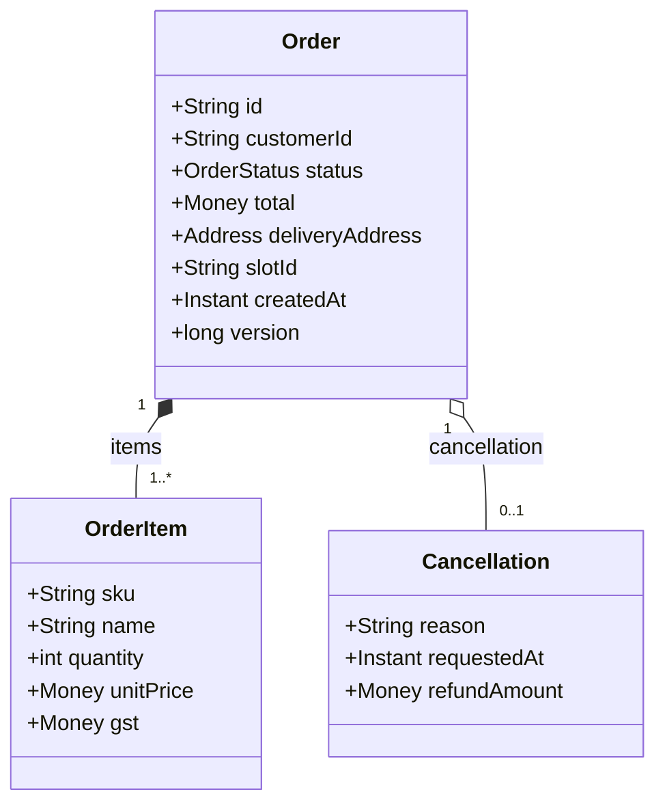
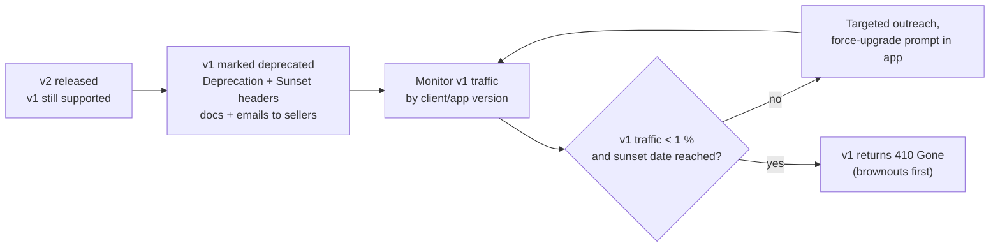
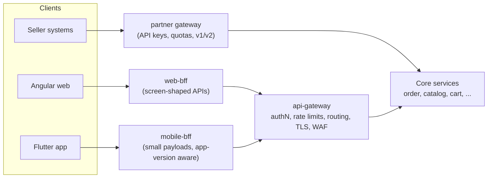
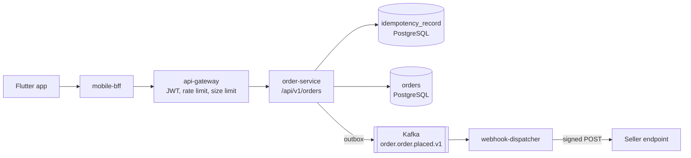
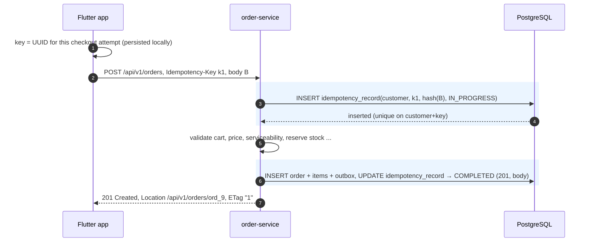
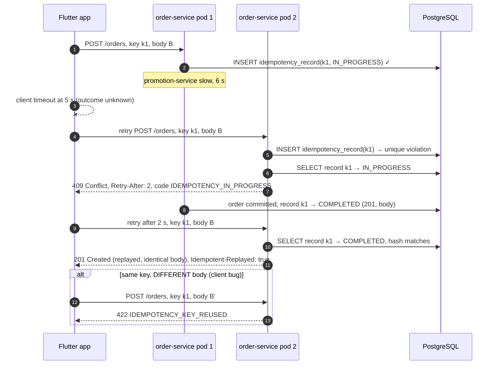
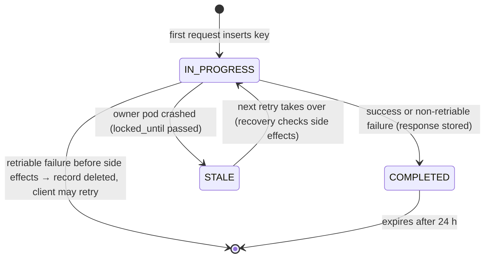
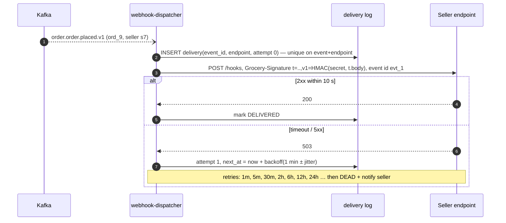

# 04. API Design ⭐

!!! abstract "Chapter at a glance"
    **Reader bands:** B1 → B4 · **Prerequisites:** [Ch 01](../00-orientation/01-what-system-design-is.md), [Ch 03](03-networking-essentials.md) · **What you will build:** The Orders API, taken from in-memory idempotency, cursors and ETags (L1) to a contract-first, versioned API with race-free idempotency across pods and signed webhooks for sellers (L4) · **Reading time:** 100 min + code

---

## 1. Introduction & Why It Matters

### 1.1 A story: the double charge nobody could explain

During a Sunday-morning peak, the grocery app's checkout call started taking 6–9 seconds, because a slow promotion service sat on the critical path. The mobile client had a 5-second timeout and **retried automatically**.

The server hadn't failed. It was just slow. So each "failed" checkout had actually succeeded, and the retry created a **second order and a second UPI collect request**. Some customers approved both. By noon, support had 2,300 tickets about duplicate orders and duplicate payments. Finance spent two weeks reconciling refunds with Razorpay.

The root cause wasn't the slow promotion service. It was the **API contract**: `POST /orders` had no idempotency key, so the server couldn't tell "a new order" from "the same order, asked twice." The network always delivers some requests twice, because timeouts are ambiguous. An API that can't handle that is broken by design.

!!! quote "The thesis of this chapter"
    An API is a **long-lived contract** with clients you don't control, over a network that duplicates, reorders and drops messages. Good API design makes the contract **safe to retry, safe to evolve, and hard to misuse**. The contract usually outlives the implementation behind it.

### 1.2 Where this lives in the grocery platform

| API | Consumers | Design concerns |
|---|---|---|
| Public customer API (via gateway/BFF) | Angular web, Flutter app (versions in the wild for 12+ months) | Backward compatibility, pagination, mobile payload size, idempotency |
| Seller API | Third-party sellers' systems | Versioning, rate limits, webhooks, auth scopes, documentation |
| Internal service APIs | 26 services | Contracts, gRPC vs REST, timeouts, deadlines |
| Events | Kafka consumers (Ch 14) | Schema evolution, compatibility |
| Webhooks in | Razorpay payment callbacks | Signature verification, idempotent handling |
| Webhooks out | Sellers (order placed, cancelled) | Signing, retries, ordering, replay |

### 1.3 Learning objectives

| Band | After this chapter you can… |
|---|---|
| <span class="band b1">B1</span> | Model resources, pick correct methods and status codes, and paginate |
| <span class="band b2">B2</span> | Design idempotent writes, conditional requests, error models, versioning, and choose between REST, GraphQL and gRPC |
| <span class="band b3">B3</span> | Implement race-free idempotency, keyset pagination at scale, safe webhooks, and backward-compatible evolution |
| <span class="band b4">B4</span> | Run API governance (contract-first, linting, deprecation policy), and decide between gateway, BFF and federation |

---

## 2. Core Concepts — Beginner to Deep

### 2.1 Intuition: a restaurant menu and the order slip <span class="band b1">B1</span>

An API is a restaurant's menu plus its order slips:

- The **menu** (the contract) tells customers what they can order and how. Once it's printed and in customers' hands, you can add dishes, but renaming or removing one confuses regulars.
- An **order slip with a number** (the idempotency key) means that if a waiter brings the same slip twice, the kitchen cooks it once.
- **"Is my table's order still what I think it is?"** (the ETag) stops you from cancelling a dish the kitchen has already served.
- A **clear reason when something can't be done** (the error model), such as "Paneer is sold out; try Mushroom," beats "No."

### 2.2 REST maturity and resource modeling ⭐ <span class="band b1">B1</span> <span class="band b2">B2</span>

**The Richardson Maturity Model:**

| Level | Description | Example |
|---|---|---|
| 0 | One endpoint, RPC over HTTP | `POST /api` with `{"action":"createOrder"}` |
| 1 | Resources | `POST /orders`, `GET /orders/42` |
| 2 | **HTTP verbs + status codes** used correctly | `GET` is safe, `PUT` idempotent, `201 Created` + `Location` |
| 3 | Hypermedia (HATEOAS): responses link to next actions | `"_links": {"cancel": {"href": "/orders/42/cancel"}}` |

Most good production APIs are **Level 2**, with selective links where they help clients (pagination `next`, allowed actions).

**Resource modeling rules:**

| Rule | Good | Bad |
|---|---|---|
| Nouns, plural | `/orders`, `/orders/{orderId}/items` | `/getOrders`, `/order` |
| Nest only for ownership | `/orders/{id}/items` | `/customers/{c}/orders/{o}/items/{i}/product` |
| State transitions as sub-resources or actions | `POST /orders/{id}/cancellation` or `POST /orders/{id}/cancel` | `PUT /orders/{id}` with `{"status":"CANCELLED"}` |
| IDs are opaque strings | `"id": "ord_01J9ZK..."` | Auto-increment ints (enumerable, leak volume) |
| Money as integer minor units + currency | `"amount": {"value": 45000, "currency": "INR"}` (paise) | `"amount": 450.0` |
| Time as ISO-8601 UTC | `"createdAt": "2026-09-26T10:00:00Z"` | `"26/09/2026 3:30 PM"` |
| Consistent casing | `camelCase` in JSON everywhere | Mixed |

!!! tip "Why a state transition shouldn't be a generic PUT"
    `PUT /orders/42 {"status":"CANCELLED"}` lets clients set **any** status, including invalid ones like "DELIVERED." An explicit `POST /orders/42/cancel` models the business action, carries its own rules (only before packing), and can have its own permissions, audit trail and idempotency.

#### Resource model for orders



### 2.3 HTTP methods and status codes ⭐ <span class="band b1">B1</span>

| Method | Safe | Idempotent | Typical use |
|---|---|---|---|
| GET | ✅ | ✅ | Read |
| HEAD | ✅ | ✅ | Read headers only (existence, ETag) |
| POST | ❌ | ❌ (make it so with a key) | Create, or a business action |
| PUT | ❌ | ✅ | Replace a resource entirely |
| PATCH | ❌ | Not necessarily | Partial update (JSON Merge Patch / JSON Patch) |
| DELETE | ❌ | ✅ | Remove |

| Code | Meaning | Grocery example |
|---|---|---|
| 200 OK | Success with body | GET order |
| 201 Created | Created + `Location` header | POST order |
| 202 Accepted | Accepted for async processing | Bulk price upload by seller |
| 204 No Content | Success, no body | DELETE cart item |
| 304 Not Modified | Conditional GET matched | Catalog with `If-None-Match` |
| 400 Bad Request | Malformed syntax | Invalid JSON |
| 401 Unauthorized | Not authenticated | Missing or expired token |
| 403 Forbidden | Authenticated but not allowed | Seller editing another seller's SKU |
| 404 Not Found | Doesn't exist (or you mustn't know it does) | Someone else's order |
| 409 Conflict | Conflicts with current state | Cancel an order that's already packed; same idempotency key still in progress |
| 412 Precondition Failed | `If-Match` didn't match | Stale ETag on cancel |
| 415 Unsupported Media Type | Wrong `Content-Type` | XML sent to a JSON API |
| 422 Unprocessable Content | Well-formed but semantically invalid | Pincode not serviceable; idempotency key reused with a different body |
| 428 Precondition Required | `If-Match` required but missing | Cancel without an ETag |
| 429 Too Many Requests | Rate limited (+ `Retry-After`) | Seller API over quota |
| 500 Internal Server Error | Bug | — |
| 502 / 503 / 504 | Upstream bad / unavailable / timeout | Serviceability unavailable (Ch 01) |

!!! warning "The 200-with-error-body anti-pattern"
    `200 OK {"success": false, "error": "..."}` breaks caches, monitoring (error rates look like zero), retries and client libraries. Use real status codes.

### 2.4 Pagination: offset, cursor and keyset ⭐ <span class="band b1">B1</span> → <span class="band b3">B3</span>

| | Offset (`?page=5&size=20`) | Cursor, opaque (`?cursor=eyJ0...`) backed by **keyset** |
|---|---|---|
| SQL | `ORDER BY created_at DESC LIMIT 20 OFFSET 80` | `WHERE (created_at, id) < (:ts, :id) ORDER BY created_at DESC, id DESC LIMIT 21` |
| Cost for deep pages | O(offset): the DB reads and discards 80, 800, 80,000 rows | O(limit) with an index, regardless of depth |
| Stability while data changes | New rows shift pages, causing duplicates or skipped items | Stable: each page continues after the last item seen |
| Jump to page N | ✅ | ❌ (only next/prev) |
| Total count | Easy (but `COUNT(*)` is expensive at scale) | Usually omitted or approximated |
| Use for | Admin tables with small data, "page 3 of 7" UIs | Feeds, order history, APIs, infinite scroll, exports |

The L1 run in §5 shows the stability property: a new order that arrives between page 1 and page 2 doesn't shift items into page 2.

```text
2. page 1:  [ord_5, ord_4]
   page 2:  [ord_3, ord_2]  (no duplicate, new order not shifted in)
   page 3:  [ord_1]  next=null
```

**Keyset rules:**

1. The sort key must be **unique**, so add a tiebreaker (`id`).
2. There must be a **composite index** matching the sort: `(customer_id, created_at DESC, id DESC)`.
3. The cursor is **opaque** to clients (base64url, and ideally signed), so you can change its internals later.
4. Fetch `limit + 1` rows to know whether there's a next page, without a `COUNT`.
5. Put a **maximum limit** on page size (for example 50).

```json
{
  "items": [ { "id": "ord_5", "status": "PLACED" }, { "id": "ord_4", "status": "DELIVERED" } ],
  "page": { "limit": 2, "nextCursor": "MjAyNi0wOS0yNlQxMDowMDowNFp8b3JkXzQ" },
  "_links": { "next": { "href": "/api/v1/orders?limit=2&cursor=MjAyNi0wOS0yNlQxMDowMDowNFp8b3JkXzQ" } }
}
```

### 2.5 Filtering and sorting <span class="band b2">B2</span>

| Concern | Recommendation |
|---|---|
| Simple filters | Query params: `?status=PLACED&createdAfter=2026-09-01T00:00:00Z` |
| Multiple values | Repeat the param: `?status=PLACED&status=PACKED` |
| Sorting | `?sort=-createdAt,id` with an **allow-list** of sortable fields (each must be indexed) |
| Complex search | A dedicated search endpoint backed by a search engine (Ch 22), not arbitrary SQL filters |
| Sparse fields | `?fields=id,status,total` for mobile payload size (or GraphQL) |
| Validation | Unknown filter or sort fields return **400**, never silently ignored |

!!! danger "Unbounded filtering is a DoS vector"
    Every allowed filter and sort combination needs an index, or a single client request can table-scan your primary database. Allow-list them, and send complex queries to search or analytics stores.

### 2.6 Idempotency keys ⭐ <span class="band b2">B2</span> <span class="band b3">B3</span>

A client generates a unique key (a UUID) **per logical operation** and sends it with the request. The server stores the key with the outcome. Retries with the same key return the **same outcome** without re-executing.

```http
POST /api/v1/orders
Idempotency-Key: 7f3c2a4e-0b8d-4c1e-9f6b-2d5a1e8c9b10
Content-Type: application/json

{ "cartId": "cart_88", "slotId": "slot_2026-09-26_18", "paymentMethod": "UPI" }
```

**Server-side rules (the ones most implementations get wrong):**

| Rule | Why |
|---|---|
| Scope keys per client (customer or API key) | One client's key can't collide with, or reveal, another's |
| Store a **fingerprint** of the request (hash of the body) | Same key with a different body is a client bug. Return **422**, don't replay the wrong result |
| Insert the key **before** doing the work, with a unique constraint | Two concurrent duplicates race. Only one may proceed |
| While in progress, duplicates get **409** + `Retry-After` | Don't run twice, and don't block a thread waiting |
| On completion, store the response (status + body) | Retries get byte-identical replays |
| On retriable failure (5xx before side effects), release the key | So the client can retry the operation |
| Expire keys after a window (24 h) | Bounded storage. Document the window |
| Keys don't replace business uniqueness | Still have unique constraints on things like "one payment per order attempt" |

The IETF draft for the `Idempotency-Key` HTTP header standardizes the header name and the 409/422 semantics described here.

### 2.7 ETags and conditional requests ⭐ <span class="band b2">B2</span>

**ETag** is a version identifier for a representation. It serves two jobs:

| Use | Request header | Server behaviour | Benefit |
|---|---|---|---|
| **Caching** (read) | `If-None-Match: "v17"` | Same → `304 Not Modified`, no body | Saves bandwidth and CPU (catalog, category trees) |
| **Optimistic concurrency** (write) | `If-Match: "v17"` | Different → `412 Precondition Failed` | Prevents the "lost update" |
| Require a precondition | none sent | `428 Precondition Required` | Forces clients to be concurrency-safe |

The lost update without ETags looks like this. The customer opens an order (status PLACED) and taps "Cancel" 40 seconds later. Meanwhile the store packed it. Without `If-Match`, the server may cancel a packed order, or a naive `PUT` may overwrite the packing status. With `If-Match`, the server answers 412, and the app re-fetches and shows "Your order is already packed."

**Strong vs weak ETags:** `"v17"` is strong (byte-identical). `W/"v17"` is weak (semantically equivalent). For concurrency control use strong ETags derived from the entity version (JPA `@Version`), not from a hash of the JSON.

### 2.8 Error model: RFC 9457 Problem Details ⭐ <span class="band b2">B2</span>

```http
HTTP/1.1 422 Unprocessable Content
Content-Type: application/problem+json

{
  "type": "https://api.grocery.in/problems/pincode-not-serviceable",
  "title": "Pincode not serviceable",
  "status": 422,
  "detail": "We don't deliver to 560300 yet.",
  "instance": "/api/v1/orders",
  "code": "ORDER_PINCODE_NOT_SERVICEABLE",
  "correlationId": "c0a8012e-6f2b-4b1e-9a51-3c5e5f7d2a10",
  "retryable": false,
  "errors": [
    { "field": "deliveryAddress.pincode", "code": "NOT_SERVICEABLE", "message": "Not serviceable" }
  ]
}
```

| Field | Rule |
|---|---|
| `type` | A stable URI per error type, and documented. Clients switch on it (or on `code`), **never on `detail` text** |
| `title` | Short and stable for the type |
| `detail` | Human-readable for this occurrence. Safe to show users; no stack traces or SQL |
| `code` | A stable machine code (extension member), which is easier for mobile apps than URIs |
| `correlationId` | Joins the client report to server logs and traces (Ch 24) |
| `retryable` | Tells clients whether retrying can help |
| `errors[]` | Field-level validation errors |

Spring supports this natively: `ProblemDetail`, `ErrorResponse`, and `spring.mvc.problemdetails.enabled=true`.

### 2.9 Versioning and evolution ⭐ <span class="band b2">B2</span> <span class="band b4">B4</span>

The best versioning strategy is **not needing new versions**: evolve compatibly for as long as possible.

**Backward-compatible (safe) changes:**

- Add optional request fields, response fields, endpoints or enum values (only if clients were told to tolerate unknown values).
- Relax validation.

**Breaking changes:**

- Remove or rename fields.
- Change types or meaning.
- Make an optional field required.
- Change status codes or error types.
- Change pagination semantics or default sorting.
- Add an enum value clients switch on exhaustively (a trap for mobile apps).

| Strategy | Example | Pros | Cons |
|---|---|---|---|
| **URI version** | `/api/v1/orders`, `/api/v2/orders` | Obvious, easy routing, caching, docs | Coarse. Clients must change URLs |
| Header / media type | `Accept: application/vnd.grocery.order+json;version=2` | Clean URIs, per-resource versions | Harder to test, cache and route; invisible in logs |
| Query param | `?version=2` | Easy | Messy, cache-unfriendly |
| Date-based (Stripe-style) | `Grocery-Version: 2026-09-01`, pinned per API key | Fine-grained, clients upgrade deliberately | Needs version-transformation layers, which is complex |

**Platform choice:** URI major version for public and seller APIs (`/v1`), additive evolution within a major version, and the **tolerant reader** principle for clients (ignore unknown fields, handle unknown enum values with a default).

**Deprecation lifecycle:**



```http
HTTP/1.1 200 OK
Deprecation: @1788220800
Sunset: Tue, 30 Mar 2027 00:00:00 GMT
Link: <https://developers.grocery.in/migrations/orders-v2>; rel="deprecation"
```

!!! note "Mobile apps make versioning a multi-year concern"
    A Flutter app version released today may still be on phones in 18 months. Public mobile APIs need **long compatibility windows**, server-driven minimum-version checks (a force-upgrade screen), and metrics of traffic per app version.

### 2.10 OpenAPI-first (contract-first) <span class="band b2">B2</span> <span class="band b4">B4</span>

| Approach | How | Pros | Cons |
|---|---|---|---|
| Code-first | Write controllers, generate OpenAPI from annotations | Fast for one team | The contract is an accident of implementation; hard to review before building |
| **Contract-first** | Write the OpenAPI spec, review it, generate server interfaces and client SDKs | The contract is reviewed like a design doc; parallel work (the mobile team mocks it); linting | Tooling setup; discipline to keep spec and code in sync |

Contract-first workflow for the platform:

1. A PR adds or changes `openapi/orders-v1.yaml`.
2. CI runs **Spectral lint** (naming, pagination, error model, security schemes).
3. CI runs a **breaking-change diff** against `main` (for example `oasdiff`), and fails the build on unapproved breaks.
4. Server interfaces are generated (`openapi-generator`, `interfaceOnly=true`), and controllers implement them.
5. Client SDKs (Dart for Flutter, TypeScript for Angular) are generated and published.
6. Contract tests verify the implementation against the spec (Ch 29).

### 2.11 GraphQL <span class="band b2">B2</span> <span class="band b3">B3</span>

GraphQL lets clients ask for exactly the fields they need from a typed schema, in one request.

```graphql
type Query {
  order(id: ID!): Order
  myOrders(first: Int = 10, after: String): OrderConnection!
}

type Order {
  id: ID!
  status: OrderStatus!
  total: Money!
  items: [OrderItem!]!
  rider: Rider          # resolved from dispatch-service
}
```

| Strength | Caveat |
|---|---|
| No over/under-fetching; one round trip per screen | **N+1 resolver problem**: 20 orders × a `rider` field = 20 calls to dispatch. Fix with batching (DataLoader; `@BatchMapping` in Spring for GraphQL) |
| Strong typing, introspection, great tooling | HTTP caching is harder (mostly `POST`, one URL). Use persisted queries plus GET for caching |
| Schema evolution by adding fields; `@deprecated` | **Query cost**: clients can ask for deep, expensive graphs. Enforce depth and complexity limits, and timeouts |
| **Federation** composes one graph from many services' subgraphs | Operational complexity; a router is on the critical path; ownership boundaries must be clear |

```java
// excerpt — Spring for GraphQL: batch-load riders for many orders in ONE call (fixes N+1)
@Controller
class OrderGraphController {

    @BatchMapping(typeName = "Order", field = "rider")
    Map<Order, Rider> rider(List<Order> orders) {
        Set<String> orderIds = orders.stream().map(Order::id).collect(Collectors.toSet());
        Map<String, Rider> byOrder = dispatchClient.ridersForOrders(orderIds);   // one downstream call
        return orders.stream()
                .filter(o -> byOrder.containsKey(o.id()))
                .collect(Collectors.toMap(o -> o, o -> byOrder.get(o.id())));
    }
}
```

**Use GraphQL** for a client-facing aggregation layer with many screens and client teams (a BFF-like role). **Avoid** it for service-to-service calls, simple CRUD, or public partner APIs where predictable cost and caching matter more.

### 2.12 gRPC and Protocol Buffers <span class="band b2">B2</span> <span class="band b3">B3</span>

```protobuf
syntax = "proto3";
package grocery.inventory.v1;

service InventoryService {
  rpc ReserveStock(ReserveStockRequest) returns (ReserveStockResponse);
  rpc WatchStock(WatchStockRequest) returns (stream StockLevel);   // server streaming
}

message ReserveStockRequest {
  string order_id = 1;
  string store_id = 2;
  repeated Line lines = 3;
  string idempotency_key = 4;
}
message Line { string sku = 1; int32 quantity = 2; }
message ReserveStockResponse { string reservation_id = 1; repeated string unavailable_skus = 2; }
message WatchStockRequest { string store_id = 1; repeated string skus = 2; }
message StockLevel { string sku = 1; int32 available = 2; }
```

| Strength | Caveat |
|---|---|
| Compact binary encoding, fast (de)serialization | Not human-readable; needs tooling to debug |
| Strict typed contracts, generated clients in many languages | Browsers need gRPC-Web or a proxy |
| HTTP/2 multiplexing, streaming (client, server, bidirectional) | L4 load balancers pin all calls to one backend. Use L7 or client-side balancing (Ch 08) |
| **Deadlines** propagate across calls | Evolution rules: never reuse field numbers; `reserved` for removed fields |

**Protobuf evolution rules:** add fields with new numbers; never change a field's number or type; mark removed fields `reserved`; remember that proto3 scalars have default values (use wrapper types or `optional` when "unset" differs from "zero").

**Choosing a style:**

| Use case | Choose |
|---|---|
| Public customer / seller APIs | REST + JSON (OpenAPI) |
| Mobile screen aggregation across many services | BFF (REST) or GraphQL |
| High-QPS internal service-to-service calls | gRPC (or REST with HTTP/2 if the team is REST-first) |
| Streaming internal updates | gRPC streaming, or events (Ch 14) |
| Server → browser push | SSE (Ch 03) |

### 2.13 API gateway vs BFF <span class="band b2">B2</span> <span class="band b4">B4</span>



| | API gateway | Backend-for-Frontend (BFF) |
|---|---|---|
| Purpose | **Cross-cutting edge concerns** | **Client-specific composition** |
| Does | TLS, authentication, rate limiting, routing, request size limits, WAF integration, observability | Aggregates calls per screen, shapes payloads, handles app-version quirks, orchestrates UI flows |
| Owned by | Platform team | The client team (web team owns web-bff) |
| Business logic | None | Presentation logic only, never domain rules |
| Count | One (or one per trust zone: public, partner, internal) | One per client type |
| Anti-pattern | Gateway with business logic ("smart gateway") | BFF that becomes a second monolith with domain rules |

### 2.14 Webhooks: design for senders and receivers ⭐ <span class="band b3">B3</span>

Webhooks are **reverse APIs**: you call the consumer's endpoint when something happens.

**As a sender** (grocery → seller systems: `order.placed`, `order.cancelled`):

| Concern | Design |
|---|---|
| Authenticity | HMAC-SHA256 signature over `timestamp + "." + rawBody` with a per-endpoint secret; header `Grocery-Signature: t=…,v1=…` |
| Replay protection | Receivers reject timestamps older than 5 minutes |
| Delivery | At-least-once from an **outbox** (Ch 13), retried with exponential backoff + jitter for ~24–72 h |
| Idempotency | Each delivery has a stable `event.id`, and receivers dedupe on it |
| Ordering | Not guaranteed. Include `sequence` / `occurredAt` and the resource version, and receivers fetch current state if unsure |
| Payload | Thin ("order ord_42 changed, version 7") or fat (full snapshot). Thin plus fetch is safer for PII and evolution |
| Endpoint health | Disable after N consecutive days of failures and notify the seller; provide a replay UI or API |
| Timeouts | Short (5–10 s). The receiver should acknowledge fast and process async |

**As a receiver** (Razorpay → `payment-service`):

1. Verify the signature over the **raw body bytes** (not re-serialized JSON) with a constant-time comparison.
2. Deduplicate by event or payment id (idempotent processing).
3. Respond 2xx quickly, then process asynchronously.
4. Never trust the payload alone for money. Fetch or verify the payment status via the API when in doubt.
5. Tolerate out-of-order events (a `payment.captured` may arrive before `payment.authorized`).

### 2.15 Designing for mobile clients <span class="band b3">B3</span>

| Concern | Practice |
|---|---|
| Round trips are expensive (Ch 03) | Screen-shaped BFF endpoints; one call per screen where possible |
| Payload size | Compact DTOs, `fields=` or GraphQL, compression, no nulls-everywhere |
| Old app versions | Tolerant parsing, server-driven minimum version, feature flags by app version |
| Flaky networks | Idempotency keys on every mutating call; safe automatic retries |
| Clock skew on devices | Server timestamps are authoritative; never trust client time for business rules |
| Unknown enum values | Clients map unknowns to a default ("OTHER"), enforced by code review |

---

## 3. Architecture & Diagrams

### 3.1 Request path for the Orders API



### 3.2 Sequence: happy path, idempotent order creation



### 3.3 Sequence: failure path, timeout, retry and a concurrent duplicate



!!! note "What the system guarantees after this failure path"
    **Exactly one order** per (customer, idempotency key), no matter how many retries arrive, on how many pods, or how concurrently. Retries receive the original response byte for byte. A reused key with a different body is rejected instead of silently returning the wrong order.

### 3.4 State: idempotency record lifecycle



### 3.5 Sequence: outbound webhook delivery to a seller



---

## 4. Design Document Excerpt: Orders API v1

| Field | Value |
|---|---|
| Author / Reviewers | Order team / Mobile, Web, Seller platform, Security, API guild |
| Status | Approved |
| Related ADRs | ADR-020 Idempotency keys mandatory on mutating customer APIs; ADR-021 URI major versioning + additive evolution |

**1. Context & Problem.** Duplicate orders and payments from client retries (§1.1). Offset pagination on order history degraded as heavy users' histories grew. There were no conditional updates, and error responses were inconsistent across services.

**2. Goals / Non-Goals.**

- *Goals:* retry-safe creation and actions; stable, fast pagination; concurrency-safe state changes; one error model; a contract-first spec with SDKs.
- *Non-goals:* checkout orchestration internals (Ch 13, 46); GraphQL (revisit per §2.11).

**3. Requirements.**

| ID | Requirement |
|---|---|
| FR-1 | Create an order from a cart (`POST /api/v1/orders`) |
| FR-2 | List my orders, newest first (`GET /api/v1/orders`) |
| FR-3 | Get an order (`GET /api/v1/orders/{id}`) |
| FR-4 | Cancel an order before packing (`POST /api/v1/orders/{id}/cancel`) |
| NFR-1 | Every mutating call requires `Idempotency-Key`; a duplicate never creates a second order (verified under concurrency) |
| NFR-2 | List p99 ≤ 150 ms at any page depth |
| NFR-3 | Cancel requires `If-Match`; stale → 412 |
| NFR-4 | All errors are `application/problem+json` with a stable `code` |
| NFR-5 | No breaking change within v1; enforced by CI diff |

**4. Capacity estimates.**

| Item | Estimate |
|---|---|
| Create attempts (festival peak, Ch 02) | ~850/s |
| Idempotency records | 1.5 M orders/day × ~1.5 attempts × ~1.2 KB stored response ≈ 2.7 GB/day; 24 h TTL → **< 3 GB live** |
| List calls | ~2 per order-history screen visit; ~3 K/s peak, served by index `(customer_id, created_at DESC, id DESC)` |
| Get calls | ~5 K/s at peak (tracking screen fallback polling, BFF) |
| Seller webhooks | ~1.5 M/day order events × ~1.1 (cancellations) → ~20/s average, ~400/s peak |

**5.2 API contract (excerpt).**

```yaml
openapi: 3.1.0
info: { title: Orders API, version: 1.4.0 }
paths:
  /api/v1/orders:
    post:
      operationId: createOrder
      parameters:
        - { name: Idempotency-Key, in: header, required: true, schema: { type: string, format: uuid } }
      requestBody:
        required: true
        content:
          application/json:
            schema: { $ref: '#/components/schemas/CreateOrderRequest' }
      responses:
        '201':
          description: Created (or replayed)
          headers:
            Location: { schema: { type: string } }
            ETag: { schema: { type: string } }
          content: { application/json: { schema: { $ref: '#/components/schemas/Order' } } }
        '409': { $ref: '#/components/responses/Problem' }
        '422': { $ref: '#/components/responses/Problem' }
    get:
      operationId: listOrders
      parameters:
        - { name: limit, in: query, schema: { type: integer, minimum: 1, maximum: 50, default: 20 } }
        - { name: cursor, in: query, schema: { type: string } }
        - { name: status, in: query, schema: { type: array, items: { $ref: '#/components/schemas/OrderStatus' } } }
      responses:
        '200': { content: { application/json: { schema: { $ref: '#/components/schemas/OrderPage' } } } }
  /api/v1/orders/{orderId}/cancel:
    post:
      operationId: cancelOrder
      parameters:
        - { name: orderId, in: path, required: true, schema: { type: string } }
        - { name: If-Match, in: header, required: true, schema: { type: string } }
        - { name: Idempotency-Key, in: header, required: true, schema: { type: string, format: uuid } }
      responses:
        '200': { content: { application/json: { schema: { $ref: '#/components/schemas/Order' } } } }
        '409': { $ref: '#/components/responses/Problem' }
        '412': { $ref: '#/components/responses/Problem' }
        '428': { $ref: '#/components/responses/Problem' }
components:
  schemas:
    OrderStatus:
      type: string
      enum: [PLACED, CONFIRMED, PACKED, OUT_FOR_DELIVERY, DELIVERED, CANCELLED]
      description: Clients MUST treat unknown values as "OTHER" (new statuses may be added in v1).
```

**5.3 Data model.**

```sql
CREATE TABLE idempotency_record (
    scope          VARCHAR(64)  NOT NULL,     -- customer id or API client id
    idem_key       VARCHAR(64)  NOT NULL,
    request_hash   CHAR(64)     NOT NULL,     -- SHA-256 hex of method + path + canonical body
    status         VARCHAR(16)  NOT NULL,     -- IN_PROGRESS | COMPLETED
    locked_until   TIMESTAMPTZ  NOT NULL,     -- takeover point if the owner crashes
    response_code  INT,
    response_body  TEXT,
    resource_id    VARCHAR(64),
    created_at     TIMESTAMPTZ  NOT NULL DEFAULT now(),
    expires_at     TIMESTAMPTZ  NOT NULL,
    PRIMARY KEY (scope, idem_key)
);
CREATE INDEX idx_idem_expiry ON idempotency_record (expires_at);

CREATE INDEX idx_orders_customer_keyset ON orders (customer_id, created_at DESC, id DESC);
```

**7. Alternatives considered.**

| Option | Pros | Cons | Verdict |
|---|---|---|---|
| Rely on client not retrying | Nothing to build | Networks retry for you (proxies, SDKs, users) | Rejected |
| Business dedupe only ("one order per cart") | Simple | A cart can legitimately be re-ordered; doesn't cover cancel/refund actions | Complementary |
| Idempotency in Redis | Fast | Harder to make atomic with the order write; eviction loses keys | Rejected for money flows |
| **Idempotency table in the same DB as orders, same transaction for completion** | Atomic with the business write; durable | Extra write per request | **Chosen** |
| Offset pagination | Simple, page numbers | O(offset), unstable pages | Admin UIs only |
| **Keyset with opaque signed cursor** | O(limit), stable | No "jump to page N" | **Chosen** |

**8. Failure modes.** A pod crashes mid-request: the record stays `IN_PROGRESS` until `locked_until` (30 s). The next retry takes over and checks whether an order already exists for the key's `resource_id` before re-executing. DB unavailable: 503 with a retryable problem, and the client retries with the same key. Clock skew between pods: `locked_until` uses DB time (`now()`), not pod time.

**9. Security.** Keys are scoped to the authenticated customer. Cursors are HMAC-signed (tampering returns 400). Order ids are opaque (no enumeration). Other customers' orders return 404. Problem responses never include internal details.

**11. Rollout.** `Idempotency-Key` is optional in app version N (logged when missing), then required from version N+2 (428 for older apps, with a force-upgrade prompt). The keyset list ships as a new `cursor` param while `page` stays for 2 releases.

**14. Decision (ADR-020 summary).** All mutating customer and seller APIs require an `Idempotency-Key`, scoped per client, fingerprinted, stored in the same database and transaction as the business effect, and retained for 24 hours. In-progress duplicates get 409 with `Retry-After`, and mismatched bodies get 422.

---

## 5. Hands-On Code — Level Ladder

We build the **Orders API** four times:

| Level | New requirement that forces the step |
|---|---|
| L1 | "Show idempotency, cursors and ETags working." (plain Java, in memory) |
| L2 | "Real HTTP endpoints with correct status codes, ETags and Problem Details." |
| L3 | "Retries and concurrent duplicates across many pods must never create two orders. Pagination must stay fast at any depth, and cursors can't be tampered with." |
| L4 | "Many teams and external sellers depend on this contract: contract-first, CI-enforced compatibility, deprecation, and signed webhooks." |

### L1 — Concept (plain Java) <span class="band b1">B1</span>

```java
// OrdersApiL1.java — run with: java OrdersApiL1.java
// Three API-design ideas in plain Java, no framework:
//   1. Idempotency keys  — a retried "create" must not create a second order
//   2. Keyset (cursor) pagination — stable pages even while new orders arrive
//   3. ETag / If-Match    — optimistic concurrency: don't overwrite a change you haven't seen
import java.nio.charset.StandardCharsets;
import java.time.Instant;
import java.util.*;

public class OrdersApiL1 {

    record Order(String id, String customerId, long amountPaise, String status, long version, Instant createdAt) {
        String etag() { return "\"" + version + "\""; }
    }

    record Page(List<Order> items, String nextCursor) { }

    /** Result of an HTTP-like call: status code + body. */
    record Response(int status, Object body) { }

    static final class OrderApi {
        private final Map<String, Order> orders = new LinkedHashMap<>();
        private final Map<String, Response> idempotency = new HashMap<>();   // key -> first response
        private long seq = 0;
        private Instant clock = Instant.parse("2026-09-26T10:00:00Z");

        /** POST /orders with Idempotency-Key */
        Response create(String idempotencyKey, String customerId, long amountPaise) {
            String scoped = customerId + ":" + idempotencyKey;            // keys are scoped per client
            Response previous = idempotency.get(scoped);
            if (previous != null) return previous;                        // replay the SAME response

            clock = clock.plusSeconds(1);
            var o = new Order("ord_" + (++seq), customerId, amountPaise, "PLACED", 1, clock);
            orders.put(o.id(), o);
            Response r = new Response(201, o);
            idempotency.put(scoped, r);
            return r;
        }

        /** GET /orders?limit=&cursor= — newest first, keyset on (createdAt, id) */
        Page list(String customerId, int limit, String cursor) {
            Instant afterTs = null;
            String afterId = null;
            if (cursor != null) {
                String[] p = new String(Base64.getUrlDecoder().decode(cursor), StandardCharsets.UTF_8).split("\\|");
                afterTs = Instant.parse(p[0]);
                afterId = p[1];
            }
            final Instant ts = afterTs;
            final String id = afterId;
            List<Order> page = orders.values().stream()
                    .filter(o -> o.customerId().equals(customerId))
                    .sorted(Comparator.comparing(Order::createdAt).thenComparing(Order::id).reversed())
                    .filter(o -> ts == null
                            || o.createdAt().isBefore(ts)
                            || (o.createdAt().equals(ts) && o.id().compareTo(id) < 0))
                    .limit(limit + 1L)                                    // fetch one extra to know if there's more
                    .toList();
            boolean more = page.size() > limit;
            List<Order> items = more ? page.subList(0, limit) : page;
            String next = null;
            if (more) {
                Order last = items.getLast();
                next = Base64.getUrlEncoder().withoutPadding().encodeToString(
                        (last.createdAt() + "|" + last.id()).getBytes(StandardCharsets.UTF_8));
            }
            return new Page(items, next);
        }

        /** POST /orders/{id}/cancel with If-Match */
        Response cancel(String orderId, String ifMatch) {
            Order o = orders.get(orderId);
            if (o == null) return new Response(404, "not found");
            if (ifMatch == null) return new Response(428, "If-Match required");
            if (!ifMatch.equals(o.etag())) return new Response(412, "order changed; re-fetch (current " + o.etag() + ")");
            if (!o.status().equals("PLACED")) return new Response(409, "cannot cancel in status " + o.status());
            var cancelled = new Order(o.id(), o.customerId(), o.amountPaise(), "CANCELLED", o.version() + 1, o.createdAt());
            orders.put(o.id(), cancelled);
            return new Response(200, cancelled);
        }

        void advance(String orderId, String status) {   // e.g. warehouse packs the order
            Order o = orders.get(orderId);
            orders.put(orderId, new Order(o.id(), o.customerId(), o.amountPaise(), status, o.version() + 1, o.createdAt()));
        }
    }

    public static void main(String[] args) {
        var api = new OrderApi();

        // 1. Idempotency: the app times out and retries with the same key
        Response first = api.create("key-abc", "cust-1", 45_000);
        Response retry = api.create("key-abc", "cust-1", 45_000);
        System.out.println("1. create:  " + first.status() + " " + ((Order) first.body()).id());
        System.out.println("   retry:   " + retry.status() + " " + ((Order) retry.body()).id()
                + "  (same order: " + (first.body() == retry.body()) + ")");

        // 2. Cursor pagination while new orders keep arriving
        for (int i = 0; i < 4; i++) api.create("k" + i, "cust-1", 10_000 + i);
        Page p1 = api.list("cust-1", 2, null);
        api.create("k-new", "cust-1", 99_900);                    // arrives between page 1 and page 2
        Page p2 = api.list("cust-1", 2, p1.nextCursor());
        Page p3 = api.list("cust-1", 2, p2.nextCursor());
        System.out.println("2. page 1:  " + p1.items().stream().map(Order::id).toList());
        System.out.println("   page 2:  " + p2.items().stream().map(Order::id).toList() + "  (no duplicate, new order not shifted in)");
        System.out.println("   page 3:  " + p3.items().stream().map(Order::id).toList() + "  next=" + p3.nextCursor());

        // 3. ETag / If-Match: customer cancels based on a stale view
        Order seen = (Order) first.body();                         // customer's screen shows version 1
        api.advance(seen.id(), "PACKED");                          // meanwhile the store packs it (version 2)
        Response stale = api.cancel(seen.id(), seen.etag());
        System.out.println("3. cancel with stale ETag " + seen.etag() + ": " + stale.status() + " " + stale.body());
        Response noHeader = api.cancel(seen.id(), null);
        System.out.println("   cancel without If-Match: " + noHeader.status() + " " + noHeader.body());
    }
}
```

Actual output from running it:

```text
1. create:  201 ord_1
   retry:   201 ord_1  (same order: true)
2. page 1:  [ord_5, ord_4]
   page 2:  [ord_3, ord_2]  (no duplicate, new order not shifted in)
   page 3:  [ord_1]  next=null
3. cancel with stale ETag "1": 412 order changed; re-fetch (current "2")
   cancel without If-Match: 428 If-Match required
```

**What L1 gets right:** a replayed response for a duplicate key, keyset pagination with an opaque cursor and `limit + 1` lookahead, and 412/428 semantics.

**What L1 can't do:**

| Gap | Consequence |
|---|---|
| In-memory maps | Lost on restart; invisible to other pods |
| `get` then `put` on the idempotency map | Two concurrent duplicates both pass the check (race) |
| No request fingerprint | Same key + different body silently returns the wrong order |
| Unsigned cursor | Clients can craft cursors, and a changed cursor format breaks them |
| No HTTP, no error model | Not an API yet |

### L2 — Spring Implementation (four layers) <span class="band b2">B2</span>

```kotlin
// build.gradle.kts (module l2-spring)
dependencies {
    implementation("org.springframework.boot:spring-boot-starter-web")   // VERIFY: Boot 4 starter name (spring-boot-starter-webmvc)
    implementation("org.springframework.boot:spring-boot-starter-data-jpa")
    implementation("org.springframework.boot:spring-boot-starter-validation")
    runtimeOnly("org.postgresql:postgresql")
    testImplementation("org.springframework.boot:spring-boot-starter-test")
}
```

=== "Domain & Repositories"

    ```java
    package com.grocery.order.domain;

    import jakarta.persistence.*;
    import java.time.Instant;

    @Entity
    @Table(name = "orders")
    public class Order {

        @Id private String id;
        @Column(name = "customer_id", nullable = false) private String customerId;
        @Column(name = "amount_paise", nullable = false) private long amountPaise;
        @Enumerated(EnumType.STRING) @Column(nullable = false) private OrderStatus status;
        @Column(name = "created_at", nullable = false) private Instant createdAt;
        @Version private long version;                 // drives the ETag

        protected Order() { }

        public Order(String id, String customerId, long amountPaise, Instant createdAt) {
            this.id = id; this.customerId = customerId; this.amountPaise = amountPaise;
            this.status = OrderStatus.PLACED; this.createdAt = createdAt;
        }

        public void cancel() {
            if (status != OrderStatus.PLACED && status != OrderStatus.CONFIRMED) {
                throw new OrderStateConflictException(id, status);
            }
            status = OrderStatus.CANCELLED;
        }

        public String getId() { return id; }
        public String getCustomerId() { return customerId; }
        public long getAmountPaise() { return amountPaise; }
        public OrderStatus getStatus() { return status; }
        public Instant getCreatedAt() { return createdAt; }
        public long getVersion() { return version; }
    }
    ```

    ```java
    package com.grocery.order.domain;

    public enum OrderStatus { PLACED, CONFIRMED, PACKED, OUT_FOR_DELIVERY, DELIVERED, CANCELLED }
    ```

    ```java
    package com.grocery.order.domain;

    public class OrderStateConflictException extends RuntimeException {
        public OrderStateConflictException(String id, OrderStatus status) {
            super("Order " + id + " cannot be cancelled in status " + status);
        }
    }
    ```

    ```java
    package com.grocery.order.repository;

    import com.grocery.order.domain.Order;
    import org.springframework.data.domain.Limit;
    import org.springframework.data.jpa.repository.JpaRepository;
    import org.springframework.data.jpa.repository.Query;
    import org.springframework.data.repository.query.Param;
    import java.time.Instant;
    import java.util.List;

    public interface OrderRepository extends JpaRepository<Order, String> {

        List<Order> findByCustomerIdOrderByCreatedAtDescIdDesc(String customerId, Limit limit);

        @Query("""
               select o from Order o
               where o.customerId = :customerId
                 and (o.createdAt < :ts or (o.createdAt = :ts and o.id < :id))
               order by o.createdAt desc, o.id desc""")
        List<Order> findPageAfter(@Param("customerId") String customerId, @Param("ts") Instant ts,
                                  @Param("id") String id, Limit limit);
    }
    ```

    ```java
    package com.grocery.order.domain;

    import jakarta.persistence.*;

    /** L2: naive idempotency — stores which order a key produced. */
    @Entity
    @Table(name = "idempotency_record_l2")
    public class IdempotencyRecord {
        @Id private String scopedKey;                  // customerId:key
        @Column(nullable = false) private String orderId;
        protected IdempotencyRecord() { }
        public IdempotencyRecord(String scopedKey, String orderId) { this.scopedKey = scopedKey; this.orderId = orderId; }
        public String getOrderId() { return orderId; }
    }
    ```

    ```java
    package com.grocery.order.repository;

    import com.grocery.order.domain.IdempotencyRecord;
    import org.springframework.data.jpa.repository.JpaRepository;

    public interface IdempotencyRecordRepository extends JpaRepository<IdempotencyRecord, String> { }
    ```

=== "Service"

    ```java
    package com.grocery.order.service;

    import com.grocery.order.domain.*;
    import com.grocery.order.dto.CreateOrderRequest;
    import com.grocery.order.repository.*;
    import org.springframework.data.domain.Limit;
    import org.springframework.stereotype.Service;
    import org.springframework.transaction.annotation.Transactional;
    import java.time.Clock;
    import java.time.Instant;
    import java.util.List;
    import java.util.UUID;

    @Service
    public class OrderService {

        public record CreateResult(Order order, boolean replayed) { }
        public record Slice(List<Order> items, boolean hasMore) { }

        private final OrderRepository orders;
        private final IdempotencyRecordRepository keys;
        private final Clock clock;

        public OrderService(OrderRepository orders, IdempotencyRecordRepository keys, Clock clock) {
            this.orders = orders; this.keys = keys; this.clock = clock;
        }

        /**
         * ⚠️ L2 is deliberately naive: "check, then insert" is a race. Two concurrent duplicates can
         * both miss the check. One then fails on the primary key; the other creates the order — or,
         * if the order insert happens first, you get two orders. L3 fixes this.
         */
        @Transactional
        public CreateResult create(String customerId, String idempotencyKey, CreateOrderRequest req) {
            String scoped = customerId + ":" + idempotencyKey;
            var existing = keys.findById(scoped);
            if (existing.isPresent()) {
                return new CreateResult(orders.findById(existing.get().getOrderId()).orElseThrow(), true);
            }
            var order = orders.save(new Order("ord_" + UUID.randomUUID(), customerId,
                    req.amountPaise(), Instant.now(clock)));
            keys.save(new IdempotencyRecord(scoped, order.getId()));
            return new CreateResult(order, false);
        }

        @Transactional(readOnly = true)
        public Slice list(String customerId, Instant afterTs, String afterId, int limit) {
            List<Order> rows = (afterTs == null)
                    ? orders.findByCustomerIdOrderByCreatedAtDescIdDesc(customerId, Limit.of(limit + 1))
                    : orders.findPageAfter(customerId, afterTs, afterId, Limit.of(limit + 1));
            boolean more = rows.size() > limit;
            return new Slice(more ? rows.subList(0, limit) : rows, more);
        }

        @Transactional(readOnly = true)
        public Order get(String customerId, String orderId) {
            return orders.findById(orderId)
                    .filter(o -> o.getCustomerId().equals(customerId))
                    .orElseThrow(() -> new OrderNotFoundException(orderId));
        }

        @Transactional
        public Order cancel(String customerId, String orderId, long expectedVersion) {
            Order o = get(customerId, orderId);
            if (o.getVersion() != expectedVersion) {
                throw new PreconditionFailedException(orderId, o.getVersion());
            }
            o.cancel();          // JPA @Version also protects the commit against a concurrent writer
            return o;
        }
    }
    ```

    ```java
    package com.grocery.order.service;

    public class OrderNotFoundException extends RuntimeException {
        public OrderNotFoundException(String id) { super("Order " + id + " not found"); }
    }
    ```

    ```java
    package com.grocery.order.service;

    public class PreconditionFailedException extends RuntimeException {
        private final long currentVersion;
        public PreconditionFailedException(String id, long currentVersion) {
            super("Order " + id + " has changed");
            this.currentVersion = currentVersion;
        }
        public long currentVersion() { return currentVersion; }
    }
    ```

=== "DTOs & Delegate"

    ```java
    package com.grocery.order.dto;

    import jakarta.validation.constraints.*;

    public record CreateOrderRequest(@NotBlank String cartId, @NotBlank String slotId,
                                     @Positive long amountPaise,          // L2 shortcut: real APIs price server-side
                                     @NotBlank String paymentMethod) { }
    ```

    ```java
    package com.grocery.order.dto;

    import java.time.Instant;

    public record OrderResponse(String id, String status, Money total, Instant createdAt) {
        public record Money(long value, String currency) { }
    }
    ```

    ```java
    package com.grocery.order.dto;

    import java.util.List;

    public record OrderPage(List<OrderResponse> items, PageInfo page) {
        public record PageInfo(int limit, String nextCursor) { }
    }
    ```

    ```java
    package com.grocery.order.delegate;

    import com.grocery.order.domain.Order;
    import com.grocery.order.dto.*;
    import com.grocery.order.service.OrderService;
    import org.springframework.stereotype.Component;
    import java.nio.charset.StandardCharsets;
    import java.time.Instant;
    import java.util.Base64;

    @Component
    public class OrderDelegate {

        public record Created(OrderResponse body, String etag, boolean replayed) { }
        public record Versioned(OrderResponse body, String etag) { }

        private final OrderService service;

        public OrderDelegate(OrderService service) { this.service = service; }

        public Created create(String customerId, String key, CreateOrderRequest req) {
            var r = service.create(customerId, key, req);
            return new Created(toDto(r.order()), etag(r.order()), r.replayed());
        }

        public OrderPage list(String customerId, String cursor, int limit) {
            Instant ts = null; String id = null;
            if (cursor != null) {    // L2: plain base64 cursor (L3 signs it)
                String[] p = new String(Base64.getUrlDecoder().decode(cursor), StandardCharsets.UTF_8).split("\\|");
                ts = Instant.parse(p[0]); id = p[1];
            }
            var slice = service.list(customerId, ts, id, limit);
            String next = null;
            if (slice.hasMore()) {
                Order last = slice.items().getLast();
                next = Base64.getUrlEncoder().withoutPadding()
                        .encodeToString((last.getCreatedAt() + "|" + last.getId()).getBytes(StandardCharsets.UTF_8));
            }
            return new OrderPage(slice.items().stream().map(OrderDelegate::toDto).toList(),
                                 new OrderPage.PageInfo(limit, next));
        }

        public Versioned get(String customerId, String orderId) {
            Order o = service.get(customerId, orderId);
            return new Versioned(toDto(o), etag(o));
        }

        public Versioned cancel(String customerId, String orderId, long expectedVersion) {
            Order o = service.cancel(customerId, orderId, expectedVersion);
            return new Versioned(toDto(o), "\"" + (o.getVersion() + 1) + "\"");   // version bumps on commit
        }

        static String etag(Order o) { return "\"" + o.getVersion() + "\""; }

        static OrderResponse toDto(Order o) {
            return new OrderResponse(o.getId(), o.getStatus().name(),
                    new OrderResponse.Money(o.getAmountPaise(), "INR"), o.getCreatedAt());
        }
    }
    ```

=== "Controller & Errors"

    ```java
    package com.grocery.order.controller;

    import com.grocery.order.delegate.OrderDelegate;
    import com.grocery.order.dto.*;
    import jakarta.validation.Valid;
    import jakarta.validation.constraints.*;
    import org.springframework.http.*;
    import org.springframework.validation.annotation.Validated;
    import org.springframework.web.bind.annotation.*;
    import org.springframework.web.context.request.WebRequest;
    import java.net.URI;

    @RestController
    @RequestMapping("/api/v1/orders")
    @Validated
    public class OrderController {

        private final OrderDelegate delegate;

        public OrderController(OrderDelegate delegate) { this.delegate = delegate; }

        @PostMapping
        public ResponseEntity<OrderResponse> create(@RequestHeader("X-User-Id") String customerId,
                                                    @RequestHeader("Idempotency-Key") String key,
                                                    @Valid @RequestBody CreateOrderRequest request) {
            var c = delegate.create(customerId, key, request);
            return ResponseEntity.created(URI.create("/api/v1/orders/" + c.body().id()))
                    .eTag(c.etag())
                    .header("Idempotent-Replayed", Boolean.toString(c.replayed()))
                    .body(c.body());
        }

        @GetMapping
        public OrderPage list(@RequestHeader("X-User-Id") String customerId,
                              @RequestParam(required = false) String cursor,
                              @RequestParam(defaultValue = "20") @Min(1) @Max(50) int limit) {
            return delegate.list(customerId, cursor, limit);
        }

        @GetMapping("/{orderId}")
        public ResponseEntity<OrderResponse> get(@RequestHeader("X-User-Id") String customerId,
                                                 @PathVariable String orderId, WebRequest request) {
            var v = delegate.get(customerId, orderId);
            if (request.checkNotModified(v.etag())) {
                return null;                                   // Spring sends 304 with no body
            }
            return ResponseEntity.ok().eTag(v.etag()).body(v.body());
        }

        @PostMapping("/{orderId}/cancel")
        public ResponseEntity<OrderResponse> cancel(@RequestHeader("X-User-Id") String customerId,
                                                    @PathVariable String orderId,
                                                    @RequestHeader(value = HttpHeaders.IF_MATCH, required = false) String ifMatch) {
            if (ifMatch == null) throw new PreconditionRequiredException();
            long expected = Long.parseLong(ifMatch.replace("\"", "").replace("W/", ""));
            var v = delegate.cancel(customerId, orderId, expected);
            return ResponseEntity.ok().eTag(v.etag()).body(v.body());
        }
    }
    ```

    ```java
    package com.grocery.order.controller;

    public class PreconditionRequiredException extends RuntimeException {
        public PreconditionRequiredException() { super("If-Match header is required"); }
    }
    ```

    ```java
    package com.grocery.order.controller;

    import com.grocery.order.domain.OrderStateConflictException;
    import com.grocery.order.service.*;
    import org.springframework.http.*;
    import org.springframework.web.bind.annotation.*;
    import java.net.URI;

    @RestControllerAdvice
    public class ProblemHandler {

        private static final String BASE = "https://api.grocery.in/problems/";

        @ExceptionHandler(OrderNotFoundException.class)
        ProblemDetail notFound(OrderNotFoundException e) {
            return problem(HttpStatus.NOT_FOUND, "order-not-found", "ORDER_NOT_FOUND", e.getMessage());
        }

        @ExceptionHandler(PreconditionFailedException.class)
        ResponseEntity<ProblemDetail> stale(PreconditionFailedException e) {
            var pd = problem(HttpStatus.PRECONDITION_FAILED, "order-changed", "ORDER_CHANGED",
                    "The order changed since you last viewed it. Refresh and try again.");
            var builder = ResponseEntity.status(HttpStatus.PRECONDITION_FAILED);
            if (e.currentVersion() >= 0) builder.eTag("\"" + e.currentVersion() + "\"");   // unknown → no ETag
            return builder.body(pd);
        }

        @ExceptionHandler(PreconditionRequiredException.class)
        ProblemDetail preconditionRequired(PreconditionRequiredException e) {
            return problem(HttpStatus.PRECONDITION_REQUIRED, "precondition-required", "IF_MATCH_REQUIRED", e.getMessage());
        }

        @ExceptionHandler(OrderStateConflictException.class)
        ProblemDetail conflict(OrderStateConflictException e) {
            return problem(HttpStatus.CONFLICT, "order-not-cancellable", "ORDER_NOT_CANCELLABLE", e.getMessage());
        }

        static ProblemDetail problem(HttpStatus status, String type, String code, String detail) {
            ProblemDetail pd = ProblemDetail.forStatusAndDetail(status, detail);
            pd.setType(URI.create(BASE + type));
            pd.setProperty("code", code);
            return pd;
        }
    }
    ```

=== "Test"

    ```java
    package com.grocery.order.service;

    import com.grocery.order.domain.*;
    import com.grocery.order.repository.*;
    import org.junit.jupiter.api.Test;
    import java.time.*;
    import java.util.Optional;
    import static org.assertj.core.api.Assertions.*;
    import static org.mockito.Mockito.*;

    class OrderServiceTest {

        private final OrderRepository orders = mock(OrderRepository.class);
        private final OrderService service = new OrderService(orders, mock(IdempotencyRecordRepository.class),
                Clock.fixed(Instant.parse("2026-09-26T10:00:00Z"), ZoneOffset.UTC));

        @Test
        void staleVersionIsRejected() {
            var o = spy(new Order("ord_1", "cust-1", 45_000, Instant.now()));
            when(o.getVersion()).thenReturn(2L);
            when(orders.findById("ord_1")).thenReturn(Optional.of(o));

            assertThatThrownBy(() -> service.cancel("cust-1", "ord_1", 1L))
                    .isInstanceOf(PreconditionFailedException.class);
        }

        @Test
        void otherCustomersOrderLooksNotFound() {
            when(orders.findById("ord_1")).thenReturn(Optional.of(new Order("ord_1", "cust-2", 1, Instant.now())));
            assertThatThrownBy(() -> service.get("cust-1", "ord_1")).isInstanceOf(OrderNotFoundException.class);
        }
    }
    ```

**What L2 fixed:** real HTTP semantics (201 + `Location` + `ETag`, 304, 412, 428, 409), Problem Details, keyset pagination in the database, and ownership checks.

**What L2 still gets wrong:**

1. **The idempotency race** (see the comment in `create`).
2. No fingerprint, so key reuse with a different body replays a different order.
3. Replays return the order's *current* state, not the original response.
4. The cursor is forgeable.
5. The cancel check is read-then-write. `@Version` saves the commit, but the error path is an `OptimisticLockException` → 500 unless it's mapped.

### L3 — Production-Grade <span class="band b3">B3</span>

L3 switches the write path to explicit SQL (`JdbcClient`). Idempotency and conditional updates need **atomic database statements**, and those are clearer written by hand than inferred by an ORM.

```kotlin
// l3-production adds
dependencies {
    implementation("org.springframework.boot:spring-boot-starter-jdbc")
    implementation("org.springframework.boot:spring-boot-starter-actuator")
    implementation("org.flywaydb:flyway-core")
    implementation("org.flywaydb:flyway-database-postgresql")
    testImplementation("org.springframework.boot:spring-boot-testcontainers")
    testImplementation("org.testcontainers:postgresql")      // VERIFY: testcontainers-postgresql in 2.x
    testImplementation("org.testcontainers:junit-jupiter")   // VERIFY: testcontainers-junit-jupiter in 2.x
}
```

=== "Idempotency (race-free)"

    ```java
    package com.grocery.order.idempotency;

    import org.springframework.jdbc.core.simple.JdbcClient;
    import org.springframework.stereotype.Component;
    import org.springframework.transaction.annotation.Propagation;
    import org.springframework.transaction.annotation.Transactional;
    import java.time.Duration;
    import java.util.Optional;

    /**
     * Postgres-backed idempotency.
     * begin()    — commits IMMEDIATELY (REQUIRES_NEW) so concurrent duplicates on other pods see the claim.
     * complete() — runs INSIDE the business transaction, so "order exists" and "key completed" commit atomically.
     */
    @Component
    public class IdempotencyStore {

        public sealed interface Outcome {
            record Proceed(boolean takeover, String previousResourceId) implements Outcome { }
            record Replay(int status, String body, String resourceId) implements Outcome { }
            record InProgress(long retryAfterSeconds) implements Outcome { }
            record KeyReused() implements Outcome { }
        }

        static final Duration LOCK = Duration.ofSeconds(30);
        static final Duration TTL = Duration.ofHours(24);

        private final JdbcClient jdbc;

        public IdempotencyStore(JdbcClient jdbc) { this.jdbc = jdbc; }

        @Transactional(propagation = Propagation.REQUIRES_NEW)
        public Outcome begin(String scope, String key, String requestHash) {
            int inserted = jdbc.sql("""
                    INSERT INTO idempotency_record(scope, idem_key, request_hash, status, locked_until, expires_at)
                    VALUES (:scope, :key, :hash, 'IN_PROGRESS', now() + make_interval(secs => :lock),
                            now() + make_interval(secs => :ttl))
                    ON CONFLICT (scope, idem_key) DO NOTHING""")
                    .param("scope", scope).param("key", key).param("hash", requestHash)
                    .param("lock", LOCK.toSeconds()).param("ttl", TTL.toSeconds())
                    .update();
            if (inserted == 1) return new Outcome.Proceed(false, null);

            // Someone already claimed this key — lock the row to read a consistent state
            var rec = jdbc.sql("""
                    SELECT request_hash, status, response_code, response_body, resource_id,
                           locked_until < now() AS lock_expired,
                           GREATEST(1, CEIL(EXTRACT(EPOCH FROM (locked_until - now()))))::bigint AS retry_after
                    FROM idempotency_record WHERE scope = :scope AND idem_key = :key FOR UPDATE""")
                    .param("scope", scope).param("key", key)
                    .query((rs, n) -> new Row(rs.getString(1), rs.getString(2), rs.getInt(3), rs.getString(4),
                                              rs.getString(5), rs.getBoolean(6), rs.getLong(7)))
                    .single();

            if (!rec.hash().equals(requestHash)) return new Outcome.KeyReused();
            if ("COMPLETED".equals(rec.status())) {
                return new Outcome.Replay(rec.code(), rec.body(), rec.resourceId());
            }
            if (!rec.lockExpired()) return new Outcome.InProgress(rec.retryAfter());

            // Owner crashed: take over the claim. The caller must check previousResourceId before redoing work.
            jdbc.sql("""
                    UPDATE idempotency_record SET locked_until = now() + make_interval(secs => :lock)
                    WHERE scope = :scope AND idem_key = :key""")
                    .param("lock", LOCK.toSeconds()).param("scope", scope).param("key", key).update();
            return new Outcome.Proceed(true, rec.resourceId());
        }

        /** Call inside the same transaction as the business write. */
        public void complete(String scope, String key, int status, String body, String resourceId) {
            int n = jdbc.sql("""
                    UPDATE idempotency_record
                    SET status = 'COMPLETED', response_code = :code, response_body = :body, resource_id = :rid
                    WHERE scope = :scope AND idem_key = :key AND status = 'IN_PROGRESS'""")
                    .param("code", status).param("body", body).param("rid", resourceId)
                    .param("scope", scope).param("key", key).update();
            if (n != 1) throw new IllegalStateException("idempotency record missing or already completed");
        }

        /** Retriable failure before any side effect: free the key so the client can retry. */
        @Transactional(propagation = Propagation.REQUIRES_NEW)
        public void release(String scope, String key) {
            jdbc.sql("DELETE FROM idempotency_record WHERE scope = :scope AND idem_key = :key AND status = 'IN_PROGRESS'")
                .param("scope", scope).param("key", key).update();
        }

        private record Row(String hash, String status, int code, String body, String resourceId,
                           boolean lockExpired, long retryAfter) { }

        public static Optional<String> nonBlank(String s) { return s == null || s.isBlank() ? Optional.empty() : Optional.of(s); }
    }
    ```

    ```java
    package com.grocery.order.idempotency;

    import java.nio.charset.StandardCharsets;
    import java.security.MessageDigest;
    import java.security.NoSuchAlgorithmException;
    import java.util.HexFormat;

    public final class RequestHash {
        private RequestHash() { }

        /** Hash of method + path + a CANONICAL representation (not raw JSON: whitespace/field order may differ). */
        public static String of(String method, String path, String canonicalBody) {
            try {
                MessageDigest md = MessageDigest.getInstance("SHA-256");
                md.update((method + " " + path + "\n" + canonicalBody).getBytes(StandardCharsets.UTF_8));
                return HexFormat.of().formatHex(md.digest());
            } catch (NoSuchAlgorithmException e) {
                throw new IllegalStateException(e);
            }
        }
    }
    ```

=== "Signed cursor"

    ```java
    package com.grocery.order.pagination;

    import javax.crypto.Mac;
    import javax.crypto.spec.SecretKeySpec;
    import java.nio.charset.StandardCharsets;
    import java.security.MessageDigest;
    import java.time.Instant;
    import java.util.Base64;

    /** Opaque, tamper-proof keyset cursor: base64url(payload) + "." + base64url(HMAC-SHA256(payload)). */
    public class CursorCodec {

        public record Position(Instant createdAt, String id) { }

        private static final Base64.Encoder ENC = Base64.getUrlEncoder().withoutPadding();
        private static final Base64.Decoder DEC = Base64.getUrlDecoder();
        private final byte[] secret;

        public CursorCodec(byte[] secret) {
            if (secret.length < 32) throw new IllegalArgumentException("cursor secret must be >= 256 bits");
            this.secret = secret.clone();
        }

        public String encode(Position p) {
            byte[] payload = ("v1|" + p.createdAt() + "|" + p.id()).getBytes(StandardCharsets.UTF_8);
            return ENC.encodeToString(payload) + "." + ENC.encodeToString(hmac(payload));
        }

        public Position decode(String cursor) {
            try {
                String[] parts = cursor.split("\\.", 2);
                byte[] payload = DEC.decode(parts[0]);
                if (!MessageDigest.isEqual(hmac(payload), DEC.decode(parts[1]))) throw new InvalidCursorException();
                String[] f = new String(payload, StandardCharsets.UTF_8).split("\\|");
                if (!"v1".equals(f[0])) throw new InvalidCursorException();
                return new Position(Instant.parse(f[1]), f[2]);
            } catch (InvalidCursorException e) {
                throw e;
            } catch (RuntimeException e) {                // bad base64, missing parts, bad instant
                throw new InvalidCursorException();
            }
        }

        private byte[] hmac(byte[] data) {
            try {
                Mac mac = Mac.getInstance("HmacSHA256");
                mac.init(new SecretKeySpec(secret, "HmacSHA256"));
                return mac.doFinal(data);
            } catch (Exception e) {
                throw new IllegalStateException(e);
            }
        }

        public static class InvalidCursorException extends RuntimeException {
            public InvalidCursorException() { super("Invalid or tampered cursor"); }
        }
    }
    ```

=== "Order write/read repository (SQL)"

    ```java
    package com.grocery.order.repository;

    import org.springframework.jdbc.core.simple.JdbcClient;
    import org.springframework.stereotype.Repository;
    import java.time.Instant;
    import java.util.List;
    import java.util.Optional;

    @Repository
    public class OrderSqlRepository {

        public record OrderRow(String id, String customerId, long amountPaise, String status,
                               Instant createdAt, long version) { }

        private final JdbcClient jdbc;

        public OrderSqlRepository(JdbcClient jdbc) { this.jdbc = jdbc; }

        public OrderRow insert(String id, String customerId, long amountPaise) {
            return jdbc.sql("""
                    INSERT INTO orders(id, customer_id, amount_paise, status, created_at, version)
                    VALUES (:id, :c, :a, 'PLACED', now(), 1)
                    RETURNING id, customer_id, amount_paise, status, created_at, version""")
                    .param("id", id).param("c", customerId).param("a", amountPaise)
                    .query(OrderSqlRepository::map).single();
        }

        /** Keyset page: row-value comparison uses the (customer_id, created_at DESC, id DESC) index. */
        public List<OrderRow> page(String customerId, Instant afterTs, String afterId, int limitPlusOne) {
            String sql = afterTs == null
                    ? """
                      SELECT id, customer_id, amount_paise, status, created_at, version FROM orders
                      WHERE customer_id = :c ORDER BY created_at DESC, id DESC LIMIT :n"""
                    : """
                      SELECT id, customer_id, amount_paise, status, created_at, version FROM orders
                      WHERE customer_id = :c AND (created_at, id) < (:ts, :id)
                      ORDER BY created_at DESC, id DESC LIMIT :n""";
            var spec = jdbc.sql(sql).param("c", customerId).param("n", limitPlusOne);
            if (afterTs != null) spec = spec.param("ts", java.sql.Timestamp.from(afterTs)).param("id", afterId);
            return spec.query(OrderSqlRepository::map).list();
        }

        public Optional<OrderRow> find(String customerId, String id) {
            return jdbc.sql("""
                    SELECT id, customer_id, amount_paise, status, created_at, version FROM orders
                    WHERE id = :id AND customer_id = :c""")
                    .param("id", id).param("c", customerId).query(OrderSqlRepository::map).optional();
        }

        /** Atomic conditional update: no read-modify-write race. */
        public Optional<OrderRow> cancelIfVersion(String customerId, String id, long expectedVersion) {
            return jdbc.sql("""
                    UPDATE orders SET status = 'CANCELLED', version = version + 1
                    WHERE id = :id AND customer_id = :c AND version = :v AND status IN ('PLACED', 'CONFIRMED')
                    RETURNING id, customer_id, amount_paise, status, created_at, version""")
                    .param("id", id).param("c", customerId).param("v", expectedVersion)
                    .query(OrderSqlRepository::map).optional();
        }

        private static OrderRow map(java.sql.ResultSet rs, int n) throws java.sql.SQLException {
            return new OrderRow(rs.getString("id"), rs.getString("customer_id"), rs.getLong("amount_paise"),
                    rs.getString("status"), rs.getTimestamp("created_at").toInstant(), rs.getLong("version"));
        }
    }
    ```

=== "Service"

    ```java
    package com.grocery.order.service;

    import com.grocery.order.idempotency.IdempotencyStore;
    import com.grocery.order.idempotency.IdempotencyStore.Outcome;
    import com.grocery.order.repository.OrderSqlRepository;
    import com.grocery.order.repository.OrderSqlRepository.OrderRow;
    import io.micrometer.core.instrument.MeterRegistry;
    import org.springframework.stereotype.Service;
    import org.springframework.transaction.support.TransactionTemplate;
    import java.util.UUID;
    import java.util.function.Function;

    @Service
    public class OrderCommandService {

        public sealed interface CreateOutcome {
            record Created(OrderRow order, String body) implements CreateOutcome { }
            record Replayed(int status, String body) implements CreateOutcome { }
        }

        private final IdempotencyStore idempotency;
        private final OrderSqlRepository orders;
        private final TransactionTemplate tx;
        private final MeterRegistry metrics;

        public OrderCommandService(IdempotencyStore idempotency, OrderSqlRepository orders,
                                   TransactionTemplate tx, MeterRegistry metrics) {
            this.idempotency = idempotency; this.orders = orders; this.tx = tx; this.metrics = metrics;
        }

        /**
         * @param render turns the created order into the exact response body we will store and replay
         */
        public CreateOutcome create(String customerId, String key, String requestHash, long amountPaise,
                                    Function<OrderRow, String> render) {
            Outcome outcome = idempotency.begin(customerId, key, requestHash);
            metrics.counter("orders.idempotency", "outcome", outcome.getClass().getSimpleName()).increment();

            return switch (outcome) {
                case Outcome.Replay r -> new CreateOutcome.Replayed(r.status(), r.body());
                case Outcome.InProgress p -> throw new IdempotencyInProgressException(p.retryAfterSeconds());
                case Outcome.KeyReused k -> throw new IdempotencyKeyReusedException();
                case Outcome.Proceed p -> {
                    if (p.takeover() && p.previousResourceId() != null) {
                        // A crashed owner may have committed the order but not the key (impossible here,
                        // since both commit together) — defensive check for flows with external side effects.
                        throw new IllegalStateException("unexpected resource on takeover");
                    }
                    try {
                        yield tx.execute(status -> {
                            // ... real checkout: price cart, check serviceability, reserve stock (Ch 13, 46)
                            OrderRow row = orders.insert("ord_" + UUID.randomUUID(), customerId, amountPaise);
                            String body = render.apply(row);
                            idempotency.complete(customerId, key, 201, body, row.id());   // same transaction
                            return new CreateOutcome.Created(row, body);
                        });
                    } catch (RuntimeException e) {
                        idempotency.release(customerId, key);   // nothing committed: allow a clean retry
                        throw e;
                    }
                }
            };
        }

        public OrderRow cancel(String customerId, String orderId, long expectedVersion) {
            return orders.cancelIfVersion(customerId, orderId, expectedVersion).orElseGet(() -> {
                // Zero rows updated: figure out WHY, to return the right status
                OrderRow current = orders.find(customerId, orderId)
                        .orElseThrow(() -> new OrderNotFoundException(orderId));                  // 404
                if (current.version() != expectedVersion) {
                    throw new PreconditionFailedException(orderId, current.version());          // 412
                }
                throw new OrderNotCancellableException(orderId, current.status());               // 409
            });
        }
    }
    ```

    ```java
    package com.grocery.order.service;

    public class IdempotencyInProgressException extends RuntimeException {
        private final long retryAfterSeconds;
        public IdempotencyInProgressException(long s) { super("A request with this key is in progress"); retryAfterSeconds = s; }
        public long retryAfterSeconds() { return retryAfterSeconds; }
    }
    ```

    ```java
    package com.grocery.order.service;

    public class IdempotencyKeyReusedException extends RuntimeException {
        public IdempotencyKeyReusedException() { super("Idempotency-Key was already used with a different request"); }
    }
    ```

    ```java
    package com.grocery.order.service;

    public class OrderNotCancellableException extends RuntimeException {
        public OrderNotCancellableException(String id, String status) { super("Order " + id + " cannot be cancelled in status " + status); }
    }
    ```

=== "Controller"

    ```java
    package com.grocery.order.controller;

    import com.grocery.order.dto.*;
    import com.grocery.order.idempotency.RequestHash;
    import com.grocery.order.pagination.CursorCodec;
    import com.grocery.order.repository.OrderSqlRepository;
    import com.grocery.order.repository.OrderSqlRepository.OrderRow;
    import com.grocery.order.service.*;
    import jakarta.validation.Valid;
    import jakarta.validation.constraints.*;
    import org.springframework.http.*;
    import org.springframework.validation.annotation.Validated;
    import org.springframework.web.bind.annotation.*;
    import tools.jackson.databind.json.JsonMapper;          // VERIFY: Jackson 3 in Boot 4 (com.fasterxml... in Boot 3)
    import java.net.URI;
    import java.util.UUID;

    @RestController
    @RequestMapping("/api/v1/orders")
    @Validated
    public class OrderController {

        private final OrderCommandService commands;
        private final OrderSqlRepository reads;
        private final CursorCodec cursors;
        private final JsonMapper json;

        public OrderController(OrderCommandService commands, OrderSqlRepository reads,
                               CursorCodec cursors, JsonMapper json) {
            this.commands = commands; this.reads = reads; this.cursors = cursors; this.json = json;
        }

        @PostMapping(produces = MediaType.APPLICATION_JSON_VALUE)
        public ResponseEntity<String> create(@RequestHeader("X-User-Id") String customerId,
                                             @RequestHeader("Idempotency-Key") String key,
                                             @Valid @RequestBody CreateOrderRequest req) {
            validateKey(key);
            String canonical = req.cartId() + "|" + req.slotId() + "|" + req.amountPaise() + "|" + req.paymentMethod();
            String hash = RequestHash.of("POST", "/api/v1/orders", canonical);

            var outcome = commands.create(customerId, key, hash, req.amountPaise(),
                    row -> json.writeValueAsString(toDto(row)));

            return switch (outcome) {
                case OrderCommandService.CreateOutcome.Created c -> ResponseEntity
                        .created(URI.create("/api/v1/orders/" + c.order().id()))
                        .eTag(etag(c.order().version()))
                        .header("Idempotent-Replayed", "false")
                        .body(c.body());
                case OrderCommandService.CreateOutcome.Replayed r -> ResponseEntity
                        .status(r.status())
                        .header("Idempotent-Replayed", "true")
                        .body(r.body());                                   // byte-identical to the original
            };
        }

        @GetMapping
        public OrderPage list(@RequestHeader("X-User-Id") String customerId,
                              @RequestParam(required = false) String cursor,
                              @RequestParam(defaultValue = "20") @Min(1) @Max(50) int limit) {
            CursorCodec.Position after = cursor == null ? null : cursors.decode(cursor);   // 400 if tampered
            var rows = reads.page(customerId, after == null ? null : after.createdAt(),
                                  after == null ? null : after.id(), limit + 1);
            boolean more = rows.size() > limit;
            var items = more ? rows.subList(0, limit) : rows;
            String next = more ? cursors.encode(new CursorCodec.Position(items.getLast().createdAt(), items.getLast().id())) : null;
            return new OrderPage(items.stream().map(OrderController::toDto).toList(), new OrderPage.PageInfo(limit, next));
        }

        @PostMapping("/{orderId}/cancel")
        public ResponseEntity<OrderResponse> cancel(@RequestHeader("X-User-Id") String customerId,
                                                    @PathVariable String orderId,
                                                    @RequestHeader(value = HttpHeaders.IF_MATCH, required = false) String ifMatch) {
            if (ifMatch == null) throw new PreconditionRequiredException();
            OrderRow row = commands.cancel(customerId, orderId, parseEtag(ifMatch));
            return ResponseEntity.ok().eTag(etag(row.version())).body(toDto(row));
        }

        static String etag(long version) { return "\"" + version + "\""; }

        static long parseEtag(String ifMatch) {
            String v = ifMatch.trim();
            if (v.startsWith("W/")) throw new PreconditionFailedException("?", -1);   // weak ETags can't guard writes
            try { return Long.parseLong(v.replace("\"", "")); }
            catch (NumberFormatException e) { throw new PreconditionFailedException("?", -1); }
        }

        static void validateKey(String key) {
            try { UUID.fromString(key); }
            catch (IllegalArgumentException e) { throw new InvalidIdempotencyKeyException(); }
        }

        static OrderResponse toDto(OrderRow r) {
            return new OrderResponse(r.id(), r.status(), new OrderResponse.Money(r.amountPaise(), "INR"), r.createdAt());
        }
    }
    ```

    ```java
    // excerpt — additions to ProblemHandler
    @ExceptionHandler(IdempotencyInProgressException.class)
    ResponseEntity<ProblemDetail> inProgress(IdempotencyInProgressException e) {
        var pd = problem(HttpStatus.CONFLICT, "idempotency-in-progress", "IDEMPOTENCY_IN_PROGRESS", e.getMessage());
        pd.setProperty("retryable", true);
        return ResponseEntity.status(HttpStatus.CONFLICT)
                .header(HttpHeaders.RETRY_AFTER, Long.toString(e.retryAfterSeconds())).body(pd);
    }

    @ExceptionHandler(IdempotencyKeyReusedException.class)
    ProblemDetail keyReused(IdempotencyKeyReusedException e) {
        return problem(HttpStatus.UNPROCESSABLE_CONTENT, "idempotency-key-reused", "IDEMPOTENCY_KEY_REUSED", e.getMessage());
        // VERIFY: HttpStatus.UNPROCESSABLE_CONTENT (Spring 7) vs UNPROCESSABLE_ENTITY (older)
    }

    @ExceptionHandler(CursorCodec.InvalidCursorException.class)
    ProblemDetail badCursor(CursorCodec.InvalidCursorException e) {
        return problem(HttpStatus.BAD_REQUEST, "invalid-cursor", "INVALID_CURSOR", e.getMessage());
    }
    ```

=== "Config & schema"

    ```sql
    -- V1__orders.sql
    CREATE TABLE orders (
        id            VARCHAR(64)  PRIMARY KEY,
        customer_id   VARCHAR(64)  NOT NULL,
        amount_paise  BIGINT       NOT NULL CHECK (amount_paise > 0),
        status        VARCHAR(24)  NOT NULL,
        created_at    TIMESTAMPTZ  NOT NULL,
        version       BIGINT       NOT NULL
    );
    CREATE INDEX idx_orders_customer_keyset ON orders (customer_id, created_at DESC, id DESC);

    -- V2__idempotency.sql: see the design doc §5.3
    ```

    ```java
    package com.grocery.order.config;

    import com.grocery.order.pagination.CursorCodec;
    import org.springframework.beans.factory.annotation.Value;
    import org.springframework.context.annotation.*;
    import java.util.Base64;

    @Configuration
    public class ApiConfig {

        /** Secret from the secrets manager (Ch 23), never from the repo. Rotation: accept old + new for one TTL. */
        @Bean
        CursorCodec cursorCodec(@Value("${orders.cursor-secret}") String base64Secret) {
            return new CursorCodec(Base64.getDecoder().decode(base64Secret));
        }
    }
    ```

    ```yaml
    spring:
      mvc:
        problemdetails:
          enabled: true           # framework errors (400 binding, 405, 415) also use Problem Details
    orders:
      cursor-secret: ${ORDERS_CURSOR_SECRET}
    ```

    ```sql
    -- Housekeeping (scheduled job or pg_cron): delete expired keys in batches
    DELETE FROM idempotency_record
    WHERE ctid IN (SELECT ctid FROM idempotency_record WHERE expires_at < now() LIMIT 10000);
    ```

=== "Integration tests (Testcontainers)"

    ```java
    package com.grocery.order;

    import org.junit.jupiter.api.Test;
    import org.springframework.beans.factory.annotation.Autowired;
    import org.springframework.boot.test.context.SpringBootTest;
    import org.springframework.boot.test.web.server.LocalServerPort;          // VERIFY: package in Boot 4
    import org.springframework.boot.testcontainers.service.connection.ServiceConnection;
    import org.springframework.jdbc.core.simple.JdbcClient;
    import org.testcontainers.containers.PostgreSQLContainer;               // VERIFY: org.testcontainers.postgresql in 2.x
    import org.testcontainers.junit.jupiter.*;
    import java.net.URI;
    import java.net.http.*;
    import java.util.*;
    import java.util.concurrent.*;
    import static org.assertj.core.api.Assertions.assertThat;

    @SpringBootTest(webEnvironment = SpringBootTest.WebEnvironment.RANDOM_PORT,
                    properties = "orders.cursor-secret=MDEyMzQ1Njc4OWFiY2RlZjAxMjM0NTY3ODlhYmNkZWY=")
    @Testcontainers
    class OrdersApiIT {

        @Container @ServiceConnection
        static PostgreSQLContainer<?> pg = new PostgreSQLContainer<>("postgres:17-alpine");

        @LocalServerPort int port;
        @Autowired JdbcClient jdbc;
        final HttpClient http = HttpClient.newHttpClient();

        @Test
        void twentyConcurrentDuplicatesCreateExactlyOneOrder() throws Exception {
            String key = UUID.randomUUID().toString();
            String body = "{\"cartId\":\"c1\",\"slotId\":\"s1\",\"amountPaise\":45000,\"paymentMethod\":\"UPI\"}";

            try (var pool = Executors.newVirtualThreadPerTaskExecutor()) {
                List<Future<HttpResponse<String>>> futures = new ArrayList<>();
                for (int i = 0; i < 20; i++) futures.add(pool.submit(() -> post("cust-1", key, body)));
                Map<Integer, Integer> byStatus = new TreeMap<>();
                for (var f : futures) byStatus.merge(f.get().statusCode(), 1, Integer::sum);
                // Every response is 201 (created or replayed) or 409 (in progress) — never a second order
                assertThat(byStatus.keySet()).isSubsetOf(Set.of(201, 409));
            }

            long orders = jdbc.sql("SELECT count(*) FROM orders WHERE customer_id = 'cust-1'").query(Long.class).single();
            assertThat(orders).isEqualTo(1);

            // A later retry replays the identical body
            var replay = post("cust-1", key, body);
            assertThat(replay.statusCode()).isEqualTo(201);
            assertThat(replay.headers().firstValue("Idempotent-Replayed")).contains("true");
        }

        @Test
        void sameKeyDifferentBodyIsRejected() throws Exception {
            String key = UUID.randomUUID().toString();
            post("cust-2", key, "{\"cartId\":\"c1\",\"slotId\":\"s1\",\"amountPaise\":45000,\"paymentMethod\":\"UPI\"}");
            var r = post("cust-2", key, "{\"cartId\":\"c9\",\"slotId\":\"s1\",\"amountPaise\":99000,\"paymentMethod\":\"UPI\"}");
            assertThat(r.statusCode()).isEqualTo(422);
            assertThat(r.body()).contains("IDEMPOTENCY_KEY_REUSED");
        }

        @Test
        void tamperedCursorIs400() throws Exception {
            var r = http.send(HttpRequest.newBuilder(URI.create(url("/api/v1/orders?cursor=eyJmYWtlIjoxfQ.AAAA")))
                    .header("X-User-Id", "cust-1").build(), HttpResponse.BodyHandlers.ofString());
            assertThat(r.statusCode()).isEqualTo(400);
        }

        private HttpResponse<String> post(String customer, String key, String body) throws Exception {
            return http.send(HttpRequest.newBuilder(URI.create(url("/api/v1/orders")))
                    .header("Content-Type", "application/json").header("X-User-Id", customer)
                    .header("Idempotency-Key", key)
                    .POST(HttpRequest.BodyPublishers.ofString(body)).build(), HttpResponse.BodyHandlers.ofString());
        }

        private String url(String path) { return "http://localhost:" + port + path; }
    }
    ```

**What L3 guarantees:** exactly one order per (customer, key) under any concurrency, across pods. Byte-identical replays. 422 on key reuse. Crash takeover after 30 s. O(limit) pagination with tamper-proof cursors. Atomic conditional cancel, with the zero-rows case correctly mapped to 404, 412 or 409.

**What L3 still lacks:** the contract lives only in code. There's no automated protection against breaking changes, no deprecation mechanics, and sellers still poll for new orders instead of receiving events.

### L4 — Enterprise: Contract-First, Governed Evolution, Signed Webhooks <span class="band b4">B4</span>

=== "Contract-first build"

    ```kotlin
    // build.gradle.kts — generate server interfaces from the reviewed OpenAPI spec
    plugins {
        id("org.openapi.generator") version "7.+"          // VERIFY: pin an exact version
    }

    openApiGenerate {
        generatorName.set("spring")
        inputSpec.set("$rootDir/openapi/orders-v1.yaml")
        outputDir.set(layout.buildDirectory.dir("generated/openapi").get().asFile.path)
        apiPackage.set("com.grocery.order.api.v1")
        modelPackage.set("com.grocery.order.api.v1.model")
        configOptions.set(mapOf(
            "interfaceOnly" to "true",           // we implement the interface; no generated controllers
            "useSpringBoot3" to "true",          // VERIFY: Boot 4 support flag in your generator version
            "useTags" to "true",
            "openApiNullable" to "false",
            "skipDefaultInterface" to "true"
        ))
    }
    sourceSets["main"].java.srcDir(layout.buildDirectory.dir("generated/openapi/src/main/java"))
    tasks.named("compileJava") { dependsOn("openApiGenerate") }
    ```

    ```java
    // excerpt — the controller now implements the generated contract; signatures come from the spec
    @RestController
    public class OrdersV1Controller implements com.grocery.order.api.v1.OrdersApi {
        // createOrder(...), listOrders(...), cancelOrder(...) delegate to the L3 services
    }
    ```

    ```yaml
    # .github/workflows/api-contract.yml (excerpt)
    - name: Lint OpenAPI
      run: npx @stoplight/spectral-cli lint openapi/*.yaml --ruleset openapi/.spectral.yaml
    - name: Block breaking changes
      run: |
        git show origin/main:openapi/orders-v1.yaml > /tmp/base.yaml
        oasdiff breaking /tmp/base.yaml openapi/orders-v1.yaml --fail-on ERR
    ```

    ```yaml
    # openapi/.spectral.yaml — platform API rules
    extends: ["spectral:oas"]
    rules:
      paths-kebab-case:
        given: "$.paths[*]~"
        then: { function: pattern, functionOptions: { match: "^(/[a-z0-9-{}]+)+$" } }
      mutations-require-idempotency-key:
        description: POST/PATCH must declare an Idempotency-Key header
        given: "$.paths[*][post,patch]"
        then:
          field: parameters
          function: schema
          functionOptions:
            schema:
              type: array
              contains: { type: object, properties: { name: { const: Idempotency-Key } }, required: [name] }
      errors-use-problem-json:
        given: "$.paths[*][*].responses[?(@property >= '400')].content"
        then: { field: "application/problem+json", function: truthy }
    ```

=== "Deprecation headers"

    ```java
    package com.grocery.order.api;

    import io.micrometer.core.instrument.MeterRegistry;
    import jakarta.servlet.*;
    import jakarta.servlet.http.*;
    import org.springframework.boot.context.properties.ConfigurationProperties;
    import org.springframework.web.filter.OncePerRequestFilter;
    import java.io.IOException;
    import java.time.*;
    import java.time.format.DateTimeFormatter;
    import java.util.List;

    /** Adds RFC 9745 Deprecation + RFC 8594 Sunset headers to deprecated routes, and meters who still calls them. */
    public class DeprecationFilter extends OncePerRequestFilter {

        @ConfigurationProperties("api.deprecations")
        public record Props(List<Rule> rules) {
            public record Rule(String pathPrefix, Instant deprecatedAt, Instant sunsetAt, String migrationGuide) { }
        }

        private final Props props;
        private final MeterRegistry metrics;

        public DeprecationFilter(Props props, MeterRegistry metrics) { this.props = props; this.metrics = metrics; }

        @Override
        protected void doFilterInternal(HttpServletRequest req, HttpServletResponse res, FilterChain chain)
                throws ServletException, IOException {
            for (var rule : props.rules()) {
                if (req.getRequestURI().startsWith(rule.pathPrefix())) {
                    res.setHeader("Deprecation", "@" + rule.deprecatedAt().getEpochSecond());
                    res.setHeader("Sunset", DateTimeFormatter.RFC_1123_DATE_TIME.format(rule.sunsetAt().atZone(ZoneOffset.UTC)));
                    res.addHeader("Link", "<" + rule.migrationGuide() + ">; rel=\"deprecation\"");
                    String app = req.getHeader("X-App-Version");
                    metrics.counter("api.deprecated.calls", "route", rule.pathPrefix(),
                                    "app_version", app == null ? "unknown" : app).increment();
                    if (Instant.now().isAfter(rule.sunsetAt())) {
                        res.setStatus(HttpServletResponse.SC_GONE);   // 410 after sunset (after brownouts)
                        res.setContentType("application/problem+json");
                        res.getWriter().write("{\"type\":\"https://api.grocery.in/problems/api-sunset\","
                                + "\"title\":\"API version retired\",\"status\":410,\"code\":\"API_SUNSET\"}");
                        return;
                    }
                }
            }
            chain.doFilter(req, res);
        }
    }
    ```

    ```yaml
    api:
      deprecations:
        rules:
          - path-prefix: /api/v1/orders/history        # legacy offset-paginated endpoint
            deprecated-at: 2026-09-01T00:00:00Z
            sunset-at: 2027-03-30T00:00:00Z
            migration-guide: https://developers.grocery.in/migrations/order-history-cursor
    ```

    !!! note
        Watch `api.deprecated.calls{app_version}` for the long tail of old mobile app versions, and use the minimum-supported-version prompt to move them.

=== "Webhook signing & dispatch"

    ```java
    package com.grocery.webhook;

    import javax.crypto.Mac;
    import javax.crypto.spec.SecretKeySpec;
    import java.nio.charset.StandardCharsets;
    import java.security.MessageDigest;
    import java.time.*;
    import java.util.HexFormat;

    /** Signature header: Grocery-Signature: t=<unix-seconds>,v1=<hex HMAC-SHA256(secret, t + "." + rawBody)> */
    public final class WebhookSigner {

        public static final Duration TOLERANCE = Duration.ofMinutes(5);

        private WebhookSigner() { }

        public static String sign(byte[] secret, long timestamp, String rawBody) {
            return "t=" + timestamp + ",v1=" + hex(hmac(secret, timestamp + "." + rawBody));
        }

        /** Receiver side (we ship this in the seller SDK). Constant-time compare; rejects stale timestamps. */
        public static boolean verify(byte[] secret, String header, String rawBody, Clock clock) {
            long t = -1;
            String v1 = null;
            for (String part : header.split(",")) {
                String[] kv = part.trim().split("=", 2);
                if (kv.length != 2) return false;
                if (kv[0].equals("t")) {
                    try { t = Long.parseLong(kv[1]); } catch (NumberFormatException e) { return false; }
                }
                if (kv[0].equals("v1")) v1 = kv[1];
            }
            if (t < 0 || v1 == null) return false;
            long age = Math.abs(Instant.now(clock).getEpochSecond() - t);
            if (age > TOLERANCE.toSeconds()) return false;                 // replay protection
            byte[] expected = hmac(secret, t + "." + rawBody);
            byte[] given;
            try { given = HexFormat.of().parseHex(v1); } catch (IllegalArgumentException e) { return false; }
            return MessageDigest.isEqual(expected, given);
        }

        private static byte[] hmac(byte[] secret, String data) {
            try {
                Mac mac = Mac.getInstance("HmacSHA256");
                mac.init(new SecretKeySpec(secret, "HmacSHA256"));
                return mac.doFinal(data.getBytes(StandardCharsets.UTF_8));
            } catch (Exception e) {
                throw new IllegalStateException(e);
            }
        }

        private static String hex(byte[] b) { return HexFormat.of().formatHex(b); }
    }
    ```

    ```java
    package com.grocery.webhook;

    import java.time.Duration;
    import java.util.List;
    import java.util.concurrent.ThreadLocalRandom;

    /** 1m, 5m, 30m, 2h, 6h, 12h, 24h, 24h … with ±20 % jitter; DEAD after ~72 h. */
    public final class RetrySchedule {
        static final List<Duration> STEPS = List.of(Duration.ofMinutes(1), Duration.ofMinutes(5),
                Duration.ofMinutes(30), Duration.ofHours(2), Duration.ofHours(6), Duration.ofHours(12),
                Duration.ofHours(24), Duration.ofHours(24));
        public static final int MAX_ATTEMPTS = STEPS.size();

        private RetrySchedule() { }

        public static Duration delayAfter(int attempt) {        // attempt is 1-based count of failures so far
            Duration base = STEPS.get(Math.min(attempt, STEPS.size()) - 1);
            double jitter = 0.8 + ThreadLocalRandom.current().nextDouble() * 0.4;
            return Duration.ofMillis((long) (base.toMillis() * jitter));
        }
    }
    ```

    ```java
    package com.grocery.webhook;

    import io.micrometer.core.instrument.MeterRegistry;
    import org.springframework.http.MediaType;
    import org.springframework.jdbc.core.simple.JdbcClient;
    import org.springframework.scheduling.annotation.Scheduled;
    import org.springframework.stereotype.Component;
    import org.springframework.transaction.annotation.Transactional;
    import org.springframework.web.client.RestClient;
    import org.springframework.web.client.RestClientException;
    import java.time.Clock;
    import java.time.Instant;

    /**
     * Delivery worker. Rows are created per (event, endpoint) by a Kafka consumer (unique constraint → no dupes).
     * Many worker pods can run: FOR UPDATE SKIP LOCKED hands each due row to exactly one worker.
     */
    @Component
    public class WebhookDeliveryWorker {

        record Due(long id, String eventId, String url, byte[] secret, String body, int attempts) { }

        private final JdbcClient jdbc;
        private final RestClient http;          // configured with 3 s connect / 10 s read timeouts
        private final Clock clock;
        private final MeterRegistry metrics;

        public WebhookDeliveryWorker(JdbcClient jdbc, RestClient webhookRestClient, Clock clock, MeterRegistry metrics) {
            this.jdbc = jdbc; this.http = webhookRestClient; this.clock = clock; this.metrics = metrics;
        }

        @Scheduled(fixedDelayString = "PT1S")
        @Transactional
        public void deliverDue() {
            var due = jdbc.sql("""
                    SELECT d.id, d.event_id, e.url, e.secret, d.body, d.attempts
                    FROM webhook_delivery d JOIN webhook_endpoint e ON e.id = d.endpoint_id
                    WHERE d.status = 'PENDING' AND d.next_attempt_at <= now() AND e.enabled
                    ORDER BY d.next_attempt_at LIMIT 50
                    FOR UPDATE OF d SKIP LOCKED""")
                    .query((rs, n) -> new Due(rs.getLong(1), rs.getString(2), rs.getString(3),
                            rs.getBytes(4), rs.getString(5), rs.getInt(6)))
                    .list();

            for (Due d : due) {
                long t = Instant.now(clock).getEpochSecond();
                try {
                    http.post().uri(d.url())
                        .contentType(MediaType.APPLICATION_JSON)
                        .header("Grocery-Event-Id", d.eventId())
                        .header("Grocery-Signature", WebhookSigner.sign(d.secret(), t, d.body()))
                        .body(d.body())
                        .retrieve().toBodilessEntity();            // non-2xx throws
                    jdbc.sql("UPDATE webhook_delivery SET status='DELIVERED', delivered_at=now(), attempts=attempts+1 WHERE id=:id")
                        .param("id", d.id()).update();
                    metrics.counter("webhook.delivery", "result", "delivered").increment();
                } catch (RestClientException e) {
                    int attempts = d.attempts() + 1;
                    if (attempts >= RetrySchedule.MAX_ATTEMPTS) {
                        jdbc.sql("UPDATE webhook_delivery SET status='DEAD', attempts=:a, last_error=:err WHERE id=:id")
                            .param("a", attempts).param("err", truncate(e.getMessage())).param("id", d.id()).update();
                        metrics.counter("webhook.delivery", "result", "dead").increment();   // alert + notify seller
                    } else {
                        jdbc.sql("""
                                UPDATE webhook_delivery SET attempts=:a, last_error=:err,
                                       next_attempt_at = now() + make_interval(secs => :delay)
                                WHERE id=:id""")
                            .param("a", attempts).param("err", truncate(e.getMessage()))
                            .param("delay", RetrySchedule.delayAfter(attempts).toSeconds()).param("id", d.id()).update();
                        metrics.counter("webhook.delivery", "result", "retry").increment();
                    }
                }
            }
        }

        private static String truncate(String s) { return s == null ? null : s.substring(0, Math.min(500, s.length())); }
    }
    ```

    !!! warning "Don't hold a DB transaction across slow HTTP calls at scale"
        The worker above keeps the row lock (and a DB connection) while calling seller endpoints, for up to 50 × 10 s. That's fine at ~20/s. At high volume, **claim** rows first (`UPDATE … SET status='SENDING', lease_until=now()+30s … RETURNING`), commit, deliver outside the transaction, and then record the outcome. That's the same lease idea as the idempotency record.

=== "Razorpay inbound verification"

    ```java
    package com.grocery.payment.webhook;

    import org.springframework.http.ResponseEntity;
    import org.springframework.web.bind.annotation.*;
    import javax.crypto.Mac;
    import javax.crypto.spec.SecretKeySpec;
    import java.nio.charset.StandardCharsets;
    import java.security.MessageDigest;
    import java.util.HexFormat;

    @RestController
    public class RazorpayWebhookController {

        private final byte[] webhookSecret;
        private final PaymentEventInbox inbox;     // dedupes by event id, processes async (Ch 13 inbox pattern)

        public RazorpayWebhookController(RazorpayProps props, PaymentEventInbox inbox) {
            this.webhookSecret = props.webhookSecret().getBytes(StandardCharsets.UTF_8);
            this.inbox = inbox;
        }

        /** Take the RAW body: re-serialized JSON would not match the signature. */
        @PostMapping(path = "/webhooks/razorpay", consumes = "application/json")
        public ResponseEntity<Void> receive(@RequestHeader("X-Razorpay-Signature") String signature,
                                            @RequestHeader(value = "X-Razorpay-Event-Id", required = false) String eventId,
                                            @RequestBody byte[] rawBody) throws Exception {
            Mac mac = Mac.getInstance("HmacSHA256");
            mac.init(new SecretKeySpec(webhookSecret, "HmacSHA256"));
            byte[] expected = mac.doFinal(rawBody);
            byte[] given;
            try { given = HexFormat.of().parseHex(signature); } catch (IllegalArgumentException e) { return ResponseEntity.status(401).build(); }
            if (!MessageDigest.isEqual(expected, given)) return ResponseEntity.status(401).build();

            inbox.accept(eventId, new String(rawBody, StandardCharsets.UTF_8));   // insert-if-absent, then 200
            return ResponseEntity.ok().build();
        }
    }
    ```

    !!! tip
        Confirm the exact header names and signing scheme in Razorpay's current webhook documentation before shipping. The pattern (HMAC over the raw body, constant-time compare, dedupe by event id, acknowledge fast, process async) is universal.

=== "Tests"

    ```java
    package com.grocery.webhook;

    import org.junit.jupiter.api.Test;
    import java.nio.charset.StandardCharsets;
    import java.time.*;
    import static org.assertj.core.api.Assertions.assertThat;

    class WebhookSignerTest {

        private final byte[] secret = "whsec_test_0123456789abcdef0123456789".getBytes(StandardCharsets.UTF_8);
        private final Clock now = Clock.fixed(Instant.parse("2026-09-26T10:00:00Z"), ZoneOffset.UTC);
        private final String body = "{\"id\":\"evt_1\",\"type\":\"order.placed\",\"data\":{\"orderId\":\"ord_9\"}}";

        @Test
        void validSignatureVerifies() {
            String header = WebhookSigner.sign(secret, now.instant().getEpochSecond(), body);
            assertThat(WebhookSigner.verify(secret, header, body, now)).isTrue();
        }

        @Test
        void tamperedBodyFails() {
            String header = WebhookSigner.sign(secret, now.instant().getEpochSecond(), body);
            assertThat(WebhookSigner.verify(secret, header, body.replace("ord_9", "ord_8"), now)).isFalse();
        }

        @Test
        void replayedOldSignatureFails() {
            long tenMinutesAgo = now.instant().minusSeconds(600).getEpochSecond();
            String header = WebhookSigner.sign(secret, tenMinutesAgo, body);
            assertThat(WebhookSigner.verify(secret, header, body, now)).isFalse();
        }

        @Test
        void malformedHeaderFailsClosed() {
            assertThat(WebhookSigner.verify(secret, "garbage", body, now)).isFalse();
            assertThat(WebhookSigner.verify(secret, "t=abc,v1=zz", body, now)).isFalse();
        }
    }
    ```

    ```java
    package com.grocery.webhook;

    import org.junit.jupiter.api.RepeatedTest;
    import java.time.Duration;
    import static org.assertj.core.api.Assertions.assertThat;

    class RetryScheduleTest {
        @RepeatedTest(20)
        void backoffGrowsWithJitterBounds() {
            assertThat(RetrySchedule.delayAfter(1)).isBetween(Duration.ofSeconds(48), Duration.ofSeconds(72));
            assertThat(RetrySchedule.delayAfter(4)).isBetween(Duration.ofMinutes(96), Duration.ofMinutes(144));
            assertThat(RetrySchedule.delayAfter(99)).isLessThanOrEqualTo(Duration.ofHours(29));   // capped
        }
    }
    ```

!!! note "ADR-021: URI major versions, additive evolution, contract-first governance"
    **Context.** Mobile app versions live 12–18 months, and 400+ sellers integrate with our APIs. Unreviewed changes broke clients twice last year.

    **Decision.** (1) Public and seller APIs use a URI major version (`/v1`). Within a major version, only additive changes are allowed, and clients must be tolerant readers (unknown fields and enum values). (2) Specs are OpenAPI-first in the service repo: Spectral rules (idempotency headers, Problem Details, kebab-case paths, keyset pagination) and `oasdiff` breaking-change checks gate every PR. (3) Deprecations carry `Deprecation`, `Sunset` and `Link` headers, are metered per app version, and go through brownouts before `410 Gone`, with a minimum 6-month window for public APIs. (4) Seller events are delivered as signed webhooks (HMAC-SHA256, timestamp tolerance of 5 min), at least once, with a stable event id, and retried for ~72 h before being dead-lettered with notification.

    **Consequences.** (+) Breaking changes can't merge accidentally. (+) SDKs are generated for Flutter, Angular and sellers. (−) Spec-first slows prototyping, so allow `x-experimental` endpoints behind feature flags. (−) Running two major versions doubles the test surface during migrations.

    **Revisit when:** seller integrations need finer-grained evolution (consider date-based versions per API key) or the number of client teams makes GraphQL federation attractive for the customer apps.

### What changed from L1 to L4

| Concern | L1 | L2 | L3 | L4 |
|---|---|---|---|---|
| Idempotency | Map, racy | DB table, check-then-insert (racy) | Unique-claim + fingerprint + same-tx completion + takeover | Enforced for every mutation by lint rule |
| Replay fidelity | Same object | Current state (not original) | Byte-identical stored response | same |
| Pagination | Keyset in memory | Keyset JPQL, base64 cursor | Row-value keyset + index + HMAC cursor + max limit | Contract-documented |
| Concurrency on writes | ETag check | `@Version` read-then-write | Atomic `UPDATE … WHERE version = ?` + 404/412/409 mapping | same |
| Errors | Strings | Problem Details | + stable codes, retryable, `Retry-After` | Lint-enforced |
| Contract | None | Code-first | Code-first | OpenAPI-first, generated interfaces/SDKs, breaking-change CI |
| Evolution | — | — | — | Deprecation/Sunset headers, metered, 410 after sunset |
| Integration | — | — | — | Signed, retried, at-least-once webhooks; verified inbound webhooks |

---

## 6. Production Concerns

### 6.1 Failure modes

| Failure | Detection signal | Blast radius | Mitigation |
|---|---|---|---|
| Duplicate side effects from retries | Duplicate orders/payments per customer within minutes; reconciliation mismatches | Money, trust | Mandatory idempotency keys (lint + 428 when missing), fingerprinting, same-tx completion |
| Idempotency table growth | Table size / bloat metrics | DB storage, vacuum pressure | 24 h TTL, batched deletes, partition by day at scale |
| Stuck `IN_PROGRESS` keys | Count of IN_PROGRESS older than lock | Clients get 409 until takeover | Lock expiry + takeover; alert when the count grows |
| Deep offset pagination | Slow query log shows `OFFSET 50000` | DB CPU for everyone | Keyset pagination; cap page depth on legacy endpoints |
| Unindexed filter/sort combination | Seq scans on the orders table | DB saturation | Allow-list filters and sorts; review indexes with each new param |
| Breaking change shipped | Spike in 4xx/5xx from specific app versions; client crash reports | Old app versions broken | `oasdiff` in CI, tolerant readers, canary by app version |
| Enum value added, old apps crash | Crash reports on unknown status | Old app versions | Contract says "unknown → OTHER"; test old app builds against new responses |
| Webhook endpoint down for days | `webhook.delivery{result=retry}` per endpoint; DEAD rows | One seller's integration | Backoff, DEAD + notification, replay API, auto-disable after N days |
| Webhook signature secret leaked | Unexpected deliveries claimed by sellers | Spoofed events | Per-endpoint secrets, rotation with two active secrets, event re-fetch for critical data |
| Payload bloat | p99 response size, serialization CPU | Latency, egress cost | List DTOs, `fields=`, compression, payload budgets in review |

### 6.2 Observability

| Signal | Type | Why |
|---|---|---|
| `http.server.requests{uri,method,status}` | Timer | Per-route latency and error rates (use templated URIs, not raw ids) |
| `orders.idempotency{outcome}` | Counter | Proceed / Replay / InProgress / KeyReused mix. A replay spike means a client or network issue upstream |
| Stale `IN_PROGRESS` records | Gauge | Crash takeovers pending |
| `api.deprecated.calls{route,app_version}` | Counter | Deprecation progress |
| Requests per `X-App-Version` / seller client id | Counter | Who's affected by a change |
| Response size per route | Distribution summary | Payload budgets |
| Problem `code` distribution | Counter (log-derived) | Top client-visible errors, for product and UX |
| `webhook.delivery{result}` and delivery lag | Counter / Timer | Seller integration health |

Log fields on every request: `correlationId`, `route`, `status`, `customerId` (hashed if needed), `idempotencyKey`, `appVersion`, `durationMs`.

### 6.3 Security

- **Authorization per resource.** Every lookup is scoped by the authenticated principal (`WHERE customer_id = :me`), which prevents IDOR, the top API vulnerability class (OWASP API1: Broken Object Level Authorization).
- **Opaque, non-sequential IDs**, and 404 for resources the caller can't see.
- **Input limits:** max body size, max array lengths, max page size, strict JSON parsing (reject unknown fields on writes if you want strictness, or ignore them if you want tolerance, but decide explicitly).
- **Mass assignment:** request DTOs contain only client-settable fields. Never bind requests straight to entities.
- **Idempotency keys** are scoped per client, so they can't be used to read another client's replayed responses.
- **Cursors** are signed. They leak nothing sensitive and can't be forged to skip authorization filters.
- **Webhooks:** HMAC signatures, timestamp tolerance, secrets in a vault, TLS-only URLs, and SSRF protection when sellers register URLs (block private IP ranges and metadata endpoints).
- **Problem Details** never include stack traces, SQL or internal hostnames.
- **Rate limits and quotas** per client (Ch 18, 39), with `429` + `Retry-After`.

### 6.4 Performance & tuning knobs

| Knob | Value | Guidance |
|---|---|---|
| Max page size | 50 | Larger pages hurt p99 and mobile payload |
| Keyset index | `(customer_id, created_at DESC, id DESC)` | Must match the ORDER BY exactly |
| Idempotency lock | 30 s | ≥ p99.9 of request duration, so an active owner isn't taken over |
| Idempotency TTL | 24 h | ≥ the longest client retry horizon (offline apps) |
| Response compression | gzip/br above ~1 KB | Payload vs CPU |
| ETag for GETs | From version, not body hash | Cheap to compute; enables 304 |
| Webhook timeout | 3 s connect / 10 s read | Senders shouldn't be held hostage by slow receivers |
| Webhook concurrency per endpoint | 5–10 | Don't DoS a small seller's server |

### 6.5 Cost

- Idempotency adds roughly one extra insert and one update per mutation. At ~850/s peak that's negligible next to the order write itself, and it's far cheaper than one day of duplicate-refund reconciliation.
- Keyset pagination turns deep-page queries from O(offset) into O(limit), often the single largest DB CPU saving for history screens.
- Payload trimming reduces egress (Ch 02: 10× differences are common) and serialization CPU.
- Generated SDKs cost some CI time but save integration support hours for 400+ sellers.

---

## 7. Anti-Patterns & Pitfalls

**1. Non-idempotent creates.**
*Symptom:* Duplicate orders after timeouts (§1.1).
*Fix:* Require an `Idempotency-Key` on every mutation, implemented race-free (L3).

**2. Check-then-insert idempotency.**

```java
// ❌ before: two concurrent duplicates both see "not found"
if (keys.findById(scoped).isEmpty()) { createOrder(); keys.save(record); }

// ✅ after: claim first with a unique constraint; only the winner proceeds
int inserted = jdbc.sql("INSERT ... ON CONFLICT (scope, idem_key) DO NOTHING").update();
if (inserted == 0) { /* replay, 409 in-progress, or 422 key-reused */ }
```

**3. `200 OK` with an error body.**
*Symptom:* Dashboards show 0 % errors while users fail. Caches store errors.
*Fix:* Real status codes and Problem Details.

**4. Offset pagination on large, changing lists.**

```sql
-- ❌ before: reads and throws away 50,000 rows; pages shift as new orders arrive
SELECT * FROM orders WHERE customer_id = ? ORDER BY created_at DESC LIMIT 20 OFFSET 50000;

-- ✅ after: index seek from the last seen position
SELECT * FROM orders WHERE customer_id = ? AND (created_at, id) < (?, ?)
ORDER BY created_at DESC, id DESC LIMIT 21;
```

**5. Generic PUT for state transitions.**
*Symptom:* Clients set impossible states, and there's no audit or permission per action.
*Fix:* Explicit action endpoints (`/cancel`) with rules, idempotency and `If-Match`.

**6. Breaking changes inside a version.**
*Symptom:* Renaming `total` to `grandTotal` in v1 crashes app versions still in use.
*Fix:* Additive only. Add `grandTotal`, deprecate `total`, remove it only in v2, with CI diff checks.

**7. Exposing entities directly.**

```java
// ❌ before: JPA entity as request/response — mass assignment, lazy-loading surprises, leaks internal fields
@PostMapping public Order create(@RequestBody Order order) { return repo.save(order); }

// ✅ after: request/response DTO records mapped explicitly in the delegate
@PostMapping public ResponseEntity<OrderResponse> create(@Valid @RequestBody CreateOrderRequest req) { ... }
```

**8. Chatty APIs for mobile.**
*Symptom:* The home screen needs 14 calls on 4G.
*Fix:* A BFF with screen-shaped endpoints, or GraphQL with batching.

**9. Unsigned, unretried webhooks.**
*Symptom:* Sellers miss orders during their own deploys and can't prove the events were genuine.
*Fix:* Signed, at-least-once, backoff for ~72 h, stable event ids, and a replay API.

**10. Clients switching on error message text.**
*Symptom:* Fixing a typo in `detail` breaks the app.
*Fix:* Stable `type` and `code`. `detail` is for humans.

---

## 8. Interview Q&A

### Beginner <span class="band b1">B1</span>

??? question "Q1 [B1] ⭐ How do you model REST resources for an orders system?"

    **30-second answer:** Use nouns and collections: `/orders`, `/orders/{id}`, `/orders/{id}/items`. Use HTTP methods for their semantics (GET read, POST create, PUT replace, PATCH partial update, DELETE remove), explicit action endpoints for business transitions (`POST /orders/{id}/cancel`), opaque ids, money in minor units with currency, and ISO-8601 UTC timestamps.

    **Deep answer:** Nest only for ownership, keep URLs shallow, and design responses around what clients need (list DTOs vs detail DTOs). Add links for pagination and allowed actions where they help. Model state changes as actions so rules, permissions and audit attach to them.

    **Trade-offs I'd call out:** Pure CRUD modeling is simple but leaks domain rules to clients. Action endpoints are clearer but less uniform.

    **Follow-ups:**
    1. Why not `PUT {status: CANCELLED}`? → Clients could set any status, and it bypasses business rules.
    2. Why opaque ids? → No enumeration and no volume leaks. The id strategy can change.

    **Red flags:** Verbs in URLs everywhere (`/getOrder`); floats for money.

    **What distinguishes a 15-year answer:** Talks about contracts, evolution and client types (mobile vs seller), not just URLs.

??? question "Q2 [B1] ⭐ What's the difference between PUT, POST and PATCH? Which are idempotent?"

    **30-second answer:** POST creates or triggers an action and is not idempotent by default. PUT replaces a resource at a known URI and is idempotent (same request, same result). PATCH partially updates and isn't necessarily idempotent (for example "increment quantity"). GET, HEAD, PUT and DELETE are idempotent by definition.

    **Deep answer:** Idempotent means repeating the request has the same effect as doing it once, even though responses may differ (a second DELETE may return 404). You make POST safe to retry with an idempotency key. PATCH formats: JSON Merge Patch (simple) or JSON Patch (operations).

    **Trade-offs:** PUT requires clients to send the full representation, which can overwrite concurrent changes (use `If-Match`).

    **Follow-ups:**
    1. Is DELETE returning 404 the second time still idempotent? → Yes. The state is the same.
    2. When would you use PUT for creation? → When the client chooses the id (for example an upload with a client-generated key).

    **Red flags:** "POST is for creating, PUT for updating," with no idempotency discussion.

    **What distinguishes a 15-year answer:** Connects idempotency to retries and network ambiguity.

??? question "Q3 [B1] Explain 401 vs 403 vs 404, and 409 vs 412 vs 422."

    **30-second answer:** 401 means not authenticated. 403 means authenticated but not allowed. 404 means not found, and it's also used to hide the existence of resources the caller mustn't see. 409 means a conflict with current state (can't cancel a packed order; key in progress). 412 means an `If-Match` precondition failed (stale version). 422 means well-formed but semantically invalid (pincode not serviceable; idempotency key reused with a different body).

    **Deep answer:** Pick codes clients can act on. 401: re-login. 403: show "not allowed". 412: re-fetch and retry. 409: show a state-specific message. 429/503 with `Retry-After`: back off. Pair each with a Problem Details `code`.

    **Trade-offs:** 403 vs 404 is a security choice (disclosure vs clarity).

    **Follow-ups:**
    1. When return 428? → When a precondition header is required but missing.
    2. 400 vs 422? → Syntax or shape invalid vs domain rule violated.

    **Red flags:** Everything is 400 or 500.

    **What distinguishes a 15-year answer:** Maps every code to the client's next action.

??? question "Q4 [B1] ⭐ Offset vs cursor pagination: which and why?"

    **30-second answer:** Offset is simple and supports "jump to page N," but costs O(offset) and returns duplicates or skips when data changes. Cursor (keyset) pagination seeks from the last item's sort key: O(limit) at any depth, and stable under inserts, but only next/prev. Use cursor for APIs, feeds and history. Use offset for small admin tables.

    **Deep answer:** Keyset requires a unique sort (add an id tiebreaker), a matching composite index, and an opaque cursor, and it fetches `limit + 1` to detect more pages without a COUNT.

    **Trade-offs:** No total counts or random access.

    **Follow-ups:**
    1. How do you sort by a non-unique field like price? → `(price, id)` with a composite index.
    2. Why opaque? → Freedom to change internals, and tamper resistance.

    **Red flags:** Not knowing why deep offsets are slow.

    **What distinguishes a 15-year answer:** Mentions index shape, stability and signed cursors.

### Intermediate <span class="band b2">B2</span>

??? question "Q5 [B2] ⭐ Design an idempotent 'create order' API."

    **30-second answer:** The client sends an `Idempotency-Key` (a UUID per logical attempt, persisted locally for retries). The server scopes it per customer, stores a fingerprint of the request, claims the key with a unique insert before doing work, completes the key in the same transaction as the order write with the stored response, replays that response on retries, returns 409 + `Retry-After` while in progress, returns 422 on reuse with a different body, and expires keys after 24 h.

    **Deep answer:** Handle crashes with a lock expiry and takeover. Release the key on retriable failures that happened before side effects. For external side effects (the payment gateway), propagate the key downstream (Razorpay supports idempotent requests in some APIs) or use an outbox. Keep business uniqueness constraints as a second line of defence.

    **Trade-offs:** An extra write per request, and clients must manage keys correctly.

    **Follow-ups:**
    1. Where do you store keys? → In the same DB as the business write, for atomicity.
    2. What if the client generates a new key on each retry? → No protection. SDKs must reuse the key.

    **Red flags:** "Check if the order exists first."

    **What distinguishes a 15-year answer:** Race-free claiming, fingerprinting, same-tx completion and crash takeover.

??? question "Q6 [B2] ⭐ What problem do ETags solve?"

    **30-second answer:** Two problems. Caching: `If-None-Match` → 304 saves bandwidth. Concurrency: `If-Match` on writes prevents lost updates, because if the resource changed since the client read it, the server returns 412 and the client re-fetches.

    **Deep answer:** Use strong ETags from an entity version for writes. Require `If-Match` on sensitive transitions (428 when missing). Implement the check atomically in SQL (`WHERE version = ?`), then diagnose zero-row updates into 404, 412 or 409.

    **Trade-offs:** Clients must carry ETags. Weak ETags can't guard writes.

    **Follow-ups:**
    1. ETag from a body hash? → Fine for caching, costly and fragile for concurrency.
    2. How does JPA `@Version` relate? → The same optimistic-locking idea at the persistence layer.

    **Red flags:** Only mentioning caching.

    **What distinguishes a 15-year answer:** Atomic conditional updates and correct status mapping.

??? question "Q7 [B2] ⭐ How do you version an API, and what counts as a breaking change?"

    **30-second answer:** Prefer additive evolution within a major version, with URI major versions (`/v1`) for public APIs. Breaking changes: removing or renaming fields, changing types or semantics, making optional fields required, changing status codes, error types, pagination or defaults, and adding enum values that clients switch on exhaustively. Deprecate with headers, metrics and a sunset timeline.

    **Deep answer:** Enforce with a contract diff in CI. Require tolerant readers. Mobile apps need long windows and server-driven minimum versions. Date-based versioning (per API key) works for large partner ecosystems but needs transformation layers.

    **Trade-offs:** Multiple live versions cost maintenance and testing.

    **Follow-ups:**
    1. Is adding a required request field breaking? → Yes. Existing clients don't send it.
    2. Is adding a response field breaking? → Not for tolerant readers. It is for strict deserializers, so fail-on-unknown must be off in clients.

    **Red flags:** "We just bump the version when needed."

    **What distinguishes a 15-year answer:** CI enforcement and deprecation metrics per app version.

??? question "Q8 [B2] ⭐ REST vs GraphQL vs gRPC: how do you choose?"

    **30-second answer:** REST/JSON for public and partner APIs: cacheable, universal, easy to document. GraphQL for client-driven aggregation across many services and screens, with batching and cost limits. gRPC for high-performance internal service calls with strict contracts, streaming and deadlines.

    **Deep answer:** For this platform: REST for sellers and public APIs, a BFF (REST) for mobile (GraphQL if many client teams need flexibility), and gRPC or REST-over-HTTP/2 internally. The choice follows the consumers, team skills and operational tooling.

    **Trade-offs:** GraphQL makes caching and cost control harder. gRPC is less debuggable and needs L7 balancing.

    **Follow-ups:**
    1. Can you mix them? → Yes: GraphQL on the outside, gRPC inside.
    2. gRPC through an L4 LB? → Connections pin to one backend. Use L7 or client-side balancing.

    **Red flags:** One style for everything.

    **What distinguishes a 15-year answer:** Chooses per consumer boundary, and names the operational costs.

??? question "Q9 [B2] Design a consistent error model for 26 services."

    **30-second answer:** RFC 9457 Problem Details everywhere (`application/problem+json`), with a stable `type` URI and a machine `code`, a human `detail`, `correlationId`, a `retryable` flag, and field-level `errors[]`. Document codes in the spec. Clients branch on `code`, never on message text.

    **Deep answer:** Provide a shared library (a Spring `@RestControllerAdvice` starter) and enable framework Problem Details. Lint specs for error responses. Make gateways and BFFs pass problems through or translate them consistently, and never leak internals.

    **Trade-offs:** Rigid codes can proliferate, so govern a registry.

    **Follow-ups:**
    1. Localized messages? → The client maps `code` to localized text, or the server localizes `detail` via `Accept-Language`.
    2. Errors for gRPC? → Status codes plus rich error details (`google.rpc.Status`).

    **Red flags:** Stack traces in responses.

    **What distinguishes a 15-year answer:** A shared implementation, lint enforcement and a code registry.

### Senior <span class="band b3">B3</span>

??? question "Q10 [B3] ⭐ Your idempotency implementation still produced duplicates under load. What went wrong?"

    **30-second answer:** Likely causes: check-then-insert without a unique constraint (a race); the key committed only after the work, so duplicates didn't see it; key completion in a different transaction from the business write (crash between the two); keys stored in an evicting cache; keys not scoped (or scoped per pod); or clients generating a new key per retry.

    **Deep answer:** The fix is to claim first with a unique insert in its own committed transaction, complete it in the same transaction as the business effect, add lock expiry and takeover, fingerprint requests, and verify with a concurrency test (20 parallel duplicates → exactly one order). Audit client SDKs for key reuse on retry.

    **Trade-offs:** Claim-first adds a round trip. Takeover logic adds complexity.

    **Follow-ups:**
    1. How do you test it? → Parallel requests in a Testcontainers integration test, plus chaos (kill a pod mid-request).
    2. What about downstream calls? → Pass the key (or a derived key) downstream.

    **Red flags:** "We use a synchronized block." That doesn't work across pods.

    **What distinguishes a 15-year answer:** Diagnoses both server and client causes, and proves the fix with a concurrency test.

??? question "Q11 [B3] How do you implement keyset pagination with sorting and filters at scale?"

    **30-second answer:** Allow-list sort orders, each with a composite index matching `(filter columns…, sort columns…, id)`. Encode the last row's sort values in a signed, versioned cursor. Use row-value comparison (`(a, b) < (?, ?)`) with the same direction as the ORDER BY. Fetch limit + 1. For complex search, use a search engine's `search_after` rather than SQL.

    **Deep answer:** Mixed directions (price ASC, id DESC) complicate row comparisons, so keep directions uniform or expand the predicate. Cursors must include the sort mode and filters, or be rejected when the request changes them. Previous-page support means reversing the comparison and ordering, then reversing the results.

    **Trade-offs:** Each sort option costs an index (write amplification).

    **Follow-ups:**
    1. What if the sort value changes after a page is read? → The item may move. Acceptable for feeds; snapshot for exports.
    2. Total counts? → Approximate, or a separate cached count.

    **Red flags:** Offset for infinite scroll.

    **What distinguishes a 15-year answer:** Ties cursor validity to the query shape and index design.

??? question "Q12 [B3] ⭐ Design webhooks from the platform to sellers."

    **30-second answer:** Produce events from an outbox, and create one delivery row per (event, endpoint). Sign with HMAC-SHA256 over timestamp + raw body, deliver at least once with exponential backoff and jitter for ~72 h, use a stable event id for receiver dedupe, apply short timeouts and per-endpoint concurrency limits, dead-letter with notification, and provide a replay API and a delivery log UI.

    **Deep answer:** Don't guarantee ordering. Include resource versions so receivers can ignore stale events or fetch current state. Protect against SSRF on registered URLs. Rotate secrets with overlap. Use thin payloads for PII-heavy resources. Isolate slow endpoints with per-endpoint queues so one bad seller can't delay others.

    **Trade-offs:** At-least-once forces receivers to dedupe. Fat payloads are convenient but risky.

    **Follow-ups:**
    1. Why not exactly-once? → Not achievable over HTTP to third parties. Dedupe by id instead.
    2. How do sellers catch up after an outage? → Replay API by time range, or the events list endpoint.

    **Red flags:** Fire-and-forget POSTs.

    **What distinguishes a 15-year answer:** Per-endpoint isolation, SSRF protection, secret rotation and replay tooling.

??? question "Q13 [B3] GraphQL: what are the N+1 problem and query cost, and how do you control them?"

    **30-second answer:** N+1 happens when resolving a field per item calls the backend N times (20 orders → 20 rider lookups). Fix it with batching (DataLoader or `@BatchMapping`) and caching within a request. Query cost: clients can request deep or wide graphs, so enforce depth and complexity limits, timeouts, persisted queries (an allow-list) and per-client rate limits.

    **Deep answer:** Measure resolver timings, cap list sizes with pagination (connections), and prefer persisted queries for mobile (also enables GET caching). In federation, watch cross-subgraph fan-out.

    **Trade-offs:** Persisted queries reduce flexibility. Batching complicates error handling.

    **Follow-ups:**
    1. How do you cache GraphQL? → Persisted queries over GET plus CDN, or per-field caching.
    2. What's federation? → Composing subgraphs owned by services behind a router.

    **Red flags:** Exposing GraphQL publicly without limits.

    **What distinguishes a 15-year answer:** Cost analysis and persisted queries as defaults.

??? question "Q14 [B3] How do you design rate limits and quotas for the seller API?"

    **30-second answer:** Per seller API key: a token bucket per endpoint class (reads vs writes), daily quotas for bulk operations, `429` with `Retry-After` and rate-limit headers (`RateLimit-Limit`, `RateLimit-Remaining`, `RateLimit-Reset`), separate limits for expensive endpoints, and plan-based tiers. Enforce at the gateway with a distributed store (Redis), with local burst allowance.

    **Deep answer:** Protect shared resources: one seller's bulk price upload shouldn't starve checkout, so use async 202 jobs for bulk and separate worker pools. Monitor limit hits per seller and provide dashboards so sellers can self-diagnose.

    **Trade-offs:** Strict limits frustrate partners, while loose ones risk outages.

    **Follow-ups:**
    1. Token bucket vs sliding window? → Ch 18, 39.
    2. What about webhooks back to sellers? → Per-endpoint concurrency limits.

    **Red flags:** IP-based limits for authenticated partners.

    **What distinguishes a 15-year answer:** Separates quotas by cost class and isolates bulk workloads.

### Architect <span class="band b4">B4</span>

??? question "Q15 [B4] ⭐ How would you run API governance across 26 services and several client teams?"

    **30-second answer:** A lightweight API guild owns a style guide, encoded as Spectral rules. Specs are contract-first in each service repo. CI enforces lint and breaking-change diffs. Shared starters cover Problem Details, idempotency, pagination and correlation ids. Clients and SDKs are generated. There's a deprecation policy with metrics, and reviews only for new public or seller APIs or major versions.

    **Deep answer:** Governance by automation, not committee: most rules are machine-checked, and humans review only one-way-door changes. Publish an API catalog (a developer portal) with owners, SLOs and lifecycle status. Track adoption metrics.

    **Trade-offs:** Too much process slows teams. Too little leads to inconsistency and breaking changes.

    **Follow-ups:**
    1. How do you handle exceptions? → Documented waivers with expiry.
    2. How do you migrate existing inconsistent APIs? → New versions adopt the standard. Old ones get adapters at the BFF.

    **Red flags:** A central team that must approve every endpoint.

    **What distinguishes a 15-year answer:** Encodes the standard in tooling and reserves human review for one-way doors.

??? question "Q16 [B4] API gateway, BFF, or GraphQL federation: how do you decide for the customer apps?"

    **30-second answer:** Always have a gateway for cross-cutting edge concerns. Add BFFs when web and mobile need differently shaped, screen-oriented APIs and the client teams can own them. Choose GraphQL (federated) when many client teams and screens need flexible composition across many services and you can invest in schema governance and query-cost controls.

    **Deep answer:** For this platform: gateway + mobile-bff + web-bff now (two client teams). Revisit federation if client teams grow or BFFs duplicate logic. Keep domain rules out of BFFs.

    **Trade-offs:** BFFs duplicate some composition. Federation centralizes a critical router and requires graph governance.

    **Follow-ups:**
    1. Who owns the BFF? → The client team.
    2. Signs a BFF is going wrong? → Domain rules and DB access creeping in.

    **Red flags:** Business logic in the gateway.

    **What distinguishes a 15-year answer:** Decides by team topology and change rate, not technology preference.

??? question "Q17 [B4] ⭐ You must retire `/v1/orders/history` but 8 % of traffic comes from app versions over a year old. What's your plan?"

    **30-second answer:** Measure by app version, keep v1 working behind an adapter onto the new implementation, add Deprecation/Sunset headers, ship an in-app force-upgrade prompt via the minimum-supported-version config, run brownouts (scheduled short windows returning 410 with a friendly message), coordinate with product on a sunset date, and only then return 410.

    **Deep answer:** Quantify the cost of keeping v1 (maintenance, security risk) against the users affected. Consider a thin compatibility layer at the BFF so core services drop v1 early. Communicate through app store release notes and in-app messaging.

    **Trade-offs:** Forcing upgrades annoys users. Keeping old versions accumulates risk.

    **Follow-ups:**
    1. What if old versions can't upgrade (old Android)? → A minimal legacy adapter, or accept the loss with a product decision.
    2. How do brownouts help? → They surface forgotten clients safely before the final cut.

    **Red flags:** Switching it off on a date without data.

    **What distinguishes a 15-year answer:** Data-driven, staged, with an adapter to decouple core services.

??? question "Q18 [B4] Design the developer platform for third-party sellers."

    **30-second answer:** OAuth2 client credentials with scopes (catalog:write, orders:read), a sandbox with test data and simulated events, OpenAPI docs and generated SDKs, signed webhooks with a replay API, rate limits and quotas by tier, async bulk jobs (202 + job resource), a status page and changelog, versioning and deprecation policy, and self-serve dashboards (API usage, webhook deliveries, errors).

    **Deep answer:** Separate the partner gateway and trust zone. Use per-seller data isolation (row-level authorization). Onboarding includes KYC (seller-service) and certification tests in the sandbox before production keys. Support incidents with correlation ids visible in the seller dashboard.

    **Trade-offs:** Developer experience investment vs time-to-market.

    **Follow-ups:**
    1. How do you prevent one seller from impacting others? → Quotas, isolation of bulk work, per-seller queues.
    2. How do you handle breaking changes for sellers? → Long windows, and date-based versions if needed.

    **Red flags:** Sharing internal APIs directly with partners.

    **What distinguishes a 15-year answer:** Treats the seller API as a product with its own lifecycle and SLOs.

??? question "Q19 [B4] Should internal service-to-service calls standardize on gRPC or REST?"

    **30-second answer:** It depends on team skills, tooling and performance needs. gRPC gives typed contracts, efficient encoding, streaming and deadlines, which suit high-QPS internal paths. REST/JSON gives universal tooling and easier debugging. A pragmatic standard is contract-first either way (proto or OpenAPI), gRPC for hot paths and streaming, and REST elsewhere, with shared observability and deadline propagation.

    **Deep answer:** Consider the mesh and LB support (L7 for gRPC), browser needs (gRPC-Web), schema registry and breaking-change tooling (`buf breaking`), and the migration cost. Measure serialization CPU on hot paths before deciding for performance reasons.

    **Trade-offs:** Two stacks double the platform support burden.

    **Follow-ups:**
    1. How do you evolve protos safely? → Never reuse field numbers, use `reserved`, and run `buf breaking` in CI.
    2. Deadlines in REST? → A custom header with the remaining budget.

    **Red flags:** Choosing gRPC "because it's faster" without measuring.

    **What distinguishes a 15-year answer:** Makes contract discipline the standard and the wire format secondary.

??? question "Q20 [B4] How do you design APIs for long-running operations (bulk price upload, refunds)?"

    **30-second answer:** Accept with `202 Accepted` and a `Location` to an operation resource (`/operations/{id}`) that exposes status, progress, result or errors, with idempotency on the submit. Offer webhook or SSE notification on completion. Make operations cancellable where possible, and keep results for a retention window.

    **Deep answer:** Process in a separate worker pool with per-tenant quotas. Validate synchronously what's cheap (schema, size) and asynchronously what's expensive. Report partial failures per item (a result file). Stream status for large jobs.

    **Trade-offs:** More client complexity (polling or webhooks) vs no request timeouts and better isolation.

    **Follow-ups:**
    1. How do clients get results? → A GET on the operation, plus a download URL (signed) for large results.
    2. What if a client submits twice? → The idempotency key returns the same operation.

    **Red flags:** 60-second synchronous requests.

    **What distinguishes a 15-year answer:** An operation resource plus isolation plus partial-failure reporting.

---

## 9. Summary & Practice

### Key takeaways

1. An API is a **long-lived contract** over an unreliable network. Design it to be retry-safe, evolvable and hard to misuse.
2. Model **resources** with correct methods, and use explicit **actions** for business state transitions.
3. Use status codes the client can act on, and **RFC 9457 Problem Details** with stable codes.
4. **Keyset pagination** with an opaque, signed cursor and a matching index: O(limit) and stable.
5. Every mutation takes an **Idempotency-Key**: claim with a unique insert, fingerprint the request, complete in the same transaction, replay identically, return 409 while in progress and 422 on reuse.
6. **ETags** do caching (304) and concurrency (412). Implement writes as atomic conditional updates.
7. Evolve **additively**. Use a URI major version for public APIs, tolerant readers, and CI-enforced breaking-change checks.
8. REST for public and partner APIs, GraphQL for flexible client composition (with batching and cost limits), gRPC for internal hot paths.
9. Gateway for edge concerns, **BFF per client** for composition, no domain rules in either.
10. Webhooks are signed, at-least-once, deduplicated by event id, retried with backoff, and replayable. Receivers verify the raw body and acknowledge fast.

### Decision cheat sheet

| Need | Choose |
|---|---|
| Retry-safe create/action | `Idempotency-Key` + DB claim + same-tx completion |
| Prevent lost updates | Strong ETag + `If-Match` (428 if missing) + conditional UPDATE |
| History, feeds, exports | Keyset pagination with signed cursor |
| Admin table with page numbers | Offset (small data only) |
| Public/partner API | REST + OpenAPI-first + URI major version |
| Mobile screens across many services | BFF, or GraphQL with persisted queries |
| Internal high-QPS or streaming | gRPC with deadlines |
| Long-running work | 202 + operation resource + webhook/SSE completion |
| Notify external systems | Signed, retried, replayable webhooks |

### Exercises

| Band | Exercise | Hint |
|---|---|---|
| B1 | Run L1, then add a "list with status filter" to the cursor logic | The filter applies before `limit + 1` |
| B1 | Write the Problem Details JSON for "slot no longer available" | Pick `type`, `code`, `retryable` |
| B2 | Add `If-None-Match` → 304 support to L3's `GET /orders/{id}` | `WebRequest.checkNotModified` |
| B2 | Write an OpenAPI 3.1 spec for `POST /orders/{id}/cancel` with all its responses | 200, 404, 409, 412, 428 |
| B3 | Add crash-takeover to the L3 IT: kill the owner mid-request (simulate by inserting a stale `IN_PROGRESS` row) | `locked_until` in the past |
| B3 | Implement previous-page cursors for L3 | Reverse the comparison and order, then reverse the results |
| B4 | Write the Spectral ruleset for your platform's top 10 API rules | Start from §2 |
| B4 | Draft ADR-022: GraphQL federation vs BFFs for the customer apps in 2027 | Team topology, cost limits |

### Further reading

- RFC 9110 (HTTP Semantics), RFC 9457 (Problem Details), RFC 9745 (Deprecation header), RFC 8594 (Sunset header)
- IETF draft: *The Idempotency-Key HTTP Header Field*
- Stripe API design blog posts on idempotency and API versioning
- Zalando RESTful API Guidelines (open source)
- Google API Improvement Proposals (AIP), especially the pagination and long-running operations AIPs
- *Designing Web APIs*, Brenda Jin, Saurabh Sahni, Amir Shevat
- Spring Framework reference: `ProblemDetail`, `RestClient`; Spring for GraphQL: `@BatchMapping`

### Related chapters

[03 · Networking](03-networking-essentials.md) · [05 · Relational Databases](05-relational-databases-deep-dive.md) · [13 · Distributed Transactions / Outbox](../02-distributed-core/13-distributed-transactions.md) · [17 · Inter-Service Communication](../02-distributed-core/17-inter-service-communication.md) · [18 · Resilience Patterns](../02-distributed-core/18-resilience-patterns.md) · [20 · Idempotency, IDs & Locks](../02-distributed-core/20-idempotency-ids-and-distributed-locks.md) · [29 · Testing Distributed Systems](../03-production/29-testing-distributed-systems.md) · [45 · Payment System](../05-case-studies/45-payment-system.md)
