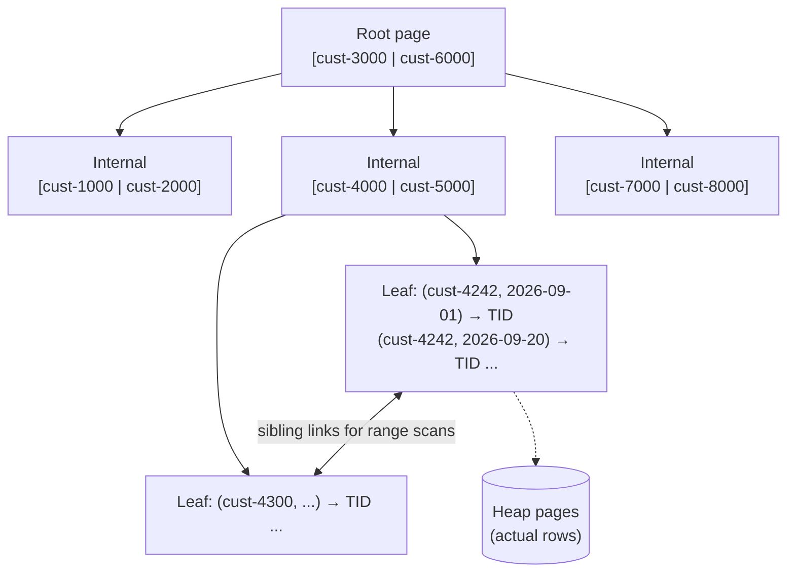
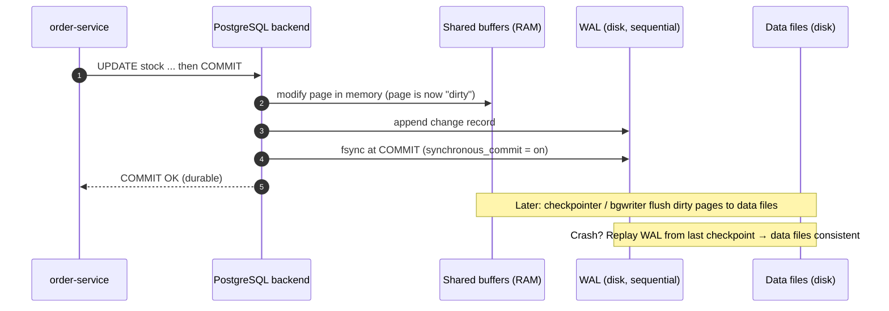
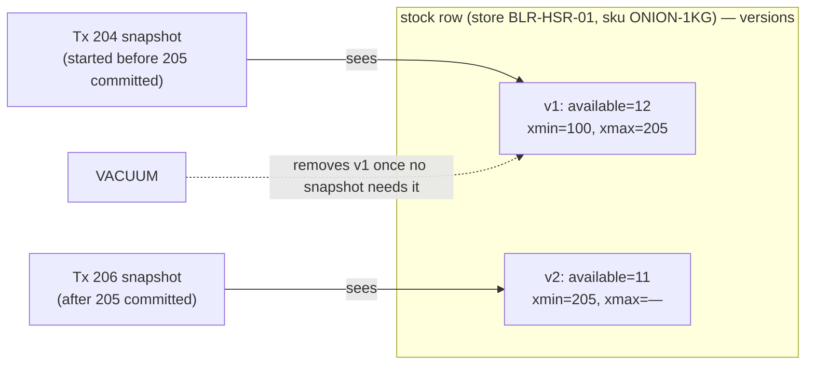
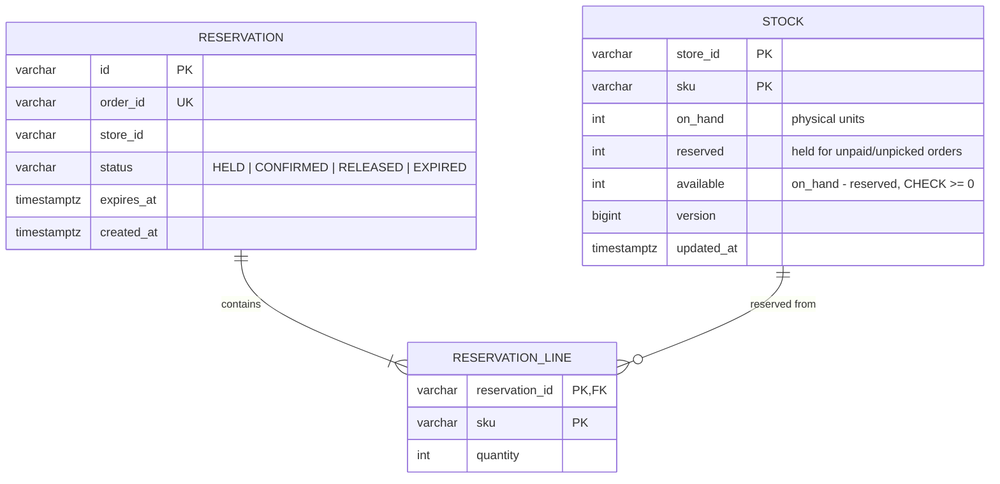
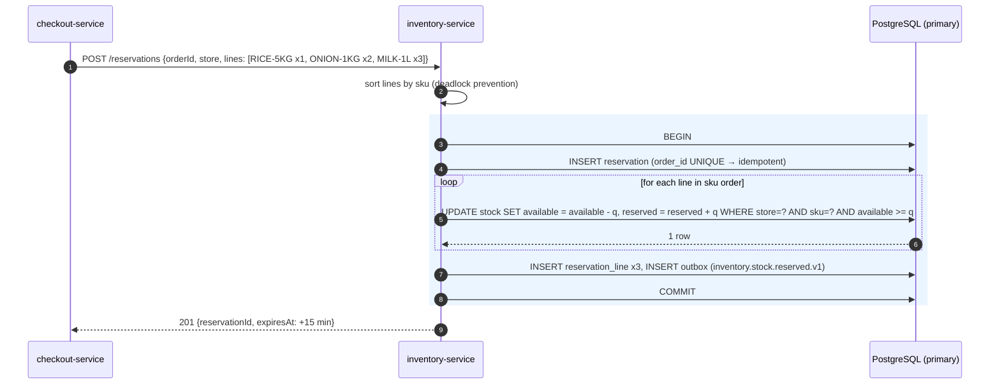
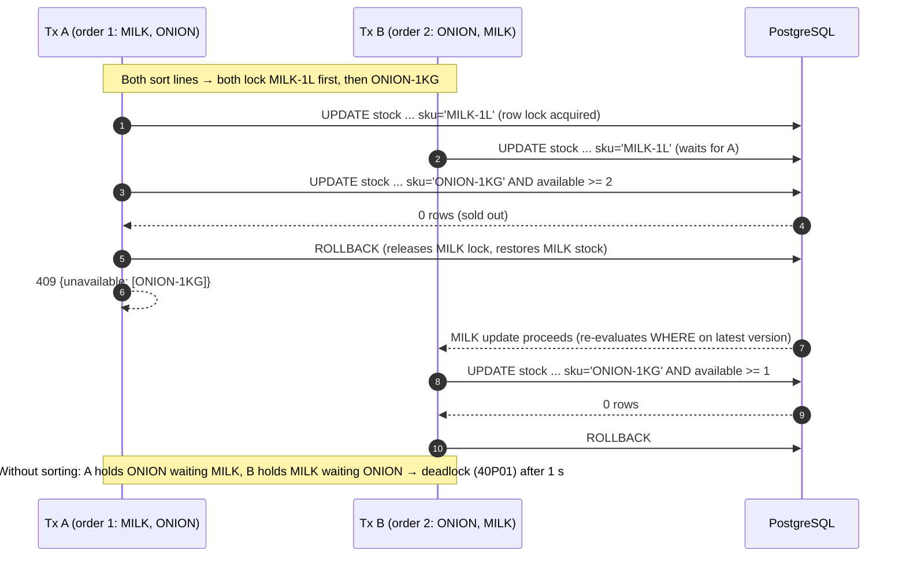
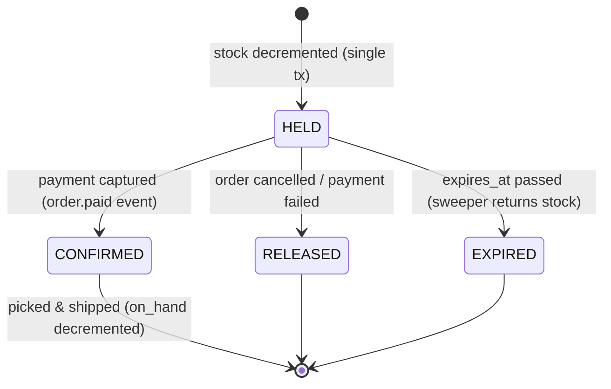
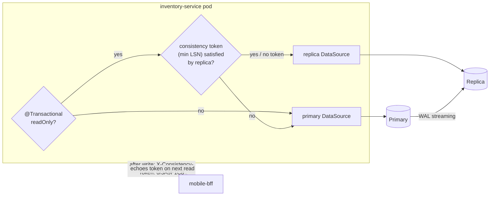

# 05. Relational Databases Deep Dive ⭐

!!! abstract "Chapter at a glance"
    **Reader bands:** B1 → B4 · **Prerequisites:** [Ch 02](02-back-of-the-envelope-estimation.md), [Ch 04](04-api-design.md) · **What you will build:** Dark-store stock reservation, taken from a lost-update demonstration (L1) to a production PostgreSQL design with atomic conditional updates, deadlock-free locking, N+1-free reads, sized pools, read-replica routing with read-your-writes, and partitioned history (L4) · **Reading time:** 110 min + code

---

## 1. Introduction & Why It Matters

### 1.1 A story: 1,800 orders for 600 packets of onions

The festival sale's headline deal was "₹1 onions, 1 kg, limit one per customer." Each of the 50 busiest dark stores had about 12 packets. Inventory code looked like this:

```java
Stock s = stockRepository.findByStoreIdAndSku(storeId, sku);   // SELECT
if (s.getAvailable() >= qty) {
    s.setAvailable(s.getAvailable() - qty);                    // compute in Java
    stockRepository.save(s);                                   // UPDATE ... SET available = <value computed in Java>
    confirm(order);
}
```

The code had `@Transactional`, and the database was PostgreSQL at its default isolation level, READ COMMITTED. Every test passed. In production, **1,800 orders were confirmed for 600 packets**. Pickers found empty shelves, and 1,200 customers received a "sorry, item unavailable" call after paying.

Nothing was "wrong" with the database. At READ COMMITTED, two transactions can read the same `available = 12`, both compute 11, and both write 11. That's a **lost update**, and it's allowed at that isolation level. `@Transactional` doesn't make read-modify-write safe.

The fix was one SQL statement:

```sql
UPDATE stock SET available = available - :qty
WHERE store_id = :store AND sku = :sku AND available >= :qty;   -- 1 row = reserved, 0 rows = sold out
```

!!! quote "The thesis of this chapter"
    A relational database gives you powerful guarantees, but only the ones you **actually ask for**. Knowing what ACID, isolation levels, MVCC, locks and indexes really do is the difference between a system that is correct and fast, and one that is neither under load.

### 1.2 Where this lives in the grocery platform

| Service | Relational concern |
|---|---|
| `inventory-service` | Concurrent reservations, hot rows, lost updates, deadlocks |
| `order-service` | Transactions spanning order + items + outbox; history queries; partitioning |
| `payment-service`, `wallet-service` | Ledger correctness (double entry), serializable invariants, idempotency (Ch 04) |
| `catalog-service` | Read-heavy; read replicas; denormalized read models |
| `slot-service` | Capacity counters per slot (same pattern as stock) |
| Every Spring service | JPA/Hibernate pitfalls, connection pools, transaction boundaries |

### 1.3 Learning objectives

| Band | After this chapter you can… |
|---|---|
| <span class="band b1">B1</span> | Explain ACID, tables and indexes, normalization, and read a basic `EXPLAIN` |
| <span class="band b2">B2</span> | Choose isolation levels, use optimistic/pessimistic locking, avoid N+1, and size connection pools |
| <span class="band b3">B3</span> | Reason about MVCC, WAL, B+ trees, vacuum, deadlocks and write skew, and design indexes from access patterns |
| <span class="band b4">B4</span> | Plan partitioning, read replicas with read-your-writes, online migrations, and when a single relational primary stops being enough |

---

## 2. Core Concepts — Beginner to Deep

### 2.1 Intuition: the stock register at a kirana shop <span class="band b1">B1</span>

A kirana shop owner keeps a ledger book:

- **Tables** are pages of the ledger with fixed columns.
- An **index** is the alphabetical tab strip on the side. Without it, you flip every page.
- A **transaction** is "write all of this sale, or none of it." You never record the payment without reducing the stock.
- **Isolation** is what happens when two assistants update the same line at once. Does one wait, does one see the other's half-written line, or does one quietly overwrite the other?
- The **WAL** is the rough notebook the owner writes in first, so that if the ledger gets wet, the day can be reconstructed.

### 2.2 ACID, precisely ⭐ <span class="band b1">B1</span> <span class="band b2">B2</span>

| Property | What it guarantees | What it does **not** guarantee | Mechanism (PostgreSQL) |
|---|---|---|---|
| **Atomicity** | All statements in a transaction commit, or none do | That concurrent transactions don't interfere | WAL + transaction status (commit log) |
| **Consistency** | Declared constraints hold after commit (PK, FK, UNIQUE, CHECK) | Business invariants you didn't declare ("no overselling") | Constraint checks |
| **Isolation** | Concurrent transactions behave as if isolated **to the degree of the chosen level** | Serializability, unless you choose it | MVCC snapshots + row locks + SSI |
| **Durability** | Committed data survives a crash | Survival of disk loss (that needs replication and backups) | WAL flushed (`fsync`) at commit |

!!! tip "Encode invariants in the database when you can"
    `CHECK (available >= 0)` on the stock table turns an oversell bug into a failed transaction instead of a silent inconsistency. Constraints are the cheapest correctness tests you'll ever write.

### 2.3 Storage internals: pages, heap, B+ trees, WAL <span class="band b2">B2</span> <span class="band b3">B3</span>

**Pages and heap.** PostgreSQL stores table rows in 8 KB **pages** in an unordered **heap**. Each row version (a *tuple*) has hidden header fields: `xmin` (the creating transaction) and `xmax` (the deleting or updating transaction). Those power MVCC (§2.7).

**B+ tree indexes.** The default index is a balanced tree of pages. Leaf pages hold sorted keys with pointers (TIDs) to heap tuples, and are linked for range scans.



| Property | Consequence for design |
|---|---|
| Height ~3–4 for millions to billions of rows (hundreds of keys per page) | Point lookups cost ~3–4 page reads, mostly cached |
| Sorted leaves | Range queries and `ORDER BY` on the index prefix are cheap |
| **Leftmost-prefix rule** | An index on `(customer_id, created_at)` helps `WHERE customer_id = ?` but not `WHERE created_at > ?` alone |
| Every index must be updated on insert/update | Indexes cost write throughput and storage (write amplification) |
| Random-key inserts (UUIDv4) split pages everywhere | Prefer time-ordered keys (UUIDv7, ULID, sequences) for large, insert-heavy tables (Ch 20) |

L1 (§5) shows the effect of a sorted structure: 2 M rows and a customer/date-range query take a **~60 ms scan vs ~1 ms seek** in plain Java. In a database the gap grows further once pages come from disk.

**Write-ahead log (WAL).**



| WAL fact | Why you care |
|---|---|
| Commit latency ≈ WAL fsync latency | Fast disks and group commit matter for write-heavy services |
| Replication ships WAL (physical) or decoded changes (logical) | Replicas and CDC (Debezium, Ch 13) read the WAL |
| `synchronous_commit = off` trades durability for latency | Acceptable for clickstream, never for orders or payments |
| Full-page writes after checkpoints spike WAL volume | Tune `checkpoint_timeout` and `max_wal_size` for write-heavy loads |

**Other storage engines:** MySQL InnoDB uses a **clustered index** (the table *is* the primary-key B+ tree, and secondary indexes point to the PK). That makes PK range scans very fast and random PKs very expensive. LSM-tree engines (RocksDB, Cassandra) trade read cost for write throughput (Ch 06).

### 2.4 Indexes: composite, covering, partial, and reading EXPLAIN ⭐ <span class="band b1">B1</span> → <span class="band b3">B3</span>

| Index type | Example | Use when |
|---|---|---|
| Single column | `(customer_id)` | One selective filter |
| **Composite** | `(customer_id, created_at DESC, id DESC)` | Filter + sort (keyset pagination, Ch 04) |
| **Covering** (`INCLUDE`) | `(store_id, sku) INCLUDE (available)` | Answer from the index alone (index-only scan) |
| **Partial** | `(expires_at) WHERE status = 'HELD'` | You only ever query a small subset, such as active reservations |
| Unique | `UNIQUE (order_id, sku)` | An invariant, plus a lookup |
| Expression | `(lower(email))` | Queries use the expression |
| GIN | `(tags) USING gin`, full-text, JSONB | Containment queries, arrays, JSONB |
| BRIN | `(created_at) USING brin` | Huge, naturally time-ordered append-only tables (tiny index) |

**Composite column order:** equality columns first, then range or sort columns: `(store_id, status, created_at)` for `WHERE store_id = ? AND status = ? ORDER BY created_at`. Put the most selective equality columns first when several queries share a prefix.

**Reading `EXPLAIN (ANALYZE, BUFFERS)`**, a representative plan (your numbers will differ):

```text
-- Before: no suitable index
Seq Scan on orders  (cost=0.00..48213.00 rows=11 width=96) (actual time=41.2..212.7 rows=9 loops=1)
  Filter: ((customer_id = 'cust-4242') AND (created_at >= '2026-09-01'))
  Rows Removed by Filter: 1999991
  Buffers: shared hit=1204 read=21809
Execution Time: 212.9 ms

-- After: CREATE INDEX CONCURRENTLY idx_orders_customer_keyset ON orders (customer_id, created_at DESC, id DESC);
Index Scan using idx_orders_customer_keyset on orders  (cost=0.43..12.61 rows=11 width=96) (actual time=0.031..0.044 rows=9 loops=1)
  Index Cond: ((customer_id = 'cust-4242') AND (created_at >= '2026-09-01'))
  Buffers: shared hit=5
Execution Time: 0.061 ms
```

| Plan node / field | Meaning | Red flag |
|---|---|---|
| `Seq Scan` | Reads the whole table | On large tables in OLTP paths |
| `Index Scan` / `Index Only Scan` | Uses the index (and heap unless index-only) | Index-only scans that still show heap fetches → vacuum/visibility map lagging |
| `Bitmap Heap Scan` | Collects many TIDs, then reads pages | Fine for medium selectivity |
| `Nested Loop` / `Hash Join` / `Merge Join` | Join strategies | Nested loop with a large outer side |
| `rows=` estimate vs `actual rows` | Planner estimate vs reality | 100× differences mean stale statistics (`ANALYZE`) or correlated columns |
| `Rows Removed by Filter` | Rows read and discarded | Large numbers mean a missing or wrong index |
| `Buffers: read=` | Pages read from disk | High reads on hot paths mean a working set larger than RAM |
| `Sort Method: external merge` | Sort spilled to disk | Increase `work_mem` for that query, or add an index for the order |

!!! warning "Index hygiene"
    Every index slows writes and consumes memory. Review `pg_stat_user_indexes` for `idx_scan = 0` (unused) and for duplicate prefixes. In production, create indexes with `CREATE INDEX CONCURRENTLY` to avoid blocking writes (§2.12).

### 2.5 Normalization vs denormalization <span class="band b1">B1</span> <span class="band b2">B2</span>

| Normal form | Rule of thumb | Violation example |
|---|---|---|
| 1NF | Atomic values, no repeating groups | `items = 'SKU1:2,SKU2:1'` in one column |
| 2NF | Non-key columns depend on the whole key | In `order_item(order_id, sku, product_name)`, `product_name` depends only on `sku` |
| 3NF | No dependency on non-key columns | `orders(customer_id, customer_city)` |
| BCNF | Every determinant is a candidate key | Rare in practice |

**Normalize by default** for write paths: one fact in one place means no update anomalies. **Denormalize deliberately** for reads, and keep it correct with a clear owner:

| Denormalization | Why it's correct in the grocery platform |
|---|---|
| `order_item.product_name`, `unit_price`, `gst_rate` copied at order time | **Historical truth**: the invoice must show the price and tax at purchase, not today's |
| `orders.delivery_address` snapshot (JSONB or columns) | The customer may edit their address later, and the order shouldn't change |
| `order_summary` read model in tracking (Ch 03) | A different service, a different access pattern, fed by events (Ch 15) |
| `stock.available` alongside `on_hand` and `reserved` | A derived counter kept by the same transaction, protected by `CHECK` |

!!! note "Snapshot vs reference"
    Ask "should this value change when the source changes?" If no (price at purchase, address at delivery), **snapshot** it. If yes (product description on the catalog page), **reference** it. Most "denormalization bugs" come from answering this question implicitly.

### 2.6 Isolation levels and anomalies ⭐ <span class="band b2">B2</span> <span class="band b3">B3</span>

| Anomaly | What happens | Grocery example |
|---|---|---|
| Dirty read | Read uncommitted data | See a stock decrement that later rolls back |
| Non-repeatable read | The same row read twice gives different values | Price changes between validating and charging |
| Phantom | The same query returns different row sets | Slot booking count changes mid-transaction |
| **Lost update** | Two read-modify-writes, one overwrites the other | §1.1 onion oversell |
| **Write skew** | Two transactions read overlapping data, write *different* rows, and together break an invariant | Two riders each check "≥ 1 rider on shift at this store" and both go off shift |

**What each level prevents in PostgreSQL** (it differs from the SQL standard table and from MySQL):

| Level (PostgreSQL) | Dirty read | Non-repeatable | Phantom | Lost update | Write skew | Notes |
|---|---|---|---|---|---|---|
| READ UNCOMMITTED | Prevented (treated as RC) | ❌ | ❌ | ❌ | ❌ | |
| **READ COMMITTED** (default) | ✅ | ❌ | ❌ | ❌ for read-modify-write in the app; ✅ for `SET x = x - 1` in SQL | ❌ | New snapshot per statement |
| REPEATABLE READ | ✅ | ✅ | ✅ (snapshot) | ✅ (errors with 40001 on concurrent update) | ❌ | Snapshot isolation |
| **SERIALIZABLE** | ✅ | ✅ | ✅ | ✅ | ✅ | SSI: may abort with 40001, so **retry** |

!!! danger "The single most important line in this section"
    At READ COMMITTED, `UPDATE stock SET available = available - 1 WHERE ... AND available >= 1` is **safe**. PostgreSQL re-evaluates the `WHERE` clause against the latest committed row after waiting for the row lock. The same logic written as SELECT, compute in Java, then UPDATE with a value is **not safe**. Push the arithmetic into the database, or lock, or use optimistic versioning.

**MySQL InnoDB differences:** the default is REPEATABLE READ, and plain SELECTs read a consistent snapshot. `SELECT … FOR UPDATE` and UPDATEs read the latest data and take **gap and next-key locks** to prevent phantoms, which is a frequent source of unexpected lock waits and deadlocks on range predicates.

### 2.7 MVCC: how readers don't block writers <span class="band b3">B3</span>

With **Multi-Version Concurrency Control**, an UPDATE writes a **new tuple version** and marks the old one with `xmax`. Each transaction reads the versions visible to its **snapshot**.



| Consequence | Design implication |
|---|---|
| Readers never block writers, and writers never block readers | Great concurrency for mixed workloads |
| Writers to the **same row** still serialize on the row lock | Hot rows (the ₹1 onion) are throughput-limited |
| Dead tuples accumulate | **VACUUM / autovacuum** must keep up, or tables and indexes bloat |
| **Long-running transactions** keep old snapshots alive | They block vacuum everywhere, and bloat grows. Kill idle-in-transaction sessions (`idle_in_transaction_session_timeout`) |
| HOT updates (heap-only tuples) avoid index updates when no indexed column changes and the page has room | Keep frequently updated columns (`available`) out of indexes when possible, and use `fillfactor` < 100 for hot tables |
| Transaction ID wraparound | Vacuum must freeze old tuples. Monitor `age(datfrozenxid)` |

### 2.8 Locking: optimistic vs pessimistic ⭐ <span class="band b2">B2</span> <span class="band b3">B3</span>

| Strategy | How | Best when | Cost |
|---|---|---|---|
| **Atomic conditional update** | `UPDATE … SET x = x - n WHERE … AND x >= n` | Counters and simple invariants on one row | One statement, and the row lock is held briefly. **Default choice** |
| **Optimistic** (version) | `UPDATE … WHERE id = ? AND version = ?`, where 0 rows means a conflict (JPA `@Version`) | Low contention, user-facing edits (Ch 04 ETags) | Retries under contention; wasted work |
| **Pessimistic** | `SELECT … FOR UPDATE` then update | Multi-row read-then-decide logic that can't be one statement | Holds locks for the transaction duration; deadlock risk |
| `FOR UPDATE SKIP LOCKED` | Take the next unlocked rows | Work queues (outbox relay, webhook worker) | Not for correctness checks on specific rows |
| `FOR UPDATE NOWAIT` | Fail immediately if locked | UI "someone else is editing" | Error handling |
| Advisory locks | `pg_advisory_xact_lock(key)` | Serializing a logical operation that isn't a row | Easy to misuse; must be scoped |
| SERIALIZABLE | Let SSI detect conflicts | Complex invariants across rows (write skew) | Aborts under contention; needs retry loops |

**Deadlocks.** Transaction A locks row 1 and waits for row 2, while B locks row 2 and waits for row 1. PostgreSQL detects this after `deadlock_timeout` (1 s by default) and aborts one of them.

- **Prevention:** lock rows in a **consistent order**. For a multi-SKU order, sort lines by `sku` before updating.
- **Mitigation:** keep transactions short, and retry on SQLSTATE `40P01`.

### 2.9 JPA / Hibernate pitfalls ⭐ <span class="band b2">B2</span> <span class="band b3">B3</span>

| Pitfall | Symptom | Fix |
|---|---|---|
| **N+1 selects** | Loading 20 orders fires 1 + 20 item queries (+ 20 more for each lazy association touched) | `JOIN FETCH` / `@EntityGraph` for single queries; `@BatchSize` / `hibernate.default_batch_fetch_size` for collections; DTO projections for read APIs |
| **Collection fetch + pagination** | Hibernate warns it's paginating in memory (HHH90003004) and loads everything | Two queries: page the parent ids (keyset), then fetch children `WHERE order_id IN (…)` |
| **Open Session in View** (on by default in Spring Boot) | Lazy loads fire during JSON serialization, outside your transaction, holding a connection for the whole request | `spring.jpa.open-in-view=false`; fetch what you need in the service layer |
| `LazyInitializationException` | Accessing a lazy association after the transaction closed | Fetch explicitly in the query; don't return entities from services |
| **IDENTITY ids disable insert batching** | 1,000 inserts = 1,000 round trips | Use `SEQUENCE` with a pooled optimizer (`allocationSize = 50`), plus `hibernate.jdbc.batch_size` and `order_inserts` |
| Dirty checking on large sessions | Slow flushes, high CPU | `@Transactional(readOnly = true)` for reads; projections instead of managed entities |
| Read-modify-write via entities | Lost updates (§1.1) | `@Version`, or `@Modifying @Query("update … set x = x - :n where … and x >= :n")` |
| `@Transactional` on private methods / self-invocation | Silently no transaction | Call through the Spring proxy; transactions on public service methods |
| Long transactions around remote calls | Connections held for seconds; pool exhaustion | Do remote calls **outside** the transaction; keep transactions to DB work only |
| `CascadeType.ALL` + `orphanRemoval` everywhere | Unexpected deletes, huge cascades | Cascade only within an aggregate (Ch 33) |
| Entities in `equals/hashCode` on generated ids | Broken sets before persist | Use a business key or id-based equality done carefully |

**Detecting N+1 early:** enable Hibernate statistics or a datasource proxy in tests, and **assert the query count** for key endpoints (L2/L3 below).

### 2.10 Connection pooling: sizing HikariCP ⭐ <span class="band b2">B2</span> <span class="band b3">B3</span>

Two constraints must both hold:

1. **App side (Little's Law, Ch 02):** busy connections = request rate × DB time per request. At 850 checkouts/s × 20 ms that's ~17 across the fleet.
2. **Database side:** PostgreSQL does best with a **small** number of active connections, roughly a small multiple of CPU cores. HikariCP's guidance starts from `connections ≈ (cores × 2) + effective_spindle_count` **for the whole database**. Beyond that, adding connections adds contention (context switching, lock waits), not throughput.

| Setting | Guidance |
|---|---|
| `maximum-pool-size` | From Little's Law per pod × headroom, **and** Σ pods × pool ≤ DB budget (Ch 02 connection budget) |
| `minimum-idle` | Equal to max (fixed-size pool) for predictable latency, unless many pods idle |
| `connection-timeout` | 250 ms–1 s: fail fast instead of queuing behind a sick DB |
| `max-lifetime` | Below any network or DB idle kill (for example 25–30 min), with jitter built in |
| `idle-timeout` | Only relevant when `minimum-idle` < max |
| `leak-detection-threshold` | 2–5 s in staging to catch connections held across remote calls |
| Statement timeout | `SET statement_timeout` per role or query: no query should run unbounded on an OLTP path |
| PgBouncer (transaction mode) | When Σ pods × pool exceeds what PostgreSQL should hold. Breaks session features (session-level prepared statements in older setups, `SET`, advisory session locks, `LISTEN`) |

!!! tip "Virtual threads make pool limits more important, not less"
    With virtual threads, thousands of requests can run concurrently. The **connection pool becomes the concurrency limiter** for the database. That's good, as long as the pool is sized deliberately and `connection-timeout` is short.

### 2.11 Read replicas and replication lag <span class="band b3">B3</span> <span class="band b4">B4</span>

Streaming replicas apply the primary's WAL asynchronously (typically milliseconds, sometimes seconds under load, or much longer during long queries on the replica).

| Read type | Where | Why |
|---|---|---|
| Right after the user's own write ("my order just placed") | **Primary**, or a replica that has caught up to the write's LSN | Read-your-writes |
| Decision reads inside a transaction (stock check) | Primary | Must be current |
| Browsing catalog, reports, order history older than a few seconds | Replica | Offload the primary |
| Analytics and exports | A separate analytics replica or warehouse (Ch 21) | Long queries on OLTP replicas cause replay lag or query cancellation |

**Read-your-writes techniques:** route by `@Transactional(readOnly)` plus "sticky to primary for N seconds after a write" (session or cookie); or compare the write's LSN (`pg_current_wal_lsn()`) with the replica's `pg_last_wal_replay_lsn()` (precise, implemented in L4).

### 2.12 Schema changes without downtime <span class="band b3">B3</span> <span class="band b4">B4</span>

| Operation | Safe? (PostgreSQL) | Safe approach |
|---|---|---|
| Add nullable column | ✅ Fast (metadata only) | — |
| Add column with constant default | ✅ Fast since PG 11 | — |
| Add NOT NULL to an existing column | ⚠️ Scans the table under a strong lock | Add `CHECK (col IS NOT NULL) NOT VALID`, then `VALIDATE CONSTRAINT`, then `SET NOT NULL` |
| Create index | ⚠️ Blocks writes | `CREATE INDEX CONCURRENTLY` (outside a transaction; retry if it fails, drop the INVALID leftovers) |
| Add foreign key | ⚠️ Validates under lock | `NOT VALID`, then `VALIDATE CONSTRAINT` separately |
| Rename or drop a column used by running code | ❌ Breaks old pods | Expand → migrate → contract across releases (Ch 28) |
| Change column type | ❌ Often rewrites the table | New column + backfill + switch |

Always set `lock_timeout` for migrations (for example 5 s), so a migration waiting behind a long transaction doesn't queue every subsequent query behind itself.

### 2.13 When one relational primary isn't enough <span class="band b4">B4</span>

| Pressure | First moves | Later moves |
|---|---|---|
| Read QPS | Caching (Ch 07), read replicas, read models | CQRS projections (Ch 15) |
| Write QPS on one primary | Batching, fewer indexes, HOT updates, bigger instance | Functional partitioning (a DB per service), then sharding (Ch 11) |
| Table size (TB) | Partitioning by time, archiving | Sharding, moving cold data to a warehouse |
| Hot rows | Atomic updates, short transactions | Row splitting (buckets), queuing, reservation redesign (Ch 46) |
| Global distribution | Regional read replicas | Distributed SQL (CockroachDB, YugabyteDB, Spanner-style) with latency trade-offs |

---

## 3. Architecture & Diagrams

### 3.1 Data model: inventory reservation



### 3.2 Sequence: happy path, reserve a multi-item order



### 3.3 Sequence: failure path, a line is sold out, concurrent buyer, and a deadlock avoided



!!! note "What the system guarantees after this failure path"
    `available` never goes below zero (conditional update plus `CHECK`). A partially reservable order reserves **nothing**: the transaction rolls back and returns the unavailable SKUs so the app can offer substitutions. Consistent lock ordering removes the deadlock class entirely. Any remaining 40P01/40001 errors are retried a bounded number of times.

### 3.4 State: reservation lifecycle



---

## 4. Design Document Excerpt: Inventory Reservation Storage

| Field | Value |
|---|---|
| Author / Reviewers | Inventory team / Checkout, SRE, DBA guild |
| Status | Approved |
| Related ADRs | ADR-024 Atomic conditional updates for counters; ADR-025 Replica routing with LSN-based read-your-writes |

**1. Context & Problem.** A read-modify-write in JPA oversold flash-sale items 3× (§1.1). Deadlocks appeared on multi-item orders during peaks, and order-history queries loaded items with N+1 selects.

**2. Goals / Non-Goals.**

- *Goals:* never oversell; reserve all-or-nothing; no deadlocks by construction; p99 reservation ≤ 50 ms at P90 load; history reads offloaded to replicas without breaking read-your-writes.
- *Non-goals:* a national single-SKU flash deal above hot-row limits (Ch 46 bucketing/queueing); multi-region writes (Ch 27).

**3. Requirements.**

| ID | Requirement |
|---|---|
| FR-1 | Reserve all lines of an order at one store, or none |
| FR-2 | Confirm, release and expire reservations |
| NFR-1 | Invariant: `available >= 0` and `available = on_hand - reserved`, enforced in the DB |
| NFR-2 | Reservation p99 ≤ 50 ms; retry on 40P01/40001 at most 3 times |
| NFR-3 | Reserving the same order twice is idempotent (`order_id` UNIQUE) |
| NFR-4 | Expired holds return stock within 60 s of `expires_at` |
| NFR-5 | Order/stock views after a user's write reflect that write (read-your-writes) |

**4. Capacity estimates.**

| Item | Estimate |
|---|---|
| Stock rows | 500 stores × ~6,000 SKUs = **3 M rows**, ~150 B each ≈ 450 MB + indexes, so it fits in RAM |
| Reservations at P90 peak | ~420 orders/s × 1.2 attempts ≈ 500/s |
| Row updates at peak | 500/s × ~8 lines ≈ **4 K stock UPDATEs/s** + 4 K line inserts + 500 reservation inserts + 500 outbox inserts ≈ **~9 K writes/s** |
| Hottest row | ~50 reservations/s on one store-SKU (Ch 02) vs ~500–1,000/s row-lock capacity: OK |
| Transaction duration | ~8 short statements ≈ 5–10 ms |
| Busy connections | 500 tx/s × 10 ms ≈ **5** (Little's Law); pools: 6 pods × 8 = 48 ≤ budget |
| WAL volume | ~9 K writes/s × ~200 B ≈ 1.8 MB/s (+ full-page writes) |

!!! success "What the estimate tells us"
    One PostgreSQL primary handles this comfortably. The dataset fits in memory, and ~9 K writes/s is well within a tuned 8–16 vCPU instance. The risks are **correctness** (lost updates, deadlocks) and **hot rows**, not raw capacity.

**5.3 Schema.**

```sql
CREATE TABLE stock (
    store_id    VARCHAR(32)  NOT NULL,
    sku         VARCHAR(64)  NOT NULL,
    on_hand     INT          NOT NULL CHECK (on_hand >= 0),
    reserved    INT          NOT NULL DEFAULT 0 CHECK (reserved >= 0),
    available   INT          NOT NULL CHECK (available >= 0),
    version     BIGINT       NOT NULL DEFAULT 0,
    updated_at  TIMESTAMPTZ  NOT NULL DEFAULT now(),
    PRIMARY KEY (store_id, sku),
    CONSTRAINT stock_available_consistent CHECK (available = on_hand - reserved)
) WITH (fillfactor = 80);        -- room on each page for HOT updates of the hot counters

CREATE TABLE reservation (
    id          VARCHAR(40)  PRIMARY KEY,
    order_id    VARCHAR(64)  NOT NULL UNIQUE,
    store_id    VARCHAR(32)  NOT NULL,
    status      VARCHAR(16)  NOT NULL,
    expires_at  TIMESTAMPTZ  NOT NULL,
    created_at  TIMESTAMPTZ  NOT NULL DEFAULT now()
);
-- Only HELD reservations are ever swept: a tiny partial index instead of a big one
CREATE INDEX idx_reservation_held_expiry ON reservation (expires_at) WHERE status = 'HELD';

CREATE TABLE reservation_line (
    reservation_id VARCHAR(40) NOT NULL REFERENCES reservation(id),
    sku            VARCHAR(64) NOT NULL,
    quantity       INT         NOT NULL CHECK (quantity > 0),
    PRIMARY KEY (reservation_id, sku)
);
```

**7. Alternatives considered.**

| Option | Pros | Cons | Verdict |
|---|---|---|---|
| JPA read-modify-write (status quo) | Familiar | Lost updates at READ COMMITTED | Rejected (incident) |
| `@Version` optimistic locking | Detects conflicts | Hot rows cause retry storms (50 conflicts/s on one row) | Rejected for counters; kept for admin edits |
| `SELECT … FOR UPDATE` then compute | Explicit | Longer lock hold, more round trips | Used only where logic can't be a single UPDATE |
| SERIALIZABLE for everything | Strongest | Aborts under contention; retry complexity everywhere | Reserved for ledger invariants (Ch 45) |
| **Atomic conditional UPDATE, sorted lock order, CHECK constraints** | One round trip per line, minimal lock time, DB-enforced invariant | Hot-row ceiling remains | **Chosen** |
| Redis counters (DECRBY) | Very fast | Not in the same transaction as the reservation and outbox; durability | Rejected for the source of truth (Ch 46 discusses a Redis front-gate) |

**8. Failure modes.** A deadlock (shouldn't happen, given ordering) or a serialization failure: bounded retry with jitter. A primary failover: in-flight transactions abort, and clients retry with idempotency (`order_id` unique). Autovacuum falling behind on `stock`: bloat and slower updates, so tune per-table autovacuum thresholds and monitor dead tuples. A sweeper crash: holds expire late, bounded by the alert on "HELD past expiry > 60 s".

**10. Observability.** `inventory.reservation{outcome=reserved|partial_unavailable|retry}`, lock wait time (`pg_stat_activity` wait events), `deadlocks` from `pg_stat_database`, dead tuples on `stock`, replication lag, Hikari active/pending, and slow-query log for anything > 50 ms.

**14. Decision (ADR-024 summary).** All counters with invariants (stock, slot capacity, coupon usage) are changed with a single conditional `UPDATE … SET x = x ± n WHERE … AND <invariant>` inside short transactions. Multi-row updates lock in a deterministic order. Invariants are declared as `CHECK` constraints. Read-modify-write of counters in application code is prohibited, and a code review checklist plus ArchUnit rule flag `save()` on counter entities.

---

## 5. Hands-On Code — Level Ladder

We build **dark-store stock reservation** four times:

| Level | New requirement that forces the step |
|---|---|
| L1 | "Show why read-modify-write oversells, and why indexes matter." (plain Java simulation) |
| L2 | "Reserve stock through Spring/JPA the 'usual' way, and show order history efficiently." |
| L3 | "Never oversell, never deadlock, all-or-nothing, idempotent, bounded queries, sized pools, proven by concurrent tests." |
| L4 | "Offload reads to replicas without breaking read-your-writes; partition history; change schemas online." |

### L1 — Concept (plain Java) <span class="band b1">B1</span>

```java
// StockReservationL1.java — run with: java StockReservationL1.java
// Two database ideas simulated in plain Java:
//   A. Lost updates: "read, compute, write" vs an atomic conditional update ("UPDATE ... WHERE available >= n")
//   B. Why indexes matter: a sorted structure (like a B+ tree) vs a full scan for a range query
import java.util.*;
import java.util.concurrent.*;
import java.util.concurrent.atomic.AtomicInteger;

public class StockReservationL1 {

    // ---------- A. Lost update ----------

    /** A "row" whose reads and writes are individually atomic, like single SQL statements. */
    static final class StockRow {
        private volatile int available;
        StockRow(int available) { this.available = available; }

        int select() { return available; }                         // SELECT available ...
        void update(int newValue) { available = newValue; }        // UPDATE ... SET available = :newValue

        /** UPDATE stock SET available = available - :n WHERE available >= :n  → rows affected (0 or 1) */
        synchronized int conditionalDecrement(int n) {
            if (available >= n) { available -= n; return 1; }
            return 0;
        }
    }

    static int[] runBuyers(StockRow row, int buyers, boolean atomic) throws InterruptedException {
        AtomicInteger confirmed = new AtomicInteger();
        CountDownLatch start = new CountDownLatch(1);
        try (ExecutorService pool = Executors.newVirtualThreadPerTaskExecutor()) {
            for (int i = 0; i < buyers; i++) {
                pool.submit(() -> {
                    start.await();
                    if (atomic) {
                        if (row.conditionalDecrement(1) == 1) confirmed.incrementAndGet();
                    } else {
                        int seen = row.select();                    // read
                        if (seen >= 1) {
                            Thread.sleep(1);                        // app does I/O between read and write (pricing, validation)
                            row.update(seen - 1);                   // write based on a stale read
                            confirmed.incrementAndGet();
                        }
                    }
                    return null;
                });
            }
            start.countDown();
        }
        return new int[]{confirmed.get(), row.select()};
    }

    // ---------- B. Index vs scan ----------

    record OrderRow(long id, String customerId, long createdAtEpoch) { }

    public static void main(String[] args) throws Exception {
        System.out.println("A. 500 buyers race for 100 units of '₹1 onions'");
        int[] naive = runBuyers(new StockRow(100), 500, false);
        System.out.printf("   read-modify-write : %d orders confirmed, stock left %d  → %d OVERSOLD, %d lost updates%n",
                naive[0], naive[1], Math.max(0, naive[0] - 100), naive[0] - (100 - naive[1]));
        int[] atomic = runBuyers(new StockRow(100), 500, true);
        System.out.printf("   conditional UPDATE: %d orders confirmed, stock left %d  → correct%n", atomic[0], atomic[1]);

        System.out.println("B. Find one customer's orders in a date range among 2,000,000 rows");
        Random rnd = new Random(42);
        List<OrderRow> heap = new ArrayList<>(2_000_000);                     // table without an index
        NavigableMap<String, NavigableMap<Long, OrderRow>> index = new TreeMap<>();   // (customer_id, created_at)
        for (long i = 0; i < 2_000_000; i++) {
            var r = new OrderRow(i, "cust-" + rnd.nextInt(200_000), 1_780_000_000L + rnd.nextInt(30_000_000));
            heap.add(r);
            index.computeIfAbsent(r.customerId(), k -> new TreeMap<>()).put(r.createdAtEpoch() * 10_000_000L + i, r);
        }
        String who = "cust-4242";
        long from = 1_790_000_000L, to = 1_800_000_000L;

        long t0 = System.nanoTime();
        long scanHits = heap.stream().filter(r -> r.customerId().equals(who)
                && r.createdAtEpoch() >= from && r.createdAtEpoch() < to).count();
        long scanMicros = (System.nanoTime() - t0) / 1_000;

        t0 = System.nanoTime();
        long idxHits = index.getOrDefault(who, new TreeMap<>())
                .subMap(from * 10_000_000L, true, to * 10_000_000L, false).size();
        long idxMicros = Math.max(1, (System.nanoTime() - t0) / 1_000);

        System.out.printf("   full scan : %d rows matched in %,d µs (touched 2,000,000 rows)%n", scanHits, scanMicros);
        System.out.printf("   index seek: %d rows matched in %,d µs (touched ~%d rows)%n", idxHits, idxMicros, idxHits);
    }
}
```

Actual output from running it:

```text
A. 500 buyers race for 100 units of '₹1 onions'
   read-modify-write : 500 orders confirmed, stock left 99  → 400 OVERSOLD, 499 lost updates
   conditional UPDATE: 100 orders confirmed, stock left 0  → correct
B. Find one customer's orders in a date range among 2,000,000 rows
   full scan : 3 rows matched in 59,636 µs (touched 2,000,000 rows)
   index seek: 3 rows matched in 1,012 µs (touched ~3 rows)
```

**What L1 shows:** when there's I/O between the read and the write (as in every real service), 500 "successful" orders go out for 100 units. The atomic "decrement only if enough" version is exactly right. A sorted index turns a 2 M-row scan into a handful of lookups.

**What L1 can't do:** it's not a database. There's no durability, no transactions across several rows, no isolation levels, and no crash recovery.

### L2 — Spring Data JPA, the "usual" way <span class="band b2">B2</span>

```kotlin
// build.gradle.kts (module l2-spring)
dependencies {
    implementation("org.springframework.boot:spring-boot-starter-web")      // VERIFY: Boot 4 starter name
    implementation("org.springframework.boot:spring-boot-starter-data-jpa")
    implementation("org.flywaydb:flyway-core")
    implementation("org.flywaydb:flyway-database-postgresql")
    runtimeOnly("org.postgresql:postgresql")
    testImplementation("org.springframework.boot:spring-boot-starter-test")
    testImplementation("org.springframework.boot:spring-boot-testcontainers")
    testImplementation("org.testcontainers:postgresql")                     // VERIFY: 2.x artifact names
}
```

=== "Entities"

    ```java
    package com.grocery.inventory.domain;

    import jakarta.persistence.*;
    import java.io.Serializable;

    @Entity
    @Table(name = "stock")
    @IdClass(Stock.Key.class)
    public class Stock {

        public record Key(String storeId, String sku) implements Serializable { }   // VERIFY: record @IdClass (Hibernate 6.2+)

        @Id @Column(name = "store_id") private String storeId;
        @Id private String sku;
        @Column(name = "on_hand") private int onHand;
        private int reserved;
        private int available;
        @Version private long version;

        protected Stock() { }

        public int getAvailable() { return available; }
        public String getSku() { return sku; }

        /** ⚠️ L2: in-memory arithmetic on a managed entity = read-modify-write. */
        public void reserve(int qty) {
            if (available < qty) throw new InsufficientStockException(sku);
            available -= qty;
            reserved += qty;
        }
    }
    ```

    ```java
    package com.grocery.inventory.domain;

    import jakarta.persistence.*;
    import java.time.Instant;
    import java.util.ArrayList;
    import java.util.List;

    @Entity
    @Table(name = "reservation")
    public class Reservation {

        @Id private String id;
        @Column(name = "order_id", unique = true) private String orderId;
        @Column(name = "store_id") private String storeId;
        private String status;
        @Column(name = "expires_at") private Instant expiresAt;
        @Column(name = "created_at") private Instant createdAt;

        @OneToMany(mappedBy = "reservation", cascade = CascadeType.ALL, orphanRemoval = true)
        private List<ReservationLine> lines = new ArrayList<>();          // LAZY by default for collections

        protected Reservation() { }

        public Reservation(String id, String orderId, String storeId, Instant expiresAt, Instant now) {
            this.id = id; this.orderId = orderId; this.storeId = storeId;
            this.status = "HELD"; this.expiresAt = expiresAt; this.createdAt = now;
        }

        public void addLine(String sku, int qty) { lines.add(new ReservationLine(this, sku, qty)); }
        public String getId() { return id; }
        public String getOrderId() { return orderId; }
        public String getStatus() { return status; }
        public List<ReservationLine> getLines() { return lines; }
    }
    ```

    ```java
    package com.grocery.inventory.domain;

    import jakarta.persistence.*;

    @Entity
    @Table(name = "reservation_line")
    @IdClass(ReservationLine.Key.class)
    public class ReservationLine {

        public record Key(String reservation, String sku) implements java.io.Serializable { }

        @Id @ManyToOne(fetch = FetchType.LAZY) @JoinColumn(name = "reservation_id") private Reservation reservation;
        @Id private String sku;
        private int quantity;

        protected ReservationLine() { }
        ReservationLine(Reservation r, String sku, int quantity) { this.reservation = r; this.sku = sku; this.quantity = quantity; }

        public String getSku() { return sku; }
        public int getQuantity() { return quantity; }
    }
    ```

=== "Repositories (N+1 and its fix)"

    ```java
    package com.grocery.inventory.repository;

    import com.grocery.inventory.domain.Stock;
    import org.springframework.data.jpa.repository.JpaRepository;

    public interface StockRepository extends JpaRepository<Stock, Stock.Key> { }
    ```

    ```java
    package com.grocery.inventory.repository;

    import com.grocery.inventory.domain.Reservation;
    import org.springframework.data.domain.Limit;
    import org.springframework.data.jpa.repository.EntityGraph;
    import org.springframework.data.jpa.repository.JpaRepository;
    import java.util.List;

    public interface ReservationRepository extends JpaRepository<Reservation, String> {

        /** N+1: touching getLines() on each result fires one extra SELECT per reservation. */
        List<Reservation> findByStoreIdOrderByCreatedAtDesc(String storeId, Limit limit);

        /** Fix for small pages: fetch lines in the same query. (Don't combine collection fetch with pagination on large sets — see L3.) */
        @EntityGraph(attributePaths = "lines")
        List<Reservation> findWithLinesByStoreIdOrderByCreatedAtDesc(String storeId, Limit limit);
    }
    ```

=== "Service (lost-update bug)"

    ```java
    package com.grocery.inventory.service;

    import com.grocery.inventory.domain.*;
    import com.grocery.inventory.repository.*;
    import org.springframework.stereotype.Service;
    import org.springframework.transaction.annotation.Transactional;
    import java.time.*;
    import java.util.Map;
    import java.util.UUID;

    @Service
    public class ReservationServiceL2 {

        private final StockRepository stock;
        private final ReservationRepository reservations;
        private final Clock clock;

        public ReservationServiceL2(StockRepository stock, ReservationRepository reservations, Clock clock) {
            this.stock = stock; this.reservations = reservations; this.clock = clock;
        }

        /**
         * ⚠️ Looks correct, isn't (at scale):
         *  - findById + reserve() + flush = read-modify-write. With @Version, concurrent buyers get
         *    ObjectOptimisticLockingFailureException instead of overselling — correct, but at 50 buyers/s on one row
         *    most requests fail and retry (a retry storm). WITHOUT @Version, this oversells (§1.1).
         *  - Lines are processed in request order → deadlock-prone for multi-item orders.
         */
        @Transactional
        public Reservation reserve(String orderId, String storeId, Map<String, Integer> lines) {
            Instant now = Instant.now(clock);
            var r = new Reservation("res_" + UUID.randomUUID(), orderId, storeId, now.plus(Duration.ofMinutes(15)), now);
            lines.forEach((sku, qty) -> {
                Stock s = stock.findById(new Stock.Key(storeId, sku)).orElseThrow(() -> new InsufficientStockException(sku));
                s.reserve(qty);
                r.addLine(sku, qty);
            });
            return reservations.save(r);
        }
    }
    ```

    ```java
    package com.grocery.inventory.domain;

    public class InsufficientStockException extends RuntimeException {
        public InsufficientStockException(String sku) { super("Insufficient stock for " + sku); }
    }
    ```

=== "Test: count the queries"

    ```java
    package com.grocery.inventory;

    import com.grocery.inventory.repository.ReservationRepository;
    import jakarta.persistence.EntityManagerFactory;
    import org.hibernate.SessionFactory;
    import org.hibernate.stat.Statistics;
    import org.junit.jupiter.api.*;
    import org.springframework.beans.factory.annotation.Autowired;
    import org.springframework.boot.test.context.SpringBootTest;
    import org.springframework.boot.testcontainers.service.connection.ServiceConnection;
    import org.springframework.data.domain.Limit;
    import org.springframework.transaction.support.TransactionTemplate;
    import org.testcontainers.containers.PostgreSQLContainer;   // VERIFY: package in Testcontainers 2.x
    import org.testcontainers.junit.jupiter.*;
    import static org.assertj.core.api.Assertions.assertThat;

    @SpringBootTest(properties = {"spring.jpa.properties.hibernate.generate_statistics=true",
                                  "spring.jpa.open-in-view=false"})
    @Testcontainers
    class NPlusOneIT {

        @Container @ServiceConnection
        static PostgreSQLContainer<?> pg = new PostgreSQLContainer<>("postgres:17-alpine");

        @Autowired ReservationRepository repo;
        @Autowired EntityManagerFactory emf;
        @Autowired TransactionTemplate tx;

        Statistics stats;

        @BeforeEach
        void seed() {
            stats = emf.unwrap(SessionFactory.class).getStatistics();
            // ... insert 20 reservations with 3 lines each for store BLR-HSR-01 (omitted: Flyway test data V100__seed.sql)
            stats.clear();
        }

        @Test
        void naiveQueryIsNPlusOne_entityGraphIsOne() {
            tx.executeWithoutResult(s -> repo.findByStoreIdOrderByCreatedAtDesc("BLR-HSR-01", Limit.of(20))
                    .forEach(r -> r.getLines().size()));
            assertThat(stats.getPrepareStatementCount()).isEqualTo(21);    // 1 + 20

            stats.clear();
            tx.executeWithoutResult(s -> repo.findWithLinesByStoreIdOrderByCreatedAtDesc("BLR-HSR-01", Limit.of(20))
                    .forEach(r -> r.getLines().size()));
            assertThat(stats.getPrepareStatementCount()).isEqualTo(1);
        }
    }
    ```

**What L2 fixed:** a real schema with constraints, transactions, `@Version` (so the entity path fails loudly instead of overselling), and a demonstrated N+1 fix with a query-count test.

**What L2 still gets wrong:**

| Problem | Why |
|---|---|
| Hot rows produce optimistic-lock failures | Every concurrent buyer of the same SKU conflicts. At 50/s on one row, most fail |
| Deadlocks on multi-item orders | Lines are locked in request order |
| Not idempotent | Retrying the same `orderId` hits the UNIQUE constraint as a 500, not a replay |
| `@EntityGraph` + a page limit on a collection | In-memory pagination at scale (Hibernate warns) |
| Pool, timeouts and statement limits at defaults | Unbounded queries and long waits |

### L3 — Production-Grade PostgreSQL <span class="band b3">B3</span>

The design: explicit SQL for the write path (`JdbcClient`) so every statement is atomic and visible. Lines are sorted before locking. A `CHECK` backs up the invariant. Retries are bounded for 40P01 and 40001. The sweeper is deadlock-safe. Reads use two queries with no N+1. Pools and timeouts are set on purpose.

=== "Repository (atomic SQL)"

    ```java
    package com.grocery.inventory.repository;

    import org.springframework.jdbc.core.simple.JdbcClient;
    import org.springframework.stereotype.Repository;
    import java.time.Instant;
    import java.util.*;

    @Repository
    public class InventorySql {

        public record Line(String sku, int quantity) { }
        public record ReservationView(String id, String orderId, String status, Instant expiresAt, List<Line> lines) { }

        private final JdbcClient jdbc;

        public InventorySql(JdbcClient jdbc) { this.jdbc = jdbc; }

        /** Idempotent: a second call for the same order inserts nothing (returns false). */
        public boolean insertReservation(String id, String orderId, String storeId, Instant expiresAt) {
            return jdbc.sql("""
                    INSERT INTO reservation(id, order_id, store_id, status, expires_at)
                    VALUES (:id, :order, :store, 'HELD', :exp)
                    ON CONFLICT (order_id) DO NOTHING""")
                    .param("id", id).param("order", orderId).param("store", storeId)
                    .param("exp", java.sql.Timestamp.from(expiresAt))
                    .update() == 1;
        }

        /** The core statement: decrement only if enough. 1 = reserved, 0 = unavailable (or unknown SKU). */
        public int reserveLine(String storeId, String sku, int qty) {
            return jdbc.sql("""
                    UPDATE stock
                    SET available = available - :q, reserved = reserved + :q,
                        version = version + 1, updated_at = now()
                    WHERE store_id = :store AND sku = :sku AND available >= :q""")
                    .param("q", qty).param("store", storeId).param("sku", sku)
                    .update();
        }

        public void insertLine(String reservationId, String sku, int qty) {
            jdbc.sql("INSERT INTO reservation_line(reservation_id, sku, quantity) VALUES (:r, :s, :q)")
                .param("r", reservationId).param("s", sku).param("q", qty).update();
        }

        public Optional<ReservationView> findByOrder(String orderId) {
            var head = jdbc.sql("SELECT id, order_id, status, expires_at FROM reservation WHERE order_id = :o")
                    .param("o", orderId)
                    .query((rs, n) -> new ReservationView(rs.getString(1), rs.getString(2), rs.getString(3),
                            rs.getTimestamp(4).toInstant(), List.of()))
                    .optional();
            return head.map(h -> new ReservationView(h.id(), h.orderId(), h.status(), h.expiresAt(),
                    linesFor(List.of(h.id())).getOrDefault(h.id(), List.of())));
        }

        /** Expire one reservation; returns the store id if THIS call expired it. */
        public Optional<String> markExpired(String reservationId) {
            return jdbc.sql("""
                    UPDATE reservation SET status = 'EXPIRED'
                    WHERE id = :id AND status = 'HELD' AND expires_at < now()
                    RETURNING store_id""")
                    .param("id", reservationId).query(String.class).optional();
        }

        public void releaseLine(String storeId, String sku, int qty) {
            int n = jdbc.sql("""
                    UPDATE stock SET available = available + :q, reserved = reserved - :q,
                                     version = version + 1, updated_at = now()
                    WHERE store_id = :store AND sku = :sku""")
                    .param("q", qty).param("store", storeId).param("sku", sku).update();
            if (n != 1) throw new IllegalStateException("stock row missing for " + storeId + "/" + sku);
        }

        public List<String> dueExpiries(int limit) {
            return jdbc.sql("""
                    SELECT id FROM reservation WHERE status = 'HELD' AND expires_at < now()
                    ORDER BY expires_at LIMIT :n""")            // served by the partial index
                    .param("n", limit).query(String.class).list();
        }

        /** Store dashboard: page of reservations (keyset) + ONE query for all their lines. 2 queries total. */
        public List<ReservationView> recentForStore(String storeId, int limit) {
            var heads = jdbc.sql("""
                    SELECT id, order_id, status, expires_at FROM reservation
                    WHERE store_id = :s ORDER BY created_at DESC, id DESC LIMIT :n""")
                    .param("s", storeId).param("n", limit)
                    .query((rs, n) -> new ReservationView(rs.getString(1), rs.getString(2), rs.getString(3),
                            rs.getTimestamp(4).toInstant(), List.of()))
                    .list();
            if (heads.isEmpty()) return heads;
            Map<String, List<Line>> lines = linesFor(heads.stream().map(ReservationView::id).toList());
            return heads.stream().map(h -> new ReservationView(h.id(), h.orderId(), h.status(), h.expiresAt(),
                    lines.getOrDefault(h.id(), List.of()))).toList();
        }

        public List<Line> linesOf(String reservationId) {
            return linesFor(List.of(reservationId)).getOrDefault(reservationId, List.of());
        }

        private Map<String, List<Line>> linesFor(List<String> reservationIds) {
            Map<String, List<Line>> out = new HashMap<>();
            jdbc.sql("""
                    SELECT reservation_id, sku, quantity FROM reservation_line
                    WHERE reservation_id IN (:ids) ORDER BY reservation_id, sku""")
                .param("ids", reservationIds)                      // collection → expanded IN list
                .query(rs -> {
                    out.computeIfAbsent(rs.getString(1), k -> new ArrayList<>())
                       .add(new Line(rs.getString(2), rs.getInt(3)));
                });
            return out;
        }
    }
    ```

=== "Service (all-or-nothing, ordered locks)"

    ```java
    package com.grocery.inventory.service;

    import com.grocery.inventory.repository.InventorySql;
    import com.grocery.inventory.repository.InventorySql.Line;
    import org.springframework.stereotype.Service;
    import org.springframework.transaction.annotation.Transactional;
    import java.time.*;
    import java.util.*;

    @Service
    public class ReservationService {

        public sealed interface Result {
            record Reserved(InventorySql.ReservationView reservation, boolean replayed) implements Result { }
            record Unavailable(List<String> skus) implements Result { }
        }

        static final Duration HOLD = Duration.ofMinutes(15);

        private final InventorySql sql;
        private final Clock clock;

        public ReservationService(InventorySql sql, Clock clock) { this.sql = sql; this.clock = clock; }

        /**
         * One short transaction. Throws AllOrNothingRollback when any line is short, so the
         * whole transaction (reservation row + any decremented lines) rolls back.
         */
        @Transactional(timeout = 2)
        public Result.Reserved reserve(String orderId, String storeId, List<Line> requested) {
            // Idempotency: the second attempt for the same order returns the existing reservation
            String id = "res_" + UUID.randomUUID();
            if (!sql.insertReservation(id, orderId, storeId, Instant.now(clock).plus(HOLD))) {
                return new Result.Reserved(sql.findByOrder(orderId).orElseThrow(), true);
            }

            // Deterministic lock order → no deadlocks between reservations
            List<Line> lines = new ArrayList<>(requested);
            lines.sort(Comparator.comparing(Line::sku));

            List<String> unavailable = new ArrayList<>();
            for (Line l : lines) {
                if (sql.reserveLine(storeId, l.sku(), l.quantity()) == 0) {
                    unavailable.add(l.sku());        // keep going: report ALL unavailable items at once
                } else {
                    sql.insertLine(id, l.sku(), l.quantity());
                }
            }
            if (!unavailable.isEmpty()) throw new AllOrNothingRollback(unavailable);   // rolls back everything
            return new Result.Reserved(sql.findByOrder(orderId).orElseThrow(), false);
        }

        /** Returns stock for one expired reservation, in sku order (same lock order as reserve). */
        @Transactional(timeout = 2)
        public boolean expireOne(String reservationId) {
            var store = sql.markExpired(reservationId);
            if (store.isEmpty()) return false;                    // confirmed/released meanwhile, or not yet due
            List<Line> lines = new ArrayList<>(sql.linesOf(reservationId));
            lines.sort(Comparator.comparing(Line::sku));
            lines.forEach(l -> sql.releaseLine(store.get(), l.sku(), l.quantity()));
            return true;
        }

        public static class AllOrNothingRollback extends RuntimeException {
            private final List<String> skus;
            AllOrNothingRollback(List<String> skus) { super("unavailable: " + skus, null, false, false); this.skus = List.copyOf(skus); }
            public List<String> skus() { return skus; }
        }
    }
    ```

=== "Delegate (bounded retries), Sweeper"

    ```java
    package com.grocery.inventory.delegate;

    import com.grocery.inventory.repository.InventorySql.Line;
    import com.grocery.inventory.service.ReservationService;
    import com.grocery.inventory.service.ReservationService.*;
    import io.micrometer.core.instrument.MeterRegistry;
    import org.springframework.dao.ConcurrencyFailureException;
    import org.springframework.stereotype.Component;
    import java.util.List;
    import java.util.concurrent.ThreadLocalRandom;

    @Component
    public class ReservationDelegate {

        static final int MAX_ATTEMPTS = 3;

        private final ReservationService service;
        private final MeterRegistry metrics;

        public ReservationDelegate(ReservationService service, MeterRegistry metrics) {
            this.service = service; this.metrics = metrics;
        }

        /**
         * Retries ONLY transient concurrency failures (deadlock 40P01, serialization 40001, lock timeouts),
         * which Spring translates into ConcurrencyFailureException subclasses. Each attempt is a fresh transaction.
         */
        public Result reserve(String orderId, String storeId, List<Line> lines) {
            for (int attempt = 1; ; attempt++) {
                try {
                    Result r = service.reserve(orderId, storeId, lines);
                    metrics.counter("inventory.reservation", "outcome", "reserved").increment();
                    return r;
                } catch (AllOrNothingRollback e) {
                    metrics.counter("inventory.reservation", "outcome", "unavailable").increment();
                    return new Result.Unavailable(e.skus());
                } catch (ConcurrencyFailureException e) {
                    metrics.counter("inventory.reservation", "outcome", "retry").increment();
                    if (attempt == MAX_ATTEMPTS) throw e;
                    sleepJitter(attempt);
                }
            }
        }

        private static void sleepJitter(int attempt) {
            try { Thread.sleep(ThreadLocalRandom.current().nextLong(5L * attempt, 20L * attempt)); }
            catch (InterruptedException ie) { Thread.currentThread().interrupt(); }
        }
    }
    ```

    ```java
    package com.grocery.inventory.service;

    import com.grocery.inventory.repository.InventorySql;
    import io.micrometer.core.instrument.MeterRegistry;
    import org.springframework.scheduling.annotation.Scheduled;
    import org.springframework.stereotype.Component;

    /**
     * Returns stock from expired holds. Safe to run on every pod: markExpired() is a conditional UPDATE,
     * so only one pod wins each reservation. Each reservation is its own short transaction.
     */
    @Component
    public class ExpirySweeper {

        private final InventorySql sql;
        private final ReservationService service;
        private final MeterRegistry metrics;

        public ExpirySweeper(InventorySql sql, ReservationService service, MeterRegistry metrics) {
            this.sql = sql; this.service = service; this.metrics = metrics;
        }

        @Scheduled(fixedDelayString = "PT10S")
        public void sweep() {
            for (String id : sql.dueExpiries(200)) {
                try {
                    if (service.expireOne(id)) metrics.counter("inventory.reservation.expired").increment();
                } catch (RuntimeException e) {
                    metrics.counter("inventory.reservation.expire.errors").increment();   // retried next tick
                }
            }
        }
    }
    ```

=== "Pool & DB settings"

    ```yaml
    spring:
      threads:
        virtual:
          enabled: true
      jpa:
        open-in-view: false
      datasource:
        url: jdbc:postgresql://inventory-db:5432/inventory
        hikari:
          maximum-pool-size: 8            # Little's Law: 500 tx/s × 10 ms ≈ 5 busy across 6 pods → 8/pod is generous
          minimum-idle: 8                 # fixed-size pool
          connection-timeout: 500         # ms: fail fast rather than queue
          max-lifetime: 1680000           # 28 min: below infra idle kills; Hikari adds jitter
          leak-detection-threshold: 5000  # staging: flag connections held across remote calls
          data-source-properties:
            # server-side guards for every connection this service opens
            options: "-c statement_timeout=2000 -c lock_timeout=1000 -c idle_in_transaction_session_timeout=10000"
            reWriteBatchedInserts: true   # pgjdbc: batch INSERTs into multi-row statements
    ```

    ```sql
    -- Per-table autovacuum for the hot, frequently updated stock table
    ALTER TABLE stock SET (autovacuum_vacuum_scale_factor = 0.01, autovacuum_analyze_scale_factor = 0.02);

    -- Role-level safety net for anything that bypasses the pool settings
    ALTER ROLE inventory_app SET statement_timeout = '2s';
    ALTER ROLE inventory_app SET idle_in_transaction_session_timeout = '10s';
    ```

=== "Integration tests (Testcontainers)"

    ```java
    package com.grocery.inventory;

    import com.grocery.inventory.delegate.ReservationDelegate;
    import com.grocery.inventory.repository.InventorySql.Line;
    import com.grocery.inventory.service.ReservationService.Result;
    import org.junit.jupiter.api.*;
    import org.springframework.beans.factory.annotation.Autowired;
    import org.springframework.boot.test.context.SpringBootTest;
    import org.springframework.boot.testcontainers.service.connection.ServiceConnection;
    import org.springframework.jdbc.core.simple.JdbcClient;
    import org.testcontainers.containers.PostgreSQLContainer;   // VERIFY: package in Testcontainers 2.x
    import org.testcontainers.junit.jupiter.*;
    import java.util.*;
    import java.util.concurrent.*;
    import java.util.concurrent.atomic.AtomicInteger;
    import static org.assertj.core.api.Assertions.assertThat;

    @SpringBootTest(properties = "spring.datasource.hikari.maximum-pool-size=20")
    @Testcontainers
    class ReservationConcurrencyIT {

        @Container @ServiceConnection
        static PostgreSQLContainer<?> pg = new PostgreSQLContainer<>("postgres:17-alpine");

        @Autowired ReservationDelegate delegate;
        @Autowired JdbcClient jdbc;

        @BeforeEach
        void seed() {
            jdbc.sql("TRUNCATE reservation_line, reservation, stock").update();
            jdbc.sql("""
                INSERT INTO stock(store_id, sku, on_hand, reserved, available) VALUES
                ('S1','ONION-1KG',100,0,100), ('S1','MILK-1L',1000,0,1000)""").update();
        }

        @Test
        void fiveHundredBuyersNeverOversellOneHundredUnits() throws Exception {
            AtomicInteger reserved = new AtomicInteger(), unavailable = new AtomicInteger();
            try (var pool = Executors.newVirtualThreadPerTaskExecutor()) {
                List<Future<?>> fs = new ArrayList<>();
                for (int i = 0; i < 500; i++) {
                    String order = "o-" + i;
                    fs.add(pool.submit(() -> {
                        switch (delegate.reserve(order, "S1", List.of(new Line("ONION-1KG", 1)))) {
                            case Result.Reserved r -> reserved.incrementAndGet();
                            case Result.Unavailable u -> unavailable.incrementAndGet();
                        }
                    }));
                }
                for (var f : fs) f.get();
            }
            assertThat(reserved.get()).isEqualTo(100);
            assertThat(unavailable.get()).isEqualTo(400);
            assertThat(available("ONION-1KG")).isZero();
            assertThat(count("SELECT count(*) FROM reservation")).isEqualTo(100);  // failed attempts left nothing behind
        }

        @Test
        void oppositeLineOrdersDoNotDeadlock() throws Exception {
            // Half the orders list MILK then ONION, half ONION then MILK — sorted locking must prevent 40P01
            try (var pool = Executors.newVirtualThreadPerTaskExecutor()) {
                List<Future<Result>> fs = new ArrayList<>();
                for (int i = 0; i < 200; i++) {
                    List<Line> lines = (i % 2 == 0)
                            ? List.of(new Line("MILK-1L", 1), new Line("ONION-1KG", 1))
                            : List.of(new Line("ONION-1KG", 1), new Line("MILK-1L", 1));
                    String order = "d-" + i;
                    fs.add(pool.submit(() -> delegate.reserve(order, "S1", lines)));
                }
                for (var f : fs) f.get();   // throws if any attempt exhausted retries
            }
            long deadlocks = jdbc.sql("SELECT deadlocks FROM pg_stat_database WHERE datname = current_database()")
                    .query(Long.class).single();
            assertThat(deadlocks).isZero();
            assertThat(available("ONION-1KG")).isZero();                 // 100 orders got onions
            assertThat(available("MILK-1L")).isEqualTo(1000 - 100);     // and only those 100 took milk (all-or-nothing)
        }

        @Test
        void sameOrderTwiceIsIdempotent() {
            var first  = delegate.reserve("o-dup", "S1", List.of(new Line("ONION-1KG", 2)));
            var second = delegate.reserve("o-dup", "S1", List.of(new Line("ONION-1KG", 2)));
            assertThat(second).isInstanceOfSatisfying(Result.Reserved.class, r -> assertThat(r.replayed()).isTrue());
            assertThat(available("ONION-1KG")).isEqualTo(98);
        }

        private int available(String sku) {
            return jdbc.sql("SELECT available FROM stock WHERE store_id='S1' AND sku=:s").param("s", sku)
                       .query(Integer.class).single();
        }
        private long count(String q) { return jdbc.sql(q).query(Long.class).single(); }
    }
    ```

**What L3 guarantees:** no oversell under any concurrency (atomic statements plus `CHECK`), all-or-nothing reservations, no deadlocks between reservations and sweeps (deterministic lock order), idempotency per order, bounded retries for transient failures, two queries instead of N+1, and server-side timeouts on every statement and idle transaction.

**What L3 still lacks:** every read hits the primary, and order/reservation history grows forever in one table. Schema changes and index additions on big tables still need an online playbook.

### L4 — Enterprise: Replica Routing with Read-Your-Writes, Partitioning, Online Migrations <span class="band b4">B4</span>



=== "Read/write routing"

    ```java
    package com.grocery.inventory.config;

    import com.zaxxer.hikari.HikariDataSource;
    import org.springframework.beans.factory.annotation.Qualifier;
    import org.springframework.boot.context.properties.ConfigurationProperties;
    import org.springframework.context.annotation.*;
    import org.springframework.jdbc.datasource.LazyConnectionDataSourceProxy;
    import javax.sql.DataSource;

    @Configuration
    public class DataSourceRoutingConfig {

        @Bean @ConfigurationProperties("app.datasource.primary.hikari")
        HikariDataSource primaryDataSource() { return new HikariDataSource(); }

        @Bean @ConfigurationProperties("app.datasource.replica.hikari")
        HikariDataSource replicaDataSource() { return new HikariDataSource(); }

        /**
         * LazyConnectionDataSourceProxy defers fetching a physical connection until the first statement,
         * after the transaction's read-only flag is known, and then routes read-only transactions to the replica.
         * The ReplicaGuard lets a request force the primary when the replica is behind its consistency token.
         */
        @Bean @Primary
        DataSource dataSource(@Qualifier("primaryDataSource") DataSource primary,
                              @Qualifier("replicaDataSource") DataSource replica,
                              ReplicaGuard guard) {
            var proxy = new LazyConnectionDataSourceProxy(primary);
            proxy.setReadOnlyDataSource(guard.wrap(replica, primary));     // VERIFY: available since Spring 6.1.2
            return proxy;
        }
    }
    ```

    ```java
    package com.grocery.inventory.config;

    import org.springframework.jdbc.datasource.DelegatingDataSource;
    import org.springframework.stereotype.Component;
    import javax.sql.DataSource;
    import java.sql.Connection;
    import java.sql.SQLException;

    /**
     * Read-your-writes: if the request carries a minimum LSN (from its own earlier write), use the replica only
     * when it has replayed at least that far; otherwise read from the primary. No token → replica.
     */
    @Component
    public class ReplicaGuard {

        private static final ThreadLocal<String> REQUIRED_LSN = new ThreadLocal<>();

        public static void requireLsn(String lsn) { REQUIRED_LSN.set(lsn); }
        public static void clear() { REQUIRED_LSN.remove(); }

        DataSource wrap(DataSource replica, DataSource primary) {
            return new DelegatingDataSource(replica) {
                @Override
                public Connection getConnection() throws SQLException {
                    String lsn = REQUIRED_LSN.get();
                    if (lsn == null) return replica.getConnection();
                    Connection c = replica.getConnection();
                    if (caughtUp(c, lsn)) return c;
                    c.close();
                    return primary.getConnection();              // replica is behind this user's write
                }
            };
        }

        private static boolean caughtUp(Connection c, String lsn) throws SQLException {
            try (var ps = c.prepareStatement("SELECT pg_last_wal_replay_lsn() >= ?::pg_lsn")) {
                ps.setString(1, lsn);
                try (var rs = ps.executeQuery()) { return rs.next() && rs.getBoolean(1); }
            }
        }
    }
    ```

    ```java
    package com.grocery.inventory.web;

    import com.grocery.inventory.config.ReplicaGuard;
    import jakarta.servlet.*;
    import jakarta.servlet.http.*;
    import org.springframework.jdbc.core.simple.JdbcClient;
    import org.springframework.web.filter.OncePerRequestFilter;
    import java.io.IOException;

    /**
     * Reads: apply the caller's token. Writes: after the response is produced, attach the primary's current LSN
     * so the client (BFF) can echo it on its next read.
     */
    public class ConsistencyTokenFilter extends OncePerRequestFilter {

        static final String HEADER = "X-Consistency-Token";
        private final JdbcClient primaryJdbc;     // bound to the primary DataSource

        public ConsistencyTokenFilter(JdbcClient primaryJdbc) { this.primaryJdbc = primaryJdbc; }

        @Override
        protected void doFilterInternal(HttpServletRequest req, HttpServletResponse res, FilterChain chain)
                throws ServletException, IOException {
            String token = req.getHeader(HEADER);
            if (token != null && token.matches("[0-9A-F]{1,8}/[0-9A-F]{1,8}")) ReplicaGuard.requireLsn(token);
            try {
                boolean write = !"GET".equals(req.getMethod()) && !"HEAD".equals(req.getMethod());
                if (write) {
                    // Header must be set before the body is committed: wrap the response in real code, or
                    // compute the LSN at the end of the service method and pass it back. Simplified here.
                    chain.doFilter(req, res);
                    String lsn = primaryJdbc.sql("SELECT pg_current_wal_lsn()::text").query(String.class).single();
                    if (!res.isCommitted()) res.setHeader(HEADER, lsn);
                } else {
                    chain.doFilter(req, res);
                }
            } finally {
                ReplicaGuard.clear();
            }
        }
    }
    ```

    !!! warning "Keep the token honest"
        The LSN must be read **after** the write transaction commits. In production, capture it in the service right after commit (a `TransactionSynchronization.afterCommit` hook) and return it from the delegate, rather than relying on a filter running after the body may already be flushed. The filter above shows the idea. The unit test below exercises the routing decision itself.

=== "Partitioned history"

    ```sql
    -- V20__reservation_history_partitioned.sql
    -- Closed reservations move to a monthly-partitioned history table (hot table stays small).
    CREATE TABLE reservation_history (
        id          VARCHAR(40)  NOT NULL,
        order_id    VARCHAR(64)  NOT NULL,
        store_id    VARCHAR(32)  NOT NULL,
        status      VARCHAR(16)  NOT NULL,
        created_at  TIMESTAMPTZ  NOT NULL,
        closed_at   TIMESTAMPTZ  NOT NULL,
        lines       JSONB        NOT NULL,          -- snapshot; history is read as a whole
        PRIMARY KEY (id, created_at)                -- partition key must be part of the PK
    ) PARTITION BY RANGE (created_at);

    CREATE TABLE reservation_history_2026_09 PARTITION OF reservation_history
        FOR VALUES FROM ('2026-09-01') TO ('2026-10-01');
    CREATE TABLE reservation_history_2026_10 PARTITION OF reservation_history
        FOR VALUES FROM ('2026-10-01') TO ('2026-11-01');

    CREATE INDEX ON reservation_history (store_id, created_at DESC);   -- created on each partition

    -- Retention: dropping a month is instant (no DELETE, no vacuum storm)
    -- ALTER TABLE reservation_history DETACH PARTITION reservation_history_2025_09 CONCURRENTLY;
    -- DROP TABLE reservation_history_2025_09;   -- after archiving to object storage
    ```

    | Partitioning benefit | Detail |
    |---|---|
    | Partition pruning | Queries with a `created_at` range touch only the relevant months |
    | Cheap retention | Detach and drop a month instead of `DELETE` millions of rows |
    | Smaller indexes per partition | Better cache hit rates for recent data |
    | Maintenance per partition | Vacuum and reindex smaller units |
    | Cost | Queries **without** the partition key scan all partitions; unique constraints must include the partition key; manage partition creation ahead of time (pg_partman or a scheduled job) |

=== "Online migrations"

    ```sql
    -- V21__idx_reservation_store_created.sql
    -- Paired config file V21__idx_reservation_store_created.sql.conf contains:  executeInTransaction=false
    -- (CREATE INDEX CONCURRENTLY cannot run inside a transaction)
    SET lock_timeout = '5s';
    CREATE INDEX CONCURRENTLY IF NOT EXISTS idx_reservation_store_created
        ON reservation (store_id, created_at DESC, id DESC);
    ```

    ```sql
    -- V22__stock_add_shelf_life.sql — adding a NOT NULL column to a 3M-row hot table, safely
    SET lock_timeout = '5s';
    ALTER TABLE stock ADD COLUMN shelf_life_days INT;                          -- 1. nullable, instant
    -- 2. app release N writes the column for new/updated rows; backfill job updates old rows in batches of 5,000
    ALTER TABLE stock ADD CONSTRAINT stock_shelf_life_nn
        CHECK (shelf_life_days IS NOT NULL) NOT VALID;                          -- 3. instant, enforces new writes
    ALTER TABLE stock VALIDATE CONSTRAINT stock_shelf_life_nn;                  -- 4. scans without blocking writes
    ALTER TABLE stock ALTER COLUMN shelf_life_days SET NOT NULL;                -- 5. uses the validated CHECK (PG 12+)
    ALTER TABLE stock DROP CONSTRAINT stock_shelf_life_nn;
    ```

    !!! tip "If `CREATE INDEX CONCURRENTLY` fails"
        It leaves an **INVALID** index behind. Check `SELECT indexrelid::regclass FROM pg_index WHERE NOT indisvalid;`, then drop it (`DROP INDEX CONCURRENTLY`) and retry.

=== "Tests"

    ```java
    package com.grocery.inventory.config;

    import org.junit.jupiter.api.*;
    import org.springframework.jdbc.datasource.DataSourceTransactionManager;
    import org.springframework.jdbc.datasource.LazyConnectionDataSourceProxy;
    import org.springframework.transaction.support.TransactionTemplate;
    import javax.sql.DataSource;
    import java.sql.*;
    import static org.assertj.core.api.Assertions.assertThat;
    import static org.mockito.ArgumentMatchers.anyString;
    import static org.mockito.Mockito.*;

    class ReplicaRoutingTest {

        DataSource primary = mock(DataSource.class), replica = mock(DataSource.class);
        Connection pConn = mock(Connection.class, RETURNS_DEEP_STUBS), rConn = mock(Connection.class, RETURNS_DEEP_STUBS);

        @BeforeEach
        void setUp() throws SQLException {
            when(primary.getConnection()).thenReturn(pConn);
            when(replica.getConnection()).thenReturn(rConn);
        }

        private TransactionTemplate tx(DataSource ds, boolean readOnly) {
            var t = new TransactionTemplate(new DataSourceTransactionManager(ds));
            t.setReadOnly(readOnly);
            return t;
        }

        private DataSource routed() {
            var proxy = new LazyConnectionDataSourceProxy(primary);
            proxy.setReadOnlyDataSource(new ReplicaGuard().wrap(replica, primary));
            return proxy;
        }

        @Test
        void readOnlyTransactionsGoToReplica_writesToPrimary() throws Exception {
            DataSource ds = routed();
            tx(ds, true).executeWithoutResult(s -> touch(ds));
            verify(replica).getConnection();
            tx(ds, false).executeWithoutResult(s -> touch(ds));
            verify(primary, atLeastOnce()).getConnection();
        }

        @Test
        void laggingReplicaFallsBackToPrimaryForReadYourWrites() throws Exception {
            // replica reports it has NOT replayed up to the required LSN
            var rs = mock(ResultSet.class);
            when(rs.next()).thenReturn(true);
            when(rs.getBoolean(1)).thenReturn(false);
            var ps = mock(PreparedStatement.class);
            when(ps.executeQuery()).thenReturn(rs);
            when(rConn.prepareStatement(anyString())).thenReturn(ps);

            DataSource ds = routed();
            ReplicaGuard.requireLsn("0/3A9F1C8");
            try {
                tx(ds, true).executeWithoutResult(s -> touch(ds));
            } finally {
                ReplicaGuard.clear();
            }
            verify(rConn).close();                  // replica connection rejected
            verify(primary).getConnection();        // served from primary instead
        }

        private static void touch(DataSource ds) {
            try (var c = org.springframework.jdbc.datasource.DataSourceUtils.getConnection(ds).createStatement()) {
                // first statement triggers the lazy target lookup
            } catch (SQLException e) { throw new RuntimeException(e); }
        }
    }
    ```

!!! note "ADR-025: Replica routing with LSN-based read-your-writes"
    **Context.** Read traffic on inventory and orders (history, store dashboards) is ~10× write traffic and competes with reservations for primary CPU during peaks. Naive replica reads show users stale data immediately after their own writes.

    **Decision.** (1) `@Transactional(readOnly = true)` routes to a replica via `LazyConnectionDataSourceProxy`. (2) Writes return a consistency token (the primary's WAL LSN after commit). The BFF echoes it on subsequent reads for that user for ~30 s, and the service reads from the replica only if it has replayed past that LSN, otherwise from the primary. (3) Decision reads inside write transactions always use the primary. (4) Replicas used by OLTP never serve analytics. Those go to a dedicated replica or warehouse.

    **Consequences.** (+) ~70–80 % of reads leave the primary. (+) Users never see their own write "disappear." (−) An extra cheap query per token-bearing read. (−) The token has to be plumbed through BFF responses. (−) During large replica lag, token-bearing reads concentrate on the primary. Alert on lag above 1 s.

    **Revisit when:** write volume outgrows one primary (functional split or sharding, Ch 11), or multi-region reads need a different consistency model (Ch 27).

### What changed from L1 to L4

| Concern | L1 | L2 | L3 | L4 |
|---|---|---|---|---|
| Oversell protection | Atomic in-memory check | `@Version` (fails loudly, retry storms) | Atomic conditional UPDATE + `CHECK` | same |
| Multi-item atomicity | — | Transaction | Transaction + all-or-nothing rollback with full unavailable list | same |
| Deadlocks | — | Possible (request order) | Prevented (sorted locks) + bounded retry | same |
| Idempotency | — | UNIQUE → 500 | `ON CONFLICT DO NOTHING` → replay | same |
| Reads | Index demo | N+1 found, `@EntityGraph` fix | 2-query batch, keyset, partial index | + replica routing with read-your-writes |
| Timeouts & pools | — | Defaults | Little's Law pool, statement/lock/idle-in-tx timeouts | per-DataSource pools |
| Growth | — | — | Hot table only | Monthly partitions, online index/constraint migrations |

---

## 6. Production Concerns

### 6.1 Failure modes

| Failure | Detection signal | Blast radius | Mitigation |
|---|---|---|---|
| Lost updates / oversell | Negative-stock attempts rejected by `CHECK`; picker "item missing" reports | Money, trust | Atomic conditional updates; `CHECK` constraints; code review rule |
| Deadlocks | `pg_stat_database.deadlocks`; 40P01 in logs | Failed requests | Deterministic lock order; short transactions; bounded retry |
| Long-running / idle-in-transaction sessions | `pg_stat_activity` with old `xact_start`; vacuum lag | Bloat everywhere, lock pile-ups | `idle_in_transaction_session_timeout`; no remote calls inside transactions; alert on transactions older than 30 s |
| Lock queue behind a migration | Sudden p99 spike during deploys; `pg_locks` waiters | Every query on that table | `lock_timeout` in migrations; `CONCURRENTLY`; expand/contract |
| Autovacuum falling behind | `n_dead_tup` rising; table and index bloat | Slower scans and updates, disk growth | Per-table autovacuum settings; avoid long transactions; monitor |
| Transaction ID wraparound approaching | `age(datfrozenxid)` growth | The database forces read-only to protect itself | Vacuum freeze monitoring and alerting well before the limit |
| Pool exhaustion | Hikari `pending` > 0, `connection-timeout` errors | Requests fail fast (good) or hang (bad config) | Pools from Little's Law; short transactions; leak detection |
| Too many connections at DB | `max_connections` errors after scale-out | New pods can't connect | Connection budget (Ch 02); PgBouncer |
| Plan regression (stale stats, new data distribution) | A query suddenly 100× slower; `pg_stat_statements` top list changes | One endpoint or all | `ANALYZE`; extended statistics for correlated columns; review plans in CI for critical queries |
| Replica lag | `pg_stat_replication` replay lag; stale reads | Stale data for replica readers | LSN tokens (L4); route critical reads to primary; alert above 1 s |
| Primary failover | Connection errors for 10–60 s | In-flight transactions abort | Idempotent retries; client reconnect; DNS/endpoint TTLs low (Ch 03) |

### 6.2 Observability

| Signal | Source | Use |
|---|---|---|
| Top queries by total time, calls, mean, rows | `pg_stat_statements` | The first place to look for any DB performance issue |
| Slow query log | `log_min_duration_statement = 250ms` + `auto_explain` | Catch plan regressions with actual plans |
| Lock waits | `pg_stat_activity.wait_event_type = 'Lock'`, `pg_locks` | Contention and lock queues |
| Deadlocks, rollbacks, temp files | `pg_stat_database` | Error trends; sorts spilling to disk |
| Dead tuples, last autovacuum | `pg_stat_user_tables` | Vacuum health |
| Unused indexes | `pg_stat_user_indexes.idx_scan = 0` | Remove write overhead |
| Cache hit ratio | `pg_statio_*` | Working set vs RAM |
| Replication lag | `pg_stat_replication`, `pg_last_wal_replay_lsn()` | Replica freshness |
| Hikari active, idle, pending, acquire time | Micrometer `hikaricp_*` | Pool saturation |
| Query count per request (tests) | Hibernate statistics / datasource-proxy | N+1 regression guard |
| `inventory.reservation{outcome}` | App metrics | Business view: reserved vs unavailable vs retry |

### 6.3 Security

- **Least privilege per service:** the app role has DML on its own tables only. Migrations use a separate owner role. No superuser in apps.
- **One database (or schema) per service.** No cross-service table access. Share data via APIs or events (Ch 16).
- **Parameterized SQL only** (`JdbcClient` params, JPA bind parameters). Never concatenate user input, including sort fields, which need an allow-list (Ch 04).
- **Encryption:** TLS to the DB (`sslmode=verify-full`), encryption at rest via the platform, and column-level encryption or tokenization for sensitive fields (Ch 23).
- **Secrets:** DB credentials from a vault, rotated. Consider short-lived IAM-based auth where the platform supports it.
- **Row-level security** for multi-tenant tables (seller data), as defense in depth (Ch 30).
- **Auditing:** DDL and privileged access logged (pgaudit), with retention per compliance needs (Ch 36).
- **Backups** encrypted and tested by restore drills (Ch 27).

### 6.4 Performance & tuning knobs

| Knob | Typical starting point | Guidance |
|---|---|---|
| `shared_buffers` | ~25 % of RAM | The OS page cache handles the rest |
| `effective_cache_size` | ~50–75 % of RAM | A planner hint only |
| `work_mem` | 8–64 MB | Per sort/hash operation per query. Raise per role or session for reports, not globally |
| `max_connections` | Low hundreds | Use PgBouncer rather than raising it into the thousands |
| `random_page_cost` | 1.1 on SSD/NVMe | Default 4.0 assumes spinning disks |
| `checkpoint_timeout` / `max_wal_size` | 15 min / several GB | Smooth checkpoints for write-heavy loads |
| `synchronous_commit` | on (orders, payments) | off only for tolerably lossy data |
| Table `fillfactor` | 80–90 for hot-update tables | Enables HOT updates |
| Autovacuum per table | Scale factors ~0.01–0.05 on hot tables | Keep dead tuples low |
| `statement_timeout`, `lock_timeout`, `idle_in_transaction_session_timeout` | 2 s / 1 s / 10 s for OLTP roles | Server-side guards |
| Hibernate `jdbc.batch_size`, `order_inserts`, `order_updates` | 50, true, true | With SEQUENCE ids |
| `default_batch_fetch_size` | 16–64 | Blunt but effective N+1 mitigation |

### 6.5 Cost

- **RAM is the lever.** A working set that fits in memory turns disk reads into cache hits. Size instances by working set, not by total data.
- **Indexes cost storage, RAM and write I/O.** Drop unused ones.
- **Read replicas** are cheaper than a bigger primary for read-heavy loads, and each adds a cross-AZ replication traffic cost.
- **Partitioning plus archiving** moves cold data to object storage at a fraction of the price.
- **Managed services** (RDS/Aurora, Cloud SQL, Azure) trade higher unit cost for less operational toil (patching, backups, failover). For most teams, that's the right trade.
- **The expensive database is usually a query problem:** one missing index or an N+1 can cost more CPU than the rest of the workload combined. Review `pg_stat_statements` before scaling hardware.

---

## 7. Anti-Patterns & Pitfalls

**1. Read-modify-write in application code.**

```java
// ❌ before: two transactions read 12, both write 11
Stock s = repo.findById(key).orElseThrow();
s.setAvailable(s.getAvailable() - qty);
repo.save(s);

// ✅ after: the database does the arithmetic and the check atomically
int updated = jdbc.sql("UPDATE stock SET available = available - :q WHERE store_id=:s AND sku=:k AND available >= :q")
                  .param("q", qty).param("s", store).param("k", sku).update();
```

**2. Believing `@Transactional` means "serialized".**
*Symptom:* "It's in a transaction, so it can't race."
*Fix:* Know your isolation level. READ COMMITTED allows lost updates in app-level read-modify-write and write skew.

**3. Remote calls inside transactions.**

```java
// ❌ before: holds a DB connection + row locks while waiting on Razorpay (seconds)
@Transactional
public void placeOrder(...) { reserveStock(); paymentClient.createPayment(); saveOrder(); }

// ✅ after: short DB transactions; remote call outside; outbox/saga for coordination (Ch 13)
public void placeOrder(...) { tx.execute(s -> reserveStock()); var p = paymentClient.createPayment(); tx.execute(s -> saveOrder(p)); }
```

**4. N+1 queries hidden by lazy loading.**
*Symptom:* The endpoint does 200 queries, and nobody notices until the peak.
*Fix:* Batch or fetch explicitly, disable open-in-view, and use query-count tests.

**5. Indexing everything (or nothing).**
*Symptom:* Slow writes and bloated storage, or sequential scans on hot paths.
*Fix:* Design indexes from access patterns, verify with `EXPLAIN (ANALYZE, BUFFERS)`, and drop unused ones.

**6. Offset pagination on large tables.** See Ch 04. Use keyset.

**7. Unbounded queries and no timeouts.**
*Symptom:* One report query holds locks and connections for 10 minutes.
*Fix:* `statement_timeout` per role, `LIMIT` on every OLTP query, and analytics on replicas or a warehouse.

**8. Blocking schema changes in a deploy.**

```sql
-- ❌ before: blocks writes on a 3M-row hot table for the whole build
CREATE INDEX idx_stock_updated ON stock (updated_at);

-- ✅ after
SET lock_timeout = '5s';
CREATE INDEX CONCURRENTLY idx_stock_updated ON stock (updated_at);
```

**9. Pool size = "big number."**
*Symptom:* 50 × 30 pods = 1,500 connections, and the database spends its time context-switching.
*Fix:* Size from Little's Law and the DB core count, and add PgBouncer.

**10. Random UUIDv4 primary keys on huge insert-heavy tables (especially InnoDB).**
*Symptom:* Page splits, index bloat, and poor cache locality.
*Fix:* Time-ordered ids (UUIDv7, ULID, sequences) (Ch 20).

---

## 8. Interview Q&A

### Beginner <span class="band b1">B1</span>

??? question "Q1 [B1] ⭐ Explain ACID with an example from an e-commerce order."

    **30-second answer:** Atomicity: order, items, stock reservation and outbox commit together or not at all. Consistency: declared constraints (unique order id, `available >= 0`, foreign keys) hold after commit. Isolation: concurrent transactions don't see each other's partial work, to the degree of the isolation level. Durability: once committed, the order survives a crash (WAL fsync).

    **Deep answer:** The "C" only covers constraints you declare, so business rules must be encoded as constraints or enforced by atomic statements. Isolation is configurable, and the default (READ COMMITTED) does not prevent lost updates in read-modify-write code.

    **Trade-offs I'd call out:** Stronger isolation costs throughput and causes retries. Durability costs commit latency.

    **Follow-ups:**
    1. Does ACID span two databases? → No. That needs 2PC or sagas (Ch 13).
    2. How does the database achieve durability? → WAL flushed at commit, plus replication for disk loss.

    **Red flags:** "Consistency means replicas agree" (that's the CAP C, a different thing).

    **What distinguishes a 15-year answer:** Points out which guarantees are *not* given by default.

??? question "Q2 [B1] ⭐ What is an index, and when does it not help?"

    **30-second answer:** A sorted structure (a B+ tree) mapping key values to row locations, so lookups and ranges avoid full scans. It doesn't help when the query doesn't use the index's leftmost prefix, when a filter matches a large fraction of rows (a scan is cheaper), when functions are applied to the column without an expression index, or on tiny tables.

    **Deep answer:** Composite order matters (equality first, then range or sort). Covering indexes avoid heap lookups. Partial indexes target hot subsets. Every index slows writes.

    **Trade-offs:** Read speed vs write cost and storage.

    **Follow-ups:**
    1. How do you check index use? → `EXPLAIN (ANALYZE, BUFFERS)`.
    2. Why is `WHERE lower(email) = ?` slow? → The index is on `email`, not on `lower(email)`.

    **Red flags:** "Add an index on every column."

    **What distinguishes a 15-year answer:** Designs indexes from access patterns and measures them.

??? question "Q3 [B1] Normalization vs denormalization: when do you denormalize?"

    **30-second answer:** Normalize writes so each fact lives in one place. Denormalize deliberately for read performance or for historical truth: snapshotting price, tax and address on an order is correct because they must not change later. Read models built from events are denormalized copies with a clear owner.

    **Deep answer:** Ask "should this value change when the source changes?" If not, snapshot it. If yes, reference it, or keep a derived copy updated by events with a known staleness.

    **Trade-offs:** Faster reads vs update anomalies and sync logic.

    **Follow-ups:**
    1. Example of a harmful denormalization? → Copying the customer phone into orders and then failing to update it for delivery calls.
    2. Where do read models live? → Often in a different store or service (Ch 15).

    **Red flags:** Treating denormalization as always bad or always good.

    **What distinguishes a 15-year answer:** The snapshot vs reference question.

??? question "Q4 [B1] What is a transaction isolation level?"

    **30-second answer:** It defines which concurrency anomalies a transaction can observe: dirty reads, non-repeatable reads, phantoms, lost updates, write skew. The levels are READ UNCOMMITTED, READ COMMITTED (the PostgreSQL default), REPEATABLE READ (snapshot isolation in PostgreSQL) and SERIALIZABLE.

    **Deep answer:** Higher levels prevent more anomalies but cause more waits or aborts. In PostgreSQL, SERIALIZABLE uses SSI and can fail with 40001, so apps must retry.

    **Trade-offs:** Correctness vs throughput and complexity.

    **Follow-ups:**
    1. Default in MySQL? → REPEATABLE READ (with gap locks).
    2. Which prevents write skew? → Only SERIALIZABLE (or explicit locking).

    **Red flags:** Not knowing your database's default.

    **What distinguishes a 15-year answer:** Knows implementation differences across databases.

### Intermediate <span class="band b2">B2</span>

??? question "Q5 [B2] ⭐ How do you prevent overselling inventory under high concurrency?"

    **30-second answer:** Use a single atomic conditional update, `UPDATE stock SET available = available - :q WHERE … AND available >= :q`, and treat 0 rows as sold out. Add `CHECK (available >= 0)`. For multi-item orders, do it in one transaction with lines locked in sorted order, and roll back if any line fails.

    **Deep answer:** Alternatives: optimistic locking (retry storms on hot rows), `SELECT … FOR UPDATE` (longer locks), SERIALIZABLE (aborts). For extreme hot SKUs, split stock into buckets or queue the reservations (Ch 46). Add reservation expiry so abandoned checkouts return stock.

    **Trade-offs:** Hot-row throughput ceiling (~hundreds to a thousand per second per row).

    **Follow-ups:**
    1. Why does the conditional UPDATE work at READ COMMITTED? → The row lock plus re-evaluation of the WHERE clause on the latest committed version.
    2. What about Redis DECR? → Fast, but not transactional with the order and outbox. Use it as a gate at most.

    **Red flags:** "Wrap it in @Transactional."

    **What distinguishes a 15-year answer:** Covers all-or-nothing, lock ordering, expiry, and the hot-row ceiling.

??? question "Q6 [B2] ⭐ Optimistic vs pessimistic locking: when do you use each?"

    **30-second answer:** Optimistic (a version column, 0 rows = conflict) suits low-contention edits and user-facing concurrency (ETags). Pessimistic (`SELECT … FOR UPDATE`) suits high-contention or multi-step logic that can't be one statement, at the cost of holding locks. For counters, an atomic conditional update beats both.

    **Deep answer:** Optimistic under contention causes retry storms and wasted work. Pessimistic needs consistent lock order and short transactions. `SKIP LOCKED` is for queues, and `NOWAIT` is for fail-fast UX.

    **Trade-offs:** Wasted work vs lock waits.

    **Follow-ups:**
    1. How does JPA `@Version` work? → `UPDATE … WHERE id = ? AND version = ?`, and 0 rows throws `OptimisticLockException`.
    2. What is lock escalation? → Row → page/table (SQL Server). PostgreSQL doesn't escalate row locks.

    **Red flags:** Using optimistic locking for hot counters.

    **What distinguishes a 15-year answer:** Chooses per contention profile and mentions the conditional-update option.

??? question "Q7 [B2] ⭐ What is the N+1 problem, and how do you fix it in JPA?"

    **30-second answer:** Loading N parents, then lazily loading each parent's association, issues 1 + N queries. Fix it with fetch joins or `@EntityGraph` for single queries, batch fetching (`@BatchSize` or `default_batch_fetch_size`) for collections, DTO projections for read APIs, and a two-query pattern (page parents, then fetch children by IN list) when paginating.

    **Deep answer:** Turn off open-in-view so lazy loads can't hide in serialization. Assert query counts in tests (Hibernate statistics). Avoid fetch-joining collections with pagination, because Hibernate paginates in memory.

    **Trade-offs:** Fetch joins can multiply rows (cartesian products with multiple collections).

    **Follow-ups:**
    1. Two collections to fetch? → Separate queries or batch fetching, not one join.
    2. How do you detect it in prod? → `pg_stat_statements` shows a small query with huge call counts.

    **Red flags:** "Make everything EAGER."

    **What distinguishes a 15-year answer:** Guards against regressions with query-count tests.

??? question "Q8 [B2] ⭐ How do you size a HikariCP pool?"

    **30-second answer:** From Little's Law: busy connections = request rate × DB time per request, plus headroom. Split across pods, and check that Σ pods × pool fits the database's connection budget, which should stay near a small multiple of DB cores. Keep `connection-timeout` short, and use a fixed-size pool.

    **Deep answer:** More connections than the DB can run in parallel just adds contention. Long transactions and remote calls inside transactions inflate the DB time and the pool need, so fix those rather than growing the pool. Use PgBouncer when fleets grow.

    **Trade-offs:** Too small means queueing. Too large means DB thrashing.

    **Follow-ups:**
    1. Symptom of undersizing? → `pending` > 0 and acquire-time spikes.
    2. With virtual threads? → The pool becomes the DB concurrency limiter, which is good if sized deliberately.

    **Red flags:** "Set it to 100."

    **What distinguishes a 15-year answer:** Both constraints (app and DB side), plus the transaction-scope fix.

??? question "Q9 [B2] Explain MVCC and why long-running transactions are dangerous."

    **30-second answer:** MVCC keeps multiple row versions so readers see a snapshot without blocking writers. Old versions are removed by vacuum once no snapshot needs them. A long-running (or idle-in-transaction) session keeps an old snapshot alive, so vacuum can't clean anything newer, and tables and indexes bloat across the whole database.

    **Deep answer:** The symptoms are growing dead tuples, slower queries, and replica conflicts. Prevent it with `idle_in_transaction_session_timeout`, no remote calls inside transactions, analytics off the primary, and monitoring of the oldest transaction age.

    **Trade-offs:** Snapshot consistency for long reports vs vacuum health. Use a replica or warehouse.

    **Follow-ups:**
    1. What are HOT updates? → Updates that don't touch indexed columns and fit on the same page, which avoids index updates.
    2. What's wraparound? → The transaction ID counter limit. Vacuum must freeze old tuples in time.

    **Red flags:** Not knowing vacuum exists.

    **What distinguishes a 15-year answer:** Connects app behaviour (transaction scope) to database health.

### Senior <span class="band b3">B3</span>

??? question "Q10 [B3] ⭐ You're seeing deadlocks during peak. How do you diagnose and fix them?"

    **30-second answer:** Read the deadlock report in the PostgreSQL logs (the processes, the waiting locks and the statements). Typical causes are multi-row updates in inconsistent orders, or foreign-key checks and triggers taking locks. Fix by locking in a deterministic order (sort by key), keeping transactions short, avoiding lock upgrades (read then update the same row, which should be a single UPDATE), and adding bounded retries for 40P01.

    **Deep answer:** For MySQL, gap and next-key locks on range predicates are a common hidden cause, so use precise index predicates. Verify the fix with a concurrency test that shuffles orders.

    **Trade-offs:** Retries hide symptoms. Fix the ordering first.

    **Follow-ups:**
    1. Why do FKs cause locks? → Inserting a child takes a `FOR KEY SHARE` lock on the parent row.
    2. What's `deadlock_timeout`? → The time before the deadlock detector runs (1 s default).

    **Red flags:** Just raising timeouts.

    **What distinguishes a 15-year answer:** Designs lock order into the code and proves it with a test.

??? question "Q11 [B3] ⭐ What is write skew, and how do you prevent it? Give a real example."

    **30-second answer:** Two transactions each read a condition, then write *different* rows, and together they violate an invariant. For example, each rider checks "at least one other rider is on shift at this store" and both go off shift. REPEATABLE READ (snapshot isolation) doesn't prevent it. Prevent it with SERIALIZABLE (and retries), by locking a common row (`SELECT … FOR UPDATE` on the store's shift record), or by materializing the invariant as a constraint or counter updated atomically.

    **Deep answer:** Counter materialization is often cleanest: `UPDATE store_shift SET riders_on = riders_on - 1 WHERE store_id = ? AND riders_on > 1`. Serializable is general but needs retry loops and has abort rates under contention.

    **Trade-offs:** Generality vs contention and complexity.

    **Follow-ups:**
    1. Why doesn't snapshot isolation catch it? → The writes don't conflict on the same rows.
    2. How does SSI detect it? → It tracks read/write dependencies and aborts dangerous structures.

    **Red flags:** Confusing write skew with lost updates.

    **What distinguishes a 15-year answer:** Offers the "materialize the conflict" technique.

??? question "Q12 [B3] Walk me through reading an EXPLAIN plan for a slow query."

    **30-second answer:** Run `EXPLAIN (ANALYZE, BUFFERS)`. Find the node with the most actual time. Compare estimated vs actual rows (big gaps mean statistics problems), look for Seq Scans with large "Rows Removed by Filter" (a missing index), nested loops over large outer sets, sorts spilling to disk, and high buffer reads (cache misses).

    **Deep answer:** Fixes include a composite or covering index, rewriting the predicate to be index-friendly, `ANALYZE` or extended statistics, raising `work_mem` for that query, and keyset pagination. Validate on production-like data, since plans depend on distributions.

    **Trade-offs:** New indexes cost writes. Query hints are a last resort (and not native to PostgreSQL).

    **Follow-ups:**
    1. What is an index-only scan? → Served from the index plus the visibility map, with no heap visit.
    2. Why is the estimate wrong? → Correlated columns, stale statistics, parameter sniffing effects.

    **Red flags:** Only reading `cost=`.

    **What distinguishes a 15-year answer:** Estimate-vs-actual reasoning and production-like data.

??? question "Q13 [B3] How do you change the schema of a hot, large table without downtime?"

    **30-second answer:** Expand → migrate → contract across releases. Add nullable columns first. Backfill in batches. Add constraints as `NOT VALID` and then validate. Create indexes `CONCURRENTLY`. Set `lock_timeout` so migrations fail fast instead of queuing traffic. Only drop or rename after no running code uses the old shape.

    **Deep answer:** Watch for table rewrites (type changes, some defaults), long transactions blocking DDL locks, and replication lag from big backfills (throttle them). Use tooling (Flyway with non-transactional scripts for `CONCURRENTLY`) and rehearse on a production-size copy.

    **Trade-offs:** Multi-release changes take longer but avoid outages.

    **Follow-ups:**
    1. Why can a tiny `ALTER` cause an outage? → It waits for an ACCESS EXCLUSIVE lock behind a long query, and everything queues behind it.
    2. How do you rename a column safely? → Add the new one, dual-write, backfill, switch reads, drop the old one.

    **Red flags:** "Run the migration during low traffic."

    **What distinguishes a 15-year answer:** Lock queue awareness and `lock_timeout`.

??? question "Q14 [B3] ⭐ When and how do you use read replicas safely?"

    **30-second answer:** Route read-only, staleness-tolerant queries to replicas (browsing, history, dashboards). Keep decision reads and anything right after a user's write on the primary, or verify the replica has replayed the write's LSN (read-your-writes). Monitor lag, and never run analytics on OLTP replicas.

    **Deep answer:** Use `LazyConnectionDataSourceProxy` with a read-only DataSource keyed on `@Transactional(readOnly)`, plus a consistency token (LSN) from writes echoed by clients. Handle replica query cancellations (`max_standby_streaming_delay`, `hot_standby_feedback` trade-offs).

    **Trade-offs:** Offloaded reads vs complexity and staleness.

    **Follow-ups:**
    1. What is `hot_standby_feedback`? → It prevents cancellations but can cause bloat on the primary.
    2. Can replicas take writes? → Not in streaming replication. Multi-primary is a different world.

    **Red flags:** "Just send all GETs to the replica."

    **What distinguishes a 15-year answer:** Read-your-writes via LSN tokens.

### Architect <span class="band b4">B4</span>

??? question "Q15 [B4] ⭐ The orders database is growing 2 TB a year and writes are rising. What's your plan?"

    **30-second answer:** First, measure (top queries, write mix, working set). Then, in order: fix queries and indexes; partition orders by month (pruning, cheap retention); archive cold partitions to object storage or a warehouse; move reads to replicas and read models; reduce write amplification (fewer indexes, batching). Only when a single primary's write capacity is on a runway shorter than the migration lead time, plan sharding (by customer or region) or a distributed SQL database.

    **Deep answer:** Compute the runway (months to the limit on the current growth curve) against the lead time (the migration takes 6–9 months). Choose a shard key that matches access patterns (customer id for history, but store-level views then need fan-out or read models). Keep cross-shard transactions out of the design.

    **Trade-offs:** Sharding complexity vs vertical scaling cost.

    **Follow-ups:**
    1. What breaks with sharding? → Cross-shard joins, global uniqueness, transactions, rebalancing.
    2. Distributed SQL? → Simpler app code, but latency and cost trade-offs.

    **Red flags:** Jumping straight to sharding.

    **What distinguishes a 15-year answer:** Runway vs lead time, and a sequence of cheaper steps.

??? question "Q16 [B4] How do you choose isolation levels and locking strategies as a platform standard?"

    **30-second answer:** Default to READ COMMITTED with atomic statements for counters and invariants, optimistic versions for user edits, pessimistic locks with deterministic order where logic can't be one statement, and SERIALIZABLE only for complex cross-row invariants (ledgers) with mandatory retry wrappers. Declare invariants as constraints. Encode the rules in shared libraries, review checklists and architecture tests.

    **Deep answer:** Provide a `@RetryOnConcurrencyFailure` wrapper (bounded, jittered), lint rules against entity read-modify-write for counters, and concurrency tests as part of the definition of done for money and stock paths.

    **Trade-offs:** A uniform stronger isolation level is simpler to reason about but costs throughput.

    **Follow-ups:**
    1. Why not SERIALIZABLE everywhere? → Abort rates under contention, and every path needs retries.
    2. How do you enforce the standard? → ArchUnit rules, code review, tests.

    **Red flags:** No standard; each team guesses.

    **What distinguishes a 15-year answer:** Standard plus tooling plus tests.

??? question "Q17 [B4] Should each microservice have its own database? What about reporting across them?"

    **30-second answer:** Yes: database-per-service (or schema-per-service with enforced ownership) keeps services independently deployable and prevents hidden coupling. Cross-service reporting goes through events or CDC into a warehouse or lakehouse (Ch 21), not cross-database joins. Share data via APIs and events.

    **Deep answer:** Physical consolidation (several services' schemas on one PostgreSQL cluster) is fine for cost, as long as ownership and permissions are enforced. Watch shared-resource contention and plan to split hot services out.

    **Trade-offs:** Independence vs duplicated data and eventual consistency.

    **Follow-ups:**
    1. How do you handle a query needing data from three services? → A read model built from events, or API composition in a BFF.
    2. What about foreign keys across services? → Not possible. Use ids plus eventual validation.

    **Red flags:** A shared database with cross-service joins.

    **What distinguishes a 15-year answer:** Separates logical ownership from physical consolidation.

??? question "Q18 [B4] Managed PostgreSQL vs self-managed on Kubernetes: how do you decide?"

    **30-second answer:** Managed services (RDS/Aurora, Cloud SQL) give automated backups, patching, failover and monitoring, which is the right default for most teams. Self-managed (operators like CloudNativePG on Kubernetes) gives control, portability and possibly lower cost at scale, but needs real DBA and SRE expertise for backups, upgrades, failover testing and storage performance.

    **Deep answer:** Decide on team capability, compliance (data residency, audit), required extensions and versions, cost at the target scale, and multi-cloud needs. Whatever you pick, test restores and failovers regularly.

    **Trade-offs:** Control vs operational burden.

    **Follow-ups:**
    1. What's the hidden cost of self-managed? → On-call expertise and incident risk.
    2. Aurora vs RDS? → Storage architecture, failover speed and pricing model differences. Evaluate for your workload.

    **Red flags:** Self-hosting "because it's cheaper" without staffing.

    **What distinguishes a 15-year answer:** A capability- and risk-based decision, with restore drills.

??? question "Q19 [B4] How do you design a ledger (wallet) in a relational database?"

    **30-second answer:** Use append-only double-entry records: every transfer inserts balanced debit and credit entries in one transaction (the sum is zero), and entries are never updated. Balances are either derived (sum of entries) or kept as a cached balance row updated atomically with a `CHECK (balance >= 0)` in the same transaction. Use idempotency keys for every movement, and reconcile daily with external sources (Razorpay settlements).

    **Deep answer:** For invariants across accounts, use SERIALIZABLE or ordered row locks on the account balance rows. Partition entries by time, and snapshot balances periodically for fast reads. Store amounts as integers in minor units.

    **Trade-offs:** Derived balances are always correct but slower. Cached balances are fast but must be kept consistent.

    **Follow-ups:**
    1. How do you fix a wrong entry? → A compensating (reversal) entry, never an update.
    2. How do you prove correctness? → Invariant checks (sum of entries = 0) and reconciliation jobs.

    **Red flags:** An updatable `balance` column with no history.

    **What distinguishes a 15-year answer:** Immutability, idempotency and reconciliation (Ch 45).

??? question "Q20 [B4] When would you move a workload off PostgreSQL entirely?"

    **30-second answer:** When the access pattern fits another model much better, and the relational benefits (transactions, joins, constraints) aren't needed for that workload. Examples: very high write rates of time-series or events (a time-series or LSM store), full-text relevance search (a search engine), large key-value session state (Redis or DynamoDB), graph traversals, or analytical scans over TBs (a columnar warehouse). Keep the system of record relational where correctness matters.

    **Deep answer:** Prefer adding a specialized store fed from the relational source of truth (CDC, events) over replacing it. Evaluate operational cost, consistency needs and team skills (Ch 06).

    **Trade-offs:** Specialized performance vs another system to run and keep in sync.

    **Follow-ups:**
    1. What stays in PostgreSQL in this platform? → Orders, payments, inventory, ledgers.
    2. What moves? → Search, rider location history, analytics, caches.

    **Red flags:** Replacing the database because "NoSQL scales."

    **What distinguishes a 15-year answer:** Polyglot persistence with a clear system of record.

---

## 9. Summary & Practice

### Key takeaways

1. ACID gives you only what you **declare and choose**: constraints for consistency, isolation levels for concurrency.
2. At READ COMMITTED, **app-level read-modify-write loses updates**. Use atomic conditional updates for counters, and back invariants with `CHECK` constraints.
3. **MVCC** lets readers and writers coexist, but long transactions block vacuum and cause bloat everywhere.
4. **Indexes** are sorted B+ trees. Design composite, covering and partial indexes from access patterns, and verify with `EXPLAIN (ANALYZE, BUFFERS)`.
5. **Lock in a deterministic order** to prevent deadlocks, keep transactions short, and never make remote calls inside them.
6. Write skew needs SERIALIZABLE, a common lock, or a materialized counter. Snapshot isolation isn't enough.
7. JPA pitfalls: N+1, open-in-view, IDENTITY disabling batching, collection fetch + pagination. **Assert query counts** in tests.
8. **Pool size** is set by Little's Law and the database's capacity, not by guesswork. Use server-side statement, lock and idle timeouts.
9. **Replicas** need read-your-writes handling (LSN tokens) and lag monitoring.
10. Grow with partitioning, archiving and online migrations **before** considering sharding.

### Decision cheat sheet

| Situation | Choose |
|---|---|
| Counter with an invariant (stock, slots, coupons) | `UPDATE … SET x = x - n WHERE … AND x >= n` + `CHECK` |
| User editing a record | Optimistic version / ETag (Ch 04) |
| Multi-row logic that can't be one statement | `SELECT … FOR UPDATE` in sorted order, short tx |
| Cross-row invariant (write skew risk) | SERIALIZABLE + retry, or a materialized counter |
| Work queue in the DB | `FOR UPDATE SKIP LOCKED` |
| Filter + sort list | Composite index matching `WHERE` equality + `ORDER BY` + keyset |
| Only a small subset is queried | Partial index |
| Huge time-ordered table | Range partitioning by time (+ BRIN for some cases) |
| Read-heavy, staleness-tolerant | Replica + read-your-writes tokens |

### Exercises

| Band | Exercise | Hint |
|---|---|---|
| B1 | Run L1 with 1 ms and 0 ms delays between read and write, and explain the difference | The race window |
| B1 | Write the `EXPLAIN` you'd expect for `WHERE store_id = ? AND status = 'HELD'` with and without the partial index | Partial index predicate must match |
| B2 | Reproduce a lost update in two `psql` sessions at READ COMMITTED, then fix it with a conditional UPDATE | Interleave the SELECT and UPDATE by hand |
| B2 | Add a query-count assertion to an endpoint in your own project | Hibernate statistics or datasource-proxy |
| B3 | Reproduce write skew with the rider-shift example at REPEATABLE READ, then fix it with SERIALIZABLE and with a counter | Two sessions |
| B3 | Run L3's deadlock test with sorting removed and observe `pg_stat_database.deadlocks` | Then restore sorting |
| B4 | Design monthly partitioning plus archiving for `orders`, including how order-history queries prune | Queries must include the time range |
| B4 | Write ADR-026: when inventory moves from one primary to per-region databases | Runway vs lead time |

### Further reading

- PostgreSQL documentation: "Concurrency Control" (MVCC, isolation, explicit locking), "Indexes", "Using EXPLAIN", "Routine Vacuuming", "Table Partitioning"
- Martin Kleppmann, *Designing Data-Intensive Applications*: ch. 3 (storage and retrieval) and ch. 7 (transactions)
- Markus Winand, *SQL Performance Explained* / use-the-index-luke.com
- Vlad Mihalcea, *High-Performance Java Persistence*
- HikariCP wiki: "About Pool Sizing"
- Ports & Grittner, "Serializable Snapshot Isolation in PostgreSQL" (VLDB 2012)

### Related chapters

[02 · Estimation](02-back-of-the-envelope-estimation.md) · [04 · API Design](04-api-design.md) · [06 · NoSQL & Polyglot Persistence](06-nosql-and-polyglot-persistence.md) · [10 · Replication](../02-distributed-core/10-replication.md) · [11 · Partitioning & Sharding](../02-distributed-core/11-partitioning-and-sharding.md) · [13 · Distributed Transactions](../02-distributed-core/13-distributed-transactions.md) · [28 · Schema & Data Evolution](../03-production/28-schema-and-data-evolution.md) · [46 · Checkout & Inventory Reservation](../05-case-studies/46-grocery-checkout-and-inventory-reservation.md)
