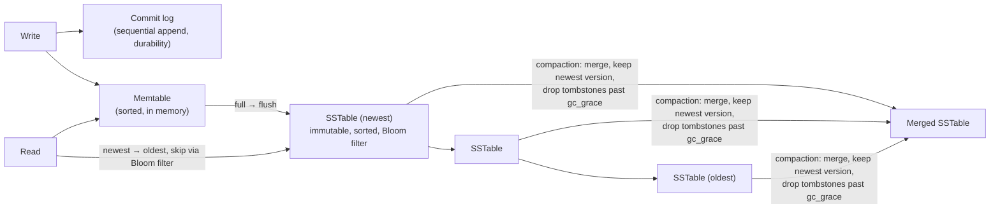
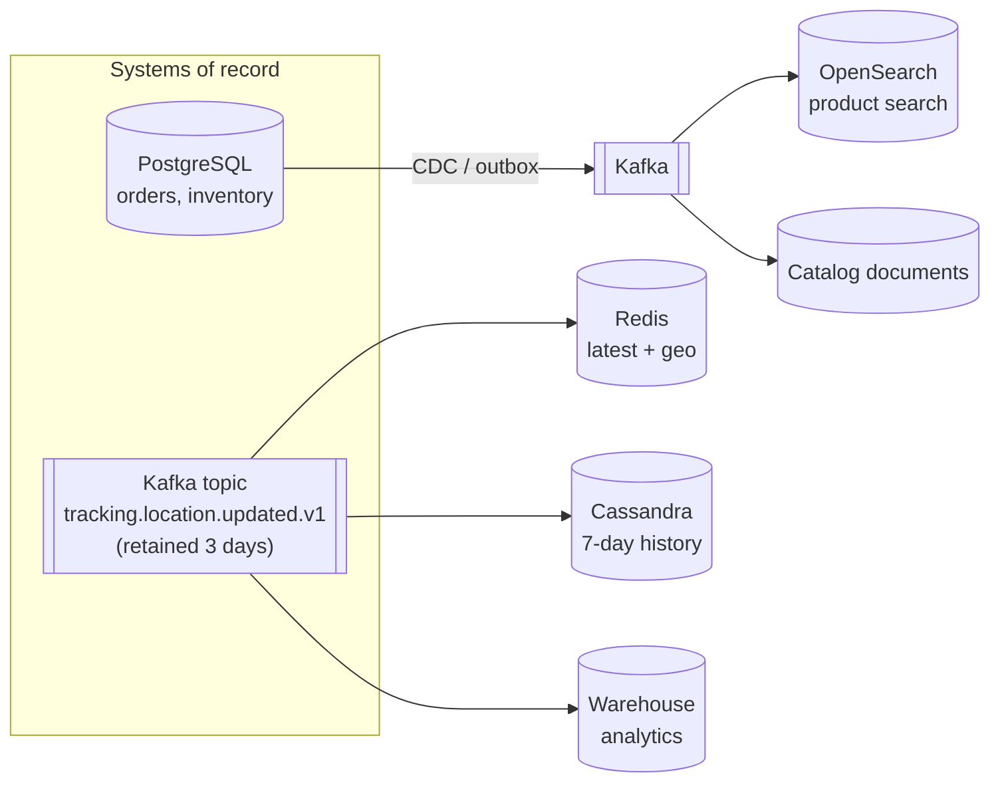
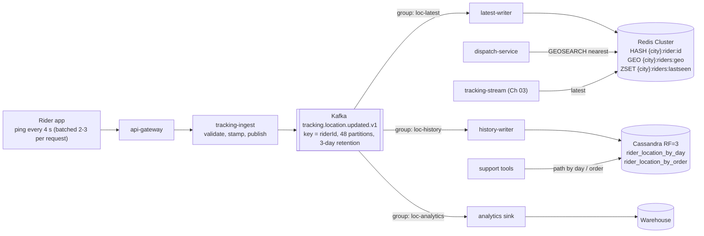
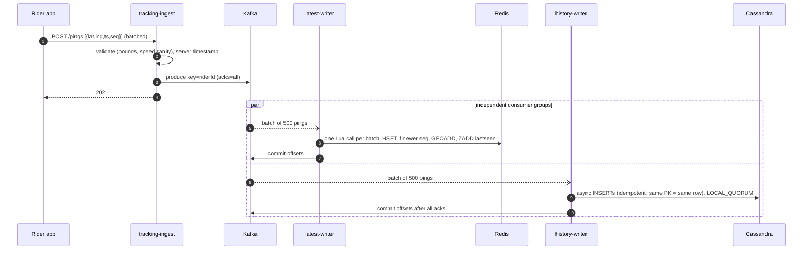
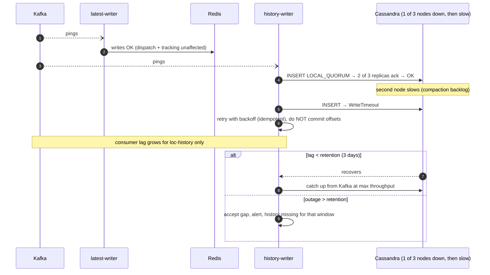
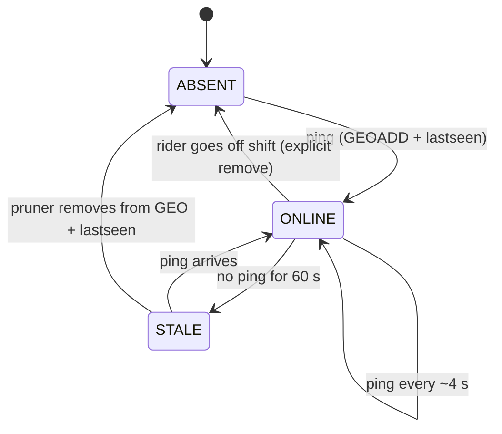

# 06. NoSQL & Polyglot Persistence ⭐

!!! abstract "Chapter at a glance"
    **Reader bands:** B1 → B4 · **Prerequisites:** [Ch 02](02-back-of-the-envelope-estimation.md), [Ch 05](05-relational-databases-deep-dive.md) · **What you will build:** Rider location storage, taken from a hand-written LSM tree (L1) to a polyglot pipeline where Kafka feeds Redis (latest position + geo search), Cassandra (7-day history) and an analytics sink, each sized, modeled per access pattern and independently recoverable (L4) · **Reading time:** 100 min + code

---

## 1. Introduction & Why It Matters

### 1.1 A story: the PostgreSQL table that ate the orders database

When the delivery fleet reached 30,000 riders, the team stored location pings the familiar way, as rows in PostgreSQL next to the orders:

```sql
INSERT INTO rider_location(rider_id, lat, lng, recorded_at) VALUES (...);   -- every 4 seconds per rider
```

At 7,500 inserts/s, with two indexes and 90 days of retention, the table reached 2 billion rows in three months. Autovacuum couldn't keep up. The WAL volume from location inserts saturated replication, so **order-history replicas lagged by minutes**. A nightly `DELETE … WHERE recorded_at < now() - interval '90 days'` locked up I/O for hours. During one festival evening, checkout latency tripled because orders and locations shared a disk, a WAL stream and a buffer cache.

The data wasn't *relational* at all. Nobody joined locations with anything. Every read was either "where is rider X **now**?", "which riders are **near store Y**?", or "rider X's path **today**." Those are three access patterns, and each fits a different storage model better than a B-tree table on the orders primary:

| Access pattern | Better fit |
|---|---|
| Latest position of a rider | In-memory key-value (Redis HASH) |
| Riders within 3 km of a store | Geo index (Redis GEO, or geohash/H3 keys) |
| A rider's path for a day, for 7 days | Wide-column, LSM-based, TTL-expiring (Cassandra/ScyllaDB) |
| Fleet analytics over months | Columnar store / warehouse (Ch 21) |

!!! quote "The thesis of this chapter"
    There's no "best database," only the best fit for an **access pattern** at a **scale** with a **consistency requirement**. Start from the queries, not the data. Keep one system of record per fact, and feed specialized stores from it.

### 1.2 Where this lives in the grocery platform

| Data | Store | Why |
|---|---|---|
| Orders, payments, inventory, ledgers | PostgreSQL | Transactions, constraints, joins (Ch 05) |
| Carts, sessions, OTP attempts, rate-limit counters | Redis | Low latency, TTLs, atomic counters |
| Rider latest location + geo | Redis GEO/HASH | 20 K writes/s, radius queries |
| Rider location history | Cassandra/ScyllaDB | Write-heavy, time-partitioned, TTL |
| Product search, autocomplete | OpenSearch | Inverted index, relevance (Ch 22) |
| Catalog read model for app screens | Document store (or PostgreSQL JSONB) | Denormalized product documents |
| "Frequently bought together" | Graph (or precomputed in batch) | Relationship traversal |
| Metrics, pings for analytics | Time-series DB / columnar warehouse | Aggregations over time |

### 1.3 Learning objectives

| Band | After this chapter you can… |
|---|---|
| <span class="band b1">B1</span> | Name the NoSQL families, their data models, and a use case for each |
| <span class="band b2">B2</span> | Model data for key-value, document and wide-column stores from access patterns, and explain CAP |
| <span class="band b3">B3</span> | Explain LSM trees, compaction, tunable consistency, hot partitions and tombstones, and size a cluster |
| <span class="band b4">B4</span> | Apply PACELC to real choices, design polyglot persistence with a single system of record, and use a decision matrix to defend store choices |

---

## 2. Core Concepts — Beginner to Deep

### 2.1 Intuition: different cupboards for different things <span class="band b1">B1</span>

A kitchen doesn't keep everything in one cupboard:

- The **fridge** (key-value in memory) holds what you grab constantly and can afford to lose if the power goes out (you'd restock).
- The **recipe binder** (a document store) keeps each recipe as one self-contained page.
- The **spice rack sorted by name, with a shelf per month** (wide-column) lets you add jars constantly and find "all spices bought in September" fast.
- The **family tree on the wall** (a graph) is for "who's related to whom."
- The **cookbook index** (a search engine) finds "every recipe mentioning paneer."
- The **accounts ledger** (relational) is where money is recorded, carefully.

Putting the spice rack inside the ledger (§1.1) makes both worse.

### 2.2 The NoSQL families ⭐ <span class="band b1">B1</span> <span class="band b2">B2</span>

| Family | Data model | Strengths | Weaknesses | Examples | Grocery use |
|---|---|---|---|---|---|
| **Key-value** | `key → value` (opaque, or typed structures in Redis) | Sub-ms reads/writes, TTLs, atomic ops, simple scaling | No queries by value; memory cost (Redis) | Redis, Memcached, DynamoDB (also document-ish) | Carts, sessions, OTP, rate limits, latest rider location |
| **Document** | JSON-like documents in collections, secondary indexes | Flexible schema, aggregates read in one fetch, rich queries | Cross-document transactions are limited or costly; joins are weak | MongoDB, Couchbase, Firestore, PostgreSQL JSONB | Product catalog read model, seller onboarding forms |
| **Wide-column** | Partition key → sorted rows (clustering columns) | Massive write throughput, linear scale-out, TTLs, multi-DC | Query only by partition key (+ clustering range); no joins; modeling discipline | Cassandra, ScyllaDB, HBase, Bigtable | Location history, event logs, notification history |
| **Graph** | Nodes + edges with properties | Multi-hop relationship queries | Harder to scale writes; niche skills | Neo4j, Neptune, JanusGraph | Recommendations, fraud rings |
| **Time-series** | (series, timestamp) → value, downsampling, retention | Compression, time-window aggregation | Not general purpose | Prometheus, TimescaleDB, InfluxDB, VictoriaMetrics | Metrics, telemetry |
| **Search engine** | Inverted index over documents | Full-text relevance, facets, fuzzy, geo | Not a system of record; eventual indexing; ops heavy | OpenSearch, Elasticsearch, Solr | Product search (Ch 22) |
| **Columnar / analytical** | Column-oriented storage | Scans and aggregations over billions of rows | Poor at point writes and updates | ClickHouse, BigQuery, Redshift, Snowflake | Fleet analytics, BI (Ch 21) |

!!! tip "\"NoSQL\" is not one thing"
    The word says what these systems *aren't*, not what they are. Compare specific properties: data model, consistency model, query capability, scaling model, and operational cost.

### 2.3 Key-value in depth: Redis data structures <span class="band b2">B2</span>

| Structure | Commands | Grocery use |
|---|---|---|
| STRING | `GET/SET EX`, `INCR`, `SET NX PX` | OTP code with TTL, idempotency marker, simple lock (Ch 20) |
| HASH | `HSET/HGETALL` | Cart (sku → qty), rider latest state |
| SORTED SET | `ZADD/ZRANGEBYSCORE/ZREM` | Leaderboards, "last seen" timestamps, delayed jobs |
| **GEO** (sorted set of geohashes) | `GEOADD`, `GEOSEARCH … BYRADIUS … ASC COUNT` | Nearest available riders to a store |
| LIST / STREAM | `LPUSH/BRPOP`, `XADD/XREADGROUP` | Simple queues; the tracking replay buffer (Ch 03) |
| HyperLogLog | `PFADD/PFCOUNT` | Approximate unique visitors |
| Bloom (module) | `BF.ADD/BF.EXISTS` | "Have we seen this coupon code?" pre-check |

**Persistence and durability:** Redis is in-memory, with optional RDB snapshots and an AOF log (`appendfsync everysec` can lose ~1 s of writes). Treat it as a **cache or ephemeral store** unless you've deliberately configured and tested durability, and even then prefer it for data you can rebuild.

**Scaling:** Redis Cluster shards keys across 16,384 hash slots. Multi-key operations need the keys in the same slot (use hash tags: `{BLR}:riders:geo`, `{BLR}:riders:lastseen`).

### 2.4 Document stores: embedding vs referencing <span class="band b2">B2</span>

```json
{
  "_id": "sku_AASHIRVAAD_ATTA_5KG",
  "name": "Aashirvaad Whole Wheat Atta 5 kg",
  "brand": "Aashirvaad",
  "category": ["staples", "atta-flours"],
  "gstRate": 5,
  "variants": [
    { "packSize": "5 kg", "mrpPaise": 29900 },
    { "packSize": "10 kg", "mrpPaise": 57500 }
  ],
  "nutrition": { "per100g": { "energyKcal": 340, "proteinG": 12.1 } },
  "images": ["https://cdn.grocery.in/p/atta5/1.webp"],
  "updatedAt": "2026-09-20T08:00:00Z"
}
```

| Rule | Embed when… | Reference when… |
|---|---|---|
| Ownership | The child only exists with the parent (variants, nutrition) | The child is shared (a brand used by 400 products) |
| Access | Always read together | Read independently or rarely |
| Size | Bounded (a handful of variants) | Unbounded (reviews, order history) → separate collection |
| Change rate | Changes with the parent | Changes independently and often (price, stock) → keep out of the catalog document |

!!! warning "Unbounded arrays are the document-model N+1"
    Embedding all 20,000 reviews in the product document creates huge documents, slow updates and 16 MB limits (in MongoDB). Put reviews in their own collection keyed by product, and embed only a summary (`ratingAvg`, `ratingCount`).

**PostgreSQL JSONB is often enough.** A `product_document JSONB` column with a GIN index gives flexible attributes inside your existing relational database, with transactions. Reach for a dedicated document database when you need its scale-out, operational model, or developer ergonomics across many teams.

### 2.5 Wide-column (Cassandra) data modeling ⭐ <span class="band b2">B2</span> <span class="band b3">B3</span>

In Cassandra-style stores you **design one table per query**. Denormalization is the normal case.

```sql
-- Query: "rider X's path on day D, newest first"
CREATE TABLE rider_location_by_day (
    rider_id     text,
    day          date,              -- bucket: bounds partition size
    recorded_at  timestamp,
    lat          double,
    lng          double,
    speed_kmph   float,
    order_id     text,
    PRIMARY KEY ((rider_id, day), recorded_at)
) WITH CLUSTERING ORDER BY (recorded_at DESC)
  AND default_time_to_live = 604800            -- 7 days
  AND compaction = {'class': 'TimeWindowCompactionStrategy',
                    'compaction_window_unit': 'HOURS', 'compaction_window_size': 6};
```

| Concept | Meaning | Design rule |
|---|---|---|
| **Partition key** `(rider_id, day)` | Decides which nodes own the data (hashed on the token ring) | Must appear in every query with `=`. It spreads load: no hot partitions |
| **Clustering column** `recorded_at DESC` | Sort order within a partition, on disk | Range queries and ordering only within a partition |
| **Partition size** | All rows sharing a partition key | Keep it bounded, ideally < ~10 MB (guidance: well under 100 MB). **Bucket by time** for time series |
| No joins, limited secondary indexes | — | Duplicate data into another table for another query (`rider_location_by_order`) |
| **TTL** | Per-row expiry | The natural retention mechanism; pair with TWCS so whole SSTables expire |
| **Tombstones** | Deletes and expired TTLs are markers until compaction | Many tombstones in a read path slow queries or fail them (`tombstone_failure_threshold`). Avoid delete-heavy patterns and queue-like tables |

**Partition-size check for our table:** one ping every 4 s during a 12-hour shift is ~10,800 rows × ~100 B ≈ **1 MB per partition**. That's comfortable. Without the `day` bucket, 90 days of retention would be ~100 MB per rider partition: too big.

### 2.6 LSM trees and compaction ⭐ <span class="band b3">B3</span>

Most write-optimized stores (Cassandra, ScyllaDB, RocksDB, HBase, LevelDB, and the storage behind many time-series DBs) use a **Log-Structured Merge tree**:



L1 (§5) implements exactly this. Its real output shows the trade-offs:

```text
After 200,000 writes: 41 SSTables holding 39,725 entries for 1,000 live keys (space amplification ~40x)
1 read of a missing key  : 1 table probes, 40 tables skipped by Bloom filters
After compaction: 1 SSTable, 999 entries (38,726 stale versions and tombstones dropped)
```

| | B+ tree (PostgreSQL, InnoDB) | LSM tree (Cassandra, RocksDB) |
|---|---|---|
| Write path | Update pages in place (random I/O) + WAL | Append + sorted flush (sequential I/O) |
| Write throughput | Good | **Excellent** |
| Read path | One tree traversal | Memtable + possibly several SSTables (Bloom filters help) |
| Read amplification | Low | Higher, until compaction catches up |
| Space amplification | Low (dead tuples until vacuum) | Higher (old versions until compaction) |
| Write amplification | Moderate | **Compaction rewrites data** repeatedly |
| Background work | Vacuum | Compaction (can compete with foreground I/O) |

| Compaction strategy | How | Best for |
|---|---|---|
| Size-tiered (STCS) | Merge similar-sized SSTables | Write-heavy, general |
| Leveled (LCS) | Levels with non-overlapping key ranges | Read-heavy, update-heavy; lower read/space amplification, more write amplification |
| Time-window (TWCS) | One bucket per time window; old windows never re-merged | **Time series with TTL**: whole SSTables expire and drop cheaply |

### 2.7 CAP and PACELC ⭐ <span class="band b2">B2</span> → <span class="band b4">B4</span>

**CAP:** during a **network partition** (P), a distributed system must choose between **Consistency** (every read sees the latest write, or errors) and **Availability** (every request gets a non-error response, possibly stale).

- CAP's "C" is **linearizability**, not ACID's "C."
- Partitions are not optional in real networks, so the real choice is **C or A when partitioned**.
- It's per operation, not per product. Many databases let you choose per query.

**PACELC** adds the everyday case: if **P**artitioned, choose **A** or **C**; **E**lse (normal operation), choose **L**atency or **C**onsistency.

| System (typical configuration) | If partitioned | Else | Notes |
|---|---|---|---|
| PostgreSQL primary + async replicas | C (writes go to the primary only; lagging replicas can serve stale reads) | C for primary reads / L for replica reads | Failover can lose the last async writes |
| Cassandra / ScyllaDB | A (with CL=ONE) … C-ish (with QUORUM on both sides) | L (tunable) | Tunable per query: `R + W > RF` for read-your-writes on that key |
| DynamoDB | A (eventually consistent reads) or C (strongly consistent reads) | L / C per read | Strong reads cost more and are single-region |
| MongoDB (replica set, majority) | C (the minority side can't elect a primary) | C with majority read/write concern / L with local reads | Configurable concerns |
| Redis (single primary + replicas) | Mostly A-leaning, **can lose acknowledged writes** on failover | L | Don't use it as a source of truth for money |
| Spanner, CockroachDB | C | C (pays latency) | Consensus per range; cross-region latency |

**Tunable consistency (Cassandra-style):** with replication factor RF, write consistency W and read consistency R:

$$
R + W > RF \;\Rightarrow\; \text{a read overlaps at least one replica that saw the write}
$$

With RF=3 and `LOCAL_QUORUM` (2) for both reads and writes, 2 + 2 > 3, so a read sees the latest acknowledged write in that datacenter. With `ONE`/`ONE` you get the lowest latency and the highest availability, with possibly stale reads.

!!! example "Choosing per access pattern for rider locations"
    - **Latest position (Redis):** availability and latency first. A 4-second-old position is fine, and the next ping repairs it.
    - **History writes (Cassandra):** `LOCAL_ONE` is acceptable. The data is valuable, but a few lost pings don't matter, and throughput is king. We still use `LOCAL_QUORUM` by default for predictable reads (L3), and measure before relaxing it.
    - **Delivery proof for disputes** ("the rider was at the door at 8:42 pm"): write the delivery event to the **order system of record** (PostgreSQL), not only to the location store.

### 2.8 Data modeling per access pattern: the method ⭐ <span class="band b2">B2</span> <span class="band b3">B3</span>

1. **List the queries** with their frequency, latency and consistency needs.
2. **Estimate** the volume per query and the growth (Ch 02).
3. **Choose keys** so that each frequent query hits **one partition or key**, and load spreads evenly.
4. **Bound partition and document size** (bucketing, separate collections).
5. **Duplicate for reads** (a table or index per query), and decide who keeps the copies in sync (dual write is forbidden: use events or CDC).
6. **Plan retention** (TTL, time buckets, partitions).
7. **Plan the failure and rebuild story.** Can this store be rebuilt from the system of record or a log?

| Query (rider domain) | Frequency | Latency | Consistency | Store / key |
|---|---|---|---|---|
| Q1 latest position of rider | ~20 K/s (tracking stream, dispatch) | < 5 ms | Seconds-stale OK | Redis `HASH {city}:rider:<id>` |
| Q2 available riders within 3 km of store | ~2 K/s (dispatch, Ch 47) | < 10 ms | Seconds-stale OK | Redis `GEO {city}:riders:geo` + last-seen prune |
| Q3 rider path for day | ~50/s (support, disputes) | < 100 ms | Complete within minutes | Cassandra `(rider_id, day)` |
| Q4 path for one order | ~200/s (customer "delivered" map) | < 100 ms | Complete within minutes | Cassandra `rider_location_by_order (order_id)` |
| Q5 fleet speed/idle analytics | Batch | Minutes | Hours-stale OK | Columnar warehouse |

### 2.9 Graph, time-series and search: when they're the right tool <span class="band b2">B2</span>

**Graph.** A good fit when the question is a multi-hop traversal:

```cypher
// "Customers who bought X also bought" — 2-hop traversal
MATCH (p:Product {sku: 'AMUL_BUTTER_500G'})<-[:CONTAINS]-(:Order)-[:CONTAINS]->(other:Product)
WHERE other <> p
RETURN other.sku, count(*) AS together ORDER BY together DESC LIMIT 10;
```

For many platforms, the same answer comes cheaper from a **nightly batch** over the warehouse that writes the top-N per SKU into Redis. Use a graph database when traversals are interactive, deep, or ad hoc (fraud rings, social networks).

**Time-series.** Metrics and telemetry with downsampling and retention (Ch 24, 52). Rider pings *can* live in a TSDB, but per-rider path queries fit wide-column partitioning better.

**Search engines.** An inverted index plus relevance scoring, fed from the system of record. Never the source of truth (Ch 22).

### 2.10 Polyglot persistence and the system of record <span class="band b3">B3</span> <span class="band b4">B4</span>



| Principle | Why |
|---|---|
| **One system of record per fact** | Everything else is a derived, rebuildable view |
| **No dual writes** from the application | A crash between writes leaves stores inconsistent forever. Write once (DB + outbox, or the log), and fan out |
| **Each derived store has its own consumer** | One slow sink doesn't stall the others. Each can replay independently |
| **Idempotent sink writes** | At-least-once delivery means duplicates. Upserts keyed by natural ids |
| **A rebuild path is part of the design** | Retain the log long enough, or re-snapshot from the SoR (Ch 13, 15) |
| **Operate what you add** | Every new store adds on-call load, backups, upgrades, security reviews and skills. That's the real cost |

### 2.11 Choosing a database: the decision matrix ⭐ <span class="band b4">B4</span>

| Question | If the answer is… | Lean toward |
|---|---|---|
| Do you need multi-row/multi-entity transactions and constraints? | Yes | Relational (PostgreSQL) |
| Is the data model a self-contained aggregate read as a whole? | Yes, with a flexible schema | Document (or JSONB) |
| Is access by key only, needing sub-ms and TTLs, and is the data rebuildable? | Yes | Redis / key-value |
| Are writes massive (≫10 K/s), append-mostly, time-bucketed, and read by key + range? | Yes | Wide-column (Cassandra/ScyllaDB) |
| Are queries multi-hop over relationships? | Yes, interactive | Graph |
| Is it full-text relevance, facets, fuzzy matching? | Yes | Search engine (derived) |
| Is it aggregations over months or billions of rows? | Yes | Columnar warehouse / OLAP |
| Is it metrics with downsampling and retention? | Yes | TSDB |
| Does the team already operate it well? | No | Pay heavily for this in the decision: prefer managed services or existing stores |

Scoring template used in design reviews:

| Criterion (weight) | PostgreSQL | Cassandra | Redis | DynamoDB |
|---|---|---|---|---|
| Fits access pattern (×3) | | | | |
| Consistency needs met (×3) | | | | |
| Scale headroom 3 years (×2) | | | | |
| Operability for our team (×2) | | | | |
| Cost at target scale (×2) | | | | |
| Ecosystem / Spring support (×1) | | | | |

§4 fills this in for rider locations.

---

## 3. Architecture & Diagrams

### 3.1 Component view: the location pipeline



### 3.2 Sequence: happy path, one ping to all stores



### 3.3 Sequence: failure path, Cassandra degraded, Redis unaffected



!!! note "What the system guarantees after this failure path"
    A degraded history store **never** affects latest-position or dispatch, because each sink has its own consumer group. History is eventually complete as long as the outage is shorter than Kafka retention (3 days), since the writer only commits offsets after writes are acknowledged, and duplicate writes on retry are harmless (same primary key → same row). Delivery evidence for disputes lives in PostgreSQL, not in the history store.

### 3.4 State: a rider's presence in the geo index



---

## 4. Design Document Excerpt: Rider Location Storage

| Field | Value |
|---|---|
| Author / Reviewers | Fulfilment platform / Dispatch, Tracking, SRE, Data platform |
| Status | Approved |
| Related ADRs | ADR-027 Move rider locations out of PostgreSQL into Redis + Cassandra fed by Kafka |

**1. Context & Problem.** Location pings in the orders PostgreSQL caused vacuum debt, WAL-driven replica lag and I/O contention with checkout (§1.1).

**2. Goals / Non-Goals.**

- *Goals:* 20 K pings/s at festival peak with headroom; latest position and radius queries < 10 ms p99; 7-day path history; complete isolation from the orders database; rebuildable stores.
- *Non-goals:* dispatch algorithms (Ch 47); long-term analytics modeling (Ch 21).

**3. Requirements.**

| ID | Requirement |
|---|---|
| FR-1 | Latest position per rider; nearest riders within radius of a point |
| FR-2 | Rider path by day and by order, for 7 days |
| NFR-1 | Ingest 20 K pings/s sustained, 40 K/s burst |
| NFR-2 | Q1/Q2 p99 < 10 ms; Q3/Q4 p99 < 100 ms |
| NFR-3 | Stale riders (no ping for 60 s) excluded from radius results |
| NFR-4 | A store outage must not affect other stores' consumers or the orders DB |
| NFR-5 | Any derived store rebuildable from Kafka (3-day retention) within 2 hours |

**4. Capacity estimates.**

| Item | Calculation | Result |
|---|---|---|
| Peak pings | 80 K riders ÷ 4 s | **20 K/s** (normal peak 10 K/s) |
| Kafka ingress | 20 K/s × ~150 B | ~3 MB/s; 48 partitions give consumer parallelism headroom |
| Redis memory | 80 K riders × (~150 B hash + ~60 B geo + ~40 B lastseen) | **~20 MB**: trivial |
| Redis ops | 20 K pings/s × 3 ops (pipelined) | ~60 K ops/s: a single shard can do it, **cluster of 3 shards** for headroom and HA |
| Cassandra writes | 20 K/s × 2 tables | 40 K rows/s at peak |
| Cassandra storage | ~10 K/s avg × 86,400 × 2 tables × ~100 B × RF 3 × 7 days | ~3.6 TB raw → **~1.2 TB with compression** |
| Cassandra nodes | ~15–20 K writes/s per node comfortably (to be load-tested) | **6 nodes** (RF 3) with headroom |
| Partition size | 10,800 pings/shift × 100 B | ~1 MB per (rider, day) |

**7. Alternatives considered (decision matrix).**

| Criterion (weight) | PostgreSQL (partitioned, separate cluster) | Cassandra/ScyllaDB | Redis only | DynamoDB |
|---|---|---|---|---|
| Fits access pattern (×3) | 2 | **3** (history) | 3 latest / 1 history | 3 |
| Consistency needs met (×3) | 3 | 3 | 2 | 3 |
| Scale headroom 3 yrs (×2) | 1 | **3** | 1 (memory for history) | 3 |
| Operability for our team (×2) | **3** | 2 (managed service; 1 if self-run) | 3 | 3 (managed) |
| Cost at target scale (×2) | 2 | 2 | 1 | 1 (per-write pricing at 40 K writes/s) |
| Spring/Java support (×1) | 3 | 3 | 3 | 2 |
| **Weighted total** | 30 | **35** | 22 (history) | 34 |

!!! warning "Hash tags concentrate load"
    A city-level hash tag puts a whole city on one shard. At ~20 K Bengaluru riders × 1 ping/4 s ≈ 5 K pings/s (batched into ~50 Lua calls/s), one shard is comfortable. For a mega-city beyond one shard's capacity, split the tag by zone (`{BLR-south}`) and search the neighbouring zones.

**Decision:** Redis for latest and geo (clear winner). For history, a **managed** Cassandra-compatible service (35) narrowly beats DynamoDB (34). Self-run Cassandra would score 33 and lose, which shows how much operability matters. The deciding factor was sustained write cost at 40 K writes/s. DynamoDB wins if the platform standardizes on AWS or write volume drops. A near-tie in the matrix is a signal to name the **deciding factor** explicitly in the ADR, not to trust the arithmetic.

**5.3 Data model.** Cassandra tables as in §2.5, plus:

```sql
CREATE TABLE rider_location_by_order (
    order_id     text,
    recorded_at  timestamp,
    rider_id     text,
    lat          double,
    lng          double,
    PRIMARY KEY ((order_id), recorded_at)
) WITH CLUSTERING ORDER BY (recorded_at ASC)
  AND default_time_to_live = 604800
  AND compaction = {'class': 'TimeWindowCompactionStrategy', 'compaction_window_unit': 'HOURS', 'compaction_window_size': 6};
```

Redis keys. The `{BLR}` hash tag puts all of a city's keys in one cluster slot, so one Lua script can update them atomically (keys in different slots fail with `CROSSSLOT`):

| Key | Type | Content |
|---|---|---|
| `{BLR}:rider:<riderId>` | HASH | `lat, lng, ts, seq`, with TTL 1 h |
| `{BLR}:riders:geo` | GEO | member = riderId |
| `{BLR}:riders:lastseen` | ZSET | member = riderId, score = epoch seconds |

**8. Failure modes.** Redis node failure → replica promotion (a few seconds of lost pings are healed by the next ping). Cassandra node loss → `LOCAL_QUORUM` continues with 2 of 3. Two replicas lost → writes fail, the history writer lags, and Kafka retains the data. Kafka unavailable → ingest returns 503, and the rider app buffers pings locally (bounded) and resends.

**10. Observability.** Consumer lag per group, Redis ops/s and latency, Cassandra write latency p99, timeouts, pending compactions, tombstones per read, partition size histogram (`nodetool tablehistograms`), and a stale-rider count.

**14. Decision (ADR-027 summary).** Rider locations leave PostgreSQL. Kafka is the log of record for pings (3-day retention). Redis holds the latest position and geo membership with a 60 s staleness prune. Cassandra holds 7-day history in day-bucketed partitions with TTL and TWCS. Each sink is an independent, idempotent consumer group. Delivery-critical events (arrived, delivered, OTP verified) are written to the order system of record, not inferred from pings.

---

## 5. Hands-On Code — Level Ladder

We build **rider location storage** four times:

| Level | New requirement that forces the step |
|---|---|
| L1 | "Understand why write-heavy stores use LSM trees." (a working mini LSM engine) |
| L2 | "Store latest positions and find nearby riders from a Spring service." (Redis) |
| L3 | "20 K pings/s: atomic out-of-order protection, one round trip per batch, stale-rider pruning, 7-day history in Cassandra with bounded partitions." |
| L4 | "Kafka as the log: independent sinks, at-least-once with idempotent writes, poison-message handling, and rebuilds by replay." |

### L1 — Concept: a mini LSM tree (plain Java) <span class="band b1">B1</span>

```java
// MiniLsmL1.java — run with: java MiniLsmL1.java
// A tiny Log-Structured Merge tree: the storage engine behind Cassandra, RocksDB, ScyllaDB, HBase...
//   write → in-memory sorted memtable → flushed as immutable sorted "SSTables" → merged by compaction
//   read  → memtable, then SSTables newest-first (Bloom filters skip tables that can't contain the key)
import java.util.*;

public class MiniLsmL1 {

    static final String TOMBSTONE = "\u0000DELETED";

    /** Minimal Bloom filter: k hash probes into a bitset. False positives possible, false negatives never. */
    static final class Bloom {
        private final BitSet bits; private final int size, k;
        Bloom(int expected) { size = Math.max(64, expected * 10); k = 4; bits = new BitSet(size); }
        private int h(String key, int i) { return Math.floorMod(key.hashCode() * 31 + i * 0x9E3779B9 + (key.hashCode() >>> 16) * i, size); }
        void add(String key) { for (int i = 0; i < k; i++) bits.set(h(key, i)); }
        boolean mightContain(String key) { for (int i = 0; i < k; i++) if (!bits.get(h(key, i))) return false; return true; }
    }

    /** Immutable, sorted run of key → value (an SSTable). */
    record SSTable(int id, TreeMap<String, String> data, Bloom bloom) {
        static SSTable of(int id, SortedMap<String, String> entries) {
            var b = new Bloom(entries.size());
            entries.keySet().forEach(b::add);
            return new SSTable(id, new TreeMap<>(entries), b);
        }
    }

    static final class Lsm {
        private final int memtableLimit;
        private TreeMap<String, String> memtable = new TreeMap<>();
        private int writesSinceFlush = 0;                           // real engines flush by memtable BYTES, incl. overwrites
        private final Deque<SSTable> tables = new ArrayDeque<>();   // newest first
        private int nextId = 1;
        long bytesWrittenToDisk = 0, logicalBytesWritten = 0;       // for write amplification
        long tableProbes = 0, bloomSkips = 0;

        Lsm(int memtableLimit) { this.memtableLimit = memtableLimit; }

        void put(String key, String value) {
            logicalBytesWritten += key.length() + value.length();
            memtable.put(key, value);                               // (real engines also append to a commit log / WAL)
            if (++writesSinceFlush >= memtableLimit) flush();
        }

        void delete(String key) { put(key, TOMBSTONE); }

        String get(String key) {
            String v = memtable.get(key);
            if (v != null) return v.equals(TOMBSTONE) ? null : v;
            for (SSTable t : tables) {                              // newest → oldest: first hit wins
                if (!t.bloom().mightContain(key)) { bloomSkips++; continue; }
                tableProbes++;
                v = t.data().get(key);
                if (v != null) return v.equals(TOMBSTONE) ? null : v;
            }
            return null;
        }

        void flush() {
            if (memtable.isEmpty()) return;
            var t = SSTable.of(nextId++, memtable);
            bytesWrittenToDisk += size(t.data());
            tables.addFirst(t);
            memtable = new TreeMap<>();
            writesSinceFlush = 0;
        }

        /** Full compaction: merge all tables, keep only the newest version, drop tombstones. */
        void compact() {
            TreeMap<String, String> merged = new TreeMap<>();
            Iterator<SSTable> oldestFirst = tables.descendingIterator();
            while (oldestFirst.hasNext()) merged.putAll(oldestFirst.next().data());   // newer overwrite older
            merged.values().removeIf(TOMBSTONE::equals);
            tables.clear();
            var t = SSTable.of(nextId++, merged);
            bytesWrittenToDisk += size(t.data());                  // compaction rewrites data: write amplification
            tables.addFirst(t);
        }

        int tableCount() { return tables.size(); }
        long storedEntries() { return tables.stream().mapToLong(t -> t.data().size()).sum(); }
        private static long size(Map<String, String> m) {
            return m.entrySet().stream().mapToLong(e -> e.getKey().length() + e.getValue().length()).sum();
        }
    }

    public static void main(String[] args) {
        var lsm = new Lsm(5_000);   // flush every 5,000 writes
        var rnd = new Random(7);

        // 200,000 location pings from 1,000 riders: every write is an append, overwrites are cheap
        for (int i = 0; i < 200_000; i++) {
            String rider = "rider-%04d".formatted(rnd.nextInt(1_000));
            lsm.put(rider, "%.5f,%.5f@%d".formatted(12.90 + rnd.nextDouble() / 10, 77.60 + rnd.nextDouble() / 10, i));
        }
        lsm.delete("rider-0007");                                    // rider logs off → tombstone
        lsm.flush();

        System.out.printf("After 200,000 writes: %d SSTables holding %,d entries for 1,000 live keys (space amplification ~%.0fx)%n",
                lsm.tableCount(), lsm.storedEntries(), lsm.storedEntries() / 1_000.0);

        lsm.tableProbes = lsm.bloomSkips = 0;
        for (int i = 0; i < 1_000; i++) lsm.get("rider-%04d".formatted(i));
        System.out.printf("1,000 reads of live keys : %,d table probes (newest table usually has the key)%n", lsm.tableProbes);

        lsm.tableProbes = lsm.bloomSkips = 0;
        lsm.get("rider-9999");                                        // a key that doesn't exist
        System.out.printf("1 read of a missing key  : %d table probes, %d tables skipped by Bloom filters%n",
                lsm.tableProbes, lsm.bloomSkips);
        System.out.println("rider-0007 after delete  → " + lsm.get("rider-0007") + " (tombstone shadows older versions)");

        long flushedBytes = lsm.bytesWrittenToDisk;
        long before = lsm.storedEntries();
        lsm.compact();
        System.out.printf("After compaction: %d SSTable, %,d entries (%,d stale versions and tombstones dropped)%n",
                lsm.tableCount(), lsm.storedEntries(), before - lsm.storedEntries());
        System.out.printf("Bytes: app wrote %,d; flushes wrote %,d (memtable absorbed overwrites); compaction rewrote %,d more%n",
                lsm.logicalBytesWritten, flushedBytes, lsm.bytesWrittenToDisk - flushedBytes);
    }
}
```

Actual output from running it:

```text
After 200,000 writes: 41 SSTables holding 39,725 entries for 1,000 live keys (space amplification ~40x)
1,000 reads of live keys : 1,009 table probes (newest table usually has the key)
1 read of a missing key  : 1 table probes, 40 tables skipped by Bloom filters
rider-0007 after delete  → null (tombstone shadows older versions)
After compaction: 1 SSTable, 999 entries (38,726 stale versions and tombstones dropped)
Bytes: app wrote 6,688,908; flushes wrote 1,328,779 (memtable absorbed overwrites); compaction rewrote 33,966 more
```

**What L1 shows:**

- Writes are cheap appends into a sorted memtable, which **absorbs overwrites** (6.7 MB written by the app, 1.3 MB flushed).
- Unmerged SSTables cause **space amplification** (~40× here) and potentially more read probes.
- **Bloom filters** let a missing-key read skip 40 of 41 tables. The single probe was a false positive, which is expected.
- **Tombstones** hide deleted keys until compaction removes them.
- **Compaction** restores compactness at the cost of rewriting data.

**What L1 can't do:** there's no durability (commit log), no concurrency, and no distribution or replication. That's what Cassandra and ScyllaDB add.

### L2 — Spring Data Redis: latest position + nearby riders <span class="band b2">B2</span>

```kotlin
// build.gradle.kts (module l2-spring)
dependencies {
    implementation("org.springframework.boot:spring-boot-starter-web")          // VERIFY: Boot 4 starter name
    implementation("org.springframework.boot:spring-boot-starter-data-redis")
    implementation("org.springframework.boot:spring-boot-starter-validation")
    testImplementation("org.springframework.boot:spring-boot-starter-test")
}
```

=== "DTOs & Repository"

    ```java
    package com.grocery.tracking.dto;

    import jakarta.validation.constraints.*;
    import java.util.List;

    public record PingBatch(@NotBlank String riderId, @NotBlank String city,
                            @NotEmpty @Size(max = 10) List<Ping> pings) {
        public record Ping(@DecimalMin("6.0") @DecimalMax("38.0") double lat,     // India bounding box (rough)
                           @DecimalMin("68.0") @DecimalMax("98.0") double lng,
                           @Positive long ts, @PositiveOrZero long seq) { }
    }
    ```

    ```java
    package com.grocery.tracking.dto;

    public record NearbyRider(String riderId, double distanceKm) { }
    ```

    ```java
    package com.grocery.tracking.repository;

    import com.grocery.tracking.dto.NearbyRider;
    import org.springframework.data.geo.*;
    import org.springframework.data.redis.connection.RedisGeoCommands;
    import org.springframework.data.redis.core.StringRedisTemplate;
    import org.springframework.data.redis.domain.geo.GeoReference;
    import org.springframework.stereotype.Repository;
    import java.util.List;
    import java.util.Map;

    @Repository
    public class RiderLocationRepositoryL2 {

        private final StringRedisTemplate redis;

        public RiderLocationRepositoryL2(StringRedisTemplate redis) { this.redis = redis; }

        /** ⚠️ L2: three separate round trips, no ordering check, no pruning. */
        public void save(String city, String riderId, double lat, double lng, long ts, long seq) {
            redis.opsForHash().putAll("{" + city + "}:rider:" + riderId,
                    Map.of("lat", Double.toString(lat), "lng", Double.toString(lng),
                           "ts", Long.toString(ts), "seq", Long.toString(seq)));
            redis.opsForGeo().add("{" + city + "}:riders:geo", new Point(lng, lat), riderId);   // Point(x=lng, y=lat)!
            redis.opsForZSet().add("{" + city + "}:riders:lastseen", riderId, ts);
        }

        public List<NearbyRider> nearby(String city, double lat, double lng, double radiusKm, int limit) {
            var args = RedisGeoCommands.GeoSearchCommandArgs.newGeoSearchArgs()
                    .includeDistance().sortAscending().limit(limit);
            GeoResults<RedisGeoCommands.GeoLocation<String>> results = redis.opsForGeo().search(
                    "{" + city + "}:riders:geo",
                    GeoReference.fromCoordinate(new Point(lng, lat)),
                    new Distance(radiusKm, Metrics.KILOMETERS), args);
            if (results == null) return List.of();
            return results.getContent().stream()
                    .map(r -> new NearbyRider(r.getContent().getName(), r.getDistance().getValue()))
                    .toList();
        }
    }
    ```

=== "Service, Delegate, Controller"

    ```java
    package com.grocery.tracking.service;

    import com.grocery.tracking.dto.*;
    import com.grocery.tracking.repository.RiderLocationRepositoryL2;
    import org.springframework.stereotype.Service;
    import java.util.List;

    @Service
    public class LocationServiceL2 {

        private final RiderLocationRepositoryL2 repo;

        public LocationServiceL2(RiderLocationRepositoryL2 repo) { this.repo = repo; }

        public void record(PingBatch batch) {
            batch.pings().forEach(p -> repo.save(batch.city(), batch.riderId(), p.lat(), p.lng(), p.ts(), p.seq()));
        }

        public List<NearbyRider> nearby(String city, double lat, double lng, double radiusKm) {
            return repo.nearby(city, lat, lng, radiusKm, 20);
        }
    }
    ```

    ```java
    package com.grocery.tracking.controller;

    import com.grocery.tracking.dto.*;
    import com.grocery.tracking.service.LocationServiceL2;
    import jakarta.validation.Valid;
    import jakarta.validation.constraints.*;
    import org.springframework.http.HttpStatus;
    import org.springframework.validation.annotation.Validated;
    import org.springframework.web.bind.annotation.*;
    import java.util.List;

    @RestController
    @RequestMapping("/api/v1")
    @Validated
    public class LocationController {

        private final LocationServiceL2 service;   // L2: controller → service directly; the delegate appears in L3

        public LocationController(LocationServiceL2 service) { this.service = service; }

        @PostMapping("/pings")
        @ResponseStatus(HttpStatus.ACCEPTED)
        public void pings(@Valid @RequestBody PingBatch batch) { service.record(batch); }

        @GetMapping("/cities/{city}/riders/nearby")
        public List<NearbyRider> nearby(@PathVariable String city, @RequestParam double lat, @RequestParam double lng,
                                        @RequestParam(defaultValue = "3") @DecimalMax("10") double radiusKm) {
            return service.nearby(city, lat, lng, radiusKm);
        }
    }
    ```

=== "Test"

    ```java
    package com.grocery.tracking;

    import com.grocery.tracking.repository.RiderLocationRepositoryL2;
    import org.junit.jupiter.api.Test;
    import org.springframework.beans.factory.annotation.Autowired;
    import org.springframework.boot.test.context.SpringBootTest;
    import org.springframework.boot.testcontainers.service.connection.ServiceConnection;
    import org.testcontainers.containers.GenericContainer;
    import org.testcontainers.junit.jupiter.*;
    import static org.assertj.core.api.Assertions.assertThat;

    @SpringBootTest
    @Testcontainers
    class NearbyRidersIT {

        @Container @ServiceConnection(name = "redis")
        static GenericContainer<?> redis = new GenericContainer<>("redis:7-alpine").withExposedPorts(6379);

        @Autowired RiderLocationRepositoryL2 repo;

        @Test
        void findsClosestRidersFirst() {
            // HSR Layout dark store ~ (12.9116, 77.6389)
            repo.save("BLR", "r-near", 12.9120, 77.6390, 1, 1);   // ~50 m
            repo.save("BLR", "r-mid",  12.9250, 77.6400, 1, 1);   // ~1.5 km
            repo.save("BLR", "r-far",  12.9716, 77.5946, 1, 1);   // MG Road, ~8 km

            var result = repo.nearby("BLR", 12.9116, 77.6389, 3, 10);

            assertThat(result).extracting("riderId").containsExactly("r-near", "r-mid");
            assertThat(result.getFirst().distanceKm()).isLessThan(0.1);
        }
    }
    ```

**What L2 fixed:** a real geo index with radius search in a few milliseconds, off the orders database.

**What L2 still gets wrong:**

| Problem | Consequence |
|---|---|
| 3 round trips per ping, no batching | 60 K round trips/s at peak |
| **Out-of-order pings overwrite newer ones** (mobile retries, batch resends) | A rider "jumps back" on the map; dispatch picks stale positions |
| Riders who go offline stay in the geo set forever | Dispatch offers orders to riders who switched off their phones |
| Writes aren't atomic across the three keys | A crash between writes leaves the hash and geo disagreeing |
| No history | Support can't answer "where was the rider at 8:42?" |

### L3 — Production-Grade: atomic batched Redis + Cassandra history <span class="band b3">B3</span>

```kotlin
// l3-production adds
dependencies {
    implementation("org.springframework.boot:spring-boot-starter-data-cassandra")   // provides a CqlSession
    implementation("org.springframework.boot:spring-boot-starter-actuator")
    testImplementation("org.springframework.boot:spring-boot-testcontainers")
    testImplementation("org.testcontainers:cassandra")        // VERIFY: testcontainers-cassandra in 2.x
    testImplementation("org.testcontainers:junit-jupiter")    // VERIFY: testcontainers-junit-jupiter in 2.x
}
```

=== "Redis: one atomic Lua call per batch"

    ```java
    package com.grocery.tracking.latest;

    import org.springframework.data.redis.core.StringRedisTemplate;
    import org.springframework.data.redis.core.script.DefaultRedisScript;
    import org.springframework.stereotype.Repository;
    import java.util.*;

    /**
     * All keys share the {city} hash tag → same Redis Cluster slot → one Lua script can update them atomically.
     * One EVALSHA per batch (up to ~100 pings) instead of 3 round trips per ping.
     */
    @Repository
    public class LatestLocationStore {

        public record Ping(String riderId, double lat, double lng, long ts, long seq) { }

        /** Applies a ping only if its seq is newer than the stored one (out-of-order protection). */
        private static final DefaultRedisScript<Long> APPLY_BATCH = new DefaultRedisScript<>("""
                -- KEYS[1]=geo  KEYS[2]=lastseen  KEYS[3..]=rider hashes
                -- ARGV[1]=ttlSeconds, then 5 args per ping: riderId, lng, lat, ts, seq
                local ttl = ARGV[1]
                local applied = 0
                for i = 3, #KEYS do
                  local b = 2 + (i - 3) * 5
                  local id, lng, lat, ts, seq = ARGV[b], ARGV[b+1], ARGV[b+2], ARGV[b+3], ARGV[b+4]
                  local cur = redis.call('HGET', KEYS[i], 'seq')
                  if (not cur) or tonumber(cur) < tonumber(seq) then
                    redis.call('HSET', KEYS[i], 'lat', lat, 'lng', lng, 'ts', ts, 'seq', seq)
                    redis.call('EXPIRE', KEYS[i], ttl)
                    redis.call('GEOADD', KEYS[1], lng, lat, id)
                    redis.call('ZADD', KEYS[2], ts, id)
                    applied = applied + 1
                  end
                end
                return applied
                """, Long.class);

        /** Removes riders not seen since cutoff from BOTH the geo set and lastseen, atomically. */
        private static final DefaultRedisScript<Long> PRUNE = new DefaultRedisScript<>("""
                local stale = redis.call('ZRANGEBYSCORE', KEYS[2], '-inf', ARGV[1], 'LIMIT', 0, ARGV[2])
                if #stale > 0 then
                  redis.call('ZREM', KEYS[2], unpack(stale))
                  redis.call('ZREM', KEYS[1], unpack(stale))   -- GEO is a sorted set: ZREM removes members
                end
                return #stale
                """, Long.class);

        static final long HASH_TTL_SECONDS = 3600;

        private final StringRedisTemplate redis;

        public LatestLocationStore(StringRedisTemplate redis) { this.redis = redis; }

        public long applyBatch(String city, List<Ping> pings) {
            if (pings.isEmpty()) return 0;
            List<String> keys = new ArrayList<>(pings.size() + 2);
            keys.add(geoKey(city));
            keys.add(lastSeenKey(city));
            List<String> args = new ArrayList<>(1 + pings.size() * 5);
            args.add(Long.toString(HASH_TTL_SECONDS));
            for (Ping p : pings) {
                keys.add("{" + city + "}:rider:" + p.riderId());
                args.addAll(List.of(p.riderId(), Double.toString(p.lng()), Double.toString(p.lat()),
                        Long.toString(p.ts()), Long.toString(p.seq())));
            }
            Long applied = redis.execute(APPLY_BATCH, keys, args.toArray());
            return applied == null ? 0 : applied;
        }

        public long pruneStale(String city, long cutoffEpochSeconds, int max) {
            Long n = redis.execute(PRUNE, List.of(geoKey(city), lastSeenKey(city)),
                    Long.toString(cutoffEpochSeconds), Integer.toString(max));
            return n == null ? 0 : n;
        }

        public Optional<Ping> latest(String city, String riderId) {
            Map<Object, Object> h = redis.opsForHash().entries("{" + city + "}:rider:" + riderId);
            if (h.isEmpty()) return Optional.empty();
            return Optional.of(new Ping(riderId, Double.parseDouble((String) h.get("lat")),
                    Double.parseDouble((String) h.get("lng")), Long.parseLong((String) h.get("ts")),
                    Long.parseLong((String) h.get("seq"))));
        }

        static String geoKey(String city) { return "{" + city + "}:riders:geo"; }
        static String lastSeenKey(String city) { return "{" + city + "}:riders:lastseen"; }
    }
    ```

    ```java
    package com.grocery.tracking.latest;

    import io.micrometer.core.instrument.MeterRegistry;
    import org.springframework.beans.factory.annotation.Value;
    import org.springframework.scheduling.annotation.Scheduled;
    import org.springframework.stereotype.Component;
    import java.time.Clock;
    import java.util.List;

    /** Keeps the geo index honest: riders silent for 60 s disappear from nearby searches. */
    @Component
    public class StaleRiderPruner {

        private final LatestLocationStore store;
        private final List<String> cities;
        private final Clock clock;
        private final MeterRegistry metrics;

        public StaleRiderPruner(LatestLocationStore store, @Value("${tracking.cities}") List<String> cities,
                                Clock clock, MeterRegistry metrics) {
            this.store = store; this.cities = cities; this.clock = clock; this.metrics = metrics;
        }

        @Scheduled(fixedDelayString = "PT5S")
        public void prune() {
            long cutoff = clock.instant().getEpochSecond() - 60;
            for (String city : cities) {
                long removed;
                do {
                    removed = store.pruneStale(city, cutoff, 500);   // bounded work per script call
                    metrics.counter("tracking.riders.pruned", "city", city).increment(removed);
                } while (removed == 500);
            }
        }
    }
    ```

    !!! tip "Idempotent by design"
        Running the pruner on every pod is safe: removal is idempotent, and each Lua call is atomic. Keep scripts short (bounded `LIMIT`), because a long Lua script blocks the whole Redis shard.

=== "Cassandra: history (prepared, async, bounded)"

    ```sql
    -- schema.cql (applied by migration tooling, not at app startup)
    CREATE KEYSPACE IF NOT EXISTS tracking
      WITH replication = {'class': 'NetworkTopologyStrategy', 'ap-south-1': 3};
    -- tables: rider_location_by_day (§2.5), rider_location_by_order (§4)
    ```

    ```java
    package com.grocery.tracking.history;

    import com.datastax.oss.driver.api.core.CqlSession;
    import com.datastax.oss.driver.api.core.DefaultConsistencyLevel;
    import com.datastax.oss.driver.api.core.cql.*;
    import org.springframework.stereotype.Repository;
    import java.time.*;
    import java.util.*;
    import java.util.concurrent.*;

    @Repository
    public class LocationHistoryStore {

        public record Point(String riderId, String orderId, double lat, double lng, float speedKmph, Instant recordedAt) { }

        private static final ZoneId IST = ZoneId.of("Asia/Kolkata");   // "day" bucket follows the operating day
        private final CqlSession session;
        private final PreparedStatement insertByDay, insertByOrder, selectDay, selectOrder;
        private final Semaphore inFlight = new Semaphore(256);         // bound concurrent async writes per pod

        public LocationHistoryStore(CqlSession session) {
            this.session = session;
            this.insertByDay = session.prepare("""
                    INSERT INTO tracking.rider_location_by_day
                      (rider_id, day, recorded_at, lat, lng, speed_kmph, order_id) VALUES (?, ?, ?, ?, ?, ?, ?)""");
            this.insertByOrder = session.prepare("""
                    INSERT INTO tracking.rider_location_by_order
                      (order_id, recorded_at, rider_id, lat, lng) VALUES (?, ?, ?, ?, ?)""");
            this.selectDay = session.prepare("""
                    SELECT recorded_at, lat, lng, speed_kmph, order_id FROM tracking.rider_location_by_day
                    WHERE rider_id = ? AND day = ? LIMIT ?""");
            this.selectOrder = session.prepare("""
                    SELECT recorded_at, rider_id, lat, lng FROM tracking.rider_location_by_order
                    WHERE order_id = ?""");
        }

        /**
         * Individual async INSERTs, NOT a multi-partition BATCH (which would funnel through one coordinator).
         * Idempotent: the same (rider, day, recorded_at) primary key overwrites itself on retry.
         */
        public void writeAll(List<Point> points, Duration timeout) throws InterruptedException, TimeoutException {
            List<CompletableFuture<?>> futures = new ArrayList<>(points.size() * 2);
            for (Point p : points) {
                futures.add(submit(insertByDay.bind(p.riderId(), LocalDate.ofInstant(p.recordedAt(), IST),
                        p.recordedAt(), p.lat(), p.lng(), p.speedKmph(), p.orderId())));
                if (p.orderId() != null) {
                    futures.add(submit(insertByOrder.bind(p.orderId(), p.recordedAt(), p.riderId(), p.lat(), p.lng())));
                }
            }
            try {
                CompletableFuture.allOf(futures.toArray(CompletableFuture[]::new)).get(timeout.toMillis(), TimeUnit.MILLISECONDS);
            } catch (ExecutionException e) {
                throw new HistoryWriteException(e.getCause());           // caller retries the whole batch (idempotent)
            }
        }

        private CompletableFuture<?> submit(BoundStatement stmt) throws InterruptedException {
            inFlight.acquire();
            return session.executeAsync(stmt.setConsistencyLevel(DefaultConsistencyLevel.LOCAL_QUORUM)
                                            .setIdempotent(true))           // allows driver speculative retries
                    .toCompletableFuture()
                    .whenComplete((r, e) -> inFlight.release());
        }

        public List<Point> pathForDay(String riderId, LocalDate day, int limit) {
            List<Point> out = new ArrayList<>();
            for (Row r : session.execute(selectDay.bind(riderId, day, limit)
                    .setConsistencyLevel(DefaultConsistencyLevel.LOCAL_QUORUM))) {
                out.add(new Point(riderId, r.getString("order_id"), r.getDouble("lat"), r.getDouble("lng"),
                        r.getFloat("speed_kmph"), r.getInstant("recorded_at")));
            }
            return out;                                                  // newest first (clustering order DESC)
        }

        public List<Point> pathForOrder(String orderId) {
            List<Point> out = new ArrayList<>();
            for (Row r : session.execute(selectOrder.bind(orderId))) {
                out.add(new Point(r.getString("rider_id"), orderId, r.getDouble("lat"), r.getDouble("lng"),
                        0f, r.getInstant("recorded_at")));
            }
            return out;
        }

        public static class HistoryWriteException extends RuntimeException {
            public HistoryWriteException(Throwable cause) { super(cause); }
        }
    }
    ```

=== "Service & Delegate"

    ```java
    package com.grocery.tracking.service;

    import com.grocery.tracking.dto.PingBatch;
    import com.grocery.tracking.history.LocationHistoryStore;
    import com.grocery.tracking.latest.LatestLocationStore;
    import io.micrometer.core.instrument.MeterRegistry;
    import org.springframework.stereotype.Service;
    import java.time.*;
    import java.util.Comparator;
    import java.util.List;

    /** L3: synchronous dual sink (L4 moves both behind Kafka consumers). */
    @Service
    public class LocationService {

        private final LatestLocationStore latest;
        private final LocationHistoryStore history;
        private final Clock clock;
        private final MeterRegistry metrics;

        public LocationService(LatestLocationStore latest, LocationHistoryStore history, Clock clock, MeterRegistry metrics) {
            this.latest = latest; this.history = history; this.clock = clock; this.metrics = metrics;
        }

        public void record(PingBatch batch) throws Exception {
            long now = clock.instant().getEpochSecond();
            // Sanity: reject device clocks far in the future; keep order by seq
            List<PingBatch.Ping> sane = batch.pings().stream()
                    .filter(p -> p.ts() <= now + 30)
                    .sorted(Comparator.comparingLong(PingBatch.Ping::seq))
                    .toList();

            long applied = latest.applyBatch(batch.city(), sane.stream()
                    .map(p -> new LatestLocationStore.Ping(batch.riderId(), p.lat(), p.lng(), p.ts(), p.seq()))
                    .toList());
            metrics.counter("tracking.pings.applied").increment(applied);
            metrics.counter("tracking.pings.ignored_out_of_order").increment(sane.size() - applied);

            history.writeAll(sane.stream().map(p -> new LocationHistoryStore.Point(batch.riderId(), null,
                    p.lat(), p.lng(), 0f, Instant.ofEpochSecond(p.ts()))).toList(), Duration.ofSeconds(2));
        }
    }
    ```

    !!! warning "L3 is still a dual write"
        `record()` writes Redis, then Cassandra. If Cassandra fails, Redis already moved on. For locations that's tolerable (the next ping repairs everything), but the pattern doesn't generalize. L4 removes it by making Kafka the single write, with each store consuming independently.

=== "Tests (Testcontainers Redis + Cassandra)"

    ```java
    package com.grocery.tracking;

    import com.grocery.tracking.history.LocationHistoryStore;
    import com.grocery.tracking.latest.LatestLocationStore;
    import com.grocery.tracking.latest.LatestLocationStore.Ping;
    import com.datastax.oss.driver.api.core.CqlSession;
    import org.junit.jupiter.api.*;
    import org.springframework.beans.factory.annotation.Autowired;
    import org.springframework.boot.test.context.SpringBootTest;
    import org.springframework.boot.testcontainers.service.connection.ServiceConnection;
    import org.testcontainers.cassandra.CassandraContainer;       // VERIFY: package/class in your Testcontainers version
    import org.testcontainers.containers.GenericContainer;
    import org.testcontainers.junit.jupiter.*;
    import java.time.*;
    import java.util.List;
    import static org.assertj.core.api.Assertions.assertThat;

    @SpringBootTest(properties = {"spring.cassandra.local-datacenter=datacenter1", "tracking.cities=BLR"})
    @Testcontainers
    class LocationStoresIT {

        @Container @ServiceConnection(name = "redis")
        static GenericContainer<?> redis = new GenericContainer<>("redis:7-alpine").withExposedPorts(6379);

        @Container @ServiceConnection
        static CassandraContainer cassandra = new CassandraContainer("cassandra:5");

        @Autowired LatestLocationStore latest;
        @Autowired LocationHistoryStore history;
        @Autowired CqlSession session;

        @BeforeAll
        static void schema(@Autowired CqlSession session) {
            session.execute("CREATE KEYSPACE IF NOT EXISTS tracking WITH replication = {'class':'SimpleStrategy','replication_factor':1}");
            session.execute("""
                CREATE TABLE IF NOT EXISTS tracking.rider_location_by_day (rider_id text, day date, recorded_at timestamp,
                  lat double, lng double, speed_kmph float, order_id text,
                  PRIMARY KEY ((rider_id, day), recorded_at)) WITH CLUSTERING ORDER BY (recorded_at DESC)""");
            session.execute("""
                CREATE TABLE IF NOT EXISTS tracking.rider_location_by_order (order_id text, recorded_at timestamp,
                  rider_id text, lat double, lng double, PRIMARY KEY ((order_id), recorded_at))""");
        }

        @Test
        void outOfOrderPingIsIgnored() {
            latest.applyBatch("BLR", List.of(new Ping("r1", 12.91, 77.63, 1_000, 10)));
            long applied = latest.applyBatch("BLR", List.of(new Ping("r1", 12.80, 77.50, 990, 9)));   // late retry of older ping
            assertThat(applied).isZero();
            assertThat(latest.latest("BLR", "r1")).get().extracting(Ping::seq).isEqualTo(10L);
        }

        @Test
        void staleRidersArePrunedFromGeoAndLastSeen() {
            latest.applyBatch("BLR", List.of(new Ping("r-old", 12.91, 77.63, 100, 1), new Ping("r-new", 12.91, 77.63, 10_000, 1)));
            long removed = latest.pruneStale("BLR", 5_000, 500);
            assertThat(removed).isEqualTo(1);
        }

        @Test
        void historyIsNewestFirstAndIdempotentOnRetry() throws Exception {
            Instant t0 = Instant.parse("2026-09-26T14:30:00Z");
            var points = List.of(
                    new LocationHistoryStore.Point("r9", "ord_1", 12.91, 77.63, 18f, t0),
                    new LocationHistoryStore.Point("r9", "ord_1", 12.92, 77.64, 20f, t0.plusSeconds(4)));
            history.writeAll(points, Duration.ofSeconds(5));
            history.writeAll(points, Duration.ofSeconds(5));                  // retry: same PKs, no duplicates

            var path = history.pathForDay("r9", LocalDate.of(2026, 9, 26), 100);
            assertThat(path).hasSize(2);
            assertThat(path.getFirst().recordedAt()).isEqualTo(t0.plusSeconds(4));
            assertThat(history.pathForOrder("ord_1")).hasSize(2);
        }
    }
    ```

**What L3 guarantees:** one atomic Redis round trip per batch, out-of-order pings can't regress positions, silent riders drop out of nearby searches within ~65 s, and history is stored in bounded, TTL-expiring partitions with idempotent retries.

**What L3 still lacks:** the request thread writes to both stores synchronously (a dual write, and ingest latency depends on Cassandra). There's no replay if a store was down, and no way to add a third sink (analytics) without touching the ingest path.

### L4 — Enterprise: Kafka as the log, independent idempotent sinks <span class="band b4">B4</span>

=== "Ingest: publish once"

    ```java
    package com.grocery.tracking.ingest;

    import com.grocery.tracking.dto.PingBatch;
    import org.springframework.kafka.core.KafkaTemplate;
    import org.springframework.stereotype.Service;
    import java.time.Clock;
    import java.util.concurrent.TimeUnit;

    /**
     * The ONLY write on the request path. Key = riderId → per-rider ordering within a partition.
     * Producer config: acks=all, enable.idempotence=true, linger.ms=5, compression=lz4.
     */
    @Service
    public class PingIngestService {

        static final String TOPIC = "tracking.location.updated.v1";
        private final KafkaTemplate<String, String> kafka;
        private final Clock clock;

        public PingIngestService(KafkaTemplate<String, String> kafka, Clock clock) { this.kafka = kafka; this.clock = clock; }

        public void ingest(PingBatch batch) throws Exception {
            long now = clock.instant().getEpochSecond();
            for (PingBatch.Ping p : batch.pings()) {
                if (p.ts() > now + 30) continue;                         // reject future device clocks
                // Locale.ROOT: default-locale formatting would emit "12,911600" on comma-decimal JVMs → every ping to DLT
                String json = String.format(java.util.Locale.ROOT,
                        "{\"riderId\":\"%s\",\"city\":\"%s\",\"lat\":%.6f,\"lng\":%.6f,\"ts\":%d,\"seq\":%d}",
                        batch.riderId(), batch.city(), p.lat(), p.lng(), p.ts(), p.seq());
                kafka.send(TOPIC, batch.riderId(), json);
            }
            kafka.flush();                                                 // bounded by linger; keeps 202 honest
            // For stricter semantics: collect the send futures and get(2, SECONDS) before returning 202.
        }
    }
    ```

=== "Sinks: independent consumer groups"

    ```java
    package com.grocery.tracking.sink;

    import com.grocery.tracking.history.LocationHistoryStore;
    import com.grocery.tracking.latest.LatestLocationStore;
    import org.apache.kafka.clients.consumer.ConsumerRecord;
    import org.springframework.kafka.annotation.KafkaListener;
    import org.springframework.kafka.support.Acknowledgment;
    import org.springframework.stereotype.Component;
    import java.time.*;
    import java.util.*;
    import java.util.stream.Collectors;

    @Component
    public class LocationSinks {

        private final LatestLocationStore latest;
        private final LocationHistoryStore history;
        private final PingCodec codec;             // small JSON codec (Jackson in real code)

        public LocationSinks(LatestLocationStore latest, LocationHistoryStore history, PingCodec codec) {
            this.latest = latest; this.history = history; this.codec = codec;
        }

        /** Group loc-latest: fast, city-batched Lua. Failures retry via the container's error handler. */
        @KafkaListener(topics = "tracking.location.updated.v1", groupId = "loc-latest",
                       batch = "true", concurrency = "6")
        public void latest(List<ConsumerRecord<String, String>> records, Acknowledgment ack) {
            Map<String, List<LatestLocationStore.Ping>> byCity = records.stream().map(r -> codec.decode(r.value()))
                    .collect(Collectors.groupingBy(PingCodec.Decoded::city,
                             Collectors.mapping(PingCodec.Decoded::toLatest, Collectors.toList())));
            byCity.forEach((city, pings) -> {
                pings.sort(Comparator.comparingLong(LatestLocationStore.Ping::seq));
                for (int i = 0; i < pings.size(); i += 100) {
                    latest.applyBatch(city, pings.subList(i, Math.min(i + 100, pings.size())));
                }
            });
            ack.acknowledge();                    // commit only after Redis applied the whole batch
        }

        /** Group loc-history: slower sink; its lag never affects loc-latest. */
        @KafkaListener(topics = "tracking.location.updated.v1", groupId = "loc-history",
                       batch = "true", concurrency = "6")
        public void history(List<ConsumerRecord<String, String>> records, Acknowledgment ack) throws Exception {
            List<LocationHistoryStore.Point> points = records.stream()
                    .map(r -> codec.decode(r.value()).toHistory()).toList();
            history.writeAll(points, Duration.ofSeconds(10));   // throws → batch redelivered (idempotent writes)
            ack.acknowledge();
        }
    }
    ```

    ```java
    package com.grocery.tracking.sink;

    import com.grocery.tracking.history.LocationHistoryStore;
    import com.grocery.tracking.latest.LatestLocationStore;
    import java.time.Instant;
    import java.util.regex.Matcher;
    import java.util.regex.Pattern;

    /**
     * Decodes the compact ping JSON written by PingIngestService. Kept dependency-free for the hot path;
     * swap for a Jackson/Avro codec (with a schema registry, Ch 14) in real deployments.
     */
    public class PingCodec {

        public record Decoded(String riderId, String city, double lat, double lng, long ts, long seq) {
            public LatestLocationStore.Ping toLatest() { return new LatestLocationStore.Ping(riderId, lat, lng, ts, seq); }
            public LocationHistoryStore.Point toHistory() {
                return new LocationHistoryStore.Point(riderId, null, lat, lng, 0f, Instant.ofEpochSecond(ts));
            }
        }

        public static class MalformedPingException extends RuntimeException {
            public MalformedPingException(String raw) { super("Malformed ping: " + (raw.length() > 80 ? raw.substring(0, 80) : raw)); }
        }

        private static final Pattern P = Pattern.compile(
                "\\{\"riderId\":\"([^\"]+)\",\"city\":\"([A-Z]{2,8})\",\"lat\":(-?[0-9.]+),\"lng\":(-?[0-9.]+),\"ts\":([0-9]+),\"seq\":([0-9]+)}");

        public Decoded decode(String raw) {
            if (raw == null) throw new MalformedPingException("null");
            Matcher m = P.matcher(raw.trim());
            if (!m.matches()) throw new MalformedPingException(raw);
            try {
                return new Decoded(m.group(1), m.group(2), Double.parseDouble(m.group(3)), Double.parseDouble(m.group(4)),
                        Long.parseLong(m.group(5)), Long.parseLong(m.group(6)));
            } catch (NumberFormatException e) {
                throw new MalformedPingException(raw);
            }
        }
    }
    ```

    ```yaml
    spring:
      kafka:
        producer:
          acks: all
          compression-type: lz4
          properties:
            enable.idempotence: true
            linger.ms: 5
        consumer:
          enable-auto-commit: false
          max-poll-records: 500
          auto-offset-reset: earliest       # a NEW sink starts from the retained beginning (rebuild)
        listener:
          ack-mode: manual
          type: batch
    ```

=== "Poison messages & retries"

    ```java
    package com.grocery.tracking.sink;

    import org.springframework.context.annotation.*;
    import org.springframework.kafka.core.KafkaTemplate;
    import org.springframework.kafka.listener.*;
    import org.springframework.util.backoff.ExponentialBackOff;

    @Configuration
    public class SinkErrorHandling {

        /**
         * Transient failures (Cassandra timeouts): exponential backoff, retry indefinitely → lag grows, data safe.
         * Poison messages (can't parse): don't block the partition forever — publish to a DLT and move on.
         */
        @Bean
        DefaultErrorHandler sinkErrorHandler(KafkaTemplate<Object, Object> template) {
            var recoverer = new DeadLetterPublishingRecoverer(template);           // → tracking.location.updated.v1.DLT
            var backoff = new ExponentialBackOff(200, 2.0);
            backoff.setMaxInterval(30_000);                                        // no max elapsed: keep retrying transient errors
            var handler = new DefaultErrorHandler(recoverer, backoff);
            handler.addNotRetryableExceptions(PingCodec.MalformedPingException.class);   // straight to DLT
            return handler;
        }
    }
    ```

    !!! warning "Batch listeners and poison messages"
        With batch listeners, a single bad record fails the whole batch. Either throw a `BatchListenerFailedException` with the failing index (so the handler can send just that record to the DLT and retry the rest), or validate and route bad records yourself before writing. Test both paths.

=== "Rebuild runbook"

    ```bash
    # Rebuild Redis latest state after a Redis data loss (retention covers 3 days; latest state needs ~minutes)
    kafka-consumer-groups.sh --bootstrap-server $KAFKA --group loc-latest \
      --topic tracking.location.updated.v1 --reset-offsets --to-datetime 2026-09-26T13:50:00.000 --execute

    # Backfill Cassandra history for a window after an outage
    kafka-consumer-groups.sh --bootstrap-server $KAFKA --group loc-history \
      --topic tracking.location.updated.v1 --reset-offsets --to-datetime 2026-09-25T20:00:00.000 --execute

    # Add a brand-new sink (e.g., analytics): new group id starts at 'earliest' → consumes all retained data
    ```

    | Why rebuilds are safe | Mechanism |
    |---|---|
    | Latest state can't regress during replay | Lua `seq` check ignores older pings |
    | History duplicates are harmless | Same primary key = same row |
    | Sinks don't interfere | Separate consumer groups, separate lag |

=== "Tests"

    ```java
    package com.grocery.tracking.sink;

    import org.junit.jupiter.api.Test;
    import static org.assertj.core.api.Assertions.*;

    class PingCodecTest {

        private final PingCodec codec = new PingCodec();

        @Test
        void roundTripsAPing() {
            var d = codec.decode("{\"riderId\":\"r1\",\"city\":\"BLR\",\"lat\":12.911600,\"lng\":77.638900,\"ts\":1700000000,\"seq\":42}");
            assertThat(d.city()).isEqualTo("BLR");
            assertThat(d.toLatest().seq()).isEqualTo(42);
        }

        @Test
        void malformedPingIsNotRetryable() {
            assertThatThrownBy(() -> codec.decode("{not json"))
                    .isInstanceOf(PingCodec.MalformedPingException.class);
        }
    }
    ```

    An end-to-end test (Testcontainers Kafka + Redis + Cassandra) publishes 1,000 pings with shuffled sequence numbers and asserts that Redis holds each rider's highest `seq` and Cassandra holds exactly 1,000 rows. It then **stops the Cassandra container**, publishes 200 more, restarts it, and asserts the `loc-history` group catches up to 1,200 while `loc-latest` never lagged.

!!! note "ADR-027: Kafka as the log for rider locations; Redis + Cassandra as independent sinks"
    **Context.** Location pings in PostgreSQL degraded the orders database (§1.1). L3's synchronous dual write couples ingest latency to the slowest store and can't replay.

    **Decision.** (1) Ingest publishes each ping once to `tracking.location.updated.v1` (key = riderId, acks=all, idempotent producer, 3-day retention). (2) Independent consumer groups feed Redis (latest + geo, Lua batch with `seq` guard), Cassandra (7-day history, day-bucketed, TTL + TWCS, `LOCAL_QUORUM`), and analytics. (3) Sinks commit offsets only after successful writes. Writes are idempotent, so at-least-once delivery is safe. (4) Malformed messages go to a DLT, and transient failures retry with backoff (lag grows, data is safe). (5) Rebuild by resetting consumer-group offsets.

    **Consequences.** (+) A slow or broken store only delays its own consumer. (+) New consumers can be added without touching ingest. (+) Stores are rebuildable within retention. (−) Kafka is now critical for tracking (clients buffer locally when ingest is unavailable). (−) Eventual consistency between Redis and Cassandra (seconds). (−) A new technology (Cassandra) to operate, mitigated by a managed service.

    **Revisit when:** history retention requirements exceed ~30 days (consider tiered storage / object store), or geo queries need polygons and zones (H3 indexes, Ch 47).

### What changed from L1 to L4

| Concern | L1 | L2 | L3 | L4 |
|---|---|---|---|---|
| Storage | Mini LSM in memory | Redis HASH + GEO + ZSET | Redis (Lua, hash-tagged) + Cassandra (bucketed, TTL) | same, fed by Kafka |
| Round trips per ping | — | 3 | ~1/100 (batched Lua) + async Cassandra | same, off the request path |
| Out-of-order safety | — | ❌ | ✅ `seq` guard | ✅ also during replays |
| Stale riders | — | Stay forever | Pruned after 60 s (atomic) | same |
| History | — | ❌ | 7 days, idempotent | same |
| Coupling | — | — | Dual write on the request thread | Single write to the log; independent sinks |
| Recovery | — | — | Manual | Offset reset, rebuild, DLT for poison |

---

## 6. Production Concerns

### 6.1 Failure modes

| Failure | Detection signal | Blast radius | Mitigation |
|---|---|---|---|
| Hot partition (Cassandra) / hot key (Redis) | One node's CPU/latency far above others; `nodetool toppartitions`; Redis `--hotkeys` | Latency for everything on that node or shard | Better partition keys (bucketing), key splitting, local caching |
| Unbounded partition growth | `nodetool tablehistograms` partition size p99 rising | Slow reads, compaction pain, repair failures | Time buckets in partition keys; enforce limits in code reviews |
| Tombstone accumulation | `TombstoneOverwhelmingException`, slow reads, warnings in logs | Queries fail | Avoid delete-heavy/queue patterns; TTL + TWCS; correct `gc_grace_seconds` with repairs |
| Compaction backlog | Pending compactions ↑, read latency ↑, disk ↑ | Node degradation | Right strategy per table; throughput limits; capacity headroom (disk < 50–60 %) |
| Replica divergence (missed repairs) | Repair failures; inconsistent reads at ONE | Stale or resurrected data (deleted data returning if repairs lapse beyond `gc_grace`) | Scheduled incremental repair; monitoring |
| Redis failover data loss | Replication offset gap; missing recent keys | Last ~seconds of writes | Use Redis only for rebuildable data; `WAIT` for critical writes (reduces, doesn't remove, the risk) |
| Redis memory exhaustion | `used_memory` near `maxmemory`; evictions | Evicted keys (or write errors with `noeviction`) | Eviction policy chosen per use (`volatile-ttl` for caches, `noeviction` for state), TTLs everywhere, sizing |
| Long Lua scripts | Redis latency spikes (`SLOWLOG`) | Whole shard blocked | Bounded batches; no unbounded loops |
| CROSSSLOT errors in Redis Cluster | Errors on multi-key ops after moving to cluster | Features break at migration | Hash tags designed up front |
| Sink lag (Kafka consumers) | Consumer lag per group | That sink's freshness only | Independent groups; autoscale consumers; alert on lag vs retention |
| Poison messages | DLT growth; stuck partition | One partition stalls | Non-retryable classification → DLT; schema validation at ingest |
| Locale-dependent serialization | DLT spike after a deploy to a new base image | Every message | `Locale.ROOT` for machine formats; proper JSON/Avro serializers |

### 6.2 Observability

| Store | Key metrics |
|---|---|
| Redis | ops/s, latency (p99 via `LATENCY`/client metrics), memory, evictions, keyspace hits/misses, replication offset/lag, `SLOWLOG`, connected clients |
| Cassandra/ScyllaDB | read/write latency p99 per table, timeouts, unavailable errors, pending compactions, SSTables per read, tombstones per read, partition size histograms, disk usage, dropped messages, repair status |
| Document DB (MongoDB) | op latencies, query targeting (scanned/returned), replication lag, WiredTiger cache, slow query log |
| Pipeline | consumer lag per group, DLT rate, end-to-end freshness (event ts → visible in store) |
| Business | stale-rider count, `pings.ignored_out_of_order`, nearby query result sizes per store |

### 6.3 Security

- **Network isolation:** data stores in private subnets. Redis should never be internet-exposed. Use AUTH/ACLs even internally (Redis 6+ ACL users per service with command restrictions, and no `FLUSHALL`/`KEYS` in app users).
- **TLS in transit** for Redis, Cassandra and MongoDB clients.
- **Authentication and least privilege:** Cassandra roles per service with keyspace-level grants. MongoDB users per database.
- **Injection:** document stores have injection risks too (MongoDB operator injection via `$where`/`$ne` in user input). Build queries with typed APIs, never string concatenation. The same goes for Lua scripts: pass data as `ARGV`, never interpolate it into script text.
- **PII and location privacy:** rider location is personal data. Set retention (TTL 7 days), restrict access (support tools audited), and exclude it from analytics exports unless aggregated (DPDP, Ch 36).
- **Backups and encryption at rest** according to data class. Derived stores can rely on rebuild, but the log (Kafka) and SoR need backups.

### 6.4 Performance & tuning knobs

| Knob | Value | Guidance |
|---|---|---|
| Cassandra consistency | `LOCAL_QUORUM` default | `LOCAL_ONE` for tolerant writes after measuring; never cross-DC `QUORUM` on hot paths |
| Compaction strategy | TWCS for TTL time series; LCS read-heavy; STCS general | Wrong strategy is the most common Cassandra performance issue |
| Partition size target | < 10 MB typical, well below 100 MB | Bucket by time or hash suffix |
| Driver | Prepared statements, token-aware routing, `setIdempotent(true)`, bounded in-flight | Speculative execution only for idempotent queries |
| Redis pipelining / Lua batching | 50–200 ops per round trip | Latency and CPU savings |
| Redis `maxmemory-policy` | Caches: `allkeys-lru`/`volatile-lfu`; state: `noeviction` | Decide per instance, not per key |
| Redis persistence | Caches: none/RDB; state: AOF `everysec` | Durability vs latency |
| Kafka consumer `max.poll.records` | 500 | Batch size vs processing time within `max.poll.interval.ms` |
| GEO search `COUNT` | Small (20) | Bounded work per query |

### 6.5 Cost

| Driver | Note |
|---|---|
| Redis memory | ~20 MB for latest locations is trivial; carts and sessions dominate Redis costs. Managed Redis is priced per GB-hour of memory |
| Cassandra storage × RF | 3× replication plus compaction headroom (disk ≤ 50–60 % used) → provision ~2× the data size |
| Write-priced managed stores (DynamoDB, Keyspaces) | At 40 K sustained writes/s, per-request pricing can exceed a provisioned cluster. Model it (Ch 02) |
| Kafka retention | 3 days × 3 MB/s × RF 3 ≈ 2.3 TB. It buys the ability to rebuild stores |
| Operational cost | Every new database: on-call runbooks, upgrades, backups, security reviews, skills. Often the biggest cost; count it in the decision matrix |

---

## 7. Anti-Patterns & Pitfalls

**1. Choosing NoSQL "because it scales" without access patterns.**
*Symptom:* A document database for relational, transactional data, followed by app-level joins and consistency bugs.
*Fix:* List the queries and consistency needs first (§2.8). The system of record for money stays relational.

**2. Modeling Cassandra like a relational database.**

```sql
-- ❌ before: normalized tables + ALLOW FILTERING queries = full-cluster scans
SELECT * FROM rider_location WHERE recorded_at > '2026-09-26' ALLOW FILTERING;

-- ✅ after: a table per query, partition key always in WHERE
SELECT * FROM rider_location_by_day WHERE rider_id = 'r9' AND day = '2026-09-26';
```

**3. Unbounded partitions.**
*Symptom:* `PRIMARY KEY (rider_id, recorded_at)` produces multi-GB partitions for veteran riders.
*Fix:* Add a time bucket: `((rider_id, day), recorded_at)`.

**4. Using Cassandra (or any LSM store) as a queue.**
*Symptom:* Insert-then-delete per message produces tombstones, and reads slow down until they fail.
*Fix:* Use Kafka or a queue for queues. Use TTL-based expiry with TWCS for time series.

**5. Multi-partition BATCH for "performance".**

```java
// ❌ before: one coordinator handles 500 partitions → slower, and one hot node
BatchStatement batch = BatchStatement.newInstance(DefaultBatchType.UNLOGGED); /* 500 inserts for different riders */

// ✅ after: individual async, token-aware, bounded in-flight writes (L3)
futures.add(session.executeAsync(insert.bind(...).setIdempotent(true)).toCompletableFuture());
```

**6. Redis as a durable database without a rebuild story.**
*Symptom:* A failover loses the last seconds of writes, and it's discovered that it held the only copy of wallet balances.
*Fix:* Keep only rebuildable or loss-tolerant data in Redis, or data backed by a SoR.

**7. `KEYS *` (and friends) in production.**
*Symptom:* The whole Redis shard freezes while it iterates millions of keys.
*Fix:* `SCAN` with `COUNT`, secondary structures (sets/zsets) for lookups, and ACLs that forbid `KEYS` for app users.

**8. Dual writes to several stores from the app.**
*Symptom:* The search index and database disagree forever after a crash.
*Fix:* One write (DB + outbox, or the log), and independent consumers (§2.10, L4).

**9. Locale-dependent machine formats.**

```java
// ❌ before: on a JVM with a comma-decimal default locale → "12,911600" → unparseable JSON
"{\"lat\":%.6f}".formatted(lat);

// ✅ after
String.format(Locale.ROOT, "{\"lat\":%.6f}", lat);   // or a real JSON serializer
```

**10. Embedding unbounded arrays in documents.** Reviews, events and history belong in their own collection or table.

---

## 8. Interview Q&A

### Beginner <span class="band b1">B1</span>

??? question "Q1 [B1] ⭐ SQL vs NoSQL: how do you choose?"

    **30-second answer:** Start from access patterns and consistency needs, not labels. Relational databases give transactions, constraints, joins and flexible queries, which suit the system of record for orders and money. NoSQL families trade some of that for a specific strength: key-value for sub-ms access, document for self-contained aggregates, wide-column for massive writes by key, graph for traversals, search for relevance.

    **Deep answer:** Most platforms are polyglot: PostgreSQL for the core, plus Redis, a search engine and maybe a wide-column store, fed from the SoR via events or CDC. Operability (can we run it well?) is often the deciding factor.

    **Trade-offs I'd call out:** Specialization vs operational complexity and consistency across stores.

    **Follow-ups:**
    1. Can PostgreSQL do document workloads? → Often yes, with JSONB + GIN.
    2. Does NoSQL mean no schema? → The schema lives in the application instead. You still need versioning.

    **Red flags:** "NoSQL is faster" or "NoSQL scales, SQL doesn't."

    **What distinguishes a 15-year answer:** Talks about system of record, derived stores and operability.

??? question "Q2 [B1] What is Redis good for, and what should you not use it for?"

    **30-second answer:** Good for caches, sessions, carts, rate limits, counters, leaderboards, OTPs with TTLs, geo lookups, and lightweight queues or streams: anything needing sub-ms access and rich data structures. Not good as the sole store for data you can't lose (acknowledged writes can be lost on failover), or for datasets much larger than memory, or for complex queries.

    **Deep answer:** Configure the eviction policy per purpose, use TTLs, design hash tags for cluster multi-key operations, keep Lua short, and have a rebuild path from the SoR.

    **Trade-offs:** Speed vs durability and cost per GB.

    **Follow-ups:**
    1. RDB vs AOF? → Snapshots vs append log (`everysec` can lose ~1 s).
    2. Why is `KEYS *` dangerous? → It's O(N) and blocks the single-threaded server.

    **Red flags:** Storing wallet balances only in Redis.

    **What distinguishes a 15-year answer:** Failover data-loss awareness and a rebuild story.

??? question "Q3 [B1] In a document database, when do you embed vs reference?"

    **30-second answer:** Embed data that's owned by, bounded with, and read together with the parent (product variants, nutrition). Reference data that's shared, unbounded, independently accessed, or frequently changing (brands, reviews, price, stock).

    **Deep answer:** Unbounded arrays hurt performance and hit document size limits. Keep summaries embedded (rating average) and details separate. Frequently changing fields in a big document cause write amplification.

    **Trade-offs:** Fewer reads vs duplication and update fan-out.

    **Follow-ups:**
    1. How do you keep embedded copies in sync? → Events, and accept brief staleness.
    2. Transactions across documents? → Supported in some stores, but costly. Design to avoid them.

    **Red flags:** Embedding everything.

    **What distinguishes a 15-year answer:** Adds change-rate and boundedness as criteria.

??? question "Q4 [B1] ⭐ Explain the CAP theorem in practical terms."

    **30-second answer:** When a network partition splits a distributed system, each side must choose between returning possibly stale or divergent answers (availability) and refusing requests to stay consistent (consistency). Partitions happen, so the choice is really C vs A during partitions, and it can be made per operation.

    **Deep answer:** CAP's C is linearizability. PACELC adds that without partitions you trade latency against consistency. For example, Cassandra with QUORUM favours consistency at some latency, while ONE favours latency and availability.

    **Trade-offs:** Consistency vs availability and latency.

    **Follow-ups:**
    1. Is a single-node PostgreSQL "CA"? → It's not distributed, so CAP doesn't really apply. With replicas you choose.
    2. Can you pick "CA"? → Not in a distributed system that must tolerate partitions.

    **Red flags:** "MongoDB is CP, Cassandra is AP" with no nuance.

    **What distinguishes a 15-year answer:** Per-operation choices and PACELC.

### Intermediate <span class="band b2">B2</span>

??? question "Q5 [B2] ⭐ Model rider location history in Cassandra."

    **30-second answer:** One table per query. For "a rider's path for a day": `PRIMARY KEY ((rider_id, day), recorded_at)` with `recorded_at DESC` clustering, a 7-day TTL, and TWCS compaction. For "path for an order": a second table keyed by `order_id`. Bucketing by day bounds partitions (~1 MB per rider per day).

    **Deep answer:** Write with prepared, async, idempotent inserts at `LOCAL_QUORUM`, and avoid multi-partition batches. Keep delivery-critical events in the order SoR. Size nodes from write rate and storage × RF with compaction headroom.

    **Trade-offs:** Duplicate tables for each query vs flexible queries.

    **Follow-ups:**
    1. Why not partition by `rider_id` alone? → Unbounded partitions.
    2. Why TWCS? → TTL'd data expires in whole SSTables, which avoids tombstone-heavy compactions.

    **Red flags:** `ALLOW FILTERING` or secondary indexes for main queries.

    **What distinguishes a 15-year answer:** Partition sizing math plus compaction strategy.

??? question "Q6 [B2] ⭐ What is tunable consistency, and what does R + W > RF mean?"

    **30-second answer:** In Dynamo-style stores you choose per operation how many replicas must acknowledge a write (W) and answer a read (R). If R + W > RF, every read overlaps at least one replica that has the latest acknowledged write, giving read-your-writes for that key (absent concurrent writes and failures during repair).

    **Deep answer:** RF=3 with QUORUM/QUORUM is the common default. ONE/ONE is fastest and most available. LOCAL_ variants keep quorums within a datacenter to avoid cross-region latency. Read repair and anti-entropy repair converge the replicas.

    **Trade-offs:** Latency and availability vs staleness.

    **Follow-ups:**
    1. Does QUORUM give linearizability? → Not fully. Use lightweight transactions (Paxos) for compare-and-set.
    2. What if a node is down? → QUORUM still works with 2 of 3.

    **Red flags:** Assuming eventual consistency means "no guarantees at all."

    **What distinguishes a 15-year answer:** Mentions LWT/CAS and repair.

??? question "Q7 [B2] LSM tree vs B+ tree: trade-offs?"

    **30-second answer:** A B+ tree updates in place: cheap reads, moderate writes. An LSM tree appends to a memtable, flushes sorted immutable SSTables, and merges them by compaction: very fast writes, but reads may check several files (mitigated by Bloom filters), with space and write amplification from compaction.

    **Deep answer:** Choose LSM for write-heavy, append-mostly workloads (time series, events), and B+ trees for read-heavy, update-heavy OLTP with rich queries. The compaction strategy tunes the read/space/write amplification trade.

    **Trade-offs:** Write throughput vs read latency and background I/O.

    **Follow-ups:**
    1. What are Bloom filters for? → Skipping SSTables that can't contain the key.
    2. What's write amplification? → Bytes written to disk ÷ bytes written by the app.

    **Red flags:** "LSM is always faster."

    **What distinguishes a 15-year answer:** Relates compaction strategies to workloads.

??? question "Q8 [B2] ⭐ How would you find the nearest available riders to a dark store?"

    **30-second answer:** Keep the latest positions in a geo index (Redis GEO) per city. `GEOSEARCH` by radius ascending with a small count, then filter by availability. Prune riders not seen for 60 s, and guard updates with sequence numbers so out-of-order pings don't regress positions.

    **Deep answer:** Hash-tag keys per city so a Lua script can update hash, geo and last-seen atomically. For road distance and ETA, re-rank the top candidates with a routing service. At larger scale use H3/geohash cells with sharded indexes (Ch 47).

    **Trade-offs:** Straight-line distance vs road ETA; freshness vs write load.

    **Follow-ups:**
    1. How accurate is Redis GEO? → Geohash-based, with small errors at centimetre–metre scale; fine for dispatch.
    2. What about riders crossing city boundaries? → Search the adjacent zones.

    **Red flags:** SQL distance calculations over all riders per request.

    **What distinguishes a 15-year answer:** Staleness pruning, out-of-order protection and re-ranking.

??? question "Q9 [B2] When is PostgreSQL JSONB enough, and when would you pick MongoDB?"

    **30-second answer:** JSONB is enough when document data sits alongside relational data, needs transactions with it, and fits one primary's scale. Choose MongoDB (or similar) when the workload is primarily document-shaped at a scale needing native sharding, when teams benefit from its tooling and developer model, or when flexible schemas across many teams dominate.

    **Deep answer:** Consider indexes (GIN for JSONB), query ergonomics, operational skills and cost. Avoid picking a new database just for flexible attributes.

    **Trade-offs:** One system to operate vs a better fit at scale.

    **Follow-ups:**
    1. JSONB pitfalls? → Large documents rewritten on update (TOAST), and weaker planner statistics.
    2. MongoDB transactions? → Available. Design aggregates so you rarely need them.

    **Red flags:** Choosing by popularity.

    **What distinguishes a 15-year answer:** Counts operability and team skills.

### Senior <span class="band b3">B3</span>

??? question "Q10 [B3] ⭐ How do you detect and fix a hot partition?"

    **30-second answer:** Detect it with uneven node metrics, `nodetool toppartitions`, per-partition latency, or cloud "hot key" metrics. Fix it by changing the partition key to spread load (add a bucket such as time or a hash suffix), splitting hot keys into N sub-keys and merging on read, caching hot reads, or rate-limiting abusive producers.

    **Deep answer:** Prevent it at design time: estimate per-key rates (Ch 02) and plan buckets. For counters, use sharded counters. For celebrity-style reads, use replication or caching. Changing a partition key means a data migration (dual write via the log, then backfill).

    **Trade-offs:** Read fan-out across sub-keys vs write spreading.

    **Follow-ups:**
    1. Hot key in Redis Cluster? → Client-side caching, replicas for reads, or splitting keys.
    2. How do you migrate the key? → A new table fed by the log, a backfill, then switching reads.

    **Red flags:** "Add more nodes." That doesn't help one partition.

    **What distinguishes a 15-year answer:** Estimation-driven prevention and a migration plan.

??? question "Q11 [B3] What are tombstones, and why do they cause outages?"

    **30-second answer:** Deletes (and expired TTLs) in LSM stores write tombstone markers that shadow older data until compaction removes them after `gc_grace_seconds`. Reads over ranges full of tombstones must scan them all, which slows or fails queries (tombstone thresholds). Queue-like or delete-heavy patterns are the usual cause.

    **Deep answer:** Use TTL with TWCS for time series, avoid deleting individual rows in wide partitions, don't model queues in Cassandra, run repairs within `gc_grace` (or deleted data can resurrect), and monitor tombstones per read.

    **Trade-offs:** Shorter `gc_grace` reduces tombstones but raises resurrection risk without repairs.

    **Follow-ups:**
    1. Why wait `gc_grace` at all? → So all replicas learn about the delete.
    2. How do nulls relate? → Inserting nulls creates tombstones too. Use unset values.

    **Red flags:** Using Cassandra as a job queue.

    **What distinguishes a 15-year answer:** Links repairs, `gc_grace` and resurrection.

??? question "Q12 [B3] How do you do atomic multi-key operations in Redis Cluster?"

    **30-second answer:** Multi-key commands and Lua scripts require all keys in one hash slot. Use hash tags (`{BLR}:…`) to co-locate related keys, then use `MULTI/EXEC` or Lua for atomicity. Otherwise you get CROSSSLOT errors.

    **Deep answer:** Hash tags concentrate load, so choose tag granularity (city vs zone) by capacity. Keep scripts short and bounded, pass data via ARGV, and use `EVALSHA` with script caching.

    **Trade-offs:** Atomicity vs load distribution.

    **Follow-ups:**
    1. Does MULTI give isolation? → Commands run sequentially without interleaving, but with no rollback on errors.
    2. `WATCH`? → Optimistic check-and-set.

    **Red flags:** Discovering CROSSSLOT in production.

    **What distinguishes a 15-year answer:** Designs tags for both atomicity and load.

??? question "Q13 [B3] ⭐ How do you keep multiple stores (DB, cache, search, Cassandra) consistent?"

    **30-second answer:** Don't dual-write from the app. Write once to the system of record (DB + transactional outbox, or an event log), then feed each derived store from that log with its own consumer, using idempotent writes and replay for recovery. Accept and measure eventual consistency.

    **Deep answer:** Use CDC (Debezium) or outbox, one consumer group per sink, per-key ordering via partition keys, and version or sequence guards against out-of-order updates. Run reconciliation jobs for critical projections, and rebuild from the log or a SoR snapshot.

    **Trade-offs:** Complexity and lag vs correctness.

    **Follow-ups:**
    1. What if you need read-your-writes on a derived store? → Read from the SoR for that user briefly, or wait for a version.
    2. Why per-sink groups? → Isolation and independent replay.

    **Red flags:** "We write to both in the same method."

    **What distinguishes a 15-year answer:** Idempotency, ordering guards and rebuild paths.

??? question "Q14 [B3] Migrate rider locations from PostgreSQL to Cassandra with zero downtime."

    **30-second answer:** Introduce the log first: ingest publishes to Kafka while still writing PostgreSQL (or CDC from PostgreSQL). Stand up Cassandra consumers from the log and backfill recent history from PostgreSQL. Verify with shadow reads comparing results. Switch reads behind a flag, stop the PostgreSQL writes, then drop the table (after a retention period).

    **Deep answer:** Throttle the backfill to protect the source, make it idempotent (same PKs), compare counts and sample paths, keep rollback possible until verified, and communicate the retention change.

    **Trade-offs:** Duration of dual paths vs risk.

    **Follow-ups:**
    1. How do you verify? → Shadow reads with diff metrics.
    2. What about downtime for readers? → None: they switch via a flag.

    **Red flags:** A big-bang cutover over a weekend.

    **What distinguishes a 15-year answer:** Log-first, shadow reads and a reversible switch.

### Architect <span class="band b4">B4</span>

??? question "Q15 [B4] ⭐ A team wants a new database for a feature. How do you run the decision?"

    **30-second answer:** Require a short design doc: access patterns with volumes and SLOs, consistency needs, growth, the system of record, rebuild story, and a weighted decision matrix (fit, consistency, scale, **operability**, cost, ecosystem) including "use an existing store." Prefer existing or managed stores unless the gap is large, and record the deciding factor in an ADR.

    **Deep answer:** Maintain a platform "paved road" of supported stores with runbooks, monitoring and backups. New stores need an owner, on-call readiness, security review and exit criteria. Near-ties in the matrix should favour operability.

    **Trade-offs:** Team autonomy vs platform sprawl.

    **Follow-ups:**
    1. What if the matrix is a tie? → Name the deciding factor explicitly (cost at scale, lock-in, skills).
    2. How do you avoid sprawl? → A paved road plus a review for anything off it.

    **Red flags:** Letting each team pick freely with no operability plan.

    **What distinguishes a 15-year answer:** Operability weighting and a paved road.

??? question "Q16 [B4] Managed vs self-hosted NoSQL: how do you decide?"

    **30-second answer:** Managed services remove patching, backups, failover and scaling toil at higher unit cost and with some feature or version limits. Self-hosting gives control and possibly lower cost at large scale, but requires deep expertise (repairs, compaction tuning, upgrades) and 24×7 on-call. For most teams, managed wins until scale economics and in-house expertise justify otherwise.

    **Deep answer:** Model the total cost: infra plus people plus incident risk. Check compatibility gaps (for example, API-compatible services that differ from open-source behaviour), data residency, and exit strategy.

    **Trade-offs:** Control and cost vs toil and risk.

    **Follow-ups:**
    1. What's a hidden managed-service risk? → Behavioural differences and limits discovered late.
    2. When is self-hosting worth it? → Very large clusters with a dedicated team.

    **Red flags:** Deciding on the infra bill alone.

    **What distinguishes a 15-year answer:** Total cost of ownership, including people.

??? question "Q17 [B4] How do you set consistency expectations per data class across the platform?"

    **30-second answer:** Classify the data. Money and inventory: strong consistency in the SoR (PostgreSQL), with idempotent, auditable writes. User-visible state after own writes: read-your-writes (primary reads or tokens). Browsing and search: bounded staleness (seconds–minutes), measured. Analytics: hours. Locations: seconds-stale, loss-tolerant. Document it and give each class SLOs.

    **Deep answer:** Map each class to allowed stores and patterns (for example, no Redis-only money data), freshness SLOs with monitoring, and the conflict resolution approach. Review new features against the classes.

    **Trade-offs:** Uniform strong consistency is simpler but costly. Per-class rules need governance.

    **Follow-ups:**
    1. Example of a class violation? → Showing "in stock" from the search index at checkout.
    2. How do you enforce it? → Design reviews, architecture tests, freshness alerts.

    **Red flags:** "Everything is eventually consistent."

    **What distinguishes a 15-year answer:** Data classes with freshness SLOs and allowed stores.

??? question "Q18 [B4] What is DynamoDB single-table design, and when is it a good idea?"

    **30-second answer:** Storing multiple entity types in one table with overloaded partition and sort keys (`PK=CUSTOMER#123`, `SK=ORDER#2026-09-26#ord_9`) and GSIs, so that each access pattern is one query. It's good when access patterns are known and stable and very high scale with predictable latency matters. It's painful when access patterns change often or ad hoc queries are needed.

    **Deep answer:** It needs careful key design, GSI projection planning, hot-key avoidance and migrations for new patterns. Many teams do better with a few purpose-specific tables.

    **Trade-offs:** Performance and cost efficiency vs flexibility and readability.

    **Follow-ups:**
    1. How do you add a new query? → A new GSI or a backfill into new key shapes.
    2. Transactions? → `TransactWriteItems` with limits and cost.

    **Red flags:** Single-table design for an evolving MVP.

    **What distinguishes a 15-year answer:** Ties it to access-pattern stability.

??? question "Q19 [B4] Your Redis cluster lost all data. Walk through recovery and what the design should have guaranteed."

    **30-second answer:** Immediately: the platform should degrade, not fail. Carts fall back to the SoR snapshot, rate limits fail open with conservative defaults, and sessions force re-login. Rebuild derived state from the SoR or the log: replay `loc-latest` from Kafka offsets a few minutes back, and warm caches gradually to avoid stampedes. After recovery, audit which data had no rebuild path.

    **Deep answer:** Design guarantees: every Redis dataset is classified (cache / rebuildable state / critical), with a rebuild runbook, a tested replay, and fallback behaviour. Critical state isn't Redis-only.

    **Trade-offs:** Recovery speed vs complexity of fallbacks.

    **Follow-ups:**
    1. How do you avoid a cache stampede on warm-up? → Request coalescing and staggered TTLs (Ch 07).
    2. Which fallbacks fail open vs closed? → Fraud and limits carefully, UX features open.

    **Red flags:** No answer beyond "restore from backup."

    **What distinguishes a 15-year answer:** Data classification plus tested rebuilds.

??? question "Q20 [B4] How many databases is too many?"

    **30-second answer:** When the operational load (expertise, on-call, upgrades, security, backups) exceeds the team's capacity, or when new stores are added for marginal gains. A healthy platform has a small paved road: a relational SoR, a cache or key-value store, a search engine, a log (Kafka), and perhaps one analytical or wide-column store, each with owners and runbooks.

    **Deep answer:** Track the store inventory with owners, SLOs and costs. Consolidate where one store serves several needs acceptably (PostgreSQL JSONB instead of a document DB). Require exit plans for experiments.

    **Trade-offs:** Best fit per workload vs total cost of ownership.

    **Follow-ups:**
    1. How do you retire a store? → Migrate consumers via the log, then decommission with a verification period.
    2. Who owns the paved road? → The platform team, with input from the architecture guild.

    **Red flags:** A different database per microservice "for autonomy."

    **What distinguishes a 15-year answer:** Treats persistence choices as a platform portfolio.

---

## 9. Summary & Practice

### Key takeaways

1. Choose stores by **access pattern, scale and consistency**, not by label. Keep a **single system of record** per fact.
2. Key-value (Redis) gives sub-ms structures with TTLs, but treat it as rebuildable. Hash-tag keys for cluster atomicity.
3. Documents: embed what's owned, bounded and read together, and reference the rest. JSONB is often enough.
4. Wide-column: **one table per query**, the partition key in every query, **bounded partitions** (time buckets), TTL + TWCS for time series.
5. **LSM trees** make writes cheap with memtables, SSTables and compaction, at the cost of read, space and write amplification. Bloom filters and compaction strategy are the tuning levers.
6. **CAP** is about partitions, and **PACELC** adds latency vs consistency the rest of the time. Consistency is tunable per operation (R + W > RF).
7. **No dual writes.** One write to the log or SoR, and independent, idempotent consumers per derived store.
8. Out-of-order updates need **sequence or version guards**, especially during replays.
9. The decision matrix must weight **operability**. Near-ties call for naming the deciding factor.
10. Every store needs a **failure and rebuild story** before it goes to production.

### Decision cheat sheet

| Need | Store |
|---|---|
| Money, inventory, orders | PostgreSQL (SoR) |
| Latest state, sessions, counters, geo radius | Redis |
| Massive append-only time series by key | Cassandra/ScyllaDB (TWCS + TTL) |
| Self-contained aggregates, flexible attributes | Document DB or PostgreSQL JSONB |
| Full-text relevance, facets | OpenSearch (derived) |
| Multi-hop relationships, interactive | Graph DB (or batch-precompute) |
| Aggregations over billions of rows | Columnar warehouse |
| Metrics with downsampling | TSDB |
| Fan-out to several stores | Kafka log + per-sink consumer groups |

### Exercises

| Band | Exercise | Hint |
|---|---|---|
| B1 | Run L1 with a memtable limit of 50,000 and compare SSTable count and space amplification | Fewer flushes, bigger memtables |
| B1 | Design Redis keys for carts with a 7-day TTL and a max of 50 items | HASH + guard in Lua or app |
| B2 | Add a leveled-compaction simulation to L1 (levels with size ratios) and count bytes rewritten | Compare write amplification |
| B2 | Write the Cassandra table for "notifications per customer, newest first, 30 days" | Bucket by month |
| B3 | Reproduce CROSSSLOT with Redis Cluster in Docker, then fix it with hash tags | `redis-cli -c` |
| B3 | Implement `BatchListenerFailedException` handling in L4 so one bad record goes to the DLT | Index of the failing record |
| B4 | Fill in the §2.11 decision matrix for product search (PostgreSQL FTS vs OpenSearch vs a managed search service) | Operability and relevance needs |
| B4 | Write the data-class consistency policy (one page) for the grocery platform | §Q17 |

### Further reading

- Martin Kleppmann, *Designing Data-Intensive Applications*: ch. 2 (data models), ch. 3 (LSM vs B-trees), ch. 5 (replication), ch. 9 (consistency)
- DeCandia et al., "Dynamo: Amazon's Highly Available Key-value Store" (SOSP 2007)
- Chang et al., "Bigtable: A Distributed Storage System for Structured Data" (OSDI 2006)
- O'Neil et al., "The Log-Structured Merge-Tree (LSM-Tree)" (1996)
- Daniel Abadi, "Consistency Tradeoffs in Modern Distributed Database System Design" (PACELC, IEEE Computer 2012)
- Alex DeBrie, *The DynamoDB Book*
- Apache Cassandra documentation: data modeling, compaction strategies, repairs; Redis documentation: data types, cluster specification, Lua scripting

### Related chapters

[02 · Estimation](02-back-of-the-envelope-estimation.md) · [05 · Relational Databases](05-relational-databases-deep-dive.md) · [07 · Caching](07-caching.md) · [10 · Replication](../02-distributed-core/10-replication.md) · [11 · Partitioning & Sharding](../02-distributed-core/11-partitioning-and-sharding.md) · [14 · Messaging & Event Streaming](../02-distributed-core/14-messaging-and-event-streaming.md) · [22 · Search Systems](../03-production/22-search-systems.md) · [47 · Delivery Dispatch & Live Tracking](../05-case-studies/47-delivery-dispatch-and-live-tracking.md)
