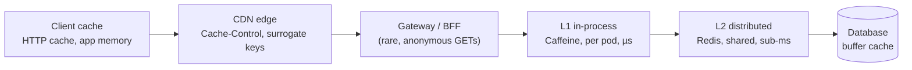
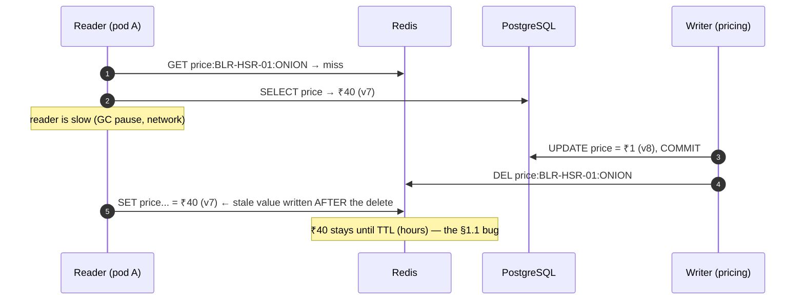
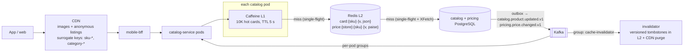
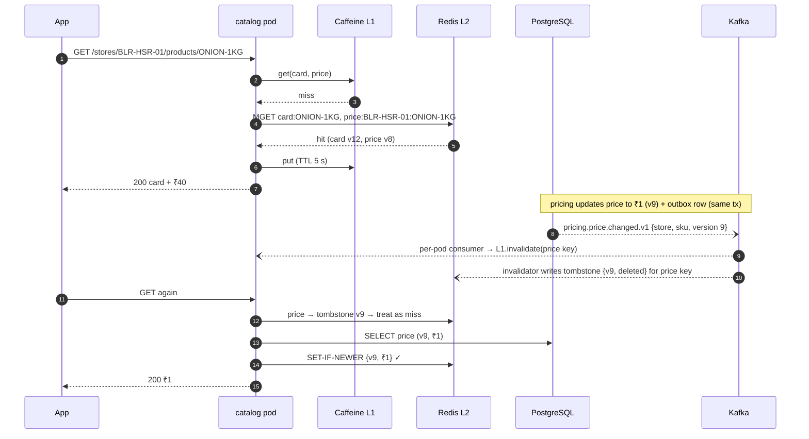
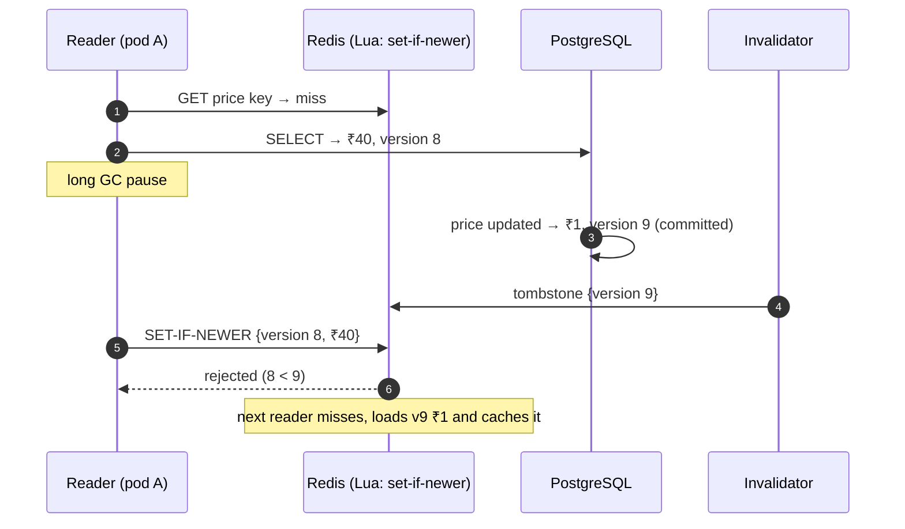
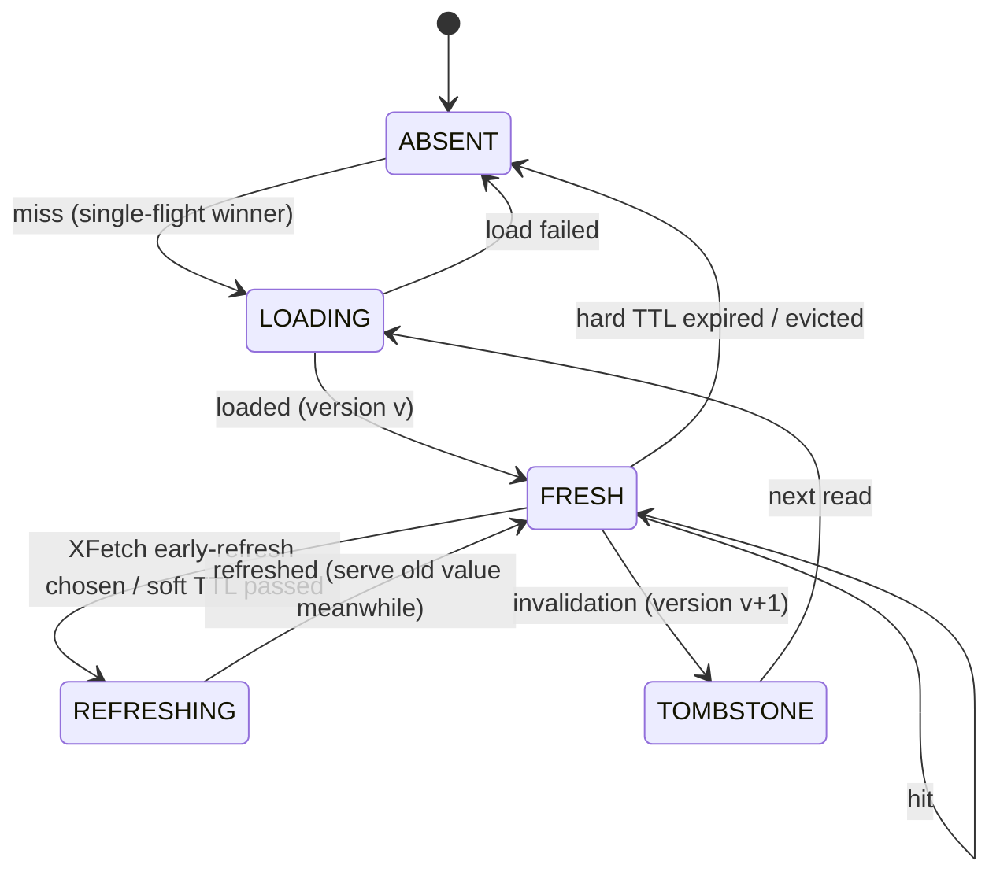
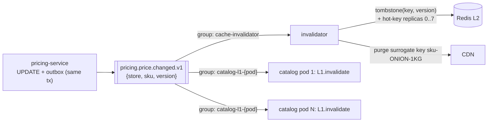

# 07. Caching ⭐

!!! abstract "Chapter at a glance"
    **Reader bands:** B1 → B4 · **Prerequisites:** [Ch 02](02-back-of-the-envelope-estimation.md), [Ch 05](05-relational-databases-deep-dive.md), [Ch 06](06-nosql-and-polyglot-persistence.md) · **What you will build:** The product-card cache, taken from LRU + single-flight + XFetch in plain Java (L1) to a two-level Caffeine + Redis cache with race-free versioned writes, event-driven invalidation across pods, hot-key protection, CDN surrogate keys and pre-sale warming (L4) · **Reading time:** 100 min + code

---

## 1. Introduction & Why It Matters

### 1.1 A story: "flush the cache so the sale prices show up"

At 7:59 pm on sale day, the pricing team loaded the festival prices. To make them "show up immediately," someone ran `FLUSHALL` on the catalog Redis cluster at 8:00:00, the exact second the sale opened.

1. **Stampede.** 110 K req/s that had been served ~98 % from cache now all missed at once. Every miss ran the same 8 ms product-card query. The catalog PostgreSQL went from 2 K to 60 K queries/s and hit 100 % CPU in seconds. Queries slowed to 2 s, and the cache couldn't refill because every loader was stuck waiting on the database.
2. **Stale prices anyway.** Each catalog pod also had an in-process cache (Caffeine, 10-minute TTL) that `FLUSHALL` didn't touch. For ten minutes, customers saw **old prices on some requests and new prices on others**, depending on which pod served them. The cart re-priced at checkout, and customers saw "price changed" errors.
3. **One stale price forever.** A price update raced with a cache fill: a reader loaded the old price, the writer updated the DB and deleted the key, and then the reader wrote the old price back. It stayed until the Redis TTL expired six hours later.

Every one of these is a **caching design** failure, not a database failure: no stampede protection, no invalidation across cache layers, and no protection against the read/write race.

!!! quote "The thesis of this chapter"
    A cache is a **copy of data with a lifetime and a staleness contract**. Caching is easy to add and hard to get right. The hard parts are what happens on a miss storm, how copies are invalidated, and what staleness each reader is allowed to see.

### 1.2 Where this lives in the grocery platform

| Layer | What's cached | Staleness allowed |
|---|---|---|
| Mobile app / browser | Category trees, images, config | Minutes to hours (versioned URLs for images) |
| CDN | Product images, static assets, anonymous category listings | Minutes; purge on change |
| API gateway / BFF | Rarely: some anonymous GETs | Seconds |
| Service in-process (L1, Caffeine) | Hot product cards, GST rates, serviceability snapshot (Ch 01) | Seconds |
| Distributed cache (L2, Redis) | Product cards, store prices, cart, sessions | Seconds to minutes, invalidated on change |
| Database | Buffer cache, query plans | n/a (always consistent) |

### 1.3 Learning objectives

| Band | After this chapter you can… |
|---|---|
| <span class="band b1">B1</span> | Explain cache hits and misses, TTLs, LRU/LFU, and where caches sit |
| <span class="band b2">B2</span> | Choose cache-aside, read-through, write-through, write-behind or refresh-ahead, and use Spring Cache with Redis |
| <span class="band b3">B3</span> | Prevent stampedes, fix the cache-aside race, handle hot keys, design multi-level caches, and measure hit ratios |
| <span class="band b4">B4</span> | Design invalidation across layers (L1, L2, CDN), cache warming, per-data staleness contracts, and caching's cost and availability trade-offs |

---

## 2. Core Concepts — Beginner to Deep

### 2.1 Intuition: the shopkeeper's counter <span class="band b1">B1</span>

A kirana shopkeeper keeps the ten most-asked-for items **on the counter** (cache) and everything else **in the storeroom** (database).

- Most customers are served from the counter: a **hit**.
- For something rare, the shopkeeper walks to the storeroom: a **miss**. He may then keep it on the counter.
- The counter is small, so when it's full he removes what nobody asked for recently: **eviction** (LRU).
- If the price of sugar changes, the price tag on the counter must change too, or customers pay the wrong price: **invalidation**.
- If 50 customers ask for sugar at once and the counter is empty, he shouldn't make 50 trips to the storeroom: **stampede protection**.

### 2.2 The numbers that make caching worth it <span class="band b1">B1</span> <span class="band b2">B2</span>

$$
\text{Effective latency} = h \times t_{cache} + (1-h) \times t_{origin}
\qquad
\text{Origin load} = (1-h) \times \text{request rate}
$$

| Hit ratio *h* | Origin load at 110 K req/s | Effective latency (cache 1 ms, origin 10 ms) |
|---|---|---|
| 0 % | 110 K/s | 10 ms |
| 90 % | 11 K/s | 1.9 ms |
| **98 %** | **2.2 K/s** | 1.18 ms |
| 99.5 % | 550/s | 1.05 ms |

!!! danger "Your database is sized for the misses, not the hits"
    At 98 % hits, the database sees 2.2 K/s. If the cache disappears, it sees 110 K/s, **50×** its normal load. The cache has become a **load-bearing** part of availability. Design for cache loss: stampede protection, gradual warming, and load shedding.

### 2.3 Where to cache ⭐ <span class="band b1">B1</span> <span class="band b2">B2</span>



| Layer | Latency | Scope | Invalidation difficulty | Best for |
|---|---|---|---|---|
| Client | 0 | One user | Hard (you don't control it) | Immutable or versioned assets, config with ETags |
| CDN | ~10–30 ms from user | Region / global | Purge APIs (seconds) | Static assets, anonymous pages, images |
| L1 in-process | ~100 ns–1 µs | One pod | Hard: N copies | Hot, small, read-mostly data with short TTLs |
| L2 distributed | ~0.3–1 ms | All pods | Easy: one copy | Shared data, sessions, computed views |
| DB buffer cache | Automatic | DB | Automatic | Everything (free) |

### 2.4 Caching patterns ⭐ <span class="band b2">B2</span>

| Pattern | Read path | Write path | Pros | Cons | Grocery use |
|---|---|---|---|---|---|
| **Cache-aside** (lazy loading) | App checks the cache, and on a miss loads from the DB and populates the cache | App writes the DB, then **deletes** the cache key | Simple; cache only holds what's read; cache failure doesn't block reads | First read is slow; race conditions (§2.8); stampedes | Product cards, store prices |
| **Read-through** | Cache library loads on a miss (loader function) | As cache-aside | Cleaner code; enables single-flight | Same staleness issues | Caffeine `LoadingCache` L1 |
| **Write-through** | Cache is always populated | Write to cache **and** DB synchronously | Reads always hit after writes | Write latency; caches data nobody reads; still inconsistent if one write fails | Rarely: config values |
| **Write-behind** (write-back) | Reads from the cache | Write to the cache; flush to the DB asynchronously | Very fast writes; batching | **Data loss** on cache failure; ordering and consistency complexity | Counters for analytics (view counts), never money |
| **Refresh-ahead** | Serve from the cache; refresh before expiry | — | Hot keys never miss | Refreshes data that may not be read again | Hot SKUs during sales; GST rate tables |

!!! tip "Delete, don't update, on writes (cache-aside)"
    After a DB write, **delete** the cache key rather than writing the new value. Two concurrent writers updating the cache can leave the older value last (their DB order and cache order differ). Deleting means the next reader loads the current value. That's not the whole story, though: see the read/write race in §2.8.

### 2.5 Eviction policies <span class="band b1">B1</span> <span class="band b2">B2</span>

| Policy | Evicts | Good for | Weakness |
|---|---|---|---|
| **LRU** | Least recently used | Recency-heavy workloads | A one-off scan (bulk export) flushes hot items |
| **LFU** | Least frequently used | Stable popularity (top SKUs) | Slow to adapt; old popular items linger (use aging) |
| **W-TinyLFU** (Caffeine) | Admission by frequency sketch + windowed LRU | Mixed workloads; near-optimal hit rates | — (the best default for JVM L1 caches) |
| **TTL / TTI** | Expired entries (time-to-live / time-to-idle) | Bounding staleness | Not a memory policy by itself |
| Random | Random entry | Very cheap | Unpredictable |

**Redis `maxmemory-policy`:** `allkeys-lru` or `allkeys-lfu` for pure caches, `volatile-*` when only keys with TTLs may be evicted, and `noeviction` for stateful data (writes fail instead of silently losing data).

### 2.6 TTLs and the staleness contract <span class="band b2">B2</span> <span class="band b3">B3</span>

Every cached item has a **staleness contract**: the maximum time a reader may see an old value. The TTL is the **safety net** that bounds it even when invalidation fails. It isn't the primary freshness mechanism for data that changes.

| Data | Changes | Invalidation | TTL (safety net) | Contract |
|---|---|---|---|---|
| Product content (name, images, description) | Rarely | Event-driven delete | 6 h ± jitter | ≤ ~5 s after change (event), ≤ 6 h worst case |
| Store price | Several times/day; bursts before sales | Event-driven delete + versioned writes | 10 min ± jitter | ≤ ~5 s; checkout re-prices from the SoR |
| Stock availability badge | Constantly | Not cached, or 5–10 s TTL | 10 s | "In stock" is a hint; reservation is exact (Ch 05) |
| GST rate table | Rarely (government notification) | Event + refresh-ahead | 1 h | ≤ 1 min |
| Serviceability | Rarely | Snapshot (Ch 01) | Full reload 30 s | Browse ≤ 60 s; checkout fresh |

!!! warning "Add jitter to TTLs"
    If 250 K keys are warmed at 7:30 pm with TTL = 30 min, they all expire at 8:00 pm, at the sale start. Use `TTL × (1 ± 10 %)` so expiries spread out.

### 2.7 Cache stampede (thundering herd) ⭐ <span class="band b2">B2</span> <span class="band b3">B3</span>

A stampede happens when many requests miss the same key at the same time (the key expired, was deleted, or the cache was cold) and all of them hit the origin.

L1 (§5) measures it: **1,000 concurrent requests → 1,000 DB calls naively, 1 with single-flight.**

| Technique | How | Scope |
|---|---|---|
| **Single-flight / request coalescing** | Concurrent misses for a key share one in-flight load | Per process (Caffeine does this for `get(key, loader)`) |
| **Distributed lock on miss** | `SET lock:key NX PX 3000`: the winner loads, others wait or serve stale | Across pods (costlier; deadline needed) |
| **Stale-while-revalidate** | Keep serving the expired value while one caller refreshes | Needs a "soft TTL" plus a "hard TTL" |
| **Probabilistic early expiration (XFetch)** | Each reader refreshes early with a probability that rises near expiry | Across pods, with no coordination |
| **Refresh-ahead for known hot keys** | Background refresh before expiry | Hot SKUs, config |
| **TTL jitter** | Avoid synchronized expiry | Everywhere |
| **Warming** | Pre-populate before known peaks | Sales, deploys, cache node replacement |
| **Load shedding / circuit breaker at origin** | Protect the DB if misses spike anyway | Last line (Ch 18) |

**XFetch** (Vattani et al., VLDB 2015) refreshes early when:

$$
\text{now} - \delta \cdot \beta \cdot \ln(\text{rand}()) \ge \text{expiry}
$$

where δ is the recompute time and β ≥ 1 is aggressiveness. From L1's run, with 10,000 req/s on one key, a 300 s TTL and δ = 0.2 s:

```text
   at t=298.0s:     1 of 10,000 callers would refresh early
   at t=299.0s:    64 of 10,000 callers would refresh early
   at t=299.8s: 3,667 of 10,000 callers would refresh early
```

In practice the **first** early refresh (~2 s before expiry) repopulates the key, so the key never actually expires under load. Combined with single-flight, only one caller per pod does the work.

### 2.8 The cache-aside race and versioned writes ⭐ <span class="band b3">B3</span>



| Fix | How | Trade-off |
|---|---|---|
| **Versioned conditional set** | Store `{version, value}` and only `SET` if the incoming version ≥ the cached version (Lua); the delete writes a **tombstone with the new version** | Needs a monotonic version from the SoR (row `version` column); a small Lua script |
| Short TTL | Bounds the staleness window | Only reduces the damage |
| Delayed double delete | Delete, then delete again after ~1 s | Heuristic; timing-dependent |
| Lease tokens (Facebook memcache) | A miss returns a lease; the set is accepted only with a valid lease, and a delete invalidates leases | Needs cache support |
| Update the cache from the change stream only (CDC) | Only the CDC consumer writes the cache, in commit order | More infrastructure; the app never writes the cache |

L3 implements **versioned conditional sets with version tombstones**, which is simple and robust with Redis Lua.

### 2.9 Invalidation across layers <span class="band b3">B3</span> <span class="band b4">B4</span>

> "There are only two hard things in Computer Science: cache invalidation and naming things." — Phil Karlton

| Layer | Invalidation mechanism | Latency |
|---|---|---|
| L2 Redis | Writer (or CDC consumer) deletes or versions the key | ms |
| L1 per pod | **Broadcast** event (Kafka, per-pod group; or Redis Pub/Sub) → each pod evicts locally; plus a short TTL | ~1 s |
| CDN | Purge by URL or **surrogate key** (tag all pages containing SKU X, then purge the tag) | seconds |
| Browser/app | `Cache-Control` + ETags; versioned URLs for immutable assets | Next request (or never, if immutable) |

The **order** matters: invalidate from the inside out (L2 → L1 → CDN). Otherwise an outer layer can re-fill from an inner layer that still holds the old value.

### 2.10 Hot keys <span class="band b3">B3</span>

A single key receiving a large share of traffic ("₹1 onions" product card during the sale) concentrates load on **one Redis shard** (Ch 06).

| Technique | How |
|---|---|
| **L1 in-process cache** | Each pod absorbs repeated reads; Redis sees ~1 read per pod per L1 TTL |
| **Key replication** | Write `card:ONION#0..#7` and read a random replica, spreading across shards |
| **Client-side caching (Redis 6+ tracking)** | The server notifies clients when keys they cached change |
| **Pre-computation** | Build the sale landing page once and serve it from the CDN |

### 2.11 Spring Cache abstraction <span class="band b2">B2</span>

| Annotation | Meaning |
|---|---|
| `@EnableCaching` | Turns on cache proxies |
| `@Cacheable(cacheNames = "productCard", key = "#sku", sync = true)` | Cache-aside read. `sync = true` makes concurrent misses **in the same JVM** wait for one loader (single-flight per JVM, if the cache provider supports it) |
| `@CacheEvict(cacheNames = "productCard", key = "#sku")` | Delete on write |
| `@CachePut` | Always execute and put the result (write-through style) |
| `@Caching` | Combine several |

**Pitfalls:**

- Proxies don't intercept self-invocation.
- `@CacheEvict` runs before the transaction commits, unless you defer it to after commit, which opens a stale-read window.
- There's no versioning, so the §2.8 race remains.
- Default Java serialization is fragile. Use JSON with explicit types.
- Null values get cached (or don't) depending on `disableCachingNullValues`.
- Keys need explicit namespaces and versions (`v2::productCard::SKU`) for schema changes.

### 2.12 Caching and consistency: what must never be cached <span class="band b3">B3</span> <span class="band b4">B4</span>

| Never serve from a cache for… | Why | Instead |
|---|---|---|
| Stock decisions at reservation | Oversell (Ch 05) | Atomic DB update |
| Payment status for fulfilment decisions | Money | SoR / payment provider |
| Final price at checkout | Price contracts | Re-price from the SoR at checkout (show "price updated" if it changed) |
| Authorization decisions with revocation needs | Security | Short TTLs plus revocation events, or direct checks |
| Idempotency records | Correctness | Same DB as the business write (Ch 04) |

The pattern: **use caches for displaying, and the system of record for deciding.**

---

## 3. Architecture & Diagrams

### 3.1 Component view: product card caching



### 3.2 Sequence: happy path, L1 miss, L2 hit, and a price change propagating



### 3.3 Sequence: failure path, a slow reader racing a price update (fixed)



!!! note "What the system guarantees after this failure path"
    A stale value can never overwrite a newer one, and a delete can't be undone by a slow reader, because every write to L2 carries the SoR version and the Lua script accepts only versions ≥ the stored one (including tombstones). The worst case is a transient extra miss. L1 staleness is bounded by its 5 s TTL even if a broadcast is missed. Checkout always re-prices from the SoR.

### 3.4 State: a cache entry with soft and hard TTLs



---

## 4. Design Document Excerpt: Product Card & Price Caching for Sales

| Field | Value |
|---|---|
| Author / Reviewers | Catalog team / Pricing, SRE, Mobile, Web |
| Status | Approved |
| Related ADRs | ADR-029 Versioned cache writes and version tombstones; ADR-030 No cache flushes: invalidate by event, warm before events |

**1. Context & Problem.** A cache flush at sale start caused a stampede that took down the catalog database, L1 caches served stale prices across pods, and a read/write race pinned a stale price for hours (§1.1).

**2. Goals / Non-Goals.**

- *Goals:* ≥ 98 % hit ratio at 110 K req/s; price changes visible within 5 s p99; no stale-forever values; survive a cold or lost Redis without taking down PostgreSQL.
- *Non-goals:* stock availability caching (a hint only, 10 s TTL); search results (Ch 22).

**3. Requirements.**

| ID | Requirement |
|---|---|
| FR-1 | Serve product card (content) + store price for (store, SKU) |
| NFR-1 | p99 ≤ 15 ms in-service at 110 K req/s (P90 190 K/s, Ch 02) |
| NFR-2 | Price change visible to readers ≤ 5 s p99 (L1 + L2) |
| NFR-3 | A newer value can never be overwritten by an older one in L2 |
| NFR-4 | With Redis unavailable, the DB sees ≤ 10 K req/s (single-flight per pod + L1 + shedding) |
| NFR-5 | Checkout prices always come from the pricing SoR |

**4. Capacity estimates.**

| Item | Calculation | Result |
|---|---|---|
| Card requests at sale start (P90) | Ch 02 | ~190 K/s |
| Distinct SKUs requested in the first 10 min | Sale concentrates demand | ~20 K; the top 500 = 60 % of traffic |
| L2 dataset: cards | 250 K SKUs × ~2 KB | **~500 MB** |
| L2 dataset: prices | 500 stores × 6 K SKUs × ~80 B | **~240 MB** |
| L1 per pod | 10 K hottest cards × 2 KB + prices | ~25 MB heap |
| L1 hit ratio (5 s TTL, hot-skewed) | Hot keys re-read many times per 5 s per pod | ~80 % |
| Redis load | 190 K × 20 % L1 misses × 2 keys (MGET = 1 op) | ~38 K ops/s → 3 shards |
| DB load at 98 % overall hit ratio | 190 K × 2 % | ~3.8 K/s (DB sized for 10 K/s) |
| Redis cold (worst case) | 96 pods × ~20 K distinct keys ÷ 60 s warm-up, single-flight per pod | ~32 K/s for the first minute → **too high**: needs warming + L2 lock on miss for top keys + shedding |

!!! success "What the estimate tells us"
    Steady state is easy. The dangerous moments are **cold starts and invalidation storms**. That's why warming, cross-pod stampede control for the hottest keys, and the ban on flushes are requirements, not optimizations.

**5. Proposed design.**

- **L1 Caffeine:** 5 s TTL, W-TinyLFU, ~10 K entries, `get(key, loader)` single-flight, and eviction by per-pod Kafka broadcast.
- **L2 Redis:** values stored as `{version, payload}` with a set-if-newer Lua script, invalidation via **version tombstones** written by an invalidator consuming outbox events, XFetch early refresh, TTL with jitter (cards 6 h, prices 10 min), and hot keys replicated ×8.
- **CDN:** product images with immutable versioned URLs; anonymous category listings with `s-maxage=30, stale-while-revalidate=60`, tagged by surrogate keys (`sku-{id}`, `category-{id}`) and purged on change.
- **Warming:** at T−30 min, a job loads the sale SKU list × stores into L2 (throttled).
- **Flushing is prohibited.** Price reloads publish change events instead.

**5.3 Cache key and value format.**

```text
key:   v1:card:{sku}                       value: {"v":12,"d":{...card json...}}      TTL 6h ± 10%
key:   v1:price:{store}:{sku}              value: {"v":9,"d":{"paise":100}}           TTL 10m ± 10%
tomb:  v1:price:{store}:{sku}              value: {"v":10,"t":1}                       TTL 60s (only blocks older writes)
hot:   v1:card:{sku}#0 .. #7               replicas for the top-500 SKUs during sales
```

The `v1:` prefix is the **cache schema version**: changing the payload format means bumping it to `v2:`, with no flush and no deserialization errors during a rolling deploy.

**7. Alternatives considered.**

| Option | Pros | Cons | Verdict |
|---|---|---|---|
| Spring `@Cacheable` + `@CacheEvict` only | Minimal code | Race (§2.8), no L1 invalidation, stampedes across pods | Rejected for prices; fine for low-risk data |
| Write-through prices to Redis | Always warm | Still races between writers; caches all 3 M prices | Rejected |
| CDC-only cache writes (app never writes the cache) | Commit-ordered | Every miss must wait for CDC; complex | Considered for 2027 |
| **Cache-aside + versioned set-if-newer + tombstones + L1 broadcast + XFetch + warming** | Race-free, bounded staleness, stampede-resistant | Lua scripts, events, more moving parts | **Chosen** |
| No L1 | Simpler invalidation | Hot keys hammer single Redis shards | Rejected (hot keys) |

**8. Failure modes.** Redis down: L1 continues (5 s TTL, then per-pod single-flight to the DB), a concurrency limiter caps DB loads per pod at 16, and excess requests get 503 with Retry-After for low-priority traffic. Kafka lag on invalidation: L1 staleness bounded at 5 s by TTL. L2 bounded by TTL, but checkout re-prices. Invalidator bug: TTLs bound the damage, and a version tombstone replay tool exists.

**10. Observability.** Hit ratio per layer and cache name, load latency, loads/s to the DB, single-flight waiters, XFetch refreshes, rejected stale sets (Lua result), invalidation lag (event time → tombstone), Redis ops/s per shard (hot-shard detection), and evictions.

**14. Decision (ADR-029/030 summary).** All L2 writes carry the SoR version and go through set-if-newer. Invalidations write version tombstones. L1 caches have TTLs ≤ 5 s for mutable data and subscribe to change events. Caches are never flushed wholesale. Change events drive invalidation, and known peaks are pre-warmed. Displays may use caches. Decisions (checkout price, stock, payment) use the system of record.

---

## 5. Hands-On Code — Level Ladder

We build the **product card + store price cache** four times:

| Level | New requirement that forces the step |
|---|---|
| L1 | "Show LRU, the stampede, and early refresh working." (plain Java) |
| L2 | "Cache reads in Redis with Spring's `@Cacheable`, and evict on writes." |
| L3 | "Two levels (Caffeine + Redis), no stale-forever race, stampede-proof, DB protected when Redis is cold." |
| L4 | "Invalidate every layer (L1 on all pods, L2, CDN) from change events, survive hot keys, and pre-warm before the sale." |

### L1 — Concept (plain Java) <span class="band b1">B1</span>

```java
// CachingL1.java — run with: java CachingL1.java
// Three caching ideas in plain Java:
//   A. LRU eviction with LinkedHashMap
//   B. Cache stampede: 1,000 concurrent misses on one hot key — naive vs single-flight (request coalescing)
//   C. Probabilistic early expiration (XFetch): refresh BEFORE expiry, spread across callers
import java.util.*;
import java.util.concurrent.*;
import java.util.concurrent.atomic.AtomicInteger;

public class CachingL1 {

    // ---------- A. LRU ----------
    static final class LruCache<K, V> extends LinkedHashMap<K, V> {
        private final int capacity;
        LruCache(int capacity) { super(16, 0.75f, true); this.capacity = capacity; }   // accessOrder = true
        @Override protected boolean removeEldestEntry(Map.Entry<K, V> eldest) { return size() > capacity; }
    }

    // ---------- B. Stampede ----------
    static final AtomicInteger dbCalls = new AtomicInteger();

    static String loadFromDb(String sku) {
        dbCalls.incrementAndGet();
        try { Thread.sleep(50); } catch (InterruptedException e) { Thread.currentThread().interrupt(); }   // slow query
        return "card:" + sku;
    }

    /** Naive cache-aside: every concurrent miss goes to the database. */
    static final class NaiveCache {
        final ConcurrentHashMap<String, String> map = new ConcurrentHashMap<>();
        String get(String sku) {
            String v = map.get(sku);
            if (v == null) { v = loadFromDb(sku); map.put(sku, v); }
            return v;
        }
    }

    /** Single-flight: concurrent misses for the same key share ONE in-flight load. */
    static final class SingleFlightCache {
        final ConcurrentHashMap<String, String> map = new ConcurrentHashMap<>();
        final ConcurrentHashMap<String, CompletableFuture<String>> inFlight = new ConcurrentHashMap<>();
        String get(String sku) {
            String v = map.get(sku);
            if (v != null) return v;
            CompletableFuture<String> mine = new CompletableFuture<>();
            CompletableFuture<String> existing = inFlight.putIfAbsent(sku, mine);
            if (existing != null) return existing.join();          // someone else is loading: wait for it
            try {
                String loaded = loadFromDb(sku);
                map.put(sku, loaded);
                mine.complete(loaded);
                return loaded;
            } catch (RuntimeException e) {
                mine.completeExceptionally(e);
                throw e;
            } finally {
                inFlight.remove(sku, mine);
            }
        }
    }

    static int stampede(java.util.function.Function<String, String> cacheGet) throws Exception {
        dbCalls.set(0);
        CountDownLatch go = new CountDownLatch(1);
        try (ExecutorService pool = Executors.newVirtualThreadPerTaskExecutor()) {
            for (int i = 0; i < 1_000; i++) pool.submit(() -> { go.await(); return cacheGet.apply("ONION-1KG"); });
            go.countDown();
        }
        return dbCalls.get();
    }

    // ---------- C. XFetch ----------
    /**
     * Returns true if this caller should refresh early. delta = how long a recompute takes, beta >= 1 (aggressiveness).
     * Probability rises as expiry approaches; slower recomputes start refreshing earlier.
     * Vattani, Chierichetti, Lowenstein — "Optimal Probabilistic Cache Stampede Prevention" (VLDB 2015)
     */
    static boolean shouldRefreshEarly(double nowSec, double expirySec, double deltaSec, double beta, Random rnd) {
        return nowSec - deltaSec * beta * Math.log(rnd.nextDouble()) >= expirySec;
    }

    public static void main(String[] args) throws Exception {
        System.out.println("A. LRU with capacity 3");
        var lru = new LruCache<String, String>(3);
        lru.put("atta", "A"); lru.put("milk", "M"); lru.put("rice", "R");
        lru.get("atta");                                  // touch → most recently used
        lru.put("eggs", "E");                             // evicts least recently used: milk
        System.out.println("   keys after access(atta) + put(eggs): " + lru.keySet());

        System.out.println("B. 1,000 concurrent requests for a cold hot key (50 ms DB query)");
        System.out.println("   naive cache-aside : " + stampede(new NaiveCache()::get) + " DB calls");
        System.out.println("   single-flight     : " + stampede(new SingleFlightCache()::get) + " DB call(s)");

        System.out.println("C. XFetch: 10,000 requests/s during the last 10 s of a 300 s TTL (recompute takes 0.2 s)");
        Random rnd = new Random(1);
        double expiry = 300;
        for (double t : new double[]{290, 295, 298, 299, 299.8}) {
            int early = 0;
            for (int i = 0; i < 10_000; i++) if (shouldRefreshEarly(t, expiry, 0.2, 1.0, rnd)) early++;
            System.out.printf("   at t=%5.1fs: %,5d of 10,000 callers would refresh early%n", t, early);
        }
    }
}
```

Actual output from running it:

```text
A. LRU with capacity 3
   keys after access(atta) + put(eggs): [rice, atta, eggs]
B. 1,000 concurrent requests for a cold hot key (50 ms DB query)
   naive cache-aside : 1000 DB calls
   single-flight     : 1 DB call(s)
C. XFetch: 10,000 requests/s during the last 10 s of a 300 s TTL (recompute takes 0.2 s)
   at t=290.0s:     0 of 10,000 callers would refresh early
   at t=295.0s:     0 of 10,000 callers would refresh early
   at t=298.0s:     1 of 10,000 callers would refresh early
   at t=299.0s:    64 of 10,000 callers would refresh early
   at t=299.8s: 3,667 of 10,000 callers would refresh early
```

**What L1 shows:** `LinkedHashMap(accessOrder=true)` is a correct LRU in 5 lines. **1,000 concurrent misses mean 1,000 DB calls, unless loads are coalesced (1 call).** XFetch makes an early refresh likely just before expiry, and rare before that.

**What L1 can't do:** it runs in one process, has no invalidation, no versions (so the §2.8 race is possible), and no memory bounds on the single-flight maps under key churn.

### L2 — Spring Cache + Redis <span class="band b2">B2</span>

```kotlin
// build.gradle.kts (module l2-spring)
dependencies {
    implementation("org.springframework.boot:spring-boot-starter-web")          // VERIFY: Boot 4 starter name
    implementation("org.springframework.boot:spring-boot-starter-cache")
    implementation("org.springframework.boot:spring-boot-starter-data-redis")
    implementation("org.springframework.boot:spring-boot-starter-jdbc")
    runtimeOnly("org.postgresql:postgresql")
    testImplementation("org.springframework.boot:spring-boot-starter-test")
}
```

=== "Cache configuration"

    ```java
    package com.grocery.catalog.config;

    import org.springframework.cache.annotation.EnableCaching;
    import org.springframework.context.annotation.*;
    import org.springframework.data.redis.cache.*;
    import org.springframework.data.redis.connection.RedisConnectionFactory;
    import org.springframework.data.redis.serializer.RedisSerializationContext.SerializationPair;
    import org.springframework.data.redis.serializer.RedisSerializer;
    import java.time.Duration;
    import java.util.Map;

    @Configuration
    @EnableCaching
    public class CacheConfig {

        @Bean
        RedisCacheManager cacheManager(RedisConnectionFactory cf) {
            RedisCacheConfiguration base = RedisCacheConfiguration.defaultCacheConfig()
                    .computePrefixWith(name -> "v1:" + name + "::")                  // cache schema version in the key
                    .serializeValuesWith(SerializationPair.fromSerializer(RedisSerializer.json()))  // VERIFY: Jackson 3 serializer in Spring Data Redis 4
                    .disableCachingNullValues();
            return RedisCacheManager.builder(cf)
                    .cacheDefaults(base.entryTtl(Duration.ofMinutes(10)))
                    .withInitialCacheConfigurations(Map.of(
                            "productCard", base.entryTtl(Duration.ofHours(6)),
                            "storePrice",  base.entryTtl(Duration.ofMinutes(10))))
                    .build();
        }
    }
    ```

=== "Service, Repository"

    ```java
    package com.grocery.catalog.domain;

    public record StorePrice(String storeId, String sku, long paise, long version) { }
    ```

    ```java
    package com.grocery.catalog.repository;

    import com.grocery.catalog.domain.StorePrice;
    import org.springframework.jdbc.core.simple.JdbcClient;
    import org.springframework.stereotype.Repository;
    import java.util.Optional;

    @Repository
    public class PriceRepository {

        private final JdbcClient jdbc;

        public PriceRepository(JdbcClient jdbc) { this.jdbc = jdbc; }

        public Optional<StorePrice> find(String storeId, String sku) {
            return jdbc.sql("SELECT store_id, sku, price_paise, version FROM store_price WHERE store_id = :s AND sku = :k")
                    .param("s", storeId).param("k", sku)
                    .query((rs, n) -> new StorePrice(rs.getString(1), rs.getString(2), rs.getLong(3), rs.getLong(4)))
                    .optional();
        }

        public int update(String storeId, String sku, long paise) {
            return jdbc.sql("""
                    UPDATE store_price SET price_paise = :p, version = version + 1, updated_at = now()
                    WHERE store_id = :s AND sku = :k""")
                    .param("p", paise).param("s", storeId).param("k", sku).update();
        }
    }
    ```

    ```java
    package com.grocery.catalog.service;

    import com.grocery.catalog.domain.StorePrice;
    import com.grocery.catalog.repository.PriceRepository;
    import org.springframework.cache.annotation.*;
    import org.springframework.stereotype.Service;
    import org.springframework.transaction.annotation.Transactional;

    @Service
    public class PriceServiceL2 {

        private final PriceRepository repo;

        public PriceServiceL2(PriceRepository repo) { this.repo = repo; }

        /** sync = true: concurrent misses for the same key IN THIS JVM share one load. Other pods still stampede. */
        @Cacheable(cacheNames = "storePrice", key = "#storeId + ':' + #sku", sync = true)
        public StorePrice price(String storeId, String sku) {
            return repo.find(storeId, sku).orElseThrow(() -> new PriceNotFoundException(storeId, sku));
        }

        /**
         * ⚠️ Two problems:
         *  1. @CacheEvict runs at method exit, which is INSIDE the transaction proxy here → it may evict before COMMIT;
         *     a reader can re-cache the OLD value in between.
         *  2. Even after commit, the §2.8 race (slow reader writes an old value after the delete) remains.
         */
        @Transactional
        @CacheEvict(cacheNames = "storePrice", key = "#storeId + ':' + #sku")
        public void updatePrice(String storeId, String sku, long paise) {
            if (repo.update(storeId, sku, paise) != 1) throw new PriceNotFoundException(storeId, sku);
        }
    }
    ```

    ```java
    package com.grocery.catalog.service;

    public class PriceNotFoundException extends RuntimeException {
        public PriceNotFoundException(String store, String sku) { super("No price for " + sku + " at " + store); }
    }
    ```

=== "Test"

    ```java
    package com.grocery.catalog;

    import com.grocery.catalog.service.PriceServiceL2;
    import org.junit.jupiter.api.*;
    import org.springframework.beans.factory.annotation.Autowired;
    import org.springframework.boot.test.context.SpringBootTest;
    import org.springframework.boot.testcontainers.service.connection.ServiceConnection;
    import org.springframework.jdbc.core.simple.JdbcClient;
    import org.testcontainers.containers.GenericContainer;
    import org.testcontainers.containers.PostgreSQLContainer;       // VERIFY: package in Testcontainers 2.x
    import org.testcontainers.junit.jupiter.*;
    import static org.assertj.core.api.Assertions.assertThat;

    @SpringBootTest
    @Testcontainers
    class PriceCacheL2IT {

        @Container @ServiceConnection static PostgreSQLContainer<?> pg = new PostgreSQLContainer<>("postgres:17-alpine");
        @Container @ServiceConnection(name = "redis")
        static GenericContainer<?> redis = new GenericContainer<>("redis:7-alpine").withExposedPorts(6379);

        @Autowired PriceServiceL2 prices;
        @Autowired JdbcClient jdbc;

        @BeforeEach
        void seed() {
            jdbc.sql("CREATE TABLE IF NOT EXISTS store_price(store_id text, sku text, price_paise bigint, version bigint, updated_at timestamptz, PRIMARY KEY(store_id, sku))").update();
            jdbc.sql("TRUNCATE store_price").update();
            jdbc.sql("INSERT INTO store_price VALUES ('S1','ONION-1KG',4000,1,now())").update();
        }

        @Test
        void secondReadIsCached_updateEvicts() {
            assertThat(prices.price("S1", "ONION-1KG").paise()).isEqualTo(4000);
            jdbc.sql("UPDATE store_price SET price_paise = 100 WHERE sku='ONION-1KG'").update();   // bypasses the service
            assertThat(prices.price("S1", "ONION-1KG").paise()).isEqualTo(4000);                  // still cached: stale!

            prices.updatePrice("S1", "ONION-1KG", 100);                                              // through the service
            assertThat(prices.price("S1", "ONION-1KG").paise()).isEqualTo(100);
        }
    }
    ```

**What L2 fixed:** 90 % of the benefit with a few annotations: TTL per cache, JSON values, versioned key prefix, and per-JVM single-flight (`sync = true`).

**What L2 still gets wrong:**

| Problem | Consequence at sale scale |
|---|---|
| Stampede across pods | 96 pods × 1 load each per hot key on expiry or cold start |
| Evict before commit, and the read/write race | Stale prices for up to the TTL (§1.1 bug 3) |
| No L1 | Hot keys hammer one Redis shard |
| Writes that bypass the service (bulk SQL, other services) never evict | Stale until TTL |
| No protection for the DB when Redis is cold | §1.1 bug 1 |

### L3 — Production-Grade: two-level cache, versioned writes, stampede control <span class="band b3">B3</span>

```kotlin
// l3-production adds
dependencies {
    implementation("com.github.ben-manes.caffeine:caffeine")
    implementation("org.springframework.boot:spring-boot-starter-actuator")
    testImplementation("org.springframework.boot:spring-boot-testcontainers")
    testImplementation("org.testcontainers:junit-jupiter")     // VERIFY: 2.x artifact names
}
```

=== "Versioned L2 (Redis Lua)"

    ```java
    package com.grocery.catalog.cache;

    import org.springframework.data.redis.core.StringRedisTemplate;
    import org.springframework.data.redis.core.script.DefaultRedisScript;
    import java.time.Clock;
    import java.time.Duration;
    import java.util.*;
    import java.util.concurrent.ThreadLocalRandom;

    /**
     * L2 entries are Redis HASHes: v (SoR version), d (payload) | t=1 (tombstone), e (soft expiry ms), c (compute ms).
     * Writes go through SET_IF_NEWER, so an older version can never overwrite a newer value or tombstone.
     */
    public class VersionedRedisCache {

        public record Entry(long version, String payload, boolean tombstone, long softExpiryMs, long computeMs) {
            public boolean isData() { return !tombstone && payload != null; }
        }

        static final DefaultRedisScript<Long> SET_IF_NEWER = new DefaultRedisScript<>("""
                -- KEYS[1]=key  ARGV: 1=version 2=payload 3=ttlMs 4=isTombstone(0/1) 5=softExpiryMs 6=computeMs
                local cur = redis.call('HGET', KEYS[1], 'v')
                if cur then
                  local c = tonumber(cur)
                  local n = tonumber(ARGV[1])
                  if n < c then return 0 end
                  if n == c then
                    local curTomb = redis.call('HGET', KEYS[1], 't') == '1'
                    -- same version: only real data may replace a tombstone; everything else is a no-op
                    if ARGV[4] == '1' or not curTomb then return 0 end
                  end
                end
                redis.call('DEL', KEYS[1])
                if ARGV[4] == '1' then
                  redis.call('HSET', KEYS[1], 'v', ARGV[1], 't', '1')
                else
                  redis.call('HSET', KEYS[1], 'v', ARGV[1], 'd', ARGV[2], 'e', ARGV[5], 'c', ARGV[6])
                end
                redis.call('PEXPIRE', KEYS[1], ARGV[3])
                return 1
                """, Long.class);

        private final StringRedisTemplate redis;
        private final Clock clock;

        public VersionedRedisCache(StringRedisTemplate redis, Clock clock) { this.redis = redis; this.clock = clock; }

        public Optional<Entry> get(String key) {
            List<Object> f = redis.opsForHash().multiGet(key, List.of("v", "d", "t", "e", "c"));
            if (f.get(0) == null) return Optional.empty();
            return Optional.of(new Entry(Long.parseLong((String) f.get(0)), (String) f.get(1), "1".equals(f.get(2)),
                    f.get(3) == null ? 0 : Long.parseLong((String) f.get(3)),
                    f.get(4) == null ? 0 : Long.parseLong((String) f.get(4))));
        }

        /** @return true if stored; false if a newer version (or same-version data) is already there */
        public boolean setIfNewer(String key, long version, String payload, Duration ttl, long computeMs) {
            long jittered = (long) (ttl.toMillis() * (0.9 + ThreadLocalRandom.current().nextDouble() * 0.2));
            long softExpiry = clock.millis() + jittered;
            Long r = redis.execute(SET_IF_NEWER, List.of(key), Long.toString(version), payload,
                    Long.toString(jittered + 60_000),        // hard TTL a bit longer than soft: allows serve-stale
                    "0", Long.toString(softExpiry), Long.toString(computeMs));
            return r != null && r == 1L;
        }

        /** Invalidation: a tombstone at the NEW version blocks slow readers holding older versions. */
        public boolean tombstone(String key, long newVersion) {
            Long r = redis.execute(SET_IF_NEWER, List.of(key), Long.toString(newVersion), "",
                    "60000", "1", "0", "0");
            return r != null && r == 1L;
        }
    }
    ```

=== "Two-level cache (Caffeine + Redis + XFetch + DB guard)"

    ```java
    package com.grocery.catalog.cache;

    import com.github.benmanes.caffeine.cache.*;
    import io.micrometer.core.instrument.MeterRegistry;
    import java.time.Clock;
    import java.time.Duration;
    import java.util.Optional;
    import java.util.concurrent.*;
    import java.util.function.Function;

    /**
     * get(key):
     *   L1 (Caffeine, per pod, 5 s)  →  L2 (versioned Redis)  →  loader (DB) guarded by a per-pod semaphore.
     * Caffeine.get(key, fn) is atomic per key → single-flight within the pod.
     * XFetch on L2 soft expiry → one early refresh before the key actually expires.
     */
    public class TwoLevelCache {

        public record Versioned(long version, String payload) { }

        private final Cache<String, Versioned> l1;
        private final VersionedRedisCache l2;
        private final Semaphore dbPermits;
        private final Duration l2Ttl;
        private final Clock clock;
        private final MeterRegistry metrics;
        private final String name;

        public TwoLevelCache(String name, VersionedRedisCache l2, Duration l1Ttl, long l1MaxEntries, Duration l2Ttl,
                             int maxConcurrentDbLoads, Clock clock, MeterRegistry metrics) {
            this.name = name; this.l2 = l2; this.l2Ttl = l2Ttl; this.clock = clock; this.metrics = metrics;
            this.dbPermits = new Semaphore(maxConcurrentDbLoads);
            this.l1 = Caffeine.newBuilder()
                    .expireAfterWrite(l1Ttl)
                    .maximumSize(l1MaxEntries)              // W-TinyLFU admission/eviction
                    .recordStats()
                    .build();
            // VERIFY: CaffeineCacheMetrics.monitor(metrics, l1, name) binds hit/miss/eviction metrics
        }

        public Versioned get(String key, Function<String, Optional<Versioned>> dbLoader) {
            return l1.get(key, k -> fromL2OrDb(k, dbLoader));        // single-flight per pod
        }

        public void invalidateLocal(String key) { l1.invalidate(key); }

        private Versioned fromL2OrDb(String key, Function<String, Optional<Versioned>> dbLoader) {
            Optional<VersionedRedisCache.Entry> e = safeL2Get(key);
            if (e.isPresent() && e.get().isData()) {
                var entry = e.get();
                if (!shouldRefreshEarly(entry)) {
                    metrics.counter("cache.l2", "cache", name, "result", "hit").increment();
                    return new Versioned(entry.version(), entry.payload());
                }
                metrics.counter("cache.l2", "cache", name, "result", "early_refresh").increment();
                // Unlucky caller refreshes; on failure, serve the still-valid value (stale-while-revalidate)
                try { return loadAndStore(key, dbLoader); }
                catch (RuntimeException ex) { return new Versioned(entry.version(), entry.payload()); }
            }
            metrics.counter("cache.l2", "cache", name, "result", e.isPresent() ? "tombstone" : "miss").increment();
            return loadAndStore(key, dbLoader);
        }

        private Versioned loadAndStore(String key, Function<String, Optional<Versioned>> dbLoader) {
            boolean acquired;
            try { acquired = dbPermits.tryAcquire(200, TimeUnit.MILLISECONDS); }
            catch (InterruptedException ie) { Thread.currentThread().interrupt(); throw new CacheLoadRejectedException(name); }
            if (!acquired) {                                          // DB guard: shed instead of piling on
                metrics.counter("cache.load.rejected", "cache", name).increment();
                throw new CacheLoadRejectedException(name);
            }
            try {
                long t0 = clock.millis();
                Versioned v = dbLoader.apply(key).orElseThrow(() -> new CacheMissNotFoundException(key));
                long computeMs = Math.max(1, clock.millis() - t0);
                boolean stored = safeL2Set(key, v, computeMs);
                if (!stored) metrics.counter("cache.l2.set_rejected_stale", "cache", name).increment();
                return v;
            } finally {
                dbPermits.release();
            }
        }

        /** XFetch: now - δ·β·ln(rand) ≥ expiry, with δ = last compute time, β = 1. */
        boolean shouldRefreshEarly(VersionedRedisCache.Entry e) {
            if (e.softExpiryMs() == 0) return false;
            double r = ThreadLocalRandom.current().nextDouble();
            return clock.millis() - e.computeMs() * Math.log(r) >= e.softExpiryMs();
        }

        private Optional<VersionedRedisCache.Entry> safeL2Get(String key) {
            try { return l2.get(key); }
            catch (RuntimeException redisDown) {                     // Redis outage → behave as a miss (guarded by the semaphore)
                metrics.counter("cache.l2.errors", "cache", name).increment();
                return Optional.empty();
            }
        }

        private boolean safeL2Set(String key, Versioned v, long computeMs) {
            try { return l2.setIfNewer(key, v.version(), v.payload(), l2Ttl, computeMs); }
            catch (RuntimeException redisDown) { metrics.counter("cache.l2.errors", "cache", name).increment(); return false; }
        }

        public static class CacheLoadRejectedException extends RuntimeException {
            public CacheLoadRejectedException(String cache) { super("load shed for cache " + cache, null, false, false); }
        }
        public static class CacheMissNotFoundException extends RuntimeException {
            public CacheMissNotFoundException(String key) { super("not found: " + key); }
        }
    }
    ```

    !!! note "Why `computeMs` goes into the entry"
        XFetch refreshes slower-to-compute keys earlier. Storing the last compute time with the value lets **every pod** make the same probabilistic decision with no coordination.

=== "Service, Delegate, Controller"

    ```java
    package com.grocery.catalog.service;

    import com.grocery.catalog.cache.TwoLevelCache;
    import com.grocery.catalog.cache.TwoLevelCache.Versioned;
    import com.grocery.catalog.repository.PriceRepository;
    import org.springframework.stereotype.Service;
    import java.util.Optional;

    @Service
    public class PriceService {

        private final TwoLevelCache cache;
        private final PriceRepository repo;

        public PriceService(TwoLevelCache priceCache, PriceRepository repo) { this.cache = priceCache; this.repo = repo; }

        /** Display price (cached). Checkout must call PricingClient for the authoritative price (Ch 01 principle). */
        public long displayPricePaise(String storeId, String sku) {
            Versioned v = cache.get(key(storeId, sku), k -> repo.find(storeId, sku)
                    .map(p -> new Versioned(p.version(), Long.toString(p.paise()))));
            return Long.parseLong(v.payload());
        }

        static String key(String storeId, String sku) { return "v1:price:" + storeId + ":" + sku; }
    }
    ```

    ```java
    package com.grocery.catalog.controller;

    import com.grocery.catalog.cache.TwoLevelCache;
    import com.grocery.catalog.service.PriceService;
    import org.springframework.http.*;
    import org.springframework.web.bind.annotation.*;

    @RestController
    public class PriceController {

        private final PriceService prices;   // (a delegate composing card + price sits here in the full service)

        public PriceController(PriceService prices) { this.prices = prices; }

        @GetMapping("/api/v1/stores/{storeId}/products/{sku}/price")
        public ResponseEntity<PriceView> price(@PathVariable String storeId, @PathVariable String sku) {
            long paise = prices.displayPricePaise(storeId, sku);
            return ResponseEntity.ok()
                    .cacheControl(CacheControl.noStore())             // per-store price: don't cache at shared edges
                    .body(new PriceView(storeId, sku, paise, "INR"));
        }

        @ExceptionHandler(TwoLevelCache.CacheLoadRejectedException.class)
        ResponseEntity<ProblemDetail> shed(TwoLevelCache.CacheLoadRejectedException e) {
            var pd = ProblemDetail.forStatusAndDetail(HttpStatus.SERVICE_UNAVAILABLE, "Busy, please retry");
            pd.setProperty("code", "CATALOG_BUSY");
            return ResponseEntity.status(HttpStatus.SERVICE_UNAVAILABLE).header(HttpHeaders.RETRY_AFTER, "1").body(pd);
        }

        public record PriceView(String storeId, String sku, long pricePaise, String currency) { }
    }
    ```

    ```java
    package com.grocery.catalog.config;

    import com.grocery.catalog.cache.*;
    import io.micrometer.core.instrument.MeterRegistry;
    import org.springframework.context.annotation.*;
    import org.springframework.data.redis.core.StringRedisTemplate;
    import java.time.*;

    @Configuration
    public class TwoLevelCacheConfig {

        @Bean Clock clock() { return Clock.systemUTC(); }

        @Bean VersionedRedisCache versionedRedisCache(StringRedisTemplate redis, Clock clock) {
            return new VersionedRedisCache(redis, clock);
        }

        @Bean
        TwoLevelCache priceCache(VersionedRedisCache l2, Clock clock, MeterRegistry metrics) {
            return new TwoLevelCache("storePrice", l2,
                    Duration.ofSeconds(5),        // L1 TTL: bounds cross-pod staleness if a broadcast is missed
                    50_000,                       // L1 entries
                    Duration.ofMinutes(10),       // L2 soft TTL (± jitter)
                    16,                           // max concurrent DB loads per pod (Little's Law: DB budget / pods)
                    clock, metrics);
        }
    }
    ```

=== "Integration tests (Testcontainers)"

    ```java
    package com.grocery.catalog.cache;

    import io.micrometer.core.instrument.simple.SimpleMeterRegistry;
    import org.junit.jupiter.api.*;
    import org.springframework.data.redis.connection.lettuce.LettuceConnectionFactory;
    import org.springframework.data.redis.core.StringRedisTemplate;
    import org.testcontainers.containers.GenericContainer;
    import org.testcontainers.junit.jupiter.*;
    import java.time.*;
    import java.util.Optional;
    import java.util.concurrent.*;
    import java.util.concurrent.atomic.AtomicInteger;
    import static org.assertj.core.api.Assertions.assertThat;

    @Testcontainers
    class TwoLevelCacheIT {

        @Container static GenericContainer<?> redis = new GenericContainer<>("redis:7-alpine").withExposedPorts(6379);

        StringRedisTemplate template;
        VersionedRedisCache l2;
        final Clock clock = Clock.systemUTC();

        @BeforeEach
        void setUp() {
            var cf = new LettuceConnectionFactory(redis.getHost(), redis.getMappedPort(6379));
            cf.afterPropertiesSet();
            template = new StringRedisTemplate(cf);
            template.afterPropertiesSet();
            template.getConnectionFactory().getConnection().serverCommands().flushAll();   // test isolation only!
            l2 = new VersionedRedisCache(template, clock);
        }

        private TwoLevelCache pod() {
            return new TwoLevelCache("t", l2, Duration.ofSeconds(5), 1000, Duration.ofMinutes(10), 16, clock, new SimpleMeterRegistry());
        }

        @Test
        void slowReaderCannotOverwriteNewerVersion() {
            assertThat(l2.tombstone("k", 9)).isTrue();                                  // price changed to v9
            assertThat(l2.setIfNewer("k", 8, "4000", Duration.ofMinutes(10), 5)).isFalse();   // slow reader with v8
            assertThat(l2.setIfNewer("k", 9, "100", Duration.ofMinutes(10), 5)).isTrue();     // fresh reader with v9
            assertThat(l2.tombstone("k", 9)).isFalse();                                  // late duplicate invalidation
            assertThat(l2.get("k")).get().satisfies(e -> {
                assertThat(e.isData()).isTrue();
                assertThat(e.payload()).isEqualTo("100");
            });
        }

        @Test
        void twoPodsAndTwoHundredConcurrentMissesLoadAtMostTwice() throws Exception {
            AtomicInteger dbLoads = new AtomicInteger();
            var podA = pod();
            var podB = pod();
            java.util.function.Function<String, Optional<TwoLevelCache.Versioned>> loader = k -> {
                dbLoads.incrementAndGet();
                try { Thread.sleep(100); } catch (InterruptedException e) { Thread.currentThread().interrupt(); }
                return Optional.of(new TwoLevelCache.Versioned(1, "4000"));
            };
            try (var pool = Executors.newVirtualThreadPerTaskExecutor()) {
                CountDownLatch go = new CountDownLatch(1);
                for (int i = 0; i < 200; i++) {
                    var p = (i % 2 == 0) ? podA : podB;
                    pool.submit(() -> { go.await(); return p.get("hot", loader); });
                }
                go.countDown();
            }
            assertThat(dbLoads.get()).isLessThanOrEqualTo(2);      // one per pod at most
        }

        @Test
        void redisDownFallsBackToDbWithinPermits() {
            var cf = new LettuceConnectionFactory("localhost", 1);            // nothing listens on port 1
            cf.afterPropertiesSet();
            var tpl = new StringRedisTemplate(cf);
            tpl.afterPropertiesSet();
            var broken = new VersionedRedisCache(tpl, clock);
            var cache = new TwoLevelCache("t", broken, Duration.ofSeconds(5), 1000, Duration.ofMinutes(10), 16, clock, new SimpleMeterRegistry());
            var v = cache.get("k", k -> Optional.of(new TwoLevelCache.Versioned(1, "4000")));
            assertThat(v.payload()).isEqualTo("4000");             // served from DB, cached in L1
        }
    }
    ```

**What L3 guarantees:** an older version can never overwrite a newer one (all five race cases are covered by tests and match the verified semantics), there's at most one DB load per key per pod at a time, early refresh keeps hot keys from expiring under load, and the DB is protected by a per-pod permit budget when Redis is cold or down.

**What L3 still lacks:** who writes the tombstones, and how do the *other* pods' L1 caches and the CDN find out about a change? There's also no hot-key spreading across Redis shards and no warm-up before the sale.

### L4 — Enterprise: event-driven invalidation, hot keys, CDN, warming <span class="band b4">B4</span>



=== "Invalidator & L1 broadcast"

    ```java
    package com.grocery.catalog.invalidation;

    public record PriceChanged(String storeId, String sku, long version) { }
    ```

    ```java
    package com.grocery.catalog.invalidation;

    import com.grocery.catalog.cache.*;
    import io.micrometer.core.instrument.MeterRegistry;
    import org.springframework.kafka.annotation.KafkaListener;
    import org.springframework.stereotype.Component;
    import java.time.*;

    /** One consumer group for the whole fleet: writes version tombstones (idempotent) and purges the CDN. */
    @Component
    public class CacheInvalidator {

        private final VersionedRedisCache l2;
        private final HotKeys hotKeys;
        private final CdnPurger cdn;
        private final Clock clock;
        private final MeterRegistry metrics;

        public CacheInvalidator(VersionedRedisCache l2, HotKeys hotKeys, CdnPurger cdn, Clock clock, MeterRegistry metrics) {
            this.l2 = l2; this.hotKeys = hotKeys; this.cdn = cdn; this.clock = clock; this.metrics = metrics;
        }

        @KafkaListener(topics = "pricing.price.changed.v1", groupId = "cache-invalidator")
        public void onPriceChanged(PriceChanged e) {
            String key = "v1:price:" + e.storeId() + ":" + e.sku();
            l2.tombstone(key, e.version());                             // inside-out: L2 first ...
            for (String replica : hotKeys.replicasOf(key)) l2.tombstone(replica, e.version());
            cdn.purgeSurrogateKey("sku-" + e.sku());                    // ... then the edge
            metrics.counter("cache.invalidations", "type", "price").increment();
        }
    }
    ```

    ```java
    package com.grocery.catalog.invalidation;

    import com.grocery.catalog.cache.TwoLevelCache;
    import org.springframework.kafka.annotation.KafkaListener;
    import org.springframework.stereotype.Component;

    /** Unique group per pod → every pod receives every change → evicts its own L1. (Same pattern as Ch 01.) */
    @Component
    public class L1Broadcaster {

        private final TwoLevelCache priceCache;

        public L1Broadcaster(TwoLevelCache priceCache) { this.priceCache = priceCache; }

        @KafkaListener(topics = "pricing.price.changed.v1", groupId = "catalog-l1-${HOSTNAME:local}",
                       properties = "auto.offset.reset=latest")
        public void onPriceChanged(PriceChanged e) {
            priceCache.invalidateLocal("v1:price:" + e.storeId() + ":" + e.sku());
        }
    }
    ```

    !!! warning "Order of L1 and L2 invalidation"
        If a pod evicts L1 **before** the invalidator has written the L2 tombstone, the next L1 miss can re-read the old L2 value and cache it for up to 5 s. That's acceptable here (it's the L1 TTL bound). To tighten it, have the invalidator publish a secondary `cache.invalidated` event *after* writing L2, and drive L1 eviction from that.

=== "Hot keys"

    ```java
    package com.grocery.catalog.cache;

    import java.util.List;
    import java.util.Set;
    import java.util.concurrent.ThreadLocalRandom;
    import java.util.stream.IntStream;

    /**
     * Hot keys (sale SKUs) get N replicas with different names → different hash slots → different Redis shards.
     * Reads pick a random replica; invalidations tombstone all replicas.
     */
    public class HotKeys {

        private final Set<String> hot;          // loaded from the sale plan (and/or live hot-key detection)
        private final int replicas;

        public HotKeys(Set<String> hotKeys, int replicas) { this.hot = Set.copyOf(hotKeys); this.replicas = replicas; }

        public String readKey(String key) {
            return hot.contains(key) ? key + "#" + ThreadLocalRandom.current().nextInt(replicas) : key;
        }

        public List<String> replicasOf(String key) {
            return hot.contains(key) ? IntStream.range(0, replicas).mapToObj(i -> key + "#" + i).toList() : List.of();
        }

        public boolean isHot(String key) { return hot.contains(key); }
    }
    ```

    The two-level cache uses `hotKeys.readKey(key)` for L2 reads and writes all replicas on a fill (each with `setIfNewer`, so replicas can't go backwards either). With L1 in front, each pod reads a hot key from Redis at most about once per 5 s, so replication matters most when L1 is cold (deploys, scale-out).

=== "CDN caching & purge"

    ```java
    package com.grocery.catalog.controller;

    import org.springframework.http.*;
    import org.springframework.web.bind.annotation.*;
    import java.time.Duration;
    import java.util.List;

    @RestController
    public class CategoryListingController {

        /** Anonymous, store-cluster-level listing: cacheable at the edge for 30 s, served stale up to 60 s while revalidating. */
        @GetMapping("/api/v1/clusters/{clusterId}/categories/{categoryId}/products")
        public ResponseEntity<List<ProductTile>> listing(@PathVariable String clusterId, @PathVariable String categoryId) {
            List<ProductTile> tiles = List.of();    // … built from the two-level caches
            String surrogateKeys = "category-" + categoryId + " " +
                    String.join(" ", tiles.stream().map(t -> "sku-" + t.sku()).toList());
            return ResponseEntity.ok()
                    .cacheControl(CacheControl.maxAge(Duration.ZERO)                   // browsers: revalidate
                            .sMaxAge(Duration.ofSeconds(30))                            // shared caches: 30 s
                            .staleWhileRevalidate(Duration.ofSeconds(60)))
                    .header("Surrogate-Key", surrogateKeys)                             // Fastly; Cloudflare uses Cache-Tag
                    .body(tiles);
        }

        public record ProductTile(String sku, String name, long pricePaise, String imageUrl) { }
    }
    ```

    ```java
    package com.grocery.catalog.invalidation;

    import org.springframework.web.client.RestClient;

    /** Thin adapter over the CDN's purge API (provider-specific: surrogate keys / cache tags). */
    public class CdnPurger {
        private final RestClient cdn;
        public CdnPurger(RestClient cdnApiClient) { this.cdn = cdnApiClient; }

        public void purgeSurrogateKey(String key) {
            // VERIFY: exact endpoint, auth and soft-purge option for your CDN provider
            cdn.post().uri("/service/{serviceId}/purge/{key}", "catalog", key).retrieve().toBodilessEntity();
        }
    }
    ```

    !!! tip "Surrogate keys beat URL purges"
        One price change affects hundreds of listing URLs (every category page and search result containing the SKU). Tag responses with `sku-…` keys and purge the tag once, instead of enumerating URLs.

=== "Pre-sale warming"

    ```java
    package com.grocery.catalog.warmup;

    import com.grocery.catalog.service.PriceService;
    import io.micrometer.core.instrument.MeterRegistry;
    import java.util.List;
    import java.util.concurrent.*;

    /**
     * Loads sale SKUs × stores into L2 at T−30 min, throttled so warming itself can't overload the DB.
     * Run as a one-off job (Kubernetes Job) from the event plan (Ch 02).
     */
    public class SaleCacheWarmer {

        public record Target(String storeId, String sku) { }

        private final PriceService prices;
        private final MeterRegistry metrics;

        public SaleCacheWarmer(PriceService prices, MeterRegistry metrics) { this.prices = prices; this.metrics = metrics; }

        public void warm(List<Target> targets, int perSecond) throws InterruptedException {
            long intervalNanos = 1_000_000_000L / perSecond;
            try (var pool = Executors.newVirtualThreadPerTaskExecutor()) {
                long next = System.nanoTime();
                for (Target t : targets) {
                    long wait = next - System.nanoTime();
                    if (wait > 0) TimeUnit.NANOSECONDS.sleep(wait);
                    next += intervalNanos;
                    pool.submit(() -> {
                        try { prices.displayPricePaise(t.storeId(), t.sku()); metrics.counter("cache.warm", "result", "ok").increment(); }
                        catch (RuntimeException e) { metrics.counter("cache.warm", "result", "error").increment(); }
                    });
                }
            }
        }
    }
    ```

    | Warming math | |
    |---|---|
    | Targets | 500 sale SKUs × 500 stores = 250 K price keys + 500 cards |
    | Rate | 2,000/s (well below the DB budget of 10 K/s) → ~2 minutes |
    | TTL jitter | ± 10 % on a 10 min soft TTL, plus XFetch, so there's no synchronized expiry at 20:00 |

=== "Tests"

    ```java
    package com.grocery.catalog.cache;

    import org.junit.jupiter.api.Test;
    import java.util.*;
    import static org.assertj.core.api.Assertions.assertThat;

    class HotKeysTest {

        @Test
        void hotKeysSpreadAcrossReplicas_coldKeysUnchanged() {
            var hot = new HotKeys(Set.of("v1:price:S1:ONION"), 8);
            Map<String, Integer> hits = new HashMap<>();
            for (int i = 0; i < 8_000; i++) hits.merge(hot.readKey("v1:price:S1:ONION"), 1, Integer::sum);

            assertThat(hits).hasSize(8);                                                 // all replicas used
            assertThat(hits.values()).allSatisfy(n -> assertThat(n).isBetween(800, 1200)); // roughly even
            assertThat(hot.readKey("v1:price:S1:MILK")).isEqualTo("v1:price:S1:MILK");
            assertThat(hot.replicasOf("v1:price:S1:ONION")).hasSize(8);
        }
    }
    ```

    An end-to-end test (Testcontainers Kafka + Redis + two app contexts as "pods") publishes `pricing.price.changed.v1` with version 9. It asserts that L2 holds a v9 tombstone within 1 s, both pods' L1 no longer return v8, and the next read on each pod returns the new price from the DB.

!!! note "ADR-029/030: Versioned cache writes; event-driven invalidation; no flushes"
    **Context.** A cache flush at sale start caused a DB meltdown, L1 caches served stale prices across pods, and a read/write race pinned a stale price for hours (§1.1).

    **Decision.** (1) Every L2 value carries the SoR version, and writes use set-if-newer (Lua). Invalidations write **version tombstones**. (2) The SoR publishes change events via outbox. A fleet-wide invalidator writes the tombstones (including hot-key replicas) and purges the CDN by surrogate key, and per-pod consumers evict L1. (3) L1 TTL is ≤ 5 s for mutable data. L2 soft TTLs have ± 10 % jitter, with XFetch early refresh and serve-stale on refresh failure. (4) DB loads per pod are capped by a semaphore, and excess is shed with 503 + Retry-After. (5) Known events are pre-warmed from the event plan. `FLUSHALL`/`FLUSHDB` are prohibited in production (Redis ACL). (6) Caches serve displays only. Checkout, stock and payment read the SoR.

    **Consequences.** (+) Staleness ≤ ~1–5 s after a change, with no stale-forever values. (+) Cold or lost Redis doesn't take down the DB. (−) Lua scripts, invalidation events and per-pod consumers to operate. (−) Invalidation depends on outbox events: bulk SQL that bypasses the outbox must publish events too, and that's enforced by pricing owning all writes.

    **Revisit when:** invalidation lag or volume grows (consider CDC-driven cache population), or client-side caching with Redis tracking becomes attractive for L1.

### What changed from L1 to L4

| Concern | L1 | L2 | L3 | L4 |
|---|---|---|---|---|
| Layers | In-memory map | Redis via `@Cacheable` | Caffeine L1 + versioned Redis L2 | + CDN |
| Stampede | Single-flight demo | Per-JVM `sync = true` | Per-pod single-flight + XFetch + DB permits | + warming, TTL jitter |
| Read/write race | — | Present | **Fixed**: set-if-newer + tombstones | same |
| Invalidation | — | `@CacheEvict` (pre-commit, local path only) | Tombstone API | Outbox events → invalidator (L2, CDN) + per-pod L1 eviction |
| Hot keys | — | One shard | L1 absorbs | + replica keys across shards |
| Redis outage | — | Errors | DB fallback within permits, shedding beyond | same |
| Staleness bound | — | TTL (hours) | TTL + tombstones | ~1–5 s event-driven, TTL as safety net |

---

## 6. Production Concerns

### 6.1 Failure modes

| Failure | Detection signal | Blast radius | Mitigation |
|---|---|---|---|
| **Stampede** (hot key expiry, flush, cold start) | Origin QPS spike; `cache.l2{result=miss}` spike; DB CPU | Origin DB and everything sharing it | Single-flight, XFetch, TTL jitter, warming, DB permits + shedding, no flushes |
| **Avalanche** (many keys expire together) | Periodic miss spikes aligned to TTL | Origin | TTL jitter; staggered warming |
| **Penetration** (requests for keys that don't exist) | Misses that never become hits; high "not found" loads | Origin | Negative caching (short TTL), Bloom filter of valid ids, input validation, rate limits |
| Stale-forever value (read/write race) | Customer reports; version mismatch checks | Wrong prices shown | Versioned set-if-newer + tombstones |
| Missed invalidation (event lost or lagging) | Invalidation lag metric; version drift sampling | Stale within TTL | Outbox (no lost events), TTL safety net, lag alerts |
| Hot key / hot shard | One Redis shard at 100 % CPU; slot-level metrics | All keys on that shard | L1, key replication, spread sale SKUs |
| Big keys (MB-sized values) | Redis latency spikes; network saturation | Shard stalls | Size limits, compression, split values |
| Redis memory full | Evictions ↑, or write errors with `noeviction` | Hit ratio collapse or write failures | Sizing, eviction policy per purpose, TTLs everywhere |
| Redis failover | Brief errors, possible lost writes | Short miss spike | Treat L2 as rebuildable; DB permits absorb |
| Serialization change on deploy | Deserialization errors after rollout | Every read of old entries | Cache schema version in the key prefix (`v1:` → `v2:`) |
| Cache poisoning (bad data cached widely) | Error reports concentrated on one version | Everyone reading that key | Version tombstone to purge; validate before caching; short TTLs for new data paths |

### 6.2 Observability

| Signal | Why |
|---|---|
| Hit ratio per cache and layer (L1, L2, CDN) | The core health metric. Track **request-weighted** hit ratio, not key-count |
| Origin loads/s from cache misses | What the DB actually experiences |
| Load latency (p50/p99) | Slow loads enlarge stampede windows |
| Single-flight waiters / permits exhausted (`cache.load.rejected`) | Stampede pressure; shedding in effect |
| `cache.l2.set_rejected_stale` | Races caught by versioning. A non-zero count is expected; a spike means slow readers |
| Invalidation lag (change committed → tombstone written → L1 evicted) | Freshness SLO |
| Evictions, memory, keyspace size | Capacity |
| Per-shard ops/s and latency | Hot keys |
| CDN hit ratio, purge count and latency, origin fetches | Edge effectiveness |
| Sampled consistency check (cached version vs SoR version) | Detects silent staleness |

### 6.3 Security

- **Never cache personalized responses at shared layers** (CDN/gateway) unless the cache key includes the user or the response is truly public. `Cache-Control: private`/`no-store` is the default for authenticated responses. A single misconfigured `public` header can serve one user's cart or address to others.
- **Cache keys must include every input that changes the response** (store, language, app version, experiment bucket) or users see each other's variants.
- **Web cache poisoning:** unkeyed headers (`X-Forwarded-Host`) reflected into cached responses. Normalize and validate at the edge.
- **Sensitive data in Redis:** avoid PII where possible, use TLS and ACLs, and set TTLs on everything. Remember that Redis snapshots and replicas copy data too.
- **Prohibit dangerous commands** (`FLUSHALL`, `FLUSHDB`, `KEYS`, `CONFIG`) for application users via Redis ACLs.

### 6.4 Performance & tuning knobs

| Knob | Starting point | Guidance |
|---|---|---|
| L1 TTL (mutable data) | 1–5 s | Bounds cross-pod staleness if broadcasts are missed |
| L1 size | Working set of hot keys (10–50 K) | Watch heap and GC; Caffeine W-TinyLFU |
| L2 soft TTL | Minutes to hours, ± 10 % jitter | Safety net; events do the freshness |
| L2 hard TTL | Soft + margin | Allows serve-stale during refresh failures |
| XFetch β | 1.0 | Higher means earlier refreshes |
| DB permits per pod | DB budget ÷ pods | Little's Law (Ch 02) |
| Negative-cache TTL | 30–60 s | Long enough to absorb abuse, short enough for new products |
| Hot-key replicas | 4–16 | Number of shards to spread over |
| Tombstone TTL | ≥ the longest plausible slow-reader delay (60 s) | Too short brings back the race |
| CDN | `s-maxage` 30–300 s + `stale-while-revalidate` | Surrogate keys for purges |

### 6.5 Cost

- A cache is **memory traded for origin capacity and latency**. At 98 % hit ratio, the catalog DB serves ~4 K/s instead of 190 K/s, which is the difference between one modest cluster and a heavily sharded one.
- **Right-size by the working set**, not the whole dataset. A 500 MB card set plus 240 MB of prices in Redis costs far less than the DB capacity it replaces.
- **CDN egress is often the largest line item.** Cache images aggressively, with versioned immutable URLs and modern formats (WebP/AVIF).
- **Every cache layer adds operational cost:** invalidation paths, metrics, runbooks. Add a layer only when the estimate shows it's needed (Ch 02).

---

## 7. Anti-Patterns & Pitfalls

**1. Flushing the cache to "refresh" data.**
*Symptom:* A stampede at the worst possible moment (§1.1).
*Fix:* Event-driven invalidation of the changed keys, and warming before events. Block `FLUSH*` via ACLs.

**2. Updating the cache on write instead of deleting (or versioning).**

```java
// ❌ before: two concurrent writers can leave the OLDER value in the cache
repo.update(price);  redis.set(key, price);

// ✅ after: version tombstone; readers repopulate with set-if-newer
repo.update(price);  /* outbox event → invalidator → */ l2.tombstone(key, newVersion);
```

**3. Evicting before commit.**
*Symptom:* A reader re-caches the old value between the evict and the commit.
*Fix:* Invalidate after commit, via an outbox event or a `TransactionSynchronization.afterCommit` hook, plus versioning.

**4. No stampede protection.**

```java
// ❌ before: every concurrent miss hits the DB
String v = redis.get(k); if (v == null) { v = db.load(k); redis.set(k, v); }

// ✅ after: per-pod single-flight + early refresh + DB permits (L3)
return twoLevelCache.get(k, loader);
```

**5. Same TTL for everything, with no jitter.** Synchronized expiry means an avalanche.

**6. Caching negative results forever, or never.**
*Symptom:* A product added later "doesn't exist" for hours, or bots probing random SKUs hammer the DB.
*Fix:* Negative cache with a short TTL, plus an id validation or Bloom filter.

**7. Caching decisions, not displays.**
*Symptom:* Checkout charges a cached price, or allows a reservation based on a cached stock badge.
*Fix:* Caches for display, the SoR for decisions (§2.12).

**8. Shared-edge caching of personalized responses.**

```http
# ❌ before: public caching of a response that contains the user's address
Cache-Control: public, max-age=60

# ✅ after
Cache-Control: private, no-store
```

**9. Unversioned cache keys across deploys.**
*Symptom:* Deserialization errors or wrong fields after a payload change during a rolling deploy.
*Fix:* A cache schema prefix (`v1:` → `v2:`), with old keys expiring naturally.

**10. "Just add a cache" to hide a slow query.**
*Symptom:* The cache hides an N+1 or a missing index until the first cold start takes the DB down.
*Fix:* Make the origin query fast (Ch 05) first. The cache is for scale, not for fixing bad queries.

---

## 8. Interview Q&A

### Beginner <span class="band b1">B1</span>

??? question "Q1 [B1] ⭐ What is caching, and how do you measure whether it's working?"

    **30-second answer:** Keeping copies of frequently read data in faster storage closer to the reader, to cut latency and origin load. Measure it by hit ratio (request-weighted), origin load from misses, latency per layer, and freshness (how stale served data can be).

    **Deep answer:** Origin load = (1 − h) × request rate, so going from 90 % to 98 % hits cuts origin load 5×. That also means the origin is sized for misses: losing the cache multiplies the load. Caching changes your availability model.

    **Trade-offs I'd call out:** Latency and cost vs staleness and complexity.

    **Follow-ups:**
    1. Why request-weighted hit ratio? → A few hot keys dominate traffic.
    2. What's a good hit ratio? → It depends on the data. 95–99 % for catalog-like data.

    **Red flags:** No mention of staleness or invalidation.

    **What distinguishes a 15-year answer:** Calls the cache a load-bearing dependency and plans for its loss.

??? question "Q2 [B1] Where can you cache in a web system?"

    **30-second answer:** Client (browser or app), CDN edge, gateway or BFF, in-process in the service (L1), distributed cache (L2, Redis), and the database's own buffer cache. Closer layers are faster but harder to invalidate.

    **Deep answer:** Use the CDN for static and anonymous content with surrogate-key purges, L1 for hot, small, read-mostly data with short TTLs, and L2 for shared state and computed views. Invalidate inside-out.

    **Trade-offs:** Latency vs invalidation difficulty.

    **Follow-ups:**
    1. Why not cache everything at the CDN? → Personalization and invalidation.
    2. Why have L1 if you have Redis? → Hot keys, and to save the network hop.

    **Red flags:** Only mentioning Redis.

    **What distinguishes a 15-year answer:** Assigns data to layers by staleness and personalization.

??? question "Q3 [B1] LRU vs LFU: which and when?"

    **30-second answer:** LRU evicts the least recently used item, which suits recency-driven access but is vulnerable to one-off scans. LFU evicts the least frequently used, which suits stable popularity but adapts slowly. Caffeine's W-TinyLFU combines both and is the best default on the JVM.

    **Deep answer:** For Redis, use `allkeys-lfu` for popularity-skewed catalogs and `allkeys-lru` otherwise. Measure hit ratios in production.

    **Trade-offs:** Adaptivity vs scan resistance.

    **Follow-ups:**
    1. How do you implement LRU in Java? → `LinkedHashMap` with access order + `removeEldestEntry` (L1).
    2. What's TTI? → Time-to-idle: expire after a period without access.

    **Red flags:** Not knowing any eviction policy.

    **What distinguishes a 15-year answer:** Mentions scan pollution and W-TinyLFU.

??? question "Q4 [B1] How do you choose a TTL?"

    **30-second answer:** From the **staleness contract**, meaning how stale this data may be for its readers, and whether events invalidate it. With event-driven invalidation, the TTL is a safety net (longer). Without it, the TTL *is* the freshness bound (shorter). Always add jitter.

    **Deep answer:** Different data needs different TTLs: content (hours), prices (minutes plus events), stock badges (seconds), serviceability (a snapshot with measured age, Ch 01).

    **Trade-offs:** Freshness vs hit ratio and origin load.

    **Follow-ups:**
    1. Why jitter? → To avoid synchronized expiry (an avalanche).
    2. Should money-related values rely on TTLs? → No. Decisions read the SoR.

    **Red flags:** "One hour for everything."

    **What distinguishes a 15-year answer:** A staleness contract per data type.

### Intermediate <span class="band b2">B2</span>

??? question "Q5 [B2] ⭐ Cache-aside vs read-through vs write-through vs write-behind?"

    **30-second answer:** Cache-aside: the app loads on a miss and deletes on write. It's simple and common. Read-through: the cache library loads on a miss (enables single-flight). Write-through: write the cache and DB together. Reads are always warm, but writes are slower and cache unread data. Write-behind: write the cache, flush to the DB later. Very fast, but risks data loss, so never for money.

    **Deep answer:** Most systems use cache-aside or read-through for reads plus event-driven invalidation for writes. Refresh-ahead keeps known hot keys warm. Pick per data type.

    **Trade-offs:** Freshness, write latency, durability.

    **Follow-ups:**
    1. Why delete instead of update on write? → Concurrent writers can leave older values.
    2. Where would you use write-behind? → View counters or analytics aggregates.

    **Red flags:** Write-behind for orders.

    **What distinguishes a 15-year answer:** Combines patterns per data class, with invalidation as a separate concern.

??? question "Q6 [B2] ⭐ What is a cache stampede, and how do you prevent it?"

    **30-second answer:** Many concurrent misses on the same key (expiry, flush, cold start) all hit the origin at once. Prevent it with single-flight (coalescing), probabilistic early refresh (XFetch), stale-while-revalidate, TTL jitter, warming, distributed locks for the hottest keys, and origin protection (permits and shedding).

    **Deep answer:** Naive: 1,000 misses mean 1,000 DB calls. Single-flight: 1 per process. XFetch spreads refreshes before expiry with no coordination. Also protect against a cold Redis with per-pod DB permits.

    **Trade-offs:** Serving slightly stale values vs origin safety.

    **Follow-ups:**
    1. Does Spring's `sync = true` solve it? → Only within one JVM.
    2. Distributed lock drawbacks? → Latency, lock expiry, and the need for a fallback.

    **Red flags:** "Increase the TTL."

    **What distinguishes a 15-year answer:** A layered defence plus origin protection.

??? question "Q7 [B2] ⭐ How do you keep a cache consistent with the database on updates?"

    **30-second answer:** Write the DB (the SoR), then invalidate the cache after commit, ideally from a change event (outbox or CDC) so no update is missed. Readers repopulate on a miss. Protect against the reader/writer race with versioned conditional sets or leases. Bound the worst case with TTLs, and don't use caches for decisions.

    **Deep answer:** Invalidate inside-out: L2, then L1 on every pod (broadcast), then the CDN (surrogate keys). Bulk updates must publish events too.

    **Trade-offs:** Freshness vs complexity.

    **Follow-ups:**
    1. Why not a distributed transaction across DB and cache? → Too costly and fragile. Eventual consistency with bounds is the norm.
    2. How fast is "fresh"? → Measure invalidation lag against the SLO.

    **Red flags:** "Update both in the same method."

    **What distinguishes a 15-year answer:** After-commit events, version guards and a layered order.

??? question "Q8 [B2] What are the pitfalls of Spring's `@Cacheable`?"

    **30-second answer:** Self-invocation bypasses the proxy. `@CacheEvict` may run before the transaction commits. There's no versioning, so the race remains. `sync = true` only coalesces within one JVM. Default serialization is fragile. Null handling needs to be deliberate. Keys need namespacing and versioning, and there's no multi-level coordination.

    **Deep answer:** Use it for simple, low-risk data. For critical data (prices), write an explicit cache component with versioning, metrics and stampede control (L3).

    **Trade-offs:** Convenience vs control.

    **Follow-ups:**
    1. How do you evict after commit? → A transactional event listener (`@TransactionalEventListener(phase = AFTER_COMMIT)`).
    2. How do you namespace? → `computePrefixWith` + a schema version.

    **Red flags:** Annotating private methods.

    **What distinguishes a 15-year answer:** Knows when to leave the abstraction.

??? question "Q9 [B2] How do HTTP caching and CDNs work for APIs?"

    **30-second answer:** `Cache-Control` (`max-age` for browsers, `s-maxage` for shared caches, `stale-while-revalidate`, `private`/`no-store`), validators (ETag/`If-None-Match` → 304), `Vary` for request-dependent variants, and CDN purges by URL or surrogate key.

    **Deep answer:** Cache anonymous, cluster-level listings at the edge for ~30 s with surrogate-key purges. Never cache personalized responses publicly. Use versioned immutable URLs for images (`max-age=31536000, immutable`).

    **Trade-offs:** Edge offload vs freshness and personalization.

    **Follow-ups:**
    1. What does `Vary: Accept-Encoding` do? → Separate cache entries per encoding.
    2. What's a surrogate key? → A tag attached to responses for group purges.

    **Red flags:** `public` on authenticated responses.

    **What distinguishes a 15-year answer:** Surrogate keys and web cache poisoning awareness.

### Senior <span class="band b3">B3</span>

??? question "Q10 [B3] ⭐ Explain the cache-aside race condition and how you'd fix it."

    **30-second answer:** A reader misses and loads the old value from the DB. A writer updates the DB and deletes the cache key. The reader then writes the old value into the cache, where it stays until the TTL. Fix it with versioned conditional writes: store the SoR version and accept a set only if its version ≥ the stored one, with invalidation writing a tombstone at the new version. Alternatives are leases, CDC-only cache population, or short TTLs as mitigation.

    **Deep answer:** The version comes from the row's `version` column. The tombstone blocks older writers, and same-version data may replace a tombstone. The tombstone TTL must exceed plausible reader delays. I'd test all interleavings (§5 L3 tests).

    **Trade-offs:** Lua scripts and a version column vs stale-forever risk.

    **Follow-ups:**
    1. Why not delayed double delete? → It's timing-based, and so doesn't fully close the race.
    2. What are memcache leases? → A token issued on a miss, invalidated by deletes, required for the set.

    **Red flags:** Not knowing the race exists.

    **What distinguishes a 15-year answer:** Precise interleaving plus a tested fix.

??? question "Q11 [B3] ⭐ How do you handle a hot key in Redis?"

    **30-second answer:** Detect it (per-shard metrics, `--hotkeys`, client-side sampling). Absorb repeated reads with an in-process L1 cache. Replicate the key under several names on different shards and read a random replica. For writes, shard counters or batch updates. Pre-identify hot keys for known events.

    **Deep answer:** Replicas must all be invalidated (tombstones per replica). L1 TTLs bound staleness. CDN or pre-rendered pages help for landing-page hot content.

    **Trade-offs:** Invalidation fan-out vs load spreading.

    **Follow-ups:**
    1. Can Redis replicas serve reads? → Yes (`READONLY` in cluster mode), with replication lag.
    2. Hot write key? → Sharded counters merged on read.

    **Red flags:** "Buy a bigger Redis."

    **What distinguishes a 15-year answer:** L1 + replication + event planning.

??? question "Q12 [B3] How do you keep in-process (L1) caches consistent across 50 pods?"

    **30-second answer:** Short TTLs bound staleness. Broadcast invalidation reaches every pod (Kafka with a unique group per pod, or Redis Pub/Sub), and the L2-first ordering makes L1 refills read fresh data. Or use Redis client-side caching (tracking), which pushes invalidations.

    **Deep answer:** Accept an L1 staleness contract of ≤ TTL. Make broadcasts idempotent. Handle pod restarts (L1 is cold, so no stale data). Monitor invalidation lag.

    **Trade-offs:** Freshness vs complexity and broadcast volume.

    **Follow-ups:**
    1. Why not Pub/Sub only? → It's fire-and-forget, so a disconnected pod misses messages. The TTL covers it.
    2. When should you skip L1? → For data needing strong freshness.

    **Red flags:** 1-hour L1 TTLs on prices.

    **What distinguishes a 15-year answer:** Ordering awareness (L2 before L1) and TTL bounds.

??? question "Q13 [B3] What are cache penetration and cache avalanche, and how do you defend against them?"

    **30-second answer:** Penetration: requests for keys that don't exist always miss and hit the origin (bots, bad ids). Defend with negative caching (short TTL), Bloom filters of valid ids, validation and rate limits. Avalanche: many keys expire or the cache fails at once. Defend with TTL jitter, warming, multi-level caches, origin protection, and staggered restarts.

    **Deep answer:** Negative caching must be short and invalidated on creation (new product), or new items look missing. Bloom filters need rebuilds as ids change.

    **Trade-offs:** Memory for the filters vs origin protection.

    **Follow-ups:**
    1. Bloom false positives? → Some misses still reach the origin, which is acceptable.
    2. Avalanche from a Redis restart? → Warm, and limit origin concurrency.

    **Red flags:** Only knowing stampedes.

    **What distinguishes a 15-year answer:** Maps each failure to a specific defence.

??? question "Q14 [B3] ⭐ Redis goes down during peak. What happens in your design?"

    **30-second answer:** L1 keeps serving hot keys for its TTL. Misses go to the DB through per-pod single-flight, capped by a permit budget, and excess requests get a fast 503 with Retry-After (low-priority traffic first) rather than piling onto the DB. Once Redis recovers, it warms gradually. Decisions (checkout) never depended on Redis.

    **Deep answer:** Sizing: permits per pod × pods ≤ the DB budget (Ch 02). Circuit-break Redis calls so timeouts don't add latency. Alerts page. Post-incident, verify the hit ratio recovers without a second stampede.

    **Trade-offs:** Some shed traffic vs a total outage.

    **Follow-ups:**
    1. Why not just fall back to the DB fully? → 50× load collapses it.
    2. How do you test this? → Game days that kill Redis under load (Ch 27).

    **Red flags:** "The DB will handle it."

    **What distinguishes a 15-year answer:** Quantified permits and graceful degradation.

### Architect <span class="band b4">B4</span>

??? question "Q15 [B4] ⭐ Design caching for a product catalog serving 190 K req/s at sale start."

    **30-second answer:** CDN for images and anonymous listings (surrogate keys). A Caffeine L1 per pod (hot 10–50 K keys, 5 s TTL, single-flight). Redis L2 with versioned values, XFetch, TTL jitter, and hot-key replicas for sale SKUs. Outbox-driven invalidation (L2 tombstones, L1 broadcast, CDN purge). Pre-sale warming. DB permits and shedding. Checkout re-prices from the SoR.

    **Deep answer:** Estimate the hit ratio per layer and the DB load in steady state and in the cold case (the dangerous one). Define staleness SLOs (≤ 5 s price visibility). Observability: hit ratios, invalidation lag, stale-set rejections. Plan the game day.

    **Trade-offs:** Complexity vs a guaranteed peak.

    **Follow-ups:**
    1. What if marketing changes 250 K prices at 7:59? → Bulk events, invalidation throughput, maybe versioned price-list switching (a new price-list id, atomically switched).
    2. Why not cache stock? → Displays get a 10 s badge. Reservations are exact.

    **Red flags:** A single Redis with a 1-hour TTL.

    **What distinguishes a 15-year answer:** Designs for the cold and invalidation-storm cases, not just steady state.

??? question "Q16 [B4] How do you define what may be cached and for how long across a platform?"

    **30-second answer:** Publish staleness contracts per data class: display data (content, prices, badges) may be cached with bounded staleness and event invalidation, while decision data (checkout price, stock, payment, authorization) always reads the SoR. Standardize libraries (a two-level cache component with versioning and metrics), key conventions, and security rules (no personalized public caching).

    **Deep answer:** Review new caches against the contracts. Monitor freshness SLOs. Run periodic sampling that compares cached vs SoR versions. Record exceptions in ADRs.

    **Trade-offs:** Governance overhead vs correctness incidents.

    **Follow-ups:**
    1. How do you enforce it? → Code review checklists, shared libraries, architecture tests.
    2. Example exception? → Serviceability snapshot for browse (Ch 01).

    **Red flags:** Ad-hoc caching per team.

    **What distinguishes a 15-year answer:** A "display vs decide" rule plus measurement.

??? question "Q17 [B4] Your cache is now critical to availability. How do you reason about that risk?"

    **30-second answer:** If the origin can't serve the uncached load, the cache is a hard dependency, and its availability multiplies with the service's. Mitigate with a highly available cache (replicas, multi-AZ), L1 as a second layer, origin protection (permits, shedding) so cache loss degrades rather than fails, capacity to rebuild (warming), and game days.

    **Deep answer:** Quantify it: at 98 % hit ratio the origin sees 50× load without the cache. Decide what fraction of traffic you must still serve (tier-1 journeys) and size the origin for that, with shedding for the rest.

    **Trade-offs:** Origin over-provisioning vs degradation during cache loss.

    **Follow-ups:**
    1. Should you size the DB for full uncached load? → Usually not. Size for the protected tier-1 subset.
    2. Multi-AZ Redis? → Yes, with failover testing.

    **Red flags:** Treating the cache as optional while depending on it.

    **What distinguishes a 15-year answer:** An explicit degraded-mode design.

??? question "Q18 [B4] When is adding a cache the wrong answer?"

    **30-second answer:** When the origin query is slow because of a fixable problem (missing index, N+1), when the data changes faster than it's read (low hit ratio), when correctness requires the latest value (decisions), when the working set is too large or too uniformly accessed to get good hits, or when the invalidation complexity outweighs the gains.

    **Deep answer:** Fix the origin first (Ch 05). Use read replicas or read models (Ch 15) for heavy read patterns with freshness needs, and precompute for predictable heavy views.

    **Trade-offs:** Speed of adding a cache vs long-term complexity.

    **Follow-ups:**
    1. Low hit ratio example? → Per-user personalized feeds with little reuse.
    2. Alternative? → Materialized views or projections.

    **Red flags:** "Cache it" as a reflex.

    **What distinguishes a 15-year answer:** Weighs the invalidation cost and fixes the root cause first.

??? question "Q19 [B4] How do deploys, scale-outs and cache node replacements affect caching, and how do you plan for them?"

    **30-second answer:** Deploys and scale-outs create cold L1s (a miss spike to L2). Cache node replacement or reshard creates cold L2 slots (a miss spike to the DB). Payload changes need versioned keys. Plan with rolling deploys (few pods cold at once), L2 warm for L1, pre-warming for known events, key-prefix versioning, and slot migrations that preserve data (Redis Cluster resharding moves keys).

    **Deep answer:** Watch origin load during deploys, and use canaries with cache metrics. Schedule large cache changes outside peaks, and freeze them around events (Ch 02).

    **Trade-offs:** Deployment speed vs miss spikes.

    **Follow-ups:**
    1. Blue/green with caches? → The new stack's L1 is cold, so warm before switching traffic.
    2. Payload schema change? → `v2:` prefix, and let `v1:` expire.

    **Red flags:** Deploying 100 % of pods at once during peak.

    **What distinguishes a 15-year answer:** Treats cold starts as a first-class scenario.

??? question "Q20 [B4] App-managed caching vs CDC-driven cache population: which would you choose?"

    **30-second answer:** App-managed (cache-aside + events) is simpler, caches only what's read, and handles misses immediately, but needs race protection. CDC-driven (a consumer applies DB changes to the cache in commit order) removes app write paths and races, but must populate everything (or on demand), adds pipeline dependency and lag, and complicates misses.

    **Deep answer:** A hybrid is common: cache-aside for reads, CDC or outbox events for invalidation (tombstones), which is what L4 does. Choose full CDC population for small, fully-cached datasets (config, price lists per store) where commit ordering matters most.

    **Trade-offs:** Simplicity vs ordering guarantees.

    **Follow-ups:**
    1. What if CDC lags? → Readers see stale data up to the lag. Monitor it.
    2. What about deletes? → CDC delete events become tombstones.

    **Red flags:** Choosing CDC without considering miss handling.

    **What distinguishes a 15-year answer:** Picks per dataset size and ordering needs.

---

## 9. Summary & Practice

### Key takeaways

1. A cache is a **copy with a lifetime and a staleness contract**. Define the contract per data type.
2. The origin is sized for **misses**: losing the cache multiplies the load. Design for that case.
3. Cache-aside with **delete on write** is the default, but add **versioned set-if-newer + tombstones** to kill the read/write race.
4. **Stampedes** need layered defences: single-flight, XFetch, TTL jitter, warming, and origin permits with shedding.
5. **Invalidate inside-out** (L2 → L1 on all pods → CDN), driven by outbox or CDC events. TTLs are the safety net.
6. **L1 in-process caches** absorb hot keys and save hops. Keep them small, with short TTLs and broadcast eviction.
7. **Hot keys:** L1 + replicas across shards + event planning.
8. Protect against **penetration** (negative caching, Bloom filters) and **avalanche** (jitter, warming).
9. **Display from caches, decide from the system of record.**
10. Never flush wholesale. Version cache keys by schema. Never cache personalized responses at shared layers.

### Decision cheat sheet

| Situation | Choose |
|---|---|
| Read-heavy, tolerates seconds of staleness | Cache-aside + event invalidation + TTL safety net |
| Hot keys, low latency | Caffeine L1 (short TTL) + Redis L2 |
| Concurrent updates and slow readers | Versioned set-if-newer + version tombstones |
| Known traffic spike | Pre-warm + TTL jitter + XFetch |
| Cache miss storms possible | Per-pod single-flight + DB permits + shedding |
| Anonymous listings, images | CDN with `s-maxage` + surrogate keys (images: immutable URLs) |
| Personalized responses | `private`/`no-store` at the edge; L2 keyed per user if needed |
| Decisions (price at checkout, stock, payment) | System of record, not cache |

### Exercises

| Band | Exercise | Hint |
|---|---|---|
| B1 | Run L1 with 10 and 10,000 concurrent requests. Does single-flight still make 1 call? | The in-flight map |
| B1 | Write `Cache-Control` headers for product images, category listings and the cart API | immutable / s-maxage / no-store |
| B2 | Add negative caching (30 s) to L3 for unknown SKUs, and test that a newly created SKU appears after invalidation | Tombstone on create |
| B2 | Replace L2's `@CacheEvict` with an after-commit event listener and demonstrate the difference | `@TransactionalEventListener` |
| B3 | Write a test that reproduces the §2.8 race against plain `SET` and passes with `setIfNewer` | Two threads with a latch |
| B3 | Load test L3 with Redis killed mid-run and chart DB QPS vs the permit budget | Testcontainers `stop()` |
| B4 | Design versioned **price lists** (a new list id per sale, atomic switch) and compare with per-key invalidation for 250 K price changes | One pointer flip vs 250 K events |
| B4 | Write the platform's "What may be cached" standard (one page) | §2.6, §2.12 |

### Further reading

- Nishtala et al., "Scaling Memcache at Facebook" (NSDI 2013): leases, regional invalidation
- Vattani, Chierichetti, Lowenstein, "Optimal Probabilistic Cache Stampede Prevention" (VLDB 2015)
- Einziger, Friedman, Manes, "TinyLFU: A Highly Efficient Cache Admission Policy" (ACM ToS 2017), and the Caffeine wiki
- RFC 9111 (HTTP Caching), RFC 5861 (`stale-while-revalidate`)
- Redis documentation: eviction policies, client-side caching, Lua scripting
- Spring Framework reference: Cache Abstraction

### Related chapters

[01 · What System Design Is](../00-orientation/01-what-system-design-is.md) · [02 · Estimation](02-back-of-the-envelope-estimation.md) · [05 · Relational Databases](05-relational-databases-deep-dive.md) · [06 · NoSQL](06-nosql-and-polyglot-persistence.md) · [08 · Load Balancing & Gateways](08-load-balancing-proxies-and-gateways.md) · [13 · Distributed Transactions / Outbox](../02-distributed-core/13-distributed-transactions.md) · [18 · Resilience Patterns](../02-distributed-core/18-resilience-patterns.md) · [44 · Distributed Cache (design Redis-like)](../05-case-studies/44-distributed-cache.md)
