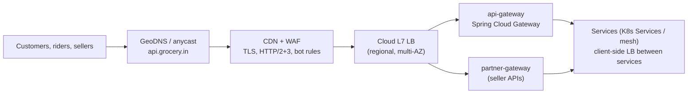
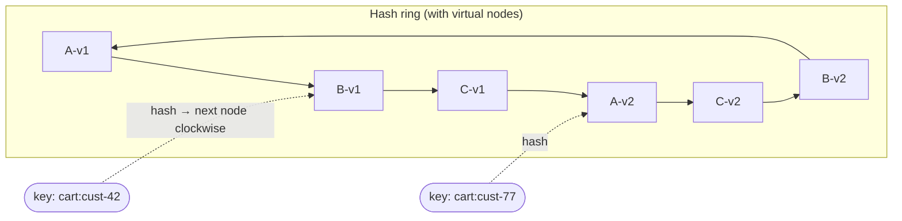
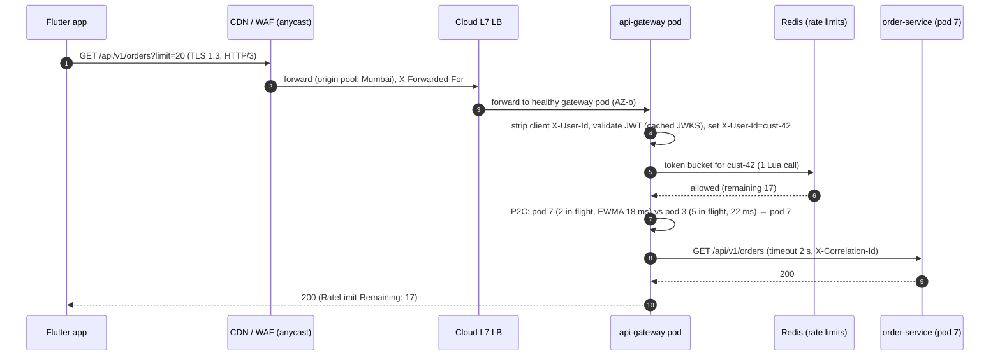
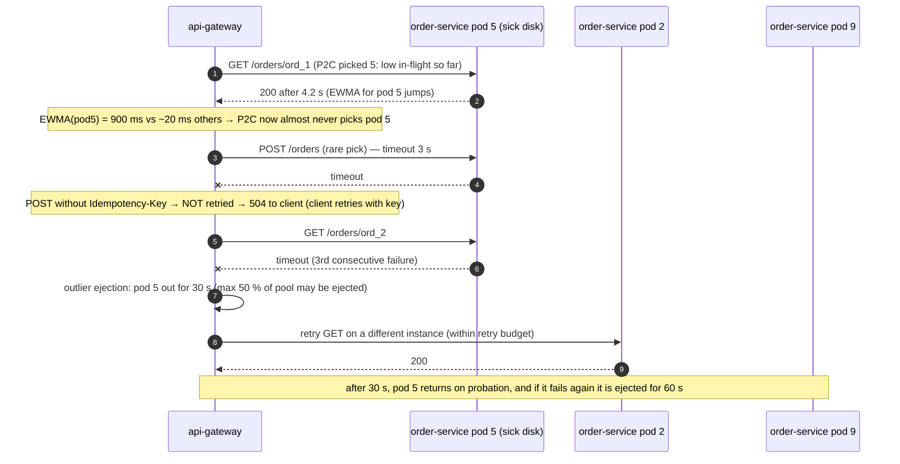
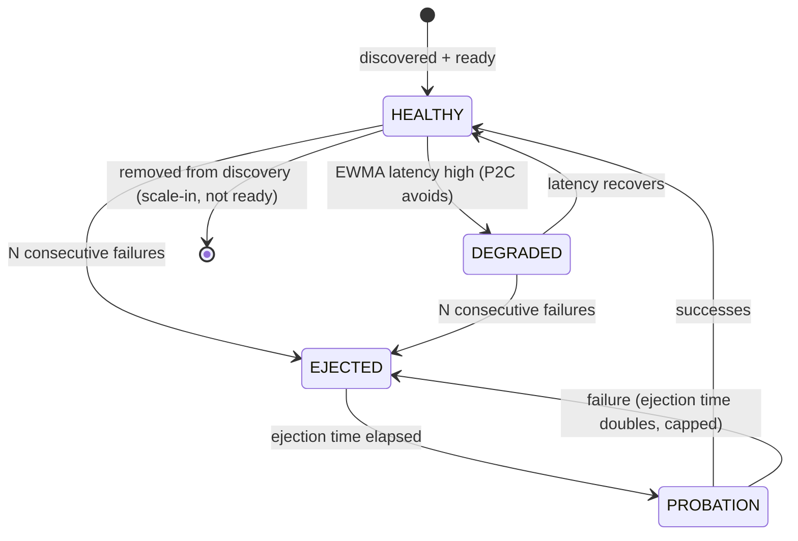

# 08. Load Balancing, Proxies & Gateways ⭐

!!! abstract "Chapter at a glance"
    **Reader bands:** B1 → B4 · **Prerequisites:** [Ch 03](03-networking-essentials.md), [Ch 04](04-api-design.md) · **What you will build:** The platform edge, taken from a simulation of balancing algorithms (L1) to a Spring Cloud Gateway with per-route timeouts, identity header hygiene, rate limits, circuit breakers and safe retries (L3), and a latency-aware P2C load balancer with outlier ejection and weighted canaries (L4) · **Reading time:** 100 min + code

---

## 1. Introduction & Why It Matters

### 1.1 A story: one bad pod, forty percent of checkouts failing

On a Saturday evening, one of twelve `order-service` pods landed on a Kubernetes node with a failing disk. The pod didn't crash. Its **readiness probe** (`GET /actuator/health`) returned `UP` in 20 ms. But real requests on that pod took 4–9 seconds, because every write waited on the sick disk.

The platform's gateway used **round-robin** across the twelve pods, so 1 in 12 requests landed on the sick pod. That's just 8 %. So why did **40 % of checkouts** fail?

- A checkout makes ~6 calls through the gateway (cart, pricing, slot, order, payment…). The chance that *at least one* hits the bad pod is roughly 1 − (11/12)⁶ ≈ **41 %**.
- The gateway **retried** timeouts, including on `POST /orders`. Some retries landed on healthy pods and created duplicate orders (the idempotency key saved them, Ch 04). Others landed on the sick pod again.
- The bad pod's connection pool filled up, and round-robin **kept sending it its full share**.

The fix had three parts: a load-balancing algorithm that notices slow backends (**least-outstanding / P2C with latency weighting**), **passive outlier ejection** (stop sending to a backend after consecutive failures), and a **readiness check that tests real dependencies** with a latency threshold. Retries were limited to idempotent methods with a retry budget.

!!! quote "The thesis of this chapter"
    Load balancers and gateways are where **every request's fate is decided**: which instance, how long to wait, whether to retry, who the caller is, and how much they may send. Their defaults are designed for "all backends are equal and healthy." Production is never like that.

### 1.2 Where this lives in the grocery platform



| Hop | Balancing decision | Key concerns |
|---|---|---|
| DNS / anycast | Which region / edge | Failover, latency, TTLs |
| CDN | Which edge PoP; cache or origin | Caching (Ch 07), WAF |
| Cloud L7 LB | Which gateway pod (across AZs) | Health checks, idle timeouts (Ch 03), TLS |
| API gateway | Which service instance; whether to allow the call | AuthN, rate limits, timeouts, retries, routing, canaries |
| Service → service | Client-side LB or mesh | P2C, outlier ejection, zone awareness, deadlines |

### 1.3 Learning objectives

| Band | After this chapter you can… |
|---|---|
| <span class="band b1">B1</span> | Explain what a load balancer and reverse proxy do, L4 vs L7, and the basic algorithms |
| <span class="band b2">B2</span> | Choose algorithms, configure health checks, avoid sticky sessions, and build routes in Spring Cloud Gateway |
| <span class="band b3">B3</span> | Handle slow (not dead) backends, outlier ejection, retries and retry budgets, per-route timeouts, and gateway security |
| <span class="band b4">B4</span> | Design global traffic management (GeoDNS, anycast, failover), canaries, zone-aware balancing, and the edge's responsibilities vs the mesh |

---

## 2. Core Concepts — Beginner to Deep

### 2.1 Intuition: the billing counters at a supermarket <span class="band b1">B1</span>

A supermarket has 10 billing counters. A floor manager directs customers.

- **Round-robin:** "You to counter 1, you to 2, you to 3…" Fair, until counter 4's scanner breaks and its queue grows to 30 people while the manager keeps sending one customer in ten there.
- **Least-outstanding:** "Go to the counter with the shortest queue." The manager must look at every queue, which is expensive in a huge store.
- **Power of two choices:** "Look at two random counters and pick the shorter queue." Almost as good as checking all of them, and much cheaper.
- **Health check:** the manager asks each cashier "are you open?" A cashier with a broken scanner still says "yes" (the §1.1 story), so the manager must also **watch how fast queues move**.
- **Sticky session:** "You always go to counter 3 because your coupons are there." That works until counter 3 closes.

### 2.2 What load balancers and proxies do <span class="band b1">B1</span>

| Component | Role |
|---|---|
| **Load balancer** | Distributes requests or connections across healthy instances |
| **Reverse proxy** | Sits in front of servers: terminates client connections, forwards requests, can cache, compress, rewrite and add headers (NGINX, Envoy, HAProxy) |
| **Forward proxy** | Sits in front of *clients* for outbound traffic (egress proxy, corporate proxy) |
| **API gateway** | A reverse proxy with API-aware policies: authentication, rate limiting, routing by path/version, request/response transformation, API keys, analytics |
| **Service mesh sidecar / ambient proxy** | A per-workload (or per-node) proxy for service-to-service traffic: mTLS, retries, timeouts, telemetry (Ch 17) |

### 2.3 L4 vs L7 load balancing ⭐ <span class="band b1">B1</span> <span class="band b2">B2</span>

| | L4 (transport) | L7 (application) |
|---|---|---|
| Sees | IPs, ports, TCP/UDP | HTTP method, path, headers, cookies, gRPC service/method |
| Balances | **Connections** | **Requests** |
| TLS | Pass-through (or terminate) | Terminates (or re-encrypts) |
| Routing | By port / IP | By path, host, header, weight |
| Features | Very fast, protocol-agnostic, preserves the client connection end-to-end | Retries, timeouts, header manipulation, rate limiting, auth, canaries, compression |
| Cost | Lowest latency and CPU | More CPU per request; more features |
| Pitfall | Long-lived connections (gRPC, HTTP/2, WebSocket) pin to one backend, so load stays uneven after scale-out | Buffering and timeouts affect streaming (Ch 03) |
| Examples | AWS NLB, GCP TCP/UDP LB, IPVS, `kube-proxy` | AWS ALB, GCP HTTP(S) LB, NGINX, Envoy, HAProxy, Spring Cloud Gateway |

!!! warning "gRPC and HTTP/2 through an L4 balancer"
    HTTP/2 multiplexes many requests over one long-lived connection. An L4 balancer picks a backend **once per connection**, so a client with 1 connection sends 100 % of its requests to one pod forever. Use L7 balancing (Envoy, gRPC-aware LBs), client-side balancing, or bounded connection lifetimes.

### 2.4 Load-balancing algorithms ⭐ <span class="band b1">B1</span> → <span class="band b3">B3</span>

| Algorithm | How | Strengths | Weaknesses |
|---|---|---|---|
| **Round-robin** | Cycle through backends | Simple, even request counts | Ignores load and speed differences; slow backends keep their full share |
| **Weighted round-robin** | Proportional to weights | Heterogeneous instance sizes; canaries | Static weights don't react to degradation |
| **Random** | Uniform random | Stateless, no coordination | Same as RR; more variance |
| **Least connections / least outstanding requests** | Backend with the fewest in-flight requests | Reacts to slow backends automatically | Needs accurate counts; with many LB instances, each sees only its own traffic |
| **Power of two choices (P2C)** | Pick 2 random backends, send to the less loaded | Near least-outstanding quality, O(1), avoids herding onto one "best" backend | Needs a load signal per backend |
| **P2C + EWMA latency** | Load = outstanding × EWMA response time | Also avoids backends that are *slow* | Tuning decay; needs latency tracking |
| **Consistent hashing** | Hash(key) → position on a ring → backend | Affinity: same key goes to the same backend (cache locality); minimal remapping when backends change | Hot keys overload one backend; uneven without virtual nodes |
| **Rendezvous (HRW) hashing** | Highest hash(key, backend) wins | Affinity like a ring, simpler, even | O(n) per pick (fine for small n) |
| **Maglev hashing** | Lookup table built from permutations | Fast, even, minimal disruption | More complex |

L1's simulation (§5) shows why this matters. There are 10 backends, one of them 8× slower, at 70 % fleet utilization:

```text
Algorithm                          p50 ms     p99 ms   p99.9 ms % to slow node
Round-robin                          13.9  unbounded  unbounded          10.0%
Random                               22.5  unbounded  unbounded          10.0%
Round-robin + slow node ejected      14.5       94.1      137.3           0.0%
Least-outstanding (global)            8.4      113.5      360.0           2.0%
Power of two choices                 13.5      213.6      556.5           2.0%
```

Round-robin and random send the degraded node **10 %** of traffic when it can serve only ~2 %, so its queue grows without bound and the tail latency explodes. Load-aware algorithms automatically cut its share to 2 %. Ejecting the node entirely is best of all, **if you can detect it**.

!!! tip "Why P2C instead of 'always the least loaded'?"
    With many independent LB instances (every gateway pod, every client), "always pick the least loaded" makes them all pick the **same** backend at the same moment (herding), because their load information is stale. Choosing the better of two *random* candidates spreads decisions while still avoiding bad backends. The theory: max load drops from O(log n / log log n) to O(log log n) (Mitzenmacher).

### 2.5 Consistent hashing and affinity <span class="band b2">B2</span> <span class="band b3">B3</span>



| Use | Why affinity helps |
|---|---|
| Sharded caches (clients choose the cache node by key) | Each key lives on one node |
| Stateful in-memory processing (a per-store aggregator) | State stays local |
| Request coalescing | The same key goes to the same pod, so single-flight works fleet-wide |

When a backend is added or removed, only ~1/n of keys move (vs almost all keys with `hash % n`). Virtual nodes (100–200 per backend) smooth the distribution. **Bounded-load consistent hashing** caps any backend at, say, 125 % of average load and spills the excess to the next node, which protects against hot keys.

### 2.6 Health checks: active, passive and what "healthy" means ⭐ <span class="band b2">B2</span> <span class="band b3">B3</span>

| Type | How | Catches | Misses |
|---|---|---|---|
| **Active** | LB probes `GET /health` every N s; unhealthy after K failures | Dead processes, crashed pods, unreachable nodes | Slow-but-alive backends (§1.1); issues that only real traffic triggers |
| **Passive (outlier detection)** | Watch real responses: consecutive 5xx, timeouts, latency outliers → eject for a period | Degraded backends under real load | Backends with no traffic |
| **Kubernetes readiness** | kubelet probe; failing pods are removed from Service endpoints | Startup, dependency readiness, overload shedding | Same as active, and slow to react (period × threshold) |
| **Kubernetes liveness** | kubelet probe; failing → restart | Deadlocks, hung processes | — and it's **dangerous** if it checks dependencies (restart storms) |

**Health endpoint design:**

| Endpoint | Checks | Used by |
|---|---|---|
| `/actuator/health/liveness` | Process can serve (no deadlock) | kubelet liveness. **Never** checks the DB or downstreams |
| `/actuator/health/readiness` | Warm-up done, critical dependencies reachable, **not overloaded** (for example, the pool isn't saturated) | kubelet readiness, LB |
| Deep diagnostics | Every dependency with latency | Humans and dashboards only. It's expensive and must not gate traffic |

!!! danger "Health checks that check dependencies can take down the whole fleet"
    If every pod's readiness depends on Redis, a Redis blip makes **all** pods unready at once. The LB then has zero backends, so a partial degradation becomes a total outage. Readiness should reflect whether **this instance** can serve useful traffic. Shared-dependency outages are handled by fallbacks and shedding (Ch 07, 18), not by removing every pod.

**Outlier ejection parameters (Envoy-style):** eject after 5 consecutive 5xx or gateway errors, eject for 30 s (growing with repeated ejections), never eject more than 50 % of the pool (**max ejection percent**, which keeps a correlated failure from emptying the pool), and return the backend on probation.

### 2.7 Sticky sessions (session affinity) <span class="band b2">B2</span>

Sticky sessions route a user to the same backend (via a cookie or source-IP hash).

| Problem | Why |
|---|---|
| Uneven load | Heavy users pin to one pod |
| Deploys and scale-in drop sessions | Session state dies with the pod |
| Failover loses state | Same |
| Autoscaling doesn't help existing users | They stay on hot pods |

**Prefer stateless services:** keep session state in a shared store (Redis sessions, JWT claims) so any pod can serve any request. Use affinity only for performance (cache locality via consistent hashing), never for correctness. Streaming connections (Ch 03) are the exception, and even there, bounded lifetimes and resume make stickiness unnecessary.

### 2.8 Retries, timeouts and hedging at the proxy <span class="band b2">B2</span> <span class="band b3">B3</span>

| Rule | Why |
|---|---|
| **Retry only idempotent requests** (GET, PUT, DELETE, or POST with an idempotency key) | Otherwise you get duplicate orders or payments (§1.1, Ch 04) |
| **Retry on a different backend** | The same sick backend usually fails again |
| **Retry budget** (for example, retries ≤ 10–20 % of requests) instead of per-request retry counts only | Prevents retry storms from multiplying load during outages (3 layers × 3 retries = 27×) |
| **Retry at one layer** | Gateway, mesh and client all retrying multiplies attempts |
| **Per-route timeouts from latency budgets** | Search 800 ms, checkout 3 s, streams: no response timeout (Ch 03) |
| **Hedged requests** (send a second copy after the p95 delay, take the first response) | Cuts tail latency for idempotent reads at a small load cost |
| **Jittered backoff** | Avoids synchronized retry waves |

### 2.9 API gateway responsibilities ⭐ <span class="band b2">B2</span> <span class="band b4">B4</span>

| Responsibility | Gateway | Service |
|---|---|---|
| TLS termination (behind the LB/CDN) | ✅ (or the LB) | mTLS in the mesh |
| **Authentication** (validate JWT/API key) | ✅ | Re-check critical claims; trust only gateway-set identity headers |
| **Coarse authorization** (scopes: `orders:read`) | ✅ | **Fine-grained** (is this *my* order?) always in the service |
| Rate limiting & quotas | ✅ per client / plan | Service-level concurrency limits too |
| Routing (path, version, canary weights) | ✅ | — |
| Request size limits, header normalization, **stripping spoofable headers** | ✅ | — |
| Correlation ID injection | ✅ | Propagate |
| Response compression, CORS | ✅ | — |
| Timeouts, retries (idempotent), circuit breaking | ✅ | Downstream calls too |
| Request/response transformation | Minimal (versioning shims) | — |
| Business logic, orchestration | ❌ | BFFs and services |
| Caching | Rarely (anonymous GETs) | Ch 07 |

!!! danger "Identity header spoofing"
    If services trust `X-User-Id` set by the gateway, the gateway must **remove any incoming `X-User-Id`** from the client before setting its own from the validated JWT. Otherwise any client can impersonate any user by sending the header. Also ensure services are **unreachable except through the gateway** or mesh (NetworkPolicies), or re-validate the token in the service.

### 2.10 Spring Cloud Gateway <span class="band b2">B2</span> <span class="band b3">B3</span>

| Concept | Meaning |
|---|---|
| **Route** | id + predicates + filters + destination URI (`lb://order-service` uses Spring Cloud LoadBalancer) |
| **Predicates** | Path, Host, Method, Header, Query, Weight (canary), Before/After/Between (time) |
| **Filters** | Add/remove headers, RewritePath, StripPrefix, RequestRateLimiter (Redis), CircuitBreaker (Resilience4j), Retry, RequestSize, SetStatus, custom `GlobalFilter`s |
| Flavours | **Reactive (WebFlux, Netty)** is the mature, highest-throughput option. **Server WebMVC** (servlet) is simpler to reason about and works well with virtual threads |
| Per-route timeouts | Route metadata `connect-timeout`, `response-timeout` (`-1` disables for streams) |

Alternatives: Envoy-based gateways (Envoy Gateway, Istio ingress), Kong, NGINX/OpenResty, and cloud API gateways. Choose Spring Cloud Gateway when the team wants Java-coded policies and Spring ecosystem integration. Choose Envoy-based options for polyglot platforms and mesh alignment.

### 2.11 Global traffic management: GeoDNS, anycast, failover <span class="band b3">B3</span> <span class="band b4">B4</span>

| Technique | How | Pros | Cons |
|---|---|---|---|
| **GeoDNS / latency-based DNS** | DNS answers depend on the resolver's location or measured latency | Simple, works with any backend | Resolver location ≠ user location; clients cache beyond TTL, so failover takes minutes |
| **DNS failover** | Health-checked records; answer only healthy regions | Cheap regional DR | Slow (TTL + client caching); partial failures are hard |
| **Anycast** | The same IP announced from many PoPs, and BGP routes users to the nearest | Fast failover (routing converges in seconds), DDoS absorption, one IP | Needs a provider (CDNs, global LBs); TCP sessions can break on route changes (QUIC handles it better) |
| **Global L7 LB** (cloud global LBs, CDN load balancing) | Anycast edge terminates TLS, then routes to regional backends by health, latency and capacity | Best user experience, fast failover, per-request decisions | Provider lock-in; cost |

**For this platform (India, one primary region + DR, Ch 27):** anycast CDN/WAF at the edge terminates TLS close to users across Indian PoPs, then routes to the Mumbai region's L7 LB, with a health-checked failover origin in the DR region (Hyderabad). DNS points at the CDN, so DNS TTLs don't govern failover. The edge's origin health checks do.

### 2.12 Zone-aware balancing and cross-AZ cost <span class="band b3">B3</span> <span class="band b4">B4</span>

Cross-AZ traffic adds ~0.5–2 ms per hop **and** is billed per GB. Zone-aware balancing prefers same-zone backends when they're healthy and not overloaded, and spills to other zones when needed. Envoy, Istio and Kubernetes topology-aware routing (`trafficDistribution: PreferClose` on Services) support it.

| Guardrail | Why |
|---|---|
| Spill over when the local zone is below ~70 % healthy capacity | Don't overload the local zone just to save cost |
| Keep capacity balanced per zone | Otherwise zone-local routing concentrates load |
| Zone failure → automatic cross-zone | Availability beats cost |

---

## 3. Architecture & Diagrams

### 3.1 Gateway internals: a request through filters

```mermaid
flowchart LR
    IN["Request from L7 LB"] --> F1["Strip spoofable headers<br/>(X-User-Id, X-Internal-*)"]
    F1 --> F2["Correlation ID"]
    F2 --> F3["AuthN: validate JWT<br/>(JWKS cached)"]
    F3 --> F4["Set identity headers<br/>X-User-Id from token"]
    F4 --> F5["Rate limit<br/>(Redis token bucket, per user/plan)"]
    F5 --> F6["Route match<br/>path / version / weight"]
    F6 --> F7["Request size limit"]
    F7 --> F8["Circuit breaker + timeout<br/>(per route)"]
    F8 --> F9["Retry (idempotent only,<br/>different instance, budget)"]
    F9 --> LB["Load balancer<br/>P2C + EWMA + outlier ejection"]
    LB --> SVC["order-service pods"]
```



### 3.2 Sequence: happy path, authenticated request through the edge



### 3.3 Sequence: failure path, slow pod detected, ejected, and a non-idempotent retry prevented



!!! note "What the system guarantees after this failure path"
    A slow-but-alive backend receives a rapidly shrinking share of traffic (latency-weighted P2C) and is removed after consecutive failures (passive ejection), without waiting for active health checks that report it as "UP." Retries never re-send non-idempotent requests, always go to a different instance, and are capped by a fleet-wide budget. Ejection never removes more than half the pool, so a shared-dependency failure can't empty it.

### 3.4 State: backend endpoint health in the balancer



---

## 4. Design Document Excerpt: Platform Edge & API Gateway

| Field | Value |
|---|---|
| Author / Reviewers | Platform team / Security, SRE, all service owners |
| Status | Approved |
| Related ADRs | ADR-032 Latency-aware P2C with outlier ejection for gateway and service-to-service; ADR-033 Retries only at the gateway, idempotent-only, with budget |

**1. Context & Problem.** Round-robin plus shallow health checks let one sick pod fail ~40 % of checkouts (§1.1). Retries were uncontrolled, including on POSTs. Identity headers could be spoofed by direct calls to services, and rate limiting was per-pod and inconsistent.

**2. Goals / Non-Goals.**

- *Goals:* a single, consistently secured edge for customer APIs; automatic avoidance of slow or failing instances; safe retries; per-user rate limits; per-route timeouts; canary routing; P90 sale capacity with AZ-failure headroom.
- *Non-goals:* service mesh rollout (Ch 17); seller partner gateway details (Ch 04 Q18).

**3. Requirements.**

| ID | Requirement |
|---|---|
| FR-1 | Route `/api/v1/**` to services by path; support weighted canaries |
| FR-2 | Validate JWT; set identity headers; strip client-supplied identity headers |
| FR-3 | Per-user and per-IP-range rate limits with `429` + `RateLimit-*` headers |
| NFR-1 | Gateway overhead p99 ≤ 5 ms |
| NFR-2 | A backend with p99 ≥ 10× fleet median receives ≤ 5 % of traffic within 30 s |
| NFR-3 | Retries ≤ 10 % of requests fleet-wide; never for non-idempotent requests without `Idempotency-Key` |
| NFR-4 | Survive loss of one AZ at P90 sale load |
| NFR-5 | Streaming routes (SSE, Ch 03) have no response timeout; idle timeout 110 s |

**4. Capacity estimates.**

| Item | Calculation | Result |
|---|---|---|
| Edge requests at sale start (P90, Ch 02) | ~200 K req/s at CDN | CDN serves images and cacheable listings (~40 %) |
| Gateway requests | ~60 % of 200 K | **~120 K req/s** |
| Per-pod capacity (reactive gateway, JWT + rate limit + routing; load-tested) | ~4,000 req/s at 2 vCPU with p99 overhead ≤ 5 ms | 30 pods needed |
| With AZ headroom (×1.5, multiple of 3) | 45 | **45 pods** at peak, pre-scaled (Ch 02) |
| Redis rate-limit ops | 120 K req/s × 1 Lua call | 120 K ops/s → **3–4 shards**, keys hash-tagged per user |
| JWKS fetches | Cached, refreshed every 10 min | Negligible |
| Upstream connections | 45 gateway pods × ~26 services × pool 50 | Bounded by per-route pool sizes; watch the Little's Law figures (Ch 02) |

**5. Proposed design.**

- **Edge chain:** anycast CDN/WAF → regional L7 LB (multi-AZ, health-checked gateway pods) → Spring Cloud Gateway (reactive).
- **Filters:** header hygiene → correlation → JWT validation → identity headers → Redis rate limit → route → size limit → circuit breaker + per-route timeout → idempotent-only retry (different instance, budget).
- **Balancing:** a custom latency-aware **P2C (outstanding × EWMA)** with **passive outlier ejection** (5 consecutive failures → 30 s, doubling, max 50 % of the pool), zone preference with spill-over, and weighted canary routes.
- **Services:** reachable only from the gateway and the mesh (NetworkPolicy). Each service re-checks resource ownership.

**7. Alternatives considered.**

| Option | Pros | Cons | Verdict |
|---|---|---|---|
| Cloud API gateway (managed) | No ops, built-in auth and limits | Per-request pricing at 120 K req/s; less control over balancing and custom policies | Rejected on cost and flexibility |
| Envoy-based gateway (Envoy Gateway / Istio ingress) | High performance; P2C, outlier detection, zone-aware routing built in | Config-as-YAML for custom auth logic; team skills | **Strong alternative**: adopt with the mesh (Ch 17) |
| Kong / NGINX | Mature, plugins | Lua/plugin skills; custom logic outside Java | Rejected for this team |
| **Spring Cloud Gateway + custom P2C-EWMA + ejection** | Java policies, Spring Security, fits team skills | We own the balancer code and its tests | **Chosen for now**, and revisit when the mesh lands |

**8. Failure modes.** Redis for rate limits down: fail open for authenticated users with a local, per-pod conservative limiter, and fail closed for anonymous abusive IP ranges. JWKS endpoint down: keep using cached keys (refresh-ahead), and alert. All instances of a service ejected: max-ejection cap keeps ≥ 50 %, and beyond that the circuit breaker opens and returns fast 503 with fallbacks. Gateway pod overload: LB least-outstanding across gateway pods, pre-scale for events, and shed low-priority routes first.

**10. Observability.** Per route: request rate, errors by class, latency (gateway overhead vs upstream), retries (attempts and the budget consumed), circuit-breaker state, rate-limit rejections. Per upstream instance: EWMA, in-flight, ejections. Edge: CDN hit ratio, WAF blocks, TLS errors.

**14. Decision (ADR-032/033 summary).** Gateway and service-to-service balancing use latency-aware P2C with passive outlier ejection (max 50 % ejected). Readiness probes reflect instance-local health, and liveness never checks dependencies. Retries happen only at the gateway, only for idempotent requests (or POSTs carrying `Idempotency-Key`), always on a different instance, within a 10 % fleet retry budget. Every route declares its timeout, and streaming routes declare no response timeout plus an idle timeout.

---

## 5. Hands-On Code — Level Ladder

We build the **platform edge** four times:

| Level | New requirement that forces the step |
|---|---|
| L1 | "Which balancing algorithm survives one degraded backend?" (a simulation) |
| L2 | "Route `/api/v1/**` to services through a gateway with service discovery and correlation IDs." |
| L3 | "Secure identity, rate limits, per-route timeouts, circuit breakers, and retries that can never duplicate an order." |
| L4 | "Latency-aware P2C with outlier ejection and zone preference, plus weighted canaries." |

### L1 — Concept: simulating balancing algorithms (plain Java) <span class="band b1">B1</span>

```java
// LoadBalancingL1.java — run with: java LoadBalancingL1.java
// Discrete-event simulation: 10 backends (one degraded, 8x slower), Poisson arrivals at ~70% fleet utilization.
// Compares Round-robin, Random, Least-outstanding (global view), and Power-of-Two-Choices (P2C).
import java.util.*;
import java.util.function.*;

public class LoadBalancingL1 {

    static final int SERVERS = 10;
    static final double BASE_SERVICE_MS = 10.0;              // mean service time on a healthy node
    static final double SLOW_FACTOR = 8.0;                   // server 0 is degraded (GC thrash, noisy neighbour)
    static final int REQUESTS = 200_000;

    /** One worker per server (FIFO). Tracks when it becomes free and how many requests are outstanding. */
    static final class Server {
        final double speed; double freeAt = 0; final Deque<Double> completions = new ArrayDeque<>(); long served = 0;
        Server(double speed) { this.speed = speed; }
        int outstanding(double now) { while (!completions.isEmpty() && completions.peekFirst() <= now) completions.pollFirst(); return completions.size(); }
    }

    interface Picker { int pick(Server[] s, double now, Random rnd); }

    static double[] simulate(String name, Picker picker, long seed) {
        Random rnd = new Random(seed);
        Server[] s = new Server[SERVERS];
        for (int i = 0; i < SERVERS; i++) s[i] = new Server(i == 0 ? SLOW_FACTOR : 1.0);
        // Fleet capacity (req/ms): 9 healthy at 1/10 + 1 slow at 1/80 → target ~70 % of it
        double capacity = 9 / BASE_SERVICE_MS + 1 / (BASE_SERVICE_MS * SLOW_FACTOR);
        double lambda = 0.70 * capacity;
        double now = 0;
        double[] lat = new double[REQUESTS];
        for (int r = 0; r < REQUESTS; r++) {
            now += -Math.log(1 - rnd.nextDouble()) / lambda;                          // exponential inter-arrival
            int i = picker.pick(s, now, rnd);
            Server srv = s[i];
            double service = -Math.log(1 - rnd.nextDouble()) * BASE_SERVICE_MS * srv.speed;
            double start = Math.max(now, srv.freeAt);
            double done = start + service;
            srv.freeAt = done;
            srv.completions.addLast(done);
            srv.served++;
            lat[r] = done - now;
        }
        Arrays.sort(lat);
        double slowShare = 100.0 * s[0].served / REQUESTS;
        return new double[]{lat[REQUESTS / 2], lat[(int) (REQUESTS * 0.99)], lat[(int) (REQUESTS * 0.999)], slowShare};
    }

    public static void main(String[] args) {
        int[] rr = {0};
        Map<String, Picker> pickers = new LinkedHashMap<>();
        pickers.put("Round-robin", (s, now, rnd) -> rr[0]++ % SERVERS);
        pickers.put("Random", (s, now, rnd) -> rnd.nextInt(SERVERS));
        int[] rrHealthy = {0};
        pickers.put("Round-robin + slow node ejected", (s, now, rnd) -> 1 + rrHealthy[0]++ % (SERVERS - 1));   // outlier ejection
        pickers.put("Least-outstanding (global)", (s, now, rnd) -> {
            int best = 0; int bestLoad = Integer.MAX_VALUE;
            for (int i = 0; i < SERVERS; i++) { int l = s[i].outstanding(now); if (l < bestLoad) { bestLoad = l; best = i; } }
            return best;
        });
        pickers.put("Power of two choices", (s, now, rnd) -> {
            int a = rnd.nextInt(SERVERS), b = rnd.nextInt(SERVERS - 1);
            if (b >= a) b++;                                                            // two distinct random servers
            return s[a].outstanding(now) <= s[b].outstanding(now) ? a : b;
        });

        System.out.printf("%-32s %8s %10s %10s %14s%n", "Algorithm", "p50 ms", "p99 ms", "p99.9 ms", "% to slow node");
        for (var e : pickers.entrySet()) {
            double[] r = simulate(e.getKey(), e.getValue(), 42);
            System.out.printf("%-32s %8.1f %10s %10s %13.1f%%%n", e.getKey(), r[0], fmt(r[1]), fmt(r[2]), r[3]);
        }
        System.out.println("(unbounded = the slow node receives more than it can serve; its queue grows for the whole run)");
    }

    static String fmt(double ms) { return ms > 10_000 ? "unbounded" : "%.1f".formatted(ms); }

}
```

Actual output from running it:

```text
Algorithm                          p50 ms     p99 ms   p99.9 ms % to slow node
Round-robin                          13.9  unbounded  unbounded          10.0%
Random                               22.5  unbounded  unbounded          10.0%
Round-robin + slow node ejected      14.5       94.1      137.3           0.0%
Least-outstanding (global)            8.4      113.5      360.0           2.0%
Power of two choices                 13.5      213.6      556.5           2.0%
(unbounded = the slow node receives more than it can serve; its queue grows for the whole run)
```

**What L1 shows:** "equal share" algorithms give a degraded backend more than it can serve, so its queue and your tail latency grow without bound. Load-aware algorithms (least-outstanding, P2C) cut its share automatically. Ejection removes it entirely, which is best of all **if** you can detect it. Note that P2C only compares two backends yet stays within ~2× of the global optimum, without needing a global view.

### L2 — Spring Cloud Gateway: routes, discovery, correlation <span class="band b2">B2</span>

```kotlin
// build.gradle.kts (module l2-gateway)
dependencies {
    implementation("org.springframework.cloud:spring-cloud-starter-gateway-server-webflux")  // VERIFY: artifact name for your Spring Cloud release (older: spring-cloud-starter-gateway)
    implementation("org.springframework.cloud:spring-cloud-starter-loadbalancer")
    implementation("org.springframework.cloud:spring-cloud-starter-kubernetes-client")       // discovery of Services/Endpoints
    testImplementation("org.springframework.boot:spring-boot-starter-test")
}
// dependencyManagement: import the Spring Cloud BOM compatible with your Spring Boot version (VERIFY)
```

=== "Routes"

    ```java
    package com.grocery.gateway.config;

    import org.springframework.cloud.gateway.route.RouteLocator;
    import org.springframework.cloud.gateway.route.builder.RouteLocatorBuilder;
    import org.springframework.context.annotation.*;

    @Configuration
    public class RoutesL2 {

        /** Java DSL avoids property-prefix differences between Spring Cloud Gateway versions. */
        @Bean
        RouteLocator routes(RouteLocatorBuilder b) {
            return b.routes()
                    .route("orders",  r -> r.path("/api/v1/orders/**").uri("lb://order-service"))
                    .route("catalog", r -> r.path("/api/v1/stores/**", "/api/v1/clusters/**").uri("lb://catalog-service"))
                    .route("cart",    r -> r.path("/api/v1/carts/**").uri("lb://cart-service"))
                    .build();
        }
    }
    ```

=== "Correlation ID filter"

    ```java
    package com.grocery.gateway.filter;

    import org.springframework.cloud.gateway.filter.GatewayFilterChain;
    import org.springframework.cloud.gateway.filter.GlobalFilter;
    import org.springframework.core.Ordered;
    import org.springframework.stereotype.Component;
    import org.springframework.web.server.ServerWebExchange;
    import reactor.core.publisher.Mono;
    import java.util.UUID;

    @Component
    public class CorrelationIdFilter implements GlobalFilter, Ordered {

        public static final String HEADER = "X-Correlation-Id";

        @Override
        public Mono<Void> filter(ServerWebExchange exchange, GatewayFilterChain chain) {
            String incoming = exchange.getRequest().getHeaders().getFirst(HEADER);
            String id = (incoming != null && incoming.matches("[A-Za-z0-9-]{8,64}")) ? incoming : UUID.randomUUID().toString();
            var request = exchange.getRequest().mutate().headers(h -> h.set(HEADER, id)).build();
            exchange.getResponse().getHeaders().set(HEADER, id);
            return chain.filter(exchange.mutate().request(request).build());
        }

        @Override public int getOrder() { return Ordered.HIGHEST_PRECEDENCE; }
    }
    ```

=== "Test"

    ```java
    package com.grocery.gateway;

    import okhttp3.mockwebserver.*;                      // testImplementation("com.squareup.okhttp3:mockwebserver")
    import org.junit.jupiter.api.*;
    import org.springframework.beans.factory.annotation.Autowired;
    import org.springframework.boot.test.context.SpringBootTest;
    import org.springframework.test.context.*;
    import org.springframework.test.web.reactive.server.WebTestClient;

    @SpringBootTest(webEnvironment = SpringBootTest.WebEnvironment.RANDOM_PORT)
    @AutoConfigureWebTestClient    // VERIFY: package moved in Boot 4 (org.springframework.boot.webtestclient...)
    class RoutingL2Test {

        static MockWebServer orders = new MockWebServer();

        @DynamicPropertySource
        static void props(DynamicPropertyRegistry r) throws Exception {
            orders.start();
            // Simple discovery: map service id → static instance (instead of Kubernetes)
            r.add("spring.cloud.discovery.client.simple.instances.order-service[0].uri", () -> orders.url("/").toString());
        }

        @Autowired WebTestClient client;

        @Test
        void routesAndAddsCorrelationId() throws Exception {
            orders.enqueue(new MockResponse().setBody("[]").addHeader("Content-Type", "application/json"));
            client.get().uri("/api/v1/orders").exchange().expectStatus().isOk()
                  .expectHeader().exists("X-Correlation-Id");
            RecordedRequest seen = orders.takeRequest();
            Assertions.assertNotNull(seen.getHeader("X-Correlation-Id"));
        }

        @AfterAll static void stop() throws Exception { orders.shutdown(); }
    }
    ```

**What L2 gets right:** a single entry point, path routing, discovery-based balancing (`lb://`) and correlation IDs.

**What L2 is missing** (every item was in the §1.1 incident or the design doc):

| Gap | Risk |
|---|---|
| No authentication, and client headers passed through | Spoofed `X-User-Id` |
| Default round-robin, no ejection | The sick-pod scenario |
| No per-route timeouts | Slow routes hold connections; streams cut or hung |
| No rate limits or size limits | Abuse, overload |
| No circuit breakers or safe retries | Cascading failures, or duplicate orders if retries were added naively |

### L3 — Production-Grade Gateway <span class="band b3">B3</span>

```kotlin
// l3 adds
dependencies {
    implementation("org.springframework.boot:spring-boot-starter-oauth2-resource-server")       // reactive JWT validation
    implementation("org.springframework.boot:spring-boot-starter-data-redis-reactive")          // RequestRateLimiter
    implementation("org.springframework.cloud:spring-cloud-starter-circuitbreaker-reactor-resilience4j")
    implementation("org.springframework.boot:spring-boot-starter-actuator")
    testImplementation("org.springframework.security:spring-security-test")
    testImplementation("com.squareup.okhttp3:mockwebserver")
}
```

=== "Security & identity hygiene"

    ```java
    package com.grocery.gateway.config;

    import org.springframework.context.annotation.*;
    import org.springframework.security.config.annotation.web.reactive.EnableWebFluxSecurity;
    import org.springframework.security.config.web.server.ServerHttpSecurity;
    import org.springframework.security.web.server.SecurityWebFilterChain;

    @Configuration
    @EnableWebFluxSecurity
    public class SecurityConfig {

        @Bean
        SecurityWebFilterChain security(ServerHttpSecurity http) {
            return http
                    .csrf(ServerHttpSecurity.CsrfSpec::disable)               // token-based API, no cookies
                    .authorizeExchange(ex -> ex
                            .pathMatchers("/actuator/health/**").permitAll()
                            .pathMatchers("/api/v1/clusters/**").permitAll()  // anonymous catalog browsing
                            .pathMatchers("/api/v1/**").authenticated()
                            .anyExchange().denyAll())
                    .oauth2ResourceServer(o -> o.jwt(jwt -> { }))            // issuer-uri / jwk-set-uri in config
                    .build();
        }
    }
    ```

    ```java
    package com.grocery.gateway.filter;

    import org.springframework.cloud.gateway.filter.GatewayFilterChain;
    import org.springframework.cloud.gateway.filter.GlobalFilter;
    import org.springframework.core.Ordered;
    import org.springframework.security.oauth2.server.resource.authentication.JwtAuthenticationToken;
    import org.springframework.stereotype.Component;
    import org.springframework.web.server.ServerWebExchange;
    import reactor.core.publisher.Mono;
    import java.util.List;

    /**
     * 1. ALWAYS strip identity/internal headers sent by clients (spoofing protection).
     * 2. If authenticated, set X-User-Id / X-User-Scopes from the VALIDATED token.
     * Services trust these headers only because NetworkPolicy makes them unreachable except via gateway/mesh.
     */
    @Component
    public class IdentityHeadersFilter implements GlobalFilter, Ordered {

        static final List<String> STRIP = List.of("X-User-Id", "X-User-Scopes", "X-Internal-Caller", "X-Forwarded-User");

        @Override
        public Mono<Void> filter(ServerWebExchange exchange, GatewayFilterChain chain) {
            var cleaned = exchange.getRequest().mutate().headers(h -> STRIP.forEach(h::remove)).build();
            var cleanedExchange = exchange.mutate().request(cleaned).build();
            return cleanedExchange.getPrincipal()
                    .filter(JwtAuthenticationToken.class::isInstance)
                    .cast(JwtAuthenticationToken.class)
                    .map(auth -> cleanedExchange.mutate().request(cleaned.mutate().headers(h -> {
                        h.set("X-User-Id", auth.getToken().getSubject());
                        h.set("X-User-Scopes", String.join(" ", auth.getToken().getClaimAsStringList("scope") == null
                                ? List.of() : auth.getToken().getClaimAsStringList("scope")));
                    }).build()).build())
                    .defaultIfEmpty(cleanedExchange)
                    .flatMap(chain::filter);
        }

        @Override public int getOrder() { return Ordered.HIGHEST_PRECEDENCE + 10; }
    }
    ```

=== "Routes with policies"

    ```java
    package com.grocery.gateway.config;

    import org.springframework.cloud.gateway.filter.ratelimit.*;
    import org.springframework.cloud.gateway.route.RouteLocator;
    import org.springframework.cloud.gateway.route.builder.RouteLocatorBuilder;
    import org.springframework.context.annotation.*;
    import org.springframework.http.HttpMethod;
    import org.springframework.http.HttpStatus;
    import org.springframework.util.unit.DataSize;
    import reactor.core.publisher.Mono;
    import java.time.Duration;
    import static org.springframework.cloud.gateway.support.RouteMetadataUtils.*;

    @Configuration
    public class RoutesL3 {

        /** Per-user key; anonymous callers keyed by client IP (the CDN's verified client-IP header, not raw XFF). */
        @Bean
        KeyResolver userKeyResolver() {
            return exchange -> Mono.justOrEmpty(exchange.getRequest().getHeaders().getFirst("X-User-Id"))
                    .switchIfEmpty(Mono.justOrEmpty(exchange.getRequest().getHeaders().getFirst("True-Client-IP"))
                            .map(ip -> "ip:" + ip))
                    .defaultIfEmpty("anonymous");
        }

        @Bean RedisRateLimiter standardLimiter() { return new RedisRateLimiter(10, 20, 1); }    // 10/s, burst 20
        @Bean RedisRateLimiter checkoutLimiter() { return new RedisRateLimiter(1, 5, 1); }     // 1/s, burst 5

        @Bean
        RouteLocator routes(RouteLocatorBuilder b, KeyResolver userKeyResolver) {
            return b.routes()
                    // Reads: short timeout, retry once on a different instance for GET only
                    .route("orders-read", r -> r.path("/api/v1/orders/**").and().method(HttpMethod.GET)
                            .filters(f -> f
                                    .requestRateLimiter(c -> c.setRateLimiter(standardLimiter()).setKeyResolver(userKeyResolver))
                                    .circuitBreaker(c -> c.setName("orders").setFallbackUri("forward:/fallback/unavailable"))
                                    .retry(c -> c.setRetries(1).setMethods(HttpMethod.GET)
                                            .setStatuses(HttpStatus.BAD_GATEWAY, HttpStatus.SERVICE_UNAVAILABLE)
                                            .setBackoff(Duration.ofMillis(20), Duration.ofMillis(100), 2, true)))
                            .metadata(CONNECT_TIMEOUT_ATTR, 500)
                            .metadata(RESPONSE_TIMEOUT_ATTR, 2000)
                            .uri("lb://order-service"))
                    // Writes: NO gateway retry (clients retry with Idempotency-Key, Ch 04); stricter limit; small bodies
                    .route("orders-write", r -> r.path("/api/v1/orders/**").and().method(HttpMethod.POST, HttpMethod.PATCH)
                            .filters(f -> f
                                    .requestRateLimiter(c -> c.setRateLimiter(checkoutLimiter()).setKeyResolver(userKeyResolver))
                                    .setRequestSize(DataSize.ofKilobytes(64))
                                    .circuitBreaker(c -> c.setName("orders-write").setFallbackUri("forward:/fallback/unavailable")))
                            .metadata(CONNECT_TIMEOUT_ATTR, 500)
                            .metadata(RESPONSE_TIMEOUT_ATTR, 3000)
                            .uri("lb://order-service"))
                    // SSE tracking stream (Ch 03): no response timeout; idle handled by server lifetime + LB
                    .route("tracking-stream", r -> r.order(-1).path("/api/v1/orders/*/events")   // BEFORE orders-read
                            .metadata(RESPONSE_TIMEOUT_ATTR, -1)
                            .uri("lb://tracking-stream"))
                    .route("catalog", r -> r.path("/api/v1/stores/**", "/api/v1/clusters/**")
                            .filters(f -> f.requestRateLimiter(c -> c.setRateLimiter(standardLimiter()).setKeyResolver(userKeyResolver)))
                            .metadata(RESPONSE_TIMEOUT_ATTR, 800)
                            .uri("lb://catalog-service"))
                    .build();
        }
    }
    ```

    !!! warning "Route order matters"
        `/api/v1/orders/*/events` also matches `/api/v1/orders/**`. The stream route has `r.order(-1)`, so it's matched first. Without that, the SSE request inherits the 2 s response timeout and every stream dies after 2 s.

=== "Fallback & timeouts config"

    ```java
    package com.grocery.gateway.controller;

    import org.springframework.http.*;
    import org.springframework.web.bind.annotation.*;
    import reactor.core.publisher.Mono;

    @RestController
    public class FallbackController {

        /** Circuit open or upstream failing: fast, explicit, retryable Problem Details (Ch 04). */
        @RequestMapping("/fallback/unavailable")
        public Mono<ResponseEntity<ProblemDetail>> unavailable() {
            var pd = ProblemDetail.forStatusAndDetail(HttpStatus.SERVICE_UNAVAILABLE, "Service temporarily unavailable");
            pd.setProperty("code", "UPSTREAM_UNAVAILABLE");
            pd.setProperty("retryable", true);
            return Mono.just(ResponseEntity.status(HttpStatus.SERVICE_UNAVAILABLE)
                    .header(HttpHeaders.RETRY_AFTER, "2").body(pd));
        }
    }
    ```

    ```yaml
    spring:
      security:
        oauth2:
          resourceserver:
            jwt:
              issuer-uri: https://auth.grocery.in/        # JWKS discovered and cached
      data:
        redis:
          host: rate-limit-redis
    resilience4j:
      circuitbreaker:
        configs:
          default:
            sliding-window-type: COUNT_BASED
            sliding-window-size: 50
            failure-rate-threshold: 50
            slow-call-duration-threshold: 2s
            slow-call-rate-threshold: 60
            wait-duration-in-open-state: 10s
            permitted-number-of-calls-in-half-open-state: 5
      timelimiter:
        configs:
          default:
            timeout-duration: 4s        # above the per-route response timeout; the route timeout decides first
    management:
      endpoint.health.probes.enabled: true
      endpoints.web.exposure.include: health,prometheus,gateway
    ```

=== "Tests"

    ```java
    package com.grocery.gateway;

    import okhttp3.mockwebserver.*;
    import org.junit.jupiter.api.*;
    import org.springframework.beans.factory.annotation.Autowired;
    import org.springframework.boot.test.context.SpringBootTest;
    import org.springframework.context.ApplicationContext;
    import org.springframework.test.context.*;
    import org.springframework.test.web.reactive.server.WebTestClient;
    import static org.assertj.core.api.Assertions.assertThat;
    import static org.springframework.security.test.web.reactive.server.SecurityMockServerConfigurers.*;

    @SpringBootTest(properties = "spring.cloud.gateway.redis-rate-limiter.include-headers=true")
    class GatewayPoliciesTest {

        static MockWebServer orders = new MockWebServer();

        @DynamicPropertySource
        static void props(DynamicPropertyRegistry r) throws Exception {
            orders.start();
            r.add("spring.cloud.discovery.client.simple.instances.order-service[0].uri", () -> orders.url("/").toString());
            // Rate limiter needs Redis: point at a Testcontainers Redis in the full suite; here the limiter bean is replaced
        }

        @Autowired ApplicationContext ctx;
        WebTestClient client;

        @BeforeEach
        void setUp() {
            client = WebTestClient.bindToApplicationContext(ctx).apply(springSecurity()).configureClient().build();
        }

        @Test
        void spoofedIdentityHeaderIsReplacedFromToken() throws Exception {
            orders.enqueue(new MockResponse().setBody("[]"));
            client.mutateWith(mockJwt().jwt(j -> j.subject("cust-42")))
                  .get().uri("/api/v1/orders").header("X-User-Id", "cust-999-victim")
                  .exchange().expectStatus().isOk();
            assertThat(orders.takeRequest().getHeader("X-User-Id")).isEqualTo("cust-42");
        }

        @Test
        void unauthenticatedOrdersCallIsRejected() {
            client.get().uri("/api/v1/orders").exchange().expectStatus().isUnauthorized();
        }

        @Test
        void getIsRetriedOnceOn503_postIsNeverRetried() throws Exception {
            int before = orders.getRequestCount();
            orders.enqueue(new MockResponse().setResponseCode(503));
            orders.enqueue(new MockResponse().setBody("[]"));
            client.mutateWith(mockJwt()).get().uri("/api/v1/orders").exchange().expectStatus().isOk();
            assertThat(orders.getRequestCount() - before).isEqualTo(2);

            before = orders.getRequestCount();
            orders.enqueue(new MockResponse().setResponseCode(503));
            client.mutateWith(mockJwt()).post().uri("/api/v1/orders")
                  .header("Idempotency-Key", "7f3c2a4e-0b8d-4c1e-9f6b-2d5a1e8c9b10").bodyValue("{}")
                  .exchange().expectStatus().is5xxServerError();
            assertThat(orders.getRequestCount() - before).isEqualTo(1);        // exactly one attempt
        }

        @AfterAll static void stop() throws Exception { orders.shutdown(); }
    }
    ```

**What L3 guarantees:** client identity headers can never reach services, only validated identities can. Per-user limits are consistent across all gateway pods (Redis). Each route has its own timeout, and streams aren't cut. Writes are never retried by the gateway. Reads retry once on 502/503 with jittered backoff. Open circuits fail fast with retryable Problem Details.

**What L3 still lacks:** the balancer is still round-robin, so the §1.1 sick-pod scenario remains. The built-in retry can't express "a POST *with* `Idempotency-Key` may be retried." There are no canaries and no zone awareness.

### L4 — Enterprise: latency-aware P2C, outlier ejection, zones, canaries <span class="band b4">B4</span>

=== "P2C + peak-EWMA balancer (core)"

    ```java
    package com.grocery.gateway.lb;

    import java.util.*;
    import java.util.concurrent.ThreadLocalRandom;
    import java.util.concurrent.atomic.AtomicInteger;

    /**
     * Latency-aware Power-of-Two-Choices with passive outlier ejection and zone preference.
     *   score(endpoint) = (inFlight + 1) × peakEwmaLatencyMs      — lower is better
     * Peak-EWMA: a latency ABOVE the average is adopted immediately (react fast to slowness);
     * below-average samples decay the average smoothly (recover gradually). (Finagle / Linkerd style.)
     * Thread-safe enough for a load balancer: per-endpoint state is updated with simple synchronization.
     */
    public class P2cEwmaBalancer {

        public static final class Endpoint {
            final String id; final String zone;
            final AtomicInteger inFlight = new AtomicInteger();
            private double ewmaMs; private long lastUpdateMs;
            private int consecutiveFailures; private int ejectionCount; private long ejectedUntilMs;

            public Endpoint(String id, String zone, double initialEwmaMs) { this.id = id; this.zone = zone; this.ewmaMs = initialEwmaMs; }
            public String id() { return id; }
            public String zone() { return zone; }
            synchronized double ewma() { return ewmaMs; }
            synchronized boolean ejectedAt(long nowMs) { return nowMs < ejectedUntilMs; }
            double score() { return (inFlight.get() + 1) * ewma(); }
        }

        public record Settings(double decayMs, int failuresToEject, long baseEjectionMs, long maxEjectionMs,
                               double maxEjectionFraction, double localZoneMinHealthyFraction, double localZoneMaxLoadRatio) {
            public static Settings defaults() { return new Settings(10_000, 5, 30_000, 300_000, 0.5, 0.7, 1.25); }
        }

        private final List<Endpoint> endpoints;
        private final Settings s;

        public P2cEwmaBalancer(List<Endpoint> endpoints, Settings settings) {
            if (endpoints.isEmpty()) throw new IllegalArgumentException("no endpoints");
            this.endpoints = List.copyOf(endpoints); this.s = settings;
        }

        /** Choose an endpoint; the caller MUST call onComplete(...) exactly once afterwards. */
        public Endpoint choose(String localZone, long nowMs) {
            List<Endpoint> eligible = endpoints.stream().filter(e -> !e.ejectedAt(nowMs)).toList();
            if (eligible.isEmpty()) eligible = endpoints;                       // never return nothing: fail open
            List<Endpoint> local = eligible.stream().filter(e -> e.zone.equals(localZone)).toList();
            long localTotal = endpoints.stream().filter(e -> e.zone.equals(localZone)).count();
            boolean localHealthyEnough = localTotal > 0 && local.size() >= Math.ceil(localTotal * s.localZoneMinHealthyFraction());
            // Load-aware spill-over: stay local only while the local zone is not busier than the fleet average
            boolean localNotOverloaded = localHealthyEnough && avgInFlight(local) <= avgInFlight(eligible) * s.localZoneMaxLoadRatio();
            List<Endpoint> pool = localNotOverloaded ? local : eligible;
            Endpoint pick;
            if (pool.size() == 1) pick = pool.getFirst();
            else {
                var rnd = ThreadLocalRandom.current();
                int a = rnd.nextInt(pool.size()), b = rnd.nextInt(pool.size() - 1);
                if (b >= a) b++;
                Endpoint ea = pool.get(a), eb = pool.get(b);
                pick = ea.score() <= eb.score() ? ea : eb;
            }
            pick.inFlight.incrementAndGet();
            return pick;
        }

        public void onComplete(Endpoint e, double latencyMs, boolean success, long nowMs) {
            e.inFlight.decrementAndGet();
            synchronized (e) {
                // Peak-EWMA with time-based decay
                double dt = Math.max(0, nowMs - e.lastUpdateMs);
                double w = Math.exp(-dt / s.decayMs());
                e.ewmaMs = latencyMs > e.ewmaMs ? latencyMs : e.ewmaMs * w + latencyMs * (1 - w);
                e.lastUpdateMs = nowMs;

                if (success) {
                    e.consecutiveFailures = 0;
                    if (!e.ejectedAt(nowMs) && e.ejectionCount > 0 && e.ewmaMs < 1_000) e.ejectionCount = Math.max(0, e.ejectionCount - 1);
                    return;
                }
                e.consecutiveFailures++;
                if (e.consecutiveFailures >= s.failuresToEject() && !e.ejectedAt(nowMs) && canEject(nowMs)) {
                    e.ejectionCount++;
                    long duration = Math.min(s.maxEjectionMs(), s.baseEjectionMs() << Math.min(10, e.ejectionCount - 1));
                    e.ejectedUntilMs = nowMs + duration;                           // probation after this
                    e.consecutiveFailures = 0;
                }
            }
        }

        /** Never eject more than maxEjectionFraction of the pool: protects against shared-dependency failures. */
        private boolean canEject(long nowMs) {
            long ejected = endpoints.stream().filter(x -> x.ejectedAt(nowMs)).count();
            return (ejected + 1) <= Math.floor(endpoints.size() * s.maxEjectionFraction());
        }

        private static double avgInFlight(List<Endpoint> l) {
            return l.isEmpty() ? 0 : l.stream().mapToInt(e -> e.inFlight.get()).average().orElse(0);
        }

        public long ejectedCount(long nowMs) { return endpoints.stream().filter(x -> x.ejectedAt(nowMs)).count(); }
    }
    ```

    Driving this class through the same discrete-event simulation as L1 (10 pods across 3 zones, 70 % utilization) gives this actual output:

    ```text
    SLOW                        p50 12.4 ms  p99 75.1 ms  p99.9 170.5 ms  share to pod-0 0.88%  failed requests 0  (max ejected at once: 0)
    FAILING                     p50 11.6 ms  p99 65.6 ms  p99.9 95.0 ms  share to pod-0 0.01%  failed requests 20  (max ejected at once: 1)
    SLOW-ALL-CLIENTS-IN-ZONE-A  p50 15.7 ms  p99 96.1 ms  p99.9 244.3 ms  share to pod-0 1.45%  failed requests 0  (max ejected at once: 0)
    ```

    - **SLOW:** the degraded pod's share drops to **< 1 %**, and p99 is **75 ms**, better than global least-outstanding (113 ms) and plain P2C (214 ms) from L1. Peak-EWMA sees the slowness, not just the queue.
    - **FAILING:** a pod returning fast 5xx errors is ejected after 20 failed requests in the whole run, and it's the only ejection (max-ejection cap respected).
    - **SLOW-ALL-CLIENTS-IN-ZONE-A:** even if every caller is in zone a, **load-aware spill-over** keeps latency healthy.

    !!! bug "What the first simulation run caught"
        The first version preferred the local zone whenever ≥ 70 % of its pods were healthy, **ignoring load**. With all callers in one zone, 100 % of traffic went to 4 of 10 pods, and latency exploded (p50 > 150 s in the simulation). Zone preference must include a **load check** (`localZoneMaxLoadRatio`), or zone affinity turns into a self-inflicted outage whenever callers aren't spread evenly across zones.

=== "Spring Cloud LoadBalancer adapter"

    ```java
    package com.grocery.gateway.lb;

    import org.springframework.beans.factory.ObjectProvider;
    import org.springframework.cloud.client.ServiceInstance;
    import org.springframework.cloud.client.loadbalancer.*;
    import org.springframework.cloud.loadbalancer.core.*;
    import reactor.core.publisher.Mono;
    import java.util.*;
    import java.util.concurrent.ConcurrentHashMap;

    /**
     * Adapts P2cEwmaBalancer to Spring Cloud LoadBalancer. Endpoint state is kept per instanceId and
     * survives list refreshes (so EWMA/ejection history isn't lost when discovery updates).
     * Latency feedback arrives via the LoadBalancerLifecycle callbacks (see P2cLifecycle).
     */
    public class P2cEwmaLoadBalancer implements ReactorServiceInstanceLoadBalancer {

        private final ObjectProvider<ServiceInstanceListSupplier> suppliers;
        private final String localZone;
        private final Map<String, P2cEwmaBalancer.Endpoint> state = new ConcurrentHashMap<>();
        private volatile Map<String, ServiceInstance> byId = Map.of();
        private volatile P2cEwmaBalancer balancer;

        public P2cEwmaLoadBalancer(ObjectProvider<ServiceInstanceListSupplier> suppliers, String localZone) {
            this.suppliers = suppliers; this.localZone = localZone;
        }

        @Override
        public Mono<Response<ServiceInstance>> choose(Request request) {
            ServiceInstanceListSupplier supplier = suppliers.getIfAvailable(NoopServiceInstanceListSupplier::new);
            return supplier.get(request).next().map(this::pick);
        }

        private Response<ServiceInstance> pick(List<ServiceInstance> instances) {
            if (instances.isEmpty()) return new EmptyResponse();
            refresh(instances);
            var ep = balancer.choose(localZone, System.currentTimeMillis());
            return new DefaultResponse(byId.get(ep.id()));
        }

        private synchronized void refresh(List<ServiceInstance> instances) {
            Map<String, ServiceInstance> ids = new HashMap<>();
            List<P2cEwmaBalancer.Endpoint> eps = new ArrayList<>();
            for (ServiceInstance si : instances) {
                ids.put(si.getInstanceId(), si);
                String zone = si.getMetadata().getOrDefault("zone", "unknown");   // VERIFY: zone metadata key from your discovery
                eps.add(state.computeIfAbsent(si.getInstanceId(), id -> new P2cEwmaBalancer.Endpoint(id, zone, 20.0)));
            }
            state.keySet().retainAll(ids.keySet());
            if (!ids.keySet().equals(byId.keySet())) {
                byId = Map.copyOf(ids);
                balancer = new P2cEwmaBalancer(eps, P2cEwmaBalancer.Settings.defaults());
            }
        }

        /** Called by the lifecycle hook with measured latency and outcome. */
        void record(String instanceId, double latencyMs, boolean success) {
            var ep = state.get(instanceId);
            if (ep != null && balancer != null) balancer.onComplete(ep, latencyMs, success, System.currentTimeMillis());
        }
    }
    ```

    ```java
    package com.grocery.gateway.lb;

    import org.springframework.cloud.client.ServiceInstance;
    import org.springframework.cloud.client.loadbalancer.*;

    /**
     * Feeds latency/outcome back into the balancer. Timing is measured from onStartRequest to onComplete.
     * VERIFY: generics and registration of LoadBalancerLifecycle for your Spring Cloud release; it is
     * discovered per load-balancer client context.
     */
    public class P2cLifecycle implements LoadBalancerLifecycle<Object, Object, ServiceInstance> {

        private final P2cEwmaLoadBalancer lb;

        public P2cLifecycle(P2cEwmaLoadBalancer lb) { this.lb = lb; }

        @Override public boolean supports(Class requestContextClass, Class responseClass, Class serverTypeClass) {
            return ServiceInstance.class.isAssignableFrom(serverTypeClass);
        }

        @Override public void onStart(Request<Object> request) { }

        @Override
        public void onStartRequest(Request<Object> request, Response<ServiceInstance> lbResponse) {
            if (request.getContext() instanceof TimedRequestContext t) t.setRequestStartTime(System.nanoTime());
        }

        @Override
        public void onComplete(CompletionContext<Object, ServiceInstance, Object> ctx) {
            if (ctx.getLoadBalancerResponse() == null || !ctx.getLoadBalancerResponse().hasServer()) return;
            long start = (ctx.getLoadBalancerRequest().getContext() instanceof TimedRequestContext t)
                    ? t.getRequestStartTime() : System.nanoTime();
            double latencyMs = (System.nanoTime() - start) / 1_000_000.0;
            boolean success = ctx.status() == CompletionContext.Status.SUCCESS && !isServerError(ctx.getClientResponse());
            lb.record(ctx.getLoadBalancerResponse().getServer().getInstanceId(), latencyMs, success);
        }

        private static boolean isServerError(Object response) {
            return response instanceof ResponseData rd && rd.getHttpStatus() != null && rd.getHttpStatus().is5xxServerError();
        }
    }
    ```

    ```java
    package com.grocery.gateway.lb;

    import org.springframework.beans.factory.ObjectProvider;
    import org.springframework.beans.factory.annotation.Value;
    import org.springframework.cloud.loadbalancer.core.ServiceInstanceListSupplier;
    import org.springframework.context.annotation.Bean;

    /** Registered via @LoadBalancerClients(defaultConfiguration = P2cLoadBalancerConfig.class). NOT a @Configuration scanned globally. */
    public class P2cLoadBalancerConfig {

        @Bean
        P2cEwmaLoadBalancer p2cLoadBalancer(ObjectProvider<ServiceInstanceListSupplier> suppliers,
                                            @Value("${ZONE:unknown}") String zone) {     // injected from node topology label
            return new P2cEwmaLoadBalancer(suppliers, zone);
        }

        @Bean
        P2cLifecycle p2cLifecycle(P2cEwmaLoadBalancer lb) { return new P2cLifecycle(lb); }
    }
    ```

=== "Weighted canary + tester routing"

    ```java
    package com.grocery.gateway.config;

    import org.springframework.cloud.gateway.route.RouteLocator;
    import org.springframework.cloud.gateway.route.builder.RouteLocatorBuilder;
    import org.springframework.context.annotation.*;

    @Configuration
    public class CanaryRoutes {

        /**
         * 1) Internal testers (header set by the BFF for staff accounts) always hit the canary.
         * 2) Everyone else: 95 / 5 split within the "orders-read" weight group.
         * Promote by shifting weights (5 → 25 → 50 → 100) while comparing canary vs stable SLOs (Ch 26).
         */
        @Bean
        RouteLocator canaryRoutes(RouteLocatorBuilder b) {
            return b.routes()
                    .route("orders-read-testers", r -> r.order(-10)
                            .path("/api/v1/orders/**").and().header("X-Canary", "true")
                            .uri("lb://order-service-canary"))
                    .route("orders-read-stable", r -> r.order(0)
                            .path("/api/v1/orders/**").and().weight("orders-read", 95)
                            .uri("lb://order-service"))
                    .route("orders-read-canary", r -> r.order(0)
                            .path("/api/v1/orders/**").and().weight("orders-read", 5)
                            .uri("lb://order-service-canary"))
                    .build();
        }
    }
    ```

    !!! warning "Weight routing is per request, not per user"
        A user can bounce between versions on successive requests. If the versions differ visibly (new UI data, new fields), route canaries by **user hash** (a custom predicate on `X-User-Id`) so each user sees one version consistently. And strip `X-Canary` from external clients (add it to `IdentityHeadersFilter.STRIP`) so outsiders can't opt into the canary.

=== "Tests"

    ```java
    package com.grocery.gateway.lb;

    import org.junit.jupiter.api.Test;
    import java.util.*;
    import static org.assertj.core.api.Assertions.assertThat;

    class P2cEwmaBalancerTest {

        private List<P2cEwmaBalancer.Endpoint> fleet(int n) {
            List<P2cEwmaBalancer.Endpoint> l = new ArrayList<>();
            for (int i = 0; i < n; i++) l.add(new P2cEwmaBalancer.Endpoint("p" + i, "z" + (i % 3), 10));
            return l;
        }

        @Test
        void slowEndpointGetsAlmostNoTraffic() {
            var eps = fleet(10);
            var lb = new P2cEwmaBalancer(eps, P2cEwmaBalancer.Settings.defaults());
            Map<String, Integer> picks = new HashMap<>();
            long now = 0;
            for (int i = 0; i < 20_000; i++) {
                var e = lb.choose("z" + (i % 3), now);
                picks.merge(e.id(), 1, Integer::sum);
                lb.onComplete(e, e.id().equals("p0") ? 400 : 10, true, now += 1);   // p0 is 40× slower
            }
            assertThat(picks.getOrDefault("p0", 0)).isLessThan(20_000 / 100);     // < 1 %
        }

        @Test
        void failingEndpointIsEjected_butNeverMoreThanHalfThePool() {
            var eps = fleet(4);
            var lb = new P2cEwmaBalancer(eps, P2cEwmaBalancer.Settings.defaults());
            long now = 1;
            for (int i = 0; i < 400; i++) {                                           // everyone fails (shared dependency down)
                var e = lb.choose("z0", now);
                lb.onComplete(e, 5, false, now++);
            }
            assertThat(lb.ejectedCount(now)).isLessThanOrEqualTo(2);                 // max 50 % ejected
        }

        @Test
        void neverReturnsNothingEvenIfAllWouldBeEjected() {
            var eps = fleet(1);
            var lb = new P2cEwmaBalancer(eps, P2cEwmaBalancer.Settings.defaults());
            assertThat(lb.choose("z0", 0)).isNotNull();
        }
    }
    ```

!!! note "ADR-032/033: Latency-aware P2C with ejection; gateway-only, idempotent-only retries"
    **Context.** Round-robin kept sending traffic to a slow-but-"healthy" pod, failing ~40 % of multi-call checkouts (§1.1). Retries were unbounded and included POSTs.

    **Decision.** (1) The gateway and service clients use P2C scored by `(in-flight + 1) × peak-EWMA latency`. (2) Passive outlier ejection after 5 consecutive failures, for 30 s doubling to 5 min, with at most 50 % of a pool ejected. (3) Zone preference with a health check (≥ 70 % of local pods healthy) **and** a load check (local average in-flight ≤ 1.25 × fleet). (4) Readiness reflects instance-local health, and liveness never checks dependencies. (5) The gateway is the only retrying layer: GET/idempotent only, one retry on a different instance, jittered, within a 10 % budget. Clients retry writes with `Idempotency-Key`. (6) Canaries by weight groups, and by user hash when versions differ visibly.

    **Consequences.** (+) Degraded pods lose traffic within seconds without operator action. (+) There are no duplicate side effects from infrastructure retries. (−) We own balancer code (mitigated by the simulation harness and unit tests). (−) The per-instance state resets on gateway pod restarts, which is acceptable because EWMA converges within seconds.

    **Revisit when:** the service mesh (Ch 17) provides equivalent balancing (Envoy: least-request with P2C, outlier detection, zone-aware routing) for service-to-service traffic. The gateway keeps this adapter only if mesh ingress isn't adopted.

### What changed from L1 to L4

| Concern | L1 | L2 | L3 | L4 |
|---|---|---|---|---|
| Algorithm | Simulated: RR, random, least-outstanding, P2C, ejection | Round-robin via `lb://` | Round-robin | **P2C × peak-EWMA**, verified by simulation |
| Slow backend handling | Measured | ❌ | Circuit breaker per route only | Traffic share < 1 % in seconds |
| Failing backend | — | ❌ | Circuit breaker | Passive ejection, 50 % cap, probation |
| Identity | — | Pass-through | Strip + set from validated JWT | + strip canary headers |
| Retries | — | ❌ | GET only, once, jittered | + budget; POSTs only client-side with key |
| Timeouts | — | Global | Per route; streams exempt | same |
| Rate limits | — | ❌ | Redis token bucket per user/IP | same |
| Zones & canaries | — | — | — | Load-aware zone preference; weighted and tester canaries |

---

## 6. Production Concerns

### 6.1 Failure modes

| Failure | Detection signal | Blast radius | Mitigation |
|---|---|---|---|
| Slow-but-healthy backend | Per-instance latency outlier; EWMA divergence | Share of requests × calls per journey (§1.1) | Latency-aware P2C, passive ejection, deeper readiness |
| All backends ejected / unready due to a shared dependency | Ejection count spikes, empty endpoints | Total outage of the route | Max-ejection cap; readiness excludes shared dependencies; fallbacks |
| Retry storm | Upstream RPS ≫ client RPS; retry budget exhausted | Amplifies any incident | Retry budgets, one retrying layer, jitter, circuit breakers |
| Non-idempotent retries | Duplicate orders/payments | Money | Retry only idempotent requests or those with idempotency keys |
| Wrong route precedence | Streams cut at 2 s; wrong service gets traffic | One route | Explicit route order; route tests |
| L4 connection pinning (gRPC/HTTP/2) | One pod hot after scale-out | Uneven load | L7 balancing, client-side LB, max connection age |
| Gateway overload | Gateway CPU / event-loop lag; LB 5xx | Everything | Pre-scaling (Ch 02), shedding low-priority routes, efficient filters |
| JWKS / auth provider outage | Token validation errors | All authenticated routes | Cache keys with refresh-ahead; long-enough key overlap on rotation |
| Rate-limit Redis outage | Limiter errors | Unprotected upstreams or blocked users | Fail open with a local limiter; alert |
| Health check thundering | Health endpoints dominate traffic (hundreds of LBs × fast intervals) | Backend CPU | Reasonable intervals; cheap endpoints; passive checks |
| Header spoofing | Unexpected identities in service logs | Account takeover | Strip at the gateway; NetworkPolicy; services verify ownership |
| DNS / anycast misrouting | Region traffic imbalance; latency by geography | Regional users | Health-checked origins; monitoring by PoP |

### 6.2 Observability

| Signal | Why |
|---|---|
| Per-route RPS, errors (4xx/5xx by upstream vs gateway), latency split into **gateway overhead** and **upstream** | Know who's slow |
| Per-upstream-instance: in-flight, EWMA, success rate, ejections | Detect sick pods before users do |
| Retry attempts, retry budget utilization | Early warning of storms |
| Circuit breaker state transitions | Dependency health |
| Rate-limit decisions by key class (user, IP range, plan) | Abuse vs legitimate spikes |
| LB: healthy host count per AZ, surge queue / rejected connections | Capacity at the LB tier |
| Edge: CDN hit ratio, WAF actions, TLS handshake failures by client | Edge health |
| Canary vs stable SLO comparison | Promotion decisions (Ch 26) |

### 6.3 Security

- **Single ingress path:** services accept traffic only from the gateway or the mesh (NetworkPolicies, security groups). This is what makes gateway-set identity headers trustworthy.
- **Strip, then set** identity and internal headers. Never let clients choose `X-User-Id`, `X-Canary`, `X-Internal-*`.
- **Trust client-IP headers only from your CDN/LB** (use the provider's verified header or the PROXY protocol). Raw `X-Forwarded-For` is client-controlled.
- **WAF at the edge** (OWASP rules, bot management), request size limits, header size limits, slow-loris protection (read timeouts).
- **TLS policies:** TLS 1.2+ (1.3 preferred) at the edge and mTLS internally (Ch 23).
- **Admin endpoints** (actuator, gateway route management) are never exposed publicly.
- **Rate limits** keyed by identity (not only IP, because of CGNAT, Ch 03), with separate, stricter limits on auth/OTP endpoints.

### 6.4 Performance & tuning knobs

| Knob | Value | Guidance |
|---|---|---|
| P2C EWMA decay | ~10 s | Faster reacts quicker but is noisier |
| Ejection | 5 consecutive failures, 30 s → 5 min, max 50 % | Tune per service criticality |
| Zone preference | ≥ 70 % local healthy, local load ≤ 1.25 × fleet | Watch the cross-zone traffic cost |
| Per-route timeouts | From the latency budget; streams: none | Inner < outer (Ch 03 ladder) |
| Retry | 1 retry, GET/idempotent, 20–100 ms jittered, budget 10 % | Only at the gateway |
| Upstream connection pools | Little's Law per route | Separate pools per upstream to isolate |
| Health checks | 5–10 s interval, 2–3 failures | Plus passive ejection |
| Gateway pods | Pre-scaled for events; target 50–60 % CPU | Event-loop latency is the key metric (reactive) |
| Max connection age (HTTP/2, gRPC) | 5–10 min | Rebalances long-lived connections |

### 6.5 Cost

- **Managed LBs and gateways** charge per hour, per new connection, per active connection and per GB processed. At 120 K req/s, managed per-request API gateway pricing can exceed the cost of running your own gateway pods by a large factor. Model it (Ch 02).
- **Cross-AZ traffic** between LB, gateway and services is billed per GB. Zone-aware routing reduces it, but only with the load checks from §2.12.
- **CDN offload** (Ch 07) reduces origin LB and gateway capacity directly.
- **WAF and bot management** are priced per request. Filter the worst traffic at the edge before it costs gateway CPU.

---

## 7. Anti-Patterns & Pitfalls

**1. Round-robin with shallow health checks.**
*Symptom:* A slow pod keeps its full share, and multi-call journeys fail disproportionately (§1.1).
*Fix:* Latency-aware P2C plus passive ejection plus meaningful readiness.

**2. Readiness or liveness checking shared dependencies.**

```yaml
# ❌ before: Redis blip → every pod unready (or restarted) at once → zero backends
management.endpoint.health.group.readiness.include: readinessState,db,redis,kafka

# ✅ after: instance-local readiness; shared deps handled by fallbacks/breakers
management.endpoint.health.group.readiness.include: readinessState,snapshotLoaded,poolNotSaturated
management.endpoint.health.group.liveness.include: livenessState
```

**3. Retrying non-idempotent requests at the proxy.**
*Symptom:* Duplicate orders during slowdowns.
*Fix:* GET/idempotent-only retries. Writes are retried by clients with `Idempotency-Key`.

**4. Retries at every layer.**
*Symptom:* Client 3 × gateway 3 × mesh 3 × SDK 3 = 81 attempts per click during an outage.
*Fix:* One retrying layer, budgets and circuit breakers.

**5. Sticky sessions for state.**
*Symptom:* Uneven load, and lost carts on deploys.
*Fix:* Stateless services with a shared session store.

**6. Trusting client identity or IP headers.**

```java
// ❌ before: the service trusts whatever X-User-Id arrives (reachable directly, or not stripped at gateway)
String user = request.getHeader("X-User-Id");

// ✅ after: gateway strips + sets from validated JWT; NetworkPolicy blocks direct access; service checks ownership
```

**7. One timeout for all routes.**
*Symptom:* SSE streams die at 30 s, while checkout waits 30 s on a dead dependency.
*Fix:* Per-route timeouts from latency budgets, with streams exempted.

**8. Zone affinity without load awareness.**
*Symptom:* All traffic from one zone's callers piles onto that zone's pods. The first L4 simulation reproduced this: p50 > 150 s.
*Fix:* Spill over when the local zone is busier than the fleet, or when too few local pods are healthy.

**9. Business logic in the gateway.**
*Symptom:* The gateway becomes a deploy bottleneck and a distributed monolith.
*Fix:* Gateway for cross-cutting policy only. Composition goes in BFFs, and domain rules in services.

**10. gRPC behind an L4 load balancer.**
*Symptom:* New pods get no traffic after scale-out.
*Fix:* An L7 or gRPC-aware balancer, client-side LB, and max connection age.

---

## 8. Interview Q&A

### Beginner <span class="band b1">B1</span>

??? question "Q1 [B1] ⭐ What's the difference between a load balancer, a reverse proxy and an API gateway?"

    **30-second answer:** A load balancer distributes traffic across instances. A reverse proxy fronts servers, terminating client connections and forwarding requests (and can balance, cache, compress). An API gateway is a reverse proxy with API-specific policies: authentication, rate limiting, routing by path and version, quotas and transformations.

    **Deep answer:** In practice they overlap: NGINX and Envoy do all three. Architecturally, keep the gateway for cross-cutting API policy, keep business logic out, and use BFFs for client-specific composition.

    **Trade-offs I'd call out:** More features at the edge means more CPU and more coupling.

    **Follow-ups:**
    1. Is a service mesh a load balancer? → Yes, a distributed one for east-west traffic, plus mTLS and telemetry.
    2. Where does TLS terminate? → At the CDN/LB, then re-encrypted, with mTLS internally.

    **Red flags:** Putting domain logic in the gateway.

    **What distinguishes a 15-year answer:** Separates north-south (gateway) from east-west (mesh) concerns.

??? question "Q2 [B1] ⭐ L4 vs L7 load balancing?"

    **30-second answer:** L4 balances connections based on IP and port, with no HTTP awareness. It's fast and protocol-agnostic. L7 understands HTTP/gRPC and balances individual requests, enabling path routing, retries, header manipulation and auth, at more CPU cost.

    **Deep answer:** Long-lived HTTP/2 or gRPC connections through L4 pin to one backend, so use L7 or client-side balancing. L7 LBs impose timeouts and buffering that affect streams (Ch 03).

    **Trade-offs:** Performance vs features.

    **Follow-ups:**
    1. Which for WebSockets? → Either, but configure idle timeouts and consider connection rebalancing.
    2. Why NLB + ALB together? → Static IPs or PrivateLink from NLB, HTTP features from ALB.

    **Red flags:** Not knowing about connection pinning.

    **What distinguishes a 15-year answer:** The connection vs request distinction and its consequences.

??? question "Q3 [B1] Name load-balancing algorithms and when each fits."

    **30-second answer:** Round-robin and weighted round-robin (equal or proportional capacity), random, least connections / least outstanding (variable request cost), power of two choices (load-aware and scalable), P2C with latency EWMA (also avoids slow nodes), and consistent/rendezvous hashing (affinity for caches or state).

    **Deep answer:** In a simulation with one 8× slower node, round-robin's tail latency grows without bound, while load-aware algorithms cut the slow node's share from 10 % to 2 %, and ejection removes it.

    **Trade-offs:** Simplicity vs adaptivity. Affinity vs balance.

    **Follow-ups:**
    1. Why do weights matter for canaries? → Controlled traffic percentages.
    2. What's bounded-load consistent hashing? → A cap on each node's load, with spill-over.

    **Red flags:** Only knowing round-robin.

    **What distinguishes a 15-year answer:** Ties algorithm choice to failure modes (slow nodes).

??? question "Q4 [B1] Liveness vs readiness probes: what should each check?"

    **30-second answer:** Liveness answers "is the process stuck? Restart me." It should check only internal health, never dependencies. Readiness answers "should I receive traffic now?" It checks warm-up and instance-local ability to serve, possibly including overload. Shared dependencies shouldn't flip readiness for all pods at once.

    **Deep answer:** Also use startup probes for slow JVM starts. Combine with passive outlier detection, because probes miss slow-but-alive pods.

    **Trade-offs:** Deeper checks catch more but risk fleet-wide flapping.

    **Follow-ups:**
    1. What happens if liveness checks the DB? → The DB blips, and every pod restarts: a restart storm.
    2. Can readiness shed load? → Yes, briefly, but cap it so you don't empty the pool.

    **Red flags:** One `/health` endpoint for everything.

    **What distinguishes a 15-year answer:** Explains fleet-wide correlated failure.

### Intermediate <span class="band b2">B2</span>

??? question "Q5 [B2] ⭐ Why avoid sticky sessions, and when are they acceptable?"

    **30-second answer:** They create uneven load, lose state on deploys, scale-in or failures, and stop autoscaling from helping existing users. Make services stateless with shared session stores. Affinity is acceptable for performance (cache locality via consistent hashing) when losing it is harmless.

    **Deep answer:** For streams, use bounded lifetimes and resume instead of stickiness (Ch 03). For in-memory aggregations, use consistent hashing with rebalancing and state handoff.

    **Trade-offs:** Locality vs resilience and balance.

    **Follow-ups:**
    1. How do you store sessions? → Redis with TTL, or stateless JWTs with revocation lists.
    2. What about the WebSocket affinity? → It's inherent per connection; plan for reconnects.

    **Red flags:** Sticky sessions required for correctness.

    **What distinguishes a 15-year answer:** Distinguishes performance affinity from correctness affinity.

??? question "Q6 [B2] ⭐ Explain consistent hashing and why virtual nodes are needed."

    **30-second answer:** Keys and servers hash onto a ring, and each key goes to the next server clockwise. Adding or removing a server moves only ~1/n of keys, unlike `hash % n`, which moves almost all of them. Virtual nodes (many ring points per server) smooth the distribution and let you weight servers.

    **Deep answer:** Hot keys still overload one node, so use bounded-load variants or replicate hot keys. Rendezvous hashing is a simpler alternative, and Maglev is a fast, stable lookup table.

    **Trade-offs:** Affinity vs even load.

    **Follow-ups:**
    1. Where is it used? → Caches, sharded stores (Ch 11), Envoy ring-hash/Maglev.
    2. What happens on node failure? → Its keys move to the successors, whose caches are cold.

    **Red flags:** Using `hash % n` for sharding caches.

    **What distinguishes a 15-year answer:** Mentions hot keys and bounded load.

??? question "Q7 [B2] ⭐ How do you configure retries at a gateway safely?"

    **30-second answer:** Only for idempotent requests (GET, PUT, DELETE, or POST with an idempotency key), on a different instance, at most once or twice with jittered backoff, within a fleet-wide retry budget, at a single layer, and never beyond the caller's deadline. Pair with circuit breakers.

    **Deep answer:** Retry on connection failures and 502/503. Be careful with 504 and timeouts, because the request may have executed. Track retry rates and alert when the budget is exhausted.

    **Trade-offs:** Higher success rates for transient failures vs load amplification.

    **Follow-ups:**
    1. What's a retry budget? → Retries allowed ≤ X % of requests over a window.
    2. What are hedged requests? → Parallel duplicates for tail latency, for idempotent reads only.

    **Red flags:** Retrying POSTs automatically.

    **What distinguishes a 15-year answer:** Budgets, single layer, idempotency.

??? question "Q8 [B2] What belongs in the API gateway vs in the services?"

    **30-second answer:** Gateway: TLS termination (or the LB), authentication, coarse authorization (scopes), rate limits and quotas, routing and versioning, size limits, header hygiene, correlation IDs, CORS, compression, timeouts, idempotent retries, circuit breaking. Services: fine-grained authorization (ownership), business rules, data access, orchestration (or BFFs).

    **Deep answer:** Services must still validate critical assumptions (defence in depth) and must be unreachable except via the gateway or mesh. Keep transformations minimal to avoid a smart-gateway monolith.

    **Trade-offs:** Centralized policy vs a bottleneck and coupling.

    **Follow-ups:**
    1. Should the gateway call multiple services per request? → That's a BFF's job.
    2. Who owns gateway config? → The platform team, with self-service routes via GitOps.

    **Red flags:** Authorization only at the gateway.

    **What distinguishes a 15-year answer:** Defence in depth plus clear ownership.

??? question "Q9 [B2] How do you load balance gRPC services?"

    **30-second answer:** gRPC uses long-lived HTTP/2 connections, so L4 balancing pins traffic. Use L7 (Envoy or mesh) per-request balancing, or client-side balancing (gRPC name resolution + a `round_robin` or custom policy, look-aside LB / xDS), plus max connection age so clients reconnect and rebalance.

    **Deep answer:** Kubernetes ClusterIP is L4. Use headless services with client-side LB, or a mesh. Also propagate deadlines and apply outlier detection.

    **Trade-offs:** Client complexity vs proxy hops.

    **Follow-ups:**
    1. What's xDS? → Envoy's dynamic configuration APIs, also usable by gRPC clients (proxyless mesh).
    2. Why max connection age? → It forces periodic rebalancing.

    **Red flags:** "Kubernetes Service handles it."

    **What distinguishes a 15-year answer:** Knows the headless service / xDS options.

### Senior <span class="band b3">B3</span>

??? question "Q10 [B3] ⭐ One of twelve pods is slow but passes health checks, and 40 % of checkouts fail. Explain and fix it."

    **30-second answer:** Each checkout makes ~6 calls, so P(at least one hits the bad pod) ≈ 1 − (11/12)⁶ ≈ 41 %. Round-robin keeps sending it 1/12 of traffic, and shallow health checks don't notice. Fix it with latency-aware balancing (P2C with EWMA), passive outlier ejection, readiness reflecting real capacity, idempotent-only retries on different instances, and per-instance latency alerts.

    **Deep answer:** Also find the root cause (a node disk problem → node-level health/taint automation). The simulation evidence: a slow node's share drops from 10 % to < 1 %, and p99 goes from unbounded to 75 ms.

    **Trade-offs:** Balancer complexity vs tail reliability.

    **Follow-ups:**
    1. Why not just a tighter health check? → It checks the probe endpoint, not the real workload.
    2. Why doesn't least-connections alone suffice? → It helps, but latency weighting reacts to slowness faster.

    **Red flags:** "Restart the pod."

    **What distinguishes a 15-year answer:** Fan-out probability math plus a systemic fix.

??? question "Q11 [B3] Why P2C instead of always choosing the least-loaded backend?"

    **30-second answer:** With many independent balancers and slightly stale load data, "always least loaded" makes every balancer pick the same backend simultaneously (herding), which then overloads. P2C compares only two random candidates. That's almost as good at avoiding bad backends, spreads choices, is O(1), and is robust to stale information.

    **Deep answer:** Theory: max load improves exponentially over random choice (O(log log n)). In practice, Envoy's least-request and Finagle/Linkerd use P2C variants, often with EWMA latency.

    **Trade-offs:** A tiny loss vs the global optimum, in exchange for robustness.

    **Follow-ups:**
    1. What load signal? → In-flight requests, possibly × EWMA latency.
    2. Why peak-EWMA? → It reacts immediately to slowness and recovers gradually.

    **Red flags:** Unaware of herding.

    **What distinguishes a 15-year answer:** Explains stale information and herd behaviour.

??? question "Q12 [B3] Design outlier ejection. What can go wrong?"

    **30-second answer:** Watch real responses per instance. Eject after N consecutive errors or when latency or success rate deviates from peers. Eject for a period that grows on repeated ejection, return on probation, and cap the ejected fraction (for example 50 %).

    **Deep answer:** What can go wrong: a shared-dependency failure makes every instance fail, and without a cap you'd eject the whole pool. Low-traffic instances need minimum request volumes before statistical ejection. Ejection hides problems, so alert on ejections. Also coordinate with the circuit breaker (per route) vs ejection (per instance).

    **Trade-offs:** Fast isolation vs over-ejection.

    **Follow-ups:**
    1. Success-rate ejection? → Compare with the fleet mean minus a standard-deviation multiple.
    2. Circuit breaker vs outlier detection? → Per dependency vs per instance.

    **Red flags:** No max-ejection cap.

    **What distinguishes a 15-year answer:** The correlated-failure cap and alerting.

??? question "Q13 [B3] ⭐ How do you prevent identity spoofing between the gateway and services?"

    **30-second answer:** The gateway strips client-supplied identity and internal headers, validates the token, and sets identity headers itself. Services are unreachable except through the gateway or mesh (NetworkPolicy + mTLS identities). Services still check resource ownership. Alternatively, forward the original JWT and have services validate it.

    **Deep answer:** With a mesh, use workload identity (mTLS) to verify the caller is the gateway, then trust its headers. For zero trust, propagate a signed internal token (short-lived) rather than plain headers.

    **Trade-offs:** Validating everywhere costs CPU but is stronger.

    **Follow-ups:**
    1. What if an internal service is compromised? → Signed tokens limit forged identities, and authorization checks limit damage.
    2. What about service-to-service user context? → Token exchange (RFC 8693) or propagated JWT.

    **Red flags:** Services directly exposed with trusted headers.

    **What distinguishes a 15-year answer:** Network plus identity plus authorization layers.

??? question "Q14 [B3] Implement distributed rate limiting at the gateway: design choices?"

    **30-second answer:** A token bucket per key (user, API key, IP range) in Redis via an atomic Lua script (Spring Cloud Gateway's `RedisRateLimiter`), with limits per route class. Return `429` with `Retry-After` and `RateLimit-*` headers. Fail open with a local fallback if Redis fails, and fail closed for abusive classes. Hash-tag keys to spread load.

    **Deep answer:** Cost: one Redis call per request, so at 120 K req/s you need multiple shards. Alternatives: local limiters with approximate global limits (divide the limit by pod count), or sliding-window counters (Ch 39). Protect OTP endpoints with stricter, identity-based limits.

    **Trade-offs:** Accuracy vs latency and dependency.

    **Follow-ups:**
    1. Token bucket vs sliding window? → Bursts vs smoothness (Ch 18, 39).
    2. Why not IP-only limits? → CGNAT (Ch 03).

    **Red flags:** Per-pod in-memory limits presented as global.

    **What distinguishes a 15-year answer:** Failure behaviour of the limiter itself.

### Architect <span class="band b4">B4</span>

??? question "Q15 [B4] ⭐ Design global traffic management for an India-focused platform with DR."

    **30-second answer:** Anycast CDN/WAF with Indian PoPs terminates TLS near users and routes to the primary region's L7 LB (Mumbai) based on health, with a health-checked failover origin (Hyderabad) for DR. DNS points at the CDN, so failover doesn't depend on DNS TTLs. Regional stacks are three-AZ.

    **Deep answer:** Define RTO/RPO (Ch 27), keep the DR region warm (scaled down with data replication), rehearse failovers, handle sticky data concerns (sessions, idempotency keys, data residency), and monitor per-PoP latency. Multi-region active-active only if the business case justifies the data-consistency complexity.

    **Trade-offs:** Cost and complexity vs RTO.

    **Follow-ups:**
    1. Why not GeoDNS only? → Slow failover due to caching; the resolver's location isn't the user's.
    2. Anycast TCP issues? → Route changes can break connections; QUIC is resilient.

    **Red flags:** Relying on 1-hour DNS TTLs for failover.

    **What distinguishes a 15-year answer:** Edge-controlled failover with rehearsals.

??? question "Q16 [B4] API gateway vs service mesh: how do you divide responsibilities?"

    **30-second answer:** Gateway (north-south): client-facing auth, API keys, rate limits, quotas, API versioning, WAF integration and public routing. Mesh (east-west): mTLS workload identity, service-to-service authorization, retries and timeouts (one layer!), outlier detection, telemetry and traffic shifting for internal canaries.

    **Deep answer:** Avoid duplicate retries and timeouts across both. Mesh ingress can serve as the gateway in an Envoy-based stack. Policy ownership: the platform team owns both, with self-service configs per team.

    **Trade-offs:** Two systems vs a unified control plane.

    **Follow-ups:**
    1. Do you need both? → Small platforms: gateway + libraries. Larger: both.
    2. What about ambient mesh? → Lower overhead, still maturing (Ch 17).

    **Red flags:** Retries configured in both layers.

    **What distinguishes a 15-year answer:** Clear boundary plus a single-retry-layer rule.

??? question "Q17 [B4] How do you run progressive delivery at the edge?"

    **30-second answer:** Deploy a canary version beside stable. Route internal testers by header, then a small weighted slice (1–5 %), ideally by user hash for consistency. Compare canary vs stable SLOs (errors, latency, business metrics) automatically, and promote in steps or roll back instantly by weight. Feature flags separate deploy from release.

    **Deep answer:** Tools: Argo Rollouts / Flagger with mesh or gateway weights. Guard against data-migration incompatibility (expand/contract, Ch 28). Keep canaries long enough to see the daily traffic shape.

    **Trade-offs:** Speed vs safety.

    **Follow-ups:**
    1. Why user-hash routing? → Consistent experience, and cleaner metrics.
    2. How do you prevent outsiders opting in? → Strip canary headers at the edge.

    **Red flags:** Manual canaries without metrics comparison.

    **What distinguishes a 15-year answer:** Automated analysis and consistency of assignment.

??? question "Q18 [B4] Zone-aware routing: when does it help, and when does it hurt?"

    **30-second answer:** It helps by cutting latency and cross-AZ cost when callers and capacity are balanced across zones. It hurts when callers are skewed (all traffic in one zone overloads it), when a zone is partially degraded, or when autoscaling is uneven. Always include health **and load** spill-over.

    **Deep answer:** The L4 simulation reproduced the failure: with all callers in one zone and no load check, p50 exceeded 150 s. With a load-ratio spill-over it's healthy. Keep per-zone capacity balanced (topology spread constraints), and measure cross-zone bytes.

    **Trade-offs:** Cost and latency vs resilience.

    **Follow-ups:**
    1. Kubernetes support? → Topology-aware routing / `trafficDistribution: PreferClose`, which has its own safeguards.
    2. What about zonal outages? → Spill to healthy zones automatically.

    **Red flags:** Hard zone pinning.

    **What distinguishes a 15-year answer:** Evidence-based spill-over rules.

??? question "Q19 [B4] The gateway is a single point of failure. How do you make it not one?"

    **30-second answer:** Run many stateless pods across AZs behind a redundant cloud LB. Keep gateway state external (Redis for limits, with fallbacks) and config in GitOps with validation and canaries. Pre-scale for events, shed load by route priority, avoid heavy synchronous dependencies (auth keys cached), and have a break-glass bypass for critical internal traffic.

    **Deep answer:** Protect against bad config pushes (the most common gateway outage): staged rollout, route tests, instant rollback. Separate gateways per trust zone (public, partner, internal) to limit blast radius, or cells for very large scale (Ch 34).

    **Trade-offs:** More gateways mean more to operate.

    **Follow-ups:**
    1. Largest gateway risk? → A config change affecting all routes.
    2. How do you test gateway config? → Route unit tests (like L3) in CI.

    **Red flags:** Hand-edited production gateway config.

    **What distinguishes a 15-year answer:** Config-change safety and blast-radius segmentation.

??? question "Q20 [B4] Spring Cloud Gateway vs Envoy-based gateway vs a managed cloud gateway: how do you choose?"

    **30-second answer:** Spring Cloud Gateway: Java-coded policies, Spring Security, fits Java teams, and you own scaling. Envoy-based: high performance, rich balancing (P2C, outlier detection, zone-aware) built in, a polyglot platform, and mesh alignment, but config and extension (Wasm/Lua) skills are needed. Managed: least ops, but per-request cost at scale, feature limits, and lock-in.

    **Deep answer:** Decide with a matrix (fit, operability, cost at 120 K req/s, latency overhead, security features, team skills, mesh roadmap). For this platform: Spring Cloud Gateway now with a custom balancer, and re-evaluate an Envoy gateway when the mesh arrives (ADR-032 revisit clause).

    **Trade-offs:** Control vs operational burden vs cost.

    **Follow-ups:**
    1. When is managed clearly better? → Low-volume APIs and small teams.
    2. What's the migration path? → Run both behind the LB and move routes gradually.

    **Red flags:** Choosing on familiarity alone, ignoring cost at scale.

    **What distinguishes a 15-year answer:** A revisit trigger tied to the mesh roadmap.

---

## 9. Summary & Practice

### Key takeaways

1. The edge chain (DNS/anycast → CDN/WAF → L7 LB → gateway → services) decides **where** every request goes, **how long** it waits, and **whether** it's retried or allowed.
2. **L4 balances connections, L7 balances requests.** Long-lived HTTP/2 or gRPC connections need L7 or client-side balancing.
3. Equal-share algorithms (round-robin, random) break on **slow-but-healthy** backends. Use **P2C with latency (peak-EWMA)** and **passive outlier ejection** capped at 50 %.
4. **Liveness never checks dependencies. Readiness is instance-local.** Probes alone miss slow pods.
5. Avoid **sticky sessions** for state. Use consistent hashing only for performance affinity.
6. **Retries:** idempotent only, a different instance, one layer, jittered, within a budget. Writes are retried by clients with idempotency keys.
7. The gateway **strips then sets** identity headers from validated tokens. Services must be reachable only through the gateway or mesh, and they still check ownership.
8. **Per-route timeouts** from latency budgets, and streams exempted by explicit, ordered routes.
9. Zone-aware routing needs **load-aware spill-over**, or skewed callers overload a zone.
10. Global failover belongs at an **anycast edge with health-checked origins**, not in DNS TTLs.

### Decision cheat sheet

| Need | Choose |
|---|---|
| Balance HTTP requests across pods with varied performance | P2C × peak-EWMA + outlier ejection |
| Cache or state affinity | Consistent / rendezvous hashing (bounded load) |
| gRPC / HTTP/2 | L7 or client-side LB + max connection age |
| Canary release | Weighted routes (user-hash for UI changes) + tester header |
| Protect upstreams from abuse | Redis token bucket per identity at the gateway |
| Stream routes | No response timeout; explicit route order; idle timeouts (Ch 03) |
| Regional failover | Anycast CDN/global LB with health-checked origins |
| East-west traffic policy | Service mesh (Ch 17) or shared client libraries |

### Exercises

| Band | Exercise | Hint |
|---|---|---|
| B1 | Run L1 with `SLOW_FACTOR = 3` and at 50 % utilization. Does round-robin still break? | Does the slow node's share exceed its capacity? |
| B1 | Draw the timeout ladder for `POST /orders` from app to database | Ch 03 §2.10 |
| B2 | Add a consistent-hash picker to L1 and measure distribution with and without virtual nodes | 1 vs 150 points per server |
| B2 | Add a route test proving the SSE route wins over `orders-read` | Response timeout attribute |
| B3 | Extend the P2C simulation with a pod that fails 30 % of requests randomly (not consecutively). Does ejection trigger? | Consider success-rate-based ejection |
| B3 | Implement an idempotency-key-aware retry `GatewayFilter` that retries POST only when `Idempotency-Key` is present | Custom filter + `Retry` operator |
| B4 | Write the failover runbook for Mumbai → Hyderabad at the edge, with RTO targets | Ch 27 |
| B4 | Complete a decision matrix: Spring Cloud Gateway vs Envoy Gateway vs a managed gateway at 120 K req/s | Include cost modeling |

### Further reading

- Michael Mitzenmacher, "The Power of Two Choices in Randomized Load Balancing" (IEEE TPDS 2001)
- Karger et al., "Consistent Hashing and Random Trees" (STOC 1997); Eisenbud et al., "Maglev: A Fast and Reliable Software Network Load Balancer" (NSDI 2016)
- Envoy documentation: load balancing (least request, ring hash, Maglev), outlier detection, zone-aware routing
- Google SRE book: "Load Balancing at the Frontend" and "Load Balancing in the Datacenter" chapters; SRE Workbook "Handling Overload"
- Finagle/Linkerd writings on peak-EWMA load balancing
- Spring Cloud Gateway and Spring Cloud LoadBalancer reference documentation

### Related chapters

[03 · Networking](03-networking-essentials.md) · [04 · API Design](04-api-design.md) · [07 · Caching](07-caching.md) · [09 · Scalability Fundamentals](09-scalability-fundamentals.md) · [17 · Inter-Service Communication](../02-distributed-core/17-inter-service-communication.md) · [18 · Resilience Patterns](../02-distributed-core/18-resilience-patterns.md) · [26 · Deployment & Infrastructure](../03-production/26-deployment-and-infrastructure.md) · [27 · Reliability & DR](../03-production/27-reliability-and-disaster-recovery.md)
