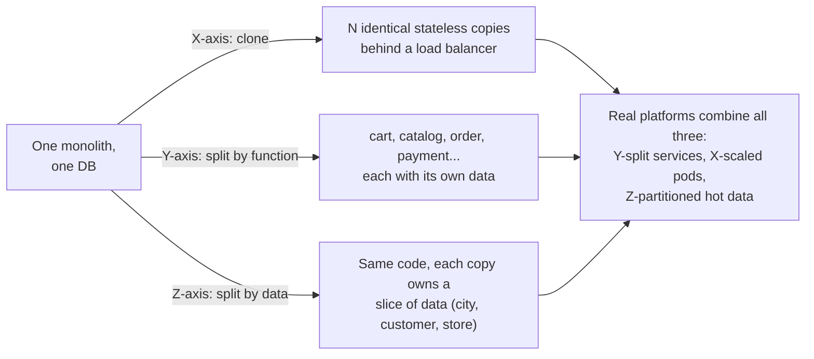
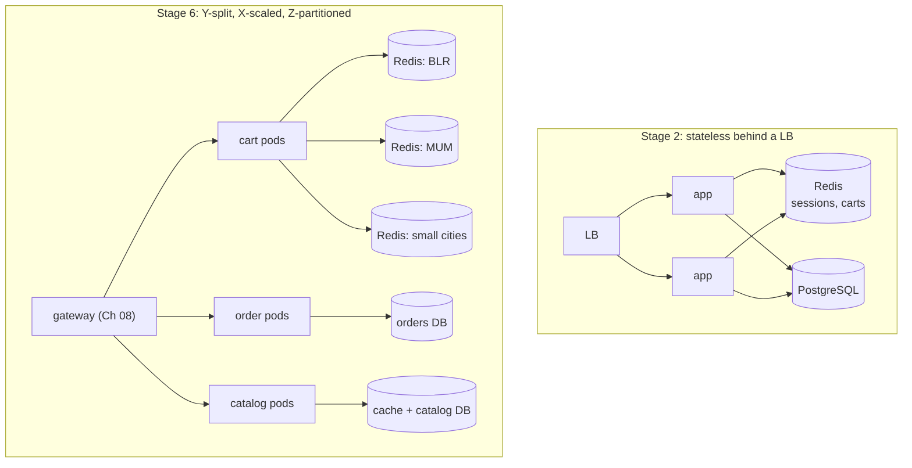
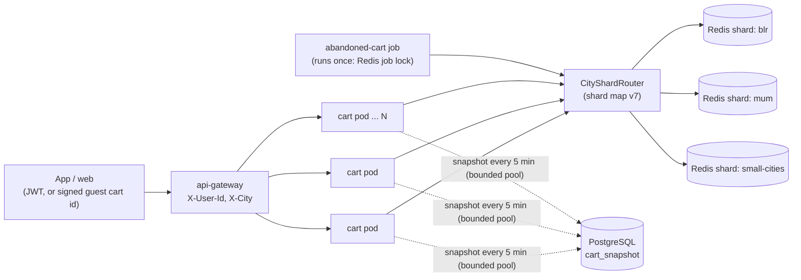
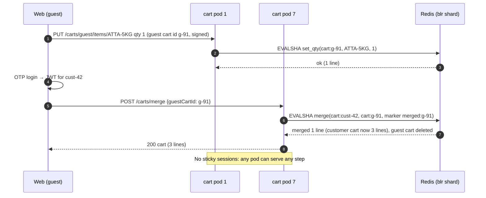
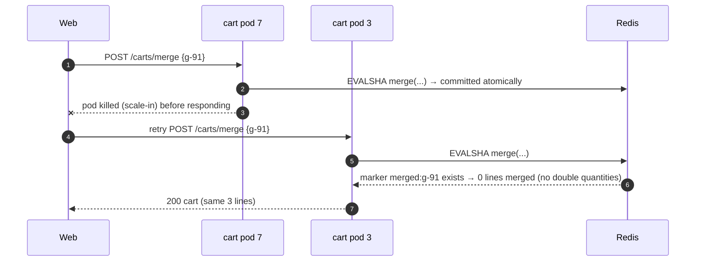
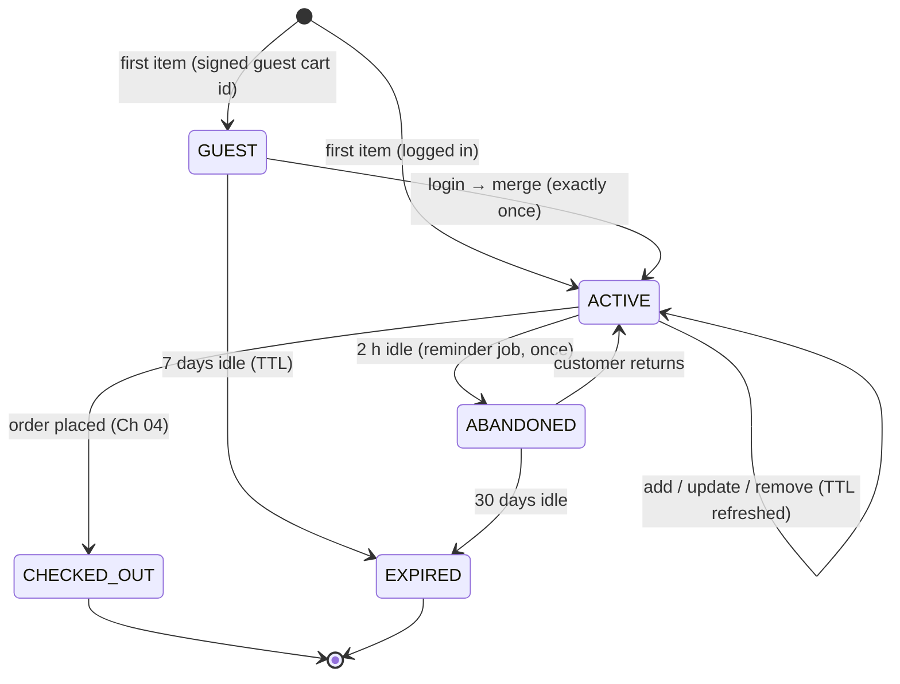
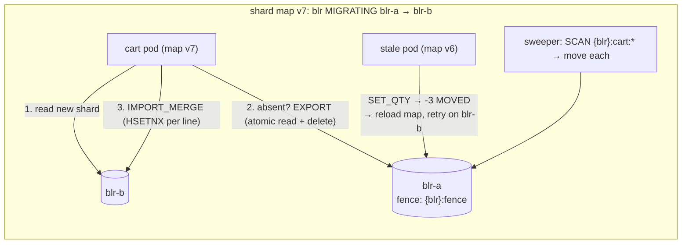

# 09. Scalability Fundamentals ⭐

!!! abstract "Chapter at a glance"
    **Reader bands:** B1 → B4 · **Prerequisites:** [Ch 02](02-back-of-the-envelope-estimation.md), [Ch 05](05-relational-databases-deep-dive.md), [Ch 07](07-caching.md), [Ch 08](08-load-balancing-proxies-and-gateways.md) · **What you will build:** The cart service, taken from an Amdahl/USL model fitted to load-test data (L1) to stateless pods with externalized sessions (L2), first-class Redis carts with atomic guest-to-customer merge and scale-safe jobs (L3), and city-level Z-axis partitioning with online shard moves (L4) · **Reading time:** 100 min + code

---

## 1. Introduction & Why It Matters

### 1.1 A story: we added pods and it got slower

The grocery platform had grown 10× in a year. For the festival sale, the cart team did what had always worked: they raised the Horizontal Pod Autoscaler's maximum from 20 to 80 pods for `cart-service`.

At 8:00 pm the HPA did its job and scaled from 20 to 64 pods. Cart throughput **dropped** from ~17,000 to ~13,000 requests/s, and p99 latency tripled. Three hidden costs grew faster than the pod count:

1. **Contention.** Every "add to cart" took a Redis lock on a global `cart:config` key to read the per-customer item limit. More pods meant more waiters on the same key.
2. **Coherency.** Each pod held an in-memory promotion cache and broadcast an invalidation to **every other pod** whenever a promotion changed. With N pods that's N × (N − 1) messages per change. At 64 pods, promotion churn during the sale alone generated millions of messages per minute.
3. **Connection limits.** 64 pods × a PostgreSQL pool of 20 = 1,280 connections against a `max_connections` of 500 (behind PgBouncer, which was now queueing). Cart snapshots to PostgreSQL waited seconds for a connection.

Scaling back to 40 pods **improved** throughput. Afterwards, a 30-minute load test at 1, 2, 4, 8, 16 and 24 pods, fitted with the Universal Scalability Law, would have predicted this: peak capacity at about 43 pods, then decline.

!!! quote "The thesis of this chapter"
    Horizontal scaling is a **property you design in**, not a knob you turn. A system scales only as far as its shared parts allow: the locks everyone waits on, the coordination everyone does, and the connections everyone holds. Find those, remove or partition them, and measure before you buy capacity.

### 1.2 Where this lives in the grocery platform

| Service | What limits its scaling | Scaling move |
|---|---|---|
| `catalog-service`, `search-service` | Read QPS | X-axis clones + caches (Ch 07) |
| `cart-service` | Session state, per-customer atomicity, connection budgets | Stateless pods + Redis carts + Z-axis by city |
| `inventory-service` | Hot rows (Ch 05), single-writer per store/SKU | Short transactions, then Z-axis by store |
| `order-service` | Write throughput on one primary | Partition by time, then Z-axis by region (Ch 11) |
| `tracking-service` | Write-heavy pings (Ch 06) | Kafka partitions + independent sinks |
| `notification-service` | Third-party provider rate limits (SMS, WhatsApp) | Queues with rate-limited consumers |
| Scheduled jobs (abandoned-cart reminders, slot release) | "Runs on every pod" duplication | Leader election / distributed job locks |

### 1.3 Learning objectives

| Band | After this chapter you can… |
|---|---|
| <span class="band b1">B1</span> | Explain vertical vs horizontal scaling, why stateless services scale, and where session state should live |
| <span class="band b2">B2</span> | Externalize sessions, find hidden state, use read replicas, and apply the X/Y/Z scale cube |
| <span class="band b3">B3</span> | Use Amdahl and the USL to explain and predict scaling limits, budget connections, and make jobs scale-safe |
| <span class="band b4">B4</span> | Plan a platform's 1 → 1M-user journey, choose partition keys and cells, and defend when *not* to scale out |

---

## 2. Core Concepts — Beginner to Deep

### 2.1 Intuition: billing counters and the manager's approval <span class="band b1">B1</span>

A supermarket adds billing counters for the festival. Throughput rises, until two things happen:

- **Every bill over ₹5,000 needs the floor manager's signature.** One manager, many counters: queues form at the manager, not at the counters. That's **contention** (σ).
- **Every counter must tell every other counter whenever a price changes.** With 5 counters that's 20 messages. With 40 counters it's 1,560, and cashiers spend their time on messages instead of customers. That's **coherency** (κ).

Adding counters helps while counters are the bottleneck. Past a point, it makes the queue at the manager longer and the chatter louder. The fix isn't more counters. It's more managers (partition the approval) and fewer broadcasts (publish price changes to a board everyone reads).

### 2.2 What scalability means <span class="band b1">B1</span> <span class="band b2">B2</span>

| Term | Meaning | Grocery example |
|---|---|---|
| **Performance** | How fast one request is | Cart add p99 = 40 ms |
| **Scalability** | How capacity grows as you add resources | 2× pods → ~1.9× throughput |
| **Elasticity** | How quickly capacity follows demand, up **and** down | Pre-scale at 7:30 pm, scale in at 11 pm (Ch 02) |
| **Efficiency** | Capacity per rupee | ₹ per 1,000 cart operations |

Scalability always has a **dimension**:

| Dimension | Question | Typical limit |
|---|---|---|
| Load (req/s) | Can we serve 10× traffic? | Shared locks, databases, connection budgets |
| Data volume | Can we hold 10× data? | Single-primary storage, index size, backup/restore time |
| Geography | Can we serve new cities or regions? | Latency, data residency, per-region ops |
| Tenants / sellers | Can we onboard 10× sellers? | Noisy neighbours, per-tenant config (Ch 30) |
| Organization | Can 10× engineers work in parallel? | Shared codebase and deploys (Ch 16, 37) |

### 2.3 Vertical vs horizontal scaling ⭐ <span class="band b1">B1</span> <span class="band b2">B2</span>

| | Vertical (scale up) | Horizontal (scale out) |
|---|---|---|
| How | Bigger machine: more vCPU, RAM, faster disk | More machines or pods |
| Code changes | None | Needs stateless design or partitioned state |
| Ceiling | The largest instance you can buy | Set by shared components (USL) |
| Failure isolation | One big failure domain | Many small ones |
| Cost curve | Superlinear at the top end | Roughly linear, plus coordination overhead |
| Time to add | Minutes to hours (often a restart) | Seconds to minutes (Ch 02 warm-up) |
| Best for | Databases before sharding, stateful systems, early stage | Stateless services, read paths, anything behind a load balancer |

!!! tip "Vertical scaling is underrated"
    A modern 64-vCPU, 512 GB database server handles a surprising amount of load. Moving the orders database from 16 to 32 vCPU buys a year of growth in an afternoon. Sharding it costs two quarters of engineering and permanent complexity (Ch 11). Scale up the stateful parts while it's cheap, and scale out the stateless parts from day one.

### 2.4 Amdahl's law and the Universal Scalability Law ⭐ <span class="band b3">B3</span>

**Amdahl's law.** If a fraction *s* of the work is serial, speed-up with N workers is capped at 1/*s*:

$$
S(N) = \frac{N}{1 + s(N-1)} \qquad \lim_{N\to\infty} S(N) = \frac{1}{s}
$$

**Universal Scalability Law (Gunther).** It adds a **coherency** term for the cost of keeping workers consistent with each other, which grows with the number of *pairs*:

$$
C(N) = \frac{N}{1 + \sigma(N-1) + \kappa N(N-1)}
$$

| Parameter | Meaning | Effect |
|---|---|---|
| σ (contention) | Fraction of time waiting on a shared resource | Throughput **plateaus** (Amdahl) |
| κ (coherency / crosstalk) | Cost of pairwise coordination | Throughput **peaks**, then **declines** (retrograde) |
| N* = √((1 − σ) / κ) | Pod count at peak capacity | Adding pods beyond it makes things worse |

L1 (§5) computes both and fits σ and κ from load-test measurements. The real output:

```text
B. USL: σ = 0.03 (contention), κ = 0.0005 (coherency)
     8 pods →   6.5x capacity
    32 pods →  13.2x capacity
    44 pods →  13.6x capacity   ← peak: N* = √((1−σ)/κ)
    96 pods →  11.4x capacity
   fitted σ = 0.0303, κ = 0.000523 → peak at ~43 pods, max ≈ 19,634 req/s
   halving κ (e.g. stop broadcasting to every pod) → peak at ~60 pods, max ≈ 23,733 req/s
```

**Where σ and κ come from in real systems:**

| Source | σ or κ | Example | Fix |
|---|---|---|---|
| Global lock / single hot key | σ | `cart:config` lock (§1.1), a hot DB row (Ch 05) | Remove the lock, read immutable config, partition the key |
| Single-writer database | σ | All pods writing one primary | Batch, partition, move writes off the hot path |
| Serialized sections in code | σ | `synchronized` around a shared map | Lock-free structures, per-key locks |
| Broadcast invalidation to all pods | κ | N × (N − 1) messages (§1.1) | Publish to a log everyone reads (one write, N reads) |
| Cluster membership / gossip | κ | Embedded caches that replicate to every member | External cache, or smaller clusters |
| Distributed locks and consensus | κ | Every request coordinating through a lock service | Avoid per-request coordination (Ch 20) |
| Cross-shard queries | κ | Scatter-gather to every partition | Route by partition key; read models |
| Connection pools to one DB | σ + κ | Pods × pool > the DB's useful concurrency | Pool budgets, PgBouncer (Ch 05) |

!!! warning "Fitting the USL needs real measurements"
    Measure throughput at several pod counts (1, 2, 4, 8, 16, …) with the **same workload mix**, with each run saturated (enough load to keep the pods busy) and long enough to be stable. Fit σ and κ, then predict. Treat the prediction as a warning light, not a guarantee: the model assumes the bottlenecks don't change shape between measurements.

### 2.5 Stateless services ⭐ <span class="band b1">B1</span> <span class="band b2">B2</span>

A service is **stateless** when any instance can serve any request, and losing an instance loses nothing but in-flight work. State still exists; it just lives in a store designed to hold it.

| Hidden state | Why it breaks scaling | Where it should live |
|---|---|---|
| In-memory HTTP sessions | Sticky sessions required; a pod loss logs users out | Redis (Spring Session) or signed tokens |
| Carts in pod memory | Lost on scale-in or deploy | Redis (+ DB snapshot) |
| Uploaded files on local disk | Only one pod has them | Object storage (S3-compatible) |
| In-process caches without invalidation | Pods disagree (Ch 07) | Short TTL + broadcast, or an external cache |
| Scheduled jobs running on every pod | Duplicate reminders, double processing | Leader election or a job lock (§2.7) |
| Per-pod rate limits | Limit multiplies with pod count | Central limiter (Ch 08) |
| Local counters and sequences | Duplicate ids | DB sequences, UUIDv7/Snowflake (Ch 20) |
| WebSocket/SSE connections | Inherent per connection | Resumable streams, no stickiness (Ch 03) |

**The 12-factor rules that matter most for scaling:** processes are stateless and share nothing (factor VI), config comes from the environment (III), backing services are attached resources (IV), and processes are disposable, meaning fast startup and graceful shutdown (IX).

### 2.6 Session externalization ⭐ <span class="band b2">B2</span>

| Option | How | Pros | Cons | Use |
|---|---|---|---|---|
| Sticky sessions | LB pins a user to a pod | No code change | Uneven load; lost on pod loss or deploy (Ch 08) | Avoid |
| Replicated in-memory sessions | App servers copy sessions to peers | No external store | κ grows with cluster size; memory × N | Avoid at scale |
| **External session store** | Spring Session with Redis (or JDBC) | Any pod serves any request; survives restarts | A Redis round trip per request; session blob size | Web apps with server sessions |
| **Client-side tokens** (JWT) | Signed claims travel with each request | Zero server session lookups | Revocation is harder; size limits; claims must be small | APIs and mobile apps (Ch 08, 23) |

**For the grocery platform:** identity is a JWT validated at the gateway (Ch 08), so there's no server-side login session. The **cart** is not session data. It's first-class state keyed by customer (or by a device-issued guest cart id) in Redis, with a periodic snapshot to PostgreSQL. That distinction matters: a session blob is rewritten whole on every change and can't be updated atomically from two tabs.

**Guest cart → customer cart merge** is the classic correctness problem of externalized state:

- A guest adds items on the web, then logs in with OTP. The customer already has a cart from the app last week.
- Both carts must merge **exactly once**, atomically, even if two pods receive "login" and "add item" at the same moment.
- L3 implements it as a single Redis Lua script with a merge marker for idempotency.

### 2.7 Scheduled jobs and singletons in a horizontal world <span class="band b2">B2</span> <span class="band b3">B3</span>

With 40 pods, `@Scheduled` runs 40 times.

| Approach | How | When |
|---|---|---|
| **Job lock** (ShedLock, Redis `SET NX PX`, DB row lock) | Each run acquires a named lock with a lease; others skip | Periodic jobs that must run once per interval |
| **Leader election** (Kubernetes Lease, ZooKeeper/etcd) | One pod is leader and runs singletons | Long-running singleton processes |
| **Partitioned work** (`FOR UPDATE SKIP LOCKED`, Kafka partitions) | Every pod takes a disjoint slice | Large batches that should use all pods |
| **External scheduler** (Kubernetes CronJob) | Runs a separate job pod | Batch jobs that don't belong in the service |

Whatever the mechanism, make jobs **idempotent**. Leases expire, and a slow or paused pod can still be running when another acquires the lock (fencing, Ch 20).

### 2.8 Scaling reads and writes <span class="band b2">B2</span> <span class="band b3">B3</span>

| To scale… | In order of cost |
|---|---|
| **Reads** | Fix queries → cache (Ch 07) → CDN → read replicas (Ch 05) → read models / CQRS (Ch 15) → search engine (Ch 22) |
| **Writes** | Fix queries and indexes → batch and coalesce → move non-critical writes async (queue) → vertical scale → functional split (a DB per service) → partition / shard (Ch 11) |

Reads are easy to scale because copies are cheap. Writes are hard because every copy must agree. Most scaling work is **moving writes off shared hot paths**.

### 2.9 Connection limits: the hidden ceiling ⭐ <span class="band b3">B3</span>

Adding pods multiplies **every** per-pod resource that points at something shared:

| Resource | Limit | What happens at scale-out | Guard |
|---|---|---|---|
| DB connections | `max_connections`, and far lower useful concurrency (Ch 05) | Pods × pool exceeds budget; queueing, context switching | Pool from Little's Law; PgBouncer; budget checks (Ch 02) |
| Redis connections | `maxclients` (10 K default), per-shard CPU | Connection storms on deploy | Shared multiplexed clients (Lettuce), limits |
| Kafka consumers | Consumers per group ≤ partitions | Pods beyond the partition count sit idle | Partitions sized for max consumers (Ch 14) |
| Third-party APIs | Razorpay, SMS/WhatsApp providers' rate limits | More pods = more 429s, not more throughput | Central rate-limited queue |
| NAT gateway ports | Connections per destination (Ch 03) | Outbound failures to one partner | Pooling, more egress IPs |
| File descriptors | `ulimit -n` | Streaming or pooled services hit FD limits | Raise limits, load test |
| LB / gateway | Connections, new connections per second | Rejected connections during reconnect storms | Pre-scaling, jitter (Ch 03) |

!!! danger "The fastest way to take down a database is to autoscale its clients"
    An HPA with `maxReplicas: 100` and a pool of 20 is a promise of up to 2,000 connections. Set `maxReplicas` from the connection budget and the USL peak, not from hope.

### 2.10 The scale cube (X, Y, Z) ⭐ <span class="band b2">B2</span> <span class="band b4">B4</span>



| Axis | How | Scales | Costs | Grocery example |
|---|---|---|---|---|
| **X** (horizontal duplication) | Clone stateless instances | Request volume | Shared data stays a bottleneck | 40 `catalog-service` pods |
| **Y** (functional decomposition) | Split by capability or bounded context | Team autonomy, independent scaling, fault isolation | Distributed transactions, network calls (Ch 13, 16) | `cart`, `order`, `payment` as separate services |
| **Z** (data partitioning) | Each copy owns a subset of data, routed by a key | Data volume, writes, blast radius | Routing, rebalancing, cross-partition queries (Ch 11) | Carts and inventory partitioned by city; cells per region (Ch 34) |

**Choosing a Z-axis key for the grocery platform:** city (or zone within a mega-city) is natural because orders, stores, riders and inventory rarely cross cities. It keeps most queries partition-local and limits a failure to one city. The risk is skew (Bengaluru is far bigger than Mysuru), handled by giving big cities their own partitions and packing small cities together.

### 2.11 Elasticity: scaling on the right signal <span class="band b2">B2</span> <span class="band b3">B3</span>

| Signal | Good for | Pitfall |
|---|---|---|
| CPU | CPU-bound services | I/O-bound services saturate on connections or latency at low CPU |
| In-flight requests / concurrency | Most request-response services | Needs a custom metric |
| Requests per second per pod | Predictable per-request cost | Doesn't reflect slow dependencies |
| Queue depth / consumer lag (KEDA) | Workers and consumers | Consumers beyond the partition count do nothing |
| Schedule (cron) | Known events (Ch 02) | Needs a forecast |

Autoscaling has **reaction time** (metric scrape, HPA sync, node provisioning, JVM warm-up), so it handles gradual growth and not step changes. Always pair it with a `maxReplicas` derived from connection budgets and the USL peak, and with admission control or load shedding for what can't be scaled in time (Ch 18).

### 2.12 The 1 → 1 M users journey ⭐ <span class="band b2">B2</span> → <span class="band b4">B4</span>

Each stage is triggered by a measured limit, not by fashion. The numbers use the Ch 00 assumptions (~20 API calls per user per day on average; peak 5× average).

| Stage | Users (DAU) | Peak req/s | What breaks | Move |
|---|---|---|---|---|
| **0. One box** | 100 | < 1 | Nothing yet; a single point of failure | App + PostgreSQL on one VM; daily backups |
| **1. Separate the database** | 1 K | ~1 | App deploys restart the DB; resource fights | Managed PostgreSQL; app on its own VM |
| **2. Stateless app behind a LB** | 10 K | ~10 | One app instance = downtime on deploy; sessions in memory | 2+ app instances, LB, sessions/carts in Redis, uploads in object storage |
| **3. Cache and CDN** | 50 K | ~60 | Catalog reads dominate DB CPU | CDN for images; Redis cache (Ch 07); fix slow queries |
| **4. Async work and read replicas** | 200 K | ~250 | Invoices, SMS and emails block requests; report queries slow the primary | Queue + workers (Kafka/RabbitMQ); read replica for reports/history |
| **5. Split hot capabilities (Y-axis)** | 500 K | ~600 | One deployable for 6 teams; search needs a different datastore; tracking writes swamp the DB (Ch 06) | Modular monolith → extract search, tracking, payments; DB per service |
| **6. Multi-AZ, pre-scaling, data partitioning (Z-axis)** | 1 M | ~1.2 K (sale starts 20–40×) | AZ outage = platform outage; sale spikes; single-primary writes for carts and inventory | 3-AZ everything, cron pre-scaling (Ch 02), city partitioning for carts and inventory |
| **7. Cells and regions** | 5 M+ | 6 K+ | Blast radius of a bad deploy or noisy city; DR region | Cell-based architecture per region or city group (Ch 34); DR region (Ch 27) |



!!! note "The journey isn't a ladder you must climb"
    Many profitable businesses stay at stage 3–4 forever. Each stage adds permanent operating cost. Move up only when a **measured** limit (Ch 02 estimates, load tests, USL fits) says the current stage can't meet the next year's forecast.

---

## 3. Architecture & Diagrams

### 3.1 Component view: a stateless, partitioned cart service



### 3.2 Sequence: happy path, guest adds items, logs in on a different pod, carts merge once



### 3.3 Sequence: failure path, retry of a merge and a pod dying mid-request



!!! note "What the system guarantees after this failure path"
    The merge happens **exactly once**, because the Lua script checks and sets the merge marker in the same atomic step as the merge itself. A retry on any pod returns the same cart without doubling quantities. Scale-in or a crash loses only the in-flight response, never cart state.

### 3.4 State: cart lifecycle



---

## 4. Design Document Excerpt: Cart Service Scaling to 10×

| Field | Value |
|---|---|
| Author / Reviewers | Cart team / Platform, SRE, Checkout |
| Status | Approved |
| Related ADRs | ADR-035 Carts as first-class Redis state, partitioned by city; ADR-036 `maxReplicas` from connection budget and USL fit |

**1. Context & Problem.** Scaling `cart-service` from 20 to 64 pods reduced throughput (§1.1): a global config lock (σ), all-pod broadcast invalidation (κ), and a connection budget overrun. Carts lived in server sessions, requiring sticky routing for guests.

**2. Goals / Non-Goals.**

- *Goals:* 10× cart throughput headroom over last festival; no scaling cliff below the planned max replicas; any pod serves any request; exactly-once guest merge; carts survive pod loss.
- *Non-goals:* checkout pricing (the SoR re-prices, Ch 07); cross-city carts (a customer's cart belongs to the delivery city).

**3. Requirements.**

| ID | Requirement |
|---|---|
| FR-1 | Add, update, remove cart lines; view cart; merge guest into customer cart on login |
| NFR-1 | 60 K cart ops/s at P90 sale peak, p99 ≤ 30 ms in-service |
| NFR-2 | USL-fitted peak N* ≥ 2 × planned max replicas |
| NFR-3 | Σ (pods × pool) ≤ connection budget for every shared store |
| NFR-4 | Merge is idempotent and atomic under concurrent requests |
| NFR-5 | Losing any pod or zone loses no cart state; losing a Redis shard affects one partition only |

**4. Capacity estimates and scaling analysis.**

| Item | Calculation | Result |
|---|---|---|
| Cart ops at P90 sale peak | Ch 02: ~14.5 K cart req/s × ~4 Redis ops per request | ~60 K Redis ops/s |
| Carts in Redis | 1.5 M active × ~1 KB | ~1.5 GB (+ replicas) |
| Load test (pods → req/s) | 1 → 1,470 … 24 → 17,800 | **σ ≈ 0.030, κ ≈ 0.00052, N* ≈ 43** (L1 fit) |
| Planned peak pods (Ch 02 method) | 14.5 K req/s ÷ ~1.2 K per pod × 1.5 AZ headroom | ~18–24 pods |
| NFR-2 check before fixes | N* 43 ≥ 2 × 24? | **Fails** (43 < 48) |
| After removing the config lock (σ → ~0.01) and broadcasts (κ → ~0.0001) | re-test | Target N* ≥ 90 (verified by load test) |
| DB connection budget (snapshots) | Snapshot writes ~100/s × 20 ms ≈ 2 busy | Pool of **2** per pod → 48 at 24 pods |
| Redis connections | Lettuce: 1 multiplexed connection per shard per pod | 24 pods × 3 shards = 72 |

!!! success "What the analysis tells us"
    The fleet was never short of pods. It was short of **independence**. Fixing σ and κ roughly doubles the useful pod count and raises the throughput ceiling, while adding pods to the old design would have lowered it.

**5. Proposed design.**

1. **Stateless pods.** Identity from the gateway JWT. Guest carts are identified by a server-issued, HMAC-signed guest cart id (no server session). No sticky sessions.
2. **Carts are first-class Redis state.** One HASH per cart (`sku → qty`), with atomic Lua scripts for set-quantity (with max lines and max quantity per line) and merge (with an idempotency marker). TTL refreshed on write. A snapshot job writes changed carts to PostgreSQL every 5 minutes.
3. **Remove σ and κ sources.** Cart limits come from immutable config loaded at startup and refreshed through a versioned snapshot (the Ch 01 pattern), with no per-request lock. Promotion changes are published once to a Kafka topic, and pods read it (one write, N reads) instead of pod-to-pod broadcasts.
4. **Z-axis by city.** A `CityShardRouter` maps city to Redis shard via a versioned shard map. Bengaluru and Mumbai get dedicated shards, and small cities share one. A city can move between shards online (lazy copy-on-read, L4).
5. **Scale-safe jobs.** The abandoned-cart reminder runs once per interval under a Redis job lock with a lease, and it's idempotent (a reminder marker per cart).
6. **Elasticity guardrails.** HPA on in-flight requests per pod. `maxReplicas = min(connection-budget limit, N*/2)`.

**7. Alternatives considered.**

| Option | Pros | Cons | Verdict |
|---|---|---|---|
| Keep carts in server sessions, add sticky sessions | No code change | Uneven load; carts lost on deploy; session blob contention | Rejected |
| Spring Session (Redis) with cart in the session | Stateless pods quickly | Whole-session rewrites; last-write-wins across tabs; no atomic merge | Interim step (L2), rejected as the end state |
| Carts in PostgreSQL only | One store, transactional | 60 K ops/s of small writes on the orders cluster | Rejected (snapshot only) |
| **Carts as Redis HASHes + Lua + city partitioning + DB snapshots** | Atomic ops, fast, partitionable, survives pod loss | Redis is a critical store: needs replicas, a snapshot for recovery | **Chosen** |
| Just raise `maxReplicas` | Instant | Retrograde scaling (§1.1) | Rejected |

**8. Failure modes.** A Redis shard failover: a few seconds of errors for that city only. Carts are replicated, and in the worst case they're restored from the last 5-minute snapshot. Shard map misconfiguration: the router refuses unknown cities and uses the last good map version. A job lock lease expires mid-run: the job's per-cart idempotency markers prevent duplicate reminders.

**10. Observability.** Throughput per pod vs pod count (a live USL view), lock wait time, broadcast or message rates per pod, connection counts per store vs budget, Redis ops per shard, merge outcomes (`merged`, `already_merged`, `empty`), job lock acquisitions.

**14. Decision (ADR-035/036 summary).** Carts are first-class Redis state, partitioned by city, mutated only through atomic scripts, with DB snapshots for recovery. Every horizontally scaled service publishes a USL fit from its latest load test, and its `maxReplicas` is the lower of the connection-budget limit and half the fitted peak. Per-request global locks and all-pod broadcasts are prohibited on hot paths.


---

## 5. Hands-On Code — Level Ladder

We build the **cart service's scalability** four times:

| Level | New requirement that forces the step |
|---|---|
| L1 | "How far can adding pods take us, and why does it stop?" (Amdahl, USL, fitting a load test) |
| L2 | "Any pod must serve any request." (externalized sessions with Spring Session + Redis) |
| L3 | "Carts are real state: atomic line updates from any pod, exactly-once guest merge, limits, jobs that run once." |
| L4 | "Partition carts by city (Z-axis) and move a city between shards online, with stale pods and no lost lines." |

### L1 — Concept: Amdahl, USL and fitting a load test (plain Java) <span class="band b1">B1</span> <span class="band b3">B3</span>

```java
// ScalabilityL1.java — run with: java ScalabilityL1.java
// Why "just add pods" stops working:
//   A. Amdahl's law: a serial fraction caps speed-up
//   B. Universal Scalability Law (USL): contention (σ) + coherency (κ) → throughput PEAKS, then falls
//   C. Fit σ and κ from load-test measurements and predict the peak BEFORE you buy the pods
import java.util.*;

public class ScalabilityL1 {

    /** Amdahl: speed-up with N workers when a fraction s of the work is serial. */
    static double amdahl(int n, double s) { return n / (1 + s * (n - 1)); }

    /** USL relative capacity C(N) = N / (1 + σ(N−1) + κ·N(N−1)). */
    static double usl(int n, double sigma, double kappa) {
        return n / (1 + sigma * (n - 1) + kappa * n * (n - 1.0));
    }

    /**
     * Fit σ, κ from measured throughput X(N). With C(N) = X(N)/X(1) and x = N−1:
     *   N/C(N) − 1 = (σ+κ)·x + κ·x²      → least squares through the origin for a·x + b·x²
     */
    static double[] fitUsl(int[] n, double[] throughput) {
        double x1 = throughput[0];                               // requires a measurement at N = 1
        double sxx = 0, sx3 = 0, sx4 = 0, sxy = 0, sx2y = 0;
        for (int i = 0; i < n.length; i++) {
            double x = n[i] - 1, y = n[i] / (throughput[i] / x1) - 1;
            sxx += x * x; sx3 += x * x * x; sx4 += x * x * x * x; sxy += x * y; sx2y += x * x * y;
        }
        double det = sxx * sx4 - sx3 * sx3;
        double a = (sxy * sx4 - sx2y * sx3) / det;               // a = σ + κ
        double b = (sxx * sx2y - sx3 * sxy) / det;               // b = κ
        return new double[]{a - b, b};
    }

    public static void main(String[] args) {
        System.out.println("A. Amdahl: speed-up with 5% serial work");
        for (int n : new int[]{1, 4, 16, 64, 256})
            System.out.printf("   %3d workers → %5.1fx (ceiling 1/s = 20x)%n", n, amdahl(n, 0.05));

        System.out.println("B. USL: σ = 0.03 (contention), κ = 0.0005 (coherency)");
        for (int n : new int[]{1, 8, 16, 32, 44, 64, 96, 128})
            System.out.printf("   %3d pods → %5.1fx capacity%s%n", n, usl(n, 0.03, 0.0005),
                    n == 44 ? "   ← peak: N* = √((1−σ)/κ)" : "");

        System.out.println("C. Fit from a load test of cart-service (req/s per pod count)");
        // Synthetic measurements generated from σ=0.03, κ=0.0005 with ±3 % noise — replace with your results
        int[] pods = {1, 2, 4, 8, 12, 16, 24};
        double[] measured = new double[pods.length];
        Random rnd = new Random(9);
        for (int i = 0; i < pods.length; i++)
            measured[i] = 1_450 * usl(pods[i], 0.03, 0.0005) * (1 + (rnd.nextDouble() - 0.5) * 0.06);
        for (int i = 0; i < pods.length; i++) System.out.printf("   %2d pods: %,8.0f req/s%n", pods[i], measured[i]);

        double[] fit = fitUsl(pods, measured);
        double sigma = fit[0], kappa = fit[1];
        int peak = (int) Math.floor(Math.sqrt((1 - sigma) / kappa));
        System.out.printf("   fitted σ = %.4f, κ = %.6f → peak at ~%d pods, max ≈ %,.0f req/s%n",
                sigma, kappa, peak, measured[0] * usl(peak, sigma, kappa));
        System.out.printf("   prediction: 64 pods → %,.0f req/s (fewer than at %d pods)%n",
                measured[0] * usl(64, sigma, kappa), peak);
        System.out.printf("   halving κ (e.g. stop broadcasting to every pod) → peak at ~%d pods, max ≈ %,.0f req/s%n",
                (int) Math.floor(Math.sqrt((1 - sigma) / (kappa / 2))),
                measured[0] * usl((int) Math.floor(Math.sqrt((1 - sigma) / (kappa / 2))), sigma, kappa / 2));
    }
}
```

Actual output from running it:

```text
A. Amdahl: speed-up with 5% serial work
     1 workers →   1.0x (ceiling 1/s = 20x)
     4 workers →   3.5x (ceiling 1/s = 20x)
    16 workers →   9.1x (ceiling 1/s = 20x)
    64 workers →  15.4x (ceiling 1/s = 20x)
   256 workers →  18.6x (ceiling 1/s = 20x)
B. USL: σ = 0.03 (contention), κ = 0.0005 (coherency)
     1 pods →   1.0x capacity
     8 pods →   6.5x capacity
    16 pods →  10.2x capacity
    32 pods →  13.2x capacity
    44 pods →  13.6x capacity   ← peak: N* = √((1−σ)/κ)
    64 pods →  13.0x capacity
    96 pods →  11.4x capacity
   128 pods →   9.9x capacity
C. Fit from a load test of cart-service (req/s per pod count)
    1 pods:    1,470 req/s
    2 pods:    2,858 req/s
    4 pods:    5,378 req/s
    8 pods:    9,421 req/s
   12 pods:   12,785 req/s
   16 pods:   14,679 req/s
   24 pods:   17,798 req/s
   fitted σ = 0.0303, κ = 0.000523 → peak at ~43 pods, max ≈ 19,634 req/s
   prediction: 64 pods → 18,735 req/s (fewer than at 43 pods)
   halving κ (e.g. stop broadcasting to every pod) → peak at ~60 pods, max ≈ 23,733 req/s
```

**What L1 shows:** a 5 % serial fraction caps you at 20× no matter how many workers you add. Any coherency cost (κ > 0) creates a **peak**, and past it more pods mean less throughput. Seven load-test points are enough to recover σ and κ within a few percent and predict the peak, **before** an HPA finds it for you in production. Reducing κ (removing all-pod broadcasts) moves the peak further than any amount of hardware.

**What L1 can't do:** it only models the system. The next levels remove the actual σ and κ sources.

### L2 — Stateless pods with externalized sessions <span class="band b2">B2</span>

The quickest way to stop needing sticky sessions: keep the `HttpSession` but store it in Redis.

```kotlin
// build.gradle.kts (module l2-spring)
dependencies {
    implementation("org.springframework.boot:spring-boot-starter-web")            // VERIFY: Boot 4 starter name
    implementation("org.springframework.boot:spring-boot-starter-data-redis")
    implementation("org.springframework.session:spring-session-data-redis")      // auto-configured when on the classpath
    testImplementation("org.springframework.boot:spring-boot-starter-test")
    testImplementation("org.springframework.boot:spring-boot-testcontainers")
    testImplementation("org.testcontainers:junit-jupiter")                        // VERIFY: 2.x artifact names
}
```

=== "Repository, Service, Delegate, Controller"

    ```java
    package com.grocery.cart.repository;

    import jakarta.servlet.http.HttpSession;
    import org.springframework.stereotype.Repository;
    import java.util.LinkedHashMap;
    import java.util.Map;

    /** L2: the cart lives INSIDE the HTTP session, which Spring Session stores in Redis. */
    @Repository
    public class SessionCartRepository {

        static final String ATTR = "cart";

        @SuppressWarnings("unchecked")
        public Map<String, Integer> load(HttpSession session) {
            Object c = session.getAttribute(ATTR);
            return c == null ? new LinkedHashMap<>() : new LinkedHashMap<>((Map<String, Integer>) c);
        }

        /** Writes the WHOLE cart back: Spring Session saves the changed attribute to Redis. */
        public void save(HttpSession session, Map<String, Integer> cart) {
            session.setAttribute(ATTR, new LinkedHashMap<>(cart));
        }
    }
    ```

    ```java
    package com.grocery.cart.service;

    import com.grocery.cart.repository.SessionCartRepository;
    import jakarta.servlet.http.HttpSession;
    import org.springframework.stereotype.Service;
    import java.util.Map;

    @Service
    public class SessionCartService {

        private final SessionCartRepository repo;

        public SessionCartService(SessionCartRepository repo) { this.repo = repo; }

        /** ⚠️ Read-modify-write of a session attribute: two tabs → last write wins (Ch 05, same lost-update shape). */
        public Map<String, Integer> setQty(HttpSession session, String sku, int qty) {
            Map<String, Integer> cart = repo.load(session);
            if (qty <= 0) cart.remove(sku); else cart.put(sku, qty);
            repo.save(session, cart);
            return cart;
        }

        public Map<String, Integer> view(HttpSession session) { return repo.load(session); }
    }
    ```

    ```java
    package com.grocery.cart.delegate;

    import com.grocery.cart.service.SessionCartService;
    import jakarta.servlet.http.HttpSession;
    import org.springframework.stereotype.Component;
    import java.util.Map;

    @Component
    public class SessionCartDelegate {
        private final SessionCartService service;
        public SessionCartDelegate(SessionCartService service) { this.service = service; }
        public Map<String, Integer> setQty(HttpSession s, String sku, int qty) { return service.setQty(s, sku, qty); }
        public Map<String, Integer> view(HttpSession s) { return service.view(s); }
    }
    ```

    ```java
    package com.grocery.cart.controller;

    import com.grocery.cart.delegate.SessionCartDelegate;
    import jakarta.servlet.http.HttpSession;
    import jakarta.validation.constraints.*;
    import org.springframework.validation.annotation.Validated;
    import org.springframework.web.bind.annotation.*;
    import java.util.Map;

    @RestController
    @RequestMapping("/api/v1/session-cart")
    @Validated
    public class SessionCartController {

        private final SessionCartDelegate delegate;

        public SessionCartController(SessionCartDelegate delegate) { this.delegate = delegate; }

        @PutMapping("/items/{sku}")
        public Map<String, Integer> setQty(HttpSession session, @PathVariable String sku,
                                           @RequestParam @Min(0) @Max(10) int qty) {
            return delegate.setQty(session, sku, qty);
        }

        @GetMapping
        public Map<String, Integer> view(HttpSession session) { return delegate.view(session); }
    }
    ```

=== "Configuration"

    ```yaml
    spring:
      data:
        redis:
          host: session-redis
      session:
        timeout: 7d                 # guests keep carts for a week
        redis:
          namespace: grocery:session
          flush-mode: on-save       # write at the end of the request
          save-mode: on-set-attribute
    server:
      servlet:
        session:
          cookie:
            same-site: lax
            secure: true
            http-only: true
    ```

    ```java
    package com.grocery.cart.config;

    import org.springframework.context.annotation.*;
    import org.springframework.data.redis.serializer.RedisSerializer;

    @Configuration
    public class SessionSerializationConfig {

        /** JSON instead of JDK serialization: readable in Redis, and safe across class changes during rolling deploys. */
        @Bean("springSessionDefaultRedisSerializer")
        RedisSerializer<Object> springSessionDefaultRedisSerializer() {
            return RedisSerializer.json();          // VERIFY: Jackson 3-based serializer in Spring Data Redis 4
        }
    }
    ```

=== "Test: two pods, one session"

    ```java
    package com.grocery.cart;

    import org.junit.jupiter.api.*;
    import org.springframework.boot.builder.SpringApplicationBuilder;
    import org.springframework.context.ConfigurableApplicationContext;
    import org.testcontainers.containers.GenericContainer;
    import org.testcontainers.junit.jupiter.*;
    import java.net.URI;
    import java.net.http.*;
    import static org.assertj.core.api.Assertions.assertThat;

    /** Two independent app instances ("pods") share only Redis. A session created on pod A works on pod B. */
    @Testcontainers
    class TwoPodsOneSessionIT {

        @Container static GenericContainer<?> redis = new GenericContainer<>("redis:7-alpine").withExposedPorts(6379);

        static ConfigurableApplicationContext podA, podB;

        @BeforeAll
        static void start() {
            podA = pod(); podB = pod();
        }

        static ConfigurableApplicationContext pod() {
            return new SpringApplicationBuilder(CartApplication.class).run(
                    "--server.port=0",
                    "--spring.data.redis.host=" + redis.getHost(),
                    "--spring.data.redis.port=" + redis.getMappedPort(6379),
                    "--server.servlet.session.cookie.secure=false");
        }

        static int port(ConfigurableApplicationContext ctx) {
            return Integer.parseInt(ctx.getEnvironment().getProperty("local.server.port"));
        }

        @Test
        void cartAddedOnPodAIsVisibleOnPodB() throws Exception {
            var http = HttpClient.newHttpClient();
            var add = http.send(HttpRequest.newBuilder(URI.create("http://localhost:" + port(podA)
                            + "/api/v1/session-cart/items/MILK-1L?qty=2"))
                    .PUT(HttpRequest.BodyPublishers.noBody()).build(), HttpResponse.BodyHandlers.ofString());
            String cookie = add.headers().firstValue("Set-Cookie").orElseThrow().split(";")[0];   // SESSION=...

            var view = http.send(HttpRequest.newBuilder(URI.create("http://localhost:" + port(podB) + "/api/v1/session-cart"))
                    .header("Cookie", cookie).build(), HttpResponse.BodyHandlers.ofString());

            assertThat(view.body()).contains("\"MILK-1L\":2");
        }

        @AfterAll static void stop() { podA.close(); podB.close(); }
    }
    ```

**What L2 fixed:** no sticky sessions, pod loss or deploys don't lose carts, and any pod serves any request, with a small amount of code.

**What L2 still gets wrong** (and why session state isn't the end state for carts):

| Problem | Why |
|---|---|
| Lost updates across tabs or devices | Whole-attribute read-modify-write: tab A's write overwrites tab B's |
| Whole blob rewritten on every change | Write amplification; hot sessions contend |
| No atomic guest → customer merge | Session ids change on login (session fixation protection); merge is multi-step app code |
| Cart lifetime tied to session lifetime | Session expiry deletes the cart |
| Can't partition by city or query carts (abandoned-cart job) | A session is an opaque blob keyed by a random id |

### L3 — Carts as first-class, atomically updated Redis state <span class="band b3">B3</span>

Design choices (from the design doc):

- **Identity is stateless:** the customer id comes from the gateway (Ch 08). Guests carry a server-signed guest cart id.
- **A cart is a Redis HASH** (`sku → qty`) in the city's hash-tag slot: `{blr}:cart:c:<customerId>` or `{blr}:cart:g:<guestId>`.
- **Every mutation is one Lua script:** per-line updates can't lose each other, limits are enforced atomically, and the merge happens exactly once.
- **Jobs run once:** a Redis job lock with an owner token and a lease, plus idempotent work.

=== "Lua scripts (verified on Redis 7)"

    ```lua
    -- KEYS[1] = cart hash   ARGV: 1=sku 2=qty 3=maxLines 4=maxQtyPerLine 5=ttlSeconds
    -- returns: >=0 number of lines after the change | -1 too many lines | -2 quantity above limit
    local qty = tonumber(ARGV[2])
    if qty > tonumber(ARGV[4]) then return -2 end
    if qty <= 0 then
      redis.call('HDEL', KEYS[1], ARGV[1])
    else
      if redis.call('HEXISTS', KEYS[1], ARGV[1]) == 0
         and redis.call('HLEN', KEYS[1]) >= tonumber(ARGV[3]) then
        return -1
      end
      redis.call('HSET', KEYS[1], ARGV[1], qty)
    end
    local n = redis.call('HLEN', KEYS[1])
    if n > 0 then redis.call('EXPIRE', KEYS[1], ARGV[5]) end
    return n
    ```

    ```lua
    -- KEYS[1] = customer cart  KEYS[2] = guest cart  KEYS[3] = merge marker   (same {city} hash tag → same slot)
    -- ARGV: 1=maxLines 2=maxQtyPerLine 3=cartTtlSeconds 4=markerTtlSeconds
    -- returns { merged, skipped, linesAfter, alreadyMerged(0/1) }
    if redis.call('EXISTS', KEYS[3]) == 1 then
      return {0, 0, redis.call('HLEN', KEYS[1]), 1}
    end
    local maxLines, maxQty = tonumber(ARGV[1]), tonumber(ARGV[2])
    local guest = redis.call('HGETALL', KEYS[2])
    local merged, skipped = 0, 0
    for i = 1, #guest, 2 do
      local sku, q = guest[i], tonumber(guest[i + 1])
      local cur = tonumber(redis.call('HGET', KEYS[1], sku) or '0')
      if cur == 0 and redis.call('HLEN', KEYS[1]) >= maxLines then
        skipped = skipped + 1
      else
        redis.call('HSET', KEYS[1], sku, math.min(maxQty, cur + q))
        merged = merged + 1
      end
    end
    redis.call('DEL', KEYS[2])
    redis.call('SET', KEYS[3], '1', 'EX', ARGV[4])
    local n = redis.call('HLEN', KEYS[1])
    if n > 0 then redis.call('EXPIRE', KEYS[1], ARGV[3]) end
    return {merged, skipped, n, 0}
    ```

    ```lua
    -- KEYS[1] = lock key  ARGV[1] = owner token. Delete only if we still own it.
    if redis.call('GET', KEYS[1]) == ARGV[1] then return redis.call('DEL', KEYS[1]) end
    return 0
    ```

    Run against a real Redis 7.0 server (`redis-cli --eval`): with `maxLines = 3` and `maxQty = 10`, a 4th distinct line returns `-1`, quantity 11 returns `-2`, and quantity 0 removes the line. Merging a guest cart `{MILK:9, ATTA:1, OIL:1}` into `{MILK:2, RICE:1}` gives `{MILK:10 (capped), RICE:1, ATTA:1}`, skips OIL (line limit), and deletes the guest cart. **A retried merge returns `alreadyMerged = 1` and changes nothing.** A lock release with the wrong token returns `0`, and with the right token returns `1`.

=== "Guest cart ids"

    ```java
    package com.grocery.cart.identity;

    import javax.crypto.Mac;
    import javax.crypto.spec.SecretKeySpec;
    import java.nio.charset.StandardCharsets;
    import java.security.MessageDigest;
    import java.security.SecureRandom;
    import java.util.Base64;
    import java.util.Optional;

    /**
     * Guest carts need an identity without a server session. The server issues "city.randomId.signature";
     * the client stores it (cookie / app storage) and sends it back. Forged or tampered ids are rejected.
     */
    public final class GuestCartIds {

        public record GuestCart(String city, String id) { }

        private static final Base64.Encoder ENC = Base64.getUrlEncoder().withoutPadding();
        private static final SecureRandom RANDOM = new SecureRandom();
        private final byte[] secret;

        public GuestCartIds(byte[] secret) {
            if (secret.length < 32) throw new IllegalArgumentException("secret must be >= 256 bits");
            this.secret = secret.clone();
        }

        public String issue(String city) {
            if (!city.matches("[a-z]{2,12}")) throw new IllegalArgumentException("bad city code");
            byte[] raw = new byte[16];
            RANDOM.nextBytes(raw);
            String body = city + "." + ENC.encodeToString(raw);
            return body + "." + ENC.encodeToString(hmac(body));
        }

        public Optional<GuestCart> verify(String token) {
            if (token == null) return Optional.empty();
            String[] p = token.split("\\.");
            if (p.length != 3) return Optional.empty();
            byte[] given;
            try { given = Base64.getUrlDecoder().decode(p[2]); } catch (IllegalArgumentException e) { return Optional.empty(); }
            if (!MessageDigest.isEqual(hmac(p[0] + "." + p[1]), given)) return Optional.empty();
            return Optional.of(new GuestCart(p[0], p[1]));
        }

        private byte[] hmac(String data) {
            try {
                Mac mac = Mac.getInstance("HmacSHA256");
                mac.init(new SecretKeySpec(secret, "HmacSHA256"));
                return mac.doFinal(data.getBytes(StandardCharsets.UTF_8));
            } catch (Exception e) {
                throw new IllegalStateException(e);
            }
        }
    }
    ```

    Verified: an issued id round-trips, and changing the city prefix (`blr` → `mum`), garbage, and `null` are all rejected.

=== "Repository"

    ```java
    package com.grocery.cart.repository;

    import org.springframework.data.redis.core.StringRedisTemplate;
    import org.springframework.data.redis.core.script.DefaultRedisScript;
    import org.springframework.stereotype.Repository;
    import java.util.*;

    @Repository
    public class RedisCartRepository {

        public record MergeResult(long merged, long skipped, long linesAfter, boolean alreadyMerged) { }

        private static final DefaultRedisScript<Long> SET_QTY = LuaScripts.load("lua/set_qty.lua", Long.class);
        @SuppressWarnings("rawtypes")
        private static final DefaultRedisScript<List> MERGE = LuaScripts.load("lua/merge.lua", List.class);

        static final long CART_TTL_SECONDS = 7 * 24 * 3600;
        static final long MARKER_TTL_SECONDS = 24 * 3600;

        private final StringRedisTemplate redis;
        private final CartLimits limits;

        public RedisCartRepository(StringRedisTemplate redis, CartLimits limits) { this.redis = redis; this.limits = limits; }

        public static String customerKey(String city, String customerId) { return "{" + city + "}:cart:c:" + customerId; }
        public static String guestKey(String city, String guestId) { return "{" + city + "}:cart:g:" + guestId; }
        static String mergeMarker(String city, String guestId) { return "{" + city + "}:cart:merged:" + guestId; }

        /** @return lines after the change; -1 too many lines; -2 quantity above limit */
        public long setQty(String cartKey, String sku, int qty) {
            Long r = redis.execute(SET_QTY, List.of(cartKey), sku, Integer.toString(qty),
                    Integer.toString(limits.maxLines()), Integer.toString(limits.maxQtyPerLine()), Long.toString(CART_TTL_SECONDS));
            return r == null ? 0 : r;
        }

        public Map<String, Integer> read(String cartKey) {
            Map<Object, Object> raw = redis.opsForHash().entries(cartKey);
            Map<String, Integer> cart = new TreeMap<>();
            raw.forEach((k, v) -> cart.put((String) k, Integer.parseInt((String) v)));
            return cart;
        }

        @SuppressWarnings("unchecked")
        public MergeResult merge(String city, String customerId, String guestId) {
            List<Long> r = redis.execute(MERGE,
                    List.of(customerKey(city, customerId), guestKey(city, guestId), mergeMarker(city, guestId)),
                    Integer.toString(limits.maxLines()), Integer.toString(limits.maxQtyPerLine()),
                    Long.toString(CART_TTL_SECONDS), Long.toString(MARKER_TTL_SECONDS));
            return new MergeResult(r.get(0), r.get(1), r.get(2), r.get(3) == 1L);
        }
    }
    ```

    ```java
    package com.grocery.cart.repository;

    import org.springframework.core.io.ClassPathResource;
    import org.springframework.data.redis.core.script.DefaultRedisScript;

    /** Scripts live in src/main/resources/lua/*.lua; Spring sends EVALSHA and falls back to EVAL once per node. */
    public final class LuaScripts {
        private LuaScripts() { }

        public static <T> DefaultRedisScript<T> load(String classpathLocation, Class<T> resultType) {
            DefaultRedisScript<T> script = new DefaultRedisScript<>();
            script.setLocation(new ClassPathResource(classpathLocation));
            script.setResultType(resultType);
            return script;
        }
    }
    ```

    ```java
    package com.grocery.cart.repository;

    import org.springframework.boot.context.properties.ConfigurationProperties;

    /** Immutable config: loaded at startup (and refreshed via a versioned snapshot) — no per-request lock (§1.1 σ). */
    @ConfigurationProperties("cart.limits")
    public record CartLimits(int maxLines, int maxQtyPerLine) { }
    ```

=== "Service, Delegate, Controller"

    ```java
    package com.grocery.cart.service;

    import com.grocery.cart.identity.GuestCartIds;
    import com.grocery.cart.repository.RedisCartRepository;
    import io.micrometer.core.instrument.MeterRegistry;
    import org.springframework.stereotype.Service;
    import java.util.Map;

    @Service
    public class CartService {

        public sealed interface Change {
            record Ok(Map<String, Integer> cart) implements Change { }
            record TooManyLines(int max) implements Change { }
            record QuantityTooHigh(int max) implements Change { }
        }

        private final RedisCartRepository repo;
        private final GuestCartIds guestIds;
        private final MeterRegistry metrics;
        private final int maxLines, maxQty;

        public CartService(RedisCartRepository repo, GuestCartIds guestIds, MeterRegistry metrics,
                           com.grocery.cart.repository.CartLimits limits) {
            this.repo = repo; this.guestIds = guestIds; this.metrics = metrics;
            this.maxLines = limits.maxLines(); this.maxQty = limits.maxQtyPerLine();
        }

        public Change setQty(String cartKey, String sku, int qty) {
            long r = repo.setQty(cartKey, sku, qty);
            if (r == -1) return new Change.TooManyLines(maxLines);
            if (r == -2) return new Change.QuantityTooHigh(maxQty);
            return new Change.Ok(repo.read(cartKey));
        }

        public Map<String, Integer> view(String cartKey) { return repo.read(cartKey); }

        /** Called after login. Safe to retry on any pod: the script merges exactly once. */
        public Map<String, Integer> mergeGuestCart(String customerId, String guestToken) {
            var guest = guestIds.verify(guestToken).orElseThrow(InvalidGuestCartException::new);
            var result = repo.merge(guest.city(), customerId, guest.id());
            metrics.counter("cart.merge", "outcome", result.alreadyMerged() ? "already_merged"
                    : result.merged() == 0 ? "empty" : "merged").increment();
            if (result.skipped() > 0) metrics.counter("cart.merge.skipped_lines").increment(result.skipped());
            return repo.read(RedisCartRepository.customerKey(guest.city(), customerId));
        }
    }
    ```

    ```java
    package com.grocery.cart.service;

    public class InvalidGuestCartException extends RuntimeException {
        public InvalidGuestCartException() { super("Invalid guest cart id"); }
    }
    ```

    ```java
    package com.grocery.cart.delegate;

    import com.grocery.cart.identity.GuestCartIds;
    import com.grocery.cart.repository.RedisCartRepository;
    import com.grocery.cart.service.*;
    import org.springframework.stereotype.Component;
    import java.util.Map;

    /** Resolves WHICH cart a request addresses (customer vs guest), then calls the service. */
    @Component
    public class CartDelegate {

        private final CartService service;
        private final GuestCartIds guestIds;

        public CartDelegate(CartService service, GuestCartIds guestIds) { this.service = service; this.guestIds = guestIds; }

        public String cartKey(String customerId, String city, String guestToken) {
            if (customerId != null) return RedisCartRepository.customerKey(city, customerId);
            var guest = guestIds.verify(guestToken).orElseThrow(InvalidGuestCartException::new);
            return RedisCartRepository.guestKey(guest.city(), guest.id());
        }

        public CartService.Change setQty(String customerId, String city, String guestToken, String sku, int qty) {
            return service.setQty(cartKey(customerId, city, guestToken), sku, qty);
        }

        public Map<String, Integer> view(String customerId, String city, String guestToken) {
            return service.view(cartKey(customerId, city, guestToken));
        }

        public Map<String, Integer> merge(String customerId, String guestToken) {
            return service.mergeGuestCart(customerId, guestToken);
        }

        public String newGuestCart(String city) { return guestIds.issue(city); }
    }
    ```

    ```java
    package com.grocery.cart.controller;

    import com.grocery.cart.delegate.CartDelegate;
    import com.grocery.cart.service.*;
    import jakarta.validation.constraints.*;
    import org.springframework.http.*;
    import org.springframework.validation.annotation.Validated;
    import org.springframework.web.bind.annotation.*;
    import java.util.Map;

    @RestController
    @RequestMapping("/api/v1/carts")
    @Validated
    public class CartController {

        private final CartDelegate delegate;

        public CartController(CartDelegate delegate) { this.delegate = delegate; }

        /** Anonymous: issue a signed guest cart id for the city chosen from the pincode (Ch 01). */
        @PostMapping("/guest")
        public Map<String, String> newGuest(@RequestParam @Pattern(regexp = "[a-z]{2,12}") String city) {
            return Map.of("guestCartId", delegate.newGuestCart(city));
        }

        /** PUT = set absolute quantity: idempotent, safe to retry (Ch 04), unlike "add one". */
        @PutMapping("/items/{sku}")
        public ResponseEntity<?> setQty(@RequestHeader(value = "X-User-Id", required = false) String customerId,
                                        @RequestHeader("X-City") String city,
                                        @RequestHeader(value = "X-Guest-Cart", required = false) String guestToken,
                                        @PathVariable @Pattern(regexp = "[A-Z0-9-]{2,40}") String sku,
                                        @RequestParam @Min(0) int qty) {
            return switch (delegate.setQty(customerId, city, guestToken, sku, qty)) {
                case CartService.Change.Ok ok -> ResponseEntity.ok(ok.cart());
                case CartService.Change.TooManyLines t -> problem("CART_TOO_MANY_LINES", "A cart can hold at most " + t.max() + " items");
                case CartService.Change.QuantityTooHigh q -> problem("CART_QTY_LIMIT", "At most " + q.max() + " of one item");
            };
        }

        @GetMapping
        public Map<String, Integer> view(@RequestHeader(value = "X-User-Id", required = false) String customerId,
                                         @RequestHeader("X-City") String city,
                                         @RequestHeader(value = "X-Guest-Cart", required = false) String guestToken) {
            return delegate.view(customerId, city, guestToken);
        }

        @PostMapping("/merge")
        public Map<String, Integer> merge(@RequestHeader("X-User-Id") String customerId,
                                          @RequestHeader("X-Guest-Cart") String guestToken) {
            return delegate.merge(customerId, guestToken);
        }

        @ExceptionHandler(InvalidGuestCartException.class)
        ResponseEntity<ProblemDetail> invalidGuest(InvalidGuestCartException e) {
            var pd = ProblemDetail.forStatusAndDetail(HttpStatus.BAD_REQUEST, e.getMessage());
            pd.setProperty("code", "CART_INVALID_GUEST_ID");
            return ResponseEntity.badRequest().body(pd);
        }

        private static ResponseEntity<ProblemDetail> problem(String code, String detail) {
            var pd = ProblemDetail.forStatusAndDetail(HttpStatus.UNPROCESSABLE_CONTENT, detail);   // VERIFY: Spring 7 constant name
            pd.setProperty("code", code);
            return ResponseEntity.unprocessableContent().body(pd);                                 // VERIFY: builder name in Spring 7
        }
    }
    ```

=== "Jobs that run once"

    ```java
    package com.grocery.cart.jobs;

    import org.springframework.data.redis.core.StringRedisTemplate;
    import org.springframework.data.redis.core.script.DefaultRedisScript;
    import java.time.Duration;
    import java.util.List;
    import java.util.Optional;
    import java.util.UUID;

    /**
     * Named lock with an owner token and a lease. Not a correctness guarantee on its own (a paused pod can
     * outlive its lease — Ch 20 fencing), so the job it guards must be idempotent.
     */
    public class RedisJobLock {

        private static final DefaultRedisScript<Long> RELEASE = new DefaultRedisScript<>("""
                if redis.call('GET', KEYS[1]) == ARGV[1] then return redis.call('DEL', KEYS[1]) end
                return 0
                """, Long.class);

        private final StringRedisTemplate redis;

        public RedisJobLock(StringRedisTemplate redis) { this.redis = redis; }

        public Optional<String> tryAcquire(String name, Duration lease) {
            String token = UUID.randomUUID().toString();
            Boolean ok = redis.opsForValue().setIfAbsent("lock:" + name, token, lease);   // SET NX PX
            return Boolean.TRUE.equals(ok) ? Optional.of(token) : Optional.empty();
        }

        public boolean release(String name, String token) {
            Long r = redis.execute(RELEASE, List.of("lock:" + name), token);
            return r != null && r == 1L;
        }
    }
    ```

    ```java
    package com.grocery.cart.jobs;

    import io.micrometer.core.instrument.MeterRegistry;
    import org.springframework.data.redis.core.StringRedisTemplate;
    import org.springframework.scheduling.annotation.Scheduled;
    import org.springframework.stereotype.Component;
    import java.time.Duration;

    /**
     * Runs on every pod's scheduler; only the lock holder does the work; each reminder is sent at most once.
     * AbandonedCartScanner (reads cart_snapshot) and ReminderSender (publishes notification events) are small
     * interfaces with obvious implementations, omitted here.
     */
    @Component
    public class AbandonedCartReminderJob {

        private final RedisJobLock lock;
        private final AbandonedCartScanner scanner;          // finds carts idle > 2 h (from the snapshot table)
        private final ReminderSender sender;                 // publishes notification.requested events (Ch 40)
        private final StringRedisTemplate redis;
        private final MeterRegistry metrics;

        public AbandonedCartReminderJob(RedisJobLock lock, AbandonedCartScanner scanner, ReminderSender sender,
                                        StringRedisTemplate redis, MeterRegistry metrics) {
            this.lock = lock; this.scanner = scanner; this.sender = sender; this.redis = redis; this.metrics = metrics;
        }

        @Scheduled(cron = "0 */10 * * * *", zone = "Asia/Kolkata")
        public void run() {
            lock.tryAcquire("abandoned-cart-reminder", Duration.ofMinutes(9)).ifPresentOrElse(token -> {
                try {
                    for (var cart : scanner.idleCarts(Duration.ofHours(2), 5_000)) {
                        // Idempotency: one reminder per cart per idle period, even if two pods ever overlap
                        Boolean first = redis.opsForValue().setIfAbsent(
                                "reminded:" + cart.key() + ":" + cart.lastUpdatedEpoch(), "1", Duration.ofDays(3));
                        if (Boolean.TRUE.equals(first)) { sender.send(cart); metrics.counter("cart.reminders.sent").increment(); }
                    }
                } finally {
                    lock.release("abandoned-cart-reminder", token);
                }
            }, () -> metrics.counter("cart.reminders.skipped_not_leader").increment());
        }
    }
    ```

    !!! note "Snapshots without breaking the connection budget"
        A companion `CartSnapshotJob` copies carts changed in the last 5 minutes to `cart_snapshot` in PostgreSQL. It's used for abandoned-cart scans and for recovery if a Redis shard is lost. It runs under the same job lock, writes in batches of 500 with a **pool of 2 connections** (design doc §4), and tracks changed carts in a per-city `ZSET` of `cartKey → lastUpdated`. That's the only place carts touch the relational database.

=== "Configuration"

    ```yaml
    cart:
      limits:
        max-lines: 50
        max-qty-per-line: 10
      guest-id-secret: ${CART_GUEST_ID_SECRET}      # ≥ 32 bytes, from the secrets manager (Ch 23)

    spring:
      threads:
        virtual:
          enabled: true
      data:
        redis:
          host: cart-redis
          timeout: 200ms            # fail fast; the gateway retries idempotent GET/PUT once (Ch 08)
      datasource:
        hikari:
          maximum-pool-size: 2      # snapshots only (Little's Law: ~100 writes/s × 20 ms ≈ 2)
          connection-timeout: 500
    server:
      shutdown: graceful            # finish in-flight requests on scale-in
    spring.lifecycle.timeout-per-shutdown-phase: 20s
    ```

    ```java
    package com.grocery.cart.config;

    import com.grocery.cart.identity.GuestCartIds;
    import com.grocery.cart.jobs.RedisJobLock;
    import com.grocery.cart.repository.CartLimits;
    import org.springframework.beans.factory.annotation.Value;
    import org.springframework.boot.context.properties.EnableConfigurationProperties;
    import org.springframework.context.annotation.*;
    import org.springframework.data.redis.core.StringRedisTemplate;
    import org.springframework.scheduling.annotation.EnableScheduling;
    import java.util.Base64;

    @Configuration
    @EnableScheduling
    @EnableConfigurationProperties(CartLimits.class)
    public class CartConfig {

        @Bean
        GuestCartIds guestCartIds(@Value("${cart.guest-id-secret}") String base64Secret) {
            return new GuestCartIds(Base64.getDecoder().decode(base64Secret));
        }

        @Bean
        RedisJobLock redisJobLock(StringRedisTemplate redis) { return new RedisJobLock(redis); }
    }
    ```

=== "Integration tests (Testcontainers)"

    ```java
    package com.grocery.cart;

    import com.grocery.cart.repository.RedisCartRepository;
    import com.grocery.cart.service.CartService;
    import com.grocery.cart.jobs.RedisJobLock;
    import org.junit.jupiter.api.*;
    import org.springframework.beans.factory.annotation.Autowired;
    import org.springframework.boot.test.context.SpringBootTest;
    import org.springframework.boot.testcontainers.service.connection.ServiceConnection;
    import org.springframework.data.redis.core.StringRedisTemplate;
    import org.springframework.test.context.bean.override.mockito.MockitoBean;
    import com.grocery.cart.jobs.*;
    import org.testcontainers.containers.GenericContainer;
    import org.testcontainers.containers.PostgreSQLContainer;       // VERIFY: package in Testcontainers 2.x
    import org.testcontainers.junit.jupiter.*;
    import java.time.Duration;
    import java.util.*;
    import java.util.concurrent.*;
    import java.util.concurrent.atomic.AtomicInteger;
    import static org.assertj.core.api.Assertions.assertThat;

    @SpringBootTest(properties = {"cart.limits.max-lines=50", "cart.limits.max-qty-per-line=10",
                                  "cart.guest-id-secret=MDEyMzQ1Njc4OWFiY2RlZjAxMjM0NTY3ODlhYmNkZWY="})
    @Testcontainers
    class CartScalingIT {

        @Container @ServiceConnection(name = "redis")
        static GenericContainer<?> redis = new GenericContainer<>("redis:7-alpine").withExposedPorts(6379);
        @Container @ServiceConnection
        static PostgreSQLContainer<?> pg = new PostgreSQLContainer<>("postgres:17-alpine");   // snapshots

        @MockitoBean AbandonedCartScanner scanner;   // collaborators of the reminder job (not under test here)
        @MockitoBean ReminderSender sender;

        @Autowired CartService cart;            // the service is stateless: many threads here = many pods
        @Autowired StringRedisTemplate template;

        @Test
        void fortyConcurrentLineUpdatesAreAllKept() throws Exception {
            String key = RedisCartRepository.customerKey("blr", "cust-1");
            try (var pool = Executors.newVirtualThreadPerTaskExecutor()) {
                List<Future<?>> fs = new ArrayList<>();
                for (int i = 0; i < 40; i++) { int n = i; fs.add(pool.submit(() -> cart.setQty(key, "SKU-" + n, 1))); }
                for (var f : fs) f.get();
            }
            assertThat(cart.view(key)).hasSize(40);           // L2's session approach would lose most of these
        }

        @Test
        void concurrentRetriedMergeHappensExactlyOnce() throws Exception {
            // guest cart with MILK=3 via a real signed id
            String token = new com.grocery.cart.identity.GuestCartIds(
                    Base64.getDecoder().decode("MDEyMzQ1Njc4OWFiY2RlZjAxMjM0NTY3ODlhYmNkZWY=")).issue("blr");
            String guestId = token.split("\\.")[1];
            cart.setQty(RedisCartRepository.guestKey("blr", guestId), "MILK-1L", 3);
            cart.setQty(RedisCartRepository.customerKey("blr", "cust-2"), "MILK-1L", 2);

            try (var pool = Executors.newVirtualThreadPerTaskExecutor()) {
                List<Future<?>> fs = new ArrayList<>();
                for (int i = 0; i < 10; i++) fs.add(pool.submit(() -> cart.mergeGuestCart("cust-2", token)));
                for (var f : fs) f.get();
            }
            assertThat(cart.view(RedisCartRepository.customerKey("blr", "cust-2"))).containsEntry("MILK-1L", 5);  // not 2 + 3×10
        }

        @Test
        void jobLockAllowsOneHolderAcrossFivePods() throws Exception {
            var lock = new RedisJobLock(template);
            AtomicInteger holders = new AtomicInteger();
            try (var pool = Executors.newVirtualThreadPerTaskExecutor()) {
                List<Future<?>> fs = new ArrayList<>();
                for (int i = 0; i < 5; i++) fs.add(pool.submit(() ->
                        lock.tryAcquire("t", Duration.ofSeconds(30)).ifPresent(t -> holders.incrementAndGet())));
                for (var f : fs) f.get();
            }
            assertThat(holders.get()).isEqualTo(1);
        }
    }
    ```

**What L3 guarantees:** any pod serves any request with no sticky routing. Concurrent line updates from many pods are never lost (per-line atomic writes instead of whole-blob rewrites). Limits are enforced atomically. The guest merge is exactly-once under concurrent retries. Scheduled work runs once per interval and is idempotent if it ever overlaps. The PostgreSQL footprint is 2 connections per pod.

**What L3 still lacks:** all carts live in one Redis deployment, a single failure domain and a single shard's write ceiling. There's no way to give Bengaluru its own capacity, or to move it without downtime.

### L4 — Z-axis: carts partitioned by city, moved online <span class="band b4">B4</span>



The move protocol:

1. Publish shard map v7: `blr` is `MIGRATING blr-a → blr-b`. Pods reload the map on a timer and on any `MOVED` reply.
2. Set the **fence** `{blr}:fence` on `blr-a`. From now on, every write script on the old shard returns `MOVED (-3)` for Bengaluru, so pods still on v6 can't write there. They reload the map and retry.
3. Every request touching a Bengaluru cart first runs `ensureMoved`: an atomic `EXPORT` (read + delete) on the old shard, then `IMPORT_MERGE` (`HSETNX` per line) on the new shard.
4. A sweeper `SCAN`s the old shard for `{blr}:cart:*` and moves whatever is left.
5. When the old shard holds no Bengaluru carts, publish v8: `blr → blr-b`. The fence expires later.

=== "Shard map & router"

    ```java
    package com.grocery.cart.shard;

    import java.util.Map;
    import java.util.Optional;

    /**
     * Versioned city → shard assignment. A city being moved has a Migration (from → to).
     * Published by the platform (config service / GitOps); pods reload it on a timer and on a MOVED (-3) reply.
     */
    public record ShardMap(long version, Map<String, String> cityToShard, Map<String, Migration> migrations,
                           String defaultShard) {

        public record Migration(String from, String to) { }

        /** Where to read and write for a city right now. fallback is present only while the city is moving. */
        public record Route(String primary, Optional<String> fallback) { }

        public ShardMap {
            cityToShard = Map.copyOf(cityToShard);
            migrations = Map.copyOf(migrations);
            for (var e : migrations.entrySet()) {
                if (e.getValue().from().equals(e.getValue().to())) throw new IllegalArgumentException("no-op migration: " + e.getKey());
            }
        }

        public Route route(String city) {
            Migration m = migrations.get(city);
            if (m != null) return new Route(m.to(), Optional.of(m.from()));    // new shard is primary during the move
            return new Route(cityToShard.getOrDefault(city, defaultShard), Optional.empty());
        }
    }
    ```

=== "Mover (verified by a concurrent harness)"

    ```java
    package com.grocery.cart.shard;

    import java.util.Map;

    /** Operations one shard offers. The Redis implementation maps each call to a Lua script (atomic per call). */
    public interface CartShard {
        int MOVED = -3;

        /** set_qty_fenced.lua: returns lines after change, -1/-2 for limits, MOVED if the city is fenced here. */
        long setQty(String city, String cartKey, String sku, int qty);

        Map<String, Integer> read(String city, String cartKey);

        /** export.lua: atomically read and delete a cart (movers only; ignores the fence). */
        Map<String, Integer> export(String cartKey);

        /** import_merge.lua: HSETNX each line — lines already on this shard win. Returns lines added. */
        long importMerge(String cartKey, Map<String, Integer> lines);

        boolean fenced(String city);
    }
    ```

    ```java
    package com.grocery.cart.shard;

    import java.util.Map;
    import java.util.function.Function;
    import java.util.function.Supplier;

    /**
     * Lazy, online move of a city's carts between shards:
     *   1. publish shard map with Migration(from, to)   2. fence `from` for the city (stale pods get MOVED)
     *   3. every request: ensureMoved(cart) before touching it   4. a sweeper exports what's left   5. publish final map
     * Two movers racing on the same cart can't lose lines: export is atomic, import is merge-if-absent.
     */
    public class CartMover {

        private final Supplier<ShardMap> shardMap;                 // current map (reloaded on MOVED)
        private final Runnable reloadShardMap;
        private final Function<String, CartShard> shards;          // shard name → client

        public CartMover(Supplier<ShardMap> shardMap, Runnable reloadShardMap, Function<String, CartShard> shards) {
            this.shardMap = shardMap; this.reloadShardMap = reloadShardMap; this.shards = shards;
        }

        /** Set a line's quantity, following moves and MOVED redirects. */
        public long setQty(String city, String cartKey, String sku, int qty) {
            for (int attempt = 0; attempt < 3; attempt++) {
                var route = shardMap.get().route(city);
                CartShard primary = shards.apply(route.primary());
                route.fallback().ifPresent(from -> ensureMoved(shards.apply(from), primary, cartKey));
                long r = primary.setQty(city, cartKey, sku, qty);
                if (r != CartShard.MOVED) return r;
                reloadShardMap.run();                             // our map is stale: the city left this shard
            }
            throw new IllegalStateException("shard map did not converge for city " + city);
        }

        public Map<String, Integer> read(String city, String cartKey) {
            for (int attempt = 0; attempt < 3; attempt++) {
                var route = shardMap.get().route(city);
                CartShard primary = shards.apply(route.primary());
                if (route.fallback().isEmpty() && primary.fenced(city)) { reloadShardMap.run(); continue; }
                route.fallback().ifPresent(from -> ensureMoved(shards.apply(from), primary, cartKey));
                return primary.read(city, cartKey);
            }
            throw new IllegalStateException("shard map did not converge for city " + city);
        }

        /** Move one cart if it still lives on the old shard. Safe to call concurrently from many pods. */
        void ensureMoved(CartShard from, CartShard to, String cartKey) {
            Map<String, Integer> lines = from.export(cartKey);
            if (!lines.isEmpty()) to.importMerge(cartKey, lines);
        }
    }
    ```

=== "Redis shard (Lua)"

    ```lua
    -- KEYS[1] = cart hash   KEYS[2] = city fence key (same {city} tag → same slot)
    -- ARGV: 1=sku 2=qty 3=maxLines 4=maxQtyPerLine 5=ttlSeconds
    -- returns: >=0 lines after the change | -1 too many lines | -2 qty above limit | -3 city moved (reload shard map)
    if redis.call('EXISTS', KEYS[2]) == 1 then return -3 end
    local qty = tonumber(ARGV[2])
    if qty > tonumber(ARGV[4]) then return -2 end
    if qty <= 0 then
      redis.call('HDEL', KEYS[1], ARGV[1])
    else
      if redis.call('HEXISTS', KEYS[1], ARGV[1]) == 0
         and redis.call('HLEN', KEYS[1]) >= tonumber(ARGV[3]) then
        return -1
      end
      redis.call('HSET', KEYS[1], ARGV[1], qty)
    end
    local n = redis.call('HLEN', KEYS[1])
    if n > 0 then redis.call('EXPIRE', KEYS[1], ARGV[5]) end
    return n
    ```

    ```lua
    -- OLD shard. KEYS[1] = cart hash. Atomically read and delete (ignores the fence: only movers call this).
    local lines = redis.call('HGETALL', KEYS[1])
    if #lines > 0 then redis.call('DEL', KEYS[1]) end
    return lines
    ```

    ```lua
    -- NEW shard. KEYS[1] = cart hash. ARGV: 1=ttlSeconds, then sku, qty pairs.
    -- HSETNX per line: a line already written on the new shard (newer) wins; nothing is lost if two movers race.
    local added = 0
    for i = 2, #ARGV, 2 do
      added = added + redis.call('HSETNX', KEYS[1], ARGV[i], ARGV[i + 1])
    end
    if redis.call('HLEN', KEYS[1]) > 0 then redis.call('EXPIRE', KEYS[1], ARGV[1]) end
    return added
    ```

    ```java
    package com.grocery.cart.shard;

    import com.grocery.cart.repository.LuaScripts;
    import org.springframework.data.redis.core.StringRedisTemplate;
    import org.springframework.data.redis.core.script.DefaultRedisScript;
    import java.util.*;

    /** One Redis deployment (cluster) = one shard. Every method is a single atomic script or command. */
    public class RedisCartShard implements CartShard {

        private final StringRedisTemplate redis;
        private final DefaultRedisScript<Long> setQty, importMerge;
        @SuppressWarnings("rawtypes") private final DefaultRedisScript<List> export;
        private final int maxLines, maxQty;
        static final long TTL = 7 * 24 * 3600;

        public RedisCartShard(StringRedisTemplate redis, int maxLines, int maxQty) {
            this.redis = redis; this.maxLines = maxLines; this.maxQty = maxQty;
            this.setQty = LuaScripts.load("lua/set_qty_fenced.lua", Long.class);
            this.importMerge = LuaScripts.load("lua/import_merge.lua", Long.class);
            this.export = LuaScripts.load("lua/export.lua", List.class);
        }

        static String fenceKey(String city) { return "{" + city + "}:fence"; }

        @Override
        public long setQty(String city, String cartKey, String sku, int qty) {
            Long r = redis.execute(setQty, List.of(cartKey, fenceKey(city)), sku, Integer.toString(qty),
                    Integer.toString(maxLines), Integer.toString(maxQty), Long.toString(TTL));
            return r == null ? 0 : r;
        }

        @Override
        public Map<String, Integer> read(String city, String cartKey) {
            Map<String, Integer> out = new TreeMap<>();
            redis.opsForHash().entries(cartKey).forEach((k, v) -> out.put((String) k, Integer.parseInt((String) v)));
            return out;
        }

        @Override
        @SuppressWarnings("unchecked")
        public Map<String, Integer> export(String cartKey) {
            List<Object> flat = redis.execute(export, List.of(cartKey));
            Map<String, Integer> out = new LinkedHashMap<>();
            for (int i = 0; flat != null && i + 1 < flat.size(); i += 2) out.put((String) flat.get(i), Integer.parseInt((String) flat.get(i + 1)));
            return out;
        }

        @Override
        public long importMerge(String cartKey, Map<String, Integer> lines) {
            List<String> args = new ArrayList<>(1 + lines.size() * 2);
            args.add(Long.toString(TTL));
            lines.forEach((sku, q) -> { args.add(sku); args.add(Integer.toString(q)); });
            Long r = redis.execute(importMerge, List.of(cartKey), args.toArray());
            return r == null ? 0 : r;
        }

        @Override
        public boolean fenced(String city) { return Boolean.TRUE.equals(redis.hasKey(fenceKey(city))); }

        public void fence(String city, String newShard) { redis.opsForValue().set(fenceKey(city), newShard); }
    }
    ```

    !!! note "The merge script needs the fence too"
        L3's `merge.lua` gains the same first line as `set_qty_fenced.lua` (`if redis.call('EXISTS', KEYS[4]) == 1 then return {-3, 0, 0, 0} end`, with the fence as `KEYS[4]`). Every write path on a shard must honour the fence, or a stale pod can still write to a city that has left.

=== "Sweeper & runbook"

    ```java
    package com.grocery.cart.shard;

    import org.springframework.data.redis.core.Cursor;
    import org.springframework.data.redis.core.ScanOptions;
    import org.springframework.data.redis.core.StringRedisTemplate;

    /** Moves every remaining cart of one city from the old shard. Throttled; safe to run alongside live traffic. */
    public class CityMoveSweeper {

        public long sweep(String city, StringRedisTemplate oldRedis, CartShard from, CartShard to, CartMover mover,
                          int perSecond) throws InterruptedException {
            long moved = 0;
            long pauseNanos = 1_000_000_000L / perSecond;
            ScanOptions opts = ScanOptions.scanOptions().match("{" + city + "}:cart:[cg]:*").count(500).build();
            try (Cursor<String> keys = oldRedis.scan(opts)) {        // SCAN, never KEYS (Ch 06)
                while (keys.hasNext()) {
                    mover.ensureMoved(from, to, keys.next());
                    moved++;
                    java.util.concurrent.TimeUnit.NANOSECONDS.sleep(pauseNanos);
                }
            }
            return moved;
        }
    }
    ```

    | Step | Action | Verify before continuing |
    |---|---|---|
    | 0 | Provision `blr-b` (3 AZ, replicas), load-test it | Capacity ≥ 2× Bengaluru peak |
    | 1 | Publish shard map v7 (`blr` MIGRATING a → b) | All pods report map v7 (`cart.shardmap.version` gauge) |
    | 2 | `SET {blr}:fence blr-b` on `blr-a` (TTL 7 d) | `cart.shard.moved_redirects` > 0 only from stale pods, then 0 |
    | 3 | Run the sweeper at 2,000 carts/s | `SCAN` count of `{blr}:cart:*` on `blr-a` reaches 0 |
    | 4 | Publish shard map v8 (`blr → blr-b`) | No reads with a fallback in the last 10 min |
    | 5 | Leave the fence until its TTL (stale caches, forgotten jobs) | — |
    | Rollback | Before step 4: publish a map moving `blr` back (b → a) and fence `blr-b` | Same protocol in reverse |

=== "Elasticity guardrails"

    ```yaml
    # KEDA ScaledObject: scale on in-flight requests per pod, capped by the budget/USL rule (ADR-036)
    apiVersion: keda.sh/v1alpha1
    kind: ScaledObject
    metadata:
      name: cart-service
    spec:
      scaleTargetRef:
        name: cart-service
      minReplicaCount: 6                 # 2 per AZ
      maxReplicaCount: 24                # min(connection budget / pool, USL N* / 2) — recompute after each load test
      triggers:
        - type: prometheus
          metadata:
            serverAddress: http://prometheus.monitoring:9090
            # VERIFY: Micrometer's active-request metric name in your version
            query: sum(http_server_requests_active_seconds_active_count{application="cart-service"})
            threshold: "40"              # target in-flight requests per pod (Little's Law: ~1,200 req/s × 30 ms)
    ```

    ```java
    package com.grocery.cart.config;

    import org.slf4j.Logger;
    import org.slf4j.LoggerFactory;
    import org.springframework.beans.factory.annotation.Value;
    import org.springframework.boot.context.event.ApplicationReadyEvent;
    import org.springframework.context.event.EventListener;
    import org.springframework.stereotype.Component;

    /**
     * Fails loudly at startup if the deployment's scaling limits break the connection budget (§2.9).
     * HPA_MAX_REPLICAS and DB_CONNECTION_BUDGET are injected by the Helm chart from the same values file as the HPA.
     */
    @Component
    public class ScalingBudgetGuard {

        private static final Logger log = LoggerFactory.getLogger(ScalingBudgetGuard.class);

        private final int maxReplicas, poolSize, budget;

        public ScalingBudgetGuard(@Value("${HPA_MAX_REPLICAS:1}") int maxReplicas,
                                  @Value("${spring.datasource.hikari.maximum-pool-size:10}") int poolSize,
                                  @Value("${DB_CONNECTION_BUDGET:0}") int budget) {
            this.maxReplicas = maxReplicas; this.poolSize = poolSize; this.budget = budget;
        }

        @EventListener(ApplicationReadyEvent.class)
        public void check() {
            if (budget <= 0) { log.warn("DB_CONNECTION_BUDGET not set: scaling budget unchecked"); return; }
            int worst = maxReplicas * poolSize;
            if (worst > budget) {
                throw new IllegalStateException("maxReplicas %d × pool %d = %d connections exceeds budget %d"
                        .formatted(maxReplicas, poolSize, worst, budget));
            }
            log.info("scaling budget ok: {} × {} = {} ≤ {}", maxReplicas, poolSize, worst, budget);
        }
    }
    ```

    !!! tip "Also enforce it in CI"
        Throwing at startup catches the mistake on the first pod of a bad rollout. A CI check over the Helm values (`maxReplicas × pool ≤ budget` for every service pointing at the same database) catches it before merge, and it's the only place that can sum **all** services sharing one database.

=== "Tests"

    The mover is pure Java over the `CartShard` interface, so its correctness is tested with an in-memory shard that has the same one-atomic-step-per-call semantics as the Lua scripts:

    ```java
    package com.grocery.cart.shard;

    import java.util.*;

    /** Test double with the same atomic semantics as the Lua scripts (each method is one atomic step). */
    public class InMemoryShard implements CartShard {
        private final Map<String, Map<String, Integer>> carts = new HashMap<>();
        private final Set<String> fencedCities = new HashSet<>();
        private final int maxLines, maxQty;

        public InMemoryShard(int maxLines, int maxQty) { this.maxLines = maxLines; this.maxQty = maxQty; }

        public synchronized void fence(String city) { fencedCities.add(city); }
        @Override public synchronized boolean fenced(String city) { return fencedCities.contains(city); }

        @Override public synchronized long setQty(String city, String cartKey, String sku, int qty) {
            if (fencedCities.contains(city)) return MOVED;
            if (qty > maxQty) return -2;
            var cart = carts.computeIfAbsent(cartKey, k -> new LinkedHashMap<>());
            if (qty <= 0) cart.remove(sku);
            else {
                if (!cart.containsKey(sku) && cart.size() >= maxLines) return -1;
                cart.put(sku, qty);
            }
            if (cart.isEmpty()) carts.remove(cartKey);
            return cart.size();
        }

        @Override public synchronized Map<String, Integer> read(String city, String cartKey) {
            return Map.copyOf(carts.getOrDefault(cartKey, Map.of()));
        }

        @Override public synchronized Map<String, Integer> export(String cartKey) {
            var c = carts.remove(cartKey);
            return c == null ? Map.of() : Map.copyOf(c);
        }

        @Override public synchronized long importMerge(String cartKey, Map<String, Integer> lines) {
            var cart = carts.computeIfAbsent(cartKey, k -> new LinkedHashMap<>());
            long added = 0;
            for (var e : lines.entrySet()) if (cart.putIfAbsent(e.getKey(), e.getValue()) == null) added++;
            return added;
        }

        public synchronized int cartCount() { return carts.size(); }
    }
    ```

    ```java
    import java.util.*;
    import java.util.concurrent.*;
    import java.util.concurrent.atomic.*;
    public class Harness {
      public static void main(String[] a) throws Exception {
        var shards = Map.of("blr-a", new InMemoryShard(50, 10), "blr-b", new InMemoryShard(50, 10));
        var v6 = new ShardMap(6, Map.of("blr", "blr-a"), Map.of(), "small");
        var v7 = new ShardMap(7, Map.of("blr", "blr-a"), Map.of("blr", new ShardMap.Migration("blr-a", "blr-b")), "small");
        var v8 = new ShardMap(8, Map.of("blr", "blr-b"), Map.of(), "small");
        AtomicReference<ShardMap> published = new AtomicReference<>(v6);

        // 1,000 carts on blr-a before the move
        var pod = new CartMover(published::get, () -> {}, shards::get);
        for (int c = 0; c < 1000; c++) { pod.setQty("blr", "cart:" + c, "MILK", 1); pod.setQty("blr", "cart:" + c, "RICE", 2); }
        System.out.println("before move: blr-a carts=" + shards.get("blr-a").cartCount() + " blr-b=" + shards.get("blr-b").cartCount());

        // Stale pod (still on v6) vs fresh pods (v7). Publish v7, then fence blr-a.
        AtomicReference<ShardMap> staleView = new AtomicReference<>(v6);
        var stalePod = new CartMover(staleView::get, () -> staleView.set(published.get()), shards::get);
        published.set(v7);
        shards.get("blr-a").fence("blr");

        // 8 "pods" x concurrent writes on the same carts while a sweeper exports everything
        AtomicLong errors = new AtomicLong();
        try (var pool = Executors.newVirtualThreadPerTaskExecutor()) {
          List<Future<?>> fs = new ArrayList<>();
          for (int p = 0; p < 8; p++) {
            final int pid = p;
            var mover = (pid == 0) ? stalePod : new CartMover(published::get, () -> {}, shards::get);
            fs.add(pool.submit(() -> { for (int c = 0; c < 1000; c++) {
                if (mover.setQty("blr", "cart:" + c, "EGGS-" + pid, 1) < 0) errors.incrementAndGet(); } }));
          }
          fs.add(pool.submit(() -> {            // sweeper
            var sweeper = new CartMover(published::get, () -> {}, shards::get);
            for (int c = 0; c < 1000; c++) sweeper.ensureMoved(shards.get("blr-a"), shards.get("blr-b"), "cart:" + c);
          }));
          for (var f : fs) f.get();
        }
        published.set(v8);
        int bad = 0;
        for (int c = 0; c < 1000; c++) {
          var cart = pod.read("blr", "cart:" + c);
          boolean ok = cart.get("MILK") == 1 && cart.get("RICE") == 2;
          for (int p = 0; p < 8; p++) ok &= cart.containsKey("EGGS-" + p);
          if (!ok) bad++;
        }
        System.out.println("after move: blr-a carts=" + shards.get("blr-a").cartCount() + " blr-b=" + shards.get("blr-b").cartCount()
            + " | carts missing a line: " + bad + " | write errors: " + errors.get()
            + " | stale pod now on map v" + staleView.get().version());
      }
    }
    ```

    Actual output: 1,000 carts, 8 concurrent "pods" (one stale, still on map v6) writing to every cart while a sweeper moves them:

    ```text
    before move: blr-a carts=1000 blr-b=0
    after move: blr-a carts=0 blr-b=1000 | carts missing a line: 0 | write errors: 0 | stale pod now on map v7
    ```

    And a deterministic negative control, where a stale pod writes **after** the sweep has finished:

    ```text
    without fence: stale-pod writes lost = 100/100, orphan carts left on old shard = 100
    with fence   : stale-pod writes lost = 0/100, orphan carts left on old shard = 0
    ```

    The fence is what makes the move safe: without it, every write from a pod with a stale map lands on the old shard and is silently orphaned. The same interleavings were checked against a real Redis 7.0 server with `redis-cli --eval`: a stale write to the fenced shard returns `-3`, and when two movers race while a pod updates the new shard, `RICE` (only on the old shard) survives, `MILK` keeps its newer value `5`, and `EGGS` (only on the new shard) is kept.

    !!! warning "One accepted anomaly"
        If a customer **removes** a line on the new shard in the milliseconds between another pod's `EXPORT` and `IMPORT_MERGE` of the same cart, the import re-adds that line (the new shard no longer has it, so `HSETNX` writes it). For carts this is harmless (the customer sees the item and removes it again) and far cheaper than per-line tombstones. For data where a resurrected delete matters (money, entitlements), don't use lazy moves: use a write freeze per key range, or move through the log (Ch 11).

!!! note "ADR-035/036: City-partitioned Redis carts; scaling limits from budgets and the USL"
    **Context.** Adding pods reduced throughput (§1.1). Carts in sessions needed stickiness, couldn't be merged atomically, and couldn't be partitioned.

    **Decision.** (1) Pods are stateless: identity from the gateway JWT, and guests hold server-signed guest cart ids. (2) Carts are Redis HASHes under a `{city}` hash tag, mutated only through Lua scripts (set quantity with limits, exactly-once merge). A snapshot job keeps a recoverable copy in PostgreSQL using 2 connections per pod. (3) Cities map to shards through a versioned shard map, and big cities get their own shard. Cities move online with the fence + lazy move + sweeper protocol, and every write script honours the fence. (4) Scheduled jobs run under a token-owned lease lock and are idempotent. (5) `maxReplicas = min(connection budget ÷ pool, USL N* ÷ 2)`, recomputed after every load test and enforced at startup and in CI. Per-request global locks and all-pod broadcasts are banned on hot paths.

    **Consequences.** (+) Cart capacity grows by adding shards, not by hoping pods scale. (+) A Redis incident affects one city. (+) Moves need no downtime. (−) A shard map service and a move runbook to operate. (−) Guest and customer carts are per city (a customer who switches cities sees that city's cart, which matches per-city stock and prices). (−) The accepted anomaly above.

    **Revisit when:** a single city outgrows one shard (split by zone within the city, the same protocol at finer grain), or cells per region (Ch 34) replace per-service partitioning.

### What changed from L1 to L4

| Concern | L1 | L2 | L3 | L4 |
|---|---|---|---|---|
| Scaling model | Amdahl/USL fitted to a load test | — | — | `maxReplicas` from USL + budget, enforced |
| Where state lives | — | HTTP session in Redis | Cart HASH per customer/guest in Redis | Same, partitioned by city across shards |
| Sticky sessions | — | Not needed | Not needed | Not needed |
| Concurrent updates | — | Last write wins (whole blob) | Per-line atomic scripts | Same, plus MOVED redirects |
| Guest → customer | — | Multi-step, not atomic | Exactly-once merge script | Same, fence-aware |
| Jobs | — | — | Token lease lock + idempotency | Same |
| Capacity growth | Predicted | More pods | More pods (up to the Redis shard) | More shards; online city moves |
| Failure domain | — | One Redis | One Redis | One city's shard |

---

## 6. Production Concerns

### 6.1 Failure modes

| Failure | Detection signal | Blast radius | Mitigation |
|---|---|---|---|
| Retrograde scaling (more pods, less throughput) | Throughput per pod falls as pods rise; lock waits and message rates grow | Whole service at peak | USL fit per release; remove σ/κ sources; `maxReplicas` from N*/2 |
| Connection budget overrun on scale-out | Pool pending > 0; DB `too many connections`; PgBouncer queueing | Every service on that DB | Pools from Little's Law; startup + CI budget checks; PgBouncer |
| Hidden local state | Users logged out or carts lost after deploys; behaviour differs by pod | Users on the affected pod | Stateless checklist (§2.5) in design review; chaos test: kill pods under load |
| Scheduled job runs on every pod | Duplicate reminders / double processing after scale-out | Customers, downstream systems | Job lock + idempotent work (§2.7) |
| Job lock lease expires mid-run | Two holders briefly | Duplicate side effects | Idempotency markers; lease > p99 run time; fencing (Ch 20) |
| Consumers beyond partition count | Idle pods in a consumer group; lag not improving on scale-out | Throughput of the consumer | Partitions sized for max consumers (Ch 14) |
| Third-party rate limits | 429s rise with pod count | That integration | Central rate-limited queue per provider |
| Hot partition (Z-axis) | One shard's CPU far above others | One city | Split the city by zone; move it to a bigger shard |
| Shard map drift (pods on different versions) | `cart.shardmap.version` spread across pods; MOVED redirects | Moves in progress | Fence on the old shard; reload on MOVED; version gauge per pod |
| Stale pod writes after a move | Orphan keys on the old shard | Lost writes | Fence every write script; sweeper re-runs until the old shard is empty |
| Autoscaler flapping | Replica count oscillates | Latency spikes, cache coldness | Stabilization windows; scale on concurrency, not raw CPU |
| Scale-in drops in-flight requests | 5xx spikes when replicas decrease | Users mid-request | Graceful shutdown, preStop delay, readiness false before termination |

### 6.2 Observability

| Signal | Why |
|---|---|
| Throughput per pod vs pod count (a live USL view) | The earliest sign of σ/κ growth |
| Lock wait time, time in serialized sections | σ sources |
| Pod-to-pod message or invalidation rate | κ sources (should be O(N), not O(N²)) |
| Connections per store vs budget (per service and total) | The hidden ceiling |
| In-flight requests per pod (the HPA signal) and HPA decisions | Elasticity health |
| Consumer lag vs replicas | Whether scaling out helps a consumer |
| Per-shard ops/s, memory, CPU; carts per city | Z-axis balance and hot spots |
| `cart.merge{outcome}`, `cart.shard.moved_redirects`, shard map version per pod | Correctness of externalized state and moves |
| Job lock acquisitions and skipped runs per job | Scale-safe jobs |

### 6.3 Security

- **Signed identifiers for guest state.** Guest cart ids are HMAC-signed and include the city, so clients can't read or modify other carts by guessing ids.
- **Session cookies** (if you use server sessions): `Secure`, `HttpOnly`, `SameSite`, rotated on login (session fixation). Spring Session supports id rotation.
- **Shared stores are shared attack surface:** a Redis holding every customer's cart needs ACLs per service, TLS, and no public exposure (Ch 06).
- **Per-tenant or per-city partitioning limits blast radius** for data exposure as well as outages.
- **Autoscaling can amplify abuse:** a bot flood scales you out and raises your bill. Rate limits at the edge (Ch 08) must act before the autoscaler does.

### 6.4 Performance & tuning knobs

| Knob | Starting point | Guidance |
|---|---|---|
| `maxReplicas` | min(connection budget ÷ pool, N*/2) | Recompute after each load test |
| HPA/KEDA target | In-flight ≈ Little's Law per pod at 60 % utilization | Concurrency beats CPU for I/O-bound services |
| Scale-up / scale-down stabilization | 0–30 s up, 5 min down | Avoid flapping and cold caches |
| Pool sizes | Little's Law per pod | Small for secondary stores (snapshots: 2) |
| Redis client | One multiplexed Lettuce connection per shard per pod | Avoids connection storms |
| Graceful shutdown | 20–30 s + preStop 5–10 s | Longer for streams (Ch 03) |
| Cart TTL | 7 days (guest), refreshed on write | Bounds memory |
| Job lease | > p99 job duration; idempotent work | Fencing where side effects are external |
| Shards per big city | 1 dedicated, split by zone above ~50 % of one shard's capacity | Keep headroom for sale peaks |

### 6.5 Cost

- **Horizontal scaling isn't free:** past the USL peak you pay more for less. The cheapest capacity is removing a σ or κ source.
- **Vertical scaling of stateful stores** is often cheaper than sharding for the next 12–18 months. Price both.
- **Z-axis partitions add fixed cost** (a Redis deployment per big city, with replicas and monitoring). Pack small cities together.
- **Autoscaling saves money only if scale-in works:** graceful shutdown, no local state, and caches that tolerate cold starts.
- **Per-pod overheads multiply:** sidecars, agents, JVM heap baselines and connection pools. A few larger pods can be cheaper than many small ones when per-pod overhead dominates.

---

## 7. Anti-Patterns & Pitfalls

**1. "Just add pods."**
*Symptom:* Throughput falls as replicas rise (§1.1).
*Fix:* Load test at several pod counts, fit the USL, remove the σ/κ sources, and cap `maxReplicas`.

**2. Global locks on the request path.**

```java
// ❌ before: every add-to-cart serializes on one Redis key across the fleet (σ)
try (var lock = locks.acquire("cart:config")) { limits = configRepo.load(); ... }

// ✅ after: immutable, versioned config loaded at startup/refresh (Ch 01 snapshot pattern); no request-time lock
CartLimits limits = limitsSnapshot.current();
```

**3. All-to-all broadcasts.**
*Symptom:* Message volume grows with N² and pods spend CPU on coordination (κ).
*Fix:* Publish once to a log or topic that every pod reads (O(N)), or use an external shared cache.

**4. Sessions in pod memory, and sticky sessions to compensate.**
*Symptom:* Deploys log users out, and load is uneven.
*Fix:* Stateless pods. Tokens for identity, Redis for session-like state, first-class storage for carts.

**5. Storing growing domain state inside the session.**

```java
// ❌ before: whole cart rewritten on every change; two tabs overwrite each other
Map<String,Integer> cart = (Map) session.getAttribute("cart"); cart.put(sku, qty); session.setAttribute("cart", cart);

// ✅ after: per-line atomic update on a first-class key
repo.setQty("{blr}:cart:c:" + customerId, sku, qty);   // one Lua script
```

**6. `@Scheduled` jobs without a lock.**
*Symptom:* 40 pods send 40 abandoned-cart reminders.
*Fix:* A job lock with a lease and owner token, plus idempotent work.

**7. HPA `maxReplicas` without a connection budget.**

```yaml
# ❌ before
maxReplicas: 100            # × pool 20 = 2,000 DB connections at peak

# ✅ after
maxReplicas: 24             # min(budget 60 / pool 2 = 30, USL N* 43 / 2 = 21 → rounded to a zone multiple)
```

**8. Scaling consumers past the partition count.**
*Symptom:* 48 consumer pods on a 24-partition topic, and half of them idle.
*Fix:* Plan partitions for peak consumers (Ch 14), and scale on lag with a cap at the partition count.

**9. Moving partitions without fencing.**
*Symptom:* Writes from pods with a stale shard map land on the old shard and are orphaned (the L4 negative control loses 100/100).
*Fix:* Fence the old location for the moving range, redirect with MOVED, and sweep until empty.

**10. Premature sharding.**
*Symptom:* A Z-axis design for 50 K users, with cross-shard queries everywhere and a team busy operating shards.
*Fix:* Climb the journey (§2.12) only when measurements say so. Scale up the database first.

---

## 8. Interview Q&A

### Beginner <span class="band b1">B1</span>

??? question "Q1 [B1] ⭐ Vertical vs horizontal scaling: what's the difference, and when would you choose each?"

    **30-second answer:** Vertical means a bigger machine: no code change, but it has a ceiling, a single failure domain, and superlinear cost at the top. Horizontal means more machines: near-linear capacity and better fault isolation, but it needs stateless services or partitioned state and brings coordination costs. Scale stateless tiers horizontally from day one, and scale databases vertically until measurements say you must partition.

    **Deep answer:** The limit of horizontal scaling is set by shared components (locks, the database, coordination), which the USL quantifies. Vertical scaling of the database is often the cheapest next year of growth.

    **Trade-offs I'd call out:** Simplicity vs ceiling and failure isolation.

    **Follow-ups:**
    1. Is vertical scaling "bad"? → No. It's often the right move for stateful stores.
    2. What makes a service horizontally scalable? → No local state, idempotent operations, externalized sessions, shared-nothing processes.

    **Red flags:** "Horizontal is always better."

    **What distinguishes a 15-year answer:** Talks about where each applies, and quantifies limits.

??? question "Q2 [B1] ⭐ What does 'stateless service' mean, and why does it matter for scaling?"

    **30-second answer:** Any instance can serve any request, and losing an instance loses only in-flight work, because state lives in stores designed for it (a database, Redis, object storage, tokens). That enables load balancing without stickiness, autoscaling, rolling deploys and failure recovery.

    **Deep answer:** Hidden state is the usual problem: in-memory sessions, local files, per-pod caches without invalidation, scheduled jobs, local rate limits and counters.

    **Trade-offs:** An external store adds latency and a dependency.

    **Follow-ups:**
    1. Is a service with an in-memory cache stateless? → Yes, if the cache is only an optimization with bounded staleness.
    2. What about WebSockets? → Per-connection state is inherent. Make streams resumable (Ch 03).

    **Red flags:** Treating "stateless" as "has no database."

    **What distinguishes a 15-year answer:** Lists the hidden-state categories and how to test for them (kill pods under load).

??? question "Q3 [B1] Where should user sessions live in a horizontally scaled system?"

    **30-second answer:** Not in pod memory. Use signed tokens (JWT) for identity in APIs, and an external session store (Redis via Spring Session) when you need server-side session data. Avoid sticky sessions.

    **Deep answer:** Keep sessions small. Business state (carts) should be first-class data, not session attributes, so it can be updated atomically, queried and partitioned.

    **Trade-offs:** JWT revocation vs Redis lookups on every request.

    **Follow-ups:**
    1. How do you revoke JWTs? → Short expiry, refresh tokens, and a denylist for high-risk cases.
    2. What's session fixation? → Reusing a pre-login session id. Rotate it on login.

    **Red flags:** Sticky sessions as the plan.

    **What distinguishes a 15-year answer:** Separates identity, session and domain state.

??? question "Q4 [B1] What is the scale cube?"

    **30-second answer:** Three ways to scale: X-axis (clone stateless instances), Y-axis (split by function into services), and Z-axis (split data by a key such as customer, city or tenant, with each partition served by the same code). Real platforms combine all three.

    **Deep answer:** X scales request volume, Y scales teams and isolates failures, and Z scales data and write throughput and limits blast radius. Each has costs: shared data for X, distributed transactions for Y, routing and rebalancing for Z.

    **Trade-offs:** Each axis buys capacity with complexity.

    **Follow-ups:**
    1. Example of Z in grocery? → Carts and inventory by city.
    2. Which comes first? → Usually X, then Y at team scale, then Z for hot data.

    **Red flags:** Confusing Z-axis with read replicas.

    **What distinguishes a 15-year answer:** Maps each axis to a concrete bottleneck and cost.

### Intermediate <span class="band b2">B2</span>

??? question "Q5 [B2] ⭐ Walk me through scaling a grocery app from 1 K to 1 M daily users."

    **30-second answer:** One box, then a separate managed database, then stateless app instances behind a load balancer with sessions and uploads externalized, then caching and a CDN, then queues for async work and read replicas, then splitting hot capabilities (search, tracking, payments), then multi-AZ with pre-scaling and city partitioning for hot write paths. Each step is triggered by a measured limit.

    **Deep answer:** Give numbers per stage (req/s, what breaks), and name what you'd *not* do yet (sharding orders at 100 K users). Mention operational maturity: CI/CD, observability and on-call grow alongside.

    **Trade-offs:** Each stage adds permanent operating cost.

    **Follow-ups:**
    1. What's the first thing that breaks? → Usually database CPU from reads, or deploy downtime with one app instance.
    2. When do you split into services? → When teams or scaling profiles diverge.

    **Red flags:** Starting at stage 7.

    **What distinguishes a 15-year answer:** Measured triggers per stage, plus what to defer.

??? question "Q6 [B2] ⭐ How do you make scheduled jobs safe when a service runs on 40 pods?"

    **30-second answer:** Ensure one execution per interval with a job lock (ShedLock, Redis `SET NX PX` with an owner token, or a DB lock) or leader election, and make the work idempotent, because leases can expire while a pod is paused. For large jobs, partition the work so every pod takes a disjoint slice (`SKIP LOCKED`, Kafka partitions).

    **Deep answer:** Release locks only with the owner token (compare-and-delete). Set lease > p99 duration. Where side effects are external, use fencing tokens (Ch 20). Or move the job to a Kubernetes CronJob.

    **Trade-offs:** Simplicity vs strict exclusivity.

    **Follow-ups:**
    1. Why not a plain `DEL` to release? → You might delete someone else's lock after your lease expired.
    2. What's a fencing token? → A monotonically increasing number the downstream checks.

    **Red flags:** "It runs every 10 minutes, so duplicates are unlikely."

    **What distinguishes a 15-year answer:** Leases + idempotency + fencing.

??? question "Q7 [B2] What hidden limits appear when you scale out a service?"

    **30-second answer:** Database connections (pods × pool), Redis connections, Kafka consumers per group (≤ partitions), third-party API rate limits, NAT ports, file descriptors, LB connection limits, license limits, and shared locks or hot keys. Adding pods multiplies every per-pod resource that points at something shared.

    **Deep answer:** Budget them explicitly: set `maxReplicas` from the tightest budget, check in CI and at startup, and use multiplexed clients and connection poolers.

    **Trade-offs:** Tight caps can limit burst capacity. Use shedding for excess.

    **Follow-ups:**
    1. What's PgBouncer's role? → Many client connections onto few server connections.
    2. Why do extra consumers not help? → Each partition is consumed by one member of a group.

    **Red flags:** Unaware of connection budgets.

    **What distinguishes a 15-year answer:** Budget enforcement in CI, not just awareness.

??? question "Q8 [B2] ⭐ Why is storing a cart in the HTTP session a problem at scale?"

    **30-second answer:** The whole session is rewritten on each change, so concurrent updates from two tabs or devices overwrite each other (last write wins). It can't be merged atomically on login, its lifetime is tied to the session, it can't be queried (abandoned-cart jobs), and it can't be partitioned meaningfully.

    **Deep answer:** Treat the cart as first-class data: a Redis HASH per cart with atomic per-line scripts, a signed guest id, an exactly-once merge, and a snapshot to the database.

    **Trade-offs:** More code vs correctness and scalability.

    **Follow-ups:**
    1. How do you make the merge idempotent? → A marker checked and set inside the same atomic script.
    2. Why PUT set-quantity instead of POST add-one? → Idempotent retries (Ch 04).

    **Red flags:** "Spring Session solves it."

    **What distinguishes a 15-year answer:** Recognizes the lost-update shape in session writes.

??? question "Q9 [B2] What should an autoscaler scale on?"

    **30-second answer:** A signal that tracks saturation for that workload: in-flight requests or concurrency for request/response services, queue depth or lag for consumers, CPU only when CPU-bound, and schedules for known events. Cap with `maxReplicas` from budgets, and use stabilization windows.

    **Deep answer:** Autoscaling reacts in minutes (scrape, sync, node provisioning, warm-up), so pair it with pre-scaling and load shedding. Verify scale-in is graceful.

    **Trade-offs:** Responsiveness vs flapping.

    **Follow-ups:**
    1. Why not CPU for I/O-bound services? → They saturate on connections or latency at low CPU.
    2. VPA vs HPA? → Right-sizing pods vs pod count. Don't fight them on the same metric.

    **Red flags:** "CPU 70 % for everything."

    **What distinguishes a 15-year answer:** Ties the signal to Little's Law and the budgets.

### Senior <span class="band b3">B3</span>

??? question "Q10 [B3] ⭐ We doubled the pods and throughput went down. Explain and fix it."

    **30-second answer:** Retrograde scaling: shared costs grew faster than capacity. Contention (σ): a global lock, a hot key, one database primary. Coherency (κ): all-to-all broadcasts, cluster membership chatter, cross-shard coordination. Plus connection overruns. The USL models it: C(N) = N / (1 + σ(N−1) + κN(N−1)) peaks at √((1−σ)/κ). Fix the sources, then cap replicas.

    **Deep answer:** Load test at 1, 2, 4, 8, 16, 24 pods and fit σ and κ (L1 recovers them from 7 points). Profile lock waits and message rates, remove per-request locks, replace broadcasts with a log, budget connections, and re-test.

    **Trade-offs:** Engineering time vs buying capacity that doesn't help.

    **Follow-ups:**
    1. How many data points do you need? → 5–8 pod counts with saturated load.
    2. What if σ dominates? → The ceiling is 1/σ. Remove the serial part.

    **Red flags:** "Add more pods."

    **What distinguishes a 15-year answer:** Uses the USL quantitatively and fixes the model's parameters.

??? question "Q11 [B3] Explain Amdahl's law vs the Universal Scalability Law."

    **30-second answer:** Amdahl: a serial fraction *s* caps speed-up at 1/*s*, and throughput plateaus. The USL adds a coherency term κ for pairwise coordination, which makes throughput peak and then fall as N grows. Amdahl explains plateaus. The USL explains why adding capacity can make things worse.

    **Deep answer:** Fit the USL with least squares on N/C(N) − 1 = (σ+κ)(N−1) + κ(N−1)². Use it to set `maxReplicas` and to prioritize fixes: reducing κ often moves the peak the most.

    **Trade-offs:** Model simplicity vs real-system complexity.

    **Follow-ups:**
    1. Does the USL apply to databases? → Yes: concurrency vs throughput curves often fit well.
    2. What does κ = 0 mean? → Amdahl behaviour.

    **Red flags:** Only knowing Amdahl.

    **What distinguishes a 15-year answer:** Uses it for capacity decisions, not just theory.

??? question "Q12 [B3] ⭐ Design exactly-once guest-to-customer cart merge across many pods."

    **30-second answer:** Store both carts under the same hash tag (same city slot) in Redis and run one Lua script that checks a merge marker, merges lines with limits (capped quantities, max lines), deletes the guest cart, and sets the marker, all atomically. Retries on any pod see the marker and return the current cart.

    **Deep answer:** Guest carts use server-signed ids. Carts are per city (matching per-city stock and prices), so the merge is always shard-local. The marker has a TTL longer than any retry horizon. Emit metrics for merged, already-merged and skipped lines.

    **Trade-offs:** Lua complexity vs app-level multi-step races.

    **Follow-ups:**
    1. What if the carts were on different shards? → Two-phase: export, merge with a marker on the target, then idempotent delete. Or avoid by design.
    2. Why is the marker needed if the guest cart is deleted? → The guest cart could be recreated by a late request, and the marker makes retries explicit.

    **Red flags:** Read both, merge in Java, write back.

    **What distinguishes a 15-year answer:** Atomicity boundary + idempotency + limits.

??? question "Q13 [B3] How do you move data between partitions without downtime?"

    **30-second answer:** Version the routing map. Mark the range as moving (new primary, old fallback). **Fence** the old location so stale writers get redirected. Move lazily on access (atomic export from old, merge-if-absent import on new), sweep the rest, then publish the final map.

    **Deep answer:** The fence is essential: without it, pods with a stale map write to the old shard after the sweep and those writes are orphaned (the L4 negative control lost 100/100). Merge-if-absent import tolerates racing movers. Accept or eliminate anomalies (resurrected deletes) depending on the data. Rollback is the same protocol in reverse.

    **Trade-offs:** Online complexity vs a maintenance window.

    **Follow-ups:**
    1. How do pods learn the new map? → Polling plus reload on a MOVED reply.
    2. What about data that can't tolerate anomalies? → Freeze writes per range, or move via the log (Ch 11).

    **Red flags:** "Copy the data, then switch the config."

    **What distinguishes a 15-year answer:** Fencing plus a tested negative control.

??? question "Q14 [B3] How do you prove a service is really stateless?"

    **30-second answer:** Review the hidden-state checklist, then test it: run many replicas behind round-robin, kill random pods during a load test (and during rolling deploys and scale-in), and assert there are no lost sessions, carts or duplicate jobs, and no errors beyond in-flight requests. Also run two instances in integration tests sharing only external stores.

    **Deep answer:** Automate as a chaos test in CI or staging. Check scheduled jobs across replicas, uploads, and in-memory caches. Watch per-pod behavioural differences in metrics.

    **Trade-offs:** Test cost vs production incidents.

    **Follow-ups:**
    1. What catches cache staleness bugs? → Invalidation tests across pods (Ch 07).
    2. How about graceful shutdown? → Assert no 5xx during scale-in.

    **Red flags:** "It uses Spring, so it's stateless."

    **What distinguishes a 15-year answer:** Makes statelessness a tested property.

### Architect <span class="band b4">B4</span>

??? question "Q15 [B4] ⭐ How do you choose a partition (Z-axis) key for a grocery platform?"

    **30-second answer:** Choose the key that keeps most operations inside one partition and spreads load: city (or zone within big cities) for carts, inventory, orders-in-flight, riders and stores, because they rarely cross cities. Check skew (Bengaluru vs Mysuru), and give big cities dedicated partitions while packing small ones together. Customer-level views across cities go to read models.

    **Deep answer:** Evaluate alternatives: customer id (even spread, but store-level views fan out), store id (fine-grained, but orders span stores). Consider blast radius, data residency and operational simplicity. Plan moves (fencing protocol) and splits (by zone) from day one.

    **Trade-offs:** Locality vs balance.

    **Follow-ups:**
    1. What breaks with city partitioning? → Cross-city queries (national reports), handled by the warehouse (Ch 21).
    2. What if a city outgrows its partition? → Split by zone.

    **Red flags:** Hashing by a random id "for balance" and losing locality.

    **What distinguishes a 15-year answer:** Access-pattern locality, skew handling and move/split plans.

??? question "Q16 [B4] When would you *not* scale out?"

    **30-second answer:** When a bigger instance solves the next 12–18 months more cheaply; when the bottleneck is shared (adding pods adds contention); when the problem is a slow query or missing index; when the load is a known spike better handled by pre-scaling or shedding; and when operational maturity isn't ready for more moving parts.

    **Deep answer:** Scaling out adds per-pod overhead, coordination and connection budget pressure. Quantify with a USL fit and cost models, and prefer removing σ/κ sources.

    **Trade-offs:** Short-term simplicity vs a long-term ceiling.

    **Follow-ups:**
    1. Example? → Moving the orders DB to a bigger instance instead of sharding.
    2. When is scaling out clearly right? → Stateless read-heavy tiers.

    **Red flags:** Scaling out by reflex.

    **What distinguishes a 15-year answer:** Cost- and measurement-driven restraint.

??? question "Q17 [B4] How do you set `maxReplicas` for every service across a platform?"

    **30-second answer:** Per service, take the minimum of: the connection budget of each shared store divided by pool size (summed across services sharing it), half the USL-fitted peak from the latest load test, consumer partition counts for consumers, and third-party rate limits. Record it in the Helm values, check it in CI (including sums across services), and verify it at startup.

    **Deep answer:** Recompute after each major release's load test. Alert when actual replicas approach the cap during events (Ch 02), and pair the cap with shedding for demand beyond it.

    **Trade-offs:** A hard cap vs burst capacity.

    **Follow-ups:**
    1. Who owns the budget? → The team owning the shared store, with quotas per consumer.
    2. What if the cap is too low for the forecast? → That's a design issue: remove σ/κ or partition.

    **Red flags:** Default `maxReplicas: 100`.

    **What distinguishes a 15-year answer:** A platform-wide, enforced budget model.

??? question "Q18 [B4] Cell-based architecture: what is it and when would the grocery platform need it?"

    **30-second answer:** Split the whole stack (services + data) into independent cells, each serving a subset of users (for example a group of cities), with a thin routing layer in front. A bad deploy, a noisy tenant or a data corruption affects one cell. Consider it when blast radius, regional scale or compliance demand it, typically at millions of users across many regions.

    **Deep answer:** Cells are Z-axis at the platform level: the same routing-map and move protocols apply, just coarser. The costs are duplicated infrastructure, cross-cell operations (national reporting, customers moving cities) and deployment orchestration (waves across cells). See Ch 34.

    **Trade-offs:** Isolation vs cost and operational complexity.

    **Follow-ups:**
    1. How do you deploy to cells? → Progressive waves with bake time.
    2. How do customers move cells? → The same fenced move protocol.

    **Red flags:** Cells for a 100 K-user app.

    **What distinguishes a 15-year answer:** Connects cells to blast radius and the partition-move machinery.

??? question "Q19 [B4] How do organizational structure and scalability interact?"

    **30-second answer:** Conway's law: systems mirror team communication. A single deployable shared by 8 teams limits delivery throughput, which is an organizational scaling limit. The Y-axis split exists as much for team independence as for runtime scaling. Conversely, splitting services without team boundaries creates distributed monoliths.

    **Deep answer:** Align bounded contexts with teams (Ch 33, 37), give each team ownership of its data and on-call, and measure delivery metrics (lead time, deploy frequency) as scalability indicators.

    **Trade-offs:** Team autonomy vs duplication and coordination overhead.

    **Follow-ups:**
    1. Signs of an org scaling limit? → Release trains, merge queues, cross-team approvals for every change.
    2. Inverse Conway maneuver? → Shape teams to get the architecture you want.

    **Red flags:** Microservices for one team.

    **What distinguishes a 15-year answer:** Treats org scalability as a design dimension.

??? question "Q20 [B4] Present a 2-year scalability roadmap for the platform to leadership."

    **30-second answer:** Start from the forecast (10× growth) and measured limits: USL fits per tier-1 service, database runway (months until the primary's limit vs migration lead time, Ch 02), and third-party limits. Sequence the work by runway minus lead time: remove σ/κ hot spots now, vertical-scale databases, add caches and read models, partition carts and inventory by city next, orders by region later, cells if regional blast radius demands it. Give cost and risk per step.

    **Deep answer:** Present each item as a decision with its trigger metric, cost, and the risk of doing it late. Revisit quarterly with fresh load tests and actuals.

    **Trade-offs:** Investing ahead vs emergency migrations.

    **Follow-ups:**
    1. What goes first? → The component with the shortest runway relative to its lead time.
    2. How do you keep it honest? → Actuals vs forecast after every event.

    **Red flags:** A technology wish-list without triggers.

    **What distinguishes a 15-year answer:** Runway-driven sequencing with measurable triggers.

---

## 9. Summary & Practice

### Key takeaways

1. **Scalability is designed in.** A system scales only as far as its shared parts allow.
2. **Vertical first for stateful stores, horizontal from day one for stateless tiers.**
3. **Amdahl:** serial work caps speed-up at 1/*s*. **USL:** coherency makes throughput **peak and fall**. Fit σ and κ from load tests and set limits from N*.
4. **Stateless services:** no local sessions, files, unmanaged caches or unguarded jobs. Test statelessness by killing pods under load.
5. **Identity in tokens, sessions in Redis if needed, domain state (carts) as first-class data** with atomic operations.
6. **Scheduled jobs:** lease lock with an owner token, plus idempotent work.
7. **Connection budgets are the hidden ceiling.** `maxReplicas` = min(budget ÷ pool, N*/2), enforced in CI and at startup.
8. **Scale cube:** X clones, Y splits by function, Z partitions data. Real platforms combine them.
9. **Partition moves need fencing:** version the map, fence the old location, move lazily, sweep, then finalize.
10. **Climb the 1 → 1 M journey on measured triggers,** and don't skip ahead.

### Decision cheat sheet

| Situation | Choose |
|---|---|
| Stateless tier needs more capacity | X-axis clones + concurrency-based autoscaling, capped by budgets |
| Throughput stops rising with pods | USL fit → remove σ (locks, hot keys) / κ (broadcasts) |
| Stateful store at its limit | Scale up first; then partition (Z) with a move protocol |
| Session-like state | Tokens for identity; Redis for sessions; first-class storage for carts |
| Periodic job on many pods | Lease lock + idempotency (or a Kubernetes CronJob) |
| Big city dominates load | Dedicated partition; split by zone when needed |
| Team-level bottleneck | Y-axis split along bounded contexts |
| Regional blast radius | Cells (Ch 34) |

### Exercises

| Band | Exercise | Hint |
|---|---|---|
| B1 | Run L1 with σ = 0.1 and κ = 0. Where's the ceiling? | 1/σ |
| B1 | List every piece of hidden state in a service you know | §2.5 checklist |
| B2 | Load test a service at 1, 2, 4 and 8 instances and fit the USL with L1's `fitUsl` | Keep the workload mix identical |
| B2 | Add a `ShedLock`-based variant of the reminder job and compare with the Redis lock | JDBC lock provider |
| B3 | Extend the L4 harness: a pod removes a line during a move. Reproduce the resurrected-line anomaly | Interleave remove between export and import |
| B3 | Write a CI check that sums `maxReplicas × pool` across all Helm charts pointing at one database | Parse values files |
| B4 | Design splitting Bengaluru into zones (`{blr-south}`, `{blr-north}`) with the same move protocol | Zone from pincode; guest ids carry the zone |
| B4 | Write the 2-year scalability roadmap for the platform with triggers and runways | Ch 02 runway vs lead time |

### Further reading

- Neil J. Gunther, *Guerrilla Capacity Planning* (the Universal Scalability Law)
- Gene Amdahl, "Validity of the single processor approach to achieving large scale computing capabilities" (1967)
- Martin L. Abbott & Michael T. Fisher, *The Art of Scalability* (the AKF scale cube)
- Adam Wiggins, *The Twelve-Factor App* (12factor.net)
- Martin Kleppmann, *Designing Data-Intensive Applications*: ch. 1 (scalability) and ch. 6 (partitioning, rebalancing)
- Spring Session reference documentation; Kubernetes HPA and KEDA documentation

### Related chapters

[02 · Estimation](02-back-of-the-envelope-estimation.md) · [05 · Relational Databases](05-relational-databases-deep-dive.md) · [07 · Caching](07-caching.md) · [08 · Load Balancing](08-load-balancing-proxies-and-gateways.md) · [11 · Partitioning & Sharding](../02-distributed-core/11-partitioning-and-sharding.md) · [16 · Microservices](../02-distributed-core/16-microservices-architecture.md) · [20 · Idempotency, IDs & Locks](../02-distributed-core/20-idempotency-ids-and-distributed-locks.md) · [34 · Modern Architecture Styles](../04-architect/34-modern-architecture-styles.md)
