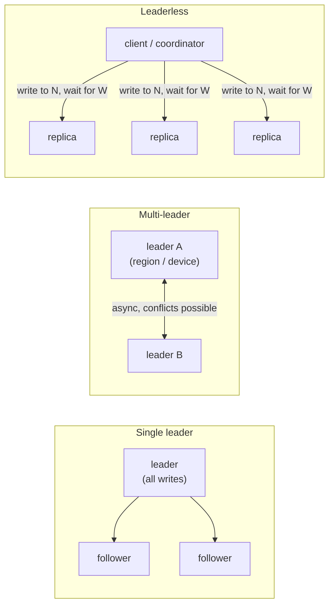
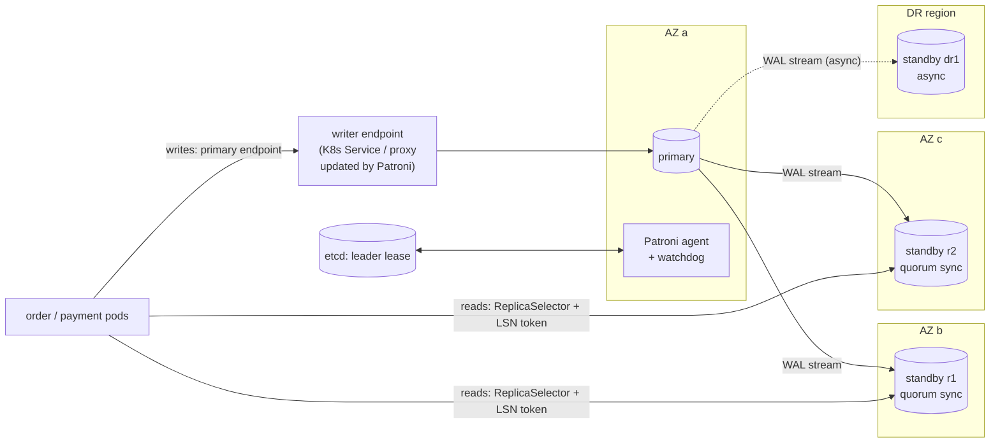
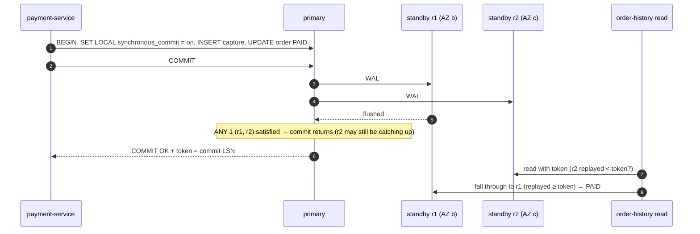
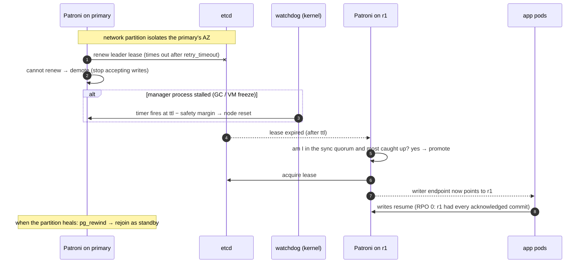
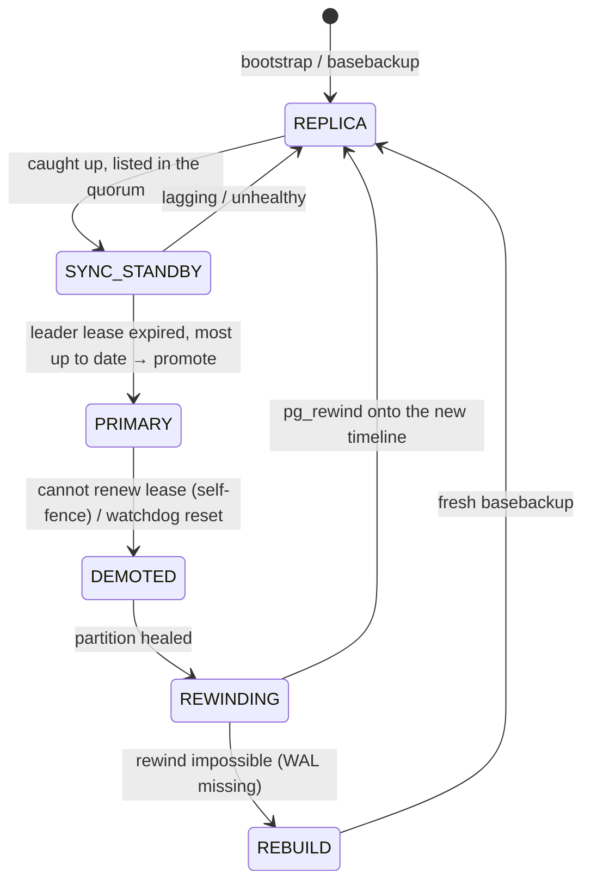

# 10. Replication ⭐

!!! abstract "Chapter at a glance"
    **Reader bands:** B1 → B4 · **Prerequisites:** [Ch 05](../01-foundations/05-relational-databases-deep-dive.md), [Ch 06](../01-foundations/06-nosql-and-polyglot-persistence.md), [Ch 09](../01-foundations/09-scalability-fundamentals.md) · **What you will build:** Replication for the orders and payments database, from a quorum/LWW/CRDT simulation (L1) to session-consistent replica reads (L2), per-transaction durability levels on quorum synchronous replication (L3), and failover with self-fencing, split-brain recovery and post-failover reconciliation (L4). A **real PostgreSQL 16 lab** (1 primary + 2 streaming replicas) backs every claim about lag, synchronous commit and split brain. · **Reading time:** 110 min + code + lab

---

## 1. Introduction & Why It Matters

### 1.1 A story: 38 customers paid for orders that no longer existed

At 9:12 pm on a Friday, the disk under the orders database primary failed. The failover manager did exactly what it was configured to do: it promoted the healthiest **asynchronous** replica within 25 seconds. Checkout recovered, and the on-call engineer went back to dinner.

On Monday, support had 38 tickets: *"Money debited, but the app says I have no order."* Razorpay's dashboard showed 38 captured payments in the four seconds before the failure. The new primary had no trace of those orders. They had been committed on the old primary and acknowledged to the customers, but they hadn't reached the replica when the disk died.

Nothing was broken. Asynchronous replication **promises** that the replica may be behind, and a failover to it **must** lose whatever it hadn't received yet. The platform had an RPO (recovery point objective) of "a few seconds" without anyone having decided that, and no process for the seconds it lost.

The fixes, all covered in this chapter:

- **Payments and orders commit only after a quorum of standbys has the WAL** (`ANY 1 (r1, r2)`), so a failover to a caught-up standby loses nothing.
- **Low-value writes opt out per transaction**, so they don't pay that latency.
- **The failover manager fences the old primary**, so it can't accept writes after a new one is promoted.
- **A reconciliation job** compares captured payments with orders after every failover.

!!! quote "The thesis of this chapter"
    Replication gives you copies, and copies disagree. Every replication design is a choice about **which disagreements you'll tolerate, for how long, and what happens when you switch copies**. Make that choice per data class, measure it, and have a plan for the moment the copies diverge.

### 1.2 Where this lives in the grocery platform

| Data | Replication | Why |
|---|---|---|
| Orders, payments, wallet ledger (PostgreSQL) | Single leader, **quorum synchronous** to 2 standbys in other AZs | RPO = 0 for money |
| Catalog, customer profiles (PostgreSQL) | Single leader, async replicas for reads | Reads scale; a few seconds of loss on failover is recoverable from sources |
| Carts, sessions (Redis, Ch 09) | Leader + async replicas per shard | Loss-tolerant, with DB snapshots as a backstop |
| Rider location history (Cassandra, Ch 06) | **Leaderless**, RF = 3, `LOCAL_QUORUM` | Write availability during node failures |
| Kafka topics | Leader per partition, ISR, `acks=all`, `min.insync.replicas=2` | Durable event log (Ch 14) |
| Rider app offline actions | **Multi-leader** (the device is a leader while offline) | Riders in basements and lifts still mark deliveries |
| DR region (Ch 27) | Async cross-region replication | Latency makes sync cross-region impractical |

### 1.3 Learning objectives

| Band | After this chapter you can… |
|---|---|
| <span class="band b1">B1</span> | Explain why we replicate, leader/follower replication, and sync vs async |
| <span class="band b2">B2</span> | Handle replication lag with read-your-writes and monotonic reads, and explain quorums (R + W > N) |
| <span class="band b3">B3</span> | Configure quorum synchronous replication, pick durability per transaction, and reason about failover RPO/RTO |
| <span class="band b4">B4</span> | Prevent and recover from split brain (leases, watchdogs, fencing, pg_rewind), choose multi-leader or leaderless designs, and resolve conflicts with LWW or CRDTs |

---

## 2. Core Concepts — Beginner to Deep

### 2.1 Intuition: the shop's ledger and its photocopies <span class="band b1">B1</span>

The shop owner keeps the master ledger (the **leader**). Every evening an assistant photocopies the day's pages for the branch office (an **async follower**).

- If the branch reads the photocopy at 6 pm, it's missing the afternoon's sales. That's **replication lag**.
- If the shop burns down at 5 pm, today's sales since yesterday's copy are **lost**. That's the **RPO** of async replication.
- If the owner insists the assistant copy each page **before** the owner moves on (**sync** replication), nothing is lost, but the owner waits for the assistant, and if the assistant is out sick the owner can't write at all.
- If the branch decides the shop has burned down (it hasn't; the phone line is cut) and starts its own ledger, there are now **two ledgers** accepting sales: a **split brain**.

### 2.2 Why replicate <span class="band b1">B1</span>

| Goal | How replication helps | Caveat |
|---|---|---|
| **Durability** | A copy survives the loss of a disk, node or AZ | Only copies that received the write count |
| **Availability** | Promote a copy when the leader fails | Failover takes time (RTO) and may lose data (RPO) |
| **Read scaling** | Serve reads from followers | Followers may be stale |
| **Latency** | Place copies near users (regions, edges) | Cross-region writes are slow or conflict-prone |
| **Isolation** | Analytics on a separate replica | Long queries can delay replay or get cancelled (Ch 05) |

### 2.3 Replication topologies ⭐ <span class="band b1">B1</span> <span class="band b2">B2</span>



| | Single leader | Multi-leader | Leaderless |
|---|---|---|---|
| Writes go to | One node | Any leader (per region, datacenter or device) | Any W of N replicas |
| Conflicts | None (one order of writes) | **Yes**: concurrent writes to different leaders | **Yes**: concurrent writes, repaired later |
| Write availability during failures | Needs failover | High (each leader keeps going) | High (any W replicas) |
| Consistency model | Linearizable on the leader; stale on followers | Eventual; needs conflict resolution | Tunable (R + W > N), still not linearizable by itself |
| Examples | PostgreSQL, MySQL, MongoDB replica sets, Kafka partitions, Redis | Multi-region active-active databases, CouchDB, offline mobile apps, collaborative editing | Cassandra, ScyllaDB, DynamoDB-style, Riak |
| Grocery use | Orders, payments, catalog | Rider app offline actions; a future multi-region design | Location history |

### 2.4 Synchronous vs asynchronous replication ⭐ <span class="band b1">B1</span> → <span class="band b3">B3</span>

| Mode | Commit returns when… | RPO on leader loss | Write latency | Availability risk |
|---|---|---|---|---|
| Asynchronous | Leader has flushed WAL locally | Up to the replication lag (seconds; more under load) | Lowest | None from replicas |
| Semi-synchronous / **quorum sync** (`ANY k (…)`) | k of the listed standbys have the WAL | 0, if you fail over to a standby in the quorum | + 1 network round trip to the nearest k standbys | If fewer than k standbys are reachable, **commits block** |
| Fully synchronous to all | All standbys have it | 0 | + round trip to the slowest | Any standby failure blocks writes |

**PostgreSQL's `synchronous_commit` levels** (per session or per transaction with `SET LOCAL`):

| Level | Commit waits until… | Survives |
|---|---|---|
| `off` | Nothing (WAL flushed asynchronously, ~3× `wal_writer_delay`) | Nothing; the last ~600 ms can be lost even without failover |
| `local` | WAL flushed on the leader | Leader crash with an intact disk |
| `remote_write` | Standby received the WAL (in OS memory) | Leader loss, if the standby OS stays up |
| `on` (default) | Standby flushed the WAL to disk | Leader loss |
| `remote_apply` | Standby **applied** it | Leader loss, **and** reads on that standby see the write immediately |

The `remote_*` levels only wait when `synchronous_standby_names` is set, and they apply to whichever standbys satisfy it.

The lab (§5, Experiment 3) runs this on real PostgreSQL 16 with `synchronous_standby_names = 'ANY 1 (r1, r2)'`:

```text
== both standbys down: insert pay_3 ...
   after 2 s the client is still waiting: 1 backend(s) in wait_event=SyncRep
   pay_3 visible to other sessions? 0 (not until the wait ends)
== operator cancels the stuck wait (pg_cancel_backend):
   client saw: WARNING:  canceling wait for synchronous replication due to user request
   client saw: DETAIL:  The transaction has already committed locally, but might not have been replicated to the standby.
   pay_3 visible on primary now? 1  <- committed locally, on NO standby: a failover now would lose it
```

!!! danger "Synchronous replication has two traps"
    1. **Availability:** with too few standbys reachable, commits hang (not fail). Size the quorum (`ANY 1` of 2+ standbys across AZs) so that one failure doesn't stop writes, and alert on `wait_event = 'SyncRep'`.
    2. **"Cancelled" doesn't mean "not committed":** a client timeout or cancel during the sync wait leaves the transaction **committed on the leader**. Treat it as an **unknown outcome** (Ch 04): retry idempotently or check, never assume it failed.

### 2.5 Replication lag and the consistency guarantees it breaks ⭐ <span class="band b2">B2</span>

With async followers, a read from a follower can return stale data. Three session guarantees fix the anomalies users notice:

| Guarantee | Anomaly it prevents | Grocery example | Technique |
|---|---|---|---|
| **Read-your-writes** | You don't see your own write | Customer cancels an order, refreshes, sees "Placed" | Read from the leader, or from a follower that has replayed past your write's LSN |
| **Monotonic reads** | Time goes backwards across reads | Order shows "Cancelled", then "Placed" on the next refresh (a different follower) | Carry the highest LSN you've **seen** (read or written); only use followers at or beyond it |
| **Consistent prefix** | Seeing an effect before its cause | "Refund issued" before "Order cancelled" | Single-leader order within a partition; causal tokens across partitions |

The lab reproduces both anomalies on real replicas (§5, Experiment 1):

```text
== customer cancelled; commit LSN token = 0/402BEF0
   primary : CANCELLED
   r2      : CANCELLED   replayed up to 0/402BEF0
   r1      : PLACED      replayed up to 0/402BE78  (paused)
== read-your-writes check: is r1 >= token? f   is r2 >= token? t
== monotonic reads violation without a token: read r2 then r1 -> CANCELLED then PLACED
```

L2 builds a replica selector that enforces **both** guarantees with one token: the maximum LSN the session has written **or read**. Ch 05 L4 covered only the write side.

### 2.6 Quorums in leaderless systems ⭐ <span class="band b2">B2</span> <span class="band b3">B3</span>

With N replicas, a write waits for W acknowledgements and a read queries R replicas and takes the newest version:

$$
R + W > N \;\Rightarrow\; \text{every read set overlaps every write set in at least one replica}
$$

L1 simulates N = 3 with replicas applying writes 0–40 ms apart, reading 5 ms after the write is acknowledged:

```text
   W=1 R=1  (R+W <= N)  stale reads: 54.27%
   W=1 R=2  (R+W <= N)  stale reads: 22.36%
   W=2 R=1  (R+W <= N)  stale reads: 22.15%
   W=2 R=2  (R+W >  N)  stale reads:  0.00%
```

**What quorums don't give you:**

| Gap | Why | Mitigation |
|---|---|---|
| Linearizability | A read concurrent with a write may see it on one replica and not another; two readers can disagree | Read repair on quorum reads; lightweight transactions (Paxos) for compare-and-set |
| Safety under **sloppy quorums** / hinted handoff | Writes accepted by stand-in nodes outside the preferred replicas | Know whether your store does this; disable where strict overlap matters |
| Correct merges of concurrent writes | Two writes with no causal order: someone must pick | LWW (lossy), version vectors + app merge, CRDTs (§2.9) |
| Durability of an acknowledged W = 1 write | One replica acknowledged, then died | W ≥ 2 for data you care about |

**Anti-entropy:** read repair (fix stale replicas seen during reads), hinted handoff (deliver writes missed while a node was down), and Merkle-tree repair (periodic full comparison). Cassandra needs regular repair within `gc_grace_seconds` (Ch 06).

### 2.7 Failover: RPO, RTO and what can go wrong ⭐ <span class="band b3">B3</span>

| Step | Pitfall |
|---|---|
| **Detect** leader failure (health checks, lease expiry) | Too aggressive → false failovers during GC pauses or network blips. Too slow → long outages |
| **Choose** a new leader (most up-to-date standby; in the sync quorum) | Choosing a lagging async replica = data loss (§1.1) |
| **Promote** it and **reconfigure** clients (DNS, service endpoint, proxy, multi-host JDBC) | Clients cache the old endpoint and keep writing to the old leader |
| **Fence** the old leader (demote, stop, cut network, STONITH) | If the old leader is alive, you have **split brain** |
| **Rejoin** the old leader as a follower (`pg_rewind`, rebuild) | Writes it accepted after the fork are discarded |

| Metric | Definition | Async replica failover | Quorum-sync failover |
|---|---|---|---|
| RPO | Data you can lose | Lag at failure time (seconds, sometimes more) | 0 (if promoting a quorum member) |
| RTO | Time until writes work again | Detection (≈ ttl) + promotion + client reconfiguration: typically 20–60 s | Same |

### 2.8 Split brain and fencing ⭐ <span class="band b3">B3</span> <span class="band b4">B4</span>

Split brain happens when two nodes both believe they're the leader and both accept writes. The lab produces one on real PostgreSQL by promoting a standby while the old primary is still alive (§5, Experiment 4):

```text
== SPLIT BRAIN: pods with the old endpoint debit on the old primary, new pods debit on r1
   old primary: 30000   new primary r1: 5000   r2 (still following the old primary): 30000
   20000 + 45000 = 65000 debited from a 50000 balance
...
   timelines: r1 (primary)=2  p streams timeline 2  r2 streams timeline 2   balances: p=5000 r1=5000 r2=5000
   the old side's -20000 debit is GONE: pg_rewind discarded every write made after the fork
```

Two lessons from running it for real: `pg_rewind` copies the **source's configuration files** (the rewound node came back with the wrong port until it was fixed), and **r2 also had to be rewound**, because it had replayed WAL from the old primary after the fork.

**Prevention toolkit:**

| Mechanism | How | Notes |
|---|---|---|
| **Consensus-backed leader lease** (etcd, ZooKeeper, Consul; Patroni, Stolon) | Only the holder of an unexpired lease in the DCS is leader | Leader must renew; standbys promote only after expiry |
| **Self-fencing** | A leader that can't renew its lease demotes itself before the lease expires | `ttl ≥ loop_wait + 2 × retry_timeout` (Patroni) |
| **Watchdog** | A kernel or hardware timer resets the node if the manager process stalls | Covers GC or VM freezes, where self-fencing can't run in time |
| **STONITH** ("shoot the other node in the head") | Power off or isolate the old leader via infrastructure APIs | Classic cluster managers (Pacemaker) |
| **Fencing tokens** | Every write carries a monotonically increasing leader epoch, and the storage or consumer rejects older epochs | The strongest guarantee where you control the storage (Ch 20) |
| **Single writer endpoint** | Clients reach "the leader" only through a proxy or service updated by the manager | Pods caching the old IP are the usual split-brain source |

The L4 simulation quantifies why the watchdog matters. Over 1,000,000 simulated partitions with 0.5 % of process stalls lasting 5–60 s:

```text
  lease only      : two writable primaries in 4,033 cases (0.403%), worst overlap 48.3 s
  lease + watchdog: two writable primaries in 0 cases
```

### 2.9 Multi-leader replication and conflict resolution ⭐ <span class="band b3">B3</span> <span class="band b4">B4</span>

Conflicts happen whenever two leaders accept writes to the same data without coordinating. Options, from simplest to most correct:

| Strategy | How | Loses data? | Use for |
|---|---|---|---|
| **Avoid conflicts** | Route all writes for a key to one "home" leader (a customer's home region) | No | The best option when possible |
| **Last-write-wins (LWW)** | Keep the write with the highest timestamp | **Yes**: silently drops concurrent writes, and clock skew picks the wrong winner | Caches, idempotent overwrites, low-value data |
| **Domain precedence / state machines** | Merge by business rules (DELIVERED beats OUT_FOR_DELIVERY; CANCELLED before packing beats PACKED) | No, if the rules are total | Order and delivery status from offline devices |
| **Version vectors + app merge** | Detect concurrency; present siblings to the app to merge | No | Complex documents |
| **CRDTs** | Data types whose merge is commutative, associative and idempotent: G-Counter, PN-Counter, OR-Set, LWW-Register, RGA/sequences | No (by construction, within the type's semantics) | Carts, counters, sets, collaborative text |

L1's real output shows LWW losing an update to a 90 s clock skew, and an OR-Set converging:

```text
B. Last-write-wins with a phone clock 90 s behind the server
   LWW keeps: qty=1 (edited at 20:00:10 real time)   ← the newer edit (qty=3) is silently lost
C. OR-Set cart edited offline on two devices
   phone sees [ATTA-5KG, EGGS-12], web sees [MILK-1L]
   merge(phone, web) = [EGGS-12, MILK-1L]
   merge(web, phone) = [EGGS-12, MILK-1L]   (same: order doesn't matter)
```

**Offline rider app (multi-leader in practice):** a rider in a basement marks "delivered" with the OTP (Ch 01). The phone is a leader for that action. On reconnect, the server merges it by **domain precedence** (a verified delivery OTP is final) and by idempotency keys (Ch 04), not by timestamps from the phone's clock.

### 2.10 Replication inside other systems <span class="band b2">B2</span> <span class="band b3">B3</span>

| System | Model | Key settings |
|---|---|---|
| PostgreSQL | Physical streaming (WAL), logical replication (per table, for CDC and upgrades) | `synchronous_standby_names`, `synchronous_commit`, replication slots (retain WAL), `hot_standby_feedback` |
| MySQL | Binlog replication (async, semi-sync), Group Replication (Paxos) | `rpl_semi_sync_*`, GTIDs |
| MongoDB | Replica set with Raft-like elections | `w: "majority"`, `readConcern: "majority"`/`"linearizable"` |
| Kafka | Leader per partition, in-sync replicas (ISR) | `acks=all`, `min.insync.replicas=2`, `unclean.leader.election.enable=false` (Ch 14) |
| Redis | Async leader → replicas; Sentinel/Cluster failover | `WAIT n ms` (reduces, not removes, loss); `min-replicas-to-write` |
| Cassandra | Leaderless, RF per DC | Consistency level per query, repairs |

!!! tip "Replication slots: a quiet disk-filling hazard"
    A PostgreSQL replication slot retains WAL until its consumer (a standby or a CDC connector) confirms it. An abandoned slot keeps WAL forever and fills the primary's disk. Monitor `pg_replication_slots` (retained bytes) and set `max_slot_wal_keep_size`.

### 2.11 Choosing a replication design <span class="band b4">B4</span>

| Question | Leads to |
|---|---|
| Can you lose the last seconds of writes on failover? | No → quorum sync (single leader) or consensus-replicated stores |
| Must writes continue during a partition from the leader? | Yes → leaderless or multi-leader, with conflict resolution |
| Are writes geographically distributed with low-latency requirements? | Multi-leader with key-level homing, or partitioned single leaders per region |
| Are there concurrent edits by design (offline devices, collaboration)? | CRDTs or domain merges |
| How much operational maturity do you have? | Managed single-leader services first |

---

## 3. Architecture & Diagrams

### 3.1 Component view: orders/payments database replication



### 3.2 Sequence: happy path, a quorum-sync payment commit and a consistent read



### 3.3 Sequence: failure path, primary partitioned, self-fences, quorum standby promoted



!!! note "What the system guarantees after this failure path"
    Every commit acknowledged to a client was flushed on at least one standby in the quorum, and the promoted node is chosen from that quorum, so RPO = 0. The old primary stops accepting writes before the new one is promoted: by self-demotion when it can't renew its lease, or by the watchdog if its manager is stalled. If fencing ever fails, the post-failover reconciliation compares money movements at the payment provider with the database.

### 3.4 State: a database node in a managed cluster



---

## 4. Design Document Excerpt: Orders & Payments Database Replication

| Field | Value |
|---|---|
| Author / Reviewers | Platform data team / Payments, Orders, SRE, Finance |
| Status | Approved |
| Related ADRs | ADR-038 Quorum synchronous replication for money; ADR-039 Patroni with watchdog and post-failover reconciliation |

**1. Context & Problem.** An async failover lost ~4 s of committed writes: 38 captured payments had no order (§1.1). Replica reads showed customers stale order states, and time went backwards across refreshes.

**2. Goals / Non-Goals.**

- *Goals:* RPO = 0 for payments, orders and the ledger; RTO ≤ 60 s; no split brain; read-your-writes and monotonic reads on replica reads; low-value writes don't pay sync latency.
- *Non-goals:* multi-region active-active writes (Ch 27); logical replication for CDC (Ch 13).

**3. Requirements.**

| ID | Requirement |
|---|---|
| NFR-1 | No acknowledged commit of a money-class transaction may be lost on the failure of any single node or AZ |
| NFR-2 | Writes stay available with one standby down |
| NFR-3 | p99 commit latency for money-class transactions ≤ 15 ms (same region, cross-AZ) |
| NFR-4 | A partitioned primary stops accepting writes before any standby is promoted |
| NFR-5 | After any failover, a reconciliation against the payment provider completes within 30 min |
| NFR-6 | Replica reads honour read-your-writes and monotonic reads per session |

**4. Capacity & latency estimates.**

| Item | Calculation | Result |
|---|---|---|
| Money-class commits at P90 peak | Ch 02/05: ~500 reservations + ~420 orders + ~420 payments/s | ~1.4 K commits/s |
| Added commit latency (quorum of 1 of 2 cross-AZ standbys) | Cross-AZ RTT ~0.5–2 ms + standby fsync ~0.5–1 ms | **+1–3 ms** per commit |
| Throughput impact | Group commit amortizes the waits; commits run concurrently | Negligible at ~1.4 K/s |
| WAL volume | ~2–4 MB/s at peak (Ch 05) | Cross-AZ traffic ~250 GB/day per standby: a cost line |
| RTO | ttl 30 s + promotion ~2 s + endpoint update ~5 s | **~40 s** |
| Async DR standby lag | Cross-region, ~60 ms RTT | RPO seconds for **region** loss (accepted, Ch 27) |

**5. Proposed design.**

1. Patroni-managed PostgreSQL: a primary and two standbys in three AZs, with `synchronous_mode: true` and `synchronous_node_count: 1` (Patroni maintains `ANY 1 (…)`), `synchronous_mode_strict: false` (see §7 for the trade-off), and an async DR standby in another region.
2. **Durability per transaction:** money-class transactions run with `synchronous_commit = on`. Low-value writes (audit trails that are also in Kafka, analytics counters) run with `SET LOCAL synchronous_commit = local`. A client timeout during the sync wait is an **unknown outcome**, handled by idempotent retry (Ch 04).
3. **Fencing:** DCS lease (etcd), self-demotion, Linux softdog watchdog (`watchdog: mode: required`), and a single writer endpoint (the Patroni-maintained Kubernetes Service). Pods never connect to node IPs.
4. **Replica reads:** `ReplicaSelector` with a session token = max LSN written or read. Replicas lagging more than 16 MB are skipped.
5. **After every failover:** `pg_rewind` the old primary **and any standby that followed it after the fork**, and run `FailoverReconciler` over the window [failure − 5 min, failover + 5 min].

**7. Alternatives considered.**

| Option | Pros | Cons | Verdict |
|---|---|---|---|
| Async replicas only (status quo) | Lowest latency | RPO = lag (§1.1) | Rejected for money |
| Sync to both standbys (`FIRST 2`) | RPO 0 even if one standby is lost later | Any standby failure blocks writes | Rejected (NFR-2) |
| **Quorum `ANY 1 (r1, r2)`** | RPO 0 with one standby down; +1–3 ms | Two standbys down → writes block (alerted; `synchronous_mode_strict: false` lets Patroni fall back to async after a timeout, **trading RPO for availability**, so this is a Finance-approved decision) | **Chosen** |
| Distributed SQL (CockroachDB/Yugabyte) | Consensus per range, automatic failover | Migration cost; latency; new operational skills | Revisit for multi-region (Ch 27) |
| Managed HA (RDS Multi-AZ / Aurora / Cloud SQL HA) | Operated for you, synchronous storage-level replication | Less control; vendor-specific | **Equivalent choice** on a managed platform: the per-transaction durability and reconciliation still apply |

**8. Failure modes.** One standby down: writes continue (quorum). Both standbys down: commits block, pages fire, and after 30 s Patroni (non-strict) drops to async and records the RPO exposure window. Primary partitioned: self-fence and promote (§3.3). Manager stall: watchdog reset. Old endpoint cached in a pod: the connection fails on the demoted node (read-only), and the pool reconnects through the Service.

**10. Observability.** Replication lag per standby (bytes and seconds), `sync_state`, `wait_event = 'SyncRep'` count, commit latency percentiles, replication slot retained WAL, timeline ID changes (failover events), Patroni leader changes, watchdog status, and reconciliation findings per failover.

**14. Decision (ADR-038/039 summary).** Money-class data uses single-leader PostgreSQL with quorum synchronous replication across AZs and per-transaction durability levels. Failover is Patroni-managed with a DCS lease, self-demotion and a mandatory watchdog, with writes only through the managed writer endpoint. Every failover triggers rewind of all diverged nodes and a reconciliation against the payment provider.


---

## 5. Hands-On Code — Level Ladder

| Level | New requirement that forces the step |
|---|---|
| L1 | "Show quorums, LWW's failure mode, and a CRDT converging." (plain Java simulation) |
| L2 | "Serve order history from any of several async replicas without stale or backwards reads." |
| L3 | "Money commits survive losing the primary; low-value writes don't pay for it; a timed-out commit is handled as unknown." |
| L4 | "Failover without split brain, rejoin diverged nodes, and reconcile money after every failover." |
| Lab | A real PostgreSQL 16 primary + 2 streaming replicas: every behaviour claimed above, reproduced |

### L1 — Concept: quorums, LWW and an OR-Set (plain Java) <span class="band b1">B1</span> <span class="band b2">B2</span>

```java
// ReplicationL1.java — run with: java ReplicationL1.java
// Three replication ideas in plain Java:
//   A. Leaderless quorums: how often a read misses the latest acknowledged write for different (W, R) with N = 3
//   B. Last-write-wins with skewed clocks silently drops the newer update
//   C. An OR-Set CRDT: offline edits from two devices merge to the same answer in any order
import java.util.*;

public class ReplicationL1 {

    // ---------- A. Quorums ----------
    /**
     * Each write is sent to all N replicas; replica i applies it after a random network/apply delay (0–40 ms).
     * The write is acknowledged when W replicas have applied it. A read starts `readAfterMs` after the ack,
     * asks R random replicas, and returns the highest version seen. Stale = older than the acknowledged write.
     */
    static double staleReadRate(int n, int w, int r, double readAfterMs, int trials, Random rnd) {
        int stale = 0;
        for (int t = 0; t < trials; t++) {
            double[] appliedAt = new double[n];
            for (int i = 0; i < n; i++) appliedAt[i] = rnd.nextDouble() * 40;
            double[] sorted = appliedAt.clone();
            Arrays.sort(sorted);
            double ackAt = sorted[w - 1];                                   // W-th replica to apply
            double readAt = ackAt + readAfterMs;
            List<Integer> ids = new ArrayList<>();
            for (int i = 0; i < n; i++) ids.add(i);
            Collections.shuffle(ids, rnd);
            boolean sawNew = false;
            for (int k = 0; k < r; k++) sawNew |= appliedAt[ids.get(k)] <= readAt;
            if (!sawNew) stale++;
        }
        return 100.0 * stale / trials;
    }

    // ---------- B. LWW + clock skew ----------
    record Versioned(String value, long wallClockMs) { }

    static Versioned lww(Versioned a, Versioned b) { return a.wallClockMs() >= b.wallClockMs() ? a : b; }

    // ---------- C. OR-Set (observed-remove set) ----------
    /** Each add gets a unique tag; remove deletes only the tags it has SEEN. Concurrent add wins over remove. */
    static final class OrSet {
        final Map<String, Set<String>> adds = new TreeMap<>();      // element → live tags
        final Set<String> removed = new TreeSet<>();                // tombstoned tags
        private final String replicaId; private int counter;
        OrSet(String replicaId) { this.replicaId = replicaId; }

        void add(String e) { adds.computeIfAbsent(e, k -> new TreeSet<>()).add(replicaId + ":" + (++counter)); }
        void remove(String e) {
            Set<String> tags = adds.remove(e);
            if (tags != null) removed.addAll(tags);
        }
        Set<String> value() { return new TreeSet<>(adds.keySet()); }

        /** Merge is commutative, associative and idempotent → replicas converge in any merge order. */
        OrSet mergedWith(OrSet other) {
            OrSet m = new OrSet(replicaId);
            m.removed.addAll(removed); m.removed.addAll(other.removed);
            for (OrSet s : List.of(this, other))
                s.adds.forEach((e, tags) -> tags.stream().filter(t -> !m.removed.contains(t))
                        .forEach(t -> m.adds.computeIfAbsent(e, k -> new TreeSet<>()).add(t)));
            return m;
        }

        OrSet copy(String id) { OrSet c = new OrSet(id); c.removed.addAll(removed); adds.forEach((e, t) -> c.adds.put(e, new TreeSet<>(t))); return c; }
    }

    public static void main(String[] args) {
        System.out.println("A. N = 3 replicas; a read starts 5 ms after the write is acknowledged");
        Random rnd = new Random(3);
        int[][] configs = {{1, 1}, {1, 2}, {2, 1}, {2, 2}, {3, 1}, {1, 3}};
        for (int[] c : configs) {
            System.out.printf("   W=%d R=%d  (R+W %s N)  stale reads: %5.2f%%%n", c[0], c[1],
                    c[0] + c[1] > 3 ? "> " : "<=", staleReadRate(3, c[0], c[1], 5, 200_000, rnd));
        }

        System.out.println("B. Last-write-wins with a phone clock 90 s behind the server");
        Versioned phone = new Versioned("qty=3 (edited at 20:00:30 real time)", 1_758_900_000_000L + 30_000 - 90_000);
        Versioned web   = new Versioned("qty=1 (edited at 20:00:10 real time)", 1_758_900_000_000L + 10_000);
        System.out.println("   LWW keeps: " + lww(phone, web).value() + "   ← the newer edit (qty=3) is silently lost");

        System.out.println("C. OR-Set cart edited offline on two devices");
        OrSet base = new OrSet("server");
        base.add("MILK-1L"); base.add("ATTA-5KG");
        OrSet phoneCart = base.copy("phone"), webCart = base.copy("web");
        phoneCart.remove("MILK-1L");          // phone (offline): remove milk
        phoneCart.add("EGGS-12");             // phone: add eggs
        webCart.add("MILK-1L");               // web, concurrently: adds milk again (new tag)
        webCart.remove("ATTA-5KG");           // web: remove atta
        System.out.println("   phone sees " + phoneCart.value() + ", web sees " + webCart.value());
        System.out.println("   merge(phone, web) = " + phoneCart.mergedWith(webCart).value());
        System.out.println("   merge(web, phone) = " + webCart.mergedWith(phoneCart).value() + "   (same: order doesn't matter)");
        OrSet twice = phoneCart.mergedWith(webCart).mergedWith(webCart);
        System.out.println("   merge applied twice = " + twice.value() + "   (idempotent)");
    }
}
```

Actual output from running it:

```text
A. N = 3 replicas; a read starts 5 ms after the write is acknowledged
   W=1 R=1  (R+W <= N)  stale reads: 54.27%
   W=1 R=2  (R+W <= N)  stale reads: 22.36%
   W=2 R=1  (R+W <= N)  stale reads: 22.15%
   W=2 R=2  (R+W >  N)  stale reads:  0.00%
   W=3 R=1  (R+W >  N)  stale reads:  0.00%
   W=1 R=3  (R+W >  N)  stale reads:  0.00%
B. Last-write-wins with a phone clock 90 s behind the server
   LWW keeps: qty=1 (edited at 20:00:10 real time)   ← the newer edit (qty=3) is silently lost
C. OR-Set cart edited offline on two devices
   phone sees [ATTA-5KG, EGGS-12], web sees [MILK-1L]
   merge(phone, web) = [EGGS-12, MILK-1L]
   merge(web, phone) = [EGGS-12, MILK-1L]   (same: order doesn't matter)
   merge applied twice = [EGGS-12, MILK-1L]   (idempotent)
```

**What L1 shows:** with R + W ≤ N, a meaningful share of reads miss an acknowledged write even 5 ms later. With R + W > N the read set always overlaps the write set. LWW is only as correct as the clocks, and a 90 s skew picks the older edit. The OR-Set gives every replica the same answer in any merge order, and a concurrent re-add survives a remove it never saw ("add wins").

### L2 — Session-consistent reads across several replicas <span class="band b2">B2</span>

Ch 05 L4 routed read-only transactions to **one** replica, with read-your-writes from a write token. Here there are **several** replicas, and the token advances on **reads** too, which adds monotonic reads.

=== "LSN & selector (verified)"

    ```java
    package com.grocery.db.replication;

    /** A PostgreSQL WAL position ("16/B374D848" = high 32 bits / low 32 bits, hex). Comparable, so tokens can be max-ed. */
    public record Lsn(long value) implements Comparable<Lsn> {

        public static final Lsn ZERO = new Lsn(0);

        public static Lsn parse(String text) {
            String[] p = text.trim().split("/");
            if (p.length != 2) throw new IllegalArgumentException("not an LSN: " + text);
            return new Lsn((Long.parseLong(p[0], 16) << 32) | Long.parseLong(p[1], 16));
        }

        public static Lsn max(Lsn a, Lsn b) { return a.compareTo(b) >= 0 ? a : b; }

        @Override public int compareTo(Lsn o) { return Long.compareUnsigned(value, o.value); }

        @Override public String toString() {
            return Long.toHexString(value >>> 32).toUpperCase() + "/" + Long.toHexString(value & 0xFFFFFFFFL).toUpperCase();
        }
    }
    ```

    ```java
    package com.grocery.db.replication;

    import java.util.*;

    /**
     * Session consistency over N async replicas:
     *   token = highest LSN this client has written OR read.
     *   A replica may serve the read only if it has replayed up to the token → read-your-writes AND monotonic reads.
     *   After a replica read, the token advances to that replica's replay LSN, so the NEXT read can't go backwards.
     */
    public class ReplicaSelector {

        public interface ReplicaProbe {
            String name();
            Optional<Lsn> replayLsn();                // empty = unreachable
        }

        public record Choice(String target, Lsn newToken, boolean usedPrimary) { }

        private final List<ReplicaProbe> replicas;
        private final long maxLagBytes;               // replicas this far behind the primary are skipped entirely
        private final Random random = new Random();

        public ReplicaSelector(List<ReplicaProbe> replicas, long maxLagBytes) {
            this.replicas = List.copyOf(replicas); this.maxLagBytes = maxLagBytes;
        }

        public Choice choose(Lsn token, Lsn primaryCurrentLsn) {
            List<ReplicaProbe> order = new ArrayList<>(replicas);
            Collections.shuffle(order, random);                         // spread load among eligible replicas
            for (ReplicaProbe r : order) {
                Optional<Lsn> replay = r.replayLsn();
                if (replay.isEmpty()) continue;
                if (primaryCurrentLsn.value() - replay.get().value() > maxLagBytes) continue;   // too stale for anyone
                if (replay.get().compareTo(token) >= 0) return new Choice(r.name(), Lsn.max(token, replay.get()), false);
            }
            return new Choice("primary", Lsn.max(token, primaryCurrentLsn), true);
        }
    }
    ```

    Driven with the **real LSNs from lab Experiment 1** (r1 paused at `0/402BE78`, r2 at `0/402BEF0`, the customer's write at `0/402BEF0`), the actual output is:

    ```text
    parse 0/402BEF0 -> 0/402BEF0 = 67288816;  16/B374D848 -> 16/B374D848
    compare 0/FFFFFFFF < 1/0 ? true
    read 1: served by r2  token 0/402BEF0 -> 0/402BEF0
    read 2: served by r2  token 0/402BEF0 -> 0/402BEF0
    read 3: served by r2  token 0/402BEF0 -> 0/402BEF0
    read 4: served by r2  token 0/402BEF0 -> 0/402BEF0
    read 5: served by r2  token 0/402BEF0 -> 0/402BEF0
    read 6: served by r2  token 0/402BEF0 -> 0/402BEF0
    no token (fresh session): reads spread over [r1, r2]
    1,000 reads carrying the token: ever went backwards? false
    r2 unreachable, token needs 0/402BEF0: primary
    ```

=== "Spring wiring"

    ```java
    package com.grocery.db.replication;

    import org.springframework.jdbc.core.JdbcTemplate;
    import javax.sql.DataSource;
    import java.util.Optional;

    /** Probes one replica. Cheap query; results cached for ~100 ms by the caller in real deployments. */
    public class JdbcReplicaProbe implements ReplicaSelector.ReplicaProbe {

        private final String name;
        private final JdbcTemplate jdbc;

        public JdbcReplicaProbe(String name, DataSource replica) {
            this.name = name;
            this.jdbc = new JdbcTemplate(replica);
            this.jdbc.setQueryTimeout(1);
        }

        @Override public String name() { return name; }

        @Override
        public Optional<Lsn> replayLsn() {
            try {
                return Optional.ofNullable(jdbc.queryForObject("SELECT pg_last_wal_replay_lsn()::text", String.class))
                               .map(Lsn::parse);
            } catch (RuntimeException unreachable) {
                return Optional.empty();
            }
        }
    }
    ```

    ```java
    package com.grocery.db.replication;

    import org.springframework.jdbc.datasource.lookup.AbstractRoutingDataSource;

    /** Routes the current thread's connections to the target chosen by ReplicaSelector ("primary" by default). */
    public class ChosenTargetDataSource extends AbstractRoutingDataSource {

        private static final ThreadLocal<String> TARGET = new ThreadLocal<>();

        public static void use(String target) { TARGET.set(target); }
        public static void clear() { TARGET.remove(); }

        @Override protected Object determineCurrentLookupKey() {
            String t = TARGET.get();
            return t == null ? "primary" : t;
        }
    }
    ```

    ```java
    package com.grocery.order.history;

    import com.grocery.db.replication.*;
    import org.springframework.jdbc.core.simple.JdbcClient;
    import org.springframework.stereotype.Service;
    import java.util.List;

    @Service
    public class OrderHistoryReadService {

        public record Result<T>(T value, Lsn token) { }

        private final ReplicaSelector selector;
        private final JdbcClient routed;           // backed by ChosenTargetDataSource
        private final JdbcClient primary;          // for pg_current_wal_lsn()

        public OrderHistoryReadService(ReplicaSelector selector, JdbcClient routedJdbc, JdbcClient primaryJdbc) {
            this.selector = selector; this.routed = routedJdbc; this.primary = primaryJdbc;
        }

        public Result<List<String>> recentStatuses(String customerId, Lsn sessionToken) {
            Lsn primaryLsn = Lsn.parse(primary.sql("SELECT pg_current_wal_lsn()::text").query(String.class).single());
            ReplicaSelector.Choice choice = selector.choose(sessionToken, primaryLsn);
            ChosenTargetDataSource.use(choice.target());
            try {
                List<String> rows = routed.sql("""
                        SELECT id || ':' || status FROM orders WHERE customer_id = :c
                        ORDER BY created_at DESC LIMIT 20""").param("c", customerId).query(String.class).list();
                return new Result<>(rows, choice.newToken());     // the caller returns this token to the client
            } finally {
                ChosenTargetDataSource.clear();
            }
        }
    }
    ```

    !!! tip "Keep the token honest and cheap"
        Return the token in a response header (`X-Consistency-Token`), have the BFF echo it for that user, and keep it short-lived (a few minutes). Cache each probe's result for ~100 ms so a busy pod doesn't query `pg_last_wal_replay_lsn()` on every request. Read the **commit** LSN after the transaction commits (Ch 05 L4 note).

**What L2 guarantees:** a session never reads older data than it has already written or seen, even across several replicas. Replicas lagging beyond 16 MB serve nobody, and when no replica qualifies the read goes to the primary.

**What L2 doesn't address:** if the primary dies, acknowledged async writes can vanish (§1.1). That's L3.

### L3 — Quorum synchronous replication with per-transaction durability <span class="band b3">B3</span>

=== "Durability levels"

    ```java
    package com.grocery.db.durability;

    /** Maps business data classes to PostgreSQL synchronous_commit levels (valid only with a sync quorum configured). */
    public enum Durability {
        /** Money, orders, ledger: survives loss of the primary (commit waits for the standby quorum to flush). */
        QUORUM("on"),
        /** Read-your-writes on the quorum standby too (payment confirmation page read from a replica). */
        QUORUM_APPLIED("remote_apply"),
        /** Data also recoverable elsewhere (audit copies in Kafka, counters): local flush only. */
        LOCAL("local");

        final String setting;
        Durability(String setting) { this.setting = setting; }
    }
    ```

    ```java
    package com.grocery.db.durability;

    import org.springframework.dao.DataAccessResourceFailureException;
    import org.springframework.dao.QueryTimeoutException;
    import org.springframework.jdbc.core.simple.JdbcClient;
    import org.springframework.transaction.PlatformTransactionManager;
    import org.springframework.transaction.TransactionSystemException;
    import org.springframework.transaction.support.TransactionTemplate;
    import java.util.function.Supplier;

    /**
     * Runs a transaction at an explicit durability level. SET LOCAL scopes the setting to this transaction only
     * (verified in the lab: 'local' inside, back to 'on' after COMMIT).
     */
    public class DurableTransactions {

        private final TransactionTemplate tx;
        private final JdbcClient jdbc;

        public DurableTransactions(PlatformTransactionManager tm, JdbcClient jdbc, int timeoutSeconds) {
            this.tx = new TransactionTemplate(tm);
            this.tx.setTimeout(timeoutSeconds);
            this.jdbc = jdbc;
        }

        public <T> T run(Durability level, Supplier<T> work) {
            try {
                return tx.execute(status -> {
                    jdbc.sql("SET LOCAL synchronous_commit = " + level.setting).update();   // enum value, not user input
                    return work.get();
                });
            } catch (QueryTimeoutException | DataAccessResourceFailureException | TransactionSystemException e) {
                // A timeout or broken connection during COMMIT may have committed on the primary (lab Experiment 3):
                // the outcome is UNKNOWN. Callers must retry idempotently (Ch 04) or check, never assume failure.
                throw new CommitOutcomeUnknownException(e);
            }
        }

        public static class CommitOutcomeUnknownException extends RuntimeException {
            public CommitOutcomeUnknownException(Throwable cause) { super("commit outcome unknown", cause); }
        }
    }
    ```

    !!! warning "Which exceptions mean unknown"
        Only failures that can happen **after** COMMIT was sent are truly ambiguous (a timeout or connection loss while waiting for the commit response). A constraint violation or a timeout during an earlier statement means the transaction did not commit. Keep the mapping narrow, and pair every money-class write with an idempotency key, so a retry after an unknown outcome is always safe.

=== "Usage"

    ```java
    package com.grocery.payment.service;

    import com.grocery.db.durability.*;
    import org.springframework.jdbc.core.simple.JdbcClient;
    import org.springframework.stereotype.Service;

    @Service
    public class CaptureService {

        private final DurableTransactions durable;
        private final JdbcClient jdbc;

        public CaptureService(DurableTransactions durable, JdbcClient jdbc) { this.durable = durable; this.jdbc = jdbc; }

        /** Idempotent by payment id: safe to retry after CommitOutcomeUnknownException. */
        public void recordCapture(String paymentId, String orderId, long amountPaise) {
            durable.run(Durability.QUORUM, () -> {
                jdbc.sql("""
                        INSERT INTO payment_capture(payment_id, order_id, amount_paise) VALUES (:p, :o, :a)
                        ON CONFLICT (payment_id) DO NOTHING""")
                    .param("p", paymentId).param("o", orderId).param("a", amountPaise).update();
                jdbc.sql("UPDATE orders SET status = 'PAID' WHERE id = :o AND status = 'PAYMENT_PENDING'")
                    .param("o", orderId).update();
                return null;
            });
        }

        public void recordClickstream(String event) {
            durable.run(Durability.LOCAL, () ->
                    jdbc.sql("INSERT INTO checkout_funnel_event(payload) VALUES (:e::jsonb)").param("e", event).update());
        }
    }
    ```

=== "Patroni configuration"

    ```yaml
    # patroni.yml (excerpt) — one per node; values reviewed with Finance for the RPO/availability trade-off
    scope: orders-db
    etcd3:
      hosts: etcd-0:2379,etcd-1:2379,etcd-2:2379
    bootstrap:
      dcs:
        ttl: 30
        loop_wait: 10
        retry_timeout: 10                  # ttl >= loop_wait + 2 × retry_timeout
        maximum_lag_on_failover: 1048576   # never promote a node more than 1 MB behind
        synchronous_mode: true             # Patroni manages synchronous_standby_names
        synchronous_node_count: 1          # → ANY 1 (…) quorum over the healthy standbys
        synchronous_mode_strict: false     # both standbys lost → fall back to async (availability over RPO, approved)
        postgresql:
          use_pg_rewind: true
          parameters:
            wal_level: replica
            wal_log_hints: "on"            # required by pg_rewind (unless data checksums are on)
            max_slot_wal_keep_size: 20GB   # an abandoned slot can't fill the disk
            synchronous_commit: "on"
    watchdog:
      mode: required                       # refuse to become leader without a working watchdog
      device: /dev/watchdog
      safety_margin: 5
    tags:
      nofailover: false
    ```

    ```yaml
    # Application: writes only through the Patroni-managed Service, never node IPs
    spring:
      datasource:
        url: jdbc:postgresql://orders-db-primary.db.svc:5432/orders?targetServerType=primary
        hikari:
          max-lifetime: 600000             # reconnect periodically; after failover, stale connections hit a read-only node and fail fast
    ```

=== "Tests"

    Testcontainers doesn't easily provide a primary with streaming standbys, so the replication behaviour is verified in the **lab** below, against real PostgreSQL. The unit-level test checks the SQL the helper issues, and a Testcontainers test checks `SET LOCAL` scoping on a single node:

    ```java
    package com.grocery.db.durability;

    import org.junit.jupiter.api.Test;
    import org.springframework.boot.test.context.SpringBootTest;
    import org.springframework.beans.factory.annotation.Autowired;
    import org.springframework.boot.testcontainers.service.connection.ServiceConnection;
    import org.springframework.jdbc.core.simple.JdbcClient;
    import org.testcontainers.containers.PostgreSQLContainer;    // VERIFY: package in Testcontainers 2.x
    import org.testcontainers.junit.jupiter.*;
    import static org.assertj.core.api.Assertions.assertThat;

    @SpringBootTest
    @Testcontainers
    class DurableTransactionsIT {

        @Container @ServiceConnection
        static PostgreSQLContainer<?> pg = new PostgreSQLContainer<>("postgres:17-alpine");

        @Autowired DurableTransactions durable;
        @Autowired JdbcClient jdbc;

        @Test
        void levelAppliesInsideTheTransactionOnly() {
            String inside = durable.run(Durability.LOCAL, () ->
                    jdbc.sql("SELECT current_setting('synchronous_commit')").query(String.class).single());
            String after = jdbc.sql("SELECT current_setting('synchronous_commit')").query(String.class).single();
            assertThat(inside).isEqualTo("local");
            assertThat(after).isEqualTo("on");
        }
    }
    ```

**What L3 guarantees:** an acknowledged money-class commit is flushed on at least one standby in another AZ, so losing the primary loses nothing, as long as the failover promotes a quorum member (Patroni's `synchronous_mode` ensures that). One standby down doesn't block writes. A commit that times out is treated as unknown and retried idempotently. Low-value writes skip the wait.

### Lab — real PostgreSQL 16: 1 primary + 2 streaming replicas <span class="band b3">B3</span> <span class="band b4">B4</span>

Every script below was run as-is against PostgreSQL 16.13. The outputs are copied verbatim, and your LSNs and timings will differ. Run as a non-root user (`initdb` refuses root).

=== "Setup"

    ```bash
    #!/bin/bash
    # Real PostgreSQL 16 lab: 1 primary (5501) + 2 streaming replicas (5502 r1, 5503 r2)
    set -e
    B=/usr/lib/postgresql/16/bin
    cd /tmp/pglab
    for d in p r1 r2; do [ -d $d ] && $B/pg_ctl -D $d stop -m immediate >/dev/null 2>&1 || true; done
    rm -rf p r1 r2 *.log
    $B/initdb -D p -U postgres -A trust >/dev/null
    cat >> p/postgresql.conf <<CONF
    port = 5501
    listen_addresses = 'localhost'
    unix_socket_directories = '/tmp/pglab'
    wal_level = replica
    max_wal_senders = 10
    hot_standby = on
    wal_log_hints = on
    wal_keep_size = 512MB
    CONF
    echo "host replication all 127.0.0.1/32 trust" >> p/pg_hba.conf
    $B/pg_ctl -D p -l p.log start >/dev/null; sleep 1
    for r in r1:5502 r2:5503; do
      n=${r%%:*}; port=${r##*:}
      $B/pg_basebackup -h localhost -p 5501 -U postgres -D $n -R -X stream
      sed -i "s/^port = 5501/port = $port/" $n/postgresql.conf
      sed -i "s/primary_conninfo = '/primary_conninfo = 'application_name=$n /" $n/postgresql.auto.conf
      $B/pg_ctl -D $n -l $n.log start >/dev/null
    done
    sleep 2
    psql -h localhost -p 5501 -U postgres -Atc "select application_name, state, sync_state from pg_stat_replication order by 1"
    ```

    Output: `r1|streaming|async` and `r2|streaming|async`.

=== "Experiment 1: lag, read-your-writes, monotonic reads"

    ```bash
    #!/bin/bash
    # Experiment 1-2: async lag, stale reads, read-your-writes via LSN, monotonic reads
    P="psql -h localhost -p 5501 -U postgres -qAt"; R1="psql -h localhost -p 5502 -U postgres -qAt"; R2="psql -h localhost -p 5503 -U postgres -qAt"
    $P -c "drop table if exists orders" 2>/dev/null; $P -c "create table orders(id text primary key, status text)"
    $P -c "insert into orders values ('ord_1','PLACED')"; sleep 1
    echo "== replicas caught up: r1=$($R1 -c "select status from orders where id='ord_1'") r2=$($R2 -c "select status from orders where id='ord_1'")"
    $R1 -c "select pg_wal_replay_pause()" >/dev/null          # simulate a lagging replica (long query / slow disk)
    $P -c "update orders set status='CANCELLED' where id='ord_1'"
    TOKEN=$($P -c "select pg_current_wal_lsn()")
    sleep 1
    echo "== customer cancelled; commit LSN token = $TOKEN"
    echo "   primary : $($P -c "select status from orders where id='ord_1'")"
    echo "   r2      : $($R2 -c "select status from orders where id='ord_1'")   replayed up to $($R2 -c "select pg_last_wal_replay_lsn()")"
    echo "   r1      : $($R1 -c "select status from orders where id='ord_1'")      replayed up to $($R1 -c "select pg_last_wal_replay_lsn()")  (paused)"
    echo "== read-your-writes check: is r1 >= token? $($R1 -c "select pg_last_wal_replay_lsn() >= '$TOKEN'::pg_lsn")   is r2 >= token? $($R2 -c "select pg_last_wal_replay_lsn() >= '$TOKEN'::pg_lsn")"
    echo "== monotonic reads violation without a token: read r2 then r1 -> $($R2 -c "select status from orders where id='ord_1'") then $($R1 -c "select status from orders where id='ord_1'")"
    echo "== lag as the primary sees it:"
    $P -c "select application_name, pg_wal_lsn_diff(pg_current_wal_lsn(), replay_lsn) as replay_lag_bytes from pg_stat_replication order by 1"
    $R1 -c "select pg_wal_replay_resume()" >/dev/null; sleep 1
    echo "== after resume: r1=$($R1 -c "select status from orders where id='ord_1'")  r1>=token? $($R1 -c "select pg_last_wal_replay_lsn() >= '$TOKEN'::pg_lsn")"
    ```

    ```text
    == replicas caught up: r1=PLACED r2=PLACED
    == customer cancelled; commit LSN token = 0/402BEF0
       primary : CANCELLED
       r2      : CANCELLED   replayed up to 0/402BEF0
       r1      : PLACED      replayed up to 0/402BE78  (paused)
    == read-your-writes check: is r1 >= token? f   is r2 >= token? t
    == monotonic reads violation without a token: read r2 then r1 -> CANCELLED then PLACED
    == lag as the primary sees it:
    r1|120
    r2|0
    == after resume: r1=CANCELLED  r1>=token? t
    ```

=== "Experiment 3: quorum sync and the cancelled wait"

    ```bash
    #!/bin/bash
    # Experiment 3: synchronous replication (quorum), its availability cost, and per-transaction durability levels
    B=/usr/lib/postgresql/16/bin; cd /tmp/pglab
    P="psql -h localhost -p 5501 -U postgres -qAt"
    $P -c "alter system set synchronous_standby_names = 'ANY 1 (r1, r2)'" -c "select pg_reload_conf()" >/dev/null; sleep 1
    echo "== quorum sync: $($P -c "select string_agg(application_name||'='||sync_state, ', ' order by application_name) from pg_stat_replication")"
    $P -c "drop table if exists payments" 2>/dev/null; $P -c "create table payments(id text primary key, amount_paise bigint)"
    t0=$(date +%s%N); $P -c "insert into payments values ('pay_1', 45000)"; t1=$(date +%s%N)
    echo "== commit with both standbys up: $(( (t1-t0)/1000000 )) ms (waits for 1 of 2 standbys to flush)"
    $B/pg_ctl -D r1 stop -m fast >/dev/null
    t0=$(date +%s%N); $P -c "insert into payments values ('pay_2', 12000)"; t1=$(date +%s%N)
    echo "== r1 down, r2 up: commit $(( (t1-t0)/1000000 )) ms (ANY 1 still satisfied)"
    $B/pg_ctl -D r2 stop -m fast >/dev/null
    echo "== both standbys down: insert pay_3 ..."
    psql -h localhost -p 5501 -U postgres -qAt -c "insert into payments values ('pay_3', 9900)" > pay3.out 2>&1 &
    sleep 2
    echo "   after 2 s the client is still waiting: $($P -c "select count(*) from pg_stat_activity where wait_event = 'SyncRep'") backend(s) in wait_event=SyncRep"
    echo "   pay_3 visible to other sessions? $($P -c "select count(*) from payments where id='pay_3'") (not until the wait ends)"
    echo "== operator cancels the stuck wait (pg_cancel_backend):"
    $P -c "select pg_cancel_backend(pid) from pg_stat_activity where wait_event = 'SyncRep'" >/dev/null; wait
    sed 's/^/   client saw: /' pay3.out
    echo "   pay_3 visible on primary now? $($P -c "select count(*) from payments where id='pay_3'")  <- committed locally, on NO standby: a failover now would lose it"
    echo "== low-value write opting out per transaction:"
    t0=$(date +%s%N); $P -c "begin; set local synchronous_commit = local; insert into payments values ('clickstream_1', 0); commit;"; t1=$(date +%s%N)
    echo "   synchronous_commit=local commit took $(( (t1-t0)/1000000 )) ms with both standbys down"
    $B/pg_ctl -D r1 -l r1.log start >/dev/null; $B/pg_ctl -D r2 -l r2.log start >/dev/null; sleep 3
    echo "== standbys back: pay_3 on r2? $(psql -h localhost -p 5503 -U postgres -qAt -c "select count(*) from payments where id='pay_3'")"
    $P -c "alter system reset synchronous_standby_names" -c "select pg_reload_conf()" >/dev/null
    ```

    ```text
    == quorum sync: r1=quorum, r2=quorum
    == commit with both standbys up: 41 ms (waits for 1 of 2 standbys to flush)
    == r1 down, r2 up: commit 37 ms (ANY 1 still satisfied)
    == both standbys down: insert pay_3 ...
       after 2 s the client is still waiting: 1 backend(s) in wait_event=SyncRep
       pay_3 visible to other sessions? 0 (not until the wait ends)
    == operator cancels the stuck wait (pg_cancel_backend):
       client saw: WARNING:  canceling wait for synchronous replication due to user request
       client saw: DETAIL:  The transaction has already committed locally, but might not have been replicated to the standby.
       pay_3 visible on primary now? 1  <- committed locally, on NO standby: a failover now would lose it
    == low-value write opting out per transaction:
       synchronous_commit=local commit took 35 ms with both standbys down
    == standbys back: pay_3 on r2? 1
    ```

    The timings include starting a `psql` process, and all nodes share one host, so they show "commit returned" rather than realistic latency. The important lines are the blocked commit and the **"already committed locally"** warning.

=== "Experiment 4: split brain and rewind"

    ```bash
    #!/bin/bash
    # Experiment 4: failover done wrong (split brain), then fencing + pg_rewind of every diverged node
    B=/usr/lib/postgresql/16/bin; cd /tmp/pglab
    P="psql -h localhost -p 5501 -U postgres -qAt"; R1="psql -h localhost -p 5502 -U postgres -qAt"; R2="psql -h localhost -p 5503 -U postgres -qAt"
    $P -c "drop table if exists wallet" 2>/dev/null; $P -c "create table wallet(customer text primary key, balance_paise bigint)"
    $P -c "insert into wallet values ('cust-42', 50000)"; sleep 1
    tl() { $1 -c "select timeline_id from pg_control_checkpoint()"; }
    rejoin() {   # $1 = data dir, $2 = its port, $3 = application name: rewind onto the new primary and restart as its standby
      $B/pg_ctl -D $1 stop -m fast >/dev/null 2>&1
      $B/pg_rewind -D $1 --source-server="host=localhost port=5502 user=postgres" 2>&1 | tail -1 | sed 's/^/   /'
      sed -i "s/^port = .*/port = $2/" $1/postgresql.conf                     # pg_rewind copied the SOURCE's config files
      echo "primary_conninfo = 'application_name=$3 host=localhost port=5502 user=postgres'" > $1/postgresql.auto.conf
      touch $1/standby.signal
      $B/pg_ctl -D $1 -l $1.log start >/dev/null
    }
    echo "== before: primary timeline $(tl "$P"); r1 in recovery? $($R1 -c "select pg_is_in_recovery()")"
    echo "== network partition: the failover tool can't reach the primary and PROMOTES r1 (the primary is actually alive)"
    $R1 -c "select pg_promote()" >/dev/null; sleep 2; $R1 -c "checkpoint" >/dev/null
    echo "   r1 in recovery? $($R1 -c "select pg_is_in_recovery()")  r1 timeline $(tl "$R1")   old primary in recovery? $($P -c "select pg_is_in_recovery()")"
    echo "== SPLIT BRAIN: pods with the old endpoint debit on the old primary, new pods debit on r1"
    $P -c "update wallet set balance_paise = balance_paise - 20000 where customer='cust-42'"
    $R1 -c "update wallet set balance_paise = balance_paise - 45000 where customer='cust-42'"
    sleep 1
    echo "   old primary: $($P -c "select balance_paise from wallet")   new primary r1: $($R1 -c "select balance_paise from wallet")   r2 (still following the old primary): $($R2 -c "select balance_paise from wallet")"
    echo "   20000 + 45000 = 65000 debited from a 50000 balance"
    echo "== fencing: stop the old primary and rewind it onto r1's timeline"
    rejoin p 5501 p
    echo "== r2 also replayed WAL written after the fork, so it must be rewound too"
    rejoin r2 5503 r2
    sleep 3
    echo "== result: r1 standbys = $($R1 -c "select string_agg(application_name||'='||state, ', ' order by 1) from pg_stat_replication")"
    rtl() { $1 -c "select received_tli from pg_stat_wal_receiver"; }
    echo "   timelines: r1 (primary)=$(tl "$R1")  p streams timeline $(rtl "$P")  r2 streams timeline $(rtl "$R2")   balances: p=$($P -c "select balance_paise from wallet") r1=$($R1 -c "select balance_paise from wallet") r2=$($R2 -c "select balance_paise from wallet")"
    echo "   the old side's -20000 debit is GONE: pg_rewind discarded every write made after the fork"
    ```

    ```text
    == before: primary timeline 1; r1 in recovery? t
    == network partition: the failover tool can't reach the primary and PROMOTES r1 (the primary is actually alive)
       r1 in recovery? f  r1 timeline 2   old primary in recovery? f
    == SPLIT BRAIN: pods with the old endpoint debit on the old primary, new pods debit on r1
       old primary: 30000   new primary r1: 5000   r2 (still following the old primary): 30000
       20000 + 45000 = 65000 debited from a 50000 balance
    == fencing: stop the old primary and rewind it onto r1's timeline
       pg_rewind: Done!
    == r2 also replayed WAL written after the fork, so it must be rewound too
       pg_rewind: Done!
    == result: r1 standbys = p=streaming, r2=streaming
       timelines: r1 (primary)=2  p streams timeline 2  r2 streams timeline 2   balances: p=5000 r1=5000 r2=5000
       the old side's -20000 debit is GONE: pg_rewind discarded every write made after the fork
    ```

    Things the lab surfaced that are easy to miss on paper:

    - `pg_rewind` needs the target's WAL back to the last common checkpoint. The first attempt failed with `could not find previous WAL record` until `wal_keep_size` was set, which is why Patroni setups keep WAL or use a WAL archive (`--restore-target-wal`).
    - `pg_rewind` copies the **source's config files**, so the rewound node restarted with the source's port and failed to bind.
    - **Every** node that followed the old primary after the fork (here r2) diverged too, and needs the same rewind.
    - The old side's committed debit disappeared. If the application had shown a customer "refund reversed" from the old primary, the database now disagrees with what the customer saw. Only reconciliation (L4) catches that.

### L4 — Failover without split brain, then reconcile <span class="band b4">B4</span>

=== "Why a watchdog (simulation)"

    ```java
    // LeaseFencingSim.java — run with: java LeaseFencingSim.java
    // Why failover managers (Patroni etc.) pair a leader lease with a WATCHDOG.
    // Timing model (Patroni defaults): ttl = 30 s, loop_wait = 10 s, retry_timeout = 10 s.
    //   t = 0     : primary's last successful lease renewal; a network partition cuts it off from the consensus store (DCS)
    //   t = 10–20 : its next renewal attempt times out → it decides to demote at t ≈ 20 s …
    //               … unless the process is STALLED (GC storm, VM freeze, I/O hang) at exactly that moment
    //   t ≥ 30    : lease expires in the DCS; a standby notices within one loop_wait and promotes (~1 s)
    // Split brain = the old primary is still accepting writes after the new one is promoted.
    import java.util.Random;

    public class LeaseFencingSim {

        public static void main(String[] args) {
            double ttl = 30, loopWait = 10, retryTimeout = 10, watchdogSafetyMargin = 5, promoteDuration = 1;
            int trials = 1_000_000;
            Random rnd = new Random(11);
            long overlapNoWd = 0, overlapWd = 0;
            double worstNoWd = 0;
            for (int i = 0; i < trials; i++) {
                // How long the primary's process is stalled when it should be demoting itself
                double stall = rnd.nextDouble() < 0.995
                        ? -Math.log(1 - rnd.nextDouble()) * 0.05          // usually ~50 ms
                        : 5 + rnd.nextDouble() * 55;                       // 0.5 %: a 5–60 s freeze
                double demoteAt = loopWait + retryTimeout + stall;         // self-demotion, delayed by the stall
                double promoteAt = ttl + rnd.nextDouble() * loopWait + promoteDuration;
                // Watchdog: a kernel/hardware timer armed at each renewal; it RESETS the node at ttl − safety margin,
                // whether or not the Java/Python process is running.
                double demoteWithWatchdog = Math.min(demoteAt, ttl - watchdogSafetyMargin);
                if (demoteAt > promoteAt) { overlapNoWd++; worstNoWd = Math.max(worstNoWd, demoteAt - promoteAt); }
                if (demoteWithWatchdog > promoteAt) overlapWd++;
            }
            System.out.printf("%,d simulated partitions of the primary%n", trials);
            System.out.printf("  lease only      : two writable primaries in %,d cases (%.3f%%), worst overlap %.1f s%n",
                    overlapNoWd, 100.0 * overlapNoWd / trials, worstNoWd);
            System.out.printf("  lease + watchdog: two writable primaries in %,d cases%n", overlapWd);
            System.out.printf("  invariant ttl ≥ loop_wait + 2 × retry_timeout: %.0f ≥ %.0f → %s%n",
                    ttl, loopWait + 2 * retryTimeout, ttl >= loopWait + 2 * retryTimeout);
        }
    }
    ```

    Actual output:

    ```text
    1,000,000 simulated partitions of the primary
      lease only      : two writable primaries in 4,033 cases (0.403%), worst overlap 48.3 s
      lease + watchdog: two writable primaries in 0 cases
      invariant ttl ≥ loop_wait + 2 × retry_timeout: 30 ≥ 30 → true
    ```

    Self-demotion covers the common case. It can't run while the manager process or the VM is frozen, and 0.4 % of partitions in this model left two writable primaries for up to 48 s. A kernel or hardware watchdog armed at every lease renewal resets the node at `ttl − safety_margin`, whether or not the process is running, and the overlap disappears. That's why Patroni's `watchdog: mode: required` belongs in money-class clusters.

=== "Post-failover reconciliation (verified)"

    ```java
    package com.grocery.payment.reconcile;

    import java.time.Instant;
    import java.util.*;

    /**
     * After an async failover, the new primary may be missing the last seconds of writes (RPO > 0).
     * Money moved at the provider is the external source of truth: compare captured payments in the
     * failover window with what the database now contains, then re-drive or refund — idempotently.
     */
    public class FailoverReconciler {

        public record CapturedPayment(String paymentId, String orderId, long amountPaise, Instant capturedAt) { }
        public record OrderRow(String orderId, String paymentId, long amountPaise, String status) { }

        public enum Action { OK, REAPPLY_CAPTURE, RECREATE_ORDER_FROM_SNAPSHOT, REFUND, MANUAL_REVIEW }
        public record Finding(String paymentId, String orderId, Action action, String reason) { }

        public interface CheckoutSnapshots { boolean exists(String orderId); }   // immutable checkout snapshot (object storage / other DB)

        public List<Finding> reconcile(List<CapturedPayment> captured, Map<String, OrderRow> ordersById,
                                       CheckoutSnapshots snapshots) {
            List<Finding> out = new ArrayList<>();
            for (CapturedPayment p : captured) {
                OrderRow o = ordersById.get(p.orderId());
                if (o == null) {
                    out.add(snapshots.exists(p.orderId())
                            ? new Finding(p.paymentId(), p.orderId(), Action.RECREATE_ORDER_FROM_SNAPSHOT, "order lost in failover; snapshot available")
                            : new Finding(p.paymentId(), p.orderId(), Action.REFUND, "order lost in failover; no snapshot"));
                } else if (o.amountPaise() != p.amountPaise()) {
                    out.add(new Finding(p.paymentId(), p.orderId(), Action.MANUAL_REVIEW,
                            "amount mismatch: order " + o.amountPaise() + " vs captured " + p.amountPaise()));
                } else if (!"PAID".equals(o.status()) && !"CONFIRMED".equals(o.status())) {
                    out.add(new Finding(p.paymentId(), p.orderId(), Action.REAPPLY_CAPTURE,
                            "order exists but its payment update was lost (" + o.status() + ")"));
                } else {
                    out.add(new Finding(p.paymentId(), p.orderId(), Action.OK, ""));
                }
            }
            return out;
        }
    }
    ```

    Driven with five captured payments around a failover, the actual output is:

    ```text
    pay_A  ord_1  OK                            
    pay_B  ord_2  REAPPLY_CAPTURE               order exists but its payment update was lost (PAYMENT_PENDING)
    pay_C  ord_3  RECREATE_ORDER_FROM_SNAPSHOT  order lost in failover; snapshot available
    pay_D  ord_4  REFUND                        order lost in failover; no snapshot
    pay_E  ord_5  MANUAL_REVIEW                 amount mismatch: order 4500 vs captured 5000
    ```

    ```java
    package com.grocery.payment.reconcile;

    import org.springframework.kafka.annotation.KafkaListener;
    import org.springframework.stereotype.Component;
    import java.time.Duration;

    /** Triggered by the failover manager's callback (Patroni on_role_change → event) — never forgotten by humans. */
    @Component
    public class FailoverReconciliationJob {

        private final RazorpayPayments provider;            // lists captured payments in a time window (paginated)
        private final OrderLookup orders;                   // reads orders by id from the NEW primary
        private final FailoverReconciler reconciler = new FailoverReconciler();
        private final ReconciliationActions actions;        // idempotent: re-apply capture, recreate, refund, open ticket

        public FailoverReconciliationJob(RazorpayPayments provider, OrderLookup orders, ReconciliationActions actions) {
            this.provider = provider; this.orders = orders; this.actions = actions;
        }

        @KafkaListener(topics = "platform.db.failover.v1", groupId = "payment-reconciliation")
        public void onFailover(DbFailoverEvent e) {
            var window = e.promotedAt().minus(Duration.ofMinutes(5));
            var captured = provider.capturedBetween(window, e.promotedAt().plus(Duration.ofMinutes(5)));
            var byId = orders.findByIds(captured.stream().map(FailoverReconciler.CapturedPayment::orderId).toList());
            for (var f : reconciler.reconcile(captured, byId, actions::snapshotExists)) actions.apply(f);
        }
    }
    ```

    `RazorpayPayments`, `OrderLookup`, `ReconciliationActions` and `DbFailoverEvent` are thin adapters and records, omitted here. Each action is keyed by `paymentId`, so running the job twice is harmless.

=== "Runbook"

    | Step | Action | Verify |
    |---|---|---|
    | 1 | Confirm the new leader (`patronictl list`) and the timeline switch | Exactly one `Leader`, timeline + 1 |
    | 2 | Confirm the old leader is fenced (stopped, reset, or read-only) | It isn't accepting writes; no app connections to it |
    | 3 | Check the RPO exposure: was the promoted node in the sync quorum? | `synchronous_mode` history; Patroni logs |
    | 4 | Rejoin the old leader **and every standby that followed it after the fork** (`pg_rewind`, or rebuild) | All standbys streaming from the new leader on the new timeline |
    | 5 | Reconciliation job completes; review MANUAL_REVIEW findings | Findings resolved; refunds issued |
    | 6 | Restore the sync quorum (2 healthy standbys) | `sync_state = quorum` for both |
    | 7 | Postmortem: detection time, RTO, RPO, fencing behaviour | Action items |

!!! note "ADR-038/039: Quorum synchronous replication for money; fenced failover; mandatory reconciliation"
    **Context.** An async failover lost ~4 s of acknowledged writes (38 paid orders). Replica reads broke read-your-writes and monotonic reads.

    **Decision.** (1) Money-class data: single-leader PostgreSQL with Patroni `synchronous_mode` (quorum of 1 over 2 cross-AZ standbys). Transactions declare durability (`QUORUM`, `QUORUM_APPLIED`, `LOCAL`) via `SET LOCAL synchronous_commit`. (2) A commit timeout is an unknown outcome: retry idempotently. (3) Fencing: DCS lease, self-demotion, `watchdog: mode: required`, and writes only through the managed writer endpoint (`targetServerType=primary`). (4) `pg_rewind` for every diverged node, with WAL retention sized for it. (5) Every failover triggers payment reconciliation against the provider. (6) Replica reads carry a session LSN token advanced on reads and writes.

    **Consequences.** (+) RPO 0 for single-node or single-AZ failures. (+) No split brain from process stalls. (+) Consistent replica reads per session. (−) +1–3 ms per money commit. (−) Losing both standbys blocks writes for up to 30 s, then falls back to async (an explicit, monitored RPO exposure). (−) Cross-AZ WAL traffic cost.

    **Revisit when:** multi-region active-active is required (consensus-replicated databases, Ch 27), or managed HA with equivalent guarantees becomes the platform standard.

### What changed from L1 to L4

| Concern | L1 | L2 | L3 | L4 |
|---|---|---|---|---|
| Model | Quorums, LWW, OR-Set (simulated) | Async replicas | Quorum sync replicas | + managed failover |
| Stale reads | Measured per (W, R) | Prevented per session (RYW + monotonic) | Same, plus `remote_apply` where needed | Same |
| Data loss on primary failure | — | Up to the lag | 0 for money-class commits | 0, and reconciliation as a backstop |
| Ambiguous commits | — | — | Treated as unknown, retried idempotently | Same |
| Split brain | — | — | — | Lease + self-demotion + watchdog, verified in simulation. Recovery via rewind, verified in the lab |
| Evidence | Simulation | Real LSNs from the lab | Real sync-commit behaviour from the lab | Real split brain and rewind from the lab |

---

## 6. Production Concerns

### 6.1 Failure modes

| Failure | Detection signal | Blast radius | Mitigation |
|---|---|---|---|
| Failover to a lagging async replica | Timeline change + lag at failure > 0; reconciliation findings | Lost acknowledged writes (§1.1) | Quorum sync for money; `maximum_lag_on_failover`; reconciliation |
| Split brain | Two nodes report `pg_is_in_recovery() = false`; writes on an old timeline | Divergent data, conflicting money movements | Lease + self-demotion + watchdog; single writer endpoint; fencing tokens |
| Commits blocked on sync replication | `wait_event = 'SyncRep'` count > 0; commit latency spike | All writes to the cluster | Quorum of 1 over 2+ standbys; alert; documented fallback |
| Ambiguous commit after timeout | Client timeouts during COMMIT; later duplicates or "missing" retries | Money correctness | Unknown-outcome handling + idempotency keys |
| Replica lag spikes (long queries, `hot_standby_feedback`, I/O) | `replay_lag`, bytes behind | Stale reads; token reads fall back to primary | Separate analytics replica; `max_standby_streaming_delay`; skip lagging replicas |
| Replication slot retaining WAL | `pg_replication_slots` retained bytes growing | Primary disk full → outage | `max_slot_wal_keep_size`; alert; drop abandoned slots |
| `pg_rewind` impossible (WAL missing) | Rewind error | Slow recovery of the old node | WAL retention or archive; rebuild via basebackup |
| Standbys that followed the old primary after the fork | Standby stuck: "timeline forked off … before current recovery point" | Degraded quorum | Rewind every diverged node (lab Experiment 4) |
| Clock skew with LWW | Updates "lost" without errors | Silent data loss | Avoid LWW for user edits; logical clocks; CRDTs |
| Leaderless: missing repairs | Inconsistent reads at ONE; resurrected deletes | Data correctness | Scheduled repair within `gc_grace_seconds` (Ch 06) |

### 6.2 Observability

| Signal | Source | Alert |
|---|---|---|
| Replication lag (bytes and seconds) per standby | `pg_stat_replication` (`write_lag`, `flush_lag`, `replay_lag`, LSN diffs) | > 16 MB or > 5 s for 2 min |
| Sync state | `pg_stat_replication.sync_state` | Fewer than 1 standby in `quorum`/`sync` → page |
| Backends waiting on sync replication | `pg_stat_activity.wait_event = 'SyncRep'` | > 0 for 10 s → page |
| Timeline ID, leader changes | `pg_control_checkpoint()`, Patroni API/metrics | Any change → failover runbook + reconciliation |
| Replication slot retention | `pg_replication_slots` + `pg_wal_lsn_diff` | > 10 GB |
| Watchdog status | Patroni | Not active on a leader-eligible node → page |
| Session token fallbacks to primary | App metric (`ReplicaSelector` usedPrimary) | Rising share = replicas lagging |
| Reconciliation findings | Job output | Any REFUND or MANUAL_REVIEW → ticket |

### 6.3 Security

- **Replication connections** use a dedicated replication role, TLS, and `pg_hba.conf` entries limited to standby hosts. The lab's `trust` authentication is only for a local lab.
- **Standbys hold full copies of every row.** Their disks, backups and snapshots need the same encryption and access controls as the primary, and a DR replica in another region is a data-residency question (Ch 36).
- **Logical replication and CDC slots** expose table data to consumers. Scope publications to the tables each consumer needs.
- **Failover tooling is privileged:** the DCS (etcd) and Patroni APIs can promote or demote nodes. Use mTLS and authentication, and restrict network access.

### 6.4 Performance & tuning knobs

| Knob | Starting point | Guidance |
|---|---|---|
| `synchronous_standby_names` | `ANY 1 (r1, r2)` (via Patroni) | Quorum across AZs; never a single named standby |
| `synchronous_commit` | `on` for money; `local` per transaction for low-value writes | `remote_apply` only where replica read-your-writes is needed |
| Patroni `ttl` / `loop_wait` / `retry_timeout` | 30 / 10 / 10 | Satisfy `ttl ≥ loop_wait + 2 × retry_timeout`; shorter = faster RTO, more false failovers |
| `maximum_lag_on_failover` | 1 MB | Don't promote lagging nodes |
| `wal_keep_size` / WAL archive | Enough for rewind after the longest partition you tolerate | Required for `pg_rewind` |
| `max_slot_wal_keep_size` | 10–50 GB | Protects the primary's disk |
| `hot_standby_feedback` | Off on OLTP read replicas (on for a dedicated reporting replica) | Trades query cancellations for primary bloat |
| Replica selection max lag | 16 MB | Beyond it, no one reads from that replica |
| Cassandra RF / CL | RF 3, `LOCAL_QUORUM` | R + W > RF within a DC |

### 6.5 Cost

| Item | Note |
|---|---|
| Standby instances | Two cross-AZ standbys roughly triple the database's compute and storage cost. Read replicas can double as quorum standbys if their read load leaves headroom |
| Cross-AZ WAL traffic | ~250 GB/day per standby at peak write rates (§4), billed per GB |
| Cross-region DR replication | Egress per GB plus a warm standby's compute |
| Sync commit latency | +1–3 ms per money commit is cheap. The real cost is blocked writes if the quorum is lost, so budget the third node |
| Reconciliation | Engineering time, but it's the only thing that catches the residual RPO exposure |

---

## 7. Anti-Patterns & Pitfalls

**1. Assuming "replicated" means "durable".**
*Symptom:* A failover loses acknowledged writes (§1.1).
*Fix:* Know your RPO per data class, and use quorum sync where it must be 0.

**2. Synchronous replication to a single named standby.**

```ini
# ❌ before: one standby down → every commit blocks
synchronous_standby_names = 'r1'

# ✅ after: quorum of 1 over two standbys in different AZs
synchronous_standby_names = 'ANY 1 (r1, r2)'
```

**3. Treating a commit timeout as "not committed".**

```java
// ❌ before: timeout → tell the customer the payment failed → they pay again
try { captureService.recordCapture(...); } catch (QueryTimeoutException e) { return PaymentResult.FAILED; }

// ✅ after: unknown outcome → idempotent retry (same payment id) or status check
catch (CommitOutcomeUnknownException e) { return retryWithSameIdempotencyKey(); }
```

**4. Reading your own write from an async replica.**
*Symptom:* "I cancelled the order, and it still says placed."
*Fix:* Session LSN tokens (L2), or read from the primary right after writes.

**5. Round-robin reads across replicas with different lag.**
*Symptom:* Status flips back and forth between refreshes (monotonic reads violation, lab Experiment 1).
*Fix:* Advance the token on reads, not just writes.

**6. Failover without fencing.**
*Symptom:* Two primaries accept conflicting writes, and one side's writes vanish on rejoin (lab Experiment 4).
*Fix:* Lease + self-demotion + watchdog + a single writer endpoint.

**7. Pods connecting to database node IPs or caching DNS forever.**
*Symptom:* After failover, some pods keep writing to the old primary.
*Fix:* Connect through the managed writer endpoint, use `targetServerType=primary`, bounded connection lifetimes, and a sane DNS TTL (Ch 03).

**8. Last-write-wins for user edits.**
*Symptom:* Occasional "my change disappeared" reports that nobody can reproduce.
*Fix:* Avoid concurrent writers (home region), or use domain merges or CRDTs. LWW only for data where losing an update is acceptable.

**9. Forgetting the other standbys after a failover.**
*Symptom:* A standby that followed the old primary won't stream from the new one ("timeline forked off before current recovery point").
*Fix:* Rewind or rebuild **every** node that diverged, as part of the runbook.

**10. Abandoned replication slots.**
*Symptom:* Primary disk fills from retained WAL weeks after a CDC experiment ended.
*Fix:* `max_slot_wal_keep_size`, retention alerts, and slot ownership.

---

## 8. Interview Q&A

### Beginner <span class="band b1">B1</span>

??? question "Q1 [B1] ⭐ Why do we replicate databases?"

    **30-second answer:** Durability (survive disk, node or AZ loss), availability (promote a copy when the leader fails), read scaling (serve reads from followers), latency (copies near users) and isolation (analytics on a separate copy). Each benefit comes with a consistency cost: copies can be stale or disagree.

    **Deep answer:** State the RPO and RTO per data class. Replicas used for reads show stale data unless you add session guarantees. Failover can lose data unless replication is synchronous to the node you promote.

    **Trade-offs I'd call out:** Latency and availability vs consistency and durability.

    **Follow-ups:**
    1. Is a replica a backup? → No. A bad `DELETE` replicates instantly. You also need point-in-time recovery (Ch 27).
    2. What's RPO vs RTO? → Data you can lose vs time to recover.

    **Red flags:** "Replicas make it consistent and durable automatically."

    **What distinguishes a 15-year answer:** Talks about RPO/RTO per data class, and replicas ≠ backups.

??? question "Q2 [B1] ⭐ Synchronous vs asynchronous replication?"

    **30-second answer:** Async: the leader commits locally and ships changes later. It's fast, but a failover can lose the lag. Sync: the commit waits until standbys have the change, so there's no loss on failover, but writes are slower and can block if standbys are unavailable. Quorum sync (`ANY 1` of 2) balances the two.

    **Deep answer:** PostgreSQL's `synchronous_commit` levels (`local`, `remote_write`, `on`, `remote_apply`) can be set per transaction. A cancelled sync wait leaves the transaction committed locally, so the outcome is unknown.

    **Trade-offs:** Latency and availability vs RPO.

    **Follow-ups:**
    1. Why not sync to every standby? → Any single failure would block writes.
    2. Cross-region sync? → Usually too slow (60+ ms per commit).

    **Red flags:** Not knowing that sync replication can block writes.

    **What distinguishes a 15-year answer:** Quorum sync, and per-transaction durability.

??? question "Q3 [B1] What is replication lag, and how does it show up for users?"

    **30-second answer:** The delay between a write on the leader and its visibility on a follower. Users see their own changes "undone" on refresh, see statuses flip back and forth across refreshes, or see effects before causes.

    **Deep answer:** It grows with write bursts, long queries on replicas, network issues and slow disks. Monitor it in bytes and seconds. Protect user-facing reads with read-your-writes and monotonic-reads tokens.

    **Trade-offs:** Offloading reads vs freshness.

    **Follow-ups:**
    1. How do you measure it? → LSN differences, `replay_lag` in `pg_stat_replication`.
    2. What causes sudden spikes? → Bulk writes, vacuum, long replica queries.

    **Red flags:** "Lag is always milliseconds."

    **What distinguishes a 15-year answer:** Names the anomalies and the session guarantees that fix them.

??? question "Q4 [B1] What is split brain?"

    **30-second answer:** Two nodes both believe they're the leader and both accept writes, usually after a failover while the old leader is still alive (a network partition, a stall). The data diverges, and on rejoin one side's writes are discarded.

    **Deep answer:** Prevent it with consensus-backed leases, self-demotion, watchdogs or STONITH, a single writer endpoint, and fencing tokens. Recover by rewinding every diverged node, then reconciling business effects.

    **Trade-offs:** Faster failover vs higher split-brain risk.

    **Follow-ups:**
    1. Why can't the old primary just "know"? → It may be partitioned or frozen, unable to learn it lost leadership.
    2. What does pg_rewind do? → Rolls a diverged node back to the fork point so it can follow the new timeline.

    **Red flags:** "Failover tools prevent it automatically."

    **What distinguishes a 15-year answer:** Explains fencing and the business reconciliation after it.

### Intermediate <span class="band b2">B2</span>

??? question "Q5 [B2] ⭐ How do you guarantee read-your-writes and monotonic reads with read replicas?"

    **30-second answer:** Keep a session token equal to the highest log position (LSN) the session has written **or read**. Route a read to a replica only if it has replayed up to the token, otherwise use the leader. After each read, advance the token to that replica's position.

    **Deep answer:** Pass the token via a header or cookie through the BFF. Cache replica positions briefly. Skip replicas lagging beyond a threshold. An alternative for specific flows is `remote_apply` on the write, so a known replica is guaranteed fresh.

    **Trade-offs:** Some reads fall back to the leader under lag.

    **Follow-ups:**
    1. What about consistent prefix? → Single-leader order within a partition. Causal tokens across partitions.
    2. Does sticky routing to one replica work? → It gives monotonic reads until that replica fails.

    **Red flags:** "Just read from the primary for everything."

    **What distinguishes a 15-year answer:** One token covering both guarantees, advanced on reads.

??? question "Q6 [B2] ⭐ Explain quorums: why R + W > N, and what it doesn't guarantee."

    **30-second answer:** With N replicas, if writes wait for W acks and reads query R replicas with R + W > N, every read overlaps at least one replica with the latest acknowledged write. It doesn't give linearizability (concurrent reads can disagree), it doesn't resolve concurrent writes, and sloppy quorums can break the overlap.

    **Deep answer:** Use read repair, hinted handoff and anti-entropy. Use LWT/Paxos for compare-and-set. W = 1 risks losing acknowledged writes if that replica dies.

    **Trade-offs:** Latency and availability vs staleness.

    **Follow-ups:**
    1. N = 3, R = 1, W = 3? → Consistent reads, but any node down blocks writes.
    2. N = 5 with W = 3 and R = 3? → Tolerates 2 failures for both.

    **Red flags:** "Quorums make it strongly consistent."

    **What distinguishes a 15-year answer:** Lists the gaps precisely.

??? question "Q7 [B2] Single-leader vs multi-leader vs leaderless: when do you use each?"

    **30-second answer:** Single-leader for most OLTP: simple ordering and no conflicts. Multi-leader when writes must continue in multiple regions or devices independently (offline apps, active-active regions), at the cost of conflict resolution. Leaderless for high write availability at scale with tunable consistency (Cassandra-style).

    **Deep answer:** Prefer avoiding conflicts by homing keys to one leader. Use CRDTs or domain merges when concurrency is inherent.

    **Trade-offs:** Simplicity vs availability and latency.

    **Follow-ups:**
    1. Grocery example of multi-leader? → Rider app offline delivery confirmation.
    2. Leaderless example? → Location history in Cassandra.

    **Red flags:** Multi-leader databases chosen for "scale" without a conflict plan.

    **What distinguishes a 15-year answer:** Key homing as the first answer to conflicts.

??? question "Q8 [B2] ⭐ Why is last-write-wins dangerous?"

    **30-second answer:** It silently discards all but one concurrent write, and it picks the winner by timestamp, so clock skew can make an older write win. Users lose edits with no error.

    **Deep answer:** Use it only when losing concurrent updates is acceptable (cache entries, idempotent overwrites). Otherwise use version vectors with app merges, domain precedence rules, or CRDTs. Hybrid logical clocks reduce skew issues but don't remove the loss of concurrent writes.

    **Trade-offs:** Simplicity vs correctness.

    **Follow-ups:**
    1. Where does Cassandra use LWW? → Per cell, by write timestamp.
    2. How do you detect concurrent writes? → Version vectors / dotted version vectors.

    **Red flags:** "Just use timestamps."

    **What distinguishes a 15-year answer:** Mentions skew and silent loss, with alternatives.

??? question "Q9 [B2] What is a CRDT? Give a practical example."

    **30-second answer:** A conflict-free replicated data type whose merge is commutative, associative and idempotent, so replicas that exchange state converge regardless of order or duplication. Examples: counters (G-Counter, PN-Counter), sets (OR-Set), registers, and sequences for collaborative text. A practical one is an offline-edited cart as an OR-Set, where a concurrent re-add wins over a remove it didn't observe.

    **Deep answer:** CRDTs guarantee convergence, not your business semantics: define which semantics the type encodes (add-wins vs remove-wins). Tombstones and metadata grow, so garbage collection needs care.

    **Trade-offs:** Convergence without coordination vs metadata overhead and limited semantics.

    **Follow-ups:**
    1. Can CRDTs enforce "stock ≥ 0"? → No. Invariants across replicas need coordination.
    2. Op-based vs state-based? → Ship operations (needs reliable delivery) vs ship whole state (bigger, simpler).

    **Red flags:** CRDTs for bank balances.

    **What distinguishes a 15-year answer:** Knows what CRDTs cannot do (invariants).

### Senior <span class="band b3">B3</span>

??? question "Q10 [B3] ⭐ A failover lost 4 seconds of committed payments. How do you fix it for the future and for now?"

    **30-second answer:** Now: reconcile captured payments at the provider against the new primary, re-apply or recreate what's missing, refund where impossible, and communicate. Future: quorum synchronous replication for money-class data so the promoted node has every acknowledged commit, `maximum_lag_on_failover`, fencing, and an automatic reconciliation on every failover.

    **Deep answer:** Also handle ambiguous commits as unknown outcomes with idempotent retries. Low-value writes opt out with `SET LOCAL synchronous_commit = local`. Budget +1–3 ms per commit and a third node.

    **Trade-offs:** Latency and blocked-write risk vs RPO 0.

    **Follow-ups:**
    1. What if both standbys are down? → Commits block. Decide explicitly whether to fall back to async (and record the exposure).
    2. Why the provider as the source of truth? → Money moved there regardless of our database.

    **Red flags:** "Make failover faster."

    **What distinguishes a 15-year answer:** Immediate reconciliation plus structural RPO fix plus the unknown-outcome handling.

??? question "Q11 [B3] How does a failover manager like Patroni avoid split brain?"

    **30-second answer:** Leadership is a lease in a consensus store (etcd/ZooKeeper/Consul). The leader must renew it, a leader that can't renew demotes itself before expiry, and standbys promote only after the lease expires. A watchdog resets the node if the manager process stalls. Clients reach the leader through an endpoint the manager updates.

    **Deep answer:** Timing invariants: `ttl ≥ loop_wait + 2 × retry_timeout`. In the simulation, the watchdog closes the 0.4 % stall gap. `maximum_lag_on_failover` and synchronous mode choose a safe candidate.

    **Trade-offs:** Faster detection vs false failovers.

    **Follow-ups:**
    1. What if etcd itself partitions? → Only the majority side can hold leases. The minority side's leader demotes.
    2. Why a hardware or kernel watchdog? → It works even when the process can't run.

    **Red flags:** Health-check-based promotion without a lease.

    **What distinguishes a 15-year answer:** Lease + self-fencing + watchdog + endpoint.

??? question "Q12 [B3] ⭐ What happens if a client times out while committing on a synchronous-replication primary?"

    **30-second answer:** The transaction may already be committed locally, waiting for standbys. PostgreSQL even warns "already committed locally, but might not have been replicated". The client must treat the outcome as unknown: retry idempotently or check status, never report failure or re-execute non-idempotently.

    **Deep answer:** Other sessions don't see it until the wait ends or is cancelled. If the primary then fails over to a standby without the change, the committed-locally transaction is lost. That's another reason for idempotency keys and reconciliation.

    **Trade-offs:** None really. Correct handling is mandatory.

    **Follow-ups:**
    1. Is this unique to sync replication? → No. Any lost commit acknowledgement is ambiguous.
    2. How do you check? → Look up by idempotency key.

    **Red flags:** Retrying a payment capture without an idempotency key.

    **What distinguishes a 15-year answer:** Knows the exact PostgreSQL behaviour and the idempotent response.

??? question "Q13 [B3] How do you recover nodes after a split brain in PostgreSQL?"

    **30-second answer:** Fence the old primary. Use `pg_rewind` to roll it back to the fork point and restart it as a standby of the new primary. Do the same for **any standby that replayed the old primary's WAL after the fork**. Then reconcile business data, because the old side's writes are discarded.

    **Deep answer:** Prerequisites: `wal_log_hints` or checksums, and WAL retained or archived back to the last common checkpoint. `pg_rewind` copies the source's config files, so reapply node-specific settings. Fall back to a basebackup when rewind isn't possible.

    **Trade-offs:** Rewind speed vs rebuild safety.

    **Follow-ups:**
    1. Can you merge both sides' writes? → Not automatically. That's application-level reconciliation.
    2. How do you know which standbys diverged? → Compare their replay LSN to the fork point (timeline history).

    **Red flags:** "Just restart the old primary as a replica."

    **What distinguishes a 15-year answer:** Knows the lab-level details: WAL retention, config copying, diverged standbys.

??? question "Q14 [B3] How do Kafka's `acks`, ISR and `min.insync.replicas` map to replication concepts?"

    **30-second answer:** Each partition has a leader and followers. The in-sync replica set (ISR) is the followers caught up within a lag bound. `acks=all` waits for all ISR members, and `min.insync.replicas=2` refuses writes if fewer than 2 are in sync. That's quorum-style durability with availability trade-offs. `unclean.leader.election.enable=false` prevents electing an out-of-sync replica (no data loss, possible unavailability).

    **Deep answer:** RF = 3 with `min.insync.replicas=2` and `acks=all` tolerates one broker loss without data loss or write unavailability, the same shape as `ANY 1 (r1, r2)`.

    **Trade-offs:** Availability vs durability under multiple failures.

    **Follow-ups:**
    1. What does `acks=1` risk? → Losing acknowledged messages on leader failure.
    2. Unclean election = true? → Availability over data loss.

    **Red flags:** `acks=1` for payment events.

    **What distinguishes a 15-year answer:** Maps it to the same RPO reasoning.

### Architect <span class="band b4">B4</span>

??? question "Q15 [B4] ⭐ Design replication for the grocery platform's data classes."

    **30-second answer:** Money and orders: single-leader PostgreSQL, quorum sync across AZs, fenced failover, reconciliation. Catalog and profiles: async replicas for reads, with session tokens. Carts and sessions: Redis async replicas plus DB snapshots. Location history: leaderless Cassandra `LOCAL_QUORUM`. Events: Kafka `acks=all`, `min.insync.replicas=2`. DR: async cross-region, with RPO seconds for region loss.

    **Deep answer:** Document RPO/RTO per class, how each is monitored, the failover owner, and reconciliation sources of truth (payment provider, Kafka log).

    **Trade-offs:** Uniform strong settings would be simpler, but expensive and slow.

    **Follow-ups:**
    1. Which class dominates cost? → Cross-AZ sync standbys for OLTP.
    2. What if Finance wants RPO 0 for region loss? → Cross-region sync or distributed SQL, with a latency cost.

    **Red flags:** One replication setting for everything.

    **What distinguishes a 15-year answer:** Per-class RPO with reconciliation sources.

??? question "Q16 [B4] Active-active multi-region for orders: would you do it?"

    **30-second answer:** Only if the requirements demand it: region-level availability with near-zero RTO and low-latency writes from multiple regions. Simpler options usually suffice: single-writer region with fast failover, or home-region partitioning (each customer's orders written in one region). True active-active needs conflict-free design (key homing or CRDTs) or a consensus database with higher write latency.

    **Deep answer:** For India-focused traffic from one primary region, active-passive DR is the right answer (Ch 27). If expanding to multiple countries, partition by country (a Z-axis per region).

    **Trade-offs:** Availability and latency vs complexity and consistency.

    **Follow-ups:**
    1. Global uniqueness (order ids)? → Region-prefixed or time-ordered ids (Ch 20).
    2. What about inventory? → Per-store data homed to its region.

    **Red flags:** Active-active by default.

    **What distinguishes a 15-year answer:** Key homing before multi-leader.

??? question "Q17 [B4] How do you choose failover automation settings (aggressive vs conservative)?"

    **30-second answer:** Balance RTO against false-failover risk. Short TTLs detect failures faster but promote during GC pauses or network blips, and each failover has costs (connection storms, cold caches, possible RPO exposure). Choose TTLs from observed pause and blip distributions, require quorum for decisions, use maximum-lag limits, and rehearse.

    **Deep answer:** Measure: p99.9 GC pause, network blip durations, failover duration. Add watchdogs. For money-class clusters, prefer safety (no split brain) over seconds of RTO.

    **Trade-offs:** Availability vs correctness risk.

    **Follow-ups:**
    1. Manual vs automatic failover? → Automatic with guardrails, and manual for DR regions.
    2. How often do you rehearse? → Quarterly game days (Ch 27).

    **Red flags:** "As fast as possible."

    **What distinguishes a 15-year answer:** Data-driven TTLs and rehearsal.

??? question "Q18 [B4] How would you migrate the orders database to a new major PostgreSQL version with minimal downtime?"

    **30-second answer:** Use logical replication (or a CDC tool) from the old cluster to a new one on the new version. Let it catch up, verify data (row counts, checksums on samples), switch writers through a brief write freeze, and keep the old cluster as a rollback target for a while (reverse replication if needed).

    **Deep answer:** Watch for sequences (not replicated logically, so sync them at cutover), DDL (not replicated), large objects, and replication slot WAL retention on the old primary. Rehearse with production-size data.

    **Trade-offs:** Near-zero downtime vs complexity. `pg_upgrade --link` is minutes of downtime and simpler.

    **Follow-ups:**
    1. Why not physical replication? → It requires the same major version.
    2. How long is the freeze? → Seconds to a minute, for the final catch-up and sequence sync.

    **Red flags:** Big-bang dump and restore for a TB database.

    **What distinguishes a 15-year answer:** Knows the logical replication gaps.

??? question "Q19 [B4] When would you choose a consensus-replicated (distributed SQL) database over PostgreSQL with Patroni?"

    **30-second answer:** When you need automatic, per-range consensus replication with no split brain by design, multi-region placement with configurable survival goals, and horizontal write scaling, and you can accept higher per-write latency (consensus round trips), migration effort, and different operational skills.

    **Deep answer:** For a single-region platform where PostgreSQL fits one primary, Patroni plus quorum sync is simpler and cheaper. Consider distributed SQL for multi-region RPO 0 requirements or when sharding PostgreSQL becomes necessary.

    **Trade-offs:** Built-in consistency and scale vs latency, cost and compatibility.

    **Follow-ups:**
    1. What's the latency cost? → A consensus round trip per write (cross-region if spread across regions).
    2. PostgreSQL compatibility gaps? → Extensions, some SQL features, performance characteristics.

    **Red flags:** Choosing it to avoid learning replication.

    **What distinguishes a 15-year answer:** Ties it to specific requirements (multi-region RPO 0, write scale).

??? question "Q20 [B4] How do you prove your replication and failover design works?"

    **30-second answer:** Test it: game days that kill the primary, partition the AZ, stall the process (to exercise the watchdog), fill a slot's disk, and pause replay. Measure RTO, RPO (via reconciliation findings), client behaviour (errors, retries, duplicates), and alerting. Automate chaos tests in staging with production-like load.

    **Deep answer:** Keep a lab like this chapter's for engineers to learn on. Record every real failover with timelines and findings. Track RTO/RPO as SLOs.

    **Trade-offs:** Time spent testing vs discovering failure modes in production.

    **Follow-ups:**
    1. What usually fails in game days? → Client reconnection, cached endpoints, alerts nobody sees.
    2. How do you test split brain safely? → In an isolated environment with fencing disabled, as in the lab.

    **Red flags:** "The vendor handles failover."

    **What distinguishes a 15-year answer:** Evidence-based confidence, with RPO measured via reconciliation.

---

## 9. Summary & Practice

### Key takeaways

1. Replication buys durability, availability and read scale. **Copies disagree**, so decide which disagreements you tolerate per data class.
2. **Async** replication loses the lag on failover. **Quorum sync** (`ANY 1` of 2+ standbys across AZs) gives RPO 0 with one failure tolerated.
3. `synchronous_commit` is **per transaction**: money at `on`/`remote_apply`, low-value writes at `local`.
4. A timed-out or cancelled commit may be **committed locally**. Treat it as an unknown outcome, and use idempotency keys.
5. Replica reads need **session tokens** (max LSN written or read) for read-your-writes and monotonic reads.
6. **R + W > N** gives overlap, not linearizability or conflict resolution.
7. **Split brain** is prevented with leases, self-demotion, **watchdogs**, single writer endpoints and fencing tokens, and recovered with `pg_rewind` on **every** diverged node.
8. **LWW** silently loses concurrent writes and trusts clocks. Prefer key homing, domain merges or **CRDTs**.
9. Watch **replication slots**, lag, `SyncRep` waits and timeline changes.
10. **Reconcile after every failover** against an external source of truth (the payment provider).

### Decision cheat sheet

| Need | Choose |
|---|---|
| RPO 0 for single-AZ failures | Quorum sync standbys across AZs + fenced failover |
| Fast writes for recoverable data | `SET LOCAL synchronous_commit = local` |
| Fresh reads after own writes | Session LSN token (or `remote_apply` for a specific replica) |
| No time-travel across refreshes | Token advanced on reads |
| Writes during partitions | Leaderless or multi-leader + conflict resolution |
| Offline device edits | Domain precedence / CRDTs + idempotency keys |
| Region loss | Async DR with explicit RPO, or consensus DB if RPO 0 is required |

### Exercises

| Band | Exercise | Hint |
|---|---|---|
| B1 | Run L1 with replicas applying writes over 0–200 ms. How do the stale-read rates change? | Longer spread, more staleness for R + W ≤ N |
| B1 | Run the lab's Experiment 1 and explain each line | `pg_wal_replay_pause()` |
| B2 | Add a PN-Counter CRDT to L1 for "items saved for later" counts across devices | Two G-Counters |
| B2 | Extend `ReplicaSelector` to prefer the replica in the caller's AZ when several qualify | Zone metadata |
| B3 | In the lab, set `synchronous_commit = remote_apply` and show a read on r1 immediately after the write sees it | Pause replay on r2 only |
| B3 | Repeat Experiment 4 without `wal_keep_size` and observe `pg_rewind` fail. Then recover with a basebackup | WAL retention |
| B4 | Model RPO/RTO for each data class and present the cost of moving catalog to quorum sync | §4 numbers |
| B4 | Write the game-day plan for the orders cluster: primary kill, AZ partition, process stall | Include success criteria |

### Further reading

- Martin Kleppmann, *Designing Data-Intensive Applications*: ch. 5 (replication) and ch. 9 (consistency and consensus)
- PostgreSQL documentation: "High Availability, Load Balancing, and Replication", `synchronous_commit`, `pg_rewind`, replication slots
- Patroni documentation: synchronous mode, watchdog, DCS settings
- DeCandia et al., "Dynamo" (SOSP 2007): quorums, hinted handoff, vector clocks
- Shapiro et al., "Conflict-free Replicated Data Types" (2011)
- Kafka documentation: replication, ISR, `min.insync.replicas`, unclean leader election

### Related chapters

[05 · Relational Databases](../01-foundations/05-relational-databases-deep-dive.md) · [06 · NoSQL](../01-foundations/06-nosql-and-polyglot-persistence.md) · [11 · Partitioning & Sharding](11-partitioning-and-sharding.md) · [12 · Consistency, Time & Consensus](12-consistency-time-and-consensus.md) · [13 · Distributed Transactions](13-distributed-transactions.md) · [14 · Messaging & Event Streaming](14-messaging-and-event-streaming.md) · [20 · Idempotency, IDs & Locks](20-idempotency-ids-and-distributed-locks.md) · [27 · Reliability & DR](../03-production/27-reliability-and-disaster-recovery.md) · [45 · Payment System](../05-case-studies/45-payment-system.md)
