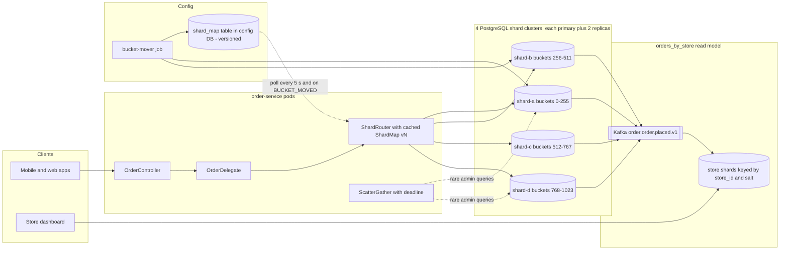
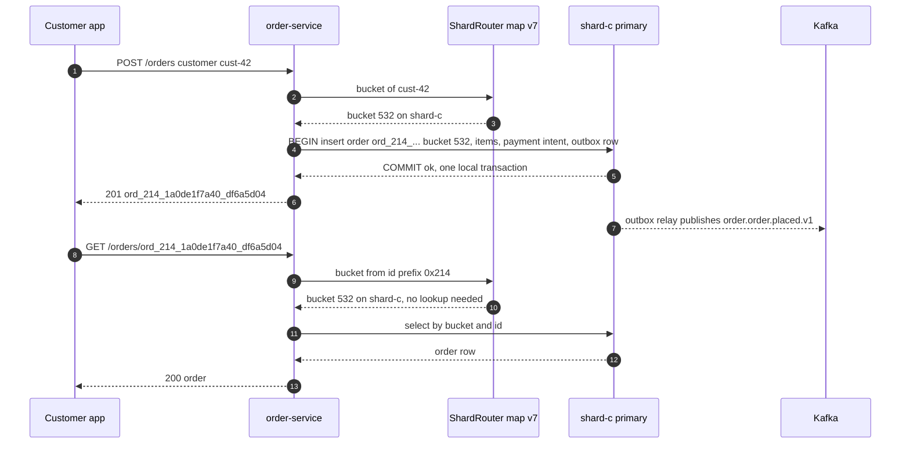
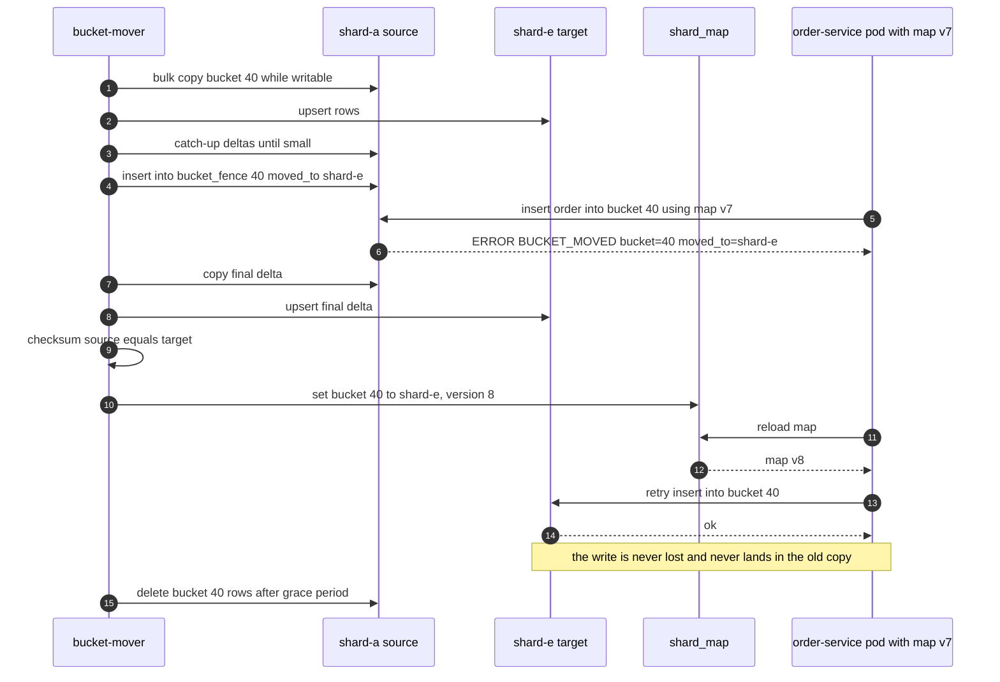
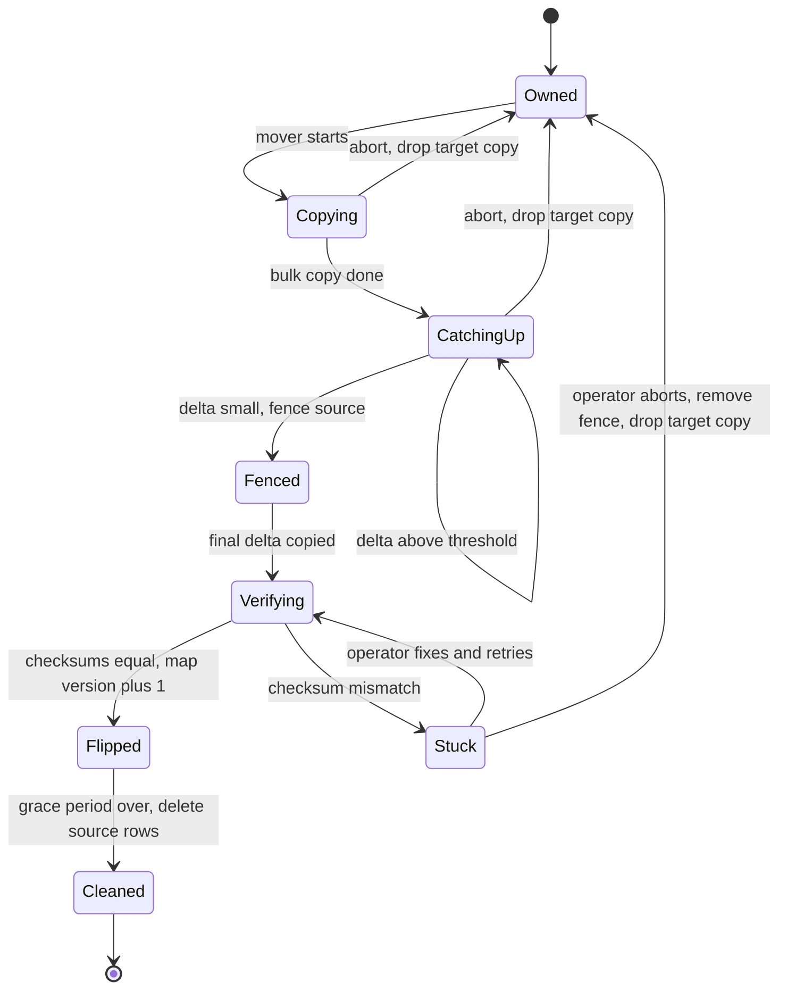

# 11. Partitioning & Sharding ⭐

!!! abstract "Chapter at a glance"
    **Reader bands:** B1 → B4 · **Prerequisites:** [Ch 05](../01-foundations/05-relational-databases-deep-dive.md), [Ch 06](../01-foundations/06-nosql-and-polyglot-persistence.md), [Ch 09](../01-foundations/09-scalability-fundamentals.md), [Ch 10](10-replication.md) · **What you will build:** Partitioning for the orders data. It starts with a plain-Java comparison of partitioning schemes (L1). Then it adds PostgreSQL declarative partitioning behind a Spring service (L2) and application-level sharding with 1,024 logical buckets, bucket-carrying order ids and bounded scatter-gather (L3). It ends with online bucket moves under a write fence and hot-key splitting (L4). **Two real labs** back the claims: a Redis 7 Cluster (hash slots, MOVED/ASK, CROSSSLOT, live resharding) and PostgreSQL 16 (partition pruning, the uniqueness rule, and a two-shard bucket move with a fence). · **Reading time:** 110 min + code + labs

---

## 1. Introduction & Why It Matters

### 1.1 A story: the resharding that moved 80 % of the data

By the second Diwali sale, the orders database had outgrown one PostgreSQL primary. The team split it into four shards with the simplest rule anyone could think of: `shard = hash(customer_id) % 4`. It worked for a year.

Then growth demanded a fifth shard. The change to the rule was one character, `% 4` became `% 5`, and the migration plan said "copy rows whose shard changed". Nobody had calculated how many that was. **About 80 % of all rows changed shards.** The copy ran for 31 hours, ate the disk and I/O budget of all five databases, and made p99 checkout latency four times worse for the whole weekend. Worse, writes kept arriving during the copy. Rows written to the *old* shard after they had been copied, but before the application switched rules, were simply not on the new shard. 212 orders disappeared from customers' order history until a reconciliation script found them in the old shards a week later.

Two months later a different incident: the new mega dark store in Bengaluru, **5 % of all orders by itself**, landed on the same shard as three other busy stores. The store dashboard, which queried orders by `store_id`, pinned that shard's CPU at 95 % every evening.

Neither incident was about the database engine. Both were **partitioning design** mistakes:

- **The key → shard function must not depend on the number of shards.** Hash into a fixed number of logical buckets (1,024 here), and map buckets to shards in a small, versioned table. Adding a shard then moves ~1/N of the data, a bucket at a time.
- **A move needs a fence.** Copy while writable, then block writes to the bucket on the source for a short final delta, verify, flip the map. A stale writer gets `BUCKET_MOVED` and retries, instead of writing into a copy nobody will read.
- **Pick the partition key from the dominant access pattern, and plan for the others.** Orders are read by customer (partition by customer) but also by store (a separately partitioned read model or a bounded scatter-gather), and a single huge key needs splitting.

!!! quote "The thesis of this chapter"
    Partitioning buys capacity by giving up the ability to see all the data in one place. Every design is a choice of **which queries stay on one partition, which ones fan out, and how data moves when the partition count changes**. Make those three choices on purpose, before the data forces them.

### 1.2 Where this lives in the grocery platform

| Data | Partitioning | Key | Why |
|---|---|---|---|
| Orders, order items (PostgreSQL) | App-level sharding: 1,024 buckets → 4 shard clusters, each with its own replicas (Ch 10) | `customer_id` (order ids carry the bucket) | Order history and checkout are per customer |
| Orders by store (read model) | Separate table sharded by `store_id`, fed by order events | `store_id` (salted for mega stores) | Store dashboards and picking without scatter-gather |
| Payments ledger | Same buckets as orders (co-located) | `customer_id` | Order + payment in one local transaction |
| Order events archive | PostgreSQL **range** partitions by month on each shard | `created_at` | Drop old months cheaply; queries by time window |
| Inventory (per store and SKU) | Hash by `store_id` | `store_id` | Every reservation is for one store (Ch 09) |
| Carts, sessions (Redis Cluster) | 16,384 hash slots | `{customer_id}` hash tag | Multi-key cart ops stay in one slot |
| Rider locations (Cassandra) | Token ring with vnodes | `(city, rider_id)` | Even spread, per-rider reads |
| Kafka topics | Partitions per topic | `order_id` or `store_id` | Ordering per key, parallel consumers (Ch 14) |
| Catalog search (OpenSearch) | Shards per index | Document routing by id | Search fan-out is the normal query (Ch 22) |

### 1.3 Learning objectives

| Band | After this chapter you can… |
|---|---|
| <span class="band b1">B1</span> | Explain partitioning vs replication, range vs hash partitioning, and why a query without the partition key touches every partition |
| <span class="band b2">B2</span> | Choose a partition key from access patterns, use PostgreSQL declarative partitioning and pruning, and explain why a unique constraint must include the partition key |
| <span class="band b3">B3</span> | Design application-level sharding with logical buckets and a versioned shard map, route by id without a global index, and bound scatter-gather |
| <span class="band b4">B4</span> | Move data online without losing writes (copy, catch up, fence, verify, flip), handle hot partitions, and reason about Redis Cluster slot migration (MOVED/ASK) and consistent hashing |

---

## 2. Core Concepts — Beginner to Deep

### 2.1 Intuition: the post office sorting room <span class="band b1">B1</span>

One clerk sorting all of a city's mail can't keep up, so the post office hires eight clerks and gives each one a set of pigeonholes.

- If clerks split the mail **by pincode range** (560001–560020 to clerk 1, and so on), finding "all mail for 5600xx" is easy: one clerk. But the new IT park in 560103 floods one clerk while others are idle. That's **range partitioning** and its **hot range**.
- If clerks split the mail by **a shuffle of the pincode** (a hash), the work spreads evenly, but "all mail for 5600xx" now means asking all eight. That's **hash partitioning** and **scatter-gather**.
- If the post office numbers clerks and uses `pincode % 8`, hiring a ninth clerk reshuffles almost every pigeonhole. If instead it has 1,024 labelled pigeonholes and gives each clerk a set of them, hiring a ninth clerk means handing over about 1/9 of the pigeonholes, and the labels on the letters never change. That's **logical buckets**.
- Replication (Ch 10) is photocopying a clerk's pigeonholes so a second clerk can take over. Partitioning is splitting the pigeonholes. Real systems do both: **each partition is replicated**.

### 2.2 Partitioning vs replication vs sharding <span class="band b1">B1</span>

| Term | Meaning |
|---|---|
| **Partitioning** | Splitting one dataset into disjoint pieces (partitions). Can happen inside one database server (PostgreSQL declarative partitioning) or across servers |
| **Sharding** | Partitioning **across servers**, so each server (shard) holds only some of the data and takes only some of the writes |
| **Replication** | Copying the **same** data to several servers (Ch 10) |
| **Shard** | One physical database cluster (a primary + replicas) holding a set of partitions or buckets |
| **Partition key / shard key** | The column(s) whose value decides where a row lives |

Replication scales **reads** and survives failures. It doesn't scale **writes** or **storage**: every replica stores and applies every write. Partitioning is the only way to scale writes and storage beyond one machine. That's why every large system does both, with names like "shard 3, replica 2".

**Partition inside one server** first (it's cheap, and it helps with pruning, maintenance and retention). **Shard across servers** only when one primary can't take the writes or hold the data, after the Ch 09 steps (indexes, caching, read replicas, a bigger machine) are exhausted.

### 2.3 Range partitioning <span class="band b1">B1</span> <span class="band b2">B2</span>

Each partition holds a contiguous range of keys: orders by month, customers A–F, pincodes 560001–560050.

| Strengths | Weaknesses |
|---|---|
| Range scans stay in one or a few partitions ("orders in September") | **Monotonic keys** (time, sequence ids) send **all new writes** to the newest partition (L1 D: all 10,000 of today's writes land in `2026-09`) |
| Dropping old data is `DROP TABLE orders_2025_01` (instant, no vacuum) | Skewed key distributions make uneven partitions; boundaries need tuning |
| Split a big range into two without touching others | Needs a range → partition directory |

Good fit: **time-series retention inside one server**, where "all writes in the newest partition" is fine because it's still one server. Used across servers by HBase, Bigtable, Spanner, CockroachDB and TiDB, which automatically split ranges that get too big or too hot.

### 2.4 Hash partitioning ⭐ <span class="band b1">B1</span> <span class="band b2">B2</span>

`partition = f(hash(key))`. A good hash spreads keys evenly, whatever the key distribution (L1 A: max/avg 1.00x).

| Strengths | Weaknesses |
|---|---|
| Even spread of data and writes, no hot range from monotonic keys | Range queries touch every partition |
| No directory needed if `f` is a formula | **Every query without the key touches every partition** (lab A: `store_id` scanned all 8 partitions) |
| | One very hot **key** still lands on one partition (hashing spreads keys, not load per key) |

The hash must be **stable** across languages, versions and processes. Java's `String.hashCode()` happens to be specified, but `Object.hashCode()` isn't, and many languages randomize string hashes per process. Use a named hash (CRC32C, Murmur3, xxHash, or MD5 when speed doesn't matter) and **pin it with a golden-value test**: `Buckets.of("cust-42") == 532` must hold forever.

### 2.5 From `hash mod N` to consistent hashing to logical buckets ⭐ <span class="band b2">B2</span> <span class="band b3">B3</span>

The question is what happens when N changes. L1 measured it with 200,000 customers going from 4 to 5 shards:

```text
   scheme                                  max/avg     moved on 4→5
   hash mod N                                1.00x            80.1%
   consistent hashing, 1 point/shard         1.80x            17.2%
   consistent hashing, 150 vnodes            1.02x            20.3%
   1,024 fixed buckets → shards              1.00x            19.7%
```

**`hash mod N`.** Perfectly even, but changing N remaps a key unless `h mod 4 == h mod 5`, which is true for only ~1/5 of keys. **~80 % of data moves** (the §1.1 story). Only acceptable if N never changes, or if you always double N (then exactly half the keys move, and each shard splits into two).

**Consistent hashing (Karger et al., 1997).** Hash both keys and shards onto a ring, and a key belongs to the next shard clockwise. Adding a shard takes keys only from its clockwise neighbour, so only ~1/N moves. With **one point per shard** the arcs are uneven (1.80x: one shard has almost twice the average), and the new shard takes from **one** neighbour, not from all. **Virtual nodes** (150 points per shard) fix both: even load (1.02x), and a new shard takes a little from everyone. Used by Dynamo, Cassandra (vnodes/tokens), Riak, many caches.

**Fixed logical buckets (slots).** Hash keys into a **fixed** number of buckets B that never changes (1,024, or Redis Cluster's 16,384), and keep a **bucket → shard map**. Adding a shard means reassigning ~B/N buckets to it: 19.7 % moved, perfectly even. It's consistent hashing with the ring replaced by an explicit table, which gives you:

- **Control:** move exactly the buckets you choose, one at a time, verifiable, pausable.
- **Unequal shards:** give a bigger machine more buckets.
- **Hot bucket isolation:** move one hot bucket to its own shard.
- **A unit of migration:** "bucket 532" is something you can fence, copy, checksum and flip.

The cost: a small map (1,024 entries) to store, version and distribute. That's a feature: the map is the single source of truth for routing. Pick B **much larger than the maximum shard count you'll ever want** (≥ 10× headroom, and a power of 2 is convenient), because B can't change without rehashing everything.

!!! tip "Rule of thumb"
    `hash mod N` only if N is fixed forever. Consistent hashing with vnodes when nodes come and go automatically (caches, Dynamo-style stores). **Fixed buckets + a versioned map** for databases you operate and rebalance deliberately.

### 2.6 Choosing the partition key ⭐ <span class="band b2">B2</span> <span class="band b3">B3</span>

The partition key decides which queries are cheap forever. A checklist:

1. **List the queries by volume and latency need.** For orders: "my orders" (customer, very high), "get order by id" (very high), checkout transaction (order + items + payment, high), "store's open orders" (store, medium), "all orders yesterday" (analytics, low, offline).
2. **Choose the key that keeps the most important queries and transactions on one partition.** `customer_id` keeps "my orders", checkout and payments together.
3. **Check the cardinality and skew.** Millions of customers, the biggest one a few hundred orders: good. `store_id`: 500 stores, one with 5 % of all orders: bad as a primary key (L1 C: the busiest of 64 shards carries 3.90x the average).
4. **Check write distribution.** A timestamp key concentrates all writes (L1 D).
5. **Plan every other query:** give it its own partitioned copy (a read model), a global index, a bounded scatter-gather, or send it to the analytics store (Ch 21).

**Compound keys.** Cassandra-style `PRIMARY KEY ((city, rider_id), ts)`: the **partition key** `(city, rider_id)` picks the node, and the **clustering key** `ts` orders rows inside it. The same pattern appears in PostgreSQL as `PRIMARY KEY (customer_id, id)` with an index on `(customer_id, created_at desc)`.

**Co-location.** Tables that are joined or written in one transaction should share the partition key: `orders`, `order_items` and `payments` all by `customer_id` (Citus calls this "co-located tables"). Then checkout is a **local** transaction, and no distributed transaction (Ch 13) is needed.

### 2.7 Routing: who knows where a key lives? ⭐ <span class="band b2">B2</span> <span class="band b3">B3</span>

| Approach | How | Examples | Trade-offs |
|---|---|---|---|
| **Client-side routing** | The client library holds the map and connects straight to the shard | Redis Cluster smart clients, Cassandra drivers (token-aware), our `ShardRouter` | Fastest (no hop). Every client must refresh the map, and stale maps must be detected |
| **Proxy / router tier** | Clients talk to a router that knows the map | Vitess `vtgate`, MongoDB `mongos`, Citus coordinator, Twemproxy | Simple clients, one place to change. Extra hop, and the router tier must scale and be HA |
| **Any node forwards** | Any node accepts the request and forwards or redirects | Cassandra coordinator, Redis Cluster `MOVED` | No special tier. An extra hop on a miss |

Where the map lives: a coordination service (ZooKeeper, etcd, Consul, Ch 12), a config table, or the database itself (Redis Cluster gossips the slot map between nodes).

**Stale maps are normal**, not exceptional. The design must make them **safe** and **self-healing**:

- The node that no longer owns the key **refuses** (Redis: `MOVED 4133 127.0.0.1:7002`, our fence: `BUCKET_MOVED bucket=40 moved_to=shardB`).
- The client refreshes its map and retries.
- The map carries a **version**, so a client never goes back to an older one.

**Routing by id without a global index.** "GET /orders/{id}" doesn't know the customer. Options:

- A global `order_id → customer_id` lookup table (another store to keep consistent).
- A scatter-gather on every id lookup (expensive).
- **Put the bucket in the id**: `ord_214_1a0de1f7a40_df6a5d04` carries bucket `0x214 = 532`, the same bucket as its customer. Any service can route the id with no lookup. (Instagram's ids embed a logical shard, and Twitter's Snowflake embeds a worker id for the same reason. Ch 20 covers id design.)

### 2.8 Secondary indexes: local vs global ⭐ <span class="band b3">B3</span>

Partitioning by customer makes "orders of store-7" a query on a **non-partition key**.

| | **Local (document-partitioned) index** | **Global (term-partitioned) index** |
|---|---|---|
| What | Each partition indexes only its own rows | One index over all data, itself partitioned by the **indexed** value (store_id) |
| Write | Local, in the same transaction | Touches another partition: async (event-fed) or a distributed transaction |
| Read by store | **Scatter-gather** over all partitions (lab A: 2.818 ms over 8 partitions vs 0.138 ms for one; lab B: 170 + 230 rows from two shards) | One partition |
| Consistency | Same as the data | Usually **eventually** consistent (DynamoDB GSIs, our event-fed read model) |
| Examples | PostgreSQL partitioned indexes, Elasticsearch, MongoDB, Cassandra secondary indexes | DynamoDB GSI, our `orders_by_store` table, Spanner/CockroachDB secondary indexes (transactional, at the cost of distributed writes) |

Scatter-gather cost grows with the partition count, and **tail latency** grows faster: the query is as slow as the slowest partition, so if each shard is slow 1 % of the time, a 64-way fan-out is slow ~47 % of the time (1 − 0.99⁶⁴), which Dean and Barroso call "the tail at scale". Keep scatter-gathers **rare, bounded** (a top-K with a limit per shard, a deadline, partial results flagged) and off hot paths.

### 2.9 Hot partitions and hot keys ⭐ <span class="band b3">B3</span> <span class="band b4">B4</span>

Hashing spreads **keys**. It can't spread load **within one key**.

| Cause | Example | Mitigation |
|---|---|---|
| Skewed key | The mega store has 5 % of orders | **Salt / split** the key: `store-MEGA#0..N`, and read all salts (verified: 4.11x → 1.68x with 4 salts) |
| Monotonic key | Range partitions by time, auto-increment ids | Hash, or prefix the key with a hash/bucket |
| Celebrity / viral item | A flash-sale SKU read 50 K times a second | Cache and replicate the key (Ch 07), request coalescing, read replicas |
| Hot counter | A per-store "orders today" counter | Sharded counters (N sub-counters summed on read), or batch updates |
| Unlucky placement | Several busy buckets on one shard | Move buckets (the bucket map makes this a routine operation) |

Salting has a price: reads of that key become a fan-out over its salts. Salt **only** the keys that need it, from a config list driven by metrics, and keep the number of salts small.

### 2.10 Rebalancing: moving data while it's being written ⭐ <span class="band b4">B4</span>

Rebalancing is where sharded systems lose data. The naive sequence *copy → flip the map → delete* has a window: a writer with the old map writes to the source **after** the copy and before it learns about the flip. That write lands in a copy that's about to be deleted. The simulation in L4 lost **88 of 24,456 acknowledged writes** this way.

A safe move of one bucket:

1. **Bulk copy while writable.** Copy the bucket to the target. Record a watermark (a change sequence or LSN).
2. **Catch up.** Copy rows changed since the watermark, again and again, until the delta is small. (Production tools use CDC or logical replication for this, see Ch 13.)
3. **Fence the source.** From now on, the source **rejects** writes to the bucket (a trigger, a flag checked in the write path, or Redis's `MIGRATING` state). Writers get `BUCKET_MOVED`, reload the map and retry.
4. **Copy the final delta**, then **verify** (count + checksum).
5. **Flip the map** (version + 1) and publish it.
6. **Delete from the source** later, after a grace period.

The write freeze is only steps 3–5 for one small delta: **36 ms max** per bucket in the L4 simulation, vs ~230 ms in the lab's simpler fence-first variant. Moving one bucket at a time keeps the freeze per customer tiny and the rest of the system unaffected.

**Redis Cluster** does the same thing per hash slot: the source marks the slot `MIGRATING` and the target marks it `IMPORTING`. Keys move one by one with `MIGRATE`. While the slot is in flight, the source answers requests for **already moved keys** with `ASK <slot> <target>`, which means "try the target **once**, for this request only, with `ASKING`". Keys not yet moved are still served by the source. When the slot is done, `SETSLOT NODE` makes the target the owner, and the source answers with `MOVED`, which means "update your map". The lab shows every one of these replies.

### 2.11 Partitioning inside one PostgreSQL server <span class="band b2">B2</span>

Declarative partitioning (`PARTITION BY RANGE | LIST | HASH`) splits a table into child tables on one server:

- **Partition pruning:** a query with the partition key scans only matching partitions (lab A: `orders_p1` only). Without the key, all of them.
- **Maintenance:** vacuum, reindex and backup per partition. **Retention:** `DETACH` / `DROP` a month.
- **Uniqueness rule:** a unique or primary key **must include all partition key columns**, because each partition enforces uniqueness only locally. Lab A shows the error for a primary key on `id` alone. Global uniqueness of `id` alone must come from the id generator (Ch 20), not a constraint.
- Too many partitions slow planning and use more memory, so keep it to hundreds, not tens of thousands.

It doesn't add servers. For that you need Citus (distributed tables over PostgreSQL workers), application-level sharding (this chapter's L3/L4), or a distributed SQL database.

### 2.12 Choosing a sharding approach <span class="band b4">B4</span>

| Option | What you get | What you give up | Fit |
|---|---|---|---|
| Stay on one primary + partitioning + replicas | Simplicity, full SQL, local transactions | Write/storage ceiling of one machine | Most systems, for longer than people think |
| **Application-level sharding** (buckets + map) | Full control, any SQL engine, predictable moves | You build routing, moves, cross-shard queries, tooling | Clear partition key, a team to own it (this chapter) |
| Middleware sharding (Vitess, Citus, ShardingSphere) | Routing, resharding and some cross-shard queries built in | Another system to operate; SQL limitations | MySQL (Vitess), PostgreSQL (Citus), JDBC (ShardingSphere) |
| Distributed SQL (Spanner, CockroachDB, YugabyteDB, TiDB) | Automatic range splits and moves, distributed transactions, global indexes | Latency on cross-range transactions; cost; new ops skills | Multi-region, many access patterns, strong consistency needs |
| NoSQL with native partitioning (DynamoDB, Cassandra, MongoDB) | Partitioning is the data model | Query flexibility; you still choose the key | Key-value/wide-column access patterns (Ch 06) |

---

## 3. Architecture & Diagrams

### 3.1 Component view: sharded orders



Every shard is itself a replicated cluster (Ch 10). The shard map is small (1,024 rows plus a version) and cached in every pod. Store queries go to a **separately partitioned read model** fed by events, not to a scatter-gather over the order shards. Scatter-gather is kept for rare support and admin queries, with a deadline.

### 3.2 Sequence: happy path, place an order and read it back by id



### 3.3 Sequence: failure path, a writer with a stale map during a bucket move



If the checksums don't match, the mover **keeps the fence, doesn't flip the map, and pages**. Writes to that one bucket fail until a human decides, which is better than silently losing them.

### 3.4 State: one bucket during a move



Aborting is free until the fence. After the fence, the only exits are "flip" or "remove the fence", and both are explicit.

---

## 4. Design Document Excerpt: Sharding the Orders Database

| Field | Value |
|---|---|
| Author / Reviewers | Platform data team / Orders, Payments, Store Ops, SRE |
| Status | Approved |
| Related ADRs | ADR-041 Application-level sharding with 1,024 logical buckets; ADR-042 Event-fed `orders_by_store` read model; ADR-043 Online bucket moves with a write fence |

**1. Context & Problem.** The orders primary (Ch 10's quorum-sync cluster) is at 70 % CPU and 6.8 TB at P90 sale peaks, and projected to hit its write ceiling in ~9 months. A mod-N reshard in another team moved 80 % of its data and lost writes (§1.1). The store dashboard's `store_id` queries are the top CPU consumer.

**2. Goals / Non-Goals.**

- *Goals:* scale writes and storage horizontally; keep checkout (order + items + payment) a local transaction; add shards online with no lost writes; per-customer and by-id reads on one shard; store queries without scatter-gather.
- *Non-goals:* cross-shard ACID transactions (Ch 13 sagas where needed); multi-region write placement (Ch 27).

**3. Requirements.**

| ID | Requirement |
|---|---|
| NFR-1 | Order history and order-by-id: one shard, p99 ≤ 20 ms |
| NFR-2 | Adding a shard moves ≤ 1/N of data, online, with zero lost or unreachable acknowledged writes |
| NFR-3 | Write freeze per bucket during a move ≤ 250 ms p99 |
| NFR-4 | Store order queries p99 ≤ 100 ms and not dependent on the order-shard count |
| NFR-5 | Stale routing must fail safe (refuse) and self-heal within 5 s |
| NFR-6 | Any single hot key ≤ 25 % of one shard's capacity (salting for known hot stores) |

**4. Capacity & latency estimates.**

| Item | Calculation | Result |
|---|---|---|
| Orders data in 3 years | Ch 02: ~6.8 TB now × ~2.5x growth | ~17 TB |
| Shards needed | ≤ 3 TB and ≤ 60 % peak CPU per shard | **4 now, 8 in ~2 years** |
| Buckets | 1,024 ≥ 10× the max shard count we plan (64) | 128 buckets per shard at 8 shards |
| Bucket size | 17 TB / 1,024 | ~17 GB per bucket: copy ~3–6 min at 50–100 MB/s |
| Data moved going 4 → 5 shards | 1/5 of buckets | ~205 buckets, ~20 % (L1: 19.7 %) |
| Shard map | 1,024 × (int + short name) | < 20 KB, cached in every pod |
| Store read model lag | Outbox → Kafka → consumer | p99 < 2 s (acceptable to Store Ops) |

**5. Proposed design.**

1. `bucket = CRC32C(customer_id) mod 1024`, in a shared library with golden-value tests. The function **never changes**.
2. `shard_map(bucket, shard, version)` in the config DB. Pods poll every 5 s and reload immediately on `BUCKET_MOVED`. Map versions only increase.
3. **Order ids carry the bucket** (`ord_<bucket hex>_<ms hex>_<random>`), so by-id routing needs no lookup.
4. `orders`, `order_items`, `payments` and the outbox are co-located by bucket. Every table has `bucket` as the first primary-key column.
5. **Each shard is a Ch 10 cluster** (quorum sync to 2 standbys).
6. Store queries use `orders_by_store`, keyed by `(store_id, salt)`, fed by `order.order.placed.v1` and status events. Known hot stores get 4–8 salts.
7. **Moves:** the bucket-mover job runs bulk copy → catch-up (logical replication or change sequence) → fence (trigger on `bucket_fence`) → final delta → checksum → map flip → delayed delete. One bucket at a time per shard pair, rate-limited.
8. Scatter-gather only for admin/support endpoints: per-shard limit, 300 ms deadline, partial results flagged.

**7. Alternatives considered.**

| Option | Pros | Cons | Verdict |
|---|---|---|---|
| `hash mod N` | No map | ~80 % data moves per change (L1) | Rejected |
| Consistent hashing with vnodes | No central map | Moves are hard to control and verify, and not unit-based | Rejected for the DB (fine for caches) |
| **1,024 buckets + versioned map** | ~1/N moves, bucket = unit of move/fence/verify | Map to operate; routing library | **Chosen** |
| Citus | Distributed tables, co-location, shard moves built in | Extension version coupling to managed PostgreSQL offerings; team skills | Revisit in 12 months |
| CockroachDB/YugabyteDB | Automatic splits, global indexes | Migration cost, cross-range txn latency | Revisit for multi-region (Ch 27) |
| Scatter-gather for store queries | No read model | Cost grows with shard count; tail latency | Rejected for the dashboard, kept for admin |

**8. Failure modes.** Stale map writes: refused by the fence, retried. Checksum mismatch: fence kept, no flip, page. Mover crash mid-copy: restart from the watermark (idempotent upserts). A shard down: its buckets (~25 %) fail, the rest serve. Map store down: pods keep the cached map, and moves pause. Read model lag: the dashboard shows "as of" time.

**10. Observability.** Requests and latency per shard and bucket (top-N hot buckets), shard skew (max/avg), map version per pod, `BUCKET_MOVED` rate, mover progress/freeze time/checksum results, scatter-gather fan-out and partial-result rate, read model lag.

**14. Decision (ADR-041/042/043 summary).** Orders are sharded at the application level by `customer_id` into 1,024 fixed buckets mapped to shard clusters by a versioned map. Order ids carry their bucket. Store queries use an event-fed read model keyed by salted `store_id`. Buckets move online with bulk copy, catch-up, a DB-level write fence, checksum verification and a versioned map flip.

---

## 5. Hands-On Code — Level Ladder

| Level | New requirement that forces the step |
|---|---|
| L1 | "Show how partitioning schemes balance data, how much moves when a shard is added, and what skew and range keys do." (plain Java) |
| L2 | "The orders table is too big to maintain as one table, but one server is still enough." (PostgreSQL declarative partitioning behind Spring) |
| L3 | "One server isn't enough: shard across clusters, route by customer and by id, handle store queries." |
| L4 | "Add shards online without losing a write, and stop one mega store from overloading a shard." |
| Labs | Real Redis 7 Cluster and real PostgreSQL 16: every behaviour claimed above, reproduced |

### L1 — Concept: comparing partitioning schemes (plain Java) <span class="band b1">B1</span> <span class="band b2">B2</span>

```java
// PartitioningL1.java — run with: java PartitioningL1.java
// Compare ways to split 200,000 orders across shards:
//   A. balance (max / average load)    B. data moved when adding a 5th shard
//   C. a skewed key (one mega-store)   D. range-by-time: where do today's WRITES go?
import java.nio.charset.StandardCharsets;
import java.security.MessageDigest;
import java.util.*;
import java.util.function.Function;

public class PartitioningL1 {

    static long hash(String s) {                       // stable 64-bit hash (first 8 bytes of MD5)
        try {
            byte[] d = MessageDigest.getInstance("MD5").digest(s.getBytes(StandardCharsets.UTF_8));
            long h = 0; for (int i = 0; i < 8; i++) h = (h << 8) | (d[i] & 0xff);
            return h;
        } catch (Exception e) { throw new IllegalStateException(e); }
    }

    // --- schemes: key → shard name ---
    static Function<String, String> modN(int n) { return k -> "s" + Math.floorMod(hash(k), n); }

    static Function<String, String> ring(int shards, int vnodes) {
        TreeMap<Long, String> ring = new TreeMap<>();
        for (int s = 0; s < shards; s++) for (int v = 0; v < vnodes; v++) ring.put(hash("s" + s + "#" + v), "s" + s);
        return k -> { var e = ring.ceilingEntry(hash(k)); return (e != null ? e : ring.firstEntry()).getValue(); };
    }

    /** Fixed logical buckets; the bucket → shard map changes, the key → bucket function never does. */
    static Function<String, String> buckets(int nBuckets, Map<Integer, String> bucketToShard) {
        return k -> bucketToShard.get((int) Math.floorMod(hash(k), (long) nBuckets));
    }

    static Map<Integer, String> spread(int nBuckets, int shards) {
        Map<Integer, String> m = new HashMap<>();
        for (int b = 0; b < nBuckets; b++) m.put(b, "s" + (b % shards));
        return m;
    }

    /** Add a shard by moving just enough buckets (taken evenly from the old shards) to the new one. */
    static Map<Integer, String> addShard(Map<Integer, String> old, int newShards) {
        Map<Integer, String> m = new HashMap<>(old);
        int target = old.size() / newShards;
        Map<String, Deque<Integer>> byShard = new TreeMap<>();
        old.forEach((b, s) -> byShard.computeIfAbsent(s, x -> new ArrayDeque<>()).add(b));
        String newShard = "s" + (newShards - 1);
        int moved = 0;
        while (moved < target) for (var q : byShard.values()) if (moved < target && !q.isEmpty()) { m.put(q.poll(), newShard); moved++; }
        return m;
    }

    static double imbalance(List<String> keys, Function<String, String> f) {
        Map<String, Integer> c = new HashMap<>();
        keys.forEach(k -> c.merge(f.apply(k), 1, Integer::sum));
        double avg = keys.size() / (double) c.size();
        return Collections.max(c.values()) / avg;
    }

    static double movedPct(List<String> keys, Function<String, String> before, Function<String, String> after) {
        long moved = keys.stream().filter(k -> !before.apply(k).equals(after.apply(k))).count();
        return 100.0 * moved / keys.size();
    }

    public static void main(String[] args) {
        List<String> customers = new ArrayList<>();
        for (int i = 0; i < 200_000; i++) customers.add("cust-" + i);

        System.out.println("A+B. 200,000 customer keys on 4 shards, then add a 5th");
        System.out.printf("   %-34s %12s %16s%n", "scheme", "max/avg", "moved on 4→5");
        var b4 = spread(1024, 4);
        Object[][] rows = {
            {"hash mod N", modN(4), modN(5)},
            {"consistent hashing, 1 point/shard", ring(4, 1), ring(5, 1)},
            {"consistent hashing, 150 vnodes", ring(4, 150), ring(5, 150)},
            {"1,024 fixed buckets → shards", buckets(1024, b4), buckets(1024, addShard(b4, 5))},
        };
        for (Object[] r : rows) {
            @SuppressWarnings("unchecked") var f4 = (Function<String, String>) r[1];
            @SuppressWarnings("unchecked") var f5 = (Function<String, String>) r[2];
            System.out.printf("   %-34s %11.2fx %15.1f%%%n", r[0], imbalance(customers, f4), movedPct(customers, f4, f5));
        }

        System.out.println("C. Shard orders by store_id: 500 stores, one mega dark store takes 5 % of all orders");
        List<String> orderStores = new ArrayList<>();
        Random rnd = new Random(5);
        for (int i = 0; i < 200_000; i++) orderStores.add(rnd.nextDouble() < 0.05 ? "store-MEGA" : "store-" + rnd.nextInt(500));
        for (int shards : new int[]{4, 16, 64})
            System.out.printf("   %2d shards: busiest shard carries %.2fx the average%n", shards,
                    imbalance(orderStores, buckets(1024, spread(1024, shards))));

        System.out.println("D. Range-partition orders by month vs hash: where do today's 10,000 writes land?");
        Map<String, Integer> byMonth = new TreeMap<>(), byHash = new TreeMap<>();
        for (int i = 0; i < 10_000; i++) {
            byMonth.merge("2026-09", 1, Integer::sum);                                  // every new order is 'now'
            byHash.merge(modN(4).apply("ord_" + i), 1, Integer::sum);
        }
        System.out.println("   range by month: " + byMonth + "   ← one hot partition for all writes");
        System.out.println("   hash by id    : " + byHash + "   ← writes spread; but 'last month's orders' touches all");
    }
}
```

Actual output from running it:

```text
A+B. 200,000 customer keys on 4 shards, then add a 5th
   scheme                                  max/avg     moved on 4→5
   hash mod N                                1.00x            80.1%
   consistent hashing, 1 point/shard         1.80x            17.2%
   consistent hashing, 150 vnodes            1.02x            20.3%
   1,024 fixed buckets → shards              1.00x            19.7%
C. Shard orders by store_id: 500 stores, one mega dark store takes 5 % of all orders
    4 shards: busiest shard carries 1.11x the average
   16 shards: busiest shard carries 1.76x the average
   64 shards: busiest shard carries 3.90x the average
D. Range-partition orders by month vs hash: where do today's 10,000 writes land?
   range by month: {2026-09=10000}   ← one hot partition for all writes
   hash by id    : {s0=2512, s1=2524, s2=2486, s3=2478}   ← writes spread; but 'last month's orders' touches all
```

**What L1 shows:** all hash schemes balance well once each shard owns many points or buckets. The difference is what happens when N changes. `mod N` moves 80 % of keys. Consistent hashing with one point per shard moves little but balances badly, and vnodes fix the balance. Fixed buckets are even **and** move exactly 1/N. Section C shows that no scheme fixes a skewed key: the more shards you add, the more the mega store's shard stands out (1.11x at 4 shards, 3.90x at 64), because the average shrinks and the mega store doesn't. Section D shows range-by-time sending every write to one partition.

### L2 — PostgreSQL declarative partitioning behind Spring <span class="band b2">B2</span>

Requirement: the orders table is 400 M rows and vacuum takes hours, but one server still has the capacity. Partition by `customer_id` inside the server, so per-customer queries prune to one partition, and range-partition the event archive by month for retention.

=== "Schema (Flyway V11)"

    ```sql
    -- V11__partition_orders.sql
    create table orders (
        id            text        not null,
        customer_id   text        not null,
        store_id      text        not null,
        status        text        not null,
        amount_paise  bigint      not null,
        created_at    timestamptz not null default now(),
        primary key (customer_id, id)              -- must include the partition key (lab A shows the error otherwise)
    ) partition by hash (customer_id);

    -- 16 partitions: enough to keep each one vacuum-friendly; a later split means re-creating, so don't go too small
    do $$ begin
      for i in 0..15 loop
        execute format('create table orders_p%s partition of orders for values with (modulus 16, remainder %s)', i, i);
      end loop;
    end $$;

    create index on orders (customer_id, created_at desc);     -- partitioned index: one local index per partition
    create index on orders (store_id, created_at desc);        -- still local: a store query scans all 16 (see L3)

    -- Event archive: RANGE by month, so retention is DROP instead of DELETE
    create table order_events (
        order_id    text        not null,
        customer_id text        not null,
        type        text        not null,
        payload     jsonb       not null,
        created_at  timestamptz not null,
        primary key (created_at, order_id, type)
    ) partition by range (created_at);
    create table order_events_2026_09 partition of order_events for values from ('2026-09-01') to ('2026-10-01');
    create table order_events_2026_10 partition of order_events for values from ('2026-10-01') to ('2026-11-01');
    create table order_events_default partition of order_events default;   -- catches mistakes; alert if non-empty
    ```

=== "Repository"

    ```java
    package com.grocery.order.repository;

    import java.time.Instant;
    import java.util.List;
    import java.util.Optional;
    import org.springframework.jdbc.core.simple.JdbcClient;
    import org.springframework.stereotype.Repository;

    @Repository
    public class OrderRepository {

        public record OrderRow(String id, String customerId, String storeId, String status, long amountPaise, Instant createdAt) { }

        private final JdbcClient jdbc;

        public OrderRepository(JdbcClient jdbc) { this.jdbc = jdbc; }

        /** Prunes to ONE partition: customer_id is in the WHERE clause. */
        public List<OrderRow> recentForCustomer(String customerId, int limit) {
            return jdbc.sql("""
                    select id, customer_id, store_id, status, amount_paise, created_at
                      from orders
                     where customer_id = :customerId
                     order by created_at desc
                     limit :limit""")
                .param("customerId", customerId)
                .param("limit", limit)
                .query(OrderRow.class)
                .list();
        }

        /**
         * By id: callers must pass the customer too (from the auth token or the URL), otherwise
         * the query scans every partition. The API is /customers/{cid}/orders/{id} for this reason.
         */
        public Optional<OrderRow> find(String customerId, String orderId) {
            return jdbc.sql("""
                    select id, customer_id, store_id, status, amount_paise, created_at
                      from orders
                     where customer_id = :customerId and id = :id""")
                .param("customerId", customerId)
                .param("id", orderId)
                .query(OrderRow.class)
                .optional();
        }

        /** Idempotent insert; uniqueness is per (customer_id, id): ids come from a generator that is unique on its own (Ch 20). */
        public boolean insert(OrderRow o) {
            return jdbc.sql("""
                    insert into orders (id, customer_id, store_id, status, amount_paise, created_at)
                    values (:id, :customerId, :storeId, :status, :amountPaise, :createdAt)
                    on conflict (customer_id, id) do nothing""")
                .paramSource(o)
                .update() == 1;
        }
    }
    ```

=== "Retention job"

    ```java
    package com.grocery.order.service;

    import java.time.YearMonth;
    import java.time.format.DateTimeFormatter;
    import org.springframework.jdbc.core.simple.JdbcClient;
    import org.springframework.scheduling.annotation.Scheduled;
    import org.springframework.stereotype.Service;
    import org.springframework.transaction.annotation.Transactional;

    /** Creates next month's partition ahead of time and drops months past retention. */
    @Service
    public class OrderEventPartitionMaintenance {

        private static final DateTimeFormatter SUFFIX = DateTimeFormatter.ofPattern("yyyy_MM");
        private final JdbcClient jdbc;
        private final int retentionMonths;

        public OrderEventPartitionMaintenance(JdbcClient jdbc,
                @org.springframework.beans.factory.annotation.Value("${orders.events.retention-months:18}") int retentionMonths) {
            this.jdbc = jdbc;
            this.retentionMonths = retentionMonths;
        }

        @Scheduled(cron = "0 17 2 * * *")          // daily; idempotent. Runs under a ShedLock-style lock (Ch 20) in production
        @Transactional
        public void maintain() {
            YearMonth now = YearMonth.now(java.time.ZoneOffset.UTC);
            for (int ahead = 1; ahead <= 2; ahead++) createIfMissing(now.plusMonths(ahead));
            YearMonth oldest = now.minusMonths(retentionMonths);
            // DETACH first (fast, no long lock with CONCURRENTLY outside a txn in PG14+), archive to object storage, then DROP
            jdbc.sql("drop table if exists order_events_" + oldest.format(SUFFIX)).update();
        }

        private void createIfMissing(YearMonth m) {
            String name = "order_events_" + m.format(SUFFIX);          // built from a YearMonth, never from user input
            jdbc.sql("create table if not exists " + name + " partition of order_events for values from ('"
                    + m.atDay(1) + "') to ('" + m.plusMonths(1).atDay(1) + "')").update();
        }
    }
    ```

!!! warning "What was and wasn't verified for L2"
    The partitioning behaviour (pruning, the primary-key rule, row spread) was verified on real PostgreSQL 16 in **Lab A** below. The Spring code wasn't compiled here: this environment can't download Spring or the JDBC driver from Maven Central. `JdbcClient` is the Spring Framework 6.1+ API, and `.query(Class)` maps records by constructor. Check against your Spring Boot 4 version. <!-- VERIFY -->

**What L2 adds:** partitioning inside one server makes per-customer queries touch one partition and makes retention a `DROP`. It doesn't add write capacity. The store query still scans every partition, and the primary key had to change to `(customer_id, id)`.

### L3 — Application-level sharding with logical buckets <span class="band b3">B3</span>

Requirement: one primary can't take the writes. Shard across four clusters by customer. By-id reads must route without a lookup. Store queries must not depend on the shard count.

=== "Buckets"

    ```java
    package com.grocery.order.sharding;

    import java.nio.charset.StandardCharsets;
    import java.util.zip.CRC32C;

    /**
     * The key → bucket function. It must NEVER change once data exists (the bucket is also stored in every row),
     * so it lives in one shared library and is covered by a golden-value test.
     */
    public final class Buckets {

        public static final int COUNT = 1024;      // many more buckets than shards: moves happen in small units

        private Buckets() { }

        public static int of(String shardKey) {
            CRC32C crc = new CRC32C();
            crc.update(shardKey.getBytes(StandardCharsets.UTF_8));
            return (int) (crc.getValue() % COUNT);
        }
    }
    ```

=== "Order ids that carry the bucket"

    ```java
    package com.grocery.order.sharding;

    import java.security.SecureRandom;
    import java.time.Instant;
    import java.util.HexFormat;

    /**
     * Order ids carry their bucket, so GET /orders/{id} routes to one shard without a global lookup:
     *   ord_<bucket:3 hex>_<epochMillis:11 hex>_<random:8 hex>     e.g. ord_1a3_19978e2a1c0_9f2c11ab
     * Time-ordered within a bucket (good for B-tree inserts, Ch 05), unguessable suffix.
     */
    public final class OrderIds {

        private static final SecureRandom RANDOM = new SecureRandom();
        private static final HexFormat HEX = HexFormat.of();

        private OrderIds() { }

        public static String newId(int bucket, Instant now) {
            if (bucket < 0 || bucket >= Buckets.COUNT) throw new IllegalArgumentException("bucket out of range");
            byte[] r = new byte[4];
            RANDOM.nextBytes(r);
            return "ord_%03x_%011x_%s".formatted(bucket, now.toEpochMilli(), HEX.formatHex(r));
        }

        public static int bucketOf(String orderId) {
            if (orderId == null || !orderId.matches("ord_[0-9a-f]{3}_[0-9a-f]{11}_[0-9a-f]{8}"))
                throw new IllegalArgumentException("not a sharded order id: " + orderId);
            int b = Integer.parseInt(orderId.substring(4, 7), 16);
            if (b >= Buckets.COUNT) throw new IllegalArgumentException("bucket out of range: " + orderId);
            return b;
        }
    }
    ```

=== "Versioned shard map"

    ```java
    package com.grocery.order.sharding;

    import java.util.*;

    /** Versioned bucket → shard assignment. Loaded from the config store; pods reload on a timer and on BUCKET_MOVED. */
    public record ShardMap(long version, Map<Integer, String> bucketToShard) {

        public ShardMap {
            if (bucketToShard.size() != Buckets.COUNT) throw new IllegalArgumentException("every bucket must be assigned");
            bucketToShard = Map.copyOf(bucketToShard);
        }

        public static ShardMap evenly(long version, List<String> shards) {
            Map<Integer, String> m = new HashMap<>();
            for (int b = 0; b < Buckets.COUNT; b++) m.put(b, shards.get(b % shards.size()));
            return new ShardMap(version, m);
        }

        public String shardForBucket(int bucket) { return bucketToShard.get(bucket); }
        public String shardForCustomer(String customerId) { return shardForBucket(Buckets.of(customerId)); }
        public String shardForOrder(String orderId) { return shardForBucket(OrderIds.bucketOf(orderId)); }
        public Set<String> shards() { return new TreeSet<>(bucketToShard.values()); }

        public ShardMap withBucketsMoved(Collection<Integer> buckets, String to) {
            Map<Integer, String> m = new HashMap<>(bucketToShard);
            buckets.forEach(b -> m.put(b, to));
            return new ShardMap(version + 1, m);
        }
    }
    ```

=== "Bounded scatter-gather"

    ```java
    package com.grocery.order.sharding;

    import java.time.Duration;
    import java.util.*;
    import java.util.concurrent.*;
    import java.util.function.Function;

    /**
     * Query every shard in parallel with a deadline, merge the top-K, and say whether the answer is complete.
     * Used only for queries WITHOUT the shard key (store dashboards, support search) — keep them rare and bounded.
     */
    public class ScatterGather {

        public record Row(String orderId, String storeId, long createdAtMillis, long amountPaise) { }
        public record Result(List<Row> rows, List<String> failedShards) {
            public boolean complete() { return failedShards.isEmpty(); }
        }

        private final ExecutorService pool = Executors.newVirtualThreadPerTaskExecutor();

        /** @param perShardQuery runs "... WHERE store_id = ? ORDER BY created_at DESC LIMIT k" on one shard */
        public Result newestFirst(Set<String> shards, Function<String, List<Row>> perShardQuery, int k, Duration deadline) {
            Map<String, Future<List<Row>>> futures = new LinkedHashMap<>();
            for (String s : shards) futures.put(s, pool.submit(() -> perShardQuery.apply(s)));

            long until = System.nanoTime() + deadline.toNanos();
            PriorityQueue<Row> top = new PriorityQueue<>(Comparator.comparingLong(Row::createdAtMillis));   // min-heap of size k
            List<String> failed = new ArrayList<>();
            for (var e : futures.entrySet()) {
                try {
                    long left = Math.max(0, until - System.nanoTime());
                    for (Row r : e.getValue().get(left, TimeUnit.NANOSECONDS)) {
                        top.add(r);
                        if (top.size() > k) top.poll();
                    }
                } catch (TimeoutException | ExecutionException ex) {
                    e.getValue().cancel(true);
                    failed.add(e.getKey());                         // partial answer: the caller shows a banner
                } catch (InterruptedException ie) {
                    Thread.currentThread().interrupt();
                    failed.add(e.getKey());
                }
            }
            List<Row> rows = new ArrayList<>(top);
            rows.sort(Comparator.comparingLong(Row::createdAtMillis).reversed());
            return new Result(rows, failed);
        }
    }
    ```

=== "Spring wiring: one DataSource per shard"

    ```java
    package com.grocery.order.sharding;

    import java.util.Map;
    import java.util.concurrent.atomic.AtomicReference;
    import javax.sql.DataSource;
    import org.springframework.jdbc.core.simple.JdbcClient;
    import org.springframework.stereotype.Component;

    /**
     * Picks the JdbcClient for a customer's or an order's shard. There is deliberately NO "routing DataSource"
     * keyed by a ThreadLocal: the shard is an explicit argument, so a missing key is a compile error, not a
     * silent query on the default shard.
     */
    @Component
    public class ShardRouter {

        private final Map<String, JdbcClient> clients;                     // shard name → client (one Hikari pool each)
        private final AtomicReference<ShardMap> map;

        public ShardRouter(Map<String, DataSource> shardDataSources, ShardMapLoader loader) {
            this.clients = shardDataSources.entrySet().stream()
                    .collect(java.util.stream.Collectors.toUnmodifiableMap(Map.Entry::getKey, e -> JdbcClient.create(e.getValue())));
            this.map = new AtomicReference<>(loader.load());
            loader.onChange(newer -> map.accumulateAndGet(newer, (cur, n) -> n.version() > cur.version() ? n : cur));   // never go back
        }

        public record Target(int bucket, String shard, JdbcClient jdbc) { }

        public Target forCustomer(String customerId) {
            int b = Buckets.of(customerId);
            String s = map.get().shardForBucket(b);
            return new Target(b, s, clients.get(s));
        }

        public Target forOrder(String orderId) {
            int b = OrderIds.bucketOf(orderId);
            String s = map.get().shardForBucket(b);
            return new Target(b, s, clients.get(s));
        }

        public java.util.Set<String> allShards() { return clients.keySet(); }
        public JdbcClient client(String shard) { return clients.get(shard); }

        /** Called when a shard answers BUCKET_MOVED: reload now instead of waiting for the next poll. */
        public void refreshNow(ShardMapLoader loader) { map.accumulateAndGet(loader.load(), (cur, n) -> n.version() > cur.version() ? n : cur); }
    }
    ```

=== "Sharded repository"

    ```java
    package com.grocery.order.repository;

    import com.grocery.order.sharding.*;
    import java.time.Instant;
    import java.util.Optional;
    import org.springframework.dao.DataAccessException;
    import org.springframework.stereotype.Repository;

    @Repository
    public class ShardedOrderRepository {

        private final ShardRouter router;
        private final ShardMapLoader loader;

        public ShardedOrderRepository(ShardRouter router, ShardMapLoader loader) { this.router = router; this.loader = loader; }

        public String place(String customerId, String storeId, long amountPaise) {
            for (int attempt = 1; ; attempt++) {
                ShardRouter.Target t = router.forCustomer(customerId);
                String id = OrderIds.newId(t.bucket(), Instant.now());
                try {
                    t.jdbc().sql("""
                            insert into orders (bucket, id, customer_id, store_id, status, amount_paise)
                            values (:b, :id, :c, :s, 'PLACED', :a)""")
                        .param("b", t.bucket()).param("id", id).param("c", customerId)
                        .param("s", storeId).param("a", amountPaise)
                        .update();
                    return id;
                } catch (DataAccessException e) {
                    if (!isBucketMoved(e) || attempt >= 3) throw e;
                    router.refreshNow(loader);                     // stale map: the fence refused us; reload and retry
                }
            }
        }

        public Optional<ShardedOrder> find(String orderId) {
            ShardRouter.Target t = router.forOrder(orderId);        // bucket comes from the id: no global index
            return t.jdbc().sql("select bucket, id, customer_id, store_id, status, amount_paise from orders where bucket = :b and id = :id")
                    .param("b", t.bucket()).param("id", orderId)
                    .query(ShardedOrder.class).optional();
        }

        public record ShardedOrder(int bucket, String id, String customerId, String storeId, String status, long amountPaise) { }

        static boolean isBucketMoved(Throwable e) {
            for (Throwable c = e; c != null; c = c.getCause())
                if (c.getMessage() != null && c.getMessage().contains("BUCKET_MOVED")) return true;   // SQLSTATE P0001 + message
            return false;
        }
    }
    ```

`ShardMapLoader` is a small interface, `ShardMap load()` plus `void onChange(Consumer<ShardMap>)`, implemented by polling `select bucket, shard, version from shard_map` every 5 s. The Spring code wasn't compiled here (no Maven Central access in this environment). <!-- VERIFY -->

The pure-Java parts (`Buckets`, `OrderIds`, `ShardMap`, `ScatterGather`) were merged into one file with a check harness and run:

```text
golden values: cust-42 → bucket 532, cust-4242 → bucket 751
200,000 customers over 1,024 buckets: min 186, max 206 (avg 195)
new order id for cust-42: ord_214_1a0de1f7a40_df6a5d04 → bucket 532 → shard-a (customer routes to shard-a)
legacy/forged id rejected: not a sharded order id: ord_42
map v2 after moving 205 buckets to shard-e: {shard-a=51, shard-b=256, shard-c=256, shard-d=256, shard-e=205}
scatter-gather top 4 (deadline 200 ms, shard-c slow): [shard-a-o4, shard-b-o4, shard-a-o3, shard-b-o3] complete=false failed=[shard-c]
```

- **Golden values** (`cust-42 → 532`) are what a unit test pins, so nobody "improves" the hash later.
- 1,024 buckets over 200,000 customers range from 186 to 206 per bucket: an even base for moves.
- The order id carries bucket `0x214 = 532`, and routing by id lands on the same shard as routing by customer, without a lookup.
- Moving 205 buckets to a fifth shard gives exactly the "~1/N" from §2.5, and the map version goes up.
- Scatter-gather with one slow shard returns what it has by the deadline and says it's **incomplete** (`failed=[shard-c]`), so the UI can show a banner instead of hanging.

**Store queries: the read model.** Store dashboards don't scatter-gather. An event consumer maintains `orders_by_store`, which is sharded by `(store_id, salt)` on its own set of databases:

```java
@Component
public class OrdersByStoreProjector {

    private final StoreShardRouter storeShards;          // same bucket idea, keyed by StoreKeys.of(storeId, orderId)

    public OrdersByStoreProjector(StoreShardRouter storeShards) { this.storeShards = storeShards; }

    @KafkaListener(topics = {"order.order.placed.v1", "order.order.status-changed.v1"}, groupId = "orders-by-store")
    public void on(OrderEvent e) {
        String key = StoreKeys.of(e.storeId(), e.orderId());            // "store-MEGA#3" for hot stores, "store-7" otherwise
        storeShards.forKey(key).jdbc().sql("""
                insert into orders_by_store (store_key, order_id, status, amount_paise, updated_at, event_version)
                values (:k, :o, :s, :a, :t, :v)
                on conflict (store_key, order_id) do update
                   set status = excluded.status, updated_at = excluded.updated_at, event_version = excluded.event_version
                 where orders_by_store.event_version < excluded.event_version""")      // idempotent and order-safe
            .param("k", key).param("o", e.orderId()).param("s", e.status())
            .param("a", e.amountPaise()).param("t", e.occurredAt()).param("v", e.version())
            .update();
    }
}
```

`StoreKeys.of` is the `shardKey` function from L4's salting example. The `where event_version <` guard makes redelivered or reordered events harmless (Ch 14). The dashboard reads the read model and shows "updated 1.2 s ago" from the consumer lag.

### Labs — real Redis 7 Cluster and real PostgreSQL 16 <span class="band b2">B2</span> → <span class="band b4">B4</span>

Every script below was run as-is: Redis 7.0.15 with three masters (ports 7001–7003, plus 7004 added later), and PostgreSQL 16 (5511 single node, 5521 shard A, 5522 shard B). The outputs are copied verbatim, and your node ids, key names in a slot and timings will differ. PostgreSQL labs must run as a non-root user. The scripts are in `labs/ch11-sharding/`.

=== "Setup"

    ```bash
    #!/bin/bash
    # Redis 7 Cluster lab: 3 masters on 7001–7003 (no replicas, to keep it small) + a spare node config on 7004
    set -e
    cd /tmp && mkdir -p rclab && cd rclab
    for p in 7001 7002 7003 7004; do redis-cli -p $p shutdown nosave >/dev/null 2>&1 || true; done
    sleep 1; rm -rf 700?
    for p in 7001 7002 7003 7004; do
      mkdir -p $p
      cat > $p/redis.conf <<CONF
    port $p
    cluster-enabled yes
    cluster-config-file nodes.conf
    cluster-node-timeout 5000
    appendonly no
    save ""
    daemonize yes
    dir /tmp/rclab/$p
    logfile /tmp/rclab/$p/redis.log
    CONF
    done
    for p in 7001 7002 7003; do redis-server $p/redis.conf; done      # 7004 is started by exp.sh
    sleep 1
    redis-cli --cluster create 127.0.0.1:7001 127.0.0.1:7002 127.0.0.1:7003 --cluster-replicas 0 --cluster-yes >/dev/null
    sleep 2; redis-cli -p 7001 cluster info | grep -E 'cluster_state|cluster_slots_assigned'

    # ---- PostgreSQL: labs/ch11-sharding/setup-postgres.sh ----
    #!/bin/bash
    # Three PostgreSQL 16 instances: 5511 = single-node partitioning demo, 5521 = shard A, 5522 = shard B
    set -e
    B=/usr/lib/postgresql/16/bin; cd /tmp/shardlab
    for d in single shardA shardB; do [ -d $d ] && $B/pg_ctl -D $d stop -m immediate >/dev/null 2>&1 || true; done
    rm -rf single shardA shardB *.log
    for x in single:5511 shardA:5521 shardB:5522; do
      d=${x%%:*}; p=${x##*:}
      $B/initdb -D $d -U postgres -A trust >/dev/null
      printf "port = $p\nlisten_addresses = 'localhost'\nunix_socket_directories = '/tmp/shardlab'\n" >> $d/postgresql.conf
      $B/pg_ctl -D $d -l $d.log start >/dev/null
    done
    sleep 1; echo "up: 5511 5521 5522"
    ```

=== "Lab A: PostgreSQL partitioning (script)"

    ```bash
    #!/bin/bash
    # Experiment A: single-node declarative partitioning — pruning, scatter, and the uniqueness rule
    S="psql -h localhost -p 5511 -U postgres -qAt"
    $S -c "drop table if exists orders" 2>/dev/null
    $S -c "create table orders (id text not null, customer_id text not null, store_id text not null,
            amount_paise bigint not null, created_at timestamptz not null default now()) partition by hash (customer_id)"
    for i in $(seq 0 7); do $S -c "create table orders_p$i partition of orders for values with (modulus 8, remainder $i)"; done
    $S -c "create index on orders (customer_id, created_at desc)" -c "create index on orders (store_id)"
    $S -c "insert into orders(id, customer_id, store_id, amount_paise)
           select 'ord_'||g, 'cust-'||(g % 50000), 'store-'||(g % 500), 10000 + g % 90000 from generate_series(1, 400000) g"
    $S -c "analyze orders"
    echo "== query WITH the partition key (customer_id): partitions scanned"
    $S -c "explain (costs off) select * from orders where customer_id = 'cust-42' order by created_at desc limit 20" | grep -oE 'orders_p[0-9]+' | sort -u | tr '\n' ' '; echo
    echo "== query WITHOUT the partition key (store_id): partitions scanned"
    $S -c "explain (costs off) select count(*) from orders where store_id = 'store-7'" | grep -oE 'orders_p[0-9]+' | sort -u | tr '\n' ' '; echo
    echo "== timing (warm cache): by customer vs by store"
    for q in "select count(*) from orders where customer_id = 'cust-42'" "select count(*) from orders where store_id = 'store-7'"; do
      $S -c "explain (analyze, costs off, timing on, summary on) $q" | grep -E "Execution Time" | sed "s/^/   ${q:34:30}  /"; done
    echo "== a primary key on id alone:"
    $S -c "alter table orders add primary key (id)" 2>&1 | sed 's/^/   /'
    echo "== a primary key that includes the partition key:"
    $S -c "alter table orders add primary key (customer_id, id)" 2>&1 && echo "   OK (uniqueness of id alone is now only per partition)"
    echo "== rows per partition:"
    $S -c "select tableoid::regclass, count(*) from orders group by 1 order by 1" | paste -sd' ' | sed 's/^/   /'
    ```

=== "Lab A: output"

    ```text
    == query WITH the partition key (customer_id): partitions scanned
    orders_p1 
    == query WITHOUT the partition key (store_id): partitions scanned
    orders_p0 orders_p1 orders_p2 orders_p3 orders_p4 orders_p5 orders_p6 orders_p7 
    == timing (warm cache): by customer vs by store
       customer_id = 'cust-42'  Execution Time: 0.138 ms
       store_id = 'store-7'  Execution Time: 2.818 ms
    == a primary key on id alone:
       ERROR:  unique constraint on partitioned table must include all partitioning columns
       DETAIL:  PRIMARY KEY constraint on table "orders" lacks column "customer_id" which is part of the partition key.
    == a primary key that includes the partition key:
       OK (uniqueness of id alone is now only per partition)
    == rows per partition:
       orders_p0|50112 orders_p1|49392 orders_p2|49912 orders_p3|51472 orders_p4|49280 orders_p5|49208 orders_p6|49560 orders_p7|51064
    ```

=== "Lab B: two shards, bucket move (script)"

    ```bash
    #!/bin/bash
    # Experiment B: application-level sharding with 64 logical buckets on 2 physical shards,
    #               and an ONLINE move of buckets 32–63 from shard A to shard B with a write fence.
    A="psql -h localhost -p 5521 -U postgres -qAt"; Bs="psql -h localhost -p 5522 -U postgres -qAt"
    schema="
    drop table if exists orders; drop table if exists bucket_fence;
    create table bucket_fence (bucket int primary key, moved_to text not null);
    create table orders (bucket int not null, id text not null, customer_id text not null, store_id text not null,
                         amount_paise bigint not null, primary key (bucket, id));
    create index on orders (customer_id);
    create or replace function reject_fenced_bucket() returns trigger language plpgsql as \$\$
    begin
      if exists (select 1 from bucket_fence where bucket = new.bucket) then
        raise exception 'BUCKET_MOVED bucket=% moved_to=%', new.bucket,
          (select moved_to from bucket_fence where bucket = new.bucket) using errcode = 'P0001';
      end if;
      return new;
    end \$\$;
    create trigger orders_fence before insert or update on orders for each row execute function reject_fenced_bucket();"
    $A -c "$schema" 2>/dev/null; $Bs -c "$schema" 2>/dev/null
    # bucket = hash of customer_id mod 64 (PostgreSQL's hashtext here; the app uses the same function via SQL or a Java port)
    $A -c "insert into orders select abs(hashtext('cust-'||(g % 20000))) % 64, 'ord_'||g, 'cust-'||(g % 20000), 'store-'||(g % 500), 10000 + g % 90000
           from generate_series(1, 200000) g"
    echo "== before: shard A has $($A -c "select count(*) from orders") rows in $($A -c "select count(distinct bucket) from orders") buckets; shard B has $($Bs -c "select count(*) from orders")"
    checksum() { $1 -c "select count(*)||':'||coalesce(sum(hashtext(id)::bigint + amount_paise),0) from orders where bucket = $2"; }
    t0=$(date +%s%N)
    for b in $(seq 32 63); do
      $A -c "insert into bucket_fence values ($b, 'shardB')"                                   # 1. fence: stale writers now fail
      $A -c "\copy (select * from orders where bucket = $b) to stdout" | $Bs -c "\copy orders from stdin"   # 2. copy
      src=$(checksum "$A" $b); dst=$(checksum "$Bs" $b)                                        # 3. verify
      [ "$src" = "$dst" ] || { echo "   bucket $b MISMATCH $src vs $dst"; exit 1; }
      # 4. flip the shard map for bucket b (config store) — here: the routing table below
      $A -c "delete from orders where bucket = $b"                                             # 5. clean up the source
    done
    t1=$(date +%s%N)
    echo "== moved buckets 32–63 in $(( (t1-t0)/1000000 )) ms, every bucket verified by count + checksum"
    echo "   shard A: $($A -c "select count(*) from orders") rows, buckets $($A -c "select min(bucket)||'–'||max(bucket) from orders")"
    echo "   shard B: $($Bs -c "select count(*) from orders") rows, buckets $($Bs -c "select min(bucket)||'–'||max(bucket) from orders")"
    echo "== a stale writer (old shard map) inserts into a moved bucket on shard A:"
    $A -c "insert into orders values (40, 'ord_late', 'cust-x', 'store-1', 5000)" 2>&1 | head -1 | sed 's/^/   /'
    echo "== a customer's orders are still one-shard reads:"
    c='cust-4242'; b=$($A -c "select abs(hashtext('$c')) % 64")
    if [ $b -lt 32 ]; then SH="$A"; NAME="shard A"; else SH="$Bs"; NAME="shard B"; fi
    echo "   $c → bucket $b → $NAME: $($SH -c "select count(*) from orders where bucket = $b and customer_id = '$c'") orders (one shard, one index lookup)"
    echo "== but 'orders of store-7' needs a scatter-gather over both shards:"
    echo "   shard A: $($A -c "select count(*) from orders where store_id = 'store-7'")  shard B: $($Bs -c "select count(*) from orders where store_id = 'store-7'")  total: $(( $($A -c "select count(*) from orders where store_id = 'store-7'") + $($Bs -c "select count(*) from orders where store_id = 'store-7'") ))"
    ```

=== "Lab B: output"

    ```text
    == before: shard A has 200000 rows in 64 buckets; shard B has 0
    == moved buckets 32–63 in 7350 ms, every bucket verified by count + checksum
       shard A: 100570 rows, buckets 0–31
       shard B: 99430 rows, buckets 32–63
    == a stale writer (old shard map) inserts into a moved bucket on shard A:
       ERROR:  BUCKET_MOVED bucket=40 moved_to=shardB
    == a customer's orders are still one-shard reads:
       cust-4242 → bucket 19 → shard A: 10 orders (one shard, one index lookup)
    == but 'orders of store-7' needs a scatter-gather over both shards:
       shard A: 170  shard B: 230  total: 400
    ```

=== "Lab C: Redis Cluster (script)"

    ```bash
    #!/bin/bash
    # Redis Cluster lab: hash slots, MOVED, CROSSSLOT, hash tags, live slot migration (ASK), adding a node
    C="redis-cli -p 7001"; CC="redis-cli -c -p 7001"
    owners() { redis-cli --cluster check 127.0.0.1:7001 2>/dev/null | grep -E '^M:|slots:' | paste - - | \
               sed -E 's/^M: [0-9a-f]+ 127.0.0.1:([0-9]+).*slots:(.*) \(([0-9]+) slots\).*/   port \1 owns \3 slots \2/' | sort; }
    echo "== slot ownership (key → CRC16(key) mod 16384 → owning node)"; owners
    echo "== where keys live"
    for k in 'order:ord_1001' 'order:ord_1002' '{cust-42}:orders' '{cust-42}:cart'; do echo "   $k -> slot $($C cluster keyslot "$k")"; done
    echo "== a client that ignores cluster topology:"
    for p in 7001 7002 7003; do echo "   SET order:ord_1002 via port $p: $(redis-cli -p $p set order:ord_1002 PLACED 2>&1)"; done
    echo "== multi-key command across slots vs with a hash tag:"
    $CC set cust:42:name Asha >/dev/null; $CC set cust:77:name Ravi >/dev/null
    echo "   MGET cust:42:name cust:77:name       -> $($CC mget cust:42:name cust:77:name 2>&1 | head -1)"
    $CC set '{cust-42}:orders' 3 >/dev/null; $CC set '{cust-42}:cart' 2 >/dev/null
    echo "   MGET {cust-42}:orders {cust-42}:cart -> $($CC mget '{cust-42}:orders' '{cust-42}:cart' | tr '\n' ' ')"
    echo "== load 30,000 order keys"
    for i in $(seq 1 30000); do echo "SET order:ord_$i PLACED"; done | redis-cli -c -p 7001 >/dev/null 2>&1
    for p in 7001 7002 7003; do echo "   port $p holds $(redis-cli -p $p dbsize) keys"; done
    echo "== live migration of ONE slot, step by step (what resharding does under the hood)"
    S=$($C cluster keyslot order:ord_1002)                     # slot 4133, owned by 7001
    SRC=$(redis-cli -p 7001 cluster myid); DST=$(redis-cli -p 7002 cluster myid)
    KEYS=$(redis-cli -p 7001 cluster getkeysinslot $S 100 | tr '\n' ' '); set -- $KEYS
    echo "   slot $S has $(redis-cli -p 7001 cluster countkeysinslot $S) keys on port 7001: $KEYS"
    redis-cli -p 7002 cluster setslot $S importing $SRC >/dev/null
    redis-cli -p 7001 cluster setslot $S migrating $DST >/dev/null
    redis-cli -p 7001 migrate 127.0.0.1 7002 "" 0 5000 KEYS $1 >/dev/null              # move only the first key
    echo "   GET $1 on the source (already moved)  -> $(redis-cli -p 7001 get $1 2>&1)"
    echo "   GET $2 on the source (not moved yet)  -> $(redis-cli -p 7001 get $2 2>&1)"
    echo "   GET $1 on the target without ASKING   -> $(redis-cli -p 7002 get $1 2>&1)"
    echo "   ASKING + GET $1 on the target         -> $(printf 'ASKING\nGET %s\n' $1 | redis-cli -p 7002 | tail -1)"
    shift; [ $# -gt 0 ] && redis-cli -p 7001 migrate 127.0.0.1 7002 "" 0 5000 KEYS "$@" >/dev/null
    for p in 7001 7002 7003; do redis-cli -p $p cluster setslot $S node $DST >/dev/null; done
    sleep 1
    echo "   after SETSLOT NODE everywhere: GET $1 on port 7001 -> $(redis-cli -p 7001 get $1 2>&1)"
    echo "== add a 4th node and rebalance"
    redis-server /tmp/rclab/7004/redis.conf; sleep 1
    redis-cli --cluster add-node 127.0.0.1:7004 127.0.0.1:7001 >/dev/null 2>&1
    # wait until every node knows 7004 and agrees on the slot map (gossip takes a few seconds)
    for i in $(seq 1 30); do
      known=$(for p in 7001 7002 7003; do redis-cli -p $p cluster nodes | grep -c ':7004@'; done | paste -sd+ | bc)
      [ "$known" = "3" ] && redis-cli --cluster check 127.0.0.1:7001 2>&1 | grep -q 'All nodes agree' && break; sleep 1
    done; sleep 2
    before=$(for p in 7001 7002 7003; do redis-cli -p $p --scan --pattern 'order:ord_*' | sed "s/$/ $p/"; done | sort)
    redis-cli --cluster rebalance 127.0.0.1:7001 --cluster-use-empty-masters >/dev/null 2>&1 || \
      { redis-cli --cluster fix 127.0.0.1:7001 --cluster-yes >/dev/null 2>&1; redis-cli --cluster rebalance 127.0.0.1:7001 --cluster-use-empty-masters >/dev/null 2>&1; }
    sleep 2
    after=$(for p in 7001 7002 7003 7004; do redis-cli -p $p --scan --pattern 'order:ord_*' | sed "s/$/ $p/"; done | sort)
    moved=$(comm -13 <(echo "$before") <(echo "$after") | wc -l)
    echo "   keys that changed node: $moved of 30000 ($((moved * 100 / 30000))%)"; owners
    for p in 7001 7002 7003 7004; do echo "   port $p holds $(redis-cli -p $p dbsize) keys"; done
    ```

=== "Lab C: output"

    ```text
    == slot ownership (key → CRC16(key) mod 16384 → owning node)
       port 7001 owns 5461 slots [0-5460]
       port 7002 owns 5462 slots [5461-10922]
       port 7003 owns 5461 slots [10923-16383]
    == where keys live
       order:ord_1001 -> slot 8262
       order:ord_1002 -> slot 4133
       {cust-42}:orders -> slot 3330
       {cust-42}:cart -> slot 3330
    == a client that ignores cluster topology:
       SET order:ord_1002 via port 7001: OK
       SET order:ord_1002 via port 7002: MOVED 4133 127.0.0.1:7001
       SET order:ord_1002 via port 7003: MOVED 4133 127.0.0.1:7001
    == multi-key command across slots vs with a hash tag:
       MGET cust:42:name cust:77:name       -> CROSSSLOT Keys in request don't hash to the same slot
       MGET {cust-42}:orders {cust-42}:cart -> 3 2 
    == load 30,000 order keys
       port 7001 holds 10006 keys
       port 7002 holds 9986 keys
       port 7003 holds 10012 keys
    == live migration of ONE slot, step by step (what resharding does under the hood)
       slot 4133 has 6 keys on port 7001: order:ord_28836 order:ord_14162 order:ord_11610 order:ord_4770 order:ord_514 order:ord_1002 
       GET order:ord_28836 on the source (already moved)  -> ASK 4133 127.0.0.1:7002
       GET order:ord_14162 on the source (not moved yet)  -> PLACED
       GET order:ord_28836 on the target without ASKING   -> MOVED 4133 127.0.0.1:7001
       ASKING + GET order:ord_28836 on the target         -> PLACED
       after SETSLOT NODE everywhere: GET order:ord_14162 on port 7001 -> MOVED 4133 127.0.0.1:7002
    == add a 4th node and rebalance
       keys that changed node: 7535 of 30000 (25%)
       port 7001 owns 4096 slots [1364-4132],[4134-5460]
       port 7002 owns 4096 slots [6827-10922]
       port 7003 owns 4096 slots [12288-16383]
       port 7004 owns 4096 slots [0-1363],[4133],[5461-6826],[10923-12287]
       port 7001 holds 7486 keys
       port 7002 holds 7482 keys
       port 7003 holds 7501 keys
       port 7004 holds 7535 keys
    ```

**Reading the labs.**

- **Lab A.** The customer query plan touches `orders_p1` only, and the store query touches all eight. On a small warm table that's 0.138 ms vs 2.818 ms (20×), and the gap grows with partition count and data size. The primary key on `id` alone fails with PostgreSQL's own explanation. Rows spread 49.2 K–51.5 K per partition.
- **Lab B.** 200,000 rows in 64 buckets on shard A. Buckets 32–63 moved to shard B, each verified by count + checksum, and the data ends up ~50/50. A writer with the old map is **refused** with `BUCKET_MOVED bucket=40 moved_to=shardB`. It doesn't silently write to a dead copy. A customer is still a one-shard read, and a store is a two-shard scatter-gather (170 + 230). This lab fences **first** and then copies, so every bucket is frozen for its whole copy (7,350 ms / 32 ≈ 230 ms each on tiny buckets, and minutes on real 17 GB buckets). L4 removes that cost.
- **Lab C.** Keys map to slots by CRC16 mod 16384, and hash-tagged keys share a slot (3330). A node that doesn't own the slot answers `MOVED` with the owner. A multi-key command across slots fails with `CROSSSLOT`, and succeeds with a hash tag. During a slot migration, the source answers `ASK` for moved keys and still serves unmoved ones. The target refuses without `ASKING`. After `SETSLOT NODE`, it's `MOVED`. Adding a fourth node and rebalancing moved **25 %** of keys (1/4, as the theory says), and every node ended up with 4,096 slots.

### L4 — Online moves without lost writes, and hot-key splitting <span class="band b4">B4</span>

Requirement: add a fifth shard during business hours. Zero lost or unreachable writes, a freeze per bucket measured in milliseconds, and no shard overloaded by the mega store.

=== "ShardStore (what the mover needs)"

    ```java
    package com.grocery.order.sharding;

    import java.util.List;

    /** What the mover needs from one shard. The JDBC version maps each method to one SQL statement (see §5 L4 SQL). */
    public interface ShardStore {

        record OrderRow(String orderId, int bucket, String customerId, long amountPaise, long changeSeq) { }

        /** Rows of a bucket whose change sequence is greater than afterSeq (0 = everything). */
        List<OrderRow> scan(int bucket, long afterSeq);

        /** Idempotent upsert keyed by orderId (copies may be retried). */
        void upsertAll(List<OrderRow> rows);

        /** Throws BucketMovedException for any later write to this bucket on this shard. */
        void fence(int bucket, String movedTo);

        void deleteBucket(int bucket);

        long checksum(int bucket);       // count and content hash folded together

        long maxSeq(int bucket);

        final class BucketMovedException extends RuntimeException {
            public BucketMovedException(int bucket, String to) { super("BUCKET_MOVED bucket=" + bucket + " moved_to=" + to); }
        }
    }
    ```

=== "BucketMover"

    ```java
    package com.grocery.order.sharding;

    import com.grocery.order.sharding.ShardStore.OrderRow;
    import java.util.List;
    import java.util.function.Consumer;

    /**
     * Online move of one bucket from source to target:
     *   1. bulk copy while the bucket stays WRITABLE on the source
     *   2. catch up deltas (rows changed since the last watermark) until the delta is small
     *   3. FENCE the source (writes now fail with BUCKET_MOVED → clients reload the map and retry)
     *   4. copy the final delta, verify checksums, publish the new map, delete from the source later
     * The write-freeze is only step 3–4, i.e. one small delta — not the whole bucket.
     */
    public class BucketMover {

        public record Report(int bucket, int bulkRows, int catchUpRounds, int finalDeltaRows, long freezeMicros) { }

        private final int smallDelta;

        public BucketMover(int smallDelta) { this.smallDelta = smallDelta; }

        public Report move(int bucket, ShardStore source, String targetName, ShardStore target,
                           Consumer<Integer> publishMap /* flips bucket → target in the shard map (versioned) */) {
            long watermark = source.maxSeq(bucket);
            List<OrderRow> bulk = source.scan(bucket, 0);
            target.upsertAll(bulk);

            int rounds = 0;
            while (true) {                                            // 2. catch-up loop, bucket still writable
                long next = source.maxSeq(bucket);
                List<OrderRow> delta = source.scan(bucket, watermark);
                target.upsertAll(delta);
                watermark = next;
                rounds++;
                if (delta.size() <= smallDelta || rounds >= 20) break;
            }

            long t0 = System.nanoTime();
            source.fence(bucket, targetName);                         // 3. from here on the source refuses writes
            List<OrderRow> last = source.scan(bucket, watermark);     // 4. whatever slipped in before the fence
            target.upsertAll(last);
            if (source.checksum(bucket) != target.checksum(bucket))
                throw new IllegalStateException("checksum mismatch on bucket " + bucket + " — keep fence, alert, do not flip");
            publishMap.accept(bucket);
            long freeze = (System.nanoTime() - t0) / 1_000;

            source.deleteBucket(bucket);                              // in production: after a grace period
            return new Report(bucket, bulk.size(), rounds, last.size(), freeze);
        }
    }
    ```

=== "JDBC mapping of ShardStore"

    ```sql
    -- Each ShardStore method is one statement. change_seq is a bigint from a sequence, set by a trigger on every insert/update:
    --   create sequence orders_change_seq;
    --   alter table orders add column change_seq bigint not null default nextval('orders_change_seq');
    --   create trigger orders_bump before update on orders for each row execute function bump_change_seq();
    --   create index on orders (bucket, change_seq);
    -- scan(bucket, afterSeq)
    select * from orders where bucket = $1 and change_seq > $2 order by change_seq;
    -- upsertAll(rows)   (on the target; COPY into a temp table + insert ... on conflict for large batches)
    insert into orders (...) values (...) on conflict (bucket, id) do update set status = excluded.status, amount_paise = excluded.amount_paise;
    -- fence(bucket, to)  (the trigger from Lab B rejects later writes; the insert commits before the final scan)
    insert into bucket_fence (bucket, moved_to) values ($1, $2);
    -- checksum(bucket)
    select count(*) || ':' || coalesce(sum(hashtext(id)::bigint + amount_paise), 0) from orders where bucket = $1;
    -- maxSeq(bucket)
    select coalesce(max(change_seq), 0) from orders where bucket = $1;
    -- deleteBucket(bucket)  (after the grace period; batched to avoid long locks and WAL spikes)
    delete from orders where bucket = $1 and ctid in (select ctid from orders where bucket = $1 limit 10000);
    ```

    Deletes during a move need a **tombstone** (a soft-delete flag or a `deleted_orders` table scanned by the delta) because a delta scan can't see a row that no longer exists. Orders are never hard-deleted, so the mover doesn't need one here. At larger scale, replace the change-sequence scans with **logical replication of one bucket** (a publication with a row filter `WHERE (bucket = 40)`, PostgreSQL 15+). <!-- VERIFY -->

The mover was verified against an in-memory `ShardStore` whose write path checks the fence **atomically** with the write, like the trigger. Eight writer threads insert orders continuously. They cache the shard map and refresh it every 50 ms or on `BUCKET_MOVED`. The harness moves buckets 512–1023 (half the data) from shard-a to shard-b, first naively and then with `BucketMover`, and then checks that every **acknowledged** write is on the shard that the final map routes to:

```text
Move buckets 512–1023 from shard-a to shard-b while 8 writers run (clients refresh their map every 50 ms)
naive copy → flip → delete : {acked writes=24456, lost or unreachable=88, BUCKET_MOVED retries=0, move time ms=3120, rows A/B=62396/62042}
bulk + catch-up + fence     : {acked writes=30292, lost or unreachable=0, BUCKET_MOVED retries=3735, move time ms=7191, max write-freeze per bucket µs=35793, rows copied under fence (all buckets)=2, rows A/B=65155/65137}
```

- **Naive (copy → flip → delete): 88 acknowledged writes lost or unreachable.** These writers still had the old map, wrote to shard-a after the copy, and the rows were deleted with the bucket or stranded where routing no longer looks. No errors were raised: the writes succeeded and then vanished. That's the §1.1 incident.
- **Bulk + catch-up + fence: 0 lost.** 3,735 writes hit the fence and retried after a map reload. That's the price, and it's invisible to customers (a few ms). Only **2 rows** in total had to be copied under the fence across all 512 buckets. The catch-up loop had moved everything else while the buckets were writable. The longest freeze for one bucket was 36 ms (in-memory; on a real DB, expect tens to low hundreds of ms per bucket, dominated by the checksum query).

**Hot keys: salting the mega store** (applies to the `orders_by_store` read model, where `store_id` is the partition key):

```java
// HotKeySalting.java — run with: java HotKeySalting.java
// The mega dark store takes 5 % of all orders. Shard its store-level data by (store, salt) instead of store.
import java.util.*; import java.util.zip.CRC32C; import java.nio.charset.StandardCharsets;
public class HotKeySalting {
    static int bucket(String k) { CRC32C c = new CRC32C(); c.update(k.getBytes(StandardCharsets.UTF_8)); return (int) (c.getValue() % 1024); }
    /** Hot keys (from a config list, refreshed from metrics) get a salt; everything else keeps a single key. */
    static String shardKey(String storeId, String orderId, Map<String, Integer> saltsForHotStores) {
        Integer salts = saltsForHotStores.get(storeId);
        return salts == null ? storeId : storeId + "#" + Math.floorMod(orderId.hashCode(), salts);
    }
    static double busiestVsAvg(int shards, Map<String, Integer> salts) {
        Random rnd = new Random(5); int[] load = new int[shards];
        for (int i = 0; i < 200_000; i++) {
            String store = rnd.nextDouble() < 0.05 ? "store-MEGA" : "store-" + rnd.nextInt(500);
            load[bucket(shardKey(store, "ord_" + i, salts)) % shards]++;
        }
        return Arrays.stream(load).max().getAsInt() / (200_000.0 / shards);
    }
    public static void main(String[] a) {
        System.out.println("64 shards, busiest shard vs average:");
        for (int s : new int[]{1, 4, 16, 64})
            System.out.printf("   store-MEGA split into %2d salted keys: %.2fx%n", s, busiestVsAvg(64, s == 1 ? Map.of() : Map.of("store-MEGA", s)));
        System.out.println("price: reading store-MEGA's orders now takes one lookup per salt, merged");
    }
}
```

```text
64 shards, busiest shard vs average:
   store-MEGA split into  1 salted keys: 4.11x
   store-MEGA split into  4 salted keys: 1.68x
   store-MEGA split into 16 salted keys: 1.64x
   store-MEGA split into 64 salted keys: 1.58x
price: reading store-MEGA's orders now takes one lookup per salt, merged
```

Four salts take the mega store from 4.11x to 1.68x the average shard. More salts barely help, because what's left (~1.6x) is ordinary variance of 500 stores over 64 shards, which bucket moves fix. The salt list comes from config, driven by per-key metrics. It only grows while the store is hot, and a salt count never shrinks without a rebuild, because readers must query every salt that ever held data.

### What changed from L1 to L4

| Concern | L1 | L2 | L3 | L4 |
|---|---|---|---|---|
| Where data lives | Simulated schemes | Partitions on one server | Buckets on 4 shard clusters | Same, rebalanced online |
| Write capacity | — | One primary | ~4× (one primary per shard) | Add shards as needed |
| Adding capacity | Measured: mod N moves 80 %, buckets 19.7 % | N/A (one server) | ~1/N of buckets | Moved with fence, **0 lost writes** (verified) |
| Customer / by-id reads | — | One partition (needs customer id) | One shard (bucket in the id) | Same, stale maps self-heal |
| Store reads | Skew measured | Scan all partitions | Event-fed read model; bounded scatter-gather for admin | Salted hot keys (4.11x → 1.68x) |
| Evidence | Simulation | Lab A (real PostgreSQL) | Harness + Lab B + Lab C | Harness with concurrent writers + Labs B and C |

---

## 6. Production Concerns

### 6.1 Failure modes

| Failure | Detection signal | Blast radius | Mitigation |
|---|---|---|---|
| Writes lost during a move (no fence) | Reconciliation finds rows only on the old shard; "missing order" tickets | Silent data loss (L4 naive: 88 writes) | Fence + final delta + checksum before flip; delete only after a grace period |
| Stale shard map in a pod | `BUCKET_MOVED` / `MOVED` rate; map version skew across pods | Retries; errors if the client doesn't refresh | Refresh on refusal, poll with a version, versions only increase |
| Checksum mismatch at flip | Mover alert | One bucket's writes blocked while fenced | Keep fence, don't flip, page; runbook to diff and repair |
| Hot shard | Per-shard CPU/latency skew; top-N buckets by QPS | Everyone on that shard (~1/N of customers) | Move hot buckets; salt hot keys; cache |
| One shard down | Health checks; errors on 1/N of buckets | ~1/N of customers, not all | Each shard is a replicated cluster (Ch 10); degrade per shard; don't let one shard's timeouts exhaust shared pools (bulkheads, Ch 18) |
| Scatter-gather tail latency | Fan-out p99 ≫ single-shard p99 | Admin/support endpoints; pool exhaustion if on a hot path | Deadlines, per-shard limits, partial results, move to a read model |
| Cross-shard write needed | Code review; "transaction spans two shards" | Inconsistency on partial failure | Co-locate by key; saga/outbox for the rest (Ch 13) |
| Bucket function changed by accident | Golden-value test fails; routing to wrong shards | Every key misrouted: "data missing" everywhere | Pin with golden tests; function lives in one versioned library |
| Duplicate ids across partitions | Constraint can't catch it (PK includes partition key) | Wrong order shown/updated | Globally unique id generator (Ch 20); id carries bucket |
| Redis `CROSSSLOT` in production | Errors after moving to Cluster | Multi-key ops fail | Hash tags for keys used together; no multi-key ops across entities |
| Read model lag | Consumer lag | Stale store dashboard | Show "as of"; alert on lag; replay from Kafka |

### 6.2 Observability

- **Per shard:** QPS, p50/p99 latency, CPU, disk, connections, replication lag (each shard is a Ch 10 cluster).
- **Skew:** max/avg across shards for QPS and storage, alert when > 1.5x. **Top-N buckets and keys** by QPS (sampled), which is how hot keys are found before they're incidents.
- **Routing:** shard map version per pod (a gauge), `BUCKET_MOVED`/`MOVED`/`ASK` rates, retries after refusal.
- **Moves:** buckets in flight, bytes copied, catch-up rounds, final delta size, freeze time per bucket (histogram), checksum results, grace-period deletes pending.
- **Fan-out:** shards touched per request (a histogram, tagged by endpoint). A new endpoint that fans out to every shard shows up here before it shows up in latency.
- **Read models:** consumer lag in seconds per partition.

### 6.3 Security

- Shards are a **tenant isolation** tool too: a big B2B customer or a regulated region can get dedicated buckets on a dedicated shard (data residency, Ch 36).
- Each shard has its own credentials. The mover's account needs read on source, write on target and `bucket_fence` — nothing more. Application pods never get DDL.
- Order ids that carry a bucket leak a little structure. Keep a random suffix (as `OrderIds` does) so ids can't be guessed, and always check ownership (`customer_id` from the token) after routing.
- Scatter-gather admin endpoints are a data-exfiltration path: authorize, rate-limit, and audit them.
- Backups and PITR are **per shard**: a restore must be coordinated with the shard map version at that time.

### 6.4 Performance & tuning knobs

| Knob | Default here | Effect |
|---|---|---|
| Number of buckets | 1,024 | ≥ 10× max shards; more buckets = finer moves, bigger map |
| Buckets moved in parallel | 1 per shard pair | More = faster rebalance, more I/O on live shards |
| Catch-up threshold | 20 rows (sim) / ~1 MB (prod) | Smaller = shorter freeze, more rounds |
| Grace period before delete | 24 h | Longer = safer rollback, more disk |
| Map poll interval | 5 s | Shorter = fewer refusals, more config reads |
| Scatter-gather deadline | 300 ms | Shorter = more partial results |
| PostgreSQL partitions per table | 8–64 | Too many = slower planning; too few = big partitions |
| Hot-key salts | 4–8 for listed keys | More = flatter load, wider reads |
| Connection pools | One per shard, sized per shard | Total connections = pods × shards × pool size: watch the database's `max_connections`, use PgBouncer |

### 6.5 Cost

- **Shards multiply everything:** 4 shards × (primary + 2 standbys) = 12 database servers, plus monitoring, backups and on-call surface. Sharding too early is one of the most expensive mistakes in this handbook.
- **Connections:** pods × shards × pool size grows fast. A pooler (PgBouncer) per shard is usually needed past a few shards.
- **Read models** double storage for the data they copy and add a consumer, but they are much cheaper than making every store query a fan-out.
- **Rebalancing** costs I/O on live shards. Schedule moves off-peak and rate-limit them.
- **Engineering:** the router, mover, tooling, cross-shard reporting, per-shard migrations (schema changes must run on every shard, and be backwards-compatible while they roll).

---

## 7. Anti-Patterns & Pitfalls

**1. `hash(key) % number_of_shards`.**
*Symptom:* Adding a shard moves ~80 % of the data (L1), for days, with lost writes (§1.1).

```java
// ❌ before: the shard count is part of the key's address
String shard = "shard-" + Math.floorMod(customerId.hashCode(), shardCount);

// ✅ after: the address is a fixed bucket; only the small map changes
int bucket = Buckets.of(customerId);                 // CRC32C mod 1024, never changes
String shard = shardMap.shardForBucket(bucket);      // versioned, moved one bucket at a time
```

**2. Moving data without a fence.**
*Symptom:* Writes that arrive between the copy and the map flip go to the old copy and vanish. No errors are raised (L4 naive: 88 lost).
*Fix:* Copy, catch up, **fence the source**, copy the final delta, verify, flip, delete later.

**3. Sharding by a low-cardinality or skewed key.**
*Symptom:* A few shards run hot forever, and adding shards makes it worse (L1 C: 1.11x → 3.90x).
*Fix:* Pick a high-cardinality key (customer). Give store-level queries their own read model, and salt the hot keys (4.11x → 1.68x).

**4. Using an unstable hash.**

```java
// ❌ before: Object.hashCode() of a record/entity, or a language whose string hash is randomized per process
int bucket = Math.floorMod(Objects.hash(order.customer()), 1024);   // changes with the class's fields or the runtime

// ✅ after: a named hash over bytes, pinned by a golden test
int bucket = Buckets.of(customerId);
assertEquals(532, Buckets.of("cust-42"));   // this test must never be "updated"
```

**5. A primary key that doesn't include the partition key, "fixed" by dropping the constraint.**
*Symptom:* PostgreSQL refuses a PK on `id` alone (lab A). Someone drops the constraint, and duplicate ids appear on different partitions.
*Fix:* `PRIMARY KEY (customer_id, id)` **and** a globally unique id generator (Ch 20).

**6. Scatter-gather on a hot path.**
*Symptom:* The store dashboard fans out to every shard every 10 seconds per open dashboard. p99 tracks the slowest shard, and load grows with the shard count.
*Fix:* An event-fed read model partitioned by the query's key. Keep scatter-gather for rare, bounded, deadline-limited admin queries.

**7. Cross-shard transactions by accident.**
*Symptom:* "Transfer wallet credit from customer A to B" opens two connections and commits both, and one commit fails.
*Fix:* Co-locate data that's written together. For truly cross-key operations, use a saga with an outbox (Ch 13), not two commits.

**8. Sharding before it's needed.**
*Symptom:* 12 database servers, a routing library and a mover for 200 GB that one primary could handle.
*Fix:* Ch 09's order: indexes and queries, caching, read replicas, partitioning inside one server, a bigger machine. Shard when writes or storage truly exceed one primary, with numbers (§4).

**9. Range-partitioning across servers by time or sequence.**
*Symptom:* Every insert goes to the newest shard (L1 D), so one shard does all the writes.
*Fix:* Hash (or bucket) across servers. Range-partition by time **inside** each shard for retention.

**10. Redis multi-key commands without hash tags.**

```text
❌ MGET cust:42:name cust:77:name        → CROSSSLOT Keys in request don't hash to the same slot
✅ MGET {cust-42}:orders {cust-42}:cart  → 3 2     (same slot 3330, lab C)
```

Don't overuse hash tags either: `{global}:*` puts every key in one slot on one node.

---

## 8. Interview Q&A

### Beginner <span class="band b1">B1</span>

??? question "Q1 [B1] ⭐ What's the difference between partitioning, sharding and replication?"

    **30-second answer:** Partitioning splits a dataset into disjoint pieces. Sharding is partitioning across servers, so each server holds and writes only part of the data. Replication copies the same data to several servers. Replication scales reads and survives failures, and only partitioning scales writes and storage. Real systems do both: each shard is replicated.

    **Deep answer:** PostgreSQL declarative partitioning splits a table on **one** server (pruning, retention, maintenance), which is partitioning without sharding. A sharded system has shard clusters, each with a primary and replicas (Ch 10).

    **Trade-offs I'd call out:** Sharding adds routing, cross-shard queries, rebalancing and operational cost.

    **Follow-ups:**
    1. Does adding read replicas help a write-bound database? → No. Every replica applies every write.
    2. What's a shard key? → The column(s) that decide which shard a row lives on.

    **Red flags:** Using "replication" and "sharding" interchangeably.

??? question "Q2 [B1] ⭐ Range vs hash partitioning?"

    **30-second answer:** Range partitioning keeps contiguous key ranges together, so range scans are cheap and old ranges drop easily, but monotonic keys (time) send all writes to one partition. Hash partitioning spreads keys evenly, including monotonic ones, but any range query or query without the key touches every partition.

    **Deep answer:** L1 D: by month, all 10,000 of today's writes went to one partition. By hash, ~2,500 per shard. Common combination: hash across servers, range by month inside each server for retention.

    **Trade-offs I'd call out:** Scan locality vs write spread.

    **Follow-ups:**
    1. Who uses range partitioning across servers? → Bigtable/HBase, Spanner, CockroachDB, TiDB, with automatic splitting of hot or big ranges.
    2. How do they avoid the hot newest range? → Split it, or prefix keys with a hash.

    **Red flags:** "Hash partitioning has no downside."

??? question "Q3 [B1] Why does a query without the partition key get slower as you add partitions?"

    **30-second answer:** The router can't tell which partition holds matching rows, so it must ask all of them and merge (scatter-gather). The work grows with the partition count, and the response is as slow as the slowest partition.

    **Deep answer:** Lab A: by customer, one partition, 0.138 ms. By store, eight partitions, 2.818 ms. Across servers there's also network fan-out and tail latency: with many shards, the chance that one of them is slow is high.

    **Trade-offs I'd call out:** Keep such queries rare and bounded, or build a copy partitioned by that other key.

    **Follow-ups:**
    1. What's partition pruning? → The planner skipping partitions that can't match the WHERE clause.
    2. How to make "orders by store" fast? → A read model partitioned by store.

    **Red flags:** Expecting secondary indexes alone to fix it.

??? question "Q4 [B1] What's a hot partition, and how can it happen with a good hash?"

    **30-second answer:** A partition that gets far more load than the others. A hash spreads **keys** evenly, but if one key (a mega store, a viral product) gets a large share of traffic, its partition is hot no matter how good the hash is.

    **Deep answer:** L1 C: one store with 5 % of orders made the busiest shard 1.11x the average at 4 shards and 3.90x at 64. Fixes: salt/split the key, cache, move the bucket to a dedicated shard.

    **Trade-offs I'd call out:** Salting spreads writes but turns reads of that key into a fan-out over its salts.

    **Follow-ups:**
    1. Does adding shards help? → Not for one hot key. It makes the imbalance ratio worse.
    2. How do you find hot keys? → Per-key sampling, top-N metrics.

    **Red flags:** "Just add more shards."

### Intermediate <span class="band b2">B2</span>

??? question "Q5 [B2] ⭐ How do you choose a shard key?"

    **30-second answer:** From access patterns. List queries and transactions by volume and latency need, and choose the key that keeps the most important ones on one shard, with high cardinality, low skew and spread-out writes. Then plan explicitly for every query that doesn't use it.

    **Deep answer:** Orders: `customer_id` keeps order history, checkout (order + items + payment co-located) and by-id reads (bucket in the id) on one shard. Store queries get a read model keyed by salted `store_id`. Analytics go to the warehouse. Rejected: `store_id` (skewed), `created_at` (hot newest shard), `order_id` alone (customer history becomes a scatter).

    **Trade-offs I'd call out:** Every key makes some queries cheap and others expensive, and changing the key later means moving all the data.

    **Follow-ups:**
    1. Multi-tenant SaaS? → Usually `tenant_id`, with big tenants moved to their own shards.
    2. Composite keys? → Partition key + clustering key (Cassandra), or `(customer_id, id)` in PostgreSQL.

    **Red flags:** Picking the key from the data model instead of the queries.

??? question "Q6 [B2] ⭐ Why is `hash mod N` a bad sharding function?"

    **30-second answer:** Changing N remaps almost every key: a key stays only if `h mod N == h mod (N+1)`. L1 measured 80.1 % of keys moving from 4 to 5 shards. Consistent hashing or fixed buckets move only ~1/N.

    **Deep answer:** The root problem is that the shard count is part of each key's address. Fixed buckets separate the two: key → bucket never changes, and bucket → shard is a small, versioned map. The exception is doubling N, which moves exactly half the keys and lets each shard split into two, but still moves half the data.

    **Trade-offs I'd call out:** Buckets need a map, which is small and worth it.

    **Follow-ups:**
    1. How much should move when adding the (N+1)th shard? → 1/(N+1) of the data.
    2. Why does Redis use 16,384 slots? → Fixed slots + a gossiped slot map, and it fits in the cluster bus heartbeat bitmap.

    **Red flags:** Not knowing how much data a reshard moves.

??? question "Q7 [B2] Explain consistent hashing and why virtual nodes matter."

    **30-second answer:** Keys and nodes are hashed onto a ring, and a key belongs to the next node clockwise. Adding or removing a node moves only the keys between it and its neighbour, ~1/N. With one point per node, arcs are uneven and a new node takes load from just one neighbour. Virtual nodes (many points per node) even out the load and spread the moves across all nodes.

    **Deep answer:** L1: one point per shard was 1.80x max/avg with 17.2 % moved. 150 vnodes: 1.02x, 20.3 % moved. Vnodes also let bigger machines take more points. Used in Dynamo, Cassandra, Riak and client-side cache sharding.

    **Trade-offs I'd call out:** Less control over exactly what moves than an explicit bucket map. Ring membership must be agreed on.

    **Follow-ups:**
    1. Consistent hashing vs rendezvous (HRW) hashing? → HRW: pick the node with the highest `hash(key, node)`. No ring, O(N) per lookup, also ~1/N movement.
    2. Jump consistent hash? → Minimal memory and even, but nodes can only be added or removed at the end.

    **Red flags:** Consistent hashing without vnodes for uneven clusters.

??? question "Q8 [B2] Why must a unique constraint on a partitioned table include the partition key?"

    **30-second answer:** Each partition enforces uniqueness with its own local index. Without the partition key in the constraint, two rows with the same id could sit in different partitions, and no single index would see both. PostgreSQL refuses to create it (lab A shows the error).

    **Deep answer:** Use `PRIMARY KEY (customer_id, id)`, and get global uniqueness of `id` from the generator (UUIDv7, Snowflake-style, or bucket-carrying ids, Ch 20). A global unique index across shards needs a separate index store and cross-shard writes, which is what distributed SQL databases provide at a latency cost.

    **Trade-offs I'd call out:** Constraint simplicity vs partition independence.

    **Follow-ups:**
    1. How do you look up an order by id alone? → The id carries the bucket, or a lookup table.
    2. Does Citus have the same rule? → Yes, for distributed tables the distribution column must be part of unique constraints.

    **Red flags:** Dropping the constraint to make the migration pass.

??? question "Q9 [B2] Local vs global secondary indexes?"

    **30-second answer:** A local index covers one partition's rows, so writes stay local but reads by the indexed column scatter to all partitions. A global index is partitioned by the indexed value, so reads hit one partition but writes touch another partition, usually asynchronously (eventual consistency) or with a distributed transaction.

    **Deep answer:** DynamoDB GSIs are global and eventually consistent. Elasticsearch and PostgreSQL partitioned indexes are local. Our `orders_by_store` is a hand-built global index fed by events, with version guards for ordering and idempotency.

    **Trade-offs I'd call out:** Read fan-out vs write amplification and staleness.

    **Follow-ups:**
    1. How stale is the read model? → Consumer lag, shown in the UI.
    2. What if an event is lost? → Outbox guarantees delivery, and a periodic reconciliation compares counts.

    **Red flags:** Assuming a global index is transactionally consistent for free.

### Senior <span class="band b3">B3</span>

??? question "Q10 [B3] ⭐ Design sharding for an orders database that must grow from 4 to 16 shards."

    **30-second answer:** Hash `customer_id` into 1,024 fixed buckets, keep a versioned bucket → shard map, co-locate orders/items/payments by bucket, put the bucket in order ids, and build an online mover (copy, catch up, fence, verify, flip, delete later). Store queries use an event-fed read model. Each shard is a replicated cluster.

    **Deep answer:** Numbers: ~17 TB → ~17 GB per bucket, 64–256 buckets per shard. Going 4 → 5 moves ~205 buckets (~20 %). Routing: client-side, with the map cached, polled and refreshed on `BUCKET_MOVED`. Admin scatter-gather with deadlines and partial results. Schema changes run on every shard, backwards compatible.

    **Trade-offs I'd call out:** Build vs Vitess/Citus/distributed SQL: control and any engine vs time to build and own the tooling.

    **Follow-ups:**
    1. Why 1,024 and not 16? → Fine-grained moves, even distribution, room for 64+ shards.
    2. How do you handle a customer who outgrows a bucket? → Rare for consumers. For tenants, move the tenant to its own shard or sub-shard it.

    **Red flags:** A design without an answer for resharding.

??? question "Q11 [B3] ⭐ How do you route a request that only has an order id?"

    **30-second answer:** Encode the bucket in the id at creation (`ord_214_…` → bucket 532), so any service can compute the shard without a lookup. Alternatives are a global id → key lookup table (another store to keep consistent and highly available) or a scatter-gather (expensive).

    **Deep answer:** The id format includes a version so the layout can evolve. Validate it (the harness rejects `ord_42`), and after routing, check ownership against the caller. Instagram embedded a logical shard id in its 64-bit ids for the same reason.

    **Trade-offs I'd call out:** Ids expose a little structure. A random suffix keeps them unguessable.

    **Follow-ups:**
    1. What about legacy ids without a bucket? → A lookup table for the legacy range only, which shrinks over time.
    2. What if the bucket function ever changes? → It must not. The bucket stored in the id and the row is the source of truth.

    **Red flags:** A global lookup table on every read without discussing its availability.

??? question "Q12 [B3] How do you run a query across all shards safely?"

    **30-second answer:** Fan out in parallel with a deadline, push down filters and a per-shard limit (top-K), merge with a heap, and return partial results flagged as incomplete if a shard is slow or down. Keep it off hot paths, rate-limit it, and track fan-out per endpoint.

    **Deep answer:** The harness: shard-c took 500 ms against a 200 ms deadline, and the result was the top 4 from the other shards with `complete=false`. Pagination across shards needs a merge cursor (last seen sort key per shard), not `OFFSET`. Aggregations push down partial aggregates (count/sum per shard) and combine them.

    **Trade-offs I'd call out:** Completeness vs latency, and a UI that can say "partial".

    **Follow-ups:**
    1. Global `ORDER BY … LIMIT 20 OFFSET 10000`? → Every shard must return 10,020 rows. Use keyset cursors.
    2. When does scatter-gather become unacceptable? → When it's on a user-facing hot path or its QPS × shard count dominates load.

    **Red flags:** Unbounded fan-out with no deadline.

??? question "Q13 [B3] ⭐ How do you handle a hot key like a mega store or a flash-sale product?"

    **30-second answer:** First identify it (per-key metrics). For write-heavy keys, split it into N salted sub-keys and read all salts. For read-heavy keys, cache and replicate it. For a hot bucket, move it to a dedicated shard. For counters, use sharded counters.

    **Deep answer:** Salting the mega store into 4 keys took the busiest shard from 4.11x to 1.68x, and more salts barely helped because the rest is normal variance. Salt only listed keys, and never shrink the salt count without a rebuild. Flash-sale reads: cache with request coalescing (Ch 07), and inventory reservations in Redis with Lua (Ch 09).

    **Trade-offs I'd call out:** Write spread vs read fan-out and complexity.

    **Follow-ups:**
    1. How do DynamoDB/Bigtable handle hot keys? → Adaptive capacity and split-for-heat, which still can't split a single key.
    2. What's a sharded counter? → N sub-counters incremented at random and summed on read.

    **Red flags:** Salting every key "just in case".

??? question "Q14 [B3] How does Redis Cluster route keys, and what are MOVED and ASK?"

    **30-second answer:** Keys map to one of 16,384 slots via CRC16 mod 16384, and each master owns ranges of slots. A node that doesn't own a slot replies `MOVED <slot> <node>`, and the client updates its slot map. During migration, the source replies `ASK <slot> <node>` for keys already moved. The client sends `ASKING` plus the command to the target, **once**, without updating its map.

    **Deep answer:** Lab C showed all of it: `MOVED 4133 127.0.0.1:7001`, `ASK 4133 127.0.0.1:7002` for a moved key while an unmoved key is still served by the source, the target refusing without `ASKING`, and `MOVED` after `SETSLOT NODE`. Multi-key commands need all keys in one slot (`CROSSSLOT` otherwise), which hash tags `{…}` provide. Adding a fourth node moved 25 % of keys.

    **Trade-offs I'd call out:** Smart clients vs proxies. Hash tags vs hot slots.

    **Follow-ups:**
    1. Why not update the map on ASK? → The slot still belongs to the source until migration finishes.
    2. Can you run Lua on keys from different slots? → No, all keys must hash to one slot.

    **Red flags:** Using `{}` with one constant tag for everything.

### Architect <span class="band b4">B4</span>

??? question "Q15 [B4] ⭐ How do you move a bucket to a new shard without losing writes?"

    **30-second answer:** Bulk copy while writable. Catch up deltas until they're small. Fence the source for the bucket so writes there are refused. Copy the final delta, verify with count + checksum, flip the versioned map, and delete from the source after a grace period. Stale writers get `BUCKET_MOVED`, reload the map and retry.

    **Deep answer:** The simulation with 8 concurrent writers lost 88 acknowledged writes with naive copy → flip → delete, and 0 with the fenced protocol. Only 2 rows needed copying under the fence across 512 buckets, and the max freeze was 36 ms. The fence must be atomic with the write (a trigger or a check in the same transaction), not a flag the app reads earlier. A mismatch keeps the fence and pages.

    **Trade-offs I'd call out:** A short unavailability per bucket vs correctness. Retries vs complexity.

    **Follow-ups:**
    1. How do you capture deltas in PostgreSQL? → A change-sequence column, or logical replication with a row filter.
    2. What about deletes? → Tombstones, because a delta can't see a missing row.

    **Red flags:** "We'll copy and switch over at night."

??? question "Q16 [B4] How do sharding and replication interact during failures?"

    **30-second answer:** Each shard is its own replicated cluster, so a primary failure affects only that shard's buckets (~1/N), with the Ch 10 guarantees (quorum sync, fenced failover). The shard map points at the shard's **writer endpoint**, not at node IPs, so failover doesn't change the map.

    **Deep answer:** Watch for moves during failovers. Pause the mover when either side is failing over, because a fence written on an old primary might be lost with it. Backups and PITR are per shard, so a consistent restore across shards needs a common timestamp or accepted per-shard skew. Timeouts to one bad shard must not exhaust shared thread pools (bulkheads).

    **Trade-offs I'd call out:** Blast radius shrinks with more shards, but the number of things that can fail grows.

    **Follow-ups:**
    1. Cross-shard consistent snapshot? → Hard. A logical timestamp or a pause, or accept per-shard skew for analytics.
    2. Shard down: fail everything or just its buckets? → Just its buckets, degrade gracefully.

    **Red flags:** A shard map with node IPs in it.

??? question "Q17 [B4] When would you choose Vitess, Citus or a distributed SQL database over app-level sharding?"

    **30-second answer:** When you'd rather operate a system than build one. Vitess (MySQL) and Citus (PostgreSQL) give routing, resharding and some cross-shard queries on familiar engines. Distributed SQL (Spanner, CockroachDB, YugabyteDB, TiDB) gives automatic range splitting, rebalancing, distributed transactions and global indexes. App-level sharding fits when there's one clear key and the team wants full control.

    **Deep answer:** Criteria: engine compatibility, need for cross-shard transactions or global indexes, multi-region, managed-service availability, team skills, migration cost, latency budgets (consensus writes cost cross-zone round trips). Many companies started app-level and migrated to Vitess (e.g. Slack, publicly documented), or started on distributed SQL for multi-region.

    **Trade-offs I'd call out:** Control vs time to build. Latency and cost vs features.

    **Follow-ups:**
    1. How do you migrate from app sharding to Vitess? → Mirror the bucket → shard mapping in Vitess's keyspace/vindex, move shard by shard.
    2. Hidden cost of distributed SQL? → Transactions across ranges, hot ranges, and operational expertise.

    **Red flags:** Choosing by popularity instead of access patterns.

??? question "Q18 [B4] How do you run schema changes on 16 shards?"

    **30-second answer:** Every change is expand/contract and backwards-compatible, rolled to one canary shard first, then the rest, with a migration tool that tracks the version per shard. The application must work with any mix of old and new schema while the rollout is in progress.

    **Deep answer:** Add nullable columns, backfill in batches per shard, deploy code that writes both, switch reads, then drop. Online DDL tools (gh-ost/pt-osc for MySQL; `CREATE INDEX CONCURRENTLY`, lock timeouts for PostgreSQL). The mover must copy using an explicit column list so shards at different schema versions don't break a move.

    **Trade-offs I'd call out:** Rollout time vs risk.

    **Follow-ups:**
    1. What if one shard fails the migration? → Stop, fix, retry. The app still works because of compatibility.
    2. Where's the version recorded? → Per shard (Flyway history), exported as a metric.

    **Red flags:** "Run the migration on all shards in a loop."

??? question "Q19 [B4] Your busiest shard is at 90 % CPU during the evening peak. Walk me through it."

    **30-second answer:** Confirm it's one shard (skew metric). Find whether it's a few hot buckets or keys (top-N) or an expensive query pattern (fan-out, missing index). Short term: cache or rate-limit the offender, move hot buckets to cooler shards. Long term: salt the hot key, move the query to a read model, or add a shard.

    **Deep answer:** Check the query mix first. A scatter-gather endpoint loads every shard, but the shard holding a hot key suffers most. Check replicas: move read-only traffic to replicas with session guarantees (Ch 10). A move adds I/O on the hot shard, so move the **other** buckets off it first. Record what happened and add an alert for skew.

    **Trade-offs I'd call out:** Fast relief (cache, throttle) vs structural fixes.

    **Follow-ups:**
    1. What if one customer is the hot key? → A tenant-level limit, or a dedicated shard.
    2. Why not just scale the machine vertically? → A valid short-term fix, but it doesn't solve skew.

    **Red flags:** Adding shards without knowing what's hot.

??? question "Q20 [B4] What are the long-term costs of sharding, and how do you keep them in check?"

    **30-second answer:** More infrastructure, more on-call, cross-shard queries, per-shard migrations and backups, a routing library in every service, rebalancing tooling, and analytics that can't just query "the database". Keep them in check by delaying sharding, choosing a key that makes the main paths single-shard, pushing everything else to read models and a warehouse, and automating moves and migrations.

    **Deep answer:** Budget per shard (servers × 3 for HA, monitoring, backups). Connection counts grow with pods × shards. Staff costs: the mover, map service and tooling need owners. Measure fan-out per endpoint to stop cross-shard creep. Reassess build vs buy (Vitess, Citus, distributed SQL) as the team and product change.

    **Trade-offs I'd call out:** Capacity and blast radius vs complexity.

    **Follow-ups:**
    1. Can you un-shard? → Yes, if machines grow faster than the data: move buckets back.
    2. How do analytics work? → CDC from every shard into a warehouse or lake (Ch 21).

    **Red flags:** Treating sharding as a one-time project.

---

## 9. Summary & Practice

### Key takeaways

1. **Replication scales reads and survives failures. Partitioning scales writes and storage.** Real systems do both.
2. **Range** keeps scans local but concentrates monotonic writes. **Hash** spreads writes but scatters range and non-key queries.
3. **Never let the shard count be part of a key's address.** `mod N` moved 80 %. Fixed buckets + a versioned map move ~1/N (19.7 %), one verifiable bucket at a time.
4. **Choose the key from the dominant queries and transactions**, co-locate what's written together, and plan every other query explicitly.
5. **Put the bucket in the id** so by-id reads route with no lookup.
6. **Unique constraints include the partition key.** Global uniqueness comes from the id generator.
7. **Scatter-gather is bounded:** deadlines, per-shard limits, partial results, off hot paths. Use read models for frequent non-key queries.
8. **Hashing doesn't fix a hot key.** Salt it (4.11x → 1.68x), cache it, or isolate it.
9. **Moves need a fence:** copy while writable, catch up, fence, final delta, verify, flip, delete later. Naive moves lost 88 writes. Fenced moves lost 0.
10. **Stale routing must fail safe and self-heal:** `MOVED`, `ASK`, `BUCKET_MOVED`, map versions that only increase.

### Decision cheat sheet

| Need | Choose |
|---|---|
| Big table, one server is enough | Declarative partitioning (hash or range) + indexes |
| Retention of time-series data | Range partitions by month, `DROP` old ones |
| Writes beyond one primary | Hash-based sharding with fixed buckets + versioned map |
| Nodes join/leave automatically (caches) | Consistent hashing with vnodes |
| Frequent queries on a non-shard key | Event-fed read model (global index) |
| Rare admin queries on a non-shard key | Bounded scatter-gather |
| By-id lookup without the shard key | Bucket encoded in the id |
| One very hot key | Salting (writes), caching (reads), dedicated shard |
| Adding a shard online | Copy → catch up → fence → final delta → verify → flip → delete later |
| Want it built for you | Vitess (MySQL), Citus (PostgreSQL), distributed SQL |

### Exercises

| Band | Exercise | Hint |
|---|---|---|
| B1 | Run L1 with 8 → 9 shards. How much does each scheme move? | ~89 % for mod N, ~11 % otherwise |
| B1 | Run lab A with `partition by range (created_at)` and query by customer | No pruning without the key |
| B2 | Add rendezvous (HRW) hashing to L1 and compare balance and movement | `max over nodes of hash(key + node)` |
| B2 | Add a `created_at` range sub-partition under each hash partition in lab A | Multi-level partitioning |
| B3 | Add keyset pagination to `ScatterGather` (a cursor per shard) | Last seen `(created_at, id)` per shard |
| B3 | In lab B, move buckets with the L4 protocol (copy while writable, fence last) and compare freeze times | Change sequence column |
| B4 | Break the mover on purpose: skip the final delta. Does the checksum catch it? | It should: keep the fence, don't flip |
| B4 | Design the migration from one orders primary to 4 shards with zero downtime | Dual-write or CDC, backfill, verify, cut over per bucket |

### Further reading

- Martin Kleppmann, *Designing Data-Intensive Applications*: ch. 6 (partitioning)
- Karger et al., "Consistent Hashing and Random Trees" (STOC 1997)
- DeCandia et al., "Dynamo: Amazon's Highly Available Key-value Store" (SOSP 2007)
- Lamping & Veach, "A Fast, Minimal Memory, Consistent Hash Algorithm" (jump hash, 2014)
- Redis documentation: "Scale with Redis Cluster" and the Redis Cluster specification (hash slots, MOVED/ASK)
- PostgreSQL documentation: "Table Partitioning", logical replication row filters
- Vitess documentation: keyspaces, vindexes, resharding; Citus documentation: distributed tables, co-location, shard rebalancer
- Instagram Engineering, "Sharding & IDs at Instagram" (2012)

### Related chapters

[05 · Relational Databases](../01-foundations/05-relational-databases-deep-dive.md) · [06 · NoSQL](../01-foundations/06-nosql-and-polyglot-persistence.md) · [07 · Caching](../01-foundations/07-caching.md) · [09 · Scalability Fundamentals](../01-foundations/09-scalability-fundamentals.md) · [10 · Replication](10-replication.md) · [12 · Consistency, Time & Consensus](12-consistency-time-and-consensus.md) · [13 · Distributed Transactions](13-distributed-transactions.md) · [14 · Messaging & Event Streaming](14-messaging-and-event-streaming.md) · [20 · Idempotency, IDs & Locks](20-idempotency-ids-and-distributed-locks.md)
