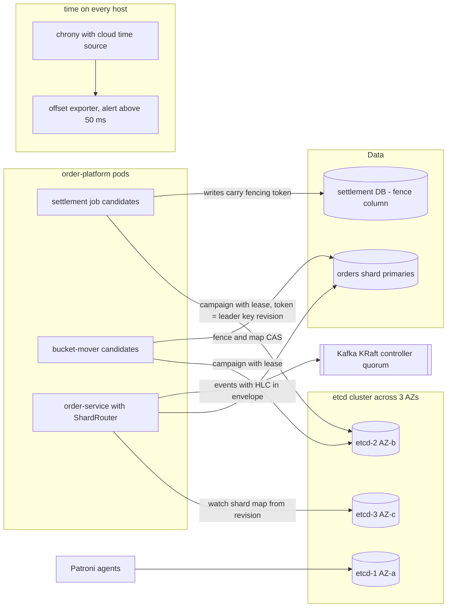
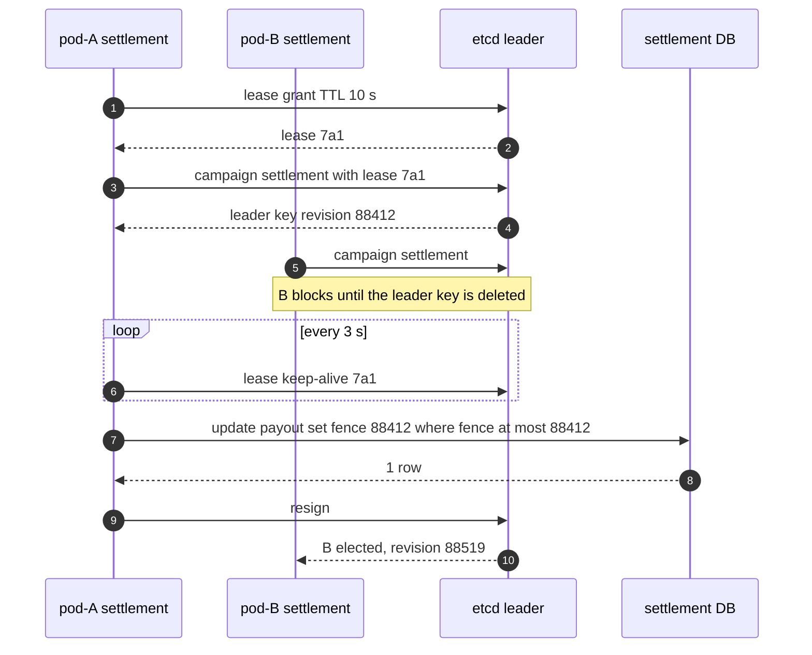
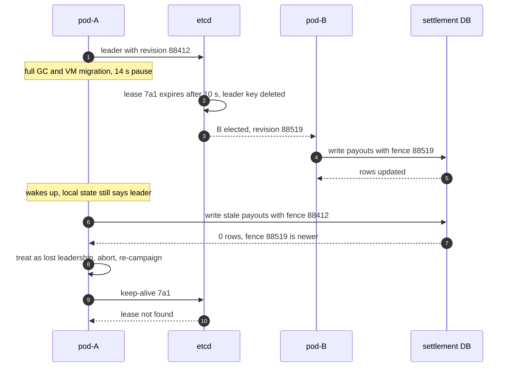
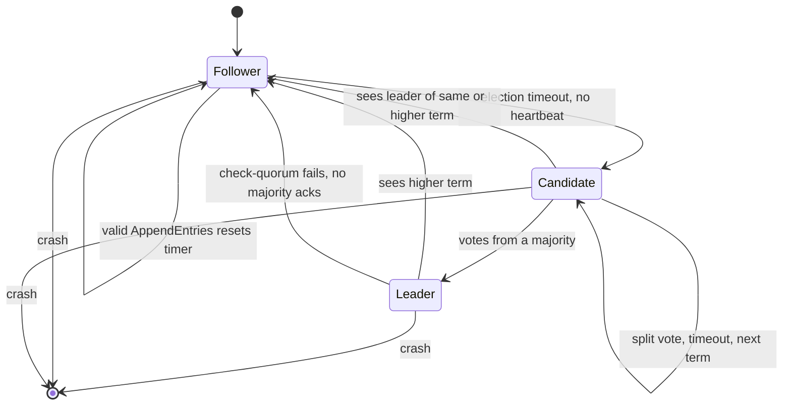

# 12. Consistency, Time & Consensus ⭐

!!! abstract "Chapter at a glance"
    **Reader bands:** B1 → B4 · **Prerequisites:** [Ch 05](../01-foundations/05-relational-databases-deep-dive.md), [Ch 10](10-replication.md), [Ch 11](11-partitioning-and-sharding.md) · **What you will build:** Coordination and ordering for the grocery platform. L1 compares clocks: wall clocks with skew, Lamport, vector and hybrid logical clocks, and monotonic vs wall-clock timeouts. L2 checks histories of a replicated register for linearizability. L3 is a Raft simulator with fault injection and safety checks, including two deliberately broken rules and the paper's Figure 8 scenario. L4 builds leader election with leases and fencing tokens, and linearizable reads (ReadIndex vs leases under clock drift). Two **real labs**: PostgreSQL 16 shows a paused leader corrupting a settlement without a fencing token, and being rejected with one. A 3-member **etcd 3.5** cluster shows lease-based election with revision tokens, leader failover, a minority member serving a stale serializable read, CAS on `mod_revision`, and watches vs compaction. · **Reading time:** 130 min + code + labs

---

## 1. Introduction & Why It Matters

### 1.1 A story: 214 dark stores paid twice

The nightly store-settlement job computes each dark store's payout (sales minus refunds, commission and GST) and writes it for the bank file. It must run on exactly one pod, so the team used a Redis lock with a 10-second TTL: `SET settle-lock pod-A NX PX 10000`. Whoever got the lock was "the leader".

One Diwali night, pod A took the lock and loaded the day's sales. Then it stopped for **14 seconds**: a full GC on a heap swollen by the sale-day data, while its VM was also being live-migrated. The lock expired. Pod B took it, recomputed every payout (now including 3,100 late refunds) and wrote them. Pod A woke up. From its point of view no time had passed. It still "held the lock", so it wrote **its** payouts over B's, and the bank-file step, triggered by both, picked up both batches. **214 stores were paid twice**, ₹38 lakh in total. Recovering it took three weeks of calls.

The same week, support was confused by order timelines that showed *"Packing"* before *"Paid"*. Events from different services were sorted by their wall-clock timestamps, and the order-service host's clock had drifted 90 ms behind after an NTP misconfiguration.

Neither was a bug in one service. Both came from assumptions about **time** and **agreement** that don't hold in a distributed system:

- **A lock with a TTL doesn't stop a paused process.** The process doesn't know it paused. The fix is a **fencing token**: a number that increases with every new lease, sent with every write, and checked **by the resource** (`update … where fence <= :token`). The lab shows both outcomes on real PostgreSQL.
- **"Who is the leader" must be decided by a consensus system** (etcd, ZooKeeper, a Kubernetes Lease backed by etcd, or a database acting as the single linearizable store), not by a cache that can lose writes on failover (Ch 10).
- **Wall-clock timestamps from different machines don't order events.** Causally related events need a **logical** or **hybrid logical clock**. Timeouts need a **monotonic** clock.

!!! quote "The thesis of this chapter"
    In a distributed system there is no global "now" and no reliable way to know whether another process is dead or just slow. **Consistency models** say exactly which orderings a reader may observe. **Clocks** give you orderings that are either causal (logical) or approximate (physical). **Consensus** lets a majority agree anyway. Anything else that claims "exactly one leader" or "latest value" is relying on timing assumptions, so make those assumptions explicit and put a fence behind them.

### 1.2 Where this lives in the grocery platform

| Need | Mechanism | Chapter link |
|---|---|---|
| Exactly-one runner for settlement, reconciliation and the bucket mover | etcd election (lease) + **fencing token** checked by the database | This chapter (L4, lab) |
| Shard map, feature flags, rate-limit configs | etcd keys with revisions, compare-and-swap updates, watches | Ch 11 |
| PostgreSQL failover without split brain | Patroni with etcd as the DCS | Ch 10 |
| Kafka metadata and partition leaders | KRaft (Raft-based controller quorum) | Ch 14 |
| Order status never goes backwards | Monotonic version per order, conditional updates | This chapter (L2) |
| Ordering events across services for timelines and audit | Hybrid logical clock (HLC) in the event envelope | This chapter (L1) |
| Timeouts, retries, circuit breakers, rate limits | Monotonic clock (`System.nanoTime`) | Ch 18 |
| Money: one authoritative value | Single-leader PostgreSQL per shard (linearizable at the primary) | Ch 05, 10, 11 |
| Clock hygiene on every host | chrony + cloud time service, offset alerting | §6 |

### 1.3 Learning objectives

| Band | After this chapter you can… |
|---|---|
| <span class="band b1">B1</span> | Explain strong vs eventual consistency, why wall clocks on different machines disagree, and what "consensus" is for |
| <span class="band b2">B2</span> | Describe the consistency-model ladder, use Lamport, vector and hybrid clocks correctly, and use monotonic clocks for timeouts |
| <span class="band b3">B3</span> | Explain Raft (elections, log replication, the commit rule), CAP/PACELC precisely, and how to check a history for linearizability |
| <span class="band b4">B4</span> | Design leader election with leases and fencing tokens, choose between ReadIndex and lease reads, reason about TrueTime/HLC-based databases, and know when not to use consensus |

---

## 2. Core Concepts — Beginner to Deep

### 2.1 Intuition: a family WhatsApp group deciding dinner <span class="band b1">B1</span>

Five family members decide on dinner over WhatsApp.

- **Messages arrive late and out of order.** Your phone shows "Sure, pizza!" before "Pizza or biryani?" because the first message was stuck on a slow network. Each phone's **clock** also differs by a few seconds, so timestamps don't settle who said what first.
- **Someone goes quiet.** Is Uncle offline, asleep, or just typing slowly? You can't tell. That's the core problem of distributed systems: **a slow process looks exactly like a dead one**.
- **The decision rule:** "whatever a **majority** (3 of 5) agrees to is final." Two majorities always share at least one person, so the family can never "decide" both pizza and biryani. If only 2 people are online, no decision is made (the system is **unavailable**), but it's never **inconsistent**. That's consensus.
- **The rule for the delivery app:** only the person holding the family's payment card orders. If Mom hands the card to Dad while she's stuck in a lift, and then she comes out of the lift and orders anyway, you get two dinners. Unless the restaurant only accepts orders from the **latest** card holder: that's a fencing token.

### 2.2 What "consistency" means (it's used for three different things) <span class="band b1">B1</span>

| Word | Meaning | Where |
|---|---|---|
| **C in ACID** | Transactions keep invariants (constraints, business rules) | Ch 05 |
| **C in CAP** / consistency models | What values reads may return when data is replicated/distributed: **linearizable**, causal, eventual… | This chapter |
| **Isolation** (often called consistency) | How concurrent transactions interleave: read committed, snapshot, **serializable** | Ch 05 |

"Strongly consistent" usually means **linearizable**: the system behaves as if there's one copy of the data, and every operation takes effect at a single instant between its start and its end. "Eventually consistent" means replicas converge if writes stop, with no promise about what you read before that.

### 2.3 The consistency-model ladder ⭐ <span class="band b2">B2</span> <span class="band b3">B3</span>

From strongest to weakest (for single objects, plus the transactional versions):

| Model | Guarantee | Cost | Example |
|---|---|---|---|
| **Strict serializable** (linearizable + serializable) | Transactions appear in one order that respects real time | Coordination on every transaction, cross-region latency | Spanner, CockroachDB (mostly), FoundationDB, single-node PostgreSQL `SERIALIZABLE` |
| **Linearizable** | Single-object ops appear atomic at one instant within their real-time interval; once any read sees a value, all later reads do | A leader or a quorum round per op | etcd (default reads), ZooKeeper writes, a PostgreSQL primary |
| **Sequential** | All clients see the same order of ops, and each client's ops stay in program order, but not necessarily real-time order | Cheaper than linearizable | ZooKeeper reads (without `sync`) |
| **Causal** | Operations that are causally related are seen in the same order by all; concurrent ones may differ | No global coordination; needs dependency tracking | COPS, MongoDB causal sessions, many CRDT systems |
| **Session guarantees** | Read-your-writes, monotonic reads, monotonic writes, writes-follow-reads, per client | Session tokens (Ch 10 L2) | Our replica reads |
| **Eventual** | Replicas converge when writes stop | Cheapest, always available | DNS, Cassandra `ONE`, caches |

**Linearizability vs serializability:** serializability is about **transactions** (multi-object) appearing in *some* serial order, which need not match real time. Linearizability is about **single objects** respecting **real time**. Snapshot isolation is neither. A read-only replica in a serializable database can still serve stale reads, which is serializable but not linearizable.

**Why the distinction matters in practice.** Linearizability is what makes these work:

- **Leader election and locks:** "the lock is mine" must be the same answer for everyone right now.
- **Uniqueness constraints:** "is this username taken?" must see the latest write.
- **Cross-channel ordering:** a service writes an image and then sends "resize image X" through Kafka. If the resizer reads a stale replica, it doesn't find the image.

L2 checks histories: an async follower read was non-linearizable in **61.67 %** of histories. A quorum read with R + W > N, which people often assume is enough, was still non-linearizable in **0.06 %**: one client read `2` and a later client read `1`. Only a read that writes back what it read (ABD) got to **0**.

### 2.4 CAP and PACELC, precisely ⭐ <span class="band b2">B2</span> <span class="band b3">B3</span>

**CAP** (Brewer, proven by Gilbert & Lynch): during a **network partition**, a system that stores replicated data must choose between **linearizability** (C) and **availability** (A: every request to a non-failed node gets a non-error response). Common misreadings:

- "Pick two of three" is wrong. Partitions aren't optional, so the choice is **C or A when partitioned**.
- The C is **linearizability** only, and the A is a very strict availability (every node answers). A "CP" system is usually still highly available when a majority is reachable. It just refuses on the minority side.
- Most systems are neither fully C nor fully A. They make per-operation choices (Cassandra consistency levels, etcd serializable vs linearizable reads).

**PACELC** (Abadi) adds the everyday trade-off: **if Partition, choose A or C; Else, choose Latency or Consistency.** Without any partition, strong consistency still costs round trips to a leader or quorum.

| System | P: A or C | E: L or C |
|---|---|---|
| etcd, ZooKeeper, Consul (default) | C (minority refuses) | C |
| PostgreSQL with async replicas, reads on replicas | A (replicas answer) | L |
| PostgreSQL quorum sync (Ch 10), reads on primary | C | C |
| Cassandra / DynamoDB (tunable) | A by default | L by default |
| Spanner, CockroachDB | C | C |
| Redis Cluster | A-ish (async replication, can lose writes) | L |

### 2.5 Physical time: why clocks lie ⭐ <span class="band b1">B1</span> → <span class="band b3">B3</span>

Each machine has a quartz oscillator that **drifts** (roughly 10–100 parts per million, up to ~8.6 s a day at 100 ppm), and temperature changes the rate. **NTP** synchronizes clocks over the network to within about **1–10 ms** on a good LAN and tens of ms across the internet, and much worse if the time server is unreachable or wrong. Cloud time services (AWS Time Sync, Google's) with **PTP** or local hardware references get to microseconds, but offsets are never zero and never guaranteed.

Clocks also **jump**:

- **NTP step:** if the offset is large, `ntpd`/`chrony` may **step** the clock (possibly backwards) instead of slewing it.
- **Leap seconds:** some hosts step, repeat a second or **smear** it (Google, AWS spread it over hours).
- **VM pauses and live migration:** the guest's clock catches up in one jump.
- **Manual changes** by operators, containers inheriting a bad host clock.

Two different clocks in every OS and in Java:

| Clock | Java API | Use for | Never use for |
|---|---|---|---|
| **Wall clock (time of day)** | `Instant.now()`, `System.currentTimeMillis()`, `InstantSource`/`Clock` | Timestamps shown to humans, "created at", expiry dates stored in a DB | Measuring durations, timeouts, ordering events across machines |
| **Monotonic clock** | `System.nanoTime()` | Durations, timeouts, rate limits, lease checks **inside one process** | Comparing across machines or restarts (arbitrary origin) |

L1 E: a 2 s timeout measured with the wall clock while NTP steps it back 5 s reports **−3,800 ms** elapsed and fires 5.8 s late. With the monotonic clock it fires on time.

**Clock skew breaks things silently:** last-write-wins picks the wrong write (Ch 10 L1: a 90 s skew kept the older edit), TTL-based locks expire early or late, events sort in the wrong order (L1 A: the effect was timestamped 87 ms before its cause), and certificate validation fails (Ch 23).

### 2.6 Logical clocks: Lamport, vector and hybrid ⭐ <span class="band b2">B2</span> <span class="band b3">B3</span>

**Happened-before (→):** a → b if a and b are on the same process in that order, or a is the send of a message and b its receipt, or transitively. If neither a → b nor b → a, they're **concurrent**.

**Lamport clock.** Each process keeps a counter: increment on every event, send it with messages, on receipt set `max(local, received) + 1`.

- Guarantee: a → b ⇒ L(a) < L(b). Ties are broken by process id, which gives a total order consistent with causality.
- Limitation: L(a) < L(b) **doesn't** mean a → b. L1 B: an unrelated refund quote got L=2 < 6 even though it didn't cause the packing event. You can't detect concurrency.

**Vector clock.** Each process keeps a vector of counters, one per process. Compare component-wise: ≤ in every component means happened-before, and neither ≤ means **concurrent**. L1 C: phone and web edits of the same cart are `CONCURRENT`, so the system keeps both and merges (Ch 10 OR-Set). Cost: vector size grows with the number of writers (use per-replica **version vectors**, and prune).

**Hybrid logical clock (HLC)** (Kulkarni et al., 2014). A timestamp `(wall, logical)`: `wall` tracks the max physical time seen, and `logical` breaks ties and preserves causality when clocks are behind.

- a → b ⇒ HLC(a) < HLC(b), like Lamport.
- `wall` stays within the clock-skew bound of real physical time, so timestamps are **meaningful to humans and usable for time-range queries**.
- Fits in 64 bits (48-bit ms + 16-bit counter).
- L1 D: with the same 90 ms skew, `PAYMENT_CAPTURED 1000.0` < `ORDER_PACKING 1000.1`.

Used by CockroachDB, YugabyteDB and MongoDB (cluster time). We put an HLC in every domain event's envelope (Ch 14) for ordering timelines and audit logs.

### 2.7 TrueTime, commit wait and uncertainty intervals <span class="band b4">B4</span>

**Spanner** doesn't pretend clocks are exact. **TrueTime** returns an interval `[earliest, latest]` guaranteed to contain real time, with ε typically a few ms thanks to GPS receivers and atomic clocks in every data centre. A transaction gets commit timestamp `s = TT.now().latest`, then **waits until `TT.now().earliest > s`** before making the commit visible (**commit wait**, ~2ε). Any transaction that starts after this one finishes gets a larger timestamp, so timestamp order = real-time order. That's external consistency (strict serializability) from clocks, at a cost of a few ms per write.

**CockroachDB** uses HLC without atomic clocks and a configured **max clock offset** (500 ms by default). A read that sees a value with a timestamp inside its **uncertainty window** can't tell whether it's before or after, so it **restarts at a higher timestamp**. Nodes whose clock offset exceeds the bound **shut themselves down**, because correctness depends on it.

The lesson for everyone else: **if correctness depends on clocks, the bound must be explicit, monitored and enforced.**

### 2.8 The consensus problem ⭐ <span class="band b2">B2</span> <span class="band b3">B3</span>

Several nodes must agree on a value (or on a sequence of values, which is a replicated log) such that:

- **Agreement:** no two nodes decide differently.
- **Validity:** the decided value was proposed by someone.
- **Termination:** every non-failed node eventually decides.

**FLP impossibility** (Fischer, Lynch, Paterson, 1985): in a fully asynchronous system where even one process may crash, no deterministic algorithm guarantees all three. Practical algorithms (Paxos, Raft) keep **safety always** (never two decisions) and get **liveness** only when the network behaves "well enough for long enough" (**partial synchrony**), using timeouts and randomization.

**Majorities:** with 2f + 1 nodes, the system tolerates f failures, because any two majorities intersect.

| Cluster size | Majority | Failures tolerated | Note |
|---|---|---|---|
| 1 | 1 | 0 | No fault tolerance |
| 3 | 2 | 1 | The common choice, spread over 3 AZs |
| 4 | 3 | 1 | No better than 3, and more to replicate |
| 5 | 3 | 2 | Survives a failure during maintenance |
| 7 | 4 | 3 | Rarely worth the write latency |

What consensus gives you: a **replicated state machine**. If every node applies the same log of commands in the same order, all nodes have the same state. That's the foundation of etcd, ZooKeeper (Zab), Consul, Kafka KRaft, CockroachDB/TiKV ranges (Raft per range), Spanner (Paxos per split) and Chubby.

**Consensus ≈ linearizable CAS ≈ atomic broadcast ≈ leader election with a fence.** They're equivalent problems. If you have one, you can build the others.

### 2.9 Raft in depth ⭐ <span class="band b3">B3</span> <span class="band b4">B4</span>

Raft (Ongaro & Ousterhout, 2014) splits consensus into understandable parts.

**Terms.** Time is divided into numbered terms, each with at most one leader. A node that sees a higher term immediately adopts it and becomes a follower. Terms are the fencing tokens *inside* Raft.

**Leader election.**

1. A follower that hears nothing from a leader for a **randomized election timeout** (e.g. 150–300 ms) becomes a candidate, increments its term, votes for itself and sends `RequestVote(term, lastLogIndex, lastLogTerm)`.
2. A node grants **at most one vote per term**, and only if the candidate's log is **at least as up-to-date** as its own: a higher last term, or the same last term and an index at least as long.
3. With votes from a majority, the candidate becomes leader and sends heartbeats. Randomized timeouts make split votes rare.

**Log replication.**

1. The leader appends a client command to its log and sends `AppendEntries(term, prevLogIndex, prevLogTerm, entries, leaderCommit)`.
2. A follower accepts only if its log has an entry at `prevLogIndex` with `prevLogTerm`. Otherwise it rejects, and the leader backs up and retries. Conflicting follower entries are **overwritten** by the leader's.
3. That consistency check gives the **Log Matching** property: if two logs have an entry with the same index and term, the logs are identical up to that entry.

**Commit rule.** An entry is committed when the leader has replicated it to a majority **and it's from the leader's current term**. Earlier-term entries are committed only indirectly, when a current-term entry after them commits. That's why a new leader immediately appends a **no-op** entry. L3 runs the paper's **Figure 8** scenario: with the rule broken (committing an old-term entry just because it's on a majority), a later leader overwrites a "committed" entry. With the correct rule, the entry was never declared committed.

**Safety properties** (all checked continuously in L3):

| Property | Meaning | L3 check |
|---|---|---|
| Election Safety | At most one leader per term | `leaderOfTerm` map |
| Log Matching | Same index + term ⇒ same prefix | Implied by the append check |
| Leader Completeness | A committed entry is in every later leader's log | Checked at every election |
| State Machine Safety | No two nodes apply different commands at the same index | Checked at every apply |

L3 ran 300 randomized runs per variant (5 nodes, 20 s each, 5 % message loss, partitions, crash/restarts). The correct Raft had **0 violations over 23,845 elections and 416,335 committed entries**. Removing the up-to-date vote check broke safety in **294/300** runs. The broken commit rule showed **0/300** in random runs and failed only in the targeted Figure 8 script. That's a lesson in itself: **random testing misses rare interleavings, so write the known-dangerous scenarios as explicit tests** (Jepsen does both).

**Beyond the core:**

- **Membership changes:** add or remove one server at a time, or use joint consensus, so two disjoint majorities can never exist during a change.
- **Log compaction:** snapshots of the state machine plus `InstallSnapshot` for lagging followers.
- **PreVote and check-quorum:** a node first asks "would you vote for me?" without bumping terms, so a flapping node can't disrupt a healthy leader. A leader that can't reach a majority steps down.
- **Client interaction:** commands carry a client id and sequence number, so a retried command after a leader change is applied once (idempotency, Ch 20).

### 2.10 Paxos, Zab and friends <span class="band b3">B3</span> <span class="band b4">B4</span>

| Algorithm | Idea | Used by |
|---|---|---|
| **Paxos** (Lamport) | Two phases per value: *prepare/promise* with a ballot number, then *accept/accepted* by a majority. Proposers adopt the highest-ballot accepted value they learn about | Chubby, Spanner (per split), many databases |
| **Multi-Paxos** | A stable leader skips phase 1 for a sequence of values: in effect the same shape as Raft | Most "Paxos" systems in practice |
| **Zab** | Primary-backup atomic broadcast with epochs, built for ZooKeeper | ZooKeeper |
| **Viewstamped Replication** | View changes with a primary. It predates Paxos's publication and is very close to Raft | Academic, some storage systems |
| **EPaxos / leaderless** | Any replica can lead a command, and only conflicting commands need extra rounds | Research, some geo-distributed systems |
| **Byzantine (PBFT, HotStuff, Tendermint)** | Tolerate lying nodes, 3f + 1 nodes | Blockchains; not needed inside one company's trust boundary |

For interviews: know Raft well, know that Multi-Paxos and Raft are structurally similar (a leader, terms/ballots, majority acceptance), and know why Byzantine tolerance isn't used for internal systems.

### 2.11 Reading from a consensus system ⭐ <span class="band b4">B4</span>

Writes go through the log. Reads are the subtle part: **a leader can't simply answer from its own state**, because it may have been deposed without knowing it (partitioned away, or paused). L4's read experiment, on top of the correct Raft from L3:

| Read method | How | Stale reads in the simulation | Cost |
|---|---|---|---|
| Leader answers from local state | Nothing extra | **66,224 of 509,784** | Free, but wrong |
| **ReadIndex** | Record the commit index, confirm leadership with a heartbeat round acked by a majority, wait until applied ≥ that index, then answer | **0 of 321,661** | One round trip per read (batched) |
| Log read | Put the read through the log like a write | 0 | A full write per read |
| **Lease read** | After a majority acks a heartbeat, the leader answers locally until `sentAt + lease` (lease < minimum election timeout), measured on its own clock | **0** with accurate clocks and 10 % drift; **298** when the leader's clock ran 50 % slow | No round trip, but **depends on bounded clock drift** |
| Follower read | A follower asks the leader for the ReadIndex, then serves locally | 0 | Spreads load |

**Bug found while building ReadIndex:** the first version answered a pending read as soon as the node had *applied* up to the read index, **before** the majority confirmation came back. It produced 355 stale reads, and the fix was to answer only rounds that a majority had confirmed. That's exactly the kind of bug that passes code review. The safety checks caught it.

In etcd, `Get` is linearizable by default (ReadIndex). With `WithSerializable()` (`etcdctl get --consistency=s`) a member answers from local state, which is fast but possibly stale. Lab 2 shows a member cut off from its peers refusing the linearizable read and answering the serializable one with a value that was already overwritten. ZooKeeper reads are local (sequential consistency), and `sync()` before a read makes it linearizable.

Lease reads also need **leader stickiness**: a follower that heard from the leader recently must refuse to vote for anyone else, otherwise a new leader could be elected while the old lease is still valid. The simulation's fault model (symmetric partitions, message loss, crashes) didn't produce that case: 0 stale reads without stickiness. Asymmetric partitions (A hears B, B doesn't hear A) do, which is why etcd and TiKV pair lease reads with check-quorum/PreVote.

### 2.12 Coordination services: etcd, ZooKeeper, Consul ⭐ <span class="band b3">B3</span>

| | etcd | ZooKeeper | Consul |
|---|---|---|---|
| Consensus | Raft | Zab | Raft |
| Data model | Flat keys, MVCC revisions | Hierarchical znodes, versions | KV + service catalog |
| Liveness primitive | **Leases** (TTL, keep-alive), keys attached to leases | **Sessions** + ephemeral znodes | Sessions |
| Change notification | Watches from a revision (no missed events if the revision is still retained) | One-shot watches (re-register), persistent watches (3.6+) | Blocking queries |
| Conditional writes | Transactions: `If(modRevision == x).Then(put).Else(…)` | `setData(path, data, expectedVersion)` | CAS with `ModifyIndex` |
| Typical users | Kubernetes, Patroni, CoreDNS, our shard map | Kafka (pre-KRaft), HBase, Solr | Service mesh/discovery |

Recipes built on these: **leader election**, **distributed locks** (with fencing), **configuration** with atomic updates and watches, **service discovery**, **barriers**, and **membership**.

**Limits:** these are small, strongly consistent metadata stores. etcd recommends keeping the database to a few GB (default quota 2 GB) and requests small (1.5 MiB max). Write throughput is thousands to tens of thousands per second, bounded by fsync and majority round trips. Don't put orders or carts in etcd.

### 2.13 Leases and fencing tokens ⭐ <span class="band b3">B3</span> <span class="band b4">B4</span>

A **lease** is a lock with an expiry: whoever holds it may act until it expires, so a crashed holder doesn't block others forever. But leases rest on timing assumptions:

- The holder can **pause** (GC, VM migration, swap, a blocked syscall) past the expiry without noticing. After waking it checks nothing, or checks a stale local timer.
- Its **clock may run slow**, so it thinks the lease has time left.
- **Network delay** means a write it sent while it held the lease can arrive after the lease expired.

So a lease guarantees "at most one holder at any instant **according to the lease store**". It doesn't guarantee "at most one process **acting**". The fix (Kleppmann's fencing tokens, and Chubby's sequencers):

1. The lease store hands out a **monotonically increasing token** with every grant: an epoch, a Raft term, an etcd revision, a ZooKeeper `zxid`.
2. The holder sends the token with **every write** to the protected resource.
3. **The resource rejects** any write with a token lower than the highest it has seen: `update … set fence = :t where … and fence <= :t`.

The lab shows it on real PostgreSQL: without the check, a pod that paused for 6 s overwrote its successor's payout (`41250.00 written_by pod-A`). With the check, the stale write updated **0 rows** and the correct payout stayed (`39980.00 written_by pod-B fence 2`).

The resource must participate. If the resource can't check tokens (an external email API, a bank file drop), make the operation **idempotent** with a key derived from the business action (Ch 20). Or have the leader write its intent to a fenced table, and let a single dispatcher perform the side effect.

**Redlock** (Redis locks across 5 independent masters) doesn't provide fencing tokens and relies on timing assumptions. It's fine for efficiency locks (avoid duplicate work) and not for correctness locks (Kleppmann vs Sanfilippo, 2016). The §1.1 incident used a single Redis lock, which is worse again: a failover to an async replica can lose the lock key (Ch 10).

### 2.14 When not to use consensus <span class="band b4">B4</span>

Consensus costs a majority round trip per write (cross-AZ: ~1–3 ms, cross-region: 50–200 ms), limits throughput, needs 3+ nodes, and becomes unavailable without a majority. Avoid it when:

- **One authority already exists:** a single PostgreSQL primary per shard is already linearizable for its data. Use its row locks, `SELECT … FOR UPDATE`, unique constraints or advisory locks.
- **Conflicts can be merged:** carts, likes, counters, presence → CRDTs or LWW with care (Ch 10).
- **Duplicates are harmless or preventable:** idempotent consumers are simpler than exactly-one executors.
- **Coordination can be avoided by design:** partition the work so each partition has one owner (Kafka consumer groups, Ch 14), or make the operation commutative.

The principle behind this is **coordination avoidance** (Bailis et al.; the CALM theorem): coordinate only for invariants that truly need it, such as money, uniqueness and leadership.

---

## 3. Architecture & Diagrams

### 3.1 Component view: coordination and time in the platform



etcd holds **only metadata**: leader keys, the shard map and flags, a few MB in total. Business data stays in PostgreSQL, where the **fence check happens in the same statement as the write**.

### 3.2 Sequence: happy path, leader election and a fenced write



### 3.3 Sequence: failure path, the leader pauses, loses its lease and wakes up



Without the fence check that produces step 7, A's stale write in step 6 would have overwritten B's payouts from step 4: the §1.1 incident, and the lab's first run.

### 3.4 State: a Raft node



---

## 4. Design Document Excerpt: Coordination, Leader Election & Time

| Field | Value |
|---|---|
| Author / Reviewers | Platform team / Payments, Finance, Orders, SRE |
| Status | Approved |
| Related ADRs | ADR-044 etcd as the coordination store; ADR-045 Fencing tokens on all leader-only writes; ADR-046 HLC timestamps in event envelopes; ADR-047 Clock policy |

**1. Context & Problem.** A Redis-lock "leader" paused past its TTL and overwrote its successor's settlement: 214 stores were paid twice (§1.1). Order timelines sorted by wall-clock timestamps from different hosts showed effects before causes. Several jobs (settlement, reconciliation, bucket mover, report exporters) each had their own ad-hoc locking.

**2. Goals / Non-Goals.**

- *Goals:* one standard for "exactly one active runner"; no write from a deposed leader can take effect; a linearizable store for shard maps and critical config; causal ordering of events across services; clock offsets measured and alerted.
- *Non-goals:* strict serializability across order shards (Ch 13 covers sagas); multi-region consensus (Ch 27).

**3. Requirements.**

| ID | Requirement |
|---|---|
| NFR-1 | At most one leader per job **as seen by the resource**: stale-token writes are rejected (0 accepted in tests) |
| NFR-2 | Leader failover ≤ 15 s (lease TTL 10 s + campaign) |
| NFR-3 | Coordination store survives one AZ loss; p99 write ≤ 20 ms in-region |
| NFR-4 | Shard map reads linearizable on change; watches deliver every revision |
| NFR-5 | Events carry an HLC; cause < effect for every causal pair |
| NFR-6 | Host clock offset > 50 ms alerts; > 250 ms removes the host from leader candidacy |

**4. Capacity & latency estimates.**

| Item | Calculation | Result |
|---|---|---|
| etcd data | Shard map (1,024 keys) + ~200 flags + ~20 election keys + Patroni | < 10 MB (quota 2 GB) |
| etcd writes | Keep-alives: 30 candidates / 3 s + Patroni + map changes | ~20 writes/s (trivial) |
| etcd write latency | Majority round trip cross-AZ ~1–2 ms + fsync ~1–5 ms | p99 ~10 ms |
| Watches | ~600 pods × 2 watches | ~1.2 K watches (fine for 3 nodes) |
| Failover time | TTL 10 s, keep-alive every 3 s, campaign ~50 ms | ≤ ~11 s |
| HLC size | 48-bit ms + 16-bit logical | 8 bytes per event |

**5. Proposed design.**

1. **etcd, 3 members in 3 AZs** (5 in a later phase if maintenance windows show a need), on dedicated SSD-backed VMs, TLS + client certificates, per-job RBAC prefixes, defragmented and snapshotted on a schedule. Shared with Patroni (separate prefix), monitored as tier-0.
2. **Leader election library** (`FencedLeadership`): lease TTL 10 s, keep-alive 3 s, campaign on a job-specific election name. **Fencing token = the leader key's create revision**, which is cluster-wide monotonic. The leader loop checks leadership before each batch and passes the token into every write.
3. **Resources enforce the fence:** tables written by leader-only jobs have a `fence bigint` column, and every write is `… where fence <= :token`. A zero-row result means "lost leadership": abort and re-campaign. External side effects go through an idempotent outbox, never straight from the leader.
4. **Shard map and flags** in etcd, updated only with transactions (`If(modRevision == expected)`), and read through watches starting at the revision last seen.
5. **HLC** in the event envelope (`hlc: "<ms>.<logical>"`), sent on every outgoing call and message, merged on receipt. Timelines sort by HLC, then event id.
6. **Clock policy:** chrony against the cloud time service, `makestep` only at boot, offset exported as a metric, and every timeout and duration uses `System.nanoTime` (a lint rule bans `currentTimeMillis` differences).

**7. Alternatives considered.**

| Option | Pros | Cons | Verdict |
|---|---|---|---|
| Redis `SET NX PX` lock (status quo) | Simple, fast | No fencing; async replication can lose the lock (Ch 10) | Rejected for correctness |
| Redlock | Tolerates master loss | Timing assumptions, no fencing token | Rejected |
| **etcd election + fencing tokens** | Linearizable, monotonic revisions, leases, watches | A tier-0 cluster to run | **Chosen** |
| ZooKeeper | Mature, ephemeral nodes, zxid tokens | JVM ops, heavier; Kafka no longer needs it | Rejected (no existing footprint) |
| Kubernetes `Lease` objects | No new infrastructure, etcd-backed | Coupled to the cluster API server; no token in the API (use `leaseTransitions` or `resourceVersion`) | **Accepted for in-cluster, non-money jobs** |
| PostgreSQL lease table + epoch (the lab) | Uses the DB that holds the data; fence in the same DB | Load on the primary; failover semantics (Ch 10) | **Accepted where job and data share one DB** |

**8. Failure modes.** etcd minority loss: keeps working. Majority loss: no elections or map changes, current leaders keep going only until their lease can't be renewed, and fenced resources refuse stale tokens. Leader pause: fenced (lab). Clock skew on a candidate: over 250 ms it withdraws from campaigning. etcd slow disk: leader elections flap, so alert on fsync latency. Watch compaction: re-list from the current revision, then watch.

**10. Observability.** Leader identity and token per job, leadership changes per hour, fenced-write rejections (a nonzero value means a pause or partition happened, which is worth a look), lease keep-alive failures, etcd raft proposals committed/failed, fsync and backend commit durations, DB size vs quota, watch count, host clock offset, HLC logical-counter growth (a large counter means a clock far behind).

**14. Decision (ADR-044–047 summary).** Leader-only work uses etcd elections with leases, and the leader key revision is the fencing token enforced by every resource. Shard maps and flags live in etcd with revision-checked transactions and watches. Events carry HLC timestamps. Durations use monotonic clocks, and host offsets are monitored with hard limits for leadership candidates.

---

## 5. Hands-On Code — Level Ladder

| Level | New requirement that forces the step |
|---|---|
| L1 | "Order events from two services, one with a skewed clock, and time a request correctly." (plain Java) |
| L2 | "Prove which replicated-read designs are linearizable, and keep an order's status from going backwards." |
| L3 | "Understand consensus by building it: Raft with faults, safety checks and deliberately broken rules." |
| Lab 1 | Real PostgreSQL 16: a lease with an epoch, a paused leader, with and without a fencing check |
| Lab 2 | Real etcd 3.5, 3 members: elections with revision tokens, failover, quorum loss, stale serializable reads, CAS, watches |
| L4 | "Exactly one settlement runner in production, fenced; linearizable reads without paying a round trip where safe." |

### L1 — Concept: wall, Lamport, vector and hybrid clocks (plain Java) <span class="band b1">B1</span> <span class="band b2">B2</span>

```java
// ClocksL1.java — run with: java ClocksL1.java
// A. wall clocks with skew reorder causally related events   B. Lamport clocks keep causal order
// C. vector clocks tell "before" from "concurrent"            D. hybrid logical clocks (HLC): causal AND close to real time
// E. measuring a timeout with the wall clock vs the monotonic clock when NTP steps the clock
import java.time.*;
import java.util.*;

public class ClocksL1 {

    // ---- B. Lamport clock ----
    static final class Lamport {
        private long t;
        long tick() { return ++t; }                                  // local event or send
        long receive(long remote) { t = Math.max(t, remote) + 1; return t; }
    }

    // ---- C. Vector clock ----
    record VClock(Map<String, Integer> v) {
        VClock tick(String node) { var m = new TreeMap<>(v); m.merge(node, 1, Integer::sum); return new VClock(m); }
        VClock merge(VClock o, String node) {
            var m = new TreeMap<>(v); o.v.forEach((k, x) -> m.merge(k, x, Math::max)); m.merge(node, 1, Integer::sum); return new VClock(m);
        }
        boolean leq(VClock o) { return v.entrySet().stream().allMatch(e -> e.getValue() <= o.v.getOrDefault(e.getKey(), 0)); }
        String compare(VClock o) {
            if (equals(o)) return "equal";
            if (leq(o)) return "happened-before";
            if (o.leq(this)) return "happened-after";
            return "CONCURRENT";
        }
        @Override public String toString() { return v.toString(); }
    }

    // ---- D. Hybrid logical clock (Kulkarni et al. 2014) ----
    record Hlc(long wall, int logical) implements Comparable<Hlc> {
        public int compareTo(Hlc o) { return wall != o.wall ? Long.compare(wall, o.wall) : Integer.compare(logical, o.logical); }
        @Override public String toString() { return wall + "." + logical; }
    }
    static final class HlcClock {
        private Hlc last = new Hlc(0, 0);
        private final java.util.function.LongSupplier physical;
        HlcClock(java.util.function.LongSupplier physical) { this.physical = physical; }
        Hlc now() {                                                   // local event or send
            long pt = physical.getAsLong();
            last = pt > last.wall() ? new Hlc(pt, 0) : new Hlc(last.wall(), last.logical() + 1);
            return last;
        }
        Hlc receive(Hlc remote) {
            long pt = physical.getAsLong();
            long w = Math.max(pt, Math.max(last.wall(), remote.wall()));
            int l;
            if (w == last.wall() && w == remote.wall()) l = Math.max(last.logical(), remote.logical()) + 1;
            else if (w == last.wall()) l = last.logical() + 1;
            else if (w == remote.wall()) l = remote.logical() + 1;
            else l = 0;
            last = new Hlc(w, l);
            return last;
        }
    }

    public static void main(String[] args) {
        // Real time runs 1000 → 1003 ms. payment-service's clock is correct; order-service's clock is 90 ms behind.
        long[] realNow = {1000};
        java.util.function.LongSupplier paymentClock = () -> realNow[0];
        java.util.function.LongSupplier orderClock = () -> realNow[0] - 90;

        System.out.println("A. Wall-clock timestamps from two servers (order-service is 90 ms behind)");
        long tPaid = paymentClock.getAsLong();                          // 1. payment captured
        realNow[0] += 3;
        long tShip = orderClock.getAsLong();                            // 2. order-service reacts: PACKING (caused by 1)
        System.out.println("   PAYMENT_CAPTURED @" + tPaid + "  then (because of it) ORDER_PACKING @" + tShip);
        System.out.println("   sorted by timestamp: " + (tShip < tPaid ? "ORDER_PACKING before PAYMENT_CAPTURED   ← effect before cause" : "ok"));

        System.out.println("B. Lamport clocks: the message carries the counter");
        Lamport pay = new Lamport(), ord = new Lamport();
        for (int i = 0; i < 5; i++) ord.tick();                         // order-service had 5 local events earlier
        long lPaid = pay.tick();                                         // payment event, sent to order-service
        long lPack = ord.receive(lPaid);
        long lOther = pay.tick();                                        // unrelated later event on payment-service
        System.out.println("   PAYMENT_CAPTURED L=" + lPaid + "  ORDER_PACKING L=" + lPack + "  (cause < effect, always)");
        System.out.println("   unrelated REFUND_QUOTE on payment L=" + lOther + " < ORDER_PACKING L=" + lPack
                + ", yet neither caused the other: Lamport order can't tell 'concurrent' from 'before'");

        System.out.println("C. Vector clocks on a cart edited from phone and web");
        VClock base = new VClock(Map.of()).tick("server");
        VClock phone = base.merge(base, "phone");                       // phone read base, then edited
        VClock web = base.merge(base, "web");                           // web read base, then edited (no sync)
        VClock merged = phone.merge(web, "server");                     // server merges both
        System.out.println("   base " + base + " vs phone " + phone + " → " + base.compare(phone));
        System.out.println("   phone " + phone + " vs web " + web + " → " + phone.compare(web) + "   ← keep both, merge (Ch 10 OR-Set)");
        System.out.println("   merged " + merged + " vs phone → " + merged.compare(phone));

        System.out.println("D. Hybrid logical clocks with the same 90 ms skew");
        realNow[0] = 1000;
        HlcClock hPay = new HlcClock(paymentClock), hOrd = new HlcClock(orderClock);
        Hlc hPaid = hPay.now();
        realNow[0] += 3;
        Hlc hPack = hOrd.receive(hPaid);
        realNow[0] += 100;
        Hlc hLater = hOrd.now();
        System.out.println("   PAYMENT_CAPTURED " + hPaid + "  ORDER_PACKING " + hPack + "  (cause < effect: " + (hPaid.compareTo(hPack) < 0) + ")");
        System.out.println("   100 ms later on order-service: " + hLater + "  (its physical clock, 1013, has passed the HLC wall part, so logical resets to 0)");

        System.out.println("E. A 2-second timeout while NTP steps the wall clock back 5 s");
        Instant wallStart = Instant.parse("2026-09-26T14:30:00Z");
        long monoStart = 0;
        // 1.2 s pass; during them NTP corrects the wall clock by -5 s
        Instant wallNow = wallStart.plusMillis(1_200).minusSeconds(5);
        long monoNow = monoStart + 1_200_000_000L;
        long wallElapsed = Duration.between(wallStart, wallNow).toMillis();
        long monoElapsed = (monoNow - monoStart) / 1_000_000;
        System.out.println("   elapsed by wall clock (System.currentTimeMillis / Instant.now): " + wallElapsed + " ms → timeout fires in " + (2_000 - wallElapsed) + " ms");
        System.out.println("   elapsed by monotonic clock (System.nanoTime):                  " + monoElapsed + " ms → timeout fires in " + (2_000 - monoElapsed) + " ms");
    }
}
```

Actual output from running it:

```text
A. Wall-clock timestamps from two servers (order-service is 90 ms behind)
   PAYMENT_CAPTURED @1000  then (because of it) ORDER_PACKING @913
   sorted by timestamp: ORDER_PACKING before PAYMENT_CAPTURED   ← effect before cause
B. Lamport clocks: the message carries the counter
   PAYMENT_CAPTURED L=1  ORDER_PACKING L=6  (cause < effect, always)
   unrelated REFUND_QUOTE on payment L=2 < ORDER_PACKING L=6, yet neither caused the other: Lamport order can't tell 'concurrent' from 'before'
C. Vector clocks on a cart edited from phone and web
   base {server=1} vs phone {phone=1, server=1} → happened-before
   phone {phone=1, server=1} vs web {server=1, web=1} → CONCURRENT   ← keep both, merge (Ch 10 OR-Set)
   merged {phone=1, server=2, web=1} vs phone → happened-after
D. Hybrid logical clocks with the same 90 ms skew
   PAYMENT_CAPTURED 1000.0  ORDER_PACKING 1000.1  (cause < effect: true)
   100 ms later on order-service: 1013.0  (its physical clock, 1013, has passed the HLC wall part, so logical resets to 0)
E. A 2-second timeout while NTP steps the wall clock back 5 s
   elapsed by wall clock (System.currentTimeMillis / Instant.now): -3800 ms → timeout fires in 5800 ms
   elapsed by monotonic clock (System.nanoTime):                  1200 ms → timeout fires in 800 ms
```

**What L1 shows:** a 90 ms skew is enough to put an effect before its cause (A). Lamport clocks fix causal order but can't tell concurrent events apart (B). Vector clocks can, which is what you need to keep both concurrent edits (C). HLC keeps causal order **and** stays close to physical time (D). Section E is why every timeout in this handbook uses `System.nanoTime()`.

### L2 — Checking linearizability, and keeping order status monotonic <span class="band b2">B2</span> <span class="band b3">B3</span>

Requirement: "the order-status register is replicated 3 ways. Which read designs are linearizable?" Rather than argue, generate thousands of concurrent histories and **check** each one. The checker searches for a total order that respects real time (an operation that finished before another started must come first) and register semantics (a read returns the latest write). This is the idea behind Knossos and Porcupine, the checkers used by Jepsen.

```java
// LinearizabilityL2.java — run with: java LinearizabilityL2.java
// 3 replicas hold one register (e.g. an order's status version). A writer and 3 readers run concurrently over a
// network with random delays. Every history is checked for linearizability with a Wing & Gong style search.
import java.util.*;

public class LinearizabilityL2 {

    // ---------- history + checker ----------
    record Op(int client, boolean write, int value, long invoke, long response) { }

    /** Is there a total order that respects real time (a.response < b.invoke ⇒ a before b) and register semantics? */
    static boolean linearizable(List<Op> ops) {
        return search(ops, 0, 0, new HashSet<>());
    }

    private static boolean search(List<Op> ops, int doneMask, int state, Set<Long> seen) {
        if (doneMask == (1 << ops.size()) - 1) return true;
        if (!seen.add(((long) doneMask << 32) | state)) return false;
        long earliestResponse = Long.MAX_VALUE;                              // an op can go next only if it was
        for (int i = 0; i < ops.size(); i++)                                 // invoked before every pending op finished
            if ((doneMask & (1 << i)) == 0) earliestResponse = Math.min(earliestResponse, ops.get(i).response());
        for (int i = 0; i < ops.size(); i++) {
            if ((doneMask & (1 << i)) != 0) continue;
            Op o = ops.get(i);
            if (o.invoke() > earliestResponse) continue;
            if (o.write()) { if (search(ops, doneMask | (1 << i), o.value(), seen)) return true; }
            else if (o.value() == state && search(ops, doneMask | (1 << i), state, seen)) return true;
        }
        return false;
    }

    // ---------- a tiny discrete-event simulation of 3 replicas ----------
    enum Mode { LEADER_WRITES_ASYNC_FOLLOWER_READS, QUORUM_W2_R2, QUORUM_WITH_READ_WRITEBACK }

    static final class Sim {
        final Random rnd; final Mode mode;
        final PriorityQueue<Object[]> q = new PriorityQueue<>(Comparator.comparingLong((Object[] e) -> (long) e[0]));
        long now = 0, tie = 0;
        final long[] ts = new long[3]; final int[] val = new int[3];
        final List<Op> history = new ArrayList<>();

        Sim(long seed, Mode mode) { rnd = new Random(seed); this.mode = mode; }
        void at(long t, Runnable r) { q.add(new Object[]{t, r}); }
        long delay() { return 1 + rnd.nextInt(30); }

        /** Replica r stores (t, v) if newer. */
        void store(int r, long t, int v) { if (t > ts[r]) { ts[r] = t; val[r] = v; } }

        void write(int client, long t, int v, Runnable next) {
            long start = now;
            if (mode == Mode.LEADER_WRITES_ASYNC_FOLLOWER_READS) {
                at(now + delay(), () -> {
                    store(0, t, v);
                    for (int r = 1; r < 3; r++) { int rr = r; at(now + delay() + rnd.nextInt(40), () -> store(rr, t, v)); }   // async
                    at(now + delay(), () -> { history.add(new Op(client, true, v, start, now)); next.run(); });
                });
                return;
            }
            int[] acks = {0};
            for (int r = 0; r < 3; r++) { int rr = r; at(now + delay(), () -> { store(rr, t, v);
                at(now + delay(), () -> { if (++acks[0] == 2) { history.add(new Op(client, true, v, start, now)); next.run(); } }); }); }
        }

        void read(int client, Runnable next) {
            long start = now;
            if (mode == Mode.LEADER_WRITES_ASYNC_FOLLOWER_READS) {
                int r = rnd.nextInt(3);                                              // any replica, R = 1
                at(now + delay(), () -> { int v = val[r]; at(now + delay(), () -> { history.add(new Op(client, false, v, start, now)); next.run(); }); });
                return;
            }
            long[] bestTs = {-1}; int[] bestVal = {0}; int[] replies = {0};
            for (int r = 0; r < 3; r++) { int rr = r; at(now + delay(), () -> { long t = ts[rr]; int v = val[rr];
                at(now + delay(), () -> {
                    if (t > bestTs[0]) { bestTs[0] = t; bestVal[0] = v; }
                    if (++replies[0] != 2) return;
                    if (mode == Mode.QUORUM_W2_R2) { history.add(new Op(client, false, bestVal[0], start, now)); next.run(); return; }
                    // ABD: write the value we are about to return back to a quorum first
                    long wt = bestTs[0]; int wv = bestVal[0]; int[] wacks = {0};
                    for (int x = 0; x < 3; x++) { int xx = x; at(now + delay(), () -> { store(xx, wt, wv);
                        at(now + delay(), () -> { if (++wacks[0] == 2) { history.add(new Op(client, false, wv, start, now)); next.run(); } }); }); }
                }); }); }
        }

        List<Op> run() {
            // writer: 3 sequential writes of 1, 2, 3; readers: 3 sequential reads each
            int[] w = {0};
            Runnable[] writer = new Runnable[1];
            writer[0] = () -> { if (w[0] < 3) { int v = ++w[0]; at(now + rnd.nextInt(20), () -> write(0, v, v, writer[0])); } };
            at(0, writer[0]);
            for (int c = 1; c <= 3; c++) {
                int cc = c; int[] n = {0}; Runnable[] reader = new Runnable[1];
                reader[0] = () -> { if (n[0]++ < 3) at(now + rnd.nextInt(30), () -> read(cc, reader[0])); };
                at(rnd.nextInt(20), reader[0]);
            }
            while (!q.isEmpty()) { Object[] e = q.poll(); now = (long) e[0]; ((Runnable) e[1]).run(); }
            return history;
        }
    }

    public static void main(String[] args) {
        int trials = 20_000;
        System.out.println("3 replicas, 1 writer (writes 1,2,3), 3 readers (3 reads each), random delays 1–30 ms; " + trials + " histories per mode");
        for (Mode m : Mode.values()) {
            int bad = 0; List<Op> example = null;
            for (int s = 0; s < trials; s++) {
                List<Op> h = new Sim(s, m).run();
                if (!linearizable(h)) { bad++; if (example == null) example = h; }
            }
            System.out.printf("   %-36s non-linearizable histories: %6d (%5.2f%%)%n", m, bad, 100.0 * bad / trials);
            if (example != null && m == Mode.QUORUM_W2_R2) {
                System.out.println("      example (times in ms):");
                example.stream().sorted(Comparator.comparingLong(Op::invoke)).forEach(o ->
                    System.out.printf("        client %d %-5s %d  [%3d → %3d]%n", o.client(), o.write() ? "write" : "read", o.value(), o.invoke(), o.response()));
            }
        }
    }
}
```

Actual output from running it:

```text
3 replicas, 1 writer (writes 1,2,3), 3 readers (3 reads each), random delays 1–30 ms; 20000 histories per mode
   LEADER_WRITES_ASYNC_FOLLOWER_READS   non-linearizable histories:  12334 (61.67%)
   QUORUM_W2_R2                         non-linearizable histories:     11 ( 0.06%)
      example (times in ms):
        client 3 read  0  [  9 →  47]
        client 2 read  1  [ 12 →  45]
        client 1 read  1  [ 15 →  42]
        client 0 write 1  [ 16 →  49]
        client 1 read  2  [ 57 →  80]
        client 2 read  1  [ 66 →  83]
        client 3 read  2  [ 66 →  85]
        client 0 write 2  [ 66 → 107]
        client 1 read  1  [ 82 → 108]
        client 2 read  2  [ 84 → 104]
        client 3 read  2  [ 89 → 120]
        client 0 write 3  [115 → 135]
   QUORUM_WITH_READ_WRITEBACK           non-linearizable histories:      0 ( 0.00%)
```

- **Async follower reads:** most histories are non-linearizable, as expected (Ch 10's staleness).
- **R = 2, W = 2 of N = 3:** only 0.06 %, but not zero. In the example, client 1 reads `2` (57 → 80 ms), and then, **after that read finished**, client 1 reads `1` (82 → 108 ms). Both reads saw a quorum. The write of 2 was still in flight, on one replica only, so the first read's quorum included that replica and the second's didn't. Quorum overlap guarantees you see the latest **completed** write, not that you never see an in-progress one and then lose it.
- **ABD (read + write-back):** before returning, the reader writes the value it's about to return to a quorum, so any later read's quorum overlaps a replica that has it. **0 violations** in 20,000 histories.

**In the service: status that never goes backwards.** Order status is written by several consumers (payment, picking, delivery), and events arrive out of order. Each transition carries the order's **monotonic version**, and the database only accepts a newer one. The primary is linearizable for this row, so no consensus system is needed:

=== "Conditional status update"

    ```java
    package com.grocery.order.repository;

    import org.springframework.jdbc.core.simple.JdbcClient;
    import org.springframework.stereotype.Repository;

    @Repository
    public class OrderStatusRepository {

        private final JdbcClient jdbc;

        public OrderStatusRepository(JdbcClient jdbc) { this.jdbc = jdbc; }

        /**
         * Apply a transition only if it is newer than what we have AND allowed by the state machine.
         * Returns false for duplicates, reordered (older) events and illegal transitions: all safe to ack and drop.
         */
        public boolean apply(int bucket, String orderId, String from, String to, long version, String hlc) {
            return jdbc.sql("""
                    update orders
                       set status = :to, status_version = :version, status_hlc = :hlc
                     where bucket = :bucket and id = :orderId
                       and status_version < :version
                       and status = :from""")
                .param("to", to).param("version", version).param("hlc", hlc)
                .param("bucket", bucket).param("orderId", orderId).param("from", from)
                .update() == 1;
        }
    }
    ```

=== "HLC in the event envelope"

    ```java
    package com.grocery.platform.time;

    import java.time.InstantSource;
    import java.util.concurrent.atomic.AtomicLong;
    import org.springframework.stereotype.Component;

    /**
     * 64-bit HLC: upper 48 bits = wall ms, lower 16 bits = logical counter. Lock-free.
     * now() for local events and sends; observe(remote) when a message or event arrives.
     */
    @Component
    public class HybridLogicalClock {

        private static final int LOGICAL_BITS = 16;
        private static final long LOGICAL_MASK = (1L << LOGICAL_BITS) - 1;
        private static final long MAX_FORWARD_DRIFT_MS = 500;       // refuse remote clocks absurdly far ahead

        private final AtomicLong last = new AtomicLong();
        private final InstantSource wall;

        public HybridLogicalClock(InstantSource wall) { this.wall = wall; }

        public long now() {
            long pt = wall.millis() << LOGICAL_BITS;
            return last.updateAndGet(l -> pt > l ? pt : checkedIncrement(l));
        }

        public long observe(long remote) {
            long ptMs = wall.millis();
            if ((remote >>> LOGICAL_BITS) - ptMs > MAX_FORWARD_DRIFT_MS)
                throw new IllegalStateException("remote HLC is " + ((remote >>> LOGICAL_BITS) - ptMs) + " ms ahead: clock fault upstream");
            long pt = ptMs << LOGICAL_BITS;
            return last.updateAndGet(l -> {
                long max = Math.max(pt, Math.max(l, remote));
                return max == pt && pt > l && pt > remote ? pt : checkedIncrement(max);
            });
        }

        private static long checkedIncrement(long hlc) {
            if ((hlc & LOGICAL_MASK) == LOGICAL_MASK) throw new IllegalStateException("HLC logical counter overflow");
            return hlc + 1;
        }

        public static String format(long hlc) { return (hlc >>> LOGICAL_BITS) + "." + (hlc & LOGICAL_MASK); }
    }
    ```

    The packed form keeps ordering a single `long` comparison. `observe` with `max(...) + 1` is the standard packed HLC. It keeps cause < effect even when the physical clock is behind. The forward-drift guard stops one host with a clock set to next year from dragging every HLC forward.

=== "Ordering a timeline"

    ```java
    // Sort by HLC, then by event id for a deterministic tie-break. Never by the producer's wall-clock "occurredAt".
    List<OrderEvent> timeline = events.stream()
            .sorted(Comparator.comparingLong(OrderEvent::hlc).thenComparing(OrderEvent::eventId))
            .toList();
    ```

!!! warning "What was and wasn't verified for L2"
    The checker and the three replication modes were executed (output above). `HybridLogicalClock` was also run on its own, with the `@Component` annotation removed, in a harness: cause < effect across a 90 ms skew, the forward-drift guard, and **0 ordering violations over 100,000 causal hops between three clocks skewed 0 / −90 / +40 ms**. The repository and Spring wiring weren't compiled (no Maven Central access here). <!-- VERIFY -->

### L3 — Raft from scratch, with faults and safety checks <span class="band b3">B3</span> <span class="band b4">B4</span>

Requirement: "understand consensus well enough to operate etcd/Kafka KRaft and answer design questions". The simulator is deterministic (seeded) and has:

- 5 nodes, randomized election timeouts, a client write every 10 ms and a read every 10 ms.
- 5 % message loss, 1–15 ms delays, and every 700 ms either a random two-way partition, a heal, a crash or restarts.
- Persistent state (term, vote, log) that survives crashes, and volatile state that doesn't.
- An **oracle** that checks Election Safety, Leader Completeness, committed-entry stability and State Machine Safety on every step.
- Two **bug switches**, each removing one rule from the paper, and a **scripted Figure 8** scenario.
- Five read strategies.

```java
// RaftSim.java — run with: java RaftSim.java
// A deterministic Raft simulator (elections, log replication, commit rule, ReadIndex reads) with message delays,
// drops, network partitions and crash/restarts. Safety invariants are checked on every step.
// Two bug switches show WHY two rules exist; a read switch shows why leader-local reads are not linearizable.
import java.util.*;

public class RaftSim {

    // ---------- configuration for one run ----------
    record Config(long seed, boolean bugNoUpToDateCheck, boolean bugCommitOldTerm, String reads, boolean sticky, double clockRate) {
        Config(long seed, boolean noUpToDate, boolean oldTerm) { this(seed, noUpToDate, oldTerm, "readindex", false, 1.0); }
    }

    record Entry(int term, long cmd) { }                              // cmd 0 = leader no-op
    sealed interface Msg permits Vote, VoteReply, Append, AppendReply { }
    record Vote(int term, int from, int lastIndex, int lastTerm) implements Msg { }
    record VoteReply(int term, int from, boolean granted) implements Msg { }
    record Append(int term, int from, int prevIndex, int prevTerm, List<Entry> entries, int leaderCommit, long readRound) implements Msg { }
    record AppendReply(int term, int from, boolean ok, int match, long readRound) implements Msg { }
    
    enum Role { FOLLOWER, CANDIDATE, LEADER }

    static final int N = 5, MAJ = N / 2 + 1;

    final Config cfg;
    final Random rnd;
    long now = 0;
    final PriorityQueue<long[]> timeline = new PriorityQueue<>(Comparator.comparingLong((long[] e) -> e[0]).thenComparingLong(e -> e[1]));
    final Map<Long, Runnable> actions = new HashMap<>();
    long seq = 0;
    final Node[] nodes = new Node[N];
    int[] partition = new int[N];                                    // nodes talk only within the same group
    boolean scripted = false;                                        // Figure-8 script: no loss, 1 ms delay, manual elections, no no-op

    // ---------- global observers (the "oracle" that checks safety) ----------
    final Map<Integer, Integer> leaderOfTerm = new HashMap<>();
    final Map<Integer, Entry> appliedAt = new HashMap<>();           // index → entry applied by ANYONE
    final Map<Integer, Entry> committed = new HashMap<>();           // index → entry some leader declared committed
    final List<String> violations = new ArrayList<>();
    long maxAckedWrite = 0;                                          // highest cmd acknowledged to a client
    long reads = 0, staleReads = 0, writesAcked = 0, elections = 0;

    RaftSim(Config cfg) {
        this.cfg = cfg; this.rnd = new Random(cfg.seed);
        for (int i = 0; i < N; i++) nodes[i] = new Node(i);
    }

    void at(long t, Runnable r) { long id = seq++; actions.put(id, r); timeline.add(new long[]{t, id}); }

    void send(int from, int to, Msg m) {
        if (!scripted && rnd.nextDouble() < 0.05) return;                            // 5 % loss
        long delay = scripted ? 1 : 1 + rnd.nextInt(15);
        at(now + delay, () -> {
            if (partition[from] != partition[to]) return;                            // cut by a partition
            if (!nodes[to].up) return;
            nodes[to].receive(m);
        });
    }

    // ---------- one Raft node ----------
    final class Node {
        final int id;
        boolean up = true;
        // persistent state (survives crash)
        int term = 0; Integer votedFor = null; final List<Entry> log = new ArrayList<>(List.of(new Entry(0, 0)));  // index 0 = sentinel
        // volatile state
        Role role = Role.FOLLOWER; int commit = 0, applied = 0; long electionDeadline; int votes;
        int[] next = new int[N], match = new int[N];
        long lastAppliedCmd = 0;
        // ReadIndex bookkeeping
        long readRound = 0; final Map<Long, Set<Integer>> readAcks = new HashMap<>(); final Map<Long, Runnable> pendingReads = new HashMap<>();
        final Map<Long, Integer> readIndexOf = new HashMap<>();
        // lease reads: heartbeat rounds acked by a majority extend a lease measured on THIS node's (possibly drifting) clock
        final Map<Long, Long> hbSentAt = new HashMap<>(); final Map<Long, Set<Integer>> hbAcks = new HashMap<>();
        long leaseUntilLocal = -1, lastHeardFromLeader = -1_000;
        long local(long t) { return (long) (t * cfg.clockRate); }

        Node(int id) { this.id = id; resetElectionTimer(); }

        int lastIndex() { return log.size() - 1; }
        int lastTerm() { return log.get(lastIndex()).term(); }

        void resetElectionTimer() {
            if (scripted) return;
            long deadline = now + 150 + rnd.nextInt(150);                            // randomized 150–300 ms
            electionDeadline = deadline;
            at(deadline, () -> { if (up && role != Role.LEADER && electionDeadline == deadline) startElection(); });
        }

        void stepDown(int newTerm) {
            if (newTerm > term) { term = newTerm; votedFor = null; }
            if (role != Role.FOLLOWER) { role = Role.FOLLOWER; pendingReads.clear(); readAcks.clear(); hbAcks.clear(); leaseUntilLocal = -1; }
        }

        void startElection() {
            role = Role.CANDIDATE; term++; votedFor = id; votes = 1; elections++;
            resetElectionTimer();
            for (int p = 0; p < N; p++) if (p != id) send(id, p, new Vote(term, id, lastIndex(), lastTerm()));
        }

        void becomeLeader() {
            role = Role.LEADER;
            Integer prev = leaderOfTerm.putIfAbsent(term, id);
            if (prev != null && prev != id) violations.add("ELECTION SAFETY: two leaders in term " + term);
            // Leader completeness: every entry already committed must be in the new leader's log
            for (var e : committed.entrySet())
                if (e.getKey() > lastIndex() || !log.get(e.getKey()).equals(e.getValue()))
                    violations.add("LEADER COMPLETENESS: leader " + id + " term " + term + " lacks committed index " + e.getKey());
            Arrays.fill(next, lastIndex() + 1); Arrays.fill(match, 0); match[id] = lastIndex();
            if (!scripted) { log.add(new Entry(term, 0)); match[id] = lastIndex(); }   // no-op of the new term
            heartbeat(0);
        }

        void heartbeat(long round) {
            if (role != Role.LEADER || !up) return;
            for (int p = 0; p < N; p++) if (p != id) {
                int prevIdx = Math.min(next[p] - 1, lastIndex());
                List<Entry> ents = new ArrayList<>(log.subList(prevIdx + 1, Math.min(log.size(), prevIdx + 1 + 50)));
                send(id, p, new Append(term, id, prevIdx, log.get(prevIdx).term(), ents, commit, round));
            }
        }

        void receive(Msg m) {
            switch (m) {
                case Vote v -> {
                    if (cfg.sticky && role == Role.FOLLOWER && now - lastHeardFromLeader < 150) {   // heard a leader recently:
                        send(id, v.from(), new VoteReply(term, id, false)); return;                  // ignore, don't bump term
                    }
                    if (v.term() > term) stepDown(v.term());
                    boolean upToDate = v.lastTerm() > lastTerm() || (v.lastTerm() == lastTerm() && v.lastIndex() >= lastIndex());
                    if (cfg.bugNoUpToDateCheck) upToDate = true;                   // BUG: vote for anyone
                    boolean grant = v.term() == term && (votedFor == null || votedFor == v.from()) && upToDate;
                    if (grant) { votedFor = v.from(); resetElectionTimer(); }
                    send(id, v.from(), new VoteReply(term, id, grant));
                }
                case VoteReply r -> {
                    if (r.term() > term) { stepDown(r.term()); return; }
                    if (role == Role.CANDIDATE && r.term() == term && r.granted() && ++votes >= MAJ) becomeLeader();
                }
                case Append a -> {
                    if (a.term() > term || (a.term() == term && role != Role.FOLLOWER)) stepDown(a.term());
                    if (a.term() < term) { send(id, a.from(), new AppendReply(term, id, false, 0, a.readRound())); return; }
                    resetElectionTimer();
                    lastHeardFromLeader = now;
                    if (a.prevIndex() > lastIndex() || log.get(a.prevIndex()).term() != a.prevTerm()) {
                        send(id, a.from(), new AppendReply(term, id, false, Math.min(a.prevIndex() - 1, lastIndex()), a.readRound())); return;
                    }
                    int i = a.prevIndex();
                    for (Entry e : a.entries()) {
                        i++;
                        if (i <= lastIndex() && log.get(i).term() != e.term()) while (lastIndex() >= i) log.remove(lastIndex());   // truncate conflict
                        if (i > lastIndex()) log.add(e);
                    }
                    int lastNew = a.prevIndex() + a.entries().size();
                    if (a.leaderCommit() > commit) commit = Math.min(a.leaderCommit(), lastNew);
                    apply();
                    send(id, a.from(), new AppendReply(term, id, true, lastNew, a.readRound()));
                }
                case AppendReply r -> {
                    if (r.term() > term) { stepDown(r.term()); return; }
                    if (role != Role.LEADER || r.term() != term) return;
                    if (r.ok()) { match[r.from()] = Math.max(match[r.from()], r.match()); next[r.from()] = match[r.from()] + 1; advanceCommit(); }
                    else next[r.from()] = Math.max(1, Math.min(next[r.from()] - 1, r.match() + 1));
                    if (r.readRound() < 0) {                                        // lease heartbeat round
                        var acks = hbAcks.get(r.readRound());
                        if (acks != null && acks.add(r.from()) && acks.size() >= MAJ) {
                            leaseUntilLocal = Math.max(leaseUntilLocal, local(hbSentAt.get(r.readRound())) + 135);   // < min election timeout
                            hbAcks.remove(r.readRound());
                        }
                    }
                    if (r.readRound() > 0) {                                        // ReadIndex: count acks for this round
                        var acks = readAcks.get(r.readRound());
                        if (acks != null) { acks.add(r.from()); tryServeRead(r.readRound()); }
                    }
                }
            }
        }

        void advanceCommit() {
            for (int n = lastIndex(); n > commit; n--) {
                int count = 0; for (int p = 0; p < N; p++) if (match[p] >= n) count++;
                boolean currentTerm = log.get(n).term() == term;
                if (cfg.bugCommitOldTerm) currentTerm = true;                     // BUG: commit old-term entries by counting
                if (count >= MAJ && currentTerm) {
                    int from = commit + 1;
                    commit = n;
                    for (int k = from; k <= n; k++) {
                        Entry prev = committed.putIfAbsent(k, log.get(k));
                        if (prev != null && !prev.equals(log.get(k))) violations.add("COMMITTED ENTRY CHANGED at index " + k);
                    }
                    apply();
                    break;
                }
            }
        }

        void apply() {
            while (applied < commit) {
                applied++;
                Entry e = log.get(applied);
                Entry prev = appliedAt.putIfAbsent(applied, e);
                if (prev != null && !prev.equals(e)) violations.add("STATE MACHINE SAFETY: index " + applied + " applied as " + prev + " and " + e);
                if (e.cmd() != 0) {
                    lastAppliedCmd = e.cmd();
                    if (role == Role.LEADER && e.term() == term) { writesAcked++; maxAckedWrite = Math.max(maxAckedWrite, e.cmd()); }
                }
            }
            for (var it = pendingReads.entrySet().iterator(); it.hasNext(); ) {
                var pr = it.next();
                if (confirmed.contains(pr.getKey()) && applied >= readIndexOf.get(pr.getKey())) { pr.getValue().run(); it.remove(); }
            }
        }

        void clientWrite(long cmd) { if (role == Role.LEADER && up) { log.add(new Entry(term, cmd)); match[id] = lastIndex(); } }

        void clientRead() {
            if (role != Role.LEADER || !up) return;
            long mustSee = maxAckedWrite;                                          // real-time: acked before the read began
            Runnable answer = () -> { reads++; if (lastAppliedCmd < mustSee) staleReads++; };
            if (cfg.reads().equals("local")) { answer.run(); return; }            // leader answers from local state
            if (cfg.reads().equals("lease")) {                                     // answer locally only inside the lease
                if (log.get(commit).term() == term && local(now) < leaseUntilLocal) answer.run();
                return;
            }
            // ReadIndex: need a committed entry of our term (the no-op), then a heartbeat round acked by a majority
            if (log.get(commit).term() != term) return;                           // not ready yet: client retries
            long round = ++readRound + (long) id * 1_000_000_000L + (long) term * 1_000_000L;
            readIndexOf.put(round, commit);
            readAcks.put(round, new HashSet<>(Set.of(id)));
            pendingReads.put(round, answer);
            heartbeat(round);
        }
        final Set<Long> confirmed = new HashSet<>();                              // rounds acked by a majority

        void tryServeRead(long round) {
            var acks = readAcks.get(round);
            if (acks == null || acks.size() < MAJ) return;
            readAcks.remove(round);
            confirmed.add(round);
            // leadership confirmed at a time after the read started; serve once applied >= readIndex
            if (applied >= readIndexOf.get(round)) { var r = pendingReads.remove(round); if (r != null) r.run(); }
        }

        void leaseHeartbeat() {
            if (!cfg.reads().equals("lease")) { heartbeat(0); return; }
            long round = -(++readRound + (long) id * 1_000_000_000L + (long) term * 1_000_000L);
            hbSentAt.put(round, now); hbAcks.put(round, new HashSet<>(Set.of(id)));
            heartbeat(round);
        }

        void crash() { up = false; role = Role.FOLLOWER; pendingReads.clear(); readAcks.clear(); hbAcks.clear(); leaseUntilLocal = -1; }
        void restart() { up = true; commit = 0; applied = 0; lastAppliedCmd = 0; resetElectionTimer(); }
    }

    // ---------- Figure 8 of the Raft paper, scripted step by step ----------
    void runUntil(long t) { while (!timeline.isEmpty() && timeline.peek()[0] <= t) { long[] e = timeline.poll(); now = e[0]; actions.remove(e[1]).run(); } now = t; }
    void pump(Node leader, long until) { for (long t = now; t < until; t += 5) { leader.heartbeat(0); runUntil(t + 5); } }

    static String figure8(boolean bug) {
        RaftSim s = new RaftSim(new Config(1, false, bug)); s.scripted = true;
        Node s1 = s.nodes[0], s2 = s.nodes[1], s3 = s.nodes[2], s4 = s.nodes[3], s5 = s.nodes[4];
        List<String> story = new ArrayList<>();
        s1.startElection(); s.runUntil(5); s1.clientWrite(1); s.pump(s1, 40);
        story.add("S1 leader t" + s1.term + ", idx1 committed everywhere");
        s.partition = new int[]{0, 0, 1, 1, 1}; s1.clientWrite(2); s.pump(s1, 70);
        story.add("S1 writes idx2 (t1) but only S2 gets it");
        s1.crash(); s5.startElection(); s.runUntil(75);
        s5.clientWrite(3); s5.crash();
        story.add("S1 crashes; S5 elected t" + s5.term + " (votes S3,S4), writes idx2 (t2) locally, crashes");
        s1.restart(); s.partition = new int[]{0, 0, 0, 1, 1}; s1.startElection(); s.runUntil(80); s1.startElection(); s.runUntil(85);
        s.pump(s1, 120);
        story.add("S1 back, elected t" + s1.term + ", copies idx2 (t1) to S3 → on 3 of 5 nodes; leader commit=" + s1.commit);
        s1.crash(); s5.restart(); s.partition = new int[]{0, 0, 0, 0, 0};
        s5.startElection(); s.runUntil(125); s5.startElection(); s.runUntil(130);
        story.add("S1 crashes; S5 back, elected t" + s5.term + " with votes from S2,S3,S4 (its last term 2 > their 1)");
        if (s5.role == Role.LEADER) { s5.clientWrite(4); s.pump(s5, 170); }
        story.add("S5 replicates: idx2 on S2,S3 is now " + s2.log.get(2) + " / " + s3.log.get(2));
        story.add(s.violations.isEmpty() ? "no safety violation (idx2 (t1) was never declared committed)" : "VIOLATION: " + s.violations.get(0));
        return String.join("\n      ", story);
    }

    // ---------- the scenario: 20 s of traffic with faults ----------
    RaftSim run() {
        long cmd = 0;
        for (long t = 10; t < 20_000; t += 10) {
            final long c = ++cmd, tt = t;
            at(t, () -> { for (Node n : nodes) n.clientWrite(c); });                // whoever is leader accepts it
            at(t + 5, () -> { for (Node n : nodes) n.clientRead(); });
            if (t % 50 == 0) at(t, () -> { for (Node n : nodes) if (n.role == Role.LEADER) n.leaseHeartbeat(); });
            if (t % 700 == 0) at(t, () -> {                                            // faults
                double r = rnd.nextDouble();
                if (r < 0.4) { for (int i = 0; i < N; i++) partition[i] = rnd.nextInt(2); }  // random split
                else if (r < 0.6) Arrays.fill(partition, 0);                           // heal
                else if (r < 0.8) { Node n = nodes[rnd.nextInt(N)]; if (n.up) n.crash(); }
                else { for (Node n : nodes) if (!n.up) n.restart(); }
            });
        }
        while (!timeline.isEmpty()) {
            long[] e = timeline.poll(); now = e[0];
            if (now > 20_500) break;                                                   // election timers re-arm forever
            actions.remove(e[1]).run();
            if (!violations.isEmpty()) break;
        }
        return this;
    }

    public static void main(String[] args) {
        int runs = args.length > 0 ? Integer.parseInt(args[0]) : 300;
        System.out.println("5 nodes, 20 s simulated per run, 5 % message loss, random partitions and crash/restarts, " + runs + " seeds each");
        for (var mode : List.of("correct Raft", "BUG: vote without the up-to-date log check", "BUG: commit old-term entries by counting replicas")) {
            int bad = 0; long elections = 0, committedEntries = 0; String example = null;
            for (int s = 1; s <= runs; s++) {
                var sim = new RaftSim(new Config(s, mode.contains("up-to-date"), mode.contains("old-term"))).run();
                elections += sim.elections; committedEntries += sim.committed.size();
                if (!sim.violations.isEmpty()) { bad++; if (example == null) example = "seed " + s + ": " + sim.violations.get(0); }
            }
            System.out.printf("   %-50s runs with a safety violation: %3d/%d   (elections %,d, committed entries %,d)%n", mode, bad, runs, elections, committedEntries);
            if (example != null) System.out.println("      first: " + example);
        }
        for (boolean bug : new boolean[]{true, false})
            System.out.println("Figure 8 script, " + (bug ? "BUG commit rule" : "correct commit rule") + ":\n      " + figure8(bug));
        System.out.println("Reads served by whoever believes it is leader (correct Raft underneath), " + runs + " seeds each");
        Object[][] readModes = {
            {"leader answers from local state", new Config(0, false, false, "local", false, 1.0)},
            {"ReadIndex (confirm leadership with a quorum round)", new Config(0, false, false, "readindex", false, 1.0)},
            {"lease reads, no leader stickiness", new Config(0, false, false, "lease", false, 1.0)},
            {"lease reads + stickiness, accurate clocks", new Config(0, false, false, "lease", true, 1.0)},
            {"lease reads + stickiness, leader clock 10 % slow", new Config(0, false, false, "lease", true, 0.9)},
            {"lease reads + stickiness, leader clock 50 % slow", new Config(0, false, false, "lease", true, 0.5)},
        };
        for (Object[] rm : readModes) {
            Config base = (Config) rm[1];
            long reads = 0, stale = 0; int bad = 0;
            for (int s = 1; s <= runs; s++) {
                var sim = new RaftSim(new Config(s, false, false, base.reads(), base.sticky(), base.clockRate())).run();
                reads += sim.reads; stale += sim.staleReads; if (!sim.violations.isEmpty()) bad++;
            }
            System.out.printf("   %-50s reads %,9d   stale (missed an acknowledged write) %,6d%n", rm[0], reads, stale);
        }
    }
}
```

Actual output from running `java RaftSim.java 300`:

```text
5 nodes, 20 s simulated per run, 5 % message loss, random partitions and crash/restarts, 300 seeds each
   correct Raft                                       runs with a safety violation:   0/300   (elections 23,845, committed entries 416,335)
   BUG: vote without the up-to-date log check         runs with a safety violation: 294/300   (elections 4,565, committed entries 119,202)
      first: seed 1: LEADER COMPLETENESS: leader 3 term 6 lacks committed index 241
   BUG: commit old-term entries by counting replicas  runs with a safety violation:   0/300   (elections 23,845, committed entries 416,681)
Figure 8 script, BUG commit rule:
      S1 leader t1, idx1 committed everywhere
      S1 writes idx2 (t1) but only S2 gets it
      S1 crashes; S5 elected t2 (votes S3,S4), writes idx2 (t2) locally, crashes
      S1 back, elected t3, copies idx2 (t1) to S3 → on 3 of 5 nodes; leader commit=2
      S1 crashes; S5 back, elected t4 with votes from S2,S3,S4 (its last term 2 > their 1)
      S5 replicates: idx2 on S2,S3 is now Entry[term=2, cmd=3] / Entry[term=2, cmd=3]
      VIOLATION: LEADER COMPLETENESS: leader 4 term 4 lacks committed index 2
Figure 8 script, correct commit rule:
      S1 leader t1, idx1 committed everywhere
      S1 writes idx2 (t1) but only S2 gets it
      S1 crashes; S5 elected t2 (votes S3,S4), writes idx2 (t2) locally, crashes
      S1 back, elected t3, copies idx2 (t1) to S3 → on 3 of 5 nodes; leader commit=0
      S1 crashes; S5 back, elected t4 with votes from S2,S3,S4 (its last term 2 > their 1)
      S5 replicates: idx2 on S2,S3 is now Entry[term=2, cmd=3] / Entry[term=2, cmd=3]
      no safety violation (idx2 (t1) was never declared committed)
Reads served by whoever believes it is leader (correct Raft underneath), 300 seeds each
   leader answers from local state                    reads   509,784   stale (missed an acknowledged write) 66,224
   ReadIndex (confirm leadership with a quorum round) reads   321,661   stale (missed an acknowledged write)      0
   lease reads, no leader stickiness                  reads   338,947   stale (missed an acknowledged write)      0
   lease reads + stickiness, accurate clocks          reads   324,549   stale (missed an acknowledged write)      0
   lease reads + stickiness, leader clock 10 % slow   reads   327,733   stale (missed an acknowledged write)      0
   lease reads + stickiness, leader clock 50 % slow   reads   341,131   stale (missed an acknowledged write)    298
```

**How to read it:**

- **Correct Raft: 0 violations** across 300 runs with 23,845 elections and 416,335 committed entries under loss, partitions and crashes.
- **Without the up-to-date vote check,** a node with a short log wins an election and overwrites committed entries (294/300 runs). The first failure: the leader of term 6 lacked committed index 241.
- **Committing old-term entries by counting replicas** passed all 300 random runs, and failed the **scripted Figure 8** run exactly as the paper describes. S1 counted idx2 (term 1) as committed once it was on 3 of 5 nodes. S5, whose last log term was 2, then won an election and overwrote idx2 on S2 and S3. With the correct rule, S1's `commit` stays at 0: it may not count old-term entries, and idx1 becomes committed again only once a term-3 entry commits. So nothing that was acknowledged was lost.
- **Reads:** a leader answering from local state served 66,224 stale reads. These came from deposed leaders stuck in a minority partition, and from new leaders that hadn't yet caught up. ReadIndex served **0** stale reads. Lease reads served 0 with accurate clocks and with a 10 % slow leader clock (the lease is 135 ms against a 150 ms minimum election timeout, so a 10 % drift uses up exactly the margin). With a 50 % slow clock they served **298** stale reads.

### Lab 1 — real PostgreSQL 16: a lease, a paused leader and a fencing token <span class="band b3">B3</span> <span class="band b4">B4</span>

The database is the linearizable store here: the lease row is updated only by an atomic conditional `UPDATE`, and **expiry is judged by the database's clock** (`now()`), never by the pods' clocks. Pod A takes the lease and "pauses" for 6 s (TTL 3 s). Pod B takes over and writes. Then A wakes up and writes. The script was run as-is against PostgreSQL 16, as a non-root user, and is in `labs/ch12-consensus/`.

=== "Setup"

    ```bash
    #!/bin/bash
    # One PostgreSQL 16 instance on 5531 used as the linearizable store for a lease + fencing tokens
    set -e
    B=/usr/lib/postgresql/16/bin; cd /tmp/fencelab
    [ -d db ] && $B/pg_ctl -D db stop -m immediate >/dev/null 2>&1 || true
    rm -rf db db.log
    $B/initdb -D db -U postgres -A trust >/dev/null
    printf "port = 5531\nlisten_addresses = 'localhost'\nunix_socket_directories = '/tmp/fencelab'\n" >> db/postgresql.conf
    $B/pg_ctl -D db -l db.log start >/dev/null; sleep 1; echo "up: 5531"
    ```

=== "Experiment"

    ```bash
    #!/bin/bash
    # The nightly store-settlement job must run on exactly one pod. Leader = holder of a 3 s lease in PostgreSQL.
    # Pod A takes the lease, then stalls for 6 s (a GC pause, a frozen VM). Pod B takes over. A wakes up and writes.
    S="psql -h localhost -p 5531 -U postgres -qAtX"
    $S -c "drop table if exists leader_lease, settlement" >/dev/null 2>&1
    $S -c "create table leader_lease (name text primary key, holder text, epoch bigint not null, expires_at timestamptz not null)"
    $S -c "insert into leader_lease values ('store-settlement', null, 0, now() - interval '1 s')"
    $S -c "create table settlement (store_id text primary key, payout_paise bigint, written_by text, fence bigint not null default 0)"
    $S -c "insert into settlement(store_id) values ('store-7')"
    # acquire: succeeds only if the lease expired (by the DATABASE's clock) or we already hold it; epoch = fencing token
    acquire() { $S -c "update leader_lease set holder = '$1', epoch = epoch + 1, expires_at = now() + interval '3 s'
                       where name = 'store-settlement' and (expires_at < now() or holder = '$1') returning epoch"; }
    run() {   # $1 = mode (nofence|fence)
      $S -c "update leader_lease set holder = null, epoch = 0, expires_at = now() - interval '1 s'" >/dev/null
      $S -c "update settlement set payout_paise = null, written_by = null, fence = 0" >/dev/null
      if [ "$1" = nofence ]; then
        write() { $S -c "with u as (update settlement set payout_paise = $2, written_by = '$1' where store_id = 'store-7' returning 1)
                         select count(*) || ' row updated' from u"; }
      else
        write() { $S -c "with u as (update settlement set payout_paise = $2, written_by = '$1', fence = $3
                                    where store_id = 'store-7' and fence <= $3 returning 1)
                         select count(*) || case when count(*) = 1 then ' row updated' else ' rows updated' end || case when count(*) = 0 then ' (REJECTED: token too old)' else '' end from u"; }
      fi
      ta=$(acquire pod-A); echo "   t=0s  pod-A acquires lease → epoch ${ta:-none}; computes payout 41,250.00 from a snapshot taken now"
      echo "   t=0s  pod-A stalls for 6 s (lease TTL is 3 s)"
      ( sleep 6; r=$(write pod-A 4125000 $ta); echo "   t=6s  pod-A wakes, still believes it is leader, writes its stale payout with token $ta → $r" ) &
      sleep 1; tb=$(acquire pod-B); echo "   t=1s  pod-B tries → ${tb:-refused (lease still valid)}"
      sleep 3; tb=$(acquire pod-B); echo "   t=4s  pod-B tries → epoch $tb; recomputes with 3 late refunds: 39,980.00"
      r=$(write pod-B 3998000 $tb); echo "   t=4s  pod-B writes with token $tb → $r"
      wait
      echo "   final row: $($S -c "select 'payout ' || (payout_paise/100.0)::numeric(12,2) || ' written_by ' || written_by || ' fence ' || fence from settlement")"
    }
    echo "== without a fencing check at the resource"; run nofence
    echo "== with a fencing check (update ... where fence <= my_token)"; run fence
    echo "== the lease alone did its job: at most one pod held it at any DATABASE instant; the damage came from a pod that no longer held it"
    ```

=== "Output"

    ```text
    == without a fencing check at the resource
       t=0s  pod-A acquires lease → epoch 1; computes payout 41,250.00 from a snapshot taken now
       t=0s  pod-A stalls for 6 s (lease TTL is 3 s)
       t=1s  pod-B tries → refused (lease still valid)
       t=4s  pod-B tries → epoch 2; recomputes with 3 late refunds: 39,980.00
       t=4s  pod-B writes with token 2 → 1 row updated
       t=6s  pod-A wakes, still believes it is leader, writes its stale payout with token 1 → 1 row updated
       final row: payout 41250.00 written_by pod-A fence 0
    == with a fencing check (update ... where fence <= my_token)
       t=0s  pod-A acquires lease → epoch 1; computes payout 41,250.00 from a snapshot taken now
       t=0s  pod-A stalls for 6 s (lease TTL is 3 s)
       t=1s  pod-B tries → refused (lease still valid)
       t=4s  pod-B tries → epoch 2; recomputes with 3 late refunds: 39,980.00
       t=4s  pod-B writes with token 2 → 1 row updated
       t=6s  pod-A wakes, still believes it is leader, writes its stale payout with token 1 → 0 rows updated (REJECTED: token too old)
       final row: payout 39980.00 written_by pod-B fence 2
    == the lease alone did its job: at most one pod held it at any DATABASE instant; the damage came from a pod that no longer held it
    ```

- **The lease worked as specified:** at t = 1 s pod B was refused, and it only got the lease (epoch 2) after expiry.
- **Without a fence, the paused pod still did damage:** its 6-second-old computation overwrote B's correct payout. Nothing errored.
- **With `where fence <= :token`, the stale write updated 0 rows** and B's payout survived. Pod A learns it lost leadership from the zero row count.

### Lab 2 — real etcd 3.5: elections, failover, quorum loss, CAS and watches <span class="band b3">B3</span> <span class="band b4">B4</span>

Three etcd 3.5.17 members on one host (heartbeat 100 ms, election timeout 1 s), driven by `etcdctl`. The script uses the same recipe the L4 Java code uses: a leader key created in a transaction only if it doesn't exist (`create_revision == 0`), attached to a lease, and the key's `create_revision` as the fencing token. It also writes into the Lab 1 PostgreSQL table with those tokens. The partition in step 4 is made with `iptables`, dropping every peer connection of one member. The script was run as-is, and the output is verbatim. Revisions, terms and timings will differ on your machine.

=== "Setup"

    ```bash
    #!/bin/bash
    # 3-member etcd 3.5 cluster on localhost: e1 :2379/:2380, e2 :22379/:22380, e3 :32379/:32380
    E=${ETCD_BIN:-/opt/etcd}; cd /tmp/etcdlab
    pkill -x etcd 2>/dev/null; while pgrep -x etcd >/dev/null; do sleep 0.2; done; rm -rf e1 e2 e3 *.log
    CLUSTER="e1=http://127.0.0.1:2380,e2=http://127.0.0.1:22380,e3=http://127.0.0.1:32380"
    start() {  # name client peer
      nohup $E/etcd --name $1 --data-dir /tmp/etcdlab/$1 \
        --listen-client-urls http://127.0.0.1:$2 --advertise-client-urls http://127.0.0.1:$2 \
        --listen-peer-urls http://127.0.0.1:$3 --initial-advertise-peer-urls http://127.0.0.1:$3 \
        --initial-cluster $CLUSTER --initial-cluster-state ${4:-new} --initial-cluster-token lab \
        --heartbeat-interval 100 --election-timeout 1000 > /tmp/etcdlab/$1.log 2>&1 &
    }
    start e1 2379 2380; start e2 22379 22380; start e3 32379 32380
    sleep 3
    $E/etcdctl --endpoints=127.0.0.1:2379,127.0.0.1:22379,127.0.0.1:32379 endpoint health 2>&1 | sort
    ```

=== "Experiment"

    ```bash
    #!/bin/bash
    # Real etcd 3.5, 3 members. Needs: setup.sh running; the fencing DB from the Ch 12 PostgreSQL lab on :5531 (optional part 2).
    E=${ETCD_BIN:-/opt/etcd}; ALL=127.0.0.1:2379,127.0.0.1:22379,127.0.0.1:32379
    C() { $E/etcdctl --endpoints=${EP:-$ALL} --command-timeout=${TO:-5s} "$@"; }
    js() { python3 -c "import sys,json; d=json.load(sys.stdin); print($1)"; }
    port() { case $1 in e1) echo 2379;; e2) echo 22379;; e3) echo 32379;; esac; }
    status() {  # prints: name leader? term for each live member
      for n in e1 e2 e3; do
        s=$(EP=127.0.0.1:$(port $n) TO=1s C endpoint status -w json 2>/dev/null) || { echo "   $n: down/unreachable"; continue; }
        echo "$s" | js "'   $n: raft term %d, %s' % (d[0]['Status']['raftTerm'], 'LEADER' if d[0]['Status']['leader']==d[0]['Status']['header']['member_id'] else 'follower')"
      done; }
    leader_name() { for n in e1 e2 e3; do s=$(EP=127.0.0.1:$(port $n) TO=1s C endpoint status -w json 2>/dev/null) || continue
      [ "$(echo "$s" | js "d[0]['Status']['leader']==d[0]['Status']['header']['member_id']")" = True ] && echo $n; done; }
    C del --prefix /elections/ >/dev/null; C del --prefix /shardmap/ >/dev/null

    echo "== 1. cluster status"; status

    echo "== 2. leader election with a lease; the leader key's create_revision is the fencing token"
    campaign() {  # $1 pod $2 lease → prints token or 'lost'
      r=$(printf 'create("/elections/settlement") = "0"\n\nput /elections/settlement %s --lease=%s\n\n\n' $1 $2 | C txn -w json | js "d.get('succeeded', False)")
      if [ "$r" = True ]; then C get /elections/settlement -w json | js "d['kvs'][0]['create_revision']"; else echo lost; fi; }
    LA=$(C lease grant 3 | awk '{print $2}')
    $E/etcdctl --endpoints=$ALL lease keep-alive $LA >/dev/null 2>&1 & KA=$!
    TA=$(campaign pod-A $LA); echo "   pod-A campaigns (lease TTL 3 s, keep-alive running) → token $TA"
    LB=$(C lease grant 3 | awk '{print $2}')
    C lease keep-alive $LB >/dev/null 2>&1 & KB=$!
    echo "   pod-B campaigns → $(campaign pod-B $LB)   (and keeps its own lease alive, retrying)"
    kill -STOP $KA; t0=$(date +%s%N)
    echo "   pod-A freezes (SIGSTOP on its keep-alive process)"
    while [ -n "$(C get /elections/settlement --print-value-only)" ]; do sleep 0.1; done
    echo "   leader key gone after $(( ($(date +%s%N) - t0) / 1000000 )) ms (lease expired on the etcd leader's clock)"
    TB=$(campaign pod-B $LB); echo "   pod-B campaigns again → token $TB"
    kill -CONT $KA; sleep 1
    echo "   pod-A wakes; its keep-alive now reports: $(C lease timetolive $LA)"
    if psql -h localhost -p 5531 -U postgres -qAtX -c 'select 1' >/dev/null 2>&1; then
      S="psql -h localhost -p 5531 -U postgres -qAtX"
      $S -c "drop table if exists settlement; create table settlement (store_id text primary key, payout_paise bigint, written_by text, fence bigint not null default 0); insert into settlement(store_id) values ('store-7')"
      w() { $S -c "with u as (update settlement set payout_paise=$2, written_by='$1', fence=$3 where store_id='store-7' and fence <= $3 returning 1) select count(*) from u"; }
      echo "   PostgreSQL: pod-B writes with token $TB → $(w pod-B 3998000 $TB) row; pod-A writes with token $TA → $(w pod-A 4125000 $TA) rows"
      echo "   final: $($S -c "select written_by || ' fence ' || fence from settlement")"
    fi
    kill $KA $KB 2>/dev/null; wait $KA $KB 2>/dev/null

    echo "== 3. kill the Raft leader, measure failover, keep writing"
    L=$(leader_name); C put /probe before >/dev/null
    T0=$(EP=127.0.0.1:$(port $L) C endpoint status -w json | js "d[0]['Status']['raftTerm']")
    pkill -KILL -f -- "^$E/etcd --name $L " ; t0=$(date +%s%N)
    SURV3=$(for n in e1 e2 e3; do [ "$n" != "$L" ] && echo 127.0.0.1:$(port $n); done | paste -sd,)
    until EP=$SURV3 TO=1s C endpoint status -w json 2>/dev/null | js "any(x['Status']['leader'] != 0 and x['Status']['raftTerm'] > $T0 for x in d)" | grep -q True; do sleep 0.02; done
    echo "   killed $L; new leader $(leader_name) after $(( ($(date +%s%N) - t0) / 1000000 )) ms"; status
    echo "   put /probe after-failover → $(C put /probe after-failover)"

    CLUSTER="e1=http://127.0.0.1:2380,e2=http://127.0.0.1:22380,e3=http://127.0.0.1:32380"
    healthy() { for i in $(seq 1 150); do [ $(EP=$ALL TO=1s C endpoint health 2>&1 | grep -c "is healthy") = 3 ] && return; sleep 0.2; done; echo "   (cluster not healthy yet)"; }
    restart() { p=$(port $1); nohup $E/etcd --name $1 --data-dir /tmp/etcdlab/$1 \
      --listen-client-urls http://127.0.0.1:$p --advertise-client-urls http://127.0.0.1:$p \
      --listen-peer-urls http://127.0.0.1:$((p+1)) --initial-advertise-peer-urls http://127.0.0.1:$((p+1)) \
      --initial-cluster $CLUSTER --initial-cluster-token lab --heartbeat-interval 100 --election-timeout 1000 >> /tmp/etcdlab/$1.log 2>&1 & disown; }
    restart $L; healthy; echo "   restarted $L:"; status

    echo "== 4. lose the majority: what a minority member can still answer"
    LD=$(leader_name); F=$(for n in e1 e2 e3; do [ "$n" != "$LD" ] && echo $n; done | head -1)
    O=$(for n in e1 e2 e3; do [ "$n" != "$LD" ] && [ "$n" != "$F" ] && echo $n; done)
    FP=$(( $(port $F) + 1 )); FPID=$(pgrep -f -- "^$E/etcd --name $F ")
    # cut every peer connection of $F: its listening peer port, plus the local ports of the streams it dialed to the others
    DROP_PORTS="$FP $(python3 - $FPID <<'PY'
    import os, sys, re
    pid = sys.argv[1]
    inodes = {m.group(1) for f in os.listdir(f"/proc/{pid}/fd")
              for m in [re.match(r"socket:\[(\d+)\]", os.readlink(f"/proc/{pid}/fd/{f}") if os.path.exists(f"/proc/{pid}/fd/{f}") else "")] if m}
    ports = set()
    for line in open("/proc/net/tcp").readlines()[1:]:
        parts = line.split()
        remote = int(parts[2].split(":")[1], 16)
        if parts[9] in inodes and parts[3] == "01" and remote in (2380, 22380, 32380):   # streams it dialed to peers
            ports.add(int(parts[1].split(":")[1], 16))
    print(" ".join(map(str, sorted(ports))))
    PY
    )"
    for p in $DROP_PORTS; do iptables -A INPUT -i lo -p tcp --dport $p -j DROP; done
    echo "   partition $F (iptables drops all its peer traffic); put /probe v2 via the others → $(EP=127.0.0.1:$(port $LD) C put /probe v2)   (acknowledged by 2 of 3)"
    pkill -KILL -f -- "^$E/etcd --name $LD "; pkill -KILL -f -- "^$E/etcd --name $O "; sleep 2
    EP=127.0.0.1:$(port $F)
    echo "   crash $LD and $O; $F is alone and never received v2:"
    echo "     write                 → $(EP=$EP TO=2s C put /probe v3 2>&1 | tail -1)"
    echo "     linearizable get      → $(EP=$EP TO=2s C get /probe --print-value-only 2>&1 | tail -1)"
    echo "     serializable get (-s) → $(EP=$EP TO=2s C get /probe --print-value-only --consistency=s 2>&1 | tail -1)   ← STALE: v2 was acknowledged earlier"

    echo "== 5. restart both; the cluster heals"
    for p in $DROP_PORTS; do iptables -D INPUT -i lo -p tcp --dport $p -j DROP; done
    restart $LD; restart $O; healthy; status
    echo "   serializable get on $F → $(EP=$EP C get /probe --print-value-only --consistency=s)"

    unset EP
    echo "== 6. shard map: compare-and-swap on mod_revision"
    C put /shardmap/orders/40 shard-a >/dev/null
    R=$(C get /shardmap/orders/40 -w json | js "d['kvs'][0]['mod_revision']")
    flip() { printf 'mod("/shardmap/orders/40") = "%s"\n\nput /shardmap/orders/40 %s\n\n\n' $1 $2 | C txn -w json | js "'SUCCEEDED' if d.get('succeeded') else 'FAILED (someone changed it)'"; }
    echo "   mover-1 flips bucket 40 a→e expecting mod_revision $R → $(flip $R shard-e)"
    echo "   mover-2 (read the same revision earlier) flips a→f   → $(flip $R shard-f)"
    echo "   bucket 40 = $(C get /shardmap/orders/40 --print-value-only)"

    echo "== 7. gap-free watch from a revision, and what compaction does to it"
    S0=$(C get /shardmap/orders/40 -w json | js "d['header']['revision']")
    for b in 41 42 43; do C put /shardmap/orders/$b shard-e >/dev/null; done
    echo "   a pod that loaded the map at revision $S0 watches from $((S0+1)) and still gets every change:"
    timeout 2 $E/etcdctl --endpoints=$ALL watch --prefix /shardmap/ --rev=$((S0+1)) 2>&1 | paste - - - | sed 's/^/     /'
    NOW=$(C get /shardmap/orders/43 -w json | js "d['header']['revision']"); C compact $NOW >/dev/null
    echo "   after 'compact $NOW', the same watch from $((S0+1)):"
    timeout 2 $E/etcdctl --endpoints=$ALL watch --prefix /shardmap/ --rev=$((S0+1)) 2>&1 | head -1 | sed 's/^/     /'
    echo "   → the client must re-read the whole map, then watch from the new revision"
    ```

=== "Output"

    ```text
    == 1. cluster status
       e1: raft term 2, LEADER
       e2: raft term 2, follower
       e3: raft term 2, follower
    == 2. leader election with a lease; the leader key's create_revision is the fencing token
       pod-A campaigns (lease TTL 3 s, keep-alive running) → token 2
       pod-B campaigns → lost   (and keeps its own lease alive, retrying)
       pod-A freezes (SIGSTOP on its keep-alive process)
       leader key gone after 3233 ms (lease expired on the etcd leader's clock)
       pod-B campaigns again → token 4
       pod-A wakes; its keep-alive now reports: lease 6ca3a0d869c49308 already expired
       PostgreSQL: pod-B writes with token 4 → 1 row; pod-A writes with token 2 → 0 rows
       final: pod-B fence 4
    == 3. kill the Raft leader, measure failover, keep writing
       killed e1; new leader e2 after 2498 ms
       e1: down/unreachable
       e2: raft term 3, LEADER
       e3: raft term 3, follower
       put /probe after-failover → OK
       restarted e1:
       e1: raft term 3, follower
       e2: raft term 3, LEADER
       e3: raft term 3, follower
    == 4. lose the majority: what a minority member can still answer
       partition e1 (iptables drops all its peer traffic); put /probe v2 via the others → OK   (acknowledged by 2 of 3)
       crash e2 and e3; e1 is alone and never received v2:
         write                 → Error: context deadline exceeded
         linearizable get      → Error: context deadline exceeded
         serializable get (-s) → after-failover   ← STALE: v2 was acknowledged earlier
    == 5. restart both; the cluster heals
       e1: raft term 4, follower
       e2: raft term 4, LEADER
       e3: raft term 4, follower
       serializable get on e1 → v2
    == 6. shard map: compare-and-swap on mod_revision
       mover-1 flips bucket 40 a→e expecting mod_revision 8 → SUCCEEDED
       mover-2 (read the same revision earlier) flips a→f   → FAILED (someone changed it)
       bucket 40 = shard-e
    == 7. gap-free watch from a revision, and what compaction does to it
       a pod that loaded the map at revision 9 watches from 10 and still gets every change:
         PUT	/shardmap/orders/41	shard-e
         PUT	/shardmap/orders/42	shard-e
         PUT	/shardmap/orders/43	shard-e
       after 'compact 12', the same watch from 10:
         watch was canceled (etcdserver: mvcc: required revision has been compacted)
       → the client must re-read the whole map, then watch from the new revision
    ```

- **Election and fencing, end to end:** pod B's campaign fails while pod A's lease is alive. Pod A's keep-alive is frozen, and **the etcd leader's clock** expires the lease about 3.2 s later (the TTL is 3 s). Pod B wins with token 4 against A's token 2. When A wakes, etcd tells it the lease is gone, but A's stale write had already been sent and was rejected by PostgreSQL (`0 rows`). The fence is what protected the data, not A noticing.
- **Failover:** killing the Raft leader (SIGKILL, a crash) produced a new leader in ~2.4 s: the randomized 1–2 s election timeout plus detection. The term went from 2 to 3, and writes resumed.
- **Quorum loss is CP:** alone, a member refuses writes **and** linearizable reads. It will answer a **serializable** read, and here it returned `after-failover` although `v2` had been acknowledged to a client earlier. That's a real stale read, the etcd version of "leader answers from local state" in L3. After healing, the same member returns `v2`.
- **CAS:** two movers read `mod_revision 9`. The first transaction succeeds, and the second fails because the revision changed. Exactly one flip wins, with no lock needed.
- **Watches:** a watch from `revision + 1` replays every change since the snapshot, so nothing falls between "load" and "watch". After compaction, the watch is cancelled with `required revision has been compacted`. That's why L4's `loadAndWatch` has a `resync` path.

### L4 — Fenced leadership in production, and reads that are safe <span class="band b4">B4</span>

Requirement: exactly one settlement runner across 30 pods, failover within ~15 s, and no write from a deposed leader ever taking effect. The shard map (Ch 11) must be updated only by compare-and-swap, and read without missing a change.

=== "FencedLeadership (etcd, jetcd)"

    ```java
    package com.grocery.platform.coordination;

    import io.etcd.jetcd.ByteSequence;
    import io.etcd.jetcd.Client;
    import io.etcd.jetcd.election.LeaderKey;
    import io.etcd.jetcd.lease.LeaseKeepAliveResponse;
    import io.grpc.stub.StreamObserver;
    import java.nio.charset.StandardCharsets;
    import java.util.concurrent.TimeUnit;
    import java.util.concurrent.atomic.AtomicReference;
    import java.util.function.LongConsumer;
    import org.slf4j.Logger;
    import org.slf4j.LoggerFactory;

    /**
     * Campaign for leadership of one job. While leader, run work(token) repeatedly; the token is the leader key's
     * revision (cluster-wide monotonic) and MUST be passed to every write. Any sign of lost leadership stops work.
     */
    public class FencedLeadership implements AutoCloseable {

        private static final Logger log = LoggerFactory.getLogger(FencedLeadership.class);
        private static final long TTL_SECONDS = 10;

        private final Client etcd;
        private final ByteSequence electionName;
        private final ByteSequence candidateId;
        private final AtomicReference<State> state = new AtomicReference<>(State.follower());

        record State(boolean leader, long token, long leaseId, long leaseValidUntilNanos) {
            static State follower() { return new State(false, 0, 0, 0); }
        }

        public FencedLeadership(Client etcd, String job, String podId) {
            this.etcd = etcd;
            this.electionName = ByteSequence.from("/elections/" + job, StandardCharsets.UTF_8);
            this.candidateId = ByteSequence.from(podId, StandardCharsets.UTF_8);
        }

        /** Blocks until elected, then runs work until leadership is lost; returns so the caller can re-campaign. */
        public void campaignAndRun(LongConsumer work) throws Exception {
            long leaseId = etcd.getLeaseClient().grant(TTL_SECONDS).get(5, TimeUnit.SECONDS).getID();
            var keepAlive = etcd.getLeaseClient().keepAlive(leaseId, new StreamObserver<LeaseKeepAliveResponse>() {
                @Override public void onNext(LeaseKeepAliveResponse r) {
                    // Trust the lease for (TTL − safety margin) from when we SENT the keep-alive, on our monotonic clock
                    long validFor = TimeUnit.SECONDS.toNanos(r.getTTL()) - TimeUnit.SECONDS.toNanos(3);
                    state.updateAndGet(s -> s.leader() ? new State(true, s.token(), s.leaseId(), System.nanoTime() + validFor) : s);
                }
                @Override public void onError(Throwable t) { stepDown("keep-alive failed: " + t.getMessage()); }
                @Override public void onCompleted() { stepDown("keep-alive stream closed"); }
            });
            try {
                LeaderKey key = etcd.getElectionClient().campaign(electionName, leaseId, candidateId).get().getLeader();
                long token = key.getRevision();                                      // the fencing token
                state.set(new State(true, token, leaseId, System.nanoTime() + TimeUnit.SECONDS.toNanos(TTL_SECONDS - 3)));
                log.info("elected for {} with fencing token {}", electionName, token);
                while (isLeader()) {
                    work.accept(token);                                              // each batch re-checks isLeader() too
                }
                etcd.getElectionClient().resign(key).get(5, TimeUnit.SECONDS);
            } finally {
                keepAlive.close();
                etcd.getLeaseClient().revoke(leaseId);
                state.set(State.follower());
            }
        }

        /** A cheap local check. Necessary, NOT sufficient: the resource's fence check is what makes it safe. */
        public boolean isLeader() {
            State s = state.get();
            return s.leader() && System.nanoTime() < s.leaseValidUntilNanos();
        }

        private void stepDown(String why) {
            log.warn("stepping down from {}: {}", electionName, why);
            state.set(State.follower());
        }

        @Override public void close() { stepDown("shutdown"); }
    }
    ```

=== "Settlement job using the token"

    ```java
    package com.grocery.settlement.service;

    import com.grocery.platform.coordination.FencedLeadership;
    import org.springframework.jdbc.core.simple.JdbcClient;
    import org.springframework.stereotype.Service;

    @Service
    public class StoreSettlementRunner {

        private final JdbcClient jdbc;
        private final SettlementCalculator calculator;

        public StoreSettlementRunner(JdbcClient jdbc, SettlementCalculator calculator) { this.jdbc = jdbc; this.calculator = calculator; }

        /** Called in the leader loop. Every write carries the token; a 0-row update means we are no longer leader. */
        public void settleNextBatch(long token, FencedLeadership leadership) {
            for (StorePayout p : calculator.nextBatch(200)) {
                if (!leadership.isLeader()) throw new LostLeadershipException("local lease check failed");
                int rows = jdbc.sql("""
                        update store_settlement
                           set payout_paise = :payout, computed_at = now(), fence = :token, status = 'COMPUTED'
                         where store_id = :storeId and settlement_date = :date
                           and fence <= :token""")
                    .param("payout", p.payoutPaise()).param("token", token)
                    .param("storeId", p.storeId()).param("date", p.date())
                    .update();
                if (rows == 0) throw new LostLeadershipException("fenced out by a newer leader at store " + p.storeId());
            }
            // The bank file is NOT written here. A single dispatcher reads rows with status COMPUTED and
            // an idempotency key (store_id, settlement_date), so even a duplicate trigger can't pay twice (Ch 20, Ch 45).
        }

        public static class LostLeadershipException extends RuntimeException {
            public LostLeadershipException(String m) { super(m); }
        }
    }
    ```

=== "Shard map: CAS update and gap-free watch"

    ```java
    package com.grocery.platform.coordination;

    import io.etcd.jetcd.ByteSequence;
    import io.etcd.jetcd.Client;
    import io.etcd.jetcd.op.Cmp;
    import io.etcd.jetcd.op.CmpTarget;
    import io.etcd.jetcd.op.Op;
    import io.etcd.jetcd.options.GetOption;
    import io.etcd.jetcd.options.PutOption;
    import io.etcd.jetcd.options.WatchOption;
    import java.nio.charset.StandardCharsets;

    public class ShardMapStore {

        private static final ByteSequence PREFIX = ByteSequence.from("/shardmap/orders/", StandardCharsets.UTF_8);
        private final Client etcd;

        public ShardMapStore(Client etcd) { this.etcd = etcd; }

        /** Flip one bucket only if nobody changed it since we read it (the mover's step 5, Ch 11). */
        public boolean flipBucket(int bucket, String expectedShard, long expectedModRevision, String newShard) throws Exception {
            ByteSequence key = ByteSequence.from("/shardmap/orders/" + bucket, StandardCharsets.UTF_8);
            return etcd.getKVClient().txn()
                    .If(new Cmp(key, Cmp.Op.EQUAL, CmpTarget.modRevision(expectedModRevision)))
                    .Then(Op.put(key, ByteSequence.from(newShard, StandardCharsets.UTF_8), PutOption.DEFAULT))
                    .commit().get().isSucceeded();
        }

        /** Load everything at one revision, then watch from revision + 1: no change can fall in the gap. */
        public void loadAndWatch(ShardMapListener listener) throws Exception {
            var resp = etcd.getKVClient().get(PREFIX, GetOption.builder().isPrefix(true).build()).get();
            long rev = resp.getHeader().getRevision();
            listener.snapshot(resp.getKvs(), rev);
            etcd.getWatchClient().watch(PREFIX,
                    WatchOption.builder().isPrefix(true).withRevision(rev + 1).build(),
                    watchResponse -> listener.changes(watchResponse.getEvents()),
                    error -> listener.resync(error));     // e.g. compacted: reload the snapshot, then watch again
        }
    }
    ```

!!! warning "What was and wasn't verified for L4"
    The fencing behaviour was verified on real PostgreSQL (Lab 1). The etcd semantics this code relies on were verified against a real etcd 3.5 cluster with `etcdctl` (Lab 2): a create-if-absent leader key attached to a lease, `create_revision` as the token, lease expiry, `mod_revision` CAS, and watch-from-revision with compaction. The read strategies were verified in the Raft simulation (L3). The **jetcd** Java code itself wasn't compiled or run, because Maven Central isn't reachable from this environment. Method names follow jetcd 0.7/0.8 (`campaign(...).getLeader().getRevision()`, `txn().If().Then().commit()`, `WatchOption.builder().isPrefix(true).withRevision(...)`). Check them against the version you use. <!-- VERIFY -->

**Alternatives in the Spring ecosystem:**

- Spring Integration's `LeaderInitiator` (ZooKeeper, via Curator) and `LockRegistryLeaderInitiator` (any `LockRegistry`, including JDBC).
- Spring Cloud Kubernetes leader election (the `Lease` API).
- ShedLock for "run this `@Scheduled` method on one node".

None of these gives you the fencing token for free. Wire in the epoch/revision/resourceVersion yourself, or make the protected write idempotent.

**Choosing the read path for the shard map and flags:**

| Reader | Read | Why |
|---|---|---|
| order-service routing | Local cache fed by the watch (stale by up to the watch delay) | The fence (`BUCKET_MOVED`) catches staleness where it matters (Ch 11) |
| bucket mover before a flip | Linearizable `get` (etcd default) + CAS on `modRevision` | Must act on the latest value |
| Feature flags | Watch-fed cache | Seconds of staleness is acceptable |
| Settlement leader check | Local lease check **and** DB fence | Local check for speed; the fence for correctness |

### What changed from L1 to L4

| Concern | L1 | L2 | L3 | Lab / L4 |
|---|---|---|---|---|
| Ordering events | Skew breaks wall clocks; HLC fixes it | HLC in envelopes; versioned status | Raft log order | Tokens order leaders |
| "Latest value" | — | Checked: follower reads and plain quorums aren't linearizable; ABD is | ReadIndex 0 stale; local reads 66,224 stale | Linearizable get + CAS for the map |
| Agreement | — | — | Raft, 0 violations; two broken rules shown | etcd election |
| Paused/deposed leader | Monotonic timeouts | — | Lease reads fail only beyond the drift bound | Fencing token: stale write 0 rows (real PostgreSQL) |
| Evidence | Executed | 20,000 histories per mode, checked | 300 seeded runs per variant + Figure 8 script | Real PostgreSQL + real etcd labs; jetcd Java marked VERIFY |

---

## 6. Production Concerns

### 6.1 Failure modes

| Failure | Detection signal | Blast radius | Mitigation |
|---|---|---|---|
| Paused or partitioned leader keeps acting | Fenced-write rejections > 0; two pods logging "leader" | Duplicate or overwritten side effects (§1.1) | Fencing tokens checked by the resource; idempotent side effects |
| etcd loses quorum | `etcd_server_has_leader = 0`; proposals failing | No elections, map changes or Patroni failovers | 3 AZs; alert on member down; never run 2 members; restore runbook |
| etcd slow disk (fsync) | `wal_fsync_duration` p99 > 10 ms; leader changes | Election flapping, lease expiries, cascading job failovers | Dedicated SSDs; no noisy neighbours; tune heartbeat/election timeouts |
| etcd DB over quota | `mvcc_db_total_size` near quota; `NOSPACE` alarm | All writes rejected | Auto-compaction, periodic defrag, don't store data there |
| Watch compacted | Watch error "required revision has been compacted" | A client misses changes | Re-list then re-watch (L4 `resync`) |
| Clock step or skew | chrony offset metric; HLC logical counter growth | Wrong LWW winners, early/late lease expiry, TLS errors | chrony slew-only after boot; offset alerts; monotonic clocks for durations |
| Leap second | Calendar | Duplicate or skipped second in timestamps | Leap smearing on all hosts consistently |
| Lease reads with clock drift beyond the bound | Stale-read audits; drift metrics | Stale reads from a deposed leader (L3: 298) | ReadIndex for critical reads; bounded drift + check-quorum for leases |
| Non-linearizable "strong" reads | Jepsen-style tests; customer reports | Uniqueness/ordering bugs | Know each store's read semantics; linearizable reads where invariants need them |
| Split-brain from a non-consensus lock (Redis) | Duplicate executions | Money errors | Consensus-backed election + fencing |

### 6.2 Observability

- **Leadership per job:** current holder, token, leadership changes per hour, time without a leader, fenced rejections (each one is a caught pause or partition, so log it with details).
- **etcd:** `has_leader`, `leader_changes_seen_total`, `proposals_failed_total`, WAL fsync and backend commit p99, DB size vs quota, watchers, gRPC error rates, peer round-trip time.
- **Time:** host clock offset and estimated error (chrony `tracking`), leap status, the max HLC logical counter observed and the max `remote − local` drift at `observe()`.
- **Consistency:** stale-read probes (write a canary value, read it through each path, measure the lag), `BUCKET_MOVED` and version-conflict rates.

### 6.3 Security

- etcd holds the keys to the kingdom (shard maps, leader keys, Patroni state). Use mutual TLS, per-client certificates, RBAC per key prefix, and network isolation. Encrypt snapshots, and never expose the client port outside the cluster network.
- A client that can write `/elections/settlement` can make itself leader. RBAC must restrict election prefixes to the job's identity.
- Fencing tokens aren't secrets, but the fence column must only be writable through the fenced path (no ad-hoc scripts that reset `fence = 0`).
- Time is an attack surface: NTP spoofing can move clocks and expire leases or certificates. Use authenticated time sources (NTS or the cloud provider's link-local service).

### 6.4 Performance & tuning knobs

| Knob | Default here | Effect |
|---|---|---|
| etcd members | 3 | 5 tolerates 2 failures; more members = slower writes |
| etcd `heartbeat-interval` / `election-timeout` | 100 ms / 1000 ms | Lower = faster failover, more false elections on slow disks/networks |
| Lease TTL / keep-alive | 10 s / 3 s | Lower = faster failover, more churn on GC pauses |
| Leader's local validity margin | TTL − 3 s | Bigger margin = stops earlier on uncertainty |
| Read mode | Linearizable for CAS paths; watch cache for routing | Round trip vs staleness |
| Batching | etcd batches proposals automatically | Throughput under load |
| HLC max forward drift | 500 ms | Rejects faulty upstream clocks vs false alarms |
| chrony `makestep` | Only at boot | No steps during operation (slew only) |

### 6.5 Cost

- A 3-member etcd cluster on small dedicated VMs is cheap compared to one incident like §1.1. The real costs are operations (upgrades, defrag, backup/restore drills) and on-call knowledge.
- Kubernetes already runs etcd, but **don't** put application coordination into the cluster's own etcd unless you accept that an application bug can hurt the control plane. Use `Lease` objects through the API server (rate-limited), or run a separate etcd.
- Linearizable reads cost a round trip each, and at high QPS that's real capacity. Use watch-fed caches plus fences for routing.
- Consensus across regions costs 50–200 ms per write. Keep quorums in-region and replicate asynchronously across regions unless RPO 0 across regions is a business requirement (Ch 27).

---

## 7. Anti-Patterns & Pitfalls

**1. A lock with a TTL, and no fencing token.**
*Symptom:* A paused leader wakes up and writes over its successor (§1.1, lab run 1).

```sql
-- ❌ before: the lock is checked in the app, the write trusts it
update store_settlement set payout_paise = :payout where store_id = :store;

-- ✅ after: the resource enforces the newest leader's token
update store_settlement set payout_paise = :payout, fence = :token
 where store_id = :store and fence <= :token;          -- 0 rows ⇒ you are no longer the leader
```

**2. Measuring durations with the wall clock.**

```java
// ❌ before: NTP steps, VM resumes and manual changes make this negative or huge (L1 E: −3,800 ms)
long start = System.currentTimeMillis();
while (System.currentTimeMillis() - start < timeoutMs) { … }

// ✅ after: monotonic, immune to clock changes
long deadline = System.nanoTime() + TimeUnit.MILLISECONDS.toNanos(timeoutMs);
while (System.nanoTime() - deadline < 0) { … }        // subtraction handles overflow
```

**3. Ordering events from different machines by wall-clock timestamps.**
*Symptom:* "Packing" before "Paid" in the timeline (L1 A).
*Fix:* HLC (or Lamport + tie-break) in the envelope, sorted by HLC.

**4. Assuming quorum reads are linearizable.**
*Symptom:* A reader sees a new value and a later reader sees the old one (L2: 0.06 % of histories).
*Fix:* Read repair/write-back before returning (ABD), or read through the leader with ReadIndex.

**5. Reading from the leader's local state and calling it "strongly consistent".**
*Symptom:* A deposed leader in a minority partition keeps answering (L3: 66,224 stale reads).
*Fix:* ReadIndex, or leases with bounded drift and check-quorum. In etcd, don't use serializable reads for decisions.

**6. Using a 2-node or 4-node consensus cluster.**
*Symptom:* 2 nodes: one failure stops everything. 4 nodes: tolerates 1, the same as 3, with more to replicate.
*Fix:* 3 or 5 members, in different failure domains.

**7. Putting application data in etcd/ZooKeeper.**
*Symptom:* DB size near quota, slow fsyncs, elections flapping, and Kubernetes or Patroni affected by an application's write load.
*Fix:* Metadata only. Data goes in databases.

**8. Treating LWW with wall clocks as conflict resolution for important data.**
*Symptom:* Silent loss of the newer update (Ch 10 L1).
*Fix:* Versions/CAS, vector clocks with merges, or a single authoritative writer.

**9. Believing CAP means "pick two".**
*Symptom:* Design docs claiming "CA" for a distributed store.
*Fix:* Partitions happen: state what each operation does **during** a partition (refuse or answer stale), and what it costs **without** one (PACELC).

**10. Trusting that tests found no bug.**
*Symptom:* The broken Raft commit rule passed 300 random runs (L3), and the first ReadIndex implementation served 355 stale reads before the fix.
*Fix:* Invariant checks everywhere, targeted scenario tests for known-dangerous interleavings, and Jepsen-style fault injection for anything coordination-related.

---

## 8. Interview Q&A

### Beginner <span class="band b1">B1</span>

??? question "Q1 [B1] ⭐ What's the difference between strong and eventual consistency?"

    **30-second answer:** Strong (linearizable) consistency makes a replicated system behave like one copy: once a write completes, every later read sees it. Eventual consistency only promises that replicas converge if writes stop, so reads in between may be stale or out of order.

    **Deep answer:** Strong consistency needs coordination (a leader or quorum round trip per operation) and refuses on the minority side of a partition. Eventual consistency is always available and fast, but needs conflict handling. In between are causal and session guarantees (read-your-writes), which give most of the user-visible benefit cheaply.

    **Trade-offs I'd call out:** Latency and availability vs correctness guarantees, chosen per data class.

    **Follow-ups:**
    1. Give an example of each in the grocery platform. → Payments on the primary are strong. Catalog search is eventual.
    2. Is a cache eventually consistent? → Only if invalidation or TTL guarantees convergence.

    **Red flags:** "Eventual consistency means it's usually consistent."

??? question "Q2 [B1] ⭐ Why can't we trust timestamps from different servers to order events?"

    **30-second answer:** Every machine's clock drifts and is corrected by NTP only to within milliseconds, sometimes much worse, and clocks can jump. Two events a few ms apart on different machines can get timestamps in the wrong order. L1: a 90 ms skew timestamped the effect 87 ms before its cause.

    **Deep answer:** For causal order use logical clocks (Lamport, vector) or hybrid logical clocks, which carry the ordering in messages. For durations use monotonic clocks. Where physical time must be exact (Spanner), use bounded-uncertainty clocks and wait out the uncertainty.

    **Trade-offs I'd call out:** Human-readable timestamps vs causal correctness. HLC gives both.

    **Follow-ups:**
    1. What's `System.nanoTime()` for? → Durations within one process.
    2. Can NTP move time backwards? → Yes, if it steps the clock.

    **Red flags:** "We use NTP, so clocks are synchronized."

??? question "Q3 [B1] What problem does consensus solve?"

    **30-second answer:** Getting several machines to agree on a value or a sequence of values (a log), even when some crash or the network misbehaves, so that no two decide differently. It's used for leader election, configuration, locks, and replicated state machines like etcd, ZooKeeper and Kafka's KRaft.

    **Deep answer:** With 2f + 1 nodes it tolerates f failures, because any two majorities overlap. It's always safe, and live only when the network is stable enough (FLP).

    **Trade-offs I'd call out:** A majority round trip per decision, and unavailable without a majority.

    **Follow-ups:**
    1. Why an odd number of nodes? → An even number adds a node without adding tolerance.
    2. What's a replicated state machine? → The same log applied in the same order gives the same state.

    **Red flags:** Confusing consensus with replication.

??? question "Q4 [B1] What is CAP in one sentence, and what's the common misunderstanding?"

    **30-second answer:** When the network partitions, a replicated store must choose between answering every request (availability) and always returning the latest value (linearizability). The misunderstanding is "pick 2 of 3": partitions aren't optional, so the real choice is what to do during one.

    **Deep answer:** CAP's C is linearizability specifically, and its A is "every non-failed node answers". PACELC adds the everyday latency vs consistency trade-off when there's no partition.

    **Trade-offs I'd call out:** Per-operation choices are common (tunable consistency).

    **Follow-ups:**
    1. Is PostgreSQL CP or AP? → The primary is CP-like, and async replica reads are AP-like.
    2. What does a CP system do on the minority side? → Refuse or time out.

    **Red flags:** Calling a distributed database "CA".

### Intermediate <span class="band b2">B2</span>

??? question "Q5 [B2] ⭐ Linearizability vs serializability?"

    **30-second answer:** Serializability is a transaction isolation guarantee: concurrent transactions behave as if run one at a time in some order, not necessarily real-time order. Linearizability is a recency guarantee on single objects: each operation appears to happen instantly between its start and end, respecting real time. Both together is strict serializability.

    **Deep answer:** A serializable database read from a lagging replica is still serializable but not linearizable. Snapshot isolation is neither (write skew). Spanner and FoundationDB offer strict serializability. Linearizability is what locks, leader election and uniqueness checks need.

    **Trade-offs I'd call out:** Real-time ordering costs coordination on every operation.

    **Follow-ups:**
    1. Is a single PostgreSQL primary linearizable? → For committed reads/writes on the primary, effectively yes.
    2. Which one prevents write skew? → Serializability.

    **Red flags:** Using the terms interchangeably.

??? question "Q6 [B2] ⭐ Lamport clocks vs vector clocks?"

    **30-second answer:** A Lamport clock is a single counter that guarantees cause < effect, but a smaller timestamp doesn't prove causality, so it can't detect concurrency. A vector clock keeps a counter per process and can tell "happened-before" from "concurrent", at the cost of size that grows with the number of processes.

    **Deep answer:** L1: a refund quote with L=2 looked "before" packing with L=6 although unrelated. The vector clocks of phone and web cart edits compared as CONCURRENT, which triggers a merge. Use Lamport (or HLC) for total ordering such as logs and timelines. Use vector/version vectors for conflict detection in multi-writer data.

    **Trade-offs I'd call out:** Size vs information.

    **Follow-ups:**
    1. How do you make a Lamport order total? → Tie-break by process id.
    2. How do you limit vector size? → Version vectors per replica, not per client, and pruning.

    **Red flags:** Using vector clocks as a total order.

??? question "Q7 [B2] What's a hybrid logical clock and why would you use one?"

    **30-second answer:** A timestamp combining physical time with a logical counter: `wall` is the max physical time seen, `logical` breaks ties. It preserves causality like a Lamport clock but stays close to real time, so it's usable for time-range queries and human debugging, and fits in 64 bits.

    **Deep answer:** On send, take max(physical, last) (+1 logical if equal). On receive, merge with the remote HLC. L1: with a 90 ms skew, payment 1000.0 < packing 1000.1. The packed Spring component had 0 violations over 100,000 causal hops across skewed clocks. It's used by CockroachDB, YugabyteDB and MongoDB. Guard against a faulty clock far ahead dragging everyone forward.

    **Trade-offs I'd call out:** It depends on bounded skew to stay "close to real time".

    **Follow-ups:**
    1. What if one host's clock is an hour ahead? → Everyone's HLC jumps an hour, which is why you reject large forward drifts.
    2. HLC vs TrueTime? → HLC gives causality. TrueTime gives real-time ordering with bounded uncertainty.

    **Red flags:** Claiming HLC gives linearizability by itself.

??? question "Q8 [B2] Why must timeouts use a monotonic clock?"

    **30-second answer:** Wall clocks can be stepped by NTP, leap handling, VM resume or operators, so `now − start` can go negative or jump. A monotonic clock only moves forward at a steady rate. L1 E: with a −5 s NTP step, a 2 s timeout measured on the wall clock computed −3,800 ms elapsed and fired 5.8 s late.

    **Deep answer:** In Java use `System.nanoTime()` and compare with subtraction (`a - b < 0`) because it can overflow. Inject `InstantSource`/`Clock` for testable wall time, and a nanosecond supplier for durations. Monotonic time isn't comparable across machines or restarts.

    **Trade-offs I'd call out:** None really. It's a correctness rule.

    **Follow-ups:**
    1. Does a monotonic clock stop during VM suspend? → Depends on the OS clock (`CLOCK_MONOTONIC` vs `CLOCK_BOOTTIME`). Check your runtime.
    2. What about expiry stored in a DB? → Use the DB's clock for expiry decisions (the lab uses `now()`).

    **Red flags:** `System.currentTimeMillis()` differences in retry or timeout code.

??? question "Q9 [B2] Are quorum reads (R + W > N) linearizable?"

    **30-second answer:** Not by themselves. They guarantee you see the latest **completed** write, but during an in-flight write one reader can see the new value and a later reader the old one. L2 found this in 0.06 % of histories. Adding a write-back phase before returning (ABD) makes them linearizable: 0 in 20,000 histories.

    **Deep answer:** Cassandra's QUORUM with read repair is closer, but blocking read repair and timestamp conflicts (LWW) still leave gaps. Concurrent writers need a consistent way to order values (timestamps/versions). For CAS you need consensus (Cassandra LWT uses Paxos).

    **Trade-offs I'd call out:** An extra round trip on reads vs anomalies.

    **Follow-ups:**
    1. How did you check it? → A Wing & Gong style search over each history.
    2. What does Jepsen use? → Knossos/Elle and Porcupine-style checkers.

    **Red flags:** "R + W > N means strong consistency."

### Senior <span class="band b3">B3</span>

??? question "Q10 [B3] ⭐ Walk me through Raft leader election and log replication."

    **30-second answer:** Followers that time out (randomized) become candidates, increment the term and ask for votes. A node grants one vote per term, only to candidates whose log is at least as up-to-date. A majority makes a leader. The leader appends commands and replicates them with a consistency check on the previous entry. An entry from the current term is committed once it's on a majority, and committed entries are applied in order.

    **Deep answer:** Terms fence out old leaders. The up-to-date check guarantees any new leader has all committed entries (removing it broke safety in 294/300 simulated runs). Conflicting follower entries are overwritten. A new leader commits a no-op to finalize earlier entries. Snapshots compact the log, and membership changes one server at a time.

    **Trade-offs I'd call out:** Election timeouts trade failover speed against false elections.

    **Follow-ups:**
    1. Why randomize timeouts? → To avoid repeated split votes.
    2. What's PreVote? → Asking "would you vote" without bumping the term, to avoid disruption.

    **Red flags:** "The node with the most votes wins" without the log check.

??? question "Q11 [B3] ⭐ Why can't a Raft leader commit an entry from an earlier term just because a majority has it?"

    **30-second answer:** Because a node with a higher last term, but missing that entry, can still win a later election and overwrite it. That's the Raft paper's Figure 8. A leader counts replicas only for entries of its current term. Earlier entries become committed indirectly.

    **Deep answer:** In the L3 script, S1 (term 3) copied idx2 (term 1) to a majority and, with the broken rule, committed it. S5, whose last term was 2, won term 4 with votes from S2, S3 and S4 and overwrote idx2, and the oracle reported "leader 4 lacks committed index 2". With the correct rule, S1's commit index stayed at 0, and nothing that was acknowledged was lost. Random testing didn't find it in 300 runs, but the targeted script did.

    **Trade-offs I'd call out:** Commit latency after elections (the no-op) vs safety.

    **Follow-ups:**
    1. Why the no-op on election? → To commit the previous entries promptly and enable ReadIndex.
    2. Does Paxos have the same issue? → Its phase 1 makes a new leader adopt the highest-ballot values, which is the analogous rule.

    **Red flags:** Not knowing that commitment is tied to terms.

??? question "Q12 [B3] How does etcd serve a linearizable read?"

    **30-second answer:** With ReadIndex. The leader records its commit index, confirms it's still leader with a heartbeat round acknowledged by a majority, waits until its state machine has applied up to that index, then answers. A serializable read answers from any member's local state, which is faster but may be stale.

    **Deep answer:** L3: local leader reads were stale 66,224 times, and ReadIndex 0 times. The first ReadIndex implementation answered before the quorum confirmation and was stale 355 times, which is a subtle, common bug. Lease-based reads skip the round trip but depend on bounded clock drift. Followers can serve linearizable reads by fetching the read index from the leader. In the etcd lab, a partitioned member refused the linearizable read and served a stale serializable one.

    **Trade-offs I'd call out:** Latency per read vs staleness.

    **Follow-ups:**
    1. ZooKeeper? → Reads are local. Use `sync()` first for linearizable.
    2. Why confirm leadership? → A deposed leader doesn't know it's deposed.

    **Red flags:** "Reads from the leader are always fresh."

??? question "Q13 [B3] How would you implement leader election for a batch job?"

    **30-second answer:** Campaign on an etcd election (or a ZooKeeper ephemeral sequential node, or a Kubernetes Lease) with a lease and keep-alives. Use the leader key's revision as a fencing token. Before each unit of work, check local leadership. Pass the token with every write, and let the resource reject stale tokens. Make external side effects idempotent.

    **Deep answer:** TTL 10 s with keep-alive every 3 s. The local validity is measured on a monotonic clock from when the keep-alive was sent, minus a margin. On a keep-alive failure, step down immediately. The token check lives in the same SQL statement as the write. The lab shows the stale pod's write updating 0 rows. For a job whose data lives in one PostgreSQL, a lease table + epoch in that DB is enough.

    **Trade-offs I'd call out:** Failover time vs false failovers during GC pauses.

    **Follow-ups:**
    1. Why not ShedLock alone? → It prevents concurrent starts but not a paused holder's late writes, unless you add a token.
    2. What if the resource can't check tokens? → An idempotency key, or a single fenced dispatcher.

    **Red flags:** "The lock guarantees only one runs."

??? question "Q14 [B3] What are fencing tokens, and why doesn't a lock service alone prevent split brain?"

    **30-second answer:** A monotonically increasing number issued with each lock grant, sent with every write and checked by the resource, which rejects anything older than the newest it has seen. A lock service decides who holds the lock *now*, but a paused or delayed former holder doesn't know it lost the lock and can still send writes. Only the resource can reject them.

    **Deep answer:** Sources of tokens: etcd revision, ZooKeeper zxid/cversion, Raft term, a DB epoch column. Lab: without a check, the paused pod overwrote the correct payout (41250.00 by pod-A). With `fence <= :token`, 0 rows (39980.00 by pod-B stays). Redlock doesn't provide tokens.

    **Trade-offs I'd call out:** The resource must be modified to check.

    **Follow-ups:**
    1. Is the token the same as a version column? → Related. A version fences per row, a token per leader.
    2. What about writes already in flight on the network? → Also rejected, as long as the check is at the resource.

    **Red flags:** "We set a short TTL, so it's fine."

### Architect <span class="band b4">B4</span>

??? question "Q15 [B4] ⭐ How does Spanner achieve external consistency, and what do databases without atomic clocks do?"

    **30-second answer:** TrueTime returns an interval guaranteed to contain real time. A transaction picks commit timestamp `TT.now().latest` and waits until `TT.now().earliest` passes it (commit wait, about 2ε) before becoming visible. So later transactions always get larger timestamps. CockroachDB uses HLC with a max clock offset: reads that find values inside their uncertainty window restart at a higher timestamp, and nodes beyond the offset bound shut down.

    **Deep answer:** Correctness depends on the clock bound in both cases, and both enforce it: Spanner with GPS and atomic clocks and ε monitoring, CockroachDB with offset checks. The cost is commit latency (Spanner) or read restarts (CockroachDB). The general lesson: if you rely on time, make the bound explicit and enforced.

    **Trade-offs I'd call out:** Hardware vs latency vs anomalies (CockroachDB is serializable, not strictly serializable, in edge cases).

    **Follow-ups:**
    1. What happens if ε grows? → Spanner commit waits get longer.
    2. Can you get strict serializability without clocks? → Yes, with a single sequencer or consensus on every transaction (Calvin, FoundationDB's sequencer).

    **Red flags:** "Spanner beats CAP."

??? question "Q16 [B4] When would you use lease-based reads instead of ReadIndex?"

    **30-second answer:** When read latency matters more than a small risk tied to clock behaviour, and you can bound clock drift and enable check-quorum/leader stickiness. The leader serves locally until its lease (less than the election timeout, adjusted for drift) expires. L3: 0 stale reads with accurate or 10 % slow clocks, and 298 with a 50 % slow leader clock.

    **Deep answer:** Safety needs: followers not voting for a new leader within the minimum election timeout of hearing from the current one (stickiness), a lease shorter than that timeout by the maximum drift, and a monotonic clock. Pauses are dangerous: a leader paused between checking the lease and answering can answer late. Some systems re-check after the read. TiKV and CockroachDB use leases. etcd uses ReadIndex by default.

    **Trade-offs I'd call out:** A round trip saved per read vs dependence on timing.

    **Follow-ups:**
    1. What breaks lease reads that ReadIndex survives? → Excess clock drift and asymmetric partitions without stickiness.
    2. How do you monitor the risk? → Clock drift metrics and stale-read probes.

    **Red flags:** Lease reads without a drift bound.

??? question "Q17 [B4] How do you test a consensus or coordination system?"

    **30-second answer:** Deterministic simulation with fault injection (delays, loss, partitions, crashes, clock skew), invariant checks on every step, targeted scenario tests for known dangerous interleavings, linearizability checking of client histories, and Jepsen-style tests against the real system.

    **Deep answer:** L3 does exactly this. Random runs found the vote bug (294/300) but not the commit-rule bug (0/300), which the Figure 8 script caught. My own ReadIndex bug (355 stale) was caught by the oracle. FoundationDB is famous for deterministic simulation. Also use negative controls: a test must fail when a rule is removed, otherwise it proves nothing.

    **Trade-offs I'd call out:** Simulation fidelity vs speed. Real-system tests are slower but catch integration issues.

    **Follow-ups:**
    1. What is Elle? → A Jepsen checker for transactional anomalies.
    2. Why deterministic? → A failing seed reproduces exactly.

    **Red flags:** "We have unit tests for the happy path."

??? question "Q18 [B4] Design the coordination layer for the grocery platform."

    **30-second answer:** A 3-member etcd across AZs for metadata only: leader elections with leases and fencing tokens, the shard map with CAS updates and gap-free watches, feature flags, and Patroni's DCS. Resources enforce tokens. Events carry HLCs. Hosts run chrony with offset alerting. Kafka uses KRaft.

    **Deep answer:** See §4: NFRs (stale-token writes rejected, failover ≤ 15 s), estimates (< 10 MB data, ~20 writes/s), the failure modes (quorum loss pauses changes but fenced resources stay safe), and alternatives (Kubernetes Lease for in-cluster non-money jobs, a DB lease table where the job and its data share one DB). Isolate it from the Kubernetes control-plane etcd.

    **Trade-offs I'd call out:** A tier-0 cluster to run vs correctness.

    **Follow-ups:**
    1. How do you upgrade etcd safely? → Rolling, one member at a time, with snapshots first.
    2. What if etcd is down during settlement? → No new leader. The current one stops when it can't renew, and the job resumes after recovery.

    **Red flags:** Storing business data in etcd.

??? question "Q19 [B4] Where would you deliberately avoid coordination?"

    **30-second answer:** Anywhere the invariant doesn't need it: carts (CRDT merge), counters and likes (sharded counters), analytics (eventual), notifications (idempotent, at-least-once), and partitioned work where each partition has one owner (Kafka consumer groups). Coordinate for money, uniqueness and leadership.

    **Deep answer:** CALM and invariant confluence: operations that are monotonic or whose invariants are preserved under merge don't need consensus. Every coordinated operation adds latency and an availability dependency, so a design should list which invariants need coordination and why.

    **Trade-offs I'd call out:** Simplicity of "just lock it" vs scalability and availability.

    **Follow-ups:**
    1. Inventory: coordinate or not? → Per store, a single authority (Redis Lua or DB row), with no global consensus.
    2. Coupon limits? → A per-coupon authority, or reservations with reconciliation.

    **Red flags:** Using a distributed lock for everything.

??? question "Q20 [B4] A Redis-lock-based job ran twice and paid stores twice. Run the post-incident review."

    **30-second answer:** Root cause: a lock with a TTL and no fencing, where a GC/VM pause outlived the TTL, plus direct side effects from the leader. Fixes: a consensus-backed election, fencing tokens enforced by the settlement table, bank file generation by an idempotent dispatcher keyed on (store, date), reconciliation before release, and pause monitoring.

    **Deep answer:** Timeline: the lock was acquired, a 14 s pause, expiry, a new leader, a stale write, both batches exported. Detection gap: no reconciliation between computed payouts and the bank file. Actions with owners: FencedLeadership library, fence columns, dispatcher idempotency, GC tuning and heap alerts, and a game day that pauses the leader (`kill -STOP`) to prove the fence. Blameless: the design allowed it.

    **Trade-offs I'd call out:** Engineering effort vs a repeat of a money incident.

    **Follow-ups:**
    1. How do you prove the fix? → The lab experiment plus a production game day.
    2. Would Redlock have prevented it? → No: the same pause problem, still no token.

    **Red flags:** "Make the TTL longer."

---

## 9. Summary & Practice

### Key takeaways

1. **"Consistency" has three meanings.** In CAP and replication it means **linearizability**: one copy, real-time order.
2. **The ladder:** strict serializable → linearizable → sequential → causal → session → eventual. Pick per data class and operation.
3. **CAP is about what happens during a partition**, and PACELC adds latency vs consistency the rest of the time.
4. **Clocks drift and jump.** Never order cross-machine events by wall-clock timestamps, and never measure durations with wall clocks (L1: −3,800 ms "elapsed").
5. **Lamport** for causal total order, **vector** for detecting concurrency, **HLC** for causal and human-readable timestamps.
6. **Consensus = majority agreement on a log.** 2f + 1 nodes tolerate f failures, it's always safe, and live when the network behaves.
7. **Raft's two critical rules**, the up-to-date vote check and committing only current-term entries, are each shown in L3 to be necessary.
8. **Reads need care:** leader-local reads are stale after deposition (66,224). ReadIndex is safe. Leases are safe only within the clock-drift bound.
9. **Leases don't stop paused processes. Fencing tokens enforced by the resource do** (lab: stale write → 0 rows).
10. **Coordinate only where invariants demand it:** money, uniqueness, leadership. Merge, partition or make everything else idempotent.

### Decision cheat sheet

| Need | Choose |
|---|---|
| Exactly one active job runner | etcd/ZooKeeper/K8s Lease election + fencing token at the resource |
| Job and data in one PostgreSQL | Lease row + epoch in that DB, fence column |
| Config/shard map with atomic changes | etcd txn on `modRevision` + watch from revision |
| Ordering events across services | HLC in the envelope |
| Detecting concurrent edits | Vector/version vectors + merge |
| Timeouts, retries, rate limits | `System.nanoTime()` |
| Linearizable read from Raft | ReadIndex (default); lease reads only with a drift bound + check-quorum |
| Strict serializability across regions | Spanner/CockroachDB-class database, and accept the commit latency |
| Data that can merge | CRDTs, no consensus |

### Exercises

| Band | Exercise | Hint |
|---|---|---|
| B1 | Change L1's skew to 5 ms and 500 ms. When does the wall-clock order break? | Compare skew with the gap between events |
| B1 | Add a `Clock`-injected retry loop and test it with a clock that jumps back | `InstantSource` + nanoTime supplier |
| B2 | Add a second writer to L2's QUORUM mode with LWW timestamps from skewed clocks | Expect more violations |
| B2 | Extend L1's vector clock to prune entries for retired replicas | Version vectors per replica |
| B3 | Add PreVote to RaftSim and measure elections under a flapping node | Count terms per run |
| B3 | Implement single-server membership change in RaftSim and check safety | Add, then remove, one node at a time |
| B4 | Add asymmetric partitions to RaftSim and show lease reads without stickiness going stale | One-way message drops |
| B4 | Run the lab with the pause shorter than the TTL, then with `kill -STOP` on a real Java process | Fence rejections should appear only when leadership changed |

### Further reading

- Leslie Lamport, "Time, Clocks, and the Ordering of Events in a Distributed System" (1978)
- Herlihy & Wing, "Linearizability: A Correctness Condition for Concurrent Objects" (1990)
- Fischer, Lynch, Paterson, "Impossibility of Distributed Consensus with One Faulty Process" (1985)
- Ongaro & Ousterhout, "In Search of an Understandable Consensus Algorithm" (Raft, 2014); Ongaro's PhD thesis (PreVote, leases, membership)
- Lamport, "Paxos Made Simple" (2001); Chandra et al., "Paxos Made Live" (2007)
- Kulkarni et al., "Logical Physical Clocks" (HLC, 2014); Corbett et al., "Spanner" (OSDI 2012)
- Martin Kleppmann, *Designing Data-Intensive Applications* ch. 8–9; "How to do distributed locking" (2016)
- Abadi, "Consistency Tradeoffs in Modern Distributed Database System Design" (PACELC, 2012)
- Jepsen analyses (jepsen.io) of etcd, ZooKeeper, Consul, CockroachDB

### Related chapters

[05 · Relational Databases](../01-foundations/05-relational-databases-deep-dive.md) · [10 · Replication](10-replication.md) · [11 · Partitioning & Sharding](11-partitioning-and-sharding.md) · [13 · Distributed Transactions](13-distributed-transactions.md) · [14 · Messaging & Event Streaming](14-messaging-and-event-streaming.md) · [20 · Idempotency, IDs & Locks](20-idempotency-ids-and-distributed-locks.md) · [18 · Resilience Patterns](18-resilience-patterns.md) · [27 · Reliability & DR](../03-production/27-reliability-and-disaster-recovery.md) · [45 · Payment System](../05-case-studies/45-payment-system.md)
