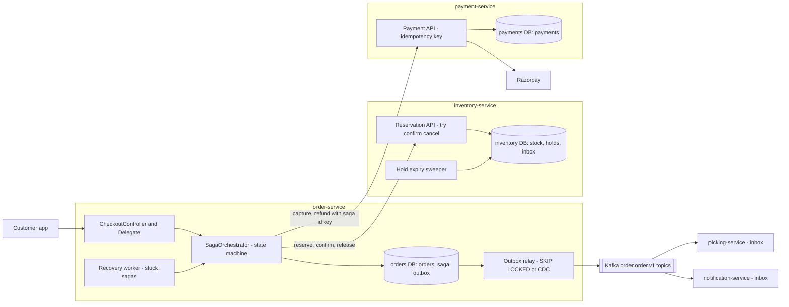
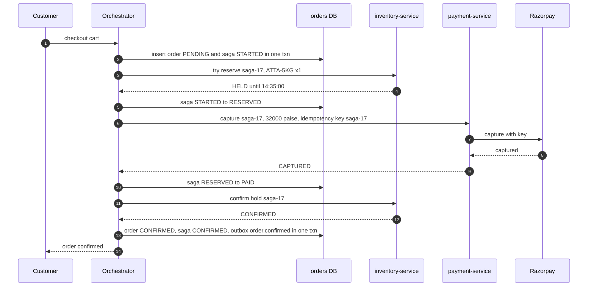
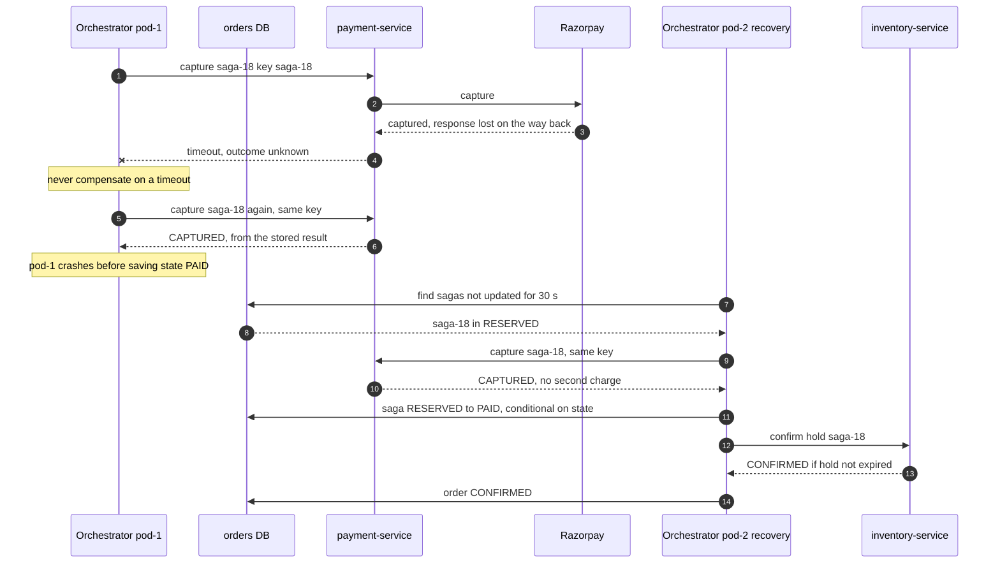
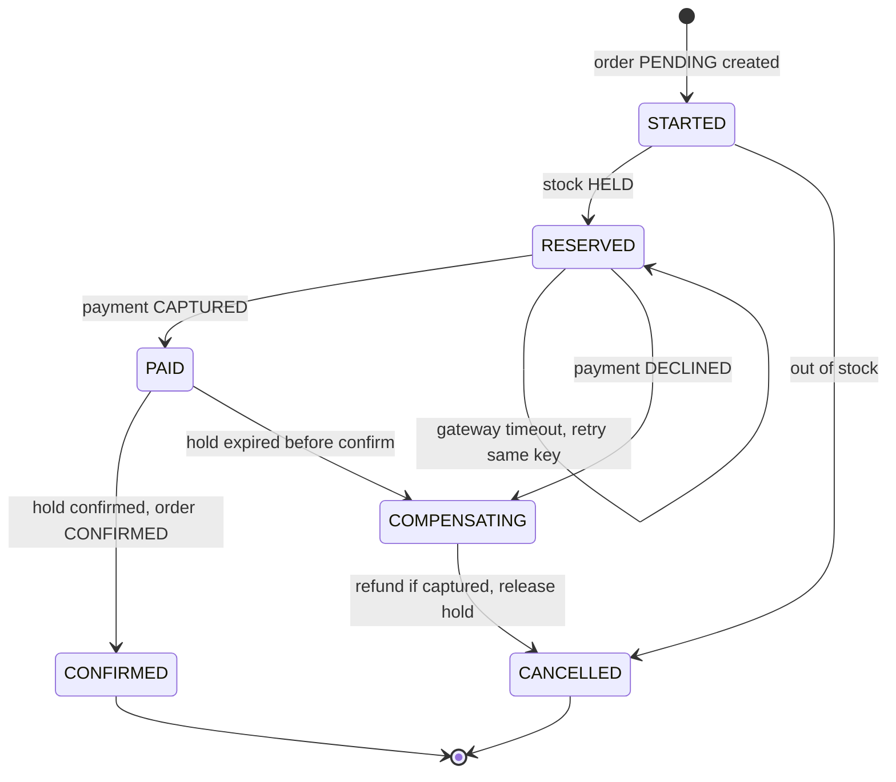

# 13. Distributed Transactions ⭐

!!! abstract "Chapter at a glance"
    **Reader bands:** B1 → B4 · **Prerequisites:** [Ch 05](../01-foundations/05-relational-databases-deep-dive.md), [Ch 10](10-replication.md), [Ch 12](12-consistency-time-and-consensus.md) · **What you will build:** The checkout flow across order, inventory and payment services, where each service owns its own database and there is no shared transaction. L1 simulates the dual-write problem. L2 builds a transactional outbox, a `SKIP LOCKED` relay and an inbox/dedup consumer. L3 is a persisted saga orchestrator with idempotent steps and compensations, run with crashes and payment timeouts. L4 adds TCC-style reservations with expiry for flash sales. **Everything from L2 onwards runs as real Java (JDBC) against real PostgreSQL 16**, with invariants checked across three databases. Two more real labs: **2PC with `PREPARE TRANSACTION`**, including a coordinator crash that leaves locks held across a server restart, and **CDC from the WAL with logical decoding**, the mechanism Debezium uses. · **Reading time:** 120 min + code + labs

---

## 1. Introduction & Why It Matters

### 1.1 A story: "payment successful", no order

The first version of checkout was a single Spring service that called Razorpay, then inventory, then saved the order, all inside one `@Transactional` method. It looked atomic. It wasn't: `@Transactional` covered only the order database, while Razorpay and the inventory service were remote calls.

During the monsoon sale these failures showed up:

- **Razorpay captured the payment, then the inventory call timed out.** The method threw, the order insert rolled back, and the customer was charged with no order. **1,140 customers** had to be refunded by hand.
- **Inventory decremented stock, then the service crashed before saving the order.** The stock stayed decremented forever, so the app showed "sold out" while 380 units of Alphonso mangoes were sitting in the dark stores.
- **The order was saved and the "order placed" Kafka event was sent after the commit, but the broker was briefly unavailable.** The picking service never heard about 212 orders. They sat in "Placed" until customers called.
- **Retries after timeouts charged some customers twice.** The payment had succeeded, but the response was lost.

The team first tried distributed transactions (XA/2PC) across the services. They dropped the idea after a pilot. A coordinator restart left inventory rows **locked for 11 minutes** while it recovered, which blocked every other checkout for those SKUs. Razorpay doesn't take part in XA anyway.

The design that worked is this chapter:

- **Each service commits locally.** The order row and the "order placed" event are written in **one local transaction** (the transactional outbox), and a relay publishes the event later, at least once.
- **Consumers are idempotent** (an inbox/dedup table in the same transaction as the effect), so "at least once" becomes "exactly once in effect".
- **Checkout is a saga:** a sequence of local transactions (reserve stock, capture payment, confirm), each with a **compensation** (release, refund, cancel). An orchestrator **persists its state**, so a crash resumes instead of forgetting.
- **Every remote step has an idempotency key** (the saga id), so retrying after a timeout never charges twice.
- **Stock is held with an expiry** (try-confirm-cancel), so an abandoned checkout gives the mango back automatically.

!!! quote "The thesis of this chapter"
    Across services, you can't have atomicity for free. You can have **atomic local steps, reliable messaging between them, idempotent handlers, and explicit compensations**, which gives eventual consistency with invariants you can check. Use 2PC only inside one trust and failure domain, where you control every participant and can tolerate blocking.

### 1.2 Where this lives in the grocery platform

| Flow | Pattern | Why |
|---|---|---|
| Checkout: order → inventory → payment → confirm | **Orchestrated saga** with a persisted state machine | Many steps, a clear owner (order-service), compensations need ordering |
| Order status → picking, notifications, analytics | **Outbox + events** (choreography) | Many independent consumers |
| Order events to the data platform | **CDC** (logical decoding / Debezium) | No application changes, full history |
| Flash-sale stock | **TCC-style holds** with expiry | Stock must return automatically when payment stalls |
| Payments with Razorpay | Idempotency keys + reconciliation (Ch 45) | External party, no distributed transaction possible |
| Wallet top-up + ledger in one DB | **Local ACID transaction** | Same database, so no distributed transaction needed |
| Moving money between two ledger shards | Saga with a transfer record, or co-locate (Ch 11) | Cross-shard 2PC avoided |
| Legacy ERP integration | Outbox → integration service with retries + DLQ | ERP can't take part in anything transactional |

### 1.3 Learning objectives

| Band | After this chapter you can… |
|---|---|
| <span class="band b1">B1</span> | Explain why `@Transactional` can't span services, what the dual-write problem is, and what a saga is |
| <span class="band b2">B2</span> | Implement a transactional outbox with a relay and an idempotent (inbox) consumer, and explain at-least-once delivery |
| <span class="band b3">B3</span> | Design an orchestrated saga with persisted state, idempotent steps and compensations, and handle unknown outcomes (timeouts) |
| <span class="band b4">B4</span> | Explain 2PC/3PC/XA and their blocking behaviour, choose between saga, TCC, 2PC and co-location, handle saga isolation anomalies, and run CDC in production |

---

## 2. Core Concepts — Beginner to Deep

### 2.1 Intuition: booking a wedding in three different shops <span class="band b1">B1</span>

You're organizing a wedding: the hall, the caterer and the photographer, three independent businesses.

- **No single "undo" button exists.** You can't make all three bookings in one atomic step. You book each one separately.
- **If the photographer is unavailable after you've booked the hall and the caterer,** you **cancel** those two. Cancellation isn't "as if it never happened": there may be a cancellation fee, and the hall may have turned someone else away meanwhile. That's a **saga with compensations**.
- **You keep a notebook** of what you've booked and what's left to do. If you fall ill halfway, your sibling reads the notebook and continues. That's the **orchestrator's persisted state**.
- **If the phone line drops after you asked the caterer to book,** you call back and say "this is booking #W-42, did it go through?" rather than booking again. That's an **idempotency key**.
- **The hall holds your date for 48 hours without payment.** If you don't confirm, the hold lapses. That's a **reservation with expiry (TCC)**.
- **Two-phase commit** would be asking all three shops to put a "pending" sticker on your date and **refuse everyone else** until you personally come back and say "confirm" or "cancel". If you're stuck in traffic, three businesses stop selling that date.

### 2.2 Why local transactions don't extend across services <span class="band b1">B1</span>

A database transaction gives ACID **within that database**. In a microservice architecture (Ch 16), each service owns its data, so one business operation touches several databases plus external APIs:

```java
@Transactional                     // ❌ covers ONLY the order DB connection
public Order checkout(Cart cart) {
    Order o = orders.save(Order.pending(cart));        // order DB (rolled back on exception)
    inventoryClient.reserve(cart.items());             // HTTP: NOT rolled back
    paymentClient.capture(o.id(), cart.total());       // Razorpay: NOT rolled back
    kafka.send("order.order.placed.v1", o);           // broker: NOT rolled back, and maybe sent before commit
    return o;
}
```

Every failure in §1.1 comes from this shape. What you want instead:

1. Each step is a **local** transaction in the service that owns the data.
2. Steps are connected by **reliable messages or calls**.
3. Each step is **idempotent**.
4. Failures trigger **compensations**.

### 2.3 The dual-write problem ⭐ <span class="band b1">B1</span> <span class="band b2">B2</span>

Any time a service must update its database **and** notify another system (a broker, a cache, a search index, another service), there are two writes and no transaction spanning them. L1 counted what goes wrong over 100,000 orders:

```text
   strategy             lost events   phantom events   duplicates
   DB_THEN_PUBLISH             1696                0            0
   PUBLISH_THEN_DB                0             1118            0
   OUTBOX                         0                0         1017
```

- **Commit, then publish:** a crash or broker outage after the commit **loses the event**. The order exists, and nobody hears about it.
- **Publish, then commit:** a crash or rollback after publishing creates a **phantom event** for an order that doesn't exist.
- **Outbox:** write the event into an `outbox` table **in the same local transaction** as the order. A separate relay publishes it. Nothing is lost and nothing is phantom, and the only failure mode left is **duplicates**, which consumers can remove.

"Publish in `afterCommit`" (Spring's `@TransactionalEventListener(phase = AFTER_COMMIT)`) is still commit-then-publish: a crash between commit and send loses the event.

### 2.4 Transactional outbox and the relay ⭐ <span class="band b2">B2</span>

```sql
begin;
insert into orders (...) values (...);
insert into outbox (aggregate_id, type, payload) values ('ord-1', 'order.order.placed.v1', '{…}');
commit;                                      -- both or neither
```

Two ways to get outbox rows to the broker:

| | **Polling relay** | **CDC relay** (log tailing) |
|---|---|---|
| How | `select … where published_at is null order by id limit 50 for update skip locked`, publish, mark | Read the database's WAL through a logical replication slot (Debezium, lab 2) |
| Latency | Poll interval (100 ms–1 s) | Sub-second, push |
| DB load | Queries plus updates on the outbox | Reads WAL, no table queries |
| Ordering | Per relay; **parallel relays can reorder** (L2: 6 inversions with 3 relays, 0 with 1) | WAL commit order |
| Operations | Just SQL | A connector to run; **replication slots retain WAL if the consumer stops** (lab 2: 37 MB) |
| Cleanup | Delete published rows in batches | Delete right after insert (the WAL still has it), or partition and drop |

Both are **at least once**: a relay that crashes after publishing but before marking publishes again (L2: 13–47 relay crashes and 246–488 duplicate deliveries per run).

**Ordering:** a consumer usually needs order **per aggregate** (placed before confirmed for the same order), not globally.

- Use one relay per partition, or `FOR UPDATE SKIP LOCKED` with a single active relay (leader-elected, Ch 12).
- Publish with the aggregate id as the Kafka key, so all its events go to one partition (Ch 14).
- Carry a per-aggregate `seq`, so consumers can detect and handle out-of-order or stale events (Ch 12 L2's versioned status).

**Outbox ids have gaps.** The lab's rolled-back transaction consumed id 2, and the CDC stream showed ids 1 and 3. Concurrent transactions also commit out of id order. Never infer "all events up to N have been published" from id continuity.

### 2.5 The inbox: idempotent consumers ⭐ <span class="band b2">B2</span>

At-least-once delivery means every consumer sees duplicates: relay retries, broker redelivery after a rebalance, a consumer crash after the effect but before the offset commit. The standard fix is to record the message id **in the same local transaction as the effect**:

```sql
begin;
insert into inbox (message_id) values (:id) on conflict do nothing;   -- 0 rows ⇒ duplicate ⇒ skip
-- … apply the effect (reserve stock) …
commit;
```

L2, 2,000 orders with injected crashes:

- **Without an inbox:** 2,403 reservation rows for 2,000 orders, so 403 units of stock were taken twice.
- **With an inbox:** exactly 2,000, even with 3 relays and 488 duplicate deliveries.

Alternatives are **natural idempotency** (`insert … on conflict do nothing` keyed by `order_id`, `update … where version < :v`), or idempotency keys at an API (Ch 20). Keep inbox rows at least as long as the broker can redeliver (retention + replay window), then delete in batches.

"Exactly once" in Kafka (idempotent producer + transactions) covers Kafka-to-Kafka processing. The moment the effect is in a database or an external API, you still need idempotent handling at that boundary (Ch 14).

### 2.6 Two-phase commit (2PC) and XA ⭐ <span class="band b2">B2</span> → <span class="band b4">B4</span>

2PC makes several resource managers commit atomically:

1. **Prepare (voting):** the coordinator asks each participant to prepare. A participant that votes **yes** must **guarantee it can commit later**: it persists its changes and **keeps its locks**.
2. **Commit/abort (decision):** if all voted yes, the coordinator **logs the decision** and tells everyone to commit. Otherwise it tells everyone to abort.

**Why 2PC hurts** (all shown with PostgreSQL's `PREPARE TRANSACTION` in lab 1):

- **Blocking:** after voting yes, a participant can't decide alone. If the coordinator dies, the transaction is **in doubt** and its locks stay held. In the lab another checkout for the same SKU failed with `canceling statement due to lock timeout`.
- **Prepared transactions survive restarts:** after restarting the database server, `ord-1003:inv` was still in doubt and the row was still locked, until the "coordinator" came back and ran `COMMIT PREPARED`.
- **Latency:** at least two round trips plus forced log writes per participant, and locks are held across all of it.
- **Availability:** the transaction commits only if every participant and the coordinator are up. With availability `a` each, n participants give roughly aⁿ.
- **Participation:** every participant must support XA (Razorpay, Kafka's own transactions, Redis, most SaaS APIs don't). Heuristic decisions (an admin forcing a commit or rollback) can break atomicity.
- **Reads aren't blocked** (MVCC showed the old stock value), but **writers queue behind the in-doubt locks.**

**3PC** adds a pre-commit phase so participants can make progress when the coordinator fails, but only in a synchronous network with bounded delays. It isn't safe under partitions, so it's rarely used. **Consensus-based commit** (Spanner and CockroachDB run 2PC where each participant is itself a Raft/Paxos group, and the coordinator state is replicated) removes the "coordinator dies" blocking, which is why distributed SQL can offer multi-shard ACID.

**When 2PC is acceptable:** inside one database product across its own shards, which is what distributed SQL does. Or XA between a database and a message queue in the same data centre where you accept the blocking risk (the classic JMS + DB setup). Not across microservices or external APIs.

### 2.7 Sagas ⭐ <span class="band b2">B2</span> <span class="band b3">B3</span>

A **saga** (Garcia-Molina & Salem, 1987) is a sequence of local transactions T1…Tn. Each Ti publishes an event or triggers the next step, and each has a **compensating transaction** Ci that semantically undoes it. If Tk fails, run Ck-1…C1.

**Types of steps:**

- **Compensatable:** they can be undone (reserve stock ↔ release).
- **Pivot:** the go/no-go point. After it, the saga must complete (payment capture: once captured, you'd rather deliver than refund).
- **Retriable:** after the pivot, steps must eventually succeed, retried with idempotency (confirm reservation, send the confirmation).

Put the steps that are most likely to fail **first**, and the pivot as late as possible.

**Orchestration vs choreography:**

| | **Orchestration** | **Choreography** |
|---|---|---|
| Control | A central orchestrator (a state machine) tells each participant what to do | Each service reacts to events and emits its own |
| Visibility | The whole flow in one place and one state table | Implicit, spread across services, so you need tracing to see it |
| Coupling | The orchestrator knows every step | Services know the events, not each other |
| Cyclic dependencies / "event spaghetti" | Avoided | A risk as flows grow |
| Good for | Checkout, refunds, onboarding: flows with ordering, compensations and timeouts | Simple fan-out: notify picking, analytics, loyalty points |
| Tools | Hand-rolled state machine (L3), Temporal, Camunda/Zeebe, AWS Step Functions | Kafka + outbox + inbox |

**Orchestrator rules** (all in L3):

1. **Persist saga state** before and after each step, keyed by saga id, so a crash resumes. L3 crashed the orchestrator 310 times, and a recovery loop resumed every saga.
2. **Every step and compensation is idempotent,** keyed by saga id. A crash after the effect but before saving the state means the step **runs again**.
3. **Handle unknown outcomes:** a timeout means "maybe". Retry with the same idempotency key to learn the real result. **Never** treat a timeout as failure and compensate blindly (you'd refund a charge the gateway says doesn't exist, or release stock for a confirmed order), and never retry without a key.
4. **Compensate in reverse order,** and make compensations retriable until they succeed. A compensation that "can't fail" still needs retries (the network).
5. **State transitions are conditional** (`update saga set state = :to where id = :id and state = :from`), so two orchestrator instances can't both advance the same saga.

L3's negative control made steps non-idempotent with everything else unchanged. Result: **141 double-charged orders and 247 invariant violations.** With idempotent steps: 0 and 0.

### 2.8 Sagas lack isolation, and what to do about it ⭐ <span class="band b3">B3</span> <span class="band b4">B4</span>

A saga's intermediate states are **visible** to other transactions: it's ACD without the I. Anomalies:

- **Dirty reads:** another saga sees stock held by a saga that later compensates. L3 turned away **115 checkouts as OUT_OF_STOCK, yet 21 units were left at the end**: they had been held by sagas that later failed payment and released them.
- **Lost updates:** a compensation overwrites a change another saga made meanwhile (restoring a "previous value" instead of applying an inverse delta).
- **Fuzzy / non-repeatable reads:** a step reads data that another saga changes before a later step.

**Countermeasures** (Garcia-Molina; Richardson's *Microservices Patterns*):

| Countermeasure | Idea | In L3/L4 |
|---|---|---|
| **Semantic lock** | Mark records as pending (`status = HELD`/`PENDING`) so others know they're in flux | Reservations `HELD`, orders `PENDING` |
| **Commutative updates** | Design operations so order doesn't matter: `qty = qty - 1` / `+ 1`, not "set qty = 7" | Stock decrements/increments |
| **Pessimistic view** | Reorder steps to reduce the damage of dirty reads (reserve before charging) | Reserve first, pay second |
| **Reread value** | Re-check before overwriting (optimistic concurrency with versions) | Conditional `where state = :from` |
| **Version file / by value** | Record operations and reorder them, or choose the mechanism per request risk | — |

Accept the business consequence explicitly: "a customer may see 'sold out' while units are held by pending checkouts; holds expire after 5 minutes". That's a product decision.

### 2.9 TCC: try-confirm-cancel ⭐ <span class="band b3">B3</span>

TCC is a saga variant where each participant exposes three operations:

- **Try:** reserve resources and check business rules, without making the change final (a stock hold).
- **Confirm:** make it final. It uses only the reserved resources, so it can't fail for business reasons.
- **Cancel:** release the reservation.

**The key addition is expiry:** a hold that is neither confirmed nor cancelled (the orchestrator died, the customer walked away) is **released automatically** after a TTL.

Confirm and expiry then **race**, and both must be conditional updates in the database so exactly one wins. L4, 500 mangoes and 2,000 buyers:

- **Unguarded confirm** (`update … where id = ?`) confirmed 801 units: the sweeper released 301 expired holds that were also confirmed, **oversold by 301**.
- **Guarded confirm** (`where status = 'HELD' and expires_at > clock_timestamp()`) confirmed exactly 500. The 342 confirms that arrived after expiry were refused and refunded, and `available + confirmed = 500`.

Expiry uses the **database's clock**, in the same statement (Ch 12: never compare two machines' clocks). Choose the TTL from the payment-time distribution (p99 + margin), and refund confirms that arrive too late.

### 2.10 Change data capture (CDC) ⭐ <span class="band b3">B3</span>

CDC reads a database's own change log and turns committed changes into events:

- **PostgreSQL:** logical decoding from a replication slot (`pgoutput`, `test_decoding`, `wal2json`).
- **MySQL:** the binlog.
- **MongoDB:** change streams.
- **Debezium** packages these as Kafka Connect source connectors, and its **Outbox Event Router** turns outbox inserts into topic messages.

Properties, all visible in lab 2:

- **Only committed changes, in commit order,** grouped by transaction. The rolled-back `ord-2` never appeared.
- **No dual write:** the application writes only to its database.
- **Replication slots retain WAL** until the consumer confirms it. A stalled connector made the primary keep **37 MB** in the lab, and it can grow until the disk is full (Ch 10). Set `max_slot_wal_keep_size`, monitor slot lag, and alert.
- **Idle databases need a heartbeat:** the slot's restart position only advances when there's something to decode. The lab had to emit a message before retained WAL dropped to 240 bytes. That's what Debezium's `heartbeat.interval.ms` / `heartbeat.action.query` are for.
- **Failover:** slots aren't replicated to standbys before PostgreSQL 17 (failover slots). After a failover, the connector may need a re-snapshot or has a gap. Plan for it (Ch 10).
- **Schema changes** flow through the log, so consumers must handle them (Ch 28). Emitting outbox events with an explicit schema is safer than exposing raw table changes (**don't leak your internal schema as your public contract**).

### 2.11 Choosing an approach ⭐ <span class="band b4">B4</span>

| Situation | Choose |
|---|---|
| All data in one database | **A local ACID transaction**, nothing else |
| Can the data be co-located (same shard/database)? | **Co-locate** (Ch 11), and use a local transaction |
| One service's DB change must notify others | **Outbox** (+ polling or CDC relay) + **idempotent consumers** |
| Multi-step business flow across services with undo | **Orchestrated saga** + idempotency + compensations |
| Resource must be held briefly during a flow (stock, seats, slots) | **TCC holds with expiry** |
| Simple fan-out of facts | **Choreography** (events) |
| Several resources in one DB product / one team, blocking acceptable | 2PC/XA, or a distributed SQL database with consensus-backed 2PC |
| An external API that isn't idempotent | Wrap it: your own request table + reconciliation against the provider's reports (Ch 45) |

---

## 3. Architecture & Diagrams

### 3.1 Component view: checkout across services



The orchestrator calls participants synchronously here, with idempotent APIs. A message-driven orchestrator (commands and replies over Kafka, each through an outbox) is the alternative when participants must stay decoupled from the orchestrator's availability. Either way the saga table is the single source of truth for "where is this checkout".

### 3.2 Sequence: happy path, checkout saga



### 3.3 Sequence: failure path, a payment timeout, then the orchestrator crashes



If step 13 returns `EXPIRED` (the hold lapsed during the outage), the orchestrator moves to `COMPENSATING`: refund, then cancel with reason `HOLD_EXPIRED`. That's the refund path in L4.

### 3.4 State: the checkout saga



Every arrow is a conditional update of the saga row. Every non-terminal state has a recovery action. And there's no path from `PAID` to `CANCELLED` that skips the refund.

---

## 4. Design Document Excerpt: Checkout Consistency Across Services

| Field | Value |
|---|---|
| Author / Reviewers | Orders team / Payments, Inventory, Finance, SRE |
| Status | Approved |
| Related ADRs | ADR-048 Orchestrated checkout saga; ADR-049 Transactional outbox with polling relay (CDC later); ADR-050 Inbox dedup for all consumers; ADR-051 Stock holds with expiry; ADR-052 No XA across services |

**1. Context & Problem.** Checkout spans order, inventory and payment services plus Razorpay. The current `@Transactional` method produced charged-without-order (1,140), stuck stock (380 units), lost events (212 orders) and double charges (§1.1). An XA pilot blocked inventory rows for 11 minutes during a coordinator restart.

**2. Goals / Non-Goals.**

- *Goals:* no customer charged without an order or a refund; no stock lost or oversold; every order event delivered to every consumer, with its effect applied once; recovery from any single crash without manual steps; every checkout's state visible in one place.
- *Non-goals:* cross-service isolation (accepted: holds are visible, §2.8); real-time analytics consistency (CDC to the warehouse is eventual, Ch 21).

**3. Requirements.**

| ID | Requirement |
|---|---|
| NFR-1 | 0 orders violating the cross-service invariants (checked nightly by a reconciliation job) |
| NFR-2 | A crashed checkout resumes within 60 s |
| NFR-3 | Event delivery: at least once, lag p99 ≤ 2 s; effect exactly once in every consumer |
| NFR-4 | Checkout p99 ≤ 1.5 s (dominated by Razorpay) |
| NFR-5 | A hold not confirmed within TTL is released within TTL + 30 s |
| NFR-6 | No retry may create a second capture (idempotency key per saga) |

**4. Capacity & latency estimates.**

| Item | Calculation | Result |
|---|---|---|
| Checkouts at P90 peak | Ch 02 | ~420/s |
| Saga state writes | ~5 transitions per checkout | ~2.1 K/s on the order shards (Ch 11: spread over 4) |
| Outbox rows | ~3 events per order (placed, confirmed, status) | ~1.3 K/s; relay batches of 200 every 100 ms per shard |
| Inbox rows per consumer | = events consumed | Retention 7 days ≈ 780 M rows/consumer at peak rates, so partition by day and drop |
| Hold TTL | Razorpay p99 capture ~6 s + UPI approval up to ~120 s | **5 min** holds for UPI, 60 s for cards |
| Stuck-saga scan | Index on `(state, updated_at)` | Every 10 s, ~0 rows normally |

**5. Proposed design.**

1. **Orchestrator in order-service:** `saga(id, state, step, attempts, updated_at, version)` next to `orders` and `outbox`. Every transition is `update … where id = :id and state = :from`. The order row, saga state and outbox event change in one local transaction where they belong together.
2. **Participants expose idempotent APIs** keyed by saga id: `POST /reservations/{sagaId}` (try), `…/confirm`, `…/cancel`; `POST /payments/{sagaId}/capture`, `…/refund`. Payment-service forwards the key to Razorpay.
3. **Unknown outcomes:** a timeout retries with backoff (Ch 18) using the same key. After N attempts, the saga parks in `NEEDS_ATTENTION` and the payment reconciliation job decides from Razorpay's report (Ch 45). Nothing ever compensates on "unknown".
4. **Recovery worker** (leader-elected with a fencing token, Ch 12): re-drives sagas with `updated_at < now() - 30 s` in non-terminal states.
5. **Outbox:** polling relay with `FOR UPDATE SKIP LOCKED`, one active relay per shard (per-aggregate order), Kafka key = order id, then delete rows after 24 h. Phase 2 moves to Debezium's outbox router once the platform runs Kafka Connect.
6. **Consumers:** inbox table per consumer (`message_id` PK) written in the same transaction as the effect, partitioned by day.
7. **Stock holds:** try-confirm-cancel with `expires_at` from the DB clock, a sweeper every 5 s, a guarded confirm. A confirm after expiry → saga compensates (refund).

**7. Alternatives considered.**

| Option | Pros | Cons | Verdict |
|---|---|---|---|
| XA/2PC across services | Atomic commit | Blocking on coordinator failure (pilot: 11 min locks); Razorpay can't join; couples availability | Rejected |
| **Orchestrated saga + outbox + inbox** | Local transactions only; visible state; crash-resumable | Compensations to design; no isolation | **Chosen** |
| Choreographed saga | No central component | Hard to follow; compensation ordering spread across services | Used only for post-confirmation fan-out |
| Temporal / Camunda | Durable execution, retries, timers built in | New platform to run; team skills | Revisit at 5+ sagas |
| Merge order+inventory+payment into one DB | Local ACID | Couples three teams' data; doesn't cover Razorpay | Rejected |

**8. Failure modes.** Orchestrator crash: resumed by the recovery worker. Participant down: retries with backoff, and the saga waits (the hold TTL bounds how long stock is held). Razorpay timeout: retry with key, then reconciliation. Relay crash: duplicates, removed by inboxes. Consumer crash: redelivery, removed by inboxes. Hold expired before confirm: compensate with refund. Compensation failing repeatedly: `NEEDS_ATTENTION` + page.

**10. Observability.** Sagas by state (gauge), age of the oldest non-terminal saga, transitions/s, compensations/s by reason, gateway timeouts and retries, `NEEDS_ATTENTION` count (page if > 0 for 15 min), outbox backlog (unpublished rows, oldest age), relay duplicates, inbox duplicate rate per consumer, holds expiring vs confirmed, late confirms, reconciliation mismatches.

**14. Decision (ADR-048–052 summary).** Checkout is an orchestrated saga in order-service with persisted, conditionally updated state and a recovery worker. Every participant operation is idempotent by saga id. Events leave through a transactional outbox, and every consumer dedups with an inbox. Stock uses TCC holds with DB-clock expiry and guarded confirms. XA is not used across services.

---

## 5. Hands-On Code — Level Ladder

| Level | New requirement that forces the step |
|---|---|
| L1 | "Show why 'save, then publish' and 'publish, then save' both break." (plain Java) |
| L2 | "Every order event must reach inventory exactly once in effect, despite crashes." (real JDBC + PostgreSQL) |
| L3 | "Checkout across three databases must end consistent, despite orchestrator crashes and payment timeouts." (real JDBC + PostgreSQL) |
| L4 | "Flash sale: stock held during payment must come back automatically, and never be sold twice." (real JDBC + PostgreSQL) |
| Labs | Real PostgreSQL 16: 2PC with `PREPARE TRANSACTION` and a coordinator crash; CDC from the WAL with logical decoding |

!!! info "How the code in this chapter was verified"
    L1 is plain Java. L2–L4 are **plain JDBC programs run against a real PostgreSQL 16** (lab setup below) with the PostgreSQL JDBC driver 42.7.4, on Java 21. Every output block is copied from a real run. Thread scheduling makes exact counts vary between runs, but the invariants don't. The broker in L2 is an in-memory at-least-once queue: Kafka itself couldn't be installed in this environment. The Spring/Kafka/Debezium versions of the same components that follow each level weren't compiled (no Maven Central access) and are marked `VERIFY`. They are one-to-one translations of the verified JDBC logic into the four-layer structure.

### L1 — Concept: the dual-write problem (plain Java) <span class="band b1">B1</span>

```java
// DualWriteL1.java — run with: java DualWriteL1.java
// A service must (1) commit an order to its database and (2) publish "order placed" to a broker.
// There is no transaction spanning both. Crash at a random point and count what goes wrong.
import java.util.*;

public class DualWriteL1 {

    enum Strategy { DB_THEN_PUBLISH, PUBLISH_THEN_DB, OUTBOX }

    public static void main(String[] args) {
        int n = 100_000; Random rnd = new Random(42);
        System.out.printf("%,d orders; the process crashes at a random point in 2 %% of them; the broker is down 1 %% of the time; the relay crashes after publishing 1 %% of the time%n", n);
        System.out.printf("   %-17s %14s %16s %12s%n", "strategy", "lost events", "phantom events", "duplicates");
        for (Strategy s : Strategy.values()) {
            int lost = 0, phantom = 0, dup = 0;
            for (int i = 0; i < n; i++) {
                boolean crash = rnd.nextDouble() < 0.02;
                int crashPoint = rnd.nextInt(3);                          // 0 = before step 1, 1 = between, 2 = after both
                boolean brokerDown = rnd.nextDouble() < 0.01;
                boolean dbCommitted = false, published = false;
                switch (s) {
                    case DB_THEN_PUBLISH -> {
                        if (crash && crashPoint == 0) break;
                        dbCommitted = true;
                        if (crash && crashPoint == 1) break;                 // committed, never published
                        if (brokerDown) break;                              // publish failed after commit
                        published = true;
                    }
                    case PUBLISH_THEN_DB -> {
                        if (crash && crashPoint == 0) break;
                        if (brokerDown) break;                              // nothing happened: caller retries, fine
                        published = true;
                        if (crash && crashPoint == 1) break;                 // event out, order never saved
                        dbCommitted = rnd.nextDouble() >= 0.005;            // 0.5 % constraint failures / rollbacks
                    }
                    case OUTBOX -> {
                        if (crash && crashPoint == 0) break;
                        dbCommitted = true;                                 // order + outbox row: ONE local transaction
                        // the relay publishes later; if it crashes after publishing but before marking, it republishes
                        published = true;
                        if (rnd.nextDouble() < 0.01) dup++;
                    }
                }
                if (dbCommitted && !published) lost++;
                if (published && !dbCommitted) phantom++;
            }
            System.out.printf("   %-17s %14d %16d %12d%n", s, lost, phantom, dup);
        }
        System.out.println("   → the outbox trades lost/phantom events for duplicates, which consumers can dedup (L2 inbox)");
    }
}
```

Actual output from running it:

```text
100,000 orders; the process crashes at a random point in 2 % of them; the broker is down 1 % of the time; the relay crashes after publishing 1 % of the time
   strategy             lost events   phantom events   duplicates
   DB_THEN_PUBLISH             1696                0            0
   PUBLISH_THEN_DB                0             1118            0
   OUTBOX                         0                0         1017
   → the outbox trades lost/phantom events for duplicates, which consumers can dedup (L2 inbox)
```

**What L1 shows:** with two independent writes, you choose which way to fail. Commit-then-publish loses events (1,696), and publish-then-commit invents them (1,118). The outbox makes the event part of the database transaction and turns both failure modes into **duplicates** (1,017 here, from relay crashes), which a consumer can deal with.

### L2 — Transactional outbox, `SKIP LOCKED` relay and inbox consumer (real PostgreSQL) <span class="band b2">B2</span>

Requirement: every order event reaches inventory, and inventory reserves stock exactly once per order, even though relays and consumers crash.

```java
// OutboxL2.java — run with: java -cp postgresql-42.7.4.jar OutboxL2.java      (PostgreSQL lab on :5541)
// order-service writes an order and an outbox row in ONE local transaction; relays publish the outbox to a broker
// (at-least-once, with injected crashes); inventory-service consumes with or without an INBOX (dedup) table.
import java.sql.*;
import java.util.*;
import java.util.concurrent.*;
import java.util.concurrent.atomic.*;

public class OutboxL2 {

    // ---------- tiny connection pool + transaction helper ----------
    static final class Db {
        private final BlockingQueue<Connection> pool = new LinkedBlockingQueue<>();
        Db(String database, int size) throws SQLException {
            for (int i = 0; i < size; i++) {
                Connection c = DriverManager.getConnection("jdbc:postgresql://localhost:5541/" + database, "postgres", "");
                c.setAutoCommit(false);
                pool.add(c);
            }
        }
        interface Work<T> { T apply(Connection c) throws SQLException; }
        <T> T tx(Work<T> work) {
            Connection c;
            try { c = pool.take(); } catch (InterruptedException e) { throw new IllegalStateException(e); }
            try {
                T result = work.apply(c);
                c.commit();
                return result;
            } catch (SQLException | RuntimeException e) {
                try { c.rollback(); } catch (SQLException ignored) { }
                throw e instanceof RuntimeException re ? re : new IllegalStateException(e);
            } finally { pool.add(c); }
        }
        void exec(String sql) { tx(c -> { try (Statement s = c.createStatement()) { s.execute(sql); } return null; }); }
        long count(String sql) { return tx(c -> { try (Statement s = c.createStatement(); ResultSet r = s.executeQuery(sql)) { r.next(); return r.getLong(1); } }); }
    }

    static final class Crash extends RuntimeException { Crash(String where) { super("injected crash: " + where); } }

    // ---------- the broker: at-least-once, keeps order of publish calls ----------
    record Message(long outboxId, String aggregateId, String type, int seq) { }
    static final BlockingQueue<Message> broker = new LinkedBlockingQueue<>();

    // ---------- order-service: order + outbox row in one transaction ----------
    static void placeOrder(Db orders, String orderId, String sku, int qty) {
        orders.tx(c -> {
            try (var ps = c.prepareStatement("insert into orders(id, sku, qty, status) values (?, ?, ?, 'PLACED')")) {
                ps.setString(1, orderId); ps.setString(2, sku); ps.setInt(3, qty); ps.executeUpdate();
            }
            try (var ps = c.prepareStatement("insert into outbox(aggregate_id, type, seq, payload) values (?, 'order.order.placed.v1', 1, ?::jsonb)")) {
                ps.setString(1, orderId); ps.setString(2, "{\"sku\":\"" + sku + "\",\"qty\":" + qty + "}"); ps.executeUpdate();
            }
            try (var ps = c.prepareStatement("insert into outbox(aggregate_id, type, seq, payload) values (?, 'order.order.confirmed.v1', 2, '{}'::jsonb)")) {
                ps.setString(1, orderId); ps.executeUpdate();
            }
            return null;
        });
    }

    // ---------- relay: claim a batch with SKIP LOCKED, publish, mark published ----------
    static int relayOnce(Db orders, Random rnd, double crashAfterPublish) {
        return orders.tx(c -> {
            List<Message> batch = new ArrayList<>();
            try (var ps = c.prepareStatement("""
                    select id, aggregate_id, type, seq from outbox
                     where published_at is null
                     order by id
                     limit 50
                     for update skip locked""");
                 var rs = ps.executeQuery()) {
                while (rs.next()) batch.add(new Message(rs.getLong(1), rs.getString(2), rs.getString(3), rs.getInt(4)));
            }
            for (Message m : batch) broker.add(m);                                   // publish (broker acks)
            if (!batch.isEmpty() && rnd.nextDouble() < crashAfterPublish) throw new Crash("relay after publish, before mark");
            try (var ps = c.prepareStatement("update outbox set published_at = now() where id = any(?)")) {
                ps.setArray(1, c.createArrayOf("bigint", batch.stream().map(Message::outboxId).toArray()));
                ps.executeUpdate();
            }
            return batch.size();
        });
    }

    // ---------- inventory-service consumer ----------
    static void consume(Db inventory, Message m, boolean useInbox, Random rnd, double crashBeforeAck) {
        if (!m.type().equals("order.order.placed.v1")) return;
        inventory.tx(c -> {
            if (useInbox) {
                try (var ps = c.prepareStatement("insert into inbox(message_id) values (?) on conflict do nothing")) {
                    ps.setLong(1, m.outboxId());
                    if (ps.executeUpdate() == 0) return null;                          // duplicate: already applied
                }
            }
            try (var ps = c.prepareStatement("insert into reservations(order_id, qty) values (?, 1)")) {
                ps.setString(1, m.aggregateId()); ps.executeUpdate();
            }
            try (var ps = c.prepareStatement("update stock set qty = qty - 1 where sku = 'ATTA-5KG'")) { ps.executeUpdate(); }
            return null;
        });
        if (rnd.nextDouble() < crashBeforeAck) throw new Crash("consumer after commit, before ack");   // → redelivery
    }

    static Map<String, Object> run(int relays, boolean useInbox) throws Exception {
        Db orders = new Db("orders", 12), inventory = new Db("inventory", 6);
        orders.exec("drop table if exists outbox, orders");
        orders.exec("create table orders (id text primary key, sku text, qty int, status text)");
        orders.exec("create table outbox (id bigserial primary key, aggregate_id text not null, type text not null, seq int not null, payload jsonb not null, published_at timestamptz)");
        orders.exec("create index outbox_unpublished on outbox (id) where published_at is null");
        inventory.exec("drop table if exists inbox, reservations, stock");
        inventory.exec("create table inbox (message_id bigint primary key, processed_at timestamptz default now())");
        inventory.exec("create table reservations (id bigserial primary key, order_id text not null, qty int not null)");
        inventory.exec("create table stock (sku text primary key, qty int not null)");
        inventory.exec("insert into stock values ('ATTA-5KG', 1000000)");
        broker.clear();

        int N = 2_000;
        AtomicInteger relayCrashes = new AtomicInteger(), consumerCrashes = new AtomicInteger(), inversions = new AtomicInteger(), duplicates = new AtomicInteger();
        ExecutorService pool = Executors.newVirtualThreadPerTaskExecutor();
        // producers
        List<Future<?>> producers = new ArrayList<>();
        for (int t = 0; t < 8; t++) { int tt = t; producers.add(pool.submit(() -> { for (int i = tt; i < N; i += 8) placeOrder(orders, "ord-" + i, "ATTA-5KG", 1); return null; })); }
        // relays
        AtomicBoolean stop = new AtomicBoolean();
        for (int r = 0; r < relays; r++) {
            Random rnd = new Random(100 + r);
            pool.submit(() -> { while (!stop.get()) { try { if (relayOnce(orders, rnd, 0.10) == 0) Thread.sleep(5); } catch (Crash e) { relayCrashes.incrementAndGet(); } } return null; });
        }
        // consumer: redelivers a message if it "crashed" before acking; tracks per-order arrival order
        Map<String, Integer> lastSeq = new ConcurrentHashMap<>();
        Set<Long> delivered = ConcurrentHashMap.newKeySet();
        Random crnd = new Random(7);
        Future<?> consumer = pool.submit(() -> {
            while (!stop.get() || !broker.isEmpty()) {
                Message m = broker.poll(20, TimeUnit.MILLISECONDS);
                if (m == null) continue;
                if (!delivered.add(m.outboxId())) duplicates.incrementAndGet();            // redelivery of a message seen before
                else {
                    Integer prev = lastSeq.put(m.aggregateId(), Math.max(m.seq(), lastSeq.getOrDefault(m.aggregateId(), 0)));
                    if (prev != null && prev > m.seq()) inversions.incrementAndGet();      // first 'placed' arrived after 'confirmed'
                }
                while (true) {
                    try { consume(inventory, m, useInbox, crnd, 0.10); break; }
                    catch (Crash e) { consumerCrashes.incrementAndGet(); }                  // broker redelivers the same message
                }
            }
            return null;
        });
        for (Future<?> f : producers) f.get();
        while (orders.count("select count(*) from outbox where published_at is null") > 0) Thread.sleep(20);
        while (!broker.isEmpty()) Thread.sleep(20);
        stop.set(true); consumer.get(); pool.shutdown();

        long reservations = inventory.count("select count(*) from reservations");
        long distinct = inventory.count("select count(distinct order_id) from reservations");
        long stockUsed = 1_000_000 - inventory.count("select qty from stock");
        Map<String, Object> out = new LinkedHashMap<>();
        out.put("orders", orders.count("select count(*) from orders"));
        out.put("events", orders.count("select count(*) from outbox"));
        out.put("relay crashes", relayCrashes.get());
        out.put("consumer crashes", consumerCrashes.get());
        out.put("orders reserved", distinct);
        out.put("reservation rows", reservations);
        out.put("stock used", stockUsed);
        out.put("duplicate deliveries", duplicates.get());
        out.put("out-of-order (placed after confirmed)", inversions.get());
        return out;
    }

    public static void main(String[] args) throws Exception {
        System.out.println("2,000 orders (2 events each), 8 producer threads; relays crash 10 % of batches after publishing; consumer crashes 10 % after commit");
        System.out.println("no inbox,   1 relay : " + run(1, false));
        System.out.println("with inbox, 1 relay : " + run(1, true));
        System.out.println("with inbox, 3 relays: " + run(3, true));
        System.exit(0);
    }
}
```

Actual output from running it:

```text
2,000 orders (2 events each), 8 producer threads; relays crash 10 % of batches after publishing; consumer crashes 10 % after commit
no inbox,   1 relay : {orders=2000, events=4000, relay crashes=18, consumer crashes=231, orders reserved=2000, reservation rows=2403, stock used=2403, duplicate deliveries=348, out-of-order (placed after confirmed)=0}
with inbox, 1 relay : {orders=2000, events=4000, relay crashes=13, consumer crashes=224, orders reserved=2000, reservation rows=2000, stock used=2000, duplicate deliveries=246, out-of-order (placed after confirmed)=0}
with inbox, 3 relays: {orders=2000, events=4000, relay crashes=47, consumer crashes=237, orders reserved=2000, reservation rows=2000, stock used=2000, duplicate deliveries=488, out-of-order (placed after confirmed)=6}
```

- **No inbox:** every order got reserved, but there are 2,403 reservation rows for 2,000 orders. The 403 duplicates are redelivered or retried messages applied again, and they took 403 units of real stock.
- **With inbox:** exactly 2,000 rows and 2,000 units, while the relay crashed 13 times and the consumer 224 times. The duplicates were still delivered (246). They just had no effect.
- **Three parallel relays:** still exactly-once in effect, but 6 orders had their `confirmed` event delivered **before** `placed`. `SKIP LOCKED` lets relays publish different batches concurrently. Keep one active relay per shard or partition, or make consumers tolerate reordering (versions, Ch 12).

**The Spring version (four layers):**

=== "OrderService: order + outbox in one transaction"

    ```java
    package com.grocery.order.service;

    import com.grocery.order.repository.OrderRepository;
    import com.grocery.order.repository.OutboxRepository;
    import org.springframework.stereotype.Service;
    import org.springframework.transaction.annotation.Transactional;
    import tools.jackson.databind.ObjectMapper;          // Jackson 3 package in Spring Boot 4. VERIFY for your version

    @Service
    public class OrderPlacementService {

        private final OrderRepository orders;
        private final OutboxRepository outbox;
        private final ObjectMapper json;

        public OrderPlacementService(OrderRepository orders, OutboxRepository outbox, ObjectMapper json) {
            this.orders = orders; this.outbox = outbox; this.json = json;
        }

        /** One local transaction: the order and its event commit together or not at all. No broker call here. */
        @Transactional
        public Order place(PlaceOrderCommand cmd) {
            Order order = orders.insert(Order.placed(cmd));
            outbox.append(order.id(), "order.order.placed.v1", 1, json.writeValueAsString(OrderPlacedV1.from(order)));
            return order;
        }
    }
    ```

=== "OutboxRelay (polling, SKIP LOCKED)"

    ```java
    // VERIFY: Spring Kafka/JdbcClient APIs not compiled here; logic = verified OutboxL2.relayOnce()
    package com.grocery.order.outbox;

    import java.util.List;
    import java.util.concurrent.TimeUnit;
    import org.springframework.jdbc.core.simple.JdbcClient;
    import org.springframework.kafka.core.KafkaTemplate;
    import org.springframework.scheduling.annotation.Scheduled;
    import org.springframework.stereotype.Component;
    import org.springframework.transaction.annotation.Transactional;

    @Component
    public class OutboxRelay {

        record Row(long id, String aggregateId, String type, int seq, String payload) { }

        private final JdbcClient jdbc;
        private final KafkaTemplate<String, String> kafka;
        private final RelayLeadership leadership;            // one active relay per shard (Ch 12 FencedLeadership)

        public OutboxRelay(JdbcClient jdbc, KafkaTemplate<String, String> kafka, RelayLeadership leadership) {
            this.jdbc = jdbc; this.kafka = kafka; this.leadership = leadership;
        }

        @Scheduled(fixedDelay = 100)
        @Transactional
        public void publishBatch() throws Exception {
            if (!leadership.isLeader()) return;
            List<Row> batch = jdbc.sql("""
                    select id, aggregate_id, type, seq, payload::text from outbox
                     where published_at is null
                     order by id
                     limit 200
                     for update skip locked""").query(Row.class).list();
            for (Row r : batch) {
                var record = new org.apache.kafka.clients.producer.ProducerRecord<>(r.type(), r.aggregateId(), r.payload());   // type = topic: <domain>.<entity>.<event>.v<N>
                record.headers().add("message-id", Long.toString(r.id()).getBytes())
                                .add("event-type", r.type().getBytes())
                                .add("aggregate-seq", Integer.toString(r.seq()).getBytes());
                kafka.send(record).get(5, TimeUnit.SECONDS);   // wait for the broker ack (acks=all, idempotent producer)
            }
            if (!batch.isEmpty())
                jdbc.sql("update outbox set published_at = now() where id = any(:ids)")
                    .param("ids", batch.stream().map(Row::id).toArray(Long[]::new)).update();
            // a crash between send() and this update republishes the batch: at least once, by design
        }
    }
    ```

=== "Inbox consumer"

    ```java
    package com.grocery.inventory.messaging;

    import com.grocery.inventory.service.ReservationService;
    import org.apache.kafka.clients.consumer.ConsumerRecord;
    import org.springframework.jdbc.core.simple.JdbcClient;
    import org.springframework.kafka.annotation.KafkaListener;
    import org.springframework.stereotype.Component;
    import org.springframework.transaction.annotation.Transactional;

    @Component
    public class OrderPlacedConsumer {

        private final JdbcClient jdbc;
        private final ReservationService reservations;

        public OrderPlacedConsumer(JdbcClient jdbc, ReservationService reservations) { this.jdbc = jdbc; this.reservations = reservations; }

        /** Inbox row + effect in ONE DB transaction; the Kafka offset is committed after it returns. */
        @KafkaListener(topics = "order.order.placed.v1", groupId = "inventory")
        @Transactional
        public void on(ConsumerRecord<String, String> record) {
            String messageId = "orders:" + new String(record.headers().lastHeader("message-id").value());
            int fresh = jdbc.sql("insert into inbox(message_id) values (:id) on conflict do nothing")
                            .param("id", messageId).update();
            if (fresh == 0) return;                          // duplicate: effect already applied
            reservations.reserveFor(OrderPlacedV1.parse(record.value()));
        }
    }
    ```

=== "Debezium outbox router (CDC alternative)"

    ```json
    {
      "name": "orders-outbox",
      "config": {
        "connector.class": "io.debezium.connector.postgresql.PostgresConnector",
        "plugin.name": "pgoutput",
        "database.hostname": "orders-shard-a.db.internal",
        "database.dbname": "orders",
        "slot.name": "orders_outbox",
        "publication.name": "orders_outbox_pub",
        "table.include.list": "public.outbox",
        "heartbeat.interval.ms": "10000",
        "transforms": "outbox",
        "transforms.outbox.type": "io.debezium.transforms.outbox.EventRouter",
        "transforms.outbox.table.field.event.key": "aggregate_id",
        "transforms.outbox.table.field.event.type": "type",
        "transforms.outbox.route.by.field": "type",
        "transforms.outbox.table.expand.json.payload": "true"
      }
    }
    ```

    With CDC, the relay is Debezium: outbox rows can be deleted right after insert, because the WAL already carries them. The heartbeat keeps the slot advancing on quiet shards (lab 2), and `max_slot_wal_keep_size` on the database caps what a stalled connector can retain. The property names follow Debezium 2.x/3.x. Check them against your version. <!-- VERIFY -->

### L3 — Orchestrated checkout saga across three databases (real PostgreSQL) <span class="band b3">B3</span>

Requirement: checkout touches `orders`, `inventory` and `payments`, three separate databases with no shared transaction. The orchestrator crashes, and the payment gateway declines or times out. At the end, every checkout must be consistent across all three.

**Invariants checked:**

- A **confirmed** order has exactly one captured payment and exactly one confirmed reservation.
- A **cancelled** order has no captured payment and no held stock.
- Stock is conserved: `1700 − confirmed = units left`.

```java
// SagaL3.java — run with: java -Duser.timezone=UTC -cp postgresql-42.7.4.jar SagaL3.java     (PostgreSQL lab on :5541)
// Checkout saga across three databases (orders, inventory, payments) with an orchestrator whose state is persisted.
// Injected faults: orchestrator crashes between steps, payment gateway declines and timeouts (outcome unknown).
// Every step and compensation is idempotent, keyed by the saga id. Invariants are checked at the end.
import java.sql.*;
import java.util.*;
import java.util.concurrent.*;
import java.util.concurrent.atomic.*;

public class SagaL3 {

    // ---------- Db helper (same as L2) ----------
    static final class Db {
        private final BlockingQueue<Connection> pool = new LinkedBlockingQueue<>();
        Db(String database, int size) throws SQLException {
            for (int i = 0; i < size; i++) {
                Connection c = DriverManager.getConnection("jdbc:postgresql://localhost:5541/" + database, "postgres", "");
                c.setAutoCommit(false); pool.add(c);
            }
        }
        interface Work<T> { T apply(Connection c) throws SQLException; }
        <T> T tx(Work<T> work) {
            Connection c;
            try { c = pool.take(); } catch (InterruptedException e) { throw new IllegalStateException(e); }
            try { T r = work.apply(c); c.commit(); return r; }
            catch (SQLException | RuntimeException e) {
                try { c.rollback(); } catch (SQLException ignored) { }
                throw e instanceof RuntimeException re ? re : new IllegalStateException(e);
            } finally { pool.add(c); }
        }
        void exec(String sql) { tx(c -> { try (Statement s = c.createStatement()) { s.execute(sql); } return null; }); }
        long one(String sql) { return tx(c -> { try (Statement s = c.createStatement(); ResultSet r = s.executeQuery(sql)) { r.next(); return r.getLong(1); } }); }
        static String str(Connection c, String sql, Object... args) throws SQLException {
            try (var ps = c.prepareStatement(sql)) {
                for (int i = 0; i < args.length; i++) ps.setObject(i + 1, args[i]);
                try (var rs = ps.executeQuery()) { return rs.next() ? rs.getString(1) : null; }
            }
        }
        static int upd(Connection c, String sql, Object... args) throws SQLException {
            try (var ps = c.prepareStatement(sql)) {
                for (int i = 0; i < args.length; i++) ps.setObject(i + 1, args[i]);
                return ps.executeUpdate();
            }
        }
    }

    static final class Crash extends RuntimeException { Crash() { super("orchestrator crashed"); } }
    static final class GatewayTimeout extends RuntimeException { GatewayTimeout() { super("payment gateway timeout: outcome unknown"); } }

    // ---------- inventory-service (participant) ----------
    static final class Inventory {
        final Db db; final boolean idempotent;
        Inventory(Db db, boolean idempotent) { this.db = db; this.idempotent = idempotent; }

        /** Reserve stock for a saga. Returns HELD or REJECTED. Safe to call again with the same saga id. */
        String reserve(String sagaId, String sku, int qty) {
            return db.tx(c -> {
                if (idempotent) {
                    String existing = Db.str(c, "select status from reservations where saga_id = ?", sagaId);
                    if (existing != null) return existing;                              // retry: return the first outcome
                }
                int ok = Db.upd(c, "update stock set qty = qty - ? where sku = ? and qty >= ?", qty, sku, qty);
                String status = ok == 1 ? "HELD" : "REJECTED";
                Db.upd(c, "insert into reservations(saga_id, sku, qty, status) values (?, ?, ?, ?)", sagaId, sku, qty, status);
                return status;
            });
        }
        /** Compensation: give HELD stock back. Idempotent: the status guard makes a second call a no-op. */
        void release(String sagaId) {
            db.tx(c -> {
                String sku = Db.str(c, "update reservations set status = 'RELEASED' where saga_id = ? and status = 'HELD' returning sku || ':' || qty", sagaId);
                if (sku != null) { String[] p = sku.split(":"); Db.upd(c, "update stock set qty = qty + ? where sku = ?", Integer.parseInt(p[1]), p[0]); }
                return null;
            });
        }
        void confirm(String sagaId) { db.tx(c -> Db.upd(c, "update reservations set status = 'CONFIRMED' where saga_id = ? and status = 'HELD'", sagaId)); }
    }

    // ---------- payment-service + gateway (participant) ----------
    static final class Payments {
        final Db db; final boolean idempotent; final Random rnd;
        Payments(Db db, boolean idempotent, long seed) { this.db = db; this.idempotent = idempotent; this.rnd = new Random(seed); }

        /** Capture with the saga id as the idempotency key (Razorpay-style). 10 % decline, 10 % timeout. */
        String capture(String sagaId, long amountPaise) {
            double r; synchronized (rnd) { r = rnd.nextDouble(); }
            if (r < 0.05) throw new GatewayTimeout();                                  // request lost: nothing happened
            String status = db.tx(c -> {
                if (idempotent) {
                    String existing = Db.str(c, "select status from payments where idempotency_key = ?", sagaId);
                    if (existing != null) return existing;
                }
                String s = r < 0.15 ? "DECLINED" : "CAPTURED";
                Db.upd(c, "insert into payments(idempotency_key, amount_paise, status) values (?, ?, ?)", sagaId, amountPaise, s);
                return s;
            });
            if (r >= 0.15 && r < 0.20) throw new GatewayTimeout();                     // response lost: it DID happen
            return status;
        }
        void refund(String sagaId) { db.tx(c -> Db.upd(c, "update payments set status = 'REFUNDED' where idempotency_key = ? and status = 'CAPTURED'", sagaId)); }
    }

    // ---------- the orchestrator: a persisted state machine ----------
    enum State { STARTED, RESERVED, PAID, CONFIRMED, COMPENSATING, CANCELLED }

    static final class Orchestrator {
        final Db orders; final Inventory inventory; final Payments payments; final Random rnd; final double crashRate;
        final AtomicInteger crashes = new AtomicInteger(), timeouts = new AtomicInteger();
        Orchestrator(Db orders, Inventory inv, Payments pay, long seed, double crashRate) {
            this.orders = orders; this.inventory = inv; this.payments = pay; this.rnd = new Random(seed); this.crashRate = crashRate;
        }
        void maybeCrash() { boolean c; synchronized (rnd) { c = rnd.nextDouble() < crashRate; } if (c) { crashes.incrementAndGet(); throw new Crash(); } }

        void start(String sagaId, String customer, String sku, int qty, long amount) {
            orders.tx(c -> {
                Db.upd(c, "insert into orders(id, customer_id, sku, qty, amount_paise, status) values (?, ?, ?, ?, ?, 'PENDING')", sagaId, customer, sku, qty, amount);
                Db.upd(c, "insert into saga(id, state) values (?, 'STARTED')", sagaId);
                return null;
            });
        }

        State load(String sagaId) { return State.valueOf(orders.tx(c -> Db.str(c, "select state from saga where id = ?", sagaId))); }

        void save(String sagaId, State from, State to) {
            int n = orders.tx(c -> Db.upd(c, "update saga set state = ?, updated_at = now(), transitions = transitions + 1 where id = ? and state = ?", to.name(), sagaId, from.name()));
            if (n != 1) throw new IllegalStateException("saga " + sagaId + " was not in " + from);
        }

        /** Drive a saga until it reaches a terminal state. Safe to call again after a crash at ANY point. */
        void drive(String sagaId) {
            while (true) {
                State s = load(sagaId);
                String sku = orders.tx(c -> Db.str(c, "select sku || ':' || qty || ':' || amount_paise from orders where id = ?", sagaId));
                String[] p = sku.split(":");
                switch (s) {
                    case STARTED -> {
                        String r = inventory.reserve(sagaId, p[0], Integer.parseInt(p[1]));
                        maybeCrash();                                                  // effect done, state not saved yet
                        if (r.equals("REJECTED")) finishCancelled(sagaId, State.STARTED, "OUT_OF_STOCK");
                        else save(sagaId, State.STARTED, State.RESERVED);
                    }
                    case RESERVED -> {
                        String pay;
                        try { pay = payments.capture(sagaId, Long.parseLong(p[2])); }
                        catch (GatewayTimeout t) { timeouts.incrementAndGet(); continue; }   // unknown outcome → retry same key
                        maybeCrash();
                        if (pay.equals("CAPTURED")) save(sagaId, State.RESERVED, State.PAID);
                        else save(sagaId, State.RESERVED, State.COMPENSATING);
                    }
                    case PAID -> {
                        inventory.confirm(sagaId);
                        maybeCrash();
                        orders.tx(c -> {                                                // order status + saga state together
                            Db.upd(c, "update orders set status = 'CONFIRMED' where id = ?", sagaId);
                            Db.upd(c, "update saga set state = 'CONFIRMED', updated_at = now() where id = ? and state = 'PAID'", sagaId);
                            return null;
                        });
                    }
                    case COMPENSATING -> {                                              // payment failed: undo in reverse order
                        payments.refund(sagaId);                                        // no-op unless captured
                        inventory.release(sagaId);
                        maybeCrash();
                        finishCancelled(sagaId, State.COMPENSATING, "PAYMENT_FAILED");
                    }
                    case CONFIRMED, CANCELLED -> { return; }
                }
            }
        }

        void finishCancelled(String sagaId, State from, String reason) {
            orders.tx(c -> {
                Db.upd(c, "update orders set status = 'CANCELLED', cancel_reason = ? where id = ?", reason, sagaId);
                Db.upd(c, "update saga set state = 'CANCELLED', updated_at = now() where id = ? and state = ?", sagaId, from.name());
                return null;
            });
        }
    }

    static Map<String, Object> run(boolean idempotent) throws Exception {
        Db orders = new Db("orders", 16), inv = new Db("inventory", 16), pay = new Db("payments", 16);
        orders.exec("drop table if exists saga, orders, outbox");
        orders.exec("create table orders (id text primary key, customer_id text, sku text, qty int, amount_paise bigint, status text, cancel_reason text)");
        orders.exec("create table saga (id text primary key, state text not null, transitions int not null default 0, updated_at timestamptz default now())");
        inv.exec("drop table if exists reservations, stock, inbox");
        inv.exec("create table stock (sku text primary key, qty int not null check (qty >= 0))");
        inv.exec("insert into stock values ('ATTA-5KG', 1700)");
        inv.exec(idempotent ? "create table reservations (saga_id text primary key, sku text, qty int, status text)"
                            : "create table reservations (id bigserial primary key, saga_id text, sku text, qty int, status text)");
        pay.exec("drop table if exists payments, wallet");
        pay.exec(idempotent ? "create table payments (idempotency_key text primary key, amount_paise bigint, status text)"
                            : "create table payments (id bigserial primary key, idempotency_key text, amount_paise bigint, status text)");

        Orchestrator o = new Orchestrator(orders, new Inventory(inv, idempotent), new Payments(pay, idempotent, 11), 5, 0.05);
        int N = 2_000;
        ExecutorService pool = Executors.newFixedThreadPool(8);
        List<Future<?>> fs = new ArrayList<>();
        for (int i = 0; i < N; i++) {
            String id = "saga-" + i; long amount = 20_000 + (i % 50) * 1_000;
            fs.add(pool.submit(() -> {
                o.start(id, "cust-" + (Math.abs(id.hashCode()) % 500), "ATTA-5KG", 1, amount);
                try { o.drive(id); } catch (Crash ignored) { }                         // crashed: left for recovery
                return null;
            }));
        }
        for (Future<?> f : fs) f.get();
        // "restart": the recovery worker re-drives every non-terminal saga until none is left
        int recoveryRounds = 0; long recovered = 0;
        while (true) {
            List<String> stuck = orders.tx(c -> {
                List<String> l = new ArrayList<>();
                try (var rs = c.createStatement().executeQuery("select id from saga where state not in ('CONFIRMED', 'CANCELLED')")) { while (rs.next()) l.add(rs.getString(1)); }
                return l;
            });
            if (stuck.isEmpty()) break;
            recoveryRounds++; recovered += stuck.size();
            List<Future<?>> rf = new ArrayList<>();
            for (String id : stuck) rf.add(pool.submit(() -> { try { o.drive(id); } catch (Crash ignored) { } return null; }));
            for (Future<?> f : rf) f.get();
        }
        pool.shutdown();

        // ---------- invariants, checked across the three databases ----------
        Map<String, String> orderStatus = new HashMap<>();
        orders.tx(c -> { try (var rs = c.createStatement().executeQuery("select id, status from orders")) { while (rs.next()) orderStatus.put(rs.getString(1), rs.getString(2)); } return null; });
        Map<String, List<String>> resv = new HashMap<>(), paysBy = new HashMap<>();
        inv.tx(c -> { try (var rs = c.createStatement().executeQuery("select saga_id, status from reservations")) { while (rs.next()) resv.computeIfAbsent(rs.getString(1), k -> new ArrayList<>()).add(rs.getString(2)); } return null; });
        pay.tx(c -> { try (var rs = c.createStatement().executeQuery("select idempotency_key, status from payments")) { while (rs.next()) paysBy.computeIfAbsent(rs.getString(1), k -> new ArrayList<>()).add(rs.getString(2)); } return null; });
        int bad = 0; int doubleCharged = 0; int leakedHolds = 0;
        for (var e : orderStatus.entrySet()) {
            List<String> r = resv.getOrDefault(e.getKey(), List.of()), p = paysBy.getOrDefault(e.getKey(), List.of());
            long captured = p.stream().filter("CAPTURED"::equals).count();
            long held = r.stream().filter(x -> x.equals("HELD") || x.equals("CONFIRMED")).count();
            if (captured > 1) doubleCharged++;
            if (e.getValue().equals("CONFIRMED") ? !(captured == 1 && held == 1 && r.contains("CONFIRMED")) : !(captured == 0 && held == 0)) bad++;
            if (e.getValue().equals("CANCELLED") && held > 0) leakedHolds++;
        }
        long confirmed = orderStatus.values().stream().filter("CONFIRMED"::equals).count();
        long stockLeft = inv.one("select qty from stock");
        Map<String, Object> out = new LinkedHashMap<>();
        out.put("confirmed", confirmed);
        out.put("cancelled", orders.tx(c -> Db.str(c, "select string_agg(cancel_reason || '=' || n, ', ' order by cancel_reason) from (select cancel_reason, count(*) n from orders where status = 'CANCELLED' group by 1) x")));
        out.put("orchestrator crashes", o.crashes.get());
        out.put("gateway timeouts", o.timeouts.get());
        out.put("recovery rounds", recoveryRounds);
        out.put("sagas resumed", recovered);
        out.put("stock 1700 - confirmed == left", (1700 - confirmed) == stockLeft ? "yes (" + stockLeft + ")" : "NO: left " + stockLeft);
        out.put("double-charged orders", doubleCharged);
        out.put("orders violating invariants", bad);
        return out;
    }

    public static void main(String[] args) throws Exception {
        System.out.println("2,000 checkouts, 8 threads, 1,700 units in stock; orchestrator crashes 5 % after each step; gateway: 10 % decline, 10 % timeout");
        System.out.println("steps NOT idempotent: " + run(false));
        System.out.println("idempotent steps    : " + run(true));
        System.exit(0);
    }
}
```

Actual output from running it:

```text
2,000 checkouts, 8 threads, 1,700 units in stock; orchestrator crashes 5 % after each step; gateway: 10 % decline, 10 % timeout
steps NOT idempotent: {confirmed=1588, cancelled=OUT_OF_STOCK=202, PAYMENT_FAILED=210, orchestrator crashes=305, gateway timeouts=197, recovery rounds=3, sagas resumed=305, stock 1700 - confirmed == left=NO: left 1, double-charged orders=141, orders violating invariants=247}
idempotent steps    : {confirmed=1679, cancelled=OUT_OF_STOCK=115, PAYMENT_FAILED=206, orchestrator crashes=310, gateway timeouts=208, recovery rounds=2, sagas resumed=310, stock 1700 - confirmed == left=yes (21), double-charged orders=0, orders violating invariants=0}
```

**How to read it:**

- **The negative control changes one thing:** steps aren't idempotent (no saga-id key on reservations and payments). Everything else is identical: same crash rate, same gateway behaviour, same orchestrator. The result is **141 double-charged customers, 247 orders violating invariants, and stock that doesn't add up**. A crash after the capture but before the state save, or a timeout whose capture actually happened, makes the retry charge again.
- **With idempotent steps:** 310 crashes and 208 gateway timeouts, 2 recovery rounds resumed every stuck saga, and **0 double charges and 0 violations**. Stock conserved exactly.
- **Saga isolation, visible:** 115 checkouts were rejected as `OUT_OF_STOCK`, but 21 units were left at the end. Those units were held by sagas that later failed payment and released them. That's §2.8's dirty read. The business answer is to show "sold out, check back in a few minutes" and use short hold TTLs (L4), not to pretend it can't happen.

**The Spring shape of the orchestrator:** the state machine above stays as it is. It becomes a `@Service` that calls participant clients, the `Db` transactions become `@Transactional` repository methods, and the recovery loop becomes a leader-elected `@Scheduled` job:

```java
@Component
public class StuckSagaRecovery {

    private final SagaRepository sagas;
    private final CheckoutOrchestrator orchestrator;
    private final FencedLeadership leadership;            // Ch 12

    public StuckSagaRecovery(SagaRepository sagas, CheckoutOrchestrator orchestrator, FencedLeadership leadership) {
        this.sagas = sagas; this.orchestrator = orchestrator; this.leadership = leadership;
    }

    @Scheduled(fixedDelay = 10_000)
    public void resume() {
        if (!leadership.isLeader()) return;
        for (String sagaId : sagas.findStuck(Duration.ofSeconds(30), 200)) {   // state not terminal, updated_at older than 30 s
            try { orchestrator.drive(sagaId); }
            catch (RuntimeException e) { sagas.recordFailure(sagaId, e); }   // attempts++, NEEDS_ATTENTION after N
        }
    }
}
```

<!-- VERIFY: Spring wiring not compiled here; the logic is the verified SagaL3 drive()/recovery loop. -->

### L4 — TCC holds with expiry for a flash sale (real PostgreSQL) <span class="band b4">B4</span>

Requirement: a mango flash sale, 500 units and 2,000 buyers. A buyer's unit is held while they pay. Abandoned or slow payments must give the unit back automatically, and no unit may be sold twice.

```java
// TccL4.java — run with: java -Duser.timezone=UTC -cp postgresql-42.7.4.jar TccL4.java     (PostgreSQL lab on :5541)
// Try-Confirm-Cancel for flash-sale stock: TRY holds stock with an expiry, CONFIRM makes it permanent,
// CANCEL (or the expiry sweeper) gives it back. Confirm and the sweeper race; conditional updates pick one winner.
import java.sql.*;
import java.util.*;
import java.util.concurrent.*;
import java.util.concurrent.atomic.*;

public class TccL4 {

    static Connection connect() throws SQLException {
        Connection c = DriverManager.getConnection("jdbc:postgresql://localhost:5541/inventory", "postgres", "");
        c.setAutoCommit(true);
        return c;
    }

    /** TRY: take one unit and record a hold that expires. Returns false when sold out. */
    static boolean tryHold(Connection c, String holdId, int ttlMillis) throws SQLException {
        c.setAutoCommit(false);
        try (var take = c.prepareStatement("update flash_stock set available = available - 1 where sku = 'MANGO-1KG' and available > 0");
             var hold = c.prepareStatement("insert into holds(id, sku, status, expires_at) values (?, 'MANGO-1KG', 'HELD', clock_timestamp() + make_interval(secs => ? / 1000.0))")) {
            if (take.executeUpdate() == 0) { c.rollback(); return false; }
            hold.setString(1, holdId); hold.setInt(2, ttlMillis); hold.executeUpdate();
            c.commit(); return true;
        } finally { c.setAutoCommit(true); }
    }

    /** CONFIRM: only a hold that is still HELD and not expired. The DB clock decides, in the same statement. */
    static boolean confirm(Connection c, String holdId, boolean guarded) throws SQLException {
        try (var ps = c.prepareStatement(guarded
                ? "update holds set status = 'CONFIRMED' where id = ? and status = 'HELD' and expires_at > clock_timestamp()"
                : "update holds set status = 'CONFIRMED' where id = ?")) {                 // ❌ no status/expiry guard
            ps.setString(1, holdId); return ps.executeUpdate() == 1;
        }
    }

    /** CANCEL / expiry sweep: move HELD → RELEASED and return the unit, atomically, exactly once per hold. */
    static int sweepExpired(Connection c) throws SQLException {
        try (var ps = c.prepareStatement("""
                with released as (
                    update holds set status = 'RELEASED'
                     where status = 'HELD' and expires_at <= clock_timestamp()
                     returning sku)
                update flash_stock s set available = available + r.n
                  from (select sku, count(*) n from released group by sku) r
                 where s.sku = r.sku
                returning r.n""");
             var rs = ps.executeQuery()) {
            return rs.next() ? rs.getInt(1) : 0;
        }
    }

    static void run(boolean guarded) throws Exception {
        try (Connection c = connect(); Statement s = c.createStatement()) {
            s.execute("drop table if exists holds, flash_stock");
            s.execute("create table flash_stock (sku text primary key, available int not null check (available >= 0))");
            s.execute("create table holds (id text primary key, sku text not null, status text not null, expires_at timestamptz not null)");
            s.execute("create index holds_expiry on holds (expires_at) where status = 'HELD'");
            s.execute("insert into flash_stock values ('MANGO-1KG', 500)");
        }
        int buyers = 2_000, ttl = 300;
        AtomicInteger soldOut = new AtomicInteger(), confirmed = new AtomicInteger(), lateConfirm = new AtomicInteger();
        AtomicBoolean stop = new AtomicBoolean();
        AtomicInteger swept = new AtomicInteger();
        Thread sweeper = Thread.ofVirtual().start(() -> {
            try (Connection c = connect()) { while (!stop.get()) { swept.addAndGet(sweepExpired(c)); Thread.sleep(20); } }
            catch (Exception e) { throw new RuntimeException(e); }
        });
        ExecutorService pool = Executors.newFixedThreadPool(32);
        List<Future<?>> fs = new ArrayList<>();
        Random seeds = new Random(3);
        for (int i = 0; i < buyers; i++) {
            String id = "hold-" + i; long payMillis = 50 + seeds.nextInt(400);   // payment takes 50–450 ms; TTL is 300 ms
            fs.add(pool.submit(() -> {
                try (Connection c = connect()) {
                    if (!tryHold(c, id, ttl)) { soldOut.incrementAndGet(); return null; }
                    Thread.sleep(payMillis);                                        // customer pays
                    if (confirm(c, id, guarded)) confirmed.incrementAndGet();
                    else lateConfirm.incrementAndGet();                             // expired: refund the payment (saga step)
                }
                return null;
            }));
        }
        for (Future<?> f : fs) f.get();
        Thread.sleep(ttl + 100); stop.set(true); sweeper.join();
        try (Connection c = connect()) { swept.addAndGet(sweepExpired(c)); }
        pool.shutdown();
        try (Connection c = connect(); Statement s = c.createStatement()) {
            ResultSet r = s.executeQuery("""
                select (select available from flash_stock),
                       count(*) filter (where status = 'CONFIRMED'), count(*) filter (where status = 'RELEASED'), count(*) filter (where status = 'HELD')
                  from holds""");
            r.next();
            int available = r.getInt(1), conf = r.getInt(2), rel = r.getInt(3), held = r.getInt(4);
            System.out.println(guarded ? "guarded CONFIRM (status = HELD and not expired):" : "unguarded CONFIRM (by id only):");
            System.out.printf("   confirmed %d, confirm refused (hold expired → refund) %d, turned away (none available at TRY) %d%n", confirmed.get(), lateConfirm.get(), soldOut.get());
            System.out.printf("   holds: CONFIRMED %d, RELEASED %d, still HELD %d; units returned by the sweeper %d%n", conf, rel, held, swept.get());
            System.out.printf("   conservation: available %d + confirmed %d = %d (must be 500)%n", available, conf, available + conf);
            if (guarded) System.out.printf("   every refused confirm was released exactly once: %s%n", rel == lateConfirm.get() ? "yes" : "NO (" + rel + " vs " + lateConfirm.get() + ")");
        }
    }

    public static void main(String[] args) throws Exception {
        System.out.println("500 mangoes, 2,000 buyers, hold TTL 300 ms, payment takes 50–450 ms, expiry sweeper every 20 ms");
        run(false);
        run(true);
        System.exit(0);
    }
}
```

Actual output from running it:

```text
500 mangoes, 2,000 buyers, hold TTL 300 ms, payment takes 50–450 ms, expiry sweeper every 20 ms
unguarded CONFIRM (by id only):
   confirmed 801, confirm refused (hold expired → refund) 0, turned away (none available at TRY) 1199
   holds: CONFIRMED 801, RELEASED 0, still HELD 0; units returned by the sweeper 301
   conservation: available 0 + confirmed 801 = 801 (must be 500)
guarded CONFIRM (status = HELD and not expired):
   confirmed 500, confirm refused (hold expired → refund) 342, turned away (none available at TRY) 1158
   holds: CONFIRMED 500, RELEASED 342, still HELD 0; units returned by the sweeper 342
   conservation: available 0 + confirmed 500 = 500 (must be 500)
   every refused confirm was released exactly once: yes
```

- **Unguarded confirm (by id only): 801 confirmed for 500 mangoes.** The sweeper had already released 301 expired holds and returned their units to stock, which other buyers took. Then the original buyers' late confirms also succeeded. That's **oversold by 301**, and there was no error anywhere.
- **Guarded confirm:** the confirm only succeeds for a hold that is `HELD` and not expired **by the database's clock, in the same statement**. Exactly 500 were confirmed, 342 late confirms were refused (the saga refunds them), and every refused hold was released exactly once.
- **The design lever is the TTL:** with 300 ms against 50–450 ms payments, 17 % of buyers were refunded. In production the TTL comes from the payment-time distribution (UPI approvals can take minutes), traded against how long unsold stock stays locked.

### Labs — real PostgreSQL 16: 2PC and CDC <span class="band b3">B3</span> <span class="band b4">B4</span>

Both scripts were run as-is against PostgreSQL 16 (a non-root user, port 5541, three databases). The outputs are verbatim, and the scripts are in `labs/ch13-distributed-transactions/`.

=== "Setup"

    ```bash
    #!/bin/bash
    # One PostgreSQL 16 instance (:5541) with three databases, one per service: orders, inventory, payments.
    # wal_level=logical for the CDC lab; max_prepared_transactions for the 2PC lab.
    set -e
    B=/usr/lib/postgresql/16/bin; cd /tmp/txlab
    [ -d db ] && $B/pg_ctl -D db stop -m immediate >/dev/null 2>&1 || true
    rm -rf db db.log
    $B/initdb -D /tmp/txlab/db -U postgres -A trust >/dev/null
    cat >> db/postgresql.conf <<CONF
    port = 5541
    listen_addresses = 'localhost'
    unix_socket_directories = '/tmp/txlab'
    wal_level = logical
    max_prepared_transactions = 20
    max_replication_slots = 4
    max_connections = 200
    CONF
    $B/pg_ctl -D /tmp/txlab/db -l /tmp/txlab/db.log start >/dev/null; sleep 1
    for d in orders inventory payments; do psql -h localhost -p 5541 -U postgres -qc "create database $d"; done
    echo "up: 5541 (orders, inventory, payments)"
    ```

=== "Lab 1: 2PC (script)"

    ```bash
    #!/bin/bash
    # Two-phase commit with PostgreSQL's PREPARE TRANSACTION across two databases (inventory, payments).
    P="psql -h localhost -p 5541 -U postgres -qAtX"
    $P -d inventory -c "drop table if exists stock; create table stock (sku text primary key, qty int not null check (qty >= 0));
                        insert into stock values ('ATTA-5KG', 10), ('GHEE-1L', 0)"
    $P -d payments  -c "drop table if exists wallet; create table wallet (customer text primary key, balance_paise bigint not null check (balance_paise >= 0));
                        insert into wallet values ('cust-42', 100000)"
    for g in $($P -d inventory -c "select gid from pg_prepared_xacts"); do $P -d inventory -c "rollback prepared '$g'"; done
    for g in $($P -d payments -c "select gid from pg_prepared_xacts"); do $P -d payments -c "rollback prepared '$g'"; done

    echo "== 1. happy path: both participants prepare (vote yes), coordinator commits both"
    $P -d inventory -c "begin; update stock set qty = qty - 1 where sku = 'ATTA-5KG'; prepare transaction 'ord-1001:inv'"
    $P -d payments  -c "begin; update wallet set balance_paise = balance_paise - 32000 where customer = 'cust-42'; prepare transaction 'ord-1001:pay'"
    $P -d inventory -c "commit prepared 'ord-1001:inv'"; $P -d payments -c "commit prepared 'ord-1001:pay'"
    echo "   stock ATTA-5KG = $($P -d inventory -c "select qty from stock where sku='ATTA-5KG'"), wallet = $($P -d payments -c "select balance_paise from wallet")"

    echo "== 2. a participant votes NO: prepare fails, coordinator rolls back the other"
    $P -d inventory -c "begin; update stock set qty = qty - 1 where sku = 'GHEE-1L'; prepare transaction 'ord-1002:inv'" 2>&1 | grep -E 'ERROR' | sed 's/^/   inventory: /'
    $P -d payments  -c "begin; update wallet set balance_paise = balance_paise - 65000 where customer = 'cust-42'; prepare transaction 'ord-1002:pay'"
    echo "   prepared now: $($P -d payments -c "select string_agg(gid, ', ') from pg_prepared_xacts where database = current_database()")"
    $P -d payments -c "rollback prepared 'ord-1002:pay'"
    echo "   after ROLLBACK PREPARED: wallet = $($P -d payments -c "select balance_paise from wallet")"

    echo "== 3. the coordinator crashes after both prepared, before deciding"
    $P -d inventory -c "begin; update stock set qty = qty - 2 where sku = 'ATTA-5KG'; prepare transaction 'ord-1003:inv'"
    $P -d payments  -c "begin; update wallet set balance_paise = balance_paise - 50000 where customer = 'cust-42'; prepare transaction 'ord-1003:pay'"
    echo "   in-doubt transactions: inventory [$($P -d inventory -c "select gid || ' since ' || to_char(prepared, 'HH24:MI:SS') from pg_prepared_xacts where database = current_database()")]  payments [$($P -d payments -c "select gid from pg_prepared_xacts where database = current_database()")]"
    echo "   a reader is fine (MVCC):           stock ATTA-5KG = $($P -d inventory -c "select qty from stock where sku='ATTA-5KG'")"
    echo "   another order for ATTA-5KG waits:  $($P -d inventory -c "set lock_timeout = '2s'; update stock set qty = qty - 1 where sku = 'ATTA-5KG'" 2>&1 | grep ERROR)"
    echo "   restart the inventory database server…"
    /usr/lib/postgresql/16/bin/pg_ctl -D /tmp/txlab/db restart -m fast -l /tmp/txlab/db.log >/dev/null; sleep 1
    echo "   after restart, still in doubt:     [$($P -d inventory -c "select gid from pg_prepared_xacts where database = current_database()")] and the row is still locked: $($P -d inventory -c "set lock_timeout = '1s'; update stock set qty = qty - 1 where sku = 'ATTA-5KG'" 2>&1 | grep -c ERROR) error"
    echo "   the coordinator recovers, reads its log (decision: COMMIT) and finishes both"
    $P -d inventory -c "commit prepared 'ord-1003:inv'"; $P -d payments -c "commit prepared 'ord-1003:pay'"
    echo "   stock ATTA-5KG = $($P -d inventory -c "select qty from stock where sku='ATTA-5KG'"), wallet = $($P -d payments -c "select balance_paise from wallet"); the waiting order can proceed: $($P -d inventory -c "update stock set qty = qty - 1 where sku = 'ATTA-5KG' returning qty")"
    ```

=== "Lab 1: output"

    ```text
    == 1. happy path: both participants prepare (vote yes), coordinator commits both
       stock ATTA-5KG = 9, wallet = 68000
    == 2. a participant votes NO: prepare fails, coordinator rolls back the other
       inventory: ERROR:  new row for relation "stock" violates check constraint "stock_qty_check"
       prepared now: ord-1002:pay
       after ROLLBACK PREPARED: wallet = 68000
    == 3. the coordinator crashes after both prepared, before deciding
       in-doubt transactions: inventory [ord-1003:inv since 12:18:59]  payments [ord-1003:pay]
       a reader is fine (MVCC):           stock ATTA-5KG = 9
       another order for ATTA-5KG waits:  ERROR:  canceling statement due to lock timeout
       restart the inventory database server…
       after restart, still in doubt:     [ord-1003:inv] and the row is still locked: 1 error
       the coordinator recovers, reads its log (decision: COMMIT) and finishes both
       stock ATTA-5KG = 7, wallet = 18000; the waiting order can proceed: 6
    ```

=== "Lab 2: CDC (script)"

    ```bash
    #!/bin/bash
    # Change data capture from the WAL with logical decoding (the mechanism Debezium's PostgreSQL connector uses).
    P="psql -h localhost -p 5541 -U postgres -qAtX -d orders"
    $P -c "select pg_drop_replication_slot(slot_name) from pg_replication_slots where slot_name = 'outbox_cdc'" >/dev/null
    $P -c "drop table if exists outbox, orders; create table orders (id text primary key, customer_id text, status text, amount_paise bigint);
           create table outbox (id bigserial primary key, aggregate_id text not null, type text not null, payload jsonb not null, created_at timestamptz default now())"
    $P -c "select 'slot created at ' || lsn from pg_create_logical_replication_slot('outbox_cdc', 'test_decoding')"
    echo "== 1. three transactions: commit, ROLLBACK, commit"
    $P -c "begin; insert into orders values ('ord-1', 'cust-42', 'PLACED', 32000);
           insert into outbox(aggregate_id, type, payload) values ('ord-1', 'order.order.placed.v1', '{\"amount\": 32000}'); commit"
    $P -c "begin; insert into orders values ('ord-2', 'cust-77', 'PLACED', 5000);
           insert into outbox(aggregate_id, type, payload) values ('ord-2', 'order.order.placed.v1', '{\"amount\": 5000}'); rollback"
    $P -c "begin; update orders set status = 'CONFIRMED' where id = 'ord-1';
           insert into outbox(aggregate_id, type, payload) values ('ord-1', 'order.order.confirmed.v1', '{}'); commit"
    echo "== 2. what the CDC consumer receives (outbox table only, in commit order):"
    $P -c "select data from pg_logical_slot_peek_changes('outbox_cdc', null, null, 'include-xids', '0')
           where data like 'BEGIN%' or data like 'COMMIT%' or data like 'table public.outbox%'" | sed -E 's/payload\[jsonb\]:/payload:/; s/created_at\[timestamp with time zone\]:[^ ]+ [^ ]+//; s/^/   /'
    echo "   (ord-2 was rolled back: it never appears)"
    echo "== 3. the consumer stalls; the slot keeps WAL on the primary's disk"
    $P -c "insert into orders select 'bulk-' || g, 'cust-' || g, 'PLACED', 1000 from generate_series(1, 200000) g" 
    echo "   retained WAL: $($P -c "select pg_size_pretty(pg_wal_lsn_diff(pg_current_wal_lsn(), restart_lsn)) from pg_replication_slots where slot_name = 'outbox_cdc'")"
    N=$($P -c "select count(*) from pg_logical_slot_get_changes('outbox_cdc', null, null)")
    # restart_lsn moves at the next decoding round after a checkpoint (a running-xacts record); emit one tiny message and read again
    $P -c "checkpoint"; $P -c "select pg_logical_emit_message(false, 'heartbeat', 'x')" >/dev/null; sleep 1
    $P -c "select count(*) from pg_logical_slot_get_changes('outbox_cdc', null, null)" >/dev/null
    echo "   consumer catches up ($N change rows read and acknowledged); retained WAL: $($P -c "select pg_size_pretty(pg_wal_lsn_diff(pg_current_wal_lsn(), restart_lsn)) from pg_replication_slots where slot_name = 'outbox_cdc'")"
    $P -c "select pg_drop_replication_slot('outbox_cdc')" >/dev/null
    ```

=== "Lab 2: output"

    ```text
    slot created at 0/6859548
    == 1. three transactions: commit, ROLLBACK, commit
    == 2. what the CDC consumer receives (outbox table only, in commit order):
       BEGIN
       table public.outbox: INSERT: id[bigint]:1 aggregate_id[text]:'ord-1' type[text]:'order.order.placed.v1' payload:'{"amount": 32000}' 
       COMMIT
       BEGIN
       table public.outbox: INSERT: id[bigint]:3 aggregate_id[text]:'ord-1' type[text]:'order.order.confirmed.v1' payload:'{}' 
       COMMIT
       (ord-2 was rolled back: it never appears)
    == 3. the consumer stalls; the slot keeps WAL on the primary's disk
       retained WAL: 37 MB
       consumer catches up (200010 change rows read and acknowledged); retained WAL: 240 bytes
    ```

**Reading lab 1 (2PC):**

- **Happy path:** both participants prepared, then both committed.
- **A NO vote:** inventory's `PREPARE` failed on the stock check constraint, so the coordinator rolled back the payment that had already prepared.
- **Coordinator crash after both prepared:** the transactions sit in `pg_prepared_xacts`. Readers are fine (MVCC), but **another checkout for the same SKU waited until it hit its lock timeout**. After a **server restart**, the prepared transaction was **still there, still holding its lock**. Only the coordinator's decision (`COMMIT PREPARED`) released it, and then the waiting order went through.
- That's 2PC's blocking in one screen. In production also set `max_prepared_transactions` deliberately, and alert on any prepared transaction older than a minute.

**Reading lab 2 (CDC):**

- **Only committed transactions, in commit order,** each wrapped in `BEGIN … COMMIT`. `ord-2`'s rolled-back outbox row never appears, and the outbox **id 2 is missing** because the rollback used it.
- **A stalled consumer:** the slot pinned **37 MB** of WAL on the primary. After the consumer read and acknowledged, and a small heartbeat message let the slot's restart point move, the retained WAL fell to **240 bytes**.

### What changed from L1 to L4

| Concern | L1 | L2 | L3 | L4 |
|---|---|---|---|---|
| Atomicity of "save + notify" | Broken either way (1,696 lost / 1,118 phantom) | Outbox: one local txn | Saga state + order + outbox together | Same |
| Duplicates | Appear with the outbox | Inbox: 2,403 → 2,000 rows | Idempotent steps by saga id | Guarded conditional updates |
| Crashes | Simulated | Relay and consumer crashes: effect exactly once | 310 orchestrator crashes, all resumed | Sweeper releases abandoned holds |
| Unknown outcomes | — | — | Retry with the same key; never compensate on timeout | Late confirm refused → refund |
| Isolation | — | Reordering with parallel relays (6) | Dirty reads: 115 rejected, 21 left | Holds with expiry bound the effect |
| Evidence | Simulation | Real PostgreSQL | Real PostgreSQL, 3 databases, invariants | Real PostgreSQL, negative control oversold 301 |

---

## 6. Production Concerns

### 6.1 Failure modes

| Failure | Detection signal | Blast radius | Mitigation |
|---|---|---|---|
| Dual write (commit then publish) | Consumers missing events; reconciliation gaps | Silent lost events (L1: 1.7 %) | Outbox or CDC, never dual writes |
| Relay stopped | Outbox backlog, age of the oldest unpublished row | All downstream consumers stale | Alert on backlog age; leader-elected relay with failover |
| Relay duplicates | Consumer duplicate rate | Double effects without dedup (L2: 403 extra reservations) | Inbox / natural idempotency in every consumer |
| Parallel relays reorder | Consumer version conflicts | Stale-state overwrites (L2: 6 inversions) | One relay per shard or partition; per-aggregate seq/version |
| Orchestrator crash mid-saga | Sagas in non-terminal states older than threshold | Stuck checkouts, holds held | Persisted state + recovery worker (L3: 310 crashes, all resumed) |
| Gateway timeout (unknown outcome) | Timeouts per step | Double charge or wrong refund | Retry with same key; reconcile; never compensate on unknown |
| Non-idempotent participant | Duplicates found by reconciliation | Double charges (L3: 141) | Idempotency keys stored with the effect |
| Compensation keeps failing | Saga stuck in COMPENSATING; attempts rising | Money or stock stuck | Retries with backoff → NEEDS_ATTENTION → page, runbook |
| Hold expired before confirm | Late-confirm rate | Refunds, unhappy customers | TTL from payment-time p99; guarded confirm (L4) |
| Unguarded confirm vs sweeper | Oversell detected by stock checks | Overselling (L4: 301) | Conditional updates on status + expiry |
| 2PC coordinator failure | `pg_prepared_xacts` age > 0 | Locked rows block writers, even across restarts (lab 1) | Avoid 2PC across services; alert on old prepared xacts |
| CDC slot lag | Slot retained WAL / confirmed_flush lag | Primary disk full → outage (lab 2: 37 MB retained quickly) | `max_slot_wal_keep_size`, heartbeats, alerts |
| CDC after failover | Connector errors, missing slot | Gap or re-snapshot | Failover slots (PG 17+) or a planned re-snapshot |

### 6.2 Observability

- **Sagas:** count by state, age of the oldest non-terminal saga, transitions/s, compensations by reason, `NEEDS_ATTENTION` count, time to complete (p50/p99). Every log line and span carries the saga id, and the saga id is the trace's business key (Ch 24).
- **Outbox:** unpublished rows, oldest unpublished age, publish rate, relay batch latency, relay leader changes.
- **Inbox:** duplicates skipped per consumer (a sudden rise means a replay or a relay problem), processing lag.
- **Holds:** active holds, expirations vs confirmations, late confirms (refunds), sweeper lag.
- **Reconciliation:** a nightly job checks the §5 invariants across services (confirmed ⇔ captured ⇔ reserved; stock conservation; payments vs Razorpay settlement report) and reports mismatches. It's the safety net for everything above.

### 6.3 Security

- Idempotency keys must be **scoped to the caller** (customer + key, or service identity + key), so one tenant can't replay another's key to read its result.
- Compensations move money (refunds): they need the same authorization and audit trail as the forward path, and must not be triggerable from the outside.
- Outbox payloads end up in Kafka and in the warehouse (CDC). Apply data minimization (no card data, masked PII), and encrypt sensitive fields (Ch 23, Ch 36).
- A CDC connector reads the database's full change stream. Give it a dedicated replication role restricted to a publication for the outbox table, not superuser.

### 6.4 Performance & tuning knobs

| Knob | Default here | Effect |
|---|---|---|
| Relay poll interval / batch | 100 ms / 200 rows | Latency vs DB load |
| Relays per shard | 1 active (leader-elected) | Ordering vs throughput |
| Outbox cleanup | Delete published rows > 24 h, in batches | Table/index bloat vs replay ability |
| Inbox retention | 7 days, daily partitions | Dedup window vs storage |
| Saga stuck threshold | 30 s | Recovery speed vs racing live orchestrators (the conditional updates make racing safe) |
| Step retries | 5 with exponential backoff + jitter (Ch 18) | Recovery vs load on a struggling participant |
| Hold TTL | 60 s cards / 5 min UPI | Refund rate vs stock locked |
| Sweeper interval | 5 s | Release latency vs load |
| `max_prepared_transactions` | 0 unless 2PC is used | Prevents accidental 2PC |
| `max_slot_wal_keep_size` | Sized to disk headroom | Caps CDC damage (the slot is invalidated instead of filling the disk) |

### 6.5 Cost

- Outbox and inbox tables add write amplification: about 1 extra insert per event on the producer and 1 per event on each consumer. At ~1.3 K events/s that's modest, but plan for vacuum and index bloat (partition and drop).
- Sagas cost engineering time: every step needs a compensation, idempotency storage, tests for crash points, and reconciliation. Use them only where the flow crosses ownership boundaries. Co-locating data is often cheaper (Ch 11).
- Durable-execution platforms (Temporal, Camunda) cost infrastructure and learning, but pay off when there are many sagas with timers and human steps.
- Kafka Connect/Debezium is another platform to run. The polling relay costs only DB load, so start there and switch when latency or load demands it.

---

## 7. Anti-Patterns & Pitfalls

**1. `@Transactional` around remote calls.**
*Symptom:* Charged-without-order, stuck stock (§1.1). The annotation only covers the local connection.
*Fix:* Local transactions + saga + idempotent participants.

**2. Publishing events after commit (dual write).**

```java
// ❌ before: a crash or broker outage between these two lines loses the event (L1: 1,696 of 100,000)
orderRepository.save(order);
kafkaTemplate.send("order.order.placed.v1", order.id(), payload);

// ✅ after: the event is a row in the same transaction; the relay publishes it (at least once)
@Transactional
public void place(Order order) {
    orderRepository.save(order);
    outboxRepository.append(order.id(), "order.order.placed.v1", 1, payload);
}
```

**3. Consumers that aren't idempotent.**
*Symptom:* Double reservations and double emails after redeliveries (L2: 403 extra).
*Fix:* Inbox table or natural idempotency, in the same transaction as the effect.

**4. Compensating on a timeout.**
*Symptom:* A refund issued for a payment that actually failed (or a release for a confirmed order), or a retry without a key that charges twice (L3: 141).
*Fix:* Treat timeouts as unknown. Retry with the same idempotency key, and reconcile.

**5. Saga state kept only in memory.**
*Symptom:* A pod restart leaves checkouts half done, with holds and captures orphaned.
*Fix:* Persist state per transition with conditional updates. Run a recovery worker.

**6. Compensations that restore a previous value.**

```sql
-- ❌ before: "undo" by writing the old value; overwrites what other sagas did meanwhile (lost update)
update stock set qty = :qty_before where sku = :sku;

-- ✅ after: commutative inverse of the forward step, guarded so it happens once
update reservations set status = 'RELEASED' where saga_id = :saga and status = 'HELD' returning qty;
update stock set qty = qty + :released_qty where sku = :sku;
```

**7. Unguarded confirm vs expiry.**
*Symptom:* Oversold flash sale (L4: 801 for 500).
*Fix:* `where status = 'HELD' and expires_at > clock_timestamp()` in the confirm itself.

**8. 2PC/XA across microservices.**
*Symptom:* A coordinator restart blocks rows for minutes (lab 1: locks survived a server restart), and availability multiplies down.
*Fix:* Sagas. Keep 2PC inside one database product or trust domain.

**9. Choreography for a complex flow.**
*Symptom:* Nobody can answer "where is order X?". Compensations fire in the wrong order, and there are cyclic event dependencies.
*Fix:* An orchestrator for flows with ordering and compensations. Events for fan-out.

**10. Using CDC of internal tables as the public event contract.**
*Symptom:* A column rename breaks five consumers.
*Fix:* CDC the **outbox** (explicit, versioned events), not the domain tables.

---

## 8. Interview Q&A

### Beginner <span class="band b1">B1</span>

??? question "Q1 [B1] ⭐ Why can't a `@Transactional` method make a microservice checkout atomic?"

    **30-second answer:** It only controls the local database connection. Calls to other services, payment gateways and brokers happen outside that transaction and aren't rolled back when it rolls back. The result is charged-without-order, stock taken without an order, or events for orders that don't exist.

    **Deep answer:** Each service owns its database, so there's no shared transaction manager. The options are distributed transactions (2PC, which blocks and needs every participant to support it) or a saga: local transactions, reliable messaging, idempotency and compensations.

    **Trade-offs I'd call out:** Atomicity vs availability and coupling.

    **Follow-ups:**
    1. What about JTA/XA? → Possible between XA resources, but not with Razorpay or HTTP services, and it blocks on coordinator failure.
    2. What if all data were in one DB? → Then a local transaction is the right answer.

    **Red flags:** "Just add `@Transactional` to the orchestrating method."

??? question "Q2 [B1] ⭐ What's the dual-write problem?"

    **30-second answer:** A service updates its database and notifies another system (a broker, cache or index) as two separate writes. A crash or failure between them leaves them inconsistent: commit-then-publish loses events, and publish-then-commit creates phantom events.

    **Deep answer:** L1 over 100,000 orders: commit-then-publish lost 1,696 events, publish-then-commit produced 1,118 phantom events. The outbox writes the event in the same local transaction, so only duplicates remain, and consumers dedup those.

    **Trade-offs I'd call out:** Extra table and relay vs correctness.

    **Follow-ups:**
    1. Does `AFTER_COMMIT` fix it? → No, it's still commit-then-publish.
    2. What about cache invalidation? → Same problem. Use CDC-driven invalidation or short TTLs (Ch 07).

    **Red flags:** Not recognizing it as a problem.

??? question "Q3 [B1] What is a saga?"

    **30-second answer:** A long-running business transaction split into a sequence of local transactions, one per service, where each step has a compensating action. If a later step fails, completed steps are compensated in reverse order. It gives eventual consistency without distributed locks.

    **Deep answer:** Checkout: reserve stock → capture payment → confirm, with compensations release and refund. Coordinate it by orchestration (a central state machine) or choreography (services react to events). Steps must be idempotent, and state must be persisted.

    **Trade-offs I'd call out:** No isolation. Compensations must be designed per step.

    **Follow-ups:**
    1. Is a compensation a rollback? → No, it's a new transaction that semantically undoes, and it may have side effects (a refund).
    2. Can every step be compensated? → No. Pivot and retriable steps must eventually succeed.

    **Red flags:** "A saga is just retries."

??? question "Q4 [B1] What does idempotent mean, and why do distributed transactions need it?"

    **30-second answer:** An operation is idempotent if doing it twice has the same effect as once. Networks and crashes make retries and redeliveries unavoidable, so every step and consumer must tolerate running again, usually with a key stored alongside the effect.

    **Deep answer:** Examples: `insert … on conflict do nothing` with a business key, an inbox table of processed message ids, payment capture with an idempotency key, conditional state transitions. L3 without idempotency: 141 double charges.

    **Trade-offs I'd call out:** Storage and retention of keys vs duplicate effects.

    **Follow-ups:**
    1. Is `qty = qty - 1` idempotent? → No. Pair it with a dedup record.
    2. How long do you keep keys? → At least as long as the retry/redelivery window.

    **Red flags:** Relying on "exactly-once delivery".

### Intermediate <span class="band b2">B2</span>

??? question "Q5 [B2] ⭐ Explain the transactional outbox pattern end to end."

    **30-second answer:** Write the business change and an outbox row describing the event in one local transaction. A relay, by polling with `FOR UPDATE SKIP LOCKED` or tailing the WAL with CDC, publishes outbox rows to the broker and marks or deletes them. Delivery is at least once, so consumers dedup.

    **Deep answer:** L2 ran 2,000 orders with relay and consumer crashes. Every order was reserved, and with an inbox exactly 2,000 reservations. Ordering: use one relay per shard (3 relays produced 6 per-order inversions), key by aggregate id, and carry a seq. Clean up published rows. Ids have gaps, so don't use them as a completeness check.

    **Trade-offs I'd call out:** Polling (simple, DB load, poll latency) vs CDC (low latency, connector ops, slot risks).

    **Follow-ups:**
    1. Why `SKIP LOCKED`? → Concurrent relays don't block each other or double-claim.
    2. What if the relay crashes after publishing? → It republishes: duplicates, by design.

    **Red flags:** An outbox with non-idempotent consumers.

??? question "Q6 [B2] ⭐ How do you make a Kafka consumer's effect exactly once?"

    **30-second answer:** Accept at-least-once delivery and make the effect idempotent: record the message id in an inbox table (or use a natural key) in the same database transaction as the effect, and commit the offset afterwards. Redeliveries then find the id and skip.

    **Deep answer:** L2 without an inbox: 2,403 reservation rows for 2,000 orders. With an inbox: 2,000, despite 224 consumer crashes and 246 duplicate deliveries. Kafka transactions give exactly-once only for Kafka-to-Kafka read-process-write. For DB effects you need this pattern, or you store offsets in the DB in the same transaction.

    **Trade-offs I'd call out:** An inbox table to maintain vs duplicates.

    **Follow-ups:**
    1. What's the message id? → A producer-assigned id (outbox id + source), not the Kafka offset, which changes on republish.
    2. Can you skip the inbox? → Yes, if the effect is naturally idempotent (upsert by business key, version-guarded update).

    **Red flags:** "Kafka guarantees exactly once, so we're fine."

??? question "Q7 [B2] Orchestration vs choreography: when do you use each?"

    **30-second answer:** Orchestration puts a state machine in charge of the steps, which gives visibility, ordering, timeouts and compensations in one place: use it for checkout and refunds. Choreography has services react to each other's events, with loose coupling and no central component: use it for simple fan-out such as notifications and analytics.

    **Deep answer:** Choreography's problems grow with flow complexity: implicit flow, cyclic dependencies, and compensation logic spread across services. Orchestration's risks are a god-service and coupling to all participants. A hybrid is common: orchestrate the core flow, and publish facts for everything else.

    **Trade-offs I'd call out:** Visibility vs coupling.

    **Follow-ups:**
    1. How do you see a choreographed flow? → Distributed tracing plus correlation ids (Ch 24).
    2. Orchestrator availability? → A persisted state and a recovery worker make it crash-tolerant.

    **Red flags:** Choreography for a 6-step flow with compensations.

??? question "Q8 [B2] What happens in 2PC if the coordinator fails after participants vote yes?"

    **30-second answer:** Participants are in doubt: they can't commit or abort on their own, so they keep their locks until the coordinator recovers and tells them. Other transactions touching those rows wait. That's 2PC's blocking problem.

    **Deep answer:** Lab 1: after both databases prepared and the "coordinator" stopped, an update to the same stock row failed on its lock timeout. The prepared transaction survived a database restart and still held the lock. Only `COMMIT PREPARED` released it. Mitigations: replicate the coordinator's log (consensus-based commit, as in Spanner and CockroachDB), or avoid 2PC across services.

    **Trade-offs I'd call out:** Atomicity vs availability and latency.

    **Follow-ups:**
    1. Does 3PC fix it? → Only with bounded network delays, so not under partitions.
    2. Are reads blocked? → Not with MVCC. Writers are.

    **Red flags:** "Participants time out and abort." (Unsafe after voting yes.)

??? question "Q9 [B2] What is CDC, and when would you use it instead of a polling relay?"

    **30-second answer:** Change data capture reads the database's own change log (PostgreSQL WAL via logical decoding, MySQL binlog) and emits committed changes in commit order. Use it for low-latency outbox publishing without polling load, or to stream data to other systems without touching application code.

    **Deep answer:** Lab 2: only committed transactions, in order, with the rolled-back one invisible. The risks are that a stalled consumer makes the slot retain WAL (37 MB in seconds), idle databases need heartbeats, and slots and failover need planning. Debezium's outbox router turns outbox inserts into topic messages keyed by aggregate id.

    **Trade-offs I'd call out:** Latency and DB load vs operational complexity.

    **Follow-ups:**
    1. Why CDC the outbox instead of the orders table? → An explicit, versioned contract instead of leaking the internal schema.
    2. How do you protect the primary? → `max_slot_wal_keep_size` and alerts on slot lag.

    **Red flags:** Not knowing about replication slot retention.

### Senior <span class="band b3">B3</span>

??? question "Q10 [B3] ⭐ Design the checkout saga for a grocery app."

    **30-second answer:** An orchestrated saga in order-service: create the order PENDING and the saga row, reserve stock (a TCC hold with TTL), capture payment with the saga id as the idempotency key (the pivot), confirm the hold, then confirm the order and emit the event through the outbox. On a decline: refund if needed, release, cancel. State is persisted per transition with conditional updates, and a recovery worker resumes stuck sagas.

    **Deep answer:** Step order puts the likely failure (stock) first and the pivot late. Timeouts are unknown outcomes: retry with the same key, and reconcile with Razorpay. Isolation is handled with semantic locks (HELD/PENDING) and commutative stock updates. L3 verified it across three real databases: 310 crashes and 208 timeouts, 0 violations. A negative control without idempotency had 141 double charges.

    **Trade-offs I'd call out:** Latency of sequential steps vs simplicity. Hold TTL vs refund rate.

    **Follow-ups:**
    1. Why not capture first? → A refund costs money and trust. Holding stock is cheap.
    2. What about payment methods that confirm asynchronously (UPI)? → Wait on a webhook with a timer state, and bound it with the hold TTL.

    **Red flags:** No answer for "what if the orchestrator crashes after capturing?"

??? question "Q11 [B3] ⭐ How do you handle a payment call that times out?"

    **30-second answer:** Treat it as an unknown outcome, not a failure. Retry with the same idempotency key, and the provider returns the original result if it happened. If it stays unknown, park the saga and let reconciliation against the provider's records decide. Never compensate or retry without the key.

    **Deep answer:** L3 injected two kinds of timeout: the request lost (nothing happened) and the response lost (it happened). Both were resolved by retrying with the key, with 0 double charges. Without keys, 141 customers were charged twice. Razorpay and most PSPs support idempotency keys or order ids for this. Keep your own payment-attempt table as the source of truth for keys.

    **Trade-offs I'd call out:** Latency of retries vs certainty.

    **Follow-ups:**
    1. What if the provider doesn't support idempotency? → Create an order/intent first, query its status before retrying, and reconcile daily.
    2. How long do you wait? → Bounded by the hold TTL and the provider's SLA, then parked for reconciliation.

    **Red flags:** "Timeout means failed, so refund."

??? question "Q12 [B3] What isolation problems do sagas have, and how do you mitigate them?"

    **30-second answer:** Intermediate states are visible to others: dirty reads (seeing a hold that later compensates), lost updates (a compensation overwriting others' changes), and non-repeatable reads. Mitigations are semantic locks (status flags), commutative updates, pessimistic step ordering, re-reading values with versions, and holds with expiry.

    **Deep answer:** L3 showed a dirty read's business effect: 115 checkouts rejected as out of stock while 21 units ended up unsold, because they were held by sagas that later failed. Accept it with a product decision (short TTLs, a "check again" message) rather than pretending there's isolation. Compensations must apply inverse deltas, not restore old values.

    **Trade-offs I'd call out:** Throughput and availability vs isolation.

    **Follow-ups:**
    1. Can you get isolation back? → Only with locks held across the saga, which recreates 2PC's problems.
    2. What's a semantic lock? → An application-level status that others respect.

    **Red flags:** Claiming sagas are ACID.

??? question "Q13 [B3] ⭐ What's TCC, and how do you prevent overselling with holds that expire?"

    **30-second answer:** Try-Confirm-Cancel: try reserves resources, confirm makes them final, cancel releases them, and an expiry releases unconfirmed tries automatically. To prevent overselling, confirm and expiry must be conditional updates in the same database: confirm only if the hold is still HELD and not expired, and release only if it's still HELD.

    **Deep answer:** L4 with 500 mangoes and 2,000 buyers: an unguarded confirm (by id) sold 801, because expired holds were released and re-sold, then confirmed anyway. The guarded confirm sold exactly 500, and 342 late confirms were refused and refunded. Use the DB clock for expiry (Ch 12), and size the TTL from the payment-time distribution.

    **Trade-offs I'd call out:** TTL length: refunds vs locked stock.

    **Follow-ups:**
    1. Where do holds live for extreme flash sales? → Redis with Lua (Ch 09) for throughput, with the same guarded semantics, and reconciliation to the DB.
    2. TCC vs saga? → TCC is a saga where the forward step is a reservation.

    **Red flags:** Expiry checked in the application with its own clock.

??? question "Q14 [B3] How do you guarantee ordering of events per order with an outbox?"

    **30-second answer:** Publish with the order id as the partition key, so Kafka keeps per-key order (Ch 14). Run one active relay per shard, or partition relays by aggregate hash, so batches for the same aggregate aren't published concurrently. Carry a per-aggregate sequence or version, so consumers can reject stale or duplicate events.

    **Deep answer:** L2: one relay gave 0 inversions, and three concurrent `SKIP LOCKED` relays gave 6 orders whose `confirmed` event arrived before `placed`. Consumers should use version-guarded updates (`where version < :v`) anyway, because redelivery also reorders relative to newer events.

    **Trade-offs I'd call out:** Relay parallelism vs order.

    **Follow-ups:**
    1. Does CDC keep order? → Commit order from the WAL, per slot.
    2. What about retries in the producer? → The idempotent producer keeps per-partition order in Kafka.

    **Red flags:** Assuming global order is needed or possible.

### Architect <span class="band b4">B4</span>

??? question "Q15 [B4] ⭐ When is 2PC the right choice?"

    **30-second answer:** When all participants are resource managers you control, in one failure domain, with a replicated or highly available coordinator, and blocking during coordinator recovery is acceptable. For example, the multi-shard transactions inside a distributed SQL database, which runs 2PC over Raft groups. Not across microservices or external APIs.

    **Deep answer:** 2PC's costs: locks held across two round trips, availability as the product of participants, and in-doubt transactions surviving restarts (lab 1). Consensus-based commit removes the single-coordinator blocking. XA between one DB and one JMS broker is historically common, but it's being replaced by outboxes.

    **Trade-offs I'd call out:** Simple semantics vs blocking and coupling.

    **Follow-ups:**
    1. How does Spanner avoid blocking? → The coordinator and participants are Paxos groups, so the decision survives node failures.
    2. How do you monitor 2PC? → The age of prepared transactions.

    **Red flags:** Recommending XA across REST services.

??? question "Q16 [B4] How do you test a saga implementation?"

    **30-second answer:** Inject a crash after every step (effect done, state not saved), inject timeouts with both "didn't happen" and "happened" outcomes, run many concurrent sagas, resume with the recovery path, then check cross-service invariants. And run a negative control that removes idempotency, to prove the test can fail.

    **Deep answer:** That's exactly L3: 2,000 sagas, 5 % crashes per step, 10 % timeouts, invariants over three databases. Correct: 0 violations. Negative control: 247 violations, so the test is meaningful. Add property-based tests for the state machine, contract tests for participants (Ch 29), and a nightly reconciliation job in production.

    **Trade-offs I'd call out:** Test realism (real DBs) vs speed.

    **Follow-ups:**
    1. What about testing timeouts in Temporal? → Its test environment can skip time.
    2. Production verification? → Reconciliation and invariant dashboards.

    **Red flags:** Only happy-path integration tests.

??? question "Q17 [B4] Would you build your own saga orchestrator or use Temporal/Camunda/Step Functions?"

    **30-second answer:** Build a small persisted state machine for one or two critical sagas you understand well. It's a few hundred lines, observable and testable (L3). Adopt a durable execution engine when you have many workflows, timers, human steps, versioning needs and long durations, where its retries, timers and history pay for the platform cost.

    **Deep answer:** Criteria: number of workflows, need for timers and signals (UPI webhooks, hold expiry), workflow versioning across deployments, team skills, operational ownership, vendor lock-in, and data residency (a managed cloud service vs self-hosted). Either way, participants must be idempotent: the engine doesn't make side effects exactly once.

    **Trade-offs I'd call out:** Control and simplicity vs capabilities and platform cost.

    **Follow-ups:**
    1. How does Temporal handle crashes? → Event history replay: workflow code must be deterministic.
    2. Migration path? → Put the orchestrator behind an interface, and move one saga at a time.

    **Red flags:** "The engine makes activities exactly once."

??? question "Q18 [B4] Moving money between two wallet shards: how?"

    **30-second answer:** Prefer avoiding it: co-locate a customer's ledger entries on one shard (Ch 11). When it's unavoidable, use a transfer saga with a transfer record: debit shard A with a pending transfer entry (idempotent by transfer id), credit shard B (idempotent), then mark complete. Reverse the debit if the credit can't happen, and reconcile both shards against the transfer table.

    **Deep answer:** Double-entry accounting makes the invariant checkable: the sum over all entries of a transfer is zero. Holds show available vs pending balance. Distributed SQL gives atomic cross-shard transactions if that's already your platform. 2PC across your own shards is possible but brings lab 1's blocking.

    **Trade-offs I'd call out:** Temporary pending balances vs coupling and blocking.

    **Follow-ups:**
    1. What does the user see mid-transfer? → A pending debit (semantic lock).
    2. How do you audit it? → Immutable ledger entries plus a transfer table.

    **Red flags:** Two independent updates with a retry loop and no transfer record.

??? question "Q19 [B4] Your outbox table has 40 million unpublished rows. What happened, and what do you do?"

    **30-second answer:** The relay stopped (crash loop, lost leadership, broker outage, a poison message) or can't keep up. Stabilize first: fix or restart the relay, check the broker, and skip or park poison messages to a DLQ table. Then drain with larger batches and more partition-parallel relays, protecting per-aggregate order. Then add backlog-age alerting and cleanup.

    **Deep answer:** Check the partial index on unpublished rows (otherwise every poll scans), vacuum and bloat, and long-running transactions that hold back cleanup. Downstream impact: consumers will see a burst and must handle it (rate limits, lag). Postmortem items: alert on the age of the oldest unpublished row, not only the count, and consider CDC for throughput.

    **Trade-offs I'd call out:** Drain speed vs ordering and downstream load.

    **Follow-ups:**
    1. How do you drain in parallel safely? → Partition by `hash(aggregate_id) % k`, one relay per partition.
    2. Should you truncate? → Never: those are business events.

    **Red flags:** Deleting the backlog to recover.

??? question "Q20 [B4] How do you know your distributed transactions are actually consistent in production?"

    **30-second answer:** Continuous reconciliation. Scheduled jobs check cross-service invariants: confirmed orders ⇔ captured payments ⇔ confirmed reservations, stock conservation, ledger sums to zero, internal payments vs the Razorpay settlement report. Mismatches are alerted and worked, and every mismatch class leads to a fix.

    **Deep answer:** Add real-time signals too: saga state ages, `NEEDS_ATTENTION`, outbox backlog age, inbox duplicate rates, late-confirm refunds. Game days: kill orchestrators and relays in production-like environments. The same invariant queries used in L3's harness become the production reconciliation.

    **Trade-offs I'd call out:** Reconciliation cost and latency vs silent drift.

    **Follow-ups:**
    1. How often? → Near real time for money, hourly or daily for the rest.
    2. Who owns fixing mismatches? → The owning team, via a runbook and tooling.

    **Red flags:** "Our tests pass, so production is consistent."

---

## 9. Summary & Practice

### Key takeaways

1. **A local transaction can't span services.** `@Transactional` around remote calls is the root of charged-without-order bugs.
2. **Dual writes lose or invent events** (L1: 1,696 lost, 1,118 phantom). **The outbox** makes the event part of the local transaction.
3. **Delivery is at least once. Make effects exactly once** with an inbox or natural idempotency in the same transaction (L2: 2,403 → 2,000).
4. **Relay parallelism can reorder:** use one relay per shard or partition, key by aggregate, and carry versions.
5. **Sagas = local steps + compensations**, orchestrated for complex flows, with **persisted, conditionally updated state** and a recovery worker (L3: 310 crashes resumed).
6. **Every step is idempotent by saga id, and timeouts are unknown outcomes.** Retry with the same key and never compensate blindly (negative control: 141 double charges).
7. **Sagas have no isolation.** Use semantic locks, commutative updates and product decisions (L3: 115 rejected while 21 were unsold).
8. **TCC holds need expiry and guarded confirms** in the same DB statement (L4: unguarded oversold 301).
9. **2PC blocks** when the coordinator fails, even across restarts (lab 1). Keep it inside one system.
10. **CDC gives committed changes in commit order,** but slots retain WAL and need heartbeats and monitoring (lab 2).

### Decision cheat sheet

| Need | Choose |
|---|---|
| Data in one DB | Local ACID transaction |
| Change + notify | Outbox (polling → CDC) + idempotent consumers |
| Multi-service flow with undo | Orchestrated saga + idempotency keys + compensations |
| Hold a scarce resource during a flow | TCC hold with DB-clock expiry + guarded confirm |
| Fan-out of facts | Choreography with events |
| Multi-shard ACID inside one platform | Distributed SQL (consensus-based 2PC) |
| External non-transactional API | Idempotency key + attempt table + reconciliation |
| Many workflows with timers/human steps | Durable execution engine (Temporal/Camunda/Step Functions) |

### Exercises

| Band | Exercise | Hint |
|---|---|---|
| B1 | Add "publish in AFTER_COMMIT" as a fourth strategy to L1 | Same as commit-then-publish |
| B1 | Run lab 2 and explain why outbox id 2 is missing | Sequences aren't transactional |
| B2 | Change L2's inbox to natural idempotency (unique `order_id` on reservations) and compare | `on conflict do nothing` |
| B2 | Partition L2's relays by `hash(aggregate_id) % 3` and show 0 inversions with 3 relays | `where abs(hashtext(aggregate_id)) % 3 = :k` |
| B3 | Add a delivery-slot booking step to L3 between reserve and pay, with its compensation | Keep the pivot last |
| B3 | Make L3's orchestrator run on two "pods" concurrently for the same sagas and show the conditional updates keep it correct | Two recovery workers |
| B4 | Extend L4 so a late confirm re-tries a fresh hold before refunding | Try again, then refund |
| B4 | Extend lab 1 with a coordinator log table, and write the recovery routine that resolves in-doubt transactions from it | `pg_prepared_xacts` + your decision log |

### Further reading

- Garcia-Molina & Salem, "Sagas" (SIGMOD 1987)
- Chris Richardson, *Microservices Patterns* ch. 4 (sagas, countermeasures) and ch. 3 (transactional outbox); microservices.io pattern pages
- Pat Helland, "Life beyond Distributed Transactions: an Apostate's Opinion" (2007/2016)
- Martin Kleppmann, *Designing Data-Intensive Applications* ch. 9 (atomic commit, 2PC) and ch. 11 (CDC, event logs)
- Gray & Lamport, "Consensus on Transaction Commit" (Paxos Commit, 2006)
- PostgreSQL documentation: `PREPARE TRANSACTION`, logical decoding, replication slots, `max_slot_wal_keep_size`
- Debezium documentation: PostgreSQL connector, outbox event router, heartbeats
- Temporal and Camunda documentation: durable execution, sagas

### Related chapters

[05 · Relational Databases](../01-foundations/05-relational-databases-deep-dive.md) · [10 · Replication](10-replication.md) · [11 · Partitioning & Sharding](11-partitioning-and-sharding.md) · [12 · Consistency, Time & Consensus](12-consistency-time-and-consensus.md) · [14 · Messaging & Event Streaming](14-messaging-and-event-streaming.md) · [15 · Event-Driven Architecture, CQRS & Event Sourcing](15-event-driven-architecture-cqrs-and-event-sourcing.md) · [18 · Resilience Patterns](18-resilience-patterns.md) · [20 · Idempotency, IDs & Locks](20-idempotency-ids-and-distributed-locks.md) · [45 · Payment System](../05-case-studies/45-payment-system.md) · [46 · Checkout & Inventory Reservation](../05-case-studies/46-grocery-checkout-and-inventory-reservation.md)
