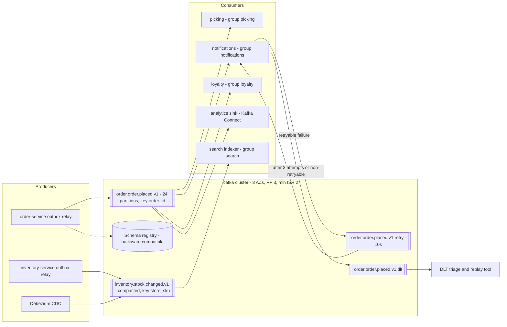
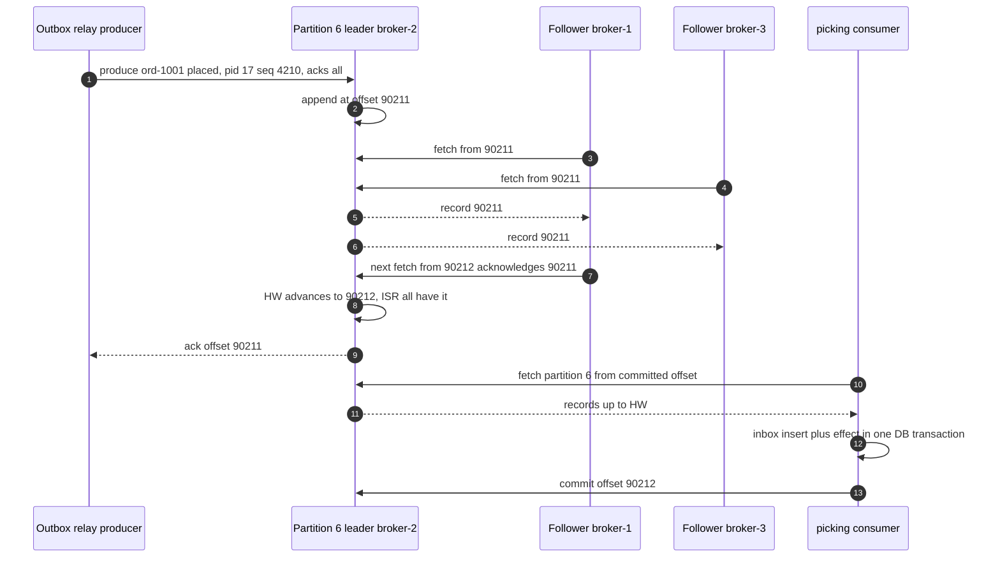
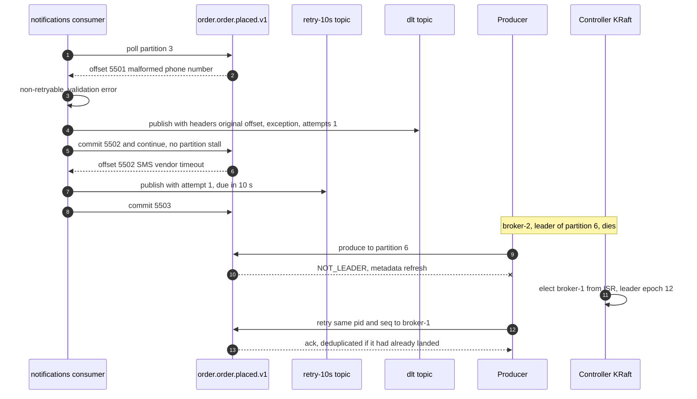
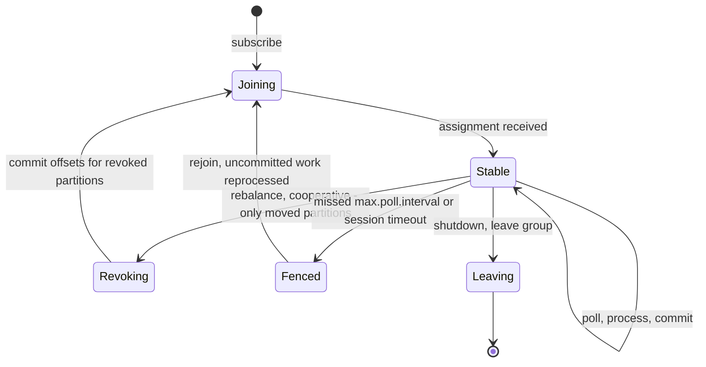

# 14. Messaging & Event Streaming ⭐

!!! abstract "Chapter at a glance"
    **Reader bands:** B1 → B4 · **Prerequisites:** [Ch 10](10-replication.md), [Ch 12](12-consistency-time-and-consensus.md), [Ch 13](13-distributed-transactions.md) · **What you will build:** The event backbone of the grocery platform.

    - **L1** contrasts queues with logs (plain Java).
    - **L2** designs topics with the **real Kafka client library**: the producer's murmur2 partitioner, key skew, partition-count changes, and the real consumer-group assignors (range, round-robin, cooperative-sticky).
    - **L3** simulates a Kafka partition's replication (ISR, high watermark, `acks`, `min.insync.replicas`, unclean election, idempotent producer) under crashes and network cuts.
    - **L4** covers consumer semantics: where you commit decides at-most/at-least/effectively-once, and a poison message shows blocking retries vs retry topics.

    **Two real brokers in the labs:**

    - A 3-node **NATS JetStream** cluster: Raft-replicated streams, idempotent publish, redelivery until max-deliver with a dead-letter advisory, competing consumers vs fan-out, leader failover vs a single-replica stream, per-key compaction, backpressure.
    - **Redis 7 Streams:** consumer groups, the pending-entries list, crash takeover, dead-lettering, replay, and retention trimming data a lagging group never read.

    A Kafka broker couldn't be installed in this environment, so the Kafka-specific Spring code is marked `VERIFY`. · **Reading time:** 130 min + code + labs

---

## 1. Introduction & Why It Matters

### 1.1 A story: the Diwali backlog

The order platform published every order event to one Kafka topic, `orders`, with 6 partitions and no key. Six services consumed it. On Diwali eve, four things went wrong within an hour:

- **Wrong order, wrong state.** With no key, the producer spread one order's events across partitions. Picking processed `ORDER_CANCELLED` before `ORDER_PLACED` for 1,900 orders, and packed groceries for orders that had been cancelled.
- **One bad message stopped a whole partition.** An event with a malformed GST field made the invoicing consumer throw. The default error handler retried it forever, partition 3 stopped, and invoices for a sixth of all orders were **4 hours** behind.
- **Rebalancing storms.** The team scaled the notification consumers from 6 to 12 pods. Only 6 could ever be busy (6 partitions). Each pod joining triggered a stop-the-world rebalance under the eager assignor, and slow processing exceeded `max.poll.interval.ms`, which kicked consumers out and triggered more rebalances. SMS confirmations were 40 minutes late.
- **Acknowledged, then lost.** The producer used `acks=1`. A broker died during the spike, and the follower elected in its place was a few hundred milliseconds behind: **~3,000 acknowledged events were gone**, silently.

Nothing was wrong with Kafka. Every failure was a **design choice left at its default**:

- **Key by aggregate id** (the order id), so all events of one order stay in one partition, in order.
- **Poison messages go to a retry topic and then a dead-letter topic,** with bounded retries, instead of blocking a partition.
- **Size partitions for peak consumer parallelism**, use the **cooperative-sticky assignor**, and keep per-record processing well under the poll interval.
- **Producers use `acks=all` + idempotence, and topics use `replication.factor=3`, `min.insync.replicas=2`, no unclean election.** Consumers are idempotent (Ch 13).

!!! quote "The thesis of this chapter"
    A message broker gives you **decoupling in time** (producers don't wait for consumers) and **fan-out**, and in return makes you design for **ordering, duplicates, poison messages, lag and retention** explicitly. Pick the model (queue or log), then pick keys, partitions, acks and commit points on purpose. Each default trades away one of them.

### 1.2 Where this lives in the grocery platform

| Flow | Technology | Key / routing | Why |
|---|---|---|---|
| Order lifecycle events | Kafka `order.order.*.v1` | `order_id` | Per-order ordering, many consumers, replay for new services |
| Inventory changes → search index, cache | Kafka `inventory.stock.changed.v1` (compacted) | `store_id:sku` | Latest value per key; rebuild from the topic |
| Rider GPS pings | Kafka `delivery.rider.location.v1` | `rider_id` | High volume, per-rider order, short retention (Ch 47) |
| SMS / WhatsApp / push jobs | Queue semantics (Kafka share groups, or RabbitMQ / SQS) | Per job | Competing workers, per-message retry and DLQ (Ch 40) |
| Outbox relay target | Kafka | Aggregate id | Ch 13 |
| Change data capture to the warehouse | Kafka Connect + Debezium | Primary key | Ch 13, Ch 21 |
| In-cluster events for low-latency services | NATS JetStream (lab) | Subject hierarchy | Lightweight, Raft-replicated streams |
| Carts' "recently viewed" feed | Redis Streams (lab) | Customer | Small, ephemeral, already on Redis |

### 1.3 Learning objectives

| Band | After this chapter you can… |
|---|---|
| <span class="band b1">B1</span> | Explain why we use messaging, queue vs log (pub/sub), and at-most/at-least/exactly-once in plain words |
| <span class="band b2">B2</span> | Design Kafka topics: keys, partitions, consumer groups, retention vs compaction, and choose where to commit offsets |
| <span class="band b3">B3</span> | Configure durability (replication, ISR, `acks`, `min.insync.replicas`, idempotence), handle poison messages with retry topics and DLQs, and reason about rebalancing and lag |
| <span class="band b4">B4</span> | Choose between Kafka, RabbitMQ, Pulsar, NATS, SQS/SNS and Redis Streams, design schema evolution and contracts, apply backpressure, and plan capacity and multi-region streaming |

---

## 2. Core Concepts — Beginner to Deep

### 2.1 Intuition: the kitchen order rail vs the ledger book <span class="band b1">B1</span>

A busy restaurant kitchen has two ways to pass orders on.

- **The order rail (a queue):** the waiter clips a ticket on the rail, and whichever cook is free takes it off and cooks it. More cooks means faster service. Once a ticket is taken, it's gone. The pastry chef who wants to know "what was ordered today" can't look at the rail.
- **The order book (a log):** every order is written on the next line of a book. The kitchen reads from its bookmark, the bar reads from its own bookmark, and the accountant reads the whole book at night. Nobody tears pages out; the book is archived after a month (retention). A new sous-chef can read from page 1 to learn the day (replay).
- **Duplicates:** the waiter, unsure the kitchen heard, shouts the order twice. The kitchen must recognize "table 7, order #41" as already cooking (idempotency).
- **Ordering:** a table's "no onions" note must reach the same cook who is cooking that table's dish, after the dish order. So a table's notes go to that table's cook (partitioning by key).

### 2.2 Why messaging: what a broker buys and costs <span class="band b1">B1</span>

| Benefit | Example | Cost |
|---|---|---|
| **Temporal decoupling** | Order-service keeps accepting orders while notification-service is down | Eventual consistency, lag to monitor |
| **Fan-out** | One `order.placed` → picking, notifications, loyalty, analytics | Every consumer must handle duplicates and reordering |
| **Load leveling** | A burst of 20 K orders/min is absorbed and consumed at a sustainable rate | Queue/lag growth becomes a capacity problem |
| **Replay / new consumers** | A fraud model reads 30 days of history | Storage and retention design |
| **Failure isolation** | A slow SMS vendor doesn't slow checkout | Retries, DLQs, poison-message handling |

Use synchronous calls when the caller needs the answer now: price, stock check, payment result. Use messaging for **facts other services react to**, and for **work that can happen later** (Ch 17).

### 2.3 Queue vs log ⭐ <span class="band b1">B1</span> <span class="band b2">B2</span>

| | **Queue** (RabbitMQ, SQS, ActiveMQ, JetStream work-queue) | **Log** (Kafka, Pulsar, Kinesis, JetStream limits, Redis Streams) |
|---|---|---|
| After consumption | Message removed on ack | Record stays until retention/compaction |
| Consumers | Competing consumers share messages | Each **consumer group** has its own offset. Within a group, partitions are shared |
| Parallelism | Add consumers freely | Bounded by partition count per group |
| Ordering | Usually FIFO per queue, lost with competing consumers | Guaranteed **per partition** |
| Per-message ack / retry | Native (nack, requeue, TTL, DLX) | Offset-based: a stuck record blocks its partition unless you move it aside |
| Replay | No (once acked it's gone) | Yes: seek to an offset or timestamp |
| Typical use | Jobs and commands: send SMS, generate invoice PDF | Events and streams: order lifecycle, CDC, telemetry |

L1 shows both: in the queue, a late subscriber gets `null`, and in the log, `analytics` replays from offset 0 a month later. The lines blur: Kafka 4.x adds **share groups** (queue semantics on a topic, KIP-932). JetStream offers both work-queue and limits retention. RabbitMQ has **streams**. The questions stay the same: do messages disappear on ack, and is parallelism bounded by partitions?

### 2.4 Kafka's data model ⭐ <span class="band b2">B2</span>

- **Topic:** a named stream, split into **partitions**. Each partition is an ordered, append-only log of records with increasing **offsets**.
- **Record:** key, value, headers, timestamp. **The key decides the partition:** murmur2(key) mod partitions for keyed records (L2 uses the real client code). Records without keys go to a "sticky" partition, per batch, not round-robin per record.
- **Ordering is per partition only.** All events for `ord-1001` go to partition 6 of 12, in order. Events for different orders on different partitions have no relative order.
- **Adding partitions remaps keys:** L2 measured **50.1 %** of order ids moving from 12 to 24 partitions. During the change, an order's new events can be consumed before its old ones. Pick partition counts with headroom up front (§2.12), or migrate to a new topic.
- **Keys can skew:** keying by `store_id` put the mega store's 5 % of traffic on one partition (**1.87x** the average of 24). That's the Ch 11 hot-key problem again, and one consumer in the group becomes the bottleneck.
- **Segments and retention:** each partition is stored as segment files. `retention.ms`/`retention.bytes` delete old segments (time/size), and `cleanup.policy=compact` keeps the **latest record per key** (plus tombstones with null values for deletes). Compacted topics are tables in stream form, used for the latest stock per SKU, config and CDC snapshots. The lab shows the same idea with JetStream's `max-msgs-per-subject=1`: three statuses for `ord-1` became one (`DELIVERED`).

### 2.5 Replication, ISR, acks and min.insync.replicas ⭐ <span class="band b3">B3</span>

Each partition has **replicas** on different brokers: one **leader** takes writes and followers fetch from it.

- **ISR (in-sync replicas):** the replicas that have caught up to the leader within `replica.lag.time.max.ms`. A slow or cut-off follower is removed and rejoins when caught up.
- **High watermark (HW):** the highest offset that all ISR members have. Consumers only see records below the HW, the "committed" records.
- **`acks`** (producer): `0` means fire-and-forget. `1` means acked after the leader writes it. `all` means acked after all current ISR members have it.
- **`min.insync.replicas`** (topic/broker): with `acks=all`, the leader rejects writes (`NotEnoughReplicas`) when the ISR is smaller than this. Without it, `acks=all` can silently degrade to "leader only" when followers fall out.
- **Unclean leader election:** if no ISR member is alive, allow an out-of-sync replica to lead. You get availability back and lose whatever it didn't have.

L3 ran these configs under crashes and network cuts (RF=3, 2 M records):

| Config | Acked-but-lost | Rejected | Notes |
|---|---|---|---|
| `acks=0` | **31,592** | 0 | Includes writes "sent" while the partition was offline |
| `acks=1` | **1,160** | 0 | Leader crashed before followers fetched |
| `acks=all`, `min.insync=1` | 0 | 0 | …until a disk dies while the ISR is just the leader (below) |
| `acks=all`, `min.insync=1`, unclean | **15,566** | 0 | Online sooner (2,065 vs 30,432 offline ticks), at a cost |
| `acks=all`, `min.insync=2` | 0 | 235,261 | Writes refused while ISR < 2: the producer knows and retries or fails |

The scripted case shows why `min.insync.replicas=2` matters. Both followers fall out of the ISR, 1,000 writes arrive, then the leader's disk dies.

- With `min.insync=1`, all **1,000 acknowledged writes are gone** (their only copy was on that disk).
- With `min.insync=2`, those writes were **refused**, so 0 acknowledged writes were lost.

The standard durable setup is `replication.factor=3`, `min.insync.replicas=2`, `acks=all`, `unclean.leader.election.enable=false`. It survives one broker loss with no data loss, and it refuses writes rather than lying when two are unavailable. (Kafka 4.x adds eligible leader replicas, KIP-966, to reduce the "last replica standing" risk further.)

### 2.6 Delivery semantics ⭐ <span class="band b1">B1</span> → <span class="band b3">B3</span>

| Semantics | How it happens | L4 measurement (1 M records, crashes in 2 % of batches) |
|---|---|---|
| **At most once** | Commit the offset **before** processing (or auto-commit on poll); a crash skips the rest of the batch | **8,413 never processed** |
| **At least once** | Commit **after** processing; a crash reprocesses since the last commit | **9,362 processed twice** |
| **Effectively once** | At-least-once delivery + idempotent effect, or offset stored **in the same DB transaction** as the effect | **0 and 0** |

**Kafka's exactly-once** has two parts:

- **The idempotent producer** (`enable.idempotence=true`, default since 3.0): the broker dedups retries by producer id and sequence number. L3: 30 duplicates without it, 0 with it.
- **Transactions** (`transactional.id`): write to several partitions **and** commit consumer offsets atomically. Consumers must use `isolation.level=read_committed`.

Together that's exactly-once for **Kafka-to-Kafka** read-process-write (Kafka Streams' `exactly_once_v2`). The moment the effect is a database row, an email or an API call, you're back to Ch 13: an inbox or an idempotent effect, or storing offsets transactionally with the effect.

### 2.7 Ordering guarantees ⭐ <span class="band b2">B2</span> <span class="band b3">B3</span>

- **Per-partition order** holds for records from one producer. With idempotence on, it holds even with retries and up to 5 in-flight requests.
- **Choose the key = the entity whose events must stay in order**, usually the aggregate id.
- **Things that break order:**
    - Changing the partition count (L2: 50 % of keys move).
    - Producers without idempotence and with `max.in.flight > 1` (a retry lands after a later batch).
    - Retry topics (L4: the failed event was applied after later ones for the same order).
    - Several outbox relays (Ch 13: 6 inversions).
    - Consumers processing one partition with a thread pool.
- **Defend in consumers anyway:** carry a per-aggregate version, and apply only newer ones (`update … where version < :v`, Ch 12). Then reordering costs a skip, not corruption.

### 2.8 Consumer groups and rebalancing ⭐ <span class="band b2">B2</span> <span class="band b3">B3</span>

A consumer group divides partitions among its members: each partition is read by **one** member of the group. More members than partitions leaves some idle. That's why §1.1's 12 pods on 6 partitions didn't help.

**Rebalancing** happens when members join or leave, or when one misses `max.poll.interval.ms` because processing took too long between polls. L2 ran the **real assignors** for 12 partitions when a 4th consumer joins 3:

| Assignor | Partitions that changed owner | Protocol |
|---|---|---|
| `range` | 6 | **Eager:** every member revokes everything, then gets a new assignment (stop-the-world) |
| `roundrobin` | 9 | Eager |
| `cooperative-sticky` | 3 (9, 10, 11) | **Incremental:** members keep what they own. In round 1 only 3 partitions are revoked, and round 2 hands them to `c4` |

Practices:

- Use `cooperative-sticky`, or the new consumer protocol (KIP-848, server-side assignment, Kafka 4.x).
- Set **static membership** (`group.instance.id`) so a rolling restart doesn't rebalance.
- Keep processing per poll well below `max.poll.interval.ms` (smaller `max.poll.records`, async hand-off with care).
- Commit offsets in `onPartitionsRevoked`.

### 2.9 Retries, poison messages and dead-letter topics ⭐ <span class="band b3">B3</span>

A **poison message** fails every time: bad data, or a bug for one shape of input. With offset-based consumption, retrying it in place blocks the whole partition. L4: 5 retries with 1 s backoff put **5,002 ms of lag** on everything behind it.

| Strategy | Behaviour | L4 result | Use when |
|---|---|---|---|
| Blocking retries (in place) | Retry with backoff, partition waits | Lag 5,002 ms, order kept | Transient errors (DB failover), strict ordering needed |
| **Non-blocking retry topics** | Publish to `orders.placed.retry-1s`, `…retry-10s`, then `…dlt`, and keep consuming | Lag 2 ms, **1 event applied out of order** | Independent events, or per-key order handled by versions |
| **DLQ/DLT only** | After N attempts, park it with error headers and alert | — | Always, as the last stop |

Rules:

- Classify errors: **retryable** (timeouts, 5xx, deadlocks) vs **non-retryable** (validation, deserialization) → straight to the DLT.
- **Cap attempts**, and keep the original topic, partition, offset, exception and attempt count in headers.
- The DLT has an **owner, an alert and a replay tool.** A DLT nobody reads is data loss with extra steps.
- In queue systems this is native: JetStream's `max_deliver` emitted an advisory after 3 deliveries (lab), RabbitMQ has dead-letter exchanges, SQS has redrive policies, and Redis needs a claim-count check (lab: moved to `orders.dlq`).

### 2.10 Schemas and contracts ⭐ <span class="band b3">B3</span> <span class="band b4">B4</span>

Events are a **public API** between teams, and they live longer than the code that wrote them (replay).

- **Serialization:** JSON (readable, no schema enforcement), **Avro** (compact, schema required, great evolution rules), **Protobuf** (compact, field numbers, gRPC-friendly).
- **Schema registry** (Confluent, Apicurio, Karapace): producers register schemas, records carry a schema id, and the registry enforces a **compatibility mode**:
    - **Backward:** new consumers can read old data (add optional fields, remove fields).
    - **Forward:** old consumers can read new data.
    - **Full:** both.
- **Evolution rules of thumb:** add fields with defaults. Never reuse or renumber fields. Never change a field's meaning. Breaking changes go to a **new versioned topic** (`order.order.placed.v2`) with a dual-publish migration.
- **Event design:**
    - A **notification** says "something happened, go fetch", with a small payload.
    - **Event-carried state transfer** includes the data consumers need, so they don't call back.
    - Keep internal fields out. Include `event_id`, `occurred_at` (HLC, Ch 12), `aggregate_id`, `version` and `schema` version.
    - Use CloudEvents-style envelopes where multiple teams publish.

Ch 15 covers event types and event sourcing, and Ch 28 covers schema evolution in depth.

### 2.11 Backpressure and lag ⭐ <span class="band b3">B3</span>

In a log, **the broker never pushes more than a consumer asks for** (pull model), so backpressure is natural. The symptom is **consumer lag** (latest offset minus committed offset), which is the first metric to alert on.

- **Lag in time** matters more than lag in records: alert on "the oldest unprocessed event is 2 minutes old".
- **Push-style systems need explicit limits:** RabbitMQ `prefetch` (QoS), and JetStream `max_ack_pending`. The lab capped a slow consumer at 5 unacknowledged deliveries when it asked for 20. Everything else stays in the stream instead of piling up in consumer memory.
- **Fixes for lag:** more partitions and consumers (up to the partition count), faster processing (batching, async I/O), splitting a hot key, or shedding non-critical consumers during peaks.
- **Retention is the deadline for lag.** A group that falls behind by more than the retention window loses data silently. The Redis lab trimmed to 1,000 entries while groups lagged by ~3,000, so **~2,000 events would never reach them**. Alert when lag in time approaches retention.

### 2.12 Sizing and capacity <span class="band b3">B3</span> <span class="band b4">B4</span>

- **Partitions** ≥ max(target throughput / per-partition producer throughput, target throughput / per-consumer throughput), **plus headroom** for 2–3 years (you can't shrink, and growing remaps keys).
- Typical numbers: tens of MB/s per partition for producers, and consumer throughput limited by your processing. Too many partitions costs memory, file handles, longer failovers and controller load (KRaft improves it, but it's still a cost).
- **Storage** = ingress bytes/s × retention × replication factor (+ ~20 % headroom). Tiered storage (KIP-405) moves old segments to object storage.
- For orders: ~1.3 K events/s × ~1 KB ≈ 1.3 MB/s ≈ 112 GB/day × 7 days × RF 3 ≈ **2.4 TB**. That's small. Throughput isn't the constraint, consumer parallelism is: **24 partitions** leaves room for 24 consumers per group.

### 2.13 Choosing a broker ⭐ <span class="band b4">B4</span>

| | **Kafka** | **RabbitMQ** | **Pulsar** | **NATS JetStream** | **SQS/SNS** | **Redis Streams** |
|---|---|---|---|---|---|---|
| Model | Partitioned log | Queues + exchanges (routing), plus streams | Log with segment storage (BookKeeper), queues and logs | Streams (subjects) + consumers, KV | Managed queue + pub/sub | Log per key, consumer groups |
| Ordering | Per partition | Per queue (single consumer) | Per partition / key-shared | Per stream/subject | FIFO queues only | Per stream |
| Replay | Yes (retention, compaction, tiered) | Streams only | Yes (tiered) | Yes | No | Yes (until trimmed) |
| Replication | ISR, acks | Quorum queues (Raft) | BookKeeper quorums | Raft per stream (lab) | Managed | Async replicas (can lose writes) |
| Routing | By key → partition | **Rich** (topic/header exchanges) | Topics, subscriptions | Subject wildcards | Filter policies | None |
| Throughput | Very high | Medium–high | Very high | High | High (managed) | High, memory-bound |
| Ops | Heavy (KRaft simplifies) | Medium | Heavy | Light | None | Light |
| Fit here | Event backbone, CDC | Jobs with routing, RPC-ish work | Multi-tenant geo-replicated streaming | Low-latency in-cluster events, edge | Cloud-native jobs | Small ephemeral streams |

---

## 3. Architecture & Diagrams

### 3.1 Component view: the event backbone



Each consumer group reads the same topic independently, at its own pace, and fails independently. Notifications' retries don't delay picking.

### 3.2 Sequence: happy path, publish with acks=all and consume at least once



### 3.3 Sequence: failure path, a poison message and a leader failure



### 3.4 State: a consumer group member



---

## 4. Design Document Excerpt: Order Event Streaming

| Field | Value |
|---|---|
| Author / Reviewers | Platform team / Orders, Notifications, Data, SRE |
| Status | Approved |
| Related ADRs | ADR-053 Kafka as the event backbone; ADR-054 Keys, partitions and naming; ADR-055 Durability settings; ADR-056 Retry topics and DLT ownership; ADR-057 Avro + schema registry (backward) |

**1. Context & Problem.** Unkeyed events reordered order state for 1,900 orders, a poison message stalled invoicing for 4 h, eager rebalances delayed SMS by 40 min, and `acks=1` lost ~3,000 acknowledged events (§1.1).

**2. Goals / Non-Goals.**

- *Goals:* per-order ordering; no acknowledged event lost on single-broker or single-AZ failure; a poison message never stalls a partition for more than its retry budget; lag p99 < 5 s at peak for tier-1 consumers; schemas evolve without breaking consumers.
- *Non-goals:* exactly-once to external systems (handled by idempotent consumers, Ch 13); cross-region active-active streaming (Ch 27).

**3. Requirements.**

| ID | Requirement |
|---|---|
| NFR-1 | RPO 0 for acknowledged events on loss of one broker or one AZ |
| NFR-2 | Per-aggregate ordering for every `order.*` topic |
| NFR-3 | Tier-1 consumer lag (time) p99 < 5 s; alert at 60 s; retention ≥ 7 days (≥ 100x the alert) |
| NFR-4 | Non-retryable failures reach the DLT on first failure; retryable ones within 3 attempts over ≤ 5 min |
| NFR-5 | Schema changes are backward compatible, enforced in CI and by the registry |
| NFR-6 | Rolling restarts don't trigger rebalances (static membership) |

**4. Capacity & latency estimates.**

| Item | Calculation | Result |
|---|---|---|
| Order events at P90 peak | ~420 orders/s × ~3 events | ~1.3 K events/s |
| Bytes | ~1 KB Avro + headers | ~1.3 MB/s |
| Storage | 1.3 MB/s × 86,400 × 7 days × RF 3 × 1.2 | **~2.8 TB** (all order topics) |
| Partitions for `order.order.placed.v1` | Peak 420/s; slowest consumer ~25 ms/record → 40/s per consumer → 11 consumers; × 2 headroom | **24** |
| Produce latency (`acks=all`, cross-AZ) | Leader append + follower fetch round trip ~1–3 ms | p99 ~10 ms |
| Failover (leader election) | KRaft controller + metadata propagation | ~1–5 s of `NOT_LEADER` retries |

**5. Proposed design.**

1. **Naming:** `<domain>.<entity>.<event>.v<N>`, with retry topics `<topic>.retry-<delay>` and the DLT `<topic>.dlt`. One event type per topic for high-volume events. Low-volume related events may share a topic with a type header.
2. **Keys:** the aggregate id (`order_id`, `store_id:sku`, `rider_id`). Partition counts are fixed at creation with headroom; a repartition means a new topic + dual publish.
3. **Durability:** RF 3 across 3 AZs (rack-aware), `min.insync.replicas=2`, unclean election off. Producers use `acks=all`, idempotence on, `delivery.timeout.ms=120000`.
4. **Consumers:** `cooperative-sticky` (or the KIP-848 protocol), static membership, `max.poll.records` sized so a batch completes in < 30 % of `max.poll.interval.ms`, manual commits after processing, and idempotent effects (inbox, Ch 13).
5. **Errors:** Spring Kafka `DefaultErrorHandler` with a classifier, non-blocking retries (`10s`, `2m`) for retryable errors, straight to the DLT for non-retryable ones. Every DLT has an owner, an alert and a replay CLI.
6. **Schemas:** Avro with the registry in `BACKWARD_TRANSITIVE` mode. Contract tests in CI (Ch 29), and a new `.vN+1` topic for breaking changes.
7. **Compacted topics** for "latest state" feeds (stock, prices), with a `min.compaction.lag.ms` that lets consumers see intermediate values if they need them.

**7. Alternatives considered.**

| Option | Pros | Cons | Verdict |
|---|---|---|---|
| **Kafka (managed or self-run on KRaft)** | Log + replay, huge ecosystem (Connect, Streams, Debezium) | Operational weight; partitions bound parallelism | **Chosen** |
| RabbitMQ for everything | Routing, per-message ack/DLX | No long replay; ordering lost with competing consumers | Used for job queues only |
| Pulsar | Tiered storage, multi-tenancy, geo-replication | Smaller ecosystem in the team; more components | Rejected for now |
| NATS JetStream | Lightweight, Raft streams, simple ops (lab) | Smaller connector ecosystem | Accepted for in-cluster low-latency events |
| SQS/SNS | Zero ops | Cloud lock-in; no replay | Rejected (multi-cloud plan) |

**8. Failure modes.** Broker loss: ISR leader election, producers retry (idempotent). AZ loss: 2 of 3 replicas remain, writes continue (min ISR 2). Two brokers lost: writes to affected partitions are refused (no silent loss). Poison message: DLT. Slow consumer: lag alert, scale up to the partition count, degrade non-critical consumers. Schema break: rejected by the registry at produce time.

**10. Observability.** Per group: lag in records and seconds (Burrow/exporter), rebalances per hour, commit rate. Per topic: bytes in/out, under-replicated and under-min-ISR partitions (page), offline partitions (page). Producer: error rate, retries, `record-queue-time`. DLT: message rate and age of oldest (page if > 0 for tier 1). Registry: rejected schemas.

**14. Decision (ADR-053–057 summary).** Kafka is the event backbone. Keys are aggregate ids, and partitions are sized with headroom and never changed in place. RF 3 / min ISR 2 / acks=all / idempotent producers / no unclean election. Consumers use cooperative-sticky assignment, static membership, commit-after-processing and idempotent effects. Poison messages go through retry topics to owned DLTs. Avro schemas are enforced as backward compatible by a registry.

---

## 5. Hands-On Code — Level Ladder

| Level | New requirement that forces the step |
|---|---|
| L1 | "Show the difference between a queue and a log." (plain Java) |
| L2 | "Before creating the topic: which key, how many partitions, which assignor?" (the real Kafka client library, no broker) |
| L3 | "Which producer and topic settings lose acknowledged events?" (replication simulation) |
| L4 | "Where do we commit, and what do we do with a poison message?" (consumer simulation + Spring Kafka) |
| Labs | Real NATS JetStream (3-node Raft cluster) and real Redis 7 Streams |

!!! info "How the code in this chapter was verified"
    L1, L3 and L4 are plain Java simulations, run as shown. L2 runs the **real Kafka client library** (`kafka-clients` 3.9.0, as shipped in the AutoMQ 1.4.0 distribution, whose partitioner and assignors are upstream Apache Kafka code) without a broker. A Kafka broker couldn't be started here: Apache downloads are blocked, and the only available distribution (AutoMQ) needs object storage. The **labs use two real brokers** instead: a 3-node NATS JetStream 2.10 cluster and Redis 7. The Spring Kafka configuration below each level wasn't compiled and is marked `VERIFY`.

### L1 — Concept: queue vs log (plain Java) <span class="band b1">B1</span>

```java
// QueueVsLogL1.java — run with: java QueueVsLogL1.java
// The two messaging models side by side: a queue (messages removed when acked) and a log (messages kept, readers keep offsets).
import java.util.*;

public class QueueVsLogL1 {

    /** Queue: competing consumers; an acked message is gone. */
    static final class Queue {
        private final Deque<String> ready = new ArrayDeque<>();
        void publish(String m) { ready.add(m); }
        String receive() { return ready.poll(); }                 // (a real broker keeps it "unacked" until ack/timeout)
        int depth() { return ready.size(); }
    }

    /** Log: append-only; each consumer GROUP has its own offset; retention decides how long records stay. */
    static final class Log {
        private final List<String> records = new ArrayList<>();
        private final Map<String, Integer> offsets = new TreeMap<>();
        private int startOffset = 0;                              // advances when retention deletes old records
        void append(String m) { records.add(m); }
        List<String> poll(String group, int max) {
            int from = Math.max(offsets.getOrDefault(group, 0), startOffset);
            List<String> out = new ArrayList<>(records.subList(from, Math.min(records.size(), from + max)));
            offsets.put(group, from + out.size());                // commit
            return out;
        }
        void seek(String group, int offset) { offsets.put(group, offset); }
        void retainLast(int n) { startOffset = Math.max(startOffset, records.size() - n); }
    }

    public static void main(String[] args) {
        System.out.println("A. Queue: 6 order events, two picking workers compete");
        Queue q = new Queue();
        for (int i = 1; i <= 6; i++) q.publish("ord-" + i);
        List<String> w1 = new ArrayList<>(), w2 = new ArrayList<>();
        for (int i = 0; i < 6; i++) (i % 2 == 0 ? w1 : w2).add(q.receive());
        System.out.println("   worker-1 " + w1 + "  worker-2 " + w2 + "  left in queue: " + q.depth());
        System.out.println("   a notification service subscribing now gets: " + q.receive() + "  (gone: a queue is not a history)");

        System.out.println("B. Log: the same 6 events, several consumer groups");
        Log log = new Log();
        for (int i = 1; i <= 6; i++) log.append("ord-" + i);
        System.out.println("   picking       reads " + log.poll("picking", 10));
        System.out.println("   notifications reads " + log.poll("notifications", 3) + " then " + log.poll("notifications", 10) + "  (own pace)");
        log.append("ord-7");
        System.out.println("   picking       reads " + log.poll("picking", 10) + "  (continues from its offset)");
        log.seek("analytics", 0);
        System.out.println("   analytics, added a month later, replays from offset 0: " + log.poll("analytics", 10));
        log.retainLast(3);
        log.seek("audit", 0);
        System.out.println("   after retention keeps only the last 3, a new 'audit' group from 0 gets: " + log.poll("audit", 10));
    }
}
```

Actual output from running it:

```text
A. Queue: 6 order events, two picking workers compete
   worker-1 [ord-1, ord-3, ord-5]  worker-2 [ord-2, ord-4, ord-6]  left in queue: 0
   a notification service subscribing now gets: null  (gone: a queue is not a history)
B. Log: the same 6 events, several consumer groups
   picking       reads [ord-1, ord-2, ord-3, ord-4, ord-5, ord-6]
   notifications reads [ord-1, ord-2, ord-3] then [ord-4, ord-5, ord-6]  (own pace)
   picking       reads [ord-7]  (continues from its offset)
   analytics, added a month later, replays from offset 0: [ord-1, ord-2, ord-3, ord-4, ord-5, ord-6, ord-7]
   after retention keeps only the last 3, a new 'audit' group from 0 gets: [ord-5, ord-6, ord-7]
```

**What L1 shows:** a queue divides work and forgets it. A log keeps history, and each consumer group keeps its own position, so new consumers can replay. Until retention removes old records: the `audit` group created late only sees what's left.

### L2 — Designing a topic with the real Kafka client library <span class="band b2">B2</span>

Requirement: before creating `order.order.placed.v1`, answer which key, how many partitions, and which assignor, using the same code the producer and consumers will run.

```java
// KafkaClientsL2.java — run with: java -cp kafka-clients-3.9.0.jar:slf4j-api-1.7.36.jar KafkaClientsL2.java
// Uses the REAL Kafka client library (no broker needed): the default partitioner's murmur2 hashing and the real
// consumer-group assignors, to answer design questions before you create a topic.
import java.nio.charset.StandardCharsets;
import java.util.*;
import java.util.stream.*;
import org.apache.kafka.clients.consumer.*;
import org.apache.kafka.clients.consumer.ConsumerPartitionAssignor.*;
import org.apache.kafka.common.*;
import org.apache.kafka.common.utils.Utils;

public class KafkaClientsL2 {

    /** Exactly what the producer does for a record WITH a key: murmur2(keyBytes) → positive → mod partitions. */
    static int partitionFor(String key, int partitions) {
        return Utils.toPositive(Utils.murmur2(key.getBytes(StandardCharsets.UTF_8))) % partitions;
    }

    static Cluster cluster(String topic, int partitions) {
        Node n = new Node(0, "localhost", 9092);
        List<PartitionInfo> ps = IntStream.range(0, partitions).mapToObj(p -> new PartitionInfo(topic, p, n, new Node[]{n}, new Node[]{n})).toList();
        return new Cluster("c", List.of(n), ps, Set.of(), Set.of());
    }

    static Map<String, List<TopicPartition>> assign(ConsumerPartitionAssignor a, Cluster c, List<String> members,
                                                    Map<String, List<TopicPartition>> owned, int generation) {
        Map<String, Subscription> subs = new TreeMap<>();
        for (String m : members) subs.put(m, new Subscription(List.of("order.order.placed.v1"),
                a instanceof CooperativeStickyAssignor cs ? cs.subscriptionUserData(Set.of("order.order.placed.v1")) : null,
                owned.getOrDefault(m, List.of()), generation, Optional.empty()));
        GroupAssignment ga = a.assign(c, new GroupSubscription(subs));
        Map<String, List<TopicPartition>> out = new TreeMap<>();
        ga.groupAssignment().forEach((m, as) -> out.put(m, as.partitions().stream().sorted(Comparator.comparingInt(TopicPartition::partition)).toList()));
        return out;
    }

    static String show(Map<String, List<TopicPartition>> a) {
        return a.entrySet().stream().map(e -> e.getKey() + "=" + e.getValue().stream().map(tp -> "" + tp.partition()).collect(Collectors.joining(",", "[", "]"))).collect(Collectors.joining(" "));
    }

    public static void main(String[] args) {
        String topic = "order.order.placed.v1";

        System.out.println("A. Keyed records: every event of one order lands in one partition (per-key order)");
        for (String k : List.of("ord-1001", "ord-1002", "ord-1003")) System.out.printf("   key %s → partition %d of 12%n", k, partitionFor(k, 12));

        System.out.println("B. Adding partitions later moves keys: order during the change is no longer guaranteed");
        int moved = 0, n = 100_000;
        for (int i = 0; i < n; i++) if (partitionFor("ord-" + i, 12) != partitionFor("ord-" + i, 24)) moved++;
        System.out.printf("   12 → 24 partitions: %.1f %% of keys map to a different partition%n", 100.0 * moved / n);

        System.out.println("C. Key choice and skew: key by store_id, one mega store has 5 % of orders, 24 partitions");
        Random r = new Random(5); int[] load = new int[24];
        for (int i = 0; i < 200_000; i++) load[partitionFor(r.nextDouble() < 0.05 ? "store-MEGA" : "store-" + r.nextInt(500), 24)]++;
        System.out.printf("   busiest partition %.2fx the average → one consumer in the group is the bottleneck%n", Arrays.stream(load).max().getAsInt() / (200_000 / 24.0));

        System.out.println("D. Consumer group: 12 partitions, 3 consumers, then a 4th joins (the real assignors)");
        Cluster c12 = cluster(topic, 12);
        for (ConsumerPartitionAssignor a : List.of(new RangeAssignor(), new RoundRobinAssignor(), new CooperativeStickyAssignor())) {
            var before = assign(a, c12, List.of("c1", "c2", "c3"), Map.of(), 1);
            var after = assign(a, c12, List.of("c1", "c2", "c3", "c4"), before, 2);
            Map<Integer, String> ownerBefore = new HashMap<>(), ownerAfter = new HashMap<>();
            before.forEach((m, l) -> l.forEach(tp -> ownerBefore.put(tp.partition(), m)));
            after.forEach((m, l) -> l.forEach(tp -> ownerAfter.put(tp.partition(), m)));
            long changed = IntStream.range(0, 12).filter(p -> !Objects.equals(ownerBefore.get(p), ownerAfter.get(p))).count();
            System.out.printf("   %-26s before %s%n", a.name(), show(before));
            System.out.printf("   %-26s after  %s   partitions that changed owner: %d%n", "", show(after), changed);
            if (a instanceof CooperativeStickyAssignor) {                         // the follow-up rebalance hands over revoked partitions
                var round2 = assign(a, c12, List.of("c1", "c2", "c3", "c4"), after, 3);
                System.out.printf("   %-26s round2 %s%n", "", show(round2));
            }
        }
        System.out.println("   (eager assignors: every consumer stops and gives up ALL partitions during the rebalance;");
        System.out.println("    cooperative-sticky: consumers keep what they own, and moved partitions are handed over in a second round)");
    }
}
```

Actual output from running it:

```text
A. Keyed records: every event of one order lands in one partition (per-key order)
   key ord-1001 → partition 6 of 12
   key ord-1002 → partition 8 of 12
   key ord-1003 → partition 6 of 12
B. Adding partitions later moves keys: order during the change is no longer guaranteed
   12 → 24 partitions: 50.1 % of keys map to a different partition
C. Key choice and skew: key by store_id, one mega store has 5 % of orders, 24 partitions
   busiest partition 1.87x the average → one consumer in the group is the bottleneck
D. Consumer group: 12 partitions, 3 consumers, then a 4th joins (the real assignors)
   range                      before c1=[0,1,2,3] c2=[4,5,6,7] c3=[8,9,10,11]
                              after  c1=[0,1,2] c2=[3,4,5] c3=[6,7,8] c4=[9,10,11]   partitions that changed owner: 6
   roundrobin                 before c1=[0,3,6,9] c2=[1,4,7,10] c3=[2,5,8,11]
                              after  c1=[0,4,8] c2=[1,5,9] c3=[2,6,10] c4=[3,7,11]   partitions that changed owner: 9
   cooperative-sticky         before c1=[0,3,6,9] c2=[1,4,7,10] c3=[2,5,8,11]
                              after  c1=[0,3,6] c2=[1,4,7] c3=[2,5,8] c4=[]   partitions that changed owner: 3
                              round2 c1=[0,3,6] c2=[1,4,7] c3=[2,5,8] c4=[9,10,11]
   (eager assignors: every consumer stops and gives up ALL partitions during the rebalance;
    cooperative-sticky: consumers keep what they own, and moved partitions are handed over in a second round)
```

- **A.** Keys pin an order to a partition, and two orders can share one (`ord-1001` and `ord-1003` both on 6). Order is per key, not per partition.
- **B.** Doubling partitions remaps **half** the keys. For murmur2 mod N going 12 → 24, a key stays only if its hash mod 24 is < 12. So size partitions up front, and never grow a keyed topic in place without a migration plan.
- **C.** A key with a big share of the traffic makes a hot partition, **1.87x** here. Key by order, not by store, or salt the hot key (Ch 11).
- **D.** When a 4th consumer joins, `range` moves 6 partitions and `roundrobin` 9, and both revoke **everything** first (eager). `cooperative-sticky` moves only 3: round 1 revokes 9, 10 and 11, round 2 gives them to `c4`, and `c1`–`c3` never stop consuming the rest.

**The Spring Boot configuration that follows from it:**

=== "application.yml"

    ```yaml
    # VERIFY: property names for Spring Boot 4 / Spring Kafka 4 / kafka-clients 4.x
    spring:
      kafka:
        bootstrap-servers: ${KAFKA_BOOTSTRAP}
        producer:
          acks: all
          properties:
            enable.idempotence: true
            max.in.flight.requests.per.connection: 5      # ordering is kept with idempotence on
            delivery.timeout.ms: 120000
            linger.ms: 5
            compression.type: zstd
          key-serializer: org.apache.kafka.common.serialization.StringSerializer
          value-serializer: io.confluent.kafka.serializers.KafkaAvroSerializer
        consumer:
          group-id: ${spring.application.name}
          enable-auto-commit: false                       # commit after processing (L4)
          auto-offset-reset: earliest
          max-poll-records: 100
          isolation-level: read_committed
          properties:
            partition.assignment.strategy: org.apache.kafka.clients.consumer.CooperativeStickyAssignor
            group.instance.id: ${HOSTNAME}                  # static membership: rolling restarts don't rebalance
            max.poll.interval.ms: 300000
            session.timeout.ms: 45000
        listener:
          ack-mode: record
          concurrency: 3                                  # threads per pod; pods × concurrency ≤ partitions
        properties:
          schema.registry.url: ${SCHEMA_REGISTRY_URL}
          auto.register.schemas: false                    # CI registers; runtime only validates
    ```

=== "Topic definitions"

    ```java
    package com.grocery.order.messaging;

    import org.apache.kafka.clients.admin.NewTopic;
    import org.springframework.context.annotation.Bean;
    import org.springframework.context.annotation.Configuration;
    import org.springframework.kafka.config.TopicBuilder;

    @Configuration
    public class OrderTopics {

        @Bean
        NewTopic orderPlaced() {
            return TopicBuilder.name("order.order.placed.v1")
                    .partitions(24)                               // sized for peak consumer parallelism × 2 (§4)
                    .replicas(3)
                    .config("min.insync.replicas", "2")
                    .config("unclean.leader.election.enable", "false")
                    .config("retention.ms", String.valueOf(7L * 24 * 3600 * 1000))
                    .build();
        }

        @Bean
        NewTopic stockLatest() {
            return TopicBuilder.name("inventory.stock.changed.v1")
                    .partitions(24).replicas(3)
                    .compact()                                    // latest value per store_id:sku
                    .config("min.insync.replicas", "2")
                    .config("min.compaction.lag.ms", "60000")
                    .build();
        }
    }
    ```

    In production, topics are usually created by a platform pipeline (Terraform/GitOps) rather than by applications at startup. The same settings apply. <!-- VERIFY -->

### L3 — Replication: which settings lose acknowledged events? (simulation) <span class="band b3">B3</span>

Requirement: justify `acks=all`, `min.insync.replicas=2`, no unclean election and the idempotent producer with evidence, not folklore. The simulation models one partition with RF=3 tick by tick:

- The leader appends, and followers fetch every 5 ticks.
- A follower leaves the ISR after 30 ticks without catching up and rejoins when caught up.
- HW = min LEO over the ISR.
- Elections are clean (ISR only) or unclean (the best surviving replica), and replicas truncate a divergent suffix to the new leader's log (leader-epoch truncation).
- Producers retry requests that were in flight to a dead leader.

```java
// ReplicationL3.java — run with: java ReplicationL3.java
// One Kafka partition, replication factor 3, simulated tick by tick: leader appends, followers fetch every few
// ticks, ISR shrinks when a follower falls behind for replica.lag.time.max, HW = min LEO over the ISR,
// producers use acks=0/1/all with min.insync.replicas, leaders crash, followers get cut off,
// elections are clean (from the ISR) or unclean, and replicas truncate to the new leader's log.
import java.util.*;

public class ReplicationL3 {

    record Cfg(String name, String acks, int minIsr, boolean unclean, boolean idempotent) { }
    record Rec(long id, int attempt) { }

    static final int RF = 3, FETCH_EVERY = 5, LAG_MAX = 30;

    static final class Replica {
        final List<Rec> log = new ArrayList<>();
        boolean up = true, diverged = false; int cutUntil = -1, downUntil = -1, lastCaughtUp = 0;
        int leo() { return log.size(); }
    }

    static Map<String, Long> run(Cfg cfg, long seed) {
        Random rnd = new Random(seed);
        Replica[] r = new Replica[RF];
        for (int i = 0; i < RF; i++) r[i] = new Replica();
        int leader = 0; Set<Integer> isr = new TreeSet<>(Set.of(0, 1, 2)); int hw = 0;
        Map<Long, Integer> pending = new HashMap<>();                  // id → offset waiting for HW (acks=all)
        Set<Long> acked = new HashSet<>();
        Deque<Long> retry = new ArrayDeque<>();
        long nextId = 0, rejected = 0, offlineTicks = 0, retries = 0;
        Set<Long> leaderIds = new HashSet<>();                         // idempotent producer: leader dedups (pid, seq) from its log

        for (int t = 0; t < 200_000; t++) {
            // ---- faults ----
            for (int i = 0; i < RF; i++) {
                Replica x = r[i];
                if (!x.up && t >= x.downUntil) { x.up = true; }
                if (x.up && rnd.nextDouble() < 0.0003) {
                    x.up = false; x.downUntil = t + 200 + rnd.nextInt(400);
                }
                if (x.up && rnd.nextDouble() < 0.001) x.cutUntil = t + 100 + rnd.nextInt(400);   // network cut from the leader
            }
            // ---- leader failure → election ----
            if (leader < 0 || !r[leader].up) {
                int old = leader;
                Integer next = isr.stream().filter(i -> i != old && r[i].up).findFirst().orElse(null);
                if (next == null && old >= 0 && r[old].up && isr.contains(old)) next = old;      // the old leader came back intact
                if (next == null && cfg.unclean())                                                 // unclean: best surviving replica
                    for (int i = 0; i < RF; i++) if (r[i].up && (next == null || r[i].leo() > r[next].leo())) next = i;
                if (next == null) { offlineTicks++; leader = -1; pending.clear(); }
                else if (next != leader) {
                    leader = next;
                    for (int i = 0; i < RF; i++) if (i != leader) r[i].diverged = true;   // must truncate to the new leader's log
                    leaderIds.clear(); for (Rec x : r[leader].log) leaderIds.add(x.id());
                    if (!isr.contains(leader)) isr = new TreeSet<>(Set.of(leader));             // unclean: ISR restarts at the new leader
                    isr.removeIf(i -> !r[i].up);
                    // in-flight acks=all requests to the dead leader time out → the producer retries them
                    retry.addAll(pending.keySet()); retries += pending.size(); pending.clear();
                    hw = Math.min(hw, r[leader].leo());
                }
            }
            // ---- produce one record per tick (+ retries) ----
            if (leader >= 0) {
                Replica L = r[leader];
                List<Long> batch = new ArrayList<>(retry); retry.clear();
                batch.add(nextId++);
                for (long id : batch) {
                    if (cfg.acks().equals("all") && isr.size() < cfg.minIsr()) { rejected++; continue; }   // NotEnoughReplicas
                    if (cfg.idempotent() && leaderIds.contains(id)) {                             // duplicate retry: not appended
                        if (cfg.acks().equals("all")) pending.put(id, L.log.size()); else acked.add(id);
                        continue;
                    }
                    L.log.add(new Rec(id, 0)); leaderIds.add(id);
                    switch (cfg.acks()) {
                        case "0", "1" -> acked.add(id);
                        default -> pending.put(id, L.log.size());
                    }
                }
            } else {                                                   // offline
                long id = nextId++;
                if (cfg.acks().equals("0")) acked.add(id);                // fire-and-forget: the producer never finds out
            }
            // ---- followers fetch ----
            if (leader >= 0 && t % FETCH_EVERY == 0) {
                Replica L = r[leader];
                for (int i = 0; i < RF; i++) {
                    if (i == leader || !r[i].up || t < r[i].cutUntil) continue;
                    Replica f = r[i];
                    // truncate a divergent suffix (leader-epoch based truncation), then append what's missing
                    if (f.diverged) {
                        int common = 0;
                        while (common < f.leo() && common < L.leo() && f.log.get(common).equals(L.log.get(common))) common++;
                        while (f.leo() > common) f.log.remove(f.leo() - 1);
                        f.diverged = false;
                    }
                    f.log.addAll(L.log.subList(f.leo(), L.leo()));
                    f.lastCaughtUp = t;
                    if (!isr.contains(i)) isr.add(i);                  // caught up → rejoins the ISR
                }
                r[leader].lastCaughtUp = t;
            }
            // ---- ISR shrink and high watermark ----
            if (leader >= 0) {
                int tt = t, ld = leader;
                isr.removeIf(i -> i != ld && (!r[i].up || tt - r[i].lastCaughtUp > LAG_MAX));
                int newHw = isr.stream().mapToInt(i -> r[i].leo()).min().orElse(0);
                hw = Math.max(hw, newHw);
                int h = hw;
                pending.entrySet().removeIf(e -> { if (e.getValue() <= h) { acked.add(e.getKey()); return true; } return false; });
            }
        }
        // ---- verdict: what does the final leader's log contain? ----
        Map<Long, Integer> counts = new HashMap<>();
        if (leader >= 0) for (Rec x : r[leader].log) counts.merge(x.id(), 1, Integer::sum);
        else for (Replica x : r) for (Rec y : x.log) counts.putIfAbsent(y.id(), 1);          // offline: anything still on disk
        long lost = acked.stream().filter(id -> !counts.containsKey(id)).count();
        long dups = counts.values().stream().filter(c -> c > 1).count();
        Map<String, Long> out = new LinkedHashMap<>();
        out.put("acked", (long) acked.size()); out.put("acked-but-lost", lost); out.put("duplicates", dups);
        out.put("rejected (NotEnoughReplicas)", rejected); out.put("offline ticks", offlineTicks); out.put("retries", retries);
        return out;
    }

    public static void main(String[] args) {
        List<Cfg> cfgs = List.of(
            new Cfg("acks=0", "0", 1, false, false),
            new Cfg("acks=1", "1", 1, false, false),
            new Cfg("acks=all, min.insync=1", "all", 1, false, false),
            new Cfg("acks=all, min.insync=1, unclean election", "all", 1, true, false),
            new Cfg("acks=all, min.insync=2", "all", 2, false, false),
            new Cfg("acks=all, min.insync=2, idempotent producer", "all", 2, false, true));
        System.out.println("A. RF=3, 200,000 ticks x 10 seeds; brokers crash and restart (0.03 %/tick) and get cut off from the leader (0.1 %/tick)");
        System.out.printf("   %-44s %10s %14s %11s %13s %9s%n", "producer / topic config", "acked", "acked-but-lost", "duplicates", "rejected", "offline");
        for (Cfg c : cfgs) {
            Map<String, Long> sum = new LinkedHashMap<>();
            for (long s = 1; s <= 10; s++) run(c, s).forEach((k, v) -> sum.merge(k, v, Long::sum));
            System.out.printf("   %-44s %,10d %,14d %,11d %,13d %,9d%n", c.name(), sum.get("acked"), sum.get("acked-but-lost"),
                    sum.get("duplicates"), sum.get("rejected (NotEnoughReplicas)"), sum.get("offline ticks"));
        }
        System.out.println("B. The case min.insync.replicas exists for: both followers fall out of the ISR, 1,000 more writes arrive,");
        System.out.println("   then the leader's DISK dies (broker replaced, comes back empty)");
        for (int minIsr : new int[]{1, 2}) for (boolean unclean : new boolean[]{false, true}) {
            long acked = 0, lost; String state;
            List<Long> leaderLog = new ArrayList<>(), follower = new ArrayList<>();
            for (long i = 0; i < 10_000; i++) { leaderLog.add(i); follower.add(i); }        // in sync, ISR = {0,1,2}
            int isrSize = 1;                                                                  // followers cut off → ISR = {leader}
            for (long i = 10_000; i < 11_000; i++) if (isrSize >= minIsr) { leaderLog.add(i); acked++; }   // acks=all
            long ackedTotal = 10_000 + acked;
            leaderLog.clear();                                                                // disk lost; no eligible ISR member left
            lost = ackedTotal - follower.size();                                              // their only copy was on the lost disk
            state = unclean ? "back online: a lagging follower is elected (unclean)" : "OFFLINE: no eligible replica until an operator intervenes";
            System.out.printf("   min.insync=%d unclean=%-5s  writes acked during ISR={leader}: %,5d   acked-but-lost: %,5d   %s%n",
                    minIsr, unclean, acked, lost, state);
        }
    }
}
```

Actual output from running it:

```text
A. RF=3, 200,000 ticks x 10 seeds; brokers crash and restart (0.03 %/tick) and get cut off from the leader (0.1 %/tick)
   producer / topic config                           acked acked-but-lost  duplicates      rejected   offline
   acks=0                                        2,000,000         31,592           0             0    30,432
   acks=1                                        1,969,568          1,160           0             0    30,432
   acks=all, min.insync=1                        1,969,532              0          30             0    30,432
   acks=all, min.insync=1, unclean election      1,997,899         15,566          70             0     2,065
   acks=all, min.insync=2                        1,734,271              0          30       235,261    30,432
   acks=all, min.insync=2, idempotent producer   1,734,271              0           0       235,261    30,432
B. The case min.insync.replicas exists for: both followers fall out of the ISR, 1,000 more writes arrive,
   then the leader's DISK dies (broker replaced, comes back empty)
   min.insync=1 unclean=false  writes acked during ISR={leader}: 1,000   acked-but-lost: 1,000   OFFLINE: no eligible replica until an operator intervenes
   min.insync=1 unclean=true   writes acked during ISR={leader}: 1,000   acked-but-lost: 1,000   back online: a lagging follower is elected (unclean)
   min.insync=2 unclean=false  writes acked during ISR={leader}:     0   acked-but-lost:     0   OFFLINE: no eligible replica until an operator intervenes
   min.insync=2 unclean=true   writes acked during ISR={leader}:     0   acked-but-lost:     0   back online: a lagging follower is elected (unclean)
```

- **`acks=0`/`acks=1` lose acknowledged data** when the leader dies before followers fetch, and `acks=0` also "succeeds" while the partition is offline.
- **`acks=all` with an unclean election** trades 15,566 lost records for being back online sooner (2,065 vs 30,432 offline ticks).
- **`min.insync.replicas=2` refuses 12 % of writes** in this deliberately harsh fault model (followers cut off 0.1 % of ticks). The refusals are the point: in case B the same 1,000 writes that `min.insync=1` acknowledged and then lost with the disk were refused, so the producer knew.
- **Retries after a leader failure duplicated 30 records** without idempotence, and 0 with it.

The model is simplified: one partition, deterministic fetch interval, no controller delays. The **orderings** of the results match Kafka's documented guarantees, but the absolute rates depend entirely on the fault rates chosen.

### L4 — Consumer semantics and poison messages <span class="band b3">B3</span> <span class="band b4">B4</span>

Requirement: pick the commit strategy for each consumer, and handle poison messages without stalling partitions.

```java
// ConsumerL4.java — run with: java ConsumerL4.java
// A. Where you commit the offset decides at-most-once vs at-least-once vs effectively-once.
// B. A poison message: blocking retries stall the partition; a retry topic keeps it flowing but breaks per-key order.
import java.util.*;

public class ConsumerL4 {

    enum Commit { BEFORE_PROCESSING, AFTER_PROCESSING, OFFSET_IN_DB_TXN }

    public static void main(String[] args) {
        System.out.println("A. 1,000,000 records, batches of 500, the consumer crashes in 2 % of batches at a random record");
        System.out.printf("   %-20s %12s %18s%n", "commit strategy", "never done", "done twice or more");
        for (Commit mode : Commit.values()) {
            Random rnd = new Random(9);
            int n = 1_000_000; int[] applied = new int[n];
            long committed = 0;                  // the group's committed offset (Kafka) — or the DB-stored offset
            long dbOffset = 0;                   // OFFSET_IN_DB_TXN: offset written in the same DB transaction as the effect
            long pos = 0;
            while (pos < n) {
                long end = Math.min(n, pos + 500);
                boolean crash = rnd.nextDouble() < 0.02; long crashAt = pos + rnd.nextInt((int) (end - pos));
                if (mode == Commit.BEFORE_PROCESSING) committed = end;          // enable.auto.commit on poll / commit first
                boolean crashed = false;
                for (long o = pos; o < end; o++) {
                    if (crash && o == crashAt) { crashed = true; break; }
                    if (mode == Commit.OFFSET_IN_DB_TXN) {
                        if (o >= dbOffset) { applied[(int) o]++; dbOffset = o + 1; }   // effect + offset: one DB transaction
                    } else applied[(int) o]++;
                }
                if (crashed) {                                                   // restart from the last committed position
                    pos = mode == Commit.OFFSET_IN_DB_TXN ? dbOffset : committed;
                    continue;
                }
                if (mode == Commit.AFTER_PROCESSING) committed = end;           // commitSync after the batch
                pos = end;
            }
            long never = Arrays.stream(applied).filter(a -> a == 0).count(), twice = Arrays.stream(applied).filter(a -> a > 1).count();
            System.out.printf("   %-20s %,12d %,18d%n", mode, never, twice);
        }

        System.out.println("B. 10,000 order events on one partition (100 orders x 100 status events), 2 ms each; event #500 fails 5 times (1 s backoff)");
        for (String strategy : List.of("blocking retries", "retry topic")) {
            long clock = 0; long maxLagMs = 0; int outOfOrder = 0;
            Map<Integer, Integer> lastSeq = new HashMap<>();
            Deque<int[]> retryTopic = new ArrayDeque<>();        // {orderId, seq, attemptsLeft, dueAt}
            int failuresLeft = 5;
            for (int i = 0; i < 10_000; i++) {
                int orderId = i % 100, seq = i / 100;
                long arrival = i * 2L;                            // events arrive every 2 ms
                clock = Math.max(clock, arrival);
                while (!retryTopic.isEmpty() && retryTopic.peek()[3] <= clock) {       // retry consumer runs in parallel
                    int[] r = retryTopic.poll();
                    if (lastSeq.getOrDefault(r[0], -1) > r[1]) outOfOrder++;
                    lastSeq.merge(r[0], r[1], Math::max);
                }
                if (i == 500) {
                    if (strategy.equals("blocking retries")) { clock += 5 * 1_000; failuresLeft = 0; }   // partition stalls
                    else { retryTopic.add(new int[]{orderId, seq, 0, (int) (clock + 5 * 1_000)}); clock += 2; continue; }
                }
                clock += 2;
                maxLagMs = Math.max(maxLagMs, clock - arrival);
                if (lastSeq.getOrDefault(orderId, -1) > seq) outOfOrder++;
                lastSeq.merge(orderId, seq, Math::max);
            }
            while (!retryTopic.isEmpty()) { int[] r = retryTopic.poll(); if (lastSeq.getOrDefault(r[0], -1) > r[1]) outOfOrder++; }
            System.out.printf("   %-17s max consumer lag %,6d ms   events applied out of order for their order: %d%n", strategy, maxLagMs, outOfOrder);
        }
    }
}
```

Actual output from running it:

```text
A. 1,000,000 records, batches of 500, the consumer crashes in 2 % of batches at a random record
   commit strategy        never done done twice or more
   BEFORE_PROCESSING           8,413                  0
   AFTER_PROCESSING                0              9,362
   OFFSET_IN_DB_TXN                0                  0
B. 10,000 order events on one partition (100 orders x 100 status events), 2 ms each; event #500 fails 5 times (1 s backoff)
   blocking retries  max consumer lag  5,002 ms   events applied out of order for their order: 0
   retry topic       max consumer lag      2 ms   events applied out of order for their order: 1
```

- **A.** Committing before processing **skips** 8,413 records after crashes. Committing after processing **repeats** 9,362. Storing the offset in the same DB transaction as the effect (or dedup with an inbox, Ch 13) gives neither.
- **B.** Blocking retries keep order but stall the partition for the whole retry budget (5 s here, hours in §1.1). A retry topic keeps lag at 2 ms, but the failed event lands after later events for the same order. Consumers must then use versions (§2.7), or the retry must hold back that key's later events.

=== "Listener with an idempotent effect"

    ```java
    package com.grocery.notification.messaging;

    import org.apache.kafka.clients.consumer.ConsumerRecord;
    import org.springframework.kafka.annotation.KafkaListener;
    import org.springframework.stereotype.Component;
    import org.springframework.transaction.annotation.Transactional;

    @Component
    public class OrderPlacedListener {

        private final NotificationDelegate delegate;

        public OrderPlacedListener(NotificationDelegate delegate) { this.delegate = delegate; }

        @KafkaListener(topics = "order.order.placed.v1")
        @Transactional                                         // inbox row + outbound-SMS row in one DB txn (Ch 13)
        public void on(ConsumerRecord<String, OrderPlacedV1> record) {
            delegate.handle(record.value(), record.headers());  // throws RetryableException / NonRetryableException
        }                                                       // offset committed by the container after return
    }
    ```

=== "Retry topics + DLT"

    ```java
    package com.grocery.notification.messaging;

    import org.springframework.context.annotation.Bean;
    import org.springframework.context.annotation.Configuration;
    import org.springframework.kafka.core.KafkaTemplate;
    import org.springframework.kafka.retrytopic.RetryTopicConfiguration;
    import org.springframework.kafka.retrytopic.RetryTopicConfigurationBuilder;

    @Configuration
    public class RetryConfig {

        /** order.order.placed.v1 → -retry-10000 → -retry-120000 → -dlt; validation errors skip straight to the DLT. */
        @Bean
        RetryTopicConfiguration orderPlacedRetries(KafkaTemplate<String, Object> template) {
            return RetryTopicConfigurationBuilder.newInstance()
                    .includeTopic("order.order.placed.v1")
                    .maxAttempts(3)
                    .customBackoff(new org.springframework.retry.backoff.ExponentialBackOffPolicy() {{   // VERIFY: backoff API in Spring Kafka 4
                        setInitialInterval(10_000); setMultiplier(12.0); setMaxInterval(120_000);
                    }})
                    .notRetryOn(java.util.List.of(NonRetryableException.class,
                            org.springframework.kafka.support.serializer.DeserializationException.class))
                    .dltHandlerMethod("dltHandler", "onDeadLetter")
                    .create(template);
        }
    }
    ```

    The DLT handler records the message in a `dead_letters` table with its headers (original topic, partition, offset, exception, attempts), increments a metric that pages the owning team, and exposes a replay endpoint. <!-- VERIFY: Spring Kafka 4 retry-topic builder method names -->

=== "Blocking retries for ordered consumers"

    ```java
    // For consumers that must keep strict per-key order (e.g. the order-state projector),
    // retry in place a few times for transient errors, then dead-letter. The partition stalls only for the retry budget.
    @Bean
    DefaultErrorHandler orderedErrorHandler(KafkaTemplate<String, Object> template) {
        var recoverer = new DeadLetterPublishingRecoverer(template);          // → <topic>.dlt, same partition
        var handler = new DefaultErrorHandler(recoverer, new ExponentialBackOffWithMaxRetries(3) {{
            setInitialInterval(500); setMultiplier(2.0); setMaxInterval(5_000);
        }});
        handler.addNotRetryableExceptions(NonRetryableException.class, DeserializationException.class);
        return handler;
    }
    ```

    <!-- VERIFY: Spring Kafka 4 class names/packages. -->

### Labs — real NATS JetStream and Redis Streams <span class="band b2">B2</span> → <span class="band b4">B4</span>

Both scripts were run as-is: NATS server 2.10.22 with natscli 0.2.0 (3 nodes, one host), and Redis 7.0.15. Outputs are verbatim, and your sequence numbers, ids and timings will differ. The scripts are in `labs/ch14-messaging/`.

=== "NATS setup"

    ```bash
    #!/bin/bash
    # 3-node NATS JetStream cluster: clients 4222/4223/4224, cluster routes 6222/6223/6224
    N=${NATS_BIN:-/opt/nats}; cd /tmp/natslab
    pkill -x nats-server 2>/dev/null; while pgrep -x nats-server >/dev/null; do sleep 0.2; done
    rm -rf n1 n2 n3 *.log *.conf
    for i in 1 2 3; do
    cat > n$i.conf <<CONF
    server_name: n$i
    port: $((4221 + i))
    jetstream { store_dir: /tmp/natslab/n$i }
    cluster {
      name: grocery
      port: $((6221 + i))
      routes: [ nats://127.0.0.1:6222, nats://127.0.0.1:6223, nats://127.0.0.1:6224 ]
    }
    CONF
    setsid nohup $N/nats-server -c n$i.conf > n$i.log 2>&1 &
    done
    sleep 4
    $N/nats --server nats://127.0.0.1:4222 server check jetstream 2>&1 | head -2
    ```

=== "NATS experiment"

    ```bash
    #!/bin/bash
    # Real NATS JetStream (Raft-replicated streams), 3 nodes. Run setup.sh first.
    NB=${NATS_BIN:-/opt/nats}; S=nats://127.0.0.1:4222,nats://127.0.0.1:4223,nats://127.0.0.1:4224
    N() { $NB/nats -s $S "$@"; }
    info() { N stream info $1 -j 2>/dev/null | python3 -c "import sys,json; d=json.load(sys.stdin); c=d.get('cluster',{}); print('leader=%s replicas=%s messages=%d' % (c.get('leader'), [r['name']+('' if r.get('current') else '(lagging)') for r in c.get('replicas',[])], d['state']['messages']))"; }
    port() { echo $((4221 + ${1#n})); }
    N stream rm ORDERS -f >/dev/null 2>&1; N stream rm CARTS -f >/dev/null 2>&1

    echo "== 1. a stream replicated 3 ways (Raft group per stream)"
    N stream add ORDERS --subjects "orders.>" --replicas 3 --storage file --retention limits --discard old --max-msgs=-1 --max-bytes=-1 \
      --max-age=7d --max-msg-size=-1 --dupe-window 2m --no-allow-rollup --no-deny-delete --no-deny-purge --defaults >/dev/null
    echo "   ORDERS: $(info ORDERS)"

    echo "== 2. idempotent publishing: the same Nats-Msg-Id twice (a producer retry after a lost ack)"
    for i in 1 2; do N pub orders.placed '{"order":"ord-1001","amount":32000}' -H "Nats-Msg-Id:ord-1001:placed" --jetstream 2>&1 | grep Stored | sed 's/^[0-9:]* /   /'; done

    echo "== 3. at-least-once: a consumer that never acks gets the message again, until max-deliver"
    N consumer add ORDERS payments-audit --pull --deliver all --ack explicit --wait 2s --max-deliver 3 --replay instant --max-pending 100 --defaults >/dev/null
    ( timeout 12 $NB/nats -s $S sub '$JS.EVENT.ADVISORY.CONSUMER.MAX_DELIVERIES.ORDERS.payments-audit' > /tmp/natslab/adv.out 2>&1 & )
    for i in 1 2 3 4; do
      r=$(N consumer next ORDERS payments-audit --no-ack --timeout 1s 2>&1 | head -1 | sed -E 's/^\[[0-9:]+\] //')
      echo "   fetch $i (no ack): ${r:-nothing}"; sleep 2.5
    done
    sleep 1; echo "   advisory for the dead-letter handler: $(grep -o '"type":"[^"]*".*"deliveries":[0-9]*' /tmp/natslab/adv.out | sed 's/"timestamp":"[^"]*",//; s/"id":"[^"]*",//')"

    echo "== 4. competing consumers (one durable, two workers) vs fan-out (a second durable)"
    N pub orders.placed 'order {{Count}}' --count 100 --jetstream >/dev/null 2>&1
    N consumer add ORDERS picking --pull --deliver new --ack explicit --wait 30s --max-deliver 5 --replay instant --max-pending 1000 --defaults >/dev/null
    N consumer add ORDERS notifications --pull --deliver new --ack explicit --wait 30s --max-deliver 5 --replay instant --max-pending 1000 --defaults >/dev/null
    N pub orders.placed 'order {{Count}}' --count 100 --jetstream >/dev/null 2>&1
    ( N consumer next ORDERS picking --count 100 --ack --timeout 3s 2>/dev/null | grep -o 'str seq: [0-9]*' > /tmp/natslab/w1.out ) &
    ( N consumer next ORDERS picking --count 100 --ack --timeout 3s 2>/dev/null | grep -o 'str seq: [0-9]*' > /tmp/natslab/w2.out ) &
    wait
    N consumer next ORDERS notifications --count 100 --ack --timeout 3s 2>/dev/null | grep -o 'str seq: [0-9]*' > /tmp/natslab/n.out
    echo "   picking worker-1 got $(wc -l < /tmp/natslab/w1.out), worker-2 got $(wc -l < /tmp/natslab/w2.out), overlap $(sort /tmp/natslab/w1.out /tmp/natslab/w2.out | uniq -d | wc -l)"
    echo "   notifications (its own durable) got $(wc -l < /tmp/natslab/n.out) of the same 100"

    echo "== 5. kill the stream leader; the Raft group elects another and nothing acknowledged is lost"
    L=$(N stream info ORDERS -j | python3 -c "import sys,json; print(json.load(sys.stdin)['cluster']['leader'])")
    before=$(N stream info ORDERS -j | python3 -c "import sys,json; print(json.load(sys.stdin)['state']['messages'])")
    pkill -KILL -f "nats-server -c $L.conf"; t0=$(date +%s%N)
    ALIVE=$(for n in n1 n2 n3; do [ $n != $L ] && echo -n "nats://127.0.0.1:$(port $n),"; done)
    until $NB/nats -s ${ALIVE%,} stream info ORDERS -j 2>/dev/null | python3 -c "import sys,json; d=json.load(sys.stdin); sys.exit(0 if d['cluster'].get('leader') and d['cluster']['leader'] != '$L' else 1)" 2>/dev/null; do sleep 0.1; done
    echo "   killed $L (had $before messages); new leader after $(( ($(date +%s%N) - t0) / 1000000 )) ms: $(info ORDERS)"
    N pub orders.placed 'during outage {{Count}}' --count 500 --jetstream >/dev/null 2>&1
    echo "   published 500 more with $L down: $(info ORDERS)"
    (cd /tmp/natslab && setsid nohup $NB/nats-server -c $L.conf >> $L.log 2>&1 &); sleep 5
    echo "   $L restarted and caught up: $(info ORDERS)"

    echo "== 6. the same failure with a single replica (R1)"
    N stream add CARTS --subjects "carts.>" --replicas 1 --storage file --retention limits --discard old --max-msgs=-1 --max-bytes=-1 \
      --max-age=1d --max-msg-size=-1 --dupe-window 2m --no-allow-rollup --no-deny-delete --no-deny-purge --defaults >/dev/null
    N pub carts.updated 'cart {{Count}}' --count 50 --jetstream >/dev/null 2>&1
    C=$(N stream info CARTS -j | python3 -c "import sys,json; print(json.load(sys.stdin)['cluster']['leader'])")
    echo "   CARTS: $(info CARTS)"
    pkill -KILL -f "nats-server -c $C.conf"; sleep 3
    echo "   killed $C: publish → $(N pub carts.updated 'x' --jetstream --timeout 2s 2>&1 | tail -1 | sed -E 's/^[0-9:]+ //')"
    (cd /tmp/natslab && setsid nohup $NB/nats-server -c $C.conf >> $C.log 2>&1 &); sleep 5
    echo "   $C restarted: $(info CARTS)   (unavailable while down; lost for good if its disk had died)"

    echo "== 7. compaction by key: keep only the latest status per order (max-msgs-per-subject=1)"
    N stream rm STATUS -f >/dev/null 2>&1
    N stream add STATUS --subjects "status.>" --replicas 3 --storage file --retention limits --discard old --max-msgs=-1 --max-bytes=-1 \
      --max-age=-1 --max-msg-size=-1 --max-msgs-per-subject=1 --dupe-window 2m --no-allow-rollup --no-deny-delete --no-deny-purge --defaults >/dev/null
    for s in PLACED PACKED DELIVERED; do N pub status.ord-1 $s --jetstream >/dev/null 2>&1; done
    N pub status.ord-2 PLACED --jetstream >/dev/null 2>&1
    echo "   published 4 (3 for ord-1, 1 for ord-2); stream keeps: $(N stream info STATUS -j | python3 -c "import sys,json; s=json.load(sys.stdin)['state']; print('%d messages, sequences %d..%d' % (s['messages'], s['first_seq'], s['last_seq']))")"
    echo "   latest for ord-1: $(N stream get STATUS --last-for status.ord-1 -j | python3 -c "import sys,json,base64; print(base64.b64decode(json.load(sys.stdin)['data']).decode())")"

    echo "== 8. backpressure: max-ack-pending=5 caps unacknowledged deliveries to a slow consumer"
    N consumer add ORDERS slow-exporter --pull --deliver all --ack explicit --wait 30s --max-deliver 5 --replay instant --max-pending 5 --defaults >/dev/null
    echo "   asked for 20 without acking, received $(N consumer next ORDERS slow-exporter --count 20 --no-ack --timeout 2s 2>/dev/null | grep -c 'str seq'); the rest waits in the stream, not in the consumer's memory"
    ```

=== "NATS output"

    ```text
    == 1. a stream replicated 3 ways (Raft group per stream)
       ORDERS: leader=n1 replicas=['n2', 'n3'] messages=0
    == 2. idempotent publishing: the same Nats-Msg-Id twice (a producer retry after a lost ack)
       Stored in Stream: ORDERS Sequence: 1
       Stored in Stream: ORDERS Sequence: 1 Duplicate: true
    == 3. at-least-once: a consumer that never acks gets the message again, until max-deliver
       fetch 1 (no ack): subj: orders.placed / tries: 1 / cons seq: 1 / str seq: 1 / pending: 0
       fetch 2 (no ack): subj: orders.placed / tries: 2 / cons seq: 2 / str seq: 1 / pending: 0
       fetch 3 (no ack): subj: orders.placed / tries: 3 / cons seq: 3 / str seq: 1 / pending: 0
       fetch 4 (no ack): nats: error: no message received: nats: timeout
       advisory for the dead-letter handler: "type":"io.nats.jetstream.advisory.v1.max_deliver","stream":"ORDERS","consumer":"payments-audit","stream_seq":1,"deliveries":3
    == 4. competing consumers (one durable, two workers) vs fan-out (a second durable)
       picking worker-1 got 52, worker-2 got 48, overlap 0
       notifications (its own durable) got 100 of the same 100
    == 5. kill the stream leader; the Raft group elects another and nothing acknowledged is lost
       killed n1 (had 201 messages); new leader after 10178 ms: leader=n2 replicas=['n1(lagging)', 'n3'] messages=201
       published 500 more with n1 down: leader=n2 replicas=['n1(lagging)', 'n3'] messages=701
       n1 restarted and caught up: leader=n2 replicas=['n1', 'n3'] messages=701
    == 6. the same failure with a single replica (R1)
       CARTS: leader=n2 replicas=[] messages=50
       killed n2: publish → nats: error: nats: no responders available for request
       n2 restarted: leader=n2 replicas=[] messages=50   (unavailable while down; lost for good if its disk had died)
    == 7. compaction by key: keep only the latest status per order (max-msgs-per-subject=1)
       published 4 (3 for ord-1, 1 for ord-2); stream keeps: 2 messages, sequences 3..4
       latest for ord-1: DELIVERED
    == 8. backpressure: max-ack-pending=5 caps unacknowledged deliveries to a slow consumer
       asked for 20 without acking, received 5; the rest waits in the stream, not in the consumer's memory
    ```

=== "Redis Streams experiment"

    ```bash
    #!/bin/bash
    # Redis 7 Streams: consumer groups, pending entries, crash takeover, dead-lettering, fan-out, retention.
    # Starts its own redis-server on :6390.
    redis-cli -p 6390 shutdown nosave >/dev/null 2>&1; sleep 0.5
    redis-server --port 6390 --save "" --appendonly no --daemonize yes >/dev/null; sleep 0.5
    R="redis-cli -p 6390"

    echo "== 1. append 10 order events (the log); ids are <ms>-<seq>"
    for i in $(seq 1 10); do $R xadd orders '*' order ord-$i sku ATTA-5KG >/dev/null; done
    echo "   length $($R xlen orders), first id $($R xrange orders - + count 1 | head -1)"

    echo "== 2. a consumer group with two workers: each entry goes to ONE worker"
    $R xgroup create orders inventory 0 >/dev/null
    w1=$($R xreadgroup group inventory w1 count 4 streams orders '>' | grep -c '^ord-')
    w2=$($R xreadgroup group inventory w2 count 4 streams orders '>' | grep -c '^ord-')
    echo "   w1 got $w1, w2 got $w2; nobody has acked yet → pending (PEL): $($R xpending orders inventory | head -1)"
    for id in $($R xpending orders inventory - + 10 w2 | awk 'NR%4==1'); do $R xack orders inventory $id >/dev/null; done
    echo "   w2 processes and ACKs its 4; w1 crashes holding 4; pending now: $($R xpending orders inventory | head -1)"

    echo "== 3. crash takeover: w2 claims entries idle > 1 s (XAUTOCLAIM)"
    sleep 1.2
    claimed=$($R xautoclaim orders inventory w2 1000 0-0 count 10 | grep -c '^ord-')
    echo "   w2 claimed $claimed; delivery counts now: $($R xpending orders inventory - + 10 | awk 'NR%4==0' | tr '\n' ' ')"

    echo "== 4. poison message: at 3 deliveries, move it to a dead-letter stream"
    POISON=$($R xpending orders inventory - + 1 | head -1)
    for attempt in 3; do sleep 1.1; $R xclaim orders inventory w2 1000 $POISON >/dev/null; done
    d=$($R xpending orders inventory $POISON $POISON 1 | sed -n 4p)
    if [ "$d" -ge 3 ]; then
      fields=$($R xrange orders $POISON $POISON | tail -4 | tr '\n' ' ')
      $R xadd orders.dlq '*' original_id $POISON deliveries $d $fields >/dev/null; $R xack orders inventory $POISON >/dev/null
    fi
    echo "   $POISON delivered $d times → orders.dlq has $($R xlen orders.dlq) entry: $($R xrange orders.dlq - + | tail -8 | paste -sd' ')"

    echo "== 5. fan-out and replay: a second group starts from the beginning and gets everything"
    $R xgroup create orders analytics 0 >/dev/null
    echo "   analytics read $($R xreadgroup group analytics a1 count 100 streams orders '>' | grep -c '^ord-') entries (inventory's progress is independent)"

    echo "== 6. retention: cap the stream at 1,000 entries while a group lags behind"
    $R xgroup create orders search-indexer 0 >/dev/null
    for i in $(seq 11 3000); do echo "XADD orders MAXLEN = 1000 * order ord-$i sku ATTA-5KG"; done | $R >/dev/null
    echo "   length $($R xlen orders) (oldest trimmed); first id now $($R xrange orders - + count 1 | head -1)"
    $R --json xinfo groups orders | python3 -c "
    import sys, json
    for g in json.load(sys.stdin):
        print('   group %-15s entries-read %-5s lag %s' % (g['name'], g['entries-read'], g['lag']))"
    FIRST=$($R xrange orders - + count 1 | sed -n 3p)
    got=$($R xreadgroup group search-indexer s1 count 5000 streams orders '>' | grep -c '^ord-')
    echo "   search-indexer (created at id 0 before the burst) now reads $got entries, starting at $FIRST: ord-1…ord-2000 were trimmed before it read them"
    echo "   analytics and inventory report lag 2990+ but only 1,000 entries exist: ~2,000 events will never reach them"
    redis-cli -p 6390 shutdown nosave >/dev/null 2>&1
    ```

=== "Redis Streams output"

    ```text
    == 1. append 10 order events (the log); ids are <ms>-<seq>
       length 10, first id 1790340831462-0
    == 2. a consumer group with two workers: each entry goes to ONE worker
       w1 got 4, w2 got 4; nobody has acked yet → pending (PEL): 8
       w2 processes and ACKs its 4; w1 crashes holding 4; pending now: 4
    == 3. crash takeover: w2 claims entries idle > 1 s (XAUTOCLAIM)
       w2 claimed 4; delivery counts now: 2 2 2 2 
    == 4. poison message: at 3 deliveries, move it to a dead-letter stream
       1790340831462-0 delivered 3 times → orders.dlq has 1 entry: original_id 1790340831462-0 deliveries 3 order ord-1 sku ATTA-5KG
    == 5. fan-out and replay: a second group starts from the beginning and gets everything
       analytics read 10 entries (inventory's progress is independent)
    == 6. retention: cap the stream at 1,000 entries while a group lags behind
       length 1000 (oldest trimmed); first id now 1790340834053-13
       group analytics       entries-read 10    lag 2990
       group inventory       entries-read 8     lag 2992
       group search-indexer  entries-read None  lag 1000
       search-indexer (created at id 0 before the burst) now reads 1000 entries, starting at ord-2001: ord-1…ord-2000 were trimmed before it read them
       analytics and inventory report lag 2990+ but only 1,000 entries exist: ~2,000 events will never reach them
    ```

**Reading the NATS lab:**

1. **Idempotent publishing:** the retry with the same `Nats-Msg-Id` was acknowledged as `Duplicate: true` at the same sequence. That's the idempotent producer.
2. **At-least-once delivery:** an unacked message came back after the 2 s ack wait (`tries: 1, 2, 3`). After `max_deliver` it stopped, and a `max_deliver` advisory was published for a dead-letter handler.
3. **Queue vs pub/sub on one stream:** two workers on one durable split 100 messages (52/48, no overlap). A second durable got all 100.
4. **Failover:** killing the Raft leader of the R3 stream elected a new leader (~5–10 s in repeated runs on this host). All 201 messages were intact, 500 more were accepted with a node down, and the restarted node caught up to 701.
5. **R1:** the same failure made the single-replica stream **unavailable** (`no responders`) until its node came back.
6. **Compaction by key:** three statuses for `ord-1` became one (`DELIVERED`).
7. **Backpressure:** `max_ack_pending=5` delivered 5 of the 20 requested until acks arrive.

**Reading the Redis lab:**

1. **Consumer group:** entries are split between the two workers, and unacked entries sit in the pending-entries list.
2. **Crash takeover:** a crashed worker's entries were claimed by another after 1 s idle (`XAUTOCLAIM`), and the delivery count went up to 2.
3. **Dead-lettering:** at 3 deliveries, the poison entry was copied to `orders.dlq` and acked.
4. **Replay:** a new group replayed everything from the start.
5. **Retention vs lag:** trimming to 1,000 entries while groups lagged by ~3,000 means ~2,000 events will **never** reach them. The `search-indexer` group simply started at `ord-2001`.

### What changed from L1 to L4

| Concern | L1 | L2 | L3 | L4 / Labs |
|---|---|---|---|---|
| Model | Queue vs log | Partitions, keys, groups | Replicated partition | Consumers, errors, real brokers |
| Ordering | FIFO / per log | Per key → partition; 50 % remap on 12 → 24 | Kept per partition | Retry topics can reorder (1 case) |
| Durability | — | — | `acks=1` lost 1,160; `min.insync=2` lost 0 | R3 stream survived a leader kill; R1 unavailable |
| Duplicates | — | — | 30 without idempotence, 0 with | Msg-Id dedup; at-least-once redelivery |
| Commit/ack point | — | — | — | Before: 8,413 skipped; after: 9,362 repeated; in-DB: 0/0 |
| Poison / lag | — | Hot key 1.87x | — | Blocking 5 s stall vs retry topic; DLQ; retention trims laggards |

---

## 6. Production Concerns

### 6.1 Failure modes

| Failure | Detection signal | Blast radius | Mitigation |
|---|---|---|---|
| Unkeyed or wrongly keyed events | Consumers see state regressions; version conflicts | Wrong state for affected entities (§1.1) | Key by aggregate id; version-guarded consumers |
| Poison message, blocking retries | One partition's lag climbs while others are flat | A 1/N slice of the business stalls (L4: 5 s per 5 retries; §1.1: 4 h) | Classify errors; retry topics; DLT with owner |
| DLT nobody reads | DLT size/age growing | Silent data loss | Page on DLT age for tier 1; replay tool |
| Rebalance storms | Rebalance rate, `max.poll.interval` exceeded logs | Lag spikes across the group | Cooperative-sticky / KIP-848, static membership, smaller poll batches |
| More consumers than partitions | Idle consumers in group describe | Wasted pods, no speedup | Size partitions for parallelism |
| `acks=1` + leader failure | Gaps found by reconciliation | Acked events lost (L3: 1,160) | `acks=all`, min ISR 2 |
| Under-min-ISR partitions | `UnderMinIsrPartitionCount` > 0 | Writes refused to those partitions | Page; fix broker/network; don't lower min ISR in panic |
| Unclean election enabled | Election logs | Silent loss of acked data (L3: 15,566) | Keep disabled; decide manually per incident |
| Lag exceeds retention | Lag-in-time approaching retention | Unread events deleted (Redis lab: ~2,000) | Alert at a fraction of retention; tiered storage |
| Partition count change on a keyed topic | Ordering bugs after the change | Per-key order broken (L2: 50 % keys move) | New topic + migration |
| Schema break | Deserialization errors → DLT flood | Consumers stop | Registry compatibility checks in CI and at produce time |
| Hot partition | Per-partition bytes-in skew | One consumer saturated (L2: 1.87x) | Better key, salting, dedicated topic |

### 6.2 Observability

- **Consumer lag** per group and partition, in records **and seconds** (the age of the oldest unconsumed record). This is the single most important streaming SLI.
- Rebalances per hour and time spent rebalancing. Commit latency and failures.
- Broker: under-replicated partitions, under-min-ISR partitions, offline partitions (page on all three), ISR shrink/expand rate, request latency p99 (produce/fetch), disk usage vs retention.
- Producer: record error rate, retries, `record-queue-time-avg`, batch size, compression ratio.
- DLT/retry topics: rates, age of the oldest message, by exception class.
- **End-to-end latency:** event `occurred_at` (HLC) → consumer effect timestamp, as a histogram per consumer. It catches problems lag alone misses (slow producers, outbox backlog, Ch 13).
- **Tracing:** propagate W3C trace context in headers, with producer and consumer spans linked (Ch 24).

### 6.3 Security

- TLS everywhere (client-broker and inter-broker). Authenticate with SASL/SCRAM, mTLS or OAUTHBEARER, and **ACLs per topic and group** (a service writes only its own domain's topics).
- Events are data: minimize PII, and encrypt sensitive fields at the application level (the broker and its backups can be read by operators). Apply retention and deletion policies for DPDP compliance (Ch 36), keeping in mind compacted topics keep the latest value forever unless tombstoned.
- The schema registry and Connect REST APIs are admin surfaces: authenticate and restrict them.
- DLT replay is a privileged operation: audit who replayed what.

### 6.4 Performance & tuning knobs

| Knob | Default here | Effect |
|---|---|---|
| `acks` / `enable.idempotence` | `all` / true | Durability and dedup vs a few ms of latency |
| `linger.ms` / `batch.size` | 5 ms / 64 KB | Throughput vs latency |
| `compression.type` | zstd | CPU vs network/disk |
| `min.insync.replicas` | 2 (RF 3) | Refuse writes vs risk loss |
| Partitions | Sized for consumer parallelism × 2 | Parallelism vs overhead; can't shrink |
| `max.poll.records` / `max.poll.interval.ms` | 100 / 5 min | Batch efficiency vs rebalance risk |
| `fetch.min.bytes` / `fetch.max.wait.ms` | 1 KB / 100 ms | Consumer throughput vs latency |
| Retention / tiered storage | 7 days hot | Replay window vs disk |
| `max_ack_pending` / prefetch (NATS/RabbitMQ) | Sized to consumer capacity | Backpressure (lab: 5) |

### 6.5 Cost

- Storage = bytes/s × retention × RF: RF 3 triples the disk. Tiered storage cuts hot-disk cost for long retention.
- **Cross-AZ traffic** is often the biggest line item for Kafka in the cloud: replication (RF − 1 copies) plus consumers reading from leaders in other AZs. Use rack-aware follower fetching (KIP-392), so consumers read from a replica in their own AZ.
- Partitions have a per-unit cost (memory, controller load, managed-service pricing). Don't create thousands "just in case".
- Managed Kafka (MSK, Confluent Cloud, Aiven) trades money for operations. At this platform's scale (a few MB/s), a small managed cluster is usually cheaper than a team's time.

---

## 7. Anti-Patterns & Pitfalls

**1. Producing without a key when order matters.**

```java
// ❌ before: sticky/round-robin partitioning; an order's events land on different partitions
kafka.send("order.order.status-changed.v1", event);

// ✅ after: key = aggregate id → one partition → per-order order
kafka.send("order.order.status-changed.v1", event.orderId(), event);
```

**2. `acks=1` (or `acks=all` with `min.insync.replicas=1`) for business events.**
*Symptom:* Acked events vanish after a broker failure (L3: 1,160; case B: 1,000).
*Fix:* `acks=all`, idempotence, RF 3, `min.insync.replicas=2`, no unclean election.

**3. Auto-commit with slow or failing processing.**
*Symptom:* Records skipped after a crash (L4: 8,413).
*Fix:* Manual commit after processing, with idempotent effects.

**4. Infinite in-place retries.**
*Symptom:* One bad record stops a partition for hours (§1.1).
*Fix:* Bounded retries → retry topic → DLT, with a classifier.

**5. More consumers than partitions, or scaling consumers to fix a hot key.**
*Symptom:* Idle pods, no throughput gain.
*Fix:* Partitions ≥ peak consumers. Fix the key skew.

**6. Increasing partitions on a keyed topic in place.**
*Symptom:* Out-of-order processing right after the change (L2: 50 % of keys move).
*Fix:* Create a new topic with the right count, dual-write, then migrate consumers.

**7. Long processing inside the poll loop.**
*Symptom:* `max.poll.interval.ms` exceeded → member kicked → rebalance → the same batch is reprocessed.
*Fix:* Smaller `max.poll.records`, faster processing, or pause/resume with async work and careful commits.

**8. Treating the broker as a database.**
*Symptom:* Services query topics for current state, or keep infinite retention without compaction.
*Fix:* Build a read model (Ch 15). Use compacted topics only for latest-value feeds.

**9. Breaking schema changes on an existing topic.**

```json
// ❌ before: renaming a field in place breaks every existing consumer and every replay
{"name": "amount", "type": "long"}  →  {"name": "amountPaise", "type": "long"}

// ✅ after: add a new optional field with a default; deprecate the old one; breaking changes → order.order.placed.v2
{"name": "amountPaise", "type": ["null", "long"], "default": null}
```

**10. Retention shorter than the worst plausible consumer outage.**
*Symptom:* A consumer is down over a long weekend, and events are deleted before it's back (Redis lab: ~2,000 events never delivered).
*Fix:* Retention ≫ lag alert threshold, tiered storage, and a replay-from-source path (CDC re-snapshot, Ch 13).

---

## 8. Interview Q&A

### Beginner <span class="band b1">B1</span>

??? question "Q1 [B1] ⭐ Queue vs pub/sub log: what's the difference?"

    **30-second answer:** In a queue, each message is processed by one consumer and removed when acknowledged. Consumers compete, and there's no history. In a log such as Kafka, messages are appended and kept for a retention period. Each consumer group tracks its own offset, so many independent consumers can read the same events at their own pace and replay them.

    **Deep answer:** L1: a late subscriber to the queue got nothing, while a new log consumer group replayed from offset 0 (until retention removed records). Parallelism in a log is bounded by partitions per group. In a queue it's bounded by consumers. The lines blur: Kafka share groups, RabbitMQ streams, and JetStream work-queue vs limits retention.

    **Trade-offs I'd call out:** Per-message ack and routing (queue) vs replay, ordering and fan-out (log).

    **Follow-ups:**
    1. Which for sending SMS jobs? → Queue semantics, with per-message retry and DLQ.
    2. Which for order events? → A log: many consumers and replay.

    **Red flags:** "Kafka is just a faster RabbitMQ."

??? question "Q2 [B1] ⭐ What do at-most-once, at-least-once and exactly-once mean?"

    **30-second answer:** At-most-once: a message is processed zero or one time (can be lost). At-least-once: one or more times (can be duplicated). Exactly-once: once in effect. Where you commit or acknowledge decides it: before processing gives at-most-once, after processing gives at-least-once, and at-least-once plus an idempotent effect gives effectively-once.

    **Deep answer:** L4: committing before processing skipped 8,413 of 1 M records after crashes, committing after processing duplicated 9,362, and storing the offset with the effect in one DB transaction gave 0 and 0. Kafka's transactions give exactly-once only within Kafka.

    **Trade-offs I'd call out:** Simplicity vs correctness guarantees.

    **Follow-ups:**
    1. Which default do most systems use? → At-least-once + idempotent consumers.
    2. Is exactly-once delivery possible over a network? → Not in general. Exactly-once *effect* is.

    **Red flags:** Believing a broker setting alone guarantees exactly-once to a database.

??? question "Q3 [B1] Why would you put a message broker between services?"

    **30-second answer:** To decouple them in time (the producer doesn't wait, and the consumer can be down), to fan out one event to many consumers, to absorb bursts (load leveling), and to let new consumers replay history. The cost is eventual consistency, duplicates, ordering concerns, lag, and another system to operate.

    **Deep answer:** Use messaging for facts and deferrable work. Use synchronous calls when the caller needs an answer (price, payment result). Combine the two with outboxes (Ch 13).

    **Trade-offs I'd call out:** Resilience and scalability vs complexity and latency.

    **Follow-ups:**
    1. When not to use one? → Request/response needing an immediate answer, or tiny systems.
    2. What's load leveling? → The queue absorbs peaks, and consumers work at a steady rate.

    **Red flags:** Messaging for everything, including queries.

??? question "Q4 [B1] What is a consumer group?"

    **30-second answer:** A set of consumers that share the work of reading a topic: each partition is assigned to exactly one member. Different groups read the same topic independently, each with its own offsets. That's how one topic serves picking, notifications and analytics.

    **Deep answer:** More members than partitions leaves some idle. Membership changes trigger rebalancing. Offsets are committed per group and partition in `__consumer_offsets`.

    **Trade-offs I'd call out:** Parallelism is capped by partitions.

    **Follow-ups:**
    1. What happens if a member dies? → Its partitions are reassigned after the session timeout.
    2. How do you get queue-like per-message parallelism? → Share groups (Kafka 4.x) or a queue broker.

    **Red flags:** Thinking every consumer in a group gets every message.

### Intermediate <span class="band b2">B2</span>

??? question "Q5 [B2] ⭐ How does Kafka guarantee ordering, and how can you break it?"

    **30-second answer:** Order is guaranteed within a partition, and the key picks the partition (murmur2 mod N). So all events for one key are ordered if you key by the entity. You break it with no or wrong keys, by changing the partition count (keys remap), with non-idempotent retries with several in-flight requests, with retry topics, and with parallel processing inside a partition.

    **Deep answer:** L2 using the real client: 12 → 24 partitions moves 50.1 % of keys. L4: a retry topic applied one event after later ones for the same order. Defence in depth: version-guarded consumers that ignore older versions.

    **Trade-offs I'd call out:** Parallelism (more partitions, parallel processing) vs ordering.

    **Follow-ups:**
    1. Global ordering? → One partition, which means no parallelism. It's rarely needed.
    2. Idempotence and ordering? → Idempotent producers keep order with up to 5 in-flight requests.

    **Red flags:** "Kafka guarantees order" without "per partition".

??? question "Q6 [B2] ⭐ How many partitions should a topic have?"

    **30-second answer:** Enough for peak consumer parallelism (and producer throughput) with headroom for 2–3 years, because you can't shrink partitions and growing them remaps keys. Compute it from the slowest consumer's per-record time and the peak rate, then multiply by about 2.

    **Deep answer:** Orders: 420 events/s at peak; the slowest consumer does ~40/s per instance, so 11 consumers, ×2 = 24 partitions. Too many partitions costs memory, file handles, longer failovers and managed-service fees. A hot key doesn't benefit from more partitions (L2: 1.87x skew).

    **Trade-offs I'd call out:** Parallelism vs overhead and ordering stability.

    **Follow-ups:**
    1. What if we need more later? → A new topic with a migration, or accept temporary reordering with version guards.
    2. Is throughput usually the limit? → Rarely for business events. Consumer processing is.

    **Red flags:** "1,000 partitions to be safe."

??? question "Q7 [B2] Retention vs compaction?"

    **30-second answer:** Retention deletes old segments by time or size: the topic is a window of history. Compaction keeps at least the latest record per key and removes older ones (and deleted keys via tombstones): the topic becomes a changelog of current state, good for "latest stock per SKU" and for rebuilding caches or state stores.

    **Deep answer:** They can be combined (`compact,delete`). Compaction runs in the background, so consumers may still see intermediate values (`min.compaction.lag.ms`). The JetStream lab showed the same idea with `max-msgs-per-subject=1`: three statuses became one. Beware of PII: compacted keys stay until tombstoned.

    **Trade-offs I'd call out:** History vs size.

    **Follow-ups:**
    1. How do you delete a key? → Produce a null value (tombstone).
    2. Is an order events topic compacted? → No, we need the full history. A latest-status topic could be.

    **Red flags:** Compacting an event topic whose history consumers need.

??? question "Q8 [B2] Where should a consumer commit offsets?"

    **30-second answer:** After the effect is durable, making the effect idempotent (at-least-once + dedup). Or atomically with the effect by storing offsets in the same DB transaction. Never before processing, unless losing messages is acceptable.

    **Deep answer:** L4 over 1 M records with crashes: commit-first lost 8,413, commit-after duplicated 9,362, in-DB offsets gave 0/0. With Spring Kafka: `enable-auto-commit=false`, `AckMode.RECORD` or `BATCH`, and an inbox in the same transaction. Commit on partition revocation to reduce duplicates during rebalances.

    **Trade-offs I'd call out:** Commit frequency (throughput) vs the amount of reprocessing after a crash.

    **Follow-ups:**
    1. Auto-commit? → It commits on poll intervals, so it's effectively at-most-once when processing is slow.
    2. Batch commits? → A larger replay window after a crash.

    **Red flags:** Enabling auto-commit and processing asynchronously.

??? question "Q9 [B2] What causes consumer-group rebalances, and how do you reduce their impact?"

    **30-second answer:** Members joining or leaving, crashes (missed heartbeats and session timeout), and a member exceeding `max.poll.interval.ms` because processing is slow. To reduce them: use the cooperative-sticky assignor (or KIP-848), static membership for rolling restarts, keep poll batches short, and commit on revoke.

    **Deep answer:** L2 with the real assignors: when a 4th consumer joined, eager `range` and `roundrobin` revoked all partitions (moving 6 or 9), while cooperative-sticky revoked only 3 and handed them over in a second round, with the others never stopping.

    **Trade-offs I'd call out:** Faster failure detection (short timeouts) vs false rebalances.

    **Follow-ups:**
    1. What's static membership? → `group.instance.id`, so a restart within the session timeout keeps the assignment.
    2. What does KIP-848 change? → The broker computes assignments incrementally, and there are no client-side sync barriers.

    **Red flags:** Scaling consumers during an incident without understanding the rebalances it triggers.

### Senior <span class="band b3">B3</span>

??? question "Q10 [B3] ⭐ Explain ISR, high watermark, acks and min.insync.replicas together."

    **30-second answer:** Followers fetch from the leader. Those caught up within `replica.lag.time.max.ms` form the ISR. The high watermark is the highest offset all ISR members have, and consumers read only up to it. `acks=all` waits for the current ISR. `min.insync.replicas` makes the leader refuse writes when the ISR is too small, so `acks=all` can't silently degrade to one copy.

    **Deep answer:** L3: `acks=1` lost 1,160 acked records on leader failures. `acks=all` with `min.insync=1` is safe until the leader is the only ISR member and its disk dies (case B: 1,000 lost). `min.insync=2` refused those writes instead (0 lost). Unclean election brings the partition back sooner but lost 15,566.

    **Trade-offs I'd call out:** Availability of writes vs durability.

    **Follow-ups:**
    1. What does the producer do on NotEnoughReplicas? → Retry until the delivery timeout, then fail to the caller or outbox.
    2. RF 3 with min ISR 3? → Any single broker outage blocks writes.

    **Red flags:** "acks=all means all replicas."

??? question "Q11 [B3] ⭐ How do you handle poison messages in Kafka?"

    **30-second answer:** Classify failures. Non-retryable ones (bad data, deserialization) go to a DLT immediately. Retryable ones get bounded retries, either in place for strictly ordered consumers (with a small budget) or through delayed retry topics so the partition keeps flowing, then the DLT. Every DLT has an owner, an alert and a replay tool.

    **Deep answer:** L4: blocking retries kept order but put 5 s of lag on every record behind the poison message (hours in §1.1). A retry topic kept lag at 2 ms but reordered one event for its order. Keep the original coordinates and error in headers. The NATS lab showed a native equivalent: `max_deliver` plus an advisory for the dead-letter handler.

    **Trade-offs I'd call out:** Ordering vs availability of the partition.

    **Follow-ups:**
    1. How do you replay from the DLT safely? → An idempotent consumer, replaying to the original topic or a replay topic, rate-limited.
    2. A deserialization error? → Use `ErrorHandlingDeserializer`, then route to the DLT.

    **Red flags:** An infinite retry loop, or a DLT nobody monitors.

??? question "Q12 [B3] Does Kafka's exactly-once solve duplicate side effects?"

    **30-second answer:** Only inside Kafka. The idempotent producer removes duplicates from retries (L3: 30 → 0), and transactions atomically write outputs and consumer offsets for Kafka-to-Kafka processing (`read_committed` consumers). Side effects in databases, emails or APIs still need idempotency or offsets stored with the effect.

    **Deep answer:** Kafka Streams `exactly_once_v2` is the clean case. With a DB sink: an inbox table in the same transaction (Ch 13), or Kafka Connect sinks with upserts keyed by primary key. The transaction coordinator adds latency and needs `transactional.id` management.

    **Trade-offs I'd call out:** Throughput and complexity vs duplicate handling in consumers.

    **Follow-ups:**
    1. What does `read_committed` hide? → Records from aborted transactions, and records beyond the last stable offset.
    2. Is idempotence on by default? → Yes, since Kafka 3.0.

    **Red flags:** "EOS means the SMS is sent once."

??? question "Q13 [B3] How do you evolve event schemas without breaking consumers?"

    **30-second answer:** Use a schema registry with a compatibility mode (backward or full, transitive), and only make compatible changes: add optional fields with defaults, never reuse or retype fields. For breaking changes, create a versioned topic and dual-publish during migration. Enforce this in CI with contract tests.

    **Deep answer:** Avro and Protobuf give compact encoding plus evolution rules, and JSON needs discipline or JSON Schema. Consumers must tolerate unknown fields. Events are long-lived because of replay, so old consumers and old data must keep working. The event envelope carries the schema version and event type.

    **Trade-offs I'd call out:** Speed of change vs consumer safety.

    **Follow-ups:**
    1. Backward vs forward? → New readers read old data, vs old readers read new data.
    2. How do you remove a field? → Deprecate it, stop reading it everywhere, then remove it (with a default).

    **Red flags:** Renaming fields in place.

??? question "Q14 [B3] ⭐ Consumer lag is growing. What do you do?"

    **30-second answer:** Measure lag in time per partition to see whether it's all partitions (capacity) or one (hot key or poison message). For one partition: check for a stuck record or DLT flow, or a hot key. For all partitions: scale consumers up to the partition count, speed up processing (batching, async I/O, a slow dependency?), and shed non-critical work. Watch retention: lag must never reach it.

    **Deep answer:** Check rebalance churn (it looks like lag), consumer error rates, and downstream latency (DB, APIs). A slow DB behind a consumer is the most common cause. The Redis lab showed retention silently trimming what lagging groups hadn't read.

    **Trade-offs I'd call out:** Throughput vs ordering (parallel processing within a partition).

    **Follow-ups:**
    1. Can you add consumers beyond the partition count? → Not in one group. Add partitions via migration, or process in parallel within a partition by key.
    2. Which alert? → Age of the oldest unconsumed record, against the SLO and against retention.

    **Red flags:** Only alerting on lag in records.

### Architect <span class="band b4">B4</span>

??? question "Q15 [B4] ⭐ Kafka, RabbitMQ, Pulsar, NATS, SQS: how do you choose?"

    **30-second answer:** From the model you need and the operations you can afford. Kafka for a durable, replayable event backbone with a big ecosystem. RabbitMQ for work queues with rich routing and per-message ack. Pulsar for multi-tenant, geo-replicated streaming with tiered storage. NATS JetStream for lightweight low-latency streams with Raft replication. SQS/SNS for zero-ops cloud queues without replay.

    **Deep answer:** Criteria: replay/retention, ordering scope, per-message semantics, routing, throughput, multi-region, ecosystem (Connect, Debezium, Streams), team skills, managed availability and cost. Many platforms run two: a log for events and a queue for jobs. The labs showed JetStream (R3 failover, dedup, max_deliver) and Redis Streams (consumer groups, PEL, trimming) doing similar jobs with different operational profiles.

    **Trade-offs I'd call out:** Capability vs operational cost.

    **Follow-ups:**
    1. Could Redis Streams replace Kafka? → For small, ephemeral streams. Its replication is async and memory-bound.
    2. Kafka for jobs? → Share groups (4.x) help, but per-message delay and priority are still awkward.

    **Red flags:** Choosing by popularity.

??? question "Q16 [B4] Design the event backbone for the grocery platform."

    **30-second answer:** Kafka (managed) with RF 3 across AZs and min ISR 2. Topics per event type named `<domain>.<entity>.<event>.v<N>`, keyed by aggregate id and sized for consumer parallelism. Producers go through outboxes with idempotence and `acks=all`. Consumers use cooperative-sticky assignment, static membership, commit-after with inboxes, retry topics and owned DLTs. Avro with a registry. Lag-in-time SLOs.

    **Deep answer:** Plus compacted topics for latest-state feeds, CDC for analytics, rack-aware fetching to cut cross-AZ cost, ACLs per domain, PII minimization, tiered storage for replay, and a DR plan (MirrorMaker 2 / cluster linking, Ch 27). Estimates: ~1.3 MB/s, 2.8 TB at 7-day retention, 24 partitions for the order topic.

    **Trade-offs I'd call out:** Managed cost vs ops; event granularity vs topic count.

    **Follow-ups:**
    1. Multi-region? → An active cluster per region plus replication of selected topics; keys must stay region-affine.
    2. Who owns topics? → The producing domain team, with the platform team owning the cluster.

    **Red flags:** One giant `events` topic for everything.

??? question "Q17 [B4] How do you make a consumer both ordered and fast?"

    **30-second answer:** Partition by the ordering key and parallelize **across** partitions. Within a partition, process in parallel **by key** (a key-ordered executor, e.g. Confluent's Parallel Consumer), and commit only the contiguous processed prefix. Batch I/O, and keep per-record work short.

    **Deep answer:** Throughput per partition becomes (distinct keys in flight) × (per-key rate). Offsets must track completion gaps, and a hot key still caps throughput. Alternatively, split the ordered part (the state machine) from the unordered part (side effects), and emit a second event for the slow part.

    **Trade-offs I'd call out:** Complexity of offset tracking vs throughput.

    **Follow-ups:**
    1. What's the commit risk? → Committing past an unprocessed record loses it on a crash.
    2. When does this beat adding partitions? → When you can't repartition, or the keys are many and fine-grained.

    **Red flags:** A thread pool per partition without key ordering.

??? question "Q18 [B4] How would you migrate a keyed topic from 12 to 48 partitions without breaking consumers?"

    **30-second answer:** Create `…v1` with 48 partitions as a new topic (or a new version), and dual-publish from the producers (via the outbox relay) to both. Start consumers on the new topic from a point where they can dedup (inbox/versions). Switch readers, then stop the old publish and retire the old topic after retention.

    **Deep answer:** In-place growth would remap ~75 % of keys (for 12 → 48, a key stays only if its hash mod 48 < 12). Idempotent, version-guarded consumers make the overlap safe. Cut over per consumer group, and monitor lag on both.

    **Trade-offs I'd call out:** Migration effort vs ordering safety.

    **Follow-ups:**
    1. How do you decide the new count? → Parallelism × headroom, plus hot-key analysis.
    2. Can you avoid dual publishing? → A mirror job that re-keys from old to new, with the same caveats.

    **Red flags:** `kafka-topics --alter --partitions 48` on a keyed topic during peak.

??? question "Q19 [B4] Your DLT for payments events has 3,000 messages after a deploy. Walk me through it."

    **30-second answer:** Stop the bleeding (roll back or disable the failing path), group the DLT by exception and schema version to find the root cause (a schema change? a new validation? a downstream failure?), fix it, then replay from the DLT with an idempotent consumer at a controlled rate, verifying with reconciliation (Ch 45). Postmortem on why the contract test or canary didn't catch it.

    **Deep answer:** Check whether any messages were non-retryable because of data (they need correction before replay). Communicate the delay to Finance. Make sure replays keep per-key order where it matters, for example by replaying per key in offset order.

    **Trade-offs I'd call out:** Speed of recovery vs risk of repeating side effects.

    **Follow-ups:**
    1. How do you prevent it? → Registry compatibility checks, contract tests, a canary consumer.
    2. What if some messages are no longer valid? → Compensate, and record the decision.

    **Red flags:** Bulk-replaying the DLT before understanding the failure.

??? question "Q20 [B4] What are the hidden costs of an event-driven architecture?"

    **30-second answer:** Eventual consistency everywhere, duplicate and out-of-order handling in every consumer, schema governance, DLT operations, lag monitoring, harder debugging (flows are implicit), data duplication across read models, PII spread, and a platform to run, plus cross-AZ network costs.

    **Deep answer:** Mitigations: an event catalog with owners, tracing across async boundaries, standard consumer libraries (inbox, retries, DLT, metrics), contract tests, and reconciliation jobs. Use events for facts and decoupling, and keep synchronous calls where an immediate answer is required.

    **Trade-offs I'd call out:** Autonomy and resilience vs cognitive and operational load.

    **Follow-ups:**
    1. How do you debug a lost order event? → Trace id, outbox row, broker offsets, consumer inbox.
    2. When is EDA the wrong choice? → Small teams, simple CRUD, strong consistency needs.

    **Red flags:** "Events decouple everything for free."

---

## 9. Summary & Practice

### Key takeaways

1. **Queue or log** is the first choice: removal on ack vs retained history with per-group offsets and replay.
2. **Order is per partition.** Key by the aggregate id, and never grow a keyed topic in place (L2: 50 % of keys move).
3. **Size partitions for peak consumer parallelism with headroom**, and watch for hot keys (1.87x).
4. **Durability = RF 3 + `acks=all` + `min.insync.replicas=2` + no unclean election + an idempotent producer.** L3 quantified each piece.
5. **The commit point decides the semantics.** Commit after processing with idempotent effects (L4: 8,413 lost vs 9,362 duplicated vs 0/0).
6. **Kafka exactly-once is Kafka-to-Kafka.** Databases and APIs need Ch 13's patterns.
7. **Poison messages:** classify, bound retries, use retry topics, and give every DLT an owner.
8. **Rebalances hurt:** use cooperative-sticky / KIP-848, static membership and short polls (3 vs 6–9 partitions moved).
9. **Lag in time is the key SLI**, and retention is the hard deadline for lag.
10. **Schemas are contracts:** use a registry, backward-compatible changes, and versioned topics for breaking ones.

### Decision cheat sheet

| Need | Choose |
|---|---|
| Event backbone with replay and many consumers | Kafka (log), key = aggregate id |
| Jobs with per-message retry, delay, routing | Queue (RabbitMQ/SQS/share groups/JetStream work-queue) |
| Latest value per key | Compacted topic (or JetStream max-msgs-per-subject=1) |
| No acknowledged loss | RF 3, min ISR 2, acks=all, idempotence, unclean off |
| Effect exactly once in a DB | At-least-once + inbox / offsets in the same txn |
| Poison messages | Classifier + retry topics + owned DLT |
| Ordered and fast | Partition by key + key-ordered parallelism within a partition |
| Lightweight in-cluster streams | NATS JetStream R3 |

### Exercises

| Band | Exercise | Hint |
|---|---|---|
| B1 | Extend L1's log with compaction (keep the latest per key) and show a consumer rebuilding state | Map of key → latest |
| B1 | Run the NATS lab and explain `tries` and `Duplicate: true` | Ack wait, Msg-Id |
| B2 | Use L2 to compare keying by `order_id` vs `customer_id` for skew with 1 % power users | Count per partition |
| B2 | In L2, remove a consumer from 4 and compare assignors | Reverse of D |
| B3 | Add `replica.lag.time.max` sensitivity to L3: 10, 30, 100 ticks | ISR shrink rate vs rejections |
| B3 | Extend L4's retry topic so later events for a failed key wait (a per-key hold) and show 0 reorderings | Track blocked keys |
| B4 | Estimate partitions, storage and cross-AZ cost for rider GPS pings (Ch 47) at 50 K riders × 1 ping/4 s | Bytes × RF × AZ traffic |
| B4 | Write the runbook for "under-min-ISR partitions" at 2 a.m. | Don't lower min ISR; find the broker |

### Further reading

- Jay Kreps, "The Log: What every software engineer should know about real-time data's unifying abstraction" (2013)
- Kafka documentation: design (replication, ISR, delivery semantics), KIP-98 (idempotence/transactions), KIP-101 (leader epoch), KIP-429 (incremental rebalancing), KIP-848 (new consumer protocol), KIP-932 (share groups), KIP-966 (eligible leader replicas), KIP-405 (tiered storage), KIP-392 (follower fetching)
- Martin Kleppmann, *Designing Data-Intensive Applications* ch. 11 (stream processing)
- Gwen Shapira et al., *Kafka: The Definitive Guide*, 2nd ed.
- Spring for Apache Kafka reference: error handling, non-blocking retries, DLT
- NATS JetStream documentation: streams, consumers, deduplication, `max_deliver`, advisories
- Redis documentation: Streams, consumer groups, `XAUTOCLAIM`

### Related chapters

[10 · Replication](10-replication.md) · [11 · Partitioning & Sharding](11-partitioning-and-sharding.md) · [12 · Consistency, Time & Consensus](12-consistency-time-and-consensus.md) · [13 · Distributed Transactions](13-distributed-transactions.md) · [15 · Event-Driven Architecture, CQRS & Event Sourcing](15-event-driven-architecture-cqrs-and-event-sourcing.md) · [17 · Inter-Service Communication](17-inter-service-communication.md) · [18 · Resilience Patterns](18-resilience-patterns.md) · [24 · Observability](../03-production/24-observability.md) · [28 · Schema & Data Evolution](../03-production/28-schema-and-data-evolution.md) · [40 · Notification System](../05-case-studies/40-notification-system.md)
