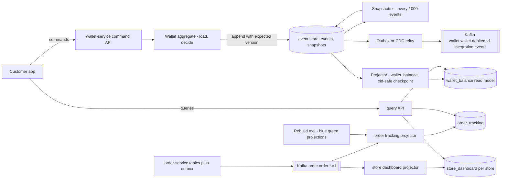
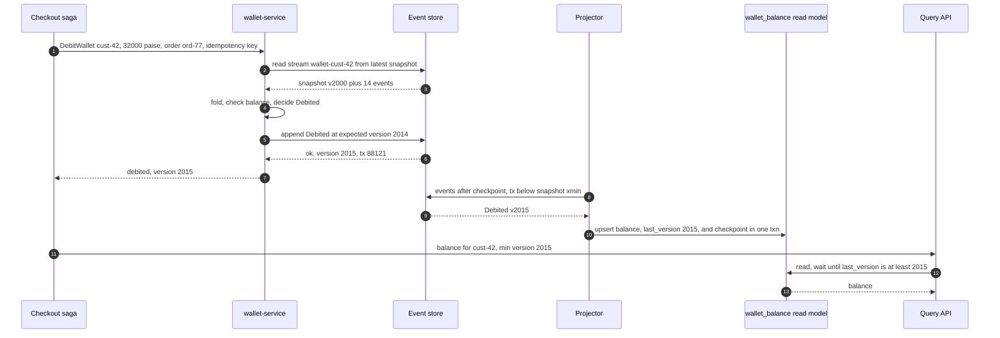
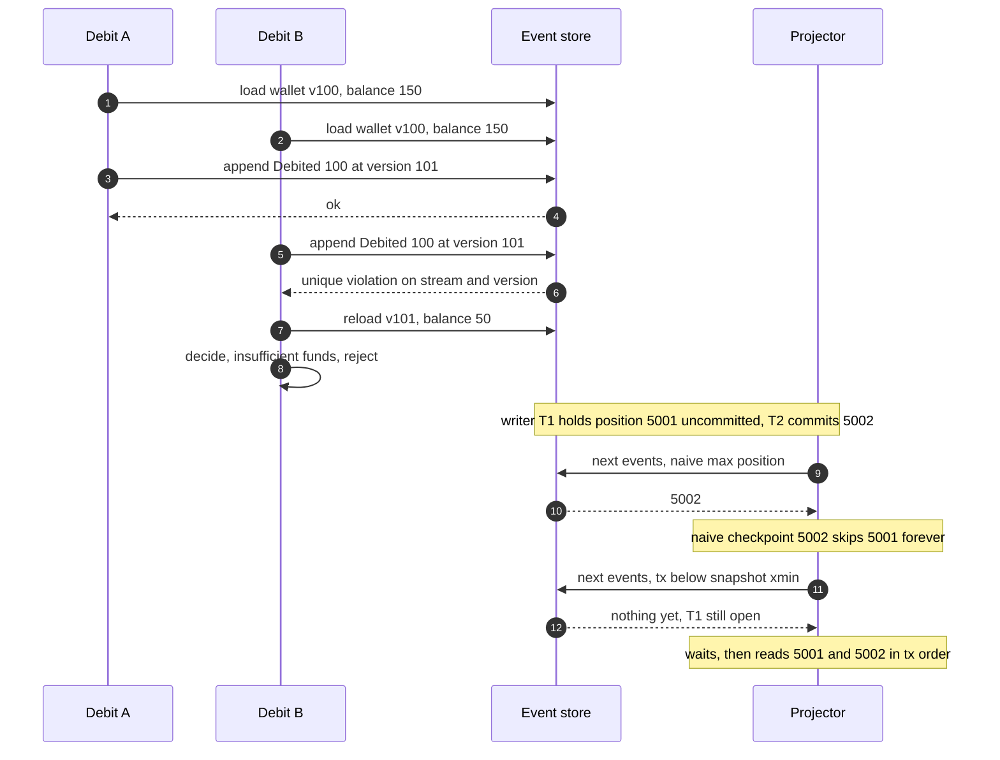
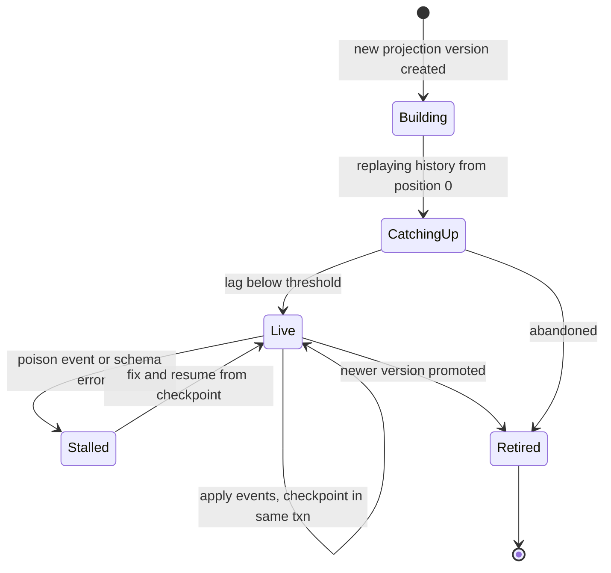

# 15. Event-Driven Architecture, CQRS & Event Sourcing

!!! abstract "Chapter at a glance"
    **Reader bands:** B2 → B4 · **Prerequisites:** [Ch 05](../01-foundations/05-relational-databases-deep-dive.md), [Ch 13](13-distributed-transactions.md), [Ch 14](14-messaging-and-event-streaming.md) · **What you will build:** The store-credit wallet as an event-sourced aggregate, and order tracking as CQRS read models.

    - **L1** compares event notification, event-carried state transfer and event sourcing (plain Java).
    - **L2** is a PostgreSQL event store with optimistic concurrency. A negative control without the version check lets the wallet go **overdrawn**.
    - **L3** runs projectors tailing the store while writers append. The naive "max position seen" checkpoint **misses 2,954 of 12,000 events**. A transaction-id-aware checkpoint misses none, and a rebuild repairs the broken model.
    - **L4** loads a 200,437-event aggregate with and without snapshots (180 ms vs 3.4 ms), and upcasts legacy rupee amounts to paise, where a `double`-based upcaster **silently loses ₹57.40**.

    **L2–L4 run as real Java (JDBC) against real PostgreSQL 16.** · **Reading time:** 100 min + code

---

## 1. Introduction & Why It Matters

### 1.1 A story: "Your order is being packed", for three days

The team rebuilt order tracking with CQRS:

- Commands wrote events to an event store table in PostgreSQL.
- A projector polled `select * from events where id > :last_id order by id`, updated an `order_tracking` read model, and saved `last_id`.
- The app read only from `order_tracking`.

It was fast, and load tests passed.

In production, about **1 in 40 orders got stuck in their tracking view**: delivered orders still showed "Packing". Nothing had failed. The events were in the store and the projector had no errors. The cause took two weeks to find:

- `id` was a `bigserial`, so the id was assigned when the row was inserted, but it became visible when the transaction committed.
- Under concurrency, event 1,041 could commit **after** event 1,042. The projector read 1,042, saved `last_id = 1042`, and never looked back. Event 1,041 was skipped forever.

L3 reproduces it: **2,954 of 12,000 events missed** with 8 concurrent writers.

The same quarter, a different team event-sourced the **shopping cart**. Every "add 1 banana, remove 1 banana" was an event. A year later, carts had up to 40,000 events, loading a cart took seconds, and nobody had ever asked for cart history. They also needed to change the event format, which meant writing upcasters for four historical versions of `ItemAdded`.

Both teams used good patterns in the wrong way:

- **A projector must checkpoint by what is safe to read,** not by the highest number it has seen. In PostgreSQL, use the transaction id and the snapshot's `xmin`. Or use a log that assigns positions at commit (Kafka, EventStoreDB).
- **Event sourcing is for aggregates whose history is the business,** like wallets, ledgers, orders and bookings. It's not for carts or profiles. Where it is used, it needs snapshots, versioned events and upcasters from day one.

!!! quote "The thesis of this chapter"
    Events can play three roles: **notifications**, **carriers of state**, or **the source of truth**. CQRS separates the model you write from the models you read, and those read models are disposable and rebuildable. Event sourcing makes the log the source of truth, which gives you history, audit and time travel. In return you must handle concurrency per stream, checkpoints that don't skip events, snapshots, schema versions and rebuilds. Use each pattern where its benefit is the requirement.

### 1.2 Where this lives in the grocery platform

| Area | Pattern | Why |
|---|---|---|
| Store credit / wallet | **Event sourcing** (`Opened`, `Credited`, `Debited`, `Expired`) | Balance must be explainable; RBI/finance audit; disputes need exact history |
| Order lifecycle | **State in tables + events via outbox** (Ch 13) | Current state is what matters; events for others |
| Order tracking, order history, store dashboard | **CQRS read models** built from order events | Query shapes differ from the write model; scale reads independently |
| Search, recommendations | Read models in OpenSearch / feature stores | Specialized stores fed by events (Ch 22) |
| Catalog updates to other services | **Event-carried state transfer** (`ProductUpdated` with full product) | Consumers keep local copies; no callbacks |
| "Order shipped" notifications | **Event notification** + small payload | Consumers need only the fact |
| Cart | **Plain table** (+ events for analytics) | No business need for history (§1.1) |
| Delivery slot bookings | Event-sourced aggregate per slot (Ch 48) | Contention + audit of who took which slot |

### 1.3 Learning objectives

| Band | After this chapter you can… |
|---|---|
| <span class="band b2">B2</span> | Distinguish event notification, event-carried state transfer and event sourcing, and explain CQRS and read models |
| <span class="band b3">B3</span> | Build an event store with optimistic concurrency, projectors with safe checkpoints, idempotent projection and rebuilds, and snapshots |
| <span class="band b4">B4</span> | Version events and write upcasters, handle GDPR/DPDP erasure in immutable logs, choose where ES/CQRS fit and where they don't, and operate projections in production |

---

## 2. Core Concepts — Beginner to Deep

### 2.1 Intuition: the bank passbook <span class="band b2">B2</span>

An old-style bank passbook doesn't store "your balance". It stores every **deposit** and **withdrawal**, and the balance printed on each line is derived from them.

- **The passbook lines are events.** They're facts in the past tense ("Deposited ₹500 on 3 March"), and they're never erased. A mistake is corrected with a new line ("Reversal of entry 41").
- **The balance is a projection** of those lines. So is "total spent this month" and "all cheques above ₹10,000". Each is a different view of the same lines.
- **The branch keeps the passbook,** but the head office builds its own reports from copies of the entries. That's CQRS: writes happen in one place, and reads use models shaped for each question.
- **After 20 years, the clerk doesn't re-add every line** to answer "what's the balance?". They start from last year's closing balance. That's a snapshot.
- **When the bank changed from "Rs." to "₹" and from annas to paise,** old pages weren't rewritten. Staff learned to read the old format. That's upcasting.

### 2.2 Three things called "event-driven" ⭐ <span class="band b2">B2</span>

Martin Fowler's distinction, which L1 measures:

| Style | Event carries | Consumer does | L1 result (order-service down) |
|---|---|---|---|
| **Event notification** | The fact + ids (`AddressChanged{orderId}`) | Calls the producer back for details | **10,000 callbacks, all failed.** Tight runtime coupling, and load on the producer |
| **Event-carried state transfer (ECST)** | The new state (`AddressChangedWithState{orderId, address}`) | Keeps a local copy | 0 callbacks; the local copy **equals the source** |
| **Event sourcing** | Each change as the durable record (`AddressSet{…, version}`) | State = fold(events) | Same current state, **plus the full history** (5 versions of `ord-985`) |

- **Event-driven architecture** usually means the first two between services.
- **Event sourcing** is an internal persistence choice of one service or aggregate, and it doesn't require the others.
- **CQRS** is orthogonal to both, and it's common with either.

Choose per event:

- **Notification** when consumers need only the fact, or the data is large or sensitive (fetch with authorization).
- **ECST** when consumers need the data and must keep working when the producer is down.
- Never use **"events as RPC"** (`PleaseSendSms` as an event): that's a command. Send it to a queue with an owner (Ch 14).

### 2.3 Domain events vs integration events <span class="band b2">B2</span> <span class="band b3">B3</span>

- **Domain events** live inside a bounded context (`WalletDebited`). They can be fine-grained and change with the model.
- **Integration events** are the context's public contract (`order.order.placed.v1`). They're stable, versioned and carry what consumers need, and they're usually mapped from domain events in the outbox (Ch 13) or by a translator.
- Don't publish internal event-sourcing events directly as integration events. That couples consumers to your aggregate's internals, and every internal refactor becomes a breaking change (Ch 14 §2.10).

### 2.4 CQRS ⭐ <span class="band b2">B2</span> <span class="band b3">B3</span>

**Command Query Responsibility Segregation** (Greg Young, building on Meyer's CQS):

- The **command side** validates intentions against an aggregate and records changes.
- The **query side** serves reads from **read models** (projections) optimized for each query.

```
command → aggregate (write model) → events / changes ─┬→ projector → order_tracking (PostgreSQL)
                                                      ├→ projector → store_dashboard (PostgreSQL, per store)
                                                      └→ projector → order_search (OpenSearch)
query ───────────────────────────────────────────────────→ read model
```

| Benefit | Cost |
|---|---|
| Read models shaped per query (no 7-table joins at read time) | **Eventual consistency** between write and read (lag) |
| Read and write scale independently (Ch 11 `orders_by_store`) | More moving parts: projectors, checkpoints, rebuilds |
| Different stores per read (search, cache, graph) | Duplicate data; schema changes touch several models |
| Read models are **disposable**: drop and rebuild (L3: 12,000 events in 549 ms) | Rebuild time grows with history, so plan for it |

CQRS doesn't need event sourcing: the write side can be ordinary tables plus an outbox (Ch 13). Nor does it need separate databases. A second table updated by a projector is CQRS.

**Read-your-writes on a CQRS system:**

- Return the new state from the command (the command side knows it).
- Or return a **version/position**, and have the query wait until the read model has reached it (like the Ch 10 LSN token).
- Or read from the write model for the user's own freshly changed entity.

### 2.5 Event sourcing ⭐ <span class="band b3">B3</span>

The aggregate's state isn't stored. **Its events are**, and the state is rebuilt by folding them:

```java
Wallet w = new Wallet();
for (WalletEvent e : store.read("wallet-cust-42")) w.apply(e);   // state = fold(apply, events)
List<WalletEvent> decided = w.debit(100, "ord-77");               // decide from current state
store.append("wallet-cust-42", w.version, decided);              // expected version = what we decided on
```

**What you gain:**

- **A complete audit trail** by construction. L2's running balance at any version: v52 → ₹50.00, v101 → ₹1.00.
- **Time travel:** "what did the wallet look like on 31 March?"
- **New read models from old history** (replay into a new projection).
- **Debugging** by replaying a production stream.
- **Natural integration events.**

**What you pay:**

- Every read of current state needs a projection or a replay, so snapshots are needed for long streams (L4).
- **Event schemas are forever:** versioning and upcasting (L4 B).
- You need concurrency control per stream (L2).
- Projections must be correct under concurrency (L3).
- **Erasure of personal data in an immutable log** (§2.10).
- The team must think in events, and queries across aggregates need projections.

### 2.6 The event store and optimistic concurrency ⭐ <span class="band b3">B3</span>

An event store needs:

1. **Append with an expected version,** failing if the stream moved on.
2. **Read a stream in order.**
3. **Read all events in a global order** for projectors, with a position that is **safe to checkpoint** (§2.7).
4. Optionally, subscriptions/notifications, snapshots and metadata (correlation/causation ids, user, HLC timestamp).

In PostgreSQL, `primary key (stream_id, version)` makes the database enforce (1): a concurrent writer that decided on the same version gets a unique violation (`23505`), reloads and decides again.

L2 ran 16 threads × 20 debits of ₹1 against a ₹100 wallet:

| Store | Debits accepted | Final balance | Events sharing a version |
|---|---|---|---|
| **No expected-version check** | **111** | **−₹11.00 (overdrawn)** | 56 |
| **Expected version (PK on stream, version)** | **100** | **₹0.00** | 0, after 649 retried conflicts |

- The invariant `balance ≥ 0` is enforced **only** because every decision was made against the exact version it appended after.
- The 649 conflicts show the cost of contention on one stream. A hot stream needs a design fix: smaller aggregates, or commands that commute. Retrying harder doesn't help.

**Stream = aggregate = consistency boundary.** One transaction appends to one stream. Invariants across streams (e.g. "a customer's total credit ≤ ₹10,000 across wallets") need a different aggregate design or a saga (Ch 13).

### 2.7 Projections and the checkpoint problem ⭐ <span class="band b3">B3</span> <span class="band b4">B4</span>

A projector:

1. Reads events after its checkpoint.
2. Applies them to a read model.
3. Stores the new checkpoint **in the same transaction** as the read-model change, which makes it exactly-once in effect.

Correctness hinges on **what "after the checkpoint" means.**

**Why "max position seen" is wrong on a database:** sequences hand out numbers at insert, and transactions commit in a different order. When the projector sees position 1,042 committed and 1,041 still in flight, it advances past 1,041 forever. L3: **2,954 of 12,000 events missed**, and **417 orders show a stale status**, with no error anywhere.

**Fixes:**

| Approach | How | Trade-off |
|---|---|---|
| **Transaction-id bound** (PostgreSQL) | Store `pg_current_xact_id()` with each event. Read `where (tx_id, position) > checkpoint and tx_id < pg_snapshot_xmin(pg_current_snapshot())`, ordered by `(tx_id, position)` | Waits for the oldest open transaction; long transactions add lag. **L3: 0 missed** |
| Single writer / serialize appends | Take an advisory lock per append, so commit order = position order | Throughput cap |
| Commit-ordered log | Kafka offsets, EventStoreDB/KurrentDB, Axon Server, or CDC from the WAL (commit order, Ch 13) | Another system, but the log order is the commit order |
| Gap detection with a wait | Treat a missing position as "maybe in flight" and wait up to T before skipping it | Complex; the timeout is a guess |

**Idempotent projections:**

- Projectors are at-least-once (crashes between apply and checkpoint if they aren't in one transaction, or replays).
- Use upserts keyed by entity, `where last_version < :v` guards, or the inbox pattern (Ch 13).
- Side effects (emails) don't belong in projectors that get rebuilt, or every rebuild re-sends them. Put them in separate **process managers/reactors** with their own dedup.

**Rebuilds:**

- A read model is **derived data**. Drop it, reset its checkpoint and replay. L3 rebuilt the broken model in 549 ms.
- For big histories, build the new version **alongside** the old (`order_tracking_v2`), then switch reads when it catches up (blue/green projections).

### 2.8 Snapshots ⭐ <span class="band b3">B3</span>

A snapshot stores an aggregate's state at version N. Loading = latest snapshot + the events after it.

- L4: 200,437 events, full replay **179.8 ms** vs snapshot + 437 events **3.4 ms**, same state.
- Take a snapshot every N events, or when load time exceeds a threshold. Write it asynchronously; snapshots are **caches, not truth**.
- **Version the snapshot format.** On a mismatch, discard it and replay (snapshots are disposable, events aren't).
- **Long streams are often a modelling smell.** Close accounting periods ("book closing": a `PeriodClosed` event carrying balances, then a new stream per period), or split the aggregate, before reaching for snapshots.

### 2.9 Event versioning and upcasting ⭐ <span class="band b3">B3</span> <span class="band b4">B4</span>

Events are immutable, but understanding improves. Techniques, from the least to the most invasive:

1. **Additive change:** add an optional field with a default, and old events still deserialize.
2. **Weak schema:** readers ignore unknown fields and default missing ones.
3. **Upcasting:** on read, a chain of pure functions converts `v1 → v2 → v3` into the shape the code knows. Stored events are untouched. **Upcasters must be exact and deterministic:** L4's `double`-based rupees-to-paise upcaster turned `"19.99"` into **1,998** paise and was wrong on **5,740 of 100,000** legacy events, **₹57.40** in total. The `BigDecimal` version was exact.
4. **New event type** (`WalletDebitedV2`), with both handled in `apply`.
5. **Copy-and-transform migration:** rewrite streams into a new store (the last resort, with an audit trail of the migration itself).

Record `schema_version` (or the event type version) in every stored event, and test upcasters against **real samples from production history**.

### 2.10 Personal data in immutable logs <span class="band b4">B4</span>

DPDP (India) and GDPR give people a right to erasure, and logs don't forget. Options:

- **Keep PII out of events.** Reference a customer id, and store details in a mutable profile service.
- **Crypto-shredding:** encrypt PII fields with a per-customer key kept in a key store. To erase, delete the key, and the events stay but the PII is unreadable. Projections must handle "unreadable" gracefully.
- **Tombstones and compaction** for Kafka-compacted topics (Ch 14). Don't forget read models, backups and the data warehouse.
- Keep an erasure log of what was erased and when, without the data itself (Ch 36).

### 2.11 Process managers and event-driven workflows <span class="band b3">B3</span>

A **process manager** (or reactor) reacts to events by issuing commands: "when `PaymentCaptured` and `StockReserved` both arrived for an order, send `ConfirmOrder`". It keeps its own state, keyed by correlation id, and is essentially an orchestration saga driven by events (Ch 13). Separate reactors that cause side effects from projectors that build read models: projectors must be safe to replay, and reactors must **not** re-send on replay (dedup by event id, or skip on replay).

### 2.12 When to use ES and CQRS, and when not ⭐ <span class="band b4">B4</span>

| Use event sourcing when… | Don't, when… |
|---|---|
| History *is* the business: ledgers, wallets, bookings, claims, compliance | Current state is all anyone needs (carts, profiles, settings) |
| Audit/dispute resolution needs exact "who, what, when" | A simple audit table or CDC to a history table would do |
| Many future read models are likely (analytics, ML features) | The team is new to it and the domain is CRUD |
| Temporal queries ("as of") are frequent | Aggregates would have very long, very hot streams without natural closing periods |
| Natural concurrency boundaries (per account/booking) | Cross-aggregate invariants dominate |

| Use CQRS when… | Don't, when… |
|---|---|
| Read shapes differ a lot from write shapes, or reads ≫ writes | One table + indexes serves reads fine |
| Different read stores are needed (search, cache, analytics) | Users can't tolerate any read lag and the command can't return state |
| Read and write scaling differ (Ch 11 `orders_by_store`) | Small team, small system |

Most of the grocery platform is **CRUD + outbox events + a few read models**. Event sourcing is used for the wallet and slot bookings only.

---

## 3. Architecture & Diagrams

### 3.1 Component view: wallet (ES) and order tracking (CQRS)



### 3.2 Sequence: happy path, debit a wallet and read the balance



### 3.3 Sequence: failure path, a concurrent debit, then a projector at a gap



### 3.4 State: a projection's lifecycle



Reads switch from vN to vN+1 only when vN+1 is `Live`. Rebuilding never takes the old model offline.

---

## 4. Design Document Excerpt: Event-Sourced Wallet and CQRS Order Tracking

| Field | Value |
|---|---|
| Author / Reviewers | Payments & Orders teams / Finance, SRE, Security |
| Status | Approved |
| Related ADRs | ADR-058 Event-source the wallet; ADR-059 PostgreSQL event store with xid-safe projections; ADR-060 Snapshots and period closing; ADR-061 Event versioning and upcasters; ADR-062 Order tracking as rebuildable read models |

**1. Context & Problem.** Wallet balances were a single mutable column, and disputes ("why is my credit ₹0?") needed log archaeology. Order tracking projections skipped events under concurrency (§1.1), and the cart was event-sourced without a need.

**2. Goals / Non-Goals.**

- *Goals:* every wallet balance is explainable event by event; no overdraft under concurrency; projections never skip events; read models rebuildable without downtime; event formats can evolve safely; PII erasable.
- *Non-goals:* event-sourcing orders or carts (tables + outbox suffice); a global event store for all services.

**3. Requirements.**

| ID | Requirement |
|---|---|
| NFR-1 | Wallet invariant `balance ≥ 0` holds under any concurrency (0 violations in tests) |
| NFR-2 | Wallet load p99 ≤ 20 ms regardless of history length |
| NFR-3 | Projection completeness: 0 missed events (checked by a nightly count/sum reconciliation against the store) |
| NFR-4 | Projection lag p99 ≤ 2 s; read-your-writes available via min-version queries |
| NFR-5 | A full rebuild of order tracking completes in ≤ 1 h and switches over with no read downtime |
| NFR-6 | Every stored event carries type, schema version, correlation/causation ids and an HLC timestamp |

**4. Capacity & latency estimates.**

| Item | Calculation | Result |
|---|---|---|
| Wallet events | ~120 K debits/credits per day at P90 | ~44 M/year, ~1 KB each → ~44 GB/year |
| Longest streams | B2B wallets: ~300 events/day | ~110 K/year → snapshots + yearly period closing |
| Load time | L4: 200 K events 180 ms full vs 3.4 ms with snapshot | Snapshot every 1,000 events |
| Order tracking rebuild | ~1.3 K events/s peak, ~40 M events/month kept 3 months; L3 rate ~22 K events/s single-threaded | ~1.5 h single projector → partition by order hash, 4 workers → ~25 min |
| Contention | One wallet: at most a few concurrent debits (checkout + refund) | Retry on conflict is fine (L2 showed the worst case with 16 threads) |

**5. Proposed design.**

1. **Event store in PostgreSQL:**
    - `events(global_position bigserial, tx_id xid8 default pg_current_xact_id(), stream_id, version, type, schema_version, payload jsonb, metadata jsonb, recorded_at)`.
    - `primary key (stream_id, version)`, plus indexes on `(tx_id, global_position)`.
    - Append-only: `UPDATE`/`DELETE` revoked from application roles.
2. **Wallet aggregate:** stream per customer wallet, expected-version appends, and idempotency by `(stream, command id)` in metadata. A saga step (Ch 13) retries with the same command id.
3. **Projections:** a projector framework with a `(tx_id, position)` checkpoint below `pg_snapshot_xmin`, read-model update + checkpoint in one transaction, upserts with version guards, and blue/green rebuilds.
4. **Integration events:** mapped from domain events through the outbox to Kafka (Ch 13/14). Consumers never read the event store directly.
5. **Snapshots** every 1,000 events (async, versioned), and **period closing** each financial year: `PeriodClosed{balance}` starts a new stream `wallet-cust-42-2027`.
6. **Versioning:** `schema_version` per event, an upcaster chain per type with golden tests from production samples, and exact decimal arithmetic only.
7. **PII:** events carry `customer_id` only. Where free text could contain PII (a support note), encrypt it with a per-customer key (crypto-shredding).

**7. Alternatives considered.**

| Option | Pros | Cons | Verdict |
|---|---|---|---|
| Mutable balance + audit table | Simple | Audit can drift from the balance; no replay | Rejected for the wallet |
| **Event sourcing on PostgreSQL** | One database the team knows; transactional with outbox | Must solve global ordering for projectors (xid approach) | **Chosen** |
| EventStoreDB/KurrentDB | Purpose-built: commit-ordered `$all`, subscriptions | New system to operate | Revisit if more services adopt ES |
| Axon Framework + Server | Aggregates, sagas, upcasters built in | Framework lock-in | Rejected |
| Kafka as the event store | Commit-ordered log, replay | No per-stream expected-version append; stream reads are expensive | Rejected as the source of truth; used for integration |

**8. Failure modes.** Concurrent debits: conflict → retry → reject if insufficient. Long-running transaction: projections lag (alert on the age of the oldest open transaction). Poison event in a projector: stall that projection only, and alert. Upcaster bug: caught by golden tests; if found later, fix the upcaster and rebuild the projections (events are untouched). Snapshot corruption: discard and replay.

**10. Observability.** Append conflicts/s per stream type, stream length distribution, snapshot age, projection lag (positions and seconds) per projection, projection reconciliation results (events counted vs applied), rebuild progress, upcaster invocations by version, the age of the oldest open DB transaction.

**14. Decision (ADR-058–062 summary).** The wallet is event-sourced on PostgreSQL with expected-version appends. Projections use transaction-id-safe checkpoints stored atomically with the read model, and are rebuildable blue/green. Snapshots every 1,000 events plus yearly period closing. Every event is versioned and upcast exactly on read. Orders and carts stay table-based with outbox events and CQRS read models.

---

## 5. Hands-On Code — Level Ladder

| Level | New requirement that forces the step |
|---|---|
| L1 | "Share an address change with delivery-service: notification, state transfer, or event sourcing?" (plain Java) |
| L2 | "The wallet must never go below zero, and every rupee must be explainable." (real PostgreSQL event store) |
| L3 | "Order tracking must never miss an event, and must be rebuildable." (real PostgreSQL projections under concurrency) |
| L4 | "Wallets with years of history must load fast, and old events must keep working as the format changes." (real PostgreSQL) |

!!! info "How the code in this chapter was verified"
    L1 is plain Java. L2–L4 are JDBC programs **run against a real PostgreSQL 16** (PostgreSQL JDBC driver 42.7.4, Java 21), and every output below is copied from a run. Concurrency makes exact counts vary between runs, but not the invariants. The Spring versions after L2 and L3 are one-to-one translations of the verified SQL and logic into the four-layer structure. They weren't compiled here (no Maven Central access) and are marked `VERIFY`.

### L1 — Concept: three ways to share a change (plain Java) <span class="band b2">B2</span>

```java
// EventStylesL1.java — run with: java EventStylesL1.java
// The same fact — "the customer changed the delivery address of an order" — shared three ways:
// event notification, event-carried state transfer, and event sourcing.
import java.util.*;

public class EventStylesL1 {

    record Address(String line, String pincode) { }

    /** order-service: the owner of the data. It can be down. */
    static final class OrderService {
        final Map<String, Address> addresses = new HashMap<>();
        boolean up = true; int reads = 0;
        Address getAddress(String orderId) {
            if (!up) throw new IllegalStateException("order-service unavailable");
            reads++; return addresses.get(orderId);
        }
    }

    // 1. Event notification: "something changed, ask me"
    record AddressChanged(String orderId) { }
    // 2. Event-carried state transfer: "here is the new state"
    record AddressChangedWithState(String orderId, Address newAddress) { }
    // 3. Event sourcing: the events ARE the state
    record AddressSet(String orderId, Address address, int version) { }

    public static void main(String[] args) {
        OrderService orders = new OrderService();
        List<String> changes = new ArrayList<>();
        List<AddressSet> log = new ArrayList<>();
        Random rnd = new Random(1);
        for (int i = 0; i < 10_000; i++) {
            String id = "ord-" + rnd.nextInt(2_000);
            Address a = new Address("Flat " + i, "5600" + (10 + rnd.nextInt(90)));
            orders.addresses.put(id, a);
            changes.add(id);
            int v = (int) log.stream().filter(e -> e.orderId().equals(id)).count() + 1;
            log.add(new AddressSet(id, a, v));
        }
        orders.up = false;                               // order-service is down while delivery-service consumes

        // delivery-service consuming style 1
        int failed = 0; Map<String, Address> local1 = new HashMap<>();
        for (String id : changes) {
            try { local1.put(id, orders.getAddress(id)); } catch (IllegalStateException e) { failed++; }
        }
        System.out.println("1. Event notification (AddressChanged{orderId}), order-service down:");
        System.out.printf("   %,d events → %,d callbacks needed, %,d failed; delivery-service knows %,d addresses%n", changes.size(), changes.size(), failed, local1.size());
        orders.up = true; orders.reads = 0;
        for (String id : changes) local1.put(id, orders.getAddress(id));
        System.out.printf("   with order-service up: %,d synchronous reads back into the producer (coupling + load)%n", orders.reads);

        // style 2
        Map<String, Address> local2 = new HashMap<>();
        orders.up = false;
        for (int i = 0; i < changes.size(); i++) local2.put(changes.get(i), log.get(i).address());
        System.out.println("2. Event-carried state transfer (AddressChangedWithState{orderId, address}), order-service down:");
        System.out.printf("   0 callbacks; delivery-service's local copy has %,d addresses, identical to the source: %s%n",
                local2.size(), local2.equals(orders.addresses));

        // style 3
        Map<String, Address> state = new HashMap<>();
        for (AddressSet e : log) state.put(e.orderId(), e.address());          // current state = fold(events)
        String sample = log.get(0).orderId();
        List<AddressSet> history = log.stream().filter(e -> e.orderId().equals(sample)).toList();
        System.out.println("3. Event sourcing (AddressSet events are the record of truth):");
        System.out.printf("   state rebuilt from %,d events equals the current table: %s%n", log.size(), state.equals(orders.addresses));
        System.out.printf("   %s history: %d versions, first %s, current %s — the other two styles only know 'current'%n",
                sample, history.size(), history.get(0).address().pincode(), history.get(history.size() - 1).address().pincode());
    }
}
```

Actual output from running it:

```text
1. Event notification (AddressChanged{orderId}), order-service down:
   10,000 events → 10,000 callbacks needed, 10,000 failed; delivery-service knows 0 addresses
   with order-service up: 10,000 synchronous reads back into the producer (coupling + load)
2. Event-carried state transfer (AddressChangedWithState{orderId, address}), order-service down:
   0 callbacks; delivery-service's local copy has 1,994 addresses, identical to the source: true
3. Event sourcing (AddressSet events are the record of truth):
   state rebuilt from 10,000 events equals the current table: true
   ord-985 history: 5 versions, first 560038, current 560049 — the other two styles only know 'current'
```

**What L1 shows:** notifications couple the consumer to the producer's availability and load (10,000 failed callbacks). State transfer lets the consumer work alone, with an identical copy. Event sourcing gives the same current state and keeps the history the other two throw away.

### L2 — An event store with optimistic concurrency (real PostgreSQL) <span class="band b3">B3</span>

Requirement: the store-credit wallet must never be overdrawn, even with concurrent checkouts and refunds, and every balance must be explainable.

```java
// EventStoreL2.java — run with: java -Duser.timezone=UTC -cp postgresql-42.7.4.jar EventStoreL2.java   (PostgreSQL on :5551)
// An event-sourced store-credit wallet on PostgreSQL. State = fold(events). Writes append events with an
// EXPECTED VERSION (optimistic concurrency); PRIMARY KEY (stream_id, version) rejects a concurrent append.
import java.sql.*;
import java.util.*;
import java.util.concurrent.*;
import java.util.concurrent.atomic.*;

public class EventStoreL2 {

    // ---------- events (the source of truth) ----------
    sealed interface WalletEvent permits Opened, Credited, Debited { }
    record Opened(String customerId) implements WalletEvent { }
    record Credited(long paise, String reason) implements WalletEvent { }
    record Debited(long paise, String orderId) implements WalletEvent { }

    // ---------- the aggregate: rebuilt from events, decides new events ----------
    static final class Wallet {
        long balance; int version; boolean open;
        void apply(WalletEvent e) {
            switch (e) {
                case Opened o -> open = true;
                case Credited c -> balance += c.paise();
                case Debited d -> balance -= d.paise();
            }
            version++;
        }
        /** Business rule lives here, against state rebuilt from events. */
        List<WalletEvent> debit(long paise, String orderId) {
            if (!open) throw new IllegalStateException("wallet not open");
            if (paise > balance) throw new InsufficientFunds();
            return List.of(new Debited(paise, orderId));
        }
    }
    static final class InsufficientFunds extends RuntimeException { }
    static final class ConcurrencyConflict extends RuntimeException { }

    // ---------- the event store ----------
    static final class EventStore {
        final String url = "jdbc:postgresql://localhost:5551/eventstore";
        final boolean checkVersion;
        EventStore(boolean checkVersion) { this.checkVersion = checkVersion; }
        Connection conn() throws SQLException { return DriverManager.getConnection(url, "postgres", ""); }

        void init() throws SQLException {
            try (Connection c = conn(); Statement s = c.createStatement()) {
                s.execute("drop table if exists events");
                s.execute(checkVersion
                    ? """
                      create table events (
                        global_position bigserial,
                        stream_id text not null,
                        version int not null,
                        type text not null,
                        payload jsonb not null,
                        recorded_at timestamptz not null default now(),
                        primary key (stream_id, version))"""
                    : """
                      create table events (
                        global_position bigserial primary key,
                        stream_id text not null,
                        version int not null,
                        type text not null,
                        payload jsonb not null,
                        recorded_at timestamptz not null default now())""");
            }
        }

        Wallet load(Connection c, String stream) throws SQLException {
            Wallet w = new Wallet();
            try (var ps = c.prepareStatement("select type, payload->>'paise', payload->>'id' from events where stream_id = ? order by version")) {
                ps.setString(1, stream);
                try (var rs = ps.executeQuery()) {
                    while (rs.next()) w.apply(switch (rs.getString(1)) {
                        case "Opened" -> new Opened(rs.getString(3));
                        case "Credited" -> new Credited(Long.parseLong(rs.getString(2)), "");
                        default -> new Debited(Long.parseLong(rs.getString(2)), rs.getString(3));
                    });
                }
            }
            return w;
        }

        /** Append events after expectedVersion. With the version check, a concurrent append makes this fail. */
        void append(Connection c, String stream, int expectedVersion, List<WalletEvent> events) throws SQLException {
            c.setAutoCommit(false);
            try (var ps = c.prepareStatement("insert into events(stream_id, version, type, payload) values (?, ?, ?, ?::jsonb)")) {
                int v = expectedVersion;
                for (WalletEvent e : events) {
                    ps.setString(1, stream); ps.setInt(2, ++v); ps.setString(3, e.getClass().getSimpleName());
                    ps.setString(4, switch (e) {
                        case Opened o -> "{\"id\":\"" + o.customerId() + "\"}";
                        case Credited cr -> "{\"paise\":" + cr.paise() + "}";
                        case Debited d -> "{\"paise\":" + d.paise() + ",\"id\":\"" + d.orderId() + "\"}";
                    });
                    ps.executeUpdate();
                }
                c.commit();
            } catch (SQLException ex) {
                c.rollback();
                if ("23505".equals(ex.getSQLState())) throw new ConcurrencyConflict();   // unique_violation on (stream_id, version)
                throw ex;
            } finally { c.setAutoCommit(true); }
        }
    }

    static Map<String, Object> run(boolean checkVersion) throws Exception {
        EventStore store = new EventStore(checkVersion);
        store.init();
        String stream = "wallet-cust-42";
        try (Connection c = store.conn()) {
            store.append(c, stream, 0, List.of(new Opened("cust-42"), new Credited(10_000, "refund ord-900")));
        }
        AtomicInteger ok = new AtomicInteger(), rejected = new AtomicInteger(), conflicts = new AtomicInteger();
        ExecutorService pool = Executors.newFixedThreadPool(16);
        List<Future<?>> fs = new ArrayList<>();
        for (int t = 0; t < 16; t++) {
            int tt = t;
            fs.add(pool.submit(() -> {
                try (Connection c = store.conn()) {
                    for (int i = 0; i < 20; i++) {
                        String order = "ord-" + tt + "-" + i;
                        while (true) {                                            // load → decide → append, retry on conflict
                            Wallet w = store.load(c, stream);
                            List<WalletEvent> decided;
                            try { decided = w.debit(100, order); } catch (InsufficientFunds e) { rejected.incrementAndGet(); break; }
                            try { store.append(c, stream, w.version, decided); ok.incrementAndGet(); break; }
                            catch (ConcurrencyConflict e) { conflicts.incrementAndGet(); }
                        }
                    }
                }
                return null;
            }));
        }
        for (Future<?> f : fs) f.get();
        pool.shutdown();
        Map<String, Object> out = new LinkedHashMap<>();
        try (Connection c = store.conn()) {
            Wallet w = store.load(c, stream);
            out.put("debits accepted", ok.get());
            out.put("rejected (insufficient funds)", rejected.get());
            out.put("version conflicts retried", conflicts.get());
            out.put("final balance (paise)", w.balance);
            try (var rs = c.createStatement().executeQuery("select count(*) - count(distinct version) from events where stream_id = '" + stream + "'")) {
                rs.next(); out.put("events sharing a version", rs.getLong(1));
            }
        }
        return out;
    }

    public static void main(String[] args) throws Exception {
        System.out.println("Wallet credited 10,000 paise; 16 threads each try 20 debits of 100 paise (32,000 requested)");
        System.out.println("no expected-version check: " + run(false));
        System.out.println("expected-version check   : " + run(true));

        // time travel: the balance as it was after any event, from the same log
        try (Connection c = DriverManager.getConnection("jdbc:postgresql://localhost:5551/eventstore", "postgres", "");
             var rs = c.createStatement().executeQuery("""
                 select version, type, balance from (
                   select version, type, sum(case type when 'Credited' then (payload->>'paise')::bigint
                                                       when 'Debited' then -(payload->>'paise')::bigint else 0 end)
                                   over (order by version) as balance
                     from events where stream_id = 'wallet-cust-42') running
                  where version in (1, 2, 3, 52, 101, 102) order by version""")) {
            System.out.println("Audit / time travel from the same events (running balance at selected versions):");
            while (rs.next()) System.out.printf("   v%-4d %-9s balance %,d%n", rs.getInt(1), rs.getString(2), rs.getLong(3));
        }
    }
}
```

Actual output from running it:

```text
Wallet credited 10,000 paise; 16 threads each try 20 debits of 100 paise (32,000 requested)
no expected-version check: {debits accepted=111, rejected (insufficient funds)=209, version conflicts retried=0, final balance (paise)=-1100, events sharing a version=56}
expected-version check   : {debits accepted=100, rejected (insufficient funds)=220, version conflicts retried=649, final balance (paise)=0, events sharing a version=0}
Audit / time travel from the same events (running balance at selected versions):
   v1    Opened    balance 0
   v2    Credited  balance 10,000
   v3    Debited   balance 9,900
   v52   Debited   balance 5,000
   v101  Debited   balance 100
   v102  Debited   balance 0
```

- **Without the version check,** threads that loaded the same state each decided "enough balance" and all appended. That's **111 debits against ₹100**, a final balance of **−₹11.00**, and 56 events sharing a version number.
- **With `primary key (stream_id, version)`,** the database rejected every append made on a stale decision. After 649 reload-and-retry cycles, exactly 100 debits went through, and the balance ended at ₹0.00.
- **The running balance at any version** comes straight from the log with a window function: audit and time travel for free.

=== "Spring: event store repository"

    ```java
    package com.grocery.wallet.repository;

    import java.util.List;
    import org.springframework.dao.DuplicateKeyException;
    import org.springframework.jdbc.core.simple.JdbcClient;
    import org.springframework.stereotype.Repository;
    import org.springframework.transaction.annotation.Transactional;

    @Repository
    public class WalletEventStore {

        public record StoredEvent(String streamId, int version, String type, int schemaVersion, String payloadJson, String metadataJson) { }

        private final JdbcClient jdbc;

        public WalletEventStore(JdbcClient jdbc) { this.jdbc = jdbc; }

        public List<StoredEvent> read(String streamId, int afterVersion) {
            return jdbc.sql("""
                    select stream_id, version, type, schema_version, payload::text, metadata::text
                      from events where stream_id = :s and version > :v order by version""")
                .param("s", streamId).param("v", afterVersion)
                .query(StoredEvent.class).list();
        }

        /** Throws WalletConcurrencyException when another writer appended first (unique (stream_id, version)). */
        @Transactional
        public void append(String streamId, int expectedVersion, List<StoredEvent> events) {
            int v = expectedVersion;
            try {
                for (StoredEvent e : events) {
                    jdbc.sql("""
                            insert into events(stream_id, version, type, schema_version, payload, metadata)
                            values (:s, :v, :t, :sv, :p::jsonb, :m::jsonb)""")
                        .param("s", streamId).param("v", ++v).param("t", e.type()).param("sv", e.schemaVersion())
                        .param("p", e.payloadJson()).param("m", e.metadataJson())
                        .update();
                }
            } catch (DuplicateKeyException conflict) {
                throw new WalletConcurrencyException(streamId, expectedVersion);
            }
        }
    }
    ```

=== "Spring: command service (load → decide → append)"

    ```java
    package com.grocery.wallet.service;

    import org.springframework.stereotype.Service;

    @Service
    public class WalletCommandService {

        private final WalletEventStore store;
        private final WalletSnapshots snapshots;
        private final EventCodec codec;                 // serialize + upcast (L4)

        public WalletCommandService(WalletEventStore store, WalletSnapshots snapshots, EventCodec codec) {
            this.store = store; this.snapshots = snapshots; this.codec = codec;
        }

        public DebitResult debit(DebitWallet cmd) {
            for (int attempt = 1; attempt <= 5; attempt++) {
                Wallet w = snapshots.latest(cmd.walletId()).orElseGet(Wallet::empty);
                store.read(cmd.walletId(), w.version()).forEach(e -> w.apply(codec.decode(e)));
                if (w.alreadyProcessed(cmd.commandId())) return DebitResult.duplicate(w.version());   // idempotent retry
                var decided = w.debit(cmd.amountPaise(), cmd.orderId(), cmd.commandId());          // throws InsufficientFunds
                try {
                    store.append(cmd.walletId(), w.version(), codec.encode(decided, cmd.metadata()));
                    return DebitResult.ok(w.version() + decided.size());
                } catch (WalletConcurrencyException conflict) {
                    // someone else appended; loop reloads and re-decides against the new state
                }
            }
            throw new WalletBusyException(cmd.walletId());
        }
    }
    ```

    <!-- VERIFY: not compiled here; the verified logic is EventStoreL2's load/decide/append loop. `alreadyProcessed` scans command ids kept in the aggregate state (bounded window) or in a dedup table. -->

### L3 — Projections that don't skip events, and rebuilds (real PostgreSQL) <span class="band b3">B3</span> <span class="band b4">B4</span>

Requirement: order tracking read models are built from events **while** 8 writers append concurrently. They must end up exact, and they must be rebuildable.

```java
// ProjectionL3.java — run with: java -Duser.timezone=UTC -cp postgresql-42.7.4.jar ProjectionL3.java   (PostgreSQL on :5551)
// CQRS read models built by projectors that tail the event store WHILE writers are appending.
// A bigserial position is assigned at INSERT time but becomes visible at COMMIT time, so positions can
// appear out of order. A projector that checkpoints "max position seen" silently skips late committers.
import java.sql.*;
import java.util.*;
import java.util.concurrent.*;
import java.util.concurrent.atomic.*;

public class ProjectionL3 {

    static Connection conn() throws SQLException { return DriverManager.getConnection("jdbc:postgresql://localhost:5551/eventstore", "postgres", ""); }

    static void exec(Connection c, String sql) throws SQLException { try (Statement s = c.createStatement()) { s.execute(sql); } }

    /** One projector pass: read a batch after the checkpoint, apply it to the read model, store the checkpoint — one txn. */
    static int projectOnce(Connection c, String model, boolean safe) throws SQLException {
        c.setAutoCommit(false);
        try {
            long cpTx = 0, cpPos = 0;
            try (var rs = c.createStatement().executeQuery("select tx_id::text::bigint, position from checkpoints where projection = '" + model + "' for update")) {
                rs.next(); cpTx = rs.getLong(1); cpPos = rs.getLong(2);
            }
            String sql = safe
                ? """
                  select stream_id, version, global_position, tx_id::text::bigint from events
                   where (tx_id, global_position) > (?::text::xid8, ?)
                     and tx_id < pg_snapshot_xmin(pg_current_snapshot())      -- only transactions that can no longer commit "behind" us
                   order by tx_id, global_position limit 500"""
                : """
                  select stream_id, version, global_position, tx_id::text::bigint from events
                   where global_position > ?
                   order by global_position limit 500""";
            int n = 0; long lastTx = cpTx, lastPos = cpPos;
            try (var ps = c.prepareStatement(sql)) {
                if (safe) { ps.setLong(1, cpTx); ps.setLong(2, cpPos); } else ps.setLong(1, cpPos);
                try (var rs = ps.executeQuery();
                     var up = c.prepareStatement("insert into " + model + "(order_id, last_version, events_applied) values (?, ?, 1) " +
                             "on conflict (order_id) do update set last_version = greatest(" + model + ".last_version, excluded.last_version), " +
                             "events_applied = " + model + ".events_applied + 1")) {
                    while (rs.next()) {
                        up.setString(1, rs.getString(1)); up.setInt(2, rs.getInt(2)); up.executeUpdate();
                        lastPos = rs.getLong(3); lastTx = rs.getLong(4); n++;
                    }
                }
            }
            try (var ps = c.prepareStatement("update checkpoints set tx_id = ?::text::xid8, position = ? where projection = ?")) {
                ps.setLong(1, lastTx); ps.setLong(2, lastPos); ps.setString(3, model); ps.executeUpdate();
            }
            c.commit();
            return n;
        } catch (SQLException e) { c.rollback(); throw e; }
        finally { c.setAutoCommit(true); }
    }

    public static void main(String[] args) throws Exception {
        try (Connection c = conn()) {
            exec(c, "drop table if exists events, checkpoints, order_status_naive, order_status_safe");
            exec(c, """
                create table events (
                  global_position bigserial,
                  tx_id xid8 not null default pg_current_xact_id(),
                  stream_id text not null,
                  version int not null,
                  type text not null,
                  payload jsonb not null default '{}',
                  primary key (stream_id, version))""");
            exec(c, "create index on events (global_position)");
            exec(c, "create index on events (tx_id, global_position)");
            exec(c, "create table checkpoints (projection text primary key, tx_id xid8 not null, position bigint not null)");
            exec(c, "insert into checkpoints values ('order_status_naive', '0', 0), ('order_status_safe', '0', 0)");
            for (String m : List.of("order_status_naive", "order_status_safe"))
                exec(c, "create table " + m + " (order_id text primary key, last_version int not null, events_applied int not null)");
        }
        int writers = 8, perWriter = 1_500;
        AtomicBoolean writing = new AtomicBoolean(true);
        ExecutorService pool = Executors.newFixedThreadPool(writers + 2);
        List<Future<?>> ws = new ArrayList<>();
        for (int w = 0; w < writers; w++) {
            int ww = w;
            ws.add(pool.submit(() -> {
                Random rnd = new Random(ww);
                Map<String, Integer> versions = new HashMap<>();
                try (Connection c = conn()) {
                    c.setAutoCommit(false);
                    for (int i = 0; i < perWriter; i++) {
                        String stream = "ord-" + ww + "-" + rnd.nextInt(200);
                        int v = versions.merge(stream, 1, Integer::sum);
                        try (var ps = c.prepareStatement("insert into events(stream_id, version, type) values (?, ?, 'OrderStatusChanged')")) {
                            ps.setString(1, stream); ps.setInt(2, v); ps.executeUpdate();
                        }
                        Thread.sleep(rnd.nextInt(4));                               // position taken; commit comes a bit later
                        c.commit();
                    }
                }
                return null;
            }));
        }
        AtomicInteger passes = new AtomicInteger();
        List<Future<?>> ps = new ArrayList<>();
        for (String model : List.of("order_status_naive", "order_status_safe")) {
            boolean safe = model.endsWith("safe");
            ps.add(pool.submit(() -> {
                try (Connection c = conn()) {
                    while (true) {
                        int n = projectOnce(c, model, safe);
                        passes.incrementAndGet();
                        if (n == 0) { if (!writing.get() && projectOnce(c, model, safe) == 0) break; Thread.sleep(5); }
                    }
                }
                return null;
            }));
        }
        for (Future<?> f : ws) f.get();
        writing.set(false);
        for (Future<?> f : ps) f.get();
        pool.shutdown();

        try (Connection c = conn()) {
            long total;
            try (var rs = c.createStatement().executeQuery("select count(*) from events")) { rs.next(); total = rs.getLong(1); }
            System.out.printf("%d writers appended %,d events to %,d order streams while two projectors tailed the store%n",
                    writers, total, writers * 200);
            for (String model : List.of("order_status_naive", "order_status_safe")) {
                try (var rs = c.createStatement().executeQuery("""
                        select coalesce(sum(m.events_applied), 0),
                               count(*) filter (where m.last_version is distinct from e.max_version)
                          from (select stream_id, max(version) max_version from events group by stream_id) e
                          left join %s m on m.order_id = e.stream_id""".formatted(model))) {
                    rs.next();
                    System.out.printf("   %-20s events applied %,6d of %,d   missed %,5d   orders with a wrong current version %,4d%n",
                            model, rs.getLong(1), total, total - rs.getLong(1), rs.getLong(2));
                }
            }
            // rebuild: a read model is disposable — drop it and replay from position 0
            exec(c, "truncate order_status_naive");
            exec(c, "update checkpoints set tx_id = '0', position = 0 where projection = 'order_status_naive'");
            long t0 = System.nanoTime();
            while (projectOnce(c, "order_status_naive", true) > 0) { }
            long ms = (System.nanoTime() - t0) / 1_000_000;
            try (var rs = c.createStatement().executeQuery("select sum(events_applied) from order_status_naive")) {
                rs.next(); System.out.printf("   rebuild of the broken read model from the log: %,d events re-applied in %d ms → correct again%n", rs.getLong(1), ms);
            }
        }
        System.exit(0);
    }
}
```

Actual output from running it:

```text
8 writers appended 12,000 events to 1,600 order streams while two projectors tailed the store
   order_status_naive   events applied  9,046 of 12,000   missed 2,954   orders with a wrong current version  417
   order_status_safe    events applied 12,000 of 12,000   missed     0   orders with a wrong current version    0
   rebuild of the broken read model from the log: 12,000 events re-applied in 549 ms → correct again
```

- **The naive projector missed 2,954 of 12,000 events,** and 417 orders show a stale current version. No errors, no warnings. Each writer's transaction took its `global_position` at insert and committed a few milliseconds later, so the projector moved its checkpoint past positions that became visible afterwards.
- **The xid-safe projector** reads only events from transactions older than the oldest still-running one (`tx_id < pg_snapshot_xmin(...)`), in `(tx_id, position)` order. It missed **0**.
- **The broken read model was repaired by a rebuild:** truncate, reset the checkpoint, replay all 12,000 events in 549 ms. That's why read models must be derived-only and rebuildable.

=== "Spring: projector"

    ```java
    package com.grocery.orders.tracking;

    import org.springframework.jdbc.core.simple.JdbcClient;
    import org.springframework.scheduling.annotation.Scheduled;
    import org.springframework.stereotype.Component;
    import org.springframework.transaction.annotation.Transactional;

    @Component
    public class OrderTrackingProjector {

        private final JdbcClient jdbc;
        private final ProjectorLeadership leadership;            // one active instance per projection (Ch 12)

        public OrderTrackingProjector(JdbcClient jdbc, ProjectorLeadership leadership) { this.jdbc = jdbc; this.leadership = leadership; }

        @Scheduled(fixedDelay = 200)
        @Transactional
        public void project() {
            if (!leadership.isLeader()) return;
            var cp = jdbc.sql("select tx_id::text as tx, position from checkpoints where projection = 'order_tracking' for update")
                         .query((rs, i) -> new long[]{Long.parseLong(rs.getString("tx")), rs.getLong("position")}).single();
            var batch = jdbc.sql("""
                    select stream_id, version, type, payload::text, global_position, tx_id::text as tx
                      from events
                     where (tx_id, global_position) > (:tx::text::xid8, :pos)
                       and tx_id < pg_snapshot_xmin(pg_current_snapshot())
                     order by tx_id, global_position
                     limit 500""")
                .param("tx", cp[0]).param("pos", cp[1])
                .query(EventRow.class).list();
            for (EventRow e : batch) apply(e);                    // upserts with "where last_version < :v"
            if (!batch.isEmpty()) {
                EventRow last = batch.get(batch.size() - 1);
                jdbc.sql("update checkpoints set tx_id = :tx::text::xid8, position = :pos where projection = 'order_tracking'")
                    .param("tx", Long.parseLong(last.tx())).param("pos", last.globalPosition()).update();
            }
        }

        private void apply(EventRow e) { /* status, timestamps, rider info per event type */ }
    }
    ```

    <!-- VERIFY: not compiled here; SQL and checkpoint logic are exactly those verified in ProjectionL3. -->

### L4 — Snapshots and upcasting (real PostgreSQL) <span class="band b3">B3</span> <span class="band b4">B4</span>

Requirement: B2B wallets with years of history must load within the p99 budget, and 2019-era events that stored rupees as decimals must still be read correctly by code that uses paise.

```java
// SnapshotUpcastL4.java — run with: java -Duser.timezone=UTC -cp postgresql-42.7.4.jar SnapshotUpcastL4.java   (PostgreSQL on :5551)
// A. Loading a long-lived aggregate: full replay vs snapshot + tail.
// B. Upcasting: v1 events stored amounts in rupees as JSON decimals; v2 uses integer paise. Old events are never
//    rewritten — an upcaster converts them on read. Doing the conversion with double arithmetic loses paise.
import java.math.BigDecimal;
import java.sql.*;
import java.util.*;

public class SnapshotUpcastL4 {

    static Connection conn() throws SQLException { return DriverManager.getConnection("jdbc:postgresql://localhost:5551/eventstore", "postgres", ""); }

    record Loaded(long balance, int version, int eventsRead) { }

    /** Fold events of a wallet stream starting after `fromVersion` onto (balance, version). */
    static Loaded fold(Connection c, String stream, long balance, int fromVersion) throws SQLException {
        int v = fromVersion, n = 0;
        try (var ps = c.prepareStatement("select version, type, (payload->>'paise')::bigint from wallet_events where stream_id = ? and version > ? order by version")) {
            ps.setString(1, stream); ps.setInt(2, fromVersion);
            ps.setFetchSize(5_000);
            c.setAutoCommit(false);                                    // fetch size needs a transaction in pgjdbc
            try (var rs = ps.executeQuery()) {
                while (rs.next()) { balance += rs.getString(2).equals("Credited") ? rs.getLong(3) : -rs.getLong(3); v = rs.getInt(1); n++; }
            }
            c.commit(); c.setAutoCommit(true);
        }
        return new Loaded(balance, v, n);
    }

    static Loaded loadWithSnapshot(Connection c, String stream) throws SQLException {
        long bal = 0; int ver = 0;
        try (var ps = c.prepareStatement("select balance, version from wallet_snapshots where stream_id = ? order by version desc limit 1")) {
            ps.setString(1, stream);
            try (var rs = ps.executeQuery()) { if (rs.next()) { bal = rs.getLong(1); ver = rs.getInt(2); } }
        }
        return fold(c, stream, bal, ver);
    }

    /** Upcaster: turn any stored version of a Credited event into the current shape (paise as long). */
    static long creditedPaise(int schemaVersion, String rawAmount, boolean useDouble) {
        return switch (schemaVersion) {
            case 1 -> useDouble
                    ? (long) (Double.parseDouble(rawAmount) * 100)                     // ❌ 19.99 * 100 = 1998.9999… → 1998
                    : new BigDecimal(rawAmount).movePointRight(2).longValueExact();    // ✅ exact decimal → 1999
            case 2 -> Long.parseLong(rawAmount);
            default -> throw new IllegalArgumentException("unknown Credited schema v" + schemaVersion);
        };
    }

    public static void main(String[] args) throws Exception {
        try (Connection c = conn(); Statement s = c.createStatement()) {
            s.execute("drop table if exists wallet_events, wallet_snapshots, legacy_events");
            s.execute("create table wallet_events (stream_id text, version int, type text, payload jsonb, primary key (stream_id, version))");
            s.execute("create table wallet_snapshots (stream_id text, version int, balance bigint, primary key (stream_id, version))");
            // a busy B2B customer's wallet: 200,000 events over two years
            s.execute("""
                insert into wallet_events
                select 'wallet-b2b-7', g, case when g % 3 = 0 then 'Debited' else 'Credited' end,
                       jsonb_build_object('paise', 100 + g % 900)
                  from generate_series(1, 200000) g""");
            // snapshot every 1,000 events (a projector or the command side writes these; they are disposable)
            s.execute("""
                insert into wallet_snapshots
                select 'wallet-b2b-7', v, sum(case when type = 'Credited' then (payload->>'paise')::bigint else -(payload->>'paise')::bigint end)
                         over (order by version)
                  from (select version as v, version, type, payload from wallet_events where stream_id = 'wallet-b2b-7') x
                """);
            s.execute("delete from wallet_snapshots where version % 1000 <> 0");
            s.execute("insert into wallet_events select 'wallet-b2b-7', 200000 + g, 'Credited', jsonb_build_object('paise', 500) from generate_series(1, 437) g");
            s.execute("analyze");
        }
        System.out.println("A. Load a wallet with 200,437 events (snapshots every 1,000 events)");
        try (Connection c = conn()) {
            for (int warm = 0; warm < 2; warm++) { fold(c, "wallet-b2b-7", 0, 0); loadWithSnapshot(c, "wallet-b2b-7"); }
            long t0 = System.nanoTime(); Loaded full = fold(c, "wallet-b2b-7", 0, 0); long tFull = System.nanoTime() - t0;
            t0 = System.nanoTime(); Loaded snap = loadWithSnapshot(c, "wallet-b2b-7"); long tSnap = System.nanoTime() - t0;
            System.out.printf("   full replay     : read %,7d events, balance %,d at v%d in %6.1f ms%n", full.eventsRead(), full.balance(), full.version(), tFull / 1e6);
            System.out.printf("   snapshot + tail : read %,7d events, balance %,d at v%d in %6.1f ms%n", snap.eventsRead(), snap.balance(), snap.version(), tSnap / 1e6);
            System.out.println("   same state: " + (full.balance() == snap.balance() && full.version() == snap.version()));
        }

        System.out.println("B. Upcasting 2019-era Credited events (v1: rupees as decimals) to v2 (paise)");
        try (Connection c = conn(); Statement s = c.createStatement()) {
            s.execute("create table legacy_events (id serial, schema_version int, payload jsonb)");
            s.execute("""
                insert into legacy_events(schema_version, payload)
                select 1, jsonb_build_object('amount', ((10 + g % 5000) / 100.0)::numeric(12,2)) from generate_series(1, 100000) g""");
            s.execute("insert into legacy_events(schema_version, payload) select 2, jsonb_build_object('paise', 10 + g % 5000) from generate_series(1, 100000) g");
            long exactSum = 0, doubleSum = 0, wrong = 0;
            try (var rs = s.executeQuery("select schema_version, coalesce(payload->>'amount', payload->>'paise') from legacy_events")) {
                while (rs.next()) {
                    long ok = creditedPaise(rs.getInt(1), rs.getString(2), false), bad = creditedPaise(rs.getInt(1), rs.getString(2), true);
                    exactSum += ok; doubleSum += bad; if (ok != bad) wrong++;
                }
            }
            System.out.printf("   200,000 events (100,000 v1 + 100,000 v2): BigDecimal upcaster total ₹%,.2f, double upcaster total ₹%,.2f%n", exactSum / 100.0, doubleSum / 100.0);
            System.out.printf("   events where the double upcaster lost a paisa: %,d  (e.g. \"%s\" → %d paise)%n", wrong, "19.99", creditedPaise(1, "19.99", true));
        }
    }
}
```

Actual output from running it:

```text
A. Load a wallet with 200,437 events (snapshots every 1,000 events)
   full replay     : read 200,437 events, balance 36,962,034 at v200437 in  179.8 ms
   snapshot + tail : read     437 events, balance 36,962,034 at v200437 in    3.4 ms
   same state: true
B. Upcasting 2019-era Credited events (v1: rupees as decimals) to v2 (paise)
   200,000 events (100,000 v1 + 100,000 v2): BigDecimal upcaster total ₹5,019,000.00, double upcaster total ₹5,018,942.60
   events where the double upcaster lost a paisa: 5,740  (e.g. "19.99" → 1998 paise)
```

- **Snapshots:** the same state from 437 events instead of 200,437, **3.4 ms vs 179.8 ms**. The snapshot is a cache: it's verified here by comparing it against a full replay, and it can be discarded at any time.
- **Upcasting:** events are never rewritten. The upcaster converts v1 (`amount` in rupees) to v2 (`paise`) on read. Doing it with `double` arithmetic lost a paisa on **5,740 of 100,000** legacy events, **₹57.40** in total, with no exception. Upcasters are data migrations that run forever: exact types, golden tests against real historical samples, and no clever rounding.

### What changed from L1 to L4

| Concern | L1 | L2 | L3 | L4 |
|---|---|---|---|---|
| Role of events | Notification vs state vs source of truth | Source of truth (wallet) | Feed for read models | Long-lived, evolving |
| Concurrency | — | Expected version: overdraft −₹11 → ₹0 | Writers commit out of position order | — |
| Correctness risk | Callback coupling | Lost updates | Skipped events (2,954 → 0) | Lossy upcasting (₹57.40) |
| Recovery | — | Retry on conflict (649) | Rebuild read model (549 ms) | Discard snapshot → replay |
| Performance | — | Contention on hot streams | Projection lag bound by the oldest open transaction | Snapshot 3.4 ms vs 179.8 ms |

---

## 6. Production Concerns

### 6.1 Failure modes

| Failure | Detection signal | Blast radius | Mitigation |
|---|---|---|---|
| Projector skips late-committing events | Nightly reconciliation: events counted vs applied per projection | Stale read models, silently (L3: 2,954 missed) | xid-safe checkpoints or a commit-ordered log; reconciliation job |
| Lost updates on aggregates | Invariant violations (negative balances) | Money errors (L2: −₹11) | Expected-version appends enforced by a unique key |
| Hot stream contention | Append conflict rate for one stream | Latency, retries, timeouts | Smaller aggregates; commutative commands; period closing |
| Long-running transactions | Age of the oldest open transaction | xid-safe projections stop advancing (lag) | Statement/idle timeouts; alert; no long batch transactions on the store DB |
| Poison event in a projection | Projection stalled with repeated errors | That read model only | Per-projection error handling; skip-and-park with alert; fix and resume |
| Lossy or buggy upcaster | Golden tests; reconciliation of sums | Wrong derived state everywhere (L4: ₹57.40) | Exact types; tests on production samples; rebuild after fix |
| Unbounded stream growth | Stream length p99, load time | Slow commands | Snapshots (L4: 3.4 ms), period closing |
| Rebuild takes too long | Rebuild ETA vs SLO | Can't fix read models quickly | Parallel rebuild by stream hash; blue/green |
| Side effects re-run on replay | Duplicate emails after a rebuild | Customer-visible | Reactors separate from projectors; dedup by event id |
| PII in events | Data scan, DPDP requests | Compliance | PII out of events; crypto-shredding |

### 6.2 Observability

- **Per projection:** lag in positions and seconds, events/s applied, errors, last checkpoint time, and a **completeness check** (count and sum per stream type vs the store, run periodically).
- **Event store:** appends/s, conflicts/s by stream type, stream length histogram, snapshot hit rate and age, DB size growth.
- **Commands:** load time (events read per load), decide/append latency, and retries per command.
- **Upcasters:** invocations by type and version (shows how much legacy data is still read), and failures.
- Metadata on every event (correlation id, causation id, user, HLC) makes "why is this balance ₹0?" a query, not an investigation.

### 6.3 Security

- **Append-only enforcement:** application roles get `INSERT` and `SELECT` only on `events`. Corrections are compensating events, never updates.
- Event metadata records **who** issued the command (user or service identity), and it's part of the audit trail.
- **PII:** keep references in events and details in mutable stores. Encrypt unavoidable PII with per-subject keys (crypto-shredding), and propagate erasure to read models, search indexes, caches, backups and the warehouse (Ch 36).
- Read models may aggregate data from many streams: apply authorization at the query API, not in projections.

### 6.4 Performance & tuning knobs

| Knob | Default here | Effect |
|---|---|---|
| Snapshot interval | 1,000 events | Load time vs snapshot writes |
| Projector batch size / poll interval | 500 / 200 ms | Lag vs DB load |
| Parallel projection | Partition by `hash(stream_id)` | Rebuild speed; per-stream order kept |
| Period closing | Yearly for wallets | Bounded streams, faster rebuilds |
| Event payload size | Keep < 4 KB; store blobs elsewhere | Store size, replay speed |
| `idle_in_transaction_session_timeout` | 30 s on the store DB | Keeps `xmin` advancing for projectors |
| Index `(tx_id, global_position)` | Required | Projector query cost |

### 6.5 Cost

- Storage grows forever with the events (~44 GB/year for the wallet). Archive closed periods to cheaper storage, and keep read models small.
- Every read model is another copy of data plus a projector to run and monitor. Add read models for real query needs, not speculatively.
- The engineering cost is the main cost: versioning discipline, upcaster tests, rebuild tooling and reconciliation. Budget for it before choosing event sourcing.

---

## 7. Anti-Patterns & Pitfalls

**1. Checkpointing projections by "max position seen" on a database sequence.**

```sql
-- ❌ before: skips events whose transactions commit after a later position (L3: 2,954 missed)
select * from events where global_position > :checkpoint order by global_position limit 500;

-- ✅ after: only read transactions older than the oldest in-flight one, in (tx_id, position) order
select * from events
 where (tx_id, global_position) > (:cp_tx, :cp_pos)
   and tx_id < pg_snapshot_xmin(pg_current_snapshot())
 order by tx_id, global_position limit 500;
```

**2. Appending without an expected version.**
*Symptom:* Two commands decide against the same state, and both append (L2: overdraft −₹11).
*Fix:* `primary key (stream_id, version)` and expected-version appends, with reload-and-retry.

**3. Event-sourcing everything.**
*Symptom:* Carts with 40,000 events, and upcasters for data nobody reads (§1.1).
*Fix:* Event-source only where history is the requirement. Everywhere else, use tables + outbox + read models.

**4. Publishing internal domain events as the public contract.**
*Symptom:* A refactor of the aggregate breaks five consumers.
*Fix:* Map to versioned integration events in the outbox (Ch 13/14).

**5. Upcasters with floating-point or lossy logic.**

```java
// ❌ before: 19.99 * 100 = 1998.9999… → 1998 paise (L4: 5,740 events, ₹57.40 lost)
long paise = (long) (Double.parseDouble(rupees) * 100);

// ✅ after: exact decimal arithmetic; throws if the input can't be represented exactly
long paise = new BigDecimal(rupees).movePointRight(2).longValueExact();
```

**6. Side effects inside projectors.**
*Symptom:* A rebuild re-sends 3 months of SMS.
*Fix:* Projectors only update read models. Reactors perform side effects, with dedup, and don't run on rebuilds.

**7. Read models treated as a source of truth.**
*Symptom:* Services write corrections into a read model, and a rebuild wipes them.
*Fix:* Read models are derived-only. Corrections are commands that produce events.

**8. Rewriting stored events to "fix" them.**
*Symptom:* Audit trail broken, other consumers' projections diverge.
*Fix:* Compensating events, and upcasters for format changes.

**9. Querying across aggregates by replaying streams on request.**
*Symptom:* "All wallets with a balance > ₹500" replays millions of events per request.
*Fix:* A projection built for that query.

**10. No snapshot or period strategy for long-lived aggregates.**
*Symptom:* Command latency grows every month.
*Fix:* Snapshots (L4: 180 → 3.4 ms), and period closing for accounting-style streams.

---

## 8. Interview Q&A

### Beginner <span class="band b1">B1</span>

??? question "Q1 [B1] ⭐ What is event sourcing, in one paragraph?"

    **30-second answer:** Instead of storing an entity's current state and overwriting it, you store every change as an immutable event (`Credited ₹500`, `Debited ₹320`). The current state is computed by replaying the events in order. You get a full audit trail, time travel and the ability to build new views from history. You pay with complexity in versioning, projections and concurrency.

    **Deep answer:** L2 computed the wallet's balance at any version from the same log. The event store enforces per-stream ordering and optimistic concurrency. Reads usually come from projections, not replays.

    **Trade-offs I'd call out:** History and audit vs complexity.

    **Follow-ups:**
    1. Where is it a good fit? → Ledgers, wallets, bookings.
    2. Where isn't it? → Carts, profiles, CRUD.

    **Red flags:** "Event sourcing means using Kafka."

??? question "Q2 [B1] ⭐ What is CQRS?"

    **30-second answer:** Command Query Responsibility Segregation separates the model that handles writes (commands, validated against an aggregate) from the models that serve reads (read models or projections shaped for each query). Read models are updated asynchronously from the write side's changes or events.

    **Deep answer:** It doesn't require event sourcing or separate databases. A projector filling a second table is CQRS. Benefits: fast, simple queries and independent scaling. Costs: eventual consistency and more moving parts. Read models can be rebuilt (L3: 12,000 events in 549 ms).

    **Trade-offs I'd call out:** Query performance vs staleness and complexity.

    **Follow-ups:**
    1. How does a user see their own change? → Return state from the command, or wait for a min version.
    2. Is CQS the same thing? → CQS is the method-level principle, CQRS the architectural one.

    **Red flags:** Using CQRS for a simple CRUD screen.

??? question "Q3 [B1] Event notification vs event-carried state transfer?"

    **30-second answer:** A notification says "X changed" with an id, and consumers call back for details. State transfer includes the new data, so consumers keep a local copy and don't call back. Notifications create runtime coupling and load on the producer. State transfer creates data duplication and larger events.

    **Deep answer:** L1 with the producer down: 10,000 notification callbacks failed, while the state-transfer consumer had an identical copy. Use notifications for sensitive or large data (fetch with authorization), and state transfer for data consumers need to operate independently.

    **Trade-offs I'd call out:** Coupling vs duplication.

    **Follow-ups:**
    1. What about ordering? → State transfer needs versions so stale events don't overwrite newer copies.
    2. Size limits? → Keep events small; link to blobs.

    **Red flags:** "Events should only contain ids" as a universal rule.

??? question "Q4 [B1] What's a projection (read model)?"

    **30-second answer:** A view of data built by processing events, stored in a form that makes a particular query fast (order tracking, a store dashboard). It's derived data: you can delete it and rebuild it from the events at any time.

    **Deep answer:** Projectors read events in order, apply them idempotently, and store a checkpoint with the read model update in the same transaction. The checkpoint must be safe under concurrent writers (L3).

    **Trade-offs I'd call out:** Speed of reads vs lag and storage.

    **Follow-ups:**
    1. What if the projection has a bug? → Fix it and rebuild.
    2. Can a projection write to another service? → It shouldn't. Side effects belong in reactors.

    **Red flags:** Treating a read model as a source of truth.

### Intermediate <span class="band b2">B2</span>

??? question "Q5 [B2] ⭐ How do you handle concurrent writes to the same aggregate in an event store?"

    **30-second answer:** Optimistic concurrency. Load the stream (version N), decide, and append with "expected version N". The store rejects the append if the stream is no longer at N. The caller reloads, re-decides against the new state (which may now reject the command) and retries.

    **Deep answer:** In PostgreSQL, `primary key (stream_id, version)` makes a concurrent append fail with a unique violation. L2: without it, 111 debits against ₹100 (overdraft); with it, exactly 100, after 649 retries. High conflict rates signal an aggregate that's too big or too hot.

    **Trade-offs I'd call out:** Retries under contention vs locks.

    **Follow-ups:**
    1. Why not pessimistic locking? → It blocks, and it doesn't fit a distributed or async flow.
    2. How do you make retries safe? → A command id for idempotency.

    **Red flags:** Appending without any version check.

??? question "Q6 [B2] ⭐ Why can a projector miss events, and how do you prevent it?"

    **30-second answer:** If the global position comes from a database sequence, it's assigned at insert, but the row becomes visible at commit. Transactions commit out of order, so a projector that checkpoints "the highest position seen" can move past a position that commits later and never read it. Prevent it by reading only up to what can't change anymore (PostgreSQL: transaction ids below the snapshot's `xmin`), or by using a commit-ordered log.

    **Deep answer:** L3 with 8 writers: the naive projector missed 2,954 of 12,000 events and left 417 orders stale, silently. The xid-safe projector missed 0. Alternatives: serialize appends, CDC from the WAL (commit order), or a purpose-built store (EventStoreDB, Kafka offsets). Add a completeness reconciliation job either way.

    **Trade-offs I'd call out:** Lag bound by the longest transaction vs correctness.

    **Follow-ups:**
    1. What stalls the xid approach? → A long-running or idle-in-transaction session. Set timeouts.
    2. Does Kafka have this problem? → Offsets are assigned in log order, so no, but the outbox relay feeding it can (Ch 13).

    **Red flags:** Not knowing about the gap problem.

??? question "Q7 [B2] How do you make projections idempotent?"

    **30-second answer:** Store the checkpoint in the same transaction as the read model update, so a crash either applies both or neither. Make each apply an upsert keyed by entity with a version guard (`where last_version < :v`), so replays and duplicates are no-ops. Keep side effects out of projections.

    **Deep answer:** For projections in other stores (OpenSearch, Redis) you can't share a transaction: use versioned writes (external version in OpenSearch) and store the checkpoint there too, or accept at-least-once with idempotent writes.

    **Trade-offs I'd call out:** Simplicity vs cross-store atomicity.

    **Follow-ups:**
    1. What about counters (sum per day)? → Keep the last applied position per counter, or recompute from base events.
    2. Parallel projection? → Partition by stream hash, which keeps order per stream.

    **Red flags:** Checkpoint committed separately from the read model.

??? question "Q8 [B2] When do you need snapshots?"

    **30-second answer:** When aggregates have long streams, so replaying them on every command costs too much. Store state every N events and load the snapshot plus the tail. Snapshots are caches: versioned, disposable, and rebuilt by replay.

    **Deep answer:** L4: 200,437 events loaded in 179.8 ms by replay vs 3.4 ms from snapshot + 437 events, with the same state verified. Often a better fix is modelling: close periods (yearly wallet streams) or split aggregates.

    **Trade-offs I'd call out:** Load latency vs snapshot maintenance.

    **Follow-ups:**
    1. What if the aggregate's class changes? → Bump the snapshot version and discard old snapshots.
    2. Sync or async snapshots? → Async, off the command path.

    **Red flags:** Snapshots treated as the source of truth.

??? question "Q9 [B2] Domain events vs integration events?"

    **30-second answer:** Domain events are internal to a bounded context: fine-grained and free to change. Integration events are the context's public contract: stable, versioned, designed for consumers. Map domain events to integration events (in the outbox) rather than exposing your event store.

    **Deep answer:** This protects consumers from internal refactors and lets you shape payloads (state transfer), strip PII, and version independently (Ch 14 §2.10).

    **Trade-offs I'd call out:** A mapping layer vs coupling.

    **Follow-ups:**
    1. Can consumers read the event store directly? → They shouldn't. It couples them to your storage and schema.
    2. What about one-to-many mappings? → Common. Aggregate several domain events into one integration event.

    **Red flags:** "Our Kafka topics are our event store."

### Senior <span class="band b3">B3</span>

??? question "Q10 [B3] ⭐ How do you evolve event schemas in an event-sourced system?"

    **30-second answer:** Never rewrite history. Make additive changes where possible, version every event, and convert old versions on read with upcasters (pure, exact, deterministic functions, chained v1 → v2 → v3). Use a new event type for semantic changes, and copy-and-transform migrations only as a last resort.

    **Deep answer:** L4: a `double`-based upcaster turned "19.99" rupees into 1,998 paise and lost ₹57.40 across 5,740 events with no error. The `BigDecimal` version was exact. Test upcasters with golden samples from production, and monitor how often legacy versions are still read.

    **Trade-offs I'd call out:** Keeping old formats forever vs migration risk.

    **Follow-ups:**
    1. Where do upcasters run? → In the event deserialization path, before the aggregate or projector sees the event.
    2. Can you delete old upcasters? → Only after migrating or archiving all events of that version.

    **Red flags:** "We'll just update the old events."

??? question "Q11 [B3] ⭐ How do you rebuild a read model without downtime?"

    **30-second answer:** Blue/green projections. Build `order_tracking_v2` alongside v1 from position 0, in parallel by stream hash if needed. When v2 has caught up with the live position, switch queries to v2 (a feature flag or view swap), then retire v1.

    **Deep answer:** L3's rebuild took 549 ms for 12 K events. For 120 M events, partitioned workers make it about 25 minutes (§4). Reconcile v2 against the store before switching. Side-effecting reactors must not run during rebuilds.

    **Trade-offs I'd call out:** Temporary double storage vs zero downtime.

    **Follow-ups:**
    1. What if events keep arriving? → v2 catches up to live and then tails normally.
    2. How do you verify v2? → Counts/sums per stream type, plus sampled comparisons with v1.

    **Red flags:** Truncating the live read model in production.

??? question "Q12 [B3] How do you give users read-your-writes with CQRS?"

    **30-second answer:** The command returns the new version (or global position), and the query waits until the read model has reached it, with a timeout. Or the command returns the resulting state directly. Or the UI reads the user's own entity from the write model for a short window.

    **Deep answer:** It's the same idea as Ch 10's LSN tokens. Read models store `last_version` per entity, and the query API checks it. Across many read models, track per-projection positions.

    **Trade-offs I'd call out:** Latency (waiting) vs staleness.

    **Follow-ups:**
    1. What if the projection is far behind? → Time out and fall back to the write model or show "updating".
    2. Is this needed everywhere? → No. Only for flows where users immediately look at what they changed.

    **Red flags:** Accepting "the user sees old data" without a plan.

??? question "Q13 [B3] How does event sourcing interact with sagas and process managers?"

    **30-second answer:** Aggregates emit events. Process managers subscribe to events, keep their own state per correlation id, and issue commands to other aggregates or services, which is how cross-aggregate workflows run. They must be idempotent and must not re-run side effects when projections are rebuilt.

    **Deep answer:** Example: `PaymentCaptured` + `StockReserved` → `ConfirmOrder`. The process manager's state can itself be event-sourced. Commands carry ids for idempotency, and timeouts are scheduled events. It's the event-driven form of Ch 13's orchestrator.

    **Trade-offs I'd call out:** Decoupled flows vs visibility (use tracing and correlation ids).

    **Follow-ups:**
    1. Where's the saga state? → In the process manager's own store.
    2. How do you replay safely? → Skip command dispatch during replays, or dedup commands by id.

    **Red flags:** Process managers that resend commands on every replay.

??? question "Q14 [B3] What are the hard parts of running event sourcing in production?"

    **30-second answer:** Projection correctness (gaps, idempotency) and lag, rebuild time as history grows, schema evolution forever, hot streams and contention, PII erasure in an immutable log, and team skills. Each needs tooling: safe checkpoints, reconciliation, blue/green rebuilds, upcaster tests, snapshots or period closing, and crypto-shredding.

    **Deep answer:** Evidence from this chapter: 2,954 missed events with a naive checkpoint (L3), ₹57.40 lost by a lossy upcaster (L4), 649 conflicts on one hot wallet (L2). Monitoring must include the age of the oldest open transaction on PostgreSQL-based stores.

    **Trade-offs I'd call out:** The value of history vs the operational burden.

    **Follow-ups:**
    1. What's the first thing you'd build? → A reconciliation job comparing projections with the store.
    2. Would you use a framework? → Axon or EventStoreDB can help, but understand the fundamentals first.

    **Red flags:** "Event sourcing is simpler than CRUD."

### Architect <span class="band b4">B4</span>

??? question "Q15 [B4] ⭐ Should the grocery platform event-source orders?"

    **30-second answer:** Probably not. The business needs the current order state and a timeline, which tables + outbox events + a CQRS timeline read model provide. Event-source where history is the product: the wallet ledger (audit, disputes) and slot bookings. Keep orders in tables with state transitions guarded by versions (Ch 12).

    **Deep answer:** Event-sourcing orders would add upcasting, projections and rebuild costs for little benefit. The order timeline can be a projection of integration events. Revisit if regulations require full order history as the system of record, or if many analytic models need exact historical order states.

    **Trade-offs I'd call out:** Uniform architecture vs fit-for-purpose.

    **Follow-ups:**
    1. What about the order timeline? → A read model from events, with HLC ordering.
    2. Could you migrate later? → Yes: start writing events via the outbox now, and they become history.

    **Red flags:** "Everything should be event-sourced for consistency."

??? question "Q16 [B4] How do you handle GDPR/DPDP erasure with event sourcing?"

    **30-second answer:** Keep personal data out of events (reference ids, details in a mutable store). Where it must be in events, encrypt it with a per-person key and delete the key to erase (crypto-shredding). Then propagate erasure to read models, caches, search, backups and the warehouse, and record the erasure itself.

    **Deep answer:** Projections must handle undecryptable fields. Compacted Kafka topics need tombstones. Legal retention for financial records (tax) may override erasure for specific fields, so define retention per field with legal. Test erasure end to end.

    **Trade-offs I'd call out:** Immutability and audit vs the right to erasure.

    **Follow-ups:**
    1. Is deleting events acceptable? → Sometimes, as a last resort via copy-and-transform with an audit record.
    2. Where are the keys stored? → A KMS/vault, per subject, with access audit.

    **Red flags:** Ignoring erasure because "events are immutable".

??? question "Q17 [B4] PostgreSQL vs EventStoreDB vs Kafka as the event store?"

    **30-second answer:** PostgreSQL: familiar, transactional with outbox and read models, but you must solve global ordering for projections (xid approach) and scale it yourself. EventStoreDB/KurrentDB: purpose-built (per-stream expected versions, commit-ordered `$all`, subscriptions), but another system to run. Kafka: a great commit-ordered log for integration and replay, but no per-stream expected-version append, and per-entity stream reads are expensive, so it's a poor source of truth for aggregates.

    **Deep answer:** For a team with PostgreSQL skills and a few event-sourced aggregates, PostgreSQL + the patterns in L2–L4 is pragmatic. With many event-sourced services, a dedicated store reduces custom tooling. Kafka complements both as the integration backbone.

    **Trade-offs I'd call out:** Familiarity vs purpose-built features.

    **Follow-ups:**
    1. Can Kafka do optimistic concurrency? → Only per partition, with a single writer or transactional hacks. Not per stream.
    2. How do you scale PostgreSQL-based stores? → Partition `events` by time or stream hash, and archive closed periods.

    **Red flags:** "Kafka is an event store, so use it for aggregates."

??? question "Q18 [B4] Design the order tracking read model for 10x growth."

    **30-second answer:** Feed it from Kafka order events, keyed by order, into a tracking store partitioned like the orders (Ch 11) or into a key-value store. Projectors run in parallel per Kafka partition, with idempotent version-guarded upserts. Reads by order id and customer id use a secondary read model. Rebuild via replay from Kafka retention or a compacted snapshot topic, blue/green.

    **Deep answer:** Watch rebuild time (history × rate), lag SLOs (p99 < 2 s), hot orders (none, really) and hot customers (B2B). Serve read-your-writes via min-version checks, and reconcile against the order DB nightly.

    **Trade-offs I'd call out:** Store choice (PostgreSQL shards vs Cassandra/DynamoDB) vs query flexibility.

    **Follow-ups:**
    1. How long must Kafka retain for rebuilds? → As long as a full rebuild needs, or snapshot to a compacted topic.
    2. How do you backfill new fields? → Rebuild v2 with the new projection code.

    **Red flags:** No rebuild plan.

??? question "Q19 [B4] A projection has shown wrong balances for 2 hours. What do you do?"

    **30-second answer:** Contain it: flag the view as degraded, and serve critical reads from the write model if possible. Find the cause (a projector bug, a skipped range, an upcaster bug, a poison event) by reconciling against the store. Fix the code, rebuild blue/green, verify with reconciliation, switch, and postmortem. Events were never wrong, so no data is lost.

    **Deep answer:** If an upcaster was the cause, check every projection and consumer that used it. If events were skipped because of checkpoint logic, fix it (xid-safe, L3) and add a completeness check alert. Communicate the financial impact if customers acted on wrong balances.

    **Trade-offs I'd call out:** Speed of fix vs thoroughness.

    **Follow-ups:**
    1. Why is this less scary with ES? → The truth is intact, and read models can be regenerated.
    2. What alert would have caught it sooner? → Periodic count/sum reconciliation.

    **Red flags:** Patching the read model by hand.

??? question "Q20 [B4] What would make you reject event sourcing in a design review?"

    **30-second answer:** No requirement that needs history (audit, temporal queries, many future read models). Mostly CRUD with cross-aggregate invariants. A team without ES experience and no time to build tooling (projections, upcasting, rebuilds, reconciliation). Heavy PII without an erasure strategy. Or aggregates that would become very long or hot streams without natural boundaries.

    **Deep answer:** Offer alternatives: tables + outbox events + CQRS read models, a history table via CDC, or temporal tables. They deliver most of the benefits at a fraction of the cost. Approve ES for well-bounded, history-centric aggregates with an operational plan.

    **Trade-offs I'd call out:** Architectural ambition vs delivery risk.

    **Follow-ups:**
    1. What's a middle ground? → Event-source one aggregate as a pilot, with the tooling built properly.
    2. How do you measure success? → Audit queries answered, dispute resolution time, projection correctness.

    **Red flags:** Choosing ES because it's fashionable.

---

## 9. Summary & Practice

### Key takeaways

1. **Events play three roles:** notification (with coupling), state transfer (with duplication), and source of truth (with history). L1 measured the difference.
2. **CQRS separates writes from purpose-built reads.** Read models are derived, disposable and rebuildable (549 ms for 12 K events).
3. **Event sourcing: state = fold(events).** You get audit and time travel, and pay in versioning, projections and concurrency.
4. **Expected-version appends protect invariants** (L2: overdraft −₹11 without them, ₹0 with them).
5. **Projection checkpoints must be safe under concurrent commits:** naive positions missed 2,954 of 12,000 events, and xid-safe ones missed 0.
6. **Projections are idempotent:** the checkpoint is updated in the same transaction, upserts are version-guarded, and there are no side effects.
7. **Snapshots and period closing bound load time** (179.8 ms → 3.4 ms).
8. **Never rewrite events.** Version them and upcast exactly (a `double` upcaster lost ₹57.40).
9. **Keep PII out of events,** or crypto-shred it.
10. **Use event sourcing where history is the business**, and CRUD + outbox + read models elsewhere.

### Decision cheat sheet

| Need | Choose |
|---|---|
| Other services need the fact only | Event notification (small payload) |
| Other services need the data and autonomy | Event-carried state transfer (versioned) |
| Full audit / time travel of an aggregate | Event sourcing with expected-version appends |
| Fast, varied queries | CQRS read models, rebuildable |
| Projector on a PostgreSQL event store | xid-safe checkpoint + atomic checkpoint update |
| Long streams | Snapshots + period closing |
| Format change | Additive → upcaster → new event type |
| PII | References, or per-subject encryption keys |

### Exercises

| Band | Exercise | Hint |
|---|---|---|
| B2 | Extend L1 with a consumer that receives state-transfer events out of order, and fix it with versions | Keep the max version per order |
| B2 | Add a `wallet_balance` projection to L2 and serve read-your-writes with a min version | Poll until `last_version ≥ v` |
| B3 | Implement L3's "serialize appends" alternative with an advisory lock and compare throughput | `pg_advisory_xact_lock` |
| B3 | Add a completeness reconciliation query to L3 that detects the naive projector's gaps | Count per stream vs `last_version` |
| B4 | Add a v3 `Credited` (paise + currency) and chain upcasters v1 → v2 → v3 with golden tests | Pure functions, exact types |
| B4 | Implement crypto-shredding for a `note` field in wallet events | A key per customer; delete the key; the projection shows "[erased]" |

### Further reading

- Martin Fowler, "What do you mean by 'Event-Driven'?" (2017) and "CQRS"
- Greg Young, "CQRS Documents" and *Versioning in an Event Sourced System*
- Vaughn Vernon, *Implementing Domain-Driven Design* (aggregates, domain events)
- Alexey Zimarev, *Hands-On Domain-Driven Design with .NET Core* (event sourcing chapters are language-neutral)
- Martin Kleppmann, *Designing Data-Intensive Applications* ch. 11–12 (event sourcing, derived data)
- PostgreSQL documentation: `pg_current_xact_id`, `pg_current_snapshot`, `pg_snapshot_xmin`
- EventStoreDB/KurrentDB and Axon documentation: projections, upcasters, snapshots

### Related chapters

[05 · Relational Databases](../01-foundations/05-relational-databases-deep-dive.md) · [11 · Partitioning & Sharding](11-partitioning-and-sharding.md) · [12 · Consistency, Time & Consensus](12-consistency-time-and-consensus.md) · [13 · Distributed Transactions](13-distributed-transactions.md) · [14 · Messaging & Event Streaming](14-messaging-and-event-streaming.md) · [16 · Microservices Architecture](16-microservices-architecture.md) · [28 · Schema & Data Evolution](../03-production/28-schema-and-data-evolution.md) · [33 · Domain-Driven Design](../04-architect/33-domain-driven-design.md) · [36 · Compliance & Data Residency](../04-architect/36-compliance-governance-and-data-residency.md)
