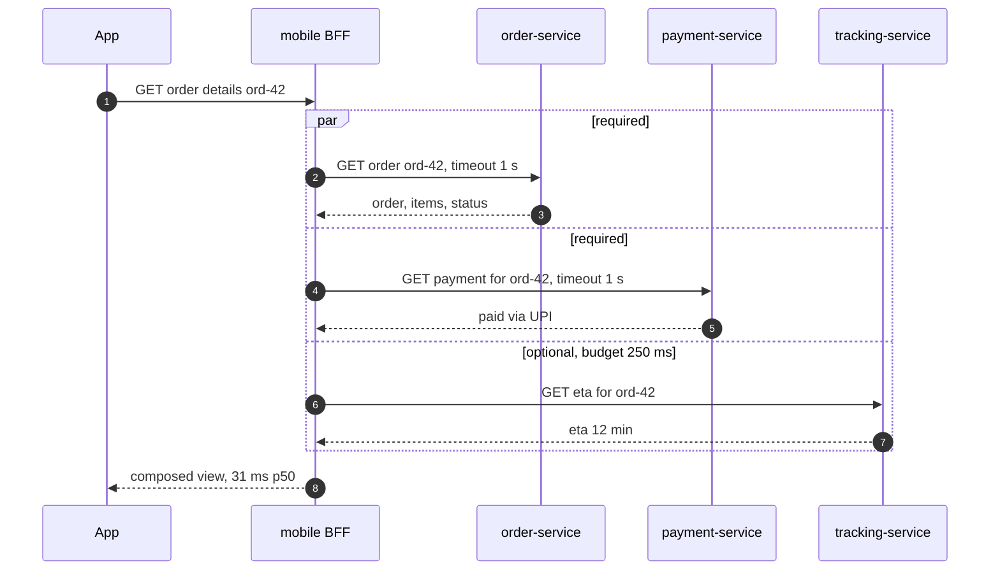
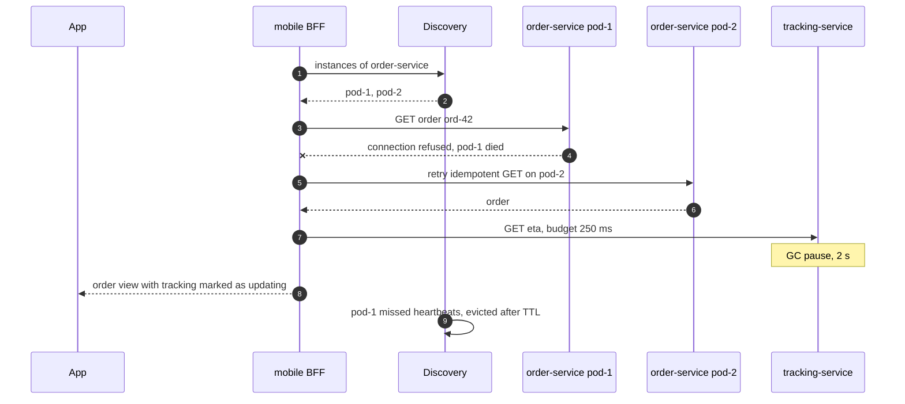
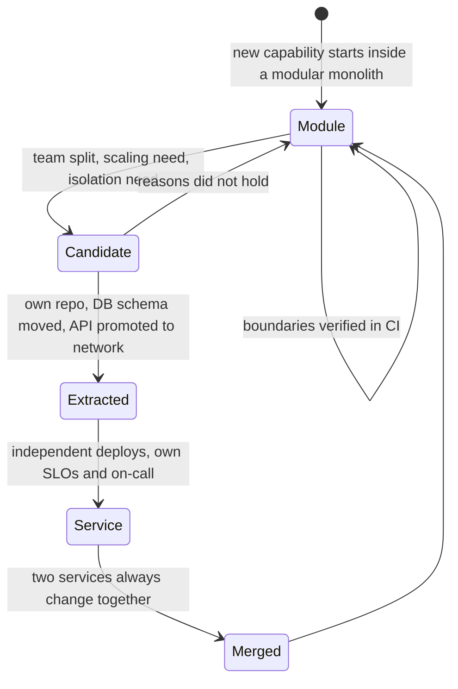

# 16. Microservices Architecture ⭐

!!! abstract "Chapter at a glance"
    **Reader bands:** B2 → B4 · **Prerequisites:** [Ch 09](../01-foundations/09-scalability-fundamentals.md), [Ch 13](13-distributed-transactions.md), [Ch 14](14-messaging-and-event-streaming.md), [Ch 15](15-event-driven-architecture-cqrs-and-event-sourcing.md) · **What you will build:** The decomposition of the grocery platform into 26 services, and the machinery that keeps it from becoming a distributed monolith.

    - **L1** quantifies what synchronous call chains do to availability and tail latency.
    - **L2** runs architecture fitness functions over the service graph: synchronous cycles, chain depth, shared databases and fan-in, before and after redrawing boundaries.
    - **L3** is a **modular monolith whose boundaries are enforced by the Java compiler** (JPMS). Reaching into another module's internals, an undeclared dependency and a cycle are all compile errors, shown verbatim.
    - **L4** uses **real HTTP** on localhost for three things: service discovery with heartbeats vs a static list while an instance dies, API composition with a latency budget, and a strangler-fig migration with shadow diffing and a canary.

    Every program was run, and outputs are verbatim. · **Reading time:** 110 min + code

---

## 1. Introduction & Why It Matters

### 1.1 A story: 14 services, one deploy train

Two years after "moving to microservices", the grocery platform had 14 services, and every release still went out together on Thursday night. What had happened:

- **Three services shared the `orders` database.** Order, fulfilment and invoicing all read and wrote the same tables. Adding a column needed three teams in one meeting, and a slow invoicing query locked rows that checkout needed.
- **Synchronous cycles.** Order called payment to capture, and payment called order back to fetch the amount. Fulfilment and order called each other. When payment slowed down, order threads piled up, fulfilment's calls to order timed out, and checkout failed.
- **A checkout needed 10 services to be up at the same time.** At 99.9 % each, that's roughly **99.0 %** for checkout, or about 7 hours of failed checkouts a month, even though every service met its own SLO.
- **The order-details page called order, payment and tracking one after another.** Tracking had occasional 2-second stalls, which became the page's p99.

The architecture had the costs of microservices (network calls, partial failures, distributed data) without the benefit (independent deployability). It was a **distributed monolith.**

The fix wasn't "more microservices". It was **better boundaries**:

- One database per service. Facts flow as events (Ch 14), not as shared tables or callbacks.
- Synchronous calls only where the caller needs an answer now, with no cycles, a shallow depth and timeouts (Ch 18).
- Pages that call several services do it in parallel, with a latency budget and partial results.
- New capabilities start in a **modular monolith** with enforced module boundaries. They're extracted into services only when there's a reason (a team, scaling, a different release cadence).
- Legacy paths are replaced piece by piece with a **strangler fig**: a routing facade, shadow traffic and canaries.

!!! quote "The thesis of this chapter"
    Microservices are a way to let **teams** change and deploy parts of a system independently. Everything else follows from that: boundaries along business capabilities, a database per service, asynchronous facts, few and shallow synchronous calls. If services can't be deployed independently, or a request needs ten of them to be up, you've built a distributed monolith, and a modular monolith would have served you better.

### 1.2 Where this lives in the grocery platform

The 26 services and their bounded contexts are listed in [Ch 00 §3.3](../00-orientation/00-how-to-use-this-handbook.md). This chapter explains **why** they're split that way and what rules keep them independent:

| Rule | Example | Check |
|---|---|---|
| Split by business capability / bounded context | `pricing-service` owns prices and GST rates; catalog doesn't | Ownership in the service catalog |
| One database per service | `invoice-service` has `invoice_db` and builds what it needs from events | Fitness function: no shared DB (L2) |
| Facts as events, commands as calls | `order.order.placed.v1` → fulfilment, invoicing, notifications | Async edges in the service graph |
| No synchronous cycles; depth ≤ 4 | Checkout calls cart, pricing, inventory, payment, order in parallel | Fitness function (L2) |
| Pages compose in parallel with budgets | Order details: order + payment required, tracking optional | p99 SLO (L4 B) |
| Start modular, extract when justified | New `subscription` capability starts as a module in `order-service` | JPMS/Modulith boundary checks (L3) |
| Replace legacy with a strangler fig | Order history moved off the legacy PHP admin behind the gateway | Shadow diff = 0 before cutover (L4 C) |

### 1.3 Learning objectives

| Band | After this chapter you can… |
|---|---|
| <span class="band b2">B2</span> | Explain what microservices are for, decompose by business capability, and state the database-per-service rule and its consequences |
| <span class="band b3">B3</span> | Design service discovery, externalized configuration and API composition; detect distributed-monolith smells with fitness functions |
| <span class="band b4">B4</span> | Choose between a modular monolith and microservices, plan a strangler-fig migration, and align service boundaries with team topology (Conway's law) |

---

## 2. Core Concepts — Beginner to Deep

### 2.1 Intuition: one big kitchen vs a food court <span class="band b2">B2</span>

- **A big restaurant kitchen (a monolith)** has one head chef, one menu and one set of equipment. Coordination is easy (shout across the room), and changing the menu is one decision. But every new dish means the whole kitchen retrains, and a fire at the grill stops everything.
- **A food court (microservices)** is independent stalls, each with its own staff, menu, suppliers and hours. The dosa stall can change its recipe without asking the pizza stall. But a combo meal needs several stalls to coordinate, the customer walks between counters, and if the drinks stall is closed, the combo is incomplete.
- **A food court where every stall shares one fridge and must ask the next stall for every ingredient** is the distributed monolith. You get all the walking and none of the independence.
- **A big kitchen with clearly separated stations, each with its own shelf and a rule that nobody takes from another station's shelf,** is the modular monolith. It keeps the easy coordination and most of the independence, and it can become a food court later, station by station.

### 2.2 What microservices are, and what they're for ⭐ <span class="band b2">B2</span>

A microservice is an independently deployable unit that owns a business capability and its data, and communicates through well-defined APIs and events. The defining property is **independent deployability**: a team can change, test and release its service without coordinating a release with other teams.

| Benefit | Only if… |
|---|---|
| Team autonomy and parallel delivery | Boundaries match teams (Conway's law), contracts are versioned |
| Independent scaling | Services have different load shapes (search vs invoicing) |
| Fault isolation | Calls have timeouts and fallbacks, and dependencies are few (Ch 18) |
| Technology fit | The platform can support more than one stack (usually: don't) |
| Smaller codebases | Boundaries are stable and cohesive |

| Cost | Consequence |
|---|---|
| Network calls instead of method calls | Latency, partial failure, retries, serialization |
| Distributed data | No joins or transactions across services: sagas (Ch 13), events (Ch 14), CQRS (Ch 15) |
| Operations | N deployments, dashboards, on-calls, CVEs, pipelines (Ch 24, 26) |
| Testing | Contracts, environments, end-to-end cost (Ch 29) |
| Availability math | Every synchronous dependency multiplies in (L1) |

L1 puts numbers on the last line:

- **Availability multiplies:** 5 synchronous services in series at 99.9 % each gives **99.50 %** (216 min/month of failures). 12 gives **98.81 %**.
- **Latency adds up when calls are sequential:** 8 calls go from p50 20 ms to **178 ms**.
- **Parallel calls take the maximum instead**, but the tail still grows: 26 parallel calls give **23 %** of page loads that hit at least one dependency's p99.

### 2.3 Decomposition: business capabilities and bounded contexts ⭐ <span class="band b2">B2</span> <span class="band b3">B3</span>

**By business capability:** what the business does. Examples: catalog management, pricing, promotions, ordering, fulfilment, delivery dispatch, payments, settlements, invoicing, customer support.

**By bounded context (DDD, Ch 33):** where a model and its language are consistent.

- "Product" in the catalog has descriptions and images.
- In pricing, it has MRP, selling price and GST slab.
- In inventory, it's a SKU with stock per dark store.
- In fulfilment, it's a pick location and weight.

These are four models of one real-world thing, in four contexts. Forcing one shared `Product` model across them is how the monolith got coupled.

**Heuristics for boundaries:**

| Heuristic | Good sign | Bad sign |
|---|---|---|
| Change together → belong together | A feature touches one service | Every feature touches 3 services |
| Data ownership | Each table has one writer | Several services write the same table |
| Transactions | Invariants are enforced inside one service | Invariants need cross-service transactions |
| Language | Terms mean one thing inside the service | "Order" means three things |
| Team | One team owns it end to end | Several teams commit to it weekly |
| Chattiness | A few coarse calls per use case | Dozens of fine-grained calls |

**Granularity:** start **coarser** than you think. Splitting a service later is easier than merging services that share nothing but pain. The grocery platform's 26 services map to about 8 teams (Ch 37). A team owning 3–4 cohesive services is normal. A service per entity (`address-service`, `gst-rate-service`) isn't.

### 2.4 Database per service ⭐ <span class="band b2">B2</span> <span class="band b3">B3</span>

Each service owns its data. Other services access it **only** through the owner's API or events. They never read or write its tables.

- **Why:** schema changes stay local, the owner enforces invariants, the owner chooses the right storage (Ch 06), and a noisy neighbour can't lock your rows.
- **"Private tables on a shared server"** is an acceptable start: separate schemas and users on one PostgreSQL cluster, as long as grants enforce the separation. It's the shared **tables** that are the problem.
- **Consequences, and their patterns:**
    - **Cross-service queries** → API composition (§2.8) or a CQRS read model built from events (Ch 15).
    - **Cross-service transactions** → sagas + outbox (Ch 13).
    - **Reference data** (pincodes, GST rates) → owned by one service, replicated to others via event-carried state transfer (Ch 15), and cached with versions.
    - **Reporting** → CDC into the warehouse (Ch 21), never live joins across service databases.

L2's "before" graph had two shared databases (`orders_db` used by order, fulfilment and invoice; `catalog_db` used by catalog and pricing), and the fitness check failed on them.

### 2.5 Communication styles ⭐ <span class="band b2">B2</span> <span class="band b3">B3</span>

| Style | Use for | Watch out for |
|---|---|---|
| **Synchronous request/response** (REST, gRPC; Ch 04, 17) | Queries and commands where the caller needs the answer now (price, stock check, payment result) | Availability multiplication, cascading latency, cycles |
| **Asynchronous events** (Ch 14) | Facts others react to (order placed, price changed) | Eventual consistency, duplicates, ordering |
| **Asynchronous commands / jobs** (queues) | Work for one owner, later (send SMS, generate invoice) | Retries, DLQs |

**Rules the platform follows:**

1. **No synchronous cycles.** A calls B, and B calls A is a single deployable unit in disguise, and a deadlock/cascade risk. L2 found two cycles in the "before" graph (`order ↔ payment ↔ fulfilment`, `catalog ↔ inventory`).
2. **Shallow synchronous depth:** gateway → aggregator → leaf (≤ 4 hops). The "before" graph had a 6-hop chain (gateway → checkout → order → invoice → pricing → catalog → inventory).
3. **Invert dependencies with events.** Instead of payment calling order back, payment publishes `payment.payment.captured.v1`, and the order saga reacts.
4. **Every call has a timeout, and retries only on idempotent operations** with backoff (Ch 18).
5. **Keep the synchronous blast radius small:** L2's "after" graph cut the services a checkout needs synchronously from 10 to 6.

### 2.6 Service discovery and load balancing ⭐ <span class="band b3">B3</span>

Instances come and go (autoscaling, deploys, crashes), so callers need the current, healthy set.

| Approach | How | Examples |
|---|---|---|
| **Platform DNS + L4/L7 LB** | A stable name resolves to a virtual IP or load balancer; the platform tracks health | Kubernetes Services, cloud LBs |
| **Client-side discovery** | The client asks a registry for instances and balances itself | Eureka + Spring Cloud LoadBalancer, Consul |
| **Service mesh** | A sidecar or ambient proxy does discovery, retries, mTLS and outlier detection | Istio, Linkerd, Cilium |

Whatever the mechanism, three behaviours matter:

- **Dead instances are removed quickly:** health checks, heartbeats with a TTL, readiness probes (Ch 26).
- **Callers retry on another instance** for idempotent requests.
- **Clients don't cache instance lists forever.**

L4 A made 3,000 calls to three catalog instances, and one crashed after call 500:

- A **static instance list** failed **833** calls (every third call went to the dead instance).
- A **registry with a 300 ms heartbeat TTL plus one retry** failed **0**.

On Kubernetes, the Service/Endpoints mechanism does the registry part. Readiness probes must fail **before** an instance stops accepting traffic (graceful shutdown), or the same failures appear during every deploy.

### 2.7 Externalized configuration <span class="band b3">B3</span>

- Configuration (URLs, timeouts, feature flags, limits) lives **outside** the artifact, so one build runs in every environment (12-factor).
- **Sources:** environment variables and ConfigMaps (Kubernetes), Spring Cloud Config, Consul/etcd (Ch 12), and a secrets manager for credentials (Vault, cloud KMS; Ch 23).
- **Dynamic config and flags** (rate limits, kill switches) are **versioned and audited**, with safe defaults when the config store is unreachable, and validated before rollout. A config push is a deployment.
- Avoid a "config service" that every request depends on synchronously. Load it at startup and on change (watch), then serve from memory.

### 2.8 API composition and the gateway ⭐ <span class="band b3">B3</span>

Many screens need data from several services. Options:

- **Client-side composition** (the app calls several APIs): chatty over mobile networks, and it exposes internal APIs.
- **API composition in a gateway or BFF (backend-for-frontend):** one call from the app, and the BFF calls services **in parallel**, with a **latency budget** and **partial results** for optional parts.
- **A CQRS read model** (Ch 15) when the combined view is requested often or needs filtering/sorting across services. It's pre-joined by events.

L4 B, 500 order-details page loads (order 20 ms, payment 30 ms, tracking 25 ms, but 3 % of tracking calls take 2 s):

| Strategy | p50 | p99 | Partial pages |
|---|---|---|---|
| Sequential | 79 ms | 2,054 ms | 0 |
| Parallel | 31 ms | 2,002 ms | 0 |
| **Parallel + 250 ms budget for the optional part** | 31 ms | **251 ms** | 10 (tracking shown as "updating…") |

Parallelism fixes the median. **Budgets and optional parts fix the tail.** Decide per field whether it's required (fail the page) or optional (degrade gracefully). That's a product decision.

### 2.9 The distributed monolith: smells and fitness functions ⭐ <span class="band b3">B3</span> <span class="band b4">B4</span>

| Smell | Symptom | Measure (L2) |
|---|---|---|
| Lock-step deploys | "Release train"; services versioned together | Deploys per service per week; % releases touching > 1 service |
| Shared database | Schema changes need cross-team meetings | Tables with > 1 writer; `shared databases` |
| Synchronous cycles | Cascading failures, deadlock-like stalls | `synchronous cycles` |
| Deep call chains | Latency and availability multiply | `longest sync chain`, `services a checkout needs` |
| Chatty interfaces | Hundreds of calls per page | Calls per request (tracing, Ch 24) |
| Shared domain library | One "common-model" jar in every service | Dependency analysis |
| Hub service | Everyone calls one service synchronously | `highest sync fan-in` |

**Architecture fitness functions** (Ford, Parsons & Kua, *Building Evolutionary Architectures*) turn these into CI checks over a machine-readable catalog of services, dependencies and databases (Backstage catalog, OpenAPI/AsyncAPI specs, tracing data). L2 shows the "before" graph **FAIL** (2 cycles, 6-hop chain, 2 shared databases, 10 synchronous dependencies for checkout) and the "after" graph **PASS** (no cycles, 2 hops, no shared databases, 6 dependencies).

### 2.10 The modular monolith ⭐ <span class="band b3">B3</span> <span class="band b4">B4</span>

One deployable unit made of **modules with enforced boundaries**: each module owns its data (its own schema and tables), exposes a small API, and communicates with others through that API or in-process events.

| | Monolith (big ball of mud) | **Modular monolith** | Microservices |
|---|---|---|---|
| Deploy | One unit | One unit | Independent |
| Boundaries | Conventions, eroded | **Enforced** (compiler/JPMS, ArchUnit, Spring Modulith) | Network |
| Calls between parts | Method calls anywhere | Method calls to published APIs, events | Network calls |
| Transactions across parts | Easy | Possible, but discouraged across modules | Sagas |
| Operational cost | Low | Low | High |
| Extraction later | Hard | **A module becomes a service** | — |

L3 enforces the boundaries with the **Java Platform Module System**. Each module exports only its `api` package. `grocery.order` `requires grocery.catalog` and `grocery.shared`, but not `grocery.inventory`, and it reaches inventory only by publishing `OrderPlaced`. Then three violations are attempted, and the compiler rejects each one:

- Importing `com.grocery.catalog.internal.ProductRepository` → `package com.grocery.catalog.internal is not visible`.
- Using inventory without declaring it → `package com.grocery.inventory.api is not visible`.
- Adding `requires grocery.order` to catalog → `cyclic dependence involving grocery.catalog`.

In Spring Boot, **Spring Modulith** gives the same idea with packages instead of JPMS modules: `ApplicationModules.of(App.class).verify()` fails the build on illegal dependencies. It also offers `@ApplicationModuleListener` for transactional in-process events with an event publication registry (outbox semantics), and documentation of the module graph.

**When to extract a module into a service:** a different team owns it and needs its own release cadence, its load or scaling profile differs sharply, it needs different technology or isolation (PCI scope for payments), or failure isolation justifies the network hop. "It feels big" isn't on the list.

### 2.11 Migrating: the strangler fig ⭐ <span class="band b4">B4</span>

Martin Fowler's strangler fig replaces a legacy system gradually, not in a big-bang rewrite:

1. **Put a facade in front** (the API gateway or a routing proxy). All traffic flows through it.
2. **Pick a slice:** one capability, and ideally one that's read-heavy first (order history), not the most entangled.
3. **Build the new service, and feed it data** via CDC or events from the legacy DB (Ch 13).
4. **Shadow:** the facade sends real requests to both. The legacy answers, and the responses are **diffed**. L4 C: **468 mismatches in 2,000 requests**, all for large baskets, a rounding bug found before any user saw it.
5. **Canary:** after the fix, route a small share (L4: 214 of 2,000) to the new service while still diffing (0 mismatches). Then ramp up.
6. **Cut over and retire** the legacy path. Delete the dead code and tables.
7. **Repeat** with the next slice. Writes are harder: move the write path only after reads are stable, and use CDC in the reverse direction during the transition if the legacy still needs the data.

**Anti-corruption layer (ACL):** translate the legacy's model to the new context's model at the boundary, so legacy concepts don't leak into the new service.

### 2.12 Microservices and teams ⭐ <span class="band b4">B4</span>

- **Conway's law:** systems mirror the communication structure of the organizations that build them. The **inverse Conway manoeuvre** designs teams to get the architecture you want.
- **Team Topologies** (Skelton & Pais): stream-aligned teams own services end to end. A **platform team** provides paved roads (CI/CD, observability, the service template). Enabling teams coach, and complicated-subsystem teams own things like search ranking.
- **Cognitive load** is the real limit. If one team owns 9 services and 4 of them page at night, the boundaries (or the team count) are wrong.
- **A service template ("golden path")** is how 26 services stay consistent: the four-layer structure, logging, tracing, health, config, security, the outbox/inbox library and the CI pipeline, generated from one template (Ch 37).

---

## 3. Architecture & Diagrams

### 3.1 Component view: checkout's synchronous core and asynchronous periphery

```mermaid
flowchart LR
    APP[Customer app] --> GW[api-gateway]
    GW --> BFF[mobile BFF - composition with budgets]
    BFF --> CO[checkout-service]
    BFF --> ORD[order-service]
    BFF --> PAY[payment-service]
    BFF --> TRK[tracking-service - optional]
    CO -- sync, parallel --> CART[cart-service]
    CO -- sync, parallel --> PRC[pricing-service]
    CO -- sync, parallel --> INV[inventory-service]
    CO -- sync --> PAY
    CO -- sync --> ORD
    ORD -. event order.order.placed.v1 .-> FUL[fulfilment-service]
    ORD -. event .-> INVC[invoice-service]
    ORD -. event .-> NOT[notification-service]
    PAY -. event payment.payment.captured.v1 .-> ORD
    FUL -. event fulfilment.order.packed.v1 .-> ORD
    CAT[catalog-service] -. event catalog.product.updated.v1 .-> PRC
    CAT -. event .-> INV
    CAT -. event .-> SRCH[search-service]
    subgraph Platform
        DISC[Service discovery - Kubernetes Services]
        CFG[Config and flags - ConfigMaps, etcd]
        OBS[Tracing, metrics, logs]
    end
```

Solid arrows are synchronous calls, and there are no cycles among them. Dotted arrows are events. Every service has its own database (not drawn).

### 3.2 Sequence: happy path, the order-details page with a budget



### 3.3 Sequence: failure path, a slow optional dependency and a dead instance



### 3.4 State: a capability's journey from module to service



Merging services back is a legitimate move when two services always change together, share data or call each other in cycles.

---

## 4. Design Document Excerpt: Service Boundaries for the Grocery Platform

| Field | Value |
|---|---|
| Author / Reviewers | Principal engineer / all team leads, SRE, Security |
| Status | Approved |
| Related ADRs | ADR-063 Decompose by bounded context (26 services, 8 teams); ADR-064 Database per service; ADR-065 Synchronous-call rules and fitness functions; ADR-066 Modular monolith first for new capabilities; ADR-067 Strangler fig for legacy admin |

**1. Context & Problem.** 14 services deployed together weekly. Three services shared `orders_db`, there were synchronous cycles, checkout depended on 10 services, and page p99s were dominated by optional data (§1.1).

**2. Goals / Non-Goals.**

- *Goals:* any service deployable alone on any day; checkout available ≥ 99.9 %; order-details page p99 ≤ 300 ms; clear ownership of every table and API; a repeatable way to add capabilities and retire legacy.
- *Non-goals:* polyglot stacks (Java/Spring for all backend services); splitting services below team granularity.

**3. Requirements.**

| ID | Requirement |
|---|---|
| NFR-1 | 0 synchronous cycles; synchronous depth ≤ 4; checkout synchronous dependencies ≤ 6 (CI fitness function) |
| NFR-2 | 0 tables with more than one writing service (DB grant audit in CI) |
| NFR-3 | ≥ 90 % of releases touch exactly one service |
| NFR-4 | Every synchronous call has a timeout; optional data has a budget and a fallback |
| NFR-5 | Dead instances are removed from rotation in ≤ 5 s; deploys cause 0 failed requests (graceful shutdown) |
| NFR-6 | Legacy endpoints are migrated only after a shadow diff of 0 mismatches over ≥ 7 days of traffic |

**4. Capacity & latency estimates.**

| Item | Calculation | Result |
|---|---|---|
| Checkout availability | 6 synchronous services × 99.95 % (tier-1 SLO) | ≈ 99.70 % → need retries/fallbacks on idempotent reads to reach 99.9 % |
| Order-details p99 | max(order, payment) p99 ≈ 80 ms + BFF overhead; tracking budget 250 ms | ≤ 300 ms |
| Service count vs teams | 26 services / 8 teams | ~3 per team (OK) |
| Deploy frequency target | 26 services × 3/week | ~80 deploys/week, needs a paved-road pipeline (Ch 26) |

**5. Proposed design.**

1. **Boundaries:** 26 services as in Ch 00 §3.3, grouped under 8 stream-aligned teams, with a platform team for gateway, discovery, observability and the service template.
2. **Data:** a database (or at least a schema with exclusive grants) per service. Reference data is replicated via events. Reporting goes through CDC to the warehouse.
3. **Communication:** events for facts (outbox, Ch 13). Synchronous calls only where an answer is needed now; no cycles, depth ≤ 4, timeouts everywhere. Payment → order callbacks are replaced by `payment.payment.captured.v1`.
4. **Discovery:** Kubernetes Services, readiness probes, graceful shutdown (preStop + drain), client retries for idempotent calls on another instance.
5. **Composition:** a mobile BFF and a web BFF with parallel calls, per-field required/optional classification, budgets, partial responses.
6. **Fitness functions in CI:** service catalog + OpenAPI/AsyncAPI → cycle, depth, fan-in and shared-DB checks (L2). Spring Modulith `verify()` inside each service with modules.
7. **New capabilities** start as modules. Extraction criteria are an ADR per extraction.
8. **Legacy admin** is migrated by strangler fig through the gateway: shadow → canary → cutover, slice by slice.

**7. Alternatives considered.**

| Option | Pros | Cons | Verdict |
|---|---|---|---|
| Stay with the current 14 services | No migration | Distributed monolith costs stay | Rejected |
| **Bounded-context services + rules + fitness functions** | Autonomy, isolation, measurable | More services to operate | **Chosen** |
| Consolidate into one modular monolith | Simplest ops, local transactions | 8 teams on one deploy pipeline; scaling of search/tracking differs | Rejected for the whole platform; used within services |
| Finer-grained services (per entity) | Small codebases | Chattiness, cycles, cognitive load | Rejected |
| Service mesh now | Uniform retries/mTLS | Operational complexity | Deferred; revisit with the mTLS requirement (Ch 23) |

**8. Failure modes.** A dependency is down: required → fail fast with a clear error, optional → degrade. An instance dies: removed by readiness/endpoints, and idempotent calls retry. Config store down: serve the last known config. Legacy and new disagree during migration: shadow diff blocks the cutover.

**10. Observability.** A service dependency graph from tracing (actual vs declared), calls per request, synchronous depth per endpoint, deploys per service, % multi-service releases, error budget per service, partial-response rate per BFF field.

**14. Decision (ADR-063–067 summary).** The platform is 26 bounded-context services owned by 8 teams, each with its own data. Facts flow as events. Synchronous calls follow no-cycle/shallow/timeout rules enforced by fitness functions in CI. New capabilities start as enforced modules. Legacy is replaced by strangler fig with shadow diffing.

---

## 5. Hands-On Code — Level Ladder

| Level | New requirement that forces the step |
|---|---|
| L1 | "What does splitting a request across services do to availability and latency?" (plain Java) |
| L2 | "Detect distributed-monolith smells automatically, in CI." (graph fitness functions) |
| L3 | "Start the new capability modular, with boundaries nobody can bypass." (JPMS, real `javac`) |
| L4 | "Find healthy instances, compose pages within a budget, and migrate legacy safely." (real HTTP) |

!!! info "How the code in this chapter was verified"
    L1 and L2 are plain Java. L3 is a real multi-module build with `javac --module-source-path`, and the compiler errors are copied verbatim. L4 starts real HTTP servers (the JDK's `com.sun.net.httpserver`) on localhost and calls them with `java.net.http.HttpClient` on virtual threads (Java 21). The Spring Modulith / Spring Cloud snippets weren't compiled here (no Maven Central access) and are marked `VERIFY`.

### L1 — Concept: the arithmetic of splitting a request (plain Java) <span class="band b2">B2</span>

```java
// CallChainL1.java — run with: java CallChainL1.java
// What splitting a request across services does to availability and tail latency.
import java.util.*;

public class CallChainL1 {

    /** One service call: 99.9 % available; latency lognormal-ish with median ~20 ms and a slow tail. */
    static double callMs(Random r) { return 20 * Math.exp(0.5 * r.nextGaussian()); }

    public static void main(String[] args) {
        Random r = new Random(7);
        int requests = 200_000;
        System.out.println("A. Synchronous dependencies in SERIES, each 99.9 % available");
        for (int n : new int[]{1, 3, 5, 8, 12}) {
            double avail = Math.pow(0.999, n);
            System.out.printf("   %2d services on the request path → %.2f %% available (%4.0f min of downtime a month)%n",
                    n, avail * 100, (1 - avail) * 30 * 24 * 60);
        }

        System.out.println("B. Latency of one page that calls N services (each median ~20 ms)");
        for (int n : new int[]{1, 4, 8}) {
            double[] serial = new double[requests], parallel = new double[requests];
            for (int i = 0; i < requests; i++) {
                double sum = 0, max = 0;
                for (int k = 0; k < n; k++) { double t = callMs(r); sum += t; max = Math.max(max, t); }
                serial[i] = sum; parallel[i] = max;
            }
            Arrays.sort(serial); Arrays.sort(parallel);
            System.out.printf("   N=%d  sequential p50 %5.0f ms  p99 %5.0f ms   |   parallel p50 %4.0f ms  p99 %4.0f ms%n",
                    n, serial[requests / 2], serial[requests * 99 / 100], parallel[requests / 2], parallel[requests * 99 / 100]);
        }

        System.out.println("C. Fan-out: chance that at least one of N parallel calls hits its own p99 (tail at scale)");
        for (int n : new int[]{1, 5, 10, 26, 100}) System.out.printf("   N=%3d → %4.1f %% of page loads see a p99-slow dependency%n", n, (1 - Math.pow(0.99, n)) * 100);
    }
}
```

Actual output from running it:

```text
A. Synchronous dependencies in SERIES, each 99.9 % available
    1 services on the request path → 99.90 % available (  43 min of downtime a month)
    3 services on the request path → 99.70 % available ( 129 min of downtime a month)
    5 services on the request path → 99.50 % available ( 216 min of downtime a month)
    8 services on the request path → 99.20 % available ( 344 min of downtime a month)
   12 services on the request path → 98.81 % available ( 516 min of downtime a month)
B. Latency of one page that calls N services (each median ~20 ms)
   N=1  sequential p50    20 ms  p99    64 ms   |   parallel p50   20 ms  p99   64 ms
   N=4  sequential p50    87 ms  p99   162 ms   |   parallel p50   33 ms  p99   82 ms
   N=8  sequential p50   178 ms  p99   277 ms   |   parallel p50   40 ms  p99   91 ms
C. Fan-out: chance that at least one of N parallel calls hits its own p99 (tail at scale)
   N=  1 →  1.0 % of page loads see a p99-slow dependency
   N=  5 →  4.9 % of page loads see a p99-slow dependency
   N= 10 →  9.6 % of page loads see a p99-slow dependency
   N= 26 → 23.0 % of page loads see a p99-slow dependency
   N=100 → 63.4 % of page loads see a p99-slow dependency
```

**What L1 shows:** each synchronous dependency in series costs availability multiplicatively and latency additively. Parallel calls turn the sum into a maximum, but the more dependencies a page fans out to, the more often one of them is having a bad moment (23 % of page loads at 26 dependencies). That's why the platform minimizes synchronous dependencies and budgets optional ones.

### L2 — Fitness functions for the service graph <span class="band b3">B3</span>

Requirement: detect distributed-monolith smells automatically on every merge, from the service catalog (dependencies and databases), not from opinions in design reviews.

```java
// FitnessL2.java — run with: java FitnessL2.java
// Architecture fitness functions over the platform's service graph: the "distributed monolith" smells as numbers.
// The same checks run in CI against a machine-readable service catalog (Backstage catalog-info, OpenAPI clients, etc.).
import java.util.*;
import java.util.stream.*;

public class FitnessL2 {

    record Edge(String from, String to, boolean sync) { }
    record Catalog(String name, Map<String, String> database, List<Edge> edges) { }

    // ---------- the checks ----------
    static List<List<String>> syncCycles(Catalog c) {                 // Tarjan's SCC on synchronous edges
        Map<String, List<String>> g = new TreeMap<>();
        c.edges().stream().filter(Edge::sync).forEach(e -> g.computeIfAbsent(e.from(), k -> new ArrayList<>()).add(e.to()));
        Map<String, Integer> index = new HashMap<>(), low = new HashMap<>();
        Deque<String> stack = new ArrayDeque<>(); Set<String> on = new HashSet<>();
        List<List<String>> out = new ArrayList<>(); int[] counter = {0};
        class T { void visit(String v) {
            index.put(v, counter[0]); low.put(v, counter[0]++); stack.push(v); on.add(v);
            for (String w : g.getOrDefault(v, List.of())) {
                if (!index.containsKey(w)) { visit(w); low.put(v, Math.min(low.get(v), low.get(w))); }
                else if (on.contains(w)) low.put(v, Math.min(low.get(v), index.get(w)));
            }
            if (low.get(v).equals(index.get(v))) {
                List<String> scc = new ArrayList<>(); String w;
                do { w = stack.pop(); on.remove(w); scc.add(w); } while (!w.equals(v));
                if (scc.size() > 1) { Collections.sort(scc); out.add(scc); }
            }
        } }
        T t = new T();
        new TreeSet<>(c.edges().stream().flatMap(e -> Stream.of(e.from(), e.to())).toList()).forEach(v -> { if (!index.containsKey(v)) t.visit(v); });
        return out;
    }

    static List<String> longestSyncChain(Catalog c, String from) {    // DFS on the (acyclic part of the) sync graph
        List<String> best = List.of(from);
        for (Edge e : c.edges()) if (e.sync() && e.from().equals(from)) {
            List<String> path = new ArrayList<>(List.of(from));
            List<String> rest = longestFrom(c, e.to(), new HashSet<>(Set.of(from)));
            path.addAll(rest);
            if (path.size() > best.size()) best = path;
        }
        return best;
    }
    static List<String> longestFrom(Catalog c, String v, Set<String> seen) {
        seen = new HashSet<>(seen); seen.add(v);
        List<String> best = List.of(v);
        for (Edge e : c.edges()) if (e.sync() && e.from().equals(v) && !seen.contains(e.to())) {
            List<String> p = new ArrayList<>(List.of(v)); p.addAll(longestFrom(c, e.to(), seen));
            if (p.size() > best.size()) best = p;
        }
        return best;
    }

    static Map<String, List<String>> sharedDatabases(Catalog c) {
        return c.database().entrySet().stream().collect(Collectors.groupingBy(Map.Entry::getValue, TreeMap::new,
                Collectors.mapping(Map.Entry::getKey, Collectors.toList()))).entrySet().stream()
                .filter(e -> e.getValue().size() > 1).collect(Collectors.toMap(Map.Entry::getKey, Map.Entry::getValue, (a, b) -> a, TreeMap::new));
    }

    static void report(Catalog c) {
        System.out.println(c.name());
        var cycles = syncCycles(c);
        var chain = longestSyncChain(c, "api-gateway");
        var shared = sharedDatabases(c);
        Map<String, Long> syncFanIn = c.edges().stream().filter(Edge::sync).collect(Collectors.groupingBy(Edge::to, TreeMap::new, Collectors.counting()));
        var hub = syncFanIn.entrySet().stream().max(Map.Entry.comparingByValue()).orElseThrow();
        long sync = c.edges().stream().filter(Edge::sync).count();
        System.out.printf("   edges: %d sync, %d async (events)%n", sync, c.edges().size() - sync);
        System.out.println("   synchronous cycles         : " + (cycles.isEmpty() ? "none" : cycles));
        System.out.printf ("   longest sync chain         : %d hops %s%n", chain.size() - 1, chain);
        Set<String> reach = new TreeSet<>(); Deque<String> todo = new ArrayDeque<>(List.of("checkout-service"));
        while (!todo.isEmpty()) { String v = todo.pop(); if (reach.add(v)) c.edges().stream().filter(e -> e.sync() && e.from().equals(v)).forEach(e -> todo.push(e.to())); }
        System.out.printf ("   a checkout needs, synchronously: %d services → %.2f %% available if each is 99.9 %%%n",
                reach.size(), Math.pow(0.999, reach.size()) * 100);
        System.out.println("   shared databases           : " + (shared.isEmpty() ? "none" : shared));
        System.out.println("   highest sync fan-in        : " + hub.getKey() + " (" + hub.getValue() + " callers)");
        boolean pass = cycles.isEmpty() && shared.isEmpty() && chain.size() - 1 <= 4;
        System.out.println("   fitness (no cycles, no shared DB, chain ≤ 4): " + (pass ? "PASS" : "FAIL"));
    }

    static Edge s(String a, String b) { return new Edge(a, b, true); }
    static Edge a(String a, String b) { return new Edge(a, b, false); }

    public static void main(String[] args) {
        Map<String, String> dbBefore = new TreeMap<>(Map.of(
                "order-service", "orders_db", "fulfilment-service", "orders_db", "invoice-service", "orders_db",
                "payment-service", "payments_db", "inventory-service", "inventory_db", "catalog-service", "catalog_db",
                "pricing-service", "catalog_db", "checkout-service", "checkout_db", "cart-service", "redis_cart"));
        Catalog before = new Catalog("BEFORE: the 'microservices' that grew out of the monolith", dbBefore, List.of(
                s("api-gateway", "checkout-service"), s("checkout-service", "cart-service"), s("cart-service", "pricing-service"),
                s("pricing-service", "catalog-service"), s("catalog-service", "inventory-service"), s("inventory-service", "catalog-service"),
                s("checkout-service", "order-service"), s("order-service", "payment-service"), s("payment-service", "order-service"),
                s("order-service", "inventory-service"), s("order-service", "notification-service"), s("order-service", "invoice-service"),
                s("invoice-service", "pricing-service"), s("fulfilment-service", "order-service"), s("order-service", "fulfilment-service"),
                s("api-gateway", "order-service")));
        Map<String, String> dbAfter = new TreeMap<>(Map.of(
                "order-service", "orders_db", "fulfilment-service", "fulfilment_db", "invoice-service", "invoice_db",
                "payment-service", "payments_db", "inventory-service", "inventory_db", "catalog-service", "catalog_db",
                "pricing-service", "pricing_db", "checkout-service", "checkout_db", "cart-service", "redis_cart"));
        Catalog after = new Catalog("AFTER: boundaries redrawn, facts flow as events", dbAfter, List.of(
                s("api-gateway", "checkout-service"), s("checkout-service", "cart-service"), s("checkout-service", "pricing-service"),
                s("checkout-service", "inventory-service"), s("checkout-service", "payment-service"), s("checkout-service", "order-service"),
                a("catalog-service", "pricing-service"), a("catalog-service", "inventory-service"),
                a("order-service", "notification-service"), a("order-service", "invoice-service"), a("order-service", "fulfilment-service"),
                a("payment-service", "order-service"), a("fulfilment-service", "order-service"), a("pricing-service", "invoice-service"),
                s("api-gateway", "order-service")));
        report(before);
        report(after);
    }
}
```

Actual output from running it:

```text
BEFORE: the 'microservices' that grew out of the monolith
   edges: 16 sync, 0 async (events)
   synchronous cycles         : [[catalog-service, inventory-service], [fulfilment-service, order-service, payment-service]]
   longest sync chain         : 6 hops [api-gateway, checkout-service, order-service, invoice-service, pricing-service, catalog-service, inventory-service]
   a checkout needs, synchronously: 10 services → 99.00 % available if each is 99.9 %
   shared databases           : {catalog_db=[catalog-service, pricing-service], orders_db=[fulfilment-service, invoice-service, order-service]}
   highest sync fan-in        : order-service (4 callers)
   fitness (no cycles, no shared DB, chain ≤ 4): FAIL
AFTER: boundaries redrawn, facts flow as events
   edges: 7 sync, 8 async (events)
   synchronous cycles         : none
   longest sync chain         : 2 hops [api-gateway, checkout-service, cart-service]
   a checkout needs, synchronously: 6 services → 99.40 % available if each is 99.9 %
   shared databases           : none
   highest sync fan-in        : order-service (2 callers)
   fitness (no cycles, no shared DB, chain ≤ 4): PASS
```

- **Before:**
    - **Two synchronous cycles.** Payment calls order back, fulfilment and order call each other, and inventory calls catalog, which calls inventory.
    - **A 6-hop chain:** invoicing, reached from order during checkout, calls pricing → catalog → inventory.
    - **Two shared databases.**
    - **A checkout needs 10 services up at once** (99.00 % at 99.9 % each).
- **After:**
    - Callbacks became events (`payment.payment.captured.v1`, `fulfilment.order.packed.v1`).
    - Catalog pushes changes as events instead of being called.
    - Invoicing builds its data from events.
    - Checkout calls its dependencies in parallel.
    - Result: **no cycles, depth 2, no shared databases, 6 services for a checkout. PASS.**

In CI, the graph comes from a machine-readable catalog: Backstage `catalog-info.yaml` with `dependsOn`/`providesApis`/`consumesApis`, plus the OpenAPI/AsyncAPI specs. Tracing data (Ch 24) verifies that the **declared** graph matches the **actual** one.

### L3 — A modular monolith with compiler-enforced boundaries (real `javac`) <span class="band b3">B3</span> <span class="band b4">B4</span>

Requirement: the new subscriptions capability starts inside `order-service` as modules. Boundaries must be impossible to bypass, not just documented.

=== "module-info.java files"

    ```java
    // src/grocery.shared/module-info.java
    module grocery.shared {
        exports com.grocery.shared.events;
    }

    // src/grocery.catalog/module-info.java
    module grocery.catalog {
        exports com.grocery.catalog.api;          // the ONLY package other modules may use
    }

    // src/grocery.inventory/module-info.java
    module grocery.inventory {
        requires grocery.shared;
        exports com.grocery.inventory.api;
    }

    // src/grocery.order/module-info.java
    module grocery.order {
        requires grocery.catalog;                 // synchronous API use: allowed, explicit
        requires grocery.shared;                  // publishes events; does NOT require grocery.inventory
        exports com.grocery.order.api;
    }

    // src/grocery.app/module-info.java
    module grocery.app {
        requires grocery.shared;
        requires grocery.catalog;
        requires grocery.inventory;
        requires grocery.order;
    }
    ```

=== "Module code"

    ```java
    // src/grocery.app/com/grocery/app/Main.java
    package com.grocery.app;

    import com.grocery.catalog.api.CatalogApi;
    import com.grocery.inventory.api.InventoryModule;
    import com.grocery.order.api.OrderModule;
    import com.grocery.shared.events.EventBus;

    public final class Main {
        public static void main(String[] args) {
            EventBus bus = new EventBus();
            InventoryModule inventory = new InventoryModule(bus);
            OrderModule orders = new OrderModule(new CatalogApi(), bus);
            System.out.println("placed: " + orders.place("ATTA-5KG", 3));
            System.out.println("inventory after the event: ATTA-5KG available = " + inventory.available("ATTA-5KG"));
            System.out.println("module graph: " + ModuleLayer.boot().modules().stream().map(Module::getName)
                    .filter(n -> n.startsWith("grocery")).sorted().toList());
        }
    }

    // src/grocery.catalog/com/grocery/catalog/api/CatalogApi.java
    package com.grocery.catalog.api;

    import com.grocery.catalog.internal.ProductRepository;

    public final class CatalogApi {
        private final ProductRepository repo = new ProductRepository();
        public record ProductView(String sku, String name, long pricePaise) { }
        public ProductView product(String sku) { var p = repo.find(sku); return new ProductView(p.sku(), p.name(), p.pricePaise()); }
    }

    // src/grocery.catalog/com/grocery/catalog/internal/ProductRepository.java
    package com.grocery.catalog.internal;

    import java.util.Map;

    /** Internal: tables, JPA entities, caches. Invisible outside the module. */
    public final class ProductRepository {
        public record Product(String sku, String name, long pricePaise, String supplierCostPaise) { }
        private final Map<String, Product> products = Map.of("ATTA-5KG", new Product("ATTA-5KG", "Whole wheat atta 5 kg", 32000, "27150"));
        public Product find(String sku) { return products.get(sku); }
    }

    // src/grocery.inventory/com/grocery/inventory/api/InventoryModule.java
    package com.grocery.inventory.api;

    import com.grocery.shared.events.EventBus;
    import com.grocery.shared.events.OrderPlaced;
    import java.util.HashMap;
    import java.util.Map;

    public final class InventoryModule {
        private final Map<String, Integer> stock = new HashMap<>(Map.of("ATTA-5KG", 40));
        public InventoryModule(EventBus bus) { bus.subscribe(OrderPlaced.class, this::onOrderPlaced); }   // reacts to events
        private void onOrderPlaced(OrderPlaced e) { stock.merge(e.sku(), -e.qty(), Integer::sum); }
        public int available(String sku) { return stock.getOrDefault(sku, 0); }
    }

    // src/grocery.order/com/grocery/order/api/OrderModule.java
    package com.grocery.order.api;

    import com.grocery.catalog.api.CatalogApi;
    import com.grocery.shared.events.EventBus;
    import com.grocery.shared.events.OrderPlaced;

    public final class OrderModule {
        private final CatalogApi catalog; private final EventBus bus; private int seq;
        public OrderModule(CatalogApi catalog, EventBus bus) { this.catalog = catalog; this.bus = bus; }
        public String place(String sku, int qty) {
            var product = catalog.product(sku);                          // via the catalog's published API
            String id = "ord-" + (++seq);
            bus.publish(new OrderPlaced(id, sku, qty));                  // inventory reacts; order doesn't know inventory exists
            return id + " " + product.name() + " x" + qty + " = ₹" + product.pricePaise() * qty / 100;
        }
    }

    // src/grocery.shared/com/grocery/shared/events/EventBus.java
    package com.grocery.shared.events;

    import java.util.*;
    import java.util.function.Consumer;

    /** In-process, synchronous event bus between modules. In production: Spring Modulith's ApplicationEvents + event publication registry. */
    public final class EventBus {
        private final Map<Class<?>, List<Consumer<Object>>> handlers = new HashMap<>();
        @SuppressWarnings("unchecked")
        public <E> void subscribe(Class<E> type, Consumer<E> handler) { handlers.computeIfAbsent(type, k -> new ArrayList<>()).add(e -> handler.accept((E) e)); }
        public void publish(Object event) { handlers.getOrDefault(event.getClass(), List.of()).forEach(h -> h.accept(event)); }
    }

    // src/grocery.shared/com/grocery/shared/events/OrderPlaced.java
    package com.grocery.shared.events;

    /** A published event is part of the module's API, so it lives in a shared, exported package. */
    public record OrderPlaced(String orderId, String sku, int qty) { }
    ```

=== "build.sh (builds, runs, then tries three violations)"

    ```bash
    #!/bin/bash
    # Modular monolith with the Java Platform Module System: boundaries enforced by the COMPILER.
    cd "$(dirname "$0")"
    compile() { rm -rf out; javac -d out --module-source-path src $(find src -name '*.java') 2>&1 | grep -v JAVA_TOOL | grep -E 'error:|^[0-9]+ error' ; }
    echo "== 1. build and run the legal module graph"
    compile; java -Dstdout.encoding=UTF-8 --module-path out -m grocery.app/com.grocery.app.Main 2>&1 | grep -v JAVA_TOOL | sed 's/^/   /'
    echo "== 2. order-service code reaches into catalog's internals (the classic shortcut)"
    cp src/grocery.order/com/grocery/order/api/OrderModule.java /tmp/OrderModule.bak
    sed -i 's|import com.grocery.catalog.api.CatalogApi;|import com.grocery.catalog.api.CatalogApi;\nimport com.grocery.catalog.internal.ProductRepository;|' src/grocery.order/com/grocery/order/api/OrderModule.java
    compile | sed 's|^|   |'
    cp /tmp/OrderModule.bak src/grocery.order/com/grocery/order/api/OrderModule.java
    echo "== 3. order calls inventory directly without declaring the dependency"
    sed -i 's|import com.grocery.catalog.api.CatalogApi;|import com.grocery.catalog.api.CatalogApi;\nimport com.grocery.inventory.api.InventoryModule;|' src/grocery.order/com/grocery/order/api/OrderModule.java
    compile | sed 's|^|   |'
    cp /tmp/OrderModule.bak src/grocery.order/com/grocery/order/api/OrderModule.java
    echo "== 4. someone makes catalog depend on order too (a cycle)"
    cp src/grocery.catalog/module-info.java /tmp/cat-mi.bak
    sed -i 's|exports com.grocery.catalog.api;.*|exports com.grocery.catalog.api;\n    requires grocery.order;|' src/grocery.catalog/module-info.java
    compile | sed 's|^|   |'
    cp /tmp/cat-mi.bak src/grocery.catalog/module-info.java
    echo "== 5. restored: builds again"; compile; echo "   $(ls out | tr '\n' ' ')"
    ```

Actual output from running `./build.sh`:

```text
== 1. build and run the legal module graph
   placed: ord-1 Whole wheat atta 5 kg x3 = ₹960
   inventory after the event: ATTA-5KG available = 37
   module graph: [grocery.app, grocery.catalog, grocery.inventory, grocery.order, grocery.shared]
== 2. order-service code reaches into catalog's internals (the classic shortcut)
   src/grocery.order/com/grocery/order/api/OrderModule.java:4: error: package com.grocery.catalog.internal is not visible
   1 error
== 3. order calls inventory directly without declaring the dependency
   src/grocery.order/com/grocery/order/api/OrderModule.java:4: error: package com.grocery.inventory.api is not visible
   1 error
== 4. someone makes catalog depend on order too (a cycle)
   src/grocery.order/module-info.java:2: error: cyclic dependence involving grocery.catalog
   src/grocery.catalog/module-info.java:3: error: cyclic dependence involving grocery.order
   2 errors
== 5. restored: builds again
   grocery.app grocery.catalog grocery.inventory grocery.order grocery.shared 
```

- **The legal graph builds and runs:** order uses catalog's published API, and inventory reacts to `OrderPlaced` without order knowing it exists. Stock went 40 → 37.
- **Each shortcut is a compile error, not a code-review comment:** internals are invisible, undeclared dependencies are invisible, and cycles are rejected.
- **Extracting `grocery.inventory` into a service later** means turning its exported API into an HTTP/gRPC contract and the in-process `OrderPlaced` into a Kafka event (Ch 14). The boundary already exists.

**The same idea in Spring Boot:** Spring Modulith, with packages as modules.

```java
// src/test/java/com/grocery/order/ModularityTests.java — VERIFY against your Spring Modulith version
class ModularityTests {

    static final ApplicationModules modules = ApplicationModules.of(OrderServiceApplication.class);

    @Test
    void modulesRespectTheirBoundaries() {
        modules.verify();                         // fails on access to another module's internal packages and on cycles
    }

    @Test
    void writeDocumentation() {
        new Documenter(modules).writeModulesAsPlantUml().writeIndividualModulesAsPlantUml();
    }
}

// cross-module reaction, transactional and recorded in the event publication registry (outbox semantics)
@Component
class SubscriptionRenewalListener {
    @ApplicationModuleListener
    void on(OrderPlaced event) { /* renewals module reacts after the order transaction commits */ }
}
```

### L4 — Discovery, composition and the strangler fig over real HTTP <span class="band b3">B3</span> <span class="band b4">B4</span>

Requirement:

- Callers must keep working when an instance dies.
- The order-details page must meet its p99 even when tracking is slow.
- Order history must move off the legacy system without a single wrong answer reaching users.

```java
// HttpL4.java — run with: java HttpL4.java
// Real HTTP on localhost (JDK HttpServer + HttpClient, virtual threads):
//   A. service discovery with heartbeats/TTL vs a static instance list, while an instance dies
//   B. API composition for the order-details page: sequential vs parallel vs parallel + timeout with partial results
//   C. strangler fig: a routing facade, shadow traffic that diffs the new service against the monolith, then cutover
import com.sun.net.httpserver.HttpServer;
import java.io.IOException;
import java.net.*;
import java.net.http.*;
import java.time.Duration;
import java.util.*;
import java.util.concurrent.*;
import java.util.concurrent.atomic.*;
import java.util.function.Function;

public class HttpL4 {

    static final HttpClient http = HttpClient.newBuilder().version(HttpClient.Version.HTTP_1_1).connectTimeout(Duration.ofMillis(200))
            .executor(Executors.newVirtualThreadPerTaskExecutor()).build();

    static HttpServer serve(int port, Function<String, String> handler, long delayMs, double slowShare, long slowMs) throws IOException {
        HttpServer s = HttpServer.create(new InetSocketAddress("127.0.0.1", port), 200);
        Random r = new Random(port);
        s.createContext("/", ex -> {
            try {
                double x; synchronized (r) { x = r.nextDouble(); }
                Thread.sleep(x < slowShare ? slowMs : delayMs);
                byte[] body = handler.apply(ex.getRequestURI().getPath()).getBytes();
                ex.sendResponseHeaders(200, body.length); ex.getResponseBody().write(body);
            } catch (InterruptedException e) { Thread.currentThread().interrupt(); }
            finally { ex.close(); }
        });
        s.setExecutor(Executors.newVirtualThreadPerTaskExecutor());
        s.start();
        return s;
    }

    static String get(String url, Duration timeout) throws Exception {
        return http.send(HttpRequest.newBuilder(URI.create(url)).timeout(timeout).build(), HttpResponse.BodyHandlers.ofString()).body();
    }

    // ---------- A. discovery ----------
    static final class Registry {                               // Eureka/Consul-style: instances heartbeat, entries expire
        private final Map<String, Long> lastBeat = new ConcurrentHashMap<>();
        void heartbeat(String url) { lastBeat.put(url, System.nanoTime()); }
        List<String> healthy(Duration ttl) {
            long now = System.nanoTime();
            return lastBeat.entrySet().stream().filter(e -> now - e.getValue() < ttl.toNanos()).map(Map.Entry::getKey).sorted().toList();
        }
    }

    static int[] trafficDuringFailure(boolean useRegistry) throws Exception {
        List<HttpServer> inst = new ArrayList<>();
        List<String> urls = new ArrayList<>();
        for (int p = 18081; p <= 18083; p++) { inst.add(serve(p, path -> "catalog", 2, 0, 0)); urls.add("http://127.0.0.1:" + p); }
        Registry reg = new Registry();
        AtomicBoolean[] alive = {new AtomicBoolean(true), new AtomicBoolean(true), new AtomicBoolean(true)};
        ScheduledExecutorService beats = Executors.newScheduledThreadPool(1);
        beats.scheduleAtFixedRate(() -> { for (int i = 0; i < 3; i++) if (alive[i].get()) reg.heartbeat(urls.get(i)); }, 0, 100, TimeUnit.MILLISECONDS);
        Thread.sleep(150);
        int failed = 0, ok = 0, rr = 0;
        for (int i = 0; i < 3_000; i++) {
            if (i == 500) { inst.get(1).stop(0); alive[1].set(false); }                 // instance 2 crashes
            List<String> targets = useRegistry ? reg.healthy(Duration.ofMillis(300)) : urls;
            String target = targets.get(rr++ % targets.size());
            try { get(target + "/products/ATTA-5KG", Duration.ofMillis(500)); ok++; }
            catch (Exception e) {
                failed++;
                if (useRegistry) {                                                      // retry once on another instance
                    List<String> others = reg.healthy(Duration.ofMillis(300)).stream().filter(u -> !u.equals(target)).toList();
                    try { get(others.get(0) + "/products/ATTA-5KG", Duration.ofMillis(500)); ok++; failed--; } catch (Exception ignored) { }
                }
            }
        }
        beats.shutdownNow(); inst.forEach(s -> s.stop(0));
        return new int[]{ok, failed};
    }

    // ---------- B. composition ----------
    static long[] compose(String mode, int pages) throws Exception {
        long[] lat = new long[pages]; int partial = 0;
        for (int i = 0; i < pages; i++) {
            long t0 = System.nanoTime();
            switch (mode) {
                case "sequential" -> {
                    get("http://127.0.0.1:18091/orders/1", Duration.ofSeconds(5));
                    get("http://127.0.0.1:18092/payments/1", Duration.ofSeconds(5));
                    get("http://127.0.0.1:18093/tracking/1", Duration.ofSeconds(5));
                }
                case "parallel" -> {
                    var fs = List.of(http.sendAsync(req("http://127.0.0.1:18091/orders/1", 5000), HttpResponse.BodyHandlers.ofString()),
                                     http.sendAsync(req("http://127.0.0.1:18092/payments/1", 5000), HttpResponse.BodyHandlers.ofString()),
                                     http.sendAsync(req("http://127.0.0.1:18093/tracking/1", 5000), HttpResponse.BodyHandlers.ofString()));
                    for (var f : fs) f.join();
                }
                default -> {                                                         // parallel + 250 ms budget for the optional part
                    var order = http.sendAsync(req("http://127.0.0.1:18091/orders/1", 1000), HttpResponse.BodyHandlers.ofString());
                    var pay = http.sendAsync(req("http://127.0.0.1:18092/payments/1", 1000), HttpResponse.BodyHandlers.ofString());
                    var track = http.sendAsync(req("http://127.0.0.1:18093/tracking/1", 250), HttpResponse.BodyHandlers.ofString());
                    order.join(); pay.join();                                         // required parts
                    try { track.join(); } catch (CompletionException e) { partial++; } // optional: show "tracking unavailable"
                }
            }
            lat[i] = (System.nanoTime() - t0) / 1_000_000;
        }
        Arrays.sort(lat);
        return new long[]{lat[pages / 2], lat[pages * 99 / 100], partial};
    }
    static HttpRequest req(String url, long timeoutMs) { return HttpRequest.newBuilder(URI.create(url)).timeout(Duration.ofMillis(timeoutMs)).build(); }

    public static void main(String[] args) throws Exception {
        System.setProperty("sun.net.httpserver.nodelay", "true");                // avoid Nagle/delayed-ACK stalls on tiny responses
        System.out.println("A. 3,000 calls to catalog-service (3 instances); instance 2 crashes after call 500");
        int[] st = trafficDuringFailure(false), dy = trafficDuringFailure(true);
        System.out.printf("   static instance list        : %,d ok, %,d failed%n", st[0], st[1]);
        System.out.printf("   registry (TTL 300 ms) + retry: %,d ok, %,d failed%n", dy[0], dy[1]);

        System.out.println("B. Order-details page = order (20 ms) + payment (30 ms) + tracking (25 ms, 3 % of calls take 2 s); 500 page loads each");
        List<HttpServer> svc = List.of(serve(18091, p -> "{\"order\":1}", 20, 0, 0), serve(18092, p -> "{\"paid\":true}", 30, 0, 0),
                                       serve(18093, p -> "{\"eta\":\"12 min\"}", 25, 0.03, 2_000));
        for (String m : List.of("sequential", "parallel", "parallel + 250 ms budget for tracking")) {
            long[] r = compose(m, 500);
            System.out.printf("   %-40s p50 %4d ms  p99 %5d ms  partial pages %d%n", m, r[0], r[1], r[2]);
        }
        svc.forEach(s -> s.stop(0));

        System.out.println("C. Strangler fig for GET /orders/{id}/history: monolith vs new order-history-service");
        HttpServer monolith = serve(18101, p -> { int id = Integer.parseInt(p.split("/")[2]); return "total=" + (id % 17) * 1000; }, 5, 0, 0);
        HttpServer newSvc = serve(18102, p -> { int id = Integer.parseInt(p.split("/")[2]);
            return "total=" + ((id % 17) > 12 ? (id % 17) * 1000 - 1 : (id % 17) * 1000); }, 3, 0, 0);   // bug for large baskets
        int mismatches = 0; List<Integer> examples = new ArrayList<>();
        for (int id = 1; id <= 2_000; id++) {                                    // phase 1: monolith answers, new service shadowed
            String a = get("http://127.0.0.1:18101/orders/" + id + "/history", Duration.ofSeconds(1));
            String b = get("http://127.0.0.1:18102/orders/" + id + "/history", Duration.ofSeconds(1));
            if (!a.equals(b)) { mismatches++; if (examples.size() < 3) examples.add(id); }
        }
        System.out.printf("   shadow phase: 2,000 requests served by the monolith, new service diffed → %d mismatches (e.g. orders %s)%n", mismatches, examples);
        newSvc.stop(0);
        HttpServer fixed = serve(18102, p -> { int id = Integer.parseInt(p.split("/")[2]); return "total=" + (id % 17) * 1000; }, 3, 0, 0);
        mismatches = 0; int toNew = 0; Random r = new Random(3);
        for (int id = 1; id <= 2_000; id++) {                                    // phase 2: canary 10 % → new, still shadow-diffing
            boolean canary = r.nextDouble() < 0.10;
            String primary = get("http://127.0.0.1:" + (canary ? 18102 : 18101) + "/orders/" + id + "/history", Duration.ofSeconds(1));
            String other = get("http://127.0.0.1:" + (canary ? 18101 : 18102) + "/orders/" + id + "/history", Duration.ofSeconds(1));
            if (canary) toNew++;
            if (!primary.equals(other)) mismatches++;
        }
        System.out.printf("   after the fix, canary: %d of 2,000 served by the new service, %d mismatches → route 100 %%, then retire the monolith path%n", toNew, mismatches);
        monolith.stop(0); fixed.stop(0);
        System.exit(0);
    }
}
```

Actual output from running it:

```text
A. 3,000 calls to catalog-service (3 instances); instance 2 crashes after call 500
   static instance list        : 2,167 ok, 833 failed
   registry (TTL 300 ms) + retry: 3,000 ok, 0 failed
B. Order-details page = order (20 ms) + payment (30 ms) + tracking (25 ms, 3 % of calls take 2 s); 500 page loads each
   sequential                               p50   79 ms  p99  2054 ms  partial pages 0
   parallel                                 p50   31 ms  p99  2002 ms  partial pages 0
   parallel + 250 ms budget for tracking    p50   31 ms  p99   251 ms  partial pages 10
C. Strangler fig for GET /orders/{id}/history: monolith vs new order-history-service
   shadow phase: 2,000 requests served by the monolith, new service diffed → 468 mismatches (e.g. orders [13, 14, 15])
   after the fix, canary: 214 of 2,000 served by the new service, 0 mismatches → route 100 %, then retire the monolith path
```

- **A.** With a static list, every third call after the crash went to a dead instance: **833 failures**. With heartbeats (100 ms), a 300 ms TTL and one retry on another instance for this idempotent GET: **0 failures**. On Kubernetes, the endpoints controller and readiness probes play the registry's role, and the retry belongs in the client or mesh (Ch 18).
- **B.** Parallel calls fixed the median (79 → 31 ms) but not the p99 (~2 s), because the slow optional call still gated the response. A **250 ms budget** for tracking made the p99 **251 ms**, with 10 of 500 pages showing "tracking updating".
- **C.** Shadowing found **468 mismatches in 2,000 requests**, all for baskets where the new service rounded differently, before any customer saw them. After the fix, a 10 % canary (214 requests) plus continued diffing showed 0 mismatches, so the route can go to 100 %.

**Spring equivalents** (not compiled here, `VERIFY`):

- **Discovery:** Kubernetes Services + `spring.cloud.kubernetes.discovery`, or `@LoadBalanced RestClient.Builder` with Spring Cloud LoadBalancer.
- **Composition:** `StructuredTaskScope` (preview in 21, check your JDK) or `CompletableFuture.allOf` with per-call timeouts.
- **Strangler routing:** Spring Cloud Gateway predicates (`Path=/orders/*/history`, `Weight=history, 10`), with shadow traffic via a gateway filter that mirrors requests asynchronously and logs diffs.

### What changed from L1 to L4

| Concern | L1 | L2 | L3 | L4 |
|---|---|---|---|---|
| Availability | 12 serial deps → 98.81 % | Checkout deps 10 → 6 | One process, no network | Dead instance: 833 → 0 failed calls |
| Latency | Serial 8 calls p50 178 ms | Depth 6 → 2 | Method calls | Page p99 2,054 → 251 ms |
| Coupling | — | 2 cycles, 2 shared DBs → 0 | Violations are compile errors | Facade decouples clients from where logic lives |
| Change safety | — | Fitness checks in CI | Boundaries enforced by javac | Shadow diff (468 → 0) before cutover |

---

## 6. Production Concerns

### 6.1 Failure modes

| Failure | Detection signal | Blast radius | Mitigation |
|---|---|---|---|
| Cascading failure through synchronous chains | Latency/error spikes propagating up the graph | Every caller of the slow service | Timeouts, bulkheads, circuit breakers (Ch 18), shallow graphs (L2) |
| Synchronous cycle | Thread pools exhausted on both sides | Both services, then their callers | Replace one direction with events |
| Shared database contention | Lock waits from another service's queries | Services sharing the DB | Database per service; read models |
| Dead instance still receiving traffic | Connection errors from one pod | 1/N of requests (L4 A: 833 of 2,500) | Readiness probes, heartbeat TTL, retry on another instance, graceful shutdown |
| Slow optional dependency | Page p99 tracks that dependency | Whole page latency (L4 B: 2 s) | Budgets, partial responses |
| Version skew between services | 4xx/5xx after one side deploys | Calls between those versions | Backward-compatible contracts, consumer-driven contract tests (Ch 29), expand/contract |
| Config push breaks many services | Errors right after a config change | All consumers of that config | Validate, stage, and roll back config like code |
| Legacy/new divergence during migration | Shadow diff mismatches | Users if cut over too early | Shadow → canary → ramp, with diff = 0 as the gate |

### 6.2 Observability

- **Distributed tracing on every request** (W3C trace context through HTTP and Kafka headers). It's the only way to see the real call graph and where time goes (Ch 24).
- **RED metrics per service and per dependency** (rate, errors, duration), with dashboards generated by the service template.
- **Dependency graph from traces vs the declared catalog.** Alert on new undeclared synchronous edges (they're how cycles creep back).
- **Deployment metrics:** deploys per service, lead time, change failure rate, % multi-service releases (the "release train" smell).
- **BFF partial-response rate per optional field.** A rising rate means a dependency is degrading.

### 6.3 Security

- **Zero trust between services:** mTLS (mesh or library), service identity (SPIFFE), and authorization per endpoint (which service may call which API). Don't rely on a trusted internal network (Ch 23).
- **Propagate end-user context** as a token (a JWT exchanged for downstream scopes), not as trusted headers.
- A database per service also means **credentials** per service, least privilege, and no shared admin users.
- **The gateway/BFF is the edge:** authentication, rate limiting, input validation, and never exposing internal APIs directly.

### 6.4 Performance & tuning knobs

| Knob | Default here | Effect |
|---|---|---|
| Synchronous depth limit | ≤ 4 hops | Latency and availability |
| Per-call timeout | p99.9 of the dependency + margin | Tail latency vs false failures |
| Optional-part budget in BFFs | 250 ms | Page p99 vs completeness |
| Heartbeat interval / TTL (or readiness period) | 100 ms / 300 ms in the lab; 5 s / 15 s typical | Eviction speed vs flapping |
| Connection pools per dependency | Sized per dependency (bulkheads) | Isolation vs resource use |
| Payload shape | Coarse-grained, paged | Fewer calls; less chattiness |

### 6.5 Cost

- Each service has a fixed cost: pods (at least 2–3 for HA), a database, pipelines, dashboards, alerts, on-call, dependency upgrades and CVE patching. 26 services × that fixed cost is real money and real toil. The platform team's paved road is what keeps it affordable.
- Network calls cost CPU (serialization) and cloud money (cross-AZ traffic). Chatty designs show up on the bill.
- Modular monoliths are cheaper per capability. Extract a service when its benefit (autonomy, scaling, isolation) is worth that fixed cost.

---

## 7. Anti-Patterns & Pitfalls

**1. Shared database between services.**
*Symptom:* Schema changes need several teams, and one service's query locks another's rows (L2 before: 2 shared DBs).
*Fix:* Database per service; data via APIs, events or read models.

**2. Synchronous callbacks (A → B → A).**

```java
// ❌ before: payment-service calls order-service back during capture → a cycle, and cascading timeouts
Order order = orderClient.getOrder(orderId);            // inside PaymentService.capture(...)

// ✅ after: payment publishes a fact; the order saga reacts. No call back, no cycle.
outbox.append(paymentId, "payment.payment.captured.v1", 1, payload);
```

**3. Sequential composition of independent calls.**
*Symptom:* Page latency = sum of calls (L4 B: p50 79 ms vs 31 ms parallel).
*Fix:* Parallel calls with per-call timeouts.

**4. No budget for optional data.**
*Symptom:* The page p99 equals the slowest optional dependency (~2 s).
*Fix:* Classify fields as required or optional, and budget and degrade the optional ones (p99 251 ms).

**5. Static instance lists or long-cached DNS.**
*Symptom:* Errors for minutes after an instance dies (L4 A: 833).
*Fix:* Platform discovery with health checks, a short TTL, and a retry on another instance for idempotent calls.

**6. A shared "common-model" library across services.**
*Symptom:* Changing one DTO forces every service to redeploy (lock-step releases).
*Fix:* Share only technical libraries (logging, tracing, the outbox). Each service owns its API models, and contracts are specs, not jars.

**7. Nanoservices (one per entity or function).**
*Symptom:* Dozens of calls per request, and teams owning 10+ services.
*Fix:* Split by capability. Merge services that always change together.

**8. Big-bang rewrite of the legacy system.**
*Symptom:* A multi-year project that never catches up with the moving legacy.
*Fix:* A strangler fig, slice by slice, with shadow diffs (L4 C: 468 mismatches caught).

**9. Microservices before the domain is understood.**
*Symptom:* Boundaries in the wrong places, constant cross-service changes.
*Fix:* A modular monolith first, with enforced boundaries (L3), extracting services when boundaries have proven stable.

**10. Boundaries enforced only by convention.**
*Symptom:* "Just this once" imports of another module's internals, which erode the architecture within a year.
*Fix:* Compiler/JPMS, Spring Modulith `verify()`, ArchUnit or fitness functions in CI. L3's three violations never compile.

---

## 8. Interview Q&A

### Beginner <span class="band b1">B1</span>

??? question "Q1 [B1] ⭐ What are microservices, and why would a company use them?"

    **30-second answer:** An architecture where the system is split into small services, each owning a business capability and its data, deployed independently and communicating over the network. The main reason is organizational: many teams can change and release their parts without coordinating, and services can scale and fail independently.

    **Deep answer:** The costs are network latency and failures, distributed data (no cross-service joins or transactions), more operations, and harder testing. L1: availability multiplies across synchronous dependencies (12 in series at 99.9 % gives 98.81 %). Without independent deployability, you get the costs without the benefit.

    **Trade-offs I'd call out:** Team autonomy vs operational complexity.

    **Follow-ups:**
    1. When is a monolith better? → Small teams, an unclear domain, early products.
    2. What's the most important property? → Independent deployability.

    **Red flags:** "Microservices are more scalable" as the main reason.

??? question "Q2 [B1] ⭐ What does 'database per service' mean, and why?"

    **30-second answer:** Each service owns its tables, and no other service reads or writes them directly. Others go through its API or its events. It keeps schema changes local, lets the owner enforce invariants, and prevents one service's load from locking another's data.

    **Deep answer:** It can start as separate schemas with exclusive grants on a shared server. Consequences: cross-service queries need API composition or read models, and cross-service updates need sagas. L2 flags shared databases as a fitness failure.

    **Trade-offs I'd call out:** Autonomy vs no joins or transactions across services.

    **Follow-ups:**
    1. How do you report across services? → CDC into a warehouse.
    2. What about reference data? → One owner, replicated via events.

    **Red flags:** Two services writing the same table.

??? question "Q3 [B1] What is a distributed monolith?"

    **30-second answer:** A system split into services that still can't be changed or deployed independently, because of shared databases, synchronous call chains and cycles, shared model libraries, or lock-step releases. It has all the costs of microservices and none of the benefits.

    **Deep answer:** L2 measures the smells: cycles, chain depth, shared databases, fan-in, and how many services a request needs. The fix is redrawing boundaries and switching facts to events, not adding more services.

    **Trade-offs I'd call out:** —

    **Follow-ups:**
    1. How would you detect it? → Deploy coupling metrics, the dependency graph from tracing, shared DB audits.
    2. First fix? → Break synchronous cycles with events.

    **Red flags:** Not knowing the term, or claiming "we have 50 services, so we're decoupled".

??? question "Q4 [B1] What is a modular monolith?"

    **30-second answer:** A single deployable application divided into modules with enforced boundaries: each module owns its data and exposes a small API, and the others can't reach its internals. It keeps the simplicity of one deployment while preparing clean seams for extraction later.

    **Deep answer:** L3 enforces it with JPMS: internals invisible, undeclared dependencies invisible, cycles rejected, all at compile time. In Spring: Spring Modulith's `verify()` and module events.

    **Trade-offs I'd call out:** Simplicity vs independent deployment and scaling.

    **Follow-ups:**
    1. When do you extract a module? → A team split, a different scaling or isolation need.
    2. Can modules share a database? → A server yes, tables no (schema per module).

    **Red flags:** "A monolith is always bad."

### Intermediate <span class="band b2">B2</span>

??? question "Q5 [B2] ⭐ How do you decide service boundaries?"

    **30-second answer:** By business capability and bounded context: what changes together, who owns the data and its invariants, where the language is consistent, and which team will own it. Check that typical features touch one service and that invariants don't need cross-service transactions.

    **Deep answer:** Use event storming or domain mapping. Start coarser rather than finer. Avoid entity services. Validate with metrics after the split: % of changes touching more than one service, and synchronous calls per use case. Align with teams (Conway), and merge services that always change together.

    **Trade-offs I'd call out:** Granularity vs chattiness and cognitive load.

    **Follow-ups:**
    1. Example in grocery? → Pricing is separate from catalog: different language (GST slab, MRP), different owner, different change rate.
    2. What's a bad split? → An address-service separate from customer.

    **Red flags:** One service per database table.

??? question "Q6 [B2] ⭐ How do services find each other?"

    **30-second answer:** Through service discovery. Either the platform does it (Kubernetes Services with DNS and endpoints tracking ready pods), or clients query a registry (Eureka, Consul) and load-balance. Instances must be removed quickly when unhealthy, and callers retry idempotent requests on another instance.

    **Deep answer:** L4 A with real HTTP: a static list failed 833 of 2,500 calls after one of three instances died, while heartbeats with a 300 ms TTL and a retry failed 0. Graceful shutdown (readiness fails first, then drain) prevents the same errors during deploys. A service mesh adds outlier detection and retries in the proxy.

    **Trade-offs I'd call out:** Client-side control vs platform simplicity.

    **Follow-ups:**
    1. DNS caching problems? → The JVM caches DNS; set a TTL, or use platform VIPs.
    2. Why retry only idempotent calls? → A retried POST can double-apply (Ch 20).

    **Red flags:** Hard-coded host lists.

??? question "Q7 [B2] How do you build a screen that needs data from several services?"

    **30-second answer:** Compose in a BFF or gateway: call the services in parallel, give each a timeout, mark optional parts with a latency budget, and return partial results with a clear "unavailable" state for optional parts. For frequently used combined views with filtering or sorting, build a CQRS read model from events.

    **Deep answer:** L4 B: sequential p50 79 ms / p99 2,054 ms, parallel 31 / 2,002 ms, parallel with a 250 ms budget for tracking 31 / 251 ms with 10 partial pages out of 500. Which parts are required is a product decision.

    **Trade-offs I'd call out:** Completeness vs latency.

    **Follow-ups:**
    1. GraphQL? → A composition layer with the same concerns: parallelism, budgets, N+1 calls.
    2. Where does the BFF live? → Owned by the frontend team, one per client type.

    **Red flags:** Client apps calling 8 internal services directly.

??? question "Q8 [B2] How do you handle configuration across 26 services?"

    **30-second answer:** Externalize it: environment variables/ConfigMaps for static config, a secrets manager for credentials, a versioned config/flag store for dynamic values. One artifact runs in every environment. Treat config changes like deployments: validated, staged, audited, reversible.

    **Deep answer:** Load at startup and on change (watch), serve from memory, and keep safe defaults when the store is unreachable. A global kill switch is a powerful tool and a big blast radius, so protect it.

    **Trade-offs I'd call out:** Flexibility vs risk of unsafe runtime changes.

    **Follow-ups:**
    1. Spring Cloud Config vs Kubernetes ConfigMaps? → Either. What matters is versioning and the rollout process.
    2. Secrets in env vars? → Prefer mounted files or direct secret-manager access, with rotation.

    **Red flags:** A config server every request depends on synchronously.

??? question "Q9 [B2] What's the strangler fig pattern?"

    **30-second answer:** Replace a legacy system incrementally. Put a routing facade in front, build the new implementation of one slice, mirror traffic to compare outputs (shadow), send a small share of real traffic (canary), then route everything and retire the legacy slice. Repeat slice by slice.

    **Deep answer:** L4 C: shadowing 2,000 real requests found 468 mismatches (a rounding bug) before any user saw them. After the fix, a 10 % canary with diffing showed 0 mismatches. Feed the new service's data via CDC, and use an anti-corruption layer for legacy models. Reads first, writes later.

    **Trade-offs I'd call out:** Migration duration vs risk.

    **Follow-ups:**
    1. What's hard? → Writes, shared databases and dual-write periods.
    2. How do you know you're done? → The legacy path gets no traffic and its code is deleted.

    **Red flags:** A big-bang rewrite plan.

### Senior <span class="band b3">B3</span>

??? question "Q10 [B3] ⭐ How do you prevent cascading failures in a microservice graph?"

    **30-second answer:** Keep the synchronous graph small (no cycles, shallow depth, few dependencies per request), put timeouts on every call, isolate resources per dependency (bulkheads), use circuit breakers and load shedding, degrade optional features, and move facts to events so failures don't propagate synchronously.

    **Deep answer:** L1/L2: a checkout needing 10 services is 99.0 % available at 99.9 % each. Redrawn to 6, it's 99.4 %, and retries and fallbacks on idempotent reads lift it further. Ch 18 covers the mechanisms: retry budgets, jitter, breakers.

    **Trade-offs I'd call out:** Resilience code and complexity vs outages.

    **Follow-ups:**
    1. What's a bulkhead? → Separate pools per dependency, so one slow dependency can't take all threads.
    2. Retries causing storms? → Retry budgets and jitter.

    **Red flags:** Default (infinite) timeouts.

??? question "Q11 [B3] ⭐ How do you detect and fix a distributed monolith?"

    **30-second answer:** Measure it: % of releases touching more than one service, shared tables, synchronous cycles and depth from traces, calls per request, and services with high synchronous fan-in. Then fix the worst coupling first: split shared databases, replace callbacks with events, merge services that always change together, and add fitness functions so it doesn't regress.

    **Deep answer:** L2 turns these into CI checks over the service catalog: the "before" graph failed (2 cycles, 6 hops, 2 shared DBs), and the "after" graph passed. Tracing validates the declared graph against reality.

    **Trade-offs I'd call out:** The effort of redrawing boundaries vs ongoing coordination costs.

    **Follow-ups:**
    1. Would you ever merge services? → Yes, when they change together and call each other.
    2. How do you get teams to care? → Deploy frequency and incident data.

    **Red flags:** "Add an API gateway" as the fix.

??? question "Q12 [B3] How do you enforce module boundaries inside a Spring Boot service?"

    **30-second answer:** Spring Modulith (`ApplicationModules.verify()` in a test) treats top-level packages as modules and fails the build on access to another module's internal packages or on cycles. ArchUnit rules are an alternative, and JPMS enforces it at the compiler level. Cross-module reactions use in-process events with transactional delivery.

    **Deep answer:** L3 used JPMS: `package … is not visible` for internals and undeclared dependencies, and `cyclic dependence involving …` for cycles. Modulith's `@ApplicationModuleListener` and event publication registry give outbox-like guarantees in-process, which makes extraction to Kafka straightforward later.

    **Trade-offs I'd call out:** Strictness vs developer friction.

    **Follow-ups:**
    1. Why events between modules? → The same decoupling you'd want between services.
    2. Shared kernel? → Keep it tiny: types like `Money` and ids, not domain models.

    **Red flags:** Boundaries only in a wiki diagram.

??? question "Q13 [B3] What changes when you extract a module into a service?"

    **30-second answer:** Method calls become network calls (timeouts, retries, versioning), in-process events become broker events (outbox, idempotent consumers), the shared database schema moves to its own database (data migration, CDC during transition), and deployment, monitoring and on-call become separate. Transactions across the boundary become sagas.

    **Deep answer:** Plan it as a strangler within the service: introduce the API and events in-process first, migrate data with CDC, route calls through a client that can switch between in-process and remote, then flip. Extraction criteria go in an ADR.

    **Trade-offs I'd call out:** Autonomy vs latency and consistency.

    **Follow-ups:**
    1. What breaks most often? → Hidden transactions spanning the two modules.
    2. How do you test it? → Contract tests on the new API (Ch 29).

    **Red flags:** Extracting before the module boundary is clean.

??? question "Q14 [B3] How do you keep 26 services consistent without a shared library that couples them?"

    **30-second answer:** A golden-path service template and a platform: a generated project structure (four layers, config, health, logging, tracing, security, outbox/inbox), shared technical libraries only (versioned, backward compatible, updated by automation), and contract specs (OpenAPI/AsyncAPI) instead of shared model jars.

    **Deep answer:** Use Renovate or Dependabot to roll library updates, conformance checks in CI (fitness functions), and a service catalog (Backstage) with owners and scorecards. The platform team owns the paved road, and stream teams can diverge with justification.

    **Trade-offs I'd call out:** Consistency vs autonomy.

    **Follow-ups:**
    1. What must never be shared? → Domain models and DTOs.
    2. How do you roll out a security fix? → Automated dependency PRs to all services, plus tracking.

    **Red flags:** A "common" jar with entities from every domain.

### Architect <span class="band b4">B4</span>

??? question "Q15 [B4] ⭐ Modular monolith or microservices for a new grocery startup?"

    **30-second answer:** Start with a modular monolith (Spring Boot + Spring Modulith, one database with a schema per module, in-process events) while the domain and team are small. Enforce boundaries from day one. Extract services when team count, scaling differences (search, tracking) or isolation (payments/PCI) justify the fixed cost per service.

    **Deep answer:** L3 shows boundaries can be as strict as between services. Extraction triggers: more than 2–3 teams on one codebase, distinct scaling profiles, compliance isolation, very different release cadences. Keep the event contracts ready (outbox), so extraction swaps transport rather than design.

    **Trade-offs I'd call out:** Speed and simplicity now vs later extraction effort.

    **Follow-ups:**
    1. What would you extract first? → Search (different store and scaling) and payments (isolation).
    2. What's the risk of waiting? → Eroded boundaries, if they aren't enforced.

    **Red flags:** 20 microservices for a 5-person team.

??? question "Q16 [B4] How does Conway's law affect your service design?"

    **30-second answer:** Systems end up mirroring team communication structures. So design teams and services together: stream-aligned teams own services end to end, boundaries follow teams, and a platform team provides the paved road. If the architecture you want doesn't match the org, change the org (inverse Conway) or the architecture will drift back.

    **Deep answer:** Cognitive load per team is the limit: 3–4 cohesive services per team. Shared ownership of a service is a smell. Interaction modes (collaboration, X-as-a-service, facilitation) from Team Topologies define how teams work across boundaries.

    **Trade-offs I'd call out:** Organizational change cost vs architectural fit.

    **Follow-ups:**
    1. What if a feature needs 3 teams? → Either the boundaries are wrong, or it's a temporary collaboration mode.
    2. Who owns the BFF? → The frontend's stream team.

    **Red flags:** Designing services without considering teams.

??? question "Q17 [B4] Plan the migration of the legacy admin monolith to services."

    **30-second answer:** Put the gateway in front as the strangler facade. Map capabilities and pick slices by value and low entanglement (order history, reports, then catalog editing). For each: feed data via CDC, build the service with an anti-corruption layer, shadow and diff, canary, cut over, delete the legacy code. Move writes last. Track progress by traffic share and deleted legacy code.

    **Deep answer:** L4 C's shadow diff (468 mismatches found, then 0) is the gate. Plan for dual-write periods with outbox/CDC, and keep reporting working through the warehouse. Communicate a timeline per slice and freeze new features in legacy for migrated slices.

    **Trade-offs I'd call out:** Migration speed vs risk and duplicated effort.

    **Follow-ups:**
    1. What if the legacy DB is shared by everything? → Start with read slices via CDC. Split writes table by table.
    2. How do you stop the legacy from growing? → New features only in new services.

    **Red flags:** Starting with the most entangled module.

??? question "Q18 [B4] How would you set SLOs for a checkout that depends on 6 services?"

    **30-second answer:** Start from the user journey SLO (checkout success ≥ 99.9 %, p99 ≤ 1.5 s) and derive dependency SLOs: with 6 required synchronous dependencies, each needs better than 99.98 % unless calls are retried or have fallbacks. Budget latency across the parallel calls, and error-budget-alert on the journey, not just per service.

    **Deep answer:** L1/L2 math: 0.999⁶ = 99.4 %, so either improve dependencies, add retries/fallbacks for idempotent reads (a price cache, stock cache with reconciliation), or make some dependencies asynchronous. Measure the journey with synthetic checks and real-user metrics.

    **Trade-offs I'd call out:** Stricter dependency SLOs vs architectural changes.

    **Follow-ups:**
    1. Which dependencies can be optional? → Promotions: degrade to no discount with a notice.
    2. How do error budgets drive work? → An exhausted budget freezes features for reliability work.

    **Red flags:** Every service at 99.9 % and a claimed 99.9 % journey.

??? question "Q19 [B4] When would you merge microservices back together?"

    **30-second answer:** When two services always change and deploy together, share data or call each other synchronously in both directions, the split creates sagas for what should be a local transaction, or one team owns both with high cognitive load. Merging (into modules of one service) removes network costs and restores transactions.

    **Deep answer:** Evidence: co-change history (commits touching both), cycles in the graph (L2), incident history. Merge with the modules kept separate (L3) so they can be split again if needs change. That's evolutionary architecture, not failure.

    **Trade-offs I'd call out:** Autonomy vs simplicity.

    **Follow-ups:**
    1. How do you merge databases? → Schemas side by side first, then consolidate.
    2. Political concerns? → Frame it with data: incidents, lead time.

    **Red flags:** "Once split, never merge."

??? question "Q20 [B4] What does the platform team need to provide for 26 services to be viable?"

    **30-second answer:** A paved road: a service template, CI/CD with progressive delivery, environment provisioning, discovery and config, observability (tracing, metrics, logs, dashboards by default), security (mTLS, secrets, identity), messaging with outbox/inbox libraries, a service catalog with ownership, fitness-function checks, and documentation and on-call tooling.

    **Deep answer:** Measure the platform by stream-team outcomes: time to first production deploy for a new service, deploy frequency, change failure rate, and toil. Treat it as a product with users. Without it, the fixed cost per service makes microservices unaffordable.

    **Trade-offs I'd call out:** Platform investment vs duplicated effort in every team.

    **Follow-ups:**
    1. Build or buy? → Buy commodity parts (CI, observability SaaS). Build the glue and the golden path.
    2. How big is the platform team? → Often 10–20 % of engineering, depending on scale.

    **Red flags:** Microservices without a platform.

---

## 9. Summary & Practice

### Key takeaways

1. **Microservices are for independent deployability and team autonomy.** Without those you have a distributed monolith.
2. **Synchronous dependencies multiply unavailability and add latency** (L1: 12 in series → 98.81 %; 8 sequential → p50 178 ms).
3. **Split by business capability / bounded context,** coarser rather than finer, aligned with teams.
4. **One database per service.** Queries across services use composition or read models, and updates across services use sagas.
5. **Facts as events, commands as calls.** No synchronous cycles, shallow depth, timeouts everywhere.
6. **Fitness functions keep the graph healthy** (L2: FAIL → PASS: cycles, depth, shared DBs, dependencies per request).
7. **Modular monolith first, with boundaries the compiler enforces** (L3), and extraction when justified.
8. **Discovery must evict dead instances fast, and callers retry idempotent requests** (L4: 833 → 0 failures).
9. **Compose in parallel with budgets for optional parts** (L4: p99 2,054 → 251 ms).
10. **Migrate with a strangler fig:** shadow, diff, canary, cut over, delete (L4: 468 mismatches caught before users).

### Decision cheat sheet

| Situation | Choose |
|---|---|
| Small team, evolving domain | Modular monolith with enforced modules |
| Many teams, stable boundaries | Microservices by bounded context |
| Need data from another service | Its API (now) or its events (a local copy / read model) |
| A → B → A calls | Replace one direction with an event |
| Screen needs several services | BFF composition: parallel, timeouts, budgets |
| Legacy replacement | Strangler fig with shadow diff and canary |
| Keep architecture from eroding | Fitness functions + Modulith/JPMS checks in CI |

### Exercises

| Band | Exercise | Hint |
|---|---|---|
| B2 | Add retries with a 10 % independent failure rate per call to L1 and recompute availability | 1 − p² per retried call |
| B2 | Draw the grocery platform's checkout graph from Ch 00 and count synchronous dependencies | Only required, synchronous edges |
| B3 | Feed L2 with a Backstage-style YAML catalog instead of code | Parse `dependsOn` |
| B3 | Add a `grocery.subscription` module to L3 that reacts to `OrderPlaced`, and try to make it call order internals | Watch javac refuse |
| B4 | Extend L4 C with a write path (POST) migrated via dual-write + reconciliation | Outbox + CDC (Ch 13) |
| B4 | Write the ADR for extracting `search` from a modular monolith, with triggers and rollback | Scaling profile, store, team |

### Further reading

- Sam Newman, *Building Microservices*, 2nd ed., and *Monolith to Microservices*
- Chris Richardson, *Microservices Patterns*, and microservices.io
- Martin Fowler, "MicroservicePremium", "MonolithFirst", "StranglerFigApplication"
- Neal Ford, Rebecca Parsons & Patrick Kua, *Building Evolutionary Architectures* (fitness functions)
- Matthew Skelton & Manuel Pais, *Team Topologies*
- Spring Modulith reference documentation; the Java Platform Module System (JEP 261)
- Google SRE book, "Addressing Cascading Failures"

### Related chapters

[04 · API Design](../01-foundations/04-api-design.md) · [09 · Scalability Fundamentals](../01-foundations/09-scalability-fundamentals.md) · [13 · Distributed Transactions](13-distributed-transactions.md) · [14 · Messaging & Event Streaming](14-messaging-and-event-streaming.md) · [15 · Event-Driven Architecture, CQRS & Event Sourcing](15-event-driven-architecture-cqrs-and-event-sourcing.md) · [17 · Inter-Service Communication](17-inter-service-communication.md) · [18 · Resilience Patterns](18-resilience-patterns.md) · [29 · Testing Distributed Systems](../03-production/29-testing-distributed-systems.md) · [33 · Domain-Driven Design](../04-architect/33-domain-driven-design.md) · [37 · Leading Architecture at Scale](../04-architect/37-leading-architecture-at-scale.md)
