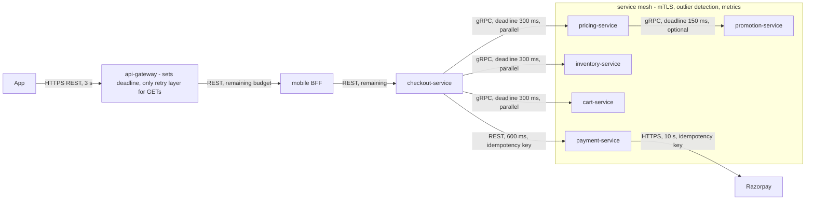
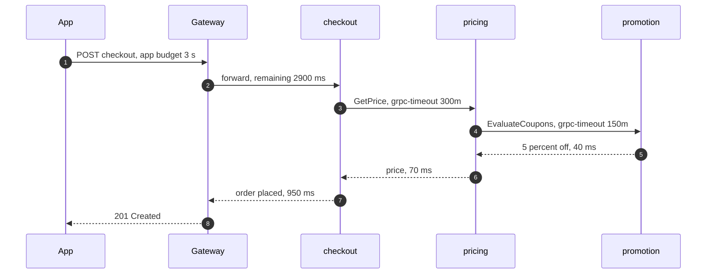
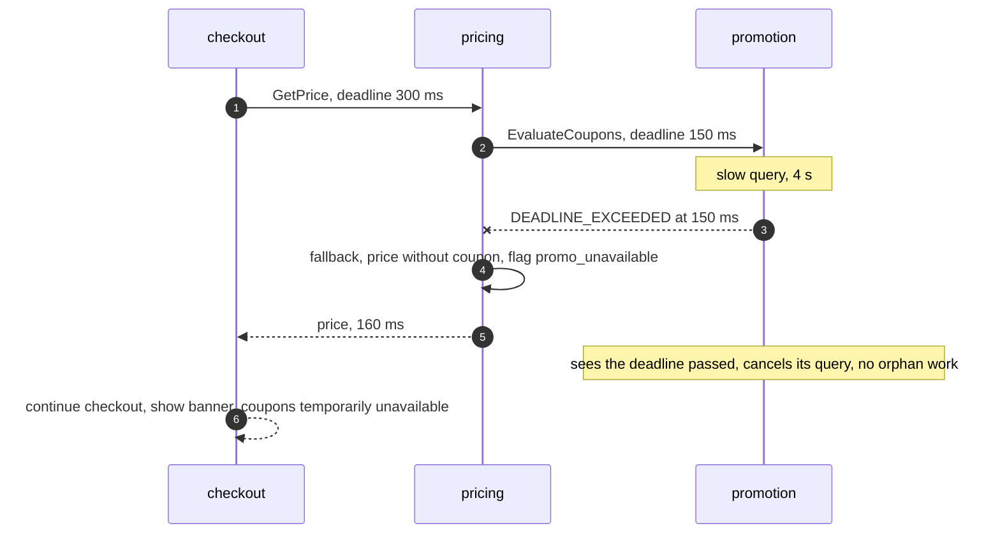
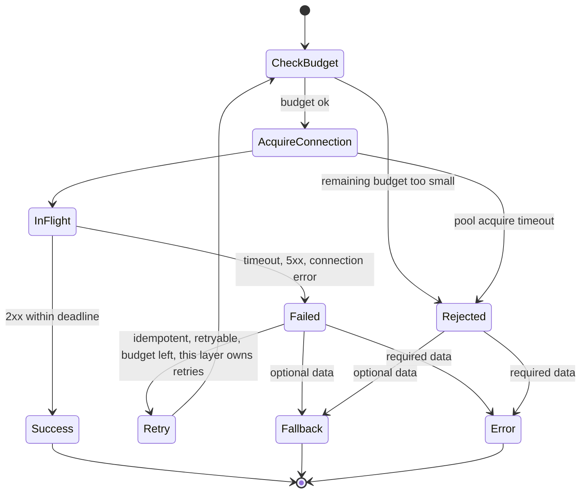

# 17. Inter-Service Communication

!!! abstract "Chapter at a glance"
    **Reader bands:** B2 → B4 · **Prerequisites:** [Ch 03](../01-foundations/03-networking-essentials.md), [Ch 04](../01-foundations/04-api-design.md), [Ch 16](16-microservices-architecture.md) · **What you will build:** The calling conventions every grocery-platform service follows: how to call, what to send, and how long to wait.

    - **L1** measures Little's law with real threads: a 200-thread pool takes 10.1 s for work that virtual threads finish in 0.55 s.
    - **L2** runs **real HTTP services** for three failures:
        - a slow dependency without timeouts takes down an unrelated endpoint (20/500 OK vs 500/500 with a timeout and fallback);
        - fixed per-hop timeouts waste **89 seconds** of work after users have already given up, while propagated deadlines waste none;
        - retries at every layer hit a failing leaf **27x** vs 3x.
    - **L3** covers REST vs gRPC with the **real `protoc`**: the same order is 706 bytes as JSON and 271 as protobuf. Real encodes and decodes show which schema changes are wire-compatible, and one change that silently drops the order total.
    - **L4** puts it together in Spring (RestClient, HTTP interfaces, deadline interceptors) and a service mesh (Istio/Linkerd, sidecar vs ambient).

    · **Reading time:** 100 min + code + labs

---

## 1. Introduction & Why It Matters

### 1.1 A story: the slow coupon that took down the cart

On the first day of the Big Savings Sale, `promotion-service` started evaluating a new "buy 2 get 1" rule with a slow database query. Coupon evaluation went from 40 ms to 4 seconds. What happened next took 23 minutes to understand:

- **`pricing-service` called promotions with the HTTP client's default settings:** no response timeout. Its 200 Tomcat threads filled up with requests waiting on promotions.
- **`checkout-service` called pricing, and its own threads filled up too.** So did the threads serving **`GET /cart`**, which doesn't need promotions at all. It shared the same thread pool and the same connection pool to pricing.
- **The app gave up after 3 seconds and retried.** The gateway retried twice, checkout retried pricing three times, and pricing retried promotions three times. The already struggling promotion database received **~27 times** the normal query load.
- **Even after users gave up, the queries kept running.** Every layer used its own fixed timeout, so promotion-service kept evaluating coupons for requests nobody was waiting for any more.

A 4-second slowdown in a non-critical feature became a full checkout outage. The fixes are the subject of this chapter:

- **Every call has a timeout,** shorter than the caller's own deadline, with a **fallback** where the data is optional (show MRP without the coupon).
- **Deadlines propagate:** the remaining time travels with the request, and every hop gives up when it's spent.
- **Retries happen at one layer only,** with a budget, and only for idempotent operations (Ch 18).
- **Separate pools per dependency** (bulkheads), so a slow dependency can't starve unrelated endpoints.

!!! quote "The thesis of this chapter"
    A remote call is a request for someone else's time and capacity, under a deadline you're responsible for. Choose sync or async deliberately, pick a protocol and schema that evolves safely, and make **how long to wait, how often to retry, and what to do instead** an explicit part of every call.

### 1.2 Where this lives in the grocery platform

| Interaction | Style | Protocol | Timeout / budget |
|---|---|---|---|
| App → gateway → BFF | Sync | HTTPS + JSON (REST) | App 3 s total; BFF budgets per field (Ch 16) |
| checkout → pricing, inventory, cart | Sync, parallel | gRPC (internal, typed, deadlines) | 300 ms each within checkout's 1.2 s budget |
| pricing → promotion | Sync, optional | gRPC | 150 ms; fallback = no discount + banner |
| payment → Razorpay | Sync, external | HTTPS REST + idempotency key | 10 s; unknown outcome → retry with key (Ch 13) |
| order → fulfilment, invoice, notification | Async | Kafka events (Ch 14) | — |
| notification → SMS/WhatsApp vendors | Async job | Queue + HTTPS | Per-vendor timeouts, retries, DLQ |
| tracking → app (live location) | Streaming | WebSocket / SSE (Ch 08) | Heartbeats |
| Search suggestions | Sync | HTTP/2 REST | 80 ms; stale cache fallback |

### 1.3 Learning objectives

| Band | After this chapter you can… |
|---|---|
| <span class="band b2">B2</span> | Decide sync vs async per interaction, and use Spring's RestClient and HTTP interfaces with proper timeouts |
| <span class="band b3">B3</span> | Set timeouts from budgets, propagate deadlines, place retries at one layer, and compare REST and gRPC including schema evolution |
| <span class="band b4">B4</span> | Decide what a service mesh should own (mTLS, retries, outlier detection), sidecar vs ambient, and define platform-wide calling conventions |

---

## 2. Core Concepts — Beginner to Deep

### 2.1 Intuition: phoning a supplier vs leaving a note <span class="band b2">B2</span>

A dark-store manager needs more atta.

- **Calling the supplier (synchronous):** you wait on the line for an answer. If the supplier doesn't pick up, you're stuck until you decide to hang up. That's your **timeout**, and it must be shorter than your own deadline (the delivery van leaves at 5). If you keep redialling every few seconds, and so does every other store, the supplier's phone line collapses (**retry storm**).
- **Leaving a note in the supplier's inbox (asynchronous):** you don't wait. The supplier handles it when possible, and you get a reply later or see the stock arrive. That's good when you don't need the answer right now.
- **Telling the supplier "I need this answered by 4:30"** is a **deadline**. If the supplier sees it's already 4:40, they shouldn't bother preparing the quote.
- **A switchboard operator** who connects calls, retries on busy lines, and checks everyone's identity is a **service mesh**.

### 2.2 Sync or async? ⭐ <span class="band b2">B2</span>

| Ask | If yes → | If no → |
|---|---|---|
| Does the caller need the result to continue **right now**? | Sync (query/command) | Async |
| Is the operation a **fact** others react to? | Event (Ch 14) | — |
| Can the work happen later or take long? | Async job (queue) | Sync |
| Must the caller keep working when the callee is down? | Async, or sync with a fallback | Sync |
| Does a user wait on it? | Sync with a tight budget, or async + notify | Either |

Synchronous calls couple **availability** (Ch 16 L1) and **capacity**:

- **Little's law:** requests in flight = rate × latency. At 400 req/s, a dependency slowing from 50 ms to 5 s raises in-flight requests from 20 to 2,000 (L1).
- **Every in-flight request holds resources:** a thread (unless virtual), a connection, and memory.
- L1 measured it with real threads: 4,000 calls that each wait 500 ms took **10,144 ms** on a 200-thread pool and **551 ms** with virtual threads.
- **Virtual threads remove the thread ceiling, not the dependency's capacity.** All 4,000 calls now hit pricing at once, so you still need a bound: a semaphore or bulkhead (Ch 18).

### 2.3 REST over HTTP ⭐ <span class="band b2">B2</span>

REST/JSON over HTTP (Ch 04) is the default for external APIs and fine for most internal ones: universal tooling, human-readable, cacheable (GET), easy to debug.

**Spring's clients:**

| Client | Style | Use |
|---|---|---|
| `RestClient` (Spring 6.1+) | Synchronous, fluent | Default for Spring MVC services; great with virtual threads |
| **HTTP interfaces** (`@HttpExchange`) | Declarative interface backed by `RestClient`/`WebClient` | Typed clients per dependency, generated from the API contract |
| `WebClient` | Reactive/non-blocking | Reactive stacks, streaming |
| `RestTemplate` | Legacy synchronous | Maintenance only |
| OpenFeign | Declarative (Spring Cloud) | Existing codebases; prefer HTTP interfaces for new code |

**HTTP details that matter:**

- **Connection pooling and keep-alive:** new TCP/TLS handshakes per call cost 1–3 RTTs. Pool per dependency, and size the pool from Little's law.
- **HTTP/2:** multiplexing avoids head-of-line blocking at the HTTP layer, and header compression helps. It still runs on one TCP connection, so TCP-level head-of-line blocking remains (HTTP/3/QUIC removes it, Ch 03).
- **Status codes drive retries:** 429/503 are retryable with backoff (honour `Retry-After`), 4xx aren't, and 5xx only for idempotent requests.
- **Idempotency keys** for POSTs that may be retried (Ch 20).

### 2.4 gRPC and protobuf ⭐ <span class="band b3">B3</span>

gRPC is an RPC framework over **HTTP/2** with **protobuf** schemas:

- **A contract-first `.proto` file** generates typed clients and servers in many languages.
- **Compact binary encoding.** L3: the same 12-item order is **706 bytes as JSON and 271 as protobuf** (278 vs 199 after gzip). Parsing is also cheaper (no text).
- **Streaming:** server, client and bidirectional (rider location streams, Ch 47).
- **Deadlines are built in:** the client sets a deadline, it travels as the `grpc-timeout` header, and servers can check `Context.current().getDeadline()`. That's L2 B's fix, standardized.
- **Status codes:** `DEADLINE_EXCEEDED`, `UNAVAILABLE` (retryable), `INVALID_ARGUMENT`, and so on.

| | REST/JSON | gRPC/protobuf |
|---|---|---|
| Contract | OpenAPI (optional, often drifts) | `.proto` (required, generates code) |
| Payload | Text, larger (706 B) | Binary, compact (271 B) |
| Browser support | Native | Needs gRPC-Web or a gateway |
| Streaming | SSE/WebSocket separately | Built in |
| Deadlines | Custom headers (L2) | Built in |
| Debuggability | curl, logs | grpcurl, reflection; binary on the wire |
| Caching | HTTP caches for GET | None by default |
| Best for | External/public APIs, browsers, simple services | Internal high-QPS calls, polyglot, streaming |

The grocery platform uses REST at the edge (app ↔ gateway/BFF) and gRPC for internal high-frequency calls (checkout ↔ pricing/inventory). Events stay on Kafka with Avro (Ch 14).

### 2.5 Schema evolution on the wire ⭐ <span class="band b3">B3</span>

Callers and callees deploy independently (Ch 16), so **every change must work with both older and newer peers** during rollout. L3 used real `protoc` encodes and decodes:

- **Renaming a field is safe in protobuf:** only numbers are on the wire. `order_id` → `id` was invisible to old readers.
- **Adding a field is safe:** an old consumer decoding v2 bytes kept the unknown field `7: "DIWALI50"` instead of losing it (forward compatibility). A new consumer decoding v1 bytes saw `coupon_code` absent (backward compatibility). Code must treat "absent/default" correctly.
- **Changing a field's type is not safe:** `int64 total_paise` → `string total_paise` under the same number. The new schema decoded **no total at all** (the value survived only as unknown field `4: 184750`). **Nothing failed**, so consumers would silently see an empty total. Reserve old numbers (`reserved 4;`) and add a new field instead.
- **For JSON/REST:** additive changes and tolerant readers (ignore unknown fields, `@JsonIgnoreProperties(ignoreUnknown = true)`). Breaking changes go to a new version (`/v2`) with both served during migration (Ch 04).
- **Enforce it in CI:** `buf breaking` for protobuf, OpenAPI diff tools for REST, and consumer-driven contract tests (Ch 29).

### 2.6 Timeouts ⭐ <span class="band b2">B2</span> <span class="band b3">B3</span>

A call without a timeout waits as long as the callee is slow, and so do all the resources it holds. L2 A ran a checkout service with 20 worker threads serving `/cart` (local work) and `/price` (calls pricing), with pricing degraded to 5 s:

| Checkout's call to pricing | `/cart` OK | `/cart` p99 | `/price` OK |
|---|---|---|---|
| **No timeout** | **20 / 500** | 2,002 ms (client gave up) | 0 / 500 |
| **300 ms timeout + fallback** (cached MRP) | **500 / 500** | 6 ms | 500 / 500 (degraded content) |

An endpoint that **doesn't even use pricing** failed, because the threads were all waiting on pricing. That's the §1.1 cascade.

**Kinds of timeouts:**

- **Connect** (TCP/TLS setup): short, e.g. 200–500 ms.
- **Response/read** (time to first byte or between bytes).
- **Total per call.**
- **Overall request deadline** (§2.7).

Pool-acquire timeouts matter too: waiting for a free connection is also waiting.

**Setting values:**

- Start from the **caller's budget** and the dependency's **latency distribution**. The timeout is roughly the dependency's p99.9 plus a margin, and never more than the caller's remaining budget.
- A timeout **longer** than the caller's deadline does nothing useful.
- A timeout **shorter** than the dependency's normal p99 turns normal latency into errors.
- **Budgets split across parallel and sequential calls:** in checkout's 1.2 s, the parallel pricing/inventory/cart calls get 300 ms, payment 600 ms, order 200 ms.

### 2.7 Deadline propagation ⭐ <span class="band b3">B3</span>

Per-hop fixed timeouts don't know about each other. The app waits 500 ms, but pricing waits 1 s for promotions, and promotions keeps working for 1.5 s. When the user has given up, the rest of the chain is still working for nobody.

L2 B, 300 requests with a 500 ms app budget, and 30 % of promotion calls taking 1.5 s:

| Strategy | Answered | Work finished after the user gave up | Abandoned early |
|---|---|---|---|
| Fixed 1 s timeout per hop | 214 | **86 requests, 89,157 ms of wasted work** | 0 |
| **Propagated deadline** (`X-Deadline-Epoch-Ms`) | 215 | **0** | 86 |

The same users were served either way. Deadlines don't make slow things fast. They **stop wasted work**, which during an overload is the capacity that lets the system recover.

**How it works:**

1. The edge sets an absolute deadline (now + budget).
2. Each hop reads it and computes `remaining = deadline − now − margin`.
3. It refuses to start if `remaining ≤ 0`, sets downstream timeouts to `remaining`, and forwards the deadline.
4. Long-running work checks the deadline periodically, or cancels on client disconnect.

**Details:**

- **gRPC does this natively** (`grpc-timeout` carries the *relative* remaining time, which avoids clock-skew issues between machines).
- **For HTTP, prefer a relative "remaining ms" header** recomputed at each hop, or absolute epoch time only within a well-synchronized cluster (Ch 12).
- **Databases can honour deadlines too:** set the JDBC query timeout or `SET LOCAL statement_timeout` from the remaining budget.

### 2.8 Retries without storms ⭐ <span class="band b3">B3</span>

Retries help with **transient** failures (a dropped connection, one bad instance) and hurt with **overload**, because they add load exactly when the callee is struggling. Layered retries multiply.

L2 C, edge → layer 1 → layer 2 → a failed leaf, 100 user requests:

| Retry placement | Calls reaching the leaf |
|---|---|
| 3 attempts at the edge **and** at each layer | **2,700 (27x)** |
| 3 attempts at the edge only | **300 (3x)** |

**Rules** (details in Ch 18):

- **Retry at one layer**, usually the one closest to the user or the mesh, not everywhere.
- Retry **only idempotent** operations, or use idempotency keys.
- Use **exponential backoff with jitter**, and a **retry budget** (e.g. retries ≤ 10 % of requests).
- **Never retry past the deadline.**
- **Honour `Retry-After` and 429s.** Circuit breakers stop calling a dependency that's clearly down.

### 2.9 Service mesh ⭐ <span class="band b4">B4</span>

A service mesh moves cross-cutting communication concerns out of application code into the network layer:

| Capability | In the mesh | Still in the app |
|---|---|---|
| mTLS and service identity | ✅ Automatic certificates, identity (SPIFFE) | Authorization decisions using that identity (or mesh policies) |
| Retries, timeouts | ✅ Per route | **Deadlines and fallbacks** need business knowledge; the app must know the call failed |
| Load balancing, outlier detection | ✅ Ejects bad instances (L2-style failures) | — |
| Traffic shifting (canary, mirroring) | ✅ Weighted routes, shadowing (Ch 16 strangler) | Diffing responses |
| Telemetry | ✅ Golden metrics, trace spans per hop | Business context in traces |
| Rate limiting | Partial | Business quotas |

**Sidecar vs ambient:**

| | **Sidecar** (Istio classic, Linkerd) | **Ambient / sidecarless** (Istio ambient: ztunnel + waypoint; Cilium) |
|---|---|---|
| Where the proxy runs | An Envoy/linkerd2-proxy container **in every pod** | L4 per-node proxy (ztunnel) for mTLS; optional per-namespace L7 waypoint |
| Resource cost | CPU/memory per pod, and it scales with pod count | Lower. L7 cost only where waypoints are enabled |
| Latency | Two extra proxy hops per call (out and in) | L4 hop per node, and L7 only where needed |
| Upgrades | Restart every pod to update proxies | Upgrade node-level components |
| Maturity | Very mature | Istio ambient went GA in 2024, and features still vary. Check your version |

**What a mesh costs:**

- Another control plane to operate.
- Latency (usually around a millisecond per hop, more with L7 processing).
- Debugging through proxies.
- Configuration that can conflict with application-level retries (double retries = L2 C).

The rule: **decide which layer owns each concern.** Mesh: mTLS, outlier detection, basic timeouts and the retry policy. App: deadlines, fallbacks, idempotency and business-level retries. Never both retrying the same call.

### 2.10 Other styles: GraphQL, WebSockets, async request-reply <span class="band b3">B3</span>

- **GraphQL:** clients ask for exactly the fields they need, and good for BFFs with varied screens. Watch N+1 resolution (use DataLoader batching), query cost limits, and caching.
- **WebSocket / SSE:** server push for live tracking and order status (Ch 08).
- **Async request-reply:** the caller sends a command with a correlation id and a reply topic, and receives the result as a message later. Useful for long operations (invoice PDF generation). HTTP equivalent: `202 Accepted` + a status URL + polling or webhook.
- **Webhooks from external parties** (Razorpay): verify signatures, respond fast (enqueue, then process), and dedup by event id.

---

## 3. Architecture & Diagrams

### 3.1 Component view: calling conventions on the checkout path



### 3.2 Sequence: happy path, a deadline flowing through the chain



### 3.3 Sequence: failure path, promotion degrades



### 3.4 State: an outbound call



---

## 4. Design Document Excerpt: Platform Calling Conventions

| Field | Value |
|---|---|
| Author / Reviewers | Platform team / all service owners, SRE |
| Status | Approved |
| Related ADRs | ADR-068 Sync/async decision rules; ADR-069 gRPC for internal high-QPS calls, REST at the edge; ADR-070 Deadlines and timeouts; ADR-071 Retry placement; ADR-072 Mesh scope (mTLS, outlier detection) |

**1. Context & Problem.** A 4 s slowdown in promotions cascaded into a checkout outage through missing timeouts, shared pools, layered retries (27x load) and work continuing after users gave up (§1.1).

**2. Goals / Non-Goals.**

- *Goals:* a slow dependency degrades only the features that need it; no orphan work after deadlines; bounded retry amplification; schema changes never break a peer during rollout; uniform mTLS.
- *Non-goals:* replacing Kafka events with RPC; a mesh-managed L7 policy for every route on day one.

**3. Requirements.**

| ID | Requirement |
|---|---|
| NFR-1 | Every outbound call has connect and response timeouts ≤ the remaining deadline (checked by a client library + lint) |
| NFR-2 | Deadlines propagate on all synchronous calls (`grpc-timeout` / `X-Request-Timeout-Ms`) |
| NFR-3 | Retries only at the gateway/mesh layer for idempotent calls, retry budget ≤ 10 % |
| NFR-4 | Each dependency has its own connection pool and concurrency limit (bulkhead) |
| NFR-5 | Breaking API/proto changes are blocked in CI (`buf breaking`, OpenAPI diff, contract tests) |
| NFR-6 | All service-to-service traffic uses mTLS with workload identity |

**4. Capacity & latency estimates.**

| Item | Calculation | Result |
|---|---|---|
| Checkout → pricing concurrency | 420 req/s × p99 80 ms | ~34 in flight → pool 50, limit 100 |
| During degradation without timeout | 420 × 4 s | 1,680 in flight → exhaustion (L2 A) |
| With a 300 ms timeout | 420 × 0.3 s | ≤ 126 in flight, bounded |
| Payload savings with protobuf | 706 → 271 bytes per order (L3) × ~2 K internal calls/s | ~0.9 MB/s less on internal links |
| Mesh overhead (sidecar) | ~0.5–1 ms p50 per hop, ~50–100 MB per proxy | Measure; consider ambient for L4 mTLS |

**5. Proposed design.**

1. **A client library** (in the service template) wraps `RestClient`/gRPC stubs. It reads the incoming deadline, computes the remaining budget, applies per-dependency timeouts (config), attaches deadline headers, enforces a per-dependency concurrency limit, and exposes metrics. Direct use of raw clients fails a lint rule.
2. **gRPC** for internal synchronous calls with more than 100 req/s (pricing, inventory, cart). REST for everything else and at the edge. The `.proto` files live in a shared schema repo with `buf breaking` in CI.
3. **Retries:** the gateway retries idempotent GETs once on another instance, and the mesh does not retry (it's disabled, to avoid double retries). Payment calls use idempotency keys and are retried only by the saga (Ch 13).
4. **Fallbacks** are declared per call: required (fail fast) or optional (default value + flag).
5. **Mesh (phase 1):** Istio ambient for mTLS and L4 telemetry. Waypoints only for namespaces needing L7 traffic shifting (canaries). Outlier detection on.

**7. Alternatives considered.**

| Option | Pros | Cons | Verdict |
|---|---|---|---|
| REST everywhere | One stack, simple | Larger payloads; custom deadline headers; weaker contracts | Kept for the edge and low-QPS internal calls |
| **gRPC for hot internal paths** | Contracts, deadlines, performance | Browser/gateway translation; binary debugging | **Chosen** |
| Retries in every client | Simple locally | Multiplicative load (L2 C: 27x) | Rejected |
| Sidecar mesh | Mature L7 features | Per-pod cost, proxy restarts | Rejected for phase 1 |
| **Ambient mesh** | mTLS without sidecars; L7 opt-in | Newer; feature parity varies by version | **Chosen** for phase 1 (with a fallback to sidecars if a gap blocks us) |

**8. Failure modes.** Dependency slow: timeout → fallback/error in ≤ budget, no pool exhaustion. Deadline already spent: the hop rejects immediately. Retry storm: prevented by single-layer retries + budget + breaker. Proto change breaking a consumer: blocked in CI. Mesh control plane down: existing config keeps working; new workloads are affected.

**10. Observability.** Per dependency: latency histograms, timeouts, fallbacks served, in-flight concurrency, pool waits. Deadline-exceeded counts per hop (where the time went). Retries per request and retry-budget usage. Mesh golden metrics and mTLS coverage.

**14. Decision (ADR-068–072 summary).** Use events for facts, sync calls only when an answer is needed now. gRPC for hot internal paths, REST at the edge. Every call goes through the platform client with deadline propagation, per-dependency timeouts, bulkheads and declared fallbacks. Retries at one layer with budgets. An ambient mesh provides mTLS, outlier detection and telemetry, and doesn't retry.

---

## 5. Hands-On Code — Level Ladder

| Level | New requirement that forces the step |
|---|---|
| L1 | "Why does a slow dependency need more threads, and do virtual threads fix it?" (real threads) |
| L2 | "A slow dependency must not take down unrelated endpoints, waste work, or be retried to death." (real HTTP) |
| L3 | "REST or gRPC, and which schema changes are safe?" (real `protoc`) |
| L4 | "Make it the default in every Spring service, and decide what the mesh owns." |

!!! info "How the code in this chapter was verified"
    L1 and L2 are Java 21 programs using real threads and **real HTTP servers and clients** on localhost (JDK `HttpServer`/`HttpClient`). L3 uses the **real `protoc` 28.3** to encode and decode protobuf. The Spring, gRPC-Java and Istio code in L4 wasn't compiled or applied here (no Maven Central or Kubernetes in this environment) and is marked `VERIFY`. It implements exactly the behaviours measured in L2.

### L1 — Concept: Little's law with real threads <span class="band b2">B2</span>

```java
// ConcurrencyL1.java — run with: java ConcurrencyL1.java
// Little's law for synchronous calls: in-flight requests = arrival rate × latency. When a dependency slows down,
// the caller needs proportionally more concurrency — or it queues. Measured with real threads.
import java.util.*;
import java.util.concurrent.*;

public class ConcurrencyL1 {

    static double runMs(ExecutorService pool, int tasks, long blockMs) throws Exception {
        long t0 = System.nanoTime();
        List<Future<?>> fs = new ArrayList<>();
        for (int i = 0; i < tasks; i++) fs.add(pool.submit(() -> { Thread.sleep(blockMs); return null; }));   // "waiting on pricing-service"
        for (var f : fs) f.get();
        pool.shutdown();
        return (System.nanoTime() - t0) / 1e6;
    }

    public static void main(String[] args) throws Exception {
        System.out.println("A. Little's law: threads busy waiting = requests/s × dependency latency");
        for (long latencyMs : new long[]{50, 200, 1_000, 5_000})
            System.out.printf("   400 req/s × %,5d ms → %,5d requests in flight%n", latencyMs, 400 * latencyMs / 1000);

        System.out.println("B. 4,000 calls that each wait 500 ms on a dependency (real threads)");
        System.out.printf("   fixed pool of 200 platform threads : %,7.0f ms%n", runMs(Executors.newFixedThreadPool(200), 4_000, 500));
        System.out.printf("   virtual thread per task            : %,7.0f ms%n", runMs(Executors.newVirtualThreadPerTaskExecutor(), 4_000, 500));
        System.out.println("   → virtual threads remove the thread-pool ceiling, but NOT the dependency's own limits:");
        System.out.println("     4,000 concurrent calls now reach pricing-service at once, so bound them (semaphore/bulkhead, Ch 18)");
    }
}
```

Actual output from running it:

```text
A. Little's law: threads busy waiting = requests/s × dependency latency
   400 req/s ×    50 ms →    20 requests in flight
   400 req/s ×   200 ms →    80 requests in flight
   400 req/s × 1,000 ms →   400 requests in flight
   400 req/s × 5,000 ms → 2,000 requests in flight
B. 4,000 calls that each wait 500 ms on a dependency (real threads)
   fixed pool of 200 platform threads :  10,144 ms
   virtual thread per task            :     551 ms
   → virtual threads remove the thread-pool ceiling, but NOT the dependency's own limits:
     4,000 concurrent calls now reach pricing-service at once, so bound them (semaphore/bulkhead, Ch 18)
```

**What L1 shows:** concurrency needed = rate × latency, so a dependency's slowdown is multiplied into the caller's resource usage. Virtual threads make waiting cheap (10.1 s → 0.55 s for the same work), which makes it **easier** to flood a struggling dependency. So bound concurrency per dependency.

### L2 — Timeouts, deadlines and retry placement over real HTTP <span class="band b3">B3</span>

```java
// CallsL2.java — run with: java CallsL2.java
// Real HTTP on localhost (JDK HttpServer + HttpClient):
//   A. a slow dependency without timeouts exhausts the caller's thread pool and takes down an UNRELATED endpoint
//   B. per-hop timeouts vs a propagated deadline: work that continues after the user has already given up
//   C. retries at every layer multiply load on a failing leaf
import com.sun.net.httpserver.HttpExchange;
import com.sun.net.httpserver.HttpServer;
import java.net.*;
import java.net.http.*;
import java.time.Duration;
import java.util.*;
import java.util.concurrent.*;
import java.util.concurrent.atomic.*;

public class CallsL2 {

    static final HttpClient client = HttpClient.newBuilder().version(HttpClient.Version.HTTP_1_1)
            .connectTimeout(Duration.ofMillis(500)).executor(Executors.newVirtualThreadPerTaskExecutor()).build();

    interface Handler { String handle(HttpExchange ex) throws Exception; }

    static HttpServer server(int port, ExecutorService pool, Handler h) throws Exception {
        HttpServer s = HttpServer.create(new InetSocketAddress("127.0.0.1", port), 1000);
        s.createContext("/", ex -> {
            int code = 200; String body;
            try { body = h.handle(ex); } catch (Exception e) { code = 503; body = e.getClass().getSimpleName(); }
            byte[] b = body.getBytes();
            try { ex.sendResponseHeaders(code, b.length); ex.getResponseBody().write(b); } catch (Exception ignored) { }
            ex.close();
        });
        s.setExecutor(pool); s.start(); return s;
    }

    static HttpResponse<String> call(String url, Duration timeout, Map<String, String> headers) throws Exception {
        var b = HttpRequest.newBuilder(URI.create(url));
        if (timeout != null) b.timeout(timeout);
        headers.forEach(b::header);
        return client.send(b.build(), HttpResponse.BodyHandlers.ofString());
    }

    // ---------------- A ----------------
    static void experimentA(boolean withTimeout) throws Exception {
        HttpServer pricing = server(19002, Executors.newVirtualThreadPerTaskExecutor(), ex -> { Thread.sleep(5_000); return "price"; });  // degraded
        HttpServer checkout = server(19001, Executors.newFixedThreadPool(20), ex -> {                  // the caller: 20 worker threads
            if (ex.getRequestURI().getPath().startsWith("/cart")) return "cart ok";                   // local work only
            try {
                return call("http://127.0.0.1:19002/price", withTimeout ? Duration.ofMillis(300) : null, Map.of()).body();
            } catch (HttpTimeoutException e) { return "price unavailable (cached MRP shown)"; }       // fallback
        });
        int n = 1_000; long[] cartLat = new long[n / 2]; AtomicInteger cartOk = new AtomicInteger(), priceOk = new AtomicInteger();
        ExecutorService load = Executors.newVirtualThreadPerTaskExecutor(); List<Future<?>> fs = new ArrayList<>();
        for (int i = 0; i < n; i++) {
            int ii = i; boolean cart = i % 2 == 0;
            fs.add(load.submit(() -> {
                long t0 = System.nanoTime();
                try {
                    var r = call("http://127.0.0.1:19001/" + (cart ? "cart" : "price"), Duration.ofSeconds(2), Map.of());   // the app gives up after 2 s
                    if (r.statusCode() == 200) (cart ? cartOk : priceOk).incrementAndGet();
                } catch (Exception ignored) { }
                if (cart) cartLat[ii / 2] = (System.nanoTime() - t0) / 1_000_000;
                return null;
            }));
            Thread.sleep(10);                                                                          // 100 requests/s for 10 s
        }
        for (var f : fs) f.get();
        Arrays.sort(cartLat);
        System.out.printf("   %-26s /cart ok %3d/500 (p99 %5d ms)   /price ok %3d/500%n", withTimeout ? "300 ms timeout + fallback" : "no timeout",
                cartOk.get(), cartLat[cartLat.length * 99 / 100], priceOk.get());
        checkout.stop(0); pricing.stop(0);
    }

    // ---------------- B ----------------
    static void experimentB(boolean propagate) throws Exception {
        AtomicLong orphanMs = new AtomicLong(); AtomicInteger orphanRequests = new AtomicInteger(), abandoned = new AtomicInteger();
        ConcurrentHashMap<String, Long> userGaveUpAt = new ConcurrentHashMap<>();
        Random rnd = new Random(4);
        HttpServer promo = server(19013, Executors.newVirtualThreadPerTaskExecutor(), ex -> {
            String id = ex.getRequestHeaders().getFirst("X-Request-Id");
            long work; synchronized (rnd) { work = rnd.nextDouble() < 0.3 ? 1_500 : 60; }              // 30 % slow coupon evaluation
            long deadline = propagate ? Long.parseLong(ex.getRequestHeaders().getFirst("X-Deadline-Epoch-Ms")) : Long.MAX_VALUE;
            long end = System.currentTimeMillis() + work;
            while (System.currentTimeMillis() < end) {                                                // work in slices; check the deadline
                if (System.currentTimeMillis() > deadline) { abandoned.incrementAndGet(); throw new TimeoutException(); }
                Thread.sleep(10);
            }
            Long gaveUp = userGaveUpAt.get(id);
            if (gaveUp != null) { orphanRequests.incrementAndGet(); orphanMs.addAndGet(System.currentTimeMillis() - gaveUp); }
            return "discount 5%";
        });
        Handler hop = ex -> {                                                                          // checkout → pricing → promotion
            String id = ex.getRequestHeaders().getFirst("X-Request-Id");
            String next = ex.getLocalAddress().getPort() == 19011 ? "http://127.0.0.1:19012/" : "http://127.0.0.1:19013/";
            Map<String, String> h = new HashMap<>(Map.of("X-Request-Id", id));
            Duration timeout = Duration.ofSeconds(1);                                                  // each hop's own fixed timeout
            if (propagate) {
                String dl = ex.getRequestHeaders().getFirst("X-Deadline-Epoch-Ms");
                long remaining = Long.parseLong(dl) - System.currentTimeMillis() - 20;                // keep 20 ms for our own reply
                if (remaining <= 0) throw new TimeoutException();                                      // don't even start
                h.put("X-Deadline-Epoch-Ms", dl); timeout = Duration.ofMillis(remaining);
            }
            Thread.sleep(15);                                                                          // own work
            return call(next, timeout, h).body();
        };
        HttpServer checkout = server(19011, Executors.newVirtualThreadPerTaskExecutor(), hop);
        HttpServer pricing = server(19012, Executors.newVirtualThreadPerTaskExecutor(), hop);
        int n = 300, ok = 0;
        for (int i = 0; i < n; i++) {
            String id = "req-" + i; long budget = 500;                                                 // the app waits 500 ms, then shows a fallback
            Map<String, String> h = new HashMap<>(Map.of("X-Request-Id", id));
            if (propagate) h.put("X-Deadline-Epoch-Ms", Long.toString(System.currentTimeMillis() + budget));
            try { if (call("http://127.0.0.1:19011/", Duration.ofMillis(budget), h).statusCode() == 200) ok++; }
            catch (HttpTimeoutException e) { userGaveUpAt.put(id, System.currentTimeMillis()); }
        }
        Thread.sleep(2_000);                                                                          // let orphans finish
        System.out.printf("   %-30s answered %3d/%d   work finished AFTER the user gave up: %3d requests, %,6d ms   abandoned early: %d%n",
                propagate ? "propagated deadline" : "fixed 1 s timeout per hop", ok, n, orphanRequests.get(), orphanMs.get(), abandoned.get());
        checkout.stop(0); pricing.stop(0); promo.stop(0);
    }

    // ---------------- C ----------------
    static void experimentC(int attemptsPerLayer) throws Exception {
        AtomicInteger leafCalls = new AtomicInteger();
        HttpServer leaf = server(19023, Executors.newVirtualThreadPerTaskExecutor(), ex -> { leafCalls.incrementAndGet(); throw new IllegalStateException("down"); });
        Handler retrying = ex -> {
            String next = ex.getLocalAddress().getPort() == 19021 ? "http://127.0.0.1:19022/" : "http://127.0.0.1:19023/";
            int attempts = attemptsPerLayer;                                                           // retries at THIS layer
            for (int a = 1; a <= attempts; a++) {
                var r = call(next, Duration.ofSeconds(1), Map.of());
                if (r.statusCode() == 200) return r.body();
            }
            throw new IllegalStateException("gave up");
        };
        HttpServer l1 = server(19021, Executors.newVirtualThreadPerTaskExecutor(), retrying);
        HttpServer l2 = server(19022, Executors.newVirtualThreadPerTaskExecutor(), retrying);
        int edgeAttempts = 3;
        for (int i = 0; i < 100; i++) for (int a = 0; a < edgeAttempts; a++) if (call("http://127.0.0.1:19021/", Duration.ofSeconds(5), Map.of()).statusCode() == 200) break;
        System.out.printf("   %-44s leaf received %,5d calls for 100 user requests (%.0fx)%n",
                attemptsPerLayer == 3 ? "3 attempts at the edge AND at each of 2 layers" : "3 attempts at the edge only", leafCalls.get(), leafCalls.get() / 100.0);
        l1.stop(0); l2.stop(0); leaf.stop(0);
    }

    public static void main(String[] args) throws Exception {
        System.setProperty("sun.net.httpserver.nodelay", "true");
        System.out.println("A. checkout-service (20 worker threads) serves /cart (local) and /price (calls pricing); pricing now takes 5 s");
        experimentA(false);
        experimentA(true);
        System.out.println("B. app (500 ms budget) → checkout → pricing → promotion; 30 % of promotion calls take 1.5 s");
        experimentB(false);
        experimentB(true);
        System.out.println("C. edge → layer-1 → layer-2 → leaf, leaf is down");
        experimentC(3);
        experimentC(1);
        System.exit(0);
    }
}
```

Actual output from running it:

```text
A. checkout-service (20 worker threads) serves /cart (local) and /price (calls pricing); pricing now takes 5 s
   no timeout                 /cart ok  20/500 (p99  2002 ms)   /price ok   0/500
   300 ms timeout + fallback  /cart ok 500/500 (p99     6 ms)   /price ok 500/500
B. app (500 ms budget) → checkout → pricing → promotion; 30 % of promotion calls take 1.5 s
   fixed 1 s timeout per hop      answered 214/300   work finished AFTER the user gave up:  86 requests, 89,157 ms   abandoned early: 0
   propagated deadline            answered 215/300   work finished AFTER the user gave up:   0 requests,      0 ms   abandoned early: 86
C. edge → layer-1 → layer-2 → leaf, leaf is down
   3 attempts at the edge AND at each of 2 layers leaf received 2,700 calls for 100 user requests (27x)
   3 attempts at the edge only                  leaf received   300 calls for 100 user requests (3x)
```

- **A.** With no timeout, `/cart`, which never calls pricing, succeeded **20 times out of 500**: every worker thread was stuck waiting on pricing. A 300 ms timeout with a cached-price fallback kept both endpoints at 500/500, with `/cart` p99 at 6 ms.
- **B.** Fixed per-hop timeouts left promotion-service finishing **86 requests nobody was waiting for, 89 seconds of CPU and DB time**. A propagated deadline made promotion abandon those 86 as soon as the deadline passed. The users got the same answers.
- **C.** Three attempts at each of three layers turned 100 user requests into **2,700** calls on a failing leaf. Retrying at the edge only: **300**.

### L3 — REST vs gRPC payloads and schema evolution (real `protoc`) <span class="band b3">B3</span>

=== "order_v1.proto"

    ```protobuf
    syntax = "proto3";
    package grocery.order.v1;

    enum OrderStatus { ORDER_STATUS_UNSPECIFIED = 0; PLACED = 1; PACKED = 2; DELIVERED = 3; }

    message Item {
      string sku = 1;
      int32 qty = 2;
      int64 price_paise = 3;
    }

    message Order {
      string order_id = 1;
      string customer_id = 2;
      repeated Item items = 3;
      int64 total_paise = 4;
      OrderStatus status = 5;
      int64 placed_at_epoch_ms = 6;
    }
    ```

=== "order_v2.proto (compatible)"

    ```protobuf
    syntax = "proto3";
    package grocery.order.v1;                      // same package: v2 is a compatible evolution of the same message

    enum OrderStatus { ORDER_STATUS_UNSPECIFIED = 0; PLACED = 1; PACKED = 2; DELIVERED = 3; OUT_FOR_DELIVERY = 4; }

    message Item {
      string sku = 1;
      int32 qty = 2;
      int64 price_paise = 3;
    }

    message Order {
      string id = 1;                               // renamed: names are not on the wire, numbers are
      string customer_id = 2;
      repeated Item items = 3;
      int64 total_paise = 4;
      OrderStatus status = 5;
      int64 placed_at_epoch_ms = 6;
      string coupon_code = 7;                      // added
    }
    ```

=== "order_broken.proto (incompatible)"

    ```protobuf
    syntax = "proto3";
    package grocery.order.v1;
    enum OrderStatus { ORDER_STATUS_UNSPECIFIED = 0; PLACED = 1; PACKED = 2; DELIVERED = 3; }
    message Item { string sku = 1; int32 qty = 2; int64 price_paise = 3; }
    message Order {
      string order_id = 1;
      string customer_id = 2;
      repeated Item items = 3;
      string total_paise = 4;                      // type changed int64 → string: NOT compatible
      OrderStatus status = 5;
      int64 placed_at_epoch_ms = 6;
    }
    ```

=== "exp.sh"

    ```bash
    #!/bin/bash
    # Protobuf wire format and schema evolution with the real protoc (no Java needed).
    P=${PROTOC:-/opt/protoc/bin/protoc}
    cd "$(dirname "$0")"
    # a 12-item order in text format and the equivalent JSON (what a REST API would send)
    {
      echo 'order_id: "ord_214_1a0de1f7a40_df6a5d04" customer_id: "cust-42" total_paise: 184750 status: PLACED placed_at_epoch_ms: 1790340802794'
      for i in $(seq 1 12); do echo "items { sku: \"SKU-$((10000 + i * 37))\" qty: $(( (i % 3) + 1 )) price_paise: $(( 4500 + i * 1250 )) }"; done
    } > order.txt
    python3 - > order.json <<'PY'
    import json
    items=[{"sku":f"SKU-{10000+i*37}","qty":(i%3)+1,"pricePaise":4500+i*1250} for i in range(1,13)]
    print(json.dumps({"orderId":"ord_214_1a0de1f7a40_df6a5d04","customerId":"cust-42","items":items,"totalPaise":184750,"status":"PLACED","placedAtEpochMs":1790340802794},separators=(",",":")))
    PY
    $P --encode=grocery.order.v1.Order order_v1.proto < order.txt > order.bin
    echo "== 1. size of the same 12-item order"
    printf "   JSON (compact)     : %4d bytes, gzip %4d\n" $(wc -c < order.json) $(gzip -9c order.json | wc -c)
    printf "   protobuf (binary)  : %4d bytes, gzip %4d\n" $(wc -c < order.bin) $(gzip -9c order.bin | wc -c)
    echo "   the first bytes on the wire: $(head -c 24 order.bin | od -An -tx1 | tr -s ' ' | tr -d '\n')  (field 1 = tag 0a, then length, then the id)"

    echo "== 2. forward compatibility: a v2 producer adds coupon_code (field 7) and renames order_id → id"
    sed 's/order_id:/id:/' order.txt | sed 's/status: PLACED/status: PLACED coupon_code: "DIWALI50"/' > order_v2.txt
    $P --encode=grocery.order.v1.Order order_v2.proto < order_v2.txt > order_v2.bin
    echo "   old v1 consumer decodes the v2 bytes:"
    $P --decode=grocery.order.v1.Order order_v1.proto < order_v2.bin | grep -vE '^items|^  |^}' | sed 's/^/     /'
    echo "   → the rename is invisible (numbers, not names, are on the wire); the unknown field 7 is kept, not lost"

    echo "== 3. backward compatibility: a new v2 consumer decodes old v1 bytes"
    $P --decode=grocery.order.v1.Order order_v2.proto < order.bin | grep -vE '^items|^  |^}' | sed 's/^/     /'
    echo "   → coupon_code is simply absent (default \"\"), so v2 code must treat empty as 'no coupon'"

    echo "== 4. an INCOMPATIBLE change: total_paise int64 → string (same field number 4)"
    $P --decode=grocery.order.v1.Order order_broken.proto < order.bin 2>&1 | grep -E 'total_paise|Failed|4:' | sed 's/^/     /'
    echo "   → wire-type mismatch: the new schema sees no total_paise at all (it survives only as unknown field 4)."
    echo "     Nothing fails; consumers silently read an empty total. Reserve the number and add a NEW field instead."
    ```

Actual output from running `./exp.sh`:

```text
== 1. size of the same 12-item order
   JSON (compact)     :  706 bytes, gzip  278
   protobuf (binary)  :  271 bytes, gzip  199
   the first bytes on the wire:  0a 1c 6f 72 64 5f 32 31 34 5f 31 61 30 64 65 31 66 37 61 34 30 5f 64 66  (field 1 = tag 0a, then length, then the id)
== 2. forward compatibility: a v2 producer adds coupon_code (field 7) and renames order_id → id
   old v1 consumer decodes the v2 bytes:
     order_id: "ord_214_1a0de1f7a40_df6a5d04"
     customer_id: "cust-42"
     total_paise: 184750
     status: PLACED
     placed_at_epoch_ms: 1790340802794
     7: "DIWALI50"
   → the rename is invisible (numbers, not names, are on the wire); the unknown field 7 is kept, not lost
== 3. backward compatibility: a new v2 consumer decodes old v1 bytes
     id: "ord_214_1a0de1f7a40_df6a5d04"
     customer_id: "cust-42"
     total_paise: 184750
     status: PLACED
     placed_at_epoch_ms: 1790340802794
   → coupon_code is simply absent (default ""), so v2 code must treat empty as 'no coupon'
== 4. an INCOMPATIBLE change: total_paise int64 → string (same field number 4)
     4: 184750
   → wire-type mismatch: the new schema sees no total_paise at all (it survives only as unknown field 4).
     Nothing fails; consumers silently read an empty total. Reserve the number and add a NEW field instead.
```

- **Size:** protobuf is **2.6x smaller** raw, and still 1.4x smaller after gzip, because field names aren't sent and numbers are varints.
- **Compatible evolution:** renaming (`order_id` → `id`) and adding (`coupon_code = 7`) worked in both directions, and the old reader even **kept** the unknown field 7 when re-serializing.
- **Incompatible evolution:** changing the type under an existing number produced **no error and no value**. The new reader saw an empty `total_paise`, and the original lived on only as unknown field `4: 184750`. That's why `buf breaking` belongs in CI, and why old numbers are `reserved`.

### L4 — Making it the default: Spring clients, deadlines, gRPC and the mesh <span class="band b3">B3</span> <span class="band b4">B4</span>

=== "Deadline context + server filter"

    ```java
    package com.grocery.platform.http;

    import jakarta.servlet.FilterChain;
    import jakarta.servlet.http.HttpServletRequest;
    import jakarta.servlet.http.HttpServletResponse;
    import java.io.IOException;
    import java.time.Duration;
    import org.springframework.web.filter.OncePerRequestFilter;

    /** Reads the caller's remaining budget; rejects work that can no longer finish in time. */
    public class DeadlineFilter extends OncePerRequestFilter {

        public static final String HEADER = "X-Request-Timeout-Ms";          // RELATIVE remaining time: immune to clock skew
        static final ScopedValue<Long> DEADLINE_NANOS = ScopedValue.newInstance();   // Java 25 final; VERIFY on your JDK
        private final Duration defaultBudget;

        public DeadlineFilter(Duration defaultBudget) { this.defaultBudget = defaultBudget; }

        @Override
        protected void doFilterInternal(HttpServletRequest req, HttpServletResponse res, FilterChain chain) throws IOException {
            String h = req.getHeader(HEADER);
            long remainingMs = h != null ? Long.parseLong(h) : defaultBudget.toMillis();
            if (remainingMs <= 5) { res.sendError(504, "deadline already exceeded"); return; }   // don't start: L2 B
            long deadline = System.nanoTime() + Duration.ofMillis(remainingMs).toNanos();
            try {
                ScopedValue.where(DEADLINE_NANOS, deadline).run(() -> {
                    try { chain.doFilter(req, res); } catch (Exception e) { throw new RuntimeException(e); }
                });
            } catch (RuntimeException e) { if (e.getCause() instanceof IOException io) throw io; throw e; }
        }

        public static Duration remaining() {
            long dl = DEADLINE_NANOS.isBound() ? DEADLINE_NANOS.get() : System.nanoTime() + Duration.ofSeconds(1).toNanos();
            return Duration.ofNanos(Math.max(0, dl - System.nanoTime()));
        }
    }
    ```

=== "RestClient with timeouts + deadline propagation"

    ```java
    package com.grocery.platform.http;

    import java.net.http.HttpClient;
    import java.time.Duration;
    import java.util.concurrent.Semaphore;
    import org.springframework.http.client.ClientHttpRequestInterceptor;
    import org.springframework.http.client.JdkClientHttpRequestFactory;
    import org.springframework.web.client.RestClient;

    public final class PlatformRestClients {

        /** One client per dependency: own connection pool, timeouts and concurrency limit (bulkhead). */
        public static RestClient forDependency(String baseUrl, Duration maxCallTimeout, int maxConcurrent) {
            HttpClient jdk = HttpClient.newBuilder().connectTimeout(Duration.ofMillis(300)).build();
            JdkClientHttpRequestFactory factory = new JdkClientHttpRequestFactory(jdk);
            Semaphore bulkhead = new Semaphore(maxConcurrent);

            ClientHttpRequestInterceptor deadline = (request, body, execution) -> {
                Duration remaining = DeadlineFilter.remaining().minusMillis(10);          // keep time to answer our caller
                Duration timeout = remaining.compareTo(maxCallTimeout) < 0 ? remaining : maxCallTimeout;
                if (timeout.isNegative() || timeout.isZero()) throw new DeadlineExceededException(baseUrl);
                request.getHeaders().set(DeadlineFilter.HEADER, Long.toString(timeout.toMillis()));
                if (!bulkhead.tryAcquire()) throw new BulkheadFullException(baseUrl);     // fail fast instead of queuing
                try {
                    factory.setReadTimeout(timeout);    // VERIFY: per-request timeout API; alternatively use a per-request attribute
                    return execution.execute(request, body);
                } finally { bulkhead.release(); }
            };
            return RestClient.builder().baseUrl(baseUrl).requestFactory(factory).requestInterceptor(deadline).build();
        }
    }
    ```

    `setReadTimeout` on a shared factory isn't per-request safe. In real code, create the request with a per-call timeout (JDK `HttpRequest.timeout`), or use a request attribute that your factory reads. The logic is what L2 verified. <!-- VERIFY -->

=== "HTTP interface client"

    ```java
    package com.grocery.checkout.client;

    import org.springframework.web.bind.annotation.PathVariable;
    import org.springframework.web.service.annotation.GetExchange;
    import org.springframework.web.service.annotation.HttpExchange;

    @HttpExchange("/api/v1/carts")
    public interface CartClient {
        @GetExchange("/{customerId}")
        CartView cart(@PathVariable String customerId);
    }

    // configuration
    @Bean
    CartClient cartClient() {
        RestClient rc = PlatformRestClients.forDependency("http://cart-service", Duration.ofMillis(300), 100);
        return HttpServiceProxyFactory.builderFor(RestClientAdapter.create(rc)).build().createClient(CartClient.class);
    }
    ```

=== "gRPC: contract + client with deadline + fallback"

    ```protobuf
    // pricing/v1/pricing.proto
    syntax = "proto3";
    package grocery.pricing.v1;
    option java_package = "com.grocery.pricing.v1";

    service PricingService {
      rpc GetPrices (GetPricesRequest) returns (GetPricesResponse);
    }
    message GetPricesRequest { string store_id = 1; repeated string skus = 2; string coupon_code = 3; }
    message Price { string sku = 1; int64 mrp_paise = 2; int64 selling_paise = 3; bool promo_applied = 4; }
    message GetPricesResponse { repeated Price prices = 1; bool promotions_unavailable = 2; }
    ```

    ```java
    // checkout-service: blocking stub on virtual threads; the deadline comes from the incoming request
    PricingServiceGrpc.PricingServiceBlockingStub stub = PricingServiceGrpc.newBlockingStub(channel);
    try {
        Duration budget = DeadlineFilter.remaining().minusMillis(10);
        var resp = stub.withDeadlineAfter(Math.min(budget.toMillis(), 300), TimeUnit.MILLISECONDS)
                       .getPrices(GetPricesRequest.newBuilder().setStoreId(storeId).addAllSkus(skus).build());
        return PriceSheet.from(resp);
    } catch (StatusRuntimeException e) {
        if (e.getStatus().getCode() == Status.Code.DEADLINE_EXCEEDED || e.getStatus().getCode() == Status.Code.UNAVAILABLE)
            throw new PricingUnavailableException(e);     // required data for checkout: fail the checkout step clearly
        throw e;
    }

    // pricing-service server side: respect the caller's deadline in long work
    if (Context.current().getDeadline() != null && Context.current().getDeadline().isExpired())
        throw Status.DEADLINE_EXCEEDED.withDescription("caller gave up").asRuntimeException();
    ```

    <!-- VERIFY: grpc-java APIs (withDeadlineAfter, Context.current().getDeadline()) and the Spring gRPC starter wiring for your versions. -->

=== "Mesh policy (Istio)"

    ```yaml
    # VERIFY against your Istio version. Mesh owns mTLS + outlier detection; retries are OFF here because the
    # gateway owns retries (L2 C), and the app owns deadlines/fallbacks.
    apiVersion: security.istio.io/v1
    kind: PeerAuthentication
    metadata: { name: default, namespace: grocery }
    spec:
      mtls: { mode: STRICT }
    ---
    apiVersion: networking.istio.io/v1
    kind: DestinationRule
    metadata: { name: pricing, namespace: grocery }
    spec:
      host: pricing-service.grocery.svc.cluster.local
      trafficPolicy:
        connectionPool:
          http: { http2MaxRequests: 200, maxRequestsPerConnection: 0 }
        outlierDetection:                    # eject an instance returning 5xx, like L4 A in Ch 16
          consecutive5xxErrors: 5
          interval: 5s
          baseEjectionTime: 30s
          maxEjectionPercent: 50
    ---
    apiVersion: networking.istio.io/v1
    kind: VirtualService
    metadata: { name: pricing, namespace: grocery }
    spec:
      hosts: [pricing-service.grocery.svc.cluster.local]
      http:
        - route: [{ destination: { host: pricing-service.grocery.svc.cluster.local } }]
          timeout: 1s                        # a ceiling only; the app's deadline is usually shorter
          retries: { attempts: 0 }           # no mesh retries: one retry layer only
    ```

### What changed from L1 to L4

| Concern | L1 | L2 | L3 | L4 |
|---|---|---|---|---|
| Waiting cost | 200 platform threads: 10.1 s; virtual: 0.55 s | Pool exhaustion: `/cart` 20/500 → 500/500 | — | Bulkhead per dependency |
| Time limits | — | Deadlines: 89 s orphan work → 0 | gRPC deadlines built in | Deadline filter + interceptor, `withDeadlineAfter` |
| Retries | — | 27x → 3x on a failing leaf | — | Gateway-only retries; mesh retries off |
| Contracts | — | — | 706 → 271 bytes; safe vs silent-breaking changes | `.proto` repo + `buf breaking` in CI |

---

## 6. Production Concerns

### 6.1 Failure modes

| Failure | Detection signal | Blast radius | Mitigation |
|---|---|---|---|
| Missing timeout on a slow dependency | Thread/connection pool saturation, rising in-flight count | Unrelated endpoints on the same pool (L2 A: `/cart` 20/500) | Timeouts from budgets, bulkheads per dependency, fallbacks |
| Orphan work after callers give up | Callee busy while callers time out; deadline-exceeded at the edge | Wasted capacity during overload (L2 B: 89 s) | Deadline propagation, cancel on deadline/disconnect |
| Retry amplification | Leaf QPS ≫ edge QPS during incidents | Overloaded dependency can't recover (L2 C: 27x) | One retry layer, budgets, breakers, jitter |
| Double retries (app + mesh) | Retries per request > 1 layer | Same as above | Decide an owner: mesh retries off or app retries off |
| Silent schema breakage | Default/empty values appearing, no errors | Wrong data propagated (L3: empty total) | `buf breaking`, reserved numbers, contract tests |
| Connection churn | High TLS handshake rate, port exhaustion | Latency, CPU | Pooling, keep-alive, HTTP/2 |
| Mesh misconfiguration | Sudden 503s/mTLS errors after a policy change | Whole namespace | Staged rollout of mesh config, `istioctl analyze` |
| DNS caching of dead endpoints | Errors to one IP after a scale-down | 1/N of calls | Platform VIPs, short JVM DNS TTL, outlier detection |

### 6.2 Observability

- **Per dependency, per caller:** request rate, errors by type (timeout, 5xx, connection), latency histogram, in-flight concurrency, pool waits, fallbacks served. Name metrics by dependency so the dashboard answers "who is slowing me down?".
- **Deadline accounting:** log or trace the remaining budget at each hop. A trace showing `remaining=12ms` at pricing tells you where the time went.
- **Retries:** attempts per request, retry-budget usage, and retries by status code.
- **Mesh:** golden signals per service pair, mTLS coverage (% of traffic encrypted), ejections by outlier detection.
- **Contracts:** counts of unknown fields seen (protobuf) and deserialization errors (JSON). Both are early warnings of version skew.

### 6.3 Security

- **mTLS between services** with workload identities (mesh or library), plus **authorization** per caller and endpoint: pricing accepts calls from checkout and the BFFs, not from notification-service.
- **Propagate the end-user identity** as a token (a JWT, or an exchanged token with narrowed scopes), never as a trusted `X-User-Id` header that any caller can set.
- **Deadline and retry headers are inputs too:** cap them (a client can't ask for a 10-minute budget) and validate them.
- **Webhooks from external parties:** verify signatures, check timestamps against replay, and use allowlists (Ch 23).

### 6.4 Performance & tuning knobs

| Knob | Default here | Effect |
|---|---|---|
| Connect timeout | 300 ms | Fail fast on dead hosts |
| Per-call timeout | min(remaining − margin, dependency cap) | Bounded waiting |
| Deadline margin per hop | 10–20 ms | Time to answer your own caller |
| Pool size per dependency | Little's law × 1.5 | Enough concurrency without flooding |
| Concurrency limit (bulkhead) | 2–3 × normal in-flight | Protects the caller and the callee |
| Retry attempts / budget | 1 retry at the gateway / ≤ 10 % | Transient fault tolerance without storms |
| Protocol | gRPC for hot internal paths | Payload size (L3: 2.6x smaller), deadlines |
| HTTP/2 multiplexing | On for gRPC | Fewer connections |

### 6.5 Cost

- Serialization is CPU. At tens of thousands of internal calls per second, JSON → protobuf is a measurable CPU and bandwidth saving (L3: 706 → 271 bytes per order).
- Cross-AZ calls cost money per GB. Prefer zone-local routing for chatty paths (locality-aware load balancing in the mesh).
- Sidecar meshes add CPU/memory per pod, which is significant at hundreds of pods. Ambient reduces it for L4-only needs.
- Orphan work and retry storms are pure waste. Deadlines and single-layer retries directly reduce the capacity needed for peak events.

---

## 7. Anti-Patterns & Pitfalls

**1. No timeout (library defaults).**

```java
// ❌ before: waits as long as pricing takes; holds a thread and a connection the whole time (L2 A)
RestClient.create("http://pricing-service").get().uri("/prices/{sku}", sku).retrieve().body(Price.class);

// ✅ after: per-dependency client with connect + call timeouts derived from the remaining deadline, and a fallback
try { return pricingClient.get().uri("/prices/{sku}", sku).retrieve().body(Price.class); }
catch (ResourceAccessException timeout) { return Price.mrpOnly(catalogCache.mrp(sku)); }
```

**2. Timeouts longer than the caller's deadline.**
*Symptom:* The callee keeps working after the user is gone (L2 B: 89 s of orphan work).
*Fix:* Propagate deadlines, and set timeout = min(remaining − margin, cap).

**3. Retries at every layer.**
*Symptom:* 27x load on the failing dependency (L2 C).
*Fix:* One retry layer, retry budgets, and only idempotent operations.

**4. Shared thread or connection pools across dependencies.**
*Symptom:* One slow dependency blocks unrelated features.
*Fix:* Bulkheads: a pool and concurrency limit per dependency.

**5. Synchronous call for something that's really an event.**
*Symptom:* order-service calls notification, invoice and loyalty in the checkout path.
*Fix:* Publish `order.order.placed.v1` and let them react (Ch 14).

**6. Changing a protobuf field's type or reusing its number.**

```protobuf
// ❌ before: same number, new type → readers silently see no value (L3)
string total_paise = 4;

// ✅ after: keep the old field, reserve it when retired, add a new number
reserved 4;
reserved "total_paise";
Money total = 8;
```

**7. Trusting identity headers from callers.**
*Symptom:* Any service can impersonate any user with `X-User-Id`.
*Fix:* Signed tokens and mTLS identity.

**8. A mesh and the application both retrying and timing out differently.**
*Symptom:* Confusing behaviour, double retries, timeouts that never fire.
*Fix:* Document which layer owns what (§2.9), and set the mesh timeout as an upper ceiling only.

**9. Assuming virtual threads remove the need for limits.**
*Symptom:* Thousands of concurrent calls flood a dependency (L1).
*Fix:* Semaphores and bulkheads per dependency.

**10. Chatty fine-grained APIs.**
*Symptom:* 40 calls to render a cart.
*Fix:* Coarse-grained endpoints (batch `GetPrices(skus[])`), composition at a BFF (Ch 16).

---

## 8. Interview Q&A

### Beginner <span class="band b1">B1</span>

??? question "Q1 [B1] ⭐ When do you call another service synchronously vs asynchronously?"

    **30-second answer:** Synchronously when the caller needs the answer to continue right now (a price, a stock check, a payment result). Asynchronously when the work can happen later or is a fact others react to (order placed → invoice, notification). Synchronous calls couple availability and latency, and asynchronous calls add eventual consistency.

    **Deep answer:** Every synchronous dependency multiplies unavailability (Ch 16) and consumes caller resources while waiting (Little's law, L1). Use events for facts and queues for deferred jobs. Keep synchronous paths short, with timeouts and fallbacks.

    **Trade-offs I'd call out:** Immediacy vs coupling.

    **Follow-ups:**
    1. Example of the wrong choice? → Checkout calling notification synchronously.
    2. Can a user flow be async? → Yes: 202 Accepted + status updates.

    **Red flags:** "Always use events" or "always use REST".

??? question "Q2 [B1] ⭐ Why must every remote call have a timeout?"

    **30-second answer:** Without one, a slow dependency holds the caller's threads and connections indefinitely. The caller then runs out of capacity and fails even for requests that don't need that dependency, which is a cascade.

    **Deep answer:** L2 A: with pricing slowed to 5 s and no timeout, a `/cart` endpoint that never calls pricing succeeded only 20/500 times. With a 300 ms timeout and a fallback, 500/500. Set timeouts from budgets and the dependency's latency distribution.

    **Trade-offs I'd call out:** Too short gives false failures, too long gives cascades.

    **Follow-ups:**
    1. Connect vs read timeout? → Setup time vs waiting for data.
    2. What value? → Roughly the dependency's p99.9 + margin, capped by the remaining deadline.

    **Red flags:** "The default is fine."

??? question "Q3 [B1] REST or gRPC?"

    **30-second answer:** REST/JSON for external and browser-facing APIs, and wherever simplicity, caching and tooling matter. gRPC/protobuf for internal high-volume calls, polyglot services and streaming, where typed contracts, compact payloads and built-in deadlines help.

    **Deep answer:** L3 with the real `protoc`: the same order is 706 bytes as JSON vs 271 as protobuf. gRPC needs HTTP/2, a gateway or gRPC-Web for browsers, and binary-aware tooling.

    **Trade-offs I'd call out:** Performance and contracts vs universality and debuggability.

    **Follow-ups:**
    1. Can you expose gRPC externally? → Via a transcoding gateway (JSON ↔ gRPC).
    2. What about GraphQL? → A client-driven query layer, often in BFFs.

    **Red flags:** "gRPC is always faster, so use it everywhere."

??? question "Q4 [B1] What is a service mesh?"

    **30-second answer:** An infrastructure layer that handles service-to-service communication (mTLS, load balancing, retries/timeouts, traffic shifting, telemetry) via proxies (sidecars or node-level/ambient), configured centrally instead of in each service's code.

    **Deep answer:** It gives uniform security and telemetry and safe canaries. It costs a control plane to operate, proxy latency and resources, and configuration complexity. Business logic (fallbacks, deadlines) stays in the app.

    **Trade-offs I'd call out:** Consistency vs operational overhead.

    **Follow-ups:**
    1. Examples? → Istio, Linkerd, Cilium service mesh.
    2. Do you need one? → Not with a few services. It becomes valuable with many teams and a zero-trust requirement.

    **Red flags:** "The mesh makes services resilient automatically."

### Intermediate <span class="band b2">B2</span>

??? question "Q5 [B2] ⭐ How do you choose timeout values?"

    **30-second answer:** Start from the user-facing budget and split it across the call graph. Parallel calls share a slice, and sequential calls add up. Each call's timeout is min(remaining deadline − margin, dependency cap), where the cap is about the dependency's p99.9 plus headroom. Review with real latency histograms.

    **Deep answer:** Checkout's 1.2 s: parallel pricing/inventory/cart at 300 ms, payment 600 ms, order 200 ms. Include pool-acquire time. Timeouts longer than the caller's deadline are useless (L2 B), and timeouts below the normal p99 create errors.

    **Trade-offs I'd call out:** Completeness vs responsiveness.

    **Follow-ups:**
    1. Adaptive timeouts? → Some systems adjust from observed latency; keep hard caps.
    2. What happens after a timeout? → Fallback, error, or a retry within the budget.

    **Red flags:** "30 seconds everywhere."

??? question "Q6 [B2] ⭐ What is deadline propagation?"

    **30-second answer:** Passing the remaining time budget along with each request, so every hop limits its own work and downstream timeouts to what's left, and refuses to start work that can't finish. gRPC carries it in `grpc-timeout`. For HTTP, use a remaining-milliseconds header.

    **Deep answer:** L2 B: with fixed per-hop timeouts, promotion-service did 89 s of work for 86 requests whose users had already given up. With a propagated deadline, it abandoned them and wasted nothing. Prefer relative budgets to avoid clock skew (Ch 12). Apply them to DB statement timeouts too.

    **Trade-offs I'd call out:** A little plumbing vs wasted capacity during overload.

    **Follow-ups:**
    1. Absolute or relative? → Relative per hop; absolute only with well-synced clocks.
    2. Does it help the user? → Mostly the system: freed capacity during incidents.

    **Red flags:** Never having heard of cancellation downstream.

??? question "Q7 [B2] Which protobuf changes are safe?"

    **30-second answer:** Adding fields with new numbers, renaming fields (names aren't on the wire), and removing fields if their numbers and names are reserved. Unsafe: changing a field's type or number, reusing numbers, and changing semantics.

    **Deep answer:** L3: an old reader decoding v2 kept the new field as unknown (7) and ignored the rename. A new reader decoding v1 saw the new field absent. Changing `int64` to `string` under number 4 produced no error and an empty value, which is silent data loss. Enforce with `buf breaking`.

    **Trade-offs I'd call out:** Flexibility vs contract discipline.

    **Follow-ups:**
    1. What about enums? → Add values; handle unknown values in code (proto3 keeps them as unrecognized numbers).
    2. JSON equivalents? → Additive changes + tolerant readers.

    **Red flags:** "Protobuf is backward compatible, so any change is fine."

??? question "Q8 [B2] How should Spring services call other services?"

    **30-second answer:** Use `RestClient` (or HTTP interfaces on top of it) for synchronous REST, with a client per dependency that has its own connection pool, connect and response timeouts, a deadline-propagating interceptor, a concurrency limit, and metrics. Use generated gRPC stubs with `withDeadlineAfter` for gRPC. Avoid raw clients with default settings.

    **Deep answer:** HTTP interfaces (`@HttpExchange`) give typed, declarative clients. With virtual threads, blocking clients are efficient, but you still need limits (L1). Put all of this in the platform template so every service gets it by default.

    **Trade-offs I'd call out:** Standardization vs flexibility.

    **Follow-ups:**
    1. WebClient? → For reactive stacks or streaming.
    2. Feign? → Fine in existing code; HTTP interfaces for new code.

    **Red flags:** `new RestTemplate()` per request.

??? question "Q9 [B2] Why can retries make an outage worse?"

    **30-second answer:** Retries add load exactly when the dependency is struggling, and when several layers each retry, the load multiplies (3 attempts × 3 layers = 27x). The dependency can't recover, and latency grows for everyone.

    **Deep answer:** L2 C measured 2,700 leaf calls for 100 user requests with retries at every layer, vs 300 with retries at the edge only. Use one retry layer, budgets (retries ≤ x % of traffic), backoff with jitter, circuit breakers, `Retry-After`, and only idempotent operations.

    **Trade-offs I'd call out:** Masking transient faults vs amplifying overload.

    **Follow-ups:**
    1. Which layer should retry? → The closest to the user (edge/BFF) or the mesh, not both.
    2. What's a retry budget? → A cap on the ratio of retries to requests.

    **Red flags:** "Retry 3 times everywhere."

### Senior <span class="band b3">B3</span>

??? question "Q10 [B3] ⭐ Design the calling conventions for a 26-service platform."

    **30-second answer:** Rules for sync vs async. REST at the edge, gRPC internally for hot paths. A platform client library that propagates deadlines, applies per-dependency timeouts, bulkheads and metrics, and declares fallbacks. Retries at one layer with budgets. Contract checks in CI. mTLS via the mesh.

    **Deep answer:** The evidence behind each rule: L2 A (timeouts/bulkheads), L2 B (deadlines), L2 C (retry placement), L3 (contracts). Enforce with lint rules (no raw clients), fitness functions (Ch 16), and dashboards per dependency. Document which layer owns retries, timeouts and mTLS.

    **Trade-offs I'd call out:** Library consistency vs service autonomy.

    **Follow-ups:**
    1. How do you roll out the library? → In the template plus automated upgrades.
    2. Exceptions? → Streaming and external APIs, with documented deviations.

    **Red flags:** Leaving each team to choose.

??? question "Q11 [B3] How do you prevent a slow optional dependency from hurting critical flows?"

    **30-second answer:** Give it a short timeout within a budget, a fallback (cached or default value plus a flag to the UI), its own pool and concurrency limit (bulkhead), and a circuit breaker to stop calling it while it's failing. Ideally, make it asynchronous or precomputed.

    **Deep answer:** §1.1's promotions: a 150 ms budget, fallback to "no coupon" with a banner, and a breaker that opens on sustained timeouts. L2 A showed pool isolation keeping `/cart` at 500/500. Also consider precomputing promotions into pricing via events.

    **Trade-offs I'd call out:** Feature completeness vs availability.

    **Follow-ups:**
    1. Who decides it's optional? → Product, per field.
    2. How do you know fallbacks are working? → A metric of fallbacks served.

    **Red flags:** Treating every dependency as required.

??? question "Q12 [B3] How do you evolve an internal API without coordinated deploys?"

    **30-second answer:** Make only backward- and forward-compatible changes (additive fields, tolerant readers, no type or number changes), deploy the server first when adding capabilities, and keep old fields until all clients have migrated. Breaking changes get a new version served in parallel. Enforce with CI checks and consumer-driven contract tests.

    **Deep answer:** L3 showed both safe changes (rename, add) and a silent break (type change). Track client versions via telemetry (user agent or metadata) before removing anything. Use expand/contract for semantics changes (Ch 28).

    **Trade-offs I'd call out:** Temporary duplication vs coordination cost.

    **Follow-ups:**
    1. Who owns the proto repo? → Service owners, with platform-provided linting.
    2. How long do you keep old versions? → Until telemetry shows zero use, plus a grace period.

    **Red flags:** "We deploy all services together to change APIs."

??? question "Q13 [B3] What does a service mesh give you, and what should stay in the app?"

    **30-second answer:** The mesh gives mTLS and workload identity, uniform telemetry, load balancing with outlier detection, and traffic shifting (canary/mirroring), plus optionally retries and timeouts. The app keeps deadlines (it knows the business budget), fallbacks, idempotency and business-level retries. Pick one owner per concern.

    **Deep answer:** Double retries (mesh + app) recreate L2 C's amplification, and mesh timeouts longer than app deadlines are useless. Configure the mesh as the security and telemetry layer plus an outer ceiling. Ambient mode reduces per-pod cost when only L4 features are needed.

    **Trade-offs I'd call out:** Central control vs app knowledge.

    **Follow-ups:**
    1. Sidecar or ambient? → Ambient for mTLS at lower cost; sidecars or waypoints where rich L7 is needed.
    2. Linkerd vs Istio? → Linkerd is simpler and lighter; Istio is richer and heavier.

    **Red flags:** Turning on mesh retries without checking app retries.

??? question "Q14 [B3] Virtual threads: what do they change for service-to-service calls?"

    **30-second answer:** Blocking calls become cheap. Waiting doesn't consume a platform thread, so simple synchronous code scales to many concurrent calls (L1: 4,000 waiting calls in 0.55 s vs 10.1 s on 200 platform threads). They don't make dependencies faster or bigger, so you still need timeouts, concurrency limits and deadlines.

    **Deep answer:** Watch pinning (synchronized blocks holding carrier threads, largely addressed in JDK 24+), ThreadLocal-heavy libraries, and connection pools becoming the new bottleneck. Structured concurrency helps with parallel calls and cancellation.

    **Trade-offs I'd call out:** Simpler code vs the risk of flooding dependencies.

    **Follow-ups:**
    1. Do you still need reactive? → Mostly for streaming/backpressure-heavy workloads.
    2. How do you bound concurrency? → A semaphore per dependency.

    **Red flags:** "Virtual threads mean no more capacity planning."

### Architect <span class="band b4">B4</span>

??? question "Q15 [B4] ⭐ A dependency's latency spiked and your whole platform went down. Postmortem and fixes?"

    **30-second answer:** The chain: no timeouts → pool exhaustion in callers → unrelated endpoints failing → retries at every layer amplifying load on the slow dependency → orphan work continuing after users left. Fixes: timeouts from budgets, bulkheads, deadline propagation, single-layer retries with budgets, circuit breakers, fallbacks for optional features, and dashboards per dependency.

    **Deep answer:** L2 reproduces each link: 20/500 → 500/500 with timeouts, 89 s orphan work → 0 with deadlines, 27x → 3x with retry placement. Action items get owners, and the platform client makes the fixes the default. Game days inject latency to verify.

    **Trade-offs I'd call out:** Engineering time vs repeated outages.

    **Follow-ups:**
    1. How do you verify fixes? → Latency injection in staging and controlled production game days.
    2. What's the first thing to add? → Timeouts and bulkheads on the dependency that failed.

    **Red flags:** "Scale up the slow service" as the only action.

??? question "Q16 [B4] Should the grocery platform adopt a service mesh?"

    **30-second answer:** Yes, for mTLS and telemetry across 26 services owned by 8 teams, in ambient or lightweight mode first. Keep retries and deadlines in the app/gateway, and add L7 features (canaries, mirroring) per namespace when needed. Measure latency and resource overhead before and after.

    **Deep answer:** The alternative is library-based mTLS and telemetry in the service template, which is fine for a single-stack (Java) platform, but certificate rotation and policy enforcement are harder. Decide with requirements: zero-trust compliance, polyglot services, traffic-shifting needs, and ops capacity.

    **Trade-offs I'd call out:** Platform complexity vs uniform security.

    **Follow-ups:**
    1. Rollout plan? → Permissive mTLS → strict per namespace, telemetry first, then L7 policies.
    2. Exit plan? → Keep app-level timeouts and deadlines regardless.

    **Red flags:** Adopting a mesh to fix resilience problems caused by missing timeouts.

??? question "Q17 [B4] How do you set end-to-end latency SLOs across service calls?"

    **30-second answer:** Define the SLO at the user journey (checkout p99 ≤ 1.5 s), decompose it into a budget per hop (parallel slices, sequential sums, margins), set dependency SLOs and timeouts from those budgets, and monitor with traces that show where each request's time went. Revisit the budgets when the graph changes.

    **Deep answer:** Fan-out makes tails worse (Ch 16 L1), so budget optional calls separately. Use deadline propagation so budgets are enforced at runtime, not just in documents. Error budgets per journey drive priorities.

    **Trade-offs I'd call out:** Tight budgets vs feature richness.

    **Follow-ups:**
    1. What if one team can't meet its budget? → Cache, precompute, make it optional, or renegotiate.
    2. How do you detect budget drift? → A per-hop latency share from tracing.

    **Red flags:** Per-service SLOs with no journey view.

??? question "Q18 [B4] When would you use async request-reply instead of a synchronous call?"

    **30-second answer:** When the operation takes long or has unpredictable latency (PDF invoices, bulk price updates, KYC checks), when the callee has limited capacity and should pull work at its own pace, or when the caller shouldn't hold resources while waiting. Respond with `202 Accepted` + a status resource (or a correlation id and a reply topic), and notify on completion.

    **Deep answer:** You need correlation ids, idempotency, timeouts on the whole operation, and a place to show progress. It converts latency into eventual completion and naturally applies backpressure (Ch 14).

    **Trade-offs I'd call out:** UX complexity vs resilience.

    **Follow-ups:**
    1. Polling or push? → Push (webhook/WebSocket) when available, polling as a fallback.
    2. How do you cancel? → A cancel command keyed by the correlation id.

    **Red flags:** Synchronous 60-second calls.

??? question "Q19 [B4] How do you handle calls to external providers (Razorpay, SMS vendors)?"

    **30-second answer:** Isolate them behind an adapter service with its own timeouts, bulkheads and circuit breakers. Use idempotency keys and treat timeouts as unknown outcomes (Ch 13). Run async queues for non-interactive sends, reconcile with the provider's reports, verify webhook signatures, and keep multiple vendors with failover where possible (SMS).

    **Deep answer:** Provider SLAs and rate limits shape timeouts and concurrency. Honour 429/`Retry-After`. Track per-vendor success rates and latency. Watch data residency and PII for payment data (Ch 36).

    **Trade-offs I'd call out:** Vendor redundancy vs complexity and cost.

    **Follow-ups:**
    1. SMS vendor down? → Fail over to a second vendor. Dedup by message id.
    2. Webhook arrives before the API response? → Handle both orders idempotently.

    **Red flags:** Retrying payment captures without keys.

??? question "Q20 [B4] How do you make good calling behaviour the default for every team?"

    **30-second answer:** Build it into the golden path: a platform client library (timeouts, deadlines, bulkheads, metrics, fallback API), service templates that wire it in, lint and fitness checks that forbid raw clients and missing timeouts, contract checks in CI, mesh policies for mTLS and outlier detection, and dashboards per dependency that come for free.

    **Deep answer:** Measure adoption (the % of calls through the platform client), run game days with latency injection, and make the easy path the safe path. Share incident learnings (like §1.1) as reasons, not rules.

    **Trade-offs I'd call out:** Platform investment vs repeated incidents.

    **Follow-ups:**
    1. How do you handle exceptions? → ADRs with explicit compensating controls.
    2. What gets checked in CI? → No `new RestTemplate()` or raw `HttpClient` without timeouts, and proto/OpenAPI breaking changes.

    **Red flags:** Relying on a wiki page.

---

## 9. Summary & Practice

### Key takeaways

1. **Sync when an answer is needed now, async for facts and deferrable work.** Every sync dependency costs availability and capacity.
2. **Little's law:** in-flight requests = rate × latency. Slow dependencies consume caller resources (L1: 10.1 s vs 0.55 s).
3. **Every call gets a timeout from the budget, and optional data gets a fallback** (L2 A: 20/500 → 500/500).
4. **Propagate deadlines, and don't start work that can't finish** (L2 B: 89 s of orphan work → 0).
5. **Retry at one layer, with budgets, for idempotent operations only** (L2 C: 27x → 3x).
6. **Bulkheads:** a pool and a concurrency limit per dependency, virtual threads or not.
7. **REST at the edge, gRPC for hot internal paths** (L3: 706 → 271 bytes, built-in deadlines).
8. **Schema evolution:** add and rename are safe; type or number changes break silently (L3). Check in CI.
9. **A mesh owns mTLS, telemetry and outlier detection. The app owns deadlines, fallbacks and idempotency.** One retry owner.
10. **Make it the default** via a platform client library and a template.

### Decision cheat sheet

| Situation | Choose |
|---|---|
| Need an answer now | Sync call with timeout from budget |
| Fact for others | Event (Ch 14) |
| Long-running work | Async request-reply / 202 + status |
| Hot internal path, many calls | gRPC with deadlines |
| External/browser API | REST/JSON (+ OpenAPI) |
| Optional data | Short budget + fallback + breaker |
| Transient errors | One retry layer with jitter and budget |
| mTLS for all traffic | Mesh (ambient/sidecar) or library |

### Exercises

| Band | Exercise | Hint |
|---|---|---|
| B2 | In L2 A, give `/cart` and `/price` separate pools without timeouts. What happens to `/cart`? | Bulkhead alone isolates |
| B2 | Add a `repeated string tags = 8;` field to order_v2 and decode with v1 | Unknown field kept |
| B3 | Add a retry budget (10 %) to L2 C's edge and measure leaf calls | Token bucket of retries |
| B3 | Make L2 B's promotion stop on client disconnect instead of a deadline header | Detect a closed exchange |
| B4 | Write the ADR for moving checkout → pricing from REST to gRPC, including the migration | Dual endpoints, canary |
| B4 | Design the dashboard "who is slowing me down?" for checkout | Per-dependency latency share from traces |

### Further reading

- Google SRE book: "Addressing Cascading Failures", "Handling Overload"
- Marc Brooker, "Timeouts, retries and backoff with jitter" (AWS Builders' Library)
- gRPC documentation: deadlines, status codes, retry policy; `buf` documentation: breaking change detection
- Protocol Buffers language guide: updating a message type
- Spring Framework reference: `RestClient`, HTTP interface clients
- Istio documentation: ambient mode, traffic management, outlier detection; Linkerd documentation
- Michael Nygard, *Release It!*, 2nd ed. (timeouts, bulkheads, circuit breakers)

### Related chapters

[03 · Networking Essentials](../01-foundations/03-networking-essentials.md) · [04 · API Design](../01-foundations/04-api-design.md) · [08 · Load Balancing](../01-foundations/08-load-balancing-proxies-and-gateways.md) · [13 · Distributed Transactions](13-distributed-transactions.md) · [14 · Messaging & Event Streaming](14-messaging-and-event-streaming.md) · [16 · Microservices Architecture](16-microservices-architecture.md) · [18 · Resilience Patterns](18-resilience-patterns.md) · [19 · Concurrency at Scale in Java](19-concurrency-at-scale-in-java.md) · [23 · Security Architecture](../03-production/23-security-architecture.md) · [29 · Testing Distributed Systems](../03-production/29-testing-distributed-systems.md)
