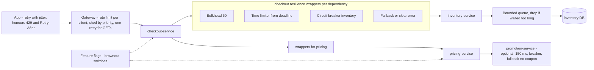
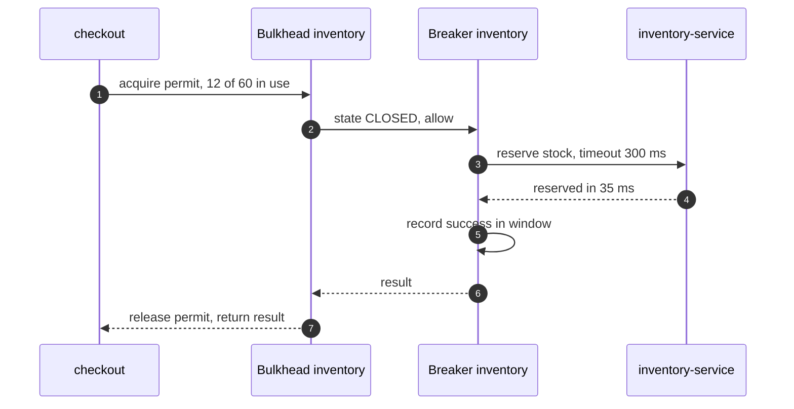
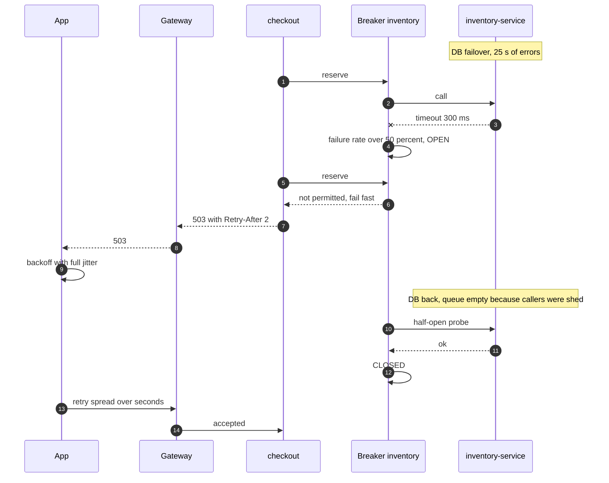
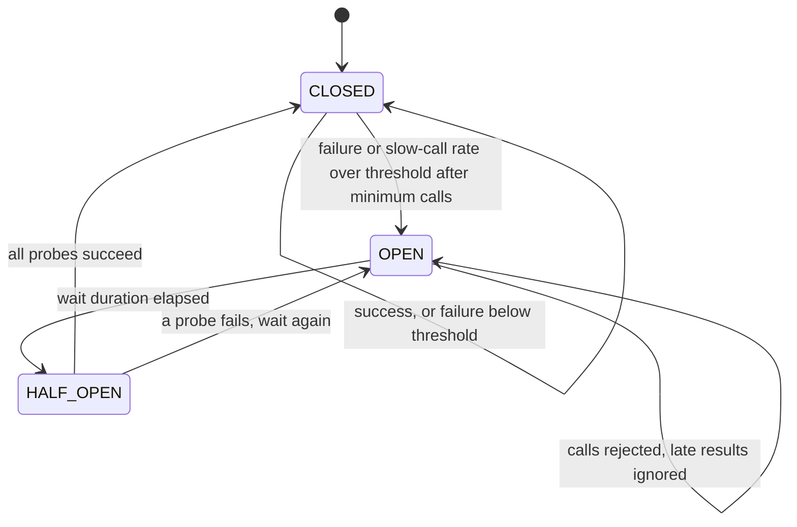

# 18. Resilience Patterns ⭐

!!! abstract "Chapter at a glance"
    **Reader bands:** B2 → B4 · **Prerequisites:** [Ch 16](16-microservices-architecture.md), [Ch 17](17-inter-service-communication.md) · **What you will build:** The resilience toolkit of every grocery-platform service, with numbers for why each piece exists.

    - **L1** simulates 1,000 clients retrying after a failure against a server that pays to reject. Immediate, fixed and plain exponential retries **never recover** (congestion collapse). Exponential backoff **with jitter** recovers in 290–540 ms.
    - **L2** runs a circuit breaker against a **real HTTP** dependency that fails slowly for 6 s: 296 → 55 calls reach the broken service, and caller p50 goes from 802 ms to 0 ms, at the price of a slower recovery. It also covers a bug found while building the breaker.
    - **L3** compares five rate-limiting algorithms on the same bursty traffic. A fixed window lets **175** requests through in one second against a limit of 100. It also covers a leaky-bucket shaper, and a **shared token bucket in real Redis (Lua)** vs per-pod limiters (133 vs 240 req/s against a 100 req/s limit).
    - **L4** offers a **real HTTP service** twice its capacity. An unbounded queue collapses goodput to **4 req/s**, and bounded-queue or deadline-aware shedding keeps **390–400 req/s**.

    Resilience4j configuration for Spring Boot is included (`VERIFY`: the library couldn't be downloaded here, so the patterns are implemented and measured directly). · **Reading time:** 110 min + code

---

## 1. Introduction & Why It Matters

### 1.1 A story: the outage that lasted longer than its cause

At 7:02 pm on a Saturday, `inventory-service`'s database failed over (Ch 10). The failover took 25 seconds. The checkout outage that followed lasted **41 minutes**.

- **Every checkout pod retried inventory calls immediately, three times, at every layer.** When the new primary came up, it received roughly 30 times its normal load in the first second, and its connection pool saturated. Many requests now timed out, and **those timeouts triggered more retries**. The database was up, but the system couldn't get back to working.
- **Inventory's request queue was unbounded.** Requests waited 8–20 seconds in the queue, long after the app (3 s budget) had given up. Inventory spent almost all its capacity **finishing work nobody was waiting for**, so goodput stayed near zero while CPU showed 100 %.
- **No circuit breaker:** every checkout thread kept calling inventory and waiting for the timeout, so checkout itself ran out of threads (Ch 17).
- **No fallback:** browsing the catalog also called inventory (to show "only 3 left"), so browsing failed too, although it didn't need live stock.
- **The fix that worked, at 7:43 pm:** someone scaled checkout down to zero for two minutes. The load vanished, inventory drained its queue, and everything recovered. The system was **metastable**: the trigger was over, but the overload sustained itself.

This chapter's patterns are exactly what was missing:

- **Retries with exponential backoff and jitter, at one layer, with a budget.**
- **Load shedding:** bounded queues, deadline-aware dropping and fast `503`s, so capacity goes to requests that can still succeed.
- **Circuit breakers,** so callers stop hammering a failing dependency and fail fast.
- **Bulkheads,** so one dependency can't consume every thread.
- **Fallbacks and graceful degradation:** show "in stock" from cache instead of failing the catalog page.
- **Rate limits** to protect shared dependencies from any single caller.

!!! quote "The thesis of this chapter"
    Failures are normal. Outages are what happens when the system's **reaction** to a failure makes it worse: retries, queues and waiting amplify a small problem into a self-sustaining one. Resilience patterns cap that amplification. Bound every wait, every queue, every retry and every caller's share, and decide in advance what the user sees when a dependency is gone.

### 1.2 Where this lives in the grocery platform

| Dependency / path | Timeout | Retry | Breaker | Bulkhead | Fallback |
|---|---|---|---|---|---|
| checkout → inventory (reserve) | 300 ms (from budget) | 1 retry at the gateway only, idempotency key | Yes | 60 concurrent | Fail the step with "couldn't confirm stock, try again" |
| catalog page → inventory (stock badge) | 100 ms | No | Yes | 30 | Cached "in stock"/hide badge |
| pricing → promotion | 150 ms | No | Yes | 40 | Price without coupon + banner |
| payment → Razorpay | 10 s | Saga retries with key (Ch 13) | Yes (per method: UPI, cards) | 100 | Offer another payment method |
| notification → SMS vendor | 2 s | 3× with backoff + jitter (async) | Yes, per vendor | Per vendor | Fail over to the second vendor |
| search → OpenSearch | 200 ms | No | Yes | 50 | Popular items / last results from cache |
| Public API (partners) | — | — | — | — | **Rate limit** per API key (token bucket) |
| All services | — | — | — | — | **Load shedding** at ingress (bounded queues, deadline drop) |

### 1.3 Learning objectives

| Band | After this chapter you can… |
|---|---|
| <span class="band b2">B2</span> | Configure timeouts, retries with exponential backoff and jitter, and fallbacks, and explain why retries can cause outages |
| <span class="band b3">B3</span> | Implement and tune circuit breakers, bulkheads and rate limiters (token bucket, leaky bucket, sliding window), and configure Resilience4j |
| <span class="band b4">B4</span> | Design load shedding and admission control, prevent metastable failures, plan graceful degradation, and run resilience game days |

---

## 2. Core Concepts — Beginner to Deep

### 2.1 Intuition: a dark store on sale day <span class="band b2">B2</span>

- **Timeouts:** a picker who can't find an item in 2 minutes moves on instead of blocking the order forever.
- **Retries with jitter:** when the billing system reboots, 20 riders shouldn't all tap "retry" at the same second. Each waits a random few seconds, so the counter isn't mobbed.
- **Circuit breaker:** after the third time the freezer door jams, the supervisor puts a sign on it, "freezer out, use the backup". Nobody walks over to try again every minute. After 10 minutes someone checks it once.
- **Bulkhead:** 2 of the 8 pickers handle only frozen goods, so a freezer problem can't pull all 8 pickers into it.
- **Rate limiting:** each B2B customer can place at most 50 orders a minute, so one bulk buyer can't starve everyone else.
- **Load shedding:** when the queue at the packing station is longer than packers can clear before the 10-minute delivery promise expires, the store stops accepting new slots rather than accepting orders it will deliver late.
- **Graceful degradation:** if the scale for weighing produce breaks, sell produce by the piece rather than stopping produce sales.

### 2.2 The amplification problem ⭐ <span class="band b2">B2</span> <span class="band b3">B3</span>

A dependency fails or slows, and then the system's reactions multiply the load:

- **Retries:** every failed call becomes 2–3 calls. At every layer, that's 27x (Ch 17 L2 C).
- **Queues:** requests pile up and wait longer than callers do, so the server works on requests nobody wants (L4).
- **Waiting callers:** threads and connections are held (Little's law, Ch 17 L1), and callers fail too.
- **Rejection isn't free:** accepting, parsing and rejecting still costs capacity. An overloaded server can end up serving **fewer** requests than its capacity.

When those loops keep the system overloaded after the trigger has gone, it's a **metastable failure** (Bronson et al., 2021). L1 models it: once the server spends capacity rejecting retries, synchronized retry schedules **never** get all 1,000 clients served in 100 simulated seconds.

### 2.3 Timeouts (recap) <span class="band b2">B2</span>

Ch 17 covers timeouts in depth: from budgets, with deadlines propagated. In resilience terms, **a timeout is what turns a slow failure into a fast failure** that the other patterns (fallback, breaker) can act on. Without timeouts, none of the rest works.

### 2.4 Retries with exponential backoff and jitter ⭐ <span class="band b2">B2</span>

**When to retry:** transient failures (connection reset, a 503 from one instance, a lock timeout), idempotent operations (or with idempotency keys, Ch 20), and while the deadline still allows it.

**How:**

- **Exponential backoff:** wait `base × 2^attempt`, capped.
- **Jitter** spreads retries out in time, so clients that failed together don't retry together:
    - **Full jitter:** wait `random(0, backoff)`.
    - **Equal jitter:** wait `backoff/2 + random(0, backoff/2)`.
- **Bounded attempts** (2–3) and a **retry budget** (e.g. retries ≤ 10 % of requests per client). Beyond that, fail.
- **Honour `Retry-After` / 429.** Don't retry non-retryable errors (400, 401, 404, validation).

L1 simulated 1,000 clients failing together against a server that spends 0.25 of a slot to reject a call:

| Retry schedule | All served after | Total calls |
|---|---|---|
| Immediate retry | **Never** (100 s) | 10,000,000 |
| Fixed 100 ms | **Never** | 1,000,000 |
| Exponential, no jitter | **Never** | 56,000 |
| **Exponential + full jitter** | **540 ms** | 4,327 |
| **Exponential + equal jitter** | **290 ms** | 4,059 |

Plain exponential backoff still fails here: the clients back off **together** and arrive together again, every time above the server's capacity. Jitter is what breaks the synchronization. And **retries at one layer only** (Ch 17): the gateway or the first caller, not every hop.

### 2.5 Circuit breaker ⭐ <span class="band b3">B3</span>

A circuit breaker wraps calls to a dependency and tracks their outcomes:

- **CLOSED:** calls flow. Outcomes are recorded in a sliding window (count-based: the last N calls; time-based: the last N seconds).
- **OPEN:** when the failure rate (or slow-call rate) exceeds a threshold, after a minimum number of calls, calls **fail fast** without touching the dependency, and the fallback runs.
- **HALF_OPEN:** after a wait, a few probe calls are allowed. If they succeed the breaker closes, and if not it reopens.

L2 ran against a real HTTP pricing service that failed slowly (800 ms, then 500) from 2 s to 8 s, with callers at 50 req/s:

| | Calls reaching the failing service | Caller p50 during the outage | First live price after recovery at 8.0 s |
|---|---|---|---|
| Timeout + fallback, no breaker | **296** | 802 ms | 8.0 s |
| **Breaker** (window 20, ≥ 50 % failures, open 2 s, 3 probes) | **55** | **0 ms** (fail fast) | 10.7 s |

What this shows:

- **The breaker protects the dependency** (5x fewer calls while it's down, which helps it recover) **and the caller** (no threads waiting 800 ms).
- **The cost is recovery latency:** the probe at 7.8 s hit the last moments of the outage and reopened the breaker for another 2 s. Tune `waitDurationInOpenState` against how fast the dependency typically recovers, and consider exponential open durations with a cap.
- **Record slow calls as failures too** (`slowCallDurationThreshold`). A dependency that answers in 5 s is failing from the caller's point of view.
- **Scope breakers correctly:** per dependency and, where it matters, per endpoint or instance. One breaker for "Razorpay" would open for UPI when only cards are failing.

**A bug worth knowing:** the first version of L2's breaker recorded the results of calls that were still in flight when it opened. Each late failure **reopened the breaker and reset its timer**, so it logged 40 "OPEN" transitions and stayed open far longer than configured. Late results from calls admitted before a state change must not drive the state machine. Resilience4j handles this, but hand-rolled breakers often don't.

### 2.6 Bulkheads ⭐ <span class="band b3">B3</span>

A bulkhead limits the resources one dependency or workload can use, so failures stay in their compartment:

- **Semaphore bulkhead:** at most N concurrent calls to a dependency. Callers beyond N fail fast (or wait briefly). With virtual threads this is the natural form (Ch 17 L1).
- **Thread-pool bulkhead:** a dedicated pool per dependency, which isolates blocking calls in platform-thread stacks.
- **Connection-pool per dependency:** Ch 17's `/cart` failure (20/500) came from shared threads, and a per-dependency pool plus limit isolates it.
- **At the infrastructure level:** separate deployments or node pools for critical vs batch workloads, and separate database pools for OLTP vs reports. **Cells** (Ch 34) are bulkheads at the architecture level.

Size bulkheads with Little's law (normal rate × p99 latency × 1.5–2). Too small rejects normal traffic, and too large doesn't protect anything.

### 2.7 Rate limiting ⭐ <span class="band b3">B3</span>

Rate limiting caps how much a client or caller may send, protecting shared capacity and enforcing fairness or quotas. L3 compares algorithms on the same traffic (~83 req/s steady plus a 150-request burst straddling a window edge, limit 100 req/s):

| Algorithm | Allowed | Max allowed in any 1 s span | Notes |
|---|---|---|---|
| **Fixed window** | 283 | **175** | Burst at a window edge gets ~2x the limit |
| Sliding window log | 266 | 100 | Exact; memory per request |
| Sliding window counter | 266 | 100 | Weighted estimate of two windows; O(1) memory |
| Token bucket (100/s, burst 100) | 349 | 183 | Allows bursts up to the bucket size **by design** |
| Token bucket (100/s, burst 20) | 269 | 103 | Small burst ≈ smooth rate |
| **Leaky bucket (queue)** | 300 accepted, 100 rejected | Output exactly 100/s | **Shapes**: adds up to 499 ms delay instead of rejecting |

**Choosing:**

- **Token bucket** is the usual choice for APIs: average rate + allowed burst, and cheap.
- **Sliding window counter** for strict "N per window" quotas.
- **Leaky bucket** when the downstream needs a smooth rate (SMS vendor limits) and waiting is acceptable (async jobs).
- **Avoid fixed windows for protection** (the boundary burst).

**Distributed limits:**

- A limit on a shared dependency must be **global**. L3 C ran 4 pods, each offered 60 req/s against a 100 req/s total limit:
    - **Per-pod limiters let 240 req/s through.** Each pod is under its own 100 req/s.
    - **A shared token bucket in Redis** (one atomic Lua script) held the total to **133 req/s** over 3 s (the initial 100-token burst + 100/s), split evenly across the pods.
- Options: a central store (Redis + Lua, Ch 09/39), approximate local limits = global/N with periodic rebalancing, or the gateway doing it. Decide what happens when the limiter store is down: **fail open** for protection limits, **fail closed** for paid quotas.
- **Respond with `429 Too Many Requests` + `Retry-After`,** and include the limit headers (`RateLimit-*`). Clients must back off (§2.4).

### 2.8 Load shedding and admission control ⭐ <span class="band b3">B3</span> <span class="band b4">B4</span>

When offered load exceeds capacity, **something must be rejected**. The question is whether it's rejected early and cheaply, or served late and uselessly. L4 offered a real HTTP service (capacity ~400 req/s) 800 req/s for 8 s, with clients timing out at 500 ms:

| Server policy | Goodput | Shed (503) | Timed out | p99 of successes | Work done for clients that had left |
|---|---|---|---|---|---|
| **Unbounded queue** | **4 req/s** | 0 | 6,369 | 500 ms | **3,409 requests** |
| Bounded queue (40) + fast 503 | 390 req/s | 3,278 | 0 | 141 ms | 0 |
| Drop if waited > 250 ms | **400 req/s** | 3,203 | 0 | 275 ms | 0 |

What the numbers mean:

- **The unbounded queue collapses.** Every request waits longer than the client, so the server spends all its capacity on responses nobody reads, and goodput drops to ~1 % of capacity. That's §1.1's inventory service.
- **Bounding the queue, or dropping requests that already waited too long, keeps goodput at capacity.** The rejected clients get a fast, honest `503` they can retry later with backoff, instead of a slow timeout.

**Techniques:**

- **Bounded queues and concurrency limits:** reject when full.
- **Deadline-aware dropping:** skip requests whose caller's deadline has passed or is about to (Ch 17 deadlines). CoDel-style: drop when queueing delay stays above a target.
- **LIFO under overload:** serve the newest requests (their clients are still waiting). Used by some RPC stacks.
- **Adaptive concurrency limits** (TCP-like AIMD, Netflix `concurrency-limits`, Envoy adaptive concurrency): lower the limit when latency rises.
- **Priority shedding:** shed analytics and prefetch before checkout. Tag requests with a criticality class (Google's "criticality").
- **Shed at the edge,** where it's cheapest: the gateway rate limits and rejects before work enters the system.

### 2.9 Fallbacks and graceful degradation ⭐ <span class="band b2">B2</span> <span class="band b3">B3</span>

A fallback is what you do instead. Its quality ranges from good to bad:

| Fallback | Example | Risk |
|---|---|---|
| **Cached/stale data** | Last known stock badge, price cache with TTL | Staleness: show "as of" where it matters |
| **Default/simplified behaviour** | Price without coupon; generic recommendations | Business impact must be accepted |
| **Alternative provider** | Second SMS vendor; another payment method | Cost, consistency |
| **Queue for later** | Accept the order, confirm by SMS when payment settles | UX and state complexity |
| **Fail fast with a clear message** | "Payments are slow right now, try UPI" | Honest, often the best for money |
| ❌ **Silently wrong data** | Default price 0, or "in stock" for checkout | **Never** for correctness-critical paths |

**Graceful degradation plan:**

- Each feature is classified as **critical** (checkout, payment, order status) or **degradable** (recommendations, reviews, ETA precision, coupons).
- **Kill switches / feature flags** turn degradable features off under load (**brownout**), and it's tested regularly.
- Rule: **fallbacks must never be riskier than failures.** A fallback path used once a year is untested code, so exercise fallbacks in game days.

### 2.10 Putting the patterns together (and in what order) ⭐ <span class="band b3">B3</span>

The order of wrapping matters. Resilience4j's default aspect order is:

`Retry ( CircuitBreaker ( RateLimiter ( TimeLimiter ( Bulkhead ( call ) ) ) ) )`

- **The bulkhead is innermost:** it limits the concurrency of actual calls.
- **The time limiter** bounds each attempt.
- **The circuit breaker** sees each attempt's outcome (including timeouts) and fails fast when open.
- **Retry is outermost:** it retries attempts, and when the breaker is open, the retry gets `CallNotPermittedException` immediately. Configure it **not** to retry that exception, or you're retrying against an open breaker.
- **The fallback** is applied at the outermost level, after retries are exhausted.

### 2.11 Testing resilience: chaos and game days <span class="band b4">B4</span>

- **Fault injection:** latency, errors, dropped connections (mesh fault injection, Toxiproxy, Chaos Mesh, AWS FIS), process kills, and DB failovers (Ch 10 lab).
- **Hypothesis-driven experiments:** "if inventory adds 2 s latency, checkout success stays ≥ 99 % and catalog pages show cached badges". Measure against SLOs, and keep the blast radius small with a quick abort.
- **Game days** with the on-call team, including the runbooks (§1.1's "scale checkout to zero" should be a documented, tested lever, not a lucky guess).
- **Load tests beyond capacity** verify shedding. Many systems are only tested up to their capacity, never past it.

---

## 3. Architecture & Diagrams

### 3.1 Component view: resilience layers on the checkout path



### 3.2 Sequence: happy path, calls through the wrappers



### 3.3 Sequence: failure path, inventory fails over, and the system recovers instead of collapsing



### 3.4 State: circuit breaker



---

## 4. Design Document Excerpt: Platform Resilience Standard

| Field | Value |
|---|---|
| Author / Reviewers | SRE + platform team / all service owners |
| Status | Approved |
| Related ADRs | ADR-073 Retry policy (one layer, jitter, budget); ADR-074 Breakers and bulkheads per dependency; ADR-075 Load shedding at every service ingress; ADR-076 Rate limits (gateway + shared-dependency limits in Redis); ADR-077 Degradation catalogue and brownout flags |

**1. Context & Problem.** A 25-second database failover became a 41-minute outage through retry storms, unbounded queues, missing breakers and no fallbacks (§1.1).

**2. Goals / Non-Goals.**

- *Goals:* recovery within 60 s of a dependency recovering; goodput ≥ 90 % of capacity under 2x overload; degradable features degrade instead of failing critical flows; no single client can exceed its share of a shared dependency.
- *Non-goals:* eliminating dependency failures (Ch 27 covers redundancy); exactly-once semantics (Ch 13).

**3. Requirements.**

| ID | Requirement |
|---|---|
| NFR-1 | Retries: max 1 at the gateway (idempotent), clients use exponential backoff with full jitter, retry budget ≤ 10 % |
| NFR-2 | Every outbound dependency has a timeout, a breaker (failure + slow-call thresholds) and a bulkhead |
| NFR-3 | Every service ingress has bounded concurrency/queues and drops requests past their deadline |
| NFR-4 | Under 2x offered load in a load test, goodput ≥ 90 % of capacity and p99 of successes ≤ 2x normal |
| NFR-5 | Each feature is classified critical/degradable, and degradable features have a tested fallback and a brownout flag |
| NFR-6 | Shared dependencies with limits (vendor APIs, legacy ERP) are protected by a global limiter |

**4. Capacity & latency estimates.**

| Item | Calculation | Result |
|---|---|---|
| Inventory reserve capacity | 12 pods × ~40 req/s | ~480 req/s |
| Sale-day peak | 420 req/s + retries | Retries must stay ≤ 10 % → ≤ 462 req/s |
| Bulkhead (checkout → inventory) | 420 req/s × p99 80 ms × 1.8 | ~60 concurrent |
| Queue bound at inventory ingress | Capacity × acceptable wait (100 ms) | ~48 requests |
| Breaker window | 50 req/s per pod → 20-call window ≈ 0.4 s of traffic | Reacts within ~1 s |

**5. Proposed design.**

1. **Resilience4j in the service template** with per-dependency instances configured from `application.yml`: timeouts from the deadline (Ch 17), breakers (count window 20–50, failure rate 50 %, slow-call 1 s/50 %, open 5 s with a cap, 3 probes), semaphore bulkheads, and no retries except where explicitly allowed.
2. **Ingress shedding:** Tomcat/Jetty thread and queue limits aligned with the service's concurrency, a filter that drops requests whose deadline has passed or that waited > 250 ms, and `503 + Retry-After` responses.
3. **Gateway:** token-bucket rate limits per API key and per customer (Redis), priority classes (checkout > browse > prefetch), and a single retry for idempotent GETs with jitter.
4. **Shared-dependency limiters:** a Redis Lua token bucket per vendor (SMS, Razorpay settlement APIs, ERP).
5. **Degradation catalogue:** every degradable feature has an owner, a fallback, a flag and a quarterly game-day test.

**7. Alternatives considered.**

| Option | Pros | Cons | Verdict |
|---|---|---|---|
| **Resilience4j in apps** | Fine-grained, business-aware fallbacks | Per-service config to maintain | **Chosen** (template defaults) |
| Mesh-only resilience | No code | No fallbacks; double retries with app code | Mesh for outlier detection + mTLS only (Ch 17) |
| Hystrix | Familiar | In maintenance mode | Rejected |
| Adaptive concurrency limits | Self-tuning | Harder to reason about | Phase 2 for the busiest services |

**8. Failure modes.** A breaker opens on a healthy dependency (bad thresholds): alert on breaker state and tune with data. Fallback bugs: covered by game days. The limiter store (Redis) is down: fail open for protection limits and log. Shedding too aggressively: alert on the 503 rate vs capacity, and tune the queue bounds.

**10. Observability.** Per dependency: calls, failures, slow calls, breaker state and transitions, bulkhead saturation, fallbacks served. Per service: queue depth, requests shed (by reason), goodput vs capacity, retries and the retry budget. Brownout flags in use. Game-day outcomes.

**14. Decision (ADR-073–077 summary).** Retries at one layer with jitter and budgets. Breakers, bulkheads and deadline-bounded timeouts per dependency. Bounded, deadline-aware queues at every ingress. Global limiters for shared dependencies. A tested degradation catalogue with brownout flags. Resilience4j via the service template.

---

## 5. Hands-On Code — Level Ladder

| Level | New requirement that forces the step |
|---|---|
| L1 | "Why did recovery take 41 minutes when the database was down for 25 seconds?" (retry schedules) |
| L2 | "Stop hammering a failing dependency, and stop making users wait for it." (circuit breaker, real HTTP) |
| L3 | "Protect shared capacity from bursts and from any one caller." (rate limiters + real Redis) |
| L4 | "Under 2x overload, keep serving at capacity instead of collapsing." (load shedding, real HTTP) |

!!! info "How the code in this chapter was verified"
    L1 is a deterministic simulation. L2 and L4 run **real HTTP servers and clients** on localhost (JDK `HttpServer`/`HttpClient`, Java 21). L3 runs the algorithms in-process and a token bucket as a **Lua script in a real Redis 7**, called through a minimal RESP client. Resilience4j couldn't be downloaded here (no Maven Central), so the patterns are implemented directly to measure them. The Resilience4j configuration afterwards is marked `VERIFY`: its property names and semantics are from the library's documentation, and its behaviour is what L2 measured.

### L1 — Why retries without jitter never recover (simulation) <span class="band b2">B2</span>

```java
// BackoffL1.java — run with: java BackoffL1.java
// 1,000 app instances all fail at the same moment (pricing restarted) and retry. The server has 100 units of work
// per 10 ms tick: serving a call costs 1 unit, REJECTING one still costs 0.25 (accept, parse, reply 503).
// So an overloaded server serves fewer calls, not more — the classic congestion collapse.
import java.util.*;
import java.util.function.*;

public class BackoffL1 {

    record Result(int peakCallsPerTick, int ticksToFinish, long totalCalls) { }

    static Result run(BiFunction<Integer, Random, Integer> delayTicks, long seed) {
        Random r = new Random(seed);
        int clients = 1_000, capacity = 100;
        Map<Integer, List<Integer>> schedule = new TreeMap<>();   // tick → clients calling
        int[] attempt = new int[clients];
        for (int c = 0; c < clients; c++) schedule.computeIfAbsent(0, k -> new ArrayList<>()).add(c);
        int done = 0, peak = 0, tick = 0; long calls = 0;
        while (done < clients && tick < 10_000) {
            List<Integer> now = schedule.getOrDefault(tick, List.of());
            schedule.remove(tick);
            peak = Math.max(peak, now.size()); calls += now.size();
            Collections.shuffle(now, r);
            int servable = (int) Math.max(0, Math.min(Math.min(now.size(), capacity), (capacity - 0.25 * now.size()) / 0.75));
            for (int i = 0; i < now.size(); i++) {
                int c = now.get(i);
                if (i < servable) { done++; continue; }                  // served
                attempt[c]++;                                            // rejected → schedule a retry
                int next = tick + Math.max(1, delayTicks.apply(attempt[c], r));
                schedule.computeIfAbsent(next, k -> new ArrayList<>()).add(c);
            }
            tick++;
        }
        return new Result(peak, done < clients ? -1 : tick, calls);
    }

    public static void main(String[] args) {
        Map<String, BiFunction<Integer, Random, Integer>> strategies = new LinkedHashMap<>();
        strategies.put("immediate retry (every tick)", (a, r) -> 1);
        strategies.put("fixed 100 ms", (a, r) -> 10);
        strategies.put("exponential (10ms·2^n, cap 2 s)", (a, r) -> Math.min(200, 1 << Math.min(a, 20)));
        strategies.put("exponential + full jitter", (a, r) -> r.nextInt(Math.min(200, 1 << Math.min(a, 20)) + 1));
        strategies.put("exponential + equal jitter", (a, r) -> { int b = Math.min(200, 1 << Math.min(a, 20)); return b / 2 + r.nextInt(b / 2 + 1); });
        System.out.println("1,000 clients fail together; server: 100 units per 10 ms tick, serve = 1 unit, reject = 0.25 unit");
        System.out.printf("   %-34s %14s %16s %14s%n", "retry schedule", "peak calls/tick", "all served after", "total calls");
        strategies.forEach((name, f) -> {
            Result res = run(f, 42);
            System.out.printf("   %-34s %14d %16s %,14d%n", name, res.peakCallsPerTick(),
                    res.ticksToFinish() < 0 ? "never (100 s)" : String.format("%,d ms", res.ticksToFinish() * 10), res.totalCalls());
        });
    }
}
```

Actual output from running it:

```text
1,000 clients fail together; server: 100 units per 10 ms tick, serve = 1 unit, reject = 0.25 unit
   retry schedule                     peak calls/tick all served after    total calls
   immediate retry (every tick)                 1000    never (100 s)     10,000,000
   fixed 100 ms                                 1000    never (100 s)      1,000,000
   exponential (10ms·2^n, cap 2 s)              1000    never (100 s)         56,000
   exponential + full jitter                    1000           540 ms          4,327
   exponential + equal jitter                   1000           290 ms          4,059
```

**What L1 shows:** when rejecting costs capacity, synchronized retries keep the server above capacity forever. A fixed delay or plain exponential backoff only moves the synchronized wave. Jitter spreads it below capacity, and everyone is served in well under a second. This is the metastability of §1.1 in miniature.

### L2 — A circuit breaker in front of a slowly failing dependency (real HTTP) <span class="band b3">B3</span>

```java
// BreakerL2.java — run with: java BreakerL2.java
// A circuit breaker (count-based sliding window, like Resilience4j's COUNT_BASED) in front of a real HTTP dependency
// that fails slowly for 6 seconds and then recovers. Compare callers with and without the breaker.
import com.sun.net.httpserver.HttpServer;
import java.net.*;
import java.net.http.*;
import java.time.Duration;
import java.util.*;
import java.util.concurrent.*;
import java.util.concurrent.atomic.*;
import java.util.function.Supplier;

public class BreakerL2 {

    /** CLOSED → (failure rate ≥ threshold over the last N calls) → OPEN → (after wait) → HALF_OPEN → probes → CLOSED/OPEN. */
    static final class CircuitBreaker {
        enum State { CLOSED, OPEN, HALF_OPEN }
        private final int window, minCalls, halfOpenCalls; private final double failureRate; private final long openNanos;
        private final Deque<Boolean> outcomes = new ArrayDeque<>();
        private State state = State.CLOSED; private long openedAt; private int halfOpenInFlight, halfOpenOk, halfOpenDone;
        final List<String> transitions = Collections.synchronizedList(new ArrayList<>());
        private final long t0 = System.nanoTime();

        CircuitBreaker(int window, int minCalls, double failureRate, Duration openFor, int halfOpenCalls) {
            this.window = window; this.minCalls = minCalls; this.failureRate = failureRate; this.openNanos = openFor.toNanos(); this.halfOpenCalls = halfOpenCalls;
        }
        private void to(State s) { state = s; transitions.add(String.format("%.1fs %s", (System.nanoTime() - t0) / 1e9, s)); }

        synchronized boolean tryAcquire() {
            if (state == State.OPEN && System.nanoTime() - openedAt >= openNanos) { to(State.HALF_OPEN); halfOpenInFlight = halfOpenOk = halfOpenDone = 0; }
            if (state == State.OPEN) return false;                                   // fail fast, don't touch the dependency
            if (state == State.HALF_OPEN) { if (halfOpenInFlight >= halfOpenCalls) return false; halfOpenInFlight++; }
            return true;
        }
        synchronized void record(boolean success) {
            if (state == State.OPEN) return;           // late results of calls admitted before opening must not re-open (and extend) it
            if (state == State.HALF_OPEN) {
                halfOpenDone++; if (success) halfOpenOk++;
                if (halfOpenDone == halfOpenCalls) {
                    if (halfOpenOk == halfOpenCalls) { outcomes.clear(); to(State.CLOSED); } else { openedAt = System.nanoTime(); to(State.OPEN); }
                }
                return;
            }
            outcomes.addLast(success); if (outcomes.size() > window) outcomes.removeFirst();
            long failures = outcomes.stream().filter(o -> !o).count();
            if (outcomes.size() >= minCalls && failures >= failureRate * outcomes.size()) { openedAt = System.nanoTime(); to(State.OPEN); }
        }

        <T> T call(Supplier<T> action, Supplier<T> fallback) {
            if (!tryAcquire()) return fallback.get();
            try { T r = action.get(); record(true); return r; }
            catch (RuntimeException e) { record(false); return fallback.get(); }
        }
    }

    static volatile boolean pricingBroken = false;

    public static void main(String[] args) throws Exception {
        System.setProperty("sun.net.httpserver.nodelay", "true");
        AtomicInteger pricingCallsDuringOutage = new AtomicInteger();
        HttpServer pricing = HttpServer.create(new InetSocketAddress("127.0.0.1", 19101), 1000);
        pricing.createContext("/", ex -> {
            try {
                int code = 200;
                if (pricingBroken) { pricingCallsDuringOutage.incrementAndGet(); Thread.sleep(800); code = 500; }   // slow failure (DB timeouts)
                else Thread.sleep(10);
                ex.sendResponseHeaders(code, 2); ex.getResponseBody().write("ok".getBytes());
            } catch (Exception ignored) { } finally { ex.close(); }
        });
        pricing.setExecutor(Executors.newVirtualThreadPerTaskExecutor()); pricing.start();
        HttpClient http = HttpClient.newBuilder().version(HttpClient.Version.HTTP_1_1).connectTimeout(Duration.ofMillis(200))
                .executor(Executors.newVirtualThreadPerTaskExecutor()).build();

        for (boolean useBreaker : new boolean[]{false, true}) {
            pricingCallsDuringOutage.set(0);
            CircuitBreaker cb = new CircuitBreaker(20, 10, 0.5, Duration.ofSeconds(2), 3);
            Supplier<String> callPricing = () -> {
                try {
                    var r = http.send(HttpRequest.newBuilder(URI.create("http://127.0.0.1:19101/price")).timeout(Duration.ofSeconds(1)).build(),
                            HttpResponse.BodyHandlers.ofString());
                    if (r.statusCode() != 200) throw new IllegalStateException("5xx");
                    return "live price";
                } catch (Exception e) { throw new RuntimeException(e); }
            };
            Supplier<String> fallback = () -> "cached MRP";
            List<long[]> samples = Collections.synchronizedList(new ArrayList<>());   // {t_ms, latency_ms, live?1:0}
            ExecutorService load = Executors.newVirtualThreadPerTaskExecutor(); List<Future<?>> fs = new ArrayList<>();
            long start = System.nanoTime();
            for (int i = 0; i < 600; i++) {                                            // 50 req/s for 12 s
                long tMs = (System.nanoTime() - start) / 1_000_000;
                pricingBroken = tMs >= 2_000 && tMs < 8_000;                            // outage window 2 s – 8 s
                fs.add(load.submit(() -> {
                    long t0 = System.nanoTime();
                    String r = useBreaker ? cb.call(callPricing, fallback) : callWithoutBreaker(callPricing, fallback);
                    samples.add(new long[]{(t0 - start) / 1_000_000, (System.nanoTime() - t0) / 1_000_000, r.equals("live price") ? 1 : 0});
                    return null;
                }));
                Thread.sleep(20);
            }
            for (var f : fs) f.get();
            pricingBroken = false;
            long[] outageLat = samples.stream().filter(s -> s[0] >= 2_000 && s[0] < 8_000).mapToLong(s -> s[1]).sorted().toArray();
            long firstLiveAfter = samples.stream().filter(s -> s[0] >= 8_000 && s[2] == 1).mapToLong(s -> s[0]).min().orElse(-1);
            System.out.printf("%s%n   calls that reached the failing pricing-service: %d%n   caller latency during the outage: p50 %d ms, p99 %d ms%n   first live price after recovery at 8.0 s: %.1f s%n",
                    useBreaker ? "WITH circuit breaker (window 20, ≥50 % failures, open 2 s, 3 half-open probes)" : "WITHOUT circuit breaker (timeout 1 s + fallback)",
                    pricingCallsDuringOutage.get(), outageLat[outageLat.length / 2], outageLat[outageLat.length * 99 / 100], firstLiveAfter / 1000.0);
            if (useBreaker) System.out.println("   breaker transitions: " + cb.transitions);
        }
        pricing.stop(0);
        System.exit(0);
    }

    static String callWithoutBreaker(Supplier<String> action, Supplier<String> fallback) {
        try { return action.get(); } catch (RuntimeException e) { return fallback.get(); }
    }
}
```

Actual output from running it:

```text
WITHOUT circuit breaker (timeout 1 s + fallback)
   calls that reached the failing pricing-service: 296
   caller latency during the outage: p50 802 ms, p99 807 ms
   first live price after recovery at 8.0 s: 8.0 s
WITH circuit breaker (window 20, ≥50 % failures, open 2 s, 3 half-open probes)
   calls that reached the failing pricing-service: 55
   caller latency during the outage: p50 0 ms, p99 805 ms
   first live price after recovery at 8.0 s: 10.7 s
   breaker transitions: [3.0s OPEN, 5.0s HALF_OPEN, 5.8s OPEN, 7.8s HALF_OPEN, 8.7s OPEN, 10.7s HALF_OPEN, 10.8s CLOSED]
```

- **Without a breaker,** every caller paid the full 800 ms failure latency, and 296 calls hit the broken service.
- **With the breaker:**
    - It opened at 3.0 s, once the first failures had completed and filled the minimum window.
    - Callers then failed fast (p50 0 ms), and only 55 calls reached the broken service.
    - A probe at 5.0 s failed and reopened it. The probe at 7.8 s also caught the tail of the outage.
    - The breaker closed at 10.8 s: 2.7 s later than the dependency recovered. That's the trade-off to tune with `waitDurationInOpenState`.
- **The line marked "late results … must not re-open it"** is the fix for a real bug in this code's first version (§2.5).

### L3 — Rate limiting algorithms and a global limit in Redis <span class="band b3">B3</span>

```java
// RateLimitL3.java — run with: java RateLimitL3.java     (part C needs redis-server on :6391, started by the lab script)
// A/B. Five rate-limiting algorithms on the same traffic; limit = 100 requests per second.
// C.   Four app instances limiting locally vs one shared token bucket in Redis (Lua, atomic) — real Redis over RESP.
import java.io.*;
import java.net.Socket;
import java.nio.charset.StandardCharsets;
import java.util.*;

public class RateLimitL3 {

    interface Limiter { boolean allow(long nowMs); }

    static final class FixedWindow implements Limiter {
        long window = -1; int count; final int limit; FixedWindow(int limit) { this.limit = limit; }
        public boolean allow(long now) { long w = now / 1000; if (w != window) { window = w; count = 0; } if (count < limit) { count++; return true; } return false; }
    }
    static final class SlidingLog implements Limiter {
        final Deque<Long> log = new ArrayDeque<>(); final int limit; SlidingLog(int limit) { this.limit = limit; }
        public boolean allow(long now) { while (!log.isEmpty() && log.peekFirst() <= now - 1000) log.pollFirst(); if (log.size() < limit) { log.addLast(now); return true; } return false; }
    }
    static final class SlidingCounter implements Limiter {                     // Cloudflare-style weighted estimate
        long window = -1; int cur, prev; final int limit; SlidingCounter(int limit) { this.limit = limit; }
        public boolean allow(long now) {
            long w = now / 1000;
            if (w != window) { prev = (w == window + 1) ? cur : 0; cur = 0; window = w; }
            double est = prev * (1 - (now % 1000) / 1000.0) + cur;
            if (est < limit) { cur++; return true; } return false;
        }
    }
    static final class TokenBucket implements Limiter {
        final double rate, capacity; double tokens; long last;
        TokenBucket(double ratePerSec, double capacity) { this.rate = ratePerSec / 1000.0; this.capacity = capacity; this.tokens = capacity; }
        public boolean allow(long now) { tokens = Math.min(capacity, tokens + (now - last) * rate); last = now; if (tokens >= 1) { tokens -= 1; return true; } return false; }
    }
    /** Leaky bucket as a QUEUE (shaper): requests wait and leave at a constant rate; rejected only when the queue is full. */
    static final class LeakyBucketQueue {
        final double intervalMs; final int queueCap; double nextFree = 0; final List<Double> delays = new ArrayList<>(); int rejected;
        LeakyBucketQueue(double ratePerSec, int queueCap) { this.intervalMs = 1000.0 / ratePerSec; this.queueCap = queueCap; }
        void offer(long now) {
            double start = Math.max(now, nextFree);
            if ((start - now) / intervalMs >= queueCap) { rejected++; return; }
            delays.add(start - now); nextFree = start + intervalMs;
        }
    }

    public static void main(String[] args) throws Exception {
        // traffic: 80 req/s steady for 3 s, plus a burst of 150 requests between 990 and 1010 ms (straddling a window edge)
        List<Long> arrivals = new ArrayList<>();
        for (long t = 0; t < 3000; t += 12) arrivals.add(t);                    // ~83 req/s
        for (int i = 0; i < 150; i++) arrivals.add(990 + i * 20L / 150);
        Collections.sort(arrivals);

        System.out.printf("A. Limit 100 req/s. Traffic: ~83 req/s steady + a 150-request burst at 990–1010 ms (%d requests)%n", arrivals.size());
        System.out.printf("   %-32s %8s %9s %28s%n", "algorithm", "allowed", "rejected", "max allowed in any 1 s span");
        Map<String, Limiter> algos = new LinkedHashMap<>();
        algos.put("fixed window", new FixedWindow(100));
        algos.put("sliding window log", new SlidingLog(100));
        algos.put("sliding window counter", new SlidingCounter(100));
        algos.put("token bucket (100/s, burst 100)", new TokenBucket(100, 100));
        algos.put("token bucket (100/s, burst 20)", new TokenBucket(100, 20));
        for (var e : algos.entrySet()) {
            List<Long> ok = new ArrayList<>();
            for (long t : arrivals) if (e.getValue().allow(t)) ok.add(t);
            int maxSpan = 0;
            for (int i = 0, j = 0; i < ok.size(); i++) { while (ok.get(i) - ok.get(j) >= 1000) j++; maxSpan = Math.max(maxSpan, i - j + 1); }
            System.out.printf("   %-32s %8d %9d %28d%n", e.getKey(), ok.size(), arrivals.size() - ok.size(), maxSpan);
        }

        System.out.println("B. Leaky bucket as a queue (drains 100/s, queue of 50): shapes instead of dropping");
        LeakyBucketQueue lb = new LeakyBucketQueue(100, 50);
        for (long t : arrivals) lb.offer(t);
        double maxDelay = lb.delays.stream().mapToDouble(d -> d).max().orElse(0);
        System.out.printf("   accepted %d, rejected %d, added delay max %.0f ms (the burst waits instead of being refused)%n",
                lb.delays.size(), lb.rejected, maxDelay);

        System.out.println("C. 4 checkout pods, limit for pricing-service = 100 req/s TOTAL, each pod offered 60 req/s for 3 s");
        try (Redis redis = new Redis("127.0.0.1", 6391)) {
            String sha = redis.scriptLoad(TOKEN_BUCKET_LUA);
            redis.del("rl:pricing");
            int[] local = new int[4], global = new int[4];
            TokenBucket[] locals = {new TokenBucket(100, 100), new TokenBucket(100, 100), new TokenBucket(100, 100), new TokenBucket(100, 100)};
            long base = System.currentTimeMillis(); Random shuffle = new Random(1);
            for (int step = 0; step < 180; step++) {                             // 3 s, each pod sends one request every 16.7 ms
                long now = base + step * 1000L / 60;
                List<Integer> order = new ArrayList<>(List.of(0, 1, 2, 3)); Collections.shuffle(order, shuffle);   // pods race
                for (int pod : order) {
                    if (locals[pod].allow(now - base)) local[pod]++;
                    if (redis.evalshaAllowed(sha, "rl:pricing", 100, 100, now)) global[pod]++;
                }
            }
            System.out.printf("   local limiter per pod (100/s each)   : allowed %d in 3 s → %.0f req/s reach pricing%n", Arrays.stream(local).sum(), Arrays.stream(local).sum() / 3.0);
            System.out.printf("   shared Redis token bucket (Lua)      : allowed %d in 3 s → %.0f req/s reach pricing  (per pod %s)%n",
                    Arrays.stream(global).sum(), Arrays.stream(global).sum() / 3.0, Arrays.toString(global));
        }
    }

    /** KEYS[1]=bucket; ARGV: rate/s, capacity, now_ms. Atomic in Redis: refill, take one token if available. */
    static final String TOKEN_BUCKET_LUA = """
            local b = redis.call('HMGET', KEYS[1], 't', 'ts')
            local rate, cap, now = tonumber(ARGV[1]), tonumber(ARGV[2]), tonumber(ARGV[3])
            local tokens = tonumber(b[1]) or cap
            local ts = tonumber(b[2]) or now
            tokens = math.min(cap, tokens + math.max(0, now - ts) * rate / 1000)
            local ok = 0
            if tokens >= 1 then tokens = tokens - 1; ok = 1 end
            redis.call('HSET', KEYS[1], 't', tokens, 'ts', now)
            redis.call('PEXPIRE', KEYS[1], math.ceil(cap / rate * 1000) + 1000)
            return ok""";

    /** Minimal RESP client: enough for SCRIPT LOAD, EVALSHA, DEL. */
    static final class Redis implements Closeable {
        final Socket s; final OutputStream out; final BufferedInputStream in;
        Redis(String host, int port) throws IOException { s = new Socket(host, port); out = s.getOutputStream(); in = new BufferedInputStream(s.getInputStream()); }
        Object cmd(String... parts) throws IOException {
            StringBuilder sb = new StringBuilder("*").append(parts.length).append("\r\n");
            for (String p : parts) { byte[] b = p.getBytes(StandardCharsets.UTF_8); sb.append('$').append(b.length).append("\r\n").append(p).append("\r\n"); }
            out.write(sb.toString().getBytes(StandardCharsets.UTF_8)); out.flush();
            return read();
        }
        Object read() throws IOException {
            int type = in.read(); String line = line();
            return switch (type) {
                case '+' -> line; case ':' -> Long.parseLong(line);
                case '$' -> { int n = Integer.parseInt(line); if (n < 0) yield null; byte[] b = in.readNBytes(n); line(); yield new String(b, StandardCharsets.UTF_8); }
                case '-' -> throw new IOException("redis error: " + line);
                default -> throw new IOException("unexpected reply type " + (char) type);
            };
        }
        String line() throws IOException { StringBuilder sb = new StringBuilder(); int c; while ((c = in.read()) != '\r') sb.append((char) c); in.read(); return sb.toString(); }
        String scriptLoad(String lua) throws IOException { return (String) cmd("SCRIPT", "LOAD", lua); }
        void del(String key) throws IOException { cmd("DEL", key); }
        boolean evalshaAllowed(String sha, String key, int rate, int cap, long now) throws IOException {
            return ((Long) cmd("EVALSHA", sha, "1", key, Integer.toString(rate), Integer.toString(cap), Long.toString(now))) == 1L;
        }
        public void close() throws IOException { s.close(); }
    }
}
```

Actual output from running it (with `redis-server --port 6391` running):

```text
A. Limit 100 req/s. Traffic: ~83 req/s steady + a 150-request burst at 990–1010 ms (400 requests)
   algorithm                         allowed  rejected  max allowed in any 1 s span
   fixed window                          283       117                          175
   sliding window log                    266       134                          100
   sliding window counter                266       134                          100
   token bucket (100/s, burst 100)       349        51                          183
   token bucket (100/s, burst 20)        269       131                          103
B. Leaky bucket as a queue (drains 100/s, queue of 50): shapes instead of dropping
   accepted 300, rejected 100, added delay max 499 ms (the burst waits instead of being refused)
C. 4 checkout pods, limit for pricing-service = 100 req/s TOTAL, each pod offered 60 req/s for 3 s
   local limiter per pod (100/s each)   : allowed 720 in 3 s → 240 req/s reach pricing
   shared Redis token bucket (Lua)      : allowed 398 in 3 s → 133 req/s reach pricing  (per pod [101, 95, 103, 99])
```

- **The fixed window let 175 requests through within one second:** 100 at the end of one window, and 75 at the start of the next.
- **Sliding windows held exactly 100.**
- **The token bucket allows its configured burst on top of the rate.** Size the bucket for the burst you want to permit.
- **The leaky-bucket queue accepted more (300) by making requests wait** up to 499 ms. That's right for async jobs, wrong for interactive calls with tight deadlines.
- **Four pods with local limiters sent 240 req/s to a dependency that can take 100.** The shared Redis bucket held the global rate (initial burst of 100, then 100/s → 398 in 3 s) and split it fairly (~100 per pod).

### L4 — Load shedding under 2x overload (real HTTP) <span class="band b3">B3</span> <span class="band b4">B4</span>

```java
// SheddingL4.java — run with: java SheddingL4.java
// A real HTTP service with capacity ~400 req/s (8 workers × 20 ms per request) is offered 800 req/s for 8 s.
// Clients give up after 500 ms. Compare: unbounded queue, bounded queue (reject fast), and deadline-aware shedding.
import com.sun.net.httpserver.HttpServer;
import java.net.*;
import java.net.http.*;
import java.time.Duration;
import java.util.*;
import java.util.concurrent.*;
import java.util.concurrent.atomic.*;

public class SheddingL4 {

    enum Mode { UNBOUNDED_QUEUE, BOUNDED_QUEUE_40, DROP_IF_WAITED_OVER_250MS }

    public static void main(String[] args) throws Exception {
        System.setProperty("sun.net.httpserver.nodelay", "true");
        HttpClient http = HttpClient.newBuilder().version(HttpClient.Version.HTTP_1_1).connectTimeout(Duration.ofSeconds(1))
                .executor(Executors.newVirtualThreadPerTaskExecutor()).build();
        System.out.println("capacity ~400 req/s (8 workers × 20 ms), offered 800 req/s for 8 s, client timeout 500 ms");
        System.out.printf("   %-28s %9s %11s %9s %10s %22s%n", "server policy", "goodput", "shed (503)", "timed out", "p99 (ok)", "work wasted on quitters");
        int port = 19200;
        for (Mode mode : Mode.values()) {
            Semaphore workers = new Semaphore(8, true);
            AtomicInteger waiting = new AtomicInteger(), wasted = new AtomicInteger();
            HttpServer s = HttpServer.create(new InetSocketAddress("127.0.0.1", ++port), 4096);
            s.createContext("/", ex -> {
                long arrived = System.nanoTime(); int code = 200;
                try {
                    if (mode == Mode.BOUNDED_QUEUE_40 && waiting.get() >= 40) code = 503;          // admission control: reject fast
                    else {
                        waiting.incrementAndGet();
                        workers.acquire();
                        waiting.decrementAndGet();
                        try {
                            long waitedMs = (System.nanoTime() - arrived) / 1_000_000;
                            if (mode == Mode.DROP_IF_WAITED_OVER_250MS && waitedMs > 250) code = 503;   // stale: the client is probably gone
                            else {
                                Thread.sleep(20);                                                     // the actual work
                                if ((System.nanoTime() - arrived) / 1_000_000 > 500) wasted.incrementAndGet();   // client already gave up
                            }
                        } finally { workers.release(); }
                    }
                    ex.sendResponseHeaders(code, -1);
                } catch (Exception ignored) { } finally { ex.close(); }
            });
            s.setExecutor(Executors.newVirtualThreadPerTaskExecutor()); s.start();

            AtomicInteger ok = new AtomicInteger(), shed = new AtomicInteger(), timedOut = new AtomicInteger();
            ConcurrentLinkedQueue<Long> okLat = new ConcurrentLinkedQueue<>();
            ExecutorService load = Executors.newVirtualThreadPerTaskExecutor();
            long start = System.nanoTime(); int n = 6_400; List<Future<?>> fs = new ArrayList<>(n);
            for (int i = 0; i < n; i++) {
                long due = start + i * 1_250_000L;                                                    // 800 req/s
                while (System.nanoTime() < due) Thread.onSpinWait();
                int p = port;
                fs.add(load.submit(() -> {
                    long t0 = System.nanoTime();
                    try {
                        int sc = http.send(HttpRequest.newBuilder(URI.create("http://127.0.0.1:" + p + "/price")).timeout(Duration.ofMillis(500)).build(),
                                HttpResponse.BodyHandlers.discarding()).statusCode();
                        if (sc == 200) { ok.incrementAndGet(); okLat.add((System.nanoTime() - t0) / 1_000_000); } else shed.incrementAndGet();
                    } catch (HttpTimeoutException e) { timedOut.incrementAndGet(); } catch (Exception e) { timedOut.incrementAndGet(); }
                    return null;
                }));
            }
            for (var f : fs) f.get();
            Thread.sleep(1_500);                                                                     // let the server drain
            long[] lat = okLat.stream().mapToLong(Long::longValue).sorted().toArray();
            System.out.printf("   %-28s %6.0f/s %11d %9d %7d ms %22d%n", mode, ok.get() / 8.0, shed.get(), timedOut.get(),
                    lat.length == 0 ? 0 : lat[lat.length * 99 / 100], wasted.get());
            s.stop(0);
        }
        System.exit(0);
    }
}
```

Actual output from running it:

```text
capacity ~400 req/s (8 workers × 20 ms), offered 800 req/s for 8 s, client timeout 500 ms
   server policy                  goodput  shed (503) timed out   p99 (ok) work wasted on quitters
   UNBOUNDED_QUEUE                   4/s           0      6369     500 ms                   3409
   BOUNDED_QUEUE_40                390/s        3278         0     141 ms                      0
   DROP_IF_WAITED_OVER_250MS       400/s        3203         0     275 ms                      0
```

- **The unbounded queue did the most work for the fewest users:** **4 successful requests per second** out of a capacity of ~400, with 3,409 requests processed after their clients had already timed out.
- **A bounded queue** (reject when 40 are waiting) gave 390 req/s of goodput with a p99 of 141 ms.
- **Dropping requests that waited over 250 ms** gave 400 req/s: full capacity, spent only on requests that could still succeed.

### Resilience4j configuration for the same patterns (Spring Boot) <span class="band b3">B3</span>

=== "application.yml"

    ```yaml
    # VERIFY against your Resilience4j / Spring Boot versions (resilience4j-spring-boot3 or later)
    resilience4j:
      circuitbreaker:
        configs:
          default:
            slidingWindowType: COUNT_BASED
            slidingWindowSize: 20
            minimumNumberOfCalls: 10
            failureRateThreshold: 50
            slowCallDurationThreshold: 1s          # slow = failure from the caller's point of view
            slowCallRateThreshold: 50
            waitDurationInOpenState: 5s
            permittedNumberOfCallsInHalfOpenState: 3
            automaticTransitionFromOpenToHalfOpenEnabled: true
            recordExceptions: [java.io.IOException, java.util.concurrent.TimeoutException, org.springframework.web.client.HttpServerErrorException]
            ignoreExceptions: [com.grocery.platform.error.BusinessException]   # 4xx/business rules aren't dependency failures
        instances:
          inventory: { baseConfig: default }
          promotion: { baseConfig: default, waitDurationInOpenState: 10s }
      bulkhead:
        instances:
          inventory: { maxConcurrentCalls: 60, maxWaitDuration: 0 }          # fail fast when full
          promotion: { maxConcurrentCalls: 40, maxWaitDuration: 0 }
      timelimiter:
        instances:
          inventory: { timeoutDuration: 300ms, cancelRunningFuture: true }
          promotion: { timeoutDuration: 150ms, cancelRunningFuture: true }
      retry:
        instances:
          inventory-read:                                                   # only idempotent reads, and only here
            maxAttempts: 2
            waitDuration: 50ms
            enableExponentialBackoff: true
            exponentialBackoffMultiplier: 2
            enableRandomizedWait: true                                      # jitter
            randomizedWaitFactor: 0.5
            ignoreExceptions: [io.github.resilience4j.circuitbreaker.CallNotPermittedException]
      ratelimiter:
        instances:
          sms-vendor: { limitForPeriod: 50, limitRefreshPeriod: 1s, timeoutDuration: 0 }   # per instance; global limits → Redis (L3)
    ```

=== "Service code"

    ```java
    package com.grocery.catalog.service;

    import io.github.resilience4j.bulkhead.annotation.Bulkhead;
    import io.github.resilience4j.circuitbreaker.annotation.CircuitBreaker;
    import org.springframework.stereotype.Service;

    @Service
    public class StockBadgeService {

        private final InventoryClient inventory;
        private final StockBadgeCache cache;

        public StockBadgeService(InventoryClient inventory, StockBadgeCache cache) { this.inventory = inventory; this.cache = cache; }

        /** Degradable: the catalog page must render even if inventory is down (§1.1). */
        @CircuitBreaker(name = "inventory", fallbackMethod = "cachedBadge")
        @Bulkhead(name = "inventory")
        public StockBadge badge(String storeId, String sku) {
            StockBadge live = StockBadge.from(inventory.available(storeId, sku));   // client has the deadline-based timeout (Ch 17)
            cache.put(storeId, sku, live);
            return live;
        }

        private StockBadge cachedBadge(String storeId, String sku, Throwable cause) {
            return cache.get(storeId, sku).map(StockBadge::stale).orElse(StockBadge.HIDDEN);   // never "in stock" by default
        }
    }
    ```

    Annotation order is decided by Resilience4j's aspect order (`Retry(CircuitBreaker(RateLimiter(TimeLimiter(Bulkhead(fn)))))`), not by the order you write them. Checkout's **reserve** call is critical, not degradable: its fallback throws a clear `StockUnavailableException` instead of returning a default. <!-- VERIFY -->

=== "Ingress shedding filter"

    ```java
    package com.grocery.platform.http;

    import jakarta.servlet.*;
    import jakarta.servlet.http.*;
    import java.io.IOException;
    import java.util.concurrent.Semaphore;
    import java.util.concurrent.TimeUnit;

    /** L4's policy for Spring MVC: bounded concurrency + drop requests that waited too long or whose deadline passed. */
    public class LoadSheddingFilter implements Filter {

        private final Semaphore slots;
        private final long maxWaitMs;

        public LoadSheddingFilter(int maxConcurrent, long maxWaitMs) { this.slots = new Semaphore(maxConcurrent, true); this.maxWaitMs = maxWaitMs; }

        @Override
        public void doFilter(ServletRequest req, ServletResponse res, FilterChain chain) throws IOException, ServletException {
            HttpServletResponse http = (HttpServletResponse) res;
            if (DeadlineFilter.remaining().toMillis() < 10) { shed(http, "deadline"); return; }          // Ch 17
            boolean acquired;
            try { acquired = slots.tryAcquire(Math.min(maxWaitMs, DeadlineFilter.remaining().toMillis()), TimeUnit.MILLISECONDS); }
            catch (InterruptedException e) { Thread.currentThread().interrupt(); acquired = false; }
            if (!acquired) { shed(http, "overload"); return; }
            try { chain.doFilter(req, res); } finally { slots.release(); }
        }

        private static void shed(HttpServletResponse res, String reason) throws IOException {
            res.setHeader("Retry-After", "1");
            res.setHeader("X-Shed-Reason", reason);
            res.sendError(503);
        }
    }
    ```

    <!-- VERIFY: register as the first filter after the deadline filter; align maxConcurrent with Tomcat/virtual-thread settings. -->

### What changed from L1 to L4

| Concern | L1 | L2 | L3 | L4 |
|---|---|---|---|---|
| Amplifier removed | Synchronized retries: never → 290–540 ms with jitter | Callers waiting on a broken dependency: p50 802 → 0 ms | Bursts and noisy callers: 175 → 100 per second; 240 → ~133 req/s globally | Unbounded queues: goodput 4 → 400 req/s |
| Dependency protected | Server load spread | 296 → 55 calls while it's down | Global limit in Redis | Only viable work admitted |
| Cost | Slightly later retries | Recovery 2.7 s later | Some requests rejected or delayed | Fast 503s for the excess |

---

## 6. Production Concerns

### 6.1 Failure modes

| Failure | Detection signal | Blast radius | Mitigation |
|---|---|---|---|
| Retry storm after a blip | Request rate ≫ user traffic; retries per request up | Dependency can't recover (L1: never) | One retry layer, jitter, retry budgets, breakers |
| Metastable overload | Overload persists after the trigger is gone | Whole flow | Shedding, retry budgets, a documented load-drop lever |
| Unbounded queues | Queue depth and wait time growing; work done for timed-out callers | Goodput collapse (L4: 4 req/s) | Bounded queues, deadline-aware dropping |
| Breaker thresholds wrong | Breaker flapping, or never opening | False outages, or no protection | Tune from data; slow-call rules; alert on transitions |
| Breaker opens too long | Recovery lag after the dependency heals (L2: +2.7 s) | Longer degraded mode | Shorter wait with backoff, more half-open probes |
| Fallback bugs | Errors in rarely used paths during incidents | Worse than the original failure | Exercise fallbacks in game days |
| Wrong default in a fallback | "In stock" when it isn't, price 0 | Correctness/money | Critical paths fail clearly; degradable ones use stale-but-true data |
| Local limiters on a shared dependency | Dependency exceeds its limit as pods scale | Vendor throttling/ban (L3: 240 vs 100 req/s) | Global limiter in Redis/gateway |
| Rate limiter store down | Limiter errors | Unprotected dependency, or all traffic rejected | Explicit fail-open/closed policy per limit |

### 6.2 Observability

- **Per dependency:** breaker state (a gauge), transitions (events), failure and slow-call rates, calls not permitted, bulkhead available permits and rejections, fallback count by reason.
- **Per service:** in-flight requests, queue wait time, requests shed by reason (overload, deadline, rate limit), and **goodput vs throughput**. A gap between them is the signature of wasted work.
- **Retries:** attempts per request and retry-budget usage, split by layer.
- **Rate limits:** 429s per client and per limit, limiter latency, and the store's health.
- **Dashboards show all of these per dependency on one screen** during incidents. Resilience4j exports Micrometer metrics for its components.

### 6.3 Security

- Rate limits are also a **security control** (credential stuffing, OTP abuse, scraping). Apply them per identity, per IP and per device, at the edge (Ch 23, Ch 39).
- Load shedding and rate limiting help absorb **layer-7 DDoS**. Pair them with CDN/WAF protections.
- Error responses under shedding (`503`, `429`) must not leak internals, and `Retry-After` should be jittered server-side to avoid synchronizing clients.
- Brownout flags and kill switches are powerful: protect them with RBAC and audit logs.

### 6.4 Performance & tuning knobs

| Knob | Default here | Effect |
|---|---|---|
| Retry attempts / backoff / jitter | 1–2 / 50 ms × 2ⁿ / full or 50 % | Transient recovery vs load |
| Retry budget | ≤ 10 % of requests | Caps amplification |
| Breaker window / min calls | 20 / 10 | Reaction speed vs noise |
| Failure / slow-call thresholds | 50 % / 1 s at 50 % | Sensitivity |
| Wait in open state | 5 s (10 s for optional) | Protection vs recovery lag (L2) |
| Bulkhead size | Little's law × 1.5–2 | Isolation vs false rejections |
| Ingress queue bound / max wait | ~100 ms of capacity / 250 ms | Goodput under overload (L4) |
| Token bucket rate / burst | Per client tier | Fairness vs burst tolerance (L3) |

### 6.5 Cost

- Headroom is the cheapest resilience: running at 50–60 % of capacity at peak absorbs retries and failovers without triggering the amplification loops. Balance it against cost (Ch 30).
- Shedding and breakers reduce the capacity needed to survive incidents, because the system doesn't have to serve waste.
- Fallback caches cost memory and consistency effort, so budget them per feature in the degradation catalogue.
- Game days cost engineering time, and they are much cheaper than the 41-minute outage in §1.1.

---

## 7. Anti-Patterns & Pitfalls

**1. Retries without backoff and jitter.**

```java
// ❌ before: synchronized retries keep the dependency above capacity (L1: never recovers)
for (int i = 0; i < 3; i++) { try { return call(); } catch (IOException e) { /* retry immediately */ } }

// ✅ after: bounded attempts, exponential backoff with full jitter, only within the deadline, only if idempotent
for (int attempt = 0; attempt < 2; attempt++) {
    try { return call(); }
    catch (IOException e) {
        long backoff = Math.min(1_000, 50L << attempt);
        long sleep = ThreadLocalRandom.current().nextLong(backoff + 1);
        if (DeadlineFilter.remaining().toMillis() <= sleep + 50) break;
        Thread.sleep(sleep);
    }
}
throw new DependencyUnavailableException("inventory");
```

**2. Retrying at every layer.**
*Symptom:* 27x load on the failing leaf (Ch 17 L2 C).
*Fix:* One retry layer with a budget.

**3. Unbounded queues ("we never drop requests").**
*Symptom:* Goodput collapses under overload (L4: 4 req/s), and the server works for clients that left.
*Fix:* Bounded queues, deadline-aware dropping, fast 503s.

**4. No circuit breaker on slow failures.**
*Symptom:* Every caller waits for the full timeout, and threads pile up (L2: p50 802 ms).
*Fix:* A breaker with slow-call thresholds, and a fallback.

**5. Breakers that count late results.**
*Symptom:* The breaker keeps reopening and resetting its timer (L2's first version: 40 "OPEN" transitions in under a second).
*Fix:* Ignore outcomes of calls admitted before the current state, or use a library that does.

**6. Fallbacks that lie.**
*Symptom:* The checkout fallback returns "in stock", and the order can't be fulfilled.
*Fix:* Stale-but-true data for degradable features, clear errors for critical ones.

**7. Fixed-window rate limits for protection.**
*Symptom:* ~2x the limit at window boundaries (L3: 175 vs 100).
*Fix:* Sliding window or token bucket.

**8. Per-instance limits for a shared dependency.**
*Symptom:* Autoscaling multiplies traffic to a vendor with a hard limit (L3: 240 req/s vs 100).
*Fix:* A global limiter (Redis Lua, gateway).

**9. Shared thread/connection pools across dependencies.**
*Symptom:* One slow dependency takes down unrelated features (Ch 17 L2 A).
*Fix:* Bulkheads per dependency.

**10. Resilience that's never tested.**
*Symptom:* Fallbacks and breakers fail during the first real incident.
*Fix:* Chaos experiments and game days with explicit hypotheses and abort criteria.

---

## 8. Interview Q&A

### Beginner <span class="band b1">B1</span>

??? question "Q1 [B1] ⭐ What is a circuit breaker?"

    **30-second answer:** A wrapper around calls to a dependency that tracks failures. When the failure (or slow-call) rate crosses a threshold, it "opens" and immediately fails further calls, usually returning a fallback, without calling the dependency. After a wait it lets a few test calls through ("half-open") and closes again if they succeed.

    **Deep answer:** It protects the caller (no waiting on a dead dependency) and the dependency (less load while it recovers). L2 with real HTTP: 296 → 55 calls reached the failing service, and caller p50 went from 802 ms to 0 ms. The cost was 2.7 s more to notice recovery.

    **Trade-offs I'd call out:** Protection vs recovery lag and false opens.

    **Follow-ups:**
    1. Count-based or time-based window? → Count for steady traffic, time for bursty or low traffic.
    2. What counts as failure? → Timeouts, 5xx, slow calls; not 4xx business errors.

    **Red flags:** "A circuit breaker retries the call."

??? question "Q2 [B1] ⭐ Why add jitter to retries?"

    **30-second answer:** Clients that fail together will otherwise retry together, creating waves of load that keep the dependency overloaded. Jitter randomizes the wait, spreading retries out so the dependency can recover.

    **Deep answer:** L1: 1,000 clients against a server that pays to reject. Immediate, fixed and plain exponential retries never all got served within 100 s, while exponential backoff with full or equal jitter finished in 540 ms or 290 ms.

    **Trade-offs I'd call out:** Slightly longer average wait vs recovery at all.

    **Follow-ups:**
    1. Full vs equal jitter? → Full spreads more; equal keeps a minimum wait.
    2. Where else does jitter matter? → Cron jobs, cache TTLs (Ch 07), heartbeats.

    **Red flags:** Exponential backoff alone considered enough.

??? question "Q3 [B1] What is a bulkhead?"

    **30-second answer:** A limit on the resources (threads, connections, concurrent calls) one dependency or workload can use, so a failure in one part can't exhaust resources for everything else, like compartments in a ship.

    **Deep answer:** Semaphore or thread-pool bulkheads per dependency, separate pools per workload, and at scale, cells. Ch 17 L2 A showed an unrelated endpoint failing (20/500) because pools were shared.

    **Trade-offs I'd call out:** Isolation vs utilization.

    **Follow-ups:**
    1. How big? → Little's law × headroom.
    2. What happens when it's full? → Fail fast (or a short wait), and fall back.

    **Red flags:** One pool for everything.

??? question "Q4 [B1] What's rate limiting, and where do you apply it?"

    **30-second answer:** Capping how many requests a client, key or caller can make per time unit. It protects capacity, enforces fairness and quotas, and blunts abuse. Apply it at the edge (gateway, per API key/user/IP) and in front of shared dependencies with hard limits (vendor APIs).

    **Deep answer:** Algorithms: token bucket (rate + burst), sliding window (strict per window), leaky bucket (smooth output). Respond with 429 and `Retry-After`. For shared dependencies the limit must be global (L3: local limiters let 240 req/s through against 100).

    **Trade-offs I'd call out:** Protection vs rejected legitimate traffic.

    **Follow-ups:**
    1. Where do you store counters? → Redis with Lua, or the gateway.
    2. What if Redis is down? → Fail open or closed, by policy.

    **Red flags:** Only per-instance limits for global quotas.

### Intermediate <span class="band b2">B2</span>

??? question "Q5 [B2] ⭐ Compare token bucket, leaky bucket and sliding window."

    **30-second answer:** Token bucket: tokens refill at rate r up to capacity b, and each request spends one, so it allows bursts up to b and averages r. Leaky bucket (as a queue): requests leave at a constant rate, which shapes traffic by delaying it and rejects only when the queue is full. Sliding window: counts requests in the last window (exact log or weighted counter) for strict "N per window". Fixed windows allow ~2x at boundaries.

    **Deep answer:** L3 on the same traffic, limit 100/s: fixed window 175 in one second, sliding windows exactly 100, token bucket with burst 100 allowed 183 (by design), and the leaky queue accepted 300 with up to 499 ms of delay.

    **Trade-offs I'd call out:** Burst tolerance vs strictness vs latency.

    **Follow-ups:**
    1. Which for a public API? → A token bucket per key.
    2. Which for an SMS vendor limit? → A leaky bucket/queue feeding the vendor.

    **Red flags:** Not knowing the fixed-window boundary problem.

??? question "Q6 [B2] ⭐ How do you tune a circuit breaker?"

    **30-second answer:** From traffic and failure data: a window big enough to avoid noise but small enough to react within a second or two, a minimum number of calls, a failure-rate threshold (≈ 50 %) plus slow-call thresholds, an open duration tied to how fast the dependency typically recovers, and a few half-open probes. Exclude business errors from failures.

    **Deep answer:** L2: opened 1 s after failures began, and closed 2.7 s after recovery because a probe caught the end of the outage. Consider shorter waits with exponential growth, more probes, and per-endpoint breakers. Alert on transitions and review them after incidents.

    **Trade-offs I'd call out:** Sensitivity vs stability.

    **Follow-ups:**
    1. Low-traffic dependencies? → Time-based windows and a lower minimum number of calls.
    2. Breaker per instance or per service? → Per service for callers; the mesh does per-instance outlier ejection.

    **Red flags:** Copying default values without data.

??? question "Q7 [B2] What makes a good fallback?"

    **30-second answer:** One that's safe and honest: stale-but-true cached data, simplified behaviour the business has accepted, an alternative provider, or a queue-for-later path. For critical correctness (money, stock at checkout), a clear failure is the right "fallback". Never invent data.

    **Deep answer:** Maintain a degradation catalogue per feature: critical vs degradable, fallback, owner, brownout flag, and when it was last tested. The catalog stock badge falls back to the cached value or hides the badge. Checkout reserve fails with a clear message.

    **Trade-offs I'd call out:** Availability vs correctness.

    **Follow-ups:**
    1. How do you mark stale data? → An "as of" timestamp or a subtle UI indicator.
    2. How do you test fallbacks? → Fault injection in game days.

    **Red flags:** A default "in stock".

??? question "Q8 [B2] In what order do you apply retry, circuit breaker, bulkhead and timeout?"

    **30-second answer:** Resilience4j's order: Retry wraps CircuitBreaker, which wraps RateLimiter, TimeLimiter and Bulkhead around the call. The bulkhead limits real concurrency, the time limiter bounds each attempt, the breaker sees each attempt's result, and retry decides whether to try again. Don't retry `CallNotPermittedException` from an open breaker. The fallback applies outermost.

    **Deep answer:** If retry sat inside the breaker, the breaker would see only final outcomes and react slowly. Retries must also respect the overall deadline. Some teams place the breaker outside retry deliberately so a retried success counts as one success. Be explicit either way.

    **Trade-offs I'd call out:** Breaker sensitivity vs retry effectiveness.

    **Follow-ups:**
    1. Where do deadlines fit? → They cap the time limiter and retries.
    2. What about the mesh? → No mesh retries if the app retries.

    **Red flags:** Random annotation stacking without knowing the order.

??? question "Q9 [B2] Why do retries need a budget?"

    **30-second answer:** Because under a real outage every request fails, so unbounded "retry 3 times" means 3–4x the load exactly when the dependency is weakest. A budget (e.g. retries ≤ 10 % of requests over a window) allows retries for sporadic failures and stops them automatically during widespread failure.

    **Deep answer:** gRPC's retry throttling and Finagle's retry budgets implement this. Combined with jitter and single-layer retries, it prevents the metastable loops in L1 and §1.1.

    **Trade-offs I'd call out:** Masking transient errors vs amplifying outages.

    **Follow-ups:**
    1. How do you implement it? → A token bucket of retries per client and dependency.
    2. What about client apps? → They use backoff with jitter and honour `Retry-After`.

    **Red flags:** "Retries are free."

### Senior <span class="band b3">B3</span>

??? question "Q10 [B3] ⭐ What is load shedding, and why is an unbounded queue dangerous?"

    **30-second answer:** Load shedding rejects excess work early and cheaply when demand exceeds capacity, so the capacity serves requests that can still succeed. An unbounded queue accepts everything, requests wait longer than their callers, and the server spends its capacity on responses nobody reads. Goodput collapses while CPU stays at 100 %.

    **Deep answer:** L4 with real HTTP at 2x capacity: an unbounded queue gave 4 req/s of goodput (3,409 requests served to clients that had left). A bounded queue gave 390 req/s, and dropping requests that waited over 250 ms gave 400 req/s. Add priority classes and adaptive concurrency limits for production.

    **Trade-offs I'd call out:** Rejecting some users vs failing all of them.

    **Follow-ups:**
    1. Where do you shed? → At the edge first, then at each service's ingress.
    2. LIFO? → Under overload it serves clients still waiting.

    **Red flags:** "Just add a bigger queue."

??? question "Q11 [B3] ⭐ Explain metastable failures."

    **30-second answer:** A state where a system stays overloaded after the trigger (a failover, a spike) has gone, because a feedback loop (retries, queue buildup, cache misses) keeps load above capacity. Recovery needs removing load, not fixing the original fault.

    **Deep answer:** §1.1: a 25 s DB failover → a 41-minute outage driven by retries and queues. L1 shows retries without jitter never recovering. Prevention: retry budgets and jitter, bounded queues and deadline dropping, breakers, headroom, and tested load-drop levers (shed a traffic class, pause a caller).

    **Trade-offs I'd call out:** Efficiency at high utilization vs resilience.

    **Follow-ups:**
    1. How do you detect it? → The trigger is gone but goodput stays low while load stays high.
    2. What's another loop? → A cold cache after a restart sending all traffic to the DB (Ch 07).

    **Red flags:** Scaling the dependency as the only answer.

??? question "Q12 [B3] How do you implement a global rate limit across many pods?"

    **30-second answer:** Keep the limiter state in a shared store and update it atomically, typically a token bucket or sliding window in a Redis Lua script keyed by the limit's scope. Or enforce it at a single gateway tier. Decide fail-open vs fail-closed when the store is unavailable, and keep the store call cheap.

    **Deep answer:** L3: four pods with local limiters sent 240 req/s against a 100 req/s total. The shared Redis bucket held ~133 req/s over 3 s (burst 100 + 100/s), split ~100 per pod. For very high QPS, use local token pre-allocation (leases of N tokens) to cut round trips. Redis Cluster keys need hash tags for multi-key scripts (Ch 11).

    **Trade-offs I'd call out:** Accuracy vs latency and store dependency.

    **Follow-ups:**
    1. Why Lua? → Atomic read-modify-write in one round trip.
    2. Clock source? → Use the Redis server time (`TIME`) or careful client times.

    **Red flags:** Read, then write, from the app without atomicity.

??? question "Q13 [B3] How do you make the catalog page survive an inventory outage?"

    **30-second answer:** Classify the stock badge as degradable. Call inventory with a short timeout behind a breaker and bulkhead, and fall back to a cached badge (stale-but-true with an age limit) or hide it. Separately, keep checkout's reserve call strict: it fails clearly. Better still, feed badges by events into a local cache (Ch 15), so the page doesn't call inventory synchronously at all.

    **Deep answer:** That removes a synchronous dependency from the browse path (Ch 16's fitness goal). The breaker prevents threads piling up, and a brownout flag can turn badges off entirely during incidents.

    **Trade-offs I'd call out:** Freshness vs availability.

    **Follow-ups:**
    1. How stale is acceptable? → Minutes for badges, zero for checkout.
    2. What does the customer see? → No badge rather than a wrong one.

    **Red flags:** The same strictness for browse and checkout.

??? question "Q14 [B3] How would you test your resilience patterns?"

    **30-second answer:** Unit tests for the state machines (breaker transitions, limiter math). Integration tests with fault injection (latency, errors, connection drops via Toxiproxy or the mesh). Load tests beyond capacity to verify shedding. Scheduled game days in staging and production with hypotheses, SLO-based success criteria and abort switches.

    **Deep answer:** L2 found a real bug (late results reopening the breaker) that unit tests with synchronous calls would miss. You need concurrent, timing-realistic tests. Test fallbacks in production regularly, since untested fallbacks fail when needed.

    **Trade-offs I'd call out:** Test realism vs risk.

    **Follow-ups:**
    1. What's the first game day? → Dependency latency injection on a degradable feature.
    2. Who attends? → On-call, service owners, SRE, with a scribe.

    **Red flags:** "Our breakers are configured, so we're resilient."

### Architect <span class="band b4">B4</span>

??? question "Q15 [B4] ⭐ A 25-second database failover caused a 41-minute outage. How do you make sure it can't happen again?"

    **30-second answer:** Remove the amplifiers: single-layer retries with jitter and budgets, circuit breakers with slow-call detection, bulkheads per dependency, bounded and deadline-aware ingress queues, fallbacks for degradable features, and headroom. Add documented load-drop levers and alerts on "trigger gone but goodput low". Then verify with a game day that repeats the failover under peak-like load.

    **Deep answer:** L1 (jitter), L2 (breaker), L4 (shedding) quantify each fix. Add the failover itself to the chaos calendar, and track time to recovery after the dependency recovers as an SLO.

    **Trade-offs I'd call out:** Engineering and capacity cost vs outage cost.

    **Follow-ups:**
    1. What's the first fix to ship? → Bounded queues + stopping layered retries. They're the largest amplifiers.
    2. How do you prove it? → A load test at 2x with the failover, compared before and after.

    **Red flags:** "Make the failover faster" as the only action.

??? question "Q16 [B4] Design admission control for the platform's ingress."

    **30-second answer:** At the gateway: authenticate, rate limit per client and tier (token buckets in Redis), classify requests by criticality (checkout > browse > prefetch > analytics), and shed lower classes first under load. At each service: bounded concurrency, deadline-aware dropping, fast 503s with jittered `Retry-After`. Optionally, adaptive concurrency limits driven by latency.

    **Deep answer:** Propagate the criticality and deadline headers so downstream services make consistent decisions. Monitor goodput vs throughput. Test at 2x and 5x load. L4's 4 vs 400 req/s is the reason.

    **Trade-offs I'd call out:** Complexity vs graceful behaviour under overload.

    **Follow-ups:**
    1. How do you set capacity limits? → From load tests, updated with each release.
    2. Priority inversion? → A critical request depending on a low-priority call must inherit its priority.

    **Red flags:** Accept everything and autoscale.

??? question "Q17 [B4] When would you use adaptive concurrency limits instead of static bulkheads?"

    **30-second answer:** When capacity varies (autoscaling dependencies, noisy neighbours, GC, different request mixes), so static limits are either too tight or too loose. Adaptive limits (AIMD, gradient-based, or Netflix concurrency-limits and Envoy adaptive concurrency) adjust the allowed in-flight requests from observed latency.

    **Deep answer:** They're harder to reason about and need good latency signals. Start static (Little's law), measure, then adopt adaptive limits for the busiest paths. Keep hard ceilings.

    **Trade-offs I'd call out:** Self-tuning vs predictability.

    **Follow-ups:**
    1. How does AIMD work here? → Add to the limit while latency is fine, cut it multiplicatively when latency rises.
    2. Risks? → Oscillation, and starvation of low-volume callers.

    **Red flags:** Adaptive everything without baselines.

??? question "Q18 [B4] How do resilience patterns interact with a service mesh?"

    **30-second answer:** The mesh can do timeouts, retries, outlier detection, connection limits and fault injection at the network level. The app does business-aware fallbacks, deadlines, idempotency, and breakers tied to features. Assign each concern to one layer. Mesh retries plus app retries equals amplification, and mesh timeouts longer than app deadlines are pointless.

    **Deep answer:** A typical split: the mesh does mTLS, outlier ejection, connection pools, fault injection for game days, and no retries. The app does deadlines, breakers with fallbacks, bulkheads and single-layer retries at the edge (Ch 17).

    **Trade-offs I'd call out:** Uniformity vs business context.

    **Follow-ups:**
    1. Outlier detection vs breaker? → Per-instance ejection vs per-dependency fail-fast.
    2. Fault injection? → Use the mesh for controlled experiments.

    **Red flags:** Configuring both without coordination.

??? question "Q19 [B4] What is graceful degradation at the business level, and how do you plan it?"

    **30-second answer:** Deciding in advance which features can be reduced or turned off under stress, and what users see instead, so critical journeys (browse, checkout, pay, track) survive. Plan it with a degradation catalogue: feature, criticality, fallback, owner, flag, test cadence. Rehearse it.

    **Deep answer:** Examples: turn off recommendations, reviews and precise ETAs, simplify search ranking, accept orders and confirm payment later (with risk controls), limit slots per store. Product and business sign off. Brownout flags can trigger automatically on SLO burn.

    **Trade-offs I'd call out:** Revenue and experience vs availability.

    **Follow-ups:**
    1. Who decides during an incident? → The incident commander, using the pre-approved catalogue.
    2. How do you measure degradation? → The percentage of requests served degraded, by feature.

    **Red flags:** Degradation decided ad hoc during the outage.

??? question "Q20 [B4] How do you know your system is resilient, not just configured to be?"

    **30-second answer:** Evidence: game days and chaos experiments against SLOs, load tests beyond capacity showing stable goodput, incident metrics (time to recover after the trigger ends), breaker, shed and fallback telemetry during real incidents, and postmortems that close the loop.

    **Deep answer:** Track resilience KPIs: the ratio of recovery time to trigger duration (§1.1 was 41 min / 25 s), goodput at 2x load (L4), and the fallback success rate. Regularly re-run the scenarios as systems change. Configuration alone proves nothing, and L2's breaker bug shows why.

    **Trade-offs I'd call out:** Testing investment vs confidence.

    **Follow-ups:**
    1. What's a good first metric? → Goodput under 2x load.
    2. How often are game days? → Quarterly per critical journey, and after major changes.

    **Red flags:** "We use Resilience4j."

---

## 9. Summary & Practice

### Key takeaways

1. **Outages are amplification loops,** not just failures: retries, queues and waiting callers.
2. **Timeouts make slow failures fast,** and everything else builds on them (Ch 17).
3. **Retries: one layer, exponential backoff with jitter, bounded, budgeted, idempotent only.** Without jitter they may never recover (L1).
4. **Circuit breakers stop the hammering and the waiting** (L2: 296 → 55 calls, p50 802 → 0 ms), and cost some recovery lag.
5. **Bulkheads per dependency** keep failures in their compartment.
6. **Rate limiting:** token bucket for APIs, sliding windows for strict quotas, leaky queues to shape. Avoid fixed windows (175 vs 100). Global limits need a shared store (240 vs ~133 req/s).
7. **Shed load early and cheaply.** Unbounded queues collapse goodput (4 vs 400 req/s).
8. **Fallbacks must be true, and critical paths fail clearly.** Keep a degradation catalogue with tested brownout flags.
9. **Order matters:** Retry(CircuitBreaker(RateLimiter(TimeLimiter(Bulkhead(call))))).
10. **Prove it with chaos and load tests,** because configuration isn't evidence.

### Decision cheat sheet

| Problem | Pattern |
|---|---|
| Transient errors | Retry once or twice, backoff + jitter, budget |
| Dependency down or slow | Timeout + circuit breaker + fallback |
| One dependency exhausting resources | Bulkhead |
| Client bursts / abuse / quotas | Token bucket at the gateway (Redis for global) |
| Vendor with a strict rate | Leaky bucket / queue in front |
| Overload | Bounded queues + deadline-aware shedding + priorities |
| Feature not essential | Degradation catalogue + brownout flag |
| Proving it works | Game days, load tests at 2x |

### Exercises

| Band | Exercise | Hint |
|---|---|---|
| B2 | Add a retry budget (10 %) to L1's immediate-retry strategy. Does it recover? | Drop retries beyond the budget |
| B2 | In L3, add a sliding-window log per customer and show fairness between a heavy and a light customer | Map of limiters |
| B3 | Make L2's breaker time-based (last 5 s) and compare with count-based at 5 req/s | Low traffic |
| B3 | Add slow-call detection to L2's breaker and make pricing slow (1.5 s) but successful | Count slow calls as failures |
| B4 | Add LIFO processing to L4 and compare goodput and p99 with FIFO + deadline drop | A deque |
| B4 | Write the degradation catalogue for the grocery app's home, search and checkout screens | Critical vs degradable |

### Further reading

- Michael Nygard, *Release It!*, 2nd ed.: stability patterns and anti-patterns
- Marc Brooker, "Exponential Backoff and Jitter" (AWS Architecture Blog) and "Timeouts, retries and backoff with jitter" (Builders' Library)
- Bronson et al., "Metastable Failures in Distributed Systems" (HotOS 2021); Huang et al., "Metastable Failures in the Wild" (OSDI 2022)
- Google SRE book: "Handling Overload", "Addressing Cascading Failures"
- Resilience4j documentation: CircuitBreaker, Bulkhead, RateLimiter, TimeLimiter, Retry, Spring Boot integration
- Netflix Tech Blog, "Performance Under Load" (adaptive concurrency limits)
- Stripe engineering blog, "Scaling your API with rate limiters"

### Related chapters

[07 · Caching](../01-foundations/07-caching.md) · [09 · Scalability Fundamentals](../01-foundations/09-scalability-fundamentals.md) · [10 · Replication](10-replication.md) · [16 · Microservices Architecture](16-microservices-architecture.md) · [17 · Inter-Service Communication](17-inter-service-communication.md) · [20 · Idempotency, IDs & Locks](20-idempotency-ids-and-distributed-locks.md) · [27 · Reliability & DR](../03-production/27-reliability-and-disaster-recovery.md) · [29 · Testing Distributed Systems](../03-production/29-testing-distributed-systems.md) · [39 · Distributed Rate Limiter](../05-case-studies/39-distributed-rate-limiter.md)
