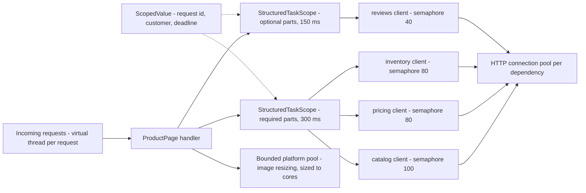
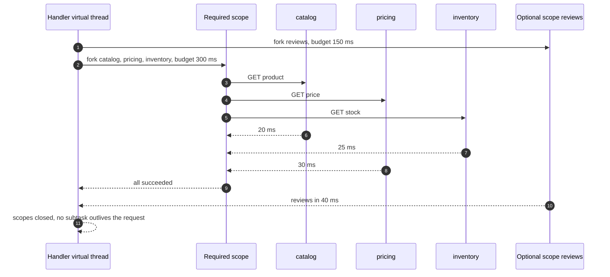
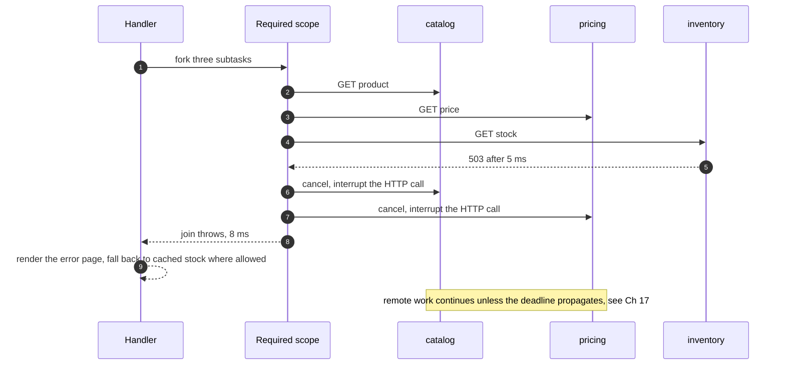
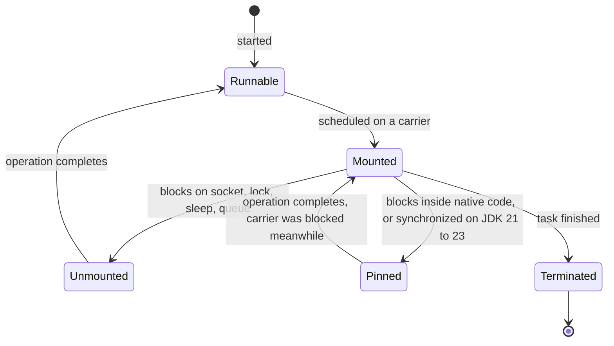

# 19. Concurrency at Scale in Java

!!! abstract "Chapter at a glance"
    **Reader bands:** B2 → B4 · **Prerequisites:** [Ch 09](../01-foundations/09-scalability-fundamentals.md), [Ch 17](17-inter-service-communication.md), [Ch 18](18-resilience-patterns.md) · **What you will build:** The concurrency model of the grocery platform's Spring services, from thread pools to virtual threads and structured concurrency, measured on **both JDK 21 and JDK 25** (Temurin 25.0.1, downloaded for this chapter).

    - **L1** measures thread-per-request limits and pool sizing: 5,000 blocked platform threads take +151 MB, the same on virtual threads +13 MB, and 100,000 virtual threads +170 MB. The I/O-bound optimum matches `cores × (1 + W/C)` = 42.
    - **L2** measures pinning (a `synchronized` block around blocking I/O: **5,031 ms on JDK 21 vs 54 ms on JDK 25**, JEP 491) and the `ThreadLocal` cache trap (+349 MB with 20,000 virtual threads). `ScopedValue` flows into structured subtasks.
    - **L3** builds the product-page fan-out over real HTTP: sequential vs `CompletableFuture` vs **`StructuredTaskScope`** (JDK 25 preview). Error pages drop from 31 ms to 8 ms, and 0 tasks leak (vs 116). The chapter is also honest about what client-side cancellation does *not* stop.
    - **L4** covers backpressure: an unbounded queue with lag growing past 3.3 s, vs a bounded queue and a demand-driven `Flow` publisher at ~140 ms.

    · **Reading time:** 100 min + code

---

## 1. Introduction & Why It Matters

### 1.1 A story: "we moved to virtual threads and it got slower"

The platform team upgraded `catalog-service` to Java 21 and switched Tomcat to virtual threads (`spring.threads.virtual.enabled=true`). Load tests looked great: 5,000 concurrent requests on a pod that used to top out at 200. Then, in production:

- **The product page p99 went from 180 ms to 6 seconds at lunchtime peak.** Thread dumps showed thousands of virtual threads waiting and only two or four carrier threads, all stuck inside a `synchronized` method of an old image-metadata client that did an HTTP call while holding the lock. On JDK 21, a virtual thread blocking inside `synchronized` **pins** its carrier, so the whole pod ran at the concurrency of its CPU count. L2 reproduces it: **5,031 ms vs 53 ms** for the same work with a `ReentrantLock`.
- **Memory grew by 400 MB per pod.** A JSON library cached a 16 KB buffer in a `ThreadLocal`, which is fine with 200 pooled threads (200 buffers) and a disaster with a virtual thread per request (one buffer per in-flight request). L2: **+349 MB** at 20,000 in-flight requests.
- **Pricing-service fell over.** Removing the 200-thread ceiling also removed the accidental limit on how many concurrent calls catalog made to pricing (Ch 17 L1). Pricing received 5x its usual concurrency.
- **The product page fan-out used `CompletableFuture.allOf`.** When inventory failed, the page still waited for reviews (sometimes 2 s), and the abandoned futures kept running after the response was sent.

The fixes:

- Upgrade to **JDK 24+ (the platform is on 25)**, where `synchronized` no longer pins (L2: **54 ms**), and replace the worst `synchronized` I/O with `ReentrantLock` anyway.
- Replace per-thread caches with **pooled objects or `ScopedValue`**.
- Put **explicit concurrency limits (semaphores/bulkheads) per dependency** back in (Ch 18).
- Use **structured concurrency** for fan-out: fail fast, cancel siblings, a budget per part, nothing leaks.

!!! quote "The thesis of this chapter"
    Concurrency in a service is a capacity-allocation problem. Every in-flight request holds something (a thread, a connection, memory, a slot at a dependency), and **Little's law** decides how many are in flight. Virtual threads make *waiting* nearly free. They don't make CPUs, databases or downstream services any bigger, so keep the explicit limits, remove the old assumptions (pools, pinning, `ThreadLocal`), and structure concurrent work so its lifetime is bounded by the request.

### 1.2 Where this lives in the grocery platform

| Service / path | Model | Why |
|---|---|---|
| All Spring MVC services (JDK 25) | **Virtual thread per request** (`spring.threads.virtual.enabled=true`) | Blocking code, massive concurrency for I/O-bound work |
| Product page / home page BFF | **Structured concurrency** fan-out with budgets | Fail fast, cancel, bounded lifetime (L3) |
| checkout → pricing/inventory | Virtual threads + **semaphore bulkheads** | Protect dependencies from unbounded concurrency (Ch 18) |
| Search ranking, price computation | **Bounded platform pools** sized to cores | CPU-bound: more threads don't help (L1 B) |
| Tracking ingestion (rider GPS) | Kafka consumer + bounded queues, drop-oldest | Backpressure, freshness over completeness (L4) |
| Live order status push (SSE/WebSocket) | Spring WebFlux (reactive) | Long-lived streaming connections with backpressure |
| Scheduled batch jobs (settlement) | Platform thread pools, parallelism = partitions | Predictable resource use |

### 1.3 Learning objectives

| Band | After this chapter you can… |
|---|---|
| <span class="band b2">B2</span> | Explain thread-per-request, thread pools and virtual threads, and size a pool for CPU-bound vs I/O-bound work |
| <span class="band b3">B3</span> | Avoid pinning and `ThreadLocal` pitfalls, use `ScopedValue` and structured concurrency for fan-out, and apply backpressure |
| <span class="band b4">B4</span> | Choose between virtual threads and reactive per workload, set platform-wide concurrency limits, and diagnose concurrency problems in production |

---

## 2. Core Concepts — Beginner to Deep

### 2.1 Intuition: billing counters at a dark store <span class="band b2">B2</span>

- **Platform threads are cashiers.** Each is expensive to hire (memory, scheduling), and there's a fixed number of counters. A customer who says "wait, let me call my wife about the atta brand" makes the cashier stand idle, and the queue behind grows. That's thread-per-request with blocking I/O.
- **Virtual threads are token numbers.** Customers take a token and step aside while they're on the phone. A small number of cashiers (**carriers**) serve whoever is ready. Thousands of customers can be "in progress" cheaply.
- **Pinning:** a customer who takes the cashier with them into the phone booth (blocking inside `synchronized` on JDK 21). The cashier is stuck until the call ends.
- **ThreadLocal caches:** giving every token holder their own shopping trolley "for speed". Fine with 8 cashiers, absurd with 5,000 token holders.
- **Structured concurrency:** a family splits up to collect items (atta, milk, eggs). If the eggs are sold out, everyone stops and comes back. Nobody keeps shopping for an order that's already cancelled.
- **Backpressure:** when the packing table is full, pickers stop bringing more items instead of piling them on the floor.

### 2.2 The models ⭐ <span class="band b2">B2</span>

| Model | How it works | Strengths | Weaknesses |
|---|---|---|---|
| **Thread-per-request (platform threads)** | Each request gets an OS thread from a pool (Tomcat's 200) | Simple blocking code, easy debugging | Threads are expensive (~1 MB stack reserve, OS scheduling), so concurrency is capped by the pool size |
| **Reactive / event-loop** (Reactor, WebFlux, Netty) | A few threads run non-blocking pipelines; I/O completion triggers callbacks | Huge concurrency, built-in backpressure, streaming | Harder code, debugging and stack traces; everything must be non-blocking |
| **Virtual threads** (JDK 21+) | Cheap threads managed by the JVM, mounted on a few carrier threads; a blocking call unmounts the virtual thread | Blocking code with reactive-like concurrency | Pinning (JDK 21–23), `ThreadLocal` assumptions, and no built-in limits |

L1 A: holding 5,000 requests "waiting on I/O" cost **+151 MB and 1,040 ms** to set up with platform threads, and **+13 MB and 66 ms** with virtual threads. 100,000 virtual threads took **519 ms and +170 MB**.

**How virtual threads work:**

- A virtual thread is a `Continuation` on the heap.
- When it blocks on a supported operation (socket I/O, `Thread.sleep`, `Lock`, `BlockingQueue`), the JVM saves its stack to the heap and **unmounts** it. The carrier thread (from a `ForkJoinPool`, by default one per core) picks up another virtual thread.
- When the I/O completes, the virtual thread is rescheduled on any carrier.
- **File I/O and some native calls** still block the carrier. The JVM compensates by temporarily adding carriers.

### 2.3 Little's law and pool sizing ⭐ <span class="band b2">B2</span>

`L = λ × W`: in-flight requests = arrival rate × time in system (Ch 17).

- **CPU-bound work:** throughput peaks at about the number of cores. More threads only add context switching. L1 B (2 cores, 2 ms of CPU per task): 1 thread 489/s, 2 threads 967/s, 4–128 threads ~1,000/s.
- **I/O-bound work:** threads ≈ `cores × (1 + wait/compute)`. For 0.5 ms of CPU and 10 ms of waiting on 2 cores that's **42**, and L1 B measured the peak there (3,604/s vs 1,489/s at 16 and 3,496/s at 128).
- **With virtual threads,** you don't size a thread pool for I/O-bound work, because the "pool" is effectively unbounded. You still size:
    - **Carrier parallelism** (default = cores, `jdk.virtualThreadScheduler.parallelism`).
    - **Connection pools** (Hikari: the database's capacity, often 10–50 per service instance, **not** thousands).
    - **Per-dependency concurrency limits** (semaphores, Ch 18).
    - **CPU-bound work** separately, on a bounded platform pool.

### 2.4 Pinning ⭐ <span class="band b3">B3</span>

On JDK 21–23, a virtual thread is **pinned** to its carrier and can't unmount when it blocks:

- inside a `synchronized` block or method;
- in a native method or foreign function call.

With a few carriers, pinned blocking reduces the whole application's concurrency to the number of carriers. L2 ran 200 virtual threads that each hold their own lock (no contention) and block for 50 ms:

| JDK | `synchronized` | `ReentrantLock` |
|---|---|---|
| **21** | **5,031 ms** (200 × 50 ms / 2 carriers) | 53 ms |
| **25** | **54 ms** | 53 ms |

**JEP 491 (JDK 24)** made virtual threads able to unmount while holding monitors, which removes the main source of pinning. On JDK 21–23:

- Use `-Djdk.tracePinnedThreads=full` (21–23) or JFR's `jdk.VirtualThreadPinned` event to find pinning.
- Replace `synchronized` around blocking calls with `ReentrantLock`.
- Upgrade libraries (JDBC drivers, HTTP clients and logging frameworks fixed many cases).

On any JDK, **native calls** still pin, and holding **any lock while doing I/O** is still a contention problem (other threads wait on the lock).

### 2.5 ThreadLocal pitfalls and ScopedValue ⭐ <span class="band b3">B3</span>

`ThreadLocal` is used for two different things, and virtual threads break different assumptions for each:

| Use | Old assumption | With virtual threads |
|---|---|---|
| **Per-thread cache** of an expensive object (buffers, `SimpleDateFormat`, parsers) | A few long-lived pooled threads reuse the object | One virtual thread per request, so one object per request: no reuse, lots of memory (L2: **+349 MB** at 20,000 in flight) |
| **Request context** (user, tenant, trace id, transaction) | Set at request start, cleared at the end | Still works (virtual threads have ThreadLocals), but must be cleared, isn't inherited by tasks you fork unless using `InheritableThreadLocal` (which copies, and copies cost memory), and is mutable from anywhere |

**Fixes:**

- **Caches:** use a proper object pool, immutable thread-safe objects (`DateTimeFormatter` instead of `SimpleDateFormat`), or allocate per use (often cheap enough).
- **Context:** use **`ScopedValue`** (final in JDK 25, JEP 506). It's bound for the duration of a scope, immutable, automatically unbound at the end, and **inherited by subtasks forked in a `StructuredTaskScope`**. L2 B showed the request id visible in the handler and in both forked subtasks, and unbound afterwards. Nothing to clean up, and nothing leaks into the next request.
- **Frameworks:**
    - Spring's `RequestContextHolder` and transaction synchronization still use `ThreadLocal`, which is fine for context in a single thread.
    - Micrometer tracing context propagates across your own `ExecutorService` if you wrap it (`ContextExecutorService`).
    - With structured concurrency, ensure context propagation into subtasks: `ScopedValue` does it natively.

### 2.6 Structured concurrency ⭐ <span class="band b3">B3</span>

**Unstructured concurrency** (`ExecutorService.submit`, `CompletableFuture.supplyAsync`) creates tasks whose lifetime isn't tied to the code that created them:

- A failure in one task doesn't cancel the others.
- The caller can return while tasks are still running.
- Thread dumps don't show which request a task belongs to.

**Structured concurrency** (JEP 505, a preview API in JDK 25) treats a group of subtasks as one unit of work, with a lexical scope:

```java
try (var scope = StructuredTaskScope.open(Joiner.awaitAllSuccessfulOrThrow(), cf -> cf.withTimeout(Duration.ofMillis(300)))) {
    var product = scope.fork(() -> catalog.product(sku));
    var price   = scope.fork(() -> pricing.price(sku, storeId));
    var stock   = scope.fork(() -> inventory.stock(sku, storeId));
    scope.join();                         // first failure or timeout → cancel the rest, throw
    return new ProductPage(product.get(), price.get(), stock.get());
}                                         // leaving the block guarantees every subtask has finished
```

L3 (JDK 25, real HTTP, 300 product pages, inventory failing fast for 20 %, reviews taking 2 s for 10 %):

| Style | OK p50 | OK p99 | Error page p50 | Tasks left running after the reply |
|---|---|---|---|---|
| Sequential | 124 ms | 2,093 ms | 59 ms | 0 |
| `CompletableFuture.allOf` | 41 ms | 184 ms | 31 ms | **116** |
| **`StructuredTaskScope`** | 41 ms | **152 ms** | **8 ms** | **0** |

- **Parallel beats sequential** on latency, as expected.
- **Structured concurrency fails fast.** An inventory failure returns the error page in 8 ms instead of waiting for the siblings (31 ms). A time budget on the optional scope caps reviews, and **nothing outlives the request**: 0 tasks left running, vs 116 abandoned futures still consuming threads and connections with `CompletableFuture`.
- **What it does *not* do:** the "server work after reply" column in the output is higher for structured concurrency (276 vs 116). Cancelling a subtask interrupts **our** HTTP call, but the **remote** service keeps working unless the cancellation or deadline propagates to it (Ch 17: deadline headers, server-side checks). Structured concurrency bounds *our* resources. Deadline propagation bounds *theirs*. You need both.

In Spring (JDK 25), enable previews for the service (`--enable-preview`), or keep a thin wrapper so the preview API can be swapped when it's finalized. Where previews aren't allowed, emulate it: an executor per request in try-with-resources (JDK 21's `ExecutorService` is `AutoCloseable`), cancel the remaining futures on the first failure, and put budgets on optional parts. You lose some guarantees, and it's still far better than fire-and-forget futures.

### 2.7 Reactive programming: when it still earns its place ⭐ <span class="band b4">B4</span>

With virtual threads, most request/response services no longer need reactive code for scalability. Reactive (Project Reactor, WebFlux, RxJava) remains a good fit for:

- **Streaming:** SSE/WebSocket push (live order status, rider location to the app), with operators for merging, windowing and throttling streams.
- **Backpressure across async boundaries:** the Reactive Streams protocol (`request(n)`) propagates demand end to end (Kafka → processing → WebSocket).
- **Existing reactive stacks and drivers** (R2DBC, reactive Mongo, Spring Cloud Gateway).

Costs: a separate programming model, harder debugging, and "function colouring" (everything in the chain must be non-blocking). Blocking calls inside reactive pipelines are a classic outage cause. Use `BlockHound` in tests.

**Platform rule:** Spring MVC + virtual threads by default. WebFlux for gateways, streaming endpoints and existing reactive services.

### 2.8 Backpressure ⭐ <span class="band b3">B3</span>

When producers are faster than consumers, something has to give. The options are to **buffer** (bounded), **slow the producer** (block or demand), **drop** (oldest/newest/sample), or **fail**. L4 (GPS pings at 50,000/s, consumer at ~10,000/s, 4 s):

| Strategy | Queued at end | Peak heap | Max lag |
|---|---|---|---|
| **Unbounded queue** | **165,633** and growing | 61 MB and growing | **3,312 ms** and growing |
| Bounded queue (1,000), producer blocks | 998 | 7 MB | 139 ms |
| `Flow` publisher (demand-driven) + drop | ~1,000 buffer | 26 MB | 145 ms, with 161,465 pings dropped |

What the three results show:

- **The unbounded queue hides the problem** until memory runs out. Meanwhile the data it delivers is seconds old, which is useless for live tracking.
- **Blocking the producer** pushes back upstream: the Kafka consumer polls less, and lag builds in Kafka, where it's durable and visible (Ch 14). That's the right place for backlog.
- **Dropping** is right when newer data supersedes older data (GPS positions, metrics). Keep the latest per rider.

For Kafka consumers: `max.poll.records`, pause/resume of partitions, and bounded in-memory hand-off queues. For HTTP ingress: bounded concurrency and shedding (Ch 18 L4). For async pipelines: Reactive Streams demand, or bounded channels.

### 2.9 Shared state, contention and the memory model <span class="band b3">B3</span>

With massive concurrency, **contention** on shared state becomes the bottleneck:

- **Visibility and ordering:** the Java Memory Model guarantees visibility only across *happens-before* edges: `volatile` writes/reads, lock release/acquire, thread start/join, and `java.util.concurrent` hand-offs. A plain field written by one thread may never be seen by another.
- **Atomicity:** use `AtomicLong`/`AtomicReference` (CAS) for single variables. Use `LongAdder` for high-contention counters: it stripes the updates and sums on read. Use `ConcurrentHashMap.compute` for per-key updates.
- **Locks:** keep critical sections short, **never do I/O while holding a lock**, and prefer lock-free or immutable data (records, persistent collections).
- **Per-request state stays per request:** the safest concurrency is none. Most service code should be stateless (Ch 09), with state in databases and caches that have their own concurrency control.

### 2.10 Diagnosing concurrency problems <span class="band b4">B4</span>

- **Thread dumps:** `jcmd <pid> Thread.dump_to_file -format=json` includes virtual threads (millions of them are summarized, grouped by stack). Look for many threads waiting on the same lock or pool.
- **JFR:** `jdk.VirtualThreadPinned`, `jdk.VirtualThreadSubmitFailed`, lock contention (`jdk.JavaMonitorEnter`), socket reads with durations, and `jdk.ThreadSleep`.
- **Metrics:** in-flight requests, pool utilization (Hikari active/pending), semaphore permits, queue depths, and carrier CPU usage.
- **Load tests at and beyond capacity** with realistic dependency latencies. L2's pinning only shows up when blocking happens under load.

---

## 3. Architecture & Diagrams

### 3.1 Component view: concurrency inside the product-page BFF



### 3.2 Sequence: happy path, structured fan-out



### 3.3 Sequence: failure path, inventory fails and the siblings are cancelled



### 3.4 State: a virtual thread



---

## 4. Design Document Excerpt: Concurrency Model for Spring Services

| Field | Value |
|---|---|
| Author / Reviewers | Platform team / service owners, SRE |
| Status | Approved |
| Related ADRs | ADR-078 JDK 25 + virtual threads by default; ADR-079 Structured concurrency for fan-out (preview, wrapped); ADR-080 No per-thread caches, ScopedValue for context; ADR-081 Explicit limits per dependency and for CPU work; ADR-082 Reactive only for streaming and gateways |

**1. Context & Problem.** The move to virtual threads on JDK 21 caused pinning stalls (p99 6 s), +400 MB from per-thread caches, a downstream overload once the thread ceiling was gone, and leaking fan-out tasks (§1.1).

**2. Goals / Non-Goals.**

- *Goals:* high concurrency for I/O-bound services with simple blocking code; no pinning stalls; bounded memory per in-flight request; explicit limits on dependencies and CPU work; fan-outs that fail fast and never leak.
- *Non-goals:* rewriting existing reactive services; eliminating all `synchronized` (fine on JDK 25 when no I/O is involved).

**3. Requirements.**

| ID | Requirement |
|---|---|
| NFR-1 | All services on JDK 25 with virtual threads for request handling |
| NFR-2 | 0 `jdk.VirtualThreadPinned` events > 20 ms in load tests (JFR check in CI) |
| NFR-3 | Heap per in-flight request ≤ 50 KB (load-test measurement); no `ThreadLocal` caches of large objects |
| NFR-4 | Every outbound dependency has a concurrency limit; CPU-bound work runs on a bounded pool |
| NFR-5 | Fan-out endpoints: an error response within 50 ms of the first required failure; 0 subtasks alive after the response |
| NFR-6 | Streaming endpoints use Reactive Streams backpressure or bounded buffers with an explicit drop policy |

**4. Capacity & latency estimates.**

| Item | Calculation | Result |
|---|---|---|
| Product page concurrency per pod | 300 req/s × 150 ms p99 | ~45 in flight, trivial for virtual threads |
| Outbound to pricing per pod | 300 req/s × 30 ms | ~9 in flight → limit 80 (headroom for spikes and slowdowns) |
| DB connections (catalog) | Queries 400/s × 5 ms | ~2 in use → pool 10 (not 1,000) |
| CPU pool (image resizing) | 4 vCPU | 4 threads |
| Memory per in-flight request | Virtual thread stack ~few KB + request objects | ~20–40 KB |

**5. Proposed design.**

1. **JDK 25** base image, `spring.threads.virtual.enabled=true`, and JFR continuous recording with the pinning and contention events enabled.
2. **Concurrency limits** in the platform HTTP/gRPC clients (Ch 17): a semaphore per dependency, Hikari pools sized from Little's law, and a bounded `ThreadPoolExecutor` for CPU-heavy tasks (`cores` threads, bounded queue, caller-runs or reject).
3. **Fan-out:** a platform `ParallelCalls` helper wrapping `StructuredTaskScope` (preview enabled in the service), with required/optional groups, budgets from the request deadline, and `ScopedValue` propagation of the request context. It can switch to the final API without touching call sites.
4. **Context:** request id, tenant, customer and deadline in `ScopedValue`s bound by a filter. `ThreadLocal`-based caches are banned by a lint rule.
5. **Streaming:** WebFlux for SSE/WebSocket endpoints, and Kafka consumers with bounded hand-off queues and pause/resume.

**7. Alternatives considered.**

| Option | Pros | Cons | Verdict |
|---|---|---|---|
| Stay on platform-thread pools | Known behaviour | Concurrency caps; tuning pools per service | Rejected |
| **Virtual threads + explicit limits (JDK 25)** | Simple code, high concurrency, no pinning from `synchronized` | Must add limits and remove per-thread caches | **Chosen** |
| Reactive everywhere | Backpressure, efficiency | Complexity, retraining, hard debugging | Only for streaming/gateway |
| `CompletableFuture` for fan-out | No preview flags | Leaks, no sibling cancellation (L3) | Rejected for new code |

**8. Failure modes.** Pinning via native libraries: detected by JFR in load tests. Dependency flooded: limited by semaphores. Memory growth: per-request heap budget checked in load tests. Preview API changes: isolated behind `ParallelCalls`.

**10. Observability.** In-flight requests, virtual threads alive, carrier CPU, pinned events, semaphore permits per dependency, Hikari active/pending, CPU pool queue depth, fan-out subtask failures and cancellations, heap per in-flight request.

**14. Decision (ADR-078–082 summary).** JDK 25 with virtual threads for request handling. Explicit limits per dependency and for CPU work. Structured concurrency (wrapped) for fan-out. `ScopedValue` for request context and no per-thread caches. Reactive only for streaming and gateways.

---

## 5. Hands-On Code — Level Ladder

| Level | New requirement that forces the step |
|---|---|
| L1 | "How many requests can a pod hold, and how big should pools be?" (real threads) |
| L2 | "Virtual threads got slower and fatter: why?" (pinning on JDK 21 vs 25; ThreadLocal vs ScopedValue) |
| L3 | "The product page must fail fast and never leak work." (structured concurrency, real HTTP, JDK 25) |
| L4 | "Tracking ingestion must not drown when consumers are slower than producers." (backpressure) |

All four levels are runnable JDK programs with no dependencies. Machine: 2 vCPU container, **Temurin 21** (`java`) and **Temurin 25.0.1** (`/opt/jdk25/bin/java`, from the Adoptium GitHub release). The outputs below are verbatim. Lab files are in `labs/ch19-concurrency/`.

### L1 — Thread-per-request limits and pool sizing <span class="band b2">B2</span>

**Requirement:** "How many waiting requests can one pod hold, and how big should a pool be?"

Part A parks N threads on a latch (a stand-in for "waiting on a downstream call") and measures the time to start them and the resident memory (`VmRSS` from `/proc/self/status`). Part B runs tasks through fixed pools of different sizes (800 CPU-bound, 3,000 I/O-heavy), with two workloads: pure CPU (2 ms of arithmetic), and I/O-heavy (0.5 ms of CPU plus a 10 ms sleep).

```java title="ThreadsL1.java"
// ThreadsL1.java — run with: java ThreadsL1.java
// A. How many concurrent blocking requests can one JVM hold: platform threads vs virtual threads (real threads).
// B. Pool sizing: CPU-bound vs I/O-heavy work, measured throughput for different pool sizes.
import java.util.*;
import java.util.concurrent.*;
import java.util.concurrent.atomic.*;

public class ThreadsL1 {

    static long rssMb() throws Exception {
        for (String l : java.nio.file.Files.readAllLines(java.nio.file.Path.of("/proc/self/status")))
            if (l.startsWith("VmRSS:")) return Long.parseLong(l.replaceAll("\\D+", "")) / 1024;
        return -1;
    }

    static String hold(boolean virtual, int n) throws Exception {
        CountDownLatch started = new CountDownLatch(n), release = new CountDownLatch(1);
        long before = rssMb(), t0 = System.nanoTime();
        List<Thread> ts = new ArrayList<>(n);
        try {
            for (int i = 0; i < n; i++) {
                Runnable r = () -> { started.countDown(); try { release.await(); } catch (InterruptedException ignored) { } };  // "waiting on I/O"
                ts.add(virtual ? Thread.ofVirtual().start(r) : Thread.ofPlatform().start(r));
            }
            started.await();
        } catch (Throwable e) {
            release.countDown();
            return String.format("FAILED after %,d threads: %s", ts.size(), e);
        }
        long ms = (System.nanoTime() - t0) / 1_000_000, after = rssMb();
        release.countDown(); for (Thread t : ts) t.join();
        return String.format("%,7d waiting requests in %,5d ms, +%,d MB RSS", n, ms, after - before);
    }

    static double throughput(int poolSize, long cpuMicros, long waitMicros, int tasks) throws Exception {
        ExecutorService pool = Executors.newFixedThreadPool(poolSize);
        long t0 = System.nanoTime();
        List<Future<?>> fs = new ArrayList<>();
        for (int i = 0; i < tasks; i++) fs.add(pool.submit(() -> {
            long end = System.nanoTime() + cpuMicros * 1000; double x = 0;
            while (System.nanoTime() < end) x += Math.sqrt(x + 1);               // CPU work
            if (waitMicros > 0) Thread.sleep(waitMicros / 1000, (int) (waitMicros % 1000) * 1000);   // I/O wait
            return x;
        }));
        for (var f : fs) f.get();
        pool.shutdown();
        return tasks / ((System.nanoTime() - t0) / 1e9);
    }

    public static void main(String[] args) throws Exception {
        int cores = Runtime.getRuntime().availableProcessors();
        System.out.println("A. Concurrent requests blocked on I/O (" + cores + " CPU cores)");
        System.out.println("   platform threads: " + hold(false, 5_000));
        System.out.println("   virtual threads : " + hold(true, 5_000));
        System.out.println("   virtual threads : " + hold(true, 100_000));

        System.out.println("B. Throughput (tasks/s) by pool size");
        System.out.printf("   %-10s %18s %30s%n", "pool size", "CPU-bound (2 ms)", "I/O-heavy (0.5 ms CPU + 10 ms wait)");
        for (int size : new int[]{1, cores, cores * 2, cores * 8, cores * 21, cores * 64}) {
            System.out.printf("   %-10d %18.0f %30.0f%n", size, throughput(size, 2_000, 0, 800), throughput(size, 500, 10_000, 3_000));
        }
        System.out.printf("   formula for the I/O-heavy case: threads ≈ cores × (1 + wait/compute) = %d × (1 + 10/0.5) = %d%n", cores, cores * 21);
    }
}
```

```text title="java ThreadsL1.java  (JDK 21)"
A. Concurrent requests blocked on I/O (2 CPU cores)
   platform threads:   5,000 waiting requests in 1,040 ms, +151 MB RSS
   virtual threads :   5,000 waiting requests in    66 ms, +13 MB RSS
   virtual threads : 100,000 waiting requests in   519 ms, +170 MB RSS
B. Throughput (tasks/s) by pool size
   pool size    CPU-bound (2 ms) I/O-heavy (0.5 ms CPU + 10 ms wait)
   1                         489                             93
   2                         967                            186
   4                        1017                            373
   16                       1011                           1489
   42                        998                           3604
   128                       975                           3496
   formula for the I/O-heavy case: threads ≈ cores × (1 + wait/compute) = 2 × (1 + 10/0.5) = 42
```

**Reading it:**

- **Platform threads cost ~30 KB of RSS each** (touched stack pages plus kernel structures) and 0.2 ms to create. At 5,000 you're already at 151 MB, and Tomcat's default of 200 is a sensible cap for that reason.
- **Virtual threads cost ~2 KB each while parked.** 100,000 waiting requests fit in 170 MB.
- **Pool sizing:**
    - For CPU-bound work, throughput plateaus at the core count (2): 967/s. Adding threads up to 128 buys nothing and slowly loses to context switching.
    - For the I/O-heavy workload, throughput rises until the formula's **42 threads** (3,604/s) and then flattens, because the CPU is saturated.
    - Virtual threads remove the need to pick the "42", but not the CPU ceiling behind it.

!!! warning "Virtual threads are not faster"
    They make **waiting** cheap. A virtual thread runs CPU work at exactly the speed of a platform thread. The win is concurrency for I/O-bound services, not latency or CPU throughput.

### L2 — Pinning (JDK 21 vs 25) and ThreadLocal vs ScopedValue <span class="band b3">B3</span>

**Requirement:** "We switched to virtual threads and got slower and fatter. Why?"

**Part 1, pinning.** 200 virtual threads, each with its **own** lock (so there's no contention at all), block for 50 ms while holding it. The container has 2 cores, so the default scheduler has 2 carrier threads.

```java title="PinningL2.java"
// PinningL2.java — run with BOTH: java PinningL2.java   (JDK 21)   and   /opt/jdk25/bin/java PinningL2.java   (JDK 25)
// 200 virtual threads each hold a lock while blocking for 50 ms (e.g. a legacy client doing I/O inside synchronized).
// On JDK 21 a virtual thread blocking inside `synchronized` PINS its carrier thread; JDK 24+ (JEP 491) fixes that.
import java.util.*;
import java.util.concurrent.*;
import java.util.concurrent.locks.*;

public class PinningL2 {

    static long run(boolean useSynchronized) throws Exception {
        int n = 200;
        Object[] monitors = new Object[n]; ReentrantLock[] locks = new ReentrantLock[n];   // one lock per task: no contention
        for (int i = 0; i < n; i++) { monitors[i] = new Object(); locks[i] = new ReentrantLock(); }
        long t0 = System.nanoTime();
        try (var exec = Executors.newVirtualThreadPerTaskExecutor()) {
            for (int i = 0; i < n; i++) {
                int ii = i;
                exec.submit(() -> {
                    if (useSynchronized) { synchronized (monitors[ii]) { sleep(50); } }
                    else { locks[ii].lock(); try { sleep(50); } finally { locks[ii].unlock(); } }
                });
            }
        }
        return (System.nanoTime() - t0) / 1_000_000;
    }

    static void sleep(long ms) { try { Thread.sleep(ms); } catch (InterruptedException e) { Thread.currentThread().interrupt(); } }

    public static void main(String[] args) throws Exception {
        run(true); run(false);                                                             // warm up
        System.out.printf("JDK %s, %d carrier threads: 200 virtual threads × 50 ms blocking while holding a lock%n",
                Runtime.version().feature(), Runtime.getRuntime().availableProcessors());
        System.out.printf("   synchronized  : %,6d ms%n", run(true));
        System.out.printf("   ReentrantLock : %,6d ms%n", run(false));
    }
}
```

```text title="java PinningL2.java  (JDK 21)   and   /opt/jdk25/bin/java PinningL2.java"
JDK 21, 2 carrier threads: 200 virtual threads × 50 ms blocking while holding a lock
   synchronized  :  5,031 ms
   ReentrantLock :     53 ms
JDK 25, 2 carrier threads: 200 virtual threads × 50 ms blocking while holding a lock
   synchronized  :     54 ms
   ReentrantLock :     53 ms
```

On JDK 21, every `synchronized` sleep pins a carrier, so 200 × 50 ms / 2 carriers = **5,000 ms**. That's a 100x slowdown with no lock contention at all. The same program on JDK 25 (JEP 491: virtual threads unmount while holding monitors) takes 54 ms. `ReentrantLock` was never affected.

**Part 2, ThreadLocal caches and ScopedValue.**

```java title="ThreadLocalL2.java  (JDK 25)"
// ThreadLocalL2.java — run with: /opt/jdk25/bin/java --enable-preview --source 25 ThreadLocalL2.java   (ScopedValue is final in 25; StructuredTaskScope is preview)
// The "cache an expensive object per thread" idiom (ThreadLocal<byte[]>, ThreadLocal<SimpleDateFormat>, …) assumes a
// few long-lived pooled threads. With a virtual thread per request, every request gets its own copy.
import java.lang.management.ManagementFactory;
import java.util.*;
import java.util.concurrent.*;

public class ThreadLocalL2 {

    static final ThreadLocal<byte[]> BUFFER = ThreadLocal.withInitial(() -> new byte[16 * 1024]);   // 16 KB "per-thread" scratch buffer
    static final ScopedValue<String> REQUEST_ID = ScopedValue.newInstance();

    static long heapMb() { System.gc(); return ManagementFactory.getMemoryMXBean().getHeapMemoryUsage().getUsed() / (1024 * 1024); }

    static void simulate(ExecutorService exec, int requests, String label) throws Exception {
        long before = heapMb();
        CountDownLatch inside = new CountDownLatch(requests), release = new CountDownLatch(1);
        for (int i = 0; i < requests; i++) exec.submit(() -> {
            BUFFER.get()[0] = 1;                                  // use the per-thread buffer
            inside.countDown();
            try { release.await(); } catch (InterruptedException ignored) { }   // request still in flight (waiting on I/O)
            return null;
        });
        inside.await(requests >= 20_000 ? 60 : 5, TimeUnit.SECONDS);
        System.out.printf("   %-42s buffers alive: %,6d   heap +%,5d MB%n", label, requests - (int) inside.getCount(), heapMb() - before);
        release.countDown();
        exec.shutdown(); exec.awaitTermination(1, TimeUnit.MINUTES);
    }

    public static void main(String[] args) throws Exception {
        System.out.println("A. ThreadLocal<byte[16 KB]> as a per-thread cache, 20,000 concurrent requests");
        simulate(Executors.newFixedThreadPool(200), 200, "pool of 200 platform threads (200 in flight)");
        simulate(Executors.newVirtualThreadPerTaskExecutor(), 20_000, "virtual thread per request (20,000 in flight)");

        System.out.println("B. Request context: ScopedValue is bound for a scope and inherited by structured subtasks");
        ScopedValue.where(REQUEST_ID, "req-7f3a").run(() -> {
            System.out.println("   handler sees      : " + REQUEST_ID.get());
            try (var scope = StructuredTaskScope.open()) {                                   // JDK 25 preview API
                var price = scope.fork(() -> "pricing sees " + REQUEST_ID.get());
                var stock = scope.fork(() -> "inventory sees " + REQUEST_ID.get());
                scope.join();
                System.out.println("   subtasks          : " + price.get() + ", " + stock.get());
            } catch (Exception e) { throw new RuntimeException(e); }
        });
        System.out.println("   outside the scope : bound = " + REQUEST_ID.isBound() + "  (nothing to clean up, nothing leaks to the next request)");
    }
}
```

```text title="/opt/jdk25/bin/java --enable-preview --source 25 ThreadLocalL2.java"
A. ThreadLocal<byte[16 KB]> as a per-thread cache, 20,000 concurrent requests
   pool of 200 platform threads (200 in flight) buffers alive:    200   heap +    1 MB
   virtual thread per request (20,000 in flight) buffers alive: 20,000   heap +  349 MB
B. Request context: ScopedValue is bound for a scope and inherited by structured subtasks
   handler sees      : req-7f3a
   subtasks          : pricing sees req-7f3a, inventory sees req-7f3a
   outside the scope : bound = false  (nothing to clean up, nothing leaks to the next request)
```

- **The per-thread cache** is reused by 200 pooled threads, but with a virtual thread per request there's one 16 KB buffer per in-flight request: **+349 MB** at 20,000 in flight.
- **`ScopedValue`** is bound for the request's scope, seen by the structured subtasks without any copying code, and gone afterwards. (`ScopedValue` is final in JDK 25. The preview flag is only needed for `StructuredTaskScope`.)

### L3 — Product page fan-out: sequential vs CompletableFuture vs StructuredTaskScope <span class="band b3">B3</span>

**Requirement:** "The product page calls four services. It must be fast, fail fast when a required part fails, cap optional parts, and never leave work running after the response."

The lab starts four **real HTTP services** in-process (JDK `HttpServer` on ports 19301–19304, virtual-thread executors, `nodelay` on):

- catalog 20 ms;
- pricing 30 ms;
- inventory 25 ms, and **fails fast (5 ms, HTTP 503) for 20 %** of SKUs;
- reviews 40 ms, but **2 s for 10 %**.

It renders 300 product pages in each style:

- **Sequential**
- **`CompletableFuture.allOf`** (waiting up to 150 ms for reviews with `get(timeout)`)
- **Structured**: required parts in `Joiner.awaitAllSuccessfulOrThrow()` with a 300 ms timeout, optional reviews in `Joiner.awaitAll()` with a 150 ms timeout.

"Tasks left running" counts client-side subtasks still alive when the page was returned. "Server work after reply" counts server-side handlers that finished *after* the client had already answered.

```java title="FanOutL3.java  (JDK 25, preview)"
// FanOutL3.java — run with: /opt/jdk25/bin/java --enable-preview --source 25 FanOutL3.java
// The product page needs catalog + pricing + inventory (required) and reviews (optional), over real HTTP.
// Inventory fails fast for 20 % of pages; reviews take 2 s for 10 %. Compare sequential, CompletableFuture.allOf,
// and structured concurrency (JDK 25 preview, JEP 505): fail fast + cancel siblings + a time budget for the optional part.
import com.sun.net.httpserver.HttpServer;
import java.net.*;
import java.net.http.*;
import java.time.Duration;
import java.util.*;
import java.util.concurrent.*;
import java.util.concurrent.StructuredTaskScope.Joiner;
import java.util.concurrent.atomic.*;

public class FanOutL3 {

    static final Map<String, Long> pageDone = new ConcurrentHashMap<>();
    static final AtomicInteger wastedCalls = new AtomicInteger(), leakedTasks = new AtomicInteger();
    static final HttpClient http = HttpClient.newBuilder().version(HttpClient.Version.HTTP_1_1)
            .executor(Executors.newVirtualThreadPerTaskExecutor()).build();

    static HttpServer service(int port, String name, long ms, double failShare, double slowShare, long slowMs) throws Exception {
        HttpServer s = HttpServer.create(new InetSocketAddress("127.0.0.1", port), 1000);
        s.createContext("/", ex -> {
            String page = ex.getRequestHeaders().getFirst("X-Page");
            int h = Math.floorMod(page.hashCode() * 31 + name.hashCode(), 1000);             // deterministic per page
            boolean fail = h < failShare * 1000, slow = h >= 500 && h < 500 + slowShare * 1000;
            int code = 200;
            try {
                if (fail) { Thread.sleep(5); code = 503; }
                else Thread.sleep(slow ? slowMs : ms);
                if (pageDone.containsKey(page)) wastedCalls.incrementAndGet();               // nobody needs this answer any more
                ex.sendResponseHeaders(code, -1);
            } catch (Exception ignored) { } finally { ex.close(); }
        });
        s.setExecutor(Executors.newVirtualThreadPerTaskExecutor()); s.start(); return s;
    }

    static String get(int port, String page) throws Exception {
        var r = http.send(HttpRequest.newBuilder(URI.create("http://127.0.0.1:" + port + "/")).header("X-Page", page).build(),
                HttpResponse.BodyHandlers.discarding());
        if (r.statusCode() != 200) throw new IllegalStateException("port " + port + " → " + r.statusCode());
        return "ok";
    }

    interface Page { String render(String page) throws Exception; }

    static final Page SEQUENTIAL = page -> {
        get(19301, page); get(19302, page); get(19303, page);
        try { get(19304, page); } catch (Exception e) { }                                     // reviews optional
        return "ok";
    };

    static final Page COMPLETABLE_FUTURES = page -> {
        ExecutorService vt = Executors.newVirtualThreadPerTaskExecutor();
        var c = CompletableFuture.supplyAsync(() -> call(19301, page), vt);
        var p = CompletableFuture.supplyAsync(() -> call(19302, page), vt);
        var i = CompletableFuture.supplyAsync(() -> call(19303, page), vt);
        var r = CompletableFuture.supplyAsync(() -> call(19304, page), vt);
        try {
            CompletableFuture.allOf(c, p, i).join();                                           // waits for ALL, even after one failed
            try { r.get(150, TimeUnit.MILLISECONDS); } catch (Exception e) { }                 // optional, but the task keeps running
            return "ok";
        } finally {
            for (var f : List.of(c, p, i, r)) if (!f.isDone()) leakedTasks.incrementAndGet(); // still running after we returned
        }
    };

    static final Page STRUCTURED = page -> {
        try (var required = StructuredTaskScope.open(Joiner.<String>awaitAllSuccessfulOrThrow(), cf -> cf.withTimeout(Duration.ofMillis(300)));
             var optional = StructuredTaskScope.open(Joiner.<String>awaitAll(), cf -> cf.withTimeout(Duration.ofMillis(150)))) {
            var reviews = optional.fork(() -> get(19304, page));
            required.fork(() -> get(19301, page));
            required.fork(() -> get(19302, page));
            required.fork(() -> get(19303, page));
            required.join();                                  // first failure → cancel the siblings (interrupts their HTTP calls), throw
            try { optional.join(); } catch (StructuredTaskScope.TimeoutException e) { }   // budget spent → reviews cancelled
            return reviews.state() == StructuredTaskScope.Subtask.State.SUCCESS ? "ok" : "ok (no reviews)";
        }
    };

    static String call(int port, String page) { try { return get(port, page); } catch (Exception e) { throw new CompletionException(e); } }

    public static void main(String[] args) throws Exception {
        System.setProperty("sun.net.httpserver.nodelay", "true");
        List<HttpServer> svcs = List.of(service(19301, "catalog", 20, 0, 0, 0), service(19302, "pricing", 30, 0, 0, 0),
                service(19303, "inventory", 25, 0.20, 0, 0), service(19304, "reviews", 40, 0, 0.10, 2_000));
        Map<String, Page> styles = new LinkedHashMap<>();
        styles.put("sequential", SEQUENTIAL);
        styles.put("CompletableFuture.allOf", COMPLETABLE_FUTURES);
        styles.put("StructuredTaskScope (JDK 25 preview)", STRUCTURED);
        System.out.println("300 product pages: catalog 20 ms, pricing 30 ms, inventory 25 ms (fails fast for 20 %), reviews 40 ms (2 s for 10 %)");
        System.out.printf("   %-38s %8s %8s %11s %16s %22s%n", "style", "ok p50", "ok p99", "error p50", "tasks left running", "server work after reply");
        int round = 0;
        for (var e : styles.entrySet()) {
            round++; wastedCalls.set(0); leakedTasks.set(0); pageDone.clear();
            List<Long> ok = new ArrayList<>(), err = new ArrayList<>();
            for (int i = 0; i < 300; i++) {
                String page = "p" + i;                                                       // same pages for every style
                long t0 = System.nanoTime();
                try { e.getValue().render(page); ok.add((System.nanoTime() - t0) / 1_000_000); }
                catch (Exception ex) { err.add((System.nanoTime() - t0) / 1_000_000); }
                pageDone.put(page, System.nanoTime());
            }
            Thread.sleep(2_500);                                                             // let stragglers finish and be counted
            Collections.sort(ok); Collections.sort(err);
            System.out.printf("   %-38s %5d ms %5d ms %8d ms %16d %22d%n", e.getKey(), ok.get(ok.size() / 2), ok.get(ok.size() * 99 / 100),
                    err.isEmpty() ? 0 : err.get(err.size() / 2), leakedTasks.get(), wastedCalls.get());
        }
        svcs.forEach(s -> s.stop(0));
        System.exit(0);
    }
}
```

```text title="/opt/jdk25/bin/java --enable-preview --source 25 -Dsun.net.httpserver.nodelay=true FanOutL3.java"
300 product pages: catalog 20 ms, pricing 30 ms, inventory 25 ms (fails fast for 20 %), reviews 40 ms (2 s for 10 %)
   style                                    ok p50   ok p99   error p50 tasks left running server work after reply
   sequential                               124 ms  2093 ms       59 ms                0                      0
   CompletableFuture.allOf                   41 ms   184 ms       31 ms              116                    116
   StructuredTaskScope (JDK 25 preview)      41 ms   152 ms        8 ms                0                    276
```

**Reading it:**

- **Sequential:** latency is the sum of the parts (124 ms), and the p99 includes the 2 s reviews tail.
- **`CompletableFuture`:**
    - Latency is the max of the parts (41 ms), with reviews capped by the timeout.
    - But when inventory fails, `allOf` still waits for the others (31 ms error pages).
    - **116 futures are still running when the page has been returned.** These are mostly slow reviews calls, which keep holding a thread and a connection for up to 2 s each. Under load, that's where connection pools go.
- **`StructuredTaskScope`:**
    - Same median, and a better p99 (152 ms).
    - Error pages in **8 ms**, because the first failure cancels the siblings.
    - **0 tasks survive the scope.** Leaving the `try` block guarantees it.
- **The honest column:** cancellation interrupts *our* HTTP call, but the **servers don't know**. They finish the work anyway, and 276 handlers completed after the client had moved on. Structured concurrency spends fewer of the *caller's* resources, but more requests are abandoned early, so more of the servers' work is wasted. The fix is on the wire: deadline propagation and server-side cancellation checks (Ch 17 §2.6). Treat both as required.

!!! tip "Spring shape of the same code (VERIFY)"
    ```java
    @GetMapping("/products/{sku}")
    ProductPage page(@PathVariable String sku, @RequestParam String store) throws Exception {
        return ScopedValue.where(RequestContext.DEADLINE, Instant.now().plusMillis(300))
            .call(() -> parallelCalls.required(
                    () -> catalog.product(sku),
                    () -> pricing.price(sku, store),
                    () -> inventory.stock(sku, store))
                .optional(Duration.ofMillis(150), () -> reviews.summary(sku))
                .map(ProductPage::from));
    }
    ```
    `parallelCalls` is the platform wrapper from ADR-079. The service runs with `spring.threads.virtual.enabled=true` and `--enable-preview` on JDK 25.

### L4 — Backpressure for tracking ingestion <span class="band b3">B3</span>

**Requirement:** "Rider GPS pings arrive faster than we can process them during peaks. Don't run out of memory, and don't serve stale positions."

A producer offers 50,000 pings/s for 4 s, and the consumer handles ~10,000/s (a 100 µs spin per ping). The lab compares three strategies, recording peak heap and the maximum age of a ping at the moment it's consumed ("lag"). Heap is capped at 512 MB.

```java title="BackpressureL4.java"
// BackpressureL4.java — run with: java -Xmx512m BackpressureL4.java
// Rider GPS pings arrive at ~50,000/s; the enrichment consumer handles ~10,000/s. For 4 s, what happens to memory and
// latency with an unbounded queue, a bounded blocking queue, and a reactive-streams publisher (JDK Flow) with demand?
import java.lang.management.ManagementFactory;
import java.util.concurrent.*;
import java.util.concurrent.atomic.*;

public class BackpressureL4 {

    record Ping(long riderId, double lat, double lon, long createdNanos, byte[] payload) { }

    static long heapMb() { return ManagementFactory.getMemoryMXBean().getHeapMemoryUsage().getUsed() / (1024 * 1024); }
    static Ping ping(long i) { return new Ping(i % 50_000, 12.97, 77.59, System.nanoTime(), new byte[200]); }
    static void consumeOne(Ping p, AtomicLong maxLagMs) {
        long end = System.nanoTime() + 100_000; while (System.nanoTime() < end) Thread.onSpinWait();   // ~10,000/s
        maxLagMs.accumulateAndGet((System.nanoTime() - p.createdNanos()) / 1_000_000, Math::max);
    }

    static void queueRun(String label, BlockingQueue<Ping> q) throws Exception {
        AtomicLong produced = new AtomicLong(), consumed = new AtomicLong(), maxLag = new AtomicLong();
        AtomicBoolean stop = new AtomicBoolean();
        Thread consumer = Thread.ofPlatform().start(() -> { while (!stop.get()) { Ping p = q.poll(); if (p != null) { consumeOne(p, maxLag); consumed.incrementAndGet(); } } });
        long t0 = System.nanoTime(); long peakHeap = 0;
        Thread producer = Thread.ofPlatform().start(() -> {
            long i = 0;
            while (!stop.get()) {
                long due = t0 + i * 20_000;                                   // 50,000 per second
                while (System.nanoTime() < due) Thread.onSpinWait();
                try { q.put(ping(i++)); produced.incrementAndGet(); } catch (InterruptedException e) { return; }   // put() blocks when bounded
            }
        });
        for (int s = 0; s < 40; s++) { Thread.sleep(100); peakHeap = Math.max(peakHeap, heapMb()); }
        stop.set(true); producer.interrupt(); producer.join(); consumer.join();
        System.out.printf("   %-34s produced %,7d  consumed %,6d  queued %,7d  peak heap %,4d MB  max lag %,5d ms%n",
                label, produced.get(), consumed.get(), q.size(), peakHeap, maxLag.get());
    }

    public static void main(String[] args) throws Exception {
        System.out.println("GPS pings offered at 50,000/s, consumer handles ~10,000/s, 4 seconds");
        queueRun("unbounded LinkedBlockingQueue", new LinkedBlockingQueue<>());
        System.gc(); Thread.sleep(500);
        queueRun("bounded ArrayBlockingQueue(1,000)", new ArrayBlockingQueue<>(1_000));
        System.gc(); Thread.sleep(500);

        // Reactive Streams (java.util.concurrent.Flow): the subscriber requests N; the publisher drops when the buffer is full
        AtomicLong consumed = new AtomicLong(), dropped = new AtomicLong(), maxLag = new AtomicLong(), offered = new AtomicLong();
        try (SubmissionPublisher<Ping> pub = new SubmissionPublisher<>(ForkJoinPool.commonPool(), 1_024)) {
            pub.subscribe(new Flow.Subscriber<>() {
                Flow.Subscription sub;
                public void onSubscribe(Flow.Subscription s) { sub = s; s.request(64); }
                int n = 0;
                public void onNext(Ping p) { consumeOne(p, maxLag); consumed.incrementAndGet(); if (++n % 64 == 0) sub.request(64); }   // demand-driven
                public void onError(Throwable t) { }
                public void onComplete() { }
            });
            long t0 = System.nanoTime(), peakHeap = 0;
            for (long i = 0; System.nanoTime() - t0 < 4_000_000_000L; i++) {
                long due = t0 + i * 20_000; while (System.nanoTime() < due) Thread.onSpinWait();
                offered.incrementAndGet();
                // latest positions matter more than old ones: drop the ping instead of blocking the network reader
                pub.offer(ping(i), (s, p) -> { dropped.incrementAndGet(); return false; });
                if (i % 50_000 == 0) peakHeap = Math.max(peakHeap, heapMb());
            }
            System.out.printf("   %-34s offered  %,7d  consumed %,6d  dropped %,7d  peak heap %,4d MB  max lag %,5d ms%n",
                    "Flow publisher, demand + drop", offered.get(), consumed.get(), dropped.get(), peakHeap, maxLag.get());
        }
        System.exit(0);
    }
}
```

```text title="java -Xmx512m BackpressureL4.java  (JDK 21)"
GPS pings offered at 50,000/s, consumer handles ~10,000/s, 4 seconds
   unbounded LinkedBlockingQueue      produced 202,128  consumed 36,495  queued 165,633  peak heap   61 MB  max lag 3,312 ms
   bounded ArrayBlockingQueue(1,000)  produced  36,123  consumed 35,125  queued     998  peak heap    7 MB  max lag   139 ms
   Flow publisher, demand + drop      offered  200,001  consumed 37,513  dropped 161,465  peak heap   26 MB  max lag   145 ms
```

**Reading it:**

- **Unbounded:** after 4 s, 165,633 pings are queued, and the consumer is processing pings **3.3 s old**. Both numbers grow linearly with the length of the overload. Run it for a lunchtime peak and it's an `OutOfMemoryError` preceded by minutes of useless positions.
- **Bounded + blocking:** the producer is slowed to the consumer's rate, and lag stays at ~140 ms. In the real service, "blocking the producer" means the Kafka consumer polls less and the backlog stays in Kafka, durable and measurable (consumer lag, Ch 14).
- **Demand + drop:** `SubmissionPublisher.offer` with a drop handler keeps the freshest data flowing. For GPS the newest ping supersedes older ones, so dropping 161K stale pings loses nothing a customer would see. For orders or payments, dropping is never acceptable: use the bounded/blocking approach and scale consumers.


---

## 6. Production Concerns

### 6.1 Failure modes

| Failure | Symptom | Cause | Mitigation |
|---|---|---|---|
| Carrier starvation (pinning) | p99 explodes under load, low CPU, thread dump shows carriers inside `synchronized`/native | Blocking while pinned (JDK 21–23 monitors, JNI, some file I/O) | JDK 24+, `ReentrantLock` around I/O, JFR `jdk.VirtualThreadPinned` alerts |
| Downstream flooded | Dependency p99 and errors rise right after the virtual-thread rollout | The old 200-thread ceiling was an accidental limit | Semaphore per dependency, adaptive limits (Ch 18) |
| Connection pool exhaustion | `HikariPool - Connection is not available, request timed out` | Thousands of virtual threads contending for 10 connections | Accept it as the real limit: short timeouts, shed early, never size the pool to the thread count |
| Heap growth | Heap scales with in-flight requests, GC pressure | `ThreadLocal` caches, `InheritableThreadLocal` copies, large per-request buffers | Pools, `ScopedValue`, heap-per-request budget in load tests |
| Leaked async work | Threads and connections busy after the responses were sent | Fire-and-forget `CompletableFuture`s | Structured concurrency, cancellation on failure (L3) |
| Deadlock | Requests hang forever, thread dump shows a lock cycle | Inconsistent lock order, nested pools waiting on themselves | Lock ordering, no blocking on the same bounded pool from inside it, `tryLock` with timeout |
| Unbounded queue | Rising latency then OOM | Producer faster than consumer (L4) | Bounded queues with an explicit reject/drop/block policy |
| Blocking in an event loop | Reactive service freezes (all requests stall) | A JDBC call or `block()` on a Netty thread | BlockHound in tests, `publishOn(boundedElastic)` for unavoidable blocking |
| CPU work on virtual threads | Latency of I/O requests rises when CPU jobs run | Long CPU tasks monopolize the few carriers | Separate bounded platform pool for CPU-heavy work |

### 6.2 Observability

- **RED plus concurrency metrics:** in-flight requests (the `L` in Little's law), arrival rate, latency. If in-flight grows while throughput stays flat, you're queueing somewhere.
- **Resource gauges:** Hikari `active/idle/pending`, semaphore available permits, executor queue depth and active count, carrier-pool CPU.
- **JFR continuous recording** in production (~1 % overhead) with `jdk.VirtualThreadPinned` (threshold 20 ms), `jdk.JavaMonitorEnter`, `jdk.SocketRead`, and allocation profiling. Dump it on alerts.
- **Thread dumps with virtual threads:** `jcmd <pid> Thread.dump_to_file -format=json /tmp/threads.json`. Group by stack to see "4,000 threads waiting on `HikariPool.getConnection`".
- **Tracing:** context propagated into subtasks (`ScopedValue` or context-aware executors), so spans from a fan-out attach to the right parent.

### 6.3 Security

- **Context leaks between requests** are a security bug: a `ThreadLocal` user or tenant not cleared on a pooled thread shows customer A's data to customer B. `ScopedValue` bounds make that structurally impossible.
- **Unbounded concurrency is a DoS amplifier.** With virtual threads, one slow-loris client can hold 100,000 cheap threads, each holding heavier resources (buffers, connections). Keep server limits on connections, header/body sizes and read timeouts.
- **Security context propagation:** Spring Security's `SecurityContextHolder` is `ThreadLocal`-based. Use `DelegatingSecurityContextExecutor` or pass the principal explicitly into subtasks, and never let subtasks run with an empty or wrong principal.

### 6.4 Performance & tuning knobs

| Knob | Default | Guidance |
|---|---|---|
| `spring.threads.virtual.enabled` (VERIFY) | false | true on JDK 21+, best on 24+ |
| `jdk.virtualThreadScheduler.parallelism` | cores | Leave it; set container CPU limits correctly (the JVM is container-aware) |
| `jdk.virtualThreadScheduler.maxPoolSize` | 256 | Extra carriers to compensate for pinning/file I/O |
| Tomcat `server.tomcat.threads.max` | 200 | Irrelevant with virtual threads; use `server.tomcat.max-connections` and limits instead |
| Hikari `maximumPoolSize` | 10 | From DB capacity ÷ instances, not from threads |
| CPU pool size | — | `availableProcessors()`, bounded queue, rejection policy |
| Semaphore per dependency | — | ~2–3x expected in-flight (Little's law) at normal latency |
| `-XX:+UseZGC` / G1 | G1 | Many short-lived virtual threads are allocation-heavy; generational ZGC (JDK 21+) for low pauses at large heaps |

### 6.5 Cost

- Moving an I/O-bound service from 200-thread pools to virtual threads typically lets each pod carry more concurrent requests at the same memory, so fewer pods are needed. Measure it, because CPU and dependencies usually become the new ceiling.
- The migration cost is mostly **auditing**: `synchronized` + I/O (on JDK 21–23), `ThreadLocal` caches, native libraries, and adding the missing explicit limits. The platform wrapper (ADR-079) contains the preview-API risk.
- Reactive rewrites are expensive in training and maintenance. Reserve them for streaming, where they pay back.

---

## 7. Anti-Patterns & Pitfalls

**1. Blocking I/O inside `synchronized` on JDK 21–23.**

```java
// ❌ before: pins the carrier on JDK 21 (L2: 5,031 ms vs 53 ms)
synchronized String metadata(String sku) { return http.send(req(sku), ofString()).body(); }

// ✅ after: ReentrantLock (or no lock at all: most clients are thread-safe), or run on JDK 24+
private final ReentrantLock lock = new ReentrantLock();
String metadata(String sku) throws Exception {
    lock.lock(); try { return http.send(req(sku), ofString()).body(); } finally { lock.unlock(); }
}
```

**2. Pooling virtual threads.**

```java
// ❌ before: a "pool" of virtual threads, used as a concurrency limit
ExecutorService pool = Executors.newFixedThreadPool(100, Thread.ofVirtual().factory());

// ✅ after: a thread per task, and limit the RESOURCE explicitly
ExecutorService exec = Executors.newVirtualThreadPerTaskExecutor();
Semaphore pricingPermits = new Semaphore(80);
```

Virtual threads are cheap and disposable. Limit what's scarce (connections, dependency capacity), not threads.

**3. `ThreadLocal` as a cache of expensive objects** (L2: +349 MB).

```java
// ❌ before
static final ThreadLocal<SimpleDateFormat> FMT = ThreadLocal.withInitial(() -> new SimpleDateFormat("yyyy-MM-dd"));
// ✅ after: immutable, thread-safe, one instance
static final DateTimeFormatter FMT = DateTimeFormatter.ISO_LOCAL_DATE;
```

**4. Fire-and-forget `CompletableFuture` fan-out** (L3: 116 tasks leaked, 31 ms error pages).

```java
// ❌ before
CompletableFuture.allOf(product, price, stock).join();       // waits for all, even after a failure; nothing cancelled
// ✅ after: structured, fail-fast, bounded lifetime
try (var scope = StructuredTaskScope.open(Joiner.awaitAllSuccessfulOrThrow(), cf -> cf.withTimeout(budget))) { … scope.join(); }
```

**5. Unbounded queues between stages** (L4: lag 3.3 s and growing).

```java
// ❌ before
BlockingQueue<Ping> q = new LinkedBlockingQueue<>();
// ✅ after: bounded, with an explicit policy when full
BlockingQueue<Ping> q = new ArrayBlockingQueue<>(1_000);
if (!q.offer(ping)) latestByRider.put(ping.riderId(), ping);   // or block, or reject: decide deliberately
```

**6. CPU-heavy work on the virtual-thread carriers.**

```java
// ❌ before: image resizing in the request's virtual thread starves the few carriers
return resize(image, 800, 800);
// ✅ after: a bounded platform pool sized to cores, with backpressure
static final ExecutorService CPU = new ThreadPoolExecutor(cores, cores, 0, SECONDS,
        new ArrayBlockingQueue<>(100), new ThreadPoolExecutor.CallerRunsPolicy());
return CPU.submit(() -> resize(image, 800, 800)).get(2, SECONDS);
```

**7. Sizing the DB pool to the thread count.**

```properties
# ❌ before: "we have 5,000 virtual threads, so give Hikari 1,000 connections" → 20 pods × 1,000 = 20,000 connections to Postgres
spring.datasource.hikari.maximum-pool-size=1000
# ✅ after: Little's law on the query side, and the database's total connection budget ÷ instances
spring.datasource.hikari.maximum-pool-size=20
spring.datasource.hikari.connection-timeout=250
```

**8. Blocking inside a reactive pipeline.**

```java
// ❌ before: JDBC on a Netty event-loop thread freezes every connection on that loop
return Mono.just(sku).map(s -> jdbcTemplate.queryForObject(SQL, Product.class, s));
// ✅ after: isolate it (or use R2DBC, or move the endpoint to MVC + virtual threads)
return Mono.fromCallable(() -> jdbcTemplate.queryForObject(SQL, Product.class, sku))
           .subscribeOn(Schedulers.boundedElastic());
```

**9. Forgetting to clear request context on pooled threads.**

```java
// ❌ before: the next request on this pooled thread sees the previous tenant
TenantContext.set(tenant); handle(req);
// ✅ after: scoped binding, nothing to clear
ScopedValue.where(TENANT, tenant).run(() -> handle(req));
```

**10. Believing virtual threads make code faster.** They reduce the cost of *waiting*. CPU-bound latency is unchanged (L1 B), and a service bottlenecked on the database gets no faster, it just queues on the connection pool instead of the thread pool. Measure where time is spent first.

**11. Shared mutable state without happens-before.**

```java
// ❌ before: a plain boolean flag may never become visible to the worker thread
private boolean stopped;
// ✅ after
private volatile boolean stopped;           // or AtomicBoolean; counters → LongAdder under contention
```

---

## 8. Interview Q&A

### Beginner <span class="band b1">B1</span>

??? question "Q1 [B1] ⭐ What is the difference between a process and a thread, and why do servers use threads?"

    **30-second answer:** A process has its own memory space. Threads are units of execution inside a process that share its memory. Servers use threads so many requests can be handled at the same time, and while one request waits on a database or network call, others can make progress.

    **Deep answer:** Classic Java servers use one thread per request from a pool (Tomcat defaults to 200). Sharing memory makes communication cheap but requires synchronization for shared data. The number of threads limits how many requests can be in progress at once.

    **Trade-offs I'd call out:** Simplicity of blocking code vs the cost and cap of OS threads.

    **Follow-ups:**
    1. What does a thread cost? → A stack (reserved ~1 MB, touched pages actually used), kernel scheduling, and context switches. L1: ~30 KB RSS each when parked.
    2. Why not one thread per request without a pool? → Creating threads is slow and unbounded creation exhausts memory.

    **Red flags:** "Threads make the CPU faster."

??? question "Q2 [B1] ⭐ What are virtual threads?"

    **30-second answer:** Lightweight threads (JDK 21+) managed by the JVM rather than the OS. When a virtual thread blocks on I/O, the JVM parks it and frees the underlying OS thread (carrier) to run another one. You can have hundreds of thousands, so you can keep writing simple blocking code and still handle huge concurrency.

    **Deep answer:** L1: 5,000 parked platform threads cost +151 MB and 1 s to start, 5,000 virtual threads +13 MB and 66 ms, and 100,000 virtual threads 170 MB. Carriers default to one per core.

    **Trade-offs I'd call out:** Cheap waiting, but not faster computation, and older code may pin or misuse `ThreadLocal`.

    **Follow-ups:**
    1. How do you enable them in Spring Boot? → `spring.threads.virtual.enabled=true` (Boot 3.2+).
    2. Should you pool them? → No: one per task, limit resources with semaphores.

    **Red flags:** "Virtual threads are green threads that run on one core."

??? question "Q3 [B1] What is a race condition? Give an example."

    **30-second answer:** A bug where the result depends on the timing of threads. Example: two threads do `count++` on the same field. It's a read-modify-write, so both can read 5 and write 6, losing an increment.

    **Deep answer:** Fix it with atomicity (`AtomicInteger.incrementAndGet`, `LongAdder`), a lock, or by avoiding shared state (per-request objects, immutable data). At the system level the same thing happens with two services updating the same row, which is why databases have transactions and optimistic locking (Ch 05, Ch 20).

    **Trade-offs I'd call out:** Locks are simple but contend; atomics are fast for single variables; immutability avoids the problem.

    **Follow-ups:**
    1. Does `volatile` fix `count++`? → No: it gives visibility, not atomicity.
    2. How do you test for races? → Stress tests (jcstress), many threads, repeated runs.

    **Red flags:** "It only happens on multi-core machines."

??? question "Q4 [B1] Why is an unbounded queue dangerous?"

    **30-second answer:** If producers are faster than consumers, it grows until memory runs out, and before that every item waits longer and longer. L4: after 4 s of overload, 165,633 items were queued and the consumer was processing data 3.3 s old.

    **Deep answer:** Bound it and decide what happens when it's full: block the producer (backpressure), reject (the client retries later), or drop (when newer data supersedes older). The queue's length also belongs on a dashboard.

    **Trade-offs I'd call out:** Bounded queues reject or slow work, but that's visible and recoverable; unbounded queues fail late and badly.

    **Follow-ups:**
    1. Which Java executors have unbounded queues? → `Executors.newFixedThreadPool` and `newSingleThreadExecutor` (`LinkedBlockingQueue`).
    2. Where should backlog live instead? → A durable log such as Kafka, with lag monitoring.

    **Red flags:** "Just give it more heap."

### Intermediate <span class="band b2">B2</span>

??? question "Q5 [B2] ⭐ How do you size a thread pool?"

    **30-second answer:** For CPU-bound work, about the number of cores. For work that waits, `cores × (1 + wait/compute)`, and then verify with a load test, because the real limits are usually downstream (connections, dependency capacity). L1: CPU-bound peaked at 2 threads on 2 cores (967/s). I/O-heavy (0.5 ms CPU + 10 ms wait) peaked at the formula's 42 (3,604/s vs 1,489/s at 16).

    **Deep answer:** Use Little's law for the concurrency you need: `L = λ × W`. At 500 req/s and 40 ms, that's 20 in flight. The pool also needs a bounded queue and a rejection policy. With virtual threads you no longer size a pool for I/O-bound work, but you still size connection pools, per-dependency limits and a CPU pool.

    **Trade-offs I'd call out:** Too small underuses the CPU; too large adds context switching, memory and downstream overload.

    **Follow-ups:**
    1. What if the workload mixes CPU and I/O? → Separate pools (bulkheads) per workload type.
    2. How do containers affect it? → `availableProcessors()` follows CPU limits; make sure they're set.

    **Red flags:** "As many threads as possible."

??? question "Q6 [B2] ⭐ What is pinning, and how do you avoid it?"

    **30-second answer:** A virtual thread is pinned when it can't unmount from its carrier while blocked. On JDK 21–23 that happens inside `synchronized` and in native calls. With only a few carriers, a pinned blocking call blocks a whole carrier, so concurrency collapses to the core count. L2: 200 × 50 ms of blocking inside `synchronized` took 5,031 ms on JDK 21, 54 ms on JDK 25, and 53 ms with `ReentrantLock`.

    **Deep answer:** JDK 24 (JEP 491) let virtual threads release their carrier while holding monitors. On older JDKs, find pinning with `-Djdk.tracePinnedThreads` or the JFR `VirtualThreadPinned` event, replace `synchronized` around I/O with `ReentrantLock`, and upgrade drivers. Native calls (JNI/FFM) still pin on any version.

    **Trade-offs I'd call out:** Upgrading the JDK fixes most of it; code changes for the rest.

    **Follow-ups:**
    1. Why did L2 have no lock contention? → Each task had its own lock, which shows pinning isn't about contention.
    2. Does file I/O pin? → It blocks the carrier; the JVM compensates by adding carriers temporarily.

    **Red flags:** "Virtual threads can't use locks."

??? question "Q7 [B2] ⭐ Why does `ThreadLocal` behave differently with virtual threads?"

    **30-second answer:** `ThreadLocal`s still work, but a common idiom breaks: caching an expensive object per thread assumes a few long-lived pooled threads. With a virtual thread per request, every request creates its own copy. L2: a 16 KB buffer per thread cost 1 MB with 200 pooled threads and **349 MB** with 20,000 virtual threads in flight.

    **Deep answer:** Replace caches with pools or thread-safe immutable objects. For request context, prefer `ScopedValue` (final in JDK 25): immutable, bound to a scope, inherited by structured subtasks, and automatically gone at the end. `InheritableThreadLocal` copies values to every child thread, which is costly with many threads.

    **Trade-offs I'd call out:** `ThreadLocal` is familiar and mutable; `ScopedValue` is safer but requires scoped code structure.

    **Follow-ups:**
    1. Does Spring use ThreadLocal? → Yes: request attributes, security context, transactions; fine within one thread.
    2. How do you propagate context to subtasks? → `ScopedValue` in structured scopes, or context-wrapping executors.

    **Red flags:** "Virtual threads don't support ThreadLocal."

??? question "Q8 [B2] How would you call four services in parallel for a product page?"

    **30-second answer:** Fork the calls concurrently with a time budget per part. Required parts (catalog, price, stock) fail the page fast if any fails; optional parts (reviews) get a short budget and a fallback. Use structured concurrency so the first failure cancels the siblings and nothing outlives the request. L3: 41 ms p50 vs 124 ms sequential, 8 ms error pages vs 31 ms with `CompletableFuture`, and 0 leaked tasks vs 116.

    **Deep answer:** Also propagate the deadline to the services (Ch 17), because client-side cancellation doesn't stop server work (L3: 276 server handlers still finished after the client moved on). Add per-dependency concurrency limits, and consider a BFF with caching for hot products.

    **Trade-offs I'd call out:** Parallelism adds load (all calls, always); sequential is gentler but slower.

    **Follow-ups:**
    1. What if price is slow but essential? → Hedged request or a cached price with a staleness marker (Ch 17/18).
    2. Where does the budget come from? → The request's deadline, minus a safety margin.

    **Red flags:** "`allOf` and wait for everything."

??? question "Q9 [B2] What is the Java Memory Model's happens-before, in practice?"

    **30-second answer:** A guarantee that writes made before one action are visible to code after another action. The common edges: unlocking a lock and a later lock of it, a `volatile` write and a later read of it, `Thread.start`/`join`, and hand-offs through `java.util.concurrent` (queues, futures, latches). Without such an edge, another thread may never see your write, or see it out of order.

    **Deep answer:** That's why `volatile boolean stopped` is needed for a stop flag, why double-checked locking needs `volatile`, and why publishing an object through a `ConcurrentHashMap` or `BlockingQueue` is safe. Final fields of properly constructed objects are safely visible (immutable records).

    **Trade-offs I'd call out:** Synchronization costs some performance; missing it causes rare, unreproducible bugs.

    **Follow-ups:**
    1. Is `volatile` enough for `count++`? → No, use atomics.
    2. How do you test it? → jcstress.

    **Red flags:** "x86 is strongly ordered, so it doesn't matter." (The JIT reorders too.)

### Senior <span class="band b3">B3</span>

??? question "Q10 [B3] ⭐ What is structured concurrency, and what problems does it solve?"

    **30-second answer:** Treating the subtasks a piece of code starts as one unit with a lexical scope: they're forked inside a block, the block waits for them, a failure or timeout cancels the siblings, and nothing survives the block. It fixes leaked tasks, lost errors, missing cancellation and unreadable thread dumps. In Java it's `StructuredTaskScope` (preview in JDK 25, JEP 505).

    **Deep answer:** L3 over real HTTP: error pages in 8 ms (vs 31 ms), p99 152 ms (vs 184 ms), and 0 tasks still running after the response (vs 116). Joiners decide the policy: all successful or throw, first success (hedging/racing), or await all. Configuration adds a timeout. Subtasks inherit `ScopedValue` bindings. Cancellation interrupts the subtask threads, so blocking I/O calls return.

    **Trade-offs I'd call out:** Preview API (wrap it); remote work is not cancelled without deadline propagation.

    **Follow-ups:**
    1. How would you implement "first successful replica wins"? → `Joiner.anySuccessfulResultOrThrow()`.
    2. Without the preview? → A per-request executor in try-with-resources and manual cancellation on the first failure.

    **Red flags:** "It's the same as `CompletableFuture.allOf`."

??? question "Q11 [B3] ⭐ What changed when you switched to virtual threads, beyond the config flag?"

    **30-second answer:** Four things: pinning (on JDK 21–23), `ThreadLocal` caches, the loss of the implicit concurrency limit that the thread pool provided, and the realization that connection pools and dependencies are now the bottleneck. The fixes: JDK 24+/`ReentrantLock`, pools or `ScopedValue`, explicit semaphores per dependency, and pool sizes derived from downstream capacity.

    **Deep answer:** The §1.1 story: p99 went from 180 ms to 6 s from pinning, +400 MB from ThreadLocal buffers, and pricing overloaded because catalog now sent 5x the concurrent calls. Rollout plan: load test with JFR pinning events, per-request heap budget, dependency concurrency dashboards, canary, and a toggle to switch back.

    **Trade-offs I'd call out:** Big capacity gain vs an audit and some new explicit limits.

    **Follow-ups:**
    1. What would you measure in the canary? → p99, pinned events, heap, Hikari pending, downstream in-flight.
    2. Which libraries are risky? → Old JDBC drivers, synchronized HTTP/logging clients, JNI-based libraries.

    **Red flags:** "We flipped the flag and it's all faster."

??? question "Q12 [B3] Virtual threads or WebFlux for a new service?"

    **30-second answer:** Default to Spring MVC with virtual threads: blocking code that's easy to write, debug and profile, with comparable concurrency for request/response workloads. Choose WebFlux for streaming (SSE/WebSocket), gateways, backpressure across async boundaries, or when the team and stack are already reactive.

    **Deep answer:**
    - Reactive's advantages: the Reactive Streams demand protocol (end-to-end backpressure), stream operators, and very efficient long-lived connections.
    - Its costs: function colouring, stack traces that don't tell the story, and blocking calls that freeze event loops.
    - Virtual threads get most of the scalability with none of that, but backpressure has to be designed explicitly (bounded queues, semaphores).

    **Trade-offs I'd call out:** Simplicity vs streaming power.

    **Follow-ups:**
    1. Can you mix them? → Yes, MVC with virtual threads plus a WebFlux-based streaming service; or `WebClient` in MVC.
    2. What about R2DBC? → Useful in reactive services; JDBC on virtual threads is fine for MVC.

    **Red flags:** "Reactive is always faster."

??? question "Q13 [B3] ⭐ How do you apply backpressure in a Kafka-consuming service?"

    **30-second answer:** Don't pull faster than you can process. Keep in-memory hand-off queues bounded, pause partitions when full and resume when drained, and tune `max.poll.records` so a batch finishes within `max.poll.interval.ms`. The backlog then stays in Kafka as consumer lag, durable and visible, rather than in the heap. Scale out with more partitions and consumers when lag grows.

    **Deep answer:** L4 compared an unbounded queue (lag 3.3 s and growing, heap growing), a bounded one (lag 139 ms, heap 7 MB) and demand + drop (lag 145 ms, 161K dropped). For GPS, keep the latest per rider (drop). For orders and payments, never drop: block/pause and alert on lag.

    **Trade-offs I'd call out:** Drop = freshness over completeness; block = completeness with lag.

    **Follow-ups:**
    1. What if processing is parallel per partition? → Bounded per-key queues to keep ordering.
    2. What alerts? → Consumer lag in time (not just messages) against the SLO.

    **Red flags:** "Read everything into memory and process it async."

??? question "Q14 [B3] How do you diagnose a Java service that is slow under load but has low CPU?"

    **30-second answer:** Low CPU with high latency means requests are waiting on something. Take thread dumps (including virtual threads, grouped by stack) and a JFR recording, and look for the common wait: a connection pool, a lock, a semaphore, a pinned carrier, a slow dependency, or GC pauses.

    **Deep answer:**
    - Check the metrics first: in-flight requests (rising), Hikari pending, semaphore permits, downstream latency, GC pause time.
    - JFR: `JavaMonitorEnter` (lock contention), `VirtualThreadPinned`, `SocketRead` durations, `ThreadPark`.
    - Common culprits: a DB pool of 10 with 2,000 threads waiting on it, a logging appender with a synchronized flush, DNS lookups, and pinning on JDK 21.

    **Trade-offs I'd call out:** Profiling overhead is low with JFR, so run it continuously.

    **Follow-ups:**
    1. How do you dump a million virtual threads? → `jcmd Thread.dump_to_file -format=json`.
    2. And if CPU is high? → Profile allocations and hot methods, check GC.

    **Red flags:** "Add more pods" before finding the bottleneck.

### Architect <span class="band b4">B4</span>

??? question "Q15 [B4] ⭐ Design the concurrency model for the grocery platform's Java services."

    **30-second answer:**
    - JDK 25 with virtual threads for request handling (Spring MVC).
    - Explicit concurrency limits per dependency, and connection pools sized from downstream capacity.
    - Bounded platform pools for CPU-heavy work.
    - Structured concurrency, behind a platform wrapper, for fan-out.
    - `ScopedValue` for request context; per-thread caches banned.
    - WebFlux only for streaming and the gateway.
    - Backpressure with bounded queues and Kafka lag.

    **Deep answer (§4):**
    - NFRs: 0 pinned events > 20 ms in load tests, a heap-per-request budget, 50 ms error pages, and 0 subtasks alive after the response.
    - Capacity by Little's law per dependency.
    - JFR in production. CI checks (ArchUnit rules against `ThreadLocal` caches and raw `CompletableFuture` fan-out in controllers).
    - Rollout by canary.

    **Trade-offs I'd call out:** A preview API in production (isolated) vs its guarantees; explicit limits to tune vs accidental ones.

    **Follow-ups:**
    1. How do limits adapt? → Adaptive concurrency (Vegas/gradient) from Ch 18.
    2. What stays reactive? → Live tracking push, gateway.

    **Red flags:** Model chosen by fashion rather than workload.

??? question "Q16 [B4] ⭐ Cancelling a subtask in structured concurrency: what does it actually stop?"

    **30-second answer:** It interrupts the subtask's thread, so our blocking HTTP call returns and our resources (thread, connection slot) are freed. It doesn't stop the remote service's work. L3 showed 0 client tasks alive after the response, but 276 server-side handlers still completed after the client had moved on.

    **Deep answer:**
    - **Stopping remote work needs protocol support:**
        - gRPC propagates deadlines and cancellation natively.
        - Over HTTP, send a deadline header and check it in the server.
        - Closing the connection is sometimes noticed by the server, but often not until it tries to write.
    - **The server also has to act on it:** check the deadline before expensive steps, and pass it to the database (statement timeout).
    - **Idempotency matters** because cancelled writes may still complete (Ch 20).

    **Trade-offs I'd call out:** Propagating cancellation saves downstream capacity but needs every service to cooperate.

    **Follow-ups:**
    1. What if the cancelled call was a payment? → It may have succeeded, so reconcile by idempotency key.
    2. How do you measure wasted work? → Server-side "completed after deadline" counters.

    **Red flags:** "Cancelled means it didn't happen."

??? question "Q17 [B4] When would you still choose platform threads over virtual threads?"

    **30-second answer:**
    - CPU-bound work: bounded pools sized to cores, with predictable scheduling.
    - Code that pins heavily (JNI/FFM-heavy libraries).
    - Tasks that rely on thread priorities or on thread affinity.
    - Long-running background loops (a single dedicated thread is fine).
    - Environments stuck on older JDKs.

    **Deep answer:**
    - Virtual threads are scheduled cooperatively on the carriers, with no time slicing. Long CPU loops on them delay other virtual threads' resumption, so request latency rises when CPU jobs run.
    - The grocery platform keeps image resizing, search ranking and batch settlement on platform pools, and runs everything I/O-bound on virtual threads.

    **Trade-offs I'd call out:** Two models to reason about vs isolation between workload types (a bulkhead).

    **Follow-ups:**
    1. Can you use a custom scheduler for virtual threads? → Not with a public API in JDK 25.
    2. How do you hand off from a virtual thread to a CPU pool? → Submit and `get` with a timeout. The virtual thread unmounts while waiting.

    **Red flags:** "Everything should be virtual now."

??? question "Q18 [B4] How do you prevent virtual threads from overwhelming downstream systems?"

    **30-second answer:** Make capacity explicit:
    - a semaphore or bulkhead per dependency, sized from Little's law with headroom;
    - connection pools sized from the database's total budget;
    - rate limits for external vendors;
    - adaptive concurrency limits that shrink when latency rises;
    - load shedding at ingress when in-flight passes a threshold.

    **Deep answer:** The old 200-thread pool was an accidental global limit. Removing it moves the queue to wherever the next limit is, often the database or a downstream service (§1.1: pricing got 5x the concurrency). The platform HTTP client applies per-dependency permits with a short acquire timeout, and fails fast with a fallback when the permits run out. Monitor permit wait time.

    **Trade-offs I'd call out:** Static limits are simple but wrong when latency changes; adaptive limits are safer but need tuning.

    **Follow-ups:**
    1. How do you pick the number? → Target concurrency = rate × p99 latency, × 2–3 headroom, validated in load tests.
    2. What happens when permits are exhausted? → Fail fast, fallback, 503 with Retry-After.

    **Red flags:** "The downstream should autoscale."

??? question "Q19 [B4] How would you migrate a large codebase from Java 17 thread pools to Java 25 virtual threads safely?"

    **30-second answer:**
    - Upgrade the JDK first, then turn virtual threads on per service behind a flag.
    - Audit in advance: `synchronized` + I/O (less critical on 25), `ThreadLocal` caches, native libraries, pools used as limits.
    - Add explicit limits, load test with JFR, canary, compare, then roll out.

    **Deep answer:**
    - **Static checks:** ArchUnit/ErrorProne rules for `ThreadLocal` caches and `Executors.newFixedThreadPool` used as limiters.
    - **Dynamic checks:** JFR pinned and contention events, heap per in-flight request, downstream in-flight metrics.
    - **Rollout:** by service, starting with I/O-bound services with simple dependencies.
    - **Libraries:** check driver versions (pgjdbc, Hikari, Lettuce, the HTTP client, logging).
    - **Rollback:** keep the ability to go back via config.

    **Trade-offs I'd call out:** Speed of rollout vs risk; a JDK 25 upgrade removes the biggest trap (pinning).

    **Follow-ups:**
    1. How do you prove the benefit? → Pods needed for the same load at the same p99.
    2. What about structured concurrency? → A second step, behind a wrapper.

    **Red flags:** A global flag flip on Friday.

??? question "Q20 [B4] Where does Little's law show up in your architecture decisions?"

    **30-second answer:** Everywhere concurrency is bounded. In-flight = arrival rate × latency, so each limit implies a maximum throughput at a given latency, and latency increases raise concurrency, which hits those limits. Thread pools, connection pools, semaphores, Kafka consumers and queue sizes all fall out of `L = λW`.

    **Deep answer:**
    - Catalog at 400 queries/s × 5 ms needs ~2 connections, so a pool of 10 has headroom.
    - If DB latency degrades to 50 ms, it needs 20: the pool saturates and requests queue.
    - That's why latency-driven incidents become resource exhaustion, and why limits, timeouts and shedding (Ch 18) go together.
    - With virtual threads, L can grow almost without cost at the thread level, so the law's pressure moves to the other resources.

    **Trade-offs I'd call out:** Headroom costs resources; no headroom turns slowdowns into outages.

    **Follow-ups:**
    1. How do you use it in capacity planning? → Peak rate × p99 latency per resource, with headroom.
    2. What's the queueing effect near saturation? → Wait time grows sharply as utilization approaches 100 % (Ch 09).

    **Red flags:** Pool sizes copied from a blog post.

---

## 9. Summary & Practice

### Key takeaways

1. **Concurrency is capacity allocation.** Every in-flight request holds resources, and Little's law sets how many are in flight.
2. **Virtual threads make waiting cheap** (L1: +13 MB for 5,000 vs +151 MB; 100,000 in 170 MB). They don't make CPU work faster.
3. **Pool sizing:** cores for CPU-bound work, `cores × (1 + W/C)` for I/O-bound pools (L1: peak at 42). With virtual threads, size connections and dependency limits instead.
4. **Pinning** in `synchronized` + blocking made L2 100x slower on JDK 21 (5,031 vs 53 ms), and JDK 24+ fixes it (54 ms). Native calls still pin.
5. **`ThreadLocal` caches multiply by in-flight requests** (+349 MB). Use pools, immutable objects and **`ScopedValue`** for context.
6. **Structured concurrency** makes fan-out fail fast (8 ms vs 31 ms), bounded (p99 152 ms) and leak-free (0 vs 116 tasks).
7. **Cancellation is local.** Remote work stops only with deadline propagation (276 server handlers ran on after the reply).
8. **Keep explicit limits.** The thread pool used to be one. Add semaphores per dependency and bounded CPU pools.
9. **Backpressure: bound every queue** and choose block, reject or drop deliberately (L4: 3.3 s lag unbounded vs ~140 ms).
10. **Reactive is for streaming and gateways.** MVC with virtual threads is the default.

### Decision cheat sheet

| Situation | Choice |
|---|---|
| Request/response service, blocking libraries | Spring MVC + virtual threads (JDK 25) |
| SSE/WebSocket streaming, gateway | WebFlux / Reactor |
| CPU-heavy tasks | Bounded platform pool = cores, bounded queue |
| Fan-out to several services | `StructuredTaskScope` (wrapped) with budgets |
| Request context | `ScopedValue` |
| Protecting a dependency | Semaphore/bulkhead per dependency, adaptive if possible |
| Producer faster than consumer | Bounded queue; drop only when newer data supersedes older |
| JDK 21–23 with legacy `synchronized` I/O | `ReentrantLock`, or upgrade |

### Exercises

| Band | Exercise | Hint |
|---|---|---|
| B2 | Extend L1 B with a 50/50 mix of CPU and I/O tasks. Compare one shared pool vs two separate pools | Bulkheads |
| B2 | Replace the `synchronized` in L2 with `ReentrantLock` and a shared lock (contention). What changes on JDK 21 and 25? | Serialization, not pinning |
| B3 | Add a hedged call for pricing in L3 using `Joiner.anySuccessfulResultOrThrow()` | Two replicas |
| B3 | Add a deadline header to L3's calls and make the servers skip work after the deadline. Re-measure "server work after reply" | Ch 17 §2.6 |
| B4 | Add a Hikari-like pool of 10 "connections" (a semaphore) to L3's catalog server and drive it with 1,000 concurrent virtual threads. Plot latency vs pool size | Little's law |
| B4 | Write an ArchUnit rule that forbids `ThreadLocal` fields holding `byte[]` or `SimpleDateFormat` | Custom condition |

### Further reading

- JEP 444 (Virtual Threads), JEP 491 (Synchronize Virtual Threads without Pinning), JEP 505 (Structured Concurrency, fifth preview), JEP 506 (Scoped Values)
- Ron Pressler & Alan Bateman, "Virtual Threads" talks and the Loom project documentation
- Brian Goetz et al., *Java Concurrency in Practice*
- Spring Boot documentation: virtual threads support (`spring.threads.virtual.enabled`)
- Reactive Streams specification; Project Reactor reference guide; BlockHound
- Aleksey Shipilëv, "Java Memory Model Pragmatics"; jcstress
- Netflix Tech Blog, "Java 21 Virtual Threads — Dude, Where's My Lock?" (a real pinning incident)

### Related chapters

[09 · Scalability Fundamentals](../01-foundations/09-scalability-fundamentals.md) · [14 · Messaging & Event Streaming](14-messaging-and-event-streaming.md) · [16 · Microservices Architecture](16-microservices-architecture.md) · [17 · Inter-Service Communication](17-inter-service-communication.md) · [18 · Resilience Patterns](18-resilience-patterns.md) · [20 · Idempotency, IDs & Locks](20-idempotency-ids-and-distributed-locks.md) · [24 · Observability](../03-production/24-observability.md) · [29 · Testing Distributed Systems](../03-production/29-testing-distributed-systems.md)
