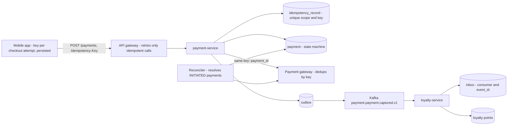
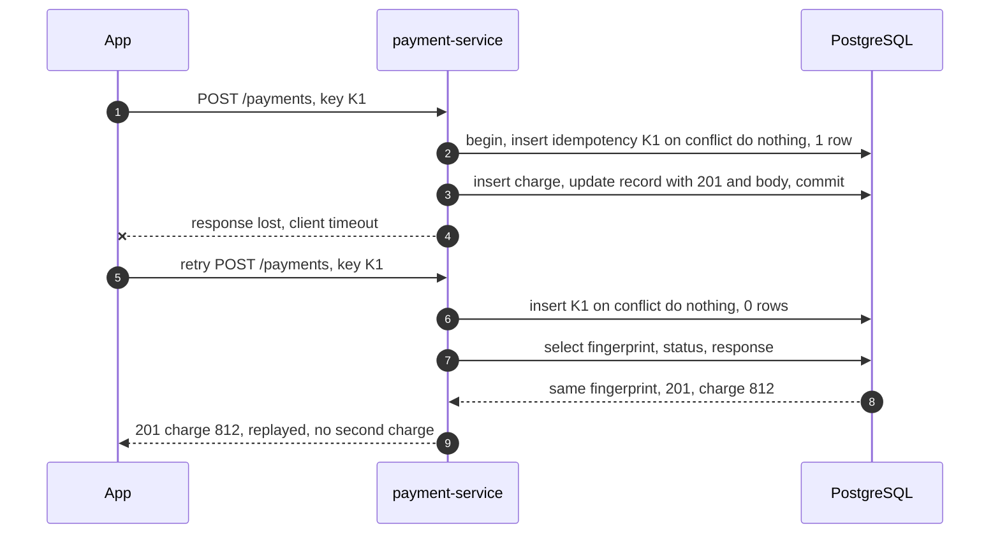
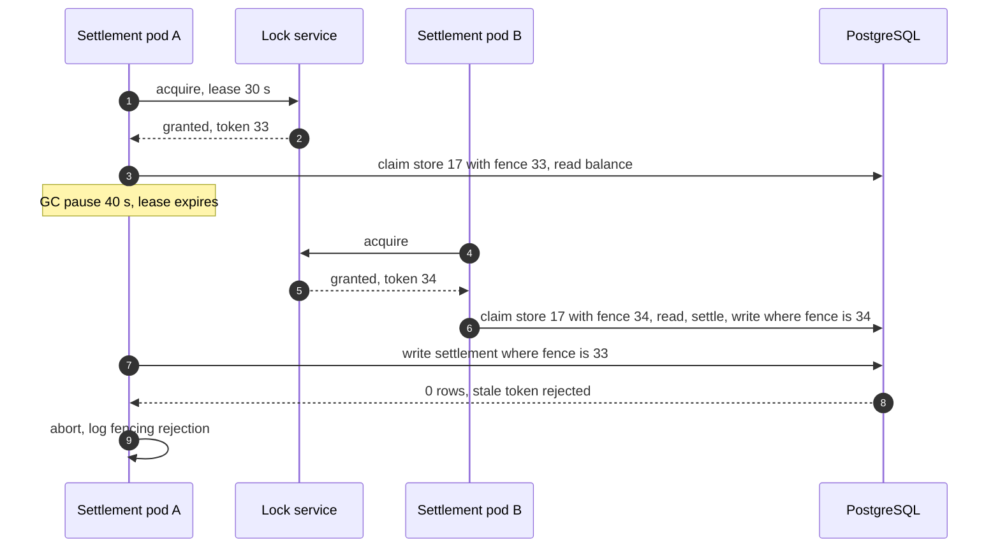
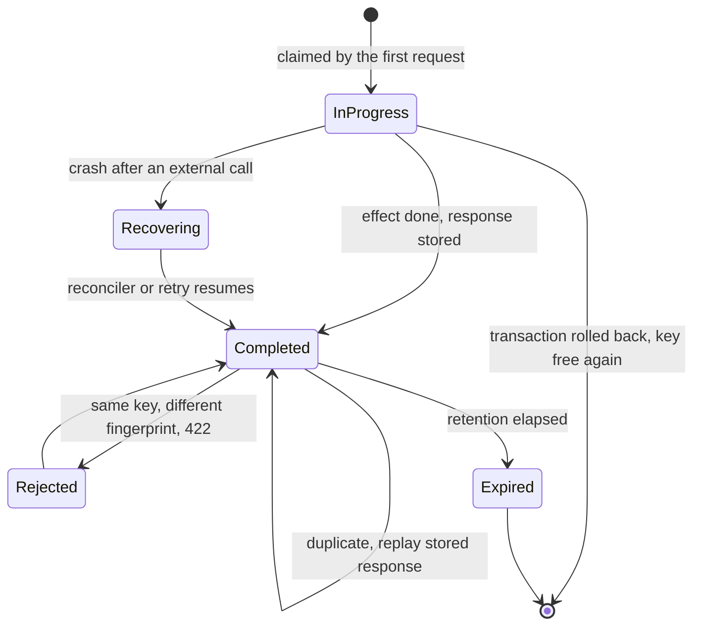

# 20. Idempotency, IDs & Distributed Locks

!!! abstract "Chapter at a glance"
    **Reader bands:** B1 → B4 · **Prerequisites:** [Ch 05](../01-foundations/05-relational-databases-deep-dive.md), [Ch 12](12-consistency-time-and-consensus.md), [Ch 13](13-distributed-transactions.md), [Ch 14](14-messaging-and-event-streaming.md) · **What you will build:** The three building blocks that make "at least once" safe on the grocery platform. All four labs run on **real PostgreSQL 16 and Redis 7**.

    - **L1: an idempotent payment API** over real HTTP. With lost responses and double-clicks, a naive API charged **425 of 1,000 orders more than once**, check-then-act charged **77**, and an atomic idempotency record charged **0**. Reusing a key with a different amount is rejected with 422.
    - **L2: idempotent consumers** with crashes and redelivery. The naive consumer over-awarded **38,642 loyalty points**. A "dedup in Redis, then write to the DB" consumer silently **lost 159**. An inbox table in the same transaction was exact.
    - **L3: ID schemes** over 4 million rows. Random UUIDv4 keys took **2.3x longer to insert and wrote 2.2x more WAL** than UUIDv7 or Snowflake. The lab also covers Snowflake duplicates from a reused worker id or a clock step back, and the birthday bound for short order codes.
    - **L4: distributed locks** under stop-the-world pauses. A Redis TTL lock lost **424 of 1,200** updates even with a correct release. Fencing tokens, a PostgreSQL advisory lock and a lock-free CAS lost **0**. A scripted interleaving shows a fencing token checked only on the write is **not enough**.

    · **Reading time:** 110 min + code

---

## 1. Introduction & Why It Matters

### 1.1 A story: the Diwali double charges

On the first evening of the Diwali sale, customer support received 1,900 complaints in two hours: "charged twice for one order". The post-incident review found four problems that looked unrelated, and weren't.

1. **The app retried payments.** `payment-service` p99 rose to 4 s under load, and the mobile app's HTTP client timed out at 3 s and retried the `POST /payments`. The first request had already charged the card. The payments API had an `Idempotency-Key` header, but the implementation looked the key up in Redis *before* charging and stored it *after*. Two requests arriving together (a retry racing the original, or a double-tap on "Pay") both found nothing and both charged. L1 reproduces it: **77 double charges per 1,000 orders** with check-then-act, **425 with no idempotency at all, and 0** when the key is claimed with a unique constraint in the same transaction as the charge.
2. **Loyalty points were awarded twice.** The consumer of `order.order.placed.v1` restarted during a deployment and re-read the last uncommitted batch of offsets. A "fix" from the previous quarter had added a Redis `SETNX processed:<eventId>` check. That fixed the duplicates, but it also meant a crash between the Redis write and the DB write **lost** points, and nobody noticed. L2: naive **+38,642** points, Redis marker **−159**, inbox table **exact**.
3. **The settlement job ran twice for store 17.** It used a Redis lock with a 30 s TTL. A 40 s GC pause (a heap dump on OOM) let a second pod take the lock. The first pod woke up and finished its settlement, and the payout was doubled. L4 shows why a TTL lock alone can't prevent this, and how fencing tokens or a database-held lock do.
4. **The orders table got slower every week.** It used random UUIDv4 primary keys, and once the index outgrew memory, every insert touched a random index page. L3: **25.3 s vs 10.8 s** for 4 million inserts, and **1.5 GB vs 0.7 GB** of WAL.

The fixes:

- An **idempotency record claimed atomically** with the business effect.
- An **inbox table** in the consumer's database transaction.
- **Fencing tokens** checked by the database, or better, no lock at all where a conditional update suffices.
- **Time-ordered IDs** (UUIDv7 / Snowflake) for new tables.

!!! quote "The thesis of this chapter"
    In a distributed system every message and every request can arrive **zero, one or many times**, and you can't tell a slow reply from a lost one. "Exactly once" is a myth at the transport level. It exists only as **at-least-once delivery + an idempotent effect**, and the idempotency must be enforced **by the system of record, atomically with the effect**. The same principle makes locks safe: the resource must reject stale holders (fencing), because the holder can't know it has been paused.

### 1.2 Where this lives in the grocery platform

| Service | Mechanism | Why |
|---|---|---|
| `payment-service` `POST /payments` | Idempotency key (client-generated, per checkout attempt), claimed with the effect; same key passed to the payment gateway | Timeouts and retries must not double-charge |
| `order-service` `POST /orders` | Idempotency key + unique `(customer_id, cart_version)` | Double-tap on "Place order" |
| All Kafka consumers | Inbox table `(consumer, event_id)` in the same transaction as the effect | Redelivery after rebalance/crash (Ch 14) |
| Kafka producers | `enable.idempotence=true` (PID + sequence numbers) | Producer retries without broker-side duplicates |
| `inventory-service` stock updates | Conditional update `where version = ?` or `where available >= ?` | No lock needed |
| Settlement, reconciliation, bucket mover | Leader lease in etcd with a fencing token checked by PostgreSQL (Ch 12), or an advisory lock | Exactly one runner, safe against pauses |
| Scheduled jobs in small services | ShedLock (DB-backed) + idempotent job body | Cheap, and duplicates are harmless |
| Primary keys | UUIDv7 (new tables), `bigint identity` inside one database, Snowflake for high-volume event ids | Index locality, sortability, no coordination |
| Customer-facing order numbers | Store-prefixed human code with a uniqueness constraint, separate from the PK | Readable, not enumerable, collision-safe |

### 1.3 Learning objectives

| Band | After this chapter you can… |
|---|---|
| <span class="band b1">B1</span> | Explain idempotency and why retries need it, and name the ID options and their trade-offs |
| <span class="band b2">B2</span> | Implement an idempotency-key API and an idempotent consumer with PostgreSQL, choose an ID scheme, and use a Redis lock correctly |
| <span class="band b3">B3</span> | Handle concurrent duplicates, key reuse and external side effects; design Snowflake worker-id assignment and clock handling; apply fencing tokens |
| <span class="band b4">B4</span> | Decide when a lock is needed at all, and set platform-wide standards for idempotency, IDs and coordination |

---

## 2. Core Concepts — Beginner to Deep

### 2.1 Intuition <span class="band b1">B1</span>

- **Idempotency is the lift button.** Pressing it five times calls the lift once. "Add ₹100 to the wallet" pressed twice adds ₹200. "Set this top-up request's status to PAID" pressed twice is still PAID. The trick is to turn the second kind of operation into the third kind, by giving each request a name (an idempotency key) and remembering which names have been processed.
- **IDs are token numbers at a bakery.** One machine hands out numbers: simple and ordered, but everyone queues at one machine (a DB sequence). Or every counter prints its own numbers: counter 3's next number is 3-0457 (Snowflake: time + worker + sequence). Or everyone picks a random 10-digit number: no coordination, but no order, and short numbers collide sooner than you think (UUIDv4, the birthday paradox).
- **A lock with a TTL is a parking ticket.** It's valid for two hours. If you fall asleep in the car and wake up after three, someone else has legally been given your spot, and you don't know it. Unless the parking attendant checks the ticket's serial number before you drive off (a fencing token), you both believe the spot is yours.

### 2.2 Idempotency: definitions ⭐ <span class="band b1">B1</span>

An operation is **idempotent** if performing it many times has the same effect as performing it once: `f(f(x)) = f(x)`.

| Operation | Idempotent? | Make it idempotent by… |
|---|---|---|
| `GET /orders/42` | Yes (safe, no effect) | — |
| `PUT /orders/42/address` (full replacement) | Yes | — |
| `DELETE /carts/7/items/3` | Yes (the second call is a no-op; it may return 404, but the state is the same) | — |
| `POST /payments` | **No** | Idempotency key |
| `UPDATE stock SET available = available - 2` | **No** | Condition on a version, or an inbox/dedup table |
| `UPDATE order SET status = 'PACKED' WHERE status = 'PICKED'` | Yes (a conditional transition) | — |
| `INSERT INTO charge ...` | **No** | Unique constraint on a natural or idempotency key |

HTTP semantics (RFC 9110): GET, HEAD, PUT, DELETE and OPTIONS are defined as idempotent, and POST and PATCH are not. Clients, proxies and gateways may **automatically retry idempotent methods**, so a PUT that isn't really idempotent is a bug waiting for a retry.

**Why retries are unavoidable:** a timeout doesn't tell you whether the request was processed (Ch 17 §2.4). The client must retry to get an answer, and the server must tolerate the duplicate. L1: with 30 % of responses lost, the naive API created **1,657 charges for 1,000 orders**.

### 2.3 The idempotency-key pattern ⭐ <span class="band b2">B2</span>

The client generates a unique key per **logical operation** (one checkout attempt, not one HTTP attempt) and sends it as a header (`Idempotency-Key`, standardised in an IETF HTTPAPI draft and used by Stripe and Razorpay-style APIs). The server keeps a record per key:

```sql
create table idempotency_record (
  scope        text not null,          -- e.g. customer id or API client id
  key          text not null,
  fingerprint  text not null,          -- hash of the request's significant fields
  status       text not null,          -- IN_PROGRESS | COMPLETED
  status_code  int,
  response     jsonb,
  created_at   timestamptz not null default now(),
  primary key (scope, key)
);
```

**The protocol:**

1. **Claim atomically:** `insert … on conflict do nothing`. Only one request can insert the row.
2. **If the claim succeeded:** perform the effect and store the response. For effects in the same database, **do it in the same transaction as the claim** (L1 "atomic"). Then a crash rolls back both, and a concurrent duplicate blocks on the unique index until the first commits, then sees the stored response.
3. **If the key already exists:**
    - Different fingerprint → **422** (the key was reused for a different request; L1 shows this).
    - `COMPLETED` → **replay the stored status and body**.
    - `IN_PROGRESS` (possible when the claim and the effect aren't in one transaction) → **409 Conflict** with `Retry-After`.
4. **Expire** records after a retention period longer than any client's retry window (24 h to 7 days). Clients must not reuse keys after that.

**Why check-then-act fails:** `SELECT` finds nothing, then `INSERT`. Two concurrent requests both pass the check. L1: **77 of 100 double-clicks** still double-charged. Only a **unique constraint** (or an atomic `SET NX`, if the whole effect lives in the same store) closes the race.

**The client's side:**

- Generate the key before the first attempt, persist it with the pending operation (so an app restart reuses it), and reuse it on every retry.
- If all retries fail, the outcome is **unknown**, not failed. L1's atomic run had 12 clients give up, but all 1,000 orders were charged exactly once. The app must show "payment pending" and query status later with the same key, never create a new payment.

### 2.4 Idempotency with external side effects ⭐ <span class="band b3">B3</span>

When the effect is a call to another system (the payment gateway, an SMS provider), it can't share your database transaction. The pattern is a **state machine with recovery points** (Stripe's "atomic phases"):

1. **Transaction 1:** claim the key, create `payment(status=INITIATED)`, and commit.
2. **Call the gateway, passing a deterministic idempotency key** (for example, `payment_id`), so the gateway deduplicates your retries.
3. **Transaction 2:** record the gateway's result, set `status=CAPTURED` / `FAILED`, store the response on the idempotency record, and commit.
4. **A retry** finds the record `IN_PROGRESS` with `payment.status=INITIATED`. It either resumes from step 2 (safe because the gateway deduplicates by key), or returns 409 while a background **reconciler** resolves stuck `INITIATED` payments by querying the gateway.

Rule: **every hop must be idempotent under the same logical key**, or the chain isn't. When a downstream API has no idempotency support, you need query-before-retry ("did payment X happen?") and reconciliation (Ch 13 §2.7, Ch 45).

### 2.5 Idempotent consumers: the inbox ⭐ <span class="band b2">B2</span>

Kafka, SQS, RabbitMQ and NATS JetStream all deliver **at least once** to consumers (Ch 14). Duplicates come from:

- **Producer retries.** L2's log had 97 duplicates. Kafka's idempotent producer removes duplicates caused by broker-level retries, but not an application that publishes twice.
- **Redelivery after a crash or rebalance,** when processing succeeded but the offset commit didn't. L2 had 9–15 crashes with commits every 100 messages.
- **Replays and reprocessing** (resetting offsets).

The consumer must make its effect idempotent. The options, from strongest:

| Approach | How | L2 result |
|---|---|---|
| **Inbox table in the same transaction** | `insert into inbox(consumer, event_id) on conflict do nothing`; apply the effect only if inserted; commit both | Exact |
| **Naturally idempotent effect** | `set status = 'PAID' where order_id = ? and status <> 'PAID'`; upserts keyed by event id; version checks | Exact, when the effect allows it |
| **Store the offset with the effect** | Save the partition offset in the same DB transaction and seek to it on start (Kafka's "exactly-once to an external store") | Exact |
| Dedup marker in another store (Redis) | `SETNX processed:id`, then write to the DB | **Lost 159 points**: crash between the two |
| Nothing | Apply every delivery | **+38,642 points** |

**Retention:** keep inbox rows longer than the maximum redelivery horizon (topic retention, if replays are possible), or partition the inbox by day and drop old partitions.

**Kafka exactly-once (EOS):** transactions + `read_committed` give exactly-once **within Kafka** (consume → produce). Once an external database is involved, you're back to inbox/offset-in-DB (Ch 14 §2.8).

### 2.6 Identifiers: requirements <span class="band b2">B2</span>

What an ID scheme must provide, and it's rarely all of these:

| Property | Why it matters |
|---|---|
| **Uniqueness** without coordination | Many services, regions and offline clients generate IDs |
| **Sortability by time** | B-tree index locality, pagination by id, "roughly when was this created" |
| **Size** | 8-byte `bigint` vs 16-byte UUID. Every secondary index and foreign key carries it |
| **Non-enumerability** | Public IDs must not let a customer guess other orders (IDOR, Ch 23) |
| **Human-friendliness** | Order numbers are read out over the phone to support |
| **No leakage** | Sequential IDs reveal business volume ("order 1,000,457 today, 1,020,112 tomorrow") |

### 2.7 The ID schemes ⭐ <span class="band b2">B2</span>

| Scheme | Bits | Ordered | Coordination | Notes |
|---|---|---|---|---|
| **DB sequence / identity** | 64 | Yes (per DB) | The database | Simplest and smallest. Doesn't work across shards unless you use ranges/steps. Hi-lo or pooled allocation cuts round-trips. Enumerable |
| **UUIDv4** | 128 (122 random) | No | None | Random inserts into B-trees: L3 **25.3 s vs 10.8 s**, **1.5 GB vs 0.7 GB WAL** once the index outgrows memory |
| **UUIDv7** (RFC 9562, 2024) | 128 (48-bit ms time + 74 random/counter) | Yes (ms, plus a monotonic counter within a generator) | None | The best default for new distributed tables. PostgreSQL 18 has `uuidv7()`. On PG16/17 and the JVM, generate it in the application (L3 has 10 lines) or with a library |
| **ULID** | 128 (48-bit time + 80 random) | Yes | None | Same idea as v7, Crockford base32 text form. Prefer v7 for UUID-typed columns |
| **Snowflake** (Twitter) | 64: 41-bit ms + 10-bit worker + 12-bit sequence | Yes (roughly, per ms) | **Worker ids must be unique** | 4,096 ids per ms per worker, ~69 years from a custom epoch. L3: a reused worker id gave **198,751 duplicates in 1M**, and a clock stepping back 5 ms gave **10,000 duplicates** unless guarded |
| **Random short codes** | 30–60 | No | Uniqueness check | Birthday bound: first collision after ~√(π/2 · 2^bits). L3: **~41K codes for 30 bits**, ~1.3M for 40 bits |

L3's surprise, with 8 concurrent writers:

- **Time-ordered keys (Snowflake, UUIDv7) had only ~61 % leaf density**, below random UUIDv4's 71 %. Concurrent batches interleave just behind the right edge of the index, and PostgreSQL splits those pages 50/50.
- The inserts are still fast, because the working set is the hot right edge.
- With a single writer (negative control), all ordered schemes had 90 % density.
- A DB-assigned identity (assigned at insert time, so strictly increasing) had 91 % either way.

### 2.8 Snowflake in practice <span class="band b3">B3</span>

- **Worker-id assignment** is the hard part. The options:
    - The Kubernetes StatefulSet ordinal.
    - A lease in etcd/ZooKeeper, where the worker id is held as long as the lease (Ch 12).
    - A DB table with `worker_id` rows claimed via `for update skip locked` plus a heartbeat.
    - A random id with collision detection.

    Never use "hash of the hostname": two pods can collide. L3: two pods with the same worker id collided on **20–39 %** of ids (it varies by run).
- **Clock:**
    - Use the wall clock (IDs must be meaningful across restarts), guard against it going backwards (NTP steps), and never go below the last issued timestamp.
    - Small rollbacks: wait until the last ms (L3 guarded: 0 duplicates).
    - Large rollbacks: refuse and alert.
    - Persist the last timestamp across restarts if restarts can be faster than a rollback.
- **Sequence exhaustion:** past 4,096 ids in a ms, wait for the next ms. At a million ids per second per worker, add more workers.
- **Epoch and bits:** a custom epoch (2025-01-01) gives 69 years. Adjust the split (more worker bits vs sequence bits) to the topology.
- **Sortability** is per worker and to the millisecond. Across workers, ordering is only as good as clock sync (Ch 12). Don't use ID order as event order for correctness.

### 2.9 Order numbers customers see <span class="band b3">B3</span>

Keep the **internal primary key** (UUIDv7/bigint) separate from the **public reference**:

- **The format:** readable, and meaningful to support. For example, `BLR17-250925-7KQ4M`: store code, date, 5 base32 chars (25 bits) random, **with a unique constraint** and a retry on conflict. Per store per day, 25 bits (33M values) hits its first collision around ~7K orders, which the retry handles cheaply.
- **Not enumerable:** don't expose sequential IDs in URLs. Authorization checks are still required (Ch 23), because obscurity is only defence in depth.
- **Check digit (Luhn/Damm)** when codes are typed by hand.

### 2.10 Distributed locks: what they are for ⭐ <span class="band b3">B3</span>

Following Martin Kleppmann, a lock is used for either:

- **Efficiency:** avoid doing the same work twice (two pods sending the same daily report). An occasional duplicate is harmless, so a simple TTL lock is fine.
- **Correctness:** two holders at once corrupt data (a double settlement payout). Then **the lock alone can't be trusted**, because a holder can be paused (GC, VM steal, page faults, network delay) past its lease and not know it. You need **fencing**: every lease gets a monotonically increasing token, and **the resource rejects operations from tokens older than one it has seen**.

The implementations:

| Lock | Mechanism | Safety under pauses | Notes |
|---|---|---|---|
| Redis `SET key owner NX PX ttl` + owner-checked release (Lua) | TTL lease | **No** (L4: 424 of 1,200 updates lost) | Fine for efficiency. Release must check the owner (plain `DEL` deleted **307 other holders' locks** in L4) |
| Redlock (5 independent Redis nodes, majority) | TTL lease on a majority | No fencing token; depends on bounded clock drift and pauses | Contested (Kleppmann vs antirez). Not recommended for correctness |
| Redisson `RLock` | TTL lease + a watchdog that renews it | A long pause stops the watchdog too | Convenient; same caveat |
| etcd / ZooKeeper lease locks | Consensus-backed lease; **revision / zxid = fencing token** | **Yes, if the resource checks the token** | Ch 12 lab |
| PostgreSQL advisory lock / `SELECT … FOR UPDATE` | Held by the session/transaction, no TTL | **Yes, for data in that database** (L4: 0 lost) | Liveness depends on session timeouts (`idle_in_transaction_session_timeout`) |
| ShedLock (Spring scheduled jobs) | Row or key with `lock_until` | No fencing | Efficiency locks for jobs, with `lockAtMostFor` > job time |

### 2.11 Fencing tokens, done right ⭐ <span class="band b4">B4</span>

L4 found a subtlety. "Check the token on write" (`update … set value=?, fence=? where fence < :token`) isn't enough for **read-modify-write**:

1. Holder A (token 5) reads 0 and pauses.
2. The lease expires, and B (token 6) reads 0.
3. A wakes and writes 1. Its fence 5 is greater than the stored 4, so the write is accepted.
4. B writes 1 with fence 6, also accepted.

**One increment lost.** The random runs rarely hit this window. The scripted run in L4 hits it every time.

The fix: **claim the resource with the token before reading** (`update … set fence = :token where fence < :token returning value`), and make the write conditional on `fence = :token`. A's write is then rejected, and it retries with a new lease. More generally, the resource must see the token on **every** access within the critical section.

Even simpler: if the resource supports a **conditional write (CAS)**, you often don't need a lock at all. L4's `update … where value = :read` with retry lost 0 updates, and it was the fastest safe option (1.8 s vs 5–7 s for the locked variants).

### 2.12 The best lock is no lock <span class="band b4">B4</span>

Before reaching for a distributed lock, look for a design that doesn't need one:

- **Atomic statements:** `update stock set available = available - :n where sku = ? and available >= :n`.
- **Unique constraints:** at most one active reservation per `(order_id, sku)`.
- **Optimistic concurrency:** a version column (JPA `@Version`), ETags / `If-Match` in APIs (Ch 04).
- **Single writer per key:** partition by key so one consumer owns each store's settlement stream (Kafka partitioning, Ch 11/14), or an actor per aggregate.
- **Work queues:** `select … for update skip locked` hands each job to exactly one worker, inside the database that holds the job (Ch 13 outbox relay).
- **Leader election with fencing** for singleton jobs: a consensus-backed lease plus a token checked by the resource (Ch 12).

---

## 3. Architecture & Diagrams

### 3.1 Component view: idempotency across the payment path



### 3.2 Sequence: happy path, a retry after a lost response



### 3.3 Sequence: failure path, a paused lock holder and fencing



### 3.4 State: an idempotency record



---

## 4. Design Document Excerpt: Platform Standard for Idempotency, IDs and Locks

| Field | Value |
|---|---|
| Author / Reviewers | Platform team / payments, orders, loyalty, SRE, security |
| Status | Approved |
| Related ADRs | ADR-083 Idempotency keys on all non-idempotent public APIs; ADR-084 Inbox table for every consumer with side effects; ADR-085 UUIDv7 default PK, Snowflake for event ids; ADR-086 No correctness locks without fencing; prefer CAS/constraints; ADR-087 Public order references separate from PKs |

**1. Context & Problem.** The Diwali incident (§1.1): double charges from check-then-act idempotency, double and lost loyalty points, a double settlement from a TTL lock and a GC pause, and degrading insert performance from UUIDv4 keys.

**2. Goals / Non-Goals.**

- *Goals:* no duplicate effects from retries, redelivery or double submission; no lost effects; IDs that are unique without coordination, index-friendly and safe to expose; singleton jobs that are safe under pauses.
- *Non-goals:* exactly-once delivery at the transport level; global total order of IDs.

**3. Requirements.**

| ID | Requirement |
|---|---|
| FR-1 | Every public POST/PATCH that creates or moves money, stock or orders accepts `Idempotency-Key`; replays return the original status and body |
| FR-2 | Key reuse with a different request → 422; concurrent duplicate → wait-and-replay (same DB) or 409 + Retry-After |
| FR-3 | Every Kafka consumer with side effects records `(consumer, event_id)` in the same transaction as the effect |
| NFR-1 | 0 duplicate charges in the chaos test (30 % lost responses, 10 % double submits) |
| NFR-2 | Idempotency overhead ≤ 2 ms p99 per request |
| NFR-3 | Idempotency records retained 7 days; inbox rows retained ≥ topic retention |
| NFR-4 | Correctness locks must use fencing tokens verified by the resource; CI rule flags `SET NX` used for money-moving jobs |

**4. Capacity estimates.**

| Item | Calculation | Result |
|---|---|---|
| Idempotency records | 150 payments/s peak × 86,400 × 7 days (upper bound) | ≤ 90M rows/week; partition by day, drop old partitions |
| Record size | key 36 B + fingerprint 16 B + response ~300 B + overhead | ~0.5 KB → ≤ 45 GB/week at the peak rate, far less on average |
| Inbox (loyalty) | 30 events/s × 30 days | 78M rows, ~6 GB; daily partitions |
| Snowflake capacity | 4,096 per ms per worker | 4M ids/s per worker, ample |
| Order code collisions | 25 random bits per store per day, 3,000 orders/store/day | P(any collision) ≈ n²/2N ≈ 13 % per store-day, handled by a unique-constraint retry |

**5. Proposed design.**

1. **An `idempotency` Spring module:** a filter + annotation (`@Idempotent(scope = "customer")`) that claims the key in the service's own database (same transaction as the effect, via `TransactionTemplate`), fingerprints the canonical request, replays stored responses and returns 422/409. Daily partitions.
2. **External calls:** payment state machine + a deterministic downstream key (`payment_id`) + a reconciler job (every 1 min for `INITIATED` older than 2 min).
3. **An `inbox` module for consumers:** `@IdempotentConsumer` wraps the listener in a transaction with the inbox insert. Offsets are committed after the transaction.
4. **IDs:** the `ids` library provides UUIDv7 (application-side) and Snowflake, with worker ids leased from etcd (TTL 30 s, renewed) and clock-rollback guards. `bigint identity` stays allowed for tables private to one database.
5. **Coordination:** leader election in etcd with fencing tokens stored and checked in PostgreSQL (Ch 12) for settlement and reconciliation. PostgreSQL advisory locks for jobs local to one database. ShedLock only for efficiency jobs.

**7. Alternatives considered.**

| Option | Pros | Cons | Verdict |
|---|---|---|---|
| Idempotency in Redis (`SET NX`) | Fast, shared | Not atomic with the DB effect: duplicates or lost effects (L1/L2) | Rejected for money/stock |
| **Idempotency record in the service DB, same transaction** | Atomic, simple | DB load, retention management | **Chosen** |
| Gateway-level idempotency | One place | The gateway can't know if the effect happened; not atomic | Rejected (a cache of responses only) |
| UUIDv4 PKs | Simple, unguessable | Index/WAL cost at scale (L3) | Legacy only |
| **UUIDv7** | Ordered, no coordination | 16 bytes; timestamp leaks creation time | **Default** |
| Redlock for settlement | Uses existing Redis | No fencing, timing assumptions | Rejected |

**8. Failure modes.**

- Idempotency DB unavailable → the API fails closed (503). We never process without the record.
- Fingerprint canonicalisation bugs → false 422s, so it has contract tests.
- Worker-id lease lost → the generator stops issuing until it's re-leased.
- Clock step back > 1 s → the generator refuses and alerts.

**10. Observability.**

- Idempotency: replays/s by endpoint, 422s, 409s, and records stuck `IN_PROGRESS`.
- Inbox: duplicate rate per consumer.
- Fencing: rejections (each one is an averted incident).
- Snowflake: clock-rollback waits.
- Unknown-outcome payments pending reconciliation.

**14. Decision (ADR-083–087 summary).** Idempotency records atomically with the effect. Inbox for consumers. Downstream keys and reconciliation for external effects. UUIDv7 by default. Fencing or no lock for correctness. Public references separate from PKs.

---

## 5. Hands-On Code — Level Ladder

| Level | New requirement that forces the step |
|---|---|
| L1 | "Retries and double-taps must never double-charge." (idempotency keys, real HTTP + PostgreSQL) |
| L2 | "Consumers crash and messages repeat; points must be exact." (inbox, real PostgreSQL + Redis) |
| L3 | "Pick primary keys for 100M-row tables and IDs for events." (real PostgreSQL insert benchmark + generator properties) |
| L4 | "Only one settlement may run per store, even with GC pauses." (Redis locks, fencing, advisory locks, CAS) |

All four levels run against **real PostgreSQL 16** (`:5542`, database `shop`, started by `setup.sh`) and **real Redis 7** (`:6390`), with Java 21 and the pgjdbc driver. Machine: 2 vCPU container. The outputs below are verbatim. Lab files are in `labs/ch20-idempotency-ids-locks/`.

### L1 — An idempotent payment API <span class="band b2">B2</span>

**Requirement:** "Retries after timeouts and double-taps on *Pay* must never double-charge."

A real HTTP server (JDK `HttpServer`, virtual threads) exposes `POST /{strategy}/charges` backed by PostgreSQL. To simulate lost responses, **30 % of responses are delayed past the client's 250 ms timeout after the transaction committed**. The client retries up to 4 times with the **same** `Idempotency-Key`. **10 % of orders are double-clicked**: two concurrent requests with the same key. 1,000 orders per strategy.

- **naive:** insert a charge per request.
- **check-then-act:** `select` the key → charge → `insert` the key (no unique constraint, separate statements).
- **atomic:** `insert … on conflict do nothing` on the key's primary key, and the charge, **in one transaction**. A duplicate replays the stored status and body, and a different fingerprint gets 422.

```java title="IdempotencyL1.java"
// IdempotencyL1.java — run with: java -Duser.timezone=UTC -Dsun.net.httpserver.nodelay=true -cp /tmp/pgjdbc.jar IdempotencyL1.java
// A real HTTP "charge" API (JDK HttpServer, virtual threads) over real PostgreSQL (:5542, db shop).
// The client retries when a response is lost (30 % of responses arrive after the client's 250 ms timeout),
// and 10 % of customers double-click (two concurrent requests for the same payment).
// Three server strategies: naive, check-then-act, and an atomic idempotency record (unique key + effect in one transaction).
import com.sun.net.httpserver.*;
import java.io.*;
import java.net.*;
import java.net.http.*;
import java.nio.charset.StandardCharsets;
import java.security.MessageDigest;
import java.sql.*;
import java.time.Duration;
import java.util.*;
import java.util.concurrent.*;
import java.util.concurrent.atomic.*;

public class IdempotencyL1 {
    static final String URL = "jdbc:postgresql://localhost:5542/shop?user=postgres";
    static final BlockingQueue<Connection> POOL = new ArrayBlockingQueue<>(40);
    static final AtomicInteger mismatches = new AtomicInteger();

    // ---------- server ----------
    interface Strategy { int handle(String key, String orderId, long amount, StringBuilder body) throws Exception; }

    // 1. naive: every request is a new charge
    static final Strategy NAIVE = (key, orderId, amount, body) -> withConn(c -> {
        try (var ps = c.prepareStatement("insert into charge(order_id, amount) values (?, ?) returning id")) {
            ps.setString(1, orderId); ps.setLong(2, amount);
            var rs = ps.executeQuery(); rs.next(); body.append("charge ").append(rs.getLong(1)); return 201;
        }
    });

    // 2. check-then-act: look for the key, charge, then remember the key (no unique constraint, separate statements)
    static final Strategy CHECK_THEN_ACT = (key, orderId, amount, body) -> withConn(c -> {
        try (var q = c.prepareStatement("select response from idem_loose where key = ?")) {
            q.setString(1, key); var rs = q.executeQuery();
            if (rs.next()) { body.append(rs.getString(1)); return 200; }
        }
        long id;
        try (var ps = c.prepareStatement("insert into charge(order_id, amount) values (?, ?) returning id")) {
            ps.setString(1, orderId); ps.setLong(2, amount); var rs = ps.executeQuery(); rs.next(); id = rs.getLong(1);
        }
        try (var ps = c.prepareStatement("insert into idem_loose(key, response) values (?, ?)")) {
            ps.setString(1, key); ps.setString(2, "charge " + id); ps.executeUpdate();
        }
        body.append("charge ").append(id); return 201;
    });

    // 3. atomic idempotency record: claim the key and create the charge in ONE transaction.
    //    A concurrent duplicate blocks on the unique index until the first commits, then reads the stored response.
    static final Strategy ATOMIC = (key, orderId, amount, body) -> withConn(c -> {
        String fp = fingerprint(orderId, amount);
        c.setAutoCommit(false);
        try {
            int claimed;
            try (var ps = c.prepareStatement("insert into idem(key, fingerprint) values (?, ?) on conflict (key) do nothing")) {
                ps.setString(1, key); ps.setString(2, fp); claimed = ps.executeUpdate();
            }
            if (claimed == 0) {                                                    // seen before: replay or reject
                try (var q = c.prepareStatement("select fingerprint, status_code, response from idem where key = ?")) {
                    q.setString(1, key); var rs = q.executeQuery(); rs.next();
                    c.commit();
                    if (!rs.getString(1).equals(fp)) { mismatches.incrementAndGet(); body.append("key reused with a different request"); return 422; }
                    body.append(rs.getString(3)); return rs.getInt(2);             // same status and body as the first time
                }
            }
            long id;
            try (var ps = c.prepareStatement("insert into charge(order_id, amount) values (?, ?) returning id")) {
                ps.setString(1, orderId); ps.setLong(2, amount); var rs = ps.executeQuery(); rs.next(); id = rs.getLong(1);
            }
            try (var ps = c.prepareStatement("update idem set status_code = 201, response = ? where key = ?")) {
                ps.setString(1, "charge " + id); ps.setString(2, key); ps.executeUpdate();
            }
            c.commit();
            body.append("charge ").append(id); return 201;
        } catch (Exception e) { c.rollback(); throw e; }
        finally { c.setAutoCommit(true); }
    });

    interface SqlWork<T> { T run(Connection c) throws Exception; }
    static <T> T withConn(SqlWork<T> w) throws Exception {
        Connection c = POOL.take();
        try { return w.run(c); } finally { POOL.put(c); }
    }

    static String fingerprint(String orderId, long amount) throws Exception {
        byte[] h = MessageDigest.getInstance("SHA-256").digest((orderId + "|" + amount).getBytes(StandardCharsets.UTF_8));
        return HexFormat.of().formatHex(h, 0, 8);
    }

    static HttpServer server(Map<String, Strategy> strategies) throws IOException {
        HttpServer s = HttpServer.create(new InetSocketAddress("localhost", 19401), 1000);
        for (var e : strategies.entrySet()) {
            Strategy st = e.getValue();
            s.createContext("/" + e.getKey() + "/charges", ex -> {
                try {
                    var p = new String(ex.getRequestBody().readAllBytes()).split(",");
                    String key = ex.getRequestHeaders().getFirst("Idempotency-Key");
                    var body = new StringBuilder();
                    int code = st.handle(key, p[0], Long.parseLong(p[1]), body);
                    if (ThreadLocalRandom.current().nextDouble() < 0.30) Thread.sleep(400);   // response "lost": arrives after the client gave up
                    byte[] b = body.toString().getBytes();
                    ex.sendResponseHeaders(code, b.length); ex.getResponseBody().write(b);
                } catch (Exception err) {
                    ex.sendResponseHeaders(500, -1);
                } finally { ex.close(); }
            });
        }
        s.setExecutor(Executors.newVirtualThreadPerTaskExecutor()); s.start(); return s;
    }

    // ---------- client ----------
    static final HttpClient HTTP = HttpClient.newBuilder().version(HttpClient.Version.HTTP_1_1)
            .executor(Executors.newVirtualThreadPerTaskExecutor()).build();

    /** Pays for one order: up to 4 attempts with the SAME idempotency key; returns the final status code (or -1). */
    static int pay(String strategy, String key, String orderId, long amount) throws Exception {
        for (int attempt = 1; attempt <= 4; attempt++) {
            var req = HttpRequest.newBuilder(URI.create("http://localhost:19401/" + strategy + "/charges"))
                    .timeout(Duration.ofMillis(250)).header("Idempotency-Key", key)
                    .POST(HttpRequest.BodyPublishers.ofString(orderId + "," + amount)).build();
            try {
                var resp = HTTP.send(req, HttpResponse.BodyHandlers.ofString());
                if (resp.statusCode() < 500) return resp.statusCode();
            } catch (HttpTimeoutException e) { /* lost response: retry */ }
            Thread.sleep(20L * attempt);
        }
        return -1;
    }

    static void reset() throws Exception {
        withConn(c -> {
            try (var st = c.createStatement()) {
                st.execute("drop table if exists charge, idem, idem_loose");
                st.execute("create table charge(id bigserial primary key, order_id text not null, amount bigint not null, created_at timestamptz default now())");
                st.execute("create table idem(key text primary key, fingerprint text not null, status_code int, response text, created_at timestamptz default now())");
                st.execute("create table idem_loose(key text, response text)");
            }
            return null;
        });
    }

    public static void main(String[] args) throws Exception {
        for (int i = 0; i < 40; i++) POOL.add(DriverManager.getConnection(URL));
        HttpServer srv = server(Map.of("naive", NAIVE, "check", CHECK_THEN_ACT, "atomic", ATOMIC));
        int orders = 1_000;
        System.out.println("1,000 orders paid over real HTTP + PostgreSQL; 30 % of responses lost (client retries, same key); 10 % double-clicked");
        System.out.printf("   %-22s %8s %9s %14s %13s %10s%n", "strategy", "charges", "extra", "orders charged", "client saw", "gave up");
        System.out.printf("   %-22s %8s %9s %14s %13s %10s%n", "", "created", "charges", "more than once", "success", "");
        for (String strategy : List.of("naive", "check", "atomic")) {
            reset();
            AtomicInteger ok = new AtomicInteger(), gaveUp = new AtomicInteger();
            try (var exec = Executors.newVirtualThreadPerTaskExecutor()) {
                Semaphore inFlight = new Semaphore(100);
                for (int i = 0; i < orders; i++) {
                    String orderId = "ord-" + i, key = UUID.randomUUID().toString();
                    int clicks = (i % 10 == 0) ? 2 : 1;                           // double-click: same key, concurrently
                    for (int k = 0; k < clicks; k++) {
                        inFlight.acquire();
                        exec.submit(() -> {
                            try { int code = pay(strategy, key, orderId, 49_900); if (code == 200 || code == 201) ok.incrementAndGet(); else if (code == -1) gaveUp.incrementAndGet(); }
                            catch (Exception e) { gaveUp.incrementAndGet(); }
                            finally { inFlight.release(); }
                            return null;
                        });
                    }
                }
            }
            Thread.sleep(500);                                                        // let "lost" responses finish
            long[] r = withConn(c -> {
                try (var st = c.createStatement()) {
                    var rs = st.executeQuery("select count(*), count(distinct order_id), (select count(*) from (select order_id from charge group by order_id having count(*) > 1) d) from charge");
                    rs.next(); return new long[]{rs.getLong(1), rs.getLong(2), rs.getLong(3)};
                }
            });
            String label = switch (strategy) { case "naive" -> "naive"; case "check" -> "check-then-act"; default -> "atomic idempotency key"; };
            System.out.printf("   %-22s %,8d %,9d %14d %,13d %10d%n", label, r[0], r[0] - r[1], r[2], ok.get(), gaveUp.get());
        }

        // Same key, different request: must be rejected, not replayed
        reset();
        String key = UUID.randomUUID().toString();
        int first = pay("atomic", key, "ord-x", 49_900), second = pay("atomic", key, "ord-x", 99_900);
        System.out.printf("key reuse with a different amount: first → %d, second → %d (%d mismatch)%n", first, second, mismatches.get());
        srv.stop(0);
        for (var c : POOL) c.close();
    }
}
```

```text title="java -Duser.timezone=UTC -Dsun.net.httpserver.nodelay=true -cp pgjdbc.jar IdempotencyL1.java"
1,000 orders paid over real HTTP + PostgreSQL; 30 % of responses lost (client retries, same key); 10 % double-clicked
   strategy                charges     extra orders charged    client saw    gave up
                           created   charges more than once       success           
   naive                     1,657       657            425         1,089         11
   check-then-act            1,077        77             77         1,091          9
   atomic idempotency key    1,000         0              0         1,088         12
key reuse with a different amount: first → 201, second → 422 (1 mismatch)
```

**Reading it:**

- **Naive:**
    - 1,657 charges for 1,000 orders, and 425 customers charged more than once.
    - Every lost response turned into a retry, and every retry into a charge.
- **Check-then-act:**
    - Handles sequential retries, because the key is there by the time the retry arrives.
    - Fails exactly on the concurrent case: **77 of the 100 double-clicks** charged twice, because both requests passed the `select` before either inserted.
    - This is the most common production implementation, and the one in §1.1.
- **Atomic:**
    - 1,000 charges and 0 duplicates.
    - The concurrent duplicate blocks on the unique index until the first transaction commits, then reads the stored response.
    - "Client saw success" is similar in all three runs, so **you can't detect double charges from the client side**. Only the ledger shows them.
- **"Gave up":** 9–12 clients exhausted their retries (0.3⁴ ≈ 0.8 % lost 4 times in a row). In the atomic run, those orders **were** charged exactly once. The client must treat this as *unknown* and check status with the same key, never retry with a new key.
- **Key reuse** with a different amount is rejected (422), not replayed. Replaying would tell the client that ₹999 was charged when ₹499 was.

### L2 — Idempotent consumers: naive vs Redis marker vs inbox <span class="band b2">B2</span>

**Requirement:** "The loyalty consumer must award exactly the right points, despite producer duplicates, crashes and redelivery."

A log of 5,097 `order.order.placed.v1` messages (2 % duplicated by a retrying producer) is consumed with offset commits every 100 messages. The consumer **crashes at random points** in its processing and restarts from the last committed offset, as a real Kafka consumer would after a crash or rebalance. Points are added to a real PostgreSQL table, and the Redis variant uses a real `SET NX EX` marker.

```java title="ConsumerL2.java"
// ConsumerL2.java — run with: java -Duser.timezone=UTC -cp /tmp/pgjdbc.jar ConsumerL2.java
// An at-least-once consumer of order.order.placed.v1 awards loyalty points in real PostgreSQL (:5542).
// The log contains producer-retry duplicates (2 %), offsets are committed every 100 messages, and the consumer
// crashes at random points (on average every 400 messages) and restarts from the last committed offset.
// Strategies: naive, "dedup in Redis, then write to the DB" (real Redis :6390), and an inbox table in the same transaction.
import java.io.*;
import java.net.Socket;
import java.nio.charset.StandardCharsets;
import java.sql.*;
import java.util.*;

public class ConsumerL2 {
    record Event(String eventId, int customer, long points) {}
    static class Crash extends RuntimeException {}

    static final Random RND = new Random(20);
    static int crashes;

    /** Crashes with probability p at this point of the processing. */
    static void maybeCrash(double p) { if (RND.nextDouble() < p) { crashes++; throw new Crash(); } }

    // ---- a tiny RESP client, enough for SET NX and FLUSHDB ----
    static class Redis implements Closeable {
        final Socket s; final OutputStream out; final BufferedReader in;
        Redis(int port) throws IOException { s = new Socket("localhost", port); out = s.getOutputStream(); in = new BufferedReader(new InputStreamReader(s.getInputStream(), StandardCharsets.UTF_8)); }
        String cmd(String... args) throws IOException {
            var sb = new StringBuilder("*").append(args.length).append("\r\n");
            for (String a : args) sb.append('$').append(a.getBytes(StandardCharsets.UTF_8).length).append("\r\n").append(a).append("\r\n");
            out.write(sb.toString().getBytes(StandardCharsets.UTF_8)); out.flush();
            String line = in.readLine();
            if (line.startsWith("$-1")) return null;
            if (line.startsWith("$")) return in.readLine();
            return line.substring(1);
        }
        public void close() throws IOException { s.close(); }
    }

    interface Handler { void handle(Connection c, Redis r, Event e) throws Exception; }

    // naive: apply the effect; duplicates and redeliveries are applied again
    static final Handler NAIVE = (c, r, e) -> {
        maybeCrash(0.0012);
        addPoints(c, e);
        maybeCrash(0.0012);
    };

    // dedup marker in Redis, effect in PostgreSQL: two systems, no shared transaction
    static final Handler REDIS_THEN_DB = (c, r, e) -> {
        maybeCrash(0.0008);
        String claimed = r.cmd("SET", "processed:" + e.eventId(), "1", "NX", "EX", "86400");
        if (claimed == null) return;                                   // seen before → skip
        maybeCrash(0.0008);                                            // crash here: marked processed, points never added
        addPoints(c, e);
        maybeCrash(0.0008);
    };

    // inbox: record the event id and apply the effect in ONE database transaction
    static final Handler INBOX = (c, r, e) -> {
        c.setAutoCommit(false);
        try {
            maybeCrash(0.0008);
            int inserted;
            try (var ps = c.prepareStatement("insert into inbox(consumer, event_id) values ('loyalty', ?) on conflict do nothing")) {
                ps.setString(1, e.eventId()); inserted = ps.executeUpdate();
            }
            if (inserted == 1) { maybeCrash(0.0008); addPoints(c, e); }
            maybeCrash(0.0008);
            c.commit();
        } catch (Exception ex) { c.rollback(); throw ex; }             // a crash mid-transaction = rollback
        finally { c.setAutoCommit(true); }
    };

    static void addPoints(Connection c, Event e) throws SQLException {
        try (var ps = c.prepareStatement("update loyalty set points = points + ? where customer = ?")) {
            ps.setLong(1, e.points()); ps.setInt(2, e.customer()); ps.executeUpdate();
        }
    }

    public static void main(String[] args) throws Exception {
        // The log: 5,000 orders, 2 % published twice by a retrying producer (same event id)
        List<Event> log = new ArrayList<>();
        Random gen = new Random(7);
        Map<Integer, Long> expected = new HashMap<>();
        for (int i = 0; i < 5_000; i++) {
            var e = new Event("evt-" + i, gen.nextInt(200), 10 + gen.nextInt(90));
            log.add(e); expected.merge(e.customer(), e.points(), Long::sum);
            if (gen.nextDouble() < 0.02) log.add(e);
        }
        long expectedTotal = expected.values().stream().mapToLong(Long::longValue).sum();
        System.out.printf("log: %,d messages (%,d orders + %,d producer duplicates), offsets committed every 100, random crashes%n",
                log.size(), 5_000, log.size() - 5_000);
        System.out.printf("   %-26s %8s %12s %12s %12s %10s%n", "strategy", "crashes", "points", "over-", "under-", "customers");
        System.out.printf("   %-26s %8s %12s %12s %12s %10s%n", "", "", "(expected " + expectedTotal / 1000 + "K)", "awarded", "awarded", "wrong");

        try (Connection c = DriverManager.getConnection("jdbc:postgresql://localhost:5542/shop?user=postgres");
             Redis r = new Redis(6390)) {
            for (var entry : List.of(Map.entry("naive", NAIVE), Map.entry("Redis marker, then DB", REDIS_THEN_DB), Map.entry("inbox in same transaction", INBOX))) {
                try (var st = c.createStatement()) {
                    st.execute("drop table if exists loyalty, inbox");
                    st.execute("create table loyalty(customer int primary key, points bigint not null default 0)");
                    st.execute("insert into loyalty(customer) select g from generate_series(0, 199) g");
                    st.execute("create table inbox(consumer text, event_id text, processed_at timestamptz default now(), primary key(consumer, event_id))");
                }
                r.cmd("FLUSHDB");
                crashes = 0;
                int committed = 0;                                                  // the consumer group's committed offset
                while (committed < log.size()) {
                    int offset = committed;                                         // (re)start from the committed offset
                    try {
                        while (offset < log.size()) {
                            entry.getValue().handle(c, r, log.get(offset));
                            offset++;
                            if (offset % 100 == 0 || offset == log.size()) committed = offset;   // offset commit
                        }
                    } catch (Crash crash) { /* process dies; a new one resumes from `committed` */ }
                }
                long total = 0, over = 0, under = 0; int wrong = 0;
                try (var st = c.createStatement(); var rs = st.executeQuery("select customer, points from loyalty")) {
                    while (rs.next()) {
                        long got = rs.getLong(2), exp = expected.getOrDefault(rs.getInt(1), 0L);
                        total += got; if (got > exp) over += got - exp; if (got < exp) under += exp - got; if (got != exp) wrong++;
                    }
                }
                System.out.printf("   %-26s %8d %,12d %,12d %,12d %10d%n", entry.getKey(), crashes, total, over, under, wrong);
            }
        }
    }
}
```

```text title="java -Duser.timezone=UTC -cp pgjdbc.jar ConsumerL2.java"
log: 5,097 messages (5,000 orders + 97 producer duplicates), offsets committed every 100, random crashes
   strategy                    crashes       points        over-       under-  customers
                                       (expected 269K)      awarded      awarded      wrong
   naive                            15      308,349       38,642            0        189
   Redis marker, then DB            10      269,548            0          159          3
   inbox in same transaction         9      269,707            0            0          0
```

**Reading it:**

- **Naive:** 189 of 200 customers got the wrong balance, with **+38,642 points** from redelivered batches (up to 99 messages per crash) and producer duplicates.
- **Redis marker, then DB:**
    - Duplicates are gone, but **159 points are silently lost**.
    - A crash after `SET NX` and before the DB update marks the event as processed without applying it, and the redelivery then skips it.
    - Two systems without a shared transaction can't be made atomic. This is the dual-write problem from Ch 13 in another form.
- **Inbox in the same transaction:** exact. The crash rolls back the inbox row and the points together, and the redelivery applies them once.

### L3 — ID schemes: index cost and generator properties <span class="band b3">B3</span>

**Requirement:** "Choose primary keys for tables that will reach hundreds of millions of rows, and IDs for events generated on many pods."

**Part A** inserts **4,000,000 orders** with 8 writer threads (batches of 1,000) under four primary-key schemes. It measures insert time, primary-key index size, leaf density (`pgstatindex`) and the **WAL generated**. PostgreSQL runs with `shared_buffers = 32MB` and `max_wal_size = 256MB`, so the index outgrows the buffer cache (as a production table's does at a much larger size) and checkpoints happen during the load. A single-writer run with 1M rows is the negative control.

**Part B** tests the generators:

- Snowflake uniqueness across threads and pods.
- Pods sharing a worker id.
- The clock stepping back 5 ms, unguarded vs guarded.
- Ordering of UUIDv4 vs a monotonic UUIDv7.
- The first collision of short random codes (20 trials each).

```java title="IdsL3.java"
// IdsL3.java — run with: java -Duser.timezone=UTC -cp /tmp/pgjdbc.jar IdsL3.java
// Part A: 2,000,000 order rows into real PostgreSQL 16 (:5542) with four primary-key schemes; measures insert time,
//         primary-key index size and leaf density (pgstattuple), and WAL written.
// Part B: properties of the generators: Snowflake uniqueness across threads, clock moving backwards, time ordering,
//         and how soon short random "order codes" collide.
import java.nio.ByteBuffer;
import java.security.SecureRandom;
import java.sql.*;
import java.util.*;
import java.util.concurrent.*;
import java.util.concurrent.atomic.*;
import java.util.function.LongSupplier;

public class IdsL3 {

    // ---------- generators ----------
    static final SecureRandom SR = new SecureRandom();

    /** UUIDv7 (RFC 9562): 48-bit Unix ms timestamp, version 7, 12-bit counter (monotonic within a ms, method 1), variant, 62 random bits. */
    static long v7LastMs = -1, v7Counter;
    static synchronized UUID uuidV7() {
        long ms = System.currentTimeMillis();
        if (ms > v7LastMs) { v7LastMs = ms; v7Counter = SR.nextInt(1 << 11); }       // random start, headroom to count up
        else if (++v7Counter > 0xFFF) { v7LastMs++; v7Counter = 0; }                  // counter full: borrow the next ms
        long hi = (v7LastMs << 16) | 0x7000L | v7Counter;
        long lo = (SR.nextLong() & 0x3FFFFFFFFFFFFFFFL) | 0x8000000000000000L;
        return new UUID(hi, lo);
    }

    /** Snowflake: 41 bits ms since a custom epoch | 10 bits worker id | 12 bits sequence. */
    static final class Snowflake {
        static final long EPOCH = 1_735_689_600_000L;                 // 2025-01-01T00:00:00Z
        final long worker; final LongSupplier clock; final boolean guardClock;
        long lastMs = -1, seq;
        Snowflake(long worker, LongSupplier clock, boolean guardClock) { this.worker = worker; this.clock = clock; this.guardClock = guardClock; }
        synchronized long next() {
            long ms = clock.getAsLong();
            if (ms < lastMs) {
                if (guardClock) { while ((ms = clock.getAsLong()) < lastMs) Thread.onSpinWait(); }   // wait out the rollback (or throw if large)
            }
            if (ms == lastMs) {
                seq = (seq + 1) & 0xFFF;
                if (seq == 0) { while ((ms = clock.getAsLong()) <= lastMs) Thread.onSpinWait(); }     // 4,096 ids used up in this ms
            } else seq = 0;
            lastMs = ms;
            return ((ms - EPOCH) << 22) | (worker << 12) | seq;
        }
    }

    // ---------- Part A ----------
    static void partA() throws Exception {
        try (Connection c = DriverManager.getConnection("jdbc:postgresql://localhost:5542/shop?user=postgres&reWriteBatchedInserts=true")) {
            try (var st = c.createStatement()) { st.execute("create extension if not exists pgstattuple"); }
            int rows = Integer.getInteger("rows", 2_000_000), W = Integer.getInteger("writers", 8);
            System.out.printf("A. %,d orders inserted in batches of 1,000 (writers: %d), PostgreSQL 16%n", rows, W);
            System.out.printf("   %-22s %9s %11s %13s %14s%n", "primary key", "insert", "pk index", "leaf density", "WAL written");
            Snowflake sf = new Snowflake(1, System::currentTimeMillis, true);
            for (String scheme : List.of("bigint sequence", "Snowflake bigint", "UUIDv7", "UUIDv4 (random)")) {
                String type = scheme.startsWith("UUID") ? "uuid" : "bigint";
                try (var st = c.createStatement()) {
                    st.execute("drop table if exists orders_ids");
                    st.execute("create table orders_ids(id " + type + (scheme.equals("bigint sequence") ? " generated always as identity" : "")
                            + " primary key, customer_id bigint not null, total_paise bigint not null, created_at timestamptz not null default now())");
                    st.execute("checkpoint");
                }
                long walStart = lsn(c);
                long t0 = System.nanoTime();
                try (var exec = Executors.newFixedThreadPool(W)) {
                    List<Future<?>> fs = new ArrayList<>();
                    for (int t = 0; t < W; t++) fs.add(exec.submit(() -> {
                        try (Connection w = DriverManager.getConnection("jdbc:postgresql://localhost:5542/shop?user=postgres&reWriteBatchedInserts=true")) {
                            w.setAutoCommit(false);
                            String sql = scheme.equals("bigint sequence")
                                    ? "insert into orders_ids(customer_id, total_paise) values (?, ?)"
                                    : "insert into orders_ids(id, customer_id, total_paise) values (?, ?, ?)";
                            try (var ps = w.prepareStatement(sql)) {
                                for (int i = 0; i < rows / W; i++) {
                                    int p = 1;
                                    switch (scheme) {
                                        case "Snowflake bigint" -> ps.setLong(p++, sf.next());
                                        case "UUIDv7" -> ps.setObject(p++, uuidV7());
                                        case "UUIDv4 (random)" -> ps.setObject(p++, UUID.randomUUID());
                                        default -> { }
                                    }
                                    ps.setLong(p++, ThreadLocalRandom.current().nextLong(1_000_000));
                                    ps.setLong(p, 10_000 + ThreadLocalRandom.current().nextLong(500_000));
                                    ps.addBatch();
                                    if (i % 1_000 == 999) { ps.executeBatch(); w.commit(); }
                                }
                                ps.executeBatch(); w.commit();
                            }
                        }
                        return null;
                    }));
                    for (var f : fs) f.get();
                }
                long ms = (System.nanoTime() - t0) / 1_000_000;
                long wal = lsn(c) - walStart;
                try (var st = c.createStatement();
                     var rs = st.executeQuery("select pg_relation_size('orders_ids_pkey'), (pgstatindex('orders_ids_pkey')).avg_leaf_density")) {
                    rs.next();
                    System.out.printf("   %-22s %,7d ms %,8d MB %12.0f %% %,11d MB%n", scheme, ms, rs.getLong(1) >> 20, rs.getDouble(2), wal >> 20);
                }
            }
        }
    }

    static long lsn(Connection c) throws SQLException {
        try (var st = c.createStatement(); var rs = st.executeQuery("select pg_current_wal_lsn() - '0/0'::pg_lsn")) { rs.next(); return rs.getLong(1); }
    }

    // ---------- Part B ----------
    static void partB() throws Exception {
        System.out.println("B. Generator properties");
        // B1: Snowflake from 8 threads, one generator per worker id vs a shared worker id on two "pods"
        Set<Long> ids = ConcurrentHashMap.newKeySet();
        AtomicLong dups = new AtomicLong();
        Snowflake[] pods = { new Snowflake(1, System::currentTimeMillis, true), new Snowflake(2, System::currentTimeMillis, true) };
        long t0 = System.nanoTime();
        try (var exec = Executors.newFixedThreadPool(8)) {
            for (int t = 0; t < 8; t++) { int tt = t; exec.submit(() -> { for (int i = 0; i < 250_000; i++) if (!ids.add(pods[tt % 2].next())) dups.incrementAndGet(); }); }
        }
        double perSec = 2_000_000 / ((System.nanoTime() - t0) / 1e9);
        System.out.printf("   Snowflake, 2 pods with distinct worker ids, 8 threads: %,d ids, %d duplicates, %,.0f ids/s%n", ids.size(), dups.get(), perSec);

        ids.clear(); dups.set(0);
        Snowflake[] sameId = { new Snowflake(7, System::currentTimeMillis, true), new Snowflake(7, System::currentTimeMillis, true) };
        try (var exec = Executors.newFixedThreadPool(2)) {
            for (int t = 0; t < 2; t++) { int tt = t; exec.submit(() -> { for (int i = 0; i < 500_000; i++) if (!ids.add(sameId[tt].next())) dups.incrementAndGet(); }); }
        }
        System.out.printf("   Snowflake, 2 pods given the SAME worker id:          %,d ids, %,d duplicates%n", ids.size() + dups.get(), dups.get());

        // B2: clock moves back 5 ms (NTP step) while generating
        for (boolean guard : List.of(false, true)) {
            AtomicLong fakeNow = new AtomicLong(Snowflake.EPOCH + 1_000_000);
            Snowflake g = new Snowflake(3, fakeNow::get, guard);
            Set<Long> seen = new HashSet<>(); int dup = 0;
            for (int i = 0; i < 40_000; i++) {
                if (i % 2_000 == 1_999) fakeNow.addAndGet(1);                             // time advances 1 ms per 2,000 ids
                if (i == 20_000) {                                                        // NTP steps the clock back 5 ms
                    fakeNow.addAndGet(-5);
                    if (guard) { long target = fakeNow.get() + 5; new Thread(() -> { sleep(20); fakeNow.set(target); }).start(); }
                }
                if (!seen.add(g.next())) dup++;
            }
            System.out.printf("   Snowflake, clock stepped back 5 ms, %s: %,d duplicates%n", guard ? "guarded (wait until last ms)" : "unguarded                   ", dup);
        }

        // B3: ordering: fraction of consecutive ids (generated 1 µs apart) that sort in creation order
        List<UUID> v4 = new ArrayList<>(), v7 = new ArrayList<>();
        for (int i = 0; i < 100_000; i++) { v4.add(UUID.randomUUID()); v7.add(uuidV7()); if (i % 100 == 0) sleep(0); }
        System.out.printf("   sorted in creation order (consecutive pairs): UUIDv4 %.0f %%, UUIDv7 (monotonic counter) %.0f %%%n",
                orderedPct(v4), orderedPct(v7));

        // B4: short random public order codes: when does the first collision happen?
        for (int bits : List.of(30, 40)) {
            int trials = 20; long sum = 0;
            for (int t = 0; t < trials; t++) {
                Set<Long> s = new HashSet<>(); long n = 0;
                while (s.add(SR.nextLong() & ((1L << bits) - 1))) n++;
                sum += n;
            }
            System.out.printf("   random %d-bit order code (%d base32 chars): first collision after %,d codes on average (√(π/2·2^%d) ≈ %,.0f)%n",
                    bits, bits / 5, sum / trials, bits, Math.sqrt(Math.PI / 2 * Math.pow(2, bits)));
        }
    }

    static double orderedPct(List<UUID> l) {
        int ok = 0;
        for (int i = 1; i < l.size(); i++) if (compareUnsigned(l.get(i - 1), l.get(i)) < 0) ok++;
        return 100.0 * ok / (l.size() - 1);
    }
    static int compareUnsigned(UUID a, UUID b) {         // byte order, as PostgreSQL compares uuid
        int c = Long.compareUnsigned(a.getMostSignificantBits(), b.getMostSignificantBits());
        return c != 0 ? c : Long.compareUnsigned(a.getLeastSignificantBits(), b.getLeastSignificantBits());
    }
    static void sleep(long ms) { try { Thread.sleep(ms); } catch (InterruptedException e) { throw new RuntimeException(e); } }

    public static void main(String[] args) throws Exception {
        if (args.length == 0 || args[0].equals("A")) partA();
        if (args.length == 0 || args[0].equals("B")) partB();
    }
}
```

```text title="java -Drows=4000000 -Duser.timezone=UTC -cp pgjdbc.jar IdsL3.java"
A. 4,000,000 orders inserted in batches of 1,000 (writers: 8), PostgreSQL 16
   primary key               insert    pk index  leaf density    WAL written
   bigint sequence         11,208 ms       85 MB           91 %         601 MB
   Snowflake bigint         9,862 ms      126 MB           61 %         622 MB
   UUIDv7                  10,821 ms      177 MB           61 %         705 MB
   UUIDv4 (random)         25,344 ms      153 MB           71 %       1,514 MB
B. Generator properties
   Snowflake, 2 pods with distinct worker ids, 8 threads: 2,000,000 ids, 0 duplicates, 801,825 ids/s
   Snowflake, 2 pods given the SAME worker id:          1,000,000 ids, 198,751 duplicates
   Snowflake, clock stepped back 5 ms, unguarded                   : 10,000 duplicates
   Snowflake, clock stepped back 5 ms, guarded (wait until last ms): 0 duplicates
   sorted in creation order (consecutive pairs): UUIDv4 50 %, UUIDv7 (monotonic counter) 100 %
   random 30-bit order code (6 base32 chars): first collision after 55,081 codes on average (√(π/2·2^30) ≈ 41,069)
   random 40-bit order code (8 base32 chars): first collision after 1,663,342 codes on average (√(π/2·2^40) ≈ 1,314,195)
```

```text title="negative control: java -Drows=1000000 -Dwriters=1 … IdsL3.java A"
A. 1,000,000 orders inserted in batches of 1,000 (writers: 1), PostgreSQL 16
   primary key               insert    pk index  leaf density    WAL written
   bigint sequence          4,446 ms       21 MB           90 %         150 MB
   Snowflake bigint         4,312 ms       21 MB           90 %         147 MB
   UUIDv7                   4,109 ms       30 MB           90 %         163 MB
   UUIDv4 (random)          7,226 ms       37 MB           72 %         196 MB
```

**Reading it:**

- **UUIDv4 is 2.3x slower to insert than UUIDv7 and writes 2.2x the WAL** (1,514 MB vs 705 MB).
    - Every insert lands on a random leaf page. Once the index doesn't fit in memory, pages are read back in, and after each checkpoint the first change to each page writes a **full-page image** to WAL. With random keys, that's nearly every page.
    - More WAL also means more replication traffic and bigger backups (Ch 10, Ch 27).
- **Ordered keys only touch the right edge** of the index, which stays in memory.
- **Leaf density surprise:**
    - With 8 concurrent writers, Snowflake and UUIDv7 indexes are *less* dense (61 %) than UUIDv4 (71 %).
    - Application-generated ordered keys arrive slightly out of order from concurrent batches, so pages just left of the edge get 50/50 splits.
    - The single-writer control shows 90 % for all ordered schemes.
    - A DB-assigned identity, assigned at insert time, stays at 91 % either way.
    - Bigger index, faster inserts: know which one you're optimising.
- **Snowflake:**
    - Unique across 8 threads and 2 pods at ~0.8–1.2M ids/s.
    - With a **shared worker id**, 20 % of ids collided. With an **unguarded 5 ms clock step back**, 10,000 duplicates (5 ms × 2,000 ids/ms). With the guard, 0.
- **Ordering:** UUIDv4 is sorted 50 % of the time (random). A monotonic v7 generator is 100 %.
- **Short codes collide early:**
    - 6 base32 characters (30 bits) collide after ~41–55K codes. The theory says √(π/2·2³⁰) ≈ 41K, and the 20-trial average is noisy.
    - Random public codes always need a unique constraint and a retry.

### L4 — Distributed locks under pauses: TTL, fencing, advisory locks, CAS <span class="band b4">B4</span>

**Requirement:** "Store 17's settlement must be updated by one worker at a time, even when a worker is paused longer than its lock."

8 workers each perform 150 read-modify-write increments of a PostgreSQL row (1,200 expected). Redis locks have a **100 ms TTL**, and **3 % of critical sections pause 150 ms** between the read and the write. The last lines are a **scripted interleaving** that random pauses rarely produce, plus a lock without a TTL whose holder crashes.

```java title="LocksL4.java"
// LocksL4.java — run with: java -Duser.timezone=UTC -cp /tmp/pgjdbc.jar LocksL4.java
// 8 workers each add 1 to a store's settlement counter 150 times with a read-modify-write on real PostgreSQL (:5542),
// guarded by different locks. Redis (:6390) locks have a 100 ms TTL, and 3 % of critical sections suffer a 150 ms
// "stop-the-world pause" (GC, VM steal) between the read and the write: longer than the TTL.
import java.io.*;
import java.net.Socket;
import java.nio.charset.StandardCharsets;
import java.sql.*;
import java.util.*;
import java.util.concurrent.*;
import java.util.concurrent.atomic.*;

public class LocksL4 {
    static final String PG = "jdbc:postgresql://localhost:5542/shop?user=postgres";
    static final int WORKERS = 8, INCREMENTS = 150, TTL_MS = 100, PAUSE_MS = 150;
    static final double PAUSE_P = 0.03;

    static final AtomicInteger foreignDeletes = new AtomicInteger(), staleRejected = new AtomicInteger(), overlaps = new AtomicInteger();
    static final AtomicInteger holders = new AtomicInteger();

    // ---- minimal RESP client ----
    static class Redis implements Closeable {
        final Socket s; final OutputStream out; final BufferedReader in;
        Redis() throws IOException { s = new Socket("localhost", 6390); s.setTcpNoDelay(true); out = s.getOutputStream(); in = new BufferedReader(new InputStreamReader(s.getInputStream(), StandardCharsets.UTF_8)); }
        String cmd(String... a) throws IOException {
            var sb = new StringBuilder("*").append(a.length).append("\r\n");
            for (String x : a) sb.append('$').append(x.getBytes(StandardCharsets.UTF_8).length).append("\r\n").append(x).append("\r\n");
            out.write(sb.toString().getBytes(StandardCharsets.UTF_8)); out.flush();
            String line = in.readLine();
            if (line.startsWith("$-1") || line.startsWith("*-1")) return null;
            if (line.startsWith("$")) return in.readLine();
            if (line.startsWith("-")) throw new IOException(line);
            return line.substring(1);
        }
        public void close() throws IOException { s.close(); }
    }

    static final String ACQUIRE_WITH_TOKEN =        // SET NX PX and, only if acquired, INCR the fencing counter, atomically
            "if redis.call('set', KEYS[1], ARGV[1], 'NX', 'PX', ARGV[2]) then return redis.call('incr', KEYS[2]) else return 0 end";
    static final String RELEASE_IF_OWNER =
            "if redis.call('get', KEYS[1]) == ARGV[1] then return redis.call('del', KEYS[1]) else return 0 end";

    enum Scheme {
        NO_LOCK("no lock"),
        REDIS_DEL("Redis TTL lock, DEL release"),
        REDIS_CAD("Redis TTL lock, owner-checked release"),
        FENCE_WRITE("+ fencing token checked on write"),
        FENCE_CLAIM("+ fencing token claimed at read"),
        PG_ADVISORY("PostgreSQL advisory xact lock"),
        CAS("no lock, optimistic CAS + retry");
        final String label; Scheme(String l) { label = l; }
    }

    static void pauseMaybe() throws InterruptedException { if (ThreadLocalRandom.current().nextDouble() < PAUSE_P) Thread.sleep(PAUSE_MS); }

    static long read(Connection c) throws SQLException {
        try (var st = c.createStatement(); var rs = st.executeQuery("select value from counter where id = 1")) { rs.next(); return rs.getLong(1); }
    }
    static void write(Connection c, long v) throws SQLException {
        try (var ps = c.prepareStatement("update counter set value = ? where id = 1")) { ps.setLong(1, v); ps.executeUpdate(); }
    }

    /** One increment under the given scheme; returns when it has been applied (or believed applied). */
    static void increment(Scheme scheme, Connection c, Redis r, String me) throws Exception {
        switch (scheme) {
            case NO_LOCK -> { long v = read(c); pauseMaybe(); write(c, v + 1); }

            case REDIS_DEL, REDIS_CAD -> {
                while (r.cmd("SET", "lock:store-17", me, "NX", "PX", String.valueOf(TTL_MS)) == null) Thread.sleep(1);
                if (holders.incrementAndGet() > 1) overlaps.incrementAndGet();
                try { long v = read(c); pauseMaybe(); write(c, v + 1); }
                finally {
                    holders.decrementAndGet();
                    if (scheme == Scheme.REDIS_DEL) {
                        String owner = r.cmd("GET", "lock:store-17");                 // (only to count the damage)
                        if (owner != null && !owner.equals(me)) foreignDeletes.incrementAndGet();
                        r.cmd("DEL", "lock:store-17");
                    } else r.cmd("EVAL", RELEASE_IF_OWNER, "1", "lock:store-17", me);
                }
            }

            case FENCE_WRITE, FENCE_CLAIM -> {
                while (true) {
                    long token;
                    while ((token = Long.parseLong(r.cmd("EVAL", ACQUIRE_WITH_TOKEN, "2", "lock:store-17", "fence:store-17", me, String.valueOf(TTL_MS)))) == 0) Thread.sleep(1);
                    if (holders.incrementAndGet() > 1) overlaps.incrementAndGet();
                    try {
                        long v; int applied;
                        if (scheme == Scheme.FENCE_WRITE) {
                            v = read(c); pauseMaybe();
                            try (var ps = c.prepareStatement("update counter set value = ?, fence = ? where id = 1 and fence < ?")) {
                                ps.setLong(1, v + 1); ps.setLong(2, token); ps.setLong(3, token); applied = ps.executeUpdate();
                            }
                        } else {
                            // claim the resource with our token before reading: older holders can no longer write
                            try (var ps = c.prepareStatement("update counter set fence = ? where id = 1 and fence < ? returning value")) {
                                ps.setLong(1, token); ps.setLong(2, token); var rs = ps.executeQuery();
                                if (!rs.next()) { staleRejected.incrementAndGet(); continue; }
                                v = rs.getLong(1);
                            }
                            pauseMaybe();
                            try (var ps = c.prepareStatement("update counter set value = ? where id = 1 and fence = ?")) {
                                ps.setLong(1, v + 1); ps.setLong(2, token); applied = ps.executeUpdate();
                            }
                        }
                        if (applied == 1) return;
                        staleRejected.incrementAndGet();                                // our lease was superseded: retry
                    } finally {
                        holders.decrementAndGet();
                        r.cmd("EVAL", RELEASE_IF_OWNER, "1", "lock:store-17", me);
                    }
                }
            }

            case PG_ADVISORY -> {
                c.setAutoCommit(false);
                try (var st = c.createStatement()) {
                    st.execute("select pg_advisory_xact_lock(17)");                     // held until commit/rollback, no TTL
                    if (holders.incrementAndGet() > 1) overlaps.incrementAndGet();
                    long v = read(c); pauseMaybe(); write(c, v + 1);
                    holders.decrementAndGet();
                    c.commit();
                } catch (Exception e) { c.rollback(); throw e; }
                finally { c.setAutoCommit(true); }
            }

            case CAS -> {
                while (true) {
                    long v = read(c); pauseMaybe();
                    try (var ps = c.prepareStatement("update counter set value = ? where id = 1 and value = ?")) {
                        ps.setLong(1, v + 1); ps.setLong(2, v);
                        if (ps.executeUpdate() == 1) return;
                    }
                    staleRejected.incrementAndGet();
                }
            }
        }
    }

    static int fencedWrite(Connection c, long v, long token, String cond) throws SQLException {
        try (var ps = c.prepareStatement("update counter set value = ?, fence = greatest(fence, ?) where id = 1 and " + cond)) {
            ps.setLong(1, v); ps.setLong(2, token); ps.setLong(3, token); return ps.executeUpdate();
        }
    }
    static long claim(Connection c, long token) throws SQLException {
        try (var ps = c.prepareStatement("update counter set fence = ? where id = 1 and fence < ? returning value")) {
            ps.setLong(1, token); ps.setLong(2, token); var rs = ps.executeQuery(); rs.next(); return rs.getLong(1);
        }
    }

    public static void main(String[] args) throws Exception {
        System.out.printf("%d workers × %d increments (expected %,d); lock TTL %d ms; %.0f %% of critical sections pause %d ms%n",
                WORKERS, INCREMENTS, WORKERS * INCREMENTS, TTL_MS, PAUSE_P * 100, PAUSE_MS);
        System.out.printf("   %-38s %7s %6s %9s %8s %9s %8s%n", "scheme", "final", "lost", "2 holders", "foreign", "rejected", "time");
        System.out.printf("   %-38s %7s %6s %9s %8s %9s %8s%n", "", "value", "", "at once", "unlocks", "& retried", "");
        for (Scheme scheme : Scheme.values()) {
            try (Connection admin = DriverManager.getConnection(PG); var st = admin.createStatement(); Redis r = new Redis()) {
                st.execute("drop table if exists counter");
                st.execute("create table counter(id int primary key, value bigint not null, fence bigint not null default 0)");
                st.execute("insert into counter values (1, 0, 0)");
                r.cmd("DEL", "lock:store-17", "fence:store-17");
            }
            foreignDeletes.set(0); staleRejected.set(0); overlaps.set(0); holders.set(0);
            long t0 = System.nanoTime();
            try (var exec = Executors.newFixedThreadPool(WORKERS)) {
                for (int w = 0; w < WORKERS; w++) {
                    String me = "worker-" + w + "-" + UUID.randomUUID();
                    exec.submit(() -> {
                        try (Connection c = DriverManager.getConnection(PG); Redis r = new Redis()) {
                            for (int i = 0; i < INCREMENTS; i++) increment(scheme, c, r, me);
                        }
                        return null;
                    });
                }
            }
            long ms = (System.nanoTime() - t0) / 1_000_000;
            long v; try (Connection c = DriverManager.getConnection(PG)) { v = read(c); }
            System.out.printf("   %-38s %,7d %,6d %9d %8d %9d %,5d ms%n", scheme.label, v, WORKERS * INCREMENTS - v,
                    overlaps.get(), foreignDeletes.get(), staleRejected.get(), ms);
        }

        // Scripted interleaving: A (token 5) pauses after reading; its lease expires; B (token 6) reads;
        // A wakes and writes; then B writes. Random pauses rarely hit this window, so it is forced here.
        for (boolean claimAtRead : List.of(false, true)) {
            try (Connection a = DriverManager.getConnection(PG); Connection b = DriverManager.getConnection(PG); var st = a.createStatement()) {
                st.execute("update counter set value = 0, fence = 4 where id = 1");
                long va, vb; int aApplied, bApplied; boolean retried = false;
                if (!claimAtRead) {
                    va = read(a);                                                             // A reads 0 ... pause, lease expires
                    vb = read(b);                                                             // B (token 6) reads 0
                    aApplied = fencedWrite(a, va + 1, 5, "fence < ?");                        // A wakes: 4 < 5, accepted
                    bApplied = fencedWrite(b, vb + 1, 6, "fence < ?");                        // B: 5 < 6, accepted
                } else {
                    va = claim(a, 5);                                                         // A claims with 5, reads 0 ... pause
                    vb = claim(b, 6);                                                         // B claims with 6, reads 0
                    aApplied = fencedWrite(a, va + 1, 5, "fence = ?");                        // A wakes: fence is 6, rejected
                    bApplied = fencedWrite(b, vb + 1, 6, "fence = ?");                        // B: accepted
                    if (aApplied == 0) { long v = claim(a, 7); retried = fencedWrite(a, v + 1, 7, "fence = ?") == 1; }   // A retries with a new lease
                }
                System.out.printf("scripted pause, fencing token %-17s: A's stale write %s, B's write %s%s → value %d after 2 increments%n",
                        claimAtRead ? "claimed at read" : "checked on write", aApplied == 1 ? "accepted" : "rejected",
                        bApplied == 1 ? "accepted" : "rejected", retried ? ", A retried with token 7" : "", read(a));
            }
        }

        // A lock without a TTL and a holder that crashes
        try (Redis a = new Redis(); Redis b = new Redis()) {
            a.cmd("DEL", "lock:settlement");
            a.cmd("SET", "lock:settlement", "worker-a", "NX");                       // no TTL
            a.close();                                                                 // worker-a crashes while holding it
            long t0 = System.nanoTime(); boolean got = false;
            while (System.nanoTime() - t0 < 3_000_000_000L) { if (b.cmd("SET", "lock:settlement", "worker-b", "NX") != null) { got = true; break; } Thread.sleep(10); }
            System.out.printf("SET NX without TTL, holder crashed: worker-b acquired within 3 s: %s; key TTL: %s (held forever)%n", got, b.cmd("PTTL", "lock:settlement"));
        }
    }
}
```

```text title="java -Duser.timezone=UTC -cp pgjdbc.jar LocksL4.java"
8 workers × 150 increments (expected 1,200); lock TTL 100 ms; 3 % of critical sections pause 150 ms
   scheme                                   final   lost 2 holders  foreign  rejected     time
                                            value          at once  unlocks & retried         
   no lock                                    152  1,048         0        0         0 1,540 ms
   Redis TTL lock, DEL release                510    690      1172      307         0 2,749 ms
   Redis TTL lock, owner-checked release      776    424       851        0         0 4,429 ms
   + fencing token checked on write         1,200      0       833        0        36 5,200 ms
   + fencing token claimed at read          1,200      0       857        0        42 6,386 ms
   PostgreSQL advisory xact lock            1,200      0         0        0         0 7,223 ms
   no lock, optimistic CAS + retry          1,200      0         0        0       769 1,804 ms
scripted pause, fencing token checked on write : A's stale write accepted, B's write accepted → value 1 after 2 increments
scripted pause, fencing token claimed at read  : A's stale write rejected, B's write accepted, A retried with token 7 → value 2 after 2 increments
SET NX without TTL, holder crashed: worker-b acquired within 3 s: false; key TTL: -1 (held forever)
```

**Reading it:**

- **No lock:** 1,048 of 1,200 increments lost, as a baseline.
- **Redis TTL lock with plain `DEL` release:**
    - The paused holder's lock expires and another worker takes it.
    - When the first wakes, it writes a stale value **and deletes the new holder's lock** (307 foreign unlocks), which cascades into more overlap.
    - 690 increments lost.
- **Owner-checked release (Lua compare-and-delete)** stops the foreign unlocks but **not** the overlap. Pauses still create two holders at once, and 424 increments were lost. A TTL lock is an efficiency lock.
- **Fencing tokens:**
    - Both variants lost 0 in the random run. The resource rejected 36–42 stale operations, which then retried under a new lease.
    - **The scripted interleaving** shows the difference. With the token checked only on the write, A's stale write is accepted because no newer token had written yet, so the value is 1 after 2 increments. With the token *claimed at read*, A is rejected and retries, and the value is 2.
- **PostgreSQL advisory transaction lock:**
    - 0 lost and no overlaps, because the lock lives in the same database as the data and has no TTL. A paused holder simply keeps it.
    - The cost is liveness: it was the slowest option (7.2 s), since each pause stalls everyone. Set session and statement timeouts.
- **No lock, optimistic CAS:** `update … where value = :read`, retried on conflict. 0 lost, and **the fastest correct option** (1.8 s). 769 retries is the cost under this contention. When the resource can do a conditional write, the lock is unnecessary.
- **A lock without a TTL** whose holder crashes is held forever (`PTTL -1`). TTLs are required for liveness, and fencing is required for safety.

!!! tip "Spring shapes (VERIFY: libraries not downloadable here)"
    ```java
    // Idempotent endpoint: claim + effect in one transaction (platform module from ADR-083)
    @PostMapping("/payments")
    @Idempotent(scope = "customer", retention = "P7D")
    public ResponseEntity<PaymentResponse> pay(@RequestHeader("Idempotency-Key") String key, @Valid @RequestBody PaymentRequest req) { … }

    // Idempotent consumer with an inbox row in the listener's transaction
    @KafkaListener(topics = "order.order.placed.v1", groupId = "loyalty")
    @Transactional
    public void on(OrderPlaced e) {
        if (inbox.markProcessed("loyalty", e.eventId())) loyalty.award(e.customerId(), e.points());
    }

    // Efficiency lock for a scheduled job (ShedLock), with an idempotent body
    @Scheduled(cron = "0 5 0 * * *")
    @SchedulerLock(name = "daily-sales-report", lockAtMostFor = "PT30M", lockAtLeastFor = "PT1M")
    public void dailySalesReport() { … }

    // UUIDv7 primary key (Hibernate 6.5+/7; check the style name in your version)
    @Id @UuidGenerator(style = UuidGenerator.Style.VERSION_7) private UUID id;
    ```


---

## 6. Production Concerns

### 6.1 Failure modes

| Failure | Symptom | Cause | Mitigation |
|---|---|---|---|
| Double charge / double order | Ledger has two charges for one order | Retry without a key, check-then-act, key generated per HTTP attempt | Atomic claim (L1), client persists the key per logical operation |
| Lost effect | Points/stock missing, no error anywhere | Dedup marker in a different store than the effect (L2) | Inbox in the same transaction |
| Stuck `IN_PROGRESS` records | 409s for a key that never completes | Crash after an external call, before recording the result | Recovery points + reconciler; timeout → resume or fail |
| False 422s | Legit retries rejected | Fingerprint includes volatile fields (timestamps, header order) | Canonical fingerprint of business fields; contract tests |
| Idempotency table bloat | Slow claims, huge table | No retention | Daily partitions, drop by age |
| Duplicate IDs | Unique violations, or worse, silent overwrites in stores without constraints | Shared Snowflake worker id, clock step back (L3) | Leased worker ids, clock guards, unique constraints |
| Slow inserts, WAL growth | Write latency rises as tables grow | Random UUIDv4 PKs (L3) | UUIDv7 / identity; migrate hot tables |
| Two lock holders | Double settlement, corrupted aggregate | TTL lock + pause (L4) | Fencing claimed at read, DB-held locks, CAS |
| Lock never released | Job stops running | No TTL + holder crash (L4) | TTL / session-bound locks; alert on lock age |
| Foreign unlock | Cascading overlaps | `DEL` without an owner check (L4) | Compare-and-delete in Lua |

### 6.2 Observability

- **Idempotency:** replay rate per endpoint (a sudden rise means client or network trouble), 422 and 409 rates, `IN_PROGRESS` age histogram, records per day.
- **Consumers:** duplicates skipped per consumer (inbox hits). A rise signals rebalances or producer retries.
- **Payments with unknown outcome:** count and age, and reconciler resolutions.
- **Locks:** acquisition wait, hold time vs TTL (alert when hold time approaches the TTL), fencing rejections (each is a would-be incident), lock age for TTL-less locks.
- **IDs:** Snowflake clock-rollback waits, sequence exhaustion waits, worker-id lease renewals and losses.
- **Database:** WAL rate and index bloat for tables keyed by random UUIDs.

### 6.3 Security

- **Scope keys per principal:** `(customer_id, key)`. Otherwise one customer's key could replay another customer's stored response (an information leak).
- **Stored responses may contain PII or payment data.** Encrypt or minimise them, apply retention, and exclude them from logs.
- **Public identifiers:** non-enumerable references (random or v7 plus authorization checks). Sequential IDs in URLs invite IDOR scraping and reveal business volume.
- **UUIDv7 and Snowflake leak the creation time.** Usually fine for orders, but not for everything (for example, account IDs that reveal signup dates).
- **Lock keys** in shared Redis need a namespace and ACLs. Anyone who can `DEL` your lock can break mutual exclusion.

### 6.4 Performance & tuning knobs

| Knob | Guidance |
|---|---|
| Idempotency claim | One `insert … on conflict` on a PK index: sub-ms. Keep the record in the same DB as the effect |
| Concurrent duplicates | Same-DB claim: the second waits on the index lock (bounded by the first transaction). Keep transactions short |
| Inbox inserts | Composite PK `(consumer, event_id)`; batch consumers can insert many at once (`insert … select unnest(?) on conflict do nothing returning`) |
| Primary key type | UUIDv7 (16 B) or bigint (8 B). Every FK and secondary index repeats it |
| Snowflake bit split | 41/10/12 default; fewer worker bits if you have fewer pods, more sequence bits for bursty generators |
| Lock TTL | ≫ p99.9 critical-section time; renew for long jobs; fencing regardless |
| Advisory locks | `pg_try_advisory_xact_lock` for non-blocking; `lock_timeout` and `idle_in_transaction_session_timeout` for liveness |

### 6.5 Cost

- Idempotency records and inbox rows are cheap compared with the cost of support tickets, refunds and chargebacks for duplicate charges. One Diwali evening's 1,900 double charges also cost gateway fees twice.
- UUIDv4 → v7 migration of an existing table is expensive (every FK changes). Adopt v7 for new tables and migrate only the hottest ones.
- Consensus-backed locking (etcd) is an operational dependency. Most "we need a distributed lock" cases are solved more cheaply by the database already holding the data.

---

## 7. Anti-Patterns & Pitfalls

**1. Check-then-act idempotency** (L1: 77 double charges per 100 double-clicks).

```java
// ❌ before
if (redis.get("idem:" + key) == null) { charge(req); redis.set("idem:" + key, "done"); }
// ✅ after: claim with a unique constraint, in the same transaction as the effect
tx.execute(s -> {
    if (jdbc.update("insert into idempotency_record(scope, key, fingerprint, status) values (?,?,?,'IN_PROGRESS') on conflict do nothing",
                    customerId, key, fp) == 0) return replayOrReject(customerId, key, fp);
    var charge = charges.create(req);
    records.complete(customerId, key, 201, charge);
    return charge;
});
```

**2. A new idempotency key per HTTP attempt.**

```kotlin
// ❌ before: the key is generated inside the retry loop, so every retry is a "new" payment
retry(3) { api.pay(req, idempotencyKey = UUID.randomUUID()) }
// ✅ after: one key per checkout attempt, persisted with the pending payment, reused on every retry and app restart
val key = pendingPayments.getOrCreateKey(checkoutId)
retry(3) { api.pay(req, idempotencyKey = key) }
```

**3. Replaying a response for a different request.** Without a fingerprint, a client bug that reuses a key for a new amount gets the old response, and the customer is told a different amount was paid. Store a fingerprint and return 422 (L1).

**4. Dedup marker in a different store than the effect** (L2: 159 points lost).

```java
// ❌ before
if (redis.setIfAbsent("processed:" + e.id(), "1")) loyalty.award(e);        // crash in between = lost
// ✅ after
@Transactional void on(OrderPlaced e) { if (inbox.insertIfAbsent("loyalty", e.id())) loyalty.award(e); }
```

**5. Relying on "exactly-once" middleware for external effects.** Kafka EOS covers Kafka-to-Kafka. The moment you write to a database or call an API, you need the inbox or offset-in-DB pattern.

**6. Random UUIDv4 primary keys on large, write-heavy tables** (L3: 2.3x slower inserts, 2.2x WAL).

```sql
-- ❌ before
create table orders (id uuid primary key default gen_random_uuid(), …);
-- ✅ after (PostgreSQL 18: default uuidv7(); on 16/17 generate v7 in the application)
create table orders (id uuid primary key, …);   -- value from the ids library (UUIDv7)
```

**7. Snowflake worker ids from hostnames or config files.**

```java
// ❌ before: two pods can hash to the same id; a copied config reuses one (L3: 20 % duplicates)
long workerId = Math.abs(hostname.hashCode()) % 1024;
// ✅ after: leased, exclusive, renewed; stop issuing if the lease is lost
long workerId = workerIdLease.acquire("snowflake/workers", Duration.ofSeconds(30));   // etcd lease or DB row
```

**8. Ignoring clock rollback in time-based generators** (L3: 10,000 duplicates for a 5 ms step). Wait out small rollbacks, refuse large ones, and never issue below the last timestamp.

**9. Releasing a lock with a plain `DEL`** (L4: 307 foreign unlocks).

```java
// ❌ before
redis.delete("lock:store-17");
// ✅ after: only the owner can release
redis.execute(RELEASE_IF_OWNER, List.of("lock:store-17"), ownerId);
```

**10. Using a TTL lock for correctness** (L4: 424 lost updates with a "correct" Redis lock).

```java
// ❌ before: the settlement write trusts that we still hold the lock
if (lock.tryLock("settle:17", 30, SECONDS)) { var s = compute(); settlements.save(s); }
// ✅ after: fencing token claimed at the resource, write conditional on it
long token = lease.token();
long balance = jdbc.queryForObject("update store_settlement set fence = ? where store_id = 17 and fence < ? returning balance", Long.class, token, token);
jdbc.update("update store_settlement set balance = ? where store_id = 17 and fence = ?", compute(balance), token);   // 0 rows → stale, abort
```

**11. A distributed lock where a conditional write suffices** (L4: CAS was the fastest correct option).

```sql
-- ❌ before: acquire lock, read stock, check, write, release
-- ✅ after: one statement, no lock
update stock set available = available - :qty, version = version + 1
 where store_id = :store and sku = :sku and available >= :qty;
```

**12. Short random public codes without a uniqueness check** (L3: 30-bit codes collide after ~41K). Always add a unique constraint and retry on conflict.

---

## 8. Interview Q&A

### Beginner <span class="band b1">B1</span>

??? question "Q1 [B1] ⭐ What does idempotent mean, and why does it matter in distributed systems?"

    **30-second answer:** An operation is idempotent if doing it several times has the same effect as doing it once. It matters because networks lose responses: a client that times out can't tell whether the server processed the request, so it retries. If the operation isn't idempotent, the retry duplicates the effect (a second charge, a second order).

    **Deep answer:** Some operations are naturally idempotent (PUT a full resource, DELETE, "set status to PAID"). Others need help: an idempotency key for API calls, an inbox table for message consumers, or a conditional update. L1: a naive payment API created 1,657 charges for 1,000 orders when 30 % of responses were lost.

    **Trade-offs I'd call out:** Extra storage and a lookup per request vs correctness.

    **Follow-ups:**
    1. Is GET idempotent? → Yes, and safe (no effect).
    2. Is DELETE idempotent if the second call returns 404? → Yes: idempotency is about state, not the response code.

    **Red flags:** "We don't retry, so we don't need it." (Clients, proxies and SDKs retry anyway.)

??? question "Q2 [B1] ⭐ What is an idempotency key?"

    **30-second answer:** A unique value the client generates for one logical operation and sends with every attempt, usually in an `Idempotency-Key` header. The server remembers the keys it has processed and, for a repeat, returns the stored result instead of doing the work again.

    **Deep answer:** The key must be per logical operation (one checkout attempt), persisted by the client across retries and restarts, and scoped per customer on the server. The server stores a fingerprint of the request to reject reuse with different data (422), and keeps records for a retention window longer than any retry.

    **Trade-offs I'd call out:** Server storage and retention vs safe retries.

    **Follow-ups:**
    1. Who generates it? → The client, before the first attempt.
    2. How long is it kept? → Days (24 h–7 d), longer than any retry path.

    **Red flags:** "The server generates the key when it receives the request."

??? question "Q3 [B1] What are the options for generating unique IDs?"

    **30-second answer:**
    - **Database sequences:** simple, small, ordered, but need the database.
    - **UUIDv4:** random, no coordination, but 16 bytes and unordered.
    - **UUIDv7 / ULID:** time-ordered UUIDs, no coordination.
    - **Snowflake-style 64-bit IDs:** time + worker id + sequence, ordered and small, but need unique worker ids.

    **Deep answer:** L3 on 4M rows: UUIDv4 took 25.3 s and 1.5 GB of WAL, UUIDv7 10.8 s and 0.7 GB, a sequence 11.2 s. Keep public order references separate from primary keys.

    **Trade-offs I'd call out:** Coordination vs size vs ordering vs guessability.

    **Follow-ups:**
    1. Why not auto-increment everywhere? → It doesn't work across shards/regions without coordination, and it's enumerable.
    2. What's in a UUIDv7? → A 48-bit ms timestamp, version bits, and random/counter bits.

    **Red flags:** "UUIDs never collide, so use them for everything, including short codes."

??? question "Q4 [B1] What is a distributed lock?"

    **30-second answer:** A lock shared by processes on different machines, so only one of them does something at a time, for example running tonight's settlement for a store. It's usually implemented with a shared store (Redis `SET NX` with an expiry, etcd, ZooKeeper, or the database).

    **Deep answer:** Unlike an in-process lock, the holder can crash or pause, so locks need an expiry (a lease). But an expiry means a paused holder can lose the lock without knowing it. So for correctness, the resource must also check a **fencing token**. L4: a Redis lock with a TTL still lost 424 of 1,200 updates under pauses.

    **Trade-offs I'd call out:** Liveness (TTL) vs safety (fencing).

    **Follow-ups:**
    1. What happens without a TTL? → A crashed holder blocks everyone forever (L4: PTTL −1).
    2. Is Redis good enough? → For efficiency, yes; for correctness, only with fencing at the resource.

    **Red flags:** "It works like `synchronized` across servers."

### Intermediate <span class="band b2">B2</span>

??? question "Q5 [B2] ⭐ Implement idempotency for POST /payments. Walk me through the table and the flow."

    **30-second answer:**
    - **The table:** `idempotency_record(scope, key, fingerprint, status, status_code, response, created_at)` with PK `(scope, key)`.
    - **The flow:** in one transaction, `insert … on conflict do nothing`. If inserted, create the charge and store the response, then commit. If not, compare the fingerprint (422 if different) and replay the stored status and body.
    - **Retention:** daily partitions dropped after 7 days.

    **Deep answer:**
    - The unique constraint closes the race that check-then-act leaves open (L1: 77 → 0 double charges).
    - A concurrent duplicate blocks on the index until the first commits, then replays the response.
    - For the external gateway call, split into phases: record INITIATED, call the gateway with a deterministic key, then record the result, with a reconciler for stuck records.

    **Trade-offs I'd call out:** Same-DB atomicity vs a shared idempotency service (not atomic with effects).

    **Follow-ups:**
    1. What status do you return while the first is in progress? → Same-DB: the duplicate waits; otherwise 409 + Retry-After.
    2. What goes into the fingerprint? → Canonical business fields (amount, currency, order id), not timestamps.

    **Red flags:** Redis `GET` then `SET` around the charge.

??? question "Q6 [B2] ⭐ How do you make a Kafka consumer idempotent?"

    **30-second answer:** Record the event id in an inbox table in the same database transaction as the effect: `insert into inbox(consumer, event_id) on conflict do nothing`, and apply the effect only if the row was inserted. Commit offsets after the transaction. Redeliveries and producer duplicates then become no-ops.

    **Deep answer:**
    - Alternatives: naturally idempotent effects (conditional state transitions, upserts), or storing the partition offsets in the same transaction and seeking on startup.
    - L2: naive over-awarded 38,642 points, and a Redis dedup marker lost 159 (crash between the marker and the DB write). The inbox was exact.
    - Inbox retention must exceed the redelivery/replay horizon.

    **Trade-offs I'd call out:** One insert per message vs correctness; partitioned retention.

    **Follow-ups:**
    1. Does `enable.idempotence` solve it? → No: it deduplicates producer retries at the broker only.
    2. And Kafka transactions? → Exactly-once within Kafka, not into your database.

    **Red flags:** "Kafka guarantees exactly-once, so we don't need dedup."

??? question "Q7 [B2] Why are random UUIDs bad primary keys in PostgreSQL or MySQL, and what do you use instead?"

    **30-second answer:** B-tree indexes stay efficient when new keys go to the right edge. Random UUIDs insert everywhere in the index. Once it's bigger than memory, inserts read random pages, cause page splits, and write full-page images to WAL after every checkpoint. L3: 2.3x slower inserts and 2.2x WAL vs UUIDv7. Use UUIDv7 (or a bigint identity/Snowflake).

    **Deep answer:**
    - In MySQL InnoDB, the primary key is the clustered index, so random keys fragment the table itself, and every secondary index carries the 16-byte PK.
    - PostgreSQL 18 has `uuidv7()`. On 16/17 or with JPA, generate v7 in the application.
    - L3's nuance: concurrent writers of ordered keys give ~61 % leaf density vs 90 % with one writer, so the index is bigger even though inserts are faster.

    **Trade-offs I'd call out:** v7 leaks creation time; bigint is smaller but needs coordination.

    **Follow-ups:**
    1. Would you migrate an existing v4 table? → Only hot ones; the FK churn is expensive.
    2. What about ULID? → Same idea; prefer v7 for native UUID columns.

    **Red flags:** "The database doesn't care about key order."

??? question "Q8 [B2] ⭐ How do you implement a lock in Redis correctly?"

    **30-second answer:** Acquire with `SET lock:<name> <unique-owner-id> NX PX <ttl>`. Release with a Lua script that deletes only if the value is still your owner id. Set the TTL well above the critical section's worst case, and renew it for long jobs.

    **Deep answer:**
    - Plain `DEL` can delete another holder's lock after yours expired (L4: 307 foreign unlocks, 690 lost updates).
    - Even correct release doesn't prevent two holders when a holder pauses past the TTL (L4: 424 lost). So use it for efficiency, and for correctness add a fencing token (atomic `INCR` on acquire) that the resource checks.
    - Redlock adds a majority of independent nodes but still has no fencing.

    **Trade-offs I'd call out:** Simplicity vs correctness under pauses.

    **Follow-ups:**
    1. Why a unique owner id? → To release only your own lock.
    2. What does Redisson's watchdog add? → Automatic renewal while the process is alive, which doesn't help during a pause.

    **Red flags:** `SETNX` followed by a separate `EXPIRE` (a crash between them leaves a lock with no TTL).

??? question "Q9 [B2] How do you generate customer-facing order numbers?"

    **30-second answer:** Separate from the primary key. A readable format such as `BLR17-250925-7KQ4M` (store, date, random base32), with a unique constraint and a retry on conflict. Optionally add a check digit if it's typed by hand. Never use sequential numbers that reveal volume or allow guessing.

    **Deep answer:** Size the random part with the birthday bound: first collision after about √(π/2·N). L3: 30 random bits collided after ~41K codes. Per store per day, 25 bits collides around 7K orders, which is fine with a retry. Authorization still protects access; the code isn't a secret.

    **Trade-offs I'd call out:** Length vs collision rate vs readability.

    **Follow-ups:**
    1. Why not show the UUID? → Unreadable over the phone.
    2. Why not a global sequence? → A bottleneck, and it leaks business volume.

    **Red flags:** "6 random characters will never collide."

### Senior <span class="band b3">B3</span>

??? question "Q10 [B3] ⭐ The payment call goes to an external gateway. How do you keep it idempotent end to end?"

    **30-second answer:** Split it into recoverable phases:

    1. Claim the key and create `payment(INITIATED)`, then commit.
    2. Call the gateway with a deterministic idempotency key (the `payment_id`).
    3. Record the result and the response, then commit.

    A retry resumes from the recorded phase. A reconciler resolves payments stuck in INITIATED by querying the gateway. Every hop must be idempotent under the same logical key.

    **Deep answer:**
    - If the gateway lacks idempotency support, query by merchant reference before retrying, and never retry blindly.
    - Webhooks from the gateway are at-least-once too, so use an inbox keyed by the gateway's event id.
    - The client sees "pending" for unknown outcomes and polls with the same key.
    - Ch 45 builds the full payment system.

    **Trade-offs I'd call out:** More states and a reconciler vs never double-charging.

    **Follow-ups:**
    1. What if the gateway succeeded but our commit failed? → The retry resends with the same key; the gateway returns the original result.
    2. How long do you keep INITIATED? → Reconcile after minutes; alert if unresolved.

    **Red flags:** Calling the gateway inside a DB transaction and hoping.

??? question "Q11 [B3] ⭐ What is a fencing token, and why isn't a lock with a TTL enough?"

    **30-second answer:** A number that increases with every lock grant, sent with every operation on the protected resource. The resource rejects operations carrying a token older than the newest it has seen. It's needed because a holder can pause (GC, VM steal) beyond its TTL without knowing. Another process gets the lock, and the paused one wakes up and writes anyway.

    **Deep answer:**
    - L4: a correct Redis TTL lock lost 424 of 1,200 updates under 150 ms pauses with a 100 ms TTL, and fencing lost 0.
    - Subtlety: for read-modify-write, checking the token only on the write is insufficient. The scripted interleaving had the old holder write after the new holder read but before it wrote, and it was accepted.
    - Claim the resource with the token before reading (`set fence = :t where fence < :t`), then write `where fence = :t`.
    - etcd revisions and ZooKeeper zxids make natural tokens (Ch 12).

    **Trade-offs I'd call out:** The resource must participate; not every resource can (e.g. an email provider).

    **Follow-ups:**
    1. What if the resource can't check tokens? → Make the operation idempotent, or accept rare duplicates.
    2. Where does the token come from in Redis? → `INCR` in the same Lua script as `SET NX`.

    **Red flags:** "Set the TTL longer than any GC pause."

??? question "Q12 [B3] How would you assign Snowflake worker ids in Kubernetes?"

    **30-second answer:** Take a lease on a worker id from a coordination store: an etcd lease on `workers/<id>`, or a DB row claimed with `for update skip locked` plus a heartbeat. Renew it while running, and stop generating if the lease is lost. StatefulSet ordinals work for fixed-size sets. Never derive ids from hostnames.

    **Deep answer:**
    - L3: two pods sharing a worker id collided on 20 % of ids.
    - Include a guard for clock rollback: wait for small steps, refuse large ones (L3: 10,000 duplicates unguarded for a 5 ms step).
    - Persist the last timestamp if a restart can be faster than a clock correction.
    - With 10 worker bits, you have 1,024 ids to recycle, so a released id must not be reused within the clock-skew window.

    **Trade-offs I'd call out:** A coordination dependency at startup vs uniqueness.

    **Follow-ups:**
    1. Why not UUIDv7 instead? → Fine if 16 bytes is acceptable; Snowflake wins on size for huge event tables.
    2. Multi-region? → Region bits in the worker id space.

    **Red flags:** "Random worker id, collisions are unlikely."

??? question "Q13 [B3] Two requests with the same idempotency key arrive at the same time. What happens in your design?"

    **30-second answer:** Both try `insert … on conflict do nothing` on the unique key. PostgreSQL lets one insert, and the other blocks on the index entry until the first transaction commits or rolls back. On commit, the second sees the conflict and replays the stored response. On rollback, the second's insert succeeds and it processes the request.

    **Deep answer:**
    - That's the behaviour L1 relied on: 100 double-clicks, 0 double charges.
    - If the claim and the effect are in separate transactions (external calls), the second sees `IN_PROGRESS` and gets 409 + Retry-After, or waits with a bounded poll.
    - The first transaction must be short, or duplicates hold connections while waiting.

    **Trade-offs I'd call out:** Blocking wait (simple) vs immediate 409 (client retries).

    **Follow-ups:**
    1. What about MySQL? → `INSERT IGNORE` or a unique-key conflict with similar locking; test the isolation level.
    2. With Redis instead? → `SET NX` is atomic, but not with the DB effect.

    **Red flags:** "Duplicates can't arrive concurrently."

??? question "Q14 [B3] Kafka offers idempotent producers and exactly-once semantics. Why do you still need an inbox?"

    **30-second answer:** The idempotent producer (PID + sequence numbers) removes duplicates caused by the producer's own retries to a broker. Kafka transactions make consume → process → produce atomic within Kafka. Neither covers side effects in your database or other systems, application-level double publishes, or reprocessing after an offset reset. The consumer's effect must be idempotent on its own.

    **Deep answer:** For a consumer that writes to PostgreSQL, the options are an inbox row or the offset stored in the same transaction. L2: exact with the inbox, lost or over-awarded otherwise. Outbox (Ch 13) on the producer side plus inbox on the consumer side is the standard pairing.

    **Trade-offs I'd call out:** EOS has throughput and complexity costs and covers only part of the path.

    **Follow-ups:**
    1. When is Kafka EOS enough? → Pure stream processing (Kafka Streams) with state in Kafka.
    2. What event id do you dedup on? → A producer-assigned id in the envelope, not the offset (offsets change on replay to a new topic).

    **Red flags:** "`enable.idempotence=true` makes consumers exactly-once."

### Architect <span class="band b4">B4</span>

??? question "Q15 [B4] ⭐ When do you actually need a distributed lock? What would you use instead?"

    **30-second answer:** Rarely for correctness. First try:

    - atomic conditional updates (`where available >= :n`, `where version = ?`);
    - unique constraints;
    - `for update skip locked` work queues in the database that owns the data;
    - single-writer partitioning (a Kafka partition per key);
    - leader election with fencing for singleton jobs.

    Use a TTL lock (Redis, ShedLock) only as an efficiency optimisation, where an occasional duplicate is harmless.

    **Deep answer:**
    - L4 ranked the options: CAS was the fastest correct option (1.8 s, 0 lost), fencing and the advisory lock were correct but slower, and TTL locks lost updates.
    - The database holding the data is usually the right coordinator, because it's where the invariant lives.
    - For cross-database singletons, use an etcd lease with fencing tokens stored in the target DB (Ch 12 lab).

    **Trade-offs I'd call out:** Locks serialise, and serialisation limits throughput and adds failure modes.

    **Follow-ups:**
    1. How would you run a nightly job exactly once across pods? → Leader election + fencing + an idempotent job keyed by date.
    2. What about Redlock? → I wouldn't use it for correctness: no fencing, and timing assumptions.

    **Red flags:** "Wrap it in a distributed lock" as the first answer.

??? question "Q16 [B4] ⭐ Design the platform standard for idempotency across 26 services."

    **30-second answer:**
    - **Public APIs:** every non-idempotent public operation accepts an `Idempotency-Key` scoped per principal.
    - **Service side:** a platform library claims the key in the service's own database in the same transaction as the effect, fingerprints requests, replays responses, and returns 422/409.
    - **Consumers:** every consumer with side effects uses an inbox.
    - **External calls:** carry deterministic downstream keys, with reconcilers.
    - **Proof:** chaos tests (lost responses, duplicates, crashes) in CI.

    **Deep answer (§4):**
    - NFR: 0 duplicate charges under 30 % lost responses and 10 % double submits (L1), and exact counts under crash + redelivery (L2).
    - Retention via daily partitions.
    - Metrics: replays, 422s, stuck IN_PROGRESS records, inbox hits.
    - The gateway only forwards the header and retries idempotent calls. It doesn't store records, because it can't be atomic with effects.

    **Trade-offs I'd call out:** A shared library couples services to its versioning vs every team reinventing it (badly).

    **Follow-ups:**
    1. How do you prove compliance? → Contract tests + a chaos suite per service + ArchUnit rules.
    2. Internal service-to-service calls? → Same keys, propagated from the originating request.

    **Red flags:** A central "idempotency service" called over the network before every effect.

??? question "Q17 [B4] How would you choose the primary-key strategy for the grocery platform?"

    **30-second answer:**
    - **UUIDv7 by default** for entities that cross service boundaries: no coordination, index-friendly, safe to generate in the app and offline.
    - **`bigint identity`** for tables private to one database, where size matters.
    - **Snowflake** for very high-volume event and tracking ids where 8 bytes counts, with leased worker ids.
    - **Public references** kept separate.

    **Deep answer:**
    - L3 numbers drive it: v4 costs 2.3x inserts and 2.2x WAL at scale.
    - Watch concurrent-writer density (~61 %) and the timestamp leakage of v7/Snowflake.
    - For sharded tables (Ch 11), the key must carry or derive the shard (customer_id), so ordering is per shard.
    - Hibernate/JPA: generator style v7 (VERIFY for the version); avoid `GenerationType.AUTO` surprises.

    **Trade-offs I'd call out:** 16 vs 8 bytes across every FK and index vs coordination.

    **Follow-ups:**
    1. Will v7's timestamp prefix create a hot shard? → With range sharding on the id, yes. Hash-shard on the tenant/customer instead.
    2. Offline-created carts? → v7 generated on the device, validated server-side.

    **Red flags:** One scheme for everything, chosen by habit.

??? question "Q18 [B4] Explain the Redlock debate and your position."

    **30-second answer:** Redlock acquires a lock on a majority of N independent Redis nodes with a TTL. Kleppmann argued it's unsafe for correctness: there's no fencing token, and safety depends on bounded process pauses, network delays and clock drift, which real systems violate. Antirez argued the assumptions are reasonable and timing checks mitigate them. My position: use Redlock or any TTL lock only for efficiency. For correctness, use a consensus system with fencing tokens checked by the resource, or let the database enforce the invariant.

    **Deep answer:** L4 demonstrated the core issue with a single Redis node: a pause past the TTL produces two holders even with correct release, and that's independent of how many nodes grant the lease. Fencing needs the resource's cooperation; etcd revisions or an `INCR` counter provide the tokens.

    **Trade-offs I'd call out:** Operational simplicity of Redis vs a correctness guarantee.

    **Follow-ups:**
    1. Does a majority help with pauses? → No, the pause is in the client.
    2. How do you get a token from Redis? → `INCR` in the acquire script.

    **Red flags:** Picking sides by popularity without the pause argument.

??? question "Q19 [B4] ⭐ A customer reports a double charge. How do you investigate and what do you change?"

    **30-second answer:**
    - **Find the duplicate:** two charges for one order in the ledger (`group by order_id having count > 1`). Check whether they share an idempotency key:
        - Different keys → the client generated a key per attempt, or the app reinstalled.
        - Same key → a server-side race or split transactions.
        - No key → a path without idempotency.
    - **Check the gateway side** for duplicates under different merchant references.
    - **Refund, then fix the root cause, then add a chaos test** that reproduces it.

    **Deep answer:**
    - Correlate traces for both requests: timing (a concurrent double-click vs a retry), which pod, response codes.
    - The Diwali case was check-then-act in Redis (L1 reproduced it: 77/100 concurrent duplicates).
    - The fix: an atomic claim, the key persisted on the client, and the key passed to the gateway.
    - Add monitoring for duplicate charges per order as a canary metric, and run a reconciliation job that flags them before customers do.

    **Trade-offs I'd call out:** Speed of refund vs completeness of the investigation (do both).

    **Follow-ups:**
    1. How do you find all affected customers? → A ledger query plus gateway settlement reports.
    2. How do you prevent a regression? → The chaos test in CI with lost responses and double submits.

    **Red flags:** "It was a one-off network glitch."

??? question "Q20 [B4] How do idempotency, IDs and locks relate to 'exactly-once' in your architecture?"

    **30-second answer:** Exactly-once *delivery* is impossible across unreliable networks. The architecture achieves exactly-once *effects* by combining:

    - at-least-once delivery (retries, redelivery);
    - stable identifiers for every logical operation and message (idempotency keys, event ids);
    - deduplication or conditional writes enforced by the system of record, atomically with the effect (idempotency records, inbox, CAS, fencing).

    Locks are a special case: mutual exclusion is only as good as the resource's ability to reject stale holders.

    **Deep answer:** The chapter's labs show each piece: L1 keys (0 duplicates), L2 the inbox (exact), L3 the IDs that name operations without coordination, and L4 fencing/CAS (0 lost). Together with the outbox (Ch 13) and sagas, they form the platform's reliability contract: every hop idempotent under a stable key, and every invariant enforced where the data lives.

    **Trade-offs I'd call out:** Storage, latency and design effort vs duplicated money and stock.

    **Follow-ups:**
    1. Where does the stable key originate? → At the edge (the client) for commands; at the producer for events.
    2. What breaks the chain? → A hop that isn't idempotent or generates a new key.

    **Red flags:** "Our message broker gives us exactly-once, so we're done."

---

## 9. Summary & Practice

### Key takeaways

1. **Every request and message may arrive 0, 1 or many times.** Exactly-once effects come from at-least-once delivery plus idempotency.
2. **Idempotency keys are per logical operation,** generated and persisted by the client, and reused on every retry.
3. **Claim the key atomically with the effect** (unique constraint, same transaction). Check-then-act still double-charged 77 of 100 concurrent duplicates (L1).
4. **Fingerprint requests:** key reuse with different data returns 422, not a replay.
5. **External effects need phases,** deterministic downstream keys and reconciliation. An unknown outcome isn't a failure.
6. **Consumers use an inbox in the same transaction.** A dedup marker in another store loses effects (L2: −159) and naive consumers duplicate them (+38,642).
7. **IDs:** UUIDv7 by default, bigint identity locally, Snowflake with leased worker ids and clock guards. UUIDv4 cost 2.3x inserts and 2.2x WAL (L3).
8. **Short random codes collide early** (√N): add a unique constraint and a retry.
9. **TTL locks are efficiency locks.** For correctness, use fencing tokens claimed at the resource, or a database-held lock (L4: 424 lost vs 0).
10. **The best lock is often none:** conditional writes, constraints, single-writer partitioning (L4: CAS was the fastest correct option).

### Decision cheat sheet

| Situation | Choice |
|---|---|
| Public POST that moves money/stock | Idempotency key, claimed in the same transaction as the effect |
| Call to an external API | Phased state machine + downstream idempotency key + reconciler |
| Message consumer with DB side effects | Inbox `(consumer, event_id)` in the same transaction |
| New table PK, cross-service entity | UUIDv7 |
| PK private to one database | `bigint generated always as identity` |
| Very high-volume event ids | Snowflake with leased worker ids |
| Customer-visible order number | Separate readable code + unique constraint + retry |
| Avoid duplicate work (reports, cache warmers) | Redis/ShedLock TTL lock + idempotent job |
| Protect an invariant | Conditional update / constraint; if needed, lease + fencing claimed at the resource |

### Exercises

| Band | Exercise | Hint |
|---|---|---|
| B2 | Change L1's atomic strategy to claim the key in one transaction and create the charge in a second one. What happens to concurrent duplicates? Add 409 handling | IN_PROGRESS |
| B2 | Make L2's consumer naturally idempotent without an inbox by storing awarded event ids per customer in an array column. Compare cost | Upsert |
| B3 | Add offset-in-DB to L2: store the committed offset in the same transaction and restart from it. Compare with the inbox | Partition/offset table |
| B3 | Extend L3 with ULID in a `uuid` column and a 128-bit random `text` key. Measure index size | Text keys are larger |
| B4 | Replace L4's Redis lock with an etcd lease (Ch 12 lab) and use its revision as the fencing token | `mod_revision` |
| B4 | Write the reconciler for payments stuck in INITIATED against a fake gateway that sometimes succeeds silently | Query by merchant reference |

### Further reading

- Brandur Leach, "Implementing Stripe-like Idempotency Keys in Postgres" (atomic phases, recovery points)
- IETF HTTPAPI WG, "The Idempotency-Key HTTP Header Field" (Internet-Draft)
- RFC 9110 (HTTP Semantics) §9.2.2 Idempotent Methods; RFC 9562 (UUIDs, including v7)
- Martin Kleppmann, "How to do distributed locking" (2016) and Salvatore Sanfilippo, "Is Redlock safe?"
- *Designing Data-Intensive Applications*, ch. 8–9 (process pauses, fencing tokens)
- Twitter Engineering, "Announcing Snowflake"; Instagram Engineering, "Sharding & IDs at Instagram"
- Kafka documentation: idempotent producer, transactions and exactly-once semantics
- PostgreSQL documentation: advisory locks, `INSERT … ON CONFLICT`, `pgstattuple`; PostgreSQL 18 release notes (`uuidv7()`)

### Related chapters

[04 · API Design](../01-foundations/04-api-design.md) · [05 · Relational Databases](../01-foundations/05-relational-databases-deep-dive.md) · [11 · Partitioning & Sharding](11-partitioning-and-sharding.md) · [12 · Consistency, Time & Consensus](12-consistency-time-and-consensus.md) · [13 · Distributed Transactions](13-distributed-transactions.md) · [14 · Messaging & Event Streaming](14-messaging-and-event-streaming.md) · [17 · Inter-Service Communication](17-inter-service-communication.md) · [18 · Resilience Patterns](18-resilience-patterns.md) · [23 · Security Architecture](../03-production/23-security-architecture.md) · [45 · Payment System](../05-case-studies/45-payment-system.md)
