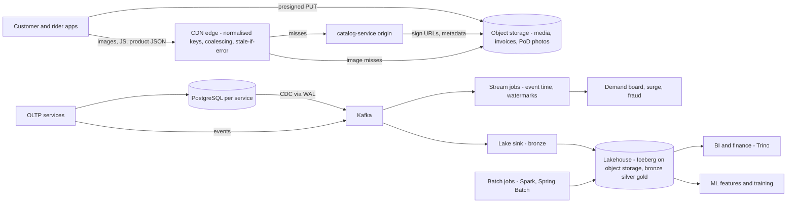
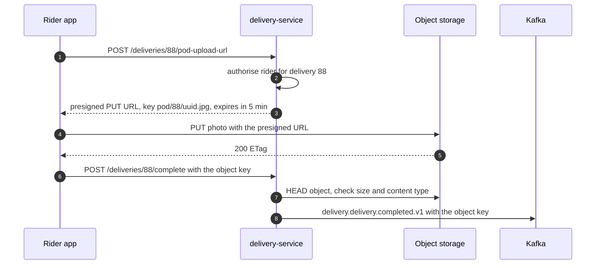
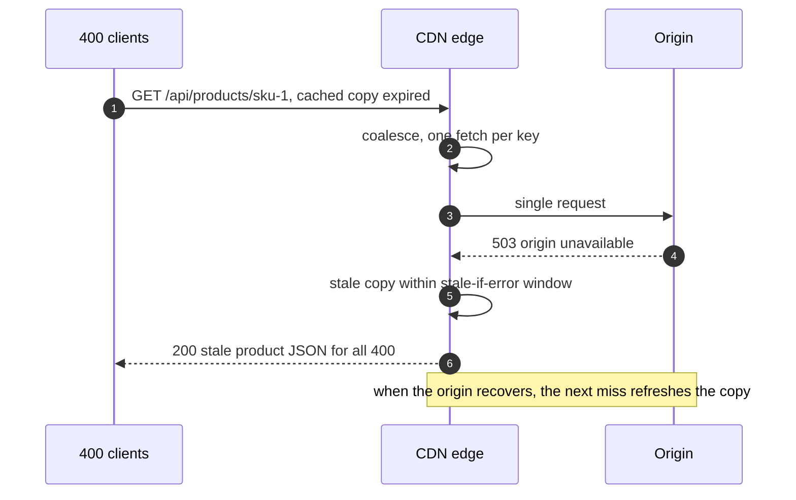
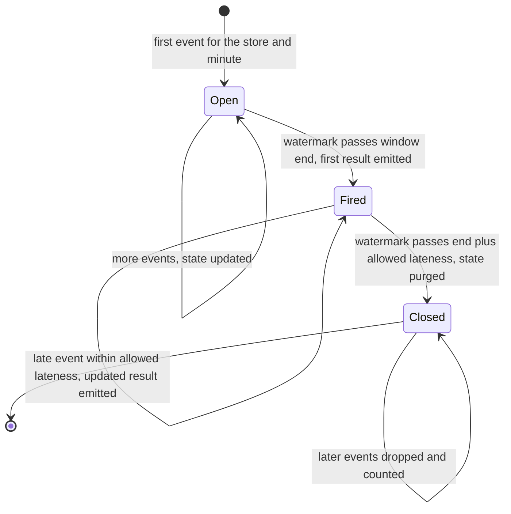

# 21. Data at Scale

!!! abstract "Chapter at a glance"
    **Reader bands:** B2 → B4 · **Prerequisites:** [Ch 05](../01-foundations/05-relational-databases-deep-dive.md), [Ch 06](../01-foundations/06-nosql-and-polyglot-persistence.md), [Ch 07](../01-foundations/07-caching.md), [Ch 13](../02-distributed-core/13-distributed-transactions.md), [Ch 14](../02-distributed-core/14-messaging-and-event-streaming.md) · **What you will build:** Where the grocery platform's big data lives, and how it moves: blobs in object storage, static bytes through a CDN, analytics off the OLTP path in a columnar lake, and batch and streaming pipelines that stay correct through crashes and late data. Four labs on **real tools**: SeaweedFS (S3 API), JDK HTTP servers, PostgreSQL 16, DuckDB 1.1 and Parquet.

    - **L1: object storage over the S3 API with hand-written SigV4.** Presigned upload/download, expiry and tampering (403), multipart upload with a single part retried, and content-addressed dedup.
    - **L2: a pull-through CDN node.** Normalising the cache key raised the hit ratio from **57 % to 97.5 %** (origin egress **953 → 23 MB**). Request coalescing cut 400 origin requests to **1**. Purge or versioned URLs removed **93 stale price responses**, and stale-if-error served **50 of 50** requests during an origin outage.
    - **L3: OLTP vs OLAP on 10M order lines.** An ELT step turned **754 MB of CSV into 58 MB of Parquet**. DuckDB answered most analytical queries **3.5–4x faster** than PostgreSQL on 2 vCPUs, with identical results, while PostgreSQL won the point lookup (**0.9 ms vs 11 ms**). Precomputing the local date during ELT made one query **7x faster**.
    - **L4: batch and stream.** A restartable chunked batch job was **off by ₹5.4 crore** when its checkpoint was committed separately from its output, and exact otherwise. For streaming windows over out-of-order events, processing-time windows were **30 % exact**, a 5 s watermark **43 %**, and a 5 s watermark with 30 min allowed lateness **100 %**.

    · **Reading time:** 110 min + code

---

## 1. Introduction & Why It Matters

### 1.1 A story: the Monday morning report

At 9:30 on the Monday after the Diwali weekend, checkout p99 jumped from 300 ms to 4 s. The cause was a BI dashboard: the finance team's weekly GMV report ran fifty `count(distinct order_id) … group by week` queries against the **orders primary**. Each one scanned 10 million rows (L3: **5.4 s on PostgreSQL**), and together they took the buffer cache and the CPUs away from checkout.

The review found four more problems:

- **Product images were served by `catalog-service` itself.** They were stored as `bytea` rows and streamed through the JVM, so 40 % of the service's CPU and most of its egress went to bytes that never change.
- **The CDN had been added the previous month, but its hit ratio was 55 %.** Marketing push notifications appended `utm_source`, `utm_campaign` and `fbclid` to image URLs, and the CDN used the full URL as the cache key. L2: **57.4 % → 97.5 %** once the key was normalised.
- **A price cut went live at 00:00, but some customers saw the old price until 00:05**, because product JSON was cached for 5 minutes and there was no purge. L2 reproduces it at a smaller scale: **93 of 138** responses stale with a TTL alone, and 0 with purge or versioned URLs.
- **The dark-store demand board undercounted evening orders by up to 30 %.** It counted orders by the minute they *arrived* at the stream processor, not the minute they were *placed*, and riders' phones in basements delivered events minutes late. L4: processing-time windows were exact for **29.8 %** of store-minutes.

The fixes:

- **Analytics moved off the OLTP path:** CDC and nightly ELT into a Parquet lake, queried by a columnar engine.
- **Blobs moved to object storage** with presigned uploads.
- **The CDN got normalised keys and coalescing,** plus versioned URLs for static assets, purge for prices, and stale-if-error.
- **The demand board moved to event-time windows** with a watermark and allowed lateness.

!!! quote "The thesis of this chapter"
    Different data has different physics. **Transactions** want rows, indexes and locks. **Analytics** want columns, compression and full scans. **Blobs** want cheap, durable, flat namespaces. **Static bytes** want to live near users. Scaling the data layer is mostly about putting each kind of data in the store built for it, and moving it between stores with pipelines that are **replayable, idempotent and honest about time**.

### 1.2 Where this lives in the grocery platform

| Data | Store / path | Why |
|---|---|---|
| Product images, invoices (PDF), proof-of-delivery photos, exports | Object storage (S3 API), private buckets, presigned URLs | Cheap, durable (11 nines on S3), no app servers in the byte path |
| Images, JS/CSS, app bundles | CDN, versioned URLs, `immutable` | Hit ratio > 95 %, origin offload |
| Product/price JSON for anonymous browse | CDN, short TTL, purge on change, stale-if-error | Burst absorption, resilience |
| Orders, payments, inventory (OLTP) | PostgreSQL per service (Ch 05) | Transactions, point reads/writes |
| Order lines, events, clickstream for analytics | Lakehouse: Parquet/Iceberg on object storage, partitioned by date | Columnar scans, cheap storage, many engines |
| BI dashboards, finance reports | Warehouse / lakehouse SQL engine (Trino, BigQuery, Snowflake, DuckDB for small data) | Never on OLTP primaries |
| Daily settlement, invoices, loyalty reconciliation | Batch (Spring Batch), restartable, idempotent | Correct, auditable, cheap |
| Demand board, surge, fraud signals | Streaming (Kafka Streams / Flink) with event time | Seconds-fresh, and correct despite late events |

### 1.3 Learning objectives

| Band | After this chapter you can… |
|---|---|
| <span class="band b2">B2</span> | Use object storage with presigned URLs and multipart uploads, set CDN cache headers, and explain OLTP vs OLAP and row vs column storage |
| <span class="band b3">B3</span> | Design cache keys, invalidation and coalescing for a CDN; build an ELT pipeline into a partitioned lake; write restartable batch jobs; use event-time windows with watermarks |
| <span class="band b4">B4</span> | Choose warehouse vs lake vs lakehouse, lambda vs kappa, and batch vs streaming for a use case, and define the platform's data architecture |

---

## 2. Core Concepts — Beginner to Deep

### 2.1 Intuition <span class="band b2">B2</span>

- **Object storage is the warehouse's back room of labelled boxes.** You don't open a box to change one item. You replace the whole box (immutable objects). Boxes are addressed by label (key), anyone with a signed slip (presigned URL) can pick one up, and it's vast and cheap.
- **A CDN is a set of small shops near every neighbourhood,** stocking copies of the most popular items from the central warehouse (the origin). The trick is labelling: if "Atta 5 kg" and "Atta 5 kg (from the Diwali leaflet)" are shelved separately, the shop keeps running back to the warehouse (the cache key).
- **OLTP vs OLAP** is the billing counter vs the monthly stock-take:
    - The counter needs one customer's cart, fast (rows, indexes).
    - The stock-take needs a total per category across every shelf (columns, scans). Doing the stock-take at the billing counter during rush hour is the Monday morning incident.
- **Batch vs stream** is counting the day's takings after closing vs a live tally:
    - The live tally is fast but must handle receipts that arrive late (event time and watermarks).
    - The after-closing count is exact, but only if you can restart it without counting a drawer twice (checkpoints).

### 2.2 Blob and object storage ⭐ <span class="band b2">B2</span>

| | Block storage (EBS) | File storage (EFS/NFS) | Object storage (S3, GCS, Azure Blob, MinIO, SeaweedFS, Ceph RGW) |
|---|---|---|---|
| Unit | Block on a volume | File in a hierarchy | Immutable object in a flat bucket, key + metadata |
| Access | Mounted by one host | Mounted by many | HTTP API (S3 is the de facto standard) |
| Scale | TBs per volume | Large | Effectively unlimited objects and bytes |
| Durability | Replicated in a zone | Regional | 11 nines (S3 Standard), erasure-coded across zones |
| Use | Databases | Shared config, legacy apps | Media, backups, logs, data lakes |

**The rules the grocery platform follows:**

- **Don't put blobs in the OLTP database.** It bloats backups, replication and the buffer cache. Store the object key and metadata in the DB and the bytes in object storage.
- **Don't proxy bytes through app servers.** Use **presigned URLs**: the service authorises the action and signs a URL scoped to one method, one key and a short expiry, and the client talks directly to storage.
    - L1: the presigned PUT and GET succeeded (200).
    - The same URL with the key changed (`rider-78`) got 403, because the signature covers the path.
    - An expired URL got 403, and an unsigned GET of a private object got 403.
- **Multipart upload** for large objects (S3 recommends it above ~100 MB; parts are 5 MB–5 GB, up to 10,000 of them):
    - Parts upload in parallel, and a failed part is retried alone. L1 sent 44 MB for a 40 MB object with one failure, where a single PUT would have resent all 40.
    - Clean up incomplete uploads with a lifecycle rule, or they're billed forever.
- **Keys:**
    - Design for listing (`products/<sku>/…`, `exports/<date>/…`) and for lifecycle rules by prefix.
    - Content-addressed keys (`blobs/sha256/<hash>`) give deduplication and immutability for free (L1: 3 uploads, 1 object).
    - Old advice about random prefixes for throughput is obsolete on S3: each prefix scales to thousands of requests per second automatically.
- **Consistency:** S3 has been strongly consistent for reads after writes and for lists since December 2020. Many S3-compatible stores are too, but check yours.
- **Lifecycle and storage classes:** transition old invoices to infrequent-access or archive tiers, expire temporary uploads, version buckets that hold critical data, and use Object Lock (WORM) for compliance (Ch 36).
- **ETags** of multipart objects aren't content MD5s (L1: `…-10`). Verify integrity with your own checksum or the newer checksum headers.

### 2.3 CDN fundamentals ⭐ <span class="band b2">B2</span>

A CDN is a network of edge caches (points of presence) that serve content close to users and shield the origin.

**Pull vs push:**

| | Pull (origin pull) | Push |
|---|---|---|
| How | The edge fetches from the origin on a miss and caches per the headers | You upload content to the CDN's storage ahead of time |
| Good for | Most web content, APIs, images | Large, predictable releases (app bundles, videos) |
| Risk | The first request per edge is a miss; herds on expiry | You manage what's there |

**Cache headers the origin controls:**

- `Cache-Control: public, max-age=31536000, immutable` for versioned assets.
- `max-age=60, stale-while-revalidate=30, stale-if-error=86400` for semi-dynamic JSON.
- `s-maxage` sets the shared-cache TTL separately from browsers.
- `private` / `no-store` for personalised responses.
- `Vary` for content negotiation (keep it minimal; `Vary: User-Agent` destroys hit ratios).

**Cache keys:** by default, the full URL plus some headers. **Normalise** them:

- drop tracking params (`utm_*`, `fbclid`, `gclid`);
- sort query params;
- lower-case where safe;
- bucket device classes instead of varying on the raw User-Agent.

L2: 20,000 image requests with 40 % carrying tracking params. A full-URL key gave **57.4 % hits and 406 MB of origin egress**; a normalised key gave **97.5 % and 23 MB**.

**Request coalescing** (collapsed forwarding): when many requests for the same key miss at once, send one to the origin and make the rest wait for it. L2: **400 → 1** origin requests when a hot product expired. Most CDNs do this per POP, and origin shield / tiered caching extends it across POPs.

### 2.4 Invalidation ⭐ <span class="band b3">B3</span>

There are three strategies, and you usually combine them:

| Strategy | How | Staleness | Cost |
|---|---|---|---|
| **TTL only** | Wait for `max-age` | Up to the TTL (L2: 93 of 138 stale over 2 s) | Free |
| **Purge / invalidate** | API call per URL, prefix or surrogate key/tag when the data changes | Propagation time across POPs (seconds to minutes) | API limits; purge storms |
| **Versioned URLs** | The URL contains a content hash or version (`/v/p39/sku-7`, `app.3f9a1c.js`); pages link to the new URL | None: a new URL is a new object | Needs the referencing page to change |

- **Static assets:** versioned + `immutable`, never purged.
- **Prices and stock on public pages:** short TTL + **surrogate-key purge** (tag every response with `sku-7`, purge the tag on change) + `stale-if-error`.
- **Personalised data** (cart, addresses): not cached at the CDN.

**Stale-if-error** turns the CDN into a resilience layer. L2: origin down for 5 s, and the strict TTL returned **50 errors** while stale-if-error served **50 of 50**.

### 2.5 OLTP vs OLAP ⭐ <span class="band b2">B2</span>

| | OLTP | OLAP |
|---|---|---|
| Queries | Many small reads/writes by key | Few large scans and aggregations |
| Storage | Row-oriented pages + B-tree indexes | **Columnar**, compressed, often sorted/partitioned |
| Execution | Tuple at a time, index lookups | **Vectorised**, SIMD, parallel scans |
| Concurrency | Thousands of short transactions | Tens of long queries |
| Freshness | Now | Minutes to a day behind (CDC/ELT) |
| Examples | PostgreSQL, MySQL | BigQuery, Snowflake, Redshift, ClickHouse, Druid, Pinot, DuckDB, Trino over Parquet/Iceberg |

L3 on the same 10M order lines, 2 vCPUs, identical answers verified by hash:

| Query | PostgreSQL 16 | DuckDB on Parquet |
|---|---|---|
| One order's lines by primary key | **0.9 ms** | 11 ms |
| Revenue by city × category, last 30 days | 650 ms | **164 ms** |
| Top 10 SKUs in Bengaluru, quarter | 628 ms | **180 ms** |
| Weekly distinct orders + GMV | 5,449 ms | 3,331 ms; **463 ms** with `dt` precomputed in ELT |
| One day's GMV | 17 ms (index range) | **4 ms** (reads 1 of 90 partition files) |

Why:

- **Columnar storage reads only the needed columns.** Q3 needed 3 of 11 columns, 22 MB of 57 MB, while PostgreSQL reads whole rows.
- **Compression:** 754 MB of CSV, 1.4 GB in PostgreSQL with indexes, and **58 MB** as zstd Parquet.
- **Vectorised execution** processes batches of values per operator call.
- **Partition pruning** skips files whose partition value doesn't match, and **min/max statistics** skip row groups within files.

And the lesson from Q4: **model for the query**. Computing the local date once during the transform (instead of time-zone math on every row, every query) was worth 7x.

### 2.6 Warehouse, lake, lakehouse ⭐ <span class="band b3">B3</span>

| | Data warehouse | Data lake | Lakehouse |
|---|---|---|---|
| Storage | Managed, proprietary columnar | Files (Parquet/ORC/JSON) on object storage | Open table format (Apache Iceberg, Delta Lake, Hudi) over Parquet on object storage |
| Schema | Schema-on-write, strongly modelled | Schema-on-read, often messy ("swamp") | Schema-on-write with evolution; ACID commits; time travel |
| Engines | The warehouse's own | Anything that reads files | Many engines (Spark, Trino, Flink, DuckDB, Snowflake, BigQuery) on the same tables |
| Updates/deletes | Yes | Rewrite files by hand | Yes (merge-on-read / copy-on-write), essential for GDPR/DPDP deletes |
| Cost | Compute + storage coupled (less so now) | Cheapest storage | Cheap storage + choice of compute |

**Table formats** add a metadata layer (manifests, snapshots) over immutable Parquet files. That gives atomic commits (a new snapshot pointer), concurrent writers, schema and partition evolution, time travel ("revenue as of last Tuesday's snapshot") and efficient deletes. L3's hive-style `dt=` directories are the pre-table-format version of partitioning. They work, but renames aren't atomic and every reader must list directories.

**The grocery platform:** Iceberg tables on object storage, written by CDC (Debezium → Kafka → Flink/Spark sink) and nightly ELT, and queried by Trino for BI and by Spark for ML features. A star schema (fact `order_line`, dimensions `store`, `sku`, `customer`, `date`) in the "gold" layer.

### 2.7 ETL vs ELT <span class="band b3">B3</span>

- **ETL:** Extract → Transform (in a separate engine) → Load the cleaned result. Classic warehousing, where transformations happen before the warehouse.
- **ELT:** Extract → Load raw data into the lake/warehouse → Transform inside it with SQL (dbt). Raw data is kept, so transforms can be re-run when logic changes.

**Medallion layers:**

- **bronze:** raw, append-only, as received;
- **silver:** cleaned, deduplicated, conformed;
- **gold:** business aggregates and marts.

L3's pipeline is ELT in miniature: extract with `COPY` (754 MB CSV, 9.2 s), then load and transform in DuckDB into partitioned Parquet with a derived local-date column (58 MB, 7.0 s).

**Extraction options:**

- **Batch `COPY`/snapshot:** simple, but loads the source; use a replica.
- **Incremental by `updated_at`:** misses deletes and needs indexes.
- **CDC from the WAL (Debezium, Ch 13):** complete, low latency, captures deletes. The platform standard.

### 2.8 Batch processing ⭐ <span class="band b3">B3</span>

Batch jobs process a bounded dataset: nightly settlement, invoice generation, loyalty expiry, reconciliation, ML feature backfills. Spring Batch's model:

- **Job → Steps.** A step is either **chunk-oriented** (`ItemReader` → `ItemProcessor` → `ItemWriter` with a commit interval) or a tasklet.
- **A JobRepository** stores execution state and the **ExecutionContext** (the checkpoint, e.g. the last key read). A failed job **restarts from the last committed chunk**.
- **Skip/retry policies** handle bad records, and partitioning or remote chunking scale out.

**The correctness rule, from L4 Part A:** the checkpoint and the chunk's output must commit **atomically**, or the output must be **idempotent**.

| Restart strategy | Result after one crash |
|---|---|
| Output committed, crash before the checkpoint | Chunk 60 re-processed, **200 (day, store) rows wrong, ₹5.37 crore overcounted** |
| Checkpoint in the same transaction as the output | Exact |
| Recompute and **overwrite** the output partition in one transaction | Exact, simplest. Re-read everything (20M rows for 10M), still fastest here |

In lakehouse terms, overwrite means "INSERT OVERWRITE partition dt=…" or an Iceberg `replacePartitions` commit. Recomputing a day and atomically replacing it is the most robust batch pattern.

### 2.9 Stream processing ⭐ <span class="band b3">B3</span>

Streaming processes an unbounded log continuously: Kafka Streams (a library inside your service), Apache Flink (a cluster), Spark Structured Streaming. The core concepts:

- **Event time vs processing time:**
    - Event time is when it happened on the rider's phone.
    - Processing time is when the processor saw it.
    - They differ by seconds to minutes (L4: 10 % of events more than 5 s late, 2 % more than 2 min).
- **Windows:**
    - tumbling (fixed, non-overlapping: orders per minute);
    - hopping/sliding (overlapping: 5-min demand every minute);
    - session (gap-based: a customer's browsing session).
- **Watermark:** the processor's assertion that no events older than *t* are still expected. Commonly `max event time seen − bounded delay`. A window's result is emitted when the watermark passes its end.
- **Allowed lateness:** keep window state after firing, and **emit updated results** for late events up to a limit. Downstream must accept upserts.
- **State and checkpoints:** window state lives in a local store (RocksDB), checkpointed together with input offsets (Flink snapshots, Kafka Streams changelog topics), which gives exactly-once *state* semantics.

L4 Part B: orders per store per minute over 1.08M out-of-order events, compared with the batch ground truth:

| Strategy | Windows exact | Dropped | Result delay p50 | Updates per window |
|---|---|---|---|---|
| Processing-time windows | **29.8 %** | 0 (misassigned) | immediate | 0 |
| Event time, watermark 5 s, drop late | 43.0 % | 60,625 | 5.1 s | 0 |
| Event time, watermark 60 s, drop late | 74.3 % | 21,343 | 60.1 s | 0 |
| **Event time, watermark 5 s + 30 min lateness** | **100 %** | 0 | 5.1 s | 0.84 |

The trade-off is between **latency, completeness and cost (state kept, updates emitted)**. A longer watermark buys completeness with latency. Allowed lateness buys completeness with state and downstream updates. The demand board takes the last row: fast first results, corrected as stragglers arrive.

### 2.10 Lambda vs Kappa ⭐ <span class="band b4">B4</span>

- **Lambda** runs a **batch layer** (complete, recomputed from the master dataset) and a **speed layer** (streaming, approximate, recent), merged at query time.
    - It's robust: batch corrects the stream.
    - But it has **two codebases for the same logic** that drift apart.
- **Kappa** has **one streaming codebase**. Reprocessing means replaying the log (Kafka with long retention or tiered storage, or the lake's bronze layer) through a new version of the job, into a new output, and then switching readers over.
    - It needs a replayable log and a job that can catch up fast. L4's toy job replayed the evening at ~4.5M events/s on one core; real jobs with state and I/O are much slower, so plan catch-up capacity.

**In practice, 2026:** most platforms run kappa-style streaming for fresh metrics, **plus** a lakehouse whose tables are the durable history and can be recomputed by batch (a "lakehouse lambda"). Unified engines (Flink, Spark) share code between batch and streaming, which removes the classic lambda drift. The grocery platform:

- Streaming: the demand board, surge, fraud and live ETAs (Flink/Kafka Streams).
- Batch: finance, settlement and ML training (Spark/Spring Batch on Iceberg).
- Where both exist, **the batch figure is the source of truth**, and the streaming figure is labelled provisional.

### 2.11 Choosing batch or stream <span class="band b4">B4</span>

| Question | Batch | Stream |
|---|---|---|
| How fresh must the answer be? | Hours/day is fine | Seconds/minutes |
| Must it be exact and auditable? | Yes (money) | Provisional, corrected later, is acceptable |
| Does it need the whole dataset (joins across days, dedup over all history)? | Natural | Hard (state size) |
| Does the action happen in the moment (surge, fraud block)? | Too late | Required |
| Operational cost | Cheap, scheduled | Always-on, state, checkpoints, on-call |

---

## 3. Architecture & Diagrams

### 3.1 Component view: the grocery platform's data paths



### 3.2 Sequence: happy path, a presigned upload of a proof-of-delivery photo



### 3.3 Sequence: failure path, a hot price expires while the origin is down



### 3.4 State: an event-time window with allowed lateness



---

## 4. Design Document Excerpt: Grocery Data Platform v1

| Field | Value |
|---|---|
| Author / Reviewers | Data platform team / catalog, orders, finance, SRE, security |
| Status | Approved |
| Related ADRs | ADR-088 Object storage + presigned URLs for all blobs; ADR-089 CDN key normalisation, versioned assets, surrogate-key purge, stale-if-error; ADR-090 No analytics on OLTP primaries; Iceberg lakehouse via CDC; ADR-091 Batch outputs idempotent (partition overwrite) or checkpointed atomically; ADR-092 Streaming in event time with watermarks and allowed lateness; batch is the source of truth for money |

**1. Context & Problem.** The Monday incident (§1.1): BI on the OLTP primary, blobs in PostgreSQL behind the JVM, a 55 % CDN hit ratio, stale prices, and processing-time demand counts.

**2. Goals / Non-Goals.**

- *Goals:* no analytical load on OLTP primaries; a CDN hit ratio > 95 % for media; price changes visible within 10 s; demand metrics exact within the lateness bound; finance numbers reproducible from raw data.
- *Non-goals:* real-time finance (T+1 is fine); a self-built CDN.

**3. Requirements.**

| ID | Requirement |
|---|---|
| FR-1 | Uploads go directly to object storage with presigned URLs (≤ 5 min expiry, one key, content type fixed) |
| FR-2 | Every static asset URL is content-versioned; product/price JSON is tagged with surrogate keys and purged on change |
| FR-3 | BI and finance query only the lakehouse; OLTP read access for analysts is revoked |
| NFR-1 | Media hit ratio ≥ 95 %; origin egress ≤ 10 % of edge egress |
| NFR-2 | Lakehouse freshness: silver ≤ 15 min behind OLTP (CDC); gold daily by 03:00 |
| NFR-3 | Batch jobs restartable with exact results (tested with injected crashes) |
| NFR-4 | Demand board first result ≤ 10 s after the minute ends; exact after 30 min |

**4. Capacity estimates.**

| Item | Calculation | Result |
|---|---|---|
| Media | 400K SKUs × 6 images × 3 sizes × 150 KB | ~1.1 TB, plus PoD photos 60K/day × 300 KB ≈ 18 GB/day |
| CDN egress | 10M app sessions/day × 40 images × 60 KB | ~24 TB/day at the edge; ≤ 1.2 TB/day at the origin with a 95 % hit ratio |
| Order lines | 1.2M orders/day × 5 lines | 6M rows/day, ~35 MB/day as Parquet (L3: 58 MB per 10M rows) |
| 3 years of order lines | 6.6B rows | ~40 GB Parquet, trivial for a lakehouse; would be ~900 GB in PostgreSQL |
| Stream state | 900 stores × 31 open minutes (30 min lateness) × a few counters | Kilobytes per store: tiny |

**5. Proposed design.**

1. **Object storage:** private buckets per data class (media, documents, exports), SSE-KMS encryption, lifecycle rules (temp uploads 1 day, incomplete multipart 7 days, invoices → IA after 90 days), versioning on documents, Object Lock for tax invoices.
2. **CDN:**
    - Cache policy per path: `/img/*` gets a normalised key and 1 year `immutable`. `/api/catalog/*` gets 60 s + SWR 30 s + SIE 24 h + surrogate keys.
    - Origin shield. `catalog-service` purges by SKU tag on price or stock-status change.
3. **Lakehouse:**
    - Debezium CDC → Kafka → a Flink sink writes bronze Iceberg tables. Flink/Spark jobs build silver (dedup by event id, Ch 20) and gold (star schema) tables.
    - Partitioned by local date. Trino for BI, with DuckDB allowed for local analysis of extracts.
4. **Batch:** Spring Batch jobs for settlement and invoices, with chunk checkpoints in the job's own DB transaction. Spark jobs for gold tables use partition overwrite.
5. **Streaming:** Kafka Streams for the demand board (per-store tumbling 1-min windows, grace 30 min, suppress-until-final for the finance-facing view), and Flink for surge and fraud.

**7. Alternatives considered.**

| Option | Pros | Cons | Verdict |
|---|---|---|---|
| Read replica for BI | Quick | Still row storage (L3), replica lag and conflicts, no history | Stop-gap only |
| **Lakehouse (Iceberg + Trino)** | Open, cheap storage, many engines, deletes and time travel | More moving parts | **Chosen** |
| Managed warehouse (BigQuery/Snowflake) | Least ops | Cost at scale, lock-in | Acceptable alternative; Iceberg keeps the option open |
| Lambda with separate batch/speed code | Robust | Two codebases | Replaced by unified engines + batch truth |
| Processing-time streaming | Simple | Wrong under late data (L4: 30 % exact) | Rejected |

**8. Failure modes.**

- CDC lag → the silver freshness SLO alerts, and dashboards show "data as of".
- Purge API failure → retry with backoff, and the TTL bounds staleness.
- Presigned URL leak → short expiry, one key, and authorisation at signing.
- Stream job restart → restored from the checkpoint; the lateness bound covers the downtime or a reprocess runs.

**10. Observability.**

- CDN: hit ratio by path, origin egress, purge latency.
- Object storage: 4xx/5xx rates, incomplete multipart bytes.
- Lake: freshness per table, file counts and small-file compaction backlog.
- Batch: duration, rows, restarts.
- Stream: watermark lag, late-event and dropped counts, updates emitted, checkpoint duration.

**14. Decision (ADR-088–092 summary).** Blobs in object storage behind presigned URLs. A CDN with normalised keys, versioned assets and stale-if-error. Analytics only on an Iceberg lakehouse fed by CDC. Batch that is idempotent or atomically checkpointed. Streaming in event time with watermarks and allowed lateness, and batch as the source of truth for money.

---

## 5. Hands-On Code — Level Ladder

| Level | New requirement that forces the step |
|---|---|
| L1 | "Get media and documents out of the database and off our servers." (S3 API on SeaweedFS, SigV4, presigned URLs, multipart) |
| L2 | "Make the CDN actually offload the origin and stay correct on price changes." (edge cache: keys, coalescing, invalidation, stale-if-error) |
| L3 | "Stop running BI on the orders primary." (ELT to Parquet, PostgreSQL vs DuckDB on 10M rows) |
| L4 | "Nightly jobs must survive crashes; the demand board must be right despite late events." (restartable batch on PostgreSQL, event-time windows) |

All four levels ran on a 2 vCPU container, with the tools downloaded from their GitHub releases:

- **SeaweedFS 3.80** (S3 API on `:8333`)
- **DuckDB 1.1.3** CLI
- **PostgreSQL 16** (`:5543`, `shared_buffers = 1GB`)
- Java 21 with the pgjdbc driver

The outputs below are verbatim. Lab files are in `labs/ch21-data-at-scale/`.

### L1 — Object storage over the S3 API, presigned URLs, multipart <span class="band b2">B2</span>

**Requirement:** "Store product images, invoices and proof-of-delivery photos outside the database, and let the apps upload and download without our servers carrying the bytes."

The program speaks the S3 REST API directly, with **AWS Signature V4 written out** (canonical request → string to sign → derived key → HMAC). SDKs hide this, and seeing it once explains why presigned URLs are safe: the signature covers the method, path, expiry and signed headers.

```java title="ObjectStoreL1.java"
// ObjectStoreL1.java — run with: java ObjectStoreL1.java     (needs an S3-compatible endpoint; the lab uses SeaweedFS 3.80 on :8333)
// Product images and invoices in object storage, using the plain S3 REST API with AWS Signature V4 written out by hand:
// bucket + PUT/GET/HEAD, range reads, prefix listing, presigned upload/download URLs (direct from the app, bypassing our servers),
// expiry and tampering, multipart upload with a failed part retried alone, and content-addressed keys for deduplication.
import java.net.URI;
import java.net.URLEncoder;
import java.net.http.*;
import java.nio.charset.StandardCharsets;
import java.security.MessageDigest;
import java.time.*;
import java.time.format.DateTimeFormatter;
import java.util.*;
import java.util.regex.*;
import javax.crypto.Mac;
import javax.crypto.spec.SecretKeySpec;

public class ObjectStoreL1 {
    static final String ENDPOINT = "http://127.0.0.1:8333", HOST = "127.0.0.1:8333", REGION = "us-east-1";
    static final String ACCESS = "AKIDGROCERY", SECRET = "grocery-secret-key";
    static final HttpClient HTTP = HttpClient.newBuilder().version(HttpClient.Version.HTTP_1_1).build();
    static final DateTimeFormatter AMZ = DateTimeFormatter.ofPattern("yyyyMMdd'T'HHmmss'Z'").withZone(ZoneOffset.UTC);

    // ---------------- Signature V4 ----------------
    static String hex(byte[] b) { return HexFormat.of().formatHex(b); }
    static byte[] sha256(byte[] b) throws Exception { return MessageDigest.getInstance("SHA-256").digest(b); }
    static byte[] hmac(byte[] key, String data) throws Exception {
        Mac m = Mac.getInstance("HmacSHA256"); m.init(new SecretKeySpec(key, "HmacSHA256")); return m.doFinal(data.getBytes(StandardCharsets.UTF_8));
    }
    static String enc(String s, boolean keepSlash) {
        String e = URLEncoder.encode(s, StandardCharsets.UTF_8).replace("+", "%20").replace("*", "%2A").replace("%7E", "~");
        return keepSlash ? e.replace("%2F", "/") : e;
    }
    static String canonicalQuery(Map<String, String> q) {
        var sb = new StringJoiner("&");
        new TreeMap<>(q).forEach((k, v) -> sb.add(enc(k, false) + "=" + enc(v, false)));
        return sb.toString();
    }
    static String signature(String method, String path, Map<String, String> query, Map<String, String> headers, String payloadHash, Instant t) throws Exception {
        String date = AMZ.format(t).substring(0, 8), scope = date + "/" + REGION + "/s3/aws4_request";
        var sorted = new TreeMap<String, String>(); headers.forEach((k, v) -> sorted.put(k.toLowerCase(), v.trim()));
        var ch = new StringBuilder(); sorted.forEach((k, v) -> ch.append(k).append(':').append(v).append('\n'));
        String signed = String.join(";", sorted.keySet());
        String canonical = method + "\n" + enc(path, true) + "\n" + canonicalQuery(query) + "\n" + ch + "\n" + signed + "\n" + payloadHash;
        String toSign = "AWS4-HMAC-SHA256\n" + AMZ.format(t) + "\n" + scope + "\n" + hex(sha256(canonical.getBytes(StandardCharsets.UTF_8)));
        byte[] k = hmac(("AWS4" + SECRET).getBytes(StandardCharsets.UTF_8), date);
        k = hmac(k, REGION); k = hmac(k, "s3"); k = hmac(k, "aws4_request");
        return hex(hmac(k, toSign));
    }

    /** A signed request with the Authorization header (what an SDK does for server-side calls). */
    static HttpResponse<byte[]> s3(String method, String path, Map<String, String> query, byte[] body, Map<String, String> extra) throws Exception {
        Instant t = Instant.now();
        String payloadHash = body == null ? hex(sha256(new byte[0])) : hex(sha256(body));
        var headers = new LinkedHashMap<String, String>();
        headers.put("host", HOST); headers.put("x-amz-date", AMZ.format(t)); headers.put("x-amz-content-sha256", payloadHash);
        headers.putAll(extra);
        String sig = signature(method, path, query, headers, payloadHash, t);
        String date = AMZ.format(t).substring(0, 8);
        var signedNames = new TreeSet<String>(); headers.keySet().forEach(h -> signedNames.add(h.toLowerCase()));
        String auth = "AWS4-HMAC-SHA256 Credential=" + ACCESS + "/" + date + "/" + REGION + "/s3/aws4_request, SignedHeaders="
                + String.join(";", signedNames) + ", Signature=" + sig;
        String qs = query.isEmpty() ? "" : "?" + canonicalQuery(query);
        var b = HttpRequest.newBuilder(URI.create(ENDPOINT + enc(path, true) + qs)).header("Authorization", auth);
        headers.forEach((k, v) -> { if (!k.equals("host")) b.header(k, v); });
        b.method(method, body == null ? HttpRequest.BodyPublishers.noBody() : HttpRequest.BodyPublishers.ofByteArray(body));
        return HTTP.send(b.build(), HttpResponse.BodyHandlers.ofByteArray());
    }
    static HttpResponse<byte[]> s3(String method, String path) throws Exception { return s3(method, path, Map.of(), null, Map.of()); }

    /** A presigned URL: the signature travels in the query string; anyone holding the URL may do exactly this operation until it expires. */
    static String presign(String method, String path, Duration expiresIn, Instant t) throws Exception {
        String date = AMZ.format(t).substring(0, 8);
        var q = new TreeMap<String, String>();
        q.put("X-Amz-Algorithm", "AWS4-HMAC-SHA256");
        q.put("X-Amz-Credential", ACCESS + "/" + date + "/" + REGION + "/s3/aws4_request");
        q.put("X-Amz-Date", AMZ.format(t));
        q.put("X-Amz-Expires", String.valueOf(expiresIn.toSeconds()));
        q.put("X-Amz-SignedHeaders", "host");
        String sig = signature(method, path, q, Map.of("host", HOST), "UNSIGNED-PAYLOAD", t);
        return ENDPOINT + enc(path, true) + "?" + canonicalQuery(q) + "&X-Amz-Signature=" + sig;
    }

    static int plain(String method, String url, byte[] body) throws Exception {
        var b = HttpRequest.newBuilder(URI.create(url)).method(method, body == null ? HttpRequest.BodyPublishers.noBody() : HttpRequest.BodyPublishers.ofByteArray(body));
        return HTTP.send(b.build(), HttpResponse.BodyHandlers.discarding()).statusCode();
    }

    static String xml(byte[] body, String tag) { Matcher m = Pattern.compile("<" + tag + ">(.*?)</" + tag + ">").matcher(new String(body)); return m.find() ? m.group(1) : null; }

    public static void main(String[] args) throws Exception {
        String bucket = "/catalog-media";
        s3("PUT", bucket);                                                                         // create bucket (idempotent here)
        Random rnd = new Random(1);

        System.out.println("A. Basic object operations (SeaweedFS S3 API, SigV4 signed)");
        byte[] img = new byte[480_000]; rnd.nextBytes(img);
        var put = s3("PUT", bucket + "/products/sku-1001/main.jpg", Map.of(), img, Map.of("content-type", "image/jpeg", "cache-control", "public, max-age=31536000, immutable"));
        System.out.printf("   PUT products/sku-1001/main.jpg (%,d B)  → %d, ETag %s%n", img.length, put.statusCode(), put.headers().firstValue("etag").orElse("?"));
        var head = s3("HEAD", bucket + "/products/sku-1001/main.jpg");
        System.out.printf("   HEAD                                  → %d, Content-Length %s, Content-Type %s%n", head.statusCode(),
                head.headers().firstValue("content-length").orElse("?"), head.headers().firstValue("content-type").orElse("?"));
        var range = s3("GET", bucket + "/products/sku-1001/main.jpg", Map.of(), null, Map.of("range", "bytes=0-1023"));
        System.out.printf("   GET Range bytes=0-1023                → %d, %,d bytes (thumbnail header / resumable download)%n", range.statusCode(), range.body().length);
        for (int i = 1; i <= 3; i++) s3("PUT", bucket + "/products/sku-1002/img-" + i + ".jpg", Map.of(), new byte[1000 * i], Map.of());
        var list = s3("GET", bucket, Map.of("list-type", "2", "prefix", "products/sku-1002/"), null, Map.of());
        System.out.printf("   LIST prefix products/sku-1002/        → %d, %s keys%n", list.statusCode(), xml(list.body(), "KeyCount"));

        System.out.println("B. Presigned URLs: the app uploads straight to storage; our servers only sign");
        Instant now = Instant.now();
        String upUrl = presign("PUT", bucket + "/uploads/rider-77/proof-of-delivery.jpg", Duration.ofMinutes(5), now);
        System.out.printf("   presigned PUT, valid 5 min            → %d%n", plain("PUT", upUrl, img));
        String getUrl = presign("GET", bucket + "/uploads/rider-77/proof-of-delivery.jpg", Duration.ofMinutes(5), now);
        System.out.printf("   presigned GET                         → %d%n", plain("GET", getUrl, null));
        String tampered = getUrl.replace("rider-77", "rider-78");
        System.out.printf("   same URL, key changed to rider-78     → %d (signature covers the path)%n", plain("GET", tampered, null));
        String expired = presign("GET", bucket + "/uploads/rider-77/proof-of-delivery.jpg", Duration.ofSeconds(60), now.minus(Duration.ofMinutes(10)));
        System.out.printf("   URL signed 10 min ago, valid 60 s     → %d (expired)%n", plain("GET", expired, null));
        System.out.printf("   unsigned GET of a private object      → %d%n", plain("GET", ENDPOINT + bucket + "/uploads/rider-77/proof-of-delivery.jpg", null));

        System.out.println("C. Multipart upload: 40 MB invoice archive in 8 MB parts, part 3 fails once and is retried alone");
        byte[] big = new byte[40 * 1024 * 1024]; rnd.nextBytes(big);
        String key = bucket + "/exports/2026-09-25/invoices.tar";
        long t0 = System.nanoTime();
        String uploadId = xml(s3("POST", key, Map.of("uploads", ""), null, Map.of()).body(), "UploadId");
        var etags = new ArrayList<String>(); long sent = 0; int partSize = 8 * 1024 * 1024; boolean failedOnce = false;
        for (int part = 1; part <= 5; part++) {
            byte[] chunk = Arrays.copyOfRange(big, (part - 1) * partSize, part * partSize);
            if (part == 3 && !failedOnce) { failedOnce = true; sent += chunk.length / 2; System.out.println("   part 3: (simulated) connection reset after 4 MB → only part 3 is sent again"); }
            var r = s3("PUT", key, Map.of("partNumber", String.valueOf(part), "uploadId", uploadId), chunk, Map.of());
            etags.add(r.headers().firstValue("etag").orElseThrow()); sent += chunk.length;
        }
        var cx = new StringBuilder("<CompleteMultipartUpload>");
        for (int i = 0; i < etags.size(); i++) cx.append("<Part><PartNumber>").append(i + 1).append("</PartNumber><ETag>").append(etags.get(i)).append("</ETag></Part>");
        cx.append("</CompleteMultipartUpload>");
        var done = s3("POST", key, Map.of("uploadId", uploadId), cx.toString().getBytes(), Map.of());
        long ms = (System.nanoTime() - t0) / 1_000_000;
        var check = s3("GET", key);
        System.out.printf("   complete → %d in %,d ms; bytes sent %,d MB for a %,d MB object (a failed single PUT resends all 40 MB)%n",
                done.statusCode(), ms, sent >> 20, big.length >> 20);
        System.out.printf("   multipart ETag %s: not the MD5 of the object; verify with your own checksum%n", xml(done.body(), "ETag").replace("&#34;", "\""));
        System.out.printf("   downloaded object identical: %s%n", Arrays.equals(sha256(check.body()), sha256(big)));

        System.out.println("D. Content-addressed keys: the same image uploaded by 3 sellers is stored once");
        byte[] sellerImg = new byte[300_000]; rnd.nextBytes(sellerImg);
        int stored = 0;
        s3("DELETE", bucket + "/blobs/sha256/" + hex(sha256(sellerImg)));                        // clean start for re-runs
        for (String seller : List.of("seller-a", "seller-b", "seller-c")) {
            String cas = bucket + "/blobs/sha256/" + hex(sha256(sellerImg));
            if (s3("HEAD", cas).statusCode() == 404) { s3("PUT", cas, Map.of(), sellerImg, Map.of()); stored++; }
            // the catalog row stores (seller, sku) → blob key; the blob key never changes, so it can be cached forever
        }
        System.out.printf("   uploads 3, objects stored %d, key blobs/sha256/%s…%n", stored, hex(sha256(sellerImg)).substring(0, 16));
    }
}
```

```text title="java ObjectStoreL1.java   (SeaweedFS: weed server -s3 -s3.config=s3.json)"
A. Basic object operations (SeaweedFS S3 API, SigV4 signed)
   PUT products/sku-1001/main.jpg (480,000 B)  → 200, ETag "929df4cadcea3fdff1ba15cacfdb132b"
   HEAD                                  → 200, Content-Length 480000, Content-Type image/jpeg
   GET Range bytes=0-1023                → 206, 1,024 bytes (thumbnail header / resumable download)
   LIST prefix products/sku-1002/        → 200, 3 keys
B. Presigned URLs: the app uploads straight to storage; our servers only sign
   presigned PUT, valid 5 min            → 200
   presigned GET                         → 200
   same URL, key changed to rider-78     → 403 (signature covers the path)
   URL signed 10 min ago, valid 60 s     → 403 (expired)
   unsigned GET of a private object      → 403
C. Multipart upload: 40 MB invoice archive in 8 MB parts, part 3 fails once and is retried alone
   part 3: (simulated) connection reset after 4 MB → only part 3 is sent again
   complete → 200 in 493 ms; bytes sent 44 MB for a 40 MB object (a failed single PUT resends all 40 MB)
   multipart ETag "f719698066a50ef5eed65211e0e520f5-10": not the MD5 of the object; verify with your own checksum
   downloaded object identical: true
D. Content-addressed keys: the same image uploaded by 3 sellers is stored once
   uploads 3, objects stored 1, key blobs/sha256/915bec70f771e55e…
```

**Reading it:**

- **Range reads (206)** give resumable downloads and cheap header reads.
- **Prefix listing** is how you enumerate "all images of SKU 1002". Design keys for the listings and lifecycle rules you'll need.
- **Presigned URLs:**
    - The rider app uploads directly. Our service only authorised the action and signed.
    - Changing the key in a signed URL, or using it after expiry, gives **403**.
    - Keep expiries short and one key per URL, and fix the content type in the signature (`content-type` as a signed header) when uploads must be images.
- **Multipart:**
    - A failed part is retried alone: 44 MB sent for a 40 MB object with one (simulated) interruption.
    - The ETag of a multipart object is *not* an MD5 of the content, so use your own checksum (verified identical here).
- **Content-addressed keys** give deduplication and immutability: 3 sellers uploaded the same image, 1 object was stored, and its URL can be cached forever.

### L2 — A CDN edge: cache keys, coalescing, invalidation, stale-if-error <span class="band b3">B3</span>

**Requirement:** "The CDN must offload the origin, survive a hot key expiring, reflect price changes quickly, and keep serving during an origin outage."

A real origin (JDK `HttpServer`, 20 ms of work per request) sits behind a real edge cache (another `HttpServer`) that implements:

- cache keys (full URL vs normalised);
- TTL from `Cache-Control`;
- request coalescing;
- `PURGE`;
- stale-if-error.

The workload is Zipf-distributed over 500 products, with 40 % of URLs carrying marketing parameters in random order.

```java title="CdnL2.java"
// CdnL2.java — run with: java -Dsun.net.httpserver.nodelay=true CdnL2.java
// A pull-through edge cache (a tiny CDN node) in front of a real origin, both JDK HttpServers on virtual threads.
// A. cache keys: full URL vs normalised (tracking params dropped, params sorted) under a Zipf workload
// B. a hot object expires under 400 concurrent requests: no coalescing vs request coalescing
// C. a price changes: TTL-only vs purge vs versioned (content-hashed) URLs
// D. origin outage: stale-if-error vs strict TTL
import com.sun.net.httpserver.*;
import java.net.*;
import java.net.http.*;
import java.time.Duration;
import java.util.*;
import java.util.concurrent.*;
import java.util.concurrent.atomic.*;

public class CdnL2 {
    // ---------------- origin ----------------
    static final AtomicInteger originHits = new AtomicInteger();
    static final Map<String, String> prices = new ConcurrentHashMap<>();
    static volatile boolean originDown = false;
    static final byte[] IMAGE = new byte[50_000];

    static HttpServer origin() throws Exception {
        HttpServer s = HttpServer.create(new InetSocketAddress("localhost", 19501), 2000);
        s.createContext("/", ex -> {
            try {
                originHits.incrementAndGet();
                if (originDown) { ex.sendResponseHeaders(503, -1); return; }
                String path = ex.getRequestURI().getPath();
                Thread.sleep(20);                                                          // render/resize/db work
                byte[] body; String cc;
                if (path.startsWith("/img/")) { body = IMAGE; cc = "public, max-age=3600"; }
                else if (path.startsWith("/v/")) { body = prices.getOrDefault(path.substring(path.lastIndexOf('/') + 1), "?").getBytes(); cc = "public, max-age=31536000, immutable"; }
                else { String sku = path.substring(path.lastIndexOf('/') + 1); body = ("{\"sku\":\"" + sku + "\",\"price\":" + prices.getOrDefault(sku, "0") + "}").getBytes(); cc = "public, max-age=2"; }
                ex.getResponseHeaders().set("Cache-Control", cc);
                ex.sendResponseHeaders(200, body.length); ex.getResponseBody().write(body);
            } catch (Exception e) { } finally { ex.close(); }
        });
        s.setExecutor(Executors.newVirtualThreadPerTaskExecutor()); s.start(); return s;
    }

    // ---------------- edge ----------------
    record Entry(byte[] body, int status, long freshUntil, long staleUntil) {}
    static final Map<String, Entry> cache = new ConcurrentHashMap<>();
    static final Map<String, CompletableFuture<Entry>> inFlight = new ConcurrentHashMap<>();
    static volatile boolean normaliseKeys, coalesce, staleIfError;
    static final HttpClient TO_ORIGIN = HttpClient.newBuilder().version(HttpClient.Version.HTTP_1_1).executor(Executors.newVirtualThreadPerTaskExecutor()).build();

    static String cacheKey(URI u) {
        if (!normaliseKeys || u.getQuery() == null) return u.toString();
        var params = new TreeSet<String>();
        for (String p : u.getQuery().split("&")) if (!p.startsWith("utm_") && !p.startsWith("fbclid") && !p.startsWith("gclid")) params.add(p);
        return u.getPath() + (params.isEmpty() ? "" : "?" + String.join("&", params));
    }

    static Entry fetch(URI u) throws Exception {
        var r = TO_ORIGIN.send(HttpRequest.newBuilder(URI.create("http://localhost:19501" + u.getPath())).build(), HttpResponse.BodyHandlers.ofByteArray());
        long maxAge = r.headers().firstValue("cache-control").map(cc -> Long.parseLong(cc.replaceAll(".*max-age=(\\d+).*", "$1"))).orElse(0L);
        long now = System.currentTimeMillis();
        return new Entry(r.body(), r.statusCode(), now + maxAge * 1000, now + maxAge * 1000 + 60_000);   // keep stale copy 60 s
    }

    static HttpServer edge() throws Exception {
        HttpServer s = HttpServer.create(new InetSocketAddress("localhost", 19502), 2000);
        s.createContext("/", ex -> {
            try {
                if (ex.getRequestMethod().equals("PURGE")) { cache.keySet().removeIf(k -> k.startsWith(ex.getRequestURI().getPath())); ex.sendResponseHeaders(204, -1); return; }
                URI u = ex.getRequestURI(); String key = cacheKey(u);
                Entry e = cache.get(key); long now = System.currentTimeMillis(); String status = "HIT";
                if (e == null || now > e.freshUntil()) {
                    status = "MISS";
                    Entry fresh;
                    if (coalesce) {
                        var mine = new CompletableFuture<Entry>();
                        var existing = inFlight.putIfAbsent(key, mine);
                        if (existing != null) { fresh = existing.get(); status = "HIT-COALESCED"; }
                        else { try { fresh = fetch(u); mine.complete(fresh); } catch (Exception err) { mine.completeExceptionally(err); throw err; } finally { inFlight.remove(key); } }
                    } else fresh = fetch(u);
                    if (fresh.status() >= 500 && staleIfError && e != null && now < e.staleUntil()) status = "STALE";   // serve stale on origin error
                    else { e = fresh; if (fresh.status() == 200) cache.put(key, fresh); }
                }
                ex.getResponseHeaders().set("X-Cache", status);
                ex.sendResponseHeaders(e.status(), e.status() == 200 ? e.body().length : -1);
                if (e.status() == 200) ex.getResponseBody().write(e.body());
            } catch (Exception err) { try { ex.sendResponseHeaders(502, -1); } catch (Exception ignored) { } }
            finally { ex.close(); }
        });
        s.setExecutor(Executors.newVirtualThreadPerTaskExecutor()); s.start(); return s;
    }

    // ---------------- client ----------------
    static final HttpClient CLIENT = HttpClient.newBuilder().version(HttpClient.Version.HTTP_1_1).executor(Executors.newVirtualThreadPerTaskExecutor()).build();
    static HttpResponse<byte[]> get(int port, String pathAndQuery) throws Exception {
        return CLIENT.send(HttpRequest.newBuilder(URI.create("http://localhost:" + port + pathAndQuery)).timeout(Duration.ofSeconds(10)).build(), HttpResponse.BodyHandlers.ofByteArray());
    }

    static int zipf(Random r, int n) {                                                     // rank 1..n, s = 1
        double h = 0; for (int i = 1; i <= n; i++) h += 1.0 / i;
        double x = r.nextDouble() * h, acc = 0;
        for (int i = 1; i <= n; i++) { acc += 1.0 / i; if (acc >= x) return i; }
        return n;
    }

    public static void main(String[] args) throws Exception {
        HttpServer o = origin(), e = edge();
        for (int i = 1; i <= 500; i++) prices.put("sku-" + i, String.valueOf(40 + i % 60));

        System.out.println("A. 20,000 image requests, 500 products (Zipf), 40 % of URLs carry tracking params in random order");
        List<String> urls = new ArrayList<>(); Random r = new Random(3);
        for (int i = 0; i < 20_000; i++) {
            int sku = zipf(r, 500);
            String u = "/img/sku-" + sku + ".jpg?w=400";
            if (r.nextDouble() < 0.4) {
                var ps = new ArrayList<>(List.of("w=400", "utm_source=push", "utm_campaign=diwali-" + r.nextInt(20), "fbclid=" + Integer.toHexString(r.nextInt())));
                Collections.shuffle(ps, r); u = "/img/sku-" + sku + ".jpg?" + String.join("&", ps);
            }
            urls.add(u);
        }
        System.out.printf("   %-34s %13s %10s %16s%n", "setup", "origin hits", "hit ratio", "origin egress");
        for (String setup : List.of("no CDN", "CDN, key = full URL", "CDN, normalised key")) {
            cache.clear(); originHits.set(0); normaliseKeys = setup.endsWith("normalised key"); coalesce = true;
            int port = setup.equals("no CDN") ? 19501 : 19502;
            long[] lat = new long[urls.size()];
            try (var ex = Executors.newVirtualThreadPerTaskExecutor()) {
                Semaphore conc = new Semaphore(200);
                for (int i = 0; i < urls.size(); i++) {
                    int ii = i; conc.acquire();
                    ex.submit(() -> { long t0 = System.nanoTime(); try { get(port, urls.get(ii)); } catch (Exception err) { } finally { lat[ii] = System.nanoTime() - t0; conc.release(); } });
                }
            }
            System.out.printf("   %-34s %,13d %9.1f %% %,13d MB%n", setup, originHits.get(), 100.0 * (urls.size() - originHits.get()) / urls.size(),
                    (long) originHits.get() * IMAGE.length >> 20);
        }

        System.out.println("B. The hottest product's JSON expires while 400 requests arrive at once");
        normaliseKeys = true;
        for (boolean c : List.of(false, true)) {
            coalesce = c; cache.clear(); get(19502, "/api/products/sku-1"); Thread.sleep(2_100);   // cached, then expired (max-age=2)
            originHits.set(0);
            var start = new CountDownLatch(1);
            try (var ex = Executors.newVirtualThreadPerTaskExecutor()) {
                for (int i = 0; i < 400; i++) ex.submit(() -> { start.await(); return get(19502, "/api/products/sku-1"); });
                start.countDown();
            }
            System.out.printf("   %-26s origin requests for one key: %d%n", c ? "with request coalescing" : "without coalescing", originHits.get());
        }

        System.out.println("C. sku-7 price changes from 47 to 39 while 50 req/s read it for 3 s");
        for (String mode : List.of("TTL only (max-age=2)", "TTL + purge on change", "versioned URL")) {
            cache.clear(); prices.put("sku-7", "47"); coalesce = true;
            String v1 = "/v/p47/sku-7"; prices.put("p47", "47");                         // versioned: the URL names the content
            get(19502, mode.startsWith("versioned") ? v1 : "/api/products/sku-7");
            prices.put("sku-7", "39"); prices.put("p39", "39");                          // the change at t = 0
            if (mode.contains("purge")) CLIENT.send(HttpRequest.newBuilder(URI.create("http://localhost:19502/api/products/sku-7")).method("PURGE", HttpRequest.BodyPublishers.noBody()).build(), HttpResponse.BodyHandlers.discarding());
            int stale = 0, total = 0; long lastStaleMs = 0, t0 = System.currentTimeMillis();
            while (System.currentTimeMillis() - t0 < 3_000) {
                String path = mode.startsWith("versioned") ? "/v/p39/sku-7" : "/api/products/sku-7";   // pages now link the new version
                String body = new String(get(19502, path).body());
                total++;
                if (body.contains("47")) { stale++; lastStaleMs = System.currentTimeMillis() - t0; }
                Thread.sleep(20);
            }
            System.out.printf("   %-24s stale responses %3d of %3d, last stale at %,5d ms%n", mode, stale, total, lastStaleMs);
        }

        System.out.println("D. Origin goes down for 5 s; product JSON has max-age=2");
        for (boolean sie : List.of(false, true)) {
            staleIfError = sie; cache.clear(); originDown = false; get(19502, "/api/products/sku-3"); Thread.sleep(2_100);
            originDown = true;
            int ok = 0, failed = 0;
            for (int i = 0; i < 50; i++) { int st = get(19502, "/api/products/sku-3").statusCode(); if (st == 200) ok++; else failed++; Thread.sleep(100); }
            originDown = false;
            System.out.printf("   %-24s served %d, errors %d%n", sie ? "stale-if-error (60 s)" : "strict TTL", ok, failed);
        }
        o.stop(0); e.stop(0);
    }
}
```

```text title="java -Dsun.net.httpserver.nodelay=true CdnL2.java"
A. 20,000 image requests, 500 products (Zipf), 40 % of URLs carry tracking params in random order
   setup                                origin hits  hit ratio    origin egress
   no CDN                                    20,000       0.0 %           953 MB
   CDN, key = full URL                        8,520      57.4 %           406 MB
   CDN, normalised key                          499      97.5 %            23 MB
B. The hottest product's JSON expires while 400 requests arrive at once
   without coalescing         origin requests for one key: 400
   with request coalescing    origin requests for one key: 1
C. sku-7 price changes from 47 to 39 while 50 req/s read it for 3 s
   TTL only (max-age=2)     stale responses  93 of 138, last stale at 2,003 ms
   TTL + purge on change    stale responses   0 of 139, last stale at     0 ms
   versioned URL            stale responses   0 of 141, last stale at     0 ms
D. Origin goes down for 5 s; product JSON has max-age=2
   strict TTL               served 0, errors 50
   stale-if-error (60 s)    served 50, errors 0
```

**Reading it:**

- **Cache keys:**
    - Tracking parameters split one image into many cache entries. A full-URL key hit **57.4 %**, and a normalised key **97.5 %**: origin egress fell from 953 MB (no CDN) to 406 MB, then to **23 MB**.
    - Most "the CDN isn't helping" problems are cache-key problems.
- **Coalescing:** with a hot key expired and 400 simultaneous requests, **400 origin requests without coalescing, 1 with it**. This is the thundering herd from Ch 07, at the edge.
- **Invalidation:**
    - With the TTL alone, 93 of 138 reads over 3 s showed the old price, until the 2 s TTL ran out.
    - Purge fixed it on this single node. A real CDN adds propagation time across POPs, typically seconds.
    - A versioned URL can't be stale: the new price has a new URL.
- **Stale-if-error:** during a 5 s origin outage, a strict TTL returned **50 errors** and stale-if-error served **50 of 50**. Stale beats down for catalog browsing. It doesn't for checkout, which is never cached.
- **Latency isn't measured here.** Client, edge and origin share one 2-CPU machine, so the benefit of an edge being *near* users can't be shown. Origin hits and egress are the honest metrics.

### L3 — OLTP vs OLAP: ELT into a Parquet lake, PostgreSQL vs DuckDB <span class="band b3">B3</span>

**Requirement:** "Finance's GMV reports must stop hitting the orders primary, and should be faster."

The script:

1. Generates **10,000,000 order lines** (90 days, 200 stores, 8 cities, 20,000 SKUs) in PostgreSQL.
2. Runs an **ELT** step: `COPY` to CSV, then DuckDB transforms it into **zstd Parquet partitioned by local date** (hive-style `dt=` directories), adding the derived `dt` column.
3. Runs the same queries on both engines (best of 3), **checking that the answers are identical** (hash of sorted results).

```bash title="exp-olap.sh"
#!/bin/bash
# OLTP vs OLAP on the same 10M order lines: PostgreSQL 16 (row store, B-tree) vs DuckDB 1.1 (columnar, vectorised) on a
# Parquet "lake" produced by an ELT step (extract CSV from Postgres → load + transform in DuckDB → Parquet partitioned by day).
set -e
cd /tmp/datalab
PSQL="psql -h localhost -p 5543 -U postgres -d orders -qAt -v ON_ERROR_STOP=1"
DUCK=/opt/duckdb/duckdb

if [ -z "$SKIP_LOAD" ]; then
echo "== 1. OLTP source: 10,000,000 order lines, 90 days, 200 stores, 8 cities, 20,000 SKUs, 30 categories"
$PSQL <<'SQL' >/dev/null
drop table if exists order_line;
create table order_line (
  order_id bigint not null, line_no int not null, store_id int not null, city text not null,
  sku_id int not null, category text not null, qty int not null, price_paise int not null,
  ordered_at timestamptz not null, status text not null, primary key (order_id, line_no));
insert into order_line
select g / 4, g % 4, (g / 4) % 200,
       (array['Bengaluru','Mumbai','Delhi','Hyderabad','Chennai','Pune','Kolkata','Ahmedabad'])[1 + ((g / 4) % 200) % 8],
       s.sku, 'cat-' || lpad((s.sku % 30)::text, 2, '0'), 1 + (g % 3), 2000 + (s.sku % 500) * 100,
       timestamptz '2026-06-27 00:00:00+05:30' + ((g / 4)::float8 * 90 * 86400 / 2500000) * interval '1 second',
       case when g % 50 = 0 then 'CANCELLED' else 'DELIVERED' end
from generate_series(0, 9999999) g, lateral (select (hashint4(g) & 2147483647) % 20000 as sku) s;
create index on order_line (ordered_at);
vacuum analyze order_line;
SQL
echo "   postgres table + indexes: $($PSQL -c "select pg_size_pretty(pg_total_relation_size('order_line'))")"

echo "== 2. ELT: extract → load → transform into a Parquet lake partitioned by day"
rm -rf lake extract.csv && mkdir -p lake
t0=$(date +%s%N)
$PSQL -c "\copy order_line to 'extract.csv' with (format csv, header)"
t1=$(date +%s%N)
$DUCK -c "set timezone='Asia/Kolkata';
  copy (select * exclude (ordered_at), ordered_at, cast(timezone('Asia/Kolkata', ordered_at) as date) as dt
        from read_csv('extract.csv', header = true, columns = {'order_id':'BIGINT','line_no':'INT','store_id':'INT','city':'VARCHAR','sku_id':'INT','category':'VARCHAR','qty':'INT','price_paise':'INT','ordered_at':'TIMESTAMPTZ','status':'VARCHAR'}))
  to 'lake/order_line' (format parquet, partition_by (dt), compression zstd);" >/dev/null
t2=$(date +%s%N)
echo "   extract (COPY to CSV): $(( (t1 - t0) / 1000000 )) ms, $(du -m extract.csv | cut -f1) MB   |   transform + write Parquet: $(( (t2 - t1) / 1000000 )) ms, $(du -sm lake | cut -f1) MB in $(find lake -name '*.parquet' | wc -l) files"

fi

pg_time() {   # best of 3, server-side time from \timing
  for i in 1 2 3; do printf "set timezone='Asia/Kolkata';\n\\\\timing on\n%s\n" "$1" | $PSQL 2>&1 | grep -o 'Time: [0-9.]*' | cut -d' ' -f2; done | sort -n | head -1
}
duck_time() {
  for i in 1 2 3; do printf "set timezone='Asia/Kolkata';\ncreate view order_line as select * from read_parquet('lake/order_line/*/*.parquet', hive_partitioning = true);\n.timer on\n%s;\n" "$1" \
      | $DUCK 2>&1 | grep -o 'real [0-9.]*' | tail -1 | awk '{printf "%.0f\n", $2*1000}'; done | sort -n | head -1
}

Q1="select order_id, line_no, sku_id, qty, price_paise, status from order_line where order_id = 1234567"
Q2="select city, category, sum(qty * price_paise) as revenue_paise from order_line where ordered_at >= timestamptz '2026-08-26 00:00:00+05:30' and status = 'DELIVERED' group by city, category order by revenue_paise desc limit 5"
Q3="select sku_id, sum(qty) as units from order_line where city = 'Bengaluru' group by sku_id order by units desc, sku_id limit 10"
Q4="select cast(date_trunc('week', ordered_at) as date) as week, count(distinct order_id) as orders, sum(qty * price_paise) as gmv_paise from order_line group by 1 order by 1"
Q4D="select date_trunc('week', dt) as week, count(distinct order_id) as orders, sum(qty * price_paise) as gmv_paise from order_line group by 1 order by 1"
Q4A="select date_trunc('week', dt) as week, approx_count_distinct(order_id) as orders_approx, sum(qty * price_paise) as gmv_paise from order_line group by 1 order by 1"
Q5D="select sum(qty * price_paise) from order_line where dt = date '2026-09-01'"
Q5P="select sum(qty * price_paise) from order_line where ordered_at >= timestamptz '2026-09-01 00:00:00+05:30' and ordered_at < timestamptz '2026-09-02 00:00:00+05:30'"

echo "== 3. Queries (best of 3; PostgreSQL uses up to 2 parallel workers, DuckDB 2 threads; 2 vCPU)"
printf "   %-58s %12s %12s\n" "query" "PostgreSQL" "DuckDB/Parquet"
printf "   %-58s %9s ms %9s ms\n" "Q1 OLTP: one order's lines by primary key" "$(pg_time "$Q1")" "$(duck_time "$Q1")"
printf "   %-58s %9s ms %9s ms\n" "Q2 OLAP: revenue by city x category, last 30 days" "$(pg_time "$Q2")" "$(duck_time "$Q2")"
printf "   %-58s %9s ms %9s ms\n" "Q3 OLAP: top 10 SKUs in Bengaluru, whole quarter" "$(pg_time "$Q3")" "$(duck_time "$Q3")"
printf "   %-58s %9s ms %9s ms\n" "Q4 OLAP: weekly distinct orders + GMV (tz math per row)" "$(pg_time "$Q4")" "$(duck_time "$Q4")"
printf "   %-58s %12s %9s ms\n" "Q4 on the local date column dt computed once during ELT" "n/a" "$(duck_time "$Q4D")"
printf "   %-58s %12s %9s ms\n" "Q4 on dt with approx_count_distinct (HyperLogLog)" "n/a" "$(duck_time "$Q4A")"
printf "   %-58s %9s ms %9s ms\n" "Q5 one day's GMV (PG: index range; lake: partition pruning)" "$(pg_time "$Q5P")" "$(duck_time "$Q5D")"

echo "   same answers from both engines:"
for q in Q1 Q2 Q3 Q4; do
  a=$(printf "set timezone='Asia/Kolkata';\n%s;\n" "select * from (${!q}) t order by 1, 2" | $PSQL -F, | md5sum | cut -c1-8)
  b=$(printf "set timezone='Asia/Kolkata';\ncreate view order_line as select * from read_parquet('lake/order_line/*/*.parquet', hive_partitioning = true);\n.mode csv\n.headers off\n%s;\n" "select * from (${!q}) order by 1, 2" | $DUCK | tr -d "\r" | md5sum | cut -c1-8)
  printf "      %s postgres %s, duckdb %s %s\n" "$q" "$a" "$b" "$([ "$a" = "$b" ] && echo same || echo DIFFERENT)"
done
echo "== 4. Why: bytes the engines touch"
echo "   Q3 needs 3 of 11 columns. Parquet column sizes for city, sku_id, qty vs whole files:"
$DUCK -csv -c "select round(sum(total_compressed_size) filter (where path_in_schema in ('city','sku_id','qty')) / 1048576.0, 1) as needed_mb,
                 round(sum(total_compressed_size) / 1048576.0, 1) as all_columns_mb
          from parquet_metadata('lake/order_line/*/*.parquet')" | tail -1 | awk -F, '{print "   columns read: " $1 " MB of " $2 " MB (columnar)   |   PostgreSQL heap: every page, all columns"}'
echo "   Q5 with hive partitioning reads $($DUCK -csv -c "select count(*) from glob('lake/order_line/dt=2026-09-01/*.parquet')" | tail -1) file(s) of $(find lake -name '*.parquet' | wc -l)"
```

```text title="./exp-olap.sh   (~90 s)"
== 1. OLTP source: 10,000,000 order lines, 90 days, 200 stores, 8 cities, 20,000 SKUs, 30 categories
   postgres table + indexes: 1384 MB
== 2. ELT: extract → load → transform into a Parquet lake partitioned by day
   extract (COPY to CSV): 9190 ms, 754 MB   |   transform + write Parquet: 6988 ms, 58 MB in 90 files
== 3. Queries (best of 3; PostgreSQL uses up to 2 parallel workers, DuckDB 2 threads; 2 vCPU)
   query                                                        PostgreSQL DuckDB/Parquet
   Q1 OLTP: one order's lines by primary key                      0.894 ms        11 ms
   Q2 OLAP: revenue by city x category, last 30 days            650.089 ms       164 ms
   Q3 OLAP: top 10 SKUs in Bengaluru, whole quarter             627.849 ms       180 ms
   Q4 OLAP: weekly distinct orders + GMV (tz math per row)     5448.943 ms      3331 ms
   Q4 on the local date column dt computed once during ELT             n/a       463 ms
   Q4 on dt with approx_count_distinct (HyperLogLog)                   n/a       295 ms
   Q5 one day's GMV (PG: index range; lake: partition pruning)    16.902 ms         4 ms
   same answers from both engines:
      Q1 postgres 8bb10102, duckdb 8bb10102 same
      Q2 postgres 64634485, duckdb 64634485 same
      Q3 postgres c18eacfe, duckdb c18eacfe same
      Q4 postgres 4ed32810, duckdb 4ed32810 same
== 4. Why: bytes the engines touch
   Q3 needs 3 of 11 columns. Parquet column sizes for city, sku_id, qty vs whole files:
   columns read: 22.1 MB of 57.2 MB (columnar)   |   PostgreSQL heap: every page, all columns
   Q5 with hive partitioning reads 1 file(s) of 90
```

**Reading it:**

- **Sizes:** 1,384 MB in PostgreSQL (heap + PK + index), 754 MB as CSV, **58 MB as Parquet**. Columnar layout plus dictionary encoding plus zstd compresses repetitive business data 13–24x.
- **Point lookup (Q1):** PostgreSQL 0.9 ms via the primary key vs DuckDB 11 ms (open files, read row groups). OLTP stays in the OLTP database.
- **Aggregations (Q2, Q3):** DuckDB is **3.5–4x faster** on the same 2 cores.
    - It reads only the columns it needs (Q3: 22 of 57 MB) in vectorised batches.
    - PostgreSQL reads every page of the heap, all columns.
    - The gap widens with more cores, wider tables and more data, and a distributed engine (Trino, BigQuery) adds parallelism across machines.
- **Q4 is the modelling lesson:**
    - `count(distinct)` with a time-zone-aware `date_trunc` over 10M rows is slow on both engines (5.4 s vs 3.3 s), because the time-zone conversion runs per row, per query.
    - Using the `dt` column computed **once during the transform** makes the same query **463 ms**, with the same answer (verified). A HyperLogLog `approx_count_distinct` cuts it to 295 ms, if ~5 % error is acceptable.
    - Pre-compute what every query needs. That's what the "T" in ELT is for.
- **Partition pruning (Q5):** one day's GMV reads **1 file of 90**. PostgreSQL's index range scan is also good at this (17 ms). Partitioning pays off most when data is far larger than memory.
- **Same answers:** all four queries hash-matched, and so did the `dt` variant of Q4. A migration to a new engine must prove equivalence the same way.

### L4 — Restartable batch and event-time streaming <span class="band b4">B4</span>

**Requirement:** "The nightly revenue job must produce exact numbers even if the pod dies halfway. The demand board must count orders in the minute they were *placed*, even when phones deliver events minutes late."

**Part A** is a real chunk-oriented job over the 10M rows in PostgreSQL: keyset pagination, 100,000 rows per chunk, and an upsert into `daily_store_revenue`. It crashes once at chunk 60 and restarts. Three restart strategies are compared with the SQL ground truth.

**Part B** is a deterministic simulation of 1.08M order events over a 6-hour evening. 90 % arrive in ~0.5 s, 8 % in 5–60 s, and 2 % in 2–20 min. It computes orders per store per minute with four streaming strategies and compares every window with the batch answer.

```java title="BatchStreamL4.java"
// BatchStreamL4.java — run with: java -Duser.timezone=UTC -cp pgjdbc.jar BatchStreamL4.java
// Part A (real PostgreSQL :5543, the 10M order lines from exp-olap.sh): a chunk-oriented, restartable batch job
//   (the Spring Batch model) computing daily revenue per store, crashing once at 60 %. Checkpoint committed separately
//   from the output vs checkpoint in the same transaction vs recompute-and-overwrite the day's partition.
// Part B (deterministic simulation of an event stream): orders per store per 1-minute window for the dark-store demand
//   board, with out-of-order arrival (phones in basements and lifts). Processing-time windows vs event-time windows with
//   different watermarks and allowed lateness, compared with the batch answer (ground truth).
import java.sql.*;
import java.util.*;

public class BatchStreamL4 {
    static final String PG = "jdbc:postgresql://localhost:5543/orders?user=postgres";

    // ======================= Part A: restartable batch =======================
    static class Crash extends RuntimeException {}

    static void batch(Connection c, String mode) throws SQLException {
        try (var st = c.createStatement()) {
            st.execute("drop table if exists daily_store_revenue, job_checkpoint");
            st.execute("create table daily_store_revenue(dt date, store_id int, revenue_paise bigint not null, lines bigint not null, primary key (dt, store_id))");
            st.execute("create table job_checkpoint(job text primary key, last_order_id bigint not null, last_line_no int not null, chunks int not null)");
            st.execute("insert into job_checkpoint values ('daily-store-revenue', -1, -1, 0)");
        }
        int chunk = 100_000, crashAtChunk = 60, chunksDone = 0, chunksRedone = 0; long rowsRead = 0;
        boolean crashed = false;
        long t0 = System.nanoTime();
        while (true) {
            try {
                if (mode.equals("overwrite")) {                                                   // idempotent by construction
                    rowsRead += overwriteRun(c, crashed ? -1 : crashAtChunk * chunk);
                    break;
                }
                long[] cp = checkpoint(c);                                                        // restart point
                long lastOrder = cp[0]; int lastLine = (int) cp[1];
                if (crashed && chunksRedone == 0) chunksRedone = chunksDone - (int) cp[2];
                chunksDone = (int) cp[2];
                while (true) {
                    Map<String, long[]> agg = new HashMap<>(); long lo = lastOrder; int ll = lastLine; int n = 0;
                    try (var ps = c.prepareStatement("select order_id, line_no, (ordered_at at time zone 'Asia/Kolkata')::date, store_id, qty * price_paise "
                            + "from order_line where (order_id, line_no) > (?, ?) order by order_id, line_no limit ?")) {
                        ps.setLong(1, lastOrder); ps.setInt(2, lastLine); ps.setInt(3, chunk);
                        var rs = ps.executeQuery();
                        while (rs.next()) {
                            lo = rs.getLong(1); ll = rs.getInt(2); n++;
                            var a = agg.computeIfAbsent(rs.getDate(3) + "|" + rs.getInt(4), k -> new long[2]);
                            a[0] += rs.getLong(5); a[1]++;
                        }
                    }
                    if (n == 0) break;
                    rowsRead += n;
                    boolean sameTx = mode.equals("checkpoint in same tx");
                    c.setAutoCommit(false);
                    try (var up = c.prepareStatement("insert into daily_store_revenue values (?::date, ?, ?, ?) on conflict (dt, store_id) do update "
                            + "set revenue_paise = daily_store_revenue.revenue_paise + excluded.revenue_paise, lines = daily_store_revenue.lines + excluded.lines")) {
                        for (var e : agg.entrySet()) {
                            String[] k = e.getKey().split("\\|");
                            up.setString(1, k[0]); up.setInt(2, Integer.parseInt(k[1])); up.setLong(3, e.getValue()[0]); up.setLong(4, e.getValue()[1]); up.addBatch();
                        }
                        up.executeBatch();
                        if (!sameTx) c.commit();                                                 // output committed on its own …
                        chunksDone++;
                        if (!crashed && chunksDone == crashAtChunk) { crashed = true; throw new Crash(); }   // … crash before the checkpoint
                        try (var cp2 = c.prepareStatement("update job_checkpoint set last_order_id = ?, last_line_no = ?, chunks = ? where job = 'daily-store-revenue'")) {
                            cp2.setLong(1, lo); cp2.setInt(2, ll); cp2.setInt(3, chunksDone); cp2.executeUpdate();
                        }
                        c.commit();
                    } catch (Crash x) { c.rollback(); throw x; }
                    finally { c.setAutoCommit(true); }
                    lastOrder = lo; lastLine = ll;
                }
                break;
            } catch (Crash x) { crashed = true; if (mode.equals("overwrite")) rowsRead += 10_000_000; }   // the pod dies; the job is restarted
        }
        long ms = (System.nanoTime() - t0) / 1_000_000;
        long[] diff;
        try (var st = c.createStatement(); var rs = st.executeQuery(
                "with truth as (select (ordered_at at time zone 'Asia/Kolkata')::date dt, store_id, sum(qty * price_paise) rev from order_line group by 1, 2) "
                + "select count(*) filter (where d.revenue_paise is distinct from t.rev), coalesce(sum(abs(coalesce(d.revenue_paise, 0) - t.rev)), 0) "
                + "from truth t left join daily_store_revenue d using (dt, store_id)")) {
            rs.next(); diff = new long[]{rs.getLong(1), rs.getLong(2)};
        }
        System.out.printf("   %-26s %,11d %8s %,15d %,13d %,8d ms%n", mode, rowsRead, mode.equals("overwrite") ? "-" : String.valueOf(chunksRedone), diff[0], diff[1] / 100, ms);
    }

    static long[] checkpoint(Connection c) throws SQLException {
        try (var st = c.createStatement(); var rs = st.executeQuery("select last_order_id, last_line_no, chunks from job_checkpoint")) { rs.next(); return new long[]{rs.getLong(1), rs.getLong(2), rs.getLong(3)}; }
    }

    /** Recompute everything and replace the output in one transaction: a retry simply produces the same table again. */
    static long overwriteRun(Connection c, long crashAfterRows) throws SQLException {
        c.setAutoCommit(false);
        try (var st = c.createStatement()) {
            st.execute("delete from daily_store_revenue");
            st.execute("insert into daily_store_revenue select (ordered_at at time zone 'Asia/Kolkata')::date, store_id, sum(qty * price_paise), count(*) from order_line group by 1, 2");
            if (crashAfterRows > 0) throw new Crash();                                           // crash before commit: nothing visible
            c.commit();
            return 10_000_000;
        } catch (Crash x) { c.rollback(); throw x; }
        finally { c.setAutoCommit(true); }
    }

    // ======================= Part B: stream windows =======================
    record Event(int store, long eventMs, long arrivalMs) {}

    static List<Event> events(long[] truthOut) {
        Random r = new Random(42);
        long span = 6 * 3_600_000L;                                  // 18:00–24:00 evening peak
        List<Event> es = new ArrayList<>();
        for (int i = 0; i < 1_080_000; i++) {                          // 50 orders/s across 200 stores
            long te = (long) (r.nextDouble() * span);
            double p = r.nextDouble(); long delay;
            if (p < 0.90) delay = (long) (-Math.log(1 - r.nextDouble()) * 500);            // normal: ~0.5 s
            else if (p < 0.98) delay = 5_000 + (long) (r.nextDouble() * 55_000);           // retries: 5–60 s
            else delay = 120_000 + (long) (r.nextDouble() * 1_080_000);                     // offline phone: 2–20 min
            es.add(new Event(r.nextInt(200), te, te + delay));
        }
        es.sort(Comparator.comparingLong(Event::arrivalMs));             // the order the stream processor sees them
        return es;
    }

    static final long W = 60_000;

    /** Returns {exact windows %, events dropped, p50 first-result delay ms, p99, updates per window}. */
    static double[] stream(List<Event> es, Map<Long, Integer> truth, boolean processingTime, long watermarkDelay, long allowedLateness) {
        Map<Long, Integer> state = new HashMap<>(), emitted = new HashMap<>();
        Map<Long, Long> firstEmitDelay = new HashMap<>();
        TreeMap<Long, List<Long>> byEnd = new TreeMap<>();             // window end → keys (to fire in order)
        long maxEvent = Long.MIN_VALUE, dropped = 0, updates = 0;
        for (Event e : es) {
            long t = processingTime ? e.arrivalMs() : e.eventMs();
            long start = t / W * W, key = start * 1000 + e.store();
            long now = e.arrivalMs();
            if (!processingTime) {
                maxEvent = Math.max(maxEvent, e.eventMs());
                long wm = maxEvent - watermarkDelay;
                if (start + W + allowedLateness <= wm) { dropped++; continue; }                 // too late: dropped
                state.merge(key, 1, Integer::sum);
                if (emitted.containsKey(key)) { emitted.put(key, state.get(key)); updates++; }   // late but allowed: update the result
                else byEnd.computeIfAbsent(start + W, k -> new ArrayList<>()).add(key);
                while (!byEnd.isEmpty() && byEnd.firstKey() <= wm) {                             // watermark passed: fire windows
                    var fired = byEnd.pollFirstEntry();
                    for (long k : fired.getValue()) if (!emitted.containsKey(k)) { emitted.put(k, state.get(k)); firstEmitDelay.put(k, now - fired.getKey()); }
                }
            } else {
                state.merge(key, 1, Integer::sum);                                               // bucket by arrival time
                firstEmitDelay.putIfAbsent(key, 0L);
            }
        }
        if (processingTime) emitted.putAll(state);
        else for (var k : state.keySet()) emitted.putIfAbsent(k, state.get(k));                   // end of stream flush
        long exact = truth.entrySet().stream().filter(t -> t.getValue().equals(emitted.get(t.getKey()))).count();
        long[] d = firstEmitDelay.values().stream().mapToLong(Long::longValue).sorted().toArray();
        return new double[]{100.0 * exact / truth.size(), dropped, d[d.length / 2], d[(int) (d.length * 0.99)], (double) updates / truth.size()};
    }

    public static void main(String[] args) throws Exception {
        System.out.println("A. Nightly batch over 10,000,000 order lines in chunks of 100,000 (PostgreSQL); the pod crashes once at chunk 60");
        System.out.printf("   %-26s %11s %8s %15s %13s %11s%n", "restart strategy", "rows read", "chunks", "(day, store)", "revenue off", "time");
        System.out.printf("   %-26s %11s %8s %15s %13s %11s%n", "", "", "redone", "rows wrong", "by (₹)", "");
        try (Connection c = DriverManager.getConnection(PG)) {
            for (String mode : List.of("checkpoint committed later", "checkpoint in same tx", "overwrite")) batch(c, mode);
        }

        System.out.println("B. Orders per store per 1-minute window, 1,080,000 events over 6 h; 90 % arrive in ~0.5 s, 8 % in 5–60 s, 2 % in 2–20 min");
        List<Event> es = events(null);
        Map<Long, Integer> truth = new HashMap<>();                                                   // the batch answer: by event time, all events
        for (Event e : es) truth.merge(e.eventMs() / W * W * 1000 + e.store(), 1, Integer::sum);
        System.out.printf("   %-46s %8s %9s %12s %12s %9s%n", "streaming strategy", "windows", "events", "result delay", "result delay", "updates");
        System.out.printf("   %-46s %8s %9s %12s %12s %9s%n", "", "exact", "dropped", "p50", "p99", "/window");
        Object[][] runs = {
            {"processing-time windows", true, 0L, 0L},
            {"event time, watermark 5 s, late events dropped", false, 5_000L, 0L},
            {"event time, watermark 60 s, late dropped", false, 60_000L, 0L},
            {"event time, watermark 5 s + lateness 30 min", false, 5_000L, 1_800_000L},
        };
        for (Object[] run : runs) {
            long t0 = System.nanoTime();
            double[] m = stream(es, truth, (Boolean) run[1], (Long) run[2], (Long) run[3]);
            System.out.printf("   %-46s %7.1f%% %,9.0f %9.1f s %9.1f s %9.2f%n", run[0], m[0], m[1], m[2] / 1000, m[3] / 1000, m[4]);
        }
        long t0 = System.nanoTime();
        for (int i = 0; i < 5; i++) stream(es, truth, false, 5_000L, 1_800_000L);
        double eps = 5 * es.size() / ((System.nanoTime() - t0) / 1e9);
        System.out.printf("   Kappa-style reprocessing: replaying the 6 h log through the job runs at %,.0f events/s on one core (%.1f s for the evening)%n",
                eps, es.size() / eps);
    }
}
```

```text title="java -Xmx2g -Duser.timezone=UTC -cp pgjdbc.jar BatchStreamL4.java"
A. Nightly batch over 10,000,000 order lines in chunks of 100,000 (PostgreSQL); the pod crashes once at chunk 60
   restart strategy             rows read   chunks    (day, store)   revenue off        time
                                            redone      rows wrong        by (₹)            
   checkpoint committed later  10,100,000        1             200    53,673,670   11,867 ms
   checkpoint in same tx       10,100,000        1               0             0   11,239 ms
   overwrite                   20,000,000        -               0             0    9,074 ms
B. Orders per store per 1-minute window, 1,080,000 events over 6 h; 90 % arrive in ~0.5 s, 8 % in 5–60 s, 2 % in 2–20 min
   streaming strategy                              windows    events result delay result delay   updates
                                                     exact   dropped          p50          p99   /window
   processing-time windows                           29.8%         0       0.0 s       0.0 s      0.00
   event time, watermark 5 s, late events dropped    43.0%    60,625       5.1 s       5.4 s      0.00
   event time, watermark 60 s, late dropped          74.3%    21,343      60.1 s      60.4 s      0.00
   event time, watermark 5 s + lateness 30 min      100.0%         0       5.1 s       5.4 s      0.84
   Kappa-style reprocessing: replaying the 6 h log through the job runs at 4,408,672 events/s on one core (0.2 s for the evening)
```

**Reading it:**

- **Batch:**
    - Committing the output and the checkpoint separately means the crash (between them) replays chunk 60, and **200 day×store rows end up overcounted by ₹5.37 crore**. The job reports success, and nothing crashes. Only a reconciliation against source finds it.
    - Putting the checkpoint in the same transaction (Spring Batch's `ExecutionContext` update commits with the chunk) is exact.
    - **Overwrite** (recompute and replace in one transaction) is exact and simplest. It re-read all 10M rows after the crash (20M total) and was still the fastest here, because set-based SQL beats row-by-row Java.
- **Streaming:**
    - **Processing-time windows** are immediate but wrong: only **29.8 %** of store-minutes were exact.
    - **Event time with a 5 s watermark** gives results 5 s after each minute, but drops the 5.6 % of events that arrive later, so only 43 % of windows are exact.
    - A **60 s watermark** raises that to 74 %, costs a minute of latency, and still drops the offline-phone stragglers.
    - **A 5 s watermark + 30 min allowed lateness** gives fast first results *and* **100 % exact** final values, at the cost of 0.84 updates per window that downstream must upsert, and state held for 31 minutes per window.
- **Replay:** this in-memory toy job reprocesses the evening in 0.2 s. A real job with state, serialization and I/O is orders of magnitude slower. Measure your catch-up rate before relying on kappa-style reprocessing.

!!! tip "Spring shapes (VERIFY: libraries not downloadable here)"
    ```java
    // Spring Batch 5/6: chunk step; checkpoint (ExecutionContext) commits in the same transaction as each chunk
    @Bean Step dailyRevenueStep(JobRepository repo, PlatformTransactionManager tx, DataSource ds) {
        return new StepBuilder("dailyRevenue", repo)
            .<OrderLine, OrderLine>chunk(10_000, tx)
            .reader(new JdbcPagingItemReaderBuilder<OrderLine>().name("lines").dataSource(ds)
                .selectClause("select order_id, line_no, store_id, qty, price_paise, ordered_at").fromClause("from order_line")
                .sortKeys(Map.of("order_id", Order.ASCENDING, "line_no", Order.ASCENDING)).rowMapper(OrderLine.MAPPER).pageSize(10_000).build())
            .writer(revenueUpsertWriter)            // or: aggregate per partition and overwrite the day
            .faultTolerant().skipLimit(100).skip(ValidationException.class)
            .build();
    }

    // Kafka Streams: event-time tumbling windows with grace (allowed lateness)
    builder.stream("order.order.placed.v1", Consumed.with(Serdes.String(), orderSerde)
                .withTimestampExtractor((rec, prev) -> ((OrderPlaced) rec.value()).placedAtEpochMs()))
           .groupBy((k, o) -> o.storeId())
           .windowedBy(TimeWindows.ofSizeAndGrace(Duration.ofMinutes(1), Duration.ofMinutes(30)))
           .count(Materialized.as("orders-per-store-minute"))
           .toStream()                                          // emits updates; add .suppress(untilWindowCloses(...)) for final-only
           .to("analytics.store.demand-per-minute.v1");
    ```


---

## 6. Production Concerns

### 6.1 Failure modes

| Failure | Symptom | Cause | Mitigation |
|---|---|---|---|
| OLTP degraded by analytics | Checkout p99 spikes during report runs | BI on primaries (§1.1) | Lakehouse via CDC; revoke analyst access to primaries; `statement_timeout` for reporting roles |
| Low CDN hit ratio | Origin egress high, origin CPU high | Cache key includes tracking params, `Vary: User-Agent`, cookies | Normalise keys (L2), strip cookies on static paths, minimal `Vary` |
| Origin herd | Origin spikes when hot content expires | No coalescing / shield | Coalescing (L2: 400 → 1), origin shield, SWR |
| Stale prices at the edge | Customers see old prices | TTL-only caching | Surrogate-key purge, versioned URLs, short TTL for price JSON |
| Leaked presigned URL | Unexpected downloads | Long expiry, URLs logged or shared | ≤ 5 min expiry, never log URLs, one key per URL, re-authorise to re-sign |
| Orphaned uploads | Storage bill grows | Abandoned multipart uploads, temp objects | Lifecycle rules (abort incomplete multipart after N days) |
| Small files in the lake | Queries slow, listing slow | Streaming sinks writing tiny files | Compaction jobs, table-format maintenance (Iceberg `rewrite_data_files`, snapshot expiry) |
| Silent batch double-counting | Numbers wrong, job "succeeded" | Checkpoint not atomic with output (L4) | Same-transaction checkpoint or partition overwrite; reconciliation checks |
| Stream undercounts | Metrics low at peak | Processing-time windows, watermark too tight (L4) | Event time, lateness, dropped-event metrics |
| Schema drift in pipelines | Jobs fail or silently null columns | Upstream changed a field | Schema registry, contracts (Ch 28), fail-fast validation in bronze → silver |

### 6.2 Observability

- **CDN:** hit ratio by path and POP, origin requests and egress, 5xx at the edge vs the origin, purge latency, stale responses served (SIE/SWR).
- **Object storage:** request rates, 4xx (bad signatures, expiries), 5xx/throttling (503 SlowDown), bytes by bucket and class, incomplete multipart bytes.
- **Lakehouse:**
    - per-table freshness ("data as of"), rows per partition vs expected;
    - file count and average file size;
    - query queue time and bytes scanned per query (the main cost driver).
- **Batch:** duration trend, rows read/written, restarts and chunks redone, reconciliation diffs vs source.
- **Streaming:** consumer lag (in time), watermark lag, late and dropped events, updates emitted, checkpoint duration and size, state store size.

### 6.3 Security

- **Buckets are private by default.**
    - Block public access at the account level. The CDN reads through an origin access identity or signed origin requests.
    - Presigned URLs for users. Scope IAM per service and per prefix.
- **Encryption:** SSE-KMS at rest, TLS in transit, and per-tenant keys where contracts require it (Ch 23, Ch 36).
- **PII in the lake:**
    - Pseudonymise customer identifiers in silver/gold, and keep the mapping in a restricted table.
    - Column-level access in the query engine.
    - **Deletes for DPDP/GDPR** require a table format that supports row deletes (Iceberg/Delta), which plain Parquet directories don't.
- **CDN:** never cache personalised responses (the cache key doesn't include the user). Mark them `private, no-store` at the origin, because a single misconfigured `public` header can leak one customer's cart to another.
- **Presigned upload validation:** after upload, verify size and content type, and scan for malware, before the object is referenced.

### 6.4 Performance & tuning knobs

| Knob | Guidance |
|---|---|
| Multipart part size | 8–64 MB; parallelism 4–16; retries per part |
| `Cache-Control` | Versioned assets: 1 year `immutable`; JSON: short `max-age` + `stale-while-revalidate` + `stale-if-error` |
| Cache key | Allow-list of query params; ignore tracking params and cookies on static paths |
| Parquet row group size | ~128 MB (fewer, larger row groups scan faster; smaller ones prune better) |
| Partitioning | By date (the most common filter), not by high-cardinality columns; target files of 128 MB–1 GB |
| Sort order / clustering | Sort within partitions by common filters (store_id) to make min/max pruning effective |
| Batch chunk size | 1,000–100,000; larger = fewer commits, more redo on restart |
| Watermark / grace | From the measured delay distribution (p99 or p99.9 of arrival delay), not a guess |
| Stream state | TTL on state; RocksDB tuning; incremental checkpoints |

### 6.5 Cost

- **Egress is often the biggest line item.** CDN egress is cheaper than origin egress, and a hit ratio from 57 % to 97.5 % cut origin egress by 94 % in L2.
- **Storage classes:** infrequent-access and archive tiers cost a fraction of standard, but charge for retrieval. Model the access pattern first.
- **Lakehouse compute:** engines like BigQuery, Athena and Trino on cloud storage bill by bytes scanned. Columnar formats, partition pruning and precomputed columns (L3's `dt`) are cost controls as much as performance ones.
- **Streaming is always-on.** Only stream what needs seconds-freshness. Most reports are fine T+1 in batch.

---

## 7. Anti-Patterns & Pitfalls

**1. Blobs in the OLTP database, streamed through the service.**

```java
// ❌ before: 2 MB images in bytea, every download through the JVM
@GetMapping("/products/{sku}/image") byte[] image(@PathVariable String sku) { return repo.findImage(sku); }
// ✅ after: bytes in object storage behind the CDN; the service only returns URLs (or signs them for private objects)
@GetMapping("/products/{sku}/image") ResponseEntity<Void> image(@PathVariable String sku) {
    return ResponseEntity.status(302).location(URI.create(cdnBase + "/img/" + catalog.imageKey(sku))).build();
}
```

**2. Uploads proxied through the app.**

```java
// ❌ before: multipart/form-data into the service, then the service uploads to S3 (twice the bytes, and it ties up a thread)
// ✅ after: sign, let the client upload directly, then verify
PresignedPutObjectRequest p = presigner.presignPutObject(r -> r.signatureDuration(Duration.ofMinutes(5))
        .putObjectRequest(o -> o.bucket("pod-photos").key("pod/" + deliveryId + "/" + UUID.randomUUID() + ".jpg").contentType("image/jpeg")));
return new UploadUrl(p.url().toString(), p.signedHeaders());
```

**3. Cache keys that include tracking parameters** (L2: 57 % vs 97.5 %). Configure the CDN's cache policy to include only the query params that change the response (`w`, `h`, `format`).

**4. Purging instead of versioning static assets.**

```html
<!-- ❌ before: same URL, purge on every deploy (slow, rate-limited, and browsers keep old copies) -->
<script src="/static/app.js"></script>
<!-- ✅ after: content hash in the name, cached forever -->
<script src="/static/app.3f9a1c7e.js"></script>
```

**5. Caching personalised responses publicly.**

```http
# ❌ before
Cache-Control: public, max-age=60        (on GET /api/cart)
# ✅ after
Cache-Control: private, no-store
```

**6. Analytics on the OLTP primary** (§1.1, L3: 5.4 s scans). Move BI to the lakehouse. If a replica is a temporary stop-gap, give it its own resource limits and `statement_timeout`, and expect replication conflicts (Ch 10).

**7. A lake of JSON and CSV with no table format.** Schema-on-read everywhere, no deletes, no atomic commits, thousands of tiny files: a data swamp. Use Parquet + Iceberg/Delta, partitioned by date, with compaction.

**8. Transforming in every query what could be computed once** (L3 Q4: 3,331 ms → 463 ms). Put derived columns (local date, fiscal week, city from store) in silver/gold.

**9. A batch checkpoint committed separately from the output** (L4: ₹5.37 crore overcounted).

```java
// ❌ before
writer.write(chunk); conn.commit();          // output visible
checkpoint.save(lastKey); conn.commit();     // crash between → chunk replayed and double-counted
// ✅ after: one transaction (Spring Batch does this for its ExecutionContext) — or overwrite the partition idempotently
tx.execute(s -> { writer.write(chunk); checkpoint.save(lastKey); return null; });
```

**10. Processing-time windows for business metrics** (L4: 29.8 % exact).

```java
// ❌ before: bucket by when the processor saw the event
long window = System.currentTimeMillis() / 60_000;
// ✅ after: bucket by when it happened; watermark + grace for late events
long window = event.placedAtEpochMs() / 60_000;
```

**11. Dropping late events silently.** Count them, expose them as a metric, and send them to a side output for batch correction.

**12. Lambda with two hand-written codebases.** The batch and speed layers drift. Prefer a unified engine, or define the batch result as the truth and the streaming result as provisional, and reconcile them automatically.

---

## 8. Interview Q&A

### Beginner <span class="band b1">B1</span>

??? question "Q1 [B1] ⭐ Why store images in object storage instead of the database?"

    **30-second answer:** Object storage is built for large, immutable blobs: it's cheap per GB, extremely durable, scales without limits, and serves bytes over HTTP, directly or through a CDN. Blobs in the database bloat backups, replication and the buffer cache, and every download goes through your application servers. Store the key and metadata in the DB and the bytes in object storage.

    **Deep answer:** Uploads and downloads use presigned URLs so the app servers only authorise and sign. L1 shows presigned PUT/GET succeeding, and 403 for a tampered key, an expired URL or an unsigned request. Large files use multipart upload with per-part retries.

    **Trade-offs I'd call out:** Two systems to keep consistent (orphan objects, dangling keys): lifecycle rules and verify-after-upload.

    **Follow-ups:**
    1. How do you delete safely? → Soft-delete the reference, then delete the object via a lifecycle rule or async job.
    2. Is S3 strongly consistent? → Yes, since December 2020, for read-after-write and list.

    **Red flags:** "We store images as base64 in a JSON column."

??? question "Q2 [B1] ⭐ What is a CDN and when does it help?"

    **30-second answer:** A network of caches close to users that serve copies of content (images, scripts, videos, cacheable API responses) so requests don't travel to the origin. It helps with latency (nearby), origin load (offload) and resilience (stale content during outages). It helps most for content that many users request and that changes rarely.

    **Deep answer:** L2: a normalised cache key reduced origin egress from 953 MB to 23 MB (97.5 % hit ratio). Coalescing collapsed a 400-request herd to 1 origin request, and stale-if-error served all requests during an origin outage.

    **Trade-offs I'd call out:** Staleness vs offload; configuration complexity (keys, TTLs, purges).

    **Follow-ups:**
    1. Pull or push? → Pull for most content; push for large planned releases.
    2. Can you cache API responses? → Public, non-personalised ones, with short TTLs.

    **Red flags:** "The CDN caches the cart."

??? question "Q3 [B1] What is the difference between OLTP and OLAP?"

    **30-second answer:** OLTP (online transaction processing) serves many small reads and writes by key: placing an order, updating stock. It uses row storage and indexes. OLAP (online analytical processing) runs large scans and aggregations over history: revenue by category by week. It uses columnar, compressed storage and parallel scans.

    **Deep answer:** L3 on 10M rows: a point lookup took 0.9 ms in PostgreSQL vs 11 ms in DuckDB/Parquet, and aggregations were 3.5–4x faster in DuckDB on the same 2 cores, with 58 MB of Parquet vs 1.4 GB in PostgreSQL. Running OLAP on the OLTP primary hurts transactions (§1.1).

    **Trade-offs I'd call out:** Freshness (OLAP lags via pipelines) vs isolation and speed.

    **Follow-ups:**
    1. Why is columnar faster for analytics? → Reads only the needed columns, compresses well, processes vectors.
    2. Can PostgreSQL do OLAP? → For modest sizes, especially with partitioning or columnar extensions, but not on the primary.

    **Red flags:** "Just add a read replica and run BI there" as the long-term answer.

??? question "Q4 [B1] What is the difference between batch and stream processing?"

    **30-second answer:** Batch processes a bounded dataset on a schedule: last night's orders, all at once, exactly. Stream processing handles an unbounded flow of events continuously, producing results within seconds. Batch is simpler and exact. Streaming is fresh, but must handle late and out-of-order events.

    **Deep answer:** L4: a nightly revenue job is exact if its checkpoints are atomic. A streaming demand count needs event-time windows with a watermark and allowed lateness to be correct (100 % exact vs 29.8 % with processing time).

    **Trade-offs I'd call out:** Latency vs simplicity and cost.

    **Follow-ups:**
    1. Examples of each? → Batch: settlement, invoices. Stream: demand board, fraud.
    2. Tools? → Spring Batch/Spark vs Kafka Streams/Flink.

    **Red flags:** "Streaming is always better because it's real-time."

### Intermediate <span class="band b2">B2</span>

??? question "Q5 [B2] ⭐ How do presigned URLs work, and what are the security considerations?"

    **30-second answer:** The server signs a URL with its credentials (for S3, Signature V4): the method, bucket/key, expiry and selected headers go into an HMAC-signed string. Anyone with the URL can perform exactly that operation until it expires, without credentials. Keep expiries short, scope to one key, fix the content type, never log the URLs, and authorise the user before signing.

    **Deep answer:**
    - L1 implements SigV4 by hand. Changing the key in a signed URL, or using it after expiry, returns 403.
    - For uploads, verify the object after upload (size, type, malware scan) before referencing it.
    - The signature doesn't stop the URL from being shared, so treat it as a bearer token.
    - Use POST policies to enforce size ranges.

    **Trade-offs I'd call out:** Offloading bytes vs losing inline validation (validate after upload).

    **Follow-ups:**
    1. How do you revoke a presigned URL? → You can't individually. Short expiry, or rotate the signing credentials.
    2. How does the CDN access private buckets? → An origin access identity/control, or signed CDN URLs/cookies.

    **Red flags:** Presigned URLs valid for 7 days, embedded in emails.

??? question "Q6 [B2] ⭐ What goes into a CDN cache key, and how do you get a high hit ratio?"

    **30-second answer:** The key identifies which cached copy answers a request: typically the host, path and query string, plus any `Vary` headers. For a high hit ratio:

    - include only the parameters that change the response;
    - sort them;
    - drop tracking params and cookies on static paths;
    - keep `Vary` minimal;
    - use long TTLs with versioned URLs;
    - add an origin shield.

    **Deep answer:** L2 moved from a 57.4 % to a 97.5 % hit ratio just by normalising keys, because 40 % of URLs had `utm_*` and `fbclid` params in random order. Request coalescing and tiered caching reduce the misses that remain.

    **Trade-offs I'd call out:** Excluding a param that actually changes the response serves the wrong content, so use an allow-list, not a deny-list, for API paths.

    **Follow-ups:**
    1. What about device-specific images? → Normalise to a few device classes or use client hints.
    2. How do you measure it? → Hit ratio by path, and origin egress.

    **Red flags:** `Vary: User-Agent`.

??? question "Q7 [B2] How do you invalidate CDN content when a price changes?"

    **30-second answer:** Combine short TTLs with active purging by surrogate key (tag responses with `sku-7` and purge the tag when sku-7 changes), and use `stale-while-revalidate` for smooth refreshes. For static assets, never purge: version the URLs (content hash) and cache them forever.

    **Deep answer:** L2: TTL-only served 93 stale responses out of 138 within 2 s. Purge and versioned URLs served none on one node. Real CDNs take seconds to propagate a purge across POPs, so for money-sensitive displays, the checkout service re-prices from the source of truth anyway (Ch 46).

    **Trade-offs I'd call out:** Purge APIs have rate limits; versioning requires referencing pages to update.

    **Follow-ups:**
    1. What if the purge fails? → Retry; the TTL bounds staleness.
    2. Why not TTL 0? → Then you have no CDN.

    **Red flags:** "The price shown is what we charge," with a 5-minute cached price.

??? question "Q8 [B2] ⭐ Explain row vs columnar storage and why Parquet is so much smaller."

    **30-second answer:** Row storage keeps all columns of a row together, which is ideal for reading or writing whole records by key. Columnar storage keeps each column's values together, which is ideal for scanning a few columns across many rows. Similar values sit next to each other, so encodings (dictionary, run-length, delta) and compression (zstd, snappy) work very well.

    **Deep answer:** L3: the same 10M rows took 1,384 MB in PostgreSQL, 754 MB as CSV and 58 MB as zstd Parquet. A query touching 3 of 11 columns read 22 MB. Parquet also stores min/max statistics per row group, which lets engines skip data, and partitioning skips whole files (1 of 90 read for one day).

    **Trade-offs I'd call out:** Parquet files are immutable, so updates mean rewriting; table formats manage that.

    **Follow-ups:**
    1. What's a row group? → A horizontal slice (~128 MB) with column chunks and statistics.
    2. ORC vs Parquet? → Similar; Parquet is the ecosystem default.

    **Red flags:** "Columnar is just a compressed CSV."

??? question "Q9 [B2] How do you make a batch job restartable and correct?"

    **30-second answer:** Process in chunks, and commit each chunk's output together with a checkpoint (the last key processed) in the same transaction, so a restart resumes exactly after the last committed chunk. Alternatively, make the output idempotent: recompute a whole partition (a day) and replace it atomically. Also make the reader deterministic (keyset pagination on a unique sort key).

    **Deep answer:** L4: committing the output before the checkpoint double-counted one chunk after a crash (₹5.37 crore across 200 rows) with no error. Same-transaction checkpoints and partition overwrite were exact. Spring Batch stores the `ExecutionContext` in the JobRepository within the chunk transaction.

    **Trade-offs I'd call out:** Chunk size vs redo cost; overwrite re-reads more but is simplest.

    **Follow-ups:**
    1. What if the writer is an external API? → Idempotency keys per item (Ch 20).
    2. Why keyset pagination, not OFFSET? → OFFSET gets slower as it grows and shifts under concurrent writes.

    **Red flags:** "If it crashes, we just rerun it from the start" (with append writes).

### Senior <span class="band b3">B3</span>

??? question "Q10 [B3] ⭐ Warehouse, lake or lakehouse: how do you choose?"

    **30-second answer:**
    - **Warehouse** (BigQuery, Snowflake, Redshift): managed, SQL-first, fast. Good when the team is SQL-centric and wants low ops.
    - **Lake** (files on object storage): cheap, open, flexible, but without a table format it becomes a swamp.
    - **Lakehouse** (Iceberg/Delta/Hudi over Parquet on object storage): open storage with ACID commits, schema evolution, deletes and time travel, queried by many engines.

    Most new platforms pick a lakehouse, often with a warehouse engine reading the same Iceberg tables.

    **Deep answer:** Decide on:

    - multi-engine needs (BI + Spark ML + Flink);
    - cost at scale (storage/compute separation);
    - governance needs (deletes for DPDP/GDPR need row-level deletes);
    - team skills.

    The grocery platform chose Iceberg + Trino with the option of a managed warehouse on the same tables.

    **Trade-offs I'd call out:** Ops burden (compaction, snapshot expiry, catalog) vs lock-in and cost.

    **Follow-ups:**
    1. What does Iceberg add over Parquet folders? → Snapshots, atomic commits, hidden partitioning, schema/partition evolution, deletes.
    2. What's the medallion architecture? → Bronze raw, silver clean, gold marts.

    **Red flags:** "Dump everything in S3 as JSON and figure it out later."

??? question "Q11 [B3] ⭐ Event time vs processing time, watermarks and late data: explain with an example."

    **30-second answer:** Event time is when something happened (the order was placed at 19:42:10). Processing time is when the stream processor saw it (19:44:30, because the phone was in a basement). Windows must use event time to be correct. A watermark estimates how far event time has progressed ("no events before 19:42:05 are still expected"), and a window fires when the watermark passes its end. Late events are dropped or, with allowed lateness, update the result.

    **Deep answer:** L4, orders per store per minute:

    - processing-time windows: 29.8 % exact;
    - event time + 5 s watermark: 43 % (5.6 % of events dropped);
    - 60 s watermark: 74 %;
    - 5 s watermark + 30 min lateness: 100 %, with 0.84 updates per window.

    Set watermark and lateness from the measured delay distribution, and monitor dropped events.

    **Trade-offs I'd call out:** Latency vs completeness vs state and update cost.

    **Follow-ups:**
    1. How does downstream handle updates? → Upserts keyed by window; or suppress until final for consumers that need one value.
    2. What about idle partitions holding the watermark back? → Idleness detection / per-partition watermark alignment.

    **Red flags:** Windowing on `System.currentTimeMillis()`.

??? question "Q12 [B3] Design an ELT pipeline from the order service's PostgreSQL to the analytics layer."

    **30-second answer:**

    1. Debezium reads the WAL (CDC) into Kafka topics per table.
    2. A sink writes **bronze** Iceberg tables (raw change events, append-only).
    3. Jobs build **silver** (current state per key, deduplicated by LSN/event id, typed and cleaned).
    4. Jobs build **gold** (star-schema facts and dimensions, precomputed columns like local date), partitioned by date.
    5. Trino serves BI, with freshness SLOs per layer and schema contracts at the source.

    **Deep answer:**
    - CDC captures deletes and doesn't load the primary with scans (Ch 13).
    - Handle schema changes via a registry (Ch 28).
    - Backfills use snapshots.
    - Idempotent merges (MERGE INTO on key + LSN) make replays safe.
    - L3 showed the "transform once" value: the local-date column made a weekly report 7x faster.

    **Trade-offs I'd call out:** More infrastructure vs the nightly `COPY` (fine at small scale).

    **Follow-ups:**
    1. How do you handle a bad transform? → Rerun silver/gold from bronze (it's retained).
    2. How do you know it's correct? → Row-count and sum reconciliations against the source.

    **Red flags:** Nightly `SELECT *` from the primary into CSV at 10M+ rows.

??? question "Q13 [B3] What causes a thundering herd at a CDN and how is it mitigated?"

    **30-second answer:** When a popular object expires or is purged, every edge that receives requests at that moment misses simultaneously and forwards them all to the origin. Mitigations:

    - **request coalescing** per edge (L2: 400 → 1);
    - **origin shield** / tiered caching, so edges share one upstream cache;
    - **stale-while-revalidate** (serve stale while one request refreshes);
    - **jittered TTLs**, so objects don't expire together.

    **Deep answer:** Purges of popular content (price updates for a sale) are the worst case: purge by tag triggers misses for many URLs at once. Pre-warm critical URLs after a purge, or use soft purge (mark stale and revalidate) rather than hard delete.

    **Trade-offs I'd call out:** SWR serves slightly stale content; shields add a hop.

    **Follow-ups:**
    1. Does the origin need protection anyway? → Yes: rate limits and load shedding (Ch 18).
    2. What about API origins? → Coalescing works for GETs with the same key only.

    **Red flags:** "The CDN will absorb it" without coalescing or shield.

??? question "Q14 [B3] How do you handle GDPR/DPDP deletion requests in a data lake?"

    **30-second answer:** Plain Parquet files are immutable, so deleting a customer means rewriting every file that contains them. Use a table format with row-level deletes (Iceberg/Delta: position/equality delete files or copy-on-write), partition and cluster so a customer's data is localised, and run compaction plus snapshot expiry so deleted data is physically removed. Also pseudonymise identifiers in analytical layers so most tables contain no direct PII.

    **Deep answer:**
    - Keep a deletion log.
    - Deletes propagate bronze → silver → gold via CDC delete events.
    - Snapshot expiry (time travel retention) must be shorter than the legal deadline, or old snapshots still contain the data.
    - Backups and exports need the same process (Ch 36).

    **Trade-offs I'd call out:** Crypto-shredding (a per-customer key destroyed on deletion) vs rewriting files.

    **Follow-ups:**
    1. What about time travel? → It retains deleted data until the snapshots expire.
    2. And the CDN? → Purge any cached personal content (there should be none).

    **Red flags:** "The lake is append-only, so we can't delete."

### Architect <span class="band b4">B4</span>

??? question "Q15 [B4] ⭐ Lambda vs Kappa: which would you use for the grocery platform and why?"

    **30-second answer:**
    - **Lambda:** a batch layer (complete, recomputed) plus a speed layer (fresh, approximate), merged. Robust, but two codebases.
    - **Kappa:** one streaming pipeline, and reprocessing means replaying the log through a new job version.

    I'd use kappa-style streaming for operational metrics (the demand board, surge, fraud), and a lakehouse with batch recomputation as the source of truth for money (settlement, finance). Share logic via a unified engine where both are needed, and label streaming numbers provisional.

    **Deep answer:**
    - Kappa depends on replay: long Kafka retention or tiered storage, or bronze tables, plus enough catch-up capacity. L4's toy replay was fast; real stateful jobs are much slower, so measure.
    - Finance needs auditable, reproducible numbers from raw data (batch overwrite per day).
    - Reconcile the stream vs batch daily and alert on divergence.

    **Trade-offs I'd call out:** Operational simplicity vs completeness and auditability.

    **Follow-ups:**
    1. How do you deploy a new version of a streaming job with different logic? → Run it in parallel from an earlier offset into a new output, compare, then switch readers.
    2. Where does the demand board read? → The streaming output; finance never reads it.

    **Red flags:** Dogma for either.

??? question "Q16 [B4] ⭐ Design the image and media pipeline for 400K SKUs from 2,000 sellers."

    **30-second answer:**
    1. Sellers get presigned upload URLs (a staging bucket, a 5-min expiry, content type fixed).
    2. An object-created event triggers validation (type, size, malware) and resizing into standard renditions (WebP/AVIF, 3 sizes).
    3. Renditions are stored under content-addressed keys, and the catalog references the hashes.
    4. The CDN serves `/img/<hash>-<size>.webp` with 1-year `immutable` caching and a normalised key.

    Replacing an image creates a new hash, so no purge is needed.

    **Deep answer:**
    - Capacity: ~1.1 TB of renditions. Edge egress ~24 TB/day, and at ≥ 95 % hits, ≤ 1.2 TB/day at the origin (object storage behind an origin shield).
    - Dedup of identical images across sellers comes for free with content addressing (L1).
    - Lifecycle: staging objects expire in 1 day.
    - Access: the buckets are private, and the CDN reads via origin access control.
    - Observability: hit ratio, processing queue lag, rejected uploads.

    **Trade-offs I'd call out:** Resizing on upload (storage) vs on the fly at the edge (compute, cache fragmentation).

    **Follow-ups:**
    1. What about seller-specific watermarks? → A separate rendition set, or edge image transforms with an allow-listed parameter.
    2. How do you handle a takedown? → Delete the renditions, purge the specific URLs, and update the catalog reference.

    **Red flags:** Serving images from the catalog service.

??? question "Q17 [B4] The finance team wants real-time GMV. How do you respond?"

    **30-second answer:** Ask what decision needs real time. Operations (staffing, surge) benefit from minute-level GMV, which is a streaming, event-time metric labelled provisional. Finance reporting needs exact, auditable, reconciled numbers, which is T+1 batch from the lakehouse. Provide both, clearly labelled, with a daily reconciliation between them, rather than making finance depend on a streaming pipeline.

    **Deep answer:**
    - Streaming GMV must handle cancellations and refunds (retractions/updates) and late events (L4: lateness needed for exactness).
    - Gold tables are recomputed per day (overwrite), so corrections flow automatically.
    - Dashboards show "as of" timestamps.
    - Cost: streaming infrastructure and on-call vs the value of the freshness.

    **Trade-offs I'd call out:** Freshness vs exactness vs cost.

    **Follow-ups:**
    1. How would you build minute-level GMV? → Kafka Streams/Flink over order events in event time with grace, emitting upserts.
    2. How do you reconcile? → A daily comparison with alert thresholds.

    **Red flags:** Pointing the finance dashboard at the orders primary.

??? question "Q18 [B4] How would you stop analytics workloads from hurting OLTP permanently, not just this quarter?"

    **30-second answer:**
    - Make it structurally impossible: no analyst credentials on OLTP databases, reporting roles with `statement_timeout`, and a platform-provided lakehouse fed by CDC with freshness SLOs good enough (≤ 15 min) that nobody needs the primary.
    - Offer self-serve (Trino + a semantic layer/BI tool).
    - For in-product analytics (seller dashboards), use a dedicated OLAP store (ClickHouse/Pinot/Druid) fed by streams.

    **Deep answer:**
    - Budgets and guardrails in the lake: query cost limits, workload management.
    - Data contracts with producing teams (Ch 28) so pipelines don't break silently.
    - Monitoring: alert on long-running queries on primaries.
    - L3 shows the performance case. The organisational case is making the right path the easy path.

    **Trade-offs I'd call out:** A platform investment vs recurring incidents.

    **Follow-ups:**
    1. Seller-facing analytics with sub-second latency? → A real-time OLAP store with pre-aggregation.
    2. What about ad-hoc exploration? → The lakehouse, or DuckDB on extracts for small data.

    **Red flags:** "Add another read replica."

??? question "Q19 [B4] How do you design a streaming job so that restarts and redeployments don't corrupt results?"

    **30-second answer:**
    - Keep state in the framework's state store, checkpointed atomically with input offsets (Flink snapshots, Kafka Streams changelogs + EOS), so a restart resumes state and position together.
    - Make sinks idempotent or transactional (upserts by window key, Kafka transactions, two-phase commit sinks).
    - Use event time, so reprocessing gives the same results.
    - Set allowed lateness to cover downtime, or reprocess from the log after long outages.

    **Deep answer:** It's the batch lesson (L4 Part A) in streaming form: the position and the effect must commit together, or the effect must be idempotent. Version state schemas, use savepoints for upgrades, and test with injected crashes. Monitor checkpoint duration: long checkpoints mean long recovery.

    **Trade-offs I'd call out:** EOS overhead vs at-least-once with idempotent sinks (often simpler).

    **Follow-ups:**
    1. What happens to windows during an hour of downtime? → Events are processed on recovery; with enough grace, results are complete. Otherwise, a batch correction.
    2. How do you change window size? → A new job version, replayed from the log into a new output.

    **Red flags:** Offsets auto-committed on a timer while state lives in a HashMap.

??? question "Q20 [B4] Summarise the data architecture you'd present to the CTO for the grocery platform."

    **30-second answer:**
    - **Four kinds of data, four homes:** transactions in PostgreSQL per service, blobs in object storage behind a CDN, analytics in an Iceberg lakehouse fed by CDC, and real-time signals in Kafka with stream processors.
    - **Rules:** no analytics on OLTP; no bytes through app servers; versioned static assets; event-time streaming; batch outputs idempotent; batch as the source of truth for money.
    - **Proof:** each rule is backed by a measured failure (the chapter's labs) and a freshness/accuracy SLO.

    **Deep answer:**
    - Costs: egress (CDN hit ratio), bytes scanned (partitioning, precomputed columns), streaming only where seconds matter.
    - Risks: pipeline schema drift (contracts), small files (compaction), PII (pseudonymisation, deletes).
    - Roadmap: v1 nightly ELT + CDN fixes; v2 CDC lakehouse + streaming demand board; v3 real-time OLAP for seller dashboards.

    **Trade-offs I'd call out:** More systems vs each workload running on the right physics.

    **Follow-ups:**
    1. What would you build first? → CDN key normalisation and presigned uploads (days, big wins), then the lakehouse.
    2. How do you measure success? → Hit ratio, origin egress, OLTP p99 during reporting hours, data freshness SLOs.

    **Red flags:** One database for everything "because it's simpler."

---

## 9. Summary & Practice

### Key takeaways

1. **Put each kind of data in the store built for it:** rows for transactions, objects for blobs, columns for analytics, logs for events.
2. **Blobs go to object storage behind presigned URLs,** never through app servers or into OLTP tables (L1).
3. **CDN success is mostly cache-key design:** normalise and allow-list (L2: 57 % → 97.5 %). Add request coalescing (400 → 1) and stale-if-error.
4. **Version static assets, purge dynamic ones by tag,** and never publicly cache personalised responses.
5. **Columnar + compression + pruning** wins analytics (L3: 58 MB vs 1.4 GB; 3.5–4x faster), while row stores win point lookups (0.9 ms vs 11 ms).
6. **ELT: keep the raw data, transform once,** and precompute what every query needs (L3 Q4: 7x).
7. **A lakehouse (Iceberg/Delta)** gives open storage with ACID, deletes and time travel. Plain file lakes become swamps.
8. **Batch jobs:** the checkpoint must be atomic with the output, or overwrite partitions idempotently (L4: ₹5.37 crore silent error otherwise).
9. **Streaming:** use event time, set watermarks from measured delays, and allow lateness with updates (L4: 29.8 % → 100 % exact).
10. **Lambda vs kappa is less important than "batch is the truth for money, streaming is provisional and reconciled".**

### Decision cheat sheet

| Need | Choice |
|---|---|
| Store media, documents, exports | Object storage, private buckets, presigned URLs, lifecycle rules |
| Serve static assets | CDN, content-hashed URLs, `immutable` |
| Cache public API responses | Short TTL + SWR + SIE + surrogate-key purge |
| Reporting and BI | Lakehouse (Iceberg + Trino) or managed warehouse, fed by CDC |
| Small-data ad-hoc analytics | DuckDB on Parquet extracts |
| Seller dashboards, sub-second | Real-time OLAP (ClickHouse/Pinot/Druid) fed by streams |
| Nightly jobs | Spring Batch/Spark with atomic checkpoints or partition overwrite |
| Seconds-fresh metrics | Kafka Streams/Flink, event time, watermark + grace |

### Exercises

| Band | Exercise | Hint |
|---|---|---|
| B2 | Add `content-type` as a signed header to L1's presigned PUT and show that uploading a PDF to an image URL fails | Signed headers |
| B2 | In L2, add `Vary: User-Agent` with 50 distinct UAs and measure the hit ratio | Key explosion |
| B3 | In L3, sort each Parquet partition by `store_id` and measure a single-store query before and after | Row-group min/max pruning |
| B3 | Add a stale-while-revalidate mode to L2: serve stale and refresh in the background; measure latency and origin requests | Async refresh |
| B4 | Extend L4 Part B with cancellations that retract an order from its window; compare "update" vs "final only" outputs | Retractions |
| B4 | Turn L4 Part A's overwrite into per-day partitions and rerun only the days that changed (late-arriving rows) | Incremental recompute |

### Further reading

- AWS S3 User Guide: presigned URLs, multipart upload, consistency model, lifecycle; AWS Signature Version 4 documentation
- RFC 9111 (HTTP Caching), RFC 5861 (stale-while-revalidate, stale-if-error)
- Cloudflare/Fastly docs: cache keys, tiered cache / origin shield, surrogate keys, request collapsing
- Martin Kleppmann, *Designing Data-Intensive Applications*, ch. 3 (column storage), 10 (batch), 11 (stream)
- Tyler Akidau et al., *Streaming Systems* and "The Dataflow Model" (VLDB 2015): event time, watermarks, triggers
- Apache Iceberg and Delta Lake documentation; Armbrust et al., "Lakehouse" (CIDR 2021)
- Jay Kreps, "Questioning the Lambda Architecture" (kappa)
- Spring Batch reference (chunk processing, restartability); Kafka Streams docs (windowing, grace, suppress); Apache Flink docs (watermarks, checkpoints)
- DuckDB documentation: Parquet, hive partitioning

### Related chapters

[05 · Relational Databases](../01-foundations/05-relational-databases-deep-dive.md) · [06 · NoSQL & Polyglot Persistence](../01-foundations/06-nosql-and-polyglot-persistence.md) · [07 · Caching](../01-foundations/07-caching.md) · [10 · Replication](../02-distributed-core/10-replication.md) · [13 · Distributed Transactions / CDC](../02-distributed-core/13-distributed-transactions.md) · [14 · Messaging & Event Streaming](../02-distributed-core/14-messaging-and-event-streaming.md) · [20 · Idempotency, IDs & Locks](../02-distributed-core/20-idempotency-ids-and-distributed-locks.md) · [22 · Search Systems](22-search-systems.md) · [28 · Schema & Data Evolution](28-schema-and-data-evolution.md) · [36 · Compliance & Data Residency](../04-architect/36-compliance-governance-and-data-residency.md)
