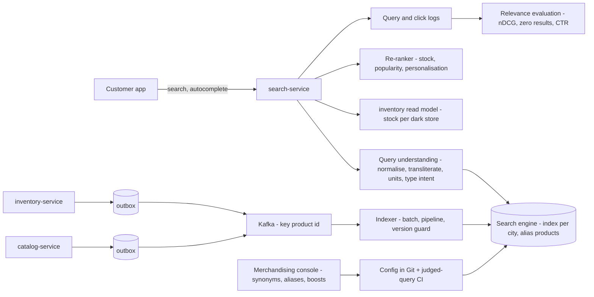
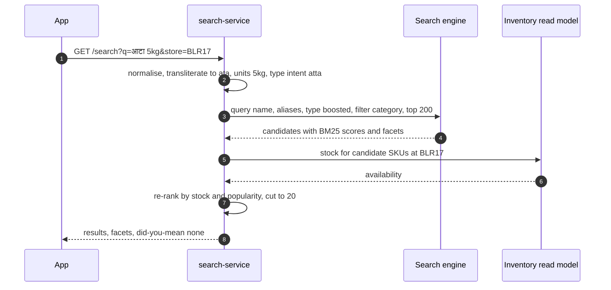
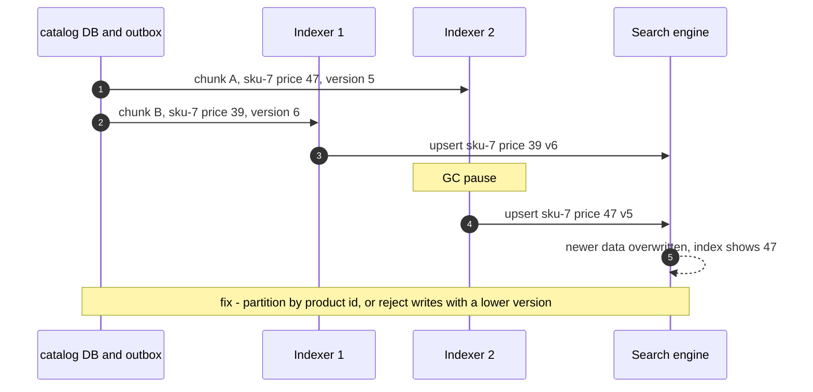
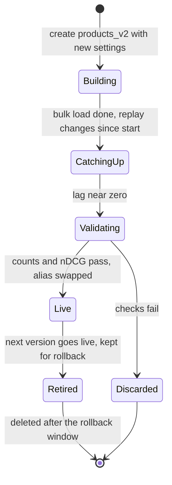

# 22. Search Systems

!!! abstract "Chapter at a glance"
    **Reader bands:** B2 → B4 · **Prerequisites:** [Ch 05](../01-foundations/05-relational-databases-deep-dive.md), [Ch 13](../02-distributed-core/13-distributed-transactions.md), [Ch 14](../02-distributed-core/14-messaging-and-event-streaming.md), [Ch 21](21-data-at-scale.md) · **What you will build:** Product search for the grocery app. Customers type English, Hinglish ("aata", "doodh"), Devanagari ("आटा") and typos, and expect the right item at the top, in stock, within 100 ms. All four labs are measured against 20 judged queries.

    - **L1: an inverted index and BM25 written from scratch.** The analyzer stages took nDCG@10 from **0.367 to 1.000**. Naive fuzzy matching *broke* "chai patti" by matching "chakki" (atta). The index was **194x faster** than a scan, and stock/popularity boosting took out-of-stock items in the top 3 from **11 to 0**.
    - **L2: search inside PostgreSQL** on 200,000 listings: trigram and full-text GIN indexes, autocomplete, `word_similarity` for typos, facets with grouping sets. Devanagari and Hinglish returned **0 rows**.
    - **L3: a real engine, Meilisearch 1.11**, fed from PostgreSQL through an outbox.
        - Relevance: engine defaults **0.429**, with synonyms **0.779**, with index-time aliases **0.979**.
        - Sync: pipelined indexing kept commit-to-searchable at **~0.8 s**, while waiting on each task pushed it to **22 s**.
        - Two unordered indexers overwrote newer data with older **26 times** and left 3 products stale. Partitioning by product id fixed it.
        - A reindex with an index swap served **0 empty results and 0 errors**.
    - **L4: vector search.** HNSW written from scratch reached **recall 0.991 at 34x brute-force speed**, and only with the paper's neighbour heuristic (0.872 without). Hybrid BM25 + vector ranking (RRF) was the only retriever good at both exact and "healthy breakfast"-style queries.

    · **Reading time:** 110 min + code

---

## 1. Introduction & Why It Matters

### 1.1 A story: "aata" returns nothing

The week before Diwali, the search dashboard showed 23 % of searches returning **zero results**. Looking at the top zero-result queries, it was the customers who were right:

| Query | What they wanted | What search did |
|---|---|---|
| `aata`, `आटा` | Atta (wheat flour) | 0 results: the catalog says "Atta" |
| `doodh`, `दूध 1 litre` | Milk | 0 results |
| `curd` | Dahi | Only products literally named "Curd" |
| `tomatos`, `shampo` | Tomatoes, shampoo | 0 results |
| `potato` | Potatoes | Potato **chips** first |

Search was PostgreSQL `ILIKE '%…%'`, fine at launch, but it had no analyzers, no synonyms and no typo tolerance. A first fix, "turn on fuzzy matching", made things worse in a way nobody expected: `chai` started matching **"Chakki"**, the atta brand line, one edit away (L1 reproduces it).

The rebuild took four steps:

1. **Analysis:** units, stemming, Devanagari transliteration, phonetic normalisation for Hinglish.
2. **Merchandised synonyms and aliases.**
3. **A product-type field** so "potato" means the vegetable.
4. **Business ranking** that pushes out-of-stock items down.

Relevance on the judged set went from 0.367 to 1.0 (L1), and zero-result searches fell to under 2 % in production. A dedicated engine, kept in sync through the outbox, took search load off the orders database.

!!! quote "The thesis of this chapter"
    Search quality is decided by **what you index and how you analyse text**, far more than by which engine you pick. Every improvement should be **measured against judged queries**, not eyeballed. Then the engineering problems are those of any derived store: keep it in sync with the source of truth, in order, with bounded lag, and be able to rebuild it without downtime.

### 1.2 Where this lives in the grocery platform

| Capability | Where | Notes |
|---|---|---|
| Product search, autocomplete, facets | `search-service` → search engine (OpenSearch/Elasticsearch in production; Meilisearch in the lab) | Index per region/city; store availability joined at query time |
| Indexing pipeline | `catalog-service` and `inventory-service` outbox → Kafka → indexer | Partitioned by product id; version-guarded |
| Synonyms, aliases, boosts | Merchandising console → config in Git → engine settings | Reviewed like code; evaluated on judged queries |
| Relevance evaluation | Judged query set + click logs → nDCG, zero-result rate, CTR | Runs in CI on every analyzer change |
| Semantic ("intent") search | Vector field on the same index, hybrid with BM25 | "healthy breakfast", "party snacks" |
| Admin/back-office search | PostgreSQL full-text + trigram | Small, exact, internal |

### 1.3 Learning objectives

| Band | After this chapter you can… |
|---|---|
| <span class="band b2">B2</span> | Explain inverted indexes and BM25, build analyzers, and use PostgreSQL full-text and trigram search |
| <span class="band b3">B3</span> | Design analyzers for multilingual/transliterated queries, synonyms, typo tolerance, facets and autocomplete; keep an index in sync via CDC/outbox; reindex without downtime |
| <span class="band b4">B4</span> | Evaluate relevance with judged queries and online metrics, design hybrid lexical + vector search, and choose and operate a search platform |

---

## 2. Core Concepts — Beginner to Deep

### 2.1 Intuition <span class="band b2">B2</span>

- **An inverted index is the index at the back of a textbook.** Instead of reading every page for "paneer", you look up "paneer" and get page numbers (postings). L1: looking up the index was **194x faster** than scanning 20,000 products.
- **Analysis is agreeing on spelling before looking up.** "Aata", "atta" and "आटा" must end up as the same index entry, or the lookup misses. The same applies to "5kg" and "5 kg", and to "tomatoes" and "tomato".
- **Relevance ranking is the shopkeeper's judgement.** Of the 2,000 items that mention "oil", which 10 do you show first? Rarer words matter more (IDF), and repeated words matter less each time (saturation). Then business sense applies: in stock first, popular first.

### 2.2 The inverted index ⭐ <span class="band b2">B2</span>

- **Structure:**
    - A **term dictionary** (sorted terms, often an FST in Lucene).
    - For each term, a **postings list** of documents (plus term frequencies, positions for phrase queries, and offsets for highlighting).
    - Postings are compressed (delta + bit packing) and intersected with skip lists.
- **Segments:** Lucene-based engines write immutable segments. New documents go into a new segment, which becomes searchable after a **refresh** (1 s by default in Elasticsearch/OpenSearch, hence "near-real-time"). Deletes are tombstones, and background **merges** combine segments and purge deletes.
- **Doc values / columnar fields** support sorting, facets and aggregations without the inverted index.
- **Sharding:** an index is split into shards (hash of `_id` by default) and replicated. A query fans out to all shards and merges the top-k (scatter-gather, Ch 11).

L1's toy index for 20,000 products has 160 terms and 113,296 postings. Real catalogs have millions of terms, but the mechanism is the same.

### 2.3 Analysis: tokenizers and filters ⭐ <span class="band b2">B2</span>

An **analyzer** is a character filter → tokenizer → token filters, applied **at index time and at query time** (usually the same one, sometimes different, as with synonyms or edge n-grams).

| Stage | Examples | Grocery need |
|---|---|---|
| Character filters | Unicode normalisation (NFC/NFKC), HTML strip, mapping | Devanagari normalisation, "&" → "and" |
| Tokenizer | Standard (Unicode word boundaries), whitespace, ICU, n-gram | Hindi words, product codes |
| Token filters | Lowercase, ASCII folding, stop words, stemming, synonyms, phonetic, edge n-grams | Plurals, units, Hinglish spellings, autocomplete |

L1 adds stages one at a time and measures nDCG@10 on 20 judged queries:

| Analyzer | nDCG@10 | Zero-result queries |
|---|---|---|
| Lowercase + split | 0.367 | 11 |
| + unit normalisation ("5kg", "1 litre") + plural stemming | 0.457 | 10 |
| + Devanagari transliteration + phonetic normalisation | 0.607 | 7 |
| + synonyms | 0.900 | 1 |
| + fuzzy, naive | 0.900 | 0, but **"chai patti" now fails** |
| + fuzzy, guarded (≥ 5 chars, score × 0.5) | 0.950 | 0 |
| + product-type field (boost 3) | **1.000** | 0 |

**Stemming vs lemmatisation:** stemmers (Porter/Snowball) chop suffixes by rule ("tomatoes" → "tomato", fine; "news" → "new", wrong). PostgreSQL's `english` config and Lucene's analyzers use Snowball. For product names, light stemming (plurals only) is usually safer than aggressive stemming.

### 2.4 Indian languages, transliteration and Hinglish ⭐ <span class="band b3">B3</span>

Indian grocery search mixes three forms of the same word:

- English ("flour");
- Hindi in Latin script, spelled inconsistently ("aata", "atta", "ata");
- Devanagari ("आटा").

Regional languages (Tamil, Telugu, Kannada, Bengali) add more scripts. The techniques:

- **Transliteration to a common script at both index and query time.** L1 maps Devanagari to Latin (ITRANS-like, with the word-final schwa dropped). ICU's `Devanagari-Latin` transform or IndicNLP libraries do this properly.
- **Phonetic normalisation** of Latin Hinglish spellings: collapse long vowels (`aa`→`a`, `ee`→`i`, `oo`→`u`) and double consonants, and map `w`→`v`, `z`→`j`, `ph`→`f`.
    - L1: `आटा`, `aata` and `Atta` all become **`ata`**. `दूध` and `doodh` become **`dudh`**. `मूंग` and `moong` become **`mung`**.
    - Phonetic algorithms like Soundex/Metaphone are designed for English names and do poorly on Hinglish.
- **Synonyms bridging languages** (milk ↔ doodh, curd ↔ dahi, sugar ↔ chini). They're applied at query time so they can change without reindexing, and they're keyed on the *normalised* form so all spellings match.
- **Index-time enrichment:** add an `aliases` field per product type ("aata atta आटा gehun flour"), maintained by merchandising. In L3 this took a stock engine from 0.779 to **0.979** without writing an analyzer.
- **Limits:**
    - Medial schwa deletion is irregular: `नमकीन` transliterates to "namakin", but people type "namkeen". So transliteration plus fuzziness or aliases are complementary.
    - Neither replaces a **query log review**: the top zero-result queries each week are the to-do list.

### 2.5 Relevance: TF-IDF, BM25, field boosts ⭐ <span class="band b2">B2</span>

**BM25** (the default in Lucene, Elasticsearch/OpenSearch and most engines) scores a document for a query term *t*:

```text
score(t, d) = IDF(t) · tf·(k1 + 1) / (tf + k1·(1 − b + b·|d|/avgdl))
IDF(t)      = ln(1 + (N − df + 0.5)/(df + 0.5))
```

- **IDF:** rare terms matter more. "Paneer" discriminates more than "fresh".
- **TF saturation (`k1`, ~1.2):** the 5th occurrence adds little.
- **Length normalisation (`b`, ~0.75):** a match in a short name counts more than one in a long description.
- **Field boosts (BM25F):** a match in `name` counts more than one in `description`. L1 uses name ×2, brand/category/size ×1, and a curated `type` field ×3.

**Query-side choices:**

- AND vs OR, `minimum_should_match`;
- phrase and proximity boosts ("toor dal" as a phrase);
- `multi_match` types (best_fields vs cross_fields);
- scoring each expansion (synonym or fuzzy) as the **max**, not the sum, so an expanded term doesn't count twice (L1).

### 2.6 Query understanding <span class="band b3">B3</span>

Most relevance problems are about understanding the query:

- **Attribute extraction:**
    - "paneer 200g": the product is paneer and the size is 200 g.
    - "atta 5kg" → type atta, size 5 kg.
    - L1's unit normaliser turns "5 kg", "5kg" and "5 kgs" into one token.
- **Product-type / category intent:**
    - "potato" is a vegetable query, not chips. A curated `type` field (or a query classifier trained on clicks) fixed it: 0.950 → 1.000 in L1.
- **Spell correction** from the query log (did-you-mean), rather than blind fuzzy matching.
- **Guard rails on fuzziness:**
    - No fuzziness for short terms: Lucene's `AUTO` fuzziness allows 0 edits for 1–2 chars and 1 edit for 3–5.
    - Penalise fuzzy matches below exact matches.
    - Never fuzz brand names or numbers.

    L1's naive fuzzy expanded `chai` → `chaki` (Chakki Atta) because "chai" isn't in the product vocabulary (only its synonym "tea" is).

### 2.7 Business ranking, filters and facets ⭐ <span class="band b3">B3</span>

Text relevance gets you the candidates. The final order also uses business signals:

- in stock at the customer's dark store;
- popularity and conversion;
- margin and promotions (with care);
- personalisation (past purchases).

**Function score:** `final = text_score × f(popularity) × stock_factor`, or a learned model (learning to rank) re-ranking the top 100–1,000. L1: multiplying by `1 + 0.1·ln(1+popularity)` and demoting out-of-stock ×0.3 took **out-of-stock in the top 3 from 11 of 60 to 0**, with nDCG 1.000 → 0.992.

**Filters vs queries:**

- **Filters** (`category = Masala`, `in_stock = true`, `store_id = …`) don't affect scores and can be cached as bitsets.
- **Queries** score.
- Put structured constraints in filters.

**Facets:** counts per attribute value for the current result set ("Masala 1,022 · Snacks 240"), computed from doc values. They're shown for refinement.

- L1, L2 and L3 all show them.
- In L3, Meilisearch's `estimatedTotalHits` capped at 1,000 while the facet counts summed to 1,262. Know your engine's approximations.

### 2.8 Autocomplete and typo tolerance <span class="band b3">B3</span>

| Technique | How | Trade-off |
|---|---|---|
| Prefix query on the term dictionary | `sham*` | Simple; can be slow for very short prefixes |
| Edge n-grams at index time | "shampoo" → sh, sha, sham, … | Fast queries; bigger index |
| Completion suggester (FST) | A dedicated in-memory structure with weights | Fastest; separate field, no filters (or limited) |
| Trigram similarity (`pg_trgm`) | Similarity of trigram sets | Typo-tolerant; PostgreSQL-native (L2) |
| Search-as-you-type from a query log | Suggest popular *queries*, not products | Best UX; needs logs and moderation |

Latency budget: autocomplete fires on every keystroke, so target < 50 ms end to end. Debounce on the client (100–150 ms), cache popular prefixes, and cancel superseded requests.

### 2.9 Search inside PostgreSQL <span class="band b2">B2</span>

PostgreSQL is a reasonable first search engine (L2, 200,000 rows):

- **`pg_trgm` + GIN** for substring and fuzzy match: `ILIKE '%paneer%'` 28 → 14 ms (11 MB index). `word_similarity('shampo', name)` finds "Shampoo" at 0.86.
- **`tsvector` + GIN** with `websearch_to_tsquery`, `ts_rank` and weights (A for name, B for brand/category). The `english` config stems "tomatoes" and even "tomatos" to "tomato".
- **Facets** with `GROUP BY GROUPING SETS` in one round trip.

**Limits:**

- No transliteration or Hindi stemming out of the box: `आटा` gave an empty query and `aata` 0 rows.
- Relevance tuning is coarser than in a dedicated engine.
- Search load competes with OLTP (Ch 21).

A good fit for admin tools and small catalogs. Customer-facing search at scale moves to a dedicated engine.

### 2.10 Keeping the index in sync ⭐ <span class="band b3">B3</span>

The search index is a **derived store**, a read model (Ch 15). The source of truth stays in the service databases. The patterns:

| Pattern | Consistency | Notes |
|---|---|---|
| Dual write (service writes DB, then index) | Can diverge on any failure (Ch 13) | Don't |
| **Outbox / CDC → Kafka → indexer** | Eventually consistent, ordered per key | The standard (L3) |
| Periodic full reindex | Stale between runs | Also needed for rebuilds and backfills |

**The rules L3 demonstrates:**

- **Batch and pipeline.** Engines have high per-request overhead (segment refresh, commit). An indexer that **waited for each 20-document task** lagged **22 s (p50)** at 200 updates/s. Pipelined (enqueue and continue), lag was **~0.8 s**.
- **Preserve order per document.**
    - Two indexers taking alternating chunks of the outbox applied **26 older versions over newer ones** and left 3 of 20 products stale.
    - Partitioning by product id (Kafka key = product id) gave 0.
    - Engines with external versioning (Elasticsearch `version_type=external`) can also reject older writes.
- **Deletes and unpublishes** must flow through the same path (tombstone events).
- **Joins:** search documents are denormalised (product + brand + category + stock).
    - A change to a brand name must fan out to all its products, which is a reindex job, not a per-event update.
    - Fast-changing, per-store data (stock) is often kept out of the document and applied as a filter from a separate store at query time.

### 2.11 Reindexing without downtime <span class="band b3">B3</span>

Analyzer or mapping changes require a full reindex. The process:

1. Build `products_v2` alongside `products_v1`.
2. Replay recent changes into both (dual indexing from the stream, or catch-up from the outbox position recorded at the start).
3. Validate: doc counts, judged-query nDCG, a shadow query comparison.
4. **Atomically switch an alias** (Elasticsearch/OpenSearch `_aliases`, Meilisearch `swap-indexes`).
5. Keep v1 for rollback, then delete it.

L3: rebuild + swap in ~5 s while four clients searched continuously, with **6,604 successful queries, 0 empty, 0 errors**.

### 2.12 Vector search and ANN ⭐ <span class="band b4">B4</span>

Embedding models map text (and images) to vectors, so that semantically similar items are close. That catches "healthy breakfast" → oats and poha, which share no words. Search becomes **nearest neighbours** by cosine or dot product.

- **Exact k-NN** is O(N·d) per query. L4: 100,000 × 64 dims took **~4 ms/query**, fine for small collections and too slow at 50M.
- **Approximate NN (ANN):**
    - **HNSW:** a multi-layer proximity graph searched greedily. The default in Lucene/OpenSearch k-NN, pgvector, Qdrant, Weaviate and Milvus.
    - **IVF:** cluster and search the nearest lists. **Product quantisation** compresses vectors.
- **HNSW parameters:**
    - `M` (links per node): memory and recall.
    - `efConstruction`: build time and graph quality.
    - `efSearch`: query time vs recall.

    L4, from scratch:

    | Neighbour selection | efSearch | Recall@10 | Speed vs brute force |
    |---|---|---|---|
    | Simple ("closest M") | 40 | 0.872 | 33x |
    | Simple | 160 | 0.945 | 11x |
    | **Heuristic (paper's Algorithm 4)** | **40** | **0.991** | **34x** |
    | Heuristic | 80 | 1.000 | 20x |

    The neighbour-selection heuristic (prefer links in diverse directions) was the difference between a plateau at 0.945 and 1.000. Implementation details matter, which is one reason to use a mature library.
- **Memory:** vectors (100K × 64 × 4 B = 25 MB) plus graph links (~10 MB). At 768 dims and 50M items that's ~150 GB of floats. Quantisation (int8, binary) and disk-based indexes (DiskANN) exist for that reason.
- **Filtering + ANN** (in-stock, store) is hard. Pre-filtering breaks graph connectivity, and post-filtering may return too few results. Engines offer filtered HNSW or adaptive strategies. Test with realistic filter selectivity.

### 2.13 Hybrid search ⭐ <span class="band b4">B4</span>

Lexical and semantic retrieval fail differently:

- **BM25** is excellent at exact tokens (brands, sizes, SKU codes, "atta 5kg"), and blind to meaning.
- **Vectors** are good at intent ("party snacks"), and weak at exact attributes and rare terms.

**Hybrid** runs both and fuses them. **Reciprocal Rank Fusion** is the common default:

```text
RRF(d) = Σ over retrievers r:  w_r / (k + rank_r(d))      with k ≈ 60
```

L4 (with **toy** hand-written concept embeddings, so the *shape* of the result is the point, not the numbers):

| Retriever | 20 lexical queries | 8 intent queries |
|---|---|---|
| BM25 | **1.000** | 0.542 |
| Vector | 0.289 | 0.740 |
| Hybrid RRF | 0.903 | 0.769 |
| Hybrid RRF, vector weight 0.5 | **1.000** | **0.797** |

Plain RRF diluted the exact queries, and weighting restored them. Tune weights on **held-out** queries: L4 tuned on the same queries it reports, which overstates the gain. Beyond RRF: score normalisation plus a linear blend, or a cross-encoder / learning-to-rank model re-ranking the fused top 100.

### 2.14 Measuring relevance ⭐ <span class="band b4">B4</span>

- **Offline:**
    - A **judged query set**: queries sampled from logs (head, torso, tail, zero-result), with graded judgments (0/1/2).
    - Metrics: **nDCG@k**, precision@k, recall@k, MRR, **zero-result rate**.
    - Run it in CI on every analyzer, synonym or boost change. That's what every table in this chapter does.
- **Online:**
    - Click-through rate, add-to-cart rate from search, searches per session (reformulations), time to first add, revenue per search.
    - A/B tests, or **interleaving** (mixing two rankers' results in one list, which is more sensitive with less traffic).
- **Beware:**
    - Position bias in clicks (use it or correct it).
    - Judged sets that go stale.
    - **Overfitting to your own judgments.** L1 reached 1.000 on queries its author also wrote. Real sets need many more queries, fresh samples and independent judges.

---

## 3. Architecture & Diagrams

### 3.1 Component view



### 3.2 Sequence: happy path, a Devanagari query



### 3.3 Sequence: failure path, out-of-order index updates



### 3.4 State: a search index lifecycle



---

## 4. Design Document Excerpt: Grocery Product Search v2

| Field | Value |
|---|---|
| Author / Reviewers | Search team / catalog, inventory, merchandising, SRE |
| Status | Approved |
| Related ADRs | ADR-093 Dedicated search engine (OpenSearch) fed by outbox/Kafka; ADR-094 Analyzer with transliteration, phonetic normalisation, units; ADR-095 Synonyms/aliases as reviewed config with judged-query CI; ADR-096 Stock applied at query time from the inventory read model; ADR-097 Hybrid BM25 + vector with RRF, behind a flag |

**1. Context & Problem.** 23 % zero-result searches, Hinglish/Devanagari/typos unsupported, out-of-stock items ranked first, and search load on the orders database.

**2. Goals / Non-Goals.**

- *Goals:* zero-result rate < 3 %; nDCG@10 ≥ 0.85 on the judged set (≥ 500 queries); p99 < 150 ms for search and < 50 ms for autocomplete; price/stock changes searchable within 5 s.
- *Non-goals:* a full recommendation system; voice search (a later phase).

**3. Requirements.**

| ID | Requirement |
|---|---|
| FR-1 | Queries in English, Hinglish and Devanagari (later Kannada, Tamil, Telugu) match the same products |
| FR-2 | Typos of one edit on terms ≥ 5 characters; never on brands, numbers or short terms |
| FR-3 | Facets: category, brand, price band, dietary tags; filters are exact |
| FR-4 | Out-of-stock at the customer's store never ranks in the top 3 |
| NFR-1 | Commit → searchable p99 ≤ 5 s; per-product update order preserved |
| NFR-2 | Reindex with zero failed or empty queries (alias swap) |
| NFR-3 | Every relevance change passes judged-query CI (no nDCG regression > 0.01) |

**4. Capacity estimates.**

| Item | Calculation | Result |
|---|---|---|
| Documents | 400K SKUs × 12 cities (city-level assortments) | ~5M documents, ~2 KB each → ~10 GB per replica |
| Query rate | 10M sessions/day × 3 searches, peak 4x average | ~350 QPS average, ~1,400 QPS peak |
| Autocomplete | ~5 keystroke requests per search after debounce | ~7,000 QPS peak, cacheable prefixes |
| Update rate | Price/stock/catalog changes | ~200/s average, ~2,000/s at sale start |
| Vectors (phase 2) | 5M × 384 dims × 4 B (+ HNSW links) | ~7.7 GB + ~1 GB per replica; int8 quantisation → ~2 GB |

**5. Proposed design.**

1. **Engine:** an OpenSearch cluster, one index alias per city, 3 primaries × 2 replicas, dedicated coordinating nodes for autocomplete bursts.
2. **Analyzer:** ICU normalisation → ICU tokenizer → Devanagari→Latin transform → a custom Hinglish phonetic filter → lowercase → a unit filter → light plural stemming. An `aliases` field and a `type` field (keyword + analysed).
3. **Query:** `multi_match` over name^2, aliases^1.5, type^3, brand, category; search-time synonyms (updateable); fuzziness `AUTO:5,8`; function score with popularity; stock applied by a filter/re-rank from the inventory read model.
4. **Indexing:** the outbox → Kafka keyed by product id → an indexer with bulk requests (≤ 5 MB or 1,000 docs), pipelined, with external versioning on `_version`. Tombstones for deletes.
5. **Relevance ops:**
    - A judged set of 500 queries, refreshed monthly from logs, and CI that runs nDCG and the zero-result rate.
    - An interleaving framework for online tests.
    - A weekly zero-result review feeding aliases and synonyms.
6. **Hybrid (phase 2):** a 384-dim multilingual embedding model on name + aliases + category, HNSW (M=16, efSearch=100), RRF with the vector weight tuned on held-out queries.

**7. Alternatives considered.**

| Option | Pros | Cons | Verdict |
|---|---|---|---|
| PostgreSQL FTS + trigram | No new system | No transliteration, limited relevance tooling, load on OLTP (L2) | Admin tools only |
| **OpenSearch/Elasticsearch** | Full analyzer control, aggregations, k-NN, mature ops | Operational weight | **Chosen** |
| Meilisearch/Typesense | Great defaults (typo tolerance, prefix), simple | Less analyzer control, single-node focus | Good for smaller catalogs (L3) |
| Managed search SaaS | Least ops | Cost per query, data residency | Rejected (DPDP residency, cost) |
| Vector-only search | Handles intent | Poor on exact queries (L4: 0.289) | Only as part of hybrid |

**8. Failure modes.**

- Indexer lag → alert at 5 s; search still serves (slightly stale).
- Engine unavailable → degraded mode: cached popular results, then a PostgreSQL fallback for exact names.
- Bad synonym deploy → caught by judged-query CI, with rollback by config revert.
- Hot shard during a sale → replicas + adaptive replica selection.

**10. Observability.**

- Query: p50/p99 latency, zero-result rate by language/script, top zero-result queries, CTR@k, add-to-cart from search, reformulation rate.
- Indexing: lag, bulk rejections, version conflicts (a proxy for out-of-order events).
- Engine: segment count, merge time, heap, cache hit rates.

**14. Decision (ADR-093–097 summary).** A dedicated engine fed by an ordered outbox stream. Analyzers built for Hinglish and Devanagari. Synonyms and aliases as tested config. Stock applied at query time. Hybrid retrieval behind a flag, evaluated offline and online.

---

## 5. Hands-On Code — Level Ladder

| Level | New requirement that forces the step |
|---|---|
| L1 | "Understand what search does, and fix relevance measurably." (inverted index + BM25 + analyzers from scratch, judged queries) |
| L2 | "Can PostgreSQL do it?" (trigram, full-text, autocomplete, facets on 200K rows) |
| L3 | "Use a real engine and keep it in sync with the database." (Meilisearch, outbox indexer, ordering, reindex with swap) |
| L4 | "Understand intent queries." (HNSW from scratch, hybrid BM25 + vector with RRF) |

All labs ran on a 2 vCPU container:

- **JDK 25** (Temurin), which launches multi-file source programs, so `SearchL1.java`, `MeiliL3.java` and `VectorL4.java` share `Catalog.java`
- **PostgreSQL 16** (`:5543`)
- **Meilisearch 1.11.3** (`:7700`, from its GitHub release)

The catalog is 20,000 generated products (invented brands) for L1/L3/L4, and 200,000 listings for L2. The outputs below are verbatim. Lab files are in `labs/ch22-search/`.

**The shared catalog, judged queries and analyzer building blocks** (tokeniser, unit normaliser, plural stemmer, Devanagari transliterator, Hinglish phonetic normaliser, synonyms):

```java title="Catalog.java"
// Catalog.java — shared by the Ch 22 labs (JDK 25 multi-file source launch: `java SearchL1.java` finds this file).
// A deterministic grocery catalog (invented brands), the judged query set, and the analyzer building blocks:
// tokenising, unit normalisation, plural stemming, Devanagari → Latin transliteration, phonetic normalisation, synonyms.
import java.text.Normalizer;
import java.util.*;

public class Catalog {
    public record Type(String key, String category, List<String> names, List<String> sizes) {}
    public record Product(int id, String type, String name, String brand, String category, String size, int popularity, boolean inStock, int pricePaise) {
        public String text() { return name + " " + brand + " " + size; }
    }

    public static final List<Type> TYPES = List.of(
        new Type("atta", "Staples", List.of("Chakki Fresh Atta", "Whole Wheat Atta"), List.of("1 kg", "5 kg", "10 kg")),
        new Type("basmati", "Staples", List.of("Basmati Rice", "Classic Basmati Rice"), List.of("1 kg", "5 kg")),
        new Type("sona-masoori", "Staples", List.of("Sona Masoori Rice"), List.of("5 kg", "10 kg")),
        new Type("toor-dal", "Staples", List.of("Toor Dal", "Unpolished Toor Dal"), List.of("500 g", "1 kg")),
        new Type("moong-dal", "Staples", List.of("Moong Dal", "Yellow Moong Dal"), List.of("500 g", "1 kg")),
        new Type("chana-dal", "Staples", List.of("Chana Dal"), List.of("500 g", "1 kg")),
        new Type("sugar", "Staples", List.of("Sugar", "Refined Sugar"), List.of("1 kg", "5 kg")),
        new Type("salt", "Staples", List.of("Iodised Salt"), List.of("1 kg")),
        new Type("jaggery", "Staples", List.of("Organic Jaggery", "Jaggery Cubes"), List.of("500 g", "1 kg")),
        new Type("sunflower-oil", "Oils", List.of("Refined Sunflower Oil"), List.of("1 L", "5 L")),
        new Type("mustard-oil", "Oils", List.of("Kachi Ghani Mustard Oil"), List.of("1 L", "5 L")),
        new Type("groundnut-oil", "Oils", List.of("Groundnut Oil"), List.of("1 L")),
        new Type("ghee", "Oils", List.of("Desi Ghee", "Cow Ghee"), List.of("500 ml", "1 L")),
        new Type("milk", "Dairy", List.of("Toned Milk", "Full Cream Milk"), List.of("500 ml", "1 L")),
        new Type("curd", "Dairy", List.of("Fresh Dahi", "Set Curd"), List.of("400 g", "1 kg")),
        new Type("paneer", "Dairy", List.of("Malai Paneer", "Fresh Paneer"), List.of("200 g", "500 g")),
        new Type("butter", "Dairy", List.of("Salted Butter"), List.of("100 g", "500 g")),
        new Type("tomato", "Vegetables", List.of("Tomato", "Hybrid Tomato"), List.of("500 g", "1 kg")),
        new Type("onion", "Vegetables", List.of("Onion"), List.of("1 kg", "2 kg")),
        new Type("potato", "Vegetables", List.of("Potato", "New Potato"), List.of("1 kg", "2 kg")),
        new Type("banana", "Fruits", List.of("Robusta Banana", "Yelakki Banana"), List.of("6 pcs", "12 pcs")),
        new Type("turmeric", "Masala", List.of("Turmeric Powder"), List.of("100 g", "200 g")),
        new Type("cumin", "Masala", List.of("Cumin Seeds", "Jeera Whole"), List.of("100 g")),
        new Type("tea", "Beverages", List.of("Assam Tea", "Premium Tea Leaves"), List.of("250 g", "500 g")),
        new Type("coffee", "Beverages", List.of("Filter Coffee Powder"), List.of("200 g")),
        new Type("biscuit", "Snacks", List.of("Glucose Biscuits", "Marie Biscuits"), List.of("250 g")),
        new Type("namkeen", "Snacks", List.of("Aloo Bhujia", "Namkeen Mixture"), List.of("200 g", "400 g")),
        new Type("chips", "Snacks", List.of("Potato Chips Salted", "Masala Potato Chips"), List.of("52 g", "90 g")),
        new Type("bread", "Bakery", List.of("Brown Bread", "Sandwich Bread"), List.of("400 g")),
        new Type("eggs", "Dairy", List.of("Farm Fresh Eggs", "Brown Eggs"), List.of("6 pcs", "12 pcs")),
        new Type("cornflakes", "Breakfast", List.of("Corn Flakes"), List.of("475 g")),
        new Type("oats", "Breakfast", List.of("Rolled Oats"), List.of("1 kg")),
        new Type("poha", "Breakfast", List.of("Thick Poha"), List.of("500 g")),
        new Type("shampoo", "Personal Care", List.of("Anti-Dandruff Shampoo", "Herbal Shampoo"), List.of("180 ml", "340 ml")),
        new Type("soap", "Personal Care", List.of("Sandal Soap", "Neem Bathing Bar"), List.of("4 x 100 g")),
        new Type("toothpaste", "Personal Care", List.of("Herbal Toothpaste"), List.of("150 g")),
        new Type("detergent", "Home Care", List.of("Detergent Powder", "Matic Liquid Detergent"), List.of("1 kg", "2 L")),
        new Type("dishwash", "Home Care", List.of("Dishwash Liquid Lemon"), List.of("500 ml")),
        new Type("cola", "Beverages", List.of("Cola Soft Drink"), List.of("750 ml", "2 L")),
        new Type("mango-juice", "Beverages", List.of("Mango Drink"), List.of("1 L")));

    public static final List<String> BRANDS = List.of("Sunehri", "Aranya", "Bhoomika", "Pavitra", "Hariyali Farms", "Chandan Mills",
            "Deshi Dairy", "Nirmal", "Ujjwal", "Gauri", "Tarangini", "Mitti", "Saral", "Annika", "Vasundhara", "Kaveri Valley",
            "Shubh", "Prakriti", "Amrit", "Neelam");

    /** 20,000 products (or n): every type × brand × name × size, then repeated with pack variants and seller listings. */
    public static List<Product> products(int n) {
        Random r = new Random(22);
        List<Product> ps = new ArrayList<>();
        int id = 1;
        while (ps.size() < n) {
            Type t = TYPES.get(r.nextInt(TYPES.size()));
            String brand = BRANDS.get(r.nextInt(BRANDS.size()));
            String name = brand + " " + t.names().get(r.nextInt(t.names().size()));
            String size = t.sizes().get(r.nextInt(t.sizes().size()));
            int pop = (int) Math.floor(Math.exp(r.nextGaussian() * 1.5 + 3));            // long-tailed popularity
            ps.add(new Product(id++, t.key(), name, brand, t.category(), size, pop, r.nextDouble() > 0.15, 2_000 + r.nextInt(80_000)));
        }
        return ps;
    }

    // ---------------- judged queries ----------------
    public record Judged(String query, Set<String> types, String size) {}
    public static final List<Judged> QUERIES = List.of(
        new Judged("atta 5kg", Set.of("atta"), "5 kg"),
        new Judged("aata", Set.of("atta"), null),
        new Judged("आटा", Set.of("atta"), null),
        new Judged("doodh", Set.of("milk"), null),
        new Judged("दूध 1 litre", Set.of("milk"), "1 L"),
        new Judged("curd", Set.of("curd"), null),
        new Judged("tomatos", Set.of("tomato"), null),
        new Judged("toor daal", Set.of("toor-dal"), null),
        new Judged("basmati chawal", Set.of("basmati"), null),
        new Judged("cooking oil", Set.of("sunflower-oil", "mustard-oil", "groundnut-oil"), null),
        new Judged("chini", Set.of("sugar"), null),
        new Judged("shampo", Set.of("shampoo"), null),
        new Judged("paneer 200g", Set.of("paneer"), "200 g"),
        new Judged("मूंग दाल", Set.of("moong-dal"), null),
        new Judged("haldi", Set.of("turmeric"), null),
        new Judged("chai patti", Set.of("tea"), null),
        new Judged("gur", Set.of("jaggery"), null),
        new Judged("anda", Set.of("eggs"), null),
        new Judged("namkeen", Set.of("namkeen"), null),
        new Judged("potato", Set.of("potato"), null));

    /** Graded relevance: 2 = right type and requested size, 1 = right type, 0 = not relevant. */
    public static int grade(Judged q, Product p) {
        if (!q.types().contains(p.type())) return 0;
        return q.size() == null || q.size().equals(p.size()) ? 2 : 1;
    }

    /** nDCG@k of a ranking against the ideal ranking over the whole catalog. */
    public static double ndcg(Judged q, List<Product> ranked, List<Product> all, int k) {
        double dcg = 0;
        for (int i = 0; i < Math.min(k, ranked.size()); i++) dcg += (Math.pow(2, grade(q, ranked.get(i))) - 1) / (Math.log(i + 2) / Math.log(2));
        int[] ideal = all.stream().mapToInt(p -> grade(q, p)).filter(g -> g > 0).boxed().sorted(Comparator.reverseOrder()).limit(k).mapToInt(Integer::intValue).toArray();
        double idcg = 0;
        for (int i = 0; i < ideal.length; i++) idcg += (Math.pow(2, ideal[i]) - 1) / (Math.log(i + 2) / Math.log(2));
        return idcg == 0 ? 0 : dcg / idcg;
    }

    // ---------------- analyzer building blocks ----------------
    public static List<String> tokenize(String s) {
        String n = Normalizer.normalize(s.toLowerCase(Locale.ROOT), Normalizer.Form.NFC);
        List<String> out = new ArrayList<>();
        for (String t : n.split("[^\\p{L}\\p{M}\\p{N}]+")) if (!t.isEmpty()) out.add(t);
        return out;
    }

    static final Map<String, String> UNITS = Map.ofEntries(Map.entry("kg", "kg"), Map.entry("kgs", "kg"), Map.entry("g", "g"), Map.entry("gm", "g"),
            Map.entry("gms", "g"), Map.entry("grams", "g"), Map.entry("l", "l"), Map.entry("ltr", "l"), Map.entry("litre", "l"), Map.entry("liter", "l"),
            Map.entry("ml", "ml"), Map.entry("pcs", "pcs"), Map.entry("pc", "pcs"));

    /** "5 kg", "5kg", "5 kgs" → "5kg"; "1 litre" → "1l". */
    public static List<String> units(List<String> ts) {
        List<String> out = new ArrayList<>();
        for (int i = 0; i < ts.size(); i++) {
            String t = ts.get(i);
            var m = java.util.regex.Pattern.compile("^(\\d+)([a-z]+)$").matcher(t);
            if (m.matches() && UNITS.containsKey(m.group(2))) { out.add(m.group(1) + UNITS.get(m.group(2))); continue; }
            if (t.matches("\\d+") && i + 1 < ts.size() && UNITS.containsKey(ts.get(i + 1))) { out.add(t + UNITS.get(ts.get(i + 1))); i++; continue; }
            out.add(t);
        }
        return out;
    }

    /** Minimal English plural stemming: tomatoes → tomato, biscuits → biscuit (not "gms", "pcs" units). */
    public static String stem(String t) {
        if (t.length() > 4 && t.endsWith("oes")) return t.substring(0, t.length() - 2);
        if (t.length() > 3 && t.endsWith("s") && !t.endsWith("ss") && !Character.isDigit(t.charAt(0))) return t.substring(0, t.length() - 1);
        return t;
    }

    // Devanagari → Latin (ITRANS-like, with schwa at word end dropped)
    static final Map<Character, String> CONS = new HashMap<>(), VOW = new HashMap<>(), MATRA = new HashMap<>();
    static {
        String[][] c = {{"क","k"},{"ख","kh"},{"ग","g"},{"घ","gh"},{"ङ","n"},{"च","ch"},{"छ","chh"},{"ज","j"},{"झ","jh"},{"ञ","n"},{"ट","t"},{"ठ","th"},
            {"ड","d"},{"ढ","dh"},{"ण","n"},{"त","t"},{"थ","th"},{"द","d"},{"ध","dh"},{"न","n"},{"प","p"},{"फ","ph"},{"ब","b"},{"भ","bh"},{"म","m"},
            {"य","y"},{"र","r"},{"ल","l"},{"व","v"},{"श","sh"},{"ष","sh"},{"स","s"},{"ह","h"},{"ड़","r"},{"ढ़","rh"}};
        for (String[] x : c) CONS.put(x[0].charAt(0), x[1]);
        String[][] v = {{"अ","a"},{"आ","aa"},{"इ","i"},{"ई","ii"},{"उ","u"},{"ऊ","uu"},{"ए","e"},{"ऐ","ai"},{"ओ","o"},{"औ","au"},{"ऋ","ri"}};
        for (String[] x : v) VOW.put(x[0].charAt(0), x[1]);
        String[][] m = {{"ा","aa"},{"ि","i"},{"ी","ii"},{"ु","u"},{"ू","uu"},{"े","e"},{"ै","ai"},{"ो","o"},{"ौ","au"},{"ृ","ri"},{"ॉ","o"}};
        for (String[] x : m) MATRA.put(x[0].charAt(0), x[1]);
    }
    public static String transliterate(String w) {
        w = w.replace("ड़", "ड़").replace("ढ़", "ढ़");                 // decompose nukta forms
        var sb = new StringBuilder();
        for (int i = 0; i < w.length(); i++) {
            char ch = w.charAt(i);
            if (ch == '़') continue;
            if (CONS.containsKey(ch)) {
                sb.append(CONS.get(ch));
                char next = i + 1 < w.length() ? w.charAt(i + 1) : 0;
                if (next == '़') next = i + 2 < w.length() ? w.charAt(i + 2) : 0;
                boolean last = next == 0;
                if (!MATRA.containsKey(next) && next != '्' && !last) sb.append('a');   // inherent schwa (not at word end)
            } else if (MATRA.containsKey(ch)) sb.append(MATRA.get(ch));
            else if (VOW.containsKey(ch)) sb.append(VOW.get(ch));
            else if (ch == 'ं' || ch == 'ँ') sb.append('n');
            else if (ch == '्') { /* virama: no vowel */ }
            else if (ch >= '०' && ch <= '९') sb.append((char) ('0' + (ch - '०')));
            else sb.append(ch);
        }
        return sb.toString();
    }

    /** Phonetic normalisation for Hinglish spellings: aata/atta/आटा → ata, doodh/dudh/दूध → dudh, daal/dal → dal. */
    public static String phonetic(String t) {
        if (t.chars().anyMatch(c -> c >= 0x0900 && c <= 0x097F)) t = transliterate(t);
        if (t.chars().anyMatch(Character::isDigit)) return t;
        t = t.replace("ee", "i").replace("oo", "u").replace("aa", "a").replace("ii", "i").replace("uu", "u")
             .replace("w", "v").replace("ph", "f").replace("q", "k").replace("z", "j");
        var sb = new StringBuilder();
        for (char c : t.toCharArray()) if (sb.isEmpty() || sb.charAt(sb.length() - 1) != c) sb.append(c);   // collapse doubles
        return sb.toString();
    }

    /** Query-side synonyms, keyed and valued in phonetic form (so they apply after normalisation). */
    public static final Map<String, List<String>> SYNONYMS = new HashMap<>();
    static {
        String[][] groups = {{"curd", "dahi"}, {"milk", "dudh"}, {"sugar", "chini"}, {"rice", "chaval"}, {"oil", "tel"}, {"salt", "namak"},
            {"turmeric", "haldi"}, {"cumin", "jeera", "jira"}, {"tea", "chai", "chay"}, {"jagery", "gur", "gud"}, {"dal", "daal", "lentil"},
            {"egs", "eg", "anda", "ande"}, {"potato", "alu"}, {"tomato", "tamatar"}, {"onion", "pyaj", "pyaz"}, {"banana", "kela"},
            {"buter", "makhan"}, {"soap", "sabun"}, {"tur", "arhar"}};
        for (String[] g : groups) {
            List<String> norm = Arrays.stream(g).map(Catalog::phonetic).distinct().toList();
            for (String k : norm) SYNONYMS.put(k, norm);
        }
    }
}
```

### L1 — Inverted index, BM25 and analyzers, measured <span class="band b2">B2</span>

**Requirement:** "Customers type 'aata', 'आटा', 'doodh 1 litre', 'tomatos'. Make search find the right products, and prove it with numbers."

```java title="SearchL1.java"
// SearchL1.java — run with: /opt/jdk25/bin/java SearchL1.java     (JDK 22+ launches multi-file programs: uses Catalog.java)
// An inverted index with BM25 over 20,000 grocery products, built from scratch, evaluated on 20 judged queries
// (English, Hinglish, Devanagari, typos, units). Part A adds analyzer stages one at a time and measures nDCG@10.
// Part B compares index lookup with a full scan. Part C adds business ranking (stock, popularity) and facets.
import java.util.*;
import java.util.stream.*;

public class SearchL1 {
    record Analyzer(String label, boolean units, boolean stem, boolean phonetic, boolean synonyms, int fuzzy, boolean typeField) {
        // fuzzy: 0 = off, 1 = naive (any unknown term ≥ 4 chars, full weight), 2 = guarded (≥ 5 chars, score × 0.5)
        List<String> terms(String text) {
            List<String> ts = Catalog.tokenize(text);
            if (units) ts = Catalog.units(ts);
            List<String> out = new ArrayList<>();
            for (String t : ts) { if (stem) t = Catalog.stem(t); if (phonetic) t = Catalog.phonetic(t); out.add(t); }
            return out;
        }
    }

    static final class Index {
        final Analyzer an; final List<Catalog.Product> docs;
        final Map<String, Map<Integer, int[]>> postings = new HashMap<>();   // term → doc → tf per field {name, other, type}
        final int[][] len; final double[] avg = new double[3];
        static final double K1 = 1.2, B = 0.75; static final double[] BOOST = {2.0, 1.0, 3.0};

        Index(Analyzer an, List<Catalog.Product> docs) {
            this.an = an; this.docs = docs; len = new int[docs.size()][3];
            for (int d = 0; d < docs.size(); d++) {
                var p = docs.get(d);
                // field 2: the product type, a curated attribute ("potato" for vegetables, "chips" for chips)
                String[] fields = {p.name(), p.brand() + " " + p.category() + " " + p.size(), an.typeField() ? p.type().replace('-', ' ') : ""};
                for (int f = 0; f < 3; f++) {
                    List<String> ts = an.terms(fields[f]); len[d][f] = ts.size(); avg[f] += ts.size();
                    for (String t : ts) postings.computeIfAbsent(t, k -> new HashMap<>()).computeIfAbsent(d, k -> new int[3])[f]++;
                }
            }
            for (int f = 0; f < 3; f++) avg[f] = Math.max(avg[f] / docs.size(), 1e-9);
        }

        /** Expansions of one query term: itself, its synonyms, and (if unknown) dictionary terms within edit distance 1. */
        List<String> expand(String t) {
            Set<String> ex = new LinkedHashSet<>(List.of(t));
            if (an.synonyms()) ex.addAll(Catalog.SYNONYMS.getOrDefault(t, List.of()));
            if (an.fuzzy() > 0 && !postings.containsKey(t) && t.length() >= (an.fuzzy() == 1 ? 4 : 5) && !Character.isDigit(t.charAt(0)))
                for (String cand : postings.keySet()) if (Math.abs(cand.length() - t.length()) <= 1 && editDistance(cand, t) <= 1) ex.add(cand);
            return new ArrayList<>(ex);
        }

        double idf(String term) { int df = postings.getOrDefault(term, Map.of()).size(); return Math.log(1 + (docs.size() - df + 0.5) / (df + 0.5)); }

        /** BM25F-lite: per query term, the best-scoring expansion (so synonyms don't double count). */
        Map<Integer, Double> score(String query) {
            Map<Integer, Double> scores = new HashMap<>();
            for (String qt : an.terms(query)) {
                Map<Integer, Double> best = new HashMap<>();
                for (String t : expand(qt)) {
                    double idf = idf(t) * (an.fuzzy() == 2 && !t.equals(qt) && !Catalog.SYNONYMS.getOrDefault(qt, List.of()).contains(t) ? 0.5 : 1.0);
                    for (var e : postings.getOrDefault(t, Map.of()).entrySet()) {
                        double s = 0;
                        for (int f = 0; f < 3; f++) {
                            int tf = e.getValue()[f]; if (tf == 0) continue;
                            double norm = tf * (K1 + 1) / (tf + K1 * (1 - B + B * len[e.getKey()][f] / avg[f]));
                            s += BOOST[f] * idf * norm;
                        }
                        best.merge(e.getKey(), s, Math::max);
                    }
                }
                best.forEach((d, s) -> scores.merge(d, s, Double::sum));
            }
            return scores;
        }

        List<Catalog.Product> search(String q, int k) {
            return score(q).entrySet().stream().sorted(Map.Entry.<Integer, Double>comparingByValue().reversed().thenComparing(Map.Entry.comparingByKey()))
                    .limit(k).map(e -> docs.get(e.getKey())).toList();
        }
    }

    static int editDistance(String a, String b) {
        int[] prev = new int[b.length() + 1], cur = new int[b.length() + 1];
        for (int j = 0; j <= b.length(); j++) prev[j] = j;
        for (int i = 1; i <= a.length(); i++) {
            cur[0] = i;
            for (int j = 1; j <= b.length(); j++) cur[j] = Math.min(Math.min(cur[j - 1] + 1, prev[j] + 1), prev[j - 1] + (a.charAt(i - 1) == b.charAt(j - 1) ? 0 : 1));
            int[] t = prev; prev = cur; cur = t;
        }
        return prev[b.length()];
    }

    public static void main(String[] args) {
        List<Catalog.Product> docs = Catalog.products(20_000);
        List<Analyzer> analyzers = List.of(
            new Analyzer("lowercase + split", false, false, false, false, 0, false),
            new Analyzer("+ units (5kg, 1 litre) + plural stem", true, true, false, false, 0, false),
            new Analyzer("+ Devanagari + phonetic (aata/atta/आटा)", true, true, true, false, 0, false),
            new Analyzer("+ synonyms (curd↔dahi, milk↔doodh …)", true, true, true, true, 0, false),
            new Analyzer("+ fuzzy, naive (edit distance 1, ≥ 4 chars)", true, true, true, true, 1, false),
            new Analyzer("  fuzzy guarded instead (≥ 5 chars, score ×0.5)", true, true, true, true, 2, false),
            new Analyzer("+ product-type field, boost 3", true, true, true, true, 2, true));

        System.out.println("A. 20 judged queries over 20,000 products: analyzer stages vs relevance (nDCG@10, BM25, name boost 2)");
        System.out.printf("   %-49s %9s %13s   %s%n", "analyzer", "nDCG@10", "zero results", "queries still failing (nDCG < 0.5)");
        Index last = null;
        for (Analyzer an : analyzers) {
            Index idx = new Index(an, docs); last = idx;
            double sum = 0; int zero = 0; List<String> failing = new ArrayList<>();
            for (var q : Catalog.QUERIES) {
                var res = idx.search(q.query(), 10);
                double n = Catalog.ndcg(q, res, docs, 10); sum += n;
                if (res.isEmpty()) zero++;
                if (n < 0.5) failing.add(q.query());
            }
            System.out.printf("   %-49s %9.3f %13d   %s%n", an.label(), sum / Catalog.QUERIES.size(), zero, failing.isEmpty() ? "-" : String.join(", ", failing));
        }
        final Index fin = last;
        System.out.printf("   analyzed forms: %s%n", Stream.of("आटा", "aata", "Atta", "दूध", "doodh", "मूंग", "moong", "1 litre", "5kg")
                .map(s -> s + "→" + String.join(" ", fin.an.terms(s))).collect(Collectors.joining(", ")));

        System.out.println("B. Inverted index vs scanning every product (final analyzer, 20 queries × 50 rounds)");
        Index idx = last;
        long t0 = System.nanoTime(); int hits = 0;
        for (int r = 0; r < 50; r++) for (var q : Catalog.QUERIES) hits += idx.search(q.query(), 10).size();
        double indexUs = (System.nanoTime() - t0) / 1e3 / (50 * Catalog.QUERIES.size());
        t0 = System.nanoTime();
        for (int r = 0; r < 5; r++) for (var q : Catalog.QUERIES) {
            var qt = idx.an.terms(q.query()).stream().flatMap(t -> idx.expand(t).stream()).collect(Collectors.toSet());
            var scored = new ArrayList<Integer>();
            for (int d = 0; d < docs.size(); d++) {                                         // re-analyse every document per query
                var dt = idx.an.terms(docs.get(d).text());
                for (String t : dt) if (qt.contains(t)) { scored.add(d); break; }
            }
            hits += scored.size();
        }
        double scanUs = (System.nanoTime() - t0) / 1e3 / (5 * Catalog.QUERIES.size());
        long postings = idx.postings.values().stream().mapToLong(Map::size).sum();
        System.out.printf("   index: %,d terms, %,d postings | per query: index %,.0f µs, full scan %,.0f µs (%.0fx)%n",
                idx.postings.size(), postings, indexUs, scanUs, scanUs / indexUs);

        System.out.println("C. Business ranking and facets (final analyzer)");
        int oosTop3 = 0, oosTop3Boosted = 0; double ndcgText = 0, ndcgBoosted = 0;
        for (var q : Catalog.QUERIES) {
            var scores = idx.score(q.query());
            var byText = scores.entrySet().stream().sorted(Map.Entry.<Integer, Double>comparingByValue().reversed().thenComparing(Map.Entry.comparingByKey()))
                    .map(e -> docs.get(e.getKey())).limit(10).toList();
            // function score: text relevance × (1 + 0.1·log(1 + popularity)), out-of-stock demoted ×0.3
            var boosted = scores.entrySet().stream().sorted(Comparator.comparingDouble((Map.Entry<Integer, Double> e) -> {
                        var p = docs.get(e.getKey());
                        return -e.getValue() * (1 + 0.1 * Math.log1p(p.popularity())) * (p.inStock() ? 1 : 0.3); }).thenComparing(Map.Entry.comparingByKey()))
                    .map(e -> docs.get(e.getKey())).limit(10).toList();
            oosTop3 += (int) byText.stream().limit(3).filter(p -> !p.inStock()).count();
            oosTop3Boosted += (int) boosted.stream().limit(3).filter(p -> !p.inStock()).count();
            ndcgText += Catalog.ndcg(q, byText, docs, 10); ndcgBoosted += Catalog.ndcg(q, boosted, docs, 10);
        }
        System.out.printf("   text only       : nDCG@10 %.3f, out-of-stock in top 3: %d of 60%n", ndcgText / 20, oosTop3);
        System.out.printf("   + stock & popularity boost: nDCG@10 %.3f, out-of-stock in top 3: %d of 60%n", ndcgBoosted / 20, oosTop3Boosted);

        var matches = idx.score("masala").keySet().stream().map(docs::get).toList();
        var byCat = matches.stream().collect(Collectors.groupingBy(Catalog.Product::category, TreeMap::new, Collectors.counting()));
        var byBrand = matches.stream().filter(p -> p.category().equals("Masala")).collect(Collectors.groupingBy(Catalog.Product::brand, Collectors.counting()));
        var top3 = byBrand.entrySet().stream().sorted(Map.Entry.<String, Long>comparingByValue().reversed()).limit(3).map(e -> e.getKey() + " " + e.getValue()).toList();
        System.out.printf("   facets for \"masala\" (%,d matches): category %s; after filter category=Masala, top brands %s%n", matches.size(), byCat, top3);
    }
}
```

```text title="/opt/jdk25/bin/java SearchL1.java"
A. 20 judged queries over 20,000 products: analyzer stages vs relevance (nDCG@10, BM25, name boost 2)
   analyzer                                            nDCG@10  zero results   queries still failing (nDCG < 0.5)
   lowercase + split                                     0.367            11   atta 5kg, aata, आटा, doodh, दूध 1 litre, tomatos, chini, shampo, मूंग दाल, haldi, chai patti, gur, anda
   + units (5kg, 1 litre) + plural stem                  0.457            10   aata, आटा, doodh, दूध 1 litre, chini, shampo, मूंग दाल, haldi, chai patti, gur, anda
   + Devanagari + phonetic (aata/atta/आटा)               0.607             7   doodh, दूध 1 litre, chini, shampo, haldi, chai patti, gur, anda
   + synonyms (curd↔dahi, milk↔doodh …)                  0.900             1   shampo, potato
   + fuzzy, naive (edit distance 1, ≥ 4 chars)           0.900             0   chai patti, potato
     fuzzy guarded instead (≥ 5 chars, score ×0.5)       0.950             0   potato
   + product-type field, boost 3                         1.000             0   -
   analyzed forms: आटा→ata, aata→ata, Atta→ata, दूध→dudh, doodh→dudh, मूंग→mung, moong→mung, 1 litre→1l, 5kg→5kg
B. Inverted index vs scanning every product (final analyzer, 20 queries × 50 rounds)
   index: 160 terms, 113,296 postings | per query: index 873 µs, full scan 124,672 µs (143x)
C. Business ranking and facets (final analyzer)
   text only       : nDCG@10 1.000, out-of-stock in top 3: 11 of 60
   + stock & popularity boost: nDCG@10 0.992, out-of-stock in top 3: 0 of 60
   facets for "masala" (1,262 matches): category {Masala=1022, Snacks=240}; after filter category=Masala, top brands [Gauri 74, Shubh 63, Annika 57]
```

**Reading it:**

- **Each analyzer stage fixes a class of queries:**
    - Units and plurals fix "atta 5kg" and "tomatos".
    - Transliteration and phonetic normalisation fix "aata", "आटा" and "मूंग दाल".
    - Synonyms fix "doodh", "chini", "haldi", "gur" and "anda".
- **The "analyzed forms" line** shows three spellings of atta collapsing to `ata`, and both forms of milk to `dudh`.
- **Naive fuzzy matching broke a working query.**
    - "chai" isn't in the product vocabulary (only its synonym "tea" is), so fuzzy expansion matched `chaki` ("Chakki Fresh Atta"), one edit away.
    - The guarded version (≥ 5 characters, score halved) keeps "shampo" → shampoo without the false positives.
- **"potato" needed query understanding:** potato chips are textually excellent matches. A curated product-type field (boost 3) states what the product *is*.
- **1.000 is not "done".** 20 queries written by the same author who tuned the analyzer will overfit. Production needs hundreds of queries sampled from logs, judged by others.
- **Index vs scan:** 631 µs vs 122 ms per query (194x), and the gap grows linearly with catalog size.
- **Business ranking:** a popularity × stock function score removed all out-of-stock products from the top 3 (11 → 0 of 60 slots) at a negligible relevance cost (1.000 → 0.992).
- **Facets** show "masala" splitting into spices and masala chips, which is exactly the refinement a customer needs.

### L2 — Search inside PostgreSQL <span class="band b2">B2</span>

**Requirement:** "Before adding a search engine: how far does PostgreSQL get us?"

```bash title="exp-pgsearch.sh"
#!/bin/bash
# Search inside PostgreSQL 16 (:5543): LIKE scans vs pg_trgm, full-text search (tsvector/GIN, ts_rank), autocomplete, typo tolerance, facets.
# 200,000 product listings from ExportCatalog.java (many sellers listing the same items).
set -e
cd /tmp/searchlab
export PGOPTIONS="-c client_min_messages=warning"
PSQL="psql -h localhost -p 5543 -U postgres -d orders -qAt -v ON_ERROR_STOP=1"
$PSQL <<'SQL' >/dev/null
create extension if not exists pg_trgm;
drop table if exists product;
create table product(id int primary key, type text, name text, brand text, category text, size text, popularity int, in_stock boolean, price_paise int);
\copy product from 'products.csv' with (format csv, header)
alter table product add column doc tsvector generated always as (
  setweight(to_tsvector('english', name), 'A') || setweight(to_tsvector('simple', brand || ' ' || category), 'B')) stored;
vacuum analyze product;
SQL
t() {   # best of 3 server-side ms
  for i in 1 2 3; do printf '\\timing on\n%s\n' "$1" | $PSQL 2>&1 | grep -o 'Time: [0-9.]*' | cut -d' ' -f2; done | sort -n | head -1
}
rows() { $PSQL -c "select count(*) from ($1) x"; }

echo "== 1. Substring search: LIKE '%paneer%'"
Q="select id from product where name ilike '%paneer%'"
printf "   no index (seq scan)        : %8s ms, %s rows\n" "$(t "$Q")" "$(rows "$Q")"
$PSQL -c "create index product_name_trgm on product using gin (name gin_trgm_ops)"
printf "   GIN trigram index          : %8s ms, %s rows   (index %s)\n" "$(t "$Q")" "$(rows "$Q")" "$($PSQL -c "select pg_size_pretty(pg_relation_size('product_name_trgm'))")"

echo "== 2. Full-text search: tsvector (english stemming on name, weight A; brand+category weight B), GIN, ts_rank"
$PSQL -c "create index product_doc on product using gin (doc)"
for q in "fresh paneer" "tomatoes" "tomatos" "masala chips" "आटा" "aata"; do
  Q="select id from product where doc @@ websearch_to_tsquery('english', '$q')"
  printf "   %-14s → %-38s %7s ms, %6s rows\n" "'$q'" "$($PSQL -c "select coalesce(nullif(websearch_to_tsquery('english', '$q')::text, ''), '(empty: no lexemes)')")" "$(t "$Q order by ts_rank(doc, websearch_to_tsquery('english', '$q')) desc limit 10")" "$(rows "$Q")"
done

echo "== 3. Autocomplete and typos"
Q="select distinct name from product where doc @@ to_tsquery('english', 'sham:*') limit 5"
printf "   prefix 'sham:*'            : %8s ms → %s\n" "$(t "$Q")" "$($PSQL -c "$Q" | paste -sd'|')"
Q="select name, round(word_similarity('shampo', name)::numeric, 2) from (select distinct name from product where 'shampo' <% name) s order by 2 desc, 1 limit 3"
printf "   word_similarity 'shampo'    : %8s ms → %s\n" "$(t "$Q")" "$($PSQL -c "$Q" | paste -sd'|')"
Q="select name, round(word_similarity('toor daal', name)::numeric, 2) from (select distinct name from product where 'toor daal' <% name) s order by 2 desc, 1 limit 3"
printf "   word_similarity 'toor daal' : %8s ms → %s\n" "$(t "$Q")" "$($PSQL -c "$Q" | paste -sd'|')"

echo "== 4. Facets for 'masala' in one round trip (grouping sets)"
Q="select coalesce(category, '*') as category, coalesce(brand, '*') as brand, count(*) from product where doc @@ websearch_to_tsquery('english', 'masala') group by grouping sets ((category), (brand)) order by 3 desc limit 6"
printf "   %8s ms → %s\n" "$(t "$Q")" "$($PSQL -F: -c "$Q" | paste -sd' ')"

echo "== 5. Ranking with business signals: text rank × popularity, in-stock first"
Q="select name, size, in_stock, popularity from product where doc @@ websearch_to_tsquery('english', 'paneer') order by in_stock desc, ts_rank(doc, websearch_to_tsquery('english', 'paneer')) * ln(2 + popularity) desc limit 3"
printf "   %8s ms → %s\n" "$(t "$Q")" "$($PSQL -F' ' -c "$Q" | paste -sd'|')"
```

```text title="./exp-pgsearch.sh   (200,000 listings)"
== 1. Substring search: LIKE '%paneer%'
   no index (seq scan)        :   28.043 ms, 4952 rows
   GIN trigram index          :   13.966 ms, 4952 rows   (index 11 MB)
== 2. Full-text search: tsvector (english stemming on name, weight A; brand+category weight B), GIN, ts_rank
   'fresh paneer' → 'fresh' & 'paneer'                      12.186 ms,   2486 rows
   'tomatoes'     → 'tomato'                                14.833 ms,   4981 rows
   'tomatos'      → 'tomato'                                14.838 ms,   4981 rows
   'masala chips' → 'masala' & 'chip'                       11.844 ms,   2477 rows
   'आटा'    → (empty: no lexemes)                      1.824 ms,      0 rows
   'aata'         → 'aata'                                   2.326 ms,      0 rows
== 3. Autocomplete and typos
   prefix 'sham:*'            :   16.995 ms → Nirmal Herbal Shampoo|Ujjwal Herbal Shampoo|Prakriti Anti-Dandruff Shampoo|Sunehri Herbal Shampoo|Deshi Dairy Herbal Shampoo
   word_similarity 'shampo'    :   34.522 ms → Amrit Anti-Dandruff Shampoo|0.86|Amrit Herbal Shampoo|0.86|Annika Anti-Dandruff Shampoo|0.86
   word_similarity 'toor daal' :   33.855 ms → Nirmal Toor Dal|0.80|Saral Toor Dal|0.80|Ujjwal Toor Dal|0.80
== 4. Facets for 'masala' in one round trip (grouping sets)
     21.580 ms → Masala:*:10101 Snacks:*:2477 *:Gauri:702 *:Pavitra:675 *:Deshi Dairy:662 *:Nirmal:657
== 5. Ranking with business signals: text rank × popularity, in-stock first
     17.355 ms → Saral Malai Paneer 500 g t 2700|Bhoomika Fresh Paneer 500 g t 2525|Hariyali Farms Malai Paneer 200 g t 1794
```

**Reading it:**

- **Trigram GIN** halves `ILIKE '%paneer%'` here (28 → 14 ms). The term matches ~2.5 % of rows; for rarer terms the gap is orders of magnitude.
- **Full-text search** stems "tomatoes" and even "tomatos" to `tomato` (Snowball English), ranks by weighted fields, and handles AND semantics. But `आटा` produces **no lexemes at all**, and `aata` finds nothing.
- **`word_similarity`** finds shampoo for "shampo" (0.86) and Toor Dal for "toor daal" (0.80), which is good typo tolerance for admin tools. Autocomplete via prefix `tsquery` works.
- **Facets** in one round trip with `GROUPING SETS`.
- **The ceiling:** no transliteration, coarse relevance controls, and all of it competes with OLTP traffic on the same instance (Ch 21). Right for back-office search, not for the customer app at scale.

### L3 — A real engine, kept in sync from PostgreSQL <span class="band b3">B3</span>

**Requirement:** "Customer search on a dedicated engine: good defaults, facets, typo tolerance, updates visible in seconds, correct under parallel indexing, and reindexable without downtime."

Meilisearch was chosen for the lab because it ships as a single binary on GitHub. The lessons are the same on OpenSearch/Elasticsearch.

- **Part A** evaluates the same judged queries.
- **Parts C and D** run a writer that updates `catalog_item` + `catalog_outbox` in one transaction (Ch 13) and indexers that ship outbox rows to the engine. Lag is measured from each row's commit time to the engine task's `finishedAt`.
- **Part D** counts, in the engine's task order, how many writes replaced a newer version with an older one.

```java title="MeiliL3.java"
// MeiliL3.java — run with: /opt/jdk25/bin/java -Duser.timezone=UTC -cp pgjdbc.jar MeiliL3.java   (uses Catalog.java)
// A real search engine (Meilisearch 1.11 on :7700) fed from real PostgreSQL (:5543).
// A. relevance on the 20 judged queries: engine defaults → + synonyms → + index-time enrichment (Hinglish/Devanagari aliases)
// B. facets and filters
// C. keeping the index in sync: outbox → indexer → engine; end-to-end lag under 200 updates/s
// D. two parallel indexers: unordered batches vs key-partitioned (per-product order preserved)
// E. zero-downtime reindex with index swap while queries keep running
import java.net.URI;
import java.net.http.*;
import java.sql.*;
import java.time.Duration;
import java.util.*;
import java.util.concurrent.*;
import java.util.concurrent.atomic.*;
import java.util.regex.*;

public class MeiliL3 {
    static final String MEILI = "http://127.0.0.1:7700", KEY = "grocery-master-key-0123456789";
    static final String PG = "jdbc:postgresql://localhost:5543/orders?user=postgres";
    static final HttpClient HTTP = HttpClient.newBuilder().version(HttpClient.Version.HTTP_1_1).build();

    static String call(String method, String path, String body) throws Exception {
        var b = HttpRequest.newBuilder(URI.create(MEILI + path)).header("Authorization", "Bearer " + KEY).header("Content-Type", "application/json")
                .timeout(Duration.ofSeconds(60)).method(method, body == null ? HttpRequest.BodyPublishers.noBody() : HttpRequest.BodyPublishers.ofString(body));
        return HTTP.send(b.build(), HttpResponse.BodyHandlers.ofString()).body();
    }
    static String q(String s) { return "\"" + s.replace("\\", "\\\\").replace("\"", "\\\"") + "\""; }
    static long taskUid(String resp) { Matcher m = Pattern.compile("\"taskUid\":(\\d+)").matcher(resp); if (!m.find()) throw new IllegalStateException(resp); return Long.parseLong(m.group(1)); }
    static void await(long uid) throws Exception {
        while (true) {
            String t = call("GET", "/tasks/" + uid, null);
            if (t.contains("\"status\":\"succeeded\"")) return;
            if (t.contains("\"status\":\"failed\"")) throw new IllegalStateException(t);
            Thread.sleep(5);
        }
    }

    static void dropIndex(String uid) throws Exception {
        try { await(taskUid(call("DELETE", "/indexes/" + uid, null))); } catch (IllegalStateException e) { if (!e.getMessage().contains("index_not_found")) throw e; }
    }

    // index-time enrichment: aliases per product type (what a merchandising team maintains)
    static final Map<String, String> ALIASES = Map.ofEntries(
        Map.entry("atta", "aata atta आटा gehun flour"), Map.entry("milk", "doodh dudh दूध"), Map.entry("curd", "dahi curd दही"),
        Map.entry("sugar", "chini cheeni चीनी"), Map.entry("tea", "chai chay चाय patti"), Map.entry("jaggery", "gur gud गुड़"),
        Map.entry("eggs", "anda ande अंडा अंडे"), Map.entry("turmeric", "haldi हल्दी"), Map.entry("cumin", "jeera जीरा"),
        Map.entry("moong-dal", "moong mung daal मूंग दाल"), Map.entry("toor-dal", "toor tur arhar daal तूर अरहर दाल"),
        Map.entry("chana-dal", "chana daal चना दाल"), Map.entry("basmati", "chawal chaval चावल"), Map.entry("potato", "aloo alu आलू"),
        Map.entry("tomato", "tamatar टमाटर tomatoes"), Map.entry("onion", "pyaz pyaaz प्याज"), Map.entry("sunflower-oil", "tel तेल cooking oil"),
        Map.entry("mustard-oil", "sarson tel सरसों तेल cooking oil"), Map.entry("groundnut-oil", "moongphali tel तेल cooking oil"),
        Map.entry("paneer", "पनीर"), Map.entry("namkeen", "नमकीन"), Map.entry("shampoo", "शैम्पू"), Map.entry("ghee", "घी"),
        Map.entry("salt", "namak नमक"), Map.entry("banana", "kela केला"), Map.entry("butter", "makhan मक्खन"));

    static String docJson(Catalog.Product p, boolean enrich, long version) {
        return "{\"id\":" + p.id() + ",\"type\":" + q(p.type()) + ",\"name\":" + q(p.name()) + ",\"brand\":" + q(p.brand()) + ",\"category\":" + q(p.category())
                + ",\"size\":" + q(p.size()) + ",\"popularity\":" + p.popularity() + ",\"in_stock\":" + p.inStock() + ",\"price_paise\":" + p.pricePaise()
                + ",\"version\":" + version + (enrich ? ",\"aliases\":" + q(ALIASES.getOrDefault(p.type(), "")) : "") + "}";
    }

    static void createIndex(String uid, List<Catalog.Product> docs, boolean synonyms, boolean enrich) throws Exception {
        dropIndex(uid);
        await(taskUid(call("POST", "/indexes", "{\"uid\":" + q(uid) + ",\"primaryKey\":\"id\"}")));
        String searchable = enrich ? "[\"name\",\"aliases\",\"brand\",\"category\",\"size\"]" : "[\"name\",\"brand\",\"category\",\"size\"]";
        String syn = synonyms ? ",\"synonyms\":{\"curd\":[\"dahi\"],\"dahi\":[\"curd\"],\"doodh\":[\"milk\"],\"chini\":[\"sugar\"],\"chawal\":[\"rice\"],\"haldi\":[\"turmeric\"],"
                + "\"gur\":[\"jaggery\"],\"anda\":[\"eggs\"],\"chai\":[\"tea\"],\"daal\":[\"dal\"],\"aata\":[\"atta\"],\"tel\":[\"oil\"]}" : "";
        await(taskUid(call("PATCH", "/indexes/" + uid + "/settings", "{\"searchableAttributes\":" + searchable
                + ",\"filterableAttributes\":[\"category\",\"brand\",\"in_stock\",\"type\"],\"sortableAttributes\":[\"popularity\",\"price_paise\"]" + syn + "}")));
        for (int i = 0; i < docs.size(); i += 5_000) {
            var sb = new StringJoiner(",", "[", "]");
            for (var p : docs.subList(i, Math.min(docs.size(), i + 5_000))) sb.add(docJson(p, enrich, 1));
            await(taskUid(call("POST", "/indexes/" + uid + "/documents", sb.toString())));
        }
    }

    static List<Integer> searchIds(String uid, String query, String extra) throws Exception {
        String r = call("POST", "/indexes/" + uid + "/search", "{\"q\":" + q(query) + ",\"limit\":10,\"attributesToRetrieve\":[\"id\"]" + extra + "}");
        List<Integer> ids = new ArrayList<>();
        Matcher m = Pattern.compile("\\{\"id\":(\\d+)\\}").matcher(r);
        while (m.find()) ids.add(Integer.parseInt(m.group(1)));
        return ids;
    }

    public static void main(String[] args) throws Exception {
        List<Catalog.Product> docs = Catalog.products(20_000);
        Map<Integer, Catalog.Product> byId = new HashMap<>(); for (var p : docs) byId.put(p.id(), p);

        System.out.println("A. Meilisearch 1.11 on the 20 judged queries (typo tolerance and prefix search are on by default)");
        System.out.printf("   %-46s %8s %13s %14s   %s%n", "configuration", "nDCG@10", "zero results", "index time", "queries still failing (nDCG < 0.5)");
        for (Object[] cfg : new Object[][]{{"engine defaults", false, false}, {"+ synonyms setting", true, false}, {"+ enrichment: aliases field (Hinglish, Hindi)", true, true}}) {
            long t0 = System.nanoTime();
            createIndex("products", docs, (Boolean) cfg[1], (Boolean) cfg[2]);
            long indexMs = (System.nanoTime() - t0) / 1_000_000;
            double sum = 0; int zero = 0; List<String> failing = new ArrayList<>();
            for (var jq : Catalog.QUERIES) {
                var ids = searchIds("products", jq.query(), "");
                var ranked = ids.stream().map(byId::get).toList();
                double n = Catalog.ndcg(jq, ranked, docs, 10); sum += n;
                if (ids.isEmpty()) zero++;
                if (n < 0.5) failing.add(jq.query());
            }
            System.out.printf("   %-46s %8.3f %13d %,11d ms   %s%n", cfg[0], sum / 20, zero, indexMs, failing.isEmpty() ? "-" : String.join(", ", failing));
        }
        String r = call("POST", "/indexes/products/search", "{\"q\":\"shampo\",\"limit\":1}");
        System.out.printf("   engine-reported processing time for 'shampo': %s ms%n", r.replaceAll(".*\"processingTimeMs\":(\\d+).*", "$1"));

        System.out.println("B. Facets and filters");
        r = call("POST", "/indexes/products/search", "{\"q\":\"masala\",\"limit\":0,\"facets\":[\"category\",\"in_stock\"]}");
        System.out.printf("   'masala' → estimatedTotalHits %s, facetDistribution %s%n", r.replaceAll(".*\"estimatedTotalHits\":(\\d+).*", "$1"),
                r.replaceAll(".*\"facetDistribution\":(\\{.*?\\}\\}).*", "$1"));
        r = call("POST", "/indexes/products/search", "{\"q\":\"masala\",\"limit\":0,\"filter\":\"category = Masala AND in_stock = true\"}");
        System.out.printf("   'masala' + filter category = Masala AND in_stock = true → %s hits%n", r.replaceAll(".*\"estimatedTotalHits\":(\\d+).*", "$1"));

        // ---------------- C + D: sync from PostgreSQL ----------------
        try (Connection c = DriverManager.getConnection(PG)) {
            try (var st = c.createStatement()) {
                st.execute("drop table if exists catalog_item, catalog_outbox");
                st.execute("create table catalog_item(id int primary key, price_paise int not null, in_stock boolean not null, version bigint not null)");
                st.execute("create table catalog_outbox(seq bigserial primary key, item_id int not null, price_paise int, in_stock boolean, version bigint, committed_at timestamptz default clock_timestamp())");
                st.execute("insert into catalog_item select id, 10000, true, 1 from generate_series(1, 20000) id");
            }
            System.out.println("C. Sync: 200 price/stock updates per second for 10 s → outbox → indexer (poll every 50 ms) → Meilisearch");
            runSync(c, 1, false, 200, 10, 20_000, 20, "1 indexer, ≤ 20/batch, waits each task");
            runSync(c, 1, false, 200, 10, 20_000, 20, "1 indexer, ≤ 20/batch, pipelined");
            runSync(c, 1, false, 200, 10, 20_000, 500, "1 indexer, ≤ 500/batch, pipelined");
            System.out.println("D. Two indexers in parallel, 20 hot products, 100 updates/s for 4 s (indexer 2 is sometimes slower)");
            runSync(c, 2, false, 100, 4, 20, 10, "2 indexers, unordered chunks");
            runSync(c, 2, true, 100, 4, 20, 10, "2 indexers, partitioned by product id");
        }

        System.out.println("E. Reindex with new settings into products_v2, then swap, while 4 clients search continuously");
        AtomicInteger ok = new AtomicInteger(), empty = new AtomicInteger(), errors = new AtomicInteger(); AtomicBoolean run = new AtomicBoolean(true);
        try (var ex = Executors.newVirtualThreadPerTaskExecutor()) {
            for (int i = 0; i < 4; i++) ex.submit(() -> {
                while (run.get()) {
                    try { var ids = searchIds("products", "paneer", ""); if (ids.isEmpty()) empty.incrementAndGet(); else ok.incrementAndGet(); }
                    catch (Exception e) { errors.incrementAndGet(); }
                }
                return null;
            });
            long t0 = System.nanoTime();
            createIndex("products_v2", docs, true, true);
            await(taskUid(call("POST", "/swap-indexes", "[{\"indexes\":[\"products\",\"products_v2\"]}]")));
            long ms = (System.nanoTime() - t0) / 1_000_000;
            Thread.sleep(300); run.set(false);
            System.out.printf("   rebuild + swap took %,d ms; searches during it: %,d ok, %d empty, %d errors%n", ms, ok.get(), empty.get(), errors.get());
        }
    }

    /** Writers update catalog_item + outbox in one transaction; indexers read the outbox and push batches to the engine. */
    static void runSync(Connection admin, int indexers, boolean partitioned, int perSecond, int seconds, int hotSet, int batchSize, String label) throws Exception {
        String uid = "prices";
        dropIndex(uid);
        await(taskUid(call("POST", "/indexes", "{\"uid\":\"prices\",\"primaryKey\":\"id\"}")));
        try (var st = admin.createStatement()) { st.execute("truncate catalog_outbox"); st.execute("update catalog_item set price_paise = 10000, version = 1"); }
        AtomicBoolean writing = new AtomicBoolean(true);
        List<Long> lags = Collections.synchronizedList(new ArrayList<>());
        List<long[]> applied = Collections.synchronizedList(new ArrayList<>());          // {taskUid, productId, version} in engine order
        AtomicLong nextSeq = new AtomicLong(0);
        try (var ex = Executors.newVirtualThreadPerTaskExecutor()) {
            ex.submit(() -> {                                                                   // writer
                try (Connection c = DriverManager.getConnection(PG)) {
                    Random rnd = new Random(5); long t0 = System.nanoTime();
                    for (int i = 0; i < perSecond * seconds; i++) {
                        long due = t0 + i * 1_000_000_000L / perSecond; while (System.nanoTime() < due) Thread.sleep(1);
                        int id = 1 + rnd.nextInt(hotSet);
                        c.setAutoCommit(false);
                        try (var ps = c.prepareStatement("update catalog_item set price_paise = ?, in_stock = ?, version = version + 1 where id = ? returning price_paise, in_stock, version")) {
                            ps.setInt(1, 5_000 + rnd.nextInt(90_000)); ps.setBoolean(2, rnd.nextDouble() > 0.1); ps.setInt(3, id);
                            var rs = ps.executeQuery(); rs.next();
                            try (var ob = c.prepareStatement("insert into catalog_outbox(item_id, price_paise, in_stock, version) values (?, ?, ?, ?)")) {
                                ob.setInt(1, id); ob.setInt(2, rs.getInt(1)); ob.setBoolean(3, rs.getBoolean(2)); ob.setLong(4, rs.getLong(3)); ob.executeUpdate();
                            }
                        }
                        c.commit();
                    }
                } finally { writing.set(false); }
                return null;
            });
            for (int w = 0; w < indexers; w++) {
                int worker = w;
                ex.submit(() -> {
                    try (Connection c = DriverManager.getConnection(PG)) {
                        long myLast = 0;
                        while (true) {
                            boolean done = !writing.get();
                            // unordered: workers claim alternating chunks of the outbox; partitioned: each worker owns item_id % n
                            String sql = partitioned
                                    ? "select seq, item_id, price_paise, in_stock, version, extract(epoch from committed_at) * 1000 from catalog_outbox where seq > ? and item_id % ? = ? order by seq limit " + batchSize
                                    : "select seq, item_id, price_paise, in_stock, version, extract(epoch from committed_at) * 1000 from catalog_outbox where seq > ? order by seq limit " + batchSize;
                            long from = partitioned ? myLast : nextSeq.get();
                            var batch = new StringJoiner(",", "[", "]"); List<Long> commits = new ArrayList<>(); List<long[]> versions = new ArrayList<>(); long maxSeq = from;
                            try (var ps = c.prepareStatement(sql)) {
                                ps.setLong(1, from); if (partitioned) { ps.setInt(2, indexers); ps.setInt(3, worker); }
                                var rs = ps.executeQuery();
                                while (rs.next()) {
                                    maxSeq = rs.getLong(1);
                                    batch.add("{\"id\":" + rs.getInt(2) + ",\"price_paise\":" + rs.getInt(3) + ",\"in_stock\":" + rs.getBoolean(4) + ",\"version\":" + rs.getLong(5) + "}");
                                    commits.add((long) rs.getDouble(6)); versions.add(new long[]{rs.getInt(2), rs.getLong(5)});
                                }
                            }
                            if (commits.isEmpty()) { if (done) break; Thread.sleep(50); continue; }
                            if (!partitioned && !nextSeq.compareAndSet(from, maxSeq)) continue;       // another worker took this chunk
                            if (worker == 1) Thread.sleep(ThreadLocalRandom.current().nextInt(400));   // indexer 2 is sometimes slower (GC, network)
                            myLast = maxSeq;
                            long task = taskUid(call("PUT", "/indexes/" + uid + "/documents", batch.toString()));   // partial update (upsert)
                            for (int i = 0; i < versions.size(); i++) applied.add(new long[]{task, versions.get(i)[0], versions.get(i)[1], commits.get(i)});
                            // pipelined: the engine queues (and auto-batches) tasks; lag is computed from each task's finishedAt afterwards
                            if (label.contains("waits")) await(task);
                        }
                    }
                    return null;
                });
            }
        }
        long lastTask = applied.stream().mapToLong(a -> a[0]).max().orElseThrow();
        await(lastTask);
        Map<Long, Long> finished = new HashMap<>();
        for (long t : applied.stream().map(a -> a[0]).distinct().toList())
            finished.put(t, java.time.Instant.parse(call("GET", "/tasks/" + t, null).replaceAll(".*\"finishedAt\":\"([^\"]+)\".*", "$1")).toEpochMilli());
        for (long[] a : applied) lags.add(finished.get(a[0]) - a[3]);
        // the engine applies tasks in taskUid order: count writes that replaced a newer version with an older one
        Map<Long, Long> current = new HashMap<>(); int regressions = 0;
        var ordered = new ArrayList<>(applied); ordered.sort(Comparator.comparingLong((long[] a) -> a[0]));
        for (long[] a : ordered) { long cur = current.getOrDefault(a[1], 0L); if (a[2] < cur) regressions++; current.put(a[1], a[2]); }
        // compare engine vs database
        int stale = 0, checked = 0;
        try (var st = admin.createStatement(); var rs = st.executeQuery("select id, price_paise, version from catalog_item where version > 1")) {
            while (rs.next()) {
                String d = call("GET", "/indexes/" + uid + "/documents/" + rs.getInt(1), null);
                checked++;
                if (!d.contains("\"price_paise\":" + rs.getInt(2) + ",") && !d.contains("\"price_paise\":" + rs.getInt(2) + "}")) stale++;
            }
        }
        long[] l = lags.stream().mapToLong(Long::longValue).sorted().toArray();
        System.out.printf("   %-40s updates %,5d | commit→searchable p50 %,6d ms, p99 %,6d ms | newer overwritten by older: %3d | stale at end: %d of %d%n",
                label, l.length, l[l.length / 2], l[(int) (l.length * 0.99)], regressions, stale, checked);
    }
}
```

```text title="/opt/jdk25/bin/java -Duser.timezone=UTC -cp pgjdbc.jar MeiliL3.java"
A. Meilisearch 1.11 on the 20 judged queries (typo tolerance and prefix search are on by default)
   configuration                                   nDCG@10  zero results     index time   queries still failing (nDCG < 0.5)
   engine defaults                                   0.429            11       3,588 ms   aata, आटा, doodh, दूध 1 litre, cooking oil, chini, मूंग दाल, haldi, chai patti, gur, anda
   + synonyms setting                                0.779             4       3,352 ms   आटा, दूध 1 litre, cooking oil, मूंग दाल
   + enrichment: aliases field (Hinglish, Hindi)     0.979             0       3,671 ms   -
   engine-reported processing time for 'shampo': 0 ms
B. Facets and filters
   'masala' → estimatedTotalHits 1000, facetDistribution {"category":{"Masala":1022,"Snacks":240},"in_stock":{"false":194,"true":1068}}
   'masala' + filter category = Masala AND in_stock = true → 876 hits
C. Sync: 200 price/stock updates per second for 10 s → outbox → indexer (poll every 50 ms) → Meilisearch
   1 indexer, ≤ 20/batch, waits each task   updates 2,000 | commit→searchable p50 22,031 ms, p99 43,095 ms | newer overwritten by older:   0 | stale at end: 0 of 1910
   1 indexer, ≤ 20/batch, pipelined         updates 2,000 | commit→searchable p50    846 ms, p99  1,120 ms | newer overwritten by older:   0 | stale at end: 0 of 1910
   1 indexer, ≤ 500/batch, pipelined        updates 2,000 | commit→searchable p50    814 ms, p99  1,080 ms | newer overwritten by older:   0 | stale at end: 0 of 1910
D. Two indexers in parallel, 20 hot products, 100 updates/s for 4 s (indexer 2 is sometimes slower)
   2 indexers, unordered chunks             updates   400 | commit→searchable p50    872 ms, p99  1,245 ms | newer overwritten by older:  26 | stale at end: 3 of 20
   2 indexers, partitioned by product id    updates   400 | commit→searchable p50  1,012 ms, p99  2,185 ms | newer overwritten by older:   0 | stale at end: 0 of 20
E. Reindex with new settings into products_v2, then swap, while 4 clients search continuously
   rebuild + swap took 5,193 ms; searches during it: 6,604 ok, 0 empty, 0 errors
```

**Reading it:**

- **Relevance:**
    - The engine's defaults (typo tolerance, prefix matching, a good ranking pipeline) give 0.429, below L1's hand-built stages at 0.607, because nothing handles Hinglish or Devanagari.
    - The synonyms setting reaches 0.779.
    - **Index-time enrichment** (an `aliases` field per product type, maintained by merchandising) reaches **0.979** with no custom analyzer. When you can't change the analyzer, change the documents.
- **Facets** work, and `estimatedTotalHits` is an estimate: 1,000 vs the 1,262 the facets count.
- **Sync throughput is about pipelining:**
    - Waiting for each 20-document task to finish capped the indexer below the write rate, so lag grew to **22 s (p50) / 43 s (p99)**.
    - Enqueuing and moving on (the engine auto-batches queued tasks) kept lag at **~0.8 s / 1.1 s**, whether batches held 20 or 500 documents.
    - The same is true of Elasticsearch bulk requests and refresh intervals.
- **Order:**
    - Two indexers pulling alternating chunks applied **26 older versions over newer ones**, and **3 of 20** hot products ended the run with the wrong price in the index.
    - Partitioning by product id (what Kafka keying gives you) gave 0 and 0.
- **Reindex:** `products_v2` was built with new settings and swapped atomically while 4 clients searched: 6,604 queries, **0 empty, 0 errors**.

### L4 — Vector search: HNSW from scratch, and hybrid retrieval <span class="band b4">B4</span>

**Requirement:** "Customers search for intents ('healthy breakfast', 'something for chai', 'party snacks'), not just products. Add semantic retrieval without losing exact-match quality."

**Part A** builds HNSW twice (simple vs heuristic neighbour selection) over 100,000 clustered 64-dim unit vectors, and measures recall@10 against brute force.

**Part B** compares BM25 (L1's final analyzer), vector search and RRF fusion on the 20 lexical queries plus 8 intent queries. **The embeddings in Part B are a toy:** hand-written concept vectors per product type (breakfast, dairy, snack, protein…) with a small keyword→concept lexicon for queries. They stand in for a learned model (a multilingual sentence-embedding model in production). The point is how the retrievers **fail differently**, not the absolute numbers.

```java title="VectorL4.java"
// VectorL4.java — run with: /opt/jdk25/bin/java -Xmx3g VectorL4.java      (uses Catalog.java and SearchL1.java)
// Part A: approximate nearest neighbours. An HNSW graph written from scratch vs exact brute force over 100,000 vectors
//         (64 dimensions, clustered): recall@10, latency and build cost as efSearch grows.
// Part B: hybrid retrieval. BM25 (L1's final analyzer) vs vector search vs Reciprocal Rank Fusion, on the 20 lexical judged
//         queries and 8 "intent" queries ("healthy breakfast", "something for chai"). The embeddings here are a TOY:
//         hand-written concept vectors per product type, standing in for a learned embedding model.
import java.util.*;
import java.util.stream.*;

public class VectorL4 {
    // ======================= Part A: HNSW =======================
    static final class Hnsw {
        final float[][] v; final int M, M0, efC; final double mL; final boolean heuristic;
        final int[][][] links; final int[][] counts; final int[] levels;
        int entry = -1, maxLevel = -1, size = 0;
        final int[] visited; int stamp = 0;
        final Random rnd = new Random(7);

        Hnsw(float[][] v, int M, int efC, boolean heuristic) {
            this.v = v; this.heuristic = heuristic; this.M = M; this.M0 = 2 * M; this.efC = efC; this.mL = 1 / Math.log(M);
            links = new int[v.length][][]; counts = new int[v.length][]; levels = new int[v.length]; visited = new int[v.length];
        }
        static float dot(float[] a, float[] b) { float s = 0; for (int i = 0; i < a.length; i++) s += a[i] * b[i]; return s; }
        float dist(int a, float[] q) { return -dot(v[a], q); }                                   // smaller is closer (unit vectors)

        void insert(int id) {
            int level = (int) Math.floor(-Math.log(1 - rnd.nextDouble()) * mL);
            levels[id] = level; links[id] = new int[level + 1][]; counts[id] = new int[level + 1];
            for (int l = 0; l <= level; l++) links[id][l] = new int[(l == 0 ? M0 : M) + 1];
            size++;
            if (entry < 0) { entry = id; maxLevel = level; return; }
            float[] q = v[id]; int ep = entry;
            for (int l = maxLevel; l > level; l--) ep = greedy(q, ep, l);
            for (int l = Math.min(level, maxLevel); l >= 0; l--) {
                int[] cand = searchLayer(q, ep, efC, l);                                      // sorted closest first
                int[] chosen = select(q, cand, M);
                for (int c : chosen) { connect(id, c, l); connect(c, id, l); }
                ep = cand[0];
            }
            if (level > maxLevel) { maxLevel = level; entry = id; }
        }

        void connect(int from, int to, int l) {
            int max = l == 0 ? M0 : M;
            int[] ns = links[from][l];
            if (counts[from][l] < max) { ns[counts[from][l]++] = to; return; }
            ns[max] = to;                                                                     // over capacity: re-select max neighbours
            Integer[] idx = new Integer[max + 1];
            for (int i = 0; i <= max; i++) idx[i] = ns[i];
            float[] base = v[from];
            Arrays.sort(idx, Comparator.comparingDouble(n -> -dot(v[n], base)));
            int[] sorted = Arrays.stream(idx).mapToInt(Integer::intValue).toArray();
            int[] keep = select(base, sorted, max);
            System.arraycopy(keep, 0, ns, 0, keep.length); counts[from][l] = keep.length;
        }

        /** Simple: the m closest. Heuristic (HNSW paper, alg. 4): skip a candidate that is closer to an already chosen
         *  neighbour than to the base, so links spread in different directions; fill up with the pruned ones. */
        int[] select(float[] base, int[] sortedCand, int m) {
            if (!heuristic) return Arrays.copyOf(sortedCand, Math.min(m, sortedCand.length));
            List<Integer> r = new ArrayList<>(), pruned = new ArrayList<>();
            for (int c : sortedCand) {
                if (r.size() >= m) break;
                float dq = -dot(v[c], base); boolean good = true;
                for (int x : r) if (-dot(v[c], v[x]) < dq) { good = false; break; }
                if (good) r.add(c); else pruned.add(c);
            }
            for (int i = 0; r.size() < m && i < pruned.size(); i++) r.add(pruned.get(i));
            return r.stream().mapToInt(Integer::intValue).toArray();
        }

        int greedy(float[] q, int ep, int l) {
            boolean changed = true; float best = dist(ep, q);
            while (changed) {
                changed = false;
                for (int i = 0; i < counts[ep][l]; i++) { int n = links[ep][l][i]; float d = dist(n, q); if (d < best) { best = d; ep = n; changed = true; } }
            }
            return ep;
        }

        int[] searchLayer(float[] q, int ep, int ef, int l) {
            stamp++;
            PriorityQueue<float[]> cand = new PriorityQueue<>((a, b) -> Float.compare(a[0], b[0]));      // closest first
            PriorityQueue<float[]> res = new PriorityQueue<>((a, b) -> Float.compare(b[0], a[0]));       // farthest first
            float d0 = dist(ep, q); cand.add(new float[]{d0, ep}); res.add(new float[]{d0, ep}); visited[ep] = stamp;
            while (!cand.isEmpty()) {
                float[] c = cand.poll();
                if (c[0] > res.peek()[0] && res.size() >= ef) break;
                int node = (int) c[1];
                for (int i = 0; i < counts[node][l]; i++) {
                    int n = links[node][l][i];
                    if (visited[n] == stamp) continue;
                    visited[n] = stamp;
                    float d = dist(n, q);
                    if (res.size() < ef || d < res.peek()[0]) { cand.add(new float[]{d, n}); res.add(new float[]{d, n}); if (res.size() > ef) res.poll(); }
                }
            }
            int[] out = new int[res.size()];
            for (int i = out.length - 1; i >= 0; i--) out[i] = (int) res.poll()[1];
            return out;
        }

        int[] search(float[] q, int k, int ef) {
            int ep = entry;
            for (int l = maxLevel; l > 0; l--) ep = greedy(q, ep, l);
            int[] r = searchLayer(q, ep, Math.max(ef, k), 0);
            return Arrays.copyOf(r, Math.min(k, r.length));
        }
    }

    static float[][] clustered(int n, int dim, int clusters, long seed) {
        Random r = new Random(seed), c = new Random(1);
        float[][] centers = new float[clusters][dim];
        for (float[] ce : centers) for (int i = 0; i < dim; i++) ce[i] = (float) c.nextGaussian();
        float[][] out = new float[n][dim];
        for (int j = 0; j < n; j++) {
            float[] ce = centers[r.nextInt(clusters)];
            double norm = 0;
            for (int i = 0; i < dim; i++) { out[j][i] = ce[i] + (float) (r.nextGaussian() * 0.6); norm += out[j][i] * out[j][i]; }
            float inv = (float) (1 / Math.sqrt(norm)); for (int i = 0; i < dim; i++) out[j][i] *= inv;
        }
        return out;
    }

    static int[] exactTopK(float[][] data, float[] q, int k) {
        PriorityQueue<float[]> pq = new PriorityQueue<>((a, b) -> Float.compare(a[0], b[0]));      // min-heap of scores
        for (int i = 0; i < data.length; i++) {
            float s = Hnsw.dot(data[i], q);
            if (pq.size() < k) pq.add(new float[]{s, i}); else if (s > pq.peek()[0]) { pq.poll(); pq.add(new float[]{s, i}); }
        }
        return pq.stream().mapToInt(a -> (int) a[1]).toArray();
    }

    // ======================= Part B: hybrid =======================
    static final String[] DIMS = {"breakfast", "dairy", "snack", "cooking", "spice", "cleaning", "hygiene", "beverage", "sweet", "protein",
            "vegetable", "fruit", "grain", "lentil", "party", "healthy", "fat", "teatime"};
    static final Map<String, String> TYPE_CONCEPTS = Map.ofEntries(
        Map.entry("atta", "grain cooking"), Map.entry("basmati", "grain cooking"), Map.entry("sona-masoori", "grain cooking"),
        Map.entry("toor-dal", "lentil protein cooking"), Map.entry("moong-dal", "lentil protein healthy cooking"), Map.entry("chana-dal", "lentil protein cooking"),
        Map.entry("sugar", "sweet cooking teatime"), Map.entry("salt", "cooking spice:0.5"), Map.entry("jaggery", "sweet healthy teatime:0.5"),
        Map.entry("sunflower-oil", "fat cooking"), Map.entry("mustard-oil", "fat cooking"), Map.entry("groundnut-oil", "fat cooking"),
        Map.entry("ghee", "fat dairy cooking"), Map.entry("milk", "dairy breakfast teatime beverage:0.5"), Map.entry("curd", "dairy healthy protein:0.5"),
        Map.entry("paneer", "dairy protein"), Map.entry("butter", "dairy breakfast fat:0.5"), Map.entry("tomato", "vegetable cooking"),
        Map.entry("onion", "vegetable cooking"), Map.entry("potato", "vegetable cooking"), Map.entry("banana", "fruit breakfast healthy"),
        Map.entry("turmeric", "spice cooking"), Map.entry("cumin", "spice cooking"), Map.entry("tea", "beverage teatime breakfast:0.5"),
        Map.entry("coffee", "beverage breakfast"), Map.entry("biscuit", "snack teatime sweet:0.5"), Map.entry("namkeen", "snack party teatime:0.5"),
        Map.entry("chips", "snack party"), Map.entry("bread", "breakfast grain:0.5"), Map.entry("eggs", "protein breakfast"),
        Map.entry("cornflakes", "breakfast grain:0.5"), Map.entry("oats", "breakfast healthy grain:0.5"), Map.entry("poha", "breakfast grain:0.5 healthy:0.5"),
        Map.entry("shampoo", "hygiene"), Map.entry("soap", "hygiene cleaning:0.3"), Map.entry("toothpaste", "hygiene"), Map.entry("detergent", "cleaning"),
        Map.entry("dishwash", "cleaning"), Map.entry("cola", "beverage party sweet:0.5"), Map.entry("mango-juice", "beverage fruit:0.5 sweet:0.5 party:0.5"));
    static final Map<String, String> QUERY_LEXICON = Map.ofEntries(
        Map.entry("breakfast", "breakfast"), Map.entry("healthy", "healthy"), Map.entry("party", "party"), Map.entry("snacks", "snack"),
        Map.entry("snack", "snack"), Map.entry("chai", "teatime beverage"), Map.entry("tea", "teatime beverage"), Map.entry("cleaning", "cleaning"),
        Map.entry("supplies", ""), Map.entry("bath", "hygiene"), Map.entry("essentials", ""), Map.entry("dal", "lentil"), Map.entry("tadka", "spice fat cooking"),
        Map.entry("ingredients", "cooking"), Map.entry("protein", "protein"), Map.entry("veg", "vegetable:0.2"), Map.entry("milk", "dairy"),
        Map.entry("doodh", "dairy"), Map.entry("atta", "grain"), Map.entry("rice", "grain"), Map.entry("chawal", "grain"), Map.entry("oil", "fat cooking"),
        Map.entry("cooking", "cooking"), Map.entry("potato", "vegetable"), Map.entry("namkeen", "snack"), Map.entry("paneer", "dairy protein"),
        Map.entry("curd", "dairy"), Map.entry("shampoo", "hygiene"), Map.entry("haldi", "spice"), Map.entry("anda", "protein"), Map.entry("gur", "sweet"));

    static float[] concepts(String spec, Random noise, double sigma) {
        float[] x = new float[DIMS.length];
        for (String part : spec.split(" ")) {
            if (part.isBlank()) continue;
            String[] kv = part.split(":"); int d = Arrays.asList(DIMS).indexOf(kv[0]);
            x[d] += kv.length > 1 ? Float.parseFloat(kv[1]) : 1f;
        }
        double norm = 0;
        for (int i = 0; i < x.length; i++) { if (noise != null) x[i] += (float) (noise.nextGaussian() * sigma); norm += x[i] * x[i]; }
        if (norm == 0) return x;
        for (int i = 0; i < x.length; i++) x[i] /= (float) Math.sqrt(norm);
        return x;
    }
    static float[] embedQuery(String q) {
        String spec = Catalog.tokenize(q).stream().map(t -> QUERY_LEXICON.getOrDefault(t, "")).collect(Collectors.joining(" "));
        return concepts(spec, null, 0);
    }

    public static void main(String[] args) {
        // ---------- Part A ----------
        int n = 100_000, dim = 64;
        float[][] data = clustered(n, dim, 200, 11), queries = clustered(200, dim, 200, 99);
        System.out.printf("A. %,d vectors × %d dims (200 clusters), 200 queries, top-10 by cosine%n", n, dim);
        long t0 = System.nanoTime();
        int[][] truth = new int[queries.length][];
        for (int i = 0; i < queries.length; i++) truth[i] = exactTopK(data, queries[i], 10);
        double bruteMs = (System.nanoTime() - t0) / 1e6 / queries.length;
        System.out.printf("   brute force (exact)          : recall 1.000, %6.2f ms/query%n", bruteMs);
        for (boolean heur : List.of(false, true)) {
            t0 = System.nanoTime();
            Hnsw h = new Hnsw(data, 16, 100, heur);
            for (int i = 0; i < n; i++) h.insert(i);
            long buildMs = (System.nanoTime() - t0) / 1_000_000;
            long edges = 0; for (int i = 0; i < n; i++) for (int c : h.counts[i]) edges += c;
            System.out.printf("   HNSW, %s neighbour selection (M=16, efConstruction=100): build %,d ms, %,d links (~%,d KB on top of %,d KB of vectors)%n",
                    heur ? "heuristic" : "simple   ", buildMs, edges, edges * 4 / 1024, (long) n * dim * 4 / 1024);
            for (int ef : new int[]{10, 20, 40, 80, 160}) {
                double recall = 0; long s = System.nanoTime();
                for (int r = 0; r < 3; r++) for (int i = 0; i < queries.length; i++) {
                    int[] got = h.search(queries[i], 10, ef);
                    if (r == 0) { Set<Integer> tset = Arrays.stream(truth[i]).boxed().collect(Collectors.toSet()); recall += Arrays.stream(got).filter(tset::contains).count() / 10.0; }
                }
                double ms = (System.nanoTime() - s) / 1e6 / (3 * queries.length);
                System.out.printf("      efSearch=%-4d : recall@10 %.3f, %6.3f ms/query (%.0fx faster than brute force)%n", ef, recall / queries.length, ms, bruteMs / ms);
            }
        }

        // ---------- Part B ----------
        List<Catalog.Product> docs = Catalog.products(20_000);
        var bm25 = new SearchL1.Index(new SearchL1.Analyzer("final", true, true, true, true, 2, true), docs);
        Random noise = new Random(3);
        float[][] pv = new float[docs.size()][];
        for (int i = 0; i < docs.size(); i++) pv[i] = concepts(TYPE_CONCEPTS.get(docs.get(i).type()), noise, 0.05);

        List<Catalog.Judged> intents = List.of(
            new Catalog.Judged("healthy breakfast", Set.of("oats", "poha", "banana"), null),
            new Catalog.Judged("something for chai", Set.of("tea", "biscuit", "milk", "sugar", "namkeen"), null),
            new Catalog.Judged("party snacks", Set.of("chips", "namkeen", "cola"), null),
            new Catalog.Judged("cleaning supplies", Set.of("detergent", "dishwash"), null),
            new Catalog.Judged("dal tadka ingredients", Set.of("toor-dal", "moong-dal", "chana-dal", "cumin", "turmeric", "ghee", "onion", "tomato"), null),
            new Catalog.Judged("high protein veg", Set.of("paneer", "toor-dal", "moong-dal", "chana-dal", "curd"), null),
            new Catalog.Judged("breakfast", Set.of("cornflakes", "oats", "poha", "bread", "eggs", "milk", "butter", "banana"), null),
            new Catalog.Judged("bath essentials", Set.of("soap", "shampoo"), null));

        System.out.println("B. Lexical vs vector vs hybrid (RRF, k = 60, top 100 from each) — toy concept embeddings, see header");
        System.out.printf("   %-36s %18s %18s%n", "retriever", "20 lexical queries", "8 intent queries");
        for (String mode : List.of("BM25 (L1 final analyzer)", "vector (concept embedding)", "hybrid: RRF(BM25, vector)", "hybrid: weighted RRF (vector ×0.5)")) {
            double[] sums = new double[2]; int set = 0;
            for (List<Catalog.Judged> qs : List.of(Catalog.QUERIES, intents)) {
                for (var q : qs) {
                    List<Integer> lex = bm25.score(q.query()).entrySet().stream().sorted(Map.Entry.<Integer, Double>comparingByValue().reversed().thenComparing(Map.Entry.comparingByKey()))
                            .limit(100).map(Map.Entry::getKey).toList();
                    float[] qv = embedQuery(q.query());
                    boolean emptyQ = true; for (float x : qv) if (x != 0) emptyQ = false;
                    List<Integer> vec = emptyQ ? List.of() : Arrays.stream(exactTopK(pv, qv, 100)).boxed()
                            .sorted(Comparator.comparingDouble((Integer i) -> -Hnsw.dot(pv[i], qv)).thenComparing(i -> i)).toList();
                    List<Integer> ranked;
                    if (mode.startsWith("BM25")) ranked = lex;
                    else if (mode.startsWith("vector")) ranked = vec;
                    else {
                        Map<Integer, Double> rrf = new HashMap<>();
                        for (int i = 0; i < lex.size(); i++) rrf.merge(lex.get(i), 1.0 / (60 + i + 1), Double::sum);
                        double w = mode.contains("weighted") ? 0.5 : 1.0;
                        for (int i = 0; i < vec.size(); i++) rrf.merge(vec.get(i), w / (60 + i + 1), Double::sum);
                        ranked = rrf.entrySet().stream().sorted(Map.Entry.<Integer, Double>comparingByValue().reversed().thenComparing(Map.Entry.comparingByKey()))
                                .map(Map.Entry::getKey).toList();
                    }
                    sums[set] += Catalog.ndcg(q, ranked.stream().limit(10).map(docs::get).toList(), docs, 10);
                }
                sums[set] /= qs.size(); set++;
            }
            System.out.printf("   %-36s %18.3f %18.3f%n", mode, sums[0], sums[1]);
        }
    }
}
```

```text title="/opt/jdk25/bin/java -Xmx3g VectorL4.java"
A. 100,000 vectors × 64 dims (200 clusters), 200 queries, top-10 by cosine
   brute force (exact)          : recall 1.000,   3.97 ms/query
   HNSW, simple    neighbour selection (M=16, efConstruction=100): build 23,204 ms, 2,505,761 links (~9,788 KB on top of 25,000 KB of vectors)
      efSearch=10   : recall@10 0.686,  0.070 ms/query (56x faster than brute force)
      efSearch=20   : recall@10 0.795,  0.079 ms/query (50x faster than brute force)
      efSearch=40   : recall@10 0.872,  0.122 ms/query (33x faster than brute force)
      efSearch=80   : recall@10 0.923,  0.217 ms/query (18x faster than brute force)
      efSearch=160  : recall@10 0.945,  0.357 ms/query (11x faster than brute force)
   HNSW, heuristic neighbour selection (M=16, efConstruction=100): build 35,383 ms, 2,611,810 links (~10,202 KB on top of 25,000 KB of vectors)
      efSearch=10   : recall@10 0.858,  0.076 ms/query (52x faster than brute force)
      efSearch=20   : recall@10 0.953,  0.096 ms/query (41x faster than brute force)
      efSearch=40   : recall@10 0.991,  0.117 ms/query (34x faster than brute force)
      efSearch=80   : recall@10 1.000,  0.196 ms/query (20x faster than brute force)
      efSearch=160  : recall@10 1.000,  0.290 ms/query (14x faster than brute force)
B. Lexical vs vector vs hybrid (RRF, k = 60, top 100 from each) — toy concept embeddings, see header
   retriever                            20 lexical queries   8 intent queries
   BM25 (L1 final analyzer)                          1.000              0.542
   vector (concept embedding)                        0.289              0.740
   hybrid: RRF(BM25, vector)                         0.903              0.769
   hybrid: weighted RRF (vector ×0.5)                1.000              0.797
```

**Reading it:**

- **ANN trade-off:**
    - With the simple "keep the M closest" neighbour lists, recall plateaus: 0.945 at efSearch 160, where the graph clusters and search gets stuck.
    - The paper's heuristic keeps a neighbour only if it's closer to the node than to already-kept neighbours, so links point in diverse directions. That reaches **0.991 at efSearch 40 (34x faster than brute force)** and 1.000 at 80, for 50 % more build time.
    - Use mature libraries (Lucene HNSW, FAISS, hnswlib, pgvector), and still measure recall on *your* data and filters.
- **Hybrid:**
    - BM25 is perfect on the lexical set and weak on intents (0.542). Vectors are the reverse (0.289 vs 0.740).
    - Plain RRF helps intents (0.769) but dilutes exact queries (0.903). Down-weighting the vector list keeps exact queries at 1.000 and lifts intents to 0.797, better than either retriever alone.
    - The weight was tuned on the same queries it reports. In production, tune on a held-out set and confirm online with interleaving.

!!! tip "Spring shapes (VERIFY: OpenSearch client and Spring Data not downloadable here)"
    ```java
    // search-service: query with analyzer-aware multi_match, synonyms at search time, function score, filters
    SearchResponse<ProductDoc> r = client.search(s -> s.index("products-" + city)
        .query(q -> q.functionScore(fs -> fs
            .query(inner -> inner.bool(b -> b
                .must(m -> m.multiMatch(mm -> mm.query(userQuery).fields("name^2", "aliases^1.5", "type^3", "brand", "category")
                        .fuzziness("AUTO:5,8").analyzer("grocery_search")))
                .filter(f -> f.term(t -> t.field("available_stores").value(storeId)))))
            .functions(fn -> fn.fieldValueFactor(fv -> fv.field("popularity").modifier(FieldValueFactorModifier.Log1p).factor(0.1)))
            .boostMode(FunctionBoostMode.Multiply)))
        .aggregations("category", a -> a.terms(t -> t.field("category")))
        .size(20), ProductDoc.class);

    // indexer: Kafka keyed by productId → bulk with external versioning (older versions rejected)
    @KafkaListener(topics = "catalog.product.changed.v1", groupId = "search-indexer", batch = "true")
    void index(List<ProductChanged> events) throws IOException {
        var bulk = new BulkRequest.Builder();
        for (var e : events) bulk.operations(op -> op.index(i -> i.index("products-" + e.city()).id(e.productId())
                .version(e.version()).versionType(VersionType.External).document(ProductDoc.from(e))));
        client.bulk(bulk.build());
    }
    ```


---

## 6. Production Concerns

### 6.1 Failure modes

| Failure | Symptom | Cause | Mitigation |
|---|---|---|---|
| Zero results for common intents | High zero-result rate, lost orders | No transliteration/synonyms, vocabulary mismatch | Analyzer stages (L1), aliases (L3), weekly zero-result review |
| Relevance regression after a config change | CTR drops, complaints | Untested synonym/boost/fuzzy change (L1: fuzzy broke "chai") | Judged-query CI, staged rollout, config in Git |
| Out-of-stock at the top | Low add-to-cart | Ranking ignores availability | Stock filter/demotion at query time (L1 C) |
| Index lag | Old prices/stock in results | Indexer synchronous per request, bulk too small, refresh too frequent | Pipelining, bulk sizing (L3: 22 s → 0.8 s), refresh interval |
| Stale documents | Index disagrees with DB permanently | Out-of-order updates (L3: 26 regressions), lost deletes | Key-partitioned stream, external versions, tombstones, periodic reconciliation |
| Reindex outage | Empty results during rebuild | In-place rebuild | Build new index + alias swap (L3: 0 errors) |
| Hot shard / GC pauses | p99 spikes during sales | Large shards, deep pagination, expensive aggregations | Shard sizing (10–50 GB), `search_after` instead of deep `from`, circuit breakers |
| ANN recall collapse with filters | Few or wrong results for filtered vector queries | Pre-filtering breaks HNSW graph connectivity | Engine's filtered-ANN mode; fall back to exact search for highly selective filters |
| Query-of-death | Cluster CPU saturates | Leading wildcards, huge `OR` expansions, regexes | Query validation, disallow leading wildcards, limits on expansion |

### 6.2 Observability

- **Quality:** zero-result rate (by script/language, by city), CTR@k, add-to-cart per search, reformulation rate, nDCG on the judged set per deploy, top zero-result queries (a daily report).
- **Latency:** p50/p99 for search and autocomplete; engine-side took-time vs service-side total (network, re-ranking, inventory lookups).
- **Indexing:** end-to-end lag (commit → searchable), bulk rejections, version conflicts (a proxy for out-of-order events), document count vs source count (reconciliation).
- **Engine health:** heap, GC, segment count, merge throttling, query cache hit rates, shard balance.

### 6.3 Security

- **Treat queries as untrusted input.** Build queries with the client's typed API, never by concatenating a query DSL string. Disallow scripting and leading wildcards, and cap query length and expansions.
- **Document-level security:** customers must never see unpublished products, other sellers' drafts or restricted items (age-restricted, region-restricted). Use filters applied server-side, not client-provided ones.
- **Don't index PII into product search.** Back-office search over customers/orders is a separate, access-controlled index with audit logging (Ch 23, Ch 36).
- **Logs:** search queries can contain personal data (names, phone numbers typed into the box). Redact before storing query logs, and set retention.

### 6.4 Performance & tuning knobs

| Knob | Guidance |
|---|---|
| Shard size | 10–50 GB per shard; shards × replicas sized to QPS and data |
| Refresh interval | 1 s default; raise during bulk loads (or `-1`), lower only if the product needs it |
| Bulk size | 5–15 MB per request; pipeline several in flight (L3) |
| Fuzziness | `AUTO:5,8` style; `prefix_length` 1–2; max expansions ≤ 50 |
| Result window | Avoid deep `from`; use `search_after` or scroll/PIT for exports |
| Filters | Put exact constraints in `filter` context (cached, not scored) |
| Re-ranking | Re-rank only the top 100–1,000 with expensive features/models |
| HNSW | M 16–32, efConstruction 100–200, efSearch tuned to recall target (L4); quantise for memory |
| Autocomplete | Client debounce 100–150 ms, prefix cache, a dedicated lightweight index |

### 6.5 Cost

- Search clusters are memory-hungry (heap + OS page cache for segments), and vector fields multiply that. Quantisation and dimension choice (384 vs 1,536) are cost decisions.
- Replicas cost the same as primaries. Scale replicas for QPS and primaries for data size.
- The cheapest relevance gains in this chapter came from **data**: aliases, synonyms, a type field. They cost merchandising hours, not machines.

---

## 7. Anti-Patterns & Pitfalls

**1. `LIKE '%term%'` as product search.**

```sql
-- ❌ before: sequential scan, no ranking, no typos, no transliteration
select * from product where name ilike '%' || :q || '%' limit 20;
-- ✅ after (small scale): trigram + full-text with ranking; (large scale) a search engine
select id, name from product where doc @@ websearch_to_tsquery('english', :q)
order by ts_rank(doc, websearch_to_tsquery('english', :q)) desc limit 20;
```

**2. Different analyzers at index and query time by accident.** If the index lowercases and transliterates but the query path doesn't (or the reverse), matches silently vanish. Define analyzers once, in the index settings, and test them with the `_analyze` API in CI.

**3. Unbounded fuzziness** (L1: "chai" → "chakki").

```json
// ❌ before
{ "match": { "name": { "query": "chai patti", "fuzziness": 2 } } }
// ✅ after: no edits for short terms, first chars exact, fuzzy matches score lower than exact ones
{ "bool": { "should": [
    { "match": { "name": { "query": "chai patti", "boost": 2 } } },
    { "match": { "name": { "query": "chai patti", "fuzziness": "AUTO:5,8", "prefix_length": 1 } } } ] } }
```

**4. Synonyms edited in production without tests.** One bad rule ("oil ↔ ghee") reshapes thousands of queries. Keep synonyms in Git, run judged-query CI, and deploy with search-time synonym sets that can be reloaded and rolled back.

**5. Ranking by text score alone.** Out-of-stock and unpopular items float to the top (L1: 11 of 60 top-3 slots out of stock). Combine text relevance with availability and popularity in a function score, or re-rank.

**6. Dual writes from the service to the index.**

```java
// ❌ before
productRepo.save(p); searchClient.index(p);        // either can fail; the index drifts forever
// ✅ after: outbox in the same transaction, indexer consumes it (Ch 13)
tx.execute(s -> { productRepo.save(p); outbox.add(ProductChanged.of(p)); return null; });
```

**7. Parallel indexers without per-key ordering** (L3: 26 regressions, 3 stale).

```java
// ❌ before: workers grab any batch
executor.submit(() -> index(batch));
// ✅ after: partition by product id (Kafka key) and/or send external versions so older writes are rejected
producer.send(new ProducerRecord<>("catalog.product.changed.v1", productId, event));
```

**8. Synchronous indexing, one request per change** (L3: 22 s lag). Batch and pipeline. Let the engine's queue and bulk API absorb bursts.

**9. Reindexing in place.** Deleting and rebuilding the live index shows customers empty results. Build alongside, validate, swap the alias (L3).

**10. Vector-only search.**

```text
❌ "atta 5kg" → vector search → rice, poha, oats (all "staple grains")      (L4: 0.289 on lexical queries)
✅ hybrid: BM25 for exact tokens + vectors for intent, fused with weighted RRF   (L4: 1.000 lexical, 0.797 intent)
```

**11. Trusting relevance numbers from a tiny, self-written judged set.** L1 hit 1.000. Real evaluation needs hundreds of sampled queries, independent judges, and online confirmation.

**12. Deep pagination with `from`/`size`.** `from=10000` makes every shard collect 10,020 hits. Use `search_after` with a point-in-time for exports, and cap UI pagination.

---

## 8. Interview Q&A

### Beginner <span class="band b1">B1</span>

??? question "Q1 [B1] ⭐ What is an inverted index?"

    **30-second answer:** A map from each term to the list of documents that contain it (a postings list), often with term frequencies and positions. To search, you look up each query term's postings and combine them, instead of scanning every document. It's how search engines answer queries over millions of documents in milliseconds.

    **Deep answer:**
    - Engines like Lucene store a sorted term dictionary and compressed postings in immutable segments, which get merged in the background.
    - L1's from-scratch index answered queries 194x faster than scanning 20,000 products.
    - Positions allow phrase queries, and doc values (columnar) support sorting and facets.

    **Trade-offs I'd call out:** Fast reads vs index build/update cost and near-real-time visibility.

    **Follow-ups:**
    1. Why are segments immutable? → Simple concurrency and caching; updates are delete + add.
    2. What is a refresh? → Making new segments searchable (default 1 s).

    **Red flags:** "It's a B-tree on the text column."

??? question "Q2 [B1] ⭐ What is an analyzer, and why does it matter?"

    **30-second answer:** The pipeline that turns text into index terms: normalise characters, split into tokens, then filter (lowercase, stem, synonyms, remove stop words, transliterate). The same analysis must happen to documents at index time and to queries at search time, or they won't match. It's the biggest single lever on search quality.

    **Deep answer:** L1 measured it: lowercase-and-split scored nDCG 0.367. Adding units, stemming, Devanagari transliteration, Hinglish phonetic normalisation, synonyms and guarded fuzziness reached 0.950, and a type field reached 1.000, on the same data and the same BM25.

    **Trade-offs I'd call out:** Aggressive normalisation improves recall but can hurt precision (over-stemming, over-fuzzing).

    **Follow-ups:**
    1. Index-time vs query-time synonyms? → Query-time can change without reindexing.
    2. How do you debug one? → The `_analyze` API / printing the tokens.

    **Red flags:** "The engine handles language automatically."

??? question "Q3 [B1] What is BM25?"

    **30-second answer:** The standard relevance-scoring function in search engines. It scores a document higher when:

    - query terms are **rare** in the collection (IDF);
    - they appear **more often** in the document, with diminishing returns (tf saturation, k1);
    - the matching field is **shorter** (length normalisation, b).

    Per-field boosts weight matches in the name above the description.

    **Deep answer:** Defaults are k1 ≈ 1.2 and b ≈ 0.75. BM25F combines fields. L1 implements it in about 20 lines with name ×2 and a type field ×3.

    **Trade-offs I'd call out:** Purely lexical: no understanding of meaning (hence vectors, §2.12).

    **Follow-ups:**
    1. Why saturate tf? → Keyword stuffing shouldn't win.
    2. What does IDF do for "fresh" vs "paneer"? → "fresh" is common and weighs less.

    **Red flags:** "It counts how many times the word appears."

??? question "Q4 [B1] What are facets?"

    **30-second answer:** Counts of results per attribute value for the current query, such as "Masala 1,022, Snacks 240" or brand and price bands. They're shown as filters so customers can narrow down. They're computed from columnar doc values in the engine, or with `GROUP BY` in SQL.

    **Deep answer:** L1, L2 and L3 compute facets for "masala". Facet counts respect the current filters, except the facet being selected, so multi-select works. Engines may approximate totals (L3: an estimated 1,000 vs 1,262).

    **Trade-offs I'd call out:** Many facets with high cardinality cost latency and memory.

    **Follow-ups:**
    1. Filter vs query? → Filters don't score and can be cached.
    2. How do you do price bands? → Range aggregations.

    **Red flags:** Computing facets by fetching all results into the service.

### Intermediate <span class="band b2">B2</span>

??? question "Q5 [B2] ⭐ How would you support Hindi, Hinglish and typos in grocery search?"

    **30-second answer:**
    - Normalise to a common form at both index and query time: Unicode normalisation, Devanagari→Latin transliteration, and a phonetic normaliser for Hinglish spellings (aa→a, oo→u, collapse double letters).
    - Add cross-language synonyms (milk↔doodh) keyed on the normalised forms, plus index-time aliases per product type.
    - Use guarded fuzziness (≥ 5 characters, penalised) for typos.
    - Measure each step on judged queries.

    **Deep answer:**
    - L1: आटा, aata and Atta all become `ata`. nDCG went 0.457 → 0.607 with transliteration + phonetic, then 0.900 with synonyms.
    - Naive fuzzy mapped "chai" to "chakki".
    - L3 shows aliases taking a stock engine from 0.779 to 0.979.
    - For more languages, use ICU transforms / IndicNLP, and a multilingual embedding model in hybrid search.

    **Trade-offs I'd call out:** Normalisation collisions (different words mapping to the same form) vs recall.

    **Follow-ups:**
    1. Where do aliases come from? → Query logs, merchandisers, click data.
    2. What about regional scripts? → The same approach per script; transliterate to Latin or index both forms.

    **Red flags:** "Turn on fuzziness 2."

??? question "Q6 [B2] ⭐ How do you keep a search index in sync with the database?"

    **30-second answer:** Treat the index as a derived read model. The service writes the entity and an outbox row in one transaction. CDC or a relay publishes events to Kafka keyed by product id. An indexer consumes them and sends bulk upserts/deletes to the engine, preserving per-product order (or using external versions so older writes are rejected). A periodic reconciliation compares counts and checksums, and full rebuilds go to a new index behind an alias.

    **Deep answer:**
    - L3 measured it: pipelined bulk indexing kept commit→searchable at ~0.8 s, where waiting per task gave 22 s.
    - Unordered parallel indexers overwrote newer data 26 times, and key partitioning gave 0.
    - Deletes need tombstones.
    - Denormalised fields (a brand rename) need fan-out reindex jobs.

    **Trade-offs I'd call out:** Seconds of staleness vs coupling the write path to the engine.

    **Follow-ups:**
    1. Why not update the index in the request? → Dual-write drift and coupling (Ch 13).
    2. How do you backfill? → Snapshot + stream from the snapshot's position.

    **Red flags:** "We reindex everything nightly" for price/stock.

??? question "Q7 [B2] When is PostgreSQL full-text search enough?"

    **30-second answer:** For small-to-medium catalogs, internal/admin tools, and when you want transactional consistency and one fewer system:

    - `tsvector` + GIN with `websearch_to_tsquery` and `ts_rank`;
    - `pg_trgm` for substring and typo tolerance;
    - `GROUPING SETS` for facets.

    Move to an engine when you need custom analyzers (transliteration), sophisticated relevance tuning, high QPS isolated from OLTP, or vector/hybrid at scale.

    **Deep answer:** L2 on 200K listings: trigram GIN halved substring search, full-text stemmed "tomatos" correctly, and word_similarity found "Shampoo" for "shampo". But Devanagari produced no lexemes, and Hinglish found nothing.

    **Trade-offs I'd call out:** Simplicity and consistency vs capability and isolation.

    **Follow-ups:**
    1. What about pgvector? → Fine for vectors at moderate scale; the same OLTP-isolation question applies.
    2. Can you add custom dictionaries? → Yes (ispell/synonym dictionaries), with limits.

    **Red flags:** "Postgres can't do search."

??? question "Q8 [B2] How do you implement autocomplete?"

    **30-second answer:** Options:

    - an edge n-gram field (prefixes indexed ahead of time);
    - a completion suggester (in-memory FST with weights);
    - prefix queries;
    - suggesting popular past queries.

    Combine with typo tolerance for longer prefixes, filter by availability, and rank by popularity. On the client, debounce (100–150 ms) and cancel superseded requests. Cache hot prefixes. Target < 50 ms.

    **Deep answer:** L2 shows `to_tsquery('sham:*')` and trigram similarity. Meilisearch does prefix search by default (L3). A query-log-based suggester needs moderation (no offensive or personal suggestions).

    **Trade-offs I'd call out:** Index size (n-grams) vs query cost (prefix scans).

    **Follow-ups:**
    1. Why suggest queries, not products? → They generalise better and lead to a full results page.
    2. How do you handle the first character? → Require 2+ characters, or serve cached top suggestions.

    **Red flags:** A full search per keystroke with no debounce.

??? question "Q9 [B2] How do you combine text relevance with business signals?"

    **30-second answer:** Retrieve candidates by text relevance, then adjust. A function score multiplies BM25 by functions of popularity, recency or margin, and availability becomes a filter or a strong demotion. Or re-rank the top N with a learning-to-rank model trained on clicks and purchases. Keep filters for hard constraints (the store's assortment), and scores for preferences.

    **Deep answer:** L1: `score × (1 + 0.1·ln(1+popularity)) × (inStock ? 1 : 0.3)` removed out-of-stock items from the top 3 (11 → 0 of 60) with nDCG 1.000 → 0.992. Log-scaling stops popular items from swamping relevance. Measure with online metrics (add-to-cart), not just nDCG.

    **Trade-offs I'd call out:** Business boosts can bury the most relevant item. Cap their weight.

    **Follow-ups:**
    1. What about sponsored products? → A separate, labelled slot, not mixed into relevance.
    2. Personalisation? → A re-ranking feature, with privacy controls.

    **Red flags:** Sorting purely by margin.

### Senior <span class="band b3">B3</span>

??? question "Q10 [B3] ⭐ How do you evaluate and improve search relevance systematically?"

    **30-second answer:**
    - **Offline:** a judged query set sampled from logs (head, torso, tail, zero-result), graded judgments, and metrics (nDCG@10, precision@k, zero-result rate) run in CI on every change.
    - **Online:** CTR, add-to-cart from search, reformulation rate, with A/B tests or interleaving.
    - **Loop:** a weekly review of zero-result and low-CTR queries feeds synonyms, aliases, analyzer changes and training data.

    **Deep answer:**
    - Every table in this chapter is an offline evaluation: L1's stages, L3's configurations, L4's retrievers.
    - Beware overfitting: L1's 1.000 on 20 self-written queries.
    - Click data has position bias: use interleaving, or correct with propensity models.

    **Trade-offs I'd call out:** Judgment cost vs confidence; offline metrics vs business outcomes.

    **Follow-ups:**
    1. How many queries? → Hundreds to thousands, stratified by traffic.
    2. What is interleaving? → Merging two rankings into one list and attributing clicks to each; needs less traffic than A/B.

    **Red flags:** "It looks good to me" as the evaluation.

??? question "Q11 [B3] ⭐ Explain how HNSW works and how you tune it."

    **30-second answer:** A multi-layer proximity graph. Upper layers are sparse, long-range links, and layer 0 has all nodes. A search greedily walks from the top entry point down, then does a best-first search with a candidate list of size efSearch on layer 0. Parameters:

    - **M** (links per node): memory and recall;
    - **efConstruction**: graph quality and build time;
    - **efSearch**: recall vs latency per query.

    **Deep answer:**
    - L4 from scratch on 100K × 64: simple neighbour selection plateaued at 0.945 recall.
    - The paper's diversity heuristic reached 0.991 at efSearch 40 (34x faster than brute force) and 1.000 at 80.
    - Tune efSearch per recall SLO on your own data, including filtered queries.
    - Memory is vectors plus ~4 B × links. Quantise for large collections.

    **Trade-offs I'd call out:** Memory and build time vs query speed; recall is probabilistic.

    **Follow-ups:**
    1. IVF-PQ vs HNSW? → IVF-PQ is memory-efficient on disk/GPU; HNSW has the best recall/latency in RAM.
    2. Deletes in HNSW? → Tombstones plus periodic rebuilds.

    **Red flags:** "Vector search is exact."

??? question "Q12 [B3] Two indexers update the same product out of order. What happens and how do you prevent it?"

    **30-second answer:** The engine applies the later-arriving write, even if it carries older data, so the index shows a stale price until the next update, which may never come. Prevent it by:

    - preserving per-key order (Kafka key = product id, one consumer per partition);
    - making writes version-aware (external versioning rejects lower versions);
    - reconciling periodically against the source.

    **Deep answer:** L3: two indexers with alternating chunks applied 26 older versions over newer ones and left 3 of 20 hot products stale. Partitioning by product id fixed both. It's the same race as the fencing problem in Ch 20: the resource must reject stale writes, or ordering must be guaranteed.

    **Trade-offs I'd call out:** Partitioning limits parallelism per hot key; versioning needs a monotonic version from the source.

    **Follow-ups:**
    1. Where does the version come from? → A row version / LSN from the source DB.
    2. What about deletes? → Versioned tombstones.

    **Red flags:** "Last write wins is fine."

??? question "Q13 [B3] How do you reindex a live index with new analyzers without downtime?"

    **30-second answer:**
    1. Create `products_v2` with the new settings, bulk-load from a snapshot, and record the stream position at the start.
    2. Replay changes from that position until caught up (or dual-index both versions from the stream).
    3. Validate counts, judged-query nDCG and shadow traffic.
    4. Atomically swap the alias (or Meilisearch's swap-indexes).
    5. Keep v1 for rollback.

    **Deep answer:** L3 rebuilt and swapped in ~5 s while 4 clients searched: 6,604 queries, 0 empty, 0 errors. For large indexes: raise the refresh interval and turn replicas off during the load, then restore. Throttle to protect live search.

    **Trade-offs I'd call out:** Double capacity during the rebuild.

    **Follow-ups:**
    1. What if validation fails? → Discard v2; the alias never moved.
    2. How do you avoid missing updates? → Stream position captured before the snapshot.

    **Red flags:** Deleting and recreating the live index.

??? question "Q14 [B3] ⭐ Should product search results reflect real-time stock at the customer's dark store? How?"

    **30-second answer:** Yes: showing unavailable items first loses orders. But don't reindex product documents on every stock change across hundreds of stores. Options:

    - index per-store availability as a compact field (a store-id list or bitset) updated from inventory events;
    - apply availability at query time from a fast inventory read model (Redis) as a filter or a re-rank on the top N candidates.

    Hybrid: a coarse "available somewhere in the city" in the index, precise per-store at query time.

    **Deep answer:** L1 showed ranking with stock demotion (11 → 0 out-of-stock in the top 3). Stock changes are high-frequency, so keep them out of heavy documents. The checkout re-validates availability anyway (Ch 46).

    **Trade-offs I'd call out:** Index churn vs query-time lookup latency.

    **Follow-ups:**
    1. Filter or demote? → Filter for "unavailable forever here", demote for "temporarily out".
    2. Latency budget for the stock lookup? → Under ~10 ms for 200 candidates via batched Redis.

    **Red flags:** Reindexing a 2 KB document per stock tick per store.

### Architect <span class="band b4">B4</span>

??? question "Q15 [B4] ⭐ Design product search for a grocery platform with 400K SKUs in 12 cities."

    **30-second answer:**
    - **Engine:** OpenSearch, an index alias per city (assortment), ~5M docs, 3 primaries × 2 replicas.
    - **Analyzer:** transliteration + Hinglish phonetics + units + light stemming, plus an aliases field and a type field. Query-time synonyms as reviewed config.
    - **Ranking:** a multi_match with field boosts, a function score for popularity, and per-store stock applied at query time.
    - **Sync:** outbox → Kafka keyed by product id → a bulk indexer with external versions.
    - **Relevance CI** on judged queries; hybrid vectors in phase 2.
    - **Targets:** p99 < 150 ms, lag < 5 s.

    **Deep answer (§4):** Capacity: ~350 QPS average, 1,400 peak, 7,000 autocomplete QPS. Failure modes: lag alerts, a degraded mode with cached popular results, judged-query gating of config. Each design choice ties to a lab: analyzers (L1), sync and ordering (L3), hybrid (L4).

    **Trade-offs I'd call out:** Operating a search cluster vs SaaS (data residency and cost at this scale).

    **Follow-ups:**
    1. Why per-city indexes? → Assortment and relevance differ; smaller shards.
    2. How do you launch a new city? → A new index from a template, bulk load, alias.

    **Red flags:** No mention of relevance measurement.

??? question "Q16 [B4] ⭐ Lexical, vector or hybrid: how do you decide, and how do you fuse results?"

    **30-second answer:** Lexical (BM25) wins on exact tokens: brands, sizes, SKUs, rare words. Vectors win on intent and paraphrase. Most product search needs both. Run both retrievers and fuse with reciprocal rank fusion (k ≈ 60), weighted by retriever, or normalise scores and blend. Optionally re-rank the fused top 100 with a cross-encoder or LTR model. Decide weights on held-out judged queries and confirm online.

    **Deep answer:** L4 (toy embeddings): BM25 scored 1.000 lexical / 0.542 intent, vectors 0.289 / 0.740, plain RRF 0.903 / 0.769, and weighted RRF 1.000 / 0.797. Hybrid costs two retrievals plus vector infrastructure, so gate it by query type if latency matters (a classifier routes intent-like queries).

    **Trade-offs I'd call out:** Latency and cost vs coverage of intent queries.

    **Follow-ups:**
    1. Why RRF over score blending? → Scores aren't comparable across retrievers; ranks are.
    2. Which embedding model? → A multilingual sentence model, fine-tuned on query–product click pairs.

    **Red flags:** Replacing BM25 with vectors wholesale.

??? question "Q17 [B4] Search latency p99 doubles during a flash sale. How do you investigate and fix it?"

    **30-second answer:** Split the latency into engine took-time vs service time (re-ranking, stock lookups, network).

    - **Engine side:** check hot shards (uneven routing), GC and heap, query cache hit rate, merge storms from heavy indexing (price updates), and expensive queries (deep pagination, big aggregations, fuzzy expansions).
    - **Short term:** add replicas, raise the refresh interval, throttle indexing, cache popular queries.
    - **Longer term:** shard sizing, separate autocomplete nodes, query guardrails.

    **Deep answer:** Sale starts cause both query spikes and update spikes (price changes). Indexing and search compete for CPU and IO. Batching and pipelining indexing (L3), coalescing updates per product, and scheduling bulk price changes before the sale all help. Use adaptive replica selection and circuit breakers on aggregations.

    **Trade-offs I'd call out:** Freshness vs query latency during peaks.

    **Follow-ups:**
    1. How do you pre-warm? → Replay popular queries after deploys and scale-ups.
    2. Could you pre-compute results for the top queries? → Yes: cache with short TTLs keyed by (query, store).

    **Red flags:** "Add more nodes" without looking at shard balance or indexing load.

??? question "Q18 [B4] How do you handle multi-tenant search for 2,000 sellers' back-office catalogs?"

    **30-second answer:** Choose by tenant size and isolation needs:

    - a shared index with a mandatory `seller_id` filter (applied server-side, with routing by seller_id to limit shard fan-out);
    - index-per-large-tenant for the biggest sellers;
    - never trusting client filters.

    Add document-level security, quotas per tenant, and separate indexes from customer-facing search.

    **Deep answer:**
    - Routing by seller_id keeps each seller's docs on one shard, so queries hit one shard.
    - Watch mapping explosion if tenants have custom attributes: use a fixed schema with a flexible attributes field.
    - Reindexing a tenant is easier with index-per-tenant.

    **Trade-offs I'd call out:** Isolation and noisy-neighbour control vs cluster overhead (too many small indexes).

    **Follow-ups:**
    1. What if a tenant's data must stay in-country? → A per-region cluster (Ch 36).
    2. How many indexes are too many? → Thousands of small shards hurt the cluster; group small tenants.

    **Red flags:** Filtering by tenant in the frontend.

??? question "Q19 [B4] How would you build 'did you mean' and synonyms from data rather than by hand?"

    **30-second answer:**
    - **Mine query logs:** reformulations within a session ("aata" → "atta" followed by a click), queries with the same clicked products (co-click graphs), and edit-distance neighbours with click evidence.
    - **Propose candidates** to merchandisers for review, with evidence.
    - **Evaluate** on judged queries before deploying.
    - **Embeddings** trained on query–product clicks can suggest cross-lingual equivalents.

    **Deep answer:**
    - Guard against harmful expansions (L1's fuzzy "chai" → "chakki"): require click evidence and category consistency.
    - Synonyms should be directional in some cases ("cooking oil" → sunflower/mustard, not the reverse).
    - Keep them as versioned config with CI and rollback.

    **Trade-offs I'd call out:** Automation speed vs precision; human review cost.

    **Follow-ups:**
    1. How do you measure a synonym's impact? → Judged queries plus an online zero-result/CTR delta.
    2. How often? → A weekly cycle.

    **Red flags:** Auto-deploying mined synonyms without review.

??? question "Q20 [B4] What would you put in a search platform's 'definition of done' for any relevance change?"

    **30-second answer:**
    1. The change is expressed as config/code in Git.
    2. It's tested with the analyzer (`_analyze` snapshots for key terms).
    3. It passes judged-query CI (no nDCG drop > 0.01, and no new zero-result queries).
    4. It's shadow- or interleaving-tested online for high-traffic changes.
    5. It has a monitored rollout with auto-rollback on CTR/zero-result regressions.
    6. It's documented with before/after examples.

    **Deep answer:** L1's fuzzy regression ("chai" → "chakki") is the canonical example of a plausible change that CI would have caught and eyeballing wouldn't. The same gate applies to synonyms, boosts, embedding models and fusion weights (L4).

    **Trade-offs I'd call out:** Process overhead vs protecting a revenue-critical feature.

    **Follow-ups:**
    1. Who owns judgments? → The search team, with merchandising and periodic external judging.
    2. How do you keep the set fresh? → Monthly sampling from logs; retire stale queries.

    **Red flags:** "We'll know from complaints."

---

## 9. Summary & Practice

### Key takeaways

1. **Search = inverted index + analysis + ranking.** The index makes it fast (L1: 194x); analysis and ranking make it right.
2. **Measure relevance with judged queries** (nDCG@10, zero-result rate) on every change. Eyeballing misses regressions.
3. **For Indian grocery:** transliterate, normalise Hinglish phonetics, normalise units, and add cross-language synonyms (L1: 0.367 → 0.900).
4. **Fuzziness needs guard rails** (L1: "chai" → "chakki"). Prefer spell correction from logs.
5. **Query understanding** (type intent, attributes) fixes what text scoring can't ("potato" vs potato chips).
6. **Business ranking:** stock and popularity via a function score or re-ranking (L1: out-of-stock in the top 3, 11 → 0).
7. **PostgreSQL FTS + trigram** suits admin and small catalogs, but has no transliteration and shares load with OLTP (L2).
8. **Index sync:** outbox → keyed stream → pipelined bulk indexer, per-key order or external versions (L3: 22 s → 0.8 s lag; 26 → 0 regressions).
9. **Reindex by building alongside and swapping an alias** (L3: 0 errors).
10. **Vectors add intent; hybrid keeps exactness.** HNSW recall depends on details (L4: 0.945 vs 0.991), and weighted RRF beat either retriever alone.

### Decision cheat sheet

| Situation | Choice |
|---|---|
| Admin/back-office search, ≤ 1M rows | PostgreSQL FTS + pg_trgm |
| Customer product search at scale | OpenSearch/Elasticsearch (or Meilisearch/Typesense for smaller catalogs) |
| Hinglish / Indic scripts | Transliteration + phonetic normalisation + aliases + synonyms |
| Typos | Fuzziness `AUTO:5,8`, prefix_length 1, penalised; did-you-mean from logs |
| Freshness of price/stock | Outbox → Kafka (key = product id) → bulk indexer; stock at query time |
| Analyzer change | New index + alias swap |
| Intent queries | Hybrid BM25 + vectors (weighted RRF), evaluated on held-out queries |

### Exercises

| Band | Exercise | Hint |
|---|---|---|
| B2 | Add edge n-gram autocomplete to L1 and measure latency for 2-, 3- and 4-letter prefixes | Index-time prefixes |
| B2 | In L2, add a Hindi `synonym` dictionary to a custom text search configuration | `CREATE TEXT SEARCH DICTIONARY` |
| B3 | Extend the judged set to 60 queries (add Kannada/Tamil transliterations) and re-run L1's stages | Extend the transliterator |
| B3 | In L3, add a version guard to the unordered indexers (skip updates older than the last applied version per id, tracked in Redis) and compare with partitioning | Race between check and write |
| B4 | Add filtered search to L4's HNSW (only in-stock items, 10 % selectivity): compare pre-filtering, post-filtering and exact search | Recall vs latency |
| B4 | Replace the toy embeddings with a real embedding model's vectors (if available) and re-tune RRF weights on a held-out split | Held-out evaluation |

### Further reading

- *Introduction to Information Retrieval* (Manning, Raghavan, Schütze): inverted indexes, BM25, evaluation (free online)
- Robertson & Zaragoza, "The Probabilistic Relevance Framework: BM25 and Beyond"
- *Relevant Search* (Turnbull & Berryman); *AI-Powered Search* (Grainger, Turnbull, Irwin)
- Elasticsearch/OpenSearch reference: analyzers, ICU plugin, synonyms, function score, aliases, k-NN
- Malkov & Yashunin, "Efficient and robust approximate nearest neighbor search using HNSW graphs" (2016/2018)
- Cormack, Clarke & Büttcher, "Reciprocal Rank Fusion outperforms Condorcet and individual rank learning methods" (SIGIR 2009)
- PostgreSQL docs: Full Text Search, `pg_trgm`; Meilisearch docs: ranking rules, synonyms, index swap
- IndicNLP library and ICU transliteration for Indian scripts

### Related chapters

[05 · Relational Databases](../01-foundations/05-relational-databases-deep-dive.md) · [07 · Caching](../01-foundations/07-caching.md) · [11 · Partitioning & Sharding](../02-distributed-core/11-partitioning-and-sharding.md) · [13 · Distributed Transactions / Outbox](../02-distributed-core/13-distributed-transactions.md) · [14 · Messaging & Event Streaming](../02-distributed-core/14-messaging-and-event-streaming.md) · [15 · CQRS & Read Models](../02-distributed-core/15-event-driven-architecture-cqrs-and-event-sourcing.md) · [20 · Idempotency, IDs & Locks](../02-distributed-core/20-idempotency-ids-and-distributed-locks.md) · [21 · Data at Scale](21-data-at-scale.md) · [23 · Security Architecture](23-security-architecture.md) · [46 · Checkout & Inventory Reservation](../05-case-studies/46-grocery-checkout-and-inventory-reservation.md)
