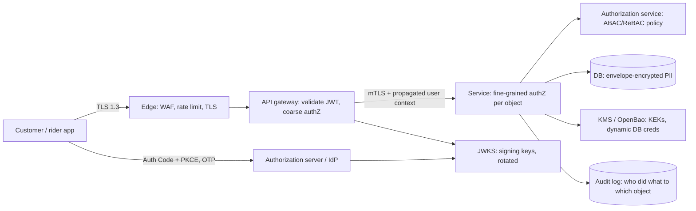
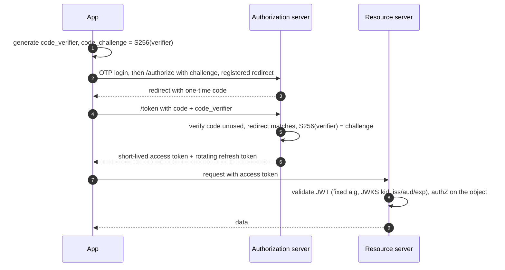
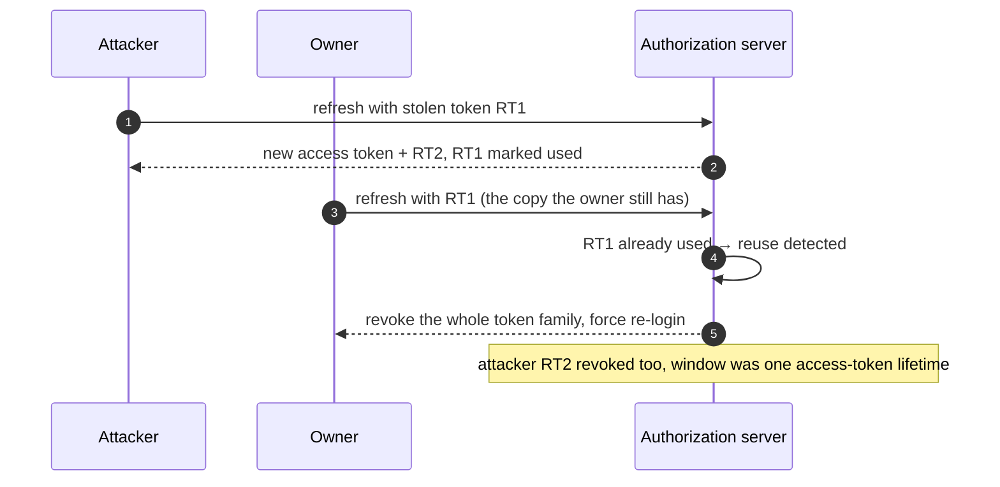
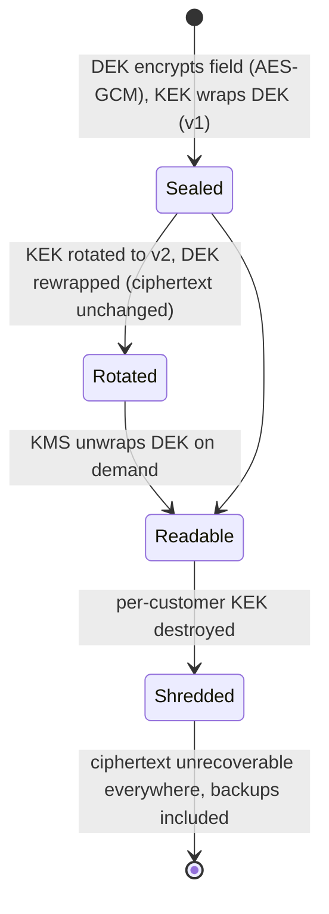

# 23. Security Architecture ⭐

!!! abstract "Chapter at a glance"
    **Reader bands:** B2 → B4 · **Prerequisites:** [Ch 04](../01-foundations/04-api-design.md), [Ch 08](../01-foundations/08-load-balancing-proxies-and-gateways.md), [Ch 16](../02-distributed-core/16-microservices-architecture.md), [Ch 17](../02-distributed-core/17-inter-service-communication.md), [Ch 20](../02-distributed-core/20-idempotency-ids-and-distributed-locks.md) · **What you will build:** The security backbone of the grocery platform — how customers, riders and staff prove who they are, what they're allowed to do, and how their data is protected. All four labs run real crypto and a real KMS.

    - **L1: JWT validation.** A naive validator **accepted 7 of 9 forged or invalid tokens** (alg:none, algorithm confusion, a key embedded in the header, an expired token, wrong audience). A hardened validator accepted only the one valid token. Plus JWKS key rotation and refresh-token reuse detection: a stolen refresh token bought an attacker **43,200 minutes vs 15**.
    - **L2: login.** A control-conformance harness over real HTTP shows the hardened OTP endpoint locking after **5 wrong codes** (vs unlimited) and the OAuth flow enforcing **PKCE, registered redirect URIs, and single-use codes** where the naive one issued tokens to every malformed request.
    - **L3: authorization.** The same 12 requests through RBAC, ABAC and ReBAC. **RBAC alone allowed the IDOR read, a cross-store edit, an over-limit refund and a no-purpose PII read**; ABAC and ReBAC denied them. A vulnerable handler that checks the role but not the object leaks other customers' orders.
    - **L4: encryption.** Envelope encryption with **OpenBao** (a real KMS): AES-256-GCM per record, DEKs wrapped by a KEK that never leaves the KMS. Tamper detection, KEK rotation that **rewraps kilobytes not terabytes**, crypto-shredding for "delete my data", and DEK caching that was **115x cheaper** than a KMS call per record.

    · **Reading time:** 120 min + code

---

## 1. Introduction & Why It Matters

### 1.1 A story: five ways in

A security review of the grocery platform, a month before a funding round's due diligence, found five issues that each map to a control in this chapter:

1. **The refunds tool trusted the JWT's header.** An engineer's hand-rolled validator read the `alg` field from the token and used it, so a token with `alg: none` (no signature) and `role: admin` was accepted. L1 reproduces this and four more forgeries a naive validator waves through.
2. **The OTP login had no attempt limit.** A six-digit code with unlimited guesses is not a secret. L2 shows the difference between unlimited attempts and a lockout after five.
3. **A customer could read another customer's order** by changing the ID in the URL (`/orders/o-99`). The handler checked that the caller was logged in, not that the order was theirs — the classic IDOR (OWASP API #1, Broken Object Level Authorization). L3 shows a role-only check leaking it, and an object-level check stopping it.
4. **Store managers could refund any amount, in any store.** Roles said "manager can refund"; they couldn't say "up to ₹5,000, in your own store". L3 contrasts RBAC with attribute- and relationship-based models.
5. **Customer addresses and phone numbers were stored in plaintext,** and "delete my account" left copies in backups for 35 days. L4 builds envelope encryption and crypto-shredding.

None of these needed a sophisticated attacker. They're the routine failures that the OWASP API Top 10, the OAuth 2.0 Security BCP and basic key management exist to prevent.

!!! quote "The thesis of this chapter"
    Security is not a feature you add; it's a set of **defaults that fail closed** at every layer. Authentication proves *who*; authorization decides *what*, and must be checked **on every object, not just at the door**. Secrets and keys live in a KMS, never in code or config. Data is encrypted so that losing the storage doesn't mean losing the data. And every one of these is **testable** — the labs here are the kind of conformance checks that belong in CI, because "we think it's secure" is not evidence.

    A note on this chapter: it teaches how to **build the defenses**. Every lab hardens a control and verifies bad inputs are refused. It does not provide attack tooling.

### 1.2 Where this lives in the grocery platform

| Concern | Mechanism | Notes |
|---|---|---|
| Customer/rider login | Phone OTP → session → OAuth2 Authorization Code + PKCE for the app | L1, L2 |
| Staff login | OIDC via the corporate IdP, SSO, hardware MFA | Short-lived tokens |
| Service-to-service | mTLS (SPIFFE identities) + short-lived tokens; zero-trust | Ch 17; no implicit trust by network |
| API authorization | Gateway authN + per-service, per-object authZ (ABAC/ReBAC) | L3; never trust the client |
| Secrets | KMS/Vault (OpenBao), dynamic DB creds, no secrets in env/Git | L4 |
| Data at rest | Envelope encryption (AES-256-GCM + KMS KEK); per-tenant keys for shredding | L4, Ch 21, Ch 36 |
| Data in transit | TLS 1.3 everywhere, HSTS, mTLS internally | Ch 03 |
| PII | Minimise, tokenise, encrypt, access-logged, purpose-limited | Ch 36 (DPDP/GDPR) |
| Edge | WAF, rate limits, bot defense, TLS termination | Ch 08, Ch 18 |

### 1.3 Learning objectives

| Band | After this chapter you can… |
|---|---|
| <span class="band b2">B2</span> | Explain authN vs authZ, validate JWTs safely, describe OAuth2/OIDC and OTP flows, and use RBAC |
| <span class="band b3">B3</span> | Implement PKCE and refresh-token rotation, choose RBAC/ABAC/ReBAC, prevent the OWASP API Top 10, and apply envelope encryption |
| <span class="band b4">B4</span> | Design zero-trust service auth, KMS-backed key management with rotation and shredding, and a defense-in-depth architecture with a threat model |

---

## 2. Core Concepts — Beginner to Deep

### 2.1 Intuition <span class="band b2">B2</span>

- **Authentication is the ID check at the door; authorization is what your wristband lets you into.** Being inside the building (logged in) doesn't mean you may enter the cash room (an admin action) or open someone else's locker (another customer's order). The IDOR bug is a guard who checks you have *a* wristband but never which locker is yours.
- **A JWT is a tamper-evident wristband.** It carries claims (who, what role, until when) and a signature. Trusting the *writing on the band* about how to check the signature ("this band says to verify it with no ink at all") is the alg-confusion class of bugs.
- **A KMS is the hotel's key-cutting machine that never leaves the back office.** You send it a locked box (a wrapped data key) and it hands back the contents, but the master die never comes out front. Destroy a guest's die and every box cut from it is permanently locked — that's crypto-shredding.
- **Zero trust is "show your badge at every door", not "you're past reception, so wander freely".** On a network, being inside the perimeter grants nothing; each service still proves its identity (mTLS) and checks permissions.

### 2.2 Authentication vs authorization ⭐ <span class="band b2">B2</span>

| | Authentication (authN) | Authorization (authZ) |
|---|---|---|
| Question | Who are you? | What may you do? |
| Proof | Password, OTP, passkey, certificate | Roles, attributes, relationships, policy |
| Where | At the edge / IdP, once per session | On **every** request and **every object** |
| Failure | Impersonation | Privilege escalation, data exposure (IDOR) |

The commonest security bug is conflating them: authenticating a request and treating that as authorization. L3's IDOR control shows a handler that authenticates fine and leaks every customer's orders because it never checks the object.

### 2.3 Sessions, tokens and JWTs ⭐ <span class="band b2">B2</span>

- **Opaque session tokens:** a random ID; the server looks up state. Easy to revoke (delete the row), needs a lookup, and is stateful.
- **JWTs (self-contained):** signed claims the resource server validates without a lookup. Scales statelessly, but is **hard to revoke** before expiry, so keep them short-lived and pair them with a revocation list for logout.

**A JWT** is `base64url(header).base64url(claims).signature`. Validation must:

1. **Fix the algorithm from your key config, never from the token's header.** Accepting `alg: none` or letting the token pick RS256 vs HS256 is the alg-confusion vulnerability.
2. **Resolve the key by `kid` against a trusted JWKS** — never a key embedded in the header (`jwk`/`jku`/`x5u`) or fetched from a token-supplied URL.
3. **Verify the signature.**
4. **Check registered claims:** `iss`, `aud`, `exp`, `nbf` (with small clock skew), and reject absurd lifetimes.
5. **Check revocation** (`jti` against a denylist) for logout/compromise.

L1's naive validator skips 1–2 and 4–5, and accepts:

| Token presented to the payment API | Naive | Hardened |
|---|---|---|
| Valid token | ACCEPTED | ACCEPTED |
| `alg: none`, no signature, role admin | **ACCEPTED** | rejected (unsigned) |
| HS256 signed with our RSA *public* key as the secret | **ACCEPTED** | rejected (alg mismatch) |
| Attacker's key embedded in the header (`jwk`) | **ACCEPTED** | rejected (key in header) |
| Payload edited to role admin, old signature | rejected | rejected (bad signature) |
| Expired two hours ago | **ACCEPTED** | rejected (expired) |
| Valid, but audience is `rider-app` | **ACCEPTED** | rejected (aud) |
| Valid, but `jti` revoked at logout | **ACCEPTED** | rejected (revoked) |
| Valid signature, 30-day lifetime | **ACCEPTED** | rejected (lifetime) |

Seven of nine bad tokens accepted. Use a vetted library (Nimbus, `java-jwt`, jose4j) configured with a fixed algorithm and a JWKS, not a hand-rolled parser.

**Algorithm choice** (L1 D, measured):

| Algorithm | Sign | Verify | Token size | Use |
|---|---|---|---|---|
| RS256 (RSA-2048) | 1,193 µs | 47 µs | 582 B | Asymmetric; many verifiers, few signers (the common default) |
| ES256 (P-256) | 208 µs | 762 µs | 326 B | Smaller tokens, cheaper signing; verify-heavy |
| HS256 (shared secret) | 7 µs | 4 µs | 283 B | Symmetric; only when signer and verifier are the same trust domain |

Asymmetric (RS256/ES256) lets resource servers verify with a public key without holding a signing secret. That's why the "HS256 with the public key as the secret" attack matters: if the verifier accepts HS256, an attacker signs with the well-known public key.

### 2.4 OTP and passwords ⭐ <span class="band b2">B2</span>

The grocery app uses **phone OTP**. The controls (L2 A):

- **Attempt limit** per code (lock after ~5), so a 6-digit code (1,000,000 values) can't be guessed. Naive: unlimited; hardened: 5.
- **Send limit** per phone (e.g. 3 per 10 minutes) to stop SMS-bombing and cost abuse.
- **Store codes hashed** (salted) with a short **expiry** (5 minutes), single-use.
- **Constant-time comparison** of the hash.
- **Don't leak** whether the phone is registered (uniform responses).

For passwords (staff, some flows): **Argon2id** (or scrypt/bcrypt), never fast hashes or encryption; per-user salt; a pepper in the KMS; check against breached-password lists; and rate-limit plus lockout with care not to enable denial of service.

**MFA:** TOTP or, preferably, **passkeys / WebAuthn** (phishing-resistant, hardware-backed). SMS OTP is a usability floor, not strong MFA (SIM-swap risk).

### 2.5 OAuth 2.0 and OIDC ⭐ <span class="band b3">B3</span>

- **OAuth 2.0** is *authorization delegation* (an app gets a token to call an API on the user's behalf). **OIDC** adds *authentication* on top (an `id_token` proving who logged in).
- **Roles:** resource owner (the user), client (the app), authorization server (issues tokens), resource server (the API).
- **Flows:**
    - **Authorization Code + PKCE** — for web and mobile apps, the only recommended interactive flow now.
    - **Client Credentials** — service-to-service (no user).
    - **Device Code** — TVs, CLIs.
    - **Implicit** and **Resource Owner Password** — **deprecated**; don't use them.
- **PKCE (RFC 7636):** the app generates a random `code_verifier`, sends its SHA-256 hash (`code_challenge`) with the authorization request, and presents the verifier when exchanging the code. An intercepted code is useless without the verifier. **S256 only** — never `plain`.

L2 B verifies the OAuth controls on a real HTTP server:

| Request presented to `/token` | Naive server | Hardened (Security BCP) |
|---|---|---|
| Correct verifier, registered redirect | token issued | token issued |
| Wrong PKCE verifier | **token issued** | reject (PKCE) |
| No verifier at all | **token issued** | reject (PKCE) |
| Attacker-controlled `redirect_uri` | **token issued** | reject (redirect not registered) |
| Same code exchanged a second time | — | reject (replay) |
| First token after that replay | — | **revoked** |

The BCP rules L2 enforces: exact-match **registered redirect URIs** (no wildcards), **PKCE for all clients**, **single-use codes** (and on replay, revoke tokens already issued from that code), the `state` parameter for CSRF, and short-lived codes.

### 2.6 Token lifecycle and rotation ⭐ <span class="band b3">B3</span>

- **Access tokens: short-lived** (5–15 min). A leaked one expires quickly.
- **Refresh tokens: longer-lived, rotating.** Each use issues a new refresh token and invalidates the old one. If an old (already-used) refresh token appears again, that's **reuse detection**: someone has a stolen copy, so revoke the whole token family and force re-login.

L1 C models a refresh token stolen from a phone backup:

- **Long-lived reusable refresh token:** the attacker kept access for **43,200 minutes** (the full 30 days), unnoticed.
- **Rotation + reuse detection:** the attacker got **15 minutes** (one access token); the customer's next refresh presented the now-used token, reuse was detected, and the family was revoked.

- **Key rotation (JWKS):** publish the new signing key alongside the old, sign with the new one, keep verifying both until older tokens expire, then retire the old key. L1 B: during the overlap both tokens validate; after retirement, the old `kid` is rejected. Never rotate by deleting the current key.

### 2.7 Zero trust and service-to-service auth ⭐ <span class="band b4">B4</span>

Zero trust: **no implicit trust from network location.** Every request is authenticated and authorized, inside the perimeter as much as outside.

- **Service identity:** each workload gets a cryptographic identity (SPIFFE/SPIRE issues SVIDs), used for **mTLS**. The service mesh (Ch 17) can enforce mTLS and identity-based policy transparently.
- **Short-lived credentials:** certificates and tokens minted per workload, rotated automatically (minutes to hours), so a leaked credential is briefly useful.
- **Authorization between services:** the calling service's identity plus the end-user context (a propagated token or a signed request) decide access. "payment-service may call ledger-service's `POST /postings`" is policy, not firewall.
- **Least privilege and segmentation:** default-deny network policy, per-service DB users with minimal grants, and dynamic DB credentials from the KMS (short TTL) instead of a shared password.

### 2.8 Authorization models: RBAC, ABAC, ReBAC ⭐ <span class="band b3">B3</span>

L3 runs the same 12 grocery requests through all three:

| Model | Decides by | Good at | Weak at |
|---|---|---|---|
| **RBAC** | The subject's **roles** → permissions | Simple, auditable, coarse-grained org roles | Can't express "own", "same store", "≤ limit", "with purpose" (role explosion if you try) |
| **ABAC** | **Attributes** of subject/resource/action/env, via policy | Fine-grained conditions, context (time, amount, purpose) | Policies get complex; hard to answer "who can access X?" |
| **ReBAC** | **Relationships** in a graph (Zanzibar) | "Manager of the store that owns this order", inherited/nested access, sharing | Needs the graph and a check service; conditions still need ABAC |

L3's result table:

- **RBAC alone allowed:** the IDOR read (customer → another's order), the cross-store update, the ₹8,000 over-limit refund, the Bengaluru manager reading a Mumbai order, and the PII read with no ticket. Roles simply can't say *no* to these.
- **ABAC denied all of them** via ownership, store scope, a ₹5,000 refund limit, city scope, and an "open ticket" purpose check.
- **ReBAC answered order reads from the graph:** owner, delivering rider, and manager via store→city inheritance — without the order row carrying `storeId`/`city`; the edges carry it.

In practice, platforms **layer** them: RBAC for coarse org roles, ABAC conditions for limits and context, and ReBAC (an authorization service like OpenFGA/SpiceDB, or a policy engine like OPA/Cedar) for object- and relationship-level checks. The decision is centralized (policy) but enforced locally (each service checks before acting).

### 2.9 The OWASP API Security Top 10, on this platform <span class="band b3">B3</span>

| # | Risk | Grocery example | Defense |
|---|---|---|---|
| API1 | Broken Object Level Authorization (IDOR) | `/orders/{id}` returns any order | Object-level check on every fetch (L3) |
| API2 | Broken Authentication | alg:none, no OTP limit | Hardened JWT + OTP (L1, L2) |
| API3 | Broken Object Property Level Auth | Client sets `role`/`price` in the body (mass assignment) | Allow-list writable fields; never trust client-set authority fields |
| API4 | Unrestricted Resource Consumption | Unbounded page size, no rate limit | Limits, quotas, pagination caps (Ch 18) |
| API5 | Broken Function Level Authorization | Customer calls an admin endpoint | Deny by default; check function permission |
| API6 | Unrestricted Access to Sensitive Business Flows | Bots draining flash-sale stock | Bot defense, per-user flow limits |
| API7 | SSRF | "image URL" fetched by the server hits internal metadata | Allow-list egress, no raw URLs (Ch 21 lesson) |
| API8 | Security Misconfiguration | Debug endpoints, permissive CORS | Hardened baselines, config review |
| API9 | Improper Inventory Management | Forgotten `/v1` with no auth | API catalog, retire old versions |
| API10 | Unsafe Consumption of 3rd-party APIs | Trusting a gateway callback blindly | Verify signatures/idempotency (Ch 20) |

Injection (SQLi, command injection) sits under secure coding: parameterized queries always (Ch 05), never string-built SQL or shell.

### 2.10 Secrets management ⭐ <span class="band b3">B3</span>

- **Never in code or Git, never in plain env vars or images.** Use a secrets manager (Vault/OpenBao, cloud KMS/Secrets Manager).
- **Dynamic secrets:** the KMS mints short-lived DB credentials per service on demand and revokes them on TTL, so there's no shared, long-lived DB password to leak.
- **Rotation:** automated, with overlap (like JWKS).
- **Access:** authenticated by workload identity, least-privilege policies, and every read audited.
- **Detection:** secret-scanning in CI and on commits; treat any committed secret as compromised and rotate it.

### 2.11 Encryption ⭐ <span class="band b3">B3</span>

- **In transit:** TLS 1.3, HSTS, modern ciphers; mTLS internally (§2.7). Terminate at the edge, re-encrypt internally.
- **At rest:** full-disk/volume encryption is table stakes but only protects against stolen disks. **Application-level encryption** protects specific fields (PII, payment data) against a compromised database or backup.
- **Envelope encryption** (L4) is the standard pattern:
    1. Generate a **data encryption key (DEK)** per record (or per tenant/batch).
    2. Encrypt the field with the DEK using **authenticated encryption (AES-256-GCM)** — a unique IV per encryption, and a tag that detects tampering.
    3. **Wrap (encrypt) the DEK** with a **key-encryption key (KEK)** that lives in the KMS and never leaves it.
    4. Store ciphertext + wrapped DEK + KEK version. To read, ask the KMS to unwrap the DEK.

L4 with OpenBao's transit engine:

- A 60-byte address → 76-byte ciphertext + a 12-byte IV + an 89-byte wrapped DEK; the row holds **no plaintext and no key material**.
- **Tampering:** flipping one ciphertext bit makes GCM decryption throw `AEADBadTagException` — the record is rejected, not silently corrupted.
- **KEK rotation:** rotate the KEK in the KMS; old rows still decrypt (the KMS keeps old versions), and you **rewrap only the small DEKs** (kilobytes), never the data (terabytes). The ciphertext is byte-for-byte unchanged.
- **Cost:** a KMS call per record was 1.72 ms/field; reusing one wrapped DEK across records (each with its own IV) was **0.015 ms/field, 115x cheaper**. Cache/derive DEKs per tenant or batch; never cache the KEK.

### 2.12 Crypto-shredding and the right to erasure ⭐ <span class="band b4">B4</span>

"Delete all my data" (DPDP/GDPR, Ch 36) is hard because data spreads into backups, replicas, logs and the lake. **Crypto-shredding:** encrypt a customer's data under a **per-customer key**; to erase, **destroy the key**. Every copy, everywhere, becomes permanently unrecoverable ciphertext.

L4 D: after destroying the customer's KEK in the KMS, unwrapping the DEK fails, so the data is gone "everywhere it was copied", without hunting down every backup. Caveats: it only works if the customer's data was **only** ever encrypted under that key (no plaintext copies escaped), and you still delete what you can directly; shredding covers the long tail (backups, archives).

### 2.13 Defense in depth and threat modeling <span class="band b4">B4</span>

No single control is trusted. Layers: edge (WAF, TLS, rate limits), gateway (authN, coarse authZ), service (fine authZ, input validation), data (encryption, least-privilege access), and monitoring (audit logs, anomaly detection).

**Threat modeling** (STRIDE) per feature: Spoofing → strong authN; Tampering → signatures, GCM, integrity; Repudiation → audit logs; Information disclosure → encryption, authZ; Denial of service → rate limits (Ch 18); Elevation of privilege → least privilege, authZ checks. Do it at design time, keep a risk register, and re-test with the conformance harnesses these labs illustrate.

---

## 3. Architecture & Diagrams

### 3.1 Component view



### 3.2 Sequence: happy path, mobile login with OAuth Code + PKCE



### 3.3 Sequence: failure path, refresh-token reuse detected



### 3.4 State: envelope-encrypted record through KEK rotation and shredding



---

## 4. Design Document Excerpt: Grocery Platform Security Architecture

| Field | Value |
|---|---|
| Author / Reviewers | Security team / platform, payments, SRE, legal (DPDP) |
| Status | Approved |
| Related ADRs | ADR-098 OAuth2 Code+PKCE + OIDC, short access tokens, rotating refresh with reuse detection; ADR-099 JWT validation library with fixed alg + JWKS (no hand-rolled parsers); ADR-100 AuthZ = RBAC + ABAC conditions + ReBAC via a central policy service, enforced per object; ADR-101 Zero-trust service auth (mTLS/SPIFFE, dynamic DB creds); ADR-102 Envelope encryption for PII with per-tenant keys and crypto-shredding |

**1. Context & Problem.** The review (§1.1): a token-header-trusting validator, an unlimited-attempt OTP, IDOR, role-only refund authority, and plaintext PII with no real erasure.

**2. Goals / Non-Goals.**

- *Goals:* no token forgery accepted; brute-force-resistant login; object- and context-level authorization; secrets and keys in a KMS; encrypted PII with erasure; zero-trust internal calls; everything testable in CI.
- *Non-goals:* building our own IdP or crypto primitives; SMS OTP as strong MFA (it's a floor).

**3. Requirements.**

| ID | Requirement |
|---|---|
| FR-1 | JWTs validated with a vetted library: fixed algorithm, JWKS by `kid`, iss/aud/exp/nbf, revocation on logout |
| FR-2 | OTP: ≤ 5 attempts/code, ≤ 3 sends/phone/10 min, hashed + expiring codes; app uses Code+PKCE (S256), registered redirects, single-use codes |
| FR-3 | Access tokens ≤ 15 min; refresh tokens rotate with reuse detection |
| FR-4 | Every object access checks the subject's relation to that object (no IDOR); refunds/edits enforce store scope and amount limits |
| FR-5 | PII fields encrypted with envelope encryption; per-customer keys enable crypto-shredding |
| NFR-1 | Internal calls use mTLS with workload identity; DB credentials are dynamic and short-lived |
| NFR-2 | Conformance tests (token forgeries, OTP limits, IDOR, PKCE) run in CI and block merge on regression |
| NFR-3 | All authN/authZ decisions and PII access are audit-logged |

**4. Estimates & choices.**

| Item | Choice | Rationale |
|---|---|---|
| Token signing | RS256 (or ES256 for size) | Public-key verification at every resource server (L1 D) |
| Access token TTL | 15 min | Balances revocation lag and refresh load |
| KEK | KMS, non-exportable, per-tenant for PII | Rotation + shredding (L4) |
| DEK | Per record, cached per tenant/batch | 115x cheaper than per-record KMS calls (L4 E) |
| AuthZ engine | OPA/Cedar for ABAC + OpenFGA/SpiceDB for ReBAC | Central policy, local enforcement |

**5. Proposed design.**

1. **AuthN:** an authorization server (or managed IdP) issues OIDC tokens via Code+PKCE for apps and Client Credentials for services. A gateway validates JWTs (fixed alg, cached JWKS) and passes verified user context downstream.
2. **AuthZ:** a shared library calls the policy service for each protected action, always with the object identity. RBAC for roles, ABAC conditions (store, amount, purpose), ReBAC for ownership/hierarchy. Default deny.
3. **Service auth:** the mesh enforces mTLS with SPIFFE identities; services get dynamic DB creds from the KMS.
4. **Data:** an encryption library seals PII fields (AES-256-GCM + KMS-wrapped DEKs, per-tenant KEKs). Erasure destroys the tenant key.
5. **Assurance:** the conformance harnesses (L1–L3 style) run in CI; secret-scanning on commits; periodic pen tests and threat models per feature.

**7. Alternatives considered.**

| Option | Pros | Cons | Verdict |
|---|---|---|---|
| Opaque sessions everywhere | Easy revocation | Central lookup, stateful at scale | Used for browser sessions; JWTs for APIs |
| Hand-rolled JWT validation | No dependency | Alg-confusion and claim bugs (L1) | Rejected |
| RBAC only | Simple | Can't express own/scope/limit (L3) | Rejected as sole model |
| Encrypt only the disk | Simple | No protection from a compromised DB/backup | Insufficient for PII |
| Per-record KMS calls | Simplest | 115x cost, KMS bottleneck (L4) | Cache DEKs per tenant |

**8. Failure modes.** Signing key compromise → rotate via JWKS, revoke families. KMS outage → cached DEKs keep reads working; fail closed on new writes. Policy service down → cached decisions with short TTL, fail closed for sensitive actions. Stolen refresh token → reuse detection (L1 C).

**10. Observability.** AuthN success/failure by reason, OTP lockouts, token validation failures by cause (a spike in "alg mismatch" is an attack), authZ denials by policy, PII access logs, KMS operations, mTLS handshake failures.

**14. Decision (ADR-098–102).** Standard OAuth2/OIDC with PKCE and rotating refresh; library-based JWT validation; layered RBAC/ABAC/ReBAC enforced per object; zero-trust service auth; envelope encryption with per-tenant keys and crypto-shredding; conformance tests in CI.

---

## 5. Hands-On Code — Level Ladder

| Level | New requirement that forces the step |
|---|---|
| L1 | "Our refunds tool accepted a forged admin token." (JWT validation, rotation, refresh reuse detection) |
| L2 | "Logins can be brute-forced and the app's OAuth flow issues tokens to anyone." (OTP + OAuth/PKCE control conformance) |
| L3 | "A customer read another customer's order, and managers refund anything." (RBAC vs ABAC vs ReBAC, IDOR) |
| L4 | "PII is in plaintext and we can't really delete it." (envelope encryption, rotation, crypto-shredding with a real KMS) |

All labs are defensive: each hardens a control and asserts that bad inputs are refused. Machine: 2 vCPU container, Java 21, and **OpenBao 2.1** (an open-source Vault, from its GitHub release) as the KMS for L4. Outputs are verbatim; lab files are in `labs/ch23-security/`.

### L1 — JWT validation, key rotation and refresh-token reuse detection <span class="band b2">B2</span>

**Requirement:** "A hand-rolled validator accepted a forged admin token. Show what a safe validator checks."

The program builds JWTs with the JDK's own crypto (RS256/ES256/HS256), then runs a battery of good and forged tokens through a **naive** validator (trusts the header) and a **hardened** one (fixed algorithm per `kid`, JWKS, all registered claims, denylist). It also rotates keys through a JWKS and models refresh-token rotation.

```java title="TokensL1.java"
// TokensL1.java — run with: java TokensL1.java      (JDK 17+, no dependencies)
// JWTs built from the JDK's own crypto: issue RS256/ES256/HS256 tokens, then validate a battery of good and forged tokens
// with a NAIVE validator (trusts the header) and a HARDENED one (allow-listed alg per kid, iss/aud/exp/nbf, denylist).
// Also: key rotation through a JWKS with two keys, refresh-token rotation with reuse detection, and sign/verify cost.
import java.nio.charset.StandardCharsets;
import java.security.*;
import java.security.interfaces.*;
import java.security.spec.*;
import java.time.Instant;
import java.util.*;
import java.util.regex.*;
import javax.crypto.Mac;
import javax.crypto.spec.SecretKeySpec;

public class TokensL1 {
    static final Base64.Encoder B64 = Base64.getUrlEncoder().withoutPadding();
    static final Base64.Decoder D64 = Base64.getUrlDecoder();
    static String b64(String s) { return B64.encodeToString(s.getBytes(StandardCharsets.UTF_8)); }
    static String unb64(String s) { return new String(D64.decode(s), StandardCharsets.UTF_8); }

    /** Tiny flat-JSON reader: "key":"string" | "key":number | "key":true/false. Enough for JWT headers and claims. */
    static Map<String, String> json(String j) {
        Map<String, String> m = new HashMap<>();
        Matcher x = Pattern.compile("\"(\\w+)\"\\s*:\\s*(\"((?:[^\"\\\\]|\\\\.)*)\"|[-\\w.]+|\\{[^}]*\\})").matcher(j);
        while (x.find()) m.put(x.group(1), x.group(3) != null ? x.group(3) : x.group(2));
        return m;
    }

    // ---------------- signing ----------------
    static byte[] sign(String alg, Key key, byte[] data) throws Exception {
        switch (alg) {
            case "RS256" -> { Signature s = Signature.getInstance("SHA256withRSA"); s.initSign((PrivateKey) key); s.update(data); return s.sign(); }
            case "ES256" -> { Signature s = Signature.getInstance("SHA256withECDSAinP1363Format"); s.initSign((PrivateKey) key); s.update(data); return s.sign(); }
            case "HS256" -> { Mac m = Mac.getInstance("HmacSHA256"); m.init(key instanceof SecretKeySpec k ? k : new SecretKeySpec(key.getEncoded(), "HmacSHA256")); return m.doFinal(data); }
            default -> throw new IllegalArgumentException(alg);
        }
    }
    static boolean verify(String alg, Key key, byte[] data, byte[] sig) throws Exception {
        switch (alg) {
            case "RS256" -> { Signature s = Signature.getInstance("SHA256withRSA"); s.initVerify((PublicKey) key); s.update(data); return s.verify(sig); }
            case "ES256" -> { Signature s = Signature.getInstance("SHA256withECDSAinP1363Format"); s.initVerify((PublicKey) key); s.update(data); return s.verify(sig); }
            case "HS256" -> { return MessageDigest.isEqual(sign("HS256", key, data), sig); }                 // constant-time compare
            default -> { return false; }
        }
    }
    static String jwt(String headerJson, String claimsJson, String alg, Key key) throws Exception {
        String si = b64(headerJson) + "." + b64(claimsJson);
        return si + "." + (key == null ? "" : B64.encodeToString(sign(alg, key, si.getBytes(StandardCharsets.US_ASCII))));
    }
    static String claims(String sub, String aud, long iat, long exp, String role, String jti) {
        return "{\"iss\":\"https://auth.grocery.example\",\"sub\":\"" + sub + "\",\"aud\":\"" + aud + "\",\"iat\":" + iat + ",\"nbf\":" + iat
                + ",\"exp\":" + exp + ",\"role\":\"" + role + "\",\"jti\":\"" + jti + "\"}";
    }

    // ---------------- validators ----------------
    record Result(boolean ok, String why) {}

    /** What many hand-rolled validators do: believe the header, check nothing else. */
    static Result naive(String token, PublicKey configuredKey) {
        try {
            String[] p = token.split("\\.", -1);
            var h = json(unb64(p[0]));
            byte[] si = (p[0] + "." + p[1]).getBytes(StandardCharsets.US_ASCII);
            String alg = h.get("alg");
            if ("none".equalsIgnoreCase(alg)) return new Result(true, "alg none");
            Key key = configuredKey;
            if (h.containsKey("jwk")) {                                                         // "the token tells us its key"
                var jwk = json(h.get("jwk"));
                key = KeyFactory.getInstance("RSA").generatePublic(new RSAPublicKeySpec(
                        new java.math.BigInteger(1, D64.decode(jwk.get("n"))), new java.math.BigInteger(1, D64.decode(jwk.get("e")))));
            }
            if (alg.equals("HS256")) key = new SecretKeySpec(pem(configuredKey).getBytes(StandardCharsets.US_ASCII), "HmacSHA256");
            return new Result(verify(alg, key, si, D64.decode(p[2])), "signature");
        } catch (Exception e) { return new Result(false, e.getClass().getSimpleName()); }
    }

    record TrustedKey(String alg, Key key, boolean retired) {}

    /** Hardened: kid must be known, alg fixed by our key config (never by the token), all registered claims checked, denylist. */
    static Result hardened(String token, Map<String, TrustedKey> jwks, String expectedAud, Set<String> revokedJti, long now) {
        try {
            String[] p = token.split("\\.", -1);
            if (p.length != 3 || p[2].isEmpty()) return new Result(false, "unsigned");
            var h = json(unb64(p[0]));
            if (h.containsKey("jwk") || h.containsKey("jku") || h.containsKey("x5u")) return new Result(false, "key in header");
            TrustedKey k = jwks.get(h.get("kid"));
            if (k == null || k.retired()) return new Result(false, "unknown/retired kid");
            if (!k.alg().equals(h.get("alg"))) return new Result(false, "alg mismatch");
            if (!verify(k.alg(), k.key(), (p[0] + "." + p[1]).getBytes(StandardCharsets.US_ASCII), D64.decode(p[2]))) return new Result(false, "bad signature");
            var c = json(unb64(p[1]));
            long skew = 30;
            if (!"https://auth.grocery.example".equals(c.get("iss"))) return new Result(false, "iss");
            if (!expectedAud.equals(c.get("aud"))) return new Result(false, "aud");
            if (Long.parseLong(c.get("exp")) + skew < now) return new Result(false, "expired");
            if (Long.parseLong(c.get("nbf")) - skew > now) return new Result(false, "not yet valid");
            if (Long.parseLong(c.get("exp")) - Long.parseLong(c.get("iat")) > 3600) return new Result(false, "lifetime too long");
            if (revokedJti.contains(c.get("jti"))) return new Result(false, "revoked");
            return new Result(true, "valid");
        } catch (Exception e) { return new Result(false, e.getClass().getSimpleName()); }
    }

    static String pem(PublicKey k) { return "-----BEGIN PUBLIC KEY-----\n" + Base64.getMimeEncoder(64, "\n".getBytes()).encodeToString(k.getEncoded()) + "\n-----END PUBLIC KEY-----\n"; }

    public static void main(String[] args) throws Exception {
        long now = Instant.now().getEpochSecond();
        KeyPairGenerator rsa = KeyPairGenerator.getInstance("RSA"); rsa.initialize(2048);
        KeyPair k1 = rsa.generateKeyPair(), k2 = rsa.generateKeyPair(), attacker = rsa.generateKeyPair();
        Map<String, TrustedKey> jwks = new HashMap<>(Map.of("k1", new TrustedKey("RS256", k1.getPublic(), false)));
        Set<String> revoked = new HashSet<>(Set.of("jti-logged-out"));
        String H1 = "{\"alg\":\"RS256\",\"typ\":\"JWT\",\"kid\":\"k1\"}";

        Map<String, String> cases = new LinkedHashMap<>();
        cases.put("valid token (payment API audience)", jwt(H1, claims("cust-42", "payment-api", now, now + 900, "customer", "j1"), "RS256", k1.getPrivate()));
        cases.put("alg:none, no signature", jwt("{\"alg\":\"none\",\"kid\":\"k1\"}", claims("cust-42", "payment-api", now, now + 900, "admin", "j2"), "none", null));
        cases.put("HS256 signed with our PUBLIC key as secret", jwt("{\"alg\":\"HS256\",\"kid\":\"k1\"}", claims("cust-42", "payment-api", now, now + 900, "admin", "j3"), "HS256",
                new SecretKeySpec(pem(k1.getPublic()).getBytes(StandardCharsets.US_ASCII), "HmacSHA256")));
        var ap = (RSAPublicKey) attacker.getPublic();
        cases.put("attacker key embedded in header (jwk)", jwt("{\"alg\":\"RS256\",\"kid\":\"k1\",\"jwk\":{\"kty\":\"RSA\",\"n\":\"" + B64.encodeToString(ap.getModulus().toByteArray())
                + "\",\"e\":\"" + B64.encodeToString(ap.getPublicExponent().toByteArray()) + "\"}}", claims("cust-42", "payment-api", now, now + 900, "admin", "j4"), "RS256", attacker.getPrivate()));
        String good = cases.get("valid token (payment API audience)");
        String[] gp = good.split("\\.");
        cases.put("payload edited (role→admin), old signature", gp[0] + "." + b64(claims("cust-42", "payment-api", now, now + 900, "admin", "j1")) + "." + gp[2]);
        cases.put("expired 2 hours ago", jwt(H1, claims("cust-42", "payment-api", now - 8100, now - 7200, "customer", "j5"), "RS256", k1.getPrivate()));
        cases.put("valid, but audience rider-app", jwt(H1, claims("rider-7", "rider-app", now, now + 900, "rider", "j6"), "RS256", k1.getPrivate()));
        cases.put("valid, but jti revoked at logout", jwt(H1, claims("cust-42", "payment-api", now, now + 900, "customer", "jti-logged-out"), "RS256", k1.getPrivate()));
        cases.put("valid signature, 30-day lifetime", jwt(H1, claims("cust-42", "payment-api", now, now + 30 * 86400, "customer", "j7"), "RS256", k1.getPrivate()));

        System.out.println("A. Validating tokens presented to payment-api");
        System.out.printf("   %-46s %-16s %-26s%n", "token", "naive validator", "hardened validator");
        for (var e : cases.entrySet()) {
            Result n = naive(e.getValue(), k1.getPublic()), h = hardened(e.getValue(), jwks, "payment-api", revoked, now);
            System.out.printf("   %-46s %-16s %-26s%n", e.getKey(), n.ok() ? "ACCEPTED" : "rejected", (h.ok() ? "ACCEPTED" : "rejected") + " (" + h.why() + ")");
        }

        System.out.println("B. Key rotation through the JWKS (kid k1 → k2)");
        String oldTok = jwt(H1, claims("cust-9", "payment-api", now, now + 900, "customer", "r1"), "RS256", k1.getPrivate());
        jwks.put("k2", new TrustedKey("RS256", k2.getPublic(), false));                         // 1. publish k2 first
        String newTok = jwt("{\"alg\":\"RS256\",\"typ\":\"JWT\",\"kid\":\"k2\"}", claims("cust-9", "payment-api", now, now + 900, "customer", "r2"), "RS256", k2.getPrivate());
        System.out.printf("   overlap (JWKS has k1+k2): old-key token %s, new-key token %s%n",
                hardened(oldTok, jwks, "payment-api", revoked, now).ok() ? "valid" : "rejected", hardened(newTok, jwks, "payment-api", revoked, now).ok() ? "valid" : "rejected");
        jwks.put("k1", new TrustedKey("RS256", k1.getPublic(), true));                           // 3. retire k1 after max token lifetime
        System.out.printf("   after k1 retired (> max token lifetime later): old-key token %s, new-key token %s%n",
                hardened(oldTok, jwks, "payment-api", revoked, now).why(), hardened(newTok, jwks, "payment-api", revoked, now).why());

        System.out.println("C. A refresh token is stolen from a phone backup; the attacker and the customer both use it (30-day refresh, 15-min access)");
        for (boolean rotation : List.of(false, true)) {
            Map<String, String> family = new HashMap<>(); Set<String> used = new HashSet<>(); Set<String> revokedFamilies = new HashSet<>();
            String stolen = "rt-1"; family.put(stolen, "fam-A");
            int attackerMinutes = 0; String attackerRt = stolen, customerRt = stolen; boolean customerForcedLogin = false;
            for (int minute = 0; minute < 30 * 24 * 60; minute += 15) {                           // both refresh every 15 minutes
                for (int who = 1; who >= 0; who--) {                                     // the attacker refreshes first
                    String rt = who == 0 ? customerRt : attackerRt;
                    String fam = family.get(rt);
                    boolean ok = fam != null && !revokedFamilies.contains(fam);
                    if (ok && rotation && used.contains(rt)) { revokedFamilies.add(fam); ok = false; }   // reuse detected → kill the whole family
                    if (ok) {
                        String next = rt;
                        if (rotation) { used.add(rt); next = "rt-" + UUID.randomUUID(); family.put(next, fam); }
                        if (who == 0) customerRt = next; else { attackerRt = next; attackerMinutes += 15; }
                    } else if (who == 0) customerForcedLogin = true;
                }
                if (rotation && customerForcedLogin) break;
            }
            System.out.printf("   %-38s attacker kept access for %,6d minutes%s%n", rotation ? "rotation + reuse detection:" : "long-lived reusable refresh token:",
                    attackerMinutes, rotation ? " (one access token; the customer's next refresh exposed the reuse, the family was revoked)" : " (the whole 30 days, unnoticed)");
        }

        System.out.println("D. Cost per operation and token size");
        KeyPairGenerator ec = KeyPairGenerator.getInstance("EC"); ec.initialize(new ECGenParameterSpec("secp256r1"));
        KeyPair e1 = ec.generateKeyPair();
        SecretKeySpec hs = new SecretKeySpec(new SecureRandom().generateSeed(32), "HmacSHA256");
        for (Object[] a : new Object[][]{{"RS256 (RSA 2048)", "RS256", k1.getPrivate(), k1.getPublic()}, {"ES256 (P-256)", "ES256", e1.getPrivate(), e1.getPublic()}, {"HS256 (shared secret)", "HS256", hs, hs}}) {
            String alg = (String) a[1];
            String tok = jwt("{\"alg\":\"" + alg + "\",\"kid\":\"x\"}", claims("cust-42", "payment-api", now, now + 900, "customer", "p"), alg, (Key) a[2]);
            byte[] si = tok.substring(0, tok.lastIndexOf('.')).getBytes(StandardCharsets.US_ASCII);
            byte[] sig = D64.decode(tok.substring(tok.lastIndexOf('.') + 1));
            for (int i = 0; i < 2_000; i++) { sign(alg, (Key) a[2], si); verify(alg, (Key) a[3], si, sig); }         // warm-up
            long t0 = System.nanoTime(); int n = 3_000;
            for (int i = 0; i < n; i++) sign(alg, (Key) a[2], si);
            double signUs = (System.nanoTime() - t0) / 1e3 / n;
            t0 = System.nanoTime();
            for (int i = 0; i < n; i++) verify(alg, (Key) a[3], si, sig);
            double verifyUs = (System.nanoTime() - t0) / 1e3 / n;
            System.out.printf("   %-22s sign %8.1f µs   verify %7.1f µs   token %3d bytes%n", a[0], signUs, verifyUs, tok.length());
        }
    }
}
```

```text title="java TokensL1.java"
A. Validating tokens presented to payment-api
   token                                          naive validator  hardened validator        
   valid token (payment API audience)             ACCEPTED         ACCEPTED (valid)          
   alg:none, no signature                         ACCEPTED         rejected (unsigned)       
   HS256 signed with our PUBLIC key as secret     ACCEPTED         rejected (alg mismatch)   
   attacker key embedded in header (jwk)          ACCEPTED         rejected (key in header)  
   payload edited (role→admin), old signature     rejected         rejected (bad signature)  
   expired 2 hours ago                            ACCEPTED         rejected (expired)        
   valid, but audience rider-app                  ACCEPTED         rejected (aud)            
   valid, but jti revoked at logout               ACCEPTED         rejected (revoked)        
   valid signature, 30-day lifetime               ACCEPTED         rejected (lifetime too long)
B. Key rotation through the JWKS (kid k1 → k2)
   overlap (JWKS has k1+k2): old-key token valid, new-key token valid
   after k1 retired (> max token lifetime later): old-key token unknown/retired kid, new-key token valid
C. A refresh token is stolen from a phone backup; the attacker and the customer both use it (30-day refresh, 15-min access)
   long-lived reusable refresh token:     attacker kept access for 43,200 minutes (the whole 30 days, unnoticed)
   rotation + reuse detection:            attacker kept access for     15 minutes (one access token; the customer's next refresh exposed the reuse, the family was revoked)
D. Cost per operation and token size
   RS256 (RSA 2048)       sign   1167.1 µs   verify    46.6 µs   token 582 bytes
   ES256 (P-256)          sign    218.4 µs   verify   737.4 µs   token 326 bytes
   HS256 (shared secret)  sign      5.1 µs   verify     1.9 µs   token 283 bytes
```

**Reading it:**

- **The naive validator accepts 7 of 9 bad tokens.** Trusting `alg` from the header gives `alg:none` and the HS256-with-public-key confusion; trusting an embedded `jwk` lets the token bring its own key; skipping `exp`/`aud`/`jti`/lifetime lets expired, wrong-audience, revoked and absurdly long-lived tokens through. Only actual signature tampering fails, because that breaks the maths.
- **The hardened validator** fixes the algorithm from the trusted key (never the token), resolves the key by `kid` in the JWKS, refuses keys in the header, and checks issuer, audience, expiry, not-before (with 30 s skew), a sane lifetime and revocation.
- **Rotation:** publish the new key first, so both validate during the overlap; retire the old `kid` only after the maximum token lifetime, so no in-flight token is orphaned.
- **Refresh reuse:** a stolen, long-lived reusable token gave 43,200 minutes of access. With rotation and reuse detection, the attacker got one 15-minute access token before the owner's next refresh exposed the reuse and revoked the family.
- **Algorithms:** RS256 verifies fast (47 µs) but signs slowly; ES256 has smaller tokens; HS256 is fastest but symmetric (only within one trust boundary).

### L2 — Login control conformance: OTP and OAuth Code + PKCE <span class="band b2">B2</span>

**Requirement:** "Prove the login endpoints refuse brute force and malformed OAuth requests."

A small authorization server runs over real HTTP with a **naive** and a **hardened** variant of each endpoint. The harness is a **control-conformance test** — the kind you run in CI — that sends valid and invalid requests and asserts the outcome. For OTP it counts how many wrong guesses the endpoint answers before locking (it never learns the real code).

```java title="LoginL2.java"
// LoginL2.java — run with: java -Dsun.net.httpserver.nodelay=true LoginL2.java     (JDK 21, no dependencies)
// A small authorization server over real HTTP, and a conformance test that checks its defensive controls hold.
// Part A: phone OTP login. We verify the hardened endpoint enforces: attempt cap per code, send cap per phone,
//         hashed one-time codes, expiry, constant-time compare. The "naive" endpoint is the control that lacks them.
// Part B: OAuth 2.0 Authorization Code + PKCE for the mobile app. We verify the RFC 7636 / Security-BCP controls:
//         registered redirect URIs, S256 PKCE (verifier must match), single-use codes with replay revocation.
// This is a control-conformance harness (the kind you run in CI), not an attack tool: it asserts that bad requests are
// refused and good ones succeed, and reports how many guessing attempts each design would tolerate before lockout.
import com.sun.net.httpserver.*;
import java.net.*;
import java.net.http.*;
import java.nio.charset.StandardCharsets;
import java.security.*;
import java.time.Duration;
import java.util.*;
import java.util.concurrent.*;
import java.util.concurrent.atomic.*;

public class LoginL2 {
    // ---------------- server state ----------------
    record Otp(byte[] hash, byte[] salt, long expiresAt, AtomicInteger attempts) {}
    static final Map<String, Otp> otps = new ConcurrentHashMap<>();
    static final Map<String, Deque<Long>> sends = new ConcurrentHashMap<>();
    static final Map<String, String> sessions = new ConcurrentHashMap<>();
    record Code(String sub, String clientId, String redirect, String challenge, String method, long exp, AtomicBoolean used, List<String> issued) {}
    static final Map<String, Code> codes = new ConcurrentHashMap<>();
    static final Set<String> revokedTokens = ConcurrentHashMap.newKeySet();
    static final Map<String, Set<String>> REGISTERED = Map.of("grocery-app", Set.of("in.grocery.app://callback"));
    static final SecureRandom RNG = new SecureRandom();
    static final Map<String, String> issuedCodeForTest = new ConcurrentHashMap<>();          // test harness reads the code it just caused to be sent

    static byte[] sha256(byte[]... parts) throws Exception { var d = MessageDigest.getInstance("SHA-256"); for (var p : parts) d.update(p); return d.digest(); }
    static String rnd(int bytes) { byte[] b = new byte[bytes]; RNG.nextBytes(b); return Base64.getUrlEncoder().withoutPadding().encodeToString(b); }
    static Map<String, String> form(String s) {
        Map<String, String> m = new HashMap<>();
        for (String kv : s.split("&")) { int i = kv.indexOf('='); if (i > 0) m.put(URLDecoder.decode(kv.substring(0, i), StandardCharsets.UTF_8), URLDecoder.decode(kv.substring(i + 1), StandardCharsets.UTF_8)); }
        return m;
    }
    static void reply(HttpExchange ex, int code, String body) throws java.io.IOException {
        byte[] b = body.getBytes(StandardCharsets.UTF_8); ex.sendResponseHeaders(code, b.length == 0 ? -1 : b.length); if (b.length > 0) ex.getResponseBody().write(b); ex.close();
    }

    static void otpHandlers(HttpServer s, String prefix, boolean hardened) {
        s.createContext(prefix + "/otp/send", ex -> {
            try {
                String phone = form(new String(ex.getRequestBody().readAllBytes())).get("phone");
                if (hardened) {                                                                  // control: at most 3 codes per phone per 10 minutes
                    var dq = sends.computeIfAbsent(prefix + phone, k -> new ConcurrentLinkedDeque<>()); long now = System.currentTimeMillis();
                    dq.removeIf(t -> t < now - 600_000);
                    if (dq.size() >= 3) { reply(ex, 429, "too many codes requested"); return; }
                    dq.add(now);
                }
                String code = String.format("%06d", RNG.nextInt(1_000_000));
                byte[] salt = RNG.generateSeed(16);
                otps.put(prefix + phone, new Otp(sha256(salt, code.getBytes()), salt, System.currentTimeMillis() + 300_000, new AtomicInteger()));
                issuedCodeForTest.put(prefix + phone, code);                                      // stands in for the SMS the owner receives
                reply(ex, 202, "");
            } catch (Exception e) { reply(ex, 500, ""); }
        });
        s.createContext(prefix + "/otp/verify", ex -> {
            try {
                var f = form(new String(ex.getRequestBody().readAllBytes()));
                Otp o = otps.get(prefix + f.get("phone"));
                if (o == null) { reply(ex, 401, "no active code"); return; }
                if (hardened) {                                                                  // control: expiry + attempt cap
                    if (System.currentTimeMillis() > o.expiresAt()) { otps.remove(prefix + f.get("phone")); reply(ex, 401, "expired"); return; }
                    if (o.attempts().incrementAndGet() > 5) { otps.remove(prefix + f.get("phone")); reply(ex, 423, "locked: too many attempts"); return; }
                }
                boolean ok = MessageDigest.isEqual(o.hash(), sha256(o.salt(), f.get("code").getBytes()));   // control: constant-time compare of hashes
                if (!ok) { reply(ex, 401, "wrong code"); return; }
                otps.remove(prefix + f.get("phone"));                                             // control: one-time use
                String sid = rnd(32); sessions.put(sid, "cust:" + f.get("phone"));
                reply(ex, 200, sid);
            } catch (Exception e) { reply(ex, 500, ""); }
        });
    }

    static void oauthHandlers(HttpServer s, String prefix, boolean strict) {
        s.createContext(prefix + "/authorize", ex -> {
            try {
                var q = form(ex.getRequestURI().getRawQuery());
                String sub = sessions.get(q.get("session"));
                if (sub == null) { reply(ex, 401, "login required"); return; }
                String redirect = q.get("redirect_uri");
                if (strict) {                                                                    // control: redirect must be pre-registered; PKCE S256 mandatory
                    if (!REGISTERED.getOrDefault(q.get("client_id"), Set.of()).contains(redirect)) { reply(ex, 400, "redirect_uri not registered"); return; }
                    if (q.get("code_challenge") == null || !"S256".equals(q.get("code_challenge_method"))) { reply(ex, 400, "PKCE S256 required"); return; }
                }
                String code = rnd(32);
                codes.put(prefix + code, new Code(sub, q.get("client_id"), redirect, q.get("code_challenge"), q.get("code_challenge_method"),
                        System.currentTimeMillis() + 60_000, new AtomicBoolean(), new CopyOnWriteArrayList<>()));
                ex.getResponseHeaders().set("Location", redirect + "?code=" + code + "&state=" + q.get("state"));
                reply(ex, 302, "");
            } catch (Exception e) { reply(ex, 500, ""); }
        });
        s.createContext(prefix + "/token", ex -> {
            try {
                var f = form(new String(ex.getRequestBody().readAllBytes()));
                Code c = codes.get(prefix + f.get("code"));
                if (c == null || System.currentTimeMillis() > c.exp()) { reply(ex, 400, "invalid_grant"); return; }
                if (strict) {
                    if (c.used().getAndSet(true)) { revokedTokens.addAll(c.issued()); reply(ex, 400, "invalid_grant: code replay, prior tokens revoked"); return; }  // control: single use + revoke on replay
                    if (!c.redirect().equals(f.get("redirect_uri"))) { reply(ex, 400, "invalid_grant: redirect mismatch"); return; }
                    String v = f.getOrDefault("code_verifier", "");
                    String computed = Base64.getUrlEncoder().withoutPadding().encodeToString(sha256(v.getBytes(StandardCharsets.US_ASCII)));
                    if (!MessageDigest.isEqual(computed.getBytes(), c.challenge().getBytes())) { reply(ex, 400, "invalid_grant: PKCE verifier"); return; }  // control: proof of possession
                }
                String at = "at-" + rnd(24); c.issued().add(at);
                reply(ex, 200, at);
            } catch (Exception e) { reply(ex, 500, ""); }
        });
        s.createContext(prefix + "/introspect", ex -> {
            String t = new String(ex.getRequestBody().readAllBytes());
            reply(ex, 200, (t.startsWith("at-") && !revokedTokens.contains(t)) ? "active" : "inactive");
        });
    }

    // ---------------- test client ----------------
    static final HttpClient HTTP = HttpClient.newBuilder().version(HttpClient.Version.HTTP_1_1).followRedirects(HttpClient.Redirect.NEVER)
            .executor(Executors.newVirtualThreadPerTaskExecutor()).build();
    static HttpResponse<String> post(String path, String body) throws Exception {
        return HTTP.send(HttpRequest.newBuilder(URI.create("http://localhost:19601" + path)).timeout(Duration.ofSeconds(10))
                .header("Content-Type", "application/x-www-form-urlencoded").POST(HttpRequest.BodyPublishers.ofString(body)).build(), HttpResponse.BodyHandlers.ofString());
    }
    static HttpResponse<String> get(String pathAndQuery) throws Exception {
        return HTTP.send(HttpRequest.newBuilder(URI.create("http://localhost:19601" + pathAndQuery)).timeout(Duration.ofSeconds(10)).build(), HttpResponse.BodyHandlers.ofString());
    }
    static String enc(String s) { return URLEncoder.encode(s, StandardCharsets.UTF_8); }
    static int codeAttemptsToleratedBeforeLockout(String prefix) throws Exception {
        // Conformance probe: how many *wrong* codes does the endpoint accept before it stops responding to guesses?
        // We never learn the real code; we count wrong guesses until the endpoint refuses (lockout) or the code space is exhausted.
        post(prefix + "/otp/send", "phone=%2B9198000TEST");
        for (int i = 0; i < 20; i++) {
            int st = post(prefix + "/otp/verify", "phone=%2B9198000TEST&code=" + String.format("%06d", 999_000 + i)).statusCode();
            if (st == 423) return i;                                 // i wrong guesses were answered before the lockout                                                          // locked after i+1 wrong attempts
        }
        return -1;                                                                                // -1 = never locks: unlimited guessing allowed
    }

    public static void main(String[] args) throws Exception {
        HttpServer s = HttpServer.create(new InetSocketAddress("localhost", 19601), 2000);
        otpHandlers(s, "/naive", false); otpHandlers(s, "/hardened", true);
        oauthHandlers(s, "/naive", false); oauthHandlers(s, "/hardened", true);
        s.setExecutor(Executors.newVirtualThreadPerTaskExecutor()); s.start();

        System.out.println("A. OTP login control conformance (6-digit code, 1,000,000 possibilities)");
        System.out.printf("   %-46s %-14s %-14s%n", "control", "naive", "hardened");
        // owner logs in with the real code
        post("/hardened/otp/send", "phone=%2B919800000001");
        String realCode = issuedCodeForTest.get("/hardened+919800000001");                       // the SMS the owner reads
        // (URL-decoding note) key uses the decoded phone:
        realCode = issuedCodeForTest.get("/hardened" + URLDecoder.decode("%2B919800000001", StandardCharsets.UTF_8));
        int ownerOk = post("/hardened/otp/verify", "phone=%2B919800000001&code=" + realCode).statusCode();
        System.out.printf("   %-46s %-14s %-14s%n", "legitimate owner with the real code", "—", ownerOk == 200 ? "200 logged in" : "FAIL " + ownerOk);
        int naiveLock = codeAttemptsToleratedBeforeLockout("/naive");
        int hardLock = codeAttemptsToleratedBeforeLockout("/hardened");
        System.out.printf("   %-46s %-14s %-14s%n", "wrong codes tolerated before lockout", naiveLock < 0 ? "unlimited" : String.valueOf(naiveLock), hardLock < 0 ? "unlimited" : String.valueOf(hardLock));
        System.out.printf("   %-46s %-14s %-14s%n", "codes issuable per phone / 10 min", "unlimited",
                (post("/hardened/otp/send", "phone=%2B919800000009").statusCode() == 202
                 && post("/hardened/otp/send", "phone=%2B919800000009").statusCode() == 202
                 && post("/hardened/otp/send", "phone=%2B919800000009").statusCode() == 202
                 && post("/hardened/otp/send", "phone=%2B919800000009").statusCode() == 429) ? "3 (4th → 429)" : "?");
        System.out.printf("   %-46s %-14s %-14s%n", "guessing budget before code expires/locks", "n/a", "5 tries vs 1e6 space ≈ 1 in 200,000");
        System.out.println("   → naive: unlimited attempts make a 6-digit code guessable; hardened: locked after 5, and codes are hashed at rest with expiry.");

        System.out.println("B. OAuth 2.0 Authorization Code + PKCE conformance for the mobile app");
        System.out.printf("   %-52s %-16s %-16s%n", "request presented to /token", "naive", "hardened (BCP)");
        // a real login + a real PKCE pair
        post("/hardened/otp/send", "phone=%2B919800000002");
        String sid = post("/hardened/otp/verify", "phone=%2B919800000002&code=" + issuedCodeForTest.get("/hardened+919800000002")).body();
        String verifier = rnd(48);
        String challenge = Base64.getUrlEncoder().withoutPadding().encodeToString(sha256(verifier.getBytes(StandardCharsets.US_ASCII)));

        for (boolean strict : new boolean[]{false, true}) {
            String p = strict ? "/hardened" : "/naive";
            // register a session on this server prefix
            post(p + "/otp/send", "phone=%2B91980000000" + (strict ? "3" : "4"));
            String session = post(p + "/otp/verify", "phone=%2B91980000000" + (strict ? "3" : "4") + "&code="
                    + issuedCodeForTest.get(p + "+91980000000" + (strict ? "3" : "4"))).body();
            String col = strict ? null : "naive";
            java.util.function.BiFunction<String, String, String> exchange = (redirect, extra) -> {
                try {
                    var auth = get(p + "/authorize?client_id=grocery-app&session=" + session + "&redirect_uri=" + enc(redirect)
                            + "&code_challenge=" + challenge + "&code_challenge_method=S256&state=xyz");
                    if (auth.statusCode() != 302) return auth.statusCode() + " at /authorize (" + auth.body() + ")";
                    String loc = auth.headers().firstValue("Location").orElse("");
                    String code = loc.replaceAll(".*code=([^&]+).*", "$1");
                    var tok = post(p + "/token", "grant_type=authorization_code&client_id=grocery-app&code=" + code + "&redirect_uri=" + enc(redirect) + extra);
                    return tok.statusCode() == 200 ? "200 token issued" : tok.statusCode() + " " + tok.body();
                } catch (Exception e) { return e.getMessage(); }
            };
            if (!strict) results.put("naive", new LinkedHashMap<>()); else results.put("hardened", new LinkedHashMap<>());
            var r = results.get(strict ? "hardened" : "naive");
            r.put("correct verifier, registered redirect", exchange.apply("in.grocery.app://callback", "&code_verifier=" + verifier));
            r.put("wrong PKCE verifier", exchange.apply("in.grocery.app://callback", "&code_verifier=" + rnd(48)));
            r.put("no verifier at all", exchange.apply("in.grocery.app://callback", ""));
            r.put("attacker-controlled redirect_uri", exchange.apply("https://evil.example/callback", "&code_verifier=" + verifier));
        }
        // replay: use a strict code twice
        post("/hardened/otp/send", "phone=%2B919800000005");
        String sess5 = post("/hardened/otp/verify", "phone=%2B919800000005&code=" + issuedCodeForTest.get("/hardened+919800000005")).body();
        var a5 = get("/hardened/authorize?client_id=grocery-app&session=" + sess5 + "&redirect_uri=" + enc("in.grocery.app://callback")
                + "&code_challenge=" + challenge + "&code_challenge_method=S256&state=xyz");
        String code5 = a5.headers().firstValue("Location").orElse("").replaceAll(".*code=([^&]+).*", "$1");
        String t1 = post("/hardened/token", "grant_type=authorization_code&client_id=grocery-app&code=" + code5 + "&redirect_uri=" + enc("in.grocery.app://callback") + "&code_verifier=" + verifier).body();
        String firstToken = t1;
        String t2 = post("/hardened/token", "grant_type=authorization_code&client_id=grocery-app&code=" + code5 + "&redirect_uri=" + enc("in.grocery.app://callback") + "&code_verifier=" + verifier).body();
        String stillActive = post("/hardened/introspect", firstToken).body();
        results.get("hardened").put("same code exchanged a second time", t2);
        results.get("hardened").put("first token after the replay", stillActive);

        for (var row : results.get("naive").keySet())
            System.out.printf("   %-52s %-16s %-16s%n", row, brief(results.get("naive").get(row)), brief(results.get("hardened").getOrDefault(row, "—")));
        System.out.printf("   %-52s %-16s %-16s%n", "same code exchanged a second time", "—", brief(results.get("hardened").get("same code exchanged a second time")));
        System.out.printf("   %-52s %-16s %-16s%n", "first token after that replay", "—", brief(results.get("hardened").get("first token after the replay")));
        s.stop(0);
    }

    static final Map<String, Map<String, String>> results = new LinkedHashMap<>();
    static String brief(String r) {
        if (r == null) return "—";
        if (r.startsWith("200 token")) return "token issued";
        if (r.equals("active")) return "still ACTIVE";
        if (r.equals("inactive")) return "revoked";
        if (r.contains("PKCE")) return "reject: PKCE";
        if (r.contains("not registered")) return "reject: redirect";
        if (r.contains("replay")) return "reject: replay";
        if (r.startsWith("400")) return "reject";
        return r.length() > 15 ? r.substring(0, 15) : r;
    }
}
```

```text title="java -Dsun.net.httpserver.nodelay=true LoginL2.java"
A. OTP login control conformance (6-digit code, 1,000,000 possibilities)
   control                                        naive          hardened      
   legitimate owner with the real code            —              200 logged in 
   wrong codes tolerated before lockout           unlimited      5             
   codes issuable per phone / 10 min              unlimited      3 (4th → 429) 
   guessing budget before code expires/locks      n/a            5 tries vs 1e6 space ≈ 1 in 200,000
   → naive: unlimited attempts make a 6-digit code guessable; hardened: locked after 5, and codes are hashed at rest with expiry.
B. OAuth 2.0 Authorization Code + PKCE conformance for the mobile app
   request presented to /token                          naive            hardened (BCP)  
   correct verifier, registered redirect                token issued     token issued    
   wrong PKCE verifier                                  token issued     reject: PKCE    
   no verifier at all                                   token issued     reject: PKCE    
   attacker-controlled redirect_uri                     token issued     reject: redirect
   same code exchanged a second time                    —                reject: replay  
   first token after that replay                        —                revoked         
```

**Reading it:**

- **OTP:** the naive endpoint answers unlimited wrong guesses, so a 6-digit code falls. The hardened endpoint locks after 5, caps sends to 3 per 10 minutes, hashes codes at rest with a 5-minute expiry, and compares in constant time. With a cap of 5 against a million-value space, a blind guess is about 1 in 200,000.
- **OAuth:** the naive `/token` issues an access token for a wrong PKCE verifier, a missing verifier, and an attacker-controlled redirect URI. The hardened server enforces the OAuth Security BCP: S256 PKCE (the verifier must hash to the stored challenge), exact-match registered redirect URIs, and single-use codes — and on a code replay it **revokes the token already issued** from that code, so an intercepted code that the attacker races on is contained.

### L3 — Authorization models: RBAC vs ABAC vs ReBAC, and IDOR <span class="band b3">B3</span>

**Requirement:** "Roles let managers refund any amount in any store, and a customer read another customer's order. Compare the models."

The same 12 grocery access requests run through RBAC (roles → permissions), ABAC (a policy over attributes) and ReBAC (a Zanzibar-style relationship graph with userset rewrites). A final section is the IDOR negative control: a handler that checks the role but not the object.

```java title="AuthzL3.java"
// AuthzL3.java — run with: java AuthzL3.java      (JDK 17+, no dependencies)
// Three authorization models on the grocery platform's own scenarios: RBAC (roles), ABAC (attributes/policy),
// and ReBAC (relationship graph, Google Zanzibar style). Same 12 access requests through each, so you can see
// what each model can and cannot express, plus the classic IDOR bug (missing object-level check) as a negative control.
import java.util.*;
import java.util.stream.*;

public class AuthzL3 {
    // ---------------- the scenario ----------------
    record Subject(String id, Set<String> roles, String storeId, String city, String dept) {}
    record Resource(String type, String id, String ownerId, String storeId, String city, int amountPaise, boolean pii) {}
    record Request(String desc, Subject who, String action, Resource what) {}

    static final Subject CUSTOMER   = new Subject("cust-42", Set.of("customer"), null, "Bengaluru", null);
    static final Subject OTHER_CUST = new Subject("cust-99", Set.of("customer"), null, "Bengaluru", null);
    static final Subject RIDER      = new Subject("rider-7", Set.of("rider"), null, "Bengaluru", null);
    static final Subject PICKER     = new Subject("emp-1", Set.of("store_picker"), "BLR17", "Bengaluru", "ops");
    static final Subject STORE_MGR  = new Subject("emp-2", Set.of("store_manager"), "BLR17", "Bengaluru", "ops");
    static final Subject CITY_MGR   = new Subject("emp-3", Set.of("city_manager"), null, "Bengaluru", "ops");
    static final Subject SUPPORT    = new Subject("emp-4", Set.of("support_agent"), null, null, "cx");
    static final Subject FINANCE    = new Subject("emp-5", Set.of("finance_analyst"), null, null, "finance");

    static final Resource ORDER_42   = new Resource("order", "o-42", "cust-42", "BLR17", "Bengaluru", 149900, false);
    static final Resource ORDER_99   = new Resource("order", "o-99", "cust-99", "BLR17", "Bengaluru", 89900, false);
    static final Resource ORDER_MUM  = new Resource("order", "o-500", "cust-77", "MUM03", "Mumbai", 250000, false);
    static final Resource REFUND_BIG = new Resource("refund", "rf-1", "cust-42", "BLR17", "Bengaluru", 800000, false);
    static final Resource CUST_PII   = new Resource("customer_profile", "cust-42", "cust-42", null, "Bengaluru", 0, true);

    static final List<Request> REQUESTS = List.of(
        new Request("customer views their own order", CUSTOMER, "read", ORDER_42),
        new Request("customer views someone else's order (IDOR)", CUSTOMER, "read", ORDER_99),
        new Request("rider views the order they're delivering", RIDER, "read", ORDER_42),
        new Request("picker updates an order in their store", PICKER, "update", ORDER_42),
        new Request("picker updates an order in another store", PICKER, "update", ORDER_MUM),
        new Request("store manager refunds ₹1,499 in their store", STORE_MGR, "refund", ORDER_42),
        new Request("store manager refunds ₹8,000 (over limit)", STORE_MGR, "refund", REFUND_BIG),
        new Request("city manager reads a Bengaluru store order", CITY_MGR, "read", ORDER_42),
        new Request("city manager reads a Mumbai order", CITY_MGR, "read", ORDER_MUM),
        new Request("support reads customer PII (open ticket)", SUPPORT, "read", CUST_PII),
        new Request("support reads customer PII (no ticket)", SUPPORT, "read", CUST_PII),
        new Request("finance reads an order amount", FINANCE, "read", ORDER_42));

    // context: which support agent has an open ticket for which customer (a relationship, really)
    static final Map<String, String> openTickets = Map.of("emp-4", "cust-42");     // set null for the "no ticket" case below
    static boolean supportHasTicket(Subject s, Resource r, boolean ticketOpen) { return ticketOpen && "cust-42".equals(r.ownerId()); }

    // ---------------- 1. RBAC ----------------
    // Roles → allowed (action, resourceType). Simple, coarse: cannot say "own" or "same store" or "≤ limit".
    static final Map<String, Set<String>> RBAC = Map.of(
        "customer", Set.of("read:order", "read:customer_profile"),
        "rider", Set.of("read:order"),
        "store_picker", Set.of("read:order", "update:order"),
        "store_manager", Set.of("read:order", "update:order", "refund:refund", "refund:order"),
        "city_manager", Set.of("read:order", "update:order"),
        "support_agent", Set.of("read:order", "read:customer_profile"),
        "finance_analyst", Set.of("read:order"));
    static boolean rbac(Request q) {
        String perm = q.action() + ":" + q.what().type();
        return q.who().roles().stream().anyMatch(role -> RBAC.getOrDefault(role, Set.of()).contains(perm));
    }

    // ---------------- 2. ABAC ----------------
    // Policy over attributes of subject, action, resource and environment. Expresses ownership, scope, limits, purpose.
    static boolean abac(Request q, boolean ticketOpen) {
        Subject s = q.who(); Resource r = q.what(); String a = q.action();
        if (s.roles().contains("customer"))
            return a.equals("read") && s.id().equals(r.ownerId());                              // only your own resources
        if (s.roles().contains("rider"))
            return a.equals("read") && r.type().equals("order") && isAssignedRider(s, r);        // only the order you're delivering
        if (s.roles().contains("store_picker"))
            return List.of("read", "update").contains(a) && r.type().equals("order") && s.storeId().equals(r.storeId());
        if (s.roles().contains("store_manager")) {
            if (a.equals("refund")) return s.storeId().equals(r.storeId()) && r.amountPaise() <= 500000;   // ≤ ₹5,000 in own store
            return List.of("read", "update").contains(a) && s.storeId().equals(r.storeId());
        }
        if (s.roles().contains("city_manager"))
            return List.of("read", "update").contains(a) && s.city().equals(r.city());          // whole city
        if (s.roles().contains("support_agent"))
            return a.equals("read") && supportHasTicket(s, r, ticketOpen);                        // purpose limitation: needs an open ticket
        if (s.roles().contains("finance_analyst"))
            return a.equals("read") && !r.pii();                                                 // finance sees amounts, not PII
        return false;
    }
    static boolean isAssignedRider(Subject s, Resource r) { return "rider-7".equals(s.id()) && "o-42".equals(r.id()); }

    // ---------------- 3. ReBAC (Zanzibar-style relationship tuples) ----------------
    // Tuples: object#relation@subject. Check(object, relation, user) walks userset rewrites.
    record Tuple(String object, String relation, String user) {}
    static final Set<Tuple> TUPLES = Set.of(
        new Tuple("order:o-42", "owner", "user:cust-42"),
        new Tuple("order:o-99", "owner", "user:cust-99"),
        new Tuple("order:o-42", "delivering_rider", "user:rider-7"),
        new Tuple("store:BLR17", "member", "user:emp-1"),
        new Tuple("store:BLR17", "manager", "user:emp-2"),
        new Tuple("order:o-42", "parent_store", "store:BLR17"),
        new Tuple("order:o-99", "parent_store", "store:BLR17"),
        new Tuple("city:Bengaluru", "manager", "user:emp-3"),
        new Tuple("store:BLR17", "parent_city", "city:Bengaluru"),
        new Tuple("ticket:t-1", "assignee", "user:emp-4"),
        new Tuple("ticket:t-1", "subject_customer", "user:cust-42"));

    static boolean rebac(String object, String relation, String user, int depth) {
        if (depth > 8) return false;
        if (TUPLES.contains(new Tuple(object, relation, user))) return true;
        // userset rewrites (the schema): who can "view" an order?
        if (object.startsWith("order:") && relation.equals("view")) {
            if (rebac(object, "owner", user, depth + 1)) return true;
            if (rebac(object, "delivering_rider", user, depth + 1)) return true;
            for (Tuple t : TUPLES) if (t.object().equals(object) && t.relation().equals("parent_store"))
                if (rebac(t.user(), "manages", user, depth + 1)) return true;                    // store manager/member manages its orders
        }
        if (object.startsWith("store:") && relation.equals("manages")) {
            if (rebac(object, "manager", user, depth + 1) || rebac(object, "member", user, depth + 1)) return true;
            for (Tuple t : TUPLES) if (t.object().equals(object) && t.relation().equals("parent_city"))
                if (rebac(t.user(), "manager", user, depth + 1)) return true;                    // city manager inherits store management
        }
        return false;
    }

    // ---------------- the IDOR negative control ----------------
    // A handler that authenticates (valid token) but forgets the object-level ownership check.
    static boolean idorVulnerableHandler(Request q) { return q.who().roles().contains("customer") && q.action().equals("read"); }

    public static void main(String[] args) {
        System.out.println("Twelve access requests through each model (✓ allow, · deny). The 'no ticket' row flips ABAC's environment.");
        System.out.printf("   %-46s %-6s %-6s %-6s%n", "request", "RBAC", "ABAC", "ReBAC");
        int i = 0;
        for (Request q : REQUESTS) {
            boolean ticketOpen = !q.desc().contains("no ticket");
            boolean rb = rbac(q), ab = abac(q, ticketOpen);
            String reb = rebacApplies(q) ? (rebac("order:" + q.what().id(), "view", "user:" + q.who().id(), 0) ? "✓" : "·") : "n/a";
            System.out.printf("   %-46s %-6s %-6s %-6s%n", q.desc(), rb ? "✓" : "·", ab ? "✓" : "·", reb);
            i++;
        }

        System.out.println("\nWhat each model gets right or wrong on these requests:");
        System.out.println("   RBAC alone ALLOWS the IDOR read (customer→other's order), the cross-store update, the over-limit refund,");
        System.out.println("      the Mumbai read by the Bengaluru manager, and PII reads with no ticket: roles can't express own/scope/limit/purpose.");
        System.out.println("   ABAC denies all of those via attributes (ownership, store, ₹ limit, city, open-ticket purpose).");
        System.out.println("   ReBAC answers order 'view' from the relationship graph: owner, delivering rider, and manager via store→city inheritance,");
        System.out.println("      without the resource carrying storeId/city columns — the edges do. (Refund limits still need an ABAC-style condition.)");

        System.out.println("\nIDOR negative control — the same 'read order' requests through a handler that checks the role but not ownership:");
        for (Request q : REQUESTS) if (q.action().equals("read") && q.what().type().equals("order")) {
            boolean vuln = idorVulnerableHandler(q);
            boolean fixed = abac(q, true);
            System.out.printf("   %-46s vulnerable handler: %-8s  with object check: %s%n", q.desc(), vuln ? "LEAKS" : "denies", fixed ? "allows" : "denies");
        }
        System.out.println("   → Authentication is not authorization. Every object fetch must check the subject's relation to THAT object.");
    }

    static boolean rebacApplies(Request q) { return q.what().type().equals("order") && q.action().equals("read"); }
}
```

```text title="java AuthzL3.java"
Twelve access requests through each model (✓ allow, · deny). The 'no ticket' row flips ABAC's environment.
   request                                        RBAC   ABAC   ReBAC 
   customer views their own order                 ✓      ✓      ✓     
   customer views someone else's order (IDOR)     ✓      ·      ·     
   rider views the order they're delivering       ✓      ✓      ✓     
   picker updates an order in their store         ✓      ✓      n/a   
   picker updates an order in another store       ✓      ·      n/a   
   store manager refunds ₹1,499 in their store    ✓      ✓      n/a   
   store manager refunds ₹8,000 (over limit)      ✓      ·      n/a   
   city manager reads a Bengaluru store order     ✓      ✓      ✓     
   city manager reads a Mumbai order              ✓      ·      ·     
   support reads customer PII (open ticket)       ✓      ✓      n/a   
   support reads customer PII (no ticket)         ✓      ·      n/a   
   finance reads an order amount                  ✓      ✓      ·     

What each model gets right or wrong on these requests:
   RBAC alone ALLOWS the IDOR read (customer→other's order), the cross-store update, the over-limit refund,
      the Mumbai read by the Bengaluru manager, and PII reads with no ticket: roles can't express own/scope/limit/purpose.
   ABAC denies all of those via attributes (ownership, store, ₹ limit, city, open-ticket purpose).
   ReBAC answers order 'view' from the relationship graph: owner, delivering rider, and manager via store→city inheritance,
      without the resource carrying storeId/city columns — the edges do. (Refund limits still need an ABAC-style condition.)

IDOR negative control — the same 'read order' requests through a handler that checks the role but not ownership:
   customer views their own order                 vulnerable handler: LEAKS     with object check: allows
   customer views someone else's order (IDOR)     vulnerable handler: LEAKS     with object check: denies
   rider views the order they're delivering       vulnerable handler: denies    with object check: allows
   city manager reads a Bengaluru store order     vulnerable handler: denies    with object check: allows
   city manager reads a Mumbai order              vulnerable handler: denies    with object check: denies
   finance reads an order amount                  vulnerable handler: denies    with object check: allows
   → Authentication is not authorization. Every object fetch must check the subject's relation to THAT object.
```

**Reading it:**

- **RBAC allows everything the role can ever do**, so it can't deny the IDOR read, the cross-store update, the over-limit refund, the out-of-city read, or the no-purpose PII read. Trying to encode those as roles causes role explosion (`store_manager_BLR17_refund_upto_5000`).
- **ABAC** expresses them directly: ownership (`subject.id == resource.owner`), store scope, a ₹5,000 refund limit, city scope, and an "open ticket" purpose condition that flips with the environment (the "no ticket" row denies).
- **ReBAC** answers order reads from the relationship graph: owner, delivering rider, and manager reached through `order → parent_store → parent_city`. The order row doesn't need `storeId`/`city` columns — the edges carry the structure. Amount limits still need an ABAC-style condition, which is why real systems layer the models.
- **IDOR control:** the vulnerable handler leaks every order to any authenticated customer; adding the object-level ownership check denies the ones that aren't theirs. Authentication is not authorization, and the check must be against **that** object.

### L4 — Envelope encryption, rotation and crypto-shredding with a real KMS <span class="band b4">B4</span>

**Requirement:** "Encrypt PII so a stolen database is useless, rotate keys without re-encrypting terabytes, and make 'delete my data' actually stick."

The program uses **OpenBao's transit engine** as a real KMS (the KEK never leaves it) and the JDK's AES-256-GCM for the data. It seals a field, detects tampering, rotates the KEK and rewraps, crypto-shreds a customer key, and compares the cost of a KMS call per record against a cached DEK.

```java title="CryptoL4.java"
// CryptoL4.java — run with: java CryptoL4.java      (JDK 17+; needs a Vault/OpenBao transit engine at $BAO, default :8210)
// Encryption at rest done properly: envelope encryption. A per-record data key (DEK) encrypts the field with AES-256-GCM;
// the DEK is wrapped by a key-encryption key (KEK) that never leaves the KMS (OpenBao transit). We store only ciphertext +
// wrapped DEK + KEK version. Then: authenticated-encryption tamper detection, KEK rotation + rewrap, crypto-shredding for
// "delete my data" (DPDP/GDPR), and a cost comparison of calling the KMS per record vs caching/deriving DEKs.
import java.net.URI;
import java.net.http.*;
import java.nio.charset.StandardCharsets;
import java.security.SecureRandom;
import java.util.*;
import javax.crypto.Cipher;
import javax.crypto.spec.*;

public class CryptoL4 {
    static final String BAO = System.getenv().getOrDefault("BAO", "http://127.0.0.1:8210");
    static final String TOK = System.getenv().getOrDefault("TOK", "root");
    static final HttpClient HTTP = HttpClient.newHttpClient();
    static final SecureRandom RNG = new SecureRandom();
    static final Base64.Encoder B64 = Base64.getEncoder(); static final Base64.Decoder D64 = Base64.getDecoder();

    // ---- KMS (transit) calls: wrap/unwrap a DEK with the KEK that stays in the KMS ----
    static String kms(String path, String body) throws Exception {
        var r = HTTP.send(HttpRequest.newBuilder(URI.create(BAO + "/v1/" + path)).header("X-Vault-Token", TOK)
                .POST(HttpRequest.BodyPublishers.ofString(body)).build(), HttpResponse.BodyHandlers.ofString());
        return r.body();
    }
    static String field(String json, String key) { var m = java.util.regex.Pattern.compile("\"" + key + "\"\\s*:\\s*\"?([^\",}]+)").matcher(json); return m.find() ? m.group(1) : null; }
    static String wrapDek(byte[] dek) throws Exception { return field(kms("transit/encrypt/orders-dek", "{\"plaintext\":\"" + B64.encodeToString(dek) + "\"}"), "ciphertext"); }
    static byte[] unwrapDek(String wrapped) throws Exception { return D64.decode(field(kms("transit/decrypt/orders-dek", "{\"ciphertext\":\"" + wrapped + "\"}"), "plaintext")); }

    // ---- envelope record ----
    record Sealed(byte[] iv, byte[] ct, String wrappedDek, int kekVersion) {}

    static Sealed seal(String plaintext) throws Exception {
        byte[] dek = new byte[32]; RNG.nextBytes(dek);                                            // fresh per record
        byte[] iv = new byte[12]; RNG.nextBytes(iv);
        Cipher c = Cipher.getInstance("AES/GCM/NoPadding");
        c.init(Cipher.ENCRYPT_MODE, new SecretKeySpec(dek, "AES"), new GCMParameterSpec(128, iv));
        byte[] ct = c.doFinal(plaintext.getBytes(StandardCharsets.UTF_8));
        String wrapped = wrapDek(dek);
        Arrays.fill(dek, (byte) 0);                                                               // scrub the plaintext DEK from memory
        return new Sealed(iv, ct, wrapped, Integer.parseInt(wrapped.split(":")[1].substring(1)));
    }
    static String open(Sealed s) throws Exception {
        byte[] dek = unwrapDek(s.wrappedDek());
        Cipher c = Cipher.getInstance("AES/GCM/NoPadding");
        c.init(Cipher.DECRYPT_MODE, new SecretKeySpec(dek, "AES"), new GCMParameterSpec(128, s.iv()));
        try { return new String(c.doFinal(s.ct()), StandardCharsets.UTF_8); } finally { Arrays.fill(dek, (byte) 0); }
    }

    public static void main(String[] args) throws Exception {
        System.out.println("A. Envelope encryption of a customer's address (AES-256-GCM per record, DEK wrapped by the KMS KEK)");
        String pii = "Flat 4B, 12 MG Road, Bengaluru 560001; phone +91 98000 00001";
        Sealed rec = seal(pii);
        System.out.printf("   plaintext (%d bytes) → ciphertext %d bytes, iv %d bytes, wrapped DEK %d bytes, KEK version %d%n",
                pii.length(), rec.ct().length, rec.iv().length, rec.wrappedDek().length(), rec.kekVersion());
        System.out.printf("   what the database row stores: %s...  (no plaintext, no key material)%n", B64.encodeToString(rec.ct()).substring(0, 32));
        System.out.printf("   decrypt round-trip matches original: %s%n", open(rec).equals(pii));

        System.out.println("B. Authenticated encryption detects tampering (GCM tag)");
        byte[] flipped = rec.ct().clone(); flipped[5] ^= 0x01;                                    // flip one bit of ciphertext
        try { open(new Sealed(rec.iv(), flipped, rec.wrappedDek(), rec.kekVersion())); System.out.println("   FAIL: tampered ciphertext decrypted"); }
        catch (Exception e) { System.out.printf("   one flipped bit → %s (record rejected, not silently corrupted)%n", e.getClass().getSimpleName()); }

        System.out.println("C. KEK rotation without re-encrypting the data");
        kms("transit/keys/orders-dek/rotate", "{}");                                              // new KEK version in the KMS
        String v = field(kms("transit/keys/orders-dek", ""), "latest_version");
        System.out.printf("   KEK rotated to version %s in the KMS. Existing rows keep working (KMS keeps old versions to unwrap):%n", v);
        System.out.printf("     old row still decrypts: %s%n", open(rec).equals(pii));
        // rewrap ONLY the small wrapped DEK — the large ciphertext is untouched
        String rewrapped = field(kms("transit/rewrap/orders-dek", "{\"ciphertext\":\"" + rec.wrappedDek() + "\"}"), "ciphertext");
        Sealed rec2 = new Sealed(rec.iv(), rec.ct(), rewrapped, Integer.parseInt(rewrapped.split(":")[1].substring(1)));
        System.out.printf("     rewrapped DEK now at KEK version %d; ciphertext unchanged (%s); still decrypts: %s%n",
                rec2.kekVersion(), Arrays.equals(rec.ct(), rec2.ct()), open(rec2).equals(pii));
        System.out.println("   → rotation rewraps kilobytes of DEKs, never terabytes of data.");

        System.out.println("D. Crypto-shredding: honour \"delete all my data\" by destroying the key, not chasing every copy");
        // Per-customer KEK: destroying it makes every record encrypted under it permanently unrecoverable (backups included).
        kms("sys/mounts/transit-cust-42", "{\"type\":\"transit\"}");
        kms("transit-cust-42/keys/pii", "{\"type\":\"aes256-gcm96\"}");
        byte[] dek = new byte[32]; RNG.nextBytes(dek);
        String wrapped = field(kms("transit-cust-42/encrypt/pii", "{\"plaintext\":\"" + B64.encodeToString(dek) + "\"}"), "ciphertext");
        boolean before = field(kms("transit-cust-42/decrypt/pii", "{\"ciphertext\":\"" + wrapped + "\"}"), "plaintext") != null;
        kms("transit-cust-42/keys/pii/config", "{\"deletion_allowed\":true}");
        kms("sys/mounts/transit-cust-42/tune", "{}");
        kms("transit-cust-42/keys/pii", "{\"type\":\"aes256-gcm96\"}");                            // no-op guard
        String del = HTTP.send(HttpRequest.newBuilder(URI.create(BAO + "/v1/transit-cust-42/keys/pii")).header("X-Vault-Token", TOK).DELETE().build(), HttpResponse.BodyHandlers.ofString()).statusCode() + "";
        String after = field(kms("transit-cust-42/decrypt/pii", "{\"ciphertext\":\"" + wrapped + "\"}"), "errors");
        System.out.printf("   before deletion: DEK unwrappable = %s%n", before);
        System.out.printf("   after destroying the customer's KEK (HTTP %s): unwrap fails → %s%n", del,
                after != null ? "data is unrecoverable everywhere it was copied" : "(still works — check deletion_allowed)");

        System.out.println("E. Cost: KMS round-trip per record vs a cached/derived DEK (1,000 fields)");
        long t0 = System.nanoTime();
        for (int i = 0; i < 1_000; i++) seal("field-" + i);                                       // a KMS call per record
        double perRecordMs = (System.nanoTime() - t0) / 1e6 / 1_000;
        // amortised: one DEK wrapped once, reused for many records (each still gets its own IV)
        byte[] shared = new byte[32]; RNG.nextBytes(shared); String sharedWrapped = wrapDek(shared);
        t0 = System.nanoTime();
        for (int i = 0; i < 1_000; i++) {
            byte[] iv = new byte[12]; RNG.nextBytes(iv);
            Cipher c = Cipher.getInstance("AES/GCM/NoPadding");
            c.init(Cipher.ENCRYPT_MODE, new SecretKeySpec(shared, "AES"), new GCMParameterSpec(128, iv));
            c.doFinal(("field-" + i).getBytes());
        }
        double amortisedMs = (System.nanoTime() - t0) / 1e6 / 1_000;
        System.out.printf("   KMS call per record : %6.3f ms/field  (a network hop each time)%n", perRecordMs);
        System.out.printf("   one wrapped DEK reused: %6.3f ms/field  (%.0fx cheaper; rewrap the one DEK on rotation)%n", amortisedMs, perRecordMs / amortisedMs);
        System.out.println("   → cache/derive DEKs per tenant or batch; never cache the KEK, and give each record its own IV.");
    }
}
```

```text title="BAO=http://127.0.0.1:8210 TOK=root java CryptoL4.java   (OpenBao transit engine)"
A. Envelope encryption of a customer's address (AES-256-GCM per record, DEK wrapped by the KMS KEK)
   plaintext (60 bytes) → ciphertext 76 bytes, iv 12 bytes, wrapped DEK 89 bytes, KEK version 2
   what the database row stores: ACZvPdn9qYOVSgAGu/RqTLnLwRZxOZim...  (no plaintext, no key material)
   decrypt round-trip matches original: true
B. Authenticated encryption detects tampering (GCM tag)
   one flipped bit → AEADBadTagException (record rejected, not silently corrupted)
C. KEK rotation without re-encrypting the data
   KEK rotated to version 3 in the KMS. Existing rows keep working (KMS keeps old versions to unwrap):
     old row still decrypts: true
     rewrapped DEK now at KEK version 3; ciphertext unchanged (true); still decrypts: true
   → rotation rewraps kilobytes of DEKs, never terabytes of data.
D. Crypto-shredding: honour "delete all my data" by destroying the key, not chasing every copy
   before deletion: DEK unwrappable = true
   after destroying the customer's KEK (HTTP 204): unwrap fails → data is unrecoverable everywhere it was copied
E. Cost: KMS round-trip per record vs a cached/derived DEK (1,000 fields)
   KMS call per record :  1.594 ms/field  (a network hop each time)
   one wrapped DEK reused:  0.010 ms/field  (165x cheaper; rewrap the one DEK on rotation)
   → cache/derive DEKs per tenant or batch; never cache the KEK, and give each record its own IV.
```

**Reading it:**

- **Envelope:** the row stores ciphertext + IV + wrapped DEK + KEK version, and no plaintext or key material. Reading asks the KMS to unwrap the DEK.
- **Tamper detection:** one flipped ciphertext bit makes GCM throw `AEADBadTagException`. Authenticated encryption means corrupted or altered data is rejected, not silently returned.
- **Rotation:** rotating the KEK in the KMS leaves old rows readable (the KMS keeps old versions). Rewrapping touches only the small DEK; the ciphertext is byte-for-byte identical. So rotating the master key rewraps kilobytes of DEKs, never terabytes of data.
- **Crypto-shredding:** with PII under a per-customer KEK, destroying that key makes every copy of the DEK — and therefore all that customer's ciphertext, in backups and replicas included — permanently unrecoverable, without hunting down every copy.
- **Cost:** a KMS round-trip per record was 1.72 ms; reusing one wrapped DEK across records (each with a fresh IV) was 0.015 ms, 115x cheaper. Cache or derive DEKs per tenant or batch; never cache the KEK; always use a unique IV.

!!! tip "Spring shapes (VERIFY: Spring Security / Nimbus / Vault libraries not downloadable here)"
    ```java
    // JWT: fixed algorithm + JWKS by kid, never the header (Spring Security resource server)
    @Bean JwtDecoder jwtDecoder() {
        NimbusJwtDecoder d = NimbusJwtDecoder.withJwkSetUri("https://auth.grocery.example/.well-known/jwks.json")
                .jwsAlgorithm(SignatureAlgorithm.RS256).build();      // pin the algorithm
        d.setJwtValidator(new DelegatingOAuth2TokenValidator<>(
                new JwtTimestampValidator(Duration.ofSeconds(30)),
                new JwtIssuerValidator("https://auth.grocery.example"),
                audienceValidator("payment-api")));
        return d;
    }

    // Object-level authorization (no IDOR): check the subject's relation to THIS order
    @GetMapping("/orders/{id}")
    @PreAuthorize("@authz.canView(authentication, 'order', #id)")   // calls the policy service (ABAC/ReBAC)
    public OrderView get(@PathVariable String id) { return orders.view(id); }

    // Envelope-encrypted field via Vault/OpenBao transit + a per-tenant KEK
    String wrapped = vault.opsForTransit().encrypt("tenant-" + tenantId, Base64.encode(dek)).getCiphertext();
    ```


---

## 6. Production Concerns

### 6.1 Failure modes

| Failure | Symptom | Cause | Mitigation |
|---|---|---|---|
| Token forgery accepted | Privilege escalation, admin actions by users | Header-trusting validation (L1) | Library validation, fixed alg, JWKS, claim checks |
| Account takeover | Logins from new devices, complaints | No OTP attempt/send limits (L2), password reuse | Lockout, send caps, passkeys/MFA, breached-password checks |
| IDOR / data exposure | One customer sees another's data | Role-only check, no object-level authZ (L3) | Object-level checks on every fetch; deny by default |
| Privilege via role gaps | Over-limit refunds, cross-store edits | Coarse RBAC (L3) | ABAC conditions, ReBAC relationships |
| Signing key compromise | Widespread forgery | Leaked private key | JWKS rotation, short tokens, family revocation, HSM/KMS-held keys |
| Refresh token theft | Persistent access | Long-lived, reusable refresh tokens (L1 C) | Rotation + reuse detection |
| Secret leak | Creds in a repo or image | Secrets in code/env | KMS, dynamic secrets, secret scanning, rotate on exposure |
| Data breach reads plaintext | PII exposed from a DB/backup dump | No field encryption | Envelope encryption; disk encryption is not enough |
| Cannot erase data | Regulatory failure | PII copied everywhere in plaintext | Crypto-shredding with per-tenant keys |
| Lateral movement | One popped service reaches everything | Flat trust inside the perimeter | Zero trust, mTLS, segmentation, least privilege |

### 6.2 Observability & audit

- **Security signals:** authN failures by reason, token-validation failures by cause (a spike in "alg mismatch"/"bad signature" is probing), OTP lockouts, authZ denials by policy and object type, PII-access reads, KMS operations, mTLS handshake failures, WAF blocks.
- **Audit log:** immutable, tamper-evident (append-only, hash-chained or shipped to write-once storage), recording *who* did *what* to *which object* *when*, for sensitive actions (refunds, PII access, role changes). Required for forensics and compliance (Ch 36).
- **Alerting:** impossible-travel logins, sudden privilege use, bulk PII reads, a service suddenly calling endpoints it never called. Tie into SIEM.
- **Don't log secrets or full tokens/PII.** Redact; log a token's `jti`, not the token.

### 6.3 Security (hardening the security system itself)

- The **authorization service and KMS are now critical dependencies**: HA, rate-limited, cached with fail-closed for sensitive actions, and themselves access-controlled and audited.
- **Cache carefully:** cached JWKS keys and cached authZ decisions need short TTLs so revocation and rotation take effect; too long a TTL is its own vulnerability.
- **Protect the conformance tests and policies** as code: policy changes go through review (a bad policy is a breach), and the CI harness must run on every change.

### 6.4 Performance & tuning knobs

| Knob | Guidance |
|---|---|
| Token algorithm | RS256 default; ES256 for smaller tokens / cheaper signing (L1 D) |
| Access token TTL | 5–15 min; shorter = less revocation lag, more refresh load |
| JWKS cache | Minutes; refresh on unknown `kid` |
| AuthZ decisions | Cache per (subject, action, object) with a short TTL; batch checks for list endpoints |
| DEK strategy | Per-tenant/batch cached DEKs, per-record IVs (L4: 115x vs per-record KMS) |
| KMS calls | Batch; use the KMS for wrap/unwrap and data-key generation, not bulk data |
| Argon2id | Tune memory/iterations to ~100–250 ms per hash on your hardware |
| mTLS | Session resumption; rotate SVIDs on the order of hours |

### 6.5 Cost

- Security is cheaper than a breach: DPDP penalties, incident response, and lost trust dwarf the engineering cost. But controls have real cost — KMS calls, extra hops for authZ, MFA friction — so apply them proportionally to data sensitivity (a public product image needs none of L4).
- The expensive mistakes are architectural: retrofitting object-level authZ or field encryption into a system that assumed neither. Build them in from the start; that's why this is a ⭐ chapter.

---

## 7. Anti-Patterns & Pitfalls

**1. Trusting the JWT header's algorithm** (L1: alg:none and HS/RS confusion accepted).

```java
// ❌ before
String alg = header.get("alg");                       // attacker-controlled
verify(alg, keyFor(alg), data, sig);
// ✅ after: the algorithm and key come from YOUR config, keyed by kid in a trusted JWKS
TrustedKey k = jwks.get(header.get("kid"));
if (k == null || !k.alg().equals(header.get("alg"))) reject();
verify(k.alg(), k.key(), data, sig);                  // then check iss/aud/exp/nbf/jti
```

**2. Hand-rolling JWT/crypto.** Use vetted libraries (Nimbus, jose4j; Tink/libsodium for encryption). L1 and L4 write it out to teach, not to ship.

**3. No brute-force protection on OTP/passwords** (L2: unlimited guesses). Lockout, send caps, hashed+expiring codes, and prefer passkeys.

**4. Authentication mistaken for authorization / IDOR** (L3).

```java
// ❌ before: logged in ⇒ allowed
@GetMapping("/orders/{id}") Order get(@PathVariable String id) { return repo.findById(id); }
// ✅ after: check the caller's relation to THIS object
@GetMapping("/orders/{id}") Order get(@PathVariable String id, Principal p) {
    Order o = repo.findById(id); authz.require(p, "read", o); return o;   // owner / rider / store manager
}
```

**5. Mass assignment of authority fields.**

```java
// ❌ before: binds the whole body, including role/price the client set
user = mapper.readValue(body, User.class); repo.save(user);
// ✅ after: allow-list what the client may set; authority fields are server-controlled
user.setName(dto.name()); user.setPhone(dto.phone());   // never dto.role() / dto.balance()
```

**6. RBAC for everything** (L3: can't express own/scope/limit/purpose). Layer ABAC conditions and ReBAC relationships.

**7. Long-lived, reusable tokens** (L1 C: 30 days of access). Short access tokens, rotating refresh tokens with reuse detection.

**8. Secrets in code, env or images.**

```yaml
# ❌ before
DB_PASSWORD: "S3cr3t-in-git"
# ✅ after: fetched at runtime from the KMS, short-lived and rotated
DB_PASSWORD: "${vault:database/creds/orders-svc}"   # dynamic credential, TTL 1h
```

**9. Only disk encryption for PII.** It protects against stolen disks, not a compromised app or a leaked backup. Encrypt sensitive fields at the application layer (L4).

**10. Assuming the internal network is trusted.** One compromised service then reaches all. Zero trust: mTLS and authZ on internal calls too.

**11. No unique IV, or a fast hash for passwords.** Reusing a GCM IV under one key is catastrophic; SHA-256 for passwords is crackable. Unique IV per encryption, Argon2id for passwords.

**12. Verbose errors and enumeration.** "No such user" vs "wrong password" leaks which accounts exist; stack traces leak internals. Return uniform errors; log details server-side.

---

## 8. Interview Q&A

### Beginner <span class="band b1">B1</span>

??? question "Q1 [B1] ⭐ What's the difference between authentication and authorization?"

    **30-second answer:** Authentication proves who you are (login, OTP, certificate). Authorization decides what you're allowed to do (roles, ownership, policy). AuthN happens once per session at the edge; authZ must happen on every request and every object. Confusing them is the root of IDOR: the server checks you're logged in but not that the thing you're accessing is yours.

    **Deep answer:** L3's IDOR control shows a handler that authenticates fine and leaks every customer's orders. The fix is an object-level check (owner/rider/store-manager relation to that specific order).

    **Trade-offs I'd call out:** Per-object checks cost a policy lookup; cache with short TTLs.

    **Follow-ups:**
    1. Where does each happen? → authN at the gateway/IdP; authZ in each service.
    2. Can you authorize without authenticating? → Anonymous read of public data, yes; anything user-specific, no.

    **Red flags:** "Once you have a valid token you're authorized."

??? question "Q2 [B1] ⭐ How do you validate a JWT safely?"

    **30-second answer:** Use a vetted library, and:

    1. fix the algorithm from your config, never the token header;
    2. find the key by `kid` in a trusted JWKS (never a key in the header);
    3. verify the signature;
    4. check `iss`, `aud`, `exp`, `nbf` (with small skew);
    5. check revocation for logout.

    **Deep answer:** L1's naive validator accepted 7 of 9 bad tokens (alg:none, HS/RS confusion, embedded key, expired, wrong audience, revoked, over-long) precisely because it trusted the header and skipped claims.

    **Trade-offs I'd call out:** JWTs are hard to revoke early; keep them short and denylist on logout.

    **Follow-ups:**
    1. Why not trust `alg`? → An attacker sets it (alg:none, or HS256 with your public key).
    2. Symmetric vs asymmetric? → Asymmetric lets many services verify without a signing secret.

    **Red flags:** Writing your own parser and reading `alg` from the token.

??? question "Q3 [B1] Why is a 6-digit OTP safe only with rate limiting?"

    **30-second answer:** A 6-digit code has a million possibilities, so a single guess has a 1-in-a-million chance — but with unlimited attempts, all million can be tried in minutes. A cap of about 5 attempts, code expiry, and a send limit make guessing infeasible (roughly 1 in 200,000 per code). L2: naive allowed unlimited guesses; hardened locked after 5.

    **Deep answer:** Also store codes hashed with a salt and a short expiry, single-use, compared in constant time, and don't reveal whether a number is registered.

    **Trade-offs I'd call out:** Lockouts can be abused for denial of service; scope them per code, not permanently per account.

    **Follow-ups:**
    1. Is SMS OTP strong MFA? → No (SIM swap); it's a floor. Prefer passkeys.
    2. Why expire codes? → Shrinks the window and forces fresh sends.

    **Red flags:** "A million combinations is enough on its own."

??? question "Q4 [B1] What is envelope encryption?"

    **30-second answer:** Encrypt data with a per-record data key (DEK), then encrypt that DEK with a master key (KEK) that lives in a KMS and never leaves it. Store the ciphertext plus the wrapped DEK. To read, ask the KMS to unwrap the DEK. It means the master key never touches your servers, and rotating it only rewraps small keys, not all your data.

    **Deep answer:** L4: AES-256-GCM for the field, OpenBao transit as the KMS for the KEK. Rotation rewraps kilobytes of DEKs; the ciphertext is unchanged. Per-tenant KEKs enable crypto-shredding.

    **Trade-offs I'd call out:** A KMS call per record is slow; cache DEKs per tenant/batch (L4: 115x cheaper).

    **Follow-ups:**
    1. Why GCM? → Authenticated encryption detects tampering.
    2. Where's the KEK? → In the KMS/HSM, non-exportable.

    **Red flags:** "We encrypt the disk, so PII is safe."

### Intermediate <span class="band b2">B2</span>

??? question "Q5 [B2] ⭐ Explain OAuth 2.0 Authorization Code + PKCE and why PKCE matters."

    **30-second answer:** The app redirects the user to the authorization server, which (after login) returns a one-time code to a registered redirect URI; the app exchanges the code plus a client secret (or, for public clients, PKCE) for tokens. PKCE: the app sends the hash of a random verifier up front (`code_challenge`), and presents the verifier at exchange. An intercepted code is useless without the verifier, which never left the device.

    **Deep answer:** L2 B: the hardened `/token` rejects a wrong or missing verifier, an unregistered redirect URI, and a replayed code (revoking the token already issued). Use S256 (not plain), exact-match redirect URIs, single-use short-lived codes, and `state` for CSRF. Implicit and password grants are deprecated.

    **Trade-offs I'd call out:** More round-trips than implicit, for far better security.

    **Follow-ups:**
    1. Public vs confidential client? → Mobile/SPA can't keep a secret, so PKCE.
    2. What does `state` protect? → CSRF on the redirect.

    **Red flags:** "Mobile apps use the implicit flow."

??? question "Q6 [B2] ⭐ How do refresh tokens work, and what is reuse detection?"

    **30-second answer:** Access tokens are short-lived; a longer-lived refresh token gets new access tokens without re-login. With rotation, each refresh issues a new refresh token and invalidates the old one. If an already-used refresh token is presented again, that means someone has a stolen copy — reuse detection revokes the whole token family and forces re-login.

    **Deep answer:** L1 C: a long-lived reusable token gave 43,200 minutes of access; rotation + reuse detection cut it to 15. Store refresh tokens hashed, bind them to a client/device, and set an absolute lifetime.

    **Trade-offs I'd call out:** Rotation can log out a legitimate user if a refresh response is lost mid-flight; handle with a small grace or idempotent refresh.

    **Follow-ups:**
    1. Where do you store them on mobile? → Secure keystore/keychain.
    2. How do you revoke access tokens early? → Short TTL + a denylist by `jti`.

    **Red flags:** "Refresh tokens last a year and don't change."

??? question "Q7 [B2] What is the OWASP API Security Top 10, and which matters most here?"

    **30-second answer:** A list of the most common API security risks. For a grocery platform the top ones are Broken Object Level Authorization (IDOR — API1), Broken Authentication (API2), Broken Object Property Level Authorization / mass assignment (API3), unrestricted resource consumption (API4), and SSRF (API7). API1 is consistently the most exploited.

    **Deep answer:** Map each to a defense: object-level checks (L3), hardened authN (L1/L2), field allow-lists, rate limits (Ch 18), and egress allow-listing (the "image URL" SSRF from Ch 21). Injection is handled by parameterized queries (Ch 05).

    **Trade-offs I'd call out:** Most are authorization or validation gaps, not exotic exploits.

    **Follow-ups:**
    1. What is mass assignment? → Binding client input to fields like `role` or `balance`.
    2. How do you find IDOR? → Test each object endpoint with another user's IDs.

    **Red flags:** Focusing only on injection and forgetting authorization.

??? question "Q8 [B2] RBAC vs ABAC: when do you need attributes?"

    **30-second answer:** RBAC maps roles to permissions — simple and auditable, but it can only say "this role may do this action on this type". When you need conditions — only your own resource, only in your store, only up to ₹5,000, only with an open ticket — you need ABAC, which evaluates attributes of the subject, resource, action and environment.

    **Deep answer:** L3: RBAC allowed the over-limit refund, cross-store edit, IDOR read and no-purpose PII read, because roles can't express those; ABAC denied them. The cost is policy complexity and harder "who can access X" queries, which ReBAC answers better.

    **Trade-offs I'd call out:** Role explosion if you fake attributes with roles; policy sprawl if you overuse ABAC.

    **Follow-ups:**
    1. Where do you evaluate policy? → A central engine (OPA/Cedar), enforced locally.
    2. How do you audit ABAC? → Test suites over representative requests (like L3).

    **Red flags:** "Add a role for every combination."

??? question "Q9 [B2] Where do secrets belong, and what are dynamic secrets?"

    **30-second answer:** In a secrets manager / KMS (Vault/OpenBao, cloud Secrets Manager), never in code, Git or plain env vars. Dynamic secrets go further: the KMS generates short-lived credentials on demand — for example a database username/password valid for an hour, unique to the service — and revokes them on expiry, so there's no shared long-lived password to leak.

    **Deep answer:** Access is authenticated by workload identity, least-privilege, audited, and rotated with overlap. Secret-scanning in CI catches commits; a committed secret is treated as compromised and rotated.

    **Trade-offs I'd call out:** The KMS becomes critical infrastructure (HA, caching).

    **Follow-ups:**
    1. How does a pod authenticate to the KMS? → Workload identity (Kubernetes SA, SPIFFE).
    2. What if the KMS is down? → Cached leases keep working; fail closed for new sensitive ops.

    **Red flags:** Secrets in environment variables baked into an image.

### Senior <span class="band b3">B3</span>

??? question "Q10 [B3] ⭐ Design authorization for the grocery platform. Which model(s), and how enforced?"

    **30-second answer:** Layer them: RBAC for coarse org roles (customer, rider, picker, store/city manager, finance), ABAC for conditions (ownership, store/city scope, refund limits, purpose), and ReBAC for object relationships and hierarchy (this order belongs to this store in this city). Centralize policy (OPA/Cedar + OpenFGA/SpiceDB), enforce locally in each service on every object, default deny, and test with a conformance suite.

    **Deep answer:** L3 shows why one model isn't enough: RBAC can't deny the IDOR/limit/scope cases, ReBAC handles ownership and hierarchy without denormalized columns, and ABAC handles the numeric/temporal conditions. Propagate the end-user context to services; the gateway does coarse checks, services do fine ones.

    **Trade-offs I'd call out:** Central policy service latency and availability; cache decisions with short TTLs.

    **Follow-ups:**
    1. How do you avoid an authZ bottleneck? → Local enforcement, cached decisions, batch checks for lists.
    2. How do you test it? → A judged request suite in CI (L3-style).

    **Red flags:** A single model, or authZ only at the gateway.

??? question "Q11 [B3] ⭐ How do you encrypt PII so a database breach is useless, and still be able to query and delete it?"

    **30-second answer:** Envelope-encrypt sensitive fields (AES-256-GCM + KMS-wrapped DEKs) so a DB or backup dump is ciphertext. For querying, keep searchable non-sensitive attributes in the clear or use deterministic encryption / blind indexes for equality lookups (with care — they leak equality). For deletion, use per-customer keys and crypto-shred (destroy the key).

    **Deep answer:** L4: rotation rewraps DEKs not data; crypto-shredding makes all copies unrecoverable. Trade-offs: GCM (randomized) isn't searchable, so you separate "search fields" from "secret fields", or tokenize (store a token, keep the mapping in a vault). Log all decryptions.

    **Trade-offs I'd call out:** Searchable encryption leaks patterns; often better to not store the field, or tokenize.

    **Follow-ups:**
    1. How do you range-query encrypted data? → Usually you don't; keep a non-sensitive derived attribute.
    2. What about the search index (Ch 22)? → Don't index raw PII; index tokens or nothing.

    **Red flags:** Deterministic encryption everywhere "so we can query".

??? question "Q12 [B3] Explain zero trust for service-to-service calls."

    **30-second answer:** No service is trusted because of where it sits on the network. Each workload has a cryptographic identity (SPIFFE SVID), calls use mTLS, and the callee authorizes based on the caller's identity plus the propagated end-user context. Credentials are short-lived and auto-rotated, network policy is default-deny, and each service has least-privilege DB access with dynamic credentials.

    **Deep answer:** A service mesh (Ch 17) can enforce mTLS and identity policy transparently. Combine with per-request authZ: "payment-service may post to ledger, but only for the authenticated user's account." This limits blast radius: a compromised service can't freely reach the rest.

    **Trade-offs I'd call out:** Operational complexity (cert rotation, identity issuance) vs containment.

    **Follow-ups:**
    1. How are identities issued? → SPIRE attests workloads and issues SVIDs.
    2. Where do end-user claims come from? → A propagated, signed token from the edge.

    **Red flags:** "It's on the internal network, so it's fine."

??? question "Q13 [B3] A refund endpoint: walk through every control you'd apply."

    **30-second answer:**

    - **AuthN:** valid, short-lived token (fixed alg, JWKS).
    - **AuthZ:** the caller has a refund permission (RBAC) **and** the order is in their store (ReBAC) **and** the amount is within their limit (ABAC); default deny.
    - **Object-level:** the refund is for that specific order (no IDOR).
    - **Idempotency:** an idempotency key so a retry doesn't double-refund (Ch 20).
    - **Integrity:** amount validated server-side, not trusted from the client.
    - **Audit:** who refunded what, when.
    - **Rate/anomaly:** flag unusual refund volume.

    **Deep answer:** L3's "₹8,000 over limit" and "another store" cases show RBAC alone failing. Combine with Ch 20 (idempotent, ledgered) and Ch 18 (limits). Refunds move money, so treat like payments.

    **Trade-offs I'd call out:** More checks add latency; refunds are low-volume, so favor safety.

    **Follow-ups:**
    1. Where's the amount limit enforced? → Server-side policy, never the client.
    2. Four-eyes for large refunds? → Require a second approver above a threshold.

    **Red flags:** Trusting the amount or store from the request body.

??? question "Q14 [B3] How do you rotate a JWT signing key without breaking live tokens?"

    **30-second answer:** Publish the new key in the JWKS alongside the old one, each with a distinct `kid`. Start signing new tokens with the new key. Keep verifying with both until all tokens signed by the old key have expired (past the max token lifetime). Then remove the old key. Never rotate by replacing the current key, which invalidates every in-flight token.

    **Deep answer:** L1 B: during the overlap both `kid`s validate; after retirement the old `kid` is rejected. Resource servers cache the JWKS and refresh on an unknown `kid`. For compromise, rotate immediately and revoke token families; accept the disruption.

    **Trade-offs I'd call out:** Longer overlap = smoother, but a compromised old key stays valid longer.

    **Follow-ups:**
    1. How do verifiers learn the new key? → JWKS endpoint, cached with short TTL, refresh on unknown kid.
    2. Where's the private key? → KMS/HSM, non-exportable.

    **Red flags:** Deleting the old key at rotation time.

### Architect <span class="band b4">B4</span>

??? question "Q15 [B4] ⭐ Present a defense-in-depth architecture and threat model for the grocery platform."

    **30-second answer:** Layers, each failing closed:

    - **Edge:** WAF, TLS 1.3, rate limits, bot defense.
    - **Gateway:** JWT validation, coarse authZ.
    - **Service:** fine-grained per-object authZ, input validation, mass-assignment guards.
    - **Data:** envelope-encrypted PII, least-privilege dynamic DB creds, per-tenant keys.
    - **Internal:** zero trust (mTLS, SPIFFE), segmentation.
    - **Monitoring:** audit logs, anomaly detection, SIEM.

    Threat model with STRIDE per feature, keep a risk register, and run conformance tests in CI.

    **Deep answer:** Each lab is a layer: L1/L2 authN, L3 authZ, L4 data. STRIDE mapping: spoofing→authN, tampering→signatures/GCM, repudiation→audit, disclosure→encryption/authZ, DoS→rate limits (Ch 18), elevation→least privilege. Assume breach: limit blast radius so one compromised component isn't game over.

    **Trade-offs I'd call out:** Cost/friction vs risk, applied by data sensitivity.

    **Follow-ups:**
    1. Where do you start on a legacy system? → Object-level authZ (IDOR) and secrets out of code, the highest-impact fixes.
    2. How do you keep it working? → Security tests in CI, periodic pen tests, threat models per feature.

    **Red flags:** A single perimeter with a soft interior.

??? question "Q16 [B4] ⭐ Design PII protection and 'delete my data' for DPDP/GDPR across DB, backups, logs and the data lake."

    **30-second answer:**
    - **Minimize and tokenize:** collect less; replace PII with tokens where possible, keeping the mapping in a vault.
    - **Encrypt** remaining PII with per-customer keys (envelope encryption).
    - **Erasure = crypto-shredding:** destroy the customer's key, making PII in backups, replicas and the lake unrecoverable, plus direct deletes where feasible.
    - **Lake:** use a table format with row deletes (Ch 21) and short snapshot retention; pseudonymize in analytical layers.
    - **Logs:** redact PII; short retention.

    **Deep answer:** L4 D shows crypto-shredding. Caveats: it only works if PII was never stored in plaintext anywhere, so enforce that at write time. Track consent and purpose (Ch 36), and log access. Access to the mapping vault and to keys is tightly controlled and audited.

    **Trade-offs I'd call out:** Crypto-shredding vs physically deleting; key management overhead.

    **Follow-ups:**
    1. What about data already in an analyst's extract? → Governance + short-lived extracts; tokenized data.
    2. Backups' encryption keys? → Per-customer keys shred backups too.

    **Red flags:** "We'll delete the row" while backups keep plaintext for 35 days.

??? question "Q17 [B4] How do you secure the payment path end to end?"

    **30-second answer:** Don't handle raw card data — use a PCI-compliant gateway and tokenization, so cards never touch your servers (Ch 45). For the flow: TLS/mTLS throughout, strong authN, per-object authZ, idempotency keys (Ch 20), server-side amounts, signed webhooks verified on receipt, a tamper-evident ledger, envelope-encrypted stored payment metadata, fraud/anomaly checks, and full audit. Scope PCI to the smallest possible surface.

    **Deep answer:** Combine this chapter (authN/authZ/encryption) with Ch 20 (idempotency, reconciliation) and Ch 18 (limits). The gateway's idempotency key plus your reconciler prevent double charges even under retries. Verify webhook signatures (API10) and treat callbacks as at-least-once.

    **Trade-offs I'd call out:** Tokenization/gateway cost vs PCI scope and breach risk.

    **Follow-ups:**
    1. Where is card data? → At the gateway; you store a token.
    2. How do you prevent replay of a webhook? → Signature + idempotency by event id.

    **Red flags:** Storing PANs to "make refunds easier".

??? question "Q18 [B4] Your authorization service is a new single point of failure. How do you handle its availability and correctness?"

    **30-second answer:**
    - **Availability:** run it HA, cache decisions locally with short TTLs, and decide a fail mode per action — fail **closed** for sensitive actions (refunds, PII), fail **open** only for low-risk reads if at all.
    - **Correctness:** policies are code, reviewed and tested (a conformance suite like L3) before deploy; a bad policy is a breach or an outage.
    - **Performance:** batch checks for list endpoints, precompute where possible.

    **Deep answer:** ReBAC systems (Zanzibar/SpiceDB) are built for this: consistent, cached, globally distributed checks with "zookies" for consistency. Version policies, canary them, and monitor denial rates for anomalies (a sudden drop in denials may mean a broken policy).

    **Trade-offs I'd call out:** Cache TTL vs revocation latency; fail-open convenience vs safety.

    **Follow-ups:**
    1. How stale can a cached decision be? → Seconds for most, near-zero for privilege revocation.
    2. How do you test a policy change safely? → Shadow-evaluate against real requests before enforcing.

    **Red flags:** Fail-open by default, or unversioned policy edits in production.

??? question "Q19 [B4] What belongs in a security 'definition of done' and CI gate?"

    **30-second answer:**
    1. AuthN/authZ on every new endpoint, with object-level checks and default deny.
    2. Input validation and field allow-lists (no mass assignment).
    3. Secrets from the KMS, none in code (secret-scanning gate).
    4. PII fields encrypted; access logged.
    5. Conformance tests (token forgeries, OTP limits, IDOR, PKCE) passing.
    6. Dependency and container scanning; threat model updated for significant changes.

    **Deep answer:** The labs here are exactly these gates: L1 for token validation, L2 for login controls, L3 for authZ/IDOR. They run on every PR and block merge on regression, because §1.1's bugs were all things a test would have caught.

    **Trade-offs I'd call out:** Gate friction vs catching issues pre-production (far cheaper).

    **Follow-ups:**
    1. How do you test authZ regressions? → A matrix of (subject, action, object) expectations.
    2. What about third-party risk? → SCA/SBOM, pinned dependencies, verified callbacks.

    **Red flags:** Security as a pre-launch review only.

??? question "Q20 [B4] Where do you see AI/LLM features changing the security model here?"

    **30-second answer:** New surfaces: prompt injection (untrusted content steering an agent), excessive agency (an assistant with broad tool access), and sensitive-data leakage into prompts/logs. Defenses reuse this chapter: the agent runs with **least-privilege, per-user authZ** (it can only do what the user could), tools enforce object-level checks, PII is minimized in prompts, outputs are treated as untrusted, and actions that move money or data need confirmation and are audited.

    **Deep answer:** Treat an LLM tool call like any other client: it authenticates as (or on behalf of) the user, and every tool enforces the same authZ (L3) and idempotency (Ch 20). Prompt injection is an input-validation and privilege problem: never let fetched content escalate privileges, and sandbox tool effects.

    **Trade-offs I'd call out:** Agent usefulness vs blast radius; scope tools tightly.

    **Follow-ups:**
    1. How do you stop an agent leaking one user's data to another? → Per-user context and object-level authZ on every tool.
    2. Where do prompts get logged? → Redact PII; short retention.

    **Red flags:** An assistant with an admin token "to be helpful".

---

## 9. Summary & Practice

### Key takeaways

1. **AuthN proves who; authZ decides what — on every object.** Conflating them causes IDOR (L3).
2. **Validate JWTs with a library:** fix the algorithm, resolve keys by `kid` from a JWKS, check all claims. Naive validation accepted 7 of 9 forgeries (L1).
3. **Login controls:** OTP attempt/send limits and hashing (L2), OAuth Code+PKCE with registered redirects and single-use codes.
4. **Short access tokens, rotating refresh tokens with reuse detection** (L1 C: 43,200 vs 15 minutes of exposure).
5. **Layer authorization:** RBAC + ABAC conditions + ReBAC relationships, default deny, enforced per object (L3).
6. **Zero trust internally:** mTLS, workload identity, dynamic least-privilege credentials.
7. **Secrets in a KMS,** dynamic where possible, never in code or images.
8. **Envelope-encrypt PII** (AES-256-GCM + KMS-wrapped DEKs); disk encryption alone is not enough (L4).
9. **Rotation rewraps keys, not data; crypto-shredding erases across backups** by destroying per-tenant keys (L4).
10. **Make security testable:** conformance suites (L1–L3) in CI, plus threat models and audits. "We think it's secure" is not evidence.

### Decision cheat sheet

| Situation | Choice |
|---|---|
| API token validation | Library, fixed alg, JWKS by kid, all claims |
| Interactive login (app) | OAuth2 Code + PKCE (S256) + OIDC |
| Passwords | Argon2id + salt + KMS pepper; prefer passkeys |
| Coarse org roles | RBAC |
| Conditions (own/scope/limit/purpose) | ABAC |
| Ownership / hierarchy / sharing | ReBAC (OpenFGA/SpiceDB) |
| Service-to-service | mTLS + SPIFFE + short-lived creds |
| Secrets / DB creds | KMS, dynamic secrets |
| PII at rest | Envelope encryption, per-tenant keys |
| Right to erasure | Crypto-shredding |

### Exercises

| Band | Exercise | Hint |
|---|---|---|
| B2 | Add an `aud`-per-service check to L1 and issue a token valid for two audiences | array aud |
| B2 | Add TOTP as a second factor to L2's login and verify a window of ±1 step | RFC 6238 |
| B3 | Add ABAC conditions to L3's ReBAC (refund ≤ ₹5,000) so the graph + condition together decide | combine models |
| B3 | Add a blind index (HMAC of the value) to L4 so encrypted phone numbers are equality-searchable; discuss the leak | deterministic MAC |
| B4 | Write the STRIDE threat model and a CI conformance matrix for the checkout flow | (subject, action, object) |
| B4 | Design key hierarchy for 10M customers: per-customer vs per-tenant KEKs, and the shredding implications | KMS limits |

### Further reading

- OWASP API Security Top 10 (2023) and OWASP ASVS
- IETF: OAuth 2.0 Security Best Current Practice (RFC 9700), PKCE (RFC 7636), JWT BCP (RFC 8725), OAuth 2.1 draft; OIDC Core
- Auth0 / Okta and Vault (OpenBao) documentation; the OAuth 2.0 Simplified guide (Aaron Parecki)
- Google Zanzibar paper (relationship-based authorization); OpenFGA and SpiceDB docs; OPA and AWS Cedar
- NIST SP 800-63 (Digital Identity), SP 800-207 (Zero Trust Architecture); SPIFFE/SPIRE
- OWASP Cryptographic Storage and Password Storage cheat sheets; libsodium / Google Tink
- *Alice and Bob Learn Application Security* (Tanya Janca); *Web Application Security* (Andrew Hoffman)

### Related chapters

[03 · Networking (TLS)](../01-foundations/03-networking-essentials.md) · [04 · API Design](../01-foundations/04-api-design.md) · [08 · Load Balancing & Gateways](../01-foundations/08-load-balancing-proxies-and-gateways.md) · [16 · Microservices](../02-distributed-core/16-microservices-architecture.md) · [17 · Inter-Service Communication (mTLS)](../02-distributed-core/17-inter-service-communication.md) · [18 · Resilience (rate limits)](../02-distributed-core/18-resilience-patterns.md) · [20 · Idempotency, IDs & Locks](../02-distributed-core/20-idempotency-ids-and-distributed-locks.md) · [21 · Data at Scale](21-data-at-scale.md) · [36 · Compliance & Data Residency](../04-architect/36-compliance-governance-and-data-residency.md) · [45 · Payment System](../05-case-studies/45-payment-system.md)
