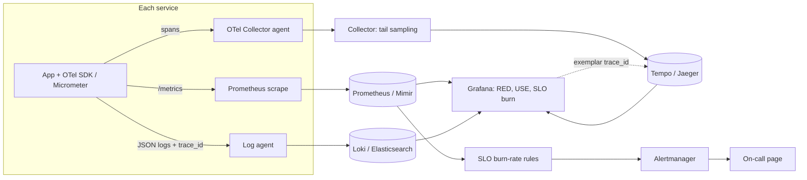
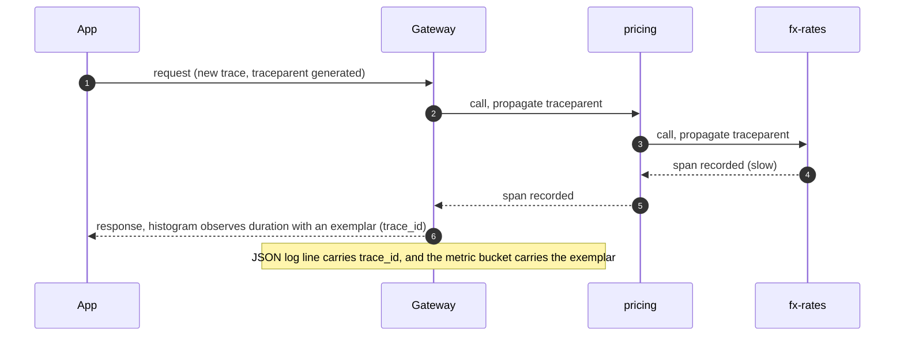
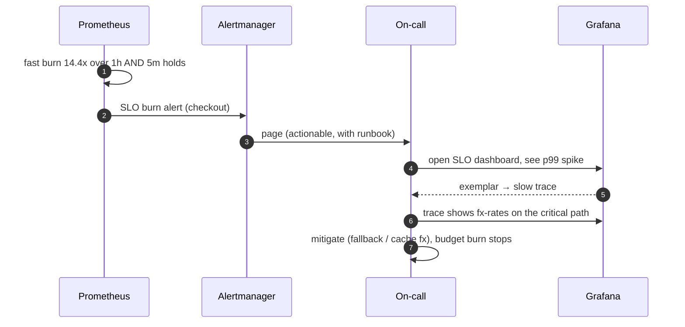
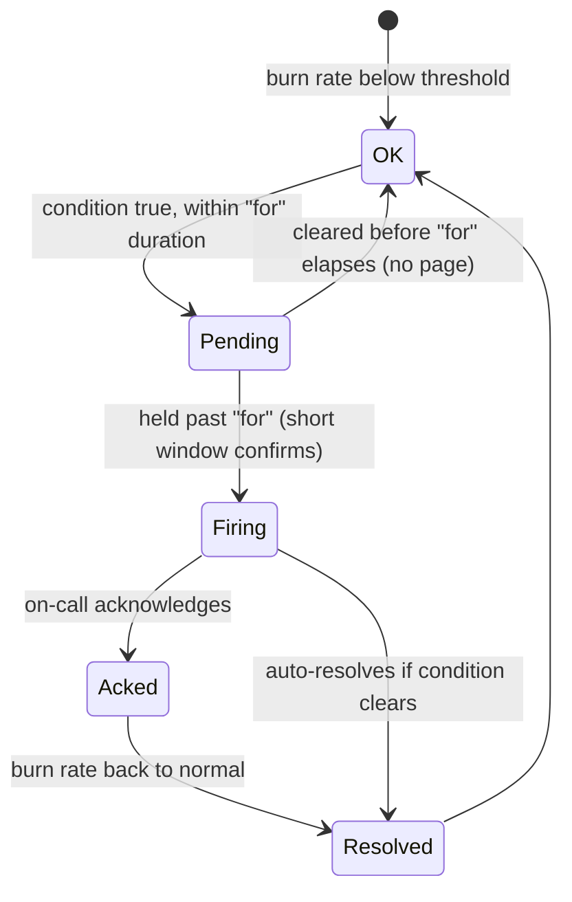

# 24. Observability ⭐

!!! abstract "Chapter at a glance"
    **Reader bands:** B2 → B4 · **Prerequisites:** [Ch 09](../01-foundations/09-scalability-fundamentals.md), [Ch 17](../02-distributed-core/17-inter-service-communication.md), [Ch 18](../02-distributed-core/18-resilience-patterns.md), [Ch 19](../02-distributed-core/19-concurrency-at-scale-in-java.md) · **What you will build:** How the grocery platform is watched — logs, metrics and traces, and the SLOs and alerts on top. One lab uses a **real Prometheus** scraping a **real service**; the rest build the mechanics from scratch and measure them.

    - **L1: structured logs & correlation IDs.** Over 24,776 log events, a correlation id reconstructs one failed request's path across 5 services in one query; without it the 5 lines are lost in the pile. Trace-based sampling cut INFO volume to **3%** while keeping **every** error, and a `(service, level, user_id)` label would have made **18,530 time series** vs 10.
    - **L2: metrics, with real Prometheus.** A service exposes a Prometheus histogram; Prometheus scrapes it and computes `histogram_quantile` live. The catch: `p99` from the histogram was **+26% off** the exact value because the tail lands in a wide bucket. The average (74 ms) "met" a 200 ms SLO while **p99 was 1,545 ms**.
    - **L3: distributed tracing.** A span tree finds the **critical path** — the slow `fx-rates` call under pricing — and shows that optimizing anything off it changes nothing. Aggregating 10,000 traces names the p99 driver. Head sampling at 1% kept **6 of 554** slow traces; tail sampling kept all 554.
    - **L4: SLOs & burn-rate alerting.** On 30 days with 3 injected incidents, a naive threshold raised a false page, a single long window **flapped into 17 false pages**, and Google SRE's **multi-window multi-burn-rate** paged **4 times, 0 false, ~2-min detect**, each page tied to real budget burn.

    · **Reading time:** 120 min + code

---

## 1. Introduction & Why It Matters

### 1.1 A story: the dashboard was all green

Checkout conversion dropped 8% one evening, but every dashboard was green. The post-incident review found the platform was *monitoring* (pre-set dashboards of averages) but not *observable* (able to ask new questions of the data):

- **The latency dashboard showed the average: 74 ms.** Well under the 200 ms target. But the average hid the tail — **p99 was over 1.5 seconds** (L2), because a currency-conversion dependency under pricing was intermittently slow. Averages can't see tails.
- **There was no way to follow one failed checkout across services.** Logs were free-text sentences with no shared id, so reconstructing a single request meant grepping five services and guessing by timestamp (L1).
- **The alert was "error rate > 1% for 5 minutes."** It had paged 40 times that month, mostly on harmless off-peak blips, so the on-call had muted it. The one real slow-burn incident it should have caught, it detected late (L4).
- **Nobody could point to the slow service.** Metrics said "pricing is slow sometimes"; only a trace showed the slowness was a nested `fx-rates` call, on the critical path just 30% of the time but dominating p99 when it was (L3).

The rebuild: structured logs with a trace id on every line, RED metrics with proper histograms, distributed tracing with exemplars linking a slow metric to its trace, and SLO-based multi-window burn-rate alerts that page on budget threats, not noise.

!!! quote "The thesis of this chapter"
    **Monitoring** answers questions you knew to ask (a dashboard of averages). **Observability** lets you ask new ones during an incident you didn't foresee — which needs high-cardinality, correlated **logs, metrics and traces** that share a request id. Measure **percentiles, never averages**, for anything user-facing. Define **SLOs** as the contract, spend an **error budget**, and alert on **how fast you're burning it**, so pages mean "a human must act now," not "a number wiggled."

### 1.2 Where this lives in the grocery platform

| Signal | Tooling (production) | Notes |
|---|---|---|
| Metrics | Micrometer → Prometheus/Mimir; Grafana | RED per service, USE per resource; histograms with SLO-aligned buckets |
| Logs | Structured JSON → Loki/Elasticsearch | Trace id on every line; sampled by trace; PII-redacted |
| Traces | OpenTelemetry SDK → Collector → Tempo/Jaeger | W3C `traceparent` propagation; tail sampling |
| Dashboards | Grafana | RED + USE + SLO burn; exemplars link metrics → traces |
| SLOs & alerts | Sloth/Pyrra → Prometheus rules; Alertmanager | Multi-window multi-burn-rate; error budgets |
| On-call | PagerDuty/Opsgenie | Only SLO-threatening pages; everything else is a ticket |
| Profiling | async-profiler, JFR (Ch 19, Ch 25) | Continuous profiling for CPU/alloc |

### 1.3 Learning objectives

| Band | After this chapter you can… |
|---|---|
| <span class="band b2">B2</span> | Emit structured logs with correlation ids, expose RED metrics with histograms, and read percentiles correctly |
| <span class="band b3">B3</span> | Instrument tracing with context propagation, choose histogram buckets and sampling, and design SLIs/SLOs with error budgets |
| <span class="band b4">B4</span> | Design multi-window burn-rate alerting, control cardinality and cost, and build an observability strategy that finds unknown-unknowns |

---

## 2. Core Concepts — Beginner to Deep

### 2.1 Intuition <span class="band b2">B2</span>

- **Metrics are the car's dashboard; logs are the trip diary; traces are the GPS route of one journey.** The dashboard (metrics) tells you *that* something is wrong cheaply and continuously. The diary (logs) tells you *what* happened in detail. The route (a trace) shows *where* in the journey the delay was. You need all three, sharing one trip number (the trace id).
- **The average is the lie.** If nine customers wait 20 ms and one waits 2 seconds, the "average 218 ms" describes nobody. The tenth customer is the one who abandons the cart. Watch **percentiles**.
- **An SLO is a promise with a budget.** "99.9% of checkouts succeed" allows 0.1% to fail — that's the error budget. As long as you're within it, you can ship; when you're burning it fast, you stop and fix. Alerts watch the **burn rate**, like a fuel gauge that only warns when you'll run dry before the destination.

### 2.2 The three signals ⭐ <span class="band b2">B2</span>

| Signal | What | Cost | Cardinality | Best for |
|---|---|---|---|---|
| **Metrics** | Numeric time series (counters, gauges, histograms) | Cheap, constant per series | **Must be low** (bounded label values) | "Is it broken? How much? Trends, SLOs, alerts" |
| **Logs** | Timestamped structured events | Medium–high (volume) | High (any field) | "What exactly happened to this thing?" |
| **Traces** | Causally-linked spans of one request across services | Medium (sampled) | High | "Where did the time/error go across services?" |

They converge: an **exemplar** attaches a trace id to a metric bucket (jump from a slow p99 to a slow trace); logs carry the trace id (jump from a trace to its logs). This is the "single pane" that makes a system observable.

**OpenTelemetry (OTel)** is the vendor-neutral standard: one set of SDKs and a Collector emit all three signals, with **W3C Trace Context** (`traceparent`) propagating the trace across services. In Java, **Micrometer** is the metrics façade (and bridges to OTel/Prometheus). Instrument once; export anywhere.

### 2.3 Structured logging and correlation ⭐ <span class="band b2">B2</span>

- **Structured (JSON/logfmt), not prose.** `{"level":"ERROR","service":"inventory","trace_id":"…","sku":"…","error":"timeout"}` is queryable by field; a sentence is not. L1: "which requests failed in inventory, and why" is one field filter on structured logs, and brittle regex on text.
- **Correlation/trace id on every line.** Generated at the edge, propagated through every service and put in every log line (via MDC / a logging context). L1: with a trace id, one query returns a failed request's ordered path across 5 services; without it, those 5 lines sit anonymously among 24,776.
- **Levels and sampling.** Keep ERROR/WARN always; sample INFO/DEBUG. **Sample by trace, not by line**, so a kept request keeps *all* its lines. L1: keeping 1% of INFO traces cut volume to 3% while keeping 100% of errors (and error traces whole).
- **Never log secrets or full PII** (Ch 23). Redact; log a token's id, not the token.
- **Logs are expensive at volume.** They're the highest-cost signal, so structure them, sample them, and set retention.

### 2.4 Metrics: counters, gauges, histograms ⭐ <span class="band b2">B2</span>

- **Counter:** monotonically increasing (requests, errors). You query its **rate** (`rate(http_requests_total[5m])`).
- **Gauge:** a value up or down (in-flight requests, queue depth, memory).
- **Histogram:** counts observations into buckets; lets you compute quantiles and "how many under 200 ms". Prometheus histograms are **cumulative** (`_bucket{le=…}`, `_sum`, `_count`).
- **Summary:** client-computed quantiles; can't be aggregated across instances, so histograms are usually preferred.

**Percentiles from histograms are approximate.** `histogram_quantile` interpolates within the bucket holding the quantile's rank, so accuracy depends on bucket boundaries. L2 (real Prometheus over a real service):

| Quantile | From histogram | Exact | Error |
|---|---|---|---|
| p50 | 21.2 ms | 20.7 ms | +2% |
| p95 | 86.7 ms | 79.7 ms | +9% |
| p99 | 1,930 ms | 1,545 ms | **+25%** |
| p99.9 | 2,443 ms | 1,794 ms | **+36%** |

The p50/p95 are close; the tail is coarse because it falls in the wide 1000–2500 ms bucket. **Put buckets where your SLO lives** (e.g. around 200 ms), and remember you cannot recover accuracy the buckets never captured. (Prometheus **native histograms**, GA-ish in 2024–25, largely fix this with exponential auto-buckets.)

### 2.5 RED and USE ⭐ <span class="band b2">B2</span>

Two complementary checklists so you instrument the right things:

- **RED (services / request-driven):** **R**ate (requests/s), **E**rrors (failed/s or %), **D**uration (latency distribution). L2 computes all three from counters and a histogram.
- **USE (resources):** **U**tilization, **S**aturation (queue depth/wait), **E**rrors — for CPU, memory, disks, connection pools, thread pools (Ch 19).

RED tells you the service is unhealthy; USE tells you which resource is the cause. The "four golden signals" (Google SRE) are latency, traffic, errors, saturation — RED plus saturation.

**Averages vs percentiles:** always chart p50/p90/p99 (and p99.9 for critical paths), never the mean. L2: a 74 ms average masked a 1,545 ms p99. Percentiles also don't average across instances — you need histograms to aggregate them correctly.

### 2.6 Distributed tracing ⭐ <span class="band b3">B3</span>

A **trace** is a tree of **spans**; each span has a trace id, span id, parent id, service, operation, start/end and attributes. Context (`traceparent`) propagates across HTTP/gRPC/messaging so spans from different services join one trace.

- **Critical path:** the chain of spans that determines the end-to-end duration. L3 builds the product-page fan-out (Ch 19) and finds the slow request's critical path is `bff → pricing → fx-rates`. **Optimizing anything off the critical path (catalog, inventory) does not shrink the request.** This is the single most useful thing a trace tells you.
- **Aggregate analysis:** across 10,000 traces, L3 shows `pricing/fx-rates` sits on the critical path ~68% of the time and carries the whole tail (the 30% of calls that hit the slow currency service). That's the p99 lever — invisible to per-service metrics.
- **Instrumentation:** auto-instrumentation (OTel Java agent) covers HTTP/DB/messaging; add manual spans for business steps. Propagate context through async boundaries and thread pools (Ch 19: `ScopedValue`/context-wrapping executors).

### 2.7 Sampling ⭐ <span class="band b3">B3</span>

Tracing every request is expensive at volume, so sample:

| Strategy | When decided | Keeps interesting traces? | Cost |
|---|---|---|---|
| **Head-based** (probabilistic) | At the start, on the trace id | No — drops most slow/error traces | Cheapest, no buffering; decision propagates |
| **Tail-based** | After the trace completes | Yes — keep all errors/slow, sample the rest | Buffers every trace until done (Collector memory) |

L3, 10,000 traces: head sampling at 1% kept only **6 of 554** slow traces; tail sampling kept **all 554** plus a 1% baseline, at the cost of buffering. The common production setup: head-sample cheaply for baseline volume, and tail-sample in the Collector to guarantee errors and slow traces are kept. Whatever the rate, keep **all error traces**.

### 2.8 Cardinality and cost ⭐ <span class="band b3">B3</span>

**Cardinality** (distinct label-value combinations) is the number-one cause of observability cost blowups and outages.

- Each unique combination of metric labels is a **separate time series**. L1: a counter labelled `(service, level, user_id)` would create ~18,530 series; `(service, level)` only 10.
- **Never put unbounded values in metric labels:** user ids, order ids, trace ids, email, full URLs, raw error messages. They belong in **logs and traces** (searchable), not metrics.
- Symptoms: Prometheus OOM, slow queries, huge bills. Guardrails: limit label values, drop high-cardinality labels at scrape/ingest, and review new metrics.
- **Logs and traces** tolerate high cardinality (they're indexed differently), which is exactly why request ids go there.

### 2.9 SLIs, SLOs, SLAs and error budgets ⭐ <span class="band b3">B3</span>

- **SLI** (indicator): a measured ratio of good events, e.g. `good_requests / total_requests`, or `requests under 200 ms / total`. Define "good" precisely.
- **SLO** (objective): a target for the SLI over a window, e.g. **99.9% of checkouts succeed over 30 days**.
- **SLA** (agreement): a contractual SLO with consequences (credits). Usually looser than the internal SLO.
- **Error budget:** `1 − SLO`. At 99.9%, 0.1% may fail. L4: over 30 days that's **9,661 failed requests allowed**; the month used 13,517 (140% — budget blown by one bad incident). The budget is the shared language between product (ship features) and reliability (stop and stabilize when the budget's gone).

Choose SLIs the user feels (checkout success, page latency), not internal proxies (CPU). Aim SLOs at "good enough that users are happy," not 100% (which is infinitely expensive and leaves no room to ship).

### 2.10 Burn-rate alerting ⭐ <span class="band b4">B4</span>

**Burn rate** = how fast you're consuming the error budget. A burn rate of 1 exhausts a 30-day budget in exactly 30 days; **14.4** exhausts it in ~2 days; **6** in ~5 days. Alert on burn rate, not on a raw threshold.

**Google SRE's multi-window, multi-burn-rate** pages when a fast **and** a slow signal agree:

- **Fast (page):** 14.4× over 1 h **and** 14.4× over 5 min (the short window confirms it's still happening, avoiding alerting on an already-resolved spike).
- **Slow (page):** 6× over 6 h **and** 6× over 30 min.
- **Ticket (not a page):** lower rates over longer windows (1×–3×).

L4 compares strategies on the same 30 days (3 injected incidents: a sharp 20-min outage, a 6-h slow burn, a 3-min blip):

| Strategy | Pages | False pages | Missed | Median detect |
|---|---|---|---|---|
| Naive: 5-min error rate > 1% | 5 | 1 | 0 | 1 min |
| Single window: 1-h burn > 1 | 20 | **17** | 0 | 1 min |
| **Multi-window multi-burn (SRE)** | **4** | **0** | 0 | 2 min |

- **Naive fixed threshold:** its pages don't map to budget — 1% error is a crisis at 600 rpm and noise at 50 rpm — so it both over- and under-pages, and it raised a false page on the harmless blip.
- **Single long window:** it **flaps** — the condition dips and re-crosses during an incident, turning one incident into 17 pages (the classic alert-fatigue generator).
- **Multi-window multi-burn:** fewest pages, zero false pages, ~2-min detection, and every page corresponds to real budget burn (L4's per-incident view: the sharp outage burned 108% of the month's budget; the blip, 1%).

### 2.11 Good alerting practice <span class="band b4">B4</span>

- **Page only on symptoms that need a human now** (SLO burn, hard-down), not on causes (high CPU) that may be harmless. Causes become dashboards and tickets.
- **Every page is actionable and has a runbook.** If a page has no action, delete it.
- **Reduce noise:** dedup, group, inhibit downstream alerts when an upstream one fires, and set maintenance windows.
- **Alert on the absence of signal** too (no data = broken exporter, not "all good").
- **Review alerts after every incident:** what paged that shouldn't have, what should have paged and didn't.

### 2.12 Dashboards and correlation <span class="band b3">B3</span>

- **Standard layout:** an RED row per service (rate, errors, latency percentiles), a USE row for resources, an SLO/error-budget panel, and links out to logs and traces.
- **Exemplars** turn a spike on the latency graph into a click-through to the exact slow trace (L2 D emits the trace id of a slow request; L3 opens it).
- **Design for the incident, not the demo:** the first dashboard an on-call opens should answer "what's burning and where," then drill down. Avoid wall-of-graphs dashboards nobody reads.

---

## 3. Architecture & Diagrams

### 3.1 Component view: the observability pipeline



### 3.2 Sequence: happy path, trace context and exemplars



### 3.3 Sequence: failure path, an incident from alert to fix



### 3.4 State: an alert's lifecycle



---

## 4. Design Document Excerpt: Grocery Observability Platform

| Field | Value |
|---|---|
| Author / Reviewers | SRE / platform, all service teams, product |
| Status | Approved |
| Related ADRs | ADR-103 OpenTelemetry + Micrometer, one instrumentation, multiple backends; ADR-104 Prometheus histograms with SLO-aligned buckets, no high-cardinality labels; ADR-105 Structured JSON logs with trace_id, trace-based sampling, PII redaction; ADR-106 Tail sampling in the Collector, all errors kept; ADR-107 SLOs per critical journey with multi-window burn-rate alerts; pages only on SLO burn |

**1. Context & Problem.** The green-dashboard incident (§1.1): averages hid the tail, no request correlation, threshold alerts caused fatigue and missed a slow burn, and no way to localize the slow service.

**2. Goals / Non-Goals.**

- *Goals:* answer "what's wrong, how bad, and where" for any incident; percentile-based latency; correlated logs/metrics/traces; SLO-driven pages that are all actionable; bounded observability cost.
- *Non-goals:* 100% trace retention; alerting on every resource metric; a bespoke observability stack (use OTel + CNCF tools).

**3. Requirements.**

| ID | Requirement |
|---|---|
| FR-1 | Every request has a trace id, propagated and logged on every line across services |
| FR-2 | Each service exposes RED metrics; histograms have buckets around each SLO threshold |
| FR-3 | Traces sampled: head baseline + tail keep-all-errors; context propagates through async code |
| FR-4 | SLOs defined for checkout, product page, search, payment; error budgets tracked |
| NFR-1 | Pages fire only on multi-window burn-rate breaches; every page has a runbook |
| NFR-2 | No metric label with unbounded cardinality; new metrics reviewed |
| NFR-3 | Logs sampled by trace; PII redacted; retention set by class |
| NFR-4 | Metric ingest and trace/log storage within budget; cardinality monitored |

**4. SLOs (initial).**

| Journey | SLI | SLO (30d) | Budget |
|---|---|---|---|
| Checkout | success ratio | 99.9% | 0.1% (L4) |
| Product page | requests < 300 ms | 99% | 1% |
| Search | requests < 200 ms | 99% | 1% |
| Payment capture | success ratio | 99.95% | 0.05% |

**5. Proposed design.**

1. **Instrumentation:** the OTel Java agent (auto) + Micrometer for custom metrics + manual spans for business steps. `traceparent` propagation; MDC injects `trace_id` into logs.
2. **Metrics:** Prometheus/Mimir scrape; SLO-aligned histogram buckets; relabeling drops risky labels; native histograms where supported.
3. **Logs:** JSON to Loki; trace-based sampling; PII redaction filter (Ch 23); retention 7–30 days by class.
4. **Traces:** OTel Collector with tail sampling (keep errors + slow + 1% baseline) to Tempo.
5. **SLOs & alerts:** Sloth/Pyrra generate multi-window burn-rate rules from SLO definitions; Alertmanager routes pages (burn) vs tickets (slow burn / warnings); runbooks linked.
6. **Dashboards:** a standard RED+USE+SLO Grafana template per service, with exemplar links to traces.

**7. Alternatives considered.**

| Option | Pros | Cons | Verdict |
|---|---|---|---|
| Averages + threshold alerts | Simple | Hide tails, page on noise (§1.1, L2, L4) | Rejected |
| Vendor all-in-one APM | Turnkey | Cost, lock-in, cardinality billing | Viable; OTel keeps portability |
| Logs only (no metrics/traces) | One system | Can't do cheap continuous signals or cross-service latency | Rejected |
| 100% tracing | Complete | Cost, storage | Tail-sample instead (L3) |
| Summaries for quantiles | Client-side | Can't aggregate across instances | Histograms |

**8. Failure modes.** Exporter down → alert on missing data. Cardinality explosion → ingest limits + alerts. Collector overload from tracing → tail-sample, back-pressure. Alert fatigue → burn-rate design + post-incident alert review.

**10. Observability of observability.** Meta-metrics: scrape success, ingest rate, series count (cardinality), dropped spans/logs, alert volume and page-to-incident ratio, SLO compliance dashboards.

**14. Decision (ADR-103–107).** OTel + Micrometer, one instrumentation for three backends. Percentile metrics with SLO-aligned buckets and controlled cardinality. Correlated structured logs and tail-sampled traces. SLOs with multi-window burn-rate pages, all actionable.

---

## 5. Hands-On Code — Level Ladder

| Level | New requirement that forces the step |
|---|---|
| L1 | "We can't follow one failed request across services, and logs are unqueryable." (structured logs, correlation ids, sampling, cardinality) |
| L2 | "The average says we're fine; users say we're not." (RED metrics + histograms, real Prometheus, quantile accuracy) |
| L3 | "Metrics say pricing is slow *sometimes*; where exactly?" (distributed tracing, critical path, sampling) |
| L4 | "The alert paged 40 times and we muted it." (SLOs, error budgets, multi-window burn-rate alerting) |

All labs run on a 2 vCPU container, Java 21. **L2 uses a real Prometheus 2.55** scraping a real service. Outputs are verbatim; lab files are in `labs/ch24-observability/`.

### L1 — Structured logs, correlation IDs, sampling and cardinality <span class="band b2">B2</span>

**Requirement:** "Follow one failed request across five services, and stop logs from being an unqueryable, unbounded cost."

The program sends 5,000 requests through gateway → order → pricing → inventory → payment, emitting a log event per hop (3% fail somewhere), then queries the pile four ways.

```java title="LogsL1.java"
// LogsL1.java — run with: java LogsL1.java      (JDK 17+, no dependencies)
// Structured logging and correlation IDs. Simulate 5,000 requests flowing through 5 services (gateway → order → pricing →
// inventory → payment), each emitting log lines. 3 % of requests fail somewhere. Compare:
//   A. unstructured text logs vs structured JSON — can you actually query them?
//   B. no correlation id vs a propagated trace id — can you reconstruct one request's journey across services?
//   C. log levels and sampling — volume vs. keeping the signal (always keep errors)
//   D. label/field cardinality — the metric-and-log killer.
import java.util.*;
import java.util.concurrent.atomic.*;
import java.util.stream.*;

public class LogsL1 {
    record Event(String traceId, String service, long tsMillis, String level, String msg, Map<String, String> fields) {}
    static final String[] SERVICES = {"gateway", "order", "pricing", "inventory", "payment"};
    static final Random R = new Random(24);

    static String traceId() { return String.format("%016x", R.nextLong() & 0x7fffffffffffffffL); }

    /** One request: a chain of spans across services; may fail at a random hop (3%). Returns the events it emitted. */
    static List<Event> request(long t0, int userId, String sku) {
        String trace = traceId();
        List<Event> ev = new ArrayList<>();
        int failAt = R.nextDouble() < 0.03 ? 1 + R.nextInt(SERVICES.length - 1) : -1;
        long t = t0;
        for (int i = 0; i < SERVICES.length; i++) {
            String svc = SERVICES[i];
            var f = new LinkedHashMap<String, String>();
            f.put("trace_id", trace); f.put("user_id", "u" + userId); f.put("sku", sku); f.put("http_method", "POST");
            t += 2 + R.nextInt(30);
            if (i == failAt) {
                f.put("error", "timeout calling " + (i + 1 < SERVICES.length ? SERVICES[i + 1] : "db"));
                ev.add(new Event(trace, svc, t, "ERROR", "request failed", f));
                break;
            }
            ev.add(new Event(trace, svc, t, "INFO", svc + " handled", f));
        }
        return ev;
    }

    // ---- log formats ----
    static String unstructured(Event e) {   // the "just print a sentence" style
        String base = new Date(e.tsMillis()) + " [" + e.service() + "] " + e.level() + " " + e.msg()
                + " for user " + e.fields().get("user_id") + " sku " + e.fields().get("sku");
        return e.fields().containsKey("error") ? base + " - " + e.fields().get("error") : base;
    }
    static String json(Event e) {
        var sb = new StringBuilder("{");
        sb.append("\"ts\":").append(e.tsMillis()).append(",\"level\":\"").append(e.level()).append("\",\"service\":\"").append(e.service()).append("\",\"msg\":\"").append(e.msg()).append("\"");
        e.fields().forEach((k, v) -> sb.append(",\"").append(k).append("\":\"").append(v).append("\""));
        return sb.append("}").toString();
    }

    public static void main(String[] args) {
        List<Event> all = new ArrayList<>();
        long clock = System.currentTimeMillis();
        List<String> traces = new ArrayList<>();
        for (int i = 0; i < 5_000; i++) {
            var req = request(clock += R.nextInt(5), R.nextInt(2000), "sku-" + R.nextInt(500));
            all.addAll(req);
            if (!req.isEmpty()) traces.add(req.get(0).traceId());
        }
        long errors = all.stream().filter(e -> e.level().equals("ERROR")).count();
        System.out.printf("%,d requests → %,d log events, %,d ERROR events%n%n", 5_000, all.size(), errors);

        System.out.println("A. Querying: \"which requests failed in inventory, and what was the error?\"");
        // structured: filter by fields
        long structHits = all.stream().filter(e -> e.level().equals("ERROR") && e.service().equals("inventory")).count();
        System.out.printf("   structured JSON: filter level=ERROR AND service=inventory → %d events, each with trace_id, user_id, sku, error%n", structHits);
        // unstructured: you must regex the sentence, and fields like sku are positional/fragile
        String sampleErr = all.stream().filter(e -> e.level().equals("ERROR") && e.service().equals("inventory")).map(LogsL1::unstructured).findFirst().orElse("(none)");
        System.out.printf("   unstructured   : grep 'inventory' | grep 'ERROR', then parse free text. One line looks like:%n     %s%n", sampleErr.substring(0, Math.min(sampleErr.length(), 110)));
        System.out.println("   → structured logs are queryable by field; text logs force brittle regex and can't be aggregated reliably.");

        System.out.println("\nB. Correlation: reconstruct ONE failed request's path across services");
        String failedTrace = all.stream().filter(e -> e.level().equals("ERROR")).map(Event::traceId).findFirst().orElseThrow();
        var journey = all.stream().filter(e -> e.traceId().equals(failedTrace)).sorted(Comparator.comparingLong(Event::tsMillis)).toList();
        System.out.printf("   with a correlation id: filter trace_id=%s → %d ordered events:%n", failedTrace, journey.size());
        for (Event e : journey) System.out.printf("     %-9s %-5s %s%n", e.service(), e.level(), e.fields().getOrDefault("error", e.msg()));
        System.out.println("   without one: the 5 lines are scattered among " + String.format("%,d", all.size()) + " events with no shared key — you'd correlate by guessing on timestamp+user.");

        System.out.println("\nC. Levels and sampling: cut INFO volume without losing errors");
        Map<String, Long> byLevel = all.stream().collect(Collectors.groupingBy(Event::level, Collectors.counting()));
        System.out.printf("   full volume: %s%n", byLevel);
        for (double keep : new double[]{1.0, 0.1, 0.01}) {
            // sample INFO by trace so a kept request keeps ALL its INFO lines; always keep every ERROR and its whole trace
            Set<String> errorTraces = all.stream().filter(e -> e.level().equals("ERROR")).map(Event::traceId).collect(Collectors.toSet());
            Set<String> keptInfoTraces = traces.stream().filter(t -> (Math.abs(t.hashCode()) % 1000) / 1000.0 < keep).collect(Collectors.toSet());
            long kept = all.stream().filter(e -> e.level().equals("ERROR") || errorTraces.contains(e.traceId()) || keptInfoTraces.contains(e.traceId())).count();
            long errKept = all.stream().filter(e -> e.level().equals("ERROR")).filter(e -> errorTraces.contains(e.traceId())).count();
            System.out.printf("   keep %4.0f%% of INFO traces (errors always kept): %,7d events stored (%.0f%%), ERROR events kept %d/%d%n",
                    keep * 100, kept, 100.0 * kept / all.size(), errKept, errors);
        }
        System.out.println("   → sample by trace, never by line (so a kept request is whole), and never sample errors.");

        System.out.println("\nD. Cardinality: what happens if you put high-cardinality values in labels");
        System.out.printf("   distinct services: %d  (safe as a label)%n", SERVICES.length);
        System.out.printf("   distinct users   : %,d  distinct traces: %,d  (NEVER a metric label — one time series each)%n",
                all.stream().map(e -> e.fields().get("user_id")).distinct().count(), traces.size());
        long labelSeries = (long) SERVICES.length * 2 /*level*/ * all.stream().map(e -> e.fields().get("user_id")).distinct().count();
        System.out.printf("   a counter labelled by (service, level, user_id) would create ~%,d time series; by (service, level) only %d.%n", labelSeries, SERVICES.length * 2);
        System.out.println("   → high-cardinality identifiers belong in logs/traces (searchable), not in metric labels (they explode storage).");
    }
}
```

```text title="java LogsL1.java"
5,000 requests → 24,776 log events, 146 ERROR events

A. Querying: "which requests failed in inventory, and what was the error?"
   structured JSON: filter level=ERROR AND service=inventory → 33 events, each with trace_id, user_id, sku, error
   unstructured   : grep 'inventory' | grep 'ERROR', then parse free text. One line looks like:
     Fri Sep 25 23:19:27 IST 2026 [inventory] ERROR request failed for user u876 sku sku-31 - timeout calling payme
   → structured logs are queryable by field; text logs force brittle regex and can't be aggregated reliably.

B. Correlation: reconstruct ONE failed request's path across services
   with a correlation id: filter trace_id=6417317d6d792d49 → 2 ordered events:
     gateway   INFO  gateway handled
     order     ERROR timeout calling pricing
   without one: the 5 lines are scattered among 24,776 events with no shared key — you'd correlate by guessing on timestamp+user.

C. Levels and sampling: cut INFO volume without losing errors
   full volume: {ERROR=146, INFO=24630}
   keep  100% of INFO traces (errors always kept):  24,776 events stored (100%), ERROR events kept 146/146
   keep   10% of INFO traces (errors always kept):   3,051 events stored (12%), ERROR events kept 146/146
   keep    1% of INFO traces (errors always kept):     796 events stored (3%), ERROR events kept 146/146
   → sample by trace, never by line (so a kept request is whole), and never sample errors.

D. Cardinality: what happens if you put high-cardinality values in labels
   distinct services: 5  (safe as a label)
   distinct users   : 1,853  distinct traces: 5,000  (NEVER a metric label — one time series each)
   a counter labelled by (service, level, user_id) would create ~18,530 time series; by (service, level) only 10.
   → high-cardinality identifiers belong in logs/traces (searchable), not in metric labels (they explode storage).
```

**Reading it:**

- **Structured vs text:** "which requests failed in inventory, and why" is a single field filter on JSON logs; on free-text it's brittle regex over a positional sentence that can't be aggregated.
- **Correlation:** with a `trace_id`, one query returns a failed request's ordered path across services. Without it, those lines are anonymous among ~25,000 events, correlated only by guessing on timestamp and user.
- **Sampling:** keeping 1% of INFO *traces* cut stored volume to 3% while keeping **every** ERROR (and every error trace whole). Sample by trace, never by line, and never sample errors.
- **Cardinality:** a counter labelled by `(service, level, user_id)` would create ~18,530 time series; by `(service, level)` only 10. High-cardinality identifiers belong in logs and traces, not metric labels.

### L2 — RED metrics and histograms, scraped by a real Prometheus <span class="band b2">B2</span>

**Requirement:** "The average latency looks healthy; prove whether users are actually being served fast."

A service exposes Prometheus-format metrics on `:19701/metrics` (per-route counters, an errors counter, an in-flight gauge, and a latency histogram with explicit buckets), drives ~12 s of load with a heavy tail, and — while it runs — a **real Prometheus** scrapes it every second. The program then compares `histogram_quantile` against the exact percentiles.

```java title="MetricsL2.java"
// MetricsL2.java — run with: java -Dsun.net.httpserver.nodelay=true MetricsL2.java
// A service that exposes Prometheus-format metrics on :19701/metrics (counters, gauge, and a latency histogram with
// explicit buckets), drives a realistic load with a slow tail, and — while it runs — a REAL Prometheus scrapes it.
// A. RED metrics from counters. B. histogram_quantile accuracy vs exact percentiles (why bucket choice matters).
// C. why an average hides the tail. D. an exemplar linking a bucket to a trace id.
import com.sun.net.httpserver.*;
import java.net.InetSocketAddress;
import java.util.*;
import java.util.concurrent.*;
import java.util.concurrent.atomic.*;

public class MetricsL2 {
    // classic Prometheus client-style histogram: cumulative buckets (le), _sum, _count
    static final double[] BUCKETS = {5, 10, 25, 50, 75, 100, 150, 250, 500, 1000, 2500}; // ms
    static final AtomicLong[] bucketCounts = new AtomicLong[BUCKETS.length];
    static final AtomicLong reqTotal = new AtomicLong(), errTotal = new AtomicLong();
    static final DoubleAdder latencySum = new DoubleAdder();
    static final AtomicInteger inFlight = new AtomicInteger();
    static final Map<String, AtomicLong> byRoute = new ConcurrentHashMap<>();
    static final List<Double> exactSample = Collections.synchronizedList(new ArrayList<>());  // for the accuracy check only
    static volatile String lastSlowTrace = "none";
    static { for (int i = 0; i < BUCKETS.length; i++) bucketCounts[i] = new AtomicLong(); }

    static void observe(double ms, String route, boolean error, String trace) {
        reqTotal.incrementAndGet(); if (error) errTotal.incrementAndGet();
        latencySum.add(ms); byRoute.computeIfAbsent(route, k -> new AtomicLong()).incrementAndGet();
        for (int i = 0; i < BUCKETS.length; i++) if (ms <= BUCKETS[i]) bucketCounts[i].incrementAndGet();
        exactSample.add(ms);
        if (ms > 250) lastSlowTrace = trace;
    }

    static String metrics() {
        var sb = new StringBuilder();
        sb.append("# HELP http_requests_total Total HTTP requests\n# TYPE http_requests_total counter\n");
        byRoute.forEach((r, c) -> sb.append("http_requests_total{route=\"").append(r).append("\"} ").append(c.get()).append("\n"));
        sb.append("# HELP http_request_errors_total Total errors\n# TYPE http_request_errors_total counter\nhttp_request_errors_total ").append(errTotal.get()).append("\n");
        sb.append("# HELP http_inflight_requests In-flight requests\n# TYPE http_inflight_requests gauge\nhttp_inflight_requests ").append(inFlight.get()).append("\n");
        sb.append("# HELP http_request_duration_ms Request latency\n# TYPE http_request_duration_ms histogram\n");
        for (int i = 0; i < BUCKETS.length; i++) sb.append("http_request_duration_ms_bucket{le=\"").append((long) BUCKETS[i]).append("\"} ").append(bucketCounts[i].get()).append("\n");
        sb.append("http_request_duration_ms_bucket{le=\"+Inf\"} ").append(reqTotal.get()).append("\n");
        sb.append("http_request_duration_ms_sum ").append(String.format("%.1f", latencySum.sum())).append("\n");
        sb.append("http_request_duration_ms_count ").append(reqTotal.get()).append("\n");
        // an exemplar: which trace hit the slow tail (OpenMetrics exemplars ride on a bucket line)
        sb.append("# trace of the last request over 250 ms (exemplar): ").append(lastSlowTrace).append("\n");
        return sb.toString();
    }

    // Prometheus' histogram_quantile: linear interpolation within the bucket that contains the quantile rank
    static double histogramQuantile(double q) {
        long total = reqTotal.get(); double rank = q * total; double lower = 0, cumLower = 0;
        for (int i = 0; i < BUCKETS.length; i++) {
            long cum = bucketCounts[i].get();
            if (cum >= rank) return lower + (BUCKETS[i] - lower) * (rank - cumLower) / (cum - cumLower);
            lower = BUCKETS[i]; cumLower = cum;
        }
        return BUCKETS[BUCKETS.length - 1];   // in +Inf bucket: can't do better than the last finite edge
    }
    static double exactQuantile(double q) {
        double[] a = exactSample.stream().mapToDouble(Double::doubleValue).sorted().toArray();
        return a[Math.min(a.length - 1, (int) Math.ceil(q * a.length) - 1)];
    }

    public static void main(String[] args) throws Exception {
        HttpServer s = HttpServer.create(new InetSocketAddress("127.0.0.1", 19701), 0);
        s.createContext("/metrics", ex -> { byte[] b = metrics().getBytes(); ex.sendResponseHeaders(200, b.length); ex.getResponseBody().write(b); ex.close(); });
        s.setExecutor(Executors.newVirtualThreadPerTaskExecutor()); s.start();

        // drive load for ~12s so a real Prometheus (1s scrape) gets a dozen samples; log-normal body + a heavy tail
        Thread load = new Thread(() -> {
            Random r = new Random(7); long end = System.currentTimeMillis() + 12_000;
            try (var ex = Executors.newFixedThreadPool(8)) {
                while (System.currentTimeMillis() < end) {
                    ex.submit(() -> {
                        inFlight.incrementAndGet();
                        double ms = Math.exp(r.nextGaussian() * 0.5 + 3.0);          // ~median 20ms
                        if (r.nextDouble() < 0.05) ms += 300 + r.nextDouble() * 1500;  // 5% slow tail (a slow dependency)
                        boolean err = r.nextDouble() < 0.02;
                        String route = r.nextDouble() < 0.7 ? "/products" : (r.nextDouble() < 0.5 ? "/cart" : "/checkout");
                        try { Thread.sleep((long) ms); } catch (InterruptedException ignored) {}
                        observe(ms, route, err, String.format("%016x", r.nextLong() & 0x7fffffffffffffffL));
                        inFlight.decrementAndGet();
                    });
                    try { Thread.sleep(2); } catch (InterruptedException ignored) {}
                }
            }
        });
        load.start(); load.join();

        System.out.println("A. RED metrics (from counters/gauge on /metrics, scraped by Prometheus)");
        System.out.printf("   Rate    : %,d requests over ~12 s%n", reqTotal.get());
        System.out.printf("   Errors  : %,d (%.2f%%)%n", errTotal.get(), 100.0 * errTotal.get() / reqTotal.get());
        System.out.printf("   Duration: avg %.1f ms  |  by route %s%n", latencySum.sum() / reqTotal.get(),
                byRoute.entrySet().stream().collect(java.util.stream.Collectors.toMap(Map.Entry::getKey, e -> e.getValue().get())));

        System.out.println("\nB. histogram_quantile vs exact percentile (bucket boundaries decide the error)");
        System.out.printf("   %-8s %-16s %-16s %s%n", "quantile", "from histogram", "exact", "error");
        for (double q : new double[]{0.50, 0.90, 0.95, 0.99, 0.999}) {
            double hq = histogramQuantile(q), eq = exactQuantile(q);
            System.out.printf("   p%-7s %-16.1f %-16.1f %+.1f ms (%.0f%%)%n", (q * 100 == (long)(q*100) ? String.valueOf((long)(q*100)) : String.valueOf(q*100)), hq, eq, hq - eq, 100 * (hq - eq) / eq);
        }
        System.out.println("   → p99/p99.9 land in the wide 1000–2500 ms bucket (and beyond +Inf), so the estimate is coarse there.");
        System.out.println("     Add buckets where your SLO lives; you cannot recover accuracy the buckets didn't capture.");

        System.out.println("\nC. Why the average lies");
        System.out.printf("   average %.1f ms would meet a \"200 ms\" SLO, but p99 is %.0f ms and p99.9 is %.0f ms — %.0f%% of users are fine, the tail is not.%n",
                latencySum.sum() / reqTotal.get(), exactQuantile(0.99), exactQuantile(0.999), 99.0);

        System.out.println("\nD. Exemplar: jump from the slow bucket to a trace");
        System.out.printf("   a request in the >250 ms range carried trace_id=%s — click it in the dashboard to open the trace (Ch 24 L3).%n", lastSlowTrace);
        System.out.println("\n(Prometheus scraped :19701/metrics live; see prom_out.txt for its own view of the same counters.)");
        s.stop(0);
    }
}
```

```text title="java -Dsun.net.httpserver.nodelay=true MetricsL2.java"
A. RED metrics (from counters/gauge on /metrics, scraped by Prometheus)
   Rate    : 5,580 requests over ~12 s
   Errors  : 102 (1.83%)
   Duration: avg 73.4 ms  |  by route {/cart=840, /checkout=825, /products=3915}

B. histogram_quantile vs exact percentile (bucket boundaries decide the error)
   quantile from histogram   exact            error
   p50      21.2             20.7             +0.5 ms (2%)
   p90      48.0             44.7             +3.2 ms (7%)
   p95      86.7             79.7             +7.0 ms (9%)
   p99      1930.6           1544.7           +385.9 ms (25%)
   p99.9    2443.1           1793.9           +649.2 ms (36%)
   → p99/p99.9 land in the wide 1000–2500 ms bucket (and beyond +Inf), so the estimate is coarse there.
     Add buckets where your SLO lives; you cannot recover accuracy the buckets didn't capture.

C. Why the average lies
   average 73.4 ms would meet a "200 ms" SLO, but p99 is 1545 ms and p99.9 is 1794 ms — 99% of users are fine, the tail is not.

D. Exemplar: jump from the slow bucket to a trace
   a request in the >250 ms range carried trace_id=6fac2e7a0fb35bda — click it in the dashboard to open the trace (Ch 24 L3).

(Prometheus scraped :19701/metrics live; see prom_out.txt for its own view of the same counters.)
```

Prometheus scraped the same endpoint and computed the RED numbers and quantiles from its own stored series:

```text title="prometheus HTTP API (scrape_interval 1s) — verbatim"
=== Prometheus instant queries (its own scraped view) ===
sum(http_requests_total)                                               1615.0
sum(rate(http_requests_total[30s]))                                    31.654
histogram_quantile(0.95, rate(http_request_duration_ms_bucket[1m]))    381.25
histogram_quantile(0.99, rate(http_request_duration_ms_bucket[1m]))    2065.968
sum(rate(http_request_errors_total[1m])) / sum(rate(http_requests_total[1m])) 0.018
```

**Reading it:**

- **RED** comes straight from the counters and histogram: rate, error ratio, and duration — per route.
- **Histogram quantiles are approximate at the tail.** p50 and p95 were within a few percent of exact; **p99 was +25%** and p99.9 +36%, because the tail lands in the wide 1000–2500 ms bucket. Put buckets where your SLO threshold is; you can't recover accuracy the buckets never captured.
- **The average lies:** a 74 ms mean would pass a 200 ms SLO while p99 was 1,545 ms. Chart percentiles.
- **Prometheus's own view** matches: it reports the same request count and error ratio, and its `histogram_quantile(0.99, …)` (~2,066 ms in that run) shows the same tail-bucket coarseness the from-scratch check quantifies. The exemplar comment on `/metrics` carries the trace id of a slow request to open in L3.

### L3 — Distributed tracing: critical path, p99 driver, sampling <span class="band b3">B3</span>

**Requirement:** "Metrics say pricing is slow sometimes. Find exactly where the time goes, and which service to fix."

The program builds spans for the product-page fan-out (Ch 19) with parent/child context, finds the critical path of a slow trace, aggregates 10,000 traces to name the p99 driver, and compares head vs tail sampling.

```java title="TracingL3.java"
// TracingL3.java — run with: java TracingL3.java      (JDK 17+, no dependencies)
// Distributed tracing from scratch. Build spans with parent/child context across the product-page fan-out (Ch 19),
// then: A. reconstruct the span tree for one slow request and find the CRITICAL PATH (what to fix). B. aggregate 10,000
// traces to find which service actually drives p99. C. sampling: head-based vs tail-based, and what each keeps/loses.
import java.util.*;
import java.util.concurrent.atomic.*;
import java.util.stream.*;

public class TracingL3 {
    static final AtomicLong ID = new AtomicLong(1);
    static final class Span {
        final String traceId, spanId, parentId, service, op; final long startUs; long endUs; final Map<String, String> attrs = new HashMap<>();
        Span(String traceId, String parentId, String service, String op, long startUs) { this.traceId = traceId; this.spanId = "s" + ID.getAndIncrement(); this.parentId = parentId; this.service = service; this.op = op; this.startUs = startUs; }
        long durUs() { return endUs - startUs; }
    }

    static final Random R = new Random(24);
    static long lognormalUs(double muMs, double sigma, double tailProb, double tailAddMs) {
        double ms = Math.exp(R.nextGaussian() * sigma + Math.log(muMs));
        if (R.nextDouble() < tailProb) ms += tailAddMs * (0.5 + R.nextDouble());
        return (long) (ms * 1000);
    }

    /** One product-page request. Returns all spans. Structured concurrency: children overlap under the handler. */
    static List<Span> trace() {
        String tid = String.format("%016x", R.nextLong() & 0x7fffffffffffffffL);
        List<Span> spans = new ArrayList<>();
        long t = 0;
        Span root = new Span(tid, null, "bff", "GET /product", t); spans.add(root);
        // required calls run concurrently; the handler waits for the slowest (structured concurrency, Ch 19)
        long[] childEnd = new long[3];
        String[][] deps = {{"catalog", "getProduct"}, {"pricing", "getPrice"}, {"inventory", "getStock"}};
        double[] mu = {20, 30, 25};
        for (int i = 0; i < 3; i++) {
            Span c = new Span(tid, root.spanId, deps[i][0], deps[i][1], t + 500);   // ~0.5ms dispatch
            long dur = lognormalUs(mu[i], 0.4, 0, 0);                       // required deps are tight; the tail comes only from fx-rates under pricing
            if (deps[i][0].equals("pricing")) {                                     // pricing calls a slow currency service 30% of the time
                Span gc = new Span(tid, c.spanId, "fx-rates", "convert", c.startUs + 1000);
                long gcDur = R.nextDouble() < 0.3 ? lognormalUs(150, 0.3, 0, 0) : lognormalUs(5, 0.3, 0, 0);
                gc.endUs = gc.startUs + gcDur; spans.add(gc);
                dur = Math.max(dur, gcDur + 1500);                                  // pricing waits on fx
            }
            c.endUs = c.startUs + dur; spans.add(c); childEnd[i] = c.endUs;
        }
        // reviews: optional, short budget; a DB span under catalog
        Span cat = spans.stream().filter(s -> s.service.equals("catalog")).findFirst().get();
        Span db = new Span(tid, cat.spanId, "catalog-db", "SELECT product", cat.startUs + 300); db.endUs = db.startUs + lognormalUs(6, 0.3, 0, 0); spans.add(db);
        root.endUs = Arrays.stream(childEnd).max().getAsLong() + 700;               // render after the slowest required child
        return spans;
    }

    static Map<String, List<Span>> children(List<Span> spans) {
        return spans.stream().filter(s -> s.parentId != null).collect(Collectors.groupingBy(s -> s.parentId));
    }

    /** Critical path: from the root, at each step follow the child whose end time determines the parent's end. */
    static List<Span> criticalPath(List<Span> spans) {
        Map<String, Span> byId = spans.stream().collect(Collectors.toMap(s -> s.spanId, s -> s));
        var kids = children(spans);
        Span cur = spans.stream().filter(s -> s.parentId == null).findFirst().get();
        List<Span> path = new ArrayList<>(); path.add(cur);
        while (kids.containsKey(cur.spanId)) {
            Span latest = kids.get(cur.spanId).stream().max(Comparator.comparingLong(s -> s.endUs)).get();
            path.add(latest); cur = latest;
        }
        return path;
    }

    public static void main(String[] args) {
        // A. one slow request
        List<Span> slow = null;
        for (int i = 0; i < 500; i++) { var t = trace(); Span root = t.get(0); if (root.durUs() > 200_000) { slow = t; break; } }
        if (slow == null) slow = trace();
        Span root = slow.get(0);
        System.out.printf("A. One slow trace (%.1f ms end to end). The span tree:%n", root.durUs() / 1000.0);
        printTree(slow, root, 0);
        var cp = criticalPath(slow);
        System.out.printf("   critical path: %s%n", cp.stream().map(s -> s.service + " " + s.durUs() / 1000 + "ms").collect(Collectors.joining(" → ")));
        System.out.println("   → optimising anything OFF the critical path (e.g. catalog) does not shrink the request; fix the fx-rates call under pricing.");

        // B. aggregate 10,000 traces
        System.out.println("\nB. 10,000 traces: which service drives the p99 of the product page?");
        int n = 10_000; long[] totals = new long[n];
        Map<String, List<Long>> onCritical = new HashMap<>();
        Map<String, long[]> selfTime = new HashMap<>();
        for (int i = 0; i < n; i++) {
            var t = trace(); totals[i] = t.get(0).durUs();
            for (Span s : criticalPath(t)) onCritical.computeIfAbsent(s.service, k -> new ArrayList<>()).add(s.durUs());
        }
        Arrays.sort(totals);
        System.out.printf("   product page: p50 %.1f ms, p95 %.1f ms, p99 %.1f ms%n", totals[n/2]/1000.0, totals[(int)(n*.95)]/1000.0, totals[(int)(n*.99)]/1000.0);
        System.out.printf("   %-12s %-22s %s%n", "service", "appears on crit. path", "its p99 when on it");
        onCritical.entrySet().stream().sorted((a,b) -> Long.compare(b.getValue().size(), a.getValue().size())).forEach(e -> {
            var v = e.getValue().stream().sorted().toList();
            System.out.printf("   %-12s %-22s %.1f ms%n", e.getKey(), String.format("%,d of %,d (%.0f%%)", v.size(), n, 100.0*v.size()/n), v.get((int)(v.size()*.99))/1000.0);
        });
        System.out.println("   → pricing/fx-rates sits on the critical path ~68% of the time and carries the whole tail (the 30% of calls that hit the slow currency service): that's the p99 lever.");

        // C. sampling
        System.out.println("\nC. Sampling 10,000 traces (each ~5 spans): head-based vs tail-based");
        List<List<Span>> traces = IntStream.range(0, n).mapToObj(i -> trace()).toList();
        long allSpans = traces.stream().mapToLong(List::size).sum();
        long slowMs = 200; long errors = traces.stream().filter(t -> t.get(0).durUs() > slowMs*1000).count();   // treat > p95 (200ms) as the interesting ones
        for (double head : new double[]{1.0, 0.1, 0.01}) {
            long keptTraces = traces.stream().filter(t -> (Math.abs(t.get(0).traceId.hashCode()) % 1000)/1000.0 < head).count();
            long slowKept = traces.stream().filter(t -> t.get(0).durUs() > slowMs*1000).filter(t -> (Math.abs(t.get(0).traceId.hashCode()) % 1000)/1000.0 < head).count();
            System.out.printf("   head-based %4.0f%%: keeps %,6d traces (%,d spans), slow traces kept %d/%d%n", head*100, keptTraces, keptTraces*allSpans/n, slowKept, errors);
        }
        long tailKept = errors + (long)(n * 0.01);   // tail: keep every slow trace + 1% baseline
        System.out.printf("   tail-based (keep all >200ms + 1%% baseline): keeps ~%,d traces, slow traces kept %d/%d — but must buffer every trace until it completes%n", tailKept, errors, errors);
        System.out.println("   → head sampling is cheap and decides early, but drops most slow traces; tail sampling keeps the interesting ones at the cost of buffering.");
    }

    static void printTree(List<Span> spans, Span s, int depth) {
        System.out.printf("     %s%-11s %-14s %5.1f ms%s%n", "  ".repeat(depth), s.service, s.op, s.durUs()/1000.0, depth == 0 ? "" : "");
        children(spans).getOrDefault(s.spanId, List.of()).stream().sorted(Comparator.comparingLong(c -> c.startUs)).forEach(c -> printTree(spans, c, depth+1));
    }
}
```

```text title="java TracingL3.java"
A. One slow trace (209.3 ms end to end). The span tree:
     bff         GET /product   209.3 ms
       catalog     getProduct       9.3 ms
         catalog-db  SELECT product   7.1 ms
       pricing     getPrice       208.1 ms
         fx-rates    convert        206.6 ms
       inventory   getStock        19.6 ms
   critical path: bff 209ms → pricing 208ms → fx-rates 206ms
   → optimising anything OFF the critical path (e.g. catalog) does not shrink the request; fix the fx-rates call under pricing.

B. 10,000 traces: which service drives the p99 of the product page?
   product page: p50 43.7 ms, p95 202.7 ms, p99 261.8 ms
   service      appears on crit. path  its p99 when on it
   bff          10,000 of 10,000 (100%) 261.8 ms
   fx-rates     6,780 of 10,000 (68%)  271.5 ms
   pricing      6,780 of 10,000 (68%)  273.0 ms
   inventory    2,173 of 10,000 (22%)  74.5 ms
   catalog-db   1,047 of 10,000 (10%)  11.9 ms
   catalog      1,047 of 10,000 (10%)  65.6 ms
   → pricing/fx-rates sits on the critical path ~68% of the time and carries the whole tail (the 30% of calls that hit the slow currency service): that's the p99 lever.

C. Sampling 10,000 traces (each ~5 spans): head-based vs tail-based
   head-based  100%: keeps 10,000 traces (60,000 spans), slow traces kept 554/554
   head-based   10%: keeps  1,035 traces (6,210 spans), slow traces kept 70/554
   head-based    1%: keeps    126 traces (756 spans), slow traces kept 6/554
   tail-based (keep all >200ms + 1% baseline): keeps ~654 traces, slow traces kept 554/554 — but must buffer every trace until it completes
   → head sampling is cheap and decides early, but drops most slow traces; tail sampling keeps the interesting ones at the cost of buffering.
```

**Reading it:**

- **Critical path** is the lever: the slow trace's path is `bff → pricing → fx-rates`. Optimizing catalog or inventory (off the path) changes nothing; only the nested `fx-rates` call does.
- **Aggregate** across 10,000 traces localizes p99: `pricing/fx-rates` is on the critical path ~68% of the time and carries the whole tail (the 30% of calls hitting the slow currency service). Per-service metrics can't see this; the trace tree can.
- **Sampling:** head-based at 1% kept only 6 of 554 slow traces — cheap but blind to the tail. Tail-based kept all 554 (plus a 1% baseline) at the cost of buffering every trace until it completes. Keep all error/slow traces however you sample.

### L4 — SLOs, error budgets and burn-rate alerting <span class="band b4">B4</span>

**Requirement:** "The old alert paged 40 times a month and got muted. Page only when the SLO is genuinely threatened."

The program generates 30 days of minute-by-minute checkout traffic (diurnal load, a tiny baseline error rate, and three injected incidents), computes the SLO and error budget, then runs three alerting strategies over the identical stream and counts pages, false pages, missed incidents and time-to-detect.

```java title="SloL4.java"
// SloL4.java — run with: java SloL4.java      (JDK 17+, no dependencies)
// SLIs, SLOs, error budgets and alerting. A 30-day minute-by-minute stream of good/bad requests for checkout, with a
// steady low error rate plus three injected incidents. We compute the SLO/error budget, then compare three alerting
// strategies on the SAME stream: a naive threshold, a single long-window burn rate, and Google SRE's multi-window
// multi-burn-rate. We count pages, false pages, missed incidents and time-to-detect.
import java.util.*;

public class SloL4 {
    static final int DAYS = 30, MIN = DAYS * 24 * 60;             // one data point per minute
    static final double SLO = 0.999;                              // 99.9% success → 0.1% error budget
    static final double BUDGET = 1 - SLO;

    public static void main(String[] args) {
        Random r = new Random(24);
        int[] total = new int[MIN], bad = new int[MIN];
        // background traffic: ~50 rpm off-peak to ~600 rpm at lunch/dinner; baseline error ~0.02% (well under budget)
        boolean[] incident = new boolean[MIN];
        // three incidents: a short total outage, a slow partial-error burn, a brief blip
        int[][] incidents = {{8 * 24 * 60 + 13 * 60, 20, 90},      // day 8, 13:00, 20 min, 90% errors (sharp)
                             {15 * 24 * 60 + 2 * 60, 6 * 60, 4},    // day 15, 02:00, 6 h, 4% errors (slow burn, low rate)
                             {22 * 24 * 60 + 20 * 60, 3, 60}};      // day 22, 20:00, 3 min, 60% errors (blip)
        for (int m = 0; m < MIN; m++) {
            int hour = (m / 60) % 24;
            double rpm = 50 + 550 * Math.max(0, Math.sin((hour - 6) / 24.0 * Math.PI * 2)) + r.nextGaussian() * 20;
            int t = Math.max(1, (int) rpm);
            double errRate = 0.0002;
            for (int[] inc : incidents) if (m >= inc[0] && m < inc[0] + inc[1]) { errRate = inc[2] / 100.0; incident[m] = true; }
            int b = 0; for (int i = 0; i < t; i++) if (r.nextDouble() < errRate) b++;
            total[m] = t; bad[m] = b;
        }

        long totalReq = 0, totalBad = 0; for (int m = 0; m < MIN; m++) { totalReq += total[m]; totalBad += bad[m]; }
        double observedErr = (double) totalBad / totalReq;
        System.out.printf("Checkout SLO: %.1f%% success over 30 days. Requests %,d, failures %,d, error rate %.4f%%%n", SLO * 100, totalReq, totalBad, observedErr * 100);
        double budgetReq = totalReq * BUDGET;
        System.out.printf("Error budget: %.4f%% = %,.0f failed requests allowed in 30 days; used %,d (%.0f%% of budget)%n",
                BUDGET * 100, budgetReq, totalBad, 100 * totalBad / budgetReq);

        // ---- burn rate over a trailing window: (errors/requests in window) / BUDGET ----
        // A burn rate of 1 exactly exhausts the 30-day budget in 30 days; 14.4 exhausts it in ~2 days.
        java.util.function.BiFunction<Integer, Integer, Double> burn = (endExclusive, windowMin) -> {
            long tr = 0, br = 0; for (int m = Math.max(0, endExclusive - windowMin); m < endExclusive; m++) { tr += total[m]; br += bad[m]; }
            if (tr == 0) return 0.0; return ((double) br / tr) / BUDGET;
        };

        System.out.println("\nComparing alert strategies on the same 30 days (an alert 'fires' when its condition holds; we page on a rising edge):");
        System.out.printf("   %-42s %7s %8s %10s %14s%n", "strategy", "pages", "false", "missed", "median detect");
        // strategy 1: naive — page whenever the last 5 min error rate > 1% (a fixed threshold)
        evaluate("naive threshold: 5-min err > 1%", total, bad, incident, m -> burn.apply(m, 5) * BUDGET > 0.01);
        // strategy 2: single long window burn rate > 1 over 1 hour
        evaluate("single window: 1-hour burn > 1", total, bad, incident, m -> burn.apply(m, 60) > 1.0);
        // strategy 3: Google SRE multi-window multi-burn-rate (page tier)
        //   fast: 14.4x over 1h AND 5m ; slow: 6x over 6h AND 30m  (the short window confirms it's still happening)
        evaluate("multi-window multi-burn (SRE page)", total, bad, incident, m ->
                (burn.apply(m, 60) > 14.4 && burn.apply(m, 5) > 14.4) || (burn.apply(m, 360) > 6 && burn.apply(m, 30) > 6));

        System.out.println("\n   incidents to catch: day 8 (20 min, 90% — sharp), day 15 (6 h, 4% — slow burn), day 22 (3 min, 60% — blip)");
        System.out.println("   → naive fixed threshold: its pages don't map to budget (a 1% rate is a crisis at 600 rpm, noise at 50 rpm), so it both over- and under-pages;");
        System.out.println("     single long window: it flaps — the condition dips and re-crosses during an incident, so one incident becomes many pages (alert fatigue);");
        System.out.println("     multi-window multi-burn: fewest pages, zero false pages, ~2-min detect. The short window confirms the incident is still live before paging,");
        System.out.println("     and the burn-rate framing means every page corresponds to real error-budget burn (see the per-incident budget below).");

        // budget-burn view of each incident
        System.out.println("\n   How much budget each incident burned (page only when it matters):");
        String[] names = {"day 8 sharp outage", "day 15 slow burn", "day 22 blip"};
        for (int i = 0; i < incidents.length; i++) {
            long tr = 0, br = 0; for (int m = incidents[i][0]; m < incidents[i][0] + incidents[i][1]; m++) { tr += total[m]; br += bad[m]; }
            System.out.printf("     %-20s burned %,6d failed reqs = %5.1f%% of the 30-day budget%n", names[i], br, 100 * br / budgetReq);
        }
    }

    interface Cond { boolean firing(int minute); }
    static void evaluate(String name, int[] total, int[] bad, boolean[] incident, Cond cond) {
        int pages = 0, falsePages = 0; boolean prev = false;
        Set<Integer> incidentsCaught = new HashSet<>();
        List<Integer> detectDelays = new ArrayList<>();
        // map each minute to its incident id (or -1)
        int[] incId = incidentId(incident);
        Map<Integer, Integer> firstFire = new HashMap<>();
        for (int m = 0; m < total.length; m++) {
            boolean f = cond.firing(m);
            if (f && !prev) {                                                     // rising edge = one page
                pages++;
                int id = incId[m];
                if (id >= 0) { incidentsCaught.add(id); firstFire.putIfAbsent(id, m); }
                else falsePages++;
            }
            prev = f;
        }
        // time to detect: first fire minus incident start
        int[][] starts = incidentStarts(incident);
        for (int[] st : starts) {
            int id = st[1];
            if (firstFire.containsKey(id)) detectDelays.add(firstFire.get(id) - st[0]);
        }
        int totalIncidents = starts.length;
        long missed = totalIncidents - incidentsCaught.size();
        String detect = detectDelays.isEmpty() ? "n/a" : median(detectDelays) + " min";
        System.out.printf("   %-42s %7d %8d %10d %14s%n", name, pages, falsePages, missed, detect);
    }

    static int[] incidentId(boolean[] incident) {
        int[] id = new int[incident.length]; Arrays.fill(id, -1); int cur = -1; boolean prev = false;
        for (int m = 0; m < incident.length; m++) { if (incident[m] && !prev) cur++; id[m] = incident[m] ? cur : -1; prev = incident[m]; }
        return id;
    }
    static int[][] incidentStarts(boolean[] incident) {
        List<int[]> starts = new ArrayList<>(); int cur = -1; boolean prev = false;
        for (int m = 0; m < incident.length; m++) { if (incident[m] && !prev) { cur++; starts.add(new int[]{m, cur}); } prev = incident[m]; }
        return starts.toArray(new int[0][]);
    }
    static int median(List<Integer> xs) { var s = xs.stream().sorted().toList(); return s.get(s.size() / 2); }
}
```

```text title="java SloL4.java"
Checkout SLO: 99.9% success over 30 days. Requests 9,661,153, failures 13,517, error rate 0.1399%
Error budget: 0.1000% = 9,661 failed requests allowed in 30 days; used 13,517 (140% of budget)

Comparing alert strategies on the same 30 days (an alert 'fires' when its condition holds; we page on a rising edge):
   strategy                                     pages    false     missed  median detect
   naive threshold: 5-min err > 1%                  5        1          0          1 min
   single window: 1-hour burn > 1                  20       17          0          1 min
   multi-window multi-burn (SRE page)               4        0          0          2 min

   incidents to catch: day 8 (20 min, 90% — sharp), day 15 (6 h, 4% — slow burn), day 22 (3 min, 60% — blip)
   → naive fixed threshold: its pages don't map to budget (a 1% rate is a crisis at 600 rpm, noise at 50 rpm), so it both over- and under-pages;
     single long window: it flaps — the condition dips and re-crosses during an incident, so one incident becomes many pages (alert fatigue);
     multi-window multi-burn: fewest pages, zero false pages, ~2-min detect. The short window confirms the incident is still live before paging,
     and the burn-rate framing means every page corresponds to real error-budget burn (see the per-incident budget below).

   How much budget each incident burned (page only when it matters):
     day 8 sharp outage   burned 10,501 failed reqs = 108.7% of the 30-day budget
     day 15 slow burn     burned  1,046 failed reqs =  10.8% of the 30-day budget
     day 22 blip          burned     99 failed reqs =   1.0% of the 30-day budget
```

**Reading it:**

- **Error budget** makes the month legible: 99.9% allows 9,661 failed requests; one sharp 20-minute outage burned 108% of the whole month's budget on its own, while the 3-minute blip burned 1%.
- **The strategies diverge sharply on the same data:**
    - **Naive threshold** ("5-min error > 1%") pages don't map to budget (1% is a crisis at peak, noise off-peak), and it raised a false page.
    - **Single long window** ("1-hour burn > 1") **flapped into 17 false pages** — the condition dips and re-crosses during an incident, so one incident becomes many pages. This is how alerts get muted.
    - **Multi-window multi-burn (Google SRE)** paged 4 times, **0 false**, ~2-min detect: the short window confirms the incident is still live before paging, and every page maps to real budget burn.
- The lesson is the whole point of SLOs: alert on **how fast you're burning the budget**, over multiple windows, so a page always means "a human must act now."

!!! tip "Spring/Micrometer shapes (VERIFY: libraries not downloadable here)"
    ```java
    // Micrometer: a timer with SLO-aligned histogram buckets, exported to Prometheus
    Timer.builder("http.server.requests").tag("route", route)
         .serviceLevelObjectives(Duration.ofMillis(100), Duration.ofMillis(200), Duration.ofMillis(300))
         .publishPercentileHistogram().register(registry);

    // OpenTelemetry manual span with context propagation (auto-agent covers HTTP/DB)
    Span span = tracer.spanBuilder("pricing.getPrice").startSpan();
    try (Scope s = span.makeCurrent()) { span.setAttribute("sku", sku); return pricing.price(sku); }
    finally { span.end(); }

    // Logback JSON with trace_id from MDC (populated by the OTel/Micrometer context)
    // logback-spring.xml: <encoder class="net.logstash.logback.encoder.LogstashEncoder"/>  → {"trace_id":"…","level":"…",…}
    ```

    ```yaml title="A multi-window burn-rate alert (Prometheus rule, SRE style)"
    - alert: CheckoutErrorBudgetFastBurn
      expr: |
        (slo:checkout_error:ratio_rate1h  > (14.4 * 0.001)
         and slo:checkout_error:ratio_rate5m  > (14.4 * 0.001))
      for: 2m
      labels: { severity: page }
      annotations: { runbook: "https://runbooks/checkout-error-budget" }
    ```


---

## 6. Production Concerns

### 6.1 Failure modes

| Failure | Symptom | Cause | Mitigation |
|---|---|---|---|
| Blind to the tail | "All green" while users suffer | Charting averages (§1.1, L2) | Percentile metrics, histograms with SLO-aligned buckets |
| Can't correlate | Hours lost reconstructing one request | No trace id on logs (L1) | Propagate `traceparent`, log `trace_id` on every line |
| Alert fatigue | On-call mutes the pager | Threshold/flapping alerts (L4: 17 false pages) | Multi-window burn-rate, actionable pages only |
| Missed slow burn | SLO blown before anyone notices | No burn-rate alert on long windows | Slow-burn tier (6× over 6h) |
| Cardinality explosion | Prometheus OOM, huge bill | Unbounded metric labels (L1: 18,530 series) | Bound label values; drop risky labels at ingest |
| Wrong service blamed | Fix doesn't help | Optimizing off the critical path (L3) | Trace critical-path analysis |
| Lost slow traces | Can't debug the tail | Head sampling only (L3: 6/554) | Tail sampling; keep all errors |
| Exporter down, looks healthy | Silent gap | No "absence of data" alert | Alert on `up==0` / stale series |
| PII in logs | Compliance breach | Logging raw request bodies | Redaction filter (Ch 23), retention |
| Clock skew across services | Negative span durations, wrong ordering | Unsynchronized clocks | NTP; rely on span parent/child, not wall-clock (Ch 12) |

### 6.2 Observability of the observability stack

- **Meta-metrics:** scrape success (`up`), ingestion rate, **active series count** (cardinality trend), dropped spans/logs, Collector queue depth, alert volume and the page-to-real-incident ratio.
- **SLOs on the pipeline itself:** "95% of traces for errors are retained," "metrics freshness < 30 s."
- **Cost dashboards:** series per team, log GB per service, trace storage — with owners, so cost has an owner.

### 6.3 Security

- **Telemetry carries sensitive data.** Redact PII/secrets from logs (Ch 23), don't put customer identifiers in metric labels, and scrub span attributes (no tokens, no full addresses).
- **Access control** on dashboards and log/trace search: production logs can contain personal data; scope by team and audit access (Ch 36).
- **Integrity:** protect the audit-relevant logs (append-only/WORM) separately from debug telemetry.
- **The pipeline is an attack surface:** an open `/metrics` or trace endpoint leaks internals; require auth/network policy on scrape and ingest.

### 6.4 Performance & tuning knobs

| Knob | Guidance |
|---|---|
| Scrape interval | 15–30 s typical; 1 s only for short-lived debugging (L2 used 1 s) |
| Histogram buckets | Cluster around SLO thresholds; use native/exponential histograms where available |
| Metric cardinality | Hard limits per metric; relabel-drop high-cardinality labels |
| Log level & sampling | Errors always; sample INFO by trace (L1); dynamic level per service |
| Trace sampling | Head baseline (1–10%) + tail keep-all-errors; cap Collector memory |
| Retention | Metrics: months (downsampled); logs: 7–30 days; traces: days |
| Cardinality of traces | Limit span attributes; don't attach large payloads |

### 6.5 Cost

- **Logs are usually the biggest bill,** then traces, then metrics — but metrics blow up fastest via cardinality (L1). Control each: sample logs by trace, tail-sample traces, and bound metric labels.
- **Downsample and tier:** raw metrics for weeks, downsampled for a year; hot log storage for days, archived after.
- Observability commonly runs **5–15% of infra spend**; the cost of *not* having it is the §1.1 incident measured in lost conversion and long MTTR.

---

## 7. Anti-Patterns & Pitfalls

**1. Charting and alerting on averages.**

```promql
# ❌ before: the mean hides the tail (L2: avg 74 ms, p99 1,545 ms)
rate(http_request_duration_ms_sum[5m]) / rate(http_request_duration_ms_count[5m])
# ✅ after: percentiles from the histogram
histogram_quantile(0.99, sum by (le) (rate(http_request_duration_ms_bucket[5m])))
```

**2. Logs with no correlation id** (L1). Generate a trace id at the edge, propagate it, and log it on every line (MDC). Without it, cross-service debugging is guesswork.

**3. Free-text logs.** `log.info("processed order " + id + " for " + user)` can't be filtered or aggregated by field. Log structured key/values.

**4. High-cardinality metric labels** (L1: 18,530 series).

```java
// ❌ before: user_id / order_id / trace_id as a label — one series each
Counter.builder("orders").tag("user_id", userId).tag("order_id", orderId).register(registry);
// ✅ after: bounded labels only; identifiers go to logs/traces
Counter.builder("orders").tag("route", route).tag("status", status).register(registry);
```

**5. Threshold alerts on raw rates** (L4: false pages, flapping). Alert on multi-window burn rate against an SLO.

**6. Paging on causes, not symptoms.** "CPU > 80%" pages at 3am for a healthy batch job. Page on user-facing SLO burn; make CPU a dashboard and a ticket.

**7. Buckets that miss the SLO** (L2: +25% at p99). Put histogram buckets around your target latency, or use native histograms.

**8. Head sampling only, then trying to debug the tail** (L3: 6/554 slow traces kept). Tail-sample and always keep error traces.

**9. Optimizing off the critical path** (L3). Trace first; speeding up a service that isn't on the critical path is wasted work.

**10. Alerts with no runbook and no action.** If a page doesn't tell the on-call what to do, it trains them to ignore pages. Every alert links a runbook or is deleted.

**11. Dashboards nobody reads.** A 60-panel wall is not observability. Start each dashboard with "what's burning and where," then drill down.

**12. Not propagating context through async code.** Spans and trace ids vanish across thread pools and message queues unless you propagate context (Ch 19: `ScopedValue`, context-wrapping executors; OTel context in Kafka headers).

---

## 8. Interview Q&A

### Beginner <span class="band b1">B1</span>

??? question "Q1 [B1] ⭐ Metrics, logs and traces — what's each for?"

    **30-second answer:** Metrics are cheap numeric time series (rates, gauges, latency histograms) for "is it broken and how much," and drive dashboards and alerts. Logs are detailed structured events for "what exactly happened." Traces follow one request across services for "where did the time or error go." You need all three, sharing a trace id so you can pivot between them.

    **Deep answer:** Metrics have bounded cardinality and are cheap; logs and traces carry high-cardinality detail. An exemplar links a metric bucket to a trace; logs carry the trace id. L1–L3 build each and show where each shines.

    **Trade-offs I'd call out:** Cost and cardinality rise from metrics → traces → logs; sample the expensive ones.

    **Follow-ups:**
    1. Which is cheapest? → Metrics (constant per series).
    2. Where do identifiers go? → Logs/traces, never metric labels.

    **Red flags:** "Logs are enough for everything."

??? question "Q2 [B1] ⭐ Why percentiles instead of averages?"

    **30-second answer:** Averages hide the tail. If most requests are fast but 1% take seconds, the average looks fine while some users have a terrible experience — and those are often the ones who abandon. p99/p99.9 show what the worst-served users actually get. L2: a 74 ms average alongside a 1,545 ms p99.

    **Deep answer:** You also can't average percentiles across instances; you aggregate histograms and compute the quantile over the sum. Use p50 for typical, p99/p99.9 for the tail that drives SLOs.

    **Trade-offs I'd call out:** Percentiles need histograms (more series) than a single mean.

    **Follow-ups:**
    1. Can you average two servers' p99s? → No; aggregate the buckets.
    2. Which percentile for an SLO? → The one that reflects user pain, often p99.

    **Red flags:** "Our average latency is 50 ms, so we're fast."

??? question "Q3 [B1] What is a correlation/trace id and why does it matter?"

    **30-second answer:** A unique id generated when a request enters the system and propagated to every service it touches, logged on every line and attached to every span. It lets you retrieve everything about one request across all services with a single query. Without it, you can't reconstruct a request's path.

    **Deep answer:** L1: with a trace id, one filter returns a failed request's ordered journey across five services; without it, those lines are anonymous among ~25,000. Propagate via W3C `traceparent`; put it in the logging MDC.

    **Trade-offs I'd call out:** You must propagate it through async code and message queues, or the chain breaks.

    **Follow-ups:**
    1. Where is it generated? → At the edge/gateway.
    2. Standard format? → W3C Trace Context (`traceparent`).

    **Red flags:** Correlating by timestamp and user.

??? question "Q4 [B1] What are RED and USE?"

    **30-second answer:** RED for services: Rate, Errors, Duration — the health of request handling. USE for resources: Utilization, Saturation, Errors — for CPU, memory, pools, disks. RED tells you the service is unhealthy; USE tells you which resource is the cause. Google's four golden signals are latency, traffic, errors, saturation (RED + saturation).

    **Deep answer:** L2 computes RED from counters and a histogram. USE applies to thread pools and connection pools (Ch 19). Instrument both so you can go from symptom (RED) to cause (USE).

    **Trade-offs I'd call out:** USE needs resource-level metrics that vary by runtime/host.

    **Follow-ups:**
    1. What's saturation? → How full a resource is (queue depth, wait time).
    2. Which do you alert on? → Symptoms (RED/SLO), not raw USE.

    **Red flags:** Only watching CPU.

### Intermediate <span class="band b2">B2</span>

??? question "Q5 [B2] ⭐ How does a Prometheus histogram work, and why are tail quantiles approximate?"

    **30-second answer:** A histogram counts observations into cumulative buckets (`le`), plus `_sum` and `_count`. `histogram_quantile(q, …)` finds the bucket containing the q-th observation and interpolates linearly within it. Accuracy depends on bucket width: where buckets are wide (usually the tail), the estimate is coarse.

    **Deep answer:** L2 (real Prometheus): p50/p95 within a few percent, p99 +25%, p99.9 +36%, because the tail lands in the wide 1000–2500 ms bucket. Put buckets around your SLO threshold; you can't recover accuracy the buckets didn't capture. Native histograms (exponential auto-buckets) largely fix this.

    **Trade-offs I'd call out:** More buckets = more series (cost) but better tail accuracy.

    **Follow-ups:**
    1. Histogram vs summary? → Histograms aggregate across instances; summaries don't.
    2. Where do you put buckets? → Around each SLO threshold.

    **Red flags:** "Just read p99 off the default buckets."

??? question "Q6 [B2] ⭐ How do you keep logs useful and affordable at scale?"

    **30-second answer:** Structure them (JSON/logfmt) so they're queryable by field; put a trace id on every line; sample by trace (keep a request's lines together) not by line; keep all errors; redact PII; and set retention by class. L1: sampling 1% of INFO traces cut volume to 3% while keeping every error.

    **Deep answer:** Dynamic log levels per service, structured schemas, and centralized search (Loki/ES). Logs are the costliest signal, so they get the most aggressive sampling — but never on the error path.

    **Trade-offs I'd call out:** Sampling loses some detail on non-error requests; keep enough for baselines.

    **Follow-ups:**
    1. Sample by line or trace? → Trace, so requests stay whole.
    2. What never gets sampled? → Errors and audit logs.

    **Red flags:** Logging full request/response bodies at INFO.

??? question "Q7 [B2] What is cardinality and why is it dangerous?"

    **30-second answer:** Cardinality is the number of distinct label-value combinations, and each is a separate time series. Unbounded labels (user id, order id, URL) create millions of series, which OOMs the metrics store and inflates cost. L1: `(service, level, user_id)` → ~18,530 series vs 10 for `(service, level)`. Keep identifiers in logs and traces, not metric labels.

    **Deep answer:** Guardrails: bound label value sets, drop risky labels at scrape/ingest, and review new metrics. Monitor active series as a first-class meta-metric.

    **Trade-offs I'd call out:** Fewer labels = less slice-and-dice in metrics; compensate with traces/logs.

    **Follow-ups:**
    1. Why not label by endpoint with path params? → `/orders/{id}` templated is fine; raw `/orders/123` is not.
    2. What breaks first? → Metrics store memory and query latency.

    **Red flags:** "Add a label for the customer so we can filter."

??? question "Q8 [B2] What is an SLI, SLO, SLA and error budget?"

    **30-second answer:** SLI is the measured ratio of good events (e.g. checkout success). SLO is the target (99.9% over 30 days). SLA is a contractual SLO with penalties, usually looser. The error budget is 1 − SLO — the allowed failure. It's the shared currency: within budget you ship features; burning it fast, you stop and stabilize.

    **Deep answer:** L4: 99.9% over 30 days = 9,661 failed requests allowed; one incident burned 108% of it. Choose SLIs users feel; don't aim for 100% (infinitely costly, no room to ship).

    **Trade-offs I'd call out:** Tighter SLO = higher cost and less feature velocity.

    **Follow-ups:**
    1. Where does the budget "reset"? → Rolling window (e.g. 30 days).
    2. Who owns the budget decision? → Product + SRE together.

    **Red flags:** "Our SLO is 100%."

??? question "Q9 [B2] Head vs tail sampling for traces?"

    **30-second answer:** Head sampling decides at the start (on the trace id, a fixed probability) — cheap, no buffering, and the decision propagates — but it drops most slow and error traces. Tail sampling decides after the trace completes, so it can keep all errors and slow traces plus a baseline, at the cost of buffering every trace in the Collector until it finishes.

    **Deep answer:** L3: head at 1% kept 6 of 554 slow traces; tail kept all 554. Production often combines: head baseline + tail keep-all-errors. Always keep error traces.

    **Trade-offs I'd call out:** Tail sampling needs Collector memory and can back-pressure.

    **Follow-ups:**
    1. How does head sampling propagate? → The sampled flag rides in `traceparent`.
    2. What do you always keep? → Errors and slow traces.

    **Red flags:** "1% head sampling is enough to debug latency."

### Senior <span class="band b3">B3</span>

??? question "Q10 [B3] ⭐ Design multi-window multi-burn-rate alerting for a 99.9% checkout SLO."

    **30-second answer:** Burn rate = (error ratio in a window) / error budget. Page when a fast and a slow signal agree:

    - **fast:** 14.4× over 1 h **and** 14.4× over 5 min;
    - **slow:** 6× over 6 h **and** 6× over 30 min.

    Lower rates over long windows become tickets. The short window in each pair confirms the incident is still active, avoiding pages for spikes that already resolved.

    **Deep answer:** L4 on 30 days: naive threshold raised a false page and doesn't map to budget; a single window flapped into 17 false pages; multi-window paged 4 times, 0 false, ~2-min detect. 14.4× burns a 30-day budget in ~2 days, 6× in ~5 days. Generate the rules from SLO definitions (Sloth/Pyrra).

    **Trade-offs I'd call out:** More windows = more rules; detection speed vs false pages is tunable via the burn factors.

    **Follow-ups:**
    1. Why the AND of two windows? → The short one prevents alerting on a spike that's already over.
    2. What about low-traffic services? → Longer windows or request-count guards to avoid noise.

    **Red flags:** A single fixed error-rate threshold.

??? question "Q11 [B3] ⭐ How do you use tracing to find why p99 latency is high?"

    **30-second answer:** Take slow traces and compute the **critical path** — the chain of spans that determines end-to-end time. Optimize only what's on it. Then aggregate many slow traces to see which service or operation is on the critical path most often at the tail. That names the p99 driver, which per-service metrics can't reveal.

    **Deep answer:** L3: the slow trace's critical path is `bff → pricing → fx-rates`; catalog and inventory are off it, so speeding them up does nothing. Across 10,000 traces, `fx-rates` is on the critical path 68% of the time and carries the tail. Fix: cache/timeout the fx call.

    **Trade-offs I'd call out:** Needs traces retained for slow requests (tail sampling).

    **Follow-ups:**
    1. Why not just look at each service's p99? → A service can be fine on average but on the critical path only sometimes.
    2. What obscures the critical path? → Missing async context propagation.

    **Red flags:** Optimizing the service with the highest average latency regardless of the path.

??? question "Q12 [B3] How do you choose SLIs and SLOs for a new service?"

    **30-second answer:** Pick SLIs the user actually experiences — success ratio and latency of key journeys (checkout success, product-page < 300 ms) — not internal proxies like CPU. Set SLOs from what keeps users happy and the business healthy, with headroom to ship (not 100%). Define "good" precisely (which status codes, which latency threshold, measured where).

    **Deep answer:** Measure at the point closest to the user (the edge/gateway) for the user's view, and per-service for ownership. Start loose, tighten with data. L4's checkout SLO of 99.9% gives a 0.1% budget that a single bad incident can exhaust — which is the signal to invest in that path's reliability.

    **Trade-offs I'd call out:** Edge measurement includes the network; service measurement misses it. Track both.

    **Follow-ups:**
    1. Latency or availability SLI? → Often both, as separate SLOs.
    2. What window? → 28–30 days rolling is common.

    **Red flags:** SLOs on CPU or on 100%.

??? question "Q13 [B3] How do you propagate trace context across services and async boundaries?"

    **30-second answer:** Use W3C Trace Context: the `traceparent` header carries the trace id, parent span id and sampled flag over HTTP/gRPC, and trace headers ride in message metadata (Kafka headers). Within a process, the OTel context flows on the current thread; across thread pools and reactive pipelines you must explicitly propagate it (context-wrapping executors, `ScopedValue`, Ch 19), or spans detach.

    **Deep answer:** Auto-instrumentation (OTel Java agent) handles most framework boundaries. The gaps are custom thread pools, batching, and message consumers — instrument those to extract/inject context. A broken chain shows as orphan spans or missing trace ids in logs.

    **Trade-offs I'd call out:** Manual propagation is error-prone; prefer the agent and helper executors.

    **Follow-ups:**
    1. Kafka? → Inject/extract trace headers on produce/consume.
    2. What breaks it? → `new Thread(...)` without context propagation.

    **Red flags:** Trace ids that reset at every service.

??? question "Q14 [B3] What makes an alert good, and how do you fight alert fatigue?"

    **30-second answer:** A good alert is a symptom that needs a human now, is tied to an SLO/user impact, has a runbook, and fires rarely and precisely. Fight fatigue by: alerting on burn rate not thresholds (L4), grouping and inhibiting related alerts, deleting alerts with no action, alerting on missing data, and reviewing every incident's alerts afterward (what over/under-paged).

    **Deep answer:** L4 shows a single-window rule flapping into 17 false pages — the fatigue generator. The page-to-incident ratio is a meta-metric: if most pages aren't real incidents, the alerting is broken.

    **Trade-offs I'd call out:** Fewer, better alerts risk missing rare cases; cover those with slow-burn tiers and tickets.

    **Follow-ups:**
    1. Page vs ticket? → Page = act now; ticket = look this week.
    2. How do you catch a slow burn? → 6×/6h tier.

    **Red flags:** Hundreds of alerts, most muted.

### Architect <span class="band b4">B4</span>

??? question "Q15 [B4] ⭐ Design the observability strategy for the grocery platform."

    **30-second answer:**
    - **Instrument once** with OpenTelemetry + Micrometer; export metrics (Prometheus/Mimir), logs (Loki), traces (Tempo) to Grafana.
    - **Metrics:** RED per service, USE per resource, SLO-aligned histogram buckets, controlled cardinality.
    - **Logs:** structured JSON with trace id, trace-based sampling, PII redaction.
    - **Traces:** context propagation, tail sampling keeping all errors.
    - **SLOs** per critical journey with multi-window burn-rate pages; everything else is a ticket.
    - **Exemplars** connect metrics → traces → logs.

    **Deep answer (§4):** Standardize dashboards (RED+USE+SLO templates), meta-monitor cardinality and cost, and gate new metrics for cardinality. The design's job is to answer unknown-unknowns during an incident, which is why the three signals must be correlated by trace id.

    **Trade-offs I'd call out:** Vendor APM (turnkey, lock-in/cost) vs OTel + CNCF (portable, more ops).

    **Follow-ups:**
    1. Build or buy? → OTel instrumentation keeps the backend swappable.
    2. First thing to add to a legacy system? → Trace ids on logs and percentile latency.

    **Red flags:** Averages, threshold alerts, no correlation.

??? question "Q16 [B4] ⭐ How do you control observability cost without going blind?"

    **30-second answer:**
    - **Metrics:** bound cardinality (the main cost driver), drop risky labels at ingest, downsample old data.
    - **Logs (usually the biggest bill):** structure, sample by trace, keep errors, short retention, archive.
    - **Traces:** tail-sample keeping errors/slow, cap attributes.
    - **Ownership:** per-team cost dashboards so cost has an owner, and review new high-cardinality metrics.

    **Deep answer:** L1 shows cardinality's leverage (18,530 vs 10 series). Tier storage: hot for days, downsampled/archived after. Target observability at a fixed fraction of infra spend and manage to it, rather than letting it grow unbounded.

    **Trade-offs I'd call out:** Aggressive sampling/retention loses some forensic depth; keep errors and baselines.

    **Follow-ups:**
    1. What's usually the biggest line? → Logs, then traces.
    2. What blows up fastest? → Metric cardinality.

    **Red flags:** No cardinality limits, infinite retention.

??? question "Q17 [B4] Walk through debugging the §1.1 incident (conversion down, dashboards green) with your stack."

    **30-second answer:**
    1. **SLO burn** shows the checkout latency SLO burning even though the average is fine.
    2. **Percentile dashboard** shows p99 spiking (the average hid it).
    3. **Exemplar** on the slow bucket links to a slow trace.
    4. **Trace** shows the critical path through `pricing → fx-rates`.
    5. **Logs** for that trace id confirm timeouts to the currency service.
    6. **Mitigate:** cache/timeout fx; the burn stops; write a runbook and an alert.

    **Deep answer:** Each step maps to a lab: L4 (burn/SLO), L2 (percentiles/exemplar), L3 (critical path), L1 (correlated logs). The point is the pivot between signals via the trace id — that's observability, not monitoring.

    **Trade-offs I'd call out:** Requires the tail trace to have been sampled (keep-all-errors/slow).

    **Follow-ups:**
    1. What if the trace wasn't sampled? → Reproduce with a forced-sample header; add tail sampling.
    2. Root cause vs mitigation? → Mitigate first (stop budget burn), then fix fx.

    **Red flags:** Staring at averages during an incident.

??? question "Q18 [B4] How do you make a system observable for unknown-unknowns, not just pre-built dashboards?"

    **30-second answer:** High-cardinality, correlated, queryable telemetry: wide structured events (many attributes per log/span), a trace id linking all signals, and tools that let you slice by arbitrary dimensions after the fact. Monitoring answers pre-set questions; observability lets you ask new ones during a novel incident. The enabler is that identifiers and context live in logs/traces (high cardinality) while metrics stay bounded for cheap alerting.

    **Deep answer:** This is the "observability 2.0 / wide events" idea: emit rich events you can group and filter arbitrarily, rather than only pre-aggregated metrics. Keep exemplars so a metric anomaly leads to concrete traces. The §1.1 incident was an unknown-unknown (a nested fx call) found only because traces existed.

    **Trade-offs I'd call out:** Wide events cost storage; sample and tier.

    **Follow-ups:**
    1. Why not just more dashboards? → You can't dashboard a problem you didn't foresee.
    2. What enables ad-hoc slicing? → High-cardinality event stores (traces/logs), not metrics.

    **Red flags:** "We have a dashboard for everything."

??? question "Q19 [B4] What's your rollout plan to add observability to a legacy Java service?"

    **30-second answer:**
    1. Add the **OTel Java agent** (auto-instruments HTTP/DB/messaging) — traces and basic metrics with no code change.
    2. Put the **trace id in logs** (MDC) and switch logs to structured JSON.
    3. Add **RED metrics** via Micrometer with SLO-aligned histograms.
    4. Define **one SLO** for the key journey and a **burn-rate alert**.
    5. Add **exemplars** and a standard dashboard.
    6. Iterate: custom spans for business steps, tail sampling, cardinality review.

    **Deep answer:** The agent gives the fastest value; structured logs + trace id give correlation; the SLO + burn-rate alert replaces the noisy threshold. Each step is independently shippable and low-risk.

    **Trade-offs I'd call out:** The agent adds a little overhead and needs config; measure.

    **Follow-ups:**
    1. Overhead of the agent? → Usually a few percent; benchmark.
    2. First metric? → Request rate/errors/latency histogram.

    **Red flags:** A big-bang rewrite to add telemetry.

??? question "Q20 [B4] How does observability relate to reliability and the on-call experience?"

    **30-second answer:** Observability is what makes reliability operable: SLOs define the target, error budgets govern risk, burn-rate alerts turn budget threats into (rare, actionable) pages, and correlated signals make MTTR short. A good stack means the on-call is paged only when a human must act, opens one dashboard to see what's burning, and pivots via a trace id to the cause — instead of drowning in noise (L4) or staring at averages (L2).

    **Deep answer:** It closes the loop with Ch 18 (resilience) and Ch 27 (DR): you can't run error budgets or fast incident response without observability. The health of the on-call rotation (pages per week, page-to-incident ratio, MTTR) is itself a metric of the observability system's quality.

    **Trade-offs I'd call out:** Investment in tooling and discipline vs incident cost and burnout.

    **Follow-ups:**
    1. What's a healthy page rate? → Low enough that every page is taken seriously.
    2. How do you measure MTTR improvement? → Time from alert to mitigation across incidents.

    **Red flags:** Treating observability as "nice to have."

---

## 9. Summary & Practice

### Key takeaways

1. **Monitoring answers known questions; observability lets you ask new ones** — via correlated logs, metrics and traces sharing a trace id.
2. **Percentiles, never averages** for user-facing latency (L2: 74 ms avg hid a 1,545 ms p99).
3. **Structured logs with a correlation id on every line;** sample by trace, keep errors (L1: 3% volume, 100% of errors).
4. **RED for services, USE for resources;** histograms with buckets around your SLO threshold (L2: p99 +25% otherwise).
5. **Cardinality is the cost/outage risk** — identifiers go in logs/traces, not metric labels (L1: 18,530 vs 10 series).
6. **Traces find the critical path;** fix what's on it, not what looks slow (L3: fx-rates, not catalog).
7. **Sample traces tail-first for the interesting ones** (L3: head 1% kept 6/554 slow; tail kept all).
8. **SLIs/SLOs/error budgets** are the reliability contract and the ship/stop signal (L4).
9. **Alert on multi-window burn rate,** not thresholds (L4: 4 pages/0 false vs 17 false).
10. **Every page is actionable with a runbook;** review alerts after every incident.

### Decision cheat sheet

| Need | Choice |
|---|---|
| "Is it broken, how much, trends" | Metrics (RED/USE), cheap, low cardinality |
| "What happened to this request" | Structured logs with trace id |
| "Where did time/errors go across services" | Traces, critical-path analysis |
| Latency reporting | Percentiles from histograms, SLO-aligned buckets |
| Request identifiers | Logs/traces, never metric labels |
| Trace volume control | Head baseline + tail keep-all-errors |
| Reliability target | SLO + error budget per journey |
| Paging | Multi-window multi-burn-rate; actionable only |
| Instrumentation | OpenTelemetry + Micrometer, export anywhere |

### Exercises

| Band | Exercise | Hint |
|---|---|---|
| B2 | Add SLO-aligned buckets (100/200/300 ms) to L2's histogram and re-check p99 accuracy | narrower buckets at the SLO |
| B2 | Add a `route` label to L1's cardinality analysis and compute the series count | bounded values |
| B3 | Add exemplars to L2 (attach a trace id to a bucket) and wire the flow to L3's trace | OpenMetrics exemplars |
| B3 | Implement tail sampling in L3 that also keeps p99-latency traces, not just errors | percentile threshold |
| B4 | Write burn-rate recording rules for a 99% / 200 ms latency SLO and the page/ticket tiers | ratio of slow requests |
| B4 | Extend L4 with a low-traffic service and show why raw burn rate needs a request-count guard | small denominators |

### Further reading

- Google, *Site Reliability Engineering* and *The SRE Workbook* (SLIs/SLOs/error budgets; "Alerting on SLOs" — the multi-window multi-burn-rate method)
- Charity Majors, Liz Fong-Jones, George Miranda, *Observability Engineering* (wide events, unknown-unknowns)
- Brendan Gregg, "The USE Method"; Tom Wilkie, "The RED Method"
- OpenTelemetry docs (traces/metrics/logs, context propagation); W3C Trace Context
- Prometheus docs: histograms and `histogram_quantile`, native histograms, recording/alerting rules; Micrometer docs
- Cindy Sridharan, *Distributed Systems Observability*
- Grafana Tempo/Loki/Mimir docs; Sloth and Pyrra (SLO rule generators)

### Related chapters

[09 · Scalability Fundamentals](../01-foundations/09-scalability-fundamentals.md) · [17 · Inter-Service Communication](../02-distributed-core/17-inter-service-communication.md) · [18 · Resilience Patterns](../02-distributed-core/18-resilience-patterns.md) · [19 · Concurrency at Scale](../02-distributed-core/19-concurrency-at-scale-in-java.md) · [21 · Data at Scale](21-data-at-scale.md) · [23 · Security Architecture](23-security-architecture.md) · [25 · Performance Engineering](25-performance-engineering.md) · [27 · Reliability & DR](27-reliability-and-disaster-recovery.md) · [29 · Testing Distributed Systems](29-testing-distributed-systems.md)
