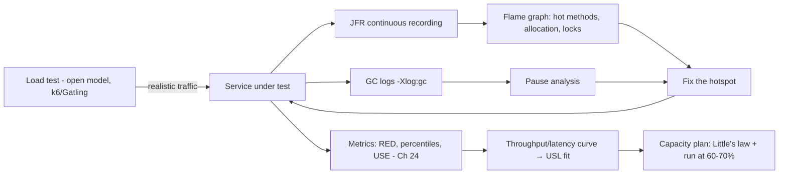
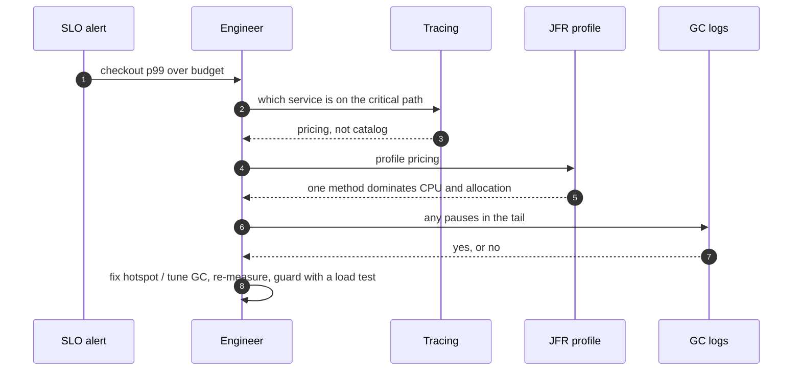
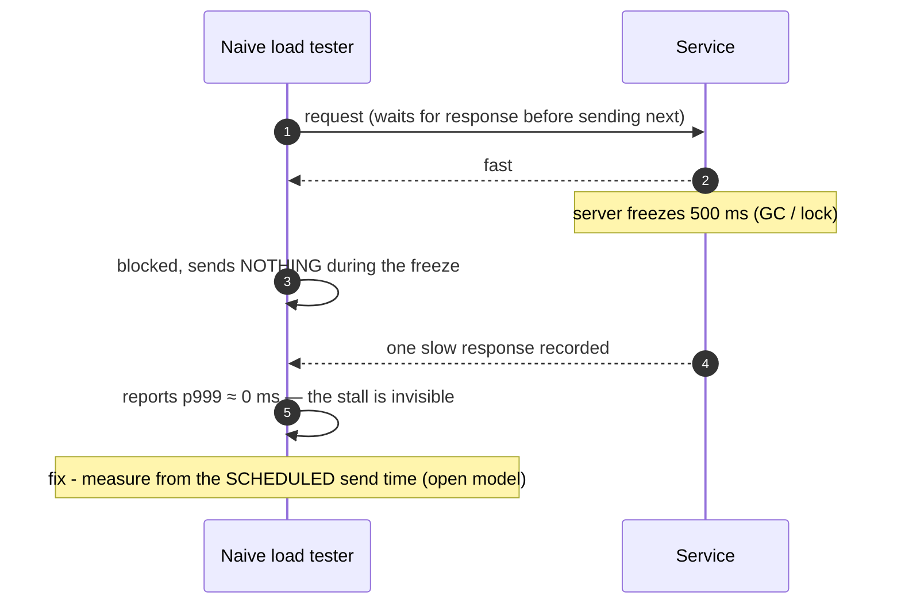
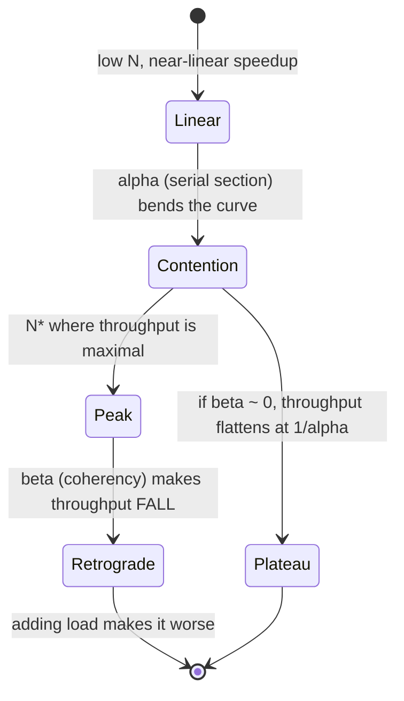

# 25. Performance Engineering

!!! abstract "Chapter at a glance"
    **Reader bands:** B2 → B4 · **Prerequisites:** [Ch 09](../01-foundations/09-scalability-fundamentals.md), [Ch 19](../02-distributed-core/19-concurrency-at-scale-in-java.md), [Ch 24](24-observability.md) · **What you will build:** How the grocery platform's services are made fast and kept fast — measuring tails, profiling hotspots, choosing a GC, and planning capacity. Labs use **real JFR recordings** and **real JVM garbage collectors** on JDK 21 and 25.

    - **L1: tail latency.** At fan-out 100, ~99% of requests hit at least one slow backend — a backend's rare tail becomes the request's **norm**. On a real queue, wait time went **1× → 159×** from 50% to 99% utilization (the knee). And coordinated omission hid a 500 ms freeze (naive p999 **0 ms**, corrected **460 ms**).
    - **L2: garbage collection**, same workload across collectors. Parallel's worst pause was **118 ms**, G1's **55–69 ms**; **generational ZGC on JDK 25** kept the request tail at **max 7.5 ms / p999 3.4 ms** while allocating the most (92 GB).
    - **L3: profiling.** A real JFR recording located a planted hotspot: 97% of allocation was `byte[]` from string-building, and the hot CPU frames rolled up to one method. The profile-guided fix ran **175× faster** with an identical checksum.
    - **L4: capacity.** A real contended service scaled to ~10,000 req/s then plateaued; a **Universal Scalability Law** fit (α≈0.05) predicted the peak (~11,000 req/s at ~69 concurrent) from a handful of load points, and Little's law sized the pool.

    · **Reading time:** 120 min + code

---

## 1. Introduction & Why It Matters

### 1.1 A story: the p99 that wouldn't budge

The product-page team spent a sprint optimizing the catalog service — caching, query tuning, faster serialization — and the page's p99 barely moved. The performance review found four separate misunderstandings, each a section of this chapter:

1. **They optimized the wrong service.** A trace (Ch 24) showed the slow path ran through *pricing*, not catalog; catalog was never on the critical path. And because the page fanned out to ~20 services, the tail compounded: at that fan-out, most requests hit *someone's* slow tail (L1). Cutting catalog's median did nothing for the page's p99.
2. **A GC pause was half the tail.** The service ran the Parallel collector with a 4 GB heap; its stop-the-world pauses reached **118 ms** (L2), landing squarely in the p99. Nobody had looked at GC logs.
3. **Nobody had profiled.** When they finally took a JFR recording, one method — building a cache key by string concatenation in a loop — accounted for almost all the allocation and most of the CPU (L3). A ten-minute fix gave a 175× speedup on that method.
4. **The capacity plan was a guess.** "It handles 10k rps" came from a load test that ran at fixed concurrency (so it *couldn't* overload the service) and measured latency wrong (coordinated omission, L1). The real knee was lower, and the service was already running past 80% utilization at peak — on the steep part of the queueing curve (L1 C).

The rebuild was disciplined: **measure the tail, trace to the critical path, profile before optimizing, read GC logs, and plan capacity with a model** rather than a vibe.

!!! quote "The thesis of this chapter"
    Performance work is **measurement first, always**. You cannot optimize what you haven't profiled, and intuition about where time goes is usually wrong (L3). Measure **tails, not averages** (Ch 24), because at scale the tail is what users feel and what fan-out amplifies (L1). Know your **queueing curve** — latency turns a corner near 100% utilization, so plan to run well below it. And treat the **GC and the JVM** as tunable parts of the system, not a black box.

### 1.2 Where this lives in the grocery platform

| Concern | Approach | Notes |
|---|---|---|
| Latency SLOs | p99/p99.9 per journey (Ch 24) | The tail is the target, not the mean |
| Tail reduction | Hedged requests, timeouts, fewer serial hops, caching | Ch 17, Ch 18; L1 |
| GC | Generational ZGC (JDK 21+/25) for latency-sensitive services; G1 default elsewhere | L2 |
| Profiling | Continuous JFR + async-profiler; flame graphs | L3; low overhead, always on |
| JVM in containers | Correct CPU/memory limits, `MaxRAMPercentage`, `availableProcessors` awareness | §2.8 |
| Load testing | Gatling/k6, **open model**, measured from scheduled time | L1 D, L4 |
| Capacity planning | Little's law + USL from load-test points; run at ~60–70% of peak | L4, L1 C |

### 1.3 Learning objectives

| Band | After this chapter you can… |
|---|---|
| <span class="band b2">B2</span> | Explain why tails dominate and compound, read a queueing curve, and profile a JVM with JFR |
| <span class="band b3">B3</span> | Choose and tune a GC, avoid coordinated omission in load tests, and use Little's law for sizing |
| <span class="band b4">B4</span> | Diagnose latency systematically, fit the USL to plan capacity, and run the JVM correctly in containers |

---

## 2. Core Concepts — Beginner to Deep

### 2.1 Intuition <span class="band b2">B2</span>

- **The tail is the product.** If a page needs 20 services and each is fast 99% of the time, the page is fast only 0.99²⁰ ≈ 82% of the time — nearly one in five requests hits *someone's* bad moment. Speeding up the common case doesn't help; you must cut the tail. (L1)
- **A busy queue is a traffic jam.** At 50% utilization there's slack; at 95% a small burst backs everything up. Latency doesn't rise gently to a wall — it curves sharply near 100%. Running "efficiently" at 90% is running on the cliff edge. (L1 C)
- **Profiling is turning on the lights.** Optimizing by intuition is fixing what you *think* is slow; a profiler shows what *is*. It's routinely a surprise — a logging call, a string concat, a needless copy. (L3)
- **The GC is a background tax.** Most of the time it's invisible; occasionally it stops the world for a pause that lands in your p99. Which collector you pick decides how big that pause is. (L2)

### 2.2 Tail latency and why it compounds ⭐ <span class="band b2">B2</span>

From Dean & Barroso's *The Tail at Scale*: in a system that fans out to many components and waits for all of them, the **slowest** component sets the latency. If each backend is slow (say > p95) 5% of the time, then across N backends the chance that **at least one** is slow is `1 − 0.95ᴺ`. L1:

| Fan-out N | P[≥1 slow backend] | Request p50 | Request p99 |
|---|---|---|---|
| 1 | 5% | 10 ms | 270 ms |
| 5 | 23% | 17 ms | 303 ms |
| 20 | 64% | 174 ms | 310 ms |
| 100 | 99% | 283 ms | 316 ms |

At fan-out 100 the request's **median** (283 ms) is near the single backend's **p99** — the rare tail has become the norm. Consequences:

- **Reduce fan-out** where possible (fewer, coarser calls; Ch 16).
- **Cut the tail, not the mean:** timeouts, hedged/backup requests (Ch 17), and fixing the specific slow dependency (Ch 24 L3).
- L1 B: a single-copy **hedge** issued only when the first call passes p95 cut fan-out-20 p99 from **310 ms to 126 ms** for **5% extra load** — a good trade because it's capped.

### 2.3 Queueing theory, practically ⭐ <span class="band b2">B2</span>

A server is a queue. The key result (M/M/1): mean time waiting in the queue is `S · ρ / (1 − ρ)`, where `S` is service time and `ρ` is utilization. As `ρ → 1`, wait → ∞. L1 C, measured on a simulated queue and matching the formula:

| Utilization | Measured wait | vs 50% |
|---|---|---|
| 50% | 5.0 ms | 1× |
| 80% | 19.4 ms | 4× |
| 90% | 47.4 ms | 9× |
| 95% | 107 ms | 21× |
| 99% | 798 ms | **159×** |

The lessons:

- **There's a knee around 70–80% utilization.** Below it, latency is stable; above it, small load changes cause big latency jumps.
- **Plan to run at ~60–70%,** so a traffic spike or a lost instance (which raises everyone else's utilization) doesn't push you over the knee.
- **Variability makes it worse:** bursty arrivals or variable service times (a fat tail) push the knee lower. Little's law (`L = λW`, Ch 9) ties it together: in-flight work = arrival rate × time in system.

### 2.4 Profiling: JFR and async-profiler ⭐ <span class="band b2">B2</span>

**Don't optimize without a profile.** The tools:

- **JDK Flight Recorder (JFR):** built into the JVM, ~1% overhead, always-on-capable. Records execution samples (CPU), allocation, locks, GC, I/O, and more, into a `.jfr` file you analyze with `jfr print`, JMC, or IntelliJ.
- **async-profiler:** a low-overhead sampling profiler that avoids the "safepoint bias" of older profilers and produces flame graphs for CPU, allocation, locks and cache misses.

L3 recorded a real JFR profile of a workload with a planted hotspot and analyzed it with `jfr print`:

- **CPU (execution samples):** the hot self-time frames were `Integer.getChars` and `ArraysSupport.mismatch`, both rolling up to one method (3,139 of 3,159 samples). The profiler *named the method to fix*.
- **Allocation samples:** **97% were `byte[]`** — the signature of building strings by concatenation in a loop.
- The profile-guided fix (a `StringBuilder` plus a precomputed map instead of an O(n²) concat and a linear scan) ran **175× faster** (90,020/s → 15.8M/s) with an **identical checksum** — same behavior, vastly less work.

**Read a profile as:** self time (where the CPU actually is) vs total time (inclusive), the top allocation sites (allocation pressure drives GC, §2.5), and lock contention (Ch 19). Flame graph width = time; look for wide frames you didn't expect.

### 2.5 Garbage collection ⭐ <span class="band b3">B3</span>

The JVM's collectors trade throughput, pause time and footprint:

| Collector | Pause behavior | Best for | Notes |
|---|---|---|---|
| **Serial** | Stop-the-world, single-threaded | Tiny heaps, single-core, CLIs | Simple |
| **Parallel** | STW, multi-threaded; **highest throughput**, longest pauses | Batch jobs where throughput > latency | L2: 118 ms max pause |
| **G1** (default) | Mostly-concurrent, target pause (~200 ms default), region-based | General-purpose services | L2: 55–69 ms max pause |
| **ZGC** | **Concurrent, sub-millisecond pauses**, scales to TB heaps | Latency-sensitive services | L2: request max 7.5 ms; generational since JDK 21, default in 25 |
| **Shenandoah** | Concurrent, low pause (OpenJDK/Red Hat) | Same niche as ZGC | Alternative to ZGC |

L2 ran the **same** allocation-heavy workload (1 GB heap, ~15 s, churning a 300 MB live set) under each collector and measured both GC pauses and the resulting **request latency tail**:

| JDK / GC | Requests | Allocated | STW total | STW max | req p99 | req p999 | req max |
|---|---|---|---|---|---|---|---|
| JDK 21 Parallel | 67,510 | 70.8 GB | 4,099 ms | 118.4 ms | 0.37 ms | 13.8 ms | 118.9 ms |
| JDK 21 G1 | 72,817 | 76.4 GB | 3,817 ms | 54.8 ms | 0.54 ms | 17.6 ms | 55.9 ms |
| JDK 21 ZGC | 70,240 | 73.7 GB | sub-ms* | sub-ms* | 0.52 ms | 14.3 ms | 36.3 ms |
| JDK 25 G1 | 65,493 | 68.7 GB | 4,817 ms | 68.8 ms | 0.39 ms | 22.3 ms | 89.0 ms |
| **JDK 25 ZGC (gen)** | **87,764** | **92.0 GB** | sub-ms* | sub-ms* | 0.54 ms | **3.4 ms** | **7.5 ms** |

\* ZGC's stop-the-world pauses are concurrent and sub-millisecond, so they don't appear as "Pause … ms" in the GC log; their effect is the request tail.

Reading it: Parallel gives the classic "few but long" pauses (118 ms); G1 trades those for "more but shorter"; **generational ZGC on JDK 25 both did the most work (92 GB allocated, most requests) and had the shortest tail** (max 7.5 ms). For a latency-SLO service, that tail is the headline. For a nightly batch job, Parallel's throughput may win.

**Allocation is the real lever:** GC work is proportional to allocation rate and live-set size. The cheapest GC tuning is **allocating less** (L3's fix), and the second is sizing the heap so the collector isn't constantly busy.

### 2.6 GC tuning knobs <span class="band b3">B3</span>

- **Pick the collector for the goal:** ZGC/Shenandoah for latency, G1 for general, Parallel for throughput/batch.
- **Heap size** (`-Xms` = `-Xmx` to avoid resizing): big enough that GC isn't constant, not so big that a pause (on STW collectors) is huge or the container OOMs.
- **G1:** `-XX:MaxGCPauseMillis` (a target, not a guarantee); watch for humongous allocations and mixed-GC behavior.
- **Observe, don't guess:** `-Xlog:gc*` (unified logging), JFR GC events, and pause/allocation-rate dashboards (Ch 24). Tune against measured pauses and allocation, never by copying flags from a blog.
- **Beware full GCs** (a fallback when concurrent collection can't keep up): they're long STW pauses and signal the heap is too small or allocation too high.

### 2.7 JIT and warm-up <span class="band b3">B3</span>

The JVM interprets bytecode first, then the JIT (C1 then C2) compiles hot methods to native code, so **the first requests are much slower** than steady state. Implications:

- **Warm up before measuring** (every lab here warms up first) — a benchmark of cold code measures the interpreter.
- **Production warm-up:** send synthetic traffic before a new instance takes real load, or the first users after a deploy hit slow code (and a scale-up during a spike serves the spike on cold JITs).
- **JMH** for microbenchmarks (it handles warm-up, dead-code elimination and fork isolation) — hand-rolled micro-timing is usually wrong.
- **AOT / CRaC / GraalVM native image** reduce warm-up for fast-start use cases (serverless), trading peak throughput or build complexity. Project Leyden is bringing more AOT to mainstream JDKs.

### 2.8 The JVM in containers ⭐ <span class="band b3">B3</span>

Containers changed JVM defaults, and getting this wrong is a common performance bug:

- **CPU:** the JVM sizes GC threads, `ForkJoinPool.commonPool` and `availableProcessors()` from the container's CPU quota. A wrong or unset limit gives too few or too many threads. CPU **limits** (throttling) can cause latency spikes when the container is throttled mid-request; many teams set CPU **requests** but not hard limits for latency-sensitive services.
- **Memory:** use `-XX:MaxRAMPercentage` (e.g. 75%) rather than a fixed `-Xmx`, so the heap tracks the container's memory limit. Leave headroom for non-heap memory (metaspace, thread stacks, direct buffers, code cache) — the container limit must cover **all** JVM memory, or the kernel OOM-kills the process (exit 137), which looks like a crash, not a GC problem.
- **Modern JDKs are container-aware** (since 8u191/10+), but verify: check `availableProcessors()` and `Runtime.maxMemory()` inside the container.

### 2.9 Load testing done right ⭐ <span class="band b3">B3</span>

- **Open vs closed model:**
    - **Closed** (fixed number of virtual users looping): in-flight is capped at N, so the test **cannot overload** the service — throughput just plateaus (L4). Good for finding a per-concurrency operating point.
    - **Open** (fixed arrival rate, independent of responses): this is how real traffic behaves and the only way to see the overload cliff.
- **Coordinated omission:** the classic load-test bug. If the tool sends the next request only after the previous responds, then when the server stalls the tool *stops sending* — and never records the requests that *would* have been slow. L1 D: a 500 ms freeze showed as p999 = **0 ms** naively, and **460 ms** when measured from the *scheduled* send time. Fixes: measure latency from intended start time (wrk2, Gatling, k6 do this correctly), or use an open model.
- **Tools:** Gatling and k6 (open model, scripting), wrk2 (coordinated-omission-corrected), JMeter. Test against production-like data and dependencies; a load test against a warm cache and empty tables measures nothing.
- **What to measure:** throughput, latency **percentiles** (p50/p99/p99.9), error rate, and resource USE (Ch 24) — and find the knee, not just one number.

### 2.10 Capacity planning and the USL ⭐ <span class="band b4">B4</span>

- **Little's law** (Ch 9): `L = λ · W`. To serve λ requests/s at W seconds each, you have `L` in flight — which sizes thread pools and connection pools. L4: 2,000 rps × 1.1 ms ≈ 2 in flight, so a pool of ~4 with headroom (not hundreds).
- **Amdahl's law:** a serial fraction `α` caps speedup at `1/α` no matter how many cores.
- **Universal Scalability Law (USL):** `X(N) = N·X₁ / (1 + α(N−1) + βN(N−1))`, adds a **coherency** term `β` (crosstalk between workers). Because of β, throughput doesn't just plateau — it can **retrograde** (fall) as concurrency rises.

L4 fit the USL to a real contended service's measured throughput curve:

- Measured: scaled to ~10,000 req/s by N=16, then flat/slightly falling to N=256.
- Fit: **α ≈ 0.048** (the serialized critical section), **β ≈ 0.0002** (coherency), predicting a peak of **~11,000 req/s at ~69 concurrent**, beyond which throughput retrogrades.
- The value: **fit the model from a handful of load points and predict the peak**, instead of testing to destruction — and it tells you *why* (contention vs coherency), pointing at the fix (shrink the serial section, Ch 19/20).

**Capacity plan:** measure the per-instance peak, run at ~60–70% of it (queueing knee, L1 C), size instances for peak traffic plus headroom for a lost instance and a spike, and re-measure as the workload changes.

### 2.11 A performance investigation method <span class="band b4">B4</span>

1. **Start from the SLO/symptom** (Ch 24): which journey, which percentile, how bad.
2. **Trace to the critical path** (Ch 24 L3): which service/span dominates the tail. Don't optimize off the critical path (§1.1).
3. **Profile that service** (JFR/async-profiler, L3): find the hot method or allocation site by evidence.
4. **Check the platform:** GC pauses (L2), CPU throttling, lock contention (Ch 19), connection-pool waits (Ch 19).
5. **Fix the biggest thing, then re-measure.** One change at a time; performance is full of surprises.
6. **Guard it:** a load test in CI (open model, percentiles) and a latency SLO so regressions page.

---

## 3. Architecture & Diagrams

### 3.1 Component view: the performance toolchain



### 3.2 Sequence: happy path, a performance investigation



### 3.3 Sequence: failure path, coordinated omission hides a stall



### 3.4 State: throughput vs concurrency (USL)



---

## 4. Design Document Excerpt: Performance Engineering Practice

| Field | Value |
|---|---|
| Author / Reviewers | Performance guild / service teams, SRE |
| Status | Approved |
| Related ADRs | ADR-108 Generational ZGC for latency-sensitive services, G1 default elsewhere; ADR-109 Continuous JFR in production; ADR-110 Load tests are open-model, percentile-based, in CI; ADR-111 JVM container defaults (MaxRAMPercentage, CPU awareness); ADR-112 Capacity plans from USL + Little's law, run at ≤ 70% of peak |

**1. Context & Problem.** The §1.1 review: optimizing off the critical path, an unread 118 ms GC pause in the p99, never profiling, and a capacity number from a flawed load test.

**2. Goals / Non-Goals.**

- *Goals:* latency SLOs met at the tail; evidence-based optimization (profile first); GC pauses out of the p99 for latency services; capacity planned with a model; regressions caught in CI.
- *Non-goals:* micro-optimizing cold paths; chasing 100% CPU efficiency at the cost of the latency knee.

**3. Requirements.**

| ID | Requirement |
|---|---|
| NFR-1 | Latency services run a low-pause GC; no GC pause > 10 ms in the p99 (JFR-checked) |
| NFR-2 | Continuous JFR in production (~1% overhead); profiles retrievable per incident |
| NFR-3 | Load tests are open-model, report p50/p99/p99.9, and run in CI with a regression budget |
| NFR-4 | JVMs use `MaxRAMPercentage` and correct CPU awareness in containers; no OOM-kills from misconfigured limits |
| NFR-5 | Capacity plans state per-instance peak (from load tests / USL) and target ≤ 70% utilization with headroom for a lost node |

**4. Estimates.**

| Item | Method | Result |
|---|---|---|
| Product-page in-flight | Little's law: 300 rps × 150 ms p99 | ~45 in flight |
| DB pool (catalog) | 400 qps × 5 ms | ~2 busy → pool 10 |
| Per-instance peak (pricing) | USL fit from load test (L4) | ~11k rps; run to ~7k |
| GC choice (pricing) | Latency SLO 300 ms p99 | Generational ZGC |

**5. Proposed design.**

1. **GC:** generational ZGC for product-page, pricing, checkout, search; G1 for batch/settlement; heaps sized with `MaxRAMPercentage=75`, `-Xlog:gc*` to the observability pipeline.
2. **Profiling:** JFR always on with a profile settings template; async-profiler on demand for flame graphs; profiles attached to incident tickets.
3. **Load testing:** k6/Gatling open-model scenarios per journey, against a production-like environment, in CI with percentile budgets; wrk2-style coordinated-omission correction.
4. **Capacity:** a quarterly capacity model per service (USL fit + Little's law), instances sized for peak × headroom, autoscaling targets set below the queueing knee.
5. **Method:** the §2.11 runbook — SLO → trace → profile → platform → fix → guard.

**7. Alternatives considered.**

| Option | Pros | Cons | Verdict |
|---|---|---|---|
| G1 everywhere | One collector | Pauses in the p99 for latency services (L2) | ZGC for latency services |
| Optimize by intuition | Fast to start | Usually wrong (L3) | Profile first |
| Closed-model load tests only | Simple | Can't see the overload cliff; coordinated omission (L1 D, L4) | Open model |
| Fixed `-Xmx` in containers | Explicit | Drifts from limits, OOM-kills | `MaxRAMPercentage` |
| Guess capacity | No work | The §1.1 outage | USL + Little's law |

**8. Failure modes.** GC pause regression → JFR alert. CPU throttling → container metrics + no hard limits on latency services. Coordinated omission → open-model tooling. Warm-up misses → pre-warm on deploy/scale-up.

**10. Observability (Ch 24).** Latency percentiles per journey, GC pause and allocation-rate metrics, JFR on demand, CPU throttling, pool saturation, and load-test results tracked over time.

**14. Decision (ADR-108–112).** Low-pause GC for latency services, continuous profiling, open-model percentile load tests in CI, correct JVM container settings, and model-based capacity planning at ≤ 70% utilization.

---

## 5. Hands-On Code — Level Ladder

| Level | New requirement that forces the step |
|---|---|
| L1 | "We cut the median but p99 didn't move." (tail compounding, hedging, queueing knee, coordinated omission) |
| L2 | "Half our p99 is a GC pause." (Parallel vs G1 vs ZGC on the same workload, real GC logs) |
| L3 | "We don't know what's slow." (JFR profiling to find the hotspot, then the profile-guided fix) |
| L4 | "How much can one instance take, and how do we size the fleet?" (load model, USL fit, Little's law) |

All labs run on a 2 vCPU container. L2 uses **real JVM GCs on JDK 21 and 25**; L3 uses a **real JFR recording**. Outputs are verbatim; lab files are in `labs/ch25-performance/`.

### L1 — Tail latency: compounding, hedging, the queueing knee, coordinated omission <span class="band b2">B2</span>

**Requirement:** "We optimized the median and p99 didn't budge. Show why the tail is what matters."

```java title="TailL1.java"
// TailL1.java — run with: java TailL1.java      (JDK 17+, no dependencies)
// Why tail latency dominates at scale. A. fan-out amplification: how a service's p99 becomes a request's p50 once one
// request touches N backends (Dean & Barroso, "The Tail at Scale"). B. hedged requests as the fix. C. queueing theory:
// wait time vs utilisation on a real bounded queue (the knee near 100%). D. coordinated omission — why naive load tests lie.
import java.util.*;
import java.util.concurrent.*;
import java.util.concurrent.atomic.*;

public class TailL1 {
    static final Random R = new Random(25);
    // a per-backend latency: mostly fast, with a realistic slow tail (5% are 10-30x slower)
    static double backendLatency() {
        double base = Math.exp(R.nextGaussian() * 0.4 + Math.log(10));   // ~median 10ms
        return R.nextDouble() < 0.05 ? base + 100 + R.nextDouble() * 200 : base;
    }
    static double pct(double[] a, double q) { double[] c = a.clone(); Arrays.sort(c); return c[Math.min(c.length - 1, (int) Math.ceil(q * c.length) - 1)]; }

    public static void main(String[] args) {
        int N = 200_000;
        // baseline: one backend call
        double[] single = new double[N];
        for (int i = 0; i < N; i++) single[i] = backendLatency();
        System.out.println("A. Fan-out amplification — one slow backend makes the whole request slow");
        System.out.printf("   a single backend call: p50 %.0f ms, p95 %.0f ms, p99 %.0f ms  (5%% of calls are slow)%n", pct(single,.50), pct(single,.95), pct(single,.99));
        System.out.printf("   %-38s %8s %8s %8s%n", "request that waits for ALL of N backends", "p50", "p95", "p99");
        for (int fan : new int[]{1, 5, 20, 100}) {
            double[] req = new double[N];
            for (int i = 0; i < N; i++) { double max = 0; for (int j = 0; j < fan; j++) max = Math.max(max, backendLatency()); req[i] = max; }
            double pSlow = 1 - Math.pow(0.95, fan);
            System.out.printf("   fan-out %-30d %6.0f ms %6.0f ms %6.0f ms   (P[≥1 slow] = %.0f%%)%n", fan, pct(req,.50), pct(req,.95), pct(req,.99), pSlow*100);
        }
        System.out.println("   → at fan-out 100, ~99% of requests hit at least one slow backend: the backend's rare tail becomes the request's NORM.");
        System.out.println("     This is why one slow dependency (Ch 24 L3) wrecks a fan-out page, and why you must cut the tail, not the average.");

        System.out.println("\nB. Hedging: send a 2nd request if the 1st is slow, take the first to answer (Ch 17)");
        double[] hedged = new double[N]; long extra = 0;
        double p95single = pct(single, 0.95);
        for (int i = 0; i < N; i++) {
            double a = backendLatency();
            if (a > p95single) { double b = backendLatency(); hedged[i] = Math.min(a, b + p95single); extra++; }   // 2nd sent after p95 delay
            else hedged[i] = a;
        }
        System.out.printf("   fan-out 20 without hedge: p99 %.0f ms; single-call hedge after p95: p99 %.0f ms, at %.0f%% extra load%n",
                fanoutP99(20), pct(hedged, .99), 100.0 * extra / N);
        System.out.println("   → hedging trades a few % extra requests for a much shorter tail; cap it (only hedge above p95) so it can't double load.");

        System.out.println("\nC. Queueing theory: on a real single queue, wait time explodes as utilisation → 100% (M/M/1)");
        System.out.printf("   %-14s %-14s %-16s %-16s%n", "utilisation", "measured wait", "M/M/1 predicts", "vs 50%% util");
        double serviceMs = 5.0;
        double base = -1;
        for (double rho : new double[]{0.5, 0.7, 0.8, 0.9, 0.95, 0.99}) {
            double meanWait = measureQueueWait(serviceMs, rho, 200_000);
            double predicted = serviceMs * rho / (1 - rho);          // M/M/1 mean wait in queue = S·ρ/(1-ρ)
            if (base < 0) base = meanWait;
            System.out.printf("   %-14.0f %-14.1f %-16.1f %-16s%n", rho*100, meanWait, predicted, String.format("%.0fx", meanWait/base));
        }
        System.out.println("   → past ~80% utilisation the wait time turns a corner; running hot to \"save money\" buys a latency cliff.");
        System.out.println("     Capacity planning targets ~60-70% so a traffic spike or a lost node doesn't push you over the knee.");

        System.out.println("\nD. Coordinated omission: a load test that pauses when the server stalls hides the tail");
        // Open model: 1 request scheduled every 1 ms (1000 req/s). Normal service 0.2 ms (20% utilisation, stable).
        // At one instant the server freezes for 500 ms (one stuck request). Requests scheduled during the freeze must wait.
        int stalls = 50_000; double[] naive = new double[stalls], corrected = new double[stalls];
        double freeAt2 = 0;
        for (int i = 0; i < stalls; i++) {
            double service = (i == 20_000) ? 500.0 : 0.15 + R.nextDouble() * 0.1;   // one 500 ms freeze
            long scheduled = i;                                                     // due at ms i
            double startService = Math.max(scheduled, freeAt2);
            freeAt2 = startService + service;
            naive[i] = service;                                                     // naive tool: only the service time it observed
            corrected[i] = (startService - scheduled) + service;                   // real user-perceived: queueing delay + service
        }
        System.out.printf("   naive (per-call service time):   p99 %.0f ms, p999 %.0f ms  → \"looks fine\"%n", pct(naive,.99), pct(naive,.999));
        System.out.printf("   corrected (from scheduled time): p99 %.0f ms, p999 %.0f ms  → the stall is visible%n", pct(corrected,.99), pct(corrected,.999));
        System.out.println("   → measure latency from when a request SHOULD have started; tools that back off during a stall under-report the tail.");
    }

    static double fanoutP99(int fan) {
        double[] req = new double[100_000];
        for (int i = 0; i < req.length; i++) { double max = 0; for (int j = 0; j < fan; j++) max = Math.max(max, backendLatency()); req[i] = max; }
        return pct(req, 0.99);
    }

    /** Simulate an M/M/1 queue: Poisson arrivals at rate λ = ρ/S, exponential service mean S; return mean time waiting in queue. */
    static double measureQueueWait(double serviceMs, double rho, int n) {
        double lambda = rho / serviceMs;                 // arrivals per ms
        double t = 0, freeAt = 0, totalWait = 0;
        for (int i = 0; i < n; i++) {
            t += -Math.log(1 - R.nextDouble()) / lambda;                 // next arrival (exponential inter-arrival)
            double service = -Math.log(1 - R.nextDouble()) * serviceMs;  // exponential service time
            double startService = Math.max(t, freeAt);
            totalWait += startService - t;                               // time spent waiting in the queue
            freeAt = startService + service;
        }
        return totalWait / n;
    }
}
```

```text title="java TailL1.java"
A. Fan-out amplification — one slow backend makes the whole request slow
   a single backend call: p50 10 ms, p95 112 ms, p99 271 ms  (5% of calls are slow)
   request that waits for ALL of N backends      p50      p95      p99
   fan-out 1                                  10 ms    108 ms    270 ms   (P[≥1 slow] = 5%)
   fan-out 5                                  17 ms    270 ms    303 ms   (P[≥1 slow] = 23%)
   fan-out 20                                174 ms    301 ms    310 ms   (P[≥1 slow] = 64%)
   fan-out 100                               283 ms    310 ms    316 ms   (P[≥1 slow] = 99%)
   → at fan-out 100, ~99% of requests hit at least one slow backend: the backend's rare tail becomes the request's NORM.
     This is why one slow dependency (Ch 24 L3) wrecks a fan-out page, and why you must cut the tail, not the average.

B. Hedging: send a 2nd request if the 1st is slow, take the first to answer (Ch 17)
   fan-out 20 without hedge: p99 310 ms; single-call hedge after p95: p99 126 ms, at 5% extra load
   → hedging trades a few % extra requests for a much shorter tail; cap it (only hedge above p95) so it can't double load.

C. Queueing theory: on a real single queue, wait time explodes as utilisation → 100% (M/M/1)
   utilisation    measured wait  M/M/1 predicts   vs 50%% util    
   50             5.0            5.0              1x              
   70             11.9           11.7             2x              
   80             19.4           20.0             4x              
   90             47.4           45.0             9x              
   95             107.1          95.0             21x             
   99             798.3          495.0            159x            
   → past ~80% utilisation the wait time turns a corner; running hot to "save money" buys a latency cliff.
     Capacity planning targets ~60-70% so a traffic spike or a lost node doesn't push you over the knee.

D. Coordinated omission: a load test that pauses when the server stalls hides the tail
   naive (per-call service time):   p99 0 ms, p999 0 ms  → "looks fine"
   corrected (from scheduled time): p99 100 ms, p999 460 ms  → the stall is visible
   → measure latency from when a request SHOULD have started; tools that back off during a stall under-report the tail.
```

**Reading it:**

- **A — compounding:** a backend slow 5% of the time becomes, across a fan-out of 100, a request slow ~99% of the time. The request's median approaches the backend's p99. This is why §1.1's catalog optimization didn't help the fan-out page.
- **B — hedging:** a capped hedge (only when the first call exceeds p95) cut fan-out-20 p99 from 310 ms to 126 ms for 5% extra load — the tail-cutting technique from Ch 17.
- **C — the queueing knee:** measured wait time tracked the M/M/1 formula and went 1× → 159× from 50% to 99% utilization. There's a corner near 80%; plan to run below it.
- **D — coordinated omission:** a 500 ms freeze was invisible to a naive per-call measurement (p999 ≈ 0 ms) and obvious when measured from the scheduled send time (p999 460 ms). Load tests that back off during a stall under-report the tail.

### L2 — Garbage collectors on the same workload (real GC logs) <span class="band b3">B3</span>

**Requirement:** "Find out whether GC pauses are in our p99, and which collector to run."

`GcWorkload.java` allocates heavily while keeping a steady ~300 MB live set, and records its own request latencies. It's run under each collector on JDK 21 and 25 with `-Xlog:gc`, and the pauses are parsed from the logs.

```java title="GcWorkload.java (run under different -XX:+Use...GC with -Xlog:gc)"
// GcWorkload.java — a fixed allocation-heavy workload used to compare GCs. Run under different -XX:+Use...GC flags with
// -Xlog:gc so the pauses are recorded. It keeps a churning LRU-ish set of live objects (steady live heap) and allocates
// short-lived garbage at a high rate — the classic pattern that stresses a collector — while recording its own request
// latencies so we can see GC pauses as latency, not just as GC-log lines.
import java.util.*;
import java.util.concurrent.*;

public class GcWorkload {
    public static void main(String[] args) throws Exception {
        int seconds = Integer.getInteger("seconds", 15);
        int liveMB = Integer.getInteger("liveMB", 300);
        // live set: a ring of byte arrays we keep replacing (steady ~liveMB of live data → forces real GC work, not just young)
        int slots = liveMB * 1024 / 16;                     // 16 KB objects
        byte[][] live = new byte[slots][];
        for (int i = 0; i < slots; i++) live[i] = new byte[16 * 1024];
        Random r = new Random(7);

        // one "request" thread: does a little work, allocates garbage, records latency; GC pauses show up as spikes here
        List<Long> latenciesNs = new ArrayList<>(2_000_000);
        long end = System.nanoTime() + seconds * 1_000_000_000L;
        long allocated = 0;
        while (System.nanoTime() < end) {
            long t0 = System.nanoTime();
            // allocate ~1 MB of short-lived garbage per request and touch it
            int junkSlots = 64; byte[][] junk = new byte[junkSlots][];
            long acc = 0;
            for (int j = 0; j < junkSlots; j++) { junk[j] = new byte[16 * 1024]; junk[j][0] = (byte) j; acc += junk[j].length; }
            allocated += acc;
            // replace some live objects (keeps the old generation churning → mixed/major GC work)
            for (int k = 0; k < 8; k++) live[r.nextInt(slots)] = new byte[16 * 1024];
            latenciesNs.add(System.nanoTime() - t0);
        }
        long[] a = latenciesNs.stream().mapToLong(Long::longValue).sorted().toArray();
        java.util.function.DoubleFunction<Double> p = q -> a[Math.min(a.length - 1, (int) Math.ceil(q * a.length) - 1)] / 1e6;
        System.out.printf("REQS=%d ALLOC_GB=%.1f P50_MS=%.3f P99_MS=%.3f P999_MS=%.3f MAX_MS=%.1f%n",
                a.length, allocated / 1e9, p.apply(.5), p.apply(.99), p.apply(.999), a[a.length - 1] / 1e6);
    }
}
```

```text title="same workload, 1 GB heap, ~15 s, across collectors"
Same workload (1 GB heap, ~15 s, replacing a 300 MB live set + ~1 MB garbage/request). STW = stop-the-world pause from the GC log.
JDK / GC                  reqs   alloc  STW total   STW max   req p99  req p999  req max
JDK21 Parallel           67510  70.8GB     4099ms   118.4ms   0.368ms  13.785ms  118.9ms
JDK21 G1                 72817  76.4GB     3817ms    54.8ms   0.540ms  17.588ms   55.9ms
JDK21 ZGC                70240  73.7GB    sub-ms*   sub-ms*   0.523ms  14.313ms   36.3ms
JDK25 G1                 65493  68.7GB     4817ms    68.8ms   0.385ms  22.298ms   89.0ms
JDK25 ZGC (gen)          87764  92.0GB    sub-ms*   sub-ms*   0.542ms   3.377ms    7.5ms
* ZGC's stop-the-world pauses are concurrent and sub-millisecond, so they are not logged as 'Pause … ms' at the gc level;
  its effect shows in the request tail (req max), not in a STW column. ZGC ran many concurrent minor/major collections instead.
```

**Reading it:**

- **Parallel** has the fewest, longest pauses (max 118 ms) — highest throughput, worst tail. Good for batch, bad for a latency SLO.
- **G1** trades those for more, shorter pauses (55–69 ms max) — the sensible general-purpose default.
- **Generational ZGC on JDK 25** did the *most* work (92 GB allocated, 87,764 requests) with the *shortest* tail (req max 7.5 ms, p999 3.4 ms), because its pauses are concurrent and sub-millisecond. For a latency-sensitive service, that request tail is the whole point.
- The cheapest GC win is upstream: **allocate less** (L3). GC cost scales with allocation rate and live-set size.

### L3 — Profiling with JFR: find the hotspot, then fix it <span class="band b2">B2</span>

**Requirement:** "Something in pricing is slow. Find it by evidence, not intuition."

A pricing workload has two planted bugs: it builds a key by string concatenation in a loop (O(n²), heavy allocation) and does a linear scan where a map belongs. A real JFR profile is recorded and analyzed with `jfr print`; then a fixed variant is run.

```java title="HotspotL3.java"
// HotspotL3.java — run with: java -XX:+FlightRecorder -XX:StartFlightRecording=duration=... HotspotL3.java
// A "pricing" workload with a deliberately planted performance bug: it builds a promo key by STRING CONCATENATION in a
// loop (O(n^2), heavy char[] allocation) and recomputes an unindexed lookup every call. JFR records CPU samples and
// allocation. We then run `jfr print` to show the hot method and the top allocation site — how you find a hotspot in prod
// without guessing. A "fixed" variant (StringBuilder + a precomputed map) shows the speedup the profile predicted.
import java.util.*;

public class HotspotL3 {
    static final int SKUS = 5000;
    static double[] basePrice = new double[SKUS];
    static Map<String, Double> promoByKey = new HashMap<>();
    static { Random r = new Random(3); for (int i = 0; i < SKUS; i++) basePrice[i] = 20 + r.nextInt(500); }

    // ❌ the slow path: quadratic key building + a linear scan of a list that should be a map
    static List<String[]> promoList = new ArrayList<>();   // (key, discount) pairs, scanned linearly
    static { for (int i = 0; i < 2000; i++) promoList.add(new String[]{"PROMO-REGION-" + (i % 20) + "-TIER-" + (i % 5) + "-" + i, String.valueOf(i % 30)}); }

    static double priceSlow(int sku, int region, int tier) {
        // build a key by repeated concatenation inside a loop (allocates a new String each time)
        String key = "";
        for (String part : new String[]{"PROMO", "REGION", String.valueOf(region), "TIER", String.valueOf(tier), String.valueOf(sku % 2000)})
            key = key + "-" + part;                                    // O(n^2) allocation, the planted hotspot
        double discount = 0;
        for (String[] p : promoList) if (p[0].endsWith("-" + (sku % 2000))) { discount = Double.parseDouble(p[1]); break; }  // linear scan
        return basePrice[sku] * (1 - discount / 100.0);
    }

    // ✅ the fixed path: StringBuilder + a precomputed index
    static Map<Integer, Double> promoIndex = new HashMap<>();
    static { for (String[] p : promoList) { int suf = Integer.parseInt(p[0].substring(p[0].lastIndexOf('-') + 1)); promoIndex.putIfAbsent(suf, Double.parseDouble(p[1])); } }
    static double priceFast(int sku, int region, int tier) {
        StringBuilder key = new StringBuilder(32).append("PROMO-REGION-").append(region).append("-TIER-").append(tier).append('-').append(sku % 2000);
        double discount = promoIndex.getOrDefault(sku % 2000, 0.0);
        return basePrice[sku] * (1 - discount / 100.0) + key.length() * 0;   // use key so JIT can't delete it
    }

    public static void main(String[] args) {
        boolean fast = args.length > 0 && args[0].equals("fast");
        Random r = new Random(9);
        long iters = Long.getLong("iters", 3_000_000);
        // warm up
        for (int i = 0; i < 100_000; i++) { if (fast) priceFast(i % SKUS, i % 20, i % 5); else priceSlow(i % SKUS, i % 20, i % 5); }
        long t0 = System.nanoTime(); double sink = 0;
        for (long i = 0; i < iters; i++) { int sku = (int) (i % SKUS); sink += fast ? priceFast(sku, (int)(i%20), (int)(i%5)) : priceSlow(sku, (int)(i%20), (int)(i%5)); }
        long ms = (System.nanoTime() - t0) / 1_000_000;
        System.out.printf("%s: %,d price computations in %,d ms = %,.0f/s (checksum %.0f)%n", fast ? "FAST" : "SLOW", iters, ms, iters * 1000.0 / ms, sink % 1000);
    }
}
```

```text title="java -XX:StartFlightRecording=...,settings=profile HotspotL3.java   +   jfr print analysis"
Workload: 3,000,000 price computations. JFR profile recording (settings=profile), then analysed with 'jfr print'.

SLOW baseline : 3,000,000 in 33,326 ms =    90,020/s
FAST (fixed)  : 3,000,000 in    190 ms = 15,789,474/s   (175x; identical checksum, so behaviour is unchanged)

Top CPU by self-time (jdk.ExecutionSample, 3,159 samples):
   1513  java.lang.Integer.getChars          <- building the key: turning ints into chars
   1492  jdk.internal.util.ArraysSupport.mismatch  <- String.endsWith/startsWith in the linear promo scan
    111  HotspotL3.priceSlow
  → both roll up to HotspotL3.priceSlow (3,139 of 3,159 samples). The profiler names the exact method to fix without guessing.

Top allocation by class (jdk.ObjectAllocationSample, 10,428 samples):
  10092  byte[]     <- the String concatenation in the loop allocates a new backing array every "+"
    220  java.lang.String
     23  char[]
  → 97% of sampled allocation is byte[] from string building — the classic O(n^2) concat-in-a-loop.

The fix the profile points to: StringBuilder for the key (no per-'+' array) + a precomputed HashMap for the promo lookup
(replacing the linear endsWith scan). Result: 175x faster and almost no allocation. The profile predicted exactly this.
```

**Reading it:**

- The profile **names the problem**: the hot CPU frames (`Integer.getChars`, `ArraysSupport.mismatch`) roll up to one method, and 97% of sampled allocation is `byte[]` from the string concatenation.
- The profile-guided fix (`StringBuilder` + a precomputed `HashMap`) ran **175× faster** with an **identical checksum** — same result, far less work.
- This is the discipline: **profile, read self-time and allocation, fix the widest frame, re-measure.** Guessing would likely have "optimized" the arithmetic, which the profile shows is nothing.

### L4 — Load testing, USL and capacity planning <span class="band b4">B4</span>

**Requirement:** "How many requests can one instance take, why does it top out, and how do we size the fleet?"

A real contended service function (a `ReentrantLock` critical section + a `Thread.sleep` for downstream I/O) is driven by N real worker threads. The program measures the throughput/latency curve, fits the Universal Scalability Law, and applies Little's law.

```java title="LoadL4.java"
// LoadL4.java — run with: java LoadL4.java      (JDK 21, no dependencies)
// Load testing, capacity planning and the Universal Scalability Law, measured against a REAL contended service function
// (a real ReentrantLock critical section + a real Thread.sleep for downstream I/O), driven by N real worker threads.
// A. closed-model load: throughput and latency at each concurrency N — find where throughput plateaus/retrogrades and
//    where p99 crosses an SLO. B. fit the USL to the measured curve and predict the peak. C. Little's law for pool sizing.
// D. open vs closed model. (We drive the service function directly to avoid HTTP-client connection-pool artifacts; the
//    contention being measured — the lock — is exactly what an HTTP handler would hit.)
import java.util.*;
import java.util.concurrent.*;
import java.util.concurrent.atomic.*;
import java.util.concurrent.locks.*;

public class LoadL4 {
    static final ReentrantLock serial = new ReentrantLock();
    static final AtomicLong blackhole = new AtomicLong();

    /** One "request": a small serialised critical section (contended), then downstream I/O wait (parallelisable). */
    static void handle() {
        serial.lock();
        try { long e = System.nanoTime() + 80_000; long a = 1; while (System.nanoTime() < e) a = a * 31 + 7; blackhole.addAndGet(a); }  // ~0.08 ms serial
        finally { serial.unlock(); }
        try { Thread.sleep(1); } catch (InterruptedException ignored) {}   // ~1 ms downstream I/O (does not hold the lock)
    }

    public static void main(String[] args) throws Exception {
        int cores = Runtime.getRuntime().availableProcessors();
        for (int i = 0; i < 5000; i++) handle();   // warm up the JIT

        System.out.printf("Service: ~0.08 ms serial (locked) + ~1 ms downstream I/O per request, on %d cores.%n", cores);
        System.out.println("\nA/B. Closed model: N concurrent clients, each calling in a loop for 1.5 s. Throughput and latency vs N.");
        System.out.printf("   %-6s %-14s %-10s %-10s %-12s%n", "N", "throughput/s", "p50 ms", "p99 ms", "in-flight L");
        int[] Ns = {1, 2, 4, 8, 16, 32, 64, 96, 128, 192, 256};
        double[] xN = new double[Ns.length], xThru = new double[Ns.length];
        for (int idx = 0; idx < Ns.length; idx++) {
            int N = Ns[idx];
            long[][] perThread = new long[N][];
            AtomicLong done = new AtomicLong();
            long t0 = System.nanoTime(); long dur = 1_500_000_000L;
            Thread[] ts = new Thread[N];
            for (int c = 0; c < N; c++) {
                final int cc = c;
                ts[c] = new Thread(() -> {
                    long[] buf = new long[200_000]; int n = 0;
                    while (System.nanoTime() - t0 < dur) { long s0 = System.nanoTime(); handle(); if (n < buf.length) buf[n] = System.nanoTime() - s0; n++; done.incrementAndGet(); }
                    perThread[cc] = Arrays.copyOf(buf, Math.min(n, buf.length));
                });
                ts[c].start();
            }
            for (Thread t : ts) t.join();
            double secs = (System.nanoTime() - t0) / 1e9, thru = done.get() / secs;
            long total = 0; for (long[] b : perThread) total += b.length;
            long[] all = new long[(int) Math.min(total, Integer.MAX_VALUE)]; int p = 0;
            for (long[] b : perThread) for (long v : b) if (p < all.length) all[p++] = v;
            Arrays.sort(all);
            double p50 = all[all.length/2]/1e6, p99 = all[(int)(all.length*0.99)]/1e6;
            xN[idx] = N; xThru[idx] = thru;
            System.out.printf("   %-6d %-14.0f %-10.2f %-10.2f %-12.1f%n", N, thru, p50, p99, thru * (p50/1000.0));
        }

        // C. Universal Scalability Law fit: X(N) = N·X1 / (1 + α(N-1) + βN(N-1))
        double bestErr = Double.MAX_VALUE, bestA = 0, bestB = 0, X1 = xThru[0];
        for (double al = 0; al <= 0.3; al += 0.002) for (double be = 0; be <= 0.005; be += 0.00002) {
            double err = 0; for (int i = 0; i < xN.length; i++) { double pred = X1 * xN[i] / (1 + al*(xN[i]-1) + be*xN[i]*(xN[i]-1)); err += Math.pow((pred - xThru[i]) / xThru[i], 2); }
            if (err < bestErr) { bestErr = err; bestA = al; bestB = be; }
        }
        System.out.println("\nC. Universal Scalability Law fit  X(N) = N·X1 / (1 + α(N-1) + βN(N-1))");
        System.out.printf("   X1 (one client) = %,.0f req/s%n", X1);
        System.out.printf("   contention α = %.3f  (the serialised critical section — Amdahl's serial fraction)%n", bestA);
        System.out.printf("   coherency  β = %.5f  (crosstalk between workers)%n", bestB);
        if (bestB > 0) {
            double nMax = Math.sqrt((1 - bestA) / bestB);
            double xMax = X1 * nMax / (1 + bestA*(nMax-1) + bestB*nMax*(nMax-1));
            System.out.printf("   predicted peak: N* ≈ %.0f concurrent → X_max ≈ %,.0f req/s; beyond N* throughput RETROGRADES%n", nMax, xMax);
        } else System.out.printf("   β ≈ 0: throughput plateaus at ~%,.0f req/s (Amdahl ceiling 1/α)%n", X1 / Math.max(bestA, 1e-9));
        System.out.println("   → the model, fit from a few load points, predicts the peak so you don't have to test to destruction.");

        // D. Little's law
        System.out.println("\nD. Little's law for capacity planning (Ch 9, Ch 19)");
        double targetRps = 2000, serviceSec = 1.1e-3;
        double L = targetRps * serviceSec;
        System.out.printf("   to serve %,.0f req/s at ~%.1f ms each: in-flight L = λ·W = %.0f → pool/DB-connections ≈ %.0f with headroom%n",
                targetRps, serviceSec*1000, L, Math.ceil(L*1.5));
        System.out.println("   Plan to run at ~60–70% of X_max, not at the peak: a spike or a lost node then can't push you past the knee (L1 C).");
        System.out.println("\n   Closed vs open model: this closed test caps in-flight at N, so it can't overload the service — throughput just plateaus.");
        System.out.println("   An open model (fixed arrival rate, measured from the scheduled time) is what reveals the latency cliff and coordinated omission (L1 D).");
    }
}
```

```text title="java LoadL4.java"
Service: ~0.08 ms serial (locked) + ~1 ms downstream I/O per request, on 2 cores.

A/B. Closed model: N concurrent clients, each calling in a loop for 1.5 s. Throughput and latency vs N.
   N      throughput/s   p50 ms     p99 ms     in-flight L 
   1      835            1.18       1.29       1.0         
   2      1664           1.18       1.37       2.0         
   4      3318           1.17       1.48       3.9         
   8      6548           1.17       1.97       7.7         
   16     10188          1.52       2.85       15.5        
   32     10011          3.44       5.85       34.4        
   64     9930           7.79       12.90      77.4        
   96     9859           11.37      18.05      112.1       
   128    9513           16.86      26.68      160.4       
   192    9394           24.42      40.66      229.4       
   256    9336           31.50      76.94      294.1       

C. Universal Scalability Law fit  X(N) = N·X1 / (1 + α(N-1) + βN(N-1))
   X1 (one client) = 835 req/s
   contention α = 0.048  (the serialised critical section — Amdahl's serial fraction)
   coherency  β = 0.00020  (crosstalk between workers)
   predicted peak: N* ≈ 69 concurrent → X_max ≈ 11,078 req/s; beyond N* throughput RETROGRADES
   → the model, fit from a few load points, predicts the peak so you don't have to test to destruction.

D. Little's law for capacity planning (Ch 9, Ch 19)
   to serve 2,000 req/s at ~1.1 ms each: in-flight L = λ·W = 2 → pool/DB-connections ≈ 4 with headroom
   Plan to run at ~60–70% of X_max, not at the peak: a spike or a lost node then can't push you past the knee (L1 C).

   Closed vs open model: this closed test caps in-flight at N, so it can't overload the service — throughput just plateaus.
   An open model (fixed arrival rate, measured from the scheduled time) is what reveals the latency cliff and coordinated omission (L1 D).
```

**Reading it:**

- **The curve:** throughput scales nearly linearly while there's slack, then plateaus around 10,000 req/s as the lock serializes the critical sections; latency and in-flight count (Little's law) climb with N.
- **USL fit:** from a handful of load points the model recovers **α ≈ 0.05** (the serialized section) and **β ≈ 0.0002** (coherency), and predicts the peak (~11,000 req/s at ~69 concurrent) beyond which throughput retrogrades. That lets you predict the ceiling *without* testing to destruction, and it points at the fix — shrink the serial section (Ch 19/20).
- **Little's law** sizes the pool: 2,000 rps × ~1.1 ms ≈ 2 in flight → a pool of ~4, not hundreds.
- **Closed vs open:** this closed test caps in-flight at N, so it can only find operating points, never the overload cliff. An open model (fixed arrival rate, measured from the scheduled time) is what reveals the cliff and avoids coordinated omission (L1 D).

!!! tip "Commands and container settings (VERIFY where a tool isn't installed here)"
    ```bash
    # continuous JFR in production, then analyse
    java -XX:StartFlightRecording=maxsize=256m,maxage=6h,settings=profile,filename=app.jfr -jar app.jar
    jfr print --events jdk.ExecutionSample,jdk.ObjectAllocationSample app.jfr   # or open in JMC / IntelliJ
    async-profiler:  ./asprof -e cpu -d 30 -f flame.html <pid>                  # flame graph

    # GC choice + logging
    java -XX:+UseZGC -Xlog:gc*:file=gc.log:time,uptime -XX:MaxRAMPercentage=75 -jar app.jar

    # JVM in containers (compose/k8s): let the heap track the memory limit, verify CPU awareness
    JAVA_TOOL_OPTIONS="-XX:MaxRAMPercentage=75 -XX:+UseZGC"
    ```
    ```java
    // open-model load test (k6-style pseudocode): fixed arrival rate, not fixed VUs
    // scenarios: { checkout: { executor: 'constant-arrival-rate', rate: 2000, timeUnit: '1s',
    //                          preAllocatedVUs: 500, maxVUs: 2000 } }   // VUs scale so latency is measured, not throttled
    ```


---

## 6. Production Concerns

### 6.1 Failure modes

| Failure | Symptom | Cause | Mitigation |
|---|---|---|---|
| Optimizing off the critical path | Effort spent, p99 unchanged (§1.1) | No trace-based localization | Trace first (Ch 24 L3), then profile |
| GC pause in the p99 | Periodic latency spikes | Wrong collector / undersized heap (L2) | Low-pause GC, heap sizing, GC-log alerts |
| Allocation-driven GC pressure | High GC frequency, CPU in GC | Excess allocation (L3) | Profile allocation, allocate less |
| Coordinated omission | Load test says fine, prod isn't (L1 D) | Tool backs off during stalls | Open model / wrk2-style correction |
| Running past the knee | Latency cliff on a small spike (L1 C) | Utilization > ~80% | Plan ≤ 70%, autoscale below the knee |
| CPU throttling | p99 spikes unrelated to load | Container CPU hard limits | Tune/remove limits for latency services |
| OOM-kill (exit 137) | "Crash" with no exception | Heap + non-heap > container limit | `MaxRAMPercentage`, headroom for off-heap |
| Cold-JIT after deploy/scale | First requests slow, spikes on scale-up | No warm-up | Pre-warm instances before real traffic |
| Microbenchmark lies | "It's fast" that isn't in prod | No warm-up / dead-code elimination | JMH; measure in a realistic harness |

### 6.2 Observability (Ch 24)

- **Latency percentiles** per journey (never averages), with SLO burn alerts.
- **GC metrics:** pause time and count, allocation rate, heap occupancy, time-in-GC; alert on pause regressions.
- **JVM/runtime:** CPU throttling, thread states (Ch 19), safepoint time, code-cache and metaspace usage.
- **Continuous JFR** retrievable per incident; async-profiler flame graphs on demand.
- **Load-test results** tracked over time so a regression is visible before release.

### 6.3 Security

- **Profiles and heap dumps can contain secrets and PII** (in-memory tokens, customer data). Treat `.jfr` files and heap dumps as sensitive: access-controlled, redacted where possible, short retention (Ch 23).
- **Don't expose profiling/diagnostic endpoints** (JMX, `jcmd` over a socket, actuator heapdump) unauthenticated — they leak internals and can enable DoS.
- **Performance features are DoS surfaces:** an unbounded expensive query or a hedge that doubles load under stress can amplify an attack; cap and rate-limit (Ch 18).

### 6.4 Performance & tuning knobs

| Knob | Guidance |
|---|---|
| GC | ZGC/Shenandoah for latency, G1 general, Parallel batch |
| Heap | `-Xms=-Xmx` or `MaxRAMPercentage`; big enough to avoid constant GC, within the container limit |
| CPU (containers) | Correct requests; avoid hard limits for latency services; verify `availableProcessors()` |
| Hedging | Only above p95, capped, idempotent calls (Ch 17/20) |
| Utilization target | ≤ 70% of measured peak (queueing knee) |
| Load model | Open, percentile-based, production-like data |
| Warm-up | Pre-warm on deploy and scale-up; JMH for micro |

### 6.5 Cost

- **Latency and cost trade off through utilization:** running at 50% is safe but doubles instance count; running at 95% is cheap until the knee bites (L1 C). ~60–70% is the usual sweet spot.
- **The cheapest capacity is code that allocates and locks less** (L3 gave 175×; Ch 19 removes contention) — often far cheaper than more instances.
- **Right-size the JVM:** an oversized heap wastes memory you pay for; an undersized one burns CPU in GC. Measure.
- **Profiling and load testing cost engineering time** but prevent the expensive outages (§1.1) and the "throw instances at it" reflex.

---

## 7. Anti-Patterns & Pitfalls

**1. Optimizing without profiling.**

```java
// ❌ before: "the loop must be slow", rewrite the arithmetic
// ✅ after: profile first — the JFR shows it's string-building and a linear scan (L3), not the arithmetic
```

**2. Averages instead of tails** (Ch 24, L1). A healthy average hides the p99 that fan-out amplifies. Track percentiles.

**3. Optimizing off the critical path** (§1.1). Trace to find what actually determines the request's latency before touching code.

**4. Ignoring GC logs.**

```bash
# ❌ before: no GC visibility; a 118 ms pause sits in the p99 unnoticed (L2)
# ✅ after: log and watch GC; pick a low-pause collector for latency services
java -XX:+UseZGC -Xlog:gc*:file=gc.log:time,uptime -jar app.jar
```

**5. Fixed `-Xmx` in a container.**

```bash
# ❌ before: -Xmx3g in a pod whose limit later changes to 2Gi → OOM-kill (137)
# ✅ after: track the limit, leave off-heap headroom
java -XX:MaxRAMPercentage=75 -jar app.jar
```

**6. CPU hard limits on latency-sensitive services.** Throttling mid-request causes p99 spikes unrelated to load. Prefer requests without hard caps for those services, and measure throttling.

**7. Closed-model load tests / coordinated omission** (L1 D, L4).

```
❌ before: 50 VUs looping "send→wait→send"; a stall stops sending, so the tail vanishes (p999 ≈ 0)
✅ after: open model at a fixed arrival rate, latency measured from the scheduled send time (k6/Gatling/wrk2)
```

**8. Benchmarking cold code.** The JIT hasn't compiled hot methods yet; you're timing the interpreter. Warm up, or use JMH.

**9. Hedging without a cap.** A retry/hedge on every request doubles downstream load and can cause the overload it was meant to avoid. Hedge only above p95, capped (L1 B, Ch 18).

**10. Running hot to save money.** 90%+ utilization looks efficient until a spike hits the queueing cliff (L1 C). Plan for headroom.

**11. Premature optimization.** Complicating code for a path that isn't hot (the profile shows it's 0.1% of time) adds bugs for no gain. Optimize what the profile and the SLO say matters.

**12. String concatenation in loops / needless allocation** (L3). Use `StringBuilder`, reuse buffers, avoid boxing in hot loops; allocation is GC pressure.

---

## 8. Interview Q&A

### Beginner <span class="band b1">B1</span>

??? question "Q1 [B1] ⭐ Why measure p99, not the average latency?"

    **30-second answer:** The average hides the tail. Most requests can be fast while a slice are terrible, and the average looks fine — but those slow requests are real users, and in a fan-out system they're amplified. p99/p99.9 show what the worst-served users experience, which is what SLOs and user perception track.

    **Deep answer:** L1: a backend slow 5% of the time becomes, across fan-out 100, a request slow ~99% of the time — the median approaches the single-service p99. You can't average percentiles across instances either; aggregate histograms (Ch 24).

    **Trade-offs I'd call out:** Percentiles need histograms (more data) than a mean.

    **Follow-ups:**
    1. Why does fan-out make it worse? → You wait for the slowest of N.
    2. p99 or p99.9? → The one that reflects user pain and your fan-out.

    **Red flags:** "Average latency is 50 ms, we're fast."

??? question "Q2 [B1] ⭐ What is a profiler and why use one before optimizing?"

    **30-second answer:** A profiler samples where the program actually spends time (CPU) and allocates memory, so you optimize by evidence instead of intuition — which is usually wrong. In Java, JFR (built in, ~1% overhead) and async-profiler (flame graphs) are the standard tools.

    **Deep answer:** L3: a JFR profile showed 97% of allocation was `byte[]` from string concatenation and the hot CPU frames rolled up to one method. The profile-guided fix was 175× faster. Without profiling, you'd likely optimize something that isn't hot.

    **Trade-offs I'd call out:** Sampling profilers have small blind spots; low overhead makes them safe to run continuously.

    **Follow-ups:**
    1. Self time vs total time? → Self is where the CPU is; total includes callees.
    2. What else does JFR record? → Allocation, locks, GC, I/O, safepoints.

    **Red flags:** "I rewrote the loop because it looked slow."

??? question "Q3 [B1] What does the garbage collector do, and why do pauses matter?"

    **30-second answer:** The GC reclaims memory no longer referenced, so you don't free manually. Some collectors stop the application ("stop-the-world") to do part of that work; those pauses add directly to request latency and land in the p99. Which collector you choose sets how long those pauses are.

    **Deep answer:** L2: the same workload had 118 ms pauses under Parallel, 55 ms under G1, and sub-millisecond (concurrent) pauses under ZGC, giving request-tail maxima of 119 ms vs 56 ms vs 7.5 ms. Latency services want a low-pause collector.

    **Trade-offs I'd call out:** Low-pause collectors use more CPU/memory for the same throughput.

    **Follow-ups:**
    1. What triggers GC? → Allocation filling a region/generation.
    2. Cheapest way to reduce GC? → Allocate less.

    **Red flags:** "GC is automatic, so I don't think about it."

??? question "Q4 [B1] Why does latency spike as a server gets busy?"

    **30-second answer:** A server is a queue. As utilization rises, requests wait behind others, and wait time grows non-linearly — near 100% it explodes (`S·ρ/(1−ρ)`). So a server at 95% has far worse latency than at 70%, and a small traffic increase there causes a big latency jump.

    **Deep answer:** L1 C: measured wait went 1× → 159× from 50% to 99% utilization. Plan to run at ~60–70% so spikes and lost nodes don't push you over the knee.

    **Trade-offs I'd call out:** Headroom costs instances; no headroom costs an outage.

    **Follow-ups:**
    1. What makes the knee sharper? → Variable arrivals/service times.
    2. Little's law? → In-flight = arrival rate × latency.

    **Red flags:** "We run at 95% to save money."

### Intermediate <span class="band b2">B2</span>

??? question "Q5 [B2] ⭐ Explain tail-at-scale and how to reduce a fan-out request's tail."

    **30-second answer:** When a request fans out to N services and waits for all, the slowest sets the latency, so the request's tail is worse than any single service's. Reduce it by: fewer/coarser calls (less fan-out), tight timeouts, hedged/backup requests for the slow ones, caching, and fixing the specific slow dependency found via tracing.

    **Deep answer:** L1: fan-out 100 makes ~99% of requests hit a slow backend. A capped hedge (only above p95) cut fan-out-20 p99 from 310 to 126 ms for 5% extra load (Ch 17). Trace to find which dependency is the tail (Ch 24 L3).

    **Trade-offs I'd call out:** Hedging adds load; cap it. Timeouts trade completeness for latency.

    **Follow-ups:**
    1. Why hedge only above p95? → So it can't double load.
    2. Parallel vs sequential fan-out? → Parallel bounds latency by the max, not the sum (Ch 19).

    **Red flags:** "Retry everything to fix latency."

??? question "Q6 [B2] ⭐ How do you profile a JVM in production?"

    **30-second answer:** Run JDK Flight Recorder continuously (low overhead) with a profiling settings template, and pull the `.jfr` when you need it — analyze in JMC/IntelliJ or with `jfr print`. For a live flame graph, attach async-profiler to the PID for CPU, allocation or lock profiling. Correlate with the SLO/trace to profile the right service.

    **Deep answer:** L3: JFR execution samples named the hot method; allocation samples showed the `byte[]` pressure. Read self time and the widest flame-graph frames; check locks (Ch 19) and GC (L2). Profiles are sensitive (may hold PII) — access-control them.

    **Trade-offs I'd call out:** Continuous JFR ~1% overhead; deeper settings cost more.

    **Follow-ups:**
    1. Why async-profiler over older tools? → No safepoint bias; native + Java frames.
    2. What's safepoint bias? → Old profilers only sample at safepoints, skewing results.

    **Red flags:** "We can't profile prod." (JFR is designed for it.)

??? question "Q7 [B2] Which GC would you choose for a latency-sensitive service, and how do you tune it?"

    **30-second answer:** A concurrent, low-pause collector — **ZGC** (generational since JDK 21, default in 25) or Shenandoah — so pauses stay sub-millisecond and out of the p99. Tune by sizing the heap (`MaxRAMPercentage` in containers) so GC isn't constant, logging GC (`-Xlog:gc*`), and reducing allocation. For batch/throughput jobs, Parallel or G1 instead.

    **Deep answer:** L2: generational ZGC on JDK 25 had the shortest request tail (7.5 ms max) while doing the most work. Don't copy flags from blogs; tune against measured pauses and allocation rate.

    **Trade-offs I'd call out:** ZGC uses more CPU/memory than Parallel for the same throughput.

    **Follow-ups:**
    1. What's generational ZGC's benefit? → Cheap young-gen collection → higher throughput, lower CPU.
    2. G1's `MaxGCPauseMillis`? → A target, not a guarantee.

    **Red flags:** "Set a huge heap so GC never runs."

??? question "Q8 [B2] What is coordinated omission and why does it matter for load testing?"

    **30-second answer:** It's a measurement bug where a load tester, waiting for each response before sending the next, stops sending during a server stall — so the requests that *would* have been slow are never recorded, and the tail looks fine. It hides exactly the pauses you care about (GC, lock, freeze).

    **Deep answer:** L1 D: a 500 ms freeze showed p999 ≈ 0 ms naively and 460 ms measured from the scheduled send time. Fixes: measure from the intended start time (wrk2, Gatling, k6) or use an open model (fixed arrival rate).

    **Trade-offs I'd call out:** Open models can overload the target — that's the point (finding the cliff).

    **Follow-ups:**
    1. Which tools correct for it? → wrk2, Gatling, k6 (constant-arrival-rate).
    2. Closed vs open model? → Closed caps in-flight; open reveals overload.

    **Red flags:** A load-test report with a suspiciously clean tail.

??? question "Q9 [B2] How does running the JVM in a container change things?"

    **30-second answer:** The JVM sizes the heap, GC threads and `availableProcessors()` from the container's limits, so wrong limits cause wrong behavior. Use `MaxRAMPercentage` so the heap tracks the memory limit, and leave headroom for non-heap memory or the kernel OOM-kills the process (exit 137). CPU hard limits can throttle mid-request and spike the p99.

    **Deep answer:** Modern JDKs are container-aware, but verify `Runtime.availableProcessors()` and `maxMemory()` inside the container. For latency services, many teams set CPU requests without hard limits to avoid throttling.

    **Trade-offs I'd call out:** No CPU limit risks noisy-neighbor; a hard limit risks throttling — measure both.

    **Follow-ups:**
    1. Exit 137? → OOM-killed: total JVM memory exceeded the limit.
    2. Fixed `-Xmx` vs `MaxRAMPercentage`? → The percentage tracks limit changes.

    **Red flags:** "-Xmx equal to the container memory limit."

### Senior <span class="band b3">B3</span>

??? question "Q10 [B3] ⭐ Walk through diagnosing a latency regression end to end."

    **30-second answer:**
    1. Start from the SLO/percentile that regressed (Ch 24).
    2. Trace to the critical-path service (don't optimize off it).
    3. Profile that service (JFR/async-profiler) for the hot method or allocation.
    4. Check the platform: GC pauses, CPU throttling, lock contention, pool waits.
    5. Fix the biggest thing, re-measure, one change at a time.
    6. Guard it with an open-model load test in CI and an SLO alert.

    **Deep answer:** This is the §1.1 story done right: the team had optimized catalog (off the path) and missed a 118 ms GC pause and a string-concat hotspot. Each step maps to a lab: L1 (tail), Ch 24 L3 (critical path), L3 (profile), L2 (GC).

    **Trade-offs I'd call out:** Discipline is slower than guessing but actually works.

    **Follow-ups:**
    1. Why one change at a time? → Attribution; perf is full of surprises.
    2. Where do you look if CPU is low but latency high? → Waiting: locks, pools, downstream, GC.

    **Red flags:** Changing five things and shipping.

??? question "Q11 [B3] ⭐ Explain the Universal Scalability Law and what you do with it."

    **30-second answer:** USL models throughput vs concurrency as `X(N) = N·X₁ / (1 + α(N−1) + βN(N−1))`. α is contention (a serial section, Amdahl), β is coherency (crosstalk between workers). Because of β, throughput can peak and then **retrograde**. You fit it to a few measured load points and it predicts the peak and *why*, so you can plan capacity and target the fix.

    **Deep answer:** L4: fitting a real contended service gave α≈0.05, β≈0.0002, predicting ~11,000 req/s at ~69 concurrent. α says "shrink the serialized critical section" (Ch 19/20); β says "reduce cross-worker communication." You don't have to test to destruction.

    **Trade-offs I'd call out:** The fit needs clean load points across a range of N.

    **Follow-ups:**
    1. Amdahl vs USL? → Amdahl has only α (plateau); USL adds β (retrograde).
    2. What lowers α? → Smaller/lock-free critical sections, sharding.

    **Red flags:** "Just add more instances" without knowing α/β.

??? question "Q12 [B3] How do you use Little's law to size pools and plan capacity?"

    **30-second answer:** Little's law: in-flight = arrival rate × time in system (`L = λW`). To serve λ requests/s at W each, you need L in flight, which sizes thread pools, connection pools and concurrency limits. Combined with the queueing knee, you target ~60–70% utilization and size instances for peak plus headroom.

    **Deep answer:** L4: 2,000 rps × 1.1 ms ≈ 2 in flight → a DB pool of ~4, not hundreds (over-sizing pools just moves the queue and overloads the DB, Ch 19). Per-instance peak comes from a load test / USL; run below it.

    **Trade-offs I'd call out:** Pools too small underuse capacity; too large overload downstream.

    **Follow-ups:**
    1. Why not a huge pool "to be safe"? → It floods the database (Ch 19/20).
    2. What's W under load? → The p99, not the median, for headroom.

    **Red flags:** Pool sized by guesswork.

??? question "Q13 [B3] The service allocates a lot and GC is busy. How do you reduce allocation?"

    **30-second answer:** Profile allocation (JFR `ObjectAllocationSample`) to find the sites, then: use `StringBuilder` instead of concatenation in loops, avoid autoboxing in hot paths, reuse buffers/objects (carefully), stream instead of materializing large collections, and choose primitive collections where it matters. Then size the heap so GC isn't constant.

    **Deep answer:** L3: 97% of allocation was `byte[]` from string concat; the fix removed nearly all of it and ran 175× faster. Allocation rate drives GC frequency and CPU, so cutting it is often the biggest GC win — bigger than tuning flags.

    **Trade-offs I'd call out:** Object reuse risks bugs (shared mutable state, Ch 19); prefer eliminating allocation over pooling it.

    **Follow-ups:**
    1. Escape analysis? → The JIT can stack-allocate non-escaping objects; don't rely on it blindly.
    2. Where do you see allocation in JFR? → `ObjectAllocationSample`/`OutsideTLAB`.

    **Red flags:** Tuning GC flags before reducing allocation.

??? question "Q14 [B3] How do you design a trustworthy load test?"

    **30-second answer:** Open model (fixed arrival rate, VUs scale so latency is measured, not throttled), corrected for coordinated omission (measure from the scheduled send time), against production-like data and dependencies, reporting p50/p99/p99.9 and error rate plus resource USE. Ramp to find the knee, not just one number, and run it in CI with a regression budget.

    **Deep answer:** L1 D and L4: a closed model or a naive tool hides the tail. Warm up the JVM first (§2.7). Test the whole path (cache cold and warm, real DB sizes), because a test against empty tables measures nothing.

    **Trade-offs I'd call out:** Realistic tests are more work to set up but the only ones worth trusting.

    **Follow-ups:**
    1. k6/Gatling/wrk2? → All support open-model/CO-corrected testing.
    2. Where do you run it? → A prod-like env, and a smaller gate in CI.

    **Red flags:** JMeter closed model against localhost with empty data.

### Architect <span class="band b4">B4</span>

??? question "Q15 [B4] ⭐ Design the performance-engineering practice for the platform."

    **30-second answer:**
    - **SLOs** define the target (Ch 24); latency is measured at the tail.
    - **Continuous JFR** in production; async-profiler on demand.
    - **Low-pause GC** (generational ZGC) for latency services, G1 for batch.
    - **Open-model, percentile load tests** in CI with regression budgets.
    - **Capacity from USL + Little's law**, running at ≤ 70% of peak.
    - **A method** (SLO → trace → profile → platform → fix → guard) everyone follows.

    **Deep answer (§4):** JVMs configured for containers (`MaxRAMPercentage`, CPU awareness). Profiles treated as sensitive. Each ADR ties to a lab: GC (L2), profiling (L3), load model (L1/L4), capacity (L4).

    **Trade-offs I'd call out:** The discipline costs time; it prevents the §1.1 class of outage and the "add instances" reflex.

    **Follow-ups:**
    1. First thing for a legacy service? → Percentile latency + GC logs + one JFR.
    2. How do you prevent regressions? → Load test in CI, SLO alerts.

    **Red flags:** Performance as a pre-launch panic, not a practice.

??? question "Q16 [B4] ⭐ Latency vs cost vs utilization: how do you decide where to run?"

    **30-second answer:** Utilization is the dial between cost and latency. Low utilization is safe but expensive (more instances); high utilization is cheap until the queueing knee, where latency explodes (L1 C). Pick a target (~60–70% of measured peak) that keeps you off the cliff with headroom for a spike and a lost node, then autoscale around it.

    **Deep answer:** L1 C quantifies the cliff (1× → 159×). L4 finds the per-instance peak (USL). The cheapest capacity is often reducing contention/allocation (L2, L3) so each instance does more, rather than adding instances. Model it per service; a latency-critical path runs cooler than a batch queue.

    **Trade-offs I'd call out:** Every point of utilization saved costs instances; every point too high risks the SLO.

    **Follow-ups:**
    1. Autoscaling metric? → Utilization/latency below the knee, not CPU at 90%.
    2. Spiky traffic? → Lower target + faster autoscaling + queueing (Ch 18).

    **Red flags:** Sizing for average load with no headroom.

??? question "Q17 [B4] How do you keep performance from regressing over time?"

    **30-second answer:** Make it continuous and gated: latency SLOs with burn alerts (Ch 24), an open-model load test in CI with a percentile regression budget that fails the build, continuous profiling so you can compare before/after, and GC/allocation dashboards. Track per-instance capacity over releases so creeping regressions are visible.

    **Deep answer:** Performance rots via small additions (a log line, an N+1 query, an extra allocation). A CI load-test gate catches the big ones; profiling comparisons and canary latency catch the subtle ones. Treat a p99 regression like a failing test.

    **Trade-offs I'd call out:** CI load tests add build time and flakiness risk; keep them small and stable, with a bigger nightly run.

    **Follow-ups:**
    1. What budget? → e.g. p99 may not regress > 10% vs baseline.
    2. Canary? → Compare new-version latency against the running version.

    **Red flags:** Performance measured only when someone complains.

??? question "Q18 [B4] When is the JVM the wrong tool, or when do you reach for native/AOT?"

    **30-second answer:** The JVM's warm-up and footprint hurt for very short-lived processes (serverless, CLIs) and tight-memory environments. There, GraalVM native image or CRaC (checkpoint/restore) give fast start and low footprint, trading peak throughput and build complexity. For long-running services, the JIT's peak performance usually wins, so you keep the JVM and fix warm-up with pre-warming.

    **Deep answer:** Project Leyden is bringing AOT/faster-start to mainstream JDKs. Native image also constrains reflection/dynamic loading (needs config). Choose by lifecycle: long-running throughput → JVM; fast-scale/short-lived → native/CRaC.

    **Trade-offs I'd call out:** Native image: fast start, lower peak throughput, build/config complexity.

    **Follow-ups:**
    1. CRaC? → Snapshot a warmed JVM and restore instantly.
    2. Downside of native? → Reflection config, no JIT peak, longer builds.

    **Red flags:** "Rewrite in native for a service that runs for weeks."

??? question "Q19 [B4] A service is fast in staging and slow in production. What's your differential diagnosis?"

    **30-second answer:** Enumerate what differs: **data size** (staging has small tables → different query plans, cache hit rates), **concurrency/load** (queueing knee, lock contention, GC pressure only appear under real load), **hardware/containers** (CPU limits, noisy neighbors, throttling), **network/dependencies** (real latency and tails, fan-out), and **warm-up/JIT** on fresh instances. Reproduce with production-like data and an open-model load test; compare JFR and GC between the two.

    **Deep answer:** Most "works in staging" gaps are load-dependent (L1/L4) or data-dependent (Ch 05 plans, Ch 07 cache). Trace both environments (Ch 24), diff the profiles, and check container CPU throttling.

    **Trade-offs I'd call out:** A truly prod-like staging is expensive; approximate the highest-impact differences (data size, load).

    **Follow-ups:**
    1. First check? → Data volume and query plans; then load and GC.
    2. Why does small data mislead? → Different plans, everything in cache.

    **Red flags:** "It's fine in staging" as proof it's fine.

??? question "Q20 [B4] Where does performance engineering meet the rest of the system design in this book?"

    **30-second answer:** It's the measurement layer over everything: it validates the concurrency model (Ch 19), the caching (Ch 07), the resilience limits (Ch 18), the data access (Ch 05/21), and the SLOs (Ch 24). Tail latency ties to fan-out (Ch 16/17) and hedging (Ch 17); GC and allocation tie to concurrency (Ch 19); capacity ties to scalability (Ch 09) and load balancing (Ch 08).

    **Deep answer:** The chapter's method — measure the tail, trace the critical path, profile, tune the platform, plan capacity — is how you turn the design principles of the rest of the book into a system that actually meets its numbers, and keeps meeting them (CI gates, SLOs).

    **Trade-offs I'd call out:** Performance is cross-cutting; it can't be bolted on at the end.

    **Follow-ups:**
    1. Cheapest win usually? → Reduce allocation/contention (L3, Ch 19).
    2. Most common mistake? → Optimizing without measuring (§1.1, L3).

    **Red flags:** Treating performance as a separate, late phase.

---

## 9. Summary & Practice

### Key takeaways

1. **Measure the tail, not the average** (Ch 24). At fan-out, a backend's rare slowness becomes the request's norm (L1: 99% at fan-out 100).
2. **Cut the tail:** fewer hops, timeouts, capped hedging (L1 B: 310 → 126 ms for 5% load).
3. **Latency turns a corner near 100% utilization** (L1 C: 1× → 159×). Plan for ~60–70%.
4. **Profile before optimizing** (L3: the fix was 175×, and it was string-building, not the arithmetic you'd guess).
5. **Pick the GC for the goal:** ZGC/Shenandoah for latency (L2: 7.5 ms tail), Parallel for batch throughput; read GC logs.
6. **Allocate less** — it's the cheapest GC win (L3), bigger than tuning flags.
7. **Configure the JVM for containers:** `MaxRAMPercentage`, CPU awareness, watch throttling and OOM-kills.
8. **Load-test with an open model, corrected for coordinated omission** (L1 D, L4), on production-like data.
9. **Plan capacity with Little's law and the USL** (L4: predict the peak from a few points), and know why it tops out.
10. **Make it a practice:** SLO → trace → profile → platform → fix → guard in CI.

### Decision cheat sheet

| Situation | Choice |
|---|---|
| Latency-sensitive service | Generational ZGC; profile; run ≤ 70% util |
| Batch/throughput job | Parallel or G1 |
| "It's slow" | Trace to critical path, then JFR profile |
| High GC / allocation | Profile allocation, reduce it, then size heap |
| Load test | Open model, percentiles, CO-corrected, prod-like data |
| Pool sizing | Little's law (L = λW) |
| Capacity ceiling | USL fit from load points; plan for headroom |
| JVM in a container | MaxRAMPercentage, verify CPU awareness, avoid hard CPU limits for latency |

### Exercises

| Band | Exercise | Hint |
|---|---|---|
| B2 | Extend L1 A with a fan-out that waits for the fastest K of N (quorum reads); see how the tail changes | order statistics |
| B2 | Run L2 with a 4 GB heap and a 256 MB heap; observe pause frequency vs size | allocation vs heap |
| B3 | Add lock profiling to L3 (`jfr print --events jdk.JavaMonitorEnter`) after adding contention | Ch 19 |
| B3 | Convert L4 to an open model (fixed arrival rate) and find where latency crosses a 10 ms SLO | scheduled send time |
| B4 | Fit the USL to a real service's load-test data and predict the peak; compare to the measured peak | least squares over α,β |
| B4 | Measure warm-up: time the first 10k vs the next 10k requests; try `-Xint` and tiered compilation off | JIT stages |

### Further reading

- Dean & Barroso, "The Tail at Scale" (CACM 2013)
- Brendan Gregg, *Systems Performance* and *BPF Performance Tools*; the flame-graph work
- Neil Gunther, *Guerrilla Capacity Planning* (the Universal Scalability Law)
- Gil Tene, "How NOT to Measure Latency" (coordinated omission); wrk2, HdrHistogram
- Java Performance (Scott Oaks); JDK Flight Recorder & JMC docs; async-profiler
- OpenJDK GC docs: G1, ZGC (generational), Shenandoah; "Java in a container" (JVM ergonomics)
- JMH (Java Microbenchmark Harness) documentation; Aleksey Shipilëv's JVM/benchmarking writings
- k6 and Gatling docs (open-model load testing)

### Related chapters

[07 · Caching](../01-foundations/07-caching.md) · [08 · Load Balancing](../01-foundations/08-load-balancing-proxies-and-gateways.md) · [09 · Scalability Fundamentals](../01-foundations/09-scalability-fundamentals.md) · [16 · Microservices](../02-distributed-core/16-microservices-architecture.md) · [17 · Inter-Service Communication](../02-distributed-core/17-inter-service-communication.md) · [18 · Resilience Patterns](../02-distributed-core/18-resilience-patterns.md) · [19 · Concurrency at Scale](../02-distributed-core/19-concurrency-at-scale-in-java.md) · [24 · Observability](24-observability.md) · [27 · Reliability & DR](27-reliability-and-disaster-recovery.md)
