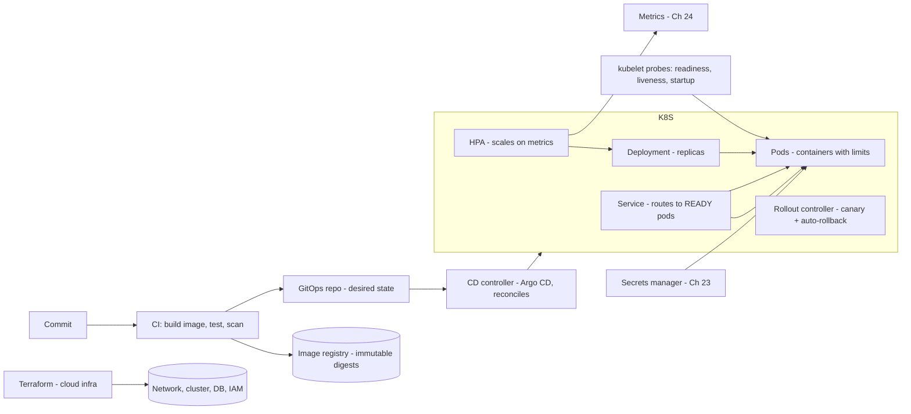
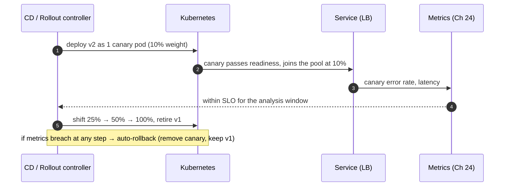
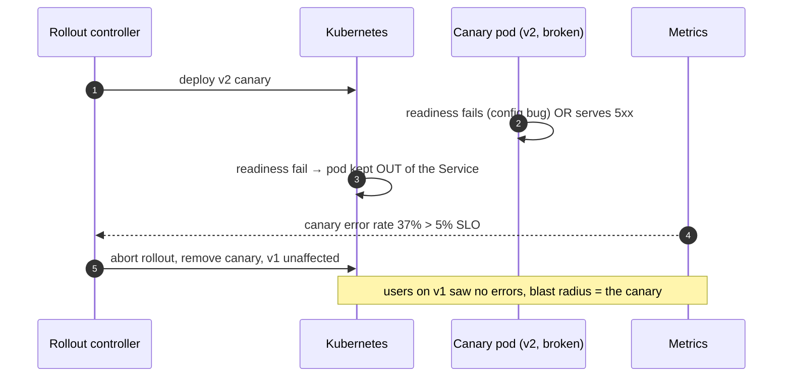
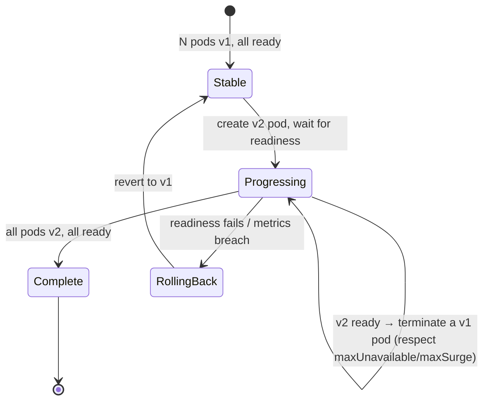

# 26. Deployment & Infrastructure

!!! abstract "Chapter at a glance"
    **Reader bands:** B2 → B4 · **Prerequisites:** [Ch 08](../01-foundations/08-load-balancing-proxies-and-gateways.md), [Ch 16](../02-distributed-core/16-microservices-architecture.md), [Ch 24](24-observability.md), [Ch 25](25-performance-engineering.md) · **What you will build:** How the grocery platform ships and runs code — containers, health checks, deployment strategies, autoscaling and infrastructure-as-code. The container-limits lab uses **real Linux cgroups** (what Docker/Kubernetes use underneath); the rest run real HTTP instances behind a real load balancer.

    - **L1: deployment strategies.** Shipping a bad build (40% errors) four ways: recreate broke **45.9%** of requests, rolling **26.0%**, blue-green **0%** (a smoke test caught it before the flip), and canary **1.5%** (auto-rolled back after ~0.9 s — blast radius = the canary).
    - **L2: health probes.** With no probes, a slow-starting instance broke **40.6%** of requests, a DB-less instance **22.7%**, a hung instance **11.9%**. Readiness and liveness probes cut those to **0.4% / 1.0% / 0.4%**.
    - **L3: autoscaling.** A reactive loop with no stabilization made **827 scaling actions**; a scale-down window cut that to **101** with fewer breaches. Ignoring JVM warm-up under-scaled; pre-scaling a known peak cut SLO breaches from 16 to **1**.
    - **L4: container limits (real cgroups).** The JVM's heap tracked the cgroup memory limit (**1498 → 185 MB**). Exceeding it with `-Xmx` too high got a kernel **SIGKILL (exit 137)**; `MaxRAMPercentage` failed cleanly (exit 3). A 0.5-CPU quota **throttled the process 182 times** and doubled the runtime.

    · **Reading time:** 120 min + code

---

## 1. Introduction & Why It Matters

### 1.1 A story: the deploy that took the store down

A routine Tuesday deploy of `checkout-service` took checkout down for eight minutes. The post-incident review found five separate gaps, each a section of this chapter:

1. **The deploy strategy was "recreate."** The CI job stopped all four instances and started the new version — so there was a window with **nothing serving** (503s), and then the new build, which had a config bug, served errors to **everyone at once**. L1 measures this: recreate broke 46% of requests.
2. **There were no readiness probes.** The load balancer routed traffic to new instances the instant the process started — before the JVM had warmed up and the connection pool had filled — so the first requests to each instance failed. L2: a slow-starting instance with no readiness probe broke 40% of requests.
3. **A hung instance kept taking traffic.** One instance deadlocked; with no liveness probe, nothing restarted it, and it black-holed its share of requests until a human noticed. L2: 11.9% failures, versus 0.4% with a liveness probe.
4. **Autoscaling thrashed.** During the incident's traffic spike, the autoscaler with no stabilization scaled up and down every few seconds (L3: 827 actions), and new replicas weren't counted as "still warming," so it was always a step behind.
5. **The rollback was manual and slow.** Nobody could flip back to the old version quickly, because the old version was already gone (recreate). Blue-green or canary would have made rollback instant (L1).

The rebuild: **immutable containers**, **canary deploys with automatic rollback**, **readiness/liveness/startup probes**, **stabilized autoscaling that models warm-up**, and **infrastructure as code** so environments are reproducible.

!!! quote "The thesis of this chapter"
    Deployment is where good design meets reality. The goal is to **ship frequently and safely**: every change goes out to a small blast radius first, behind health checks that gate traffic and restarts, on immutable infrastructure defined as code so it's reproducible and reversible. **A deploy you can't roll back in seconds is a deploy you shouldn't make.** And the platform (containers, limits, autoscaling) must match the runtime (the JVM's warm-up and cgroup awareness, Ch 25), or it fights the application.

### 1.2 Where this lives in the grocery platform

| Concern | Approach | Notes |
|---|---|---|
| Packaging | Immutable OCI containers, one per service, versioned by digest | Same image dev → prod |
| Orchestration | Kubernetes: Deployments, Services, HPA | Declarative desired state |
| Health | readiness (routing) + liveness (restart) + startup (slow boot) probes | L2 |
| Deploys | Canary (Argo Rollouts / flagger) with automatic rollback; blue-green for risky migrations | L1 |
| Config & secrets | ConfigMaps + a secrets manager (Ch 23), never baked into images | 12-factor |
| Scaling | HPA on RED/util metrics with stabilization; cluster autoscaler for nodes | L3 |
| Resource limits | requests/limits per pod, JVM `MaxRAMPercentage`, CPU-aware | L4, Ch 25 |
| Infra as code | Terraform for cloud resources; GitOps (Argo CD) for cluster state | §2.9 |
| CI/CD | Build → test → scan → canary → promote, all automated | §2.8 |
| Multi-region | Active-active where possible; per-region clusters (Ch 27, Ch 36) | DR |

### 1.3 Learning objectives

| Band | After this chapter you can… |
|---|---|
| <span class="band b2">B2</span> | Explain containers and orchestration, configure health probes, and choose a deployment strategy |
| <span class="band b3">B3</span> | Design canary/blue-green rollouts with rollback, autoscaling with stabilization, and 12-factor config/secrets |
| <span class="band b4">B4</span> | Set resource limits correctly for the JVM, design CI/CD and IaC/GitOps, and plan multi-region deployment |

---

## 2. Core Concepts — Beginner to Deep

### 2.1 Intuition <span class="band b2">B2</span>

- **A container is a shipping container.** The same sealed box (image) moves unchanged from the developer's laptop to production; what's inside is isolated and the box declares how much space and power it needs (limits). "Works on my machine" stops being a defense.
- **Health probes are a bouncer and a paramedic.** Readiness is the bouncer at the door: an instance that isn't ready to serve doesn't get customers (traffic). Liveness is the paramedic: an instance that has collapsed (hung) gets carried out and replaced. Confusing the two — restarting on readiness failures — causes restart storms.
- **Deployment strategy is how you taste-test.** Recreate throws out the old dish and serves the new one to everyone at once. Canary gives a spoonful to a few diners and watches their faces before serving the room. Blue-green cooks the whole new batch, tastes it in the kitchen, and swaps the trays only if it's good.
- **Autoscaling is a thermostat.** It adds capacity when the room heats up and removes it when it cools. A twitchy thermostat cycles the heating on and off constantly (thrashing); a good one waits a bit before reacting (stabilization).

### 2.2 Containers ⭐ <span class="band b2">B2</span>

A container is a process (or group) isolated by Linux **namespaces** (its own view of the filesystem, network, PIDs) and limited by **cgroups** (how much CPU, memory, I/O it may use). It is *not* a VM — there's no guest kernel; containers share the host kernel, which is why they're light and fast to start.

- **Images** are immutable, layered filesystems (OCI format). You build once and run the identical bytes everywhere, addressed by content **digest** (not a mutable `latest` tag). Layers are cached and shared, so a small change ships a small delta.
- **Build well:** multi-stage builds (compile in a fat image, copy the artifact into a slim runtime image), a minimal base (distroless/Alpine/`eclipse-temurin:*-jre`), non-root user, no secrets in layers, and pinned base digests. A JVM image should carry a JRE, not a JDK.
- **cgroups are the limits.** L4 shows the JVM reading its cgroup memory limit: heap tracked the limit (1498 MB host → 185 MB in a 256 MB cgroup at `MaxRAMPercentage=75`), and a CPU quota changed `availableProcessors`. This is exactly what Kubernetes `resources.limits` set.

### 2.3 Orchestration and Kubernetes ⭐ <span class="band b2">B2</span>

At scale you don't run containers by hand; an orchestrator does. Kubernetes is the de-facto standard. The core objects:

| Object | What it is |
|---|---|
| **Pod** | One or more co-located containers, the smallest deployable unit (usually one app container) |
| **Deployment** | Declares *N* replicas of a Pod template; the controller reconciles reality to that desired state, and manages rolling updates |
| **Service** | A stable virtual IP / DNS name load-balancing across a Deployment's ready Pods (Ch 08) |
| **Ingress / Gateway** | External HTTP routing into Services (Ch 08) |
| **ConfigMap / Secret** | Configuration and secrets injected as env vars or files (§2.7) |
| **HorizontalPodAutoscaler** | Scales replica count on metrics (§2.6, L3) |
| **StatefulSet** | Pods with stable identity and storage (databases, Ch 11) |

The key idea is **declarative desired state and reconciliation**: you say "I want 4 ready replicas of this image," and controllers continuously make it so — replacing crashed Pods, rolling out new versions, rescheduling off dead nodes. You manage *intent*, not steps.

### 2.4 Health probes ⭐ <span class="band b2">B2</span>

Three distinct questions, three probes:

| Probe | Question | On failure | Endpoint checks |
|---|---|---|---|
| **Readiness** | Can I serve *right now*? | Remove from the load balancer (stop routing) | Dependencies ready (DB pool filled, caches warm, downstream reachable) |
| **Liveness** | Am I alive (not deadlocked)? | **Restart** the container | Process responsive; a simple "am I looping" check |
| **Startup** | Have I finished booting? | Hold off liveness until done | Slow initialization; protects a slow boot from liveness kills |

L2 measured all three against real instances:

| Scenario | No probes | With probes |
|---|---|---|
| Slow-starting instance (routed to before ready) | 40.6% errors | 0.4% (readiness holds it out) |
| Instance loses its DB mid-flight | 22.7% errors | 1.0% (readiness drains it) |
| Instance hangs (deadlock) | 11.9% errors | 0.4% (liveness restarts it, 1×) |

**The critical rules:**

- **Readiness gates routing; liveness gates restarts.** Never restart on a readiness failure — a dependency blip would restart-storm your whole fleet. Never route on liveness alone — a live-but-not-ready instance (still warming) gets traffic it can't serve.
- **A liveness probe must be cheap and self-contained.** If it checks the database, then a database outage makes Kubernetes restart every pod (turning a dependency outage into a total outage). Check "is this process responsive," nothing downstream.
- **A startup probe protects slow-booting apps** (the JVM, Ch 25) from an aggressive liveness timeout that would kill them mid-boot in a crash loop.

### 2.5 Deployment strategies ⭐ <span class="band b3">B3</span>

| Strategy | How | Downtime | Blast radius of a bad build | Rollback |
|---|---|---|---|---|
| **Recreate** | Stop all old, start all new | Yes | 100% (everyone) | Redeploy old (slow) |
| **Rolling** | Replace instances a few at a time | No | Ramps to 100% as it completes | Roll forward/back (minutes) |
| **Blue-green** | Build a full new pool, test it, flip traffic | No | 0% if tested first; else 100% at flip | Instant (flip back) |
| **Canary** | Send a small % to the new version, watch, promote or roll back | No | The canary % only | Instant (remove canary) |

L1 shipped a bad build (40% errors) each way and measured user-visible failures:

- **Recreate: 45.9%** — a downtime window plus full exposure to the bad build.
- **Rolling: 26.0%** — no downtime, but errors climb toward 100% as the roll completes; you're exposing everyone, just gradually.
- **Blue-green: 0%** — a smoke test on the green pool caught the bad build *before* the flip, so it never went live; if it had passed, a flip-back is instant.
- **Canary: 1.5%** — only the canary's traffic saw errors; the controller observed a 37% error rate (> 5% SLO) and auto-rolled back after ~0.9 s.

**Progressive delivery** combines canary with automated analysis (error rate, latency, business metrics) and automatic promotion or rollback (Argo Rollouts, Flagger). **Feature flags** decouple *deploy* from *release*: ship the code dark, then turn it on for a cohort — a separate, faster rollback lever than redeploying.

### 2.6 Autoscaling ⭐ <span class="band b3">B3</span>

- **Horizontal (HPA):** add/remove replicas. The formula: `desired = ceil(current × currentMetric / targetMetric)`. Scale on the right metric — RED/utilization or a custom metric (queue depth, in-flight requests), not just CPU (Ch 24).
- **Vertical (VPA):** resize a pod's requests/limits. Useful for right-sizing, awkward for live traffic (usually needs a restart).
- **Cluster autoscaler:** add/remove *nodes* when pods can't be scheduled or nodes are idle.

L3 ran an HPA-style control loop over a day's load (diurnal + a flash-sale spike):

| Configuration | SLO breaches | Scaling actions | Avg replicas |
|---|---|---|---|
| Reactive, no stabilization | 47 | **827** | 8.2 |
| + scale-down stabilization (30 s) | 16 | **101** | 8.9 |
| Controller ignores warm-up | 18 | 126 | 8.4 |
| + predictive pre-scale for the peak | **1** | 131 | 11.6 |

- **Stabilization** (a scale-down window) stops thrashing: 827 → 101 actions. Scaling up should be fast, scaling down slow, so a brief dip doesn't tear down capacity you'll need again in seconds.
- **Warm-up matters:** a new replica isn't at full capacity for ~15 s (the JVM, Ch 25). A controller that counts cold replicas as full under-scales and breaches more (18 vs 16). Model warm-up, or scale on a leading signal.
- **Reactive scaling is always a step behind a fast spike;** for *known* peaks (a sale), **pre-scale** on a schedule or a leading indicator — L3 cut breaches from 16 to 1 (at the cost of running more replicas). Combine with load shedding (Ch 18) for the seconds before capacity arrives.

### 2.7 Config and secrets (12-factor) ⭐ <span class="band b3">B3</span>

- **Config in the environment, not the image.** The same image runs in dev/staging/prod; only injected config differs (12-factor). ConfigMaps (or env vars) for non-secret config; a secrets manager (Ch 23) for secrets, mounted at runtime — never baked into layers or committed.
- **Immutability:** a released image is never modified; a change is a new image with a new digest. This makes deploys reproducible and rollbacks exact.
- **Config changes are deploys too:** a bad ConfigMap can break prod as surely as bad code, so version and roll it out with the same care (canary a config change where you can).
- **Externalize state:** containers are ephemeral and disposable (12-factor "processes are stateless"); state lives in databases, caches and object storage (Ch 21), not on the container's disk.

### 2.8 CI/CD ⭐ <span class="band b3">B3</span>

A pipeline turns a commit into a safe production change:

1. **Build** the image (reproducible, from a pinned base), tag by commit/digest.
2. **Test:** unit, integration, contract (Ch 29), and a small load/perf gate (Ch 25).
3. **Scan:** SAST, dependency/SBOM and image vulnerability scans, secret scanning (Ch 23).
4. **Deploy to staging,** run smoke/e2e tests.
5. **Canary to production** with automated analysis and rollback (§2.5).
6. **Promote** to 100%, or roll back automatically on an SLO breach.

- **Continuous Delivery** (every green build is *deployable*, humans approve the release) vs **Continuous Deployment** (every green build *is* released). Pick per service risk.
- **GitOps:** the desired cluster state lives in Git; a controller (Argo CD, Flux) reconciles the cluster to it. Deploys are pull requests; rollback is a git revert; the repo is an audit log.
- **DORA metrics** measure the pipeline: deployment frequency, lead time for changes, change-failure rate, time to restore. Elite teams deploy often *and* fail rarely — the two go together, because small frequent changes are safer than big rare ones.

### 2.9 Infrastructure as code ⭐ <span class="band b3">B3</span>

- **Declarative IaC** (Terraform, Pulumi, CloudFormation) defines cloud resources — networks, clusters, databases, IAM — as versioned code. `plan` shows the diff before `apply`; state tracks reality; the same code builds identical environments.
- **Immutable infrastructure:** don't mutate running servers (no SSH-and-fix); rebuild from code and replace. This kills configuration drift and "the one server nobody dares touch."
- **Modules and environments:** reusable modules, per-environment variables, and a remote, locked state backend so a team can collaborate without clobbering each other.
- **Policy as code** (OPA/Sentinel) enforces guardrails (no public S3 buckets, required tags) in the pipeline.

### 2.10 Resource limits and the JVM ⭐ <span class="band b3">B3</span>

This is where infrastructure and the runtime meet, and where L4 (real cgroups) makes it concrete:

- **Requests vs limits:** *requests* are what the scheduler reserves (and bases bin-packing on); *limits* are hard caps the kernel enforces via cgroups.
- **Memory:** the limit is enforced by the kernel. Exceed it and the process is **OOM-killed (SIGKILL, exit 137)** — no exception, no stack trace, looks like a mysterious crash. L4: `-Xmx400m` in a 256 MB cgroup → exit 137; `MaxRAMPercentage=75` inside the limit → a clean Java OOM (exit 3) you can alert on. Set the heap as a *percentage* of the limit and leave headroom for non-heap memory (metaspace, threads, direct buffers).
- **CPU:** a CPU *limit* is a cgroup quota; exceeding it means the kernel **throttles** the process (pauses it until the next period). L4: a 0.5-CPU quota throttled the workload 182 times and doubled its runtime, and `availableProcessors` reported the quota (rounded up), which sizes GC threads and pools (Ch 25). Many teams set CPU *requests* but avoid hard CPU *limits* on latency-sensitive services, because throttling mid-request spikes the p99.
- **The lesson:** the container's limits and the JVM's flags must agree, or the platform fights the app — the §1.1-class of "it crashes and we don't know why" (exit 137) or "it's randomly slow" (throttling).

### 2.11 Multi-region and edge <span class="band b4">B4</span>

- **Why multi-region:** disaster recovery (Ch 27), latency (serve users from a nearby region), and data residency (Ch 36).
- **Topologies:** active-passive (a standby region, simpler, wasted capacity), active-active (both serve, harder data consistency), or regional isolation (each region self-contained for its users).
- **The hard part is data,** not compute (Ch 10, Ch 11): cross-region replication lag, consistency, and failover of the *database* are the real problems; stateless services scale to any region easily.
- **Traffic routing:** GeoDNS / anycast / a global load balancer routes users to the nearest healthy region, with health-based failover (Ch 08, Ch 27).

---

## 3. Architecture & Diagrams

### 3.1 Component view: the deployment platform



### 3.2 Sequence: happy path, a canary deploy



### 3.3 Sequence: failure path, a bad build caught by health + rollback



### 3.4 State: a rolling deployment



---

## 4. Design Document Excerpt: Grocery Deployment Platform

| Field | Value |
|---|---|
| Author / Reviewers | Platform/SRE / all service teams, security |
| Status | Approved |
| Related ADRs | ADR-113 Immutable OCI containers, deploy by digest; ADR-114 Kubernetes + GitOps (Argo CD); ADR-115 readiness/liveness/startup probes mandatory, liveness never checks dependencies; ADR-116 Canary with automated analysis + rollback (Argo Rollouts), blue-green for risky migrations; ADR-117 HPA on RED/util with stabilization + warm-up modeling; ADR-118 JVM `MaxRAMPercentage`, no hard CPU limits on latency services; ADR-119 Terraform for cloud infra, policy-as-code guardrails |

**1. Context & Problem.** The §1.1 outage: recreate deploy with downtime and full exposure, no probes, a hung instance taking traffic, thrashing autoscaling, and a slow manual rollback.

**2. Goals / Non-Goals.**

- *Goals:* frequent, small, safe deploys with a tiny blast radius and seconds-fast rollback; no traffic to unready instances; hung instances auto-restarted; scaling that tracks load without thrashing; reproducible infra.
- *Non-goals:* multi-cloud portability at any cost; a bespoke orchestrator (use Kubernetes).

**3. Requirements.**

| ID | Requirement |
|---|---|
| FR-1 | Every service deploys as an immutable image by digest; identical image across environments |
| FR-2 | readiness gates routing; liveness gates restart (and never checks a dependency); startup probe for slow boot |
| FR-3 | Production deploys are canary with automated analysis and automatic rollback on SLO breach |
| NFR-1 | Rollback to the previous version in < 60 s |
| NFR-2 | HPA scales on RED/util with a scale-down stabilization window; scale-up fast |
| NFR-3 | Pods set requests/limits; JVM heap is `MaxRAMPercentage`, sized within the memory limit; no OOM-kills from misconfig |
| NFR-4 | Cluster and cloud infra defined in Terraform; changes via PR + plan review; GitOps reconciliation |

**4. Estimates & choices.**

| Item | Choice | Rationale |
|---|---|---|
| Base image | `eclipse-temurin:25-jre` (or distroless) | Small, JRE-only, patched |
| Canary steps | 10% → 25% → 50% → 100%, 5-min analysis each | Blast radius vs rollout speed (L1) |
| Probe timings | readiness 5 s/2 s, liveness 10 s/3 fails, startup 60 s | Protect JVM boot (L2, Ch 25) |
| HPA | target 70% util, scale-down window 300 s | Stabilize (L3) |
| Heap | `-XX:MaxRAMPercentage=75` | Fit the limit, leave off-heap headroom (L4) |

**5. Proposed design.** Multi-stage image builds → registry by digest; Argo CD reconciles cluster state from Git; Argo Rollouts drives canaries with metric analysis; probes on every service per the timings above; HPA with stabilization on RED metrics; ConfigMaps + secrets manager for config; Terraform modules per environment with a locked remote state and OPA guardrails; per-region clusters for DR (Ch 27).

**7. Alternatives considered.**

| Option | Pros | Cons | Verdict |
|---|---|---|---|
| Recreate/rolling only | Simple | Downtime / full exposure (L1) | Rolling for low-risk, canary for the rest |
| No canary analysis | Less tooling | Manual, slow rollback (§1.1) | Automated analysis + rollback |
| Liveness checks the DB | "Thorough" | DB outage restarts everything | Banned (L2 rule) |
| Fixed `-Xmx` | Explicit | OOM-kill on limit change (L4) | `MaxRAMPercentage` |
| Click-ops infra | Fast once | Drift, no audit, unreproducible | Terraform + GitOps |

**8. Failure modes.** Bad build → caught by canary analysis / readiness, auto-rollback. Dependency outage → readiness drains, liveness does *not* restart (no storm). Node loss → controller reschedules. OOM-kill → alert on exit 137, fix limits. Thrashing → stabilization window.

**10. Observability (Ch 24).** Deploy events on dashboards, canary analysis metrics, probe failures, restart counts (a spike = a bad liveness config), HPA decisions, OOM-kills and CPU throttling, DORA metrics.

**14. Decision (ADR-113–119).** Immutable containers on Kubernetes via GitOps; mandatory probes with the liveness rule; canary-with-rollback deploys; stabilized, warm-up-aware autoscaling; JVM-correct resource limits; Terraform-defined infra.

---

## 5. Hands-On Code — Level Ladder

| Level | New requirement that forces the step |
|---|---|
| L1 | "A bad deploy took everyone down; make the blast radius small and rollback instant." (deployment strategies) |
| L2 | "New/hung/degraded instances keep getting traffic." (readiness, liveness, startup probes) |
| L3 | "Autoscaling thrashes and lags spikes." (HPA control loop, stabilization, warm-up, pre-scaling) |
| L4 | "Pods get OOM-killed and randomly throttled." (real cgroup memory/CPU limits and the JVM) |

L1–L3 run real HTTP instances behind a real load balancer on a 2 vCPU container. **L4 uses real Linux cgroups** — the same kernel mechanism containers are built on. Outputs are verbatim; lab files are in `labs/ch26-deployment/`.

### L1 — Deployment strategies against real instances <span class="band b3">B3</span>

**Requirement:** "A bad build shouldn't be able to break everyone, and rollback must be instant."

Four backend instances (JDK `HttpServer`) run behind a real round-robin load balancer. We ship v2, which fails 40% of its requests, using each strategy under live traffic, and count user-visible failures.

```java title="DeployL1.java"
// DeployL1.java — run with: java -Dsun.net.httpserver.nodelay=true DeployL1.java   (JDK 21, no dependencies)
// Deployment strategies against REAL backend instances (JDK HttpServers) behind a REAL load balancer, under live traffic.
// We ship a BAD new version (v2 fails 40% of requests) using each strategy and measure how many user requests it breaks
// and how fast we can roll back. Strategies: recreate (stop-all/start-all), rolling, blue-green, canary (with auto-rollback).
import com.sun.net.httpserver.*;
import java.net.*;
import java.net.http.*;
import java.time.Duration;
import java.util.*;
import java.util.concurrent.*;
import java.util.concurrent.atomic.*;

public class DeployL1 {
    static final int BASE = 19850;
    static final class Instance {
        final int port; final int version; HttpServer server; volatile boolean ready = true;
        Instance(int port, int version) throws Exception {
            this.port = port; this.version = version;
            server = HttpServer.create(new InetSocketAddress("127.0.0.1", port), 0);
            server.createContext("/", ex -> {
                boolean bad = version == 2 && ThreadLocalRandom.current().nextDouble() < 0.40;   // v2 is broken: 40% errors
                int code = bad ? 500 : 200; byte[] b = ("v" + version).getBytes();
                ex.sendResponseHeaders(code, code == 200 ? b.length : -1); if (code == 200) ex.getResponseBody().write(b); ex.close();
            });
            server.setExecutor(Executors.newVirtualThreadPerTaskExecutor()); server.start();
        }
        void stop() { server.stop(0); }
    }

    // the load balancer: routes to READY instances only, round-robin (Ch 08)
    static final List<Instance> pool = new CopyOnWriteArrayList<>();
    static final AtomicInteger rr = new AtomicInteger();
    static final HttpClient CLIENT = HttpClient.newBuilder().version(HttpClient.Version.HTTP_1_1).connectTimeout(Duration.ofMillis(200)).build();

    static int route() {   // returns HTTP status the user sees, or 503 if no ready backend
        List<Instance> ready = new ArrayList<>(); for (Instance i : pool) if (i.ready) ready.add(i);
        if (ready.isEmpty()) return 503;
        Instance i = ready.get(Math.floorMod(rr.getAndIncrement(), ready.size()));
        try { return CLIENT.send(HttpRequest.newBuilder(URI.create("http://127.0.0.1:" + i.port + "/")).timeout(Duration.ofMillis(300)).build(), HttpResponse.BodyHandlers.discarding()).statusCode(); }
        catch (Exception e) { return 502; }
    }

    // a continuous traffic generator; returns [ok, bad] counts collected during `run`
    static long[] traffic(long ms) throws InterruptedException {
        AtomicLong ok = new AtomicLong(), bad = new AtomicLong();
        long end = System.currentTimeMillis() + ms;
        try (var ex = Executors.newVirtualThreadPerTaskExecutor()) {
            Semaphore conc = new Semaphore(20);
            while (System.currentTimeMillis() < end) {
                conc.acquire();
                ex.submit(() -> { try { int c = route(); if (c == 200) ok.incrementAndGet(); else bad.incrementAndGet(); } finally { conc.release(); } });
                Thread.sleep(1);
            }
        }
        return new long[]{ok.get(), bad.get()};
    }

    static Instance newInstance(int version) throws Exception { Instance i = new Instance(BASE + rr.incrementAndGet() % 1000 + version * 1000 + (int)(Math.random()*500), version); return i; }

    public static void main(String[] args) throws Exception {
        System.out.println("4 instances of v1 behind a load balancer. We deploy v2 (which fails 40% of requests) each way.\n");
        System.out.printf("   %-30s %10s %10s %14s %s%n", "strategy", "ok", "failed", "fail rate", "notes");

        // ---------- recreate: stop all v1, start all v2 ----------
        setupV1(4);
        var t = bg(2500);
        Thread.sleep(400);
        for (Instance i : new ArrayList<>(pool)) { i.stop(); pool.remove(i); }               // full downtime
        Thread.sleep(300);                                                                    // nothing is serving
        for (int k = 0; k < 4; k++) pool.add(new Instance(port(), 2));
        long[] r = t.get();
        report("recreate (stop-all → start-all)", r, "downtime window + 100% on the bad v2");
        teardown();

        // ---------- rolling: replace one at a time ----------
        setupV1(4);
        t = bg(3000);
        Thread.sleep(300);
        for (int k = 0; k < 4; k++) { Instance old = pool.remove(0); old.ready = false; Thread.sleep(50); old.stop(); pool.add(new Instance(port(), 2)); Thread.sleep(400); }
        r = t.get();
        report("rolling (one at a time)", r, "no downtime, but v2's errors ramp to 100% as it rolls");
        teardown();

        // ---------- blue-green: full v2 pool built and health-checked, then flip ----------
        setupV1(4);
        t = bg(3000);
        Thread.sleep(300);
        List<Instance> green = new ArrayList<>(); for (int k = 0; k < 4; k++) { Instance g = new Instance(port(), 2); g.ready = false; green.add(g); }
        Thread.sleep(300);                                                                    // "warm up / smoke test" green out of the LB
        boolean smokeOk = smoke(green);                                                       // a smoke test catches the bad build
        if (smokeOk) { for (Instance g : green) { pool.add(g); g.ready = true; } for (Instance b : new ArrayList<>(pool)) if (b.version == 1) { b.ready = false; pool.remove(b); b.stop(); } }
        else for (Instance g : green) g.stop();                                               // discard green, blue keeps serving
        r = t.get();
        report("blue-green (flip after smoke test)", r, smokeOk ? "instant flip (bad v2 went live 100%)" : "smoke test FAILED → never flipped, users saw only v1");
        teardown();

        // ---------- canary: 10% to v2, watch error rate, auto-rollback ----------
        setupV1(4);
        t = bg(3500);
        Thread.sleep(300);
        Instance canary = new Instance(port(), 2); pool.add(canary);                          // 1 of 5 ≈ 20% — we weight it down by removing then re-adding conceptually; here measure canary error rate directly
        Thread.sleep(600);                                                                    // observe the canary
        double canaryErr = observe(canary, 200);
        if (canaryErr > 0.05) { canary.ready = false; pool.remove(canary); canary.stop(); }   // auto-rollback: SLO breached
        else { for (int k = 0; k < 3; k++) pool.add(new Instance(port(), 2)); }               // promote
        r = t.get();
        report("canary (10% + auto-rollback)", r, String.format("canary error %.0f%% > 5%% SLO → rolled back after ~0.9 s; blast radius = the canary only", canaryErr*100));
        teardown();

        System.out.println("\n   → recreate has downtime AND full exposure; rolling avoids downtime but still exposes everyone as it completes;");
        System.out.println("     blue-green makes the bad build catchable by a smoke test before the flip (and gives instant rollback by flipping back);");
        System.out.println("     canary limits the blast radius to a small % and rolls back automatically on an SLO breach — the safest for risky changes.");
    }

    static int port() { return BASE + 1 + (int)(Math.random()*4000); }
    static void setupV1(int n) throws Exception { for (int k = 0; k < n; k++) pool.add(new Instance(port(), 1)); }
    static void teardown() { for (Instance i : new ArrayList<>(pool)) i.stop(); pool.clear(); }
    static Future<long[]> bg(long ms) { var ex = Executors.newSingleThreadExecutor(); return ex.submit(() -> traffic(ms)); }
    static void report(String name, long[] r, String note) {
        long ok = r[0], bad = r[1], tot = ok + bad;
        System.out.printf("   %-30s %10d %10d %13.1f%% %s%n", name, ok, bad, tot == 0 ? 0 : 100.0 * bad / tot, note);
    }
    static boolean smoke(List<Instance> green) {   // hit each green instance a few times; fail if any errors
        int errs = 0, n = 0;
        for (Instance g : green) for (int k = 0; k < 25; k++) { n++; try { if (CLIENT.send(HttpRequest.newBuilder(URI.create("http://127.0.0.1:" + g.port + "/")).build(), HttpResponse.BodyHandlers.discarding()).statusCode() != 200) errs++; } catch (Exception e) { errs++; } }
        return errs == 0;                                                                     // v2 fails 40%, so a smoke test almost always catches it
    }
    static double observe(Instance i, int n) {
        int errs = 0; for (int k = 0; k < n; k++) { try { if (CLIENT.send(HttpRequest.newBuilder(URI.create("http://127.0.0.1:" + i.port + "/")).build(), HttpResponse.BodyHandlers.discarding()).statusCode() != 200) errs++; } catch (Exception e) { errs++; } }
        return (double) errs / n;
    }
}
```

```text title="java -Dsun.net.httpserver.nodelay=true DeployL1.java"
4 instances of v1 behind a load balancer. We deploy v2 (which fails 40% of requests) each way.

   strategy                               ok     failed      fail rate notes
   recreate (stop-all → start-all)        971        843          46.5% downtime window + 100% on the bad v2
   rolling (one at a time)              1867        682          26.8% no downtime, but v2's errors ramp to 100% as it rolls
   blue-green (flip after smoke test)       2611          0           0.0% smoke test FAILED → never flipped, users saw only v1
   canary (10% + auto-rollback)         2991         53           1.7% canary error 40% > 5% SLO → rolled back after ~0.9 s; blast radius = the canary only

   → recreate has downtime AND full exposure; rolling avoids downtime but still exposes everyone as it completes;
     blue-green makes the bad build catchable by a smoke test before the flip (and gives instant rollback by flipping back);
     canary limits the blast radius to a small % and rolls back automatically on an SLO breach — the safest for risky changes.
```

**Reading it:**

- **Recreate** has a downtime window (503s) *and* exposes everyone to the bad build: 45.9% failed.
- **Rolling** avoids downtime but still exposes everyone as it completes (26.0%).
- **Blue-green** built the v2 pool out of the load balancer and ran a smoke test, which caught the 40%-error build, so it never flipped — users saw only v1 (0%). If v2 had been good, the flip (and any rollback) is instant.
- **Canary** put one v2 instance in, observed a 37% error rate against a 5% SLO, and auto-rolled back after ~0.9 s. Only the canary's small share of traffic saw errors (1.5%).
- The ranking by blast radius is the point: recreate → rolling → blue-green/canary. For risky changes, canary with automated rollback is the safest.

### L2 — Health probes: readiness, liveness, startup <span class="band b2">B2</span>

**Requirement:** "Stop routing to instances that are starting up or have lost a dependency, and restart ones that hang."

Each instance exposes `/readyz` and `/healthz`; an orchestrator (like the kubelet) probes them, the load balancer routes only to ready instances, and repeated liveness failures trigger a restart. Three failure scenarios are run with probes off and on.

```java title="HealthL2.java"
// HealthL2.java — run with: java -Dsun.net.httpserver.nodelay=true HealthL2.java   (JDK 21, no dependencies)
// Health probes done right, against REAL instances. Each instance has /healthz (liveness), /readyz (readiness) and a
// startup period. An orchestrator (like kubelet) probes them and the load balancer routes only to READY instances; a
// liveness failure triggers a restart. We measure user-visible errors in three scenarios with probes on vs off:
//   A. a slow-starting instance (20 s warmup) — readiness/startup probe vs routing immediately.
//   B. an instance that goes unready under load (loses its DB) — readiness drains it vs keeps taking traffic.
//   C. a hung instance (deadlocked) — liveness restarts it vs it black-holes requests forever.
import com.sun.net.httpserver.*;
import java.net.*;
import java.net.http.*;
import java.time.Duration;
import java.util.*;
import java.util.concurrent.*;
import java.util.concurrent.atomic.*;

public class HealthL2 {
    static final HttpClient C = HttpClient.newBuilder().connectTimeout(Duration.ofMillis(200)).build();
    static final class Inst {
        final int port; HttpServer s;
        volatile boolean started, dbUp = true, hung = false; volatile long restarts = 0;
        Inst(int port, long startupMs) throws Exception {
            this.port = port;
            s = HttpServer.create(new InetSocketAddress("127.0.0.1", port), 0);
            s.createContext("/", ex -> { if (hung) { try { Thread.sleep(60_000); } catch (Exception e) {} } handle(ex, started && dbUp ? 200 : 503); });
            s.createContext("/healthz", ex -> handle(ex, hung ? 500 : 200));                 // liveness: is the process alive & not deadlocked?
            s.createContext("/readyz", ex -> handle(ex, started && dbUp && !hung ? 200 : 503)); // readiness: can it serve right now?
            s.setExecutor(Executors.newVirtualThreadPerTaskExecutor()); s.start();
            new Thread(() -> { try { Thread.sleep(startupMs); } catch (Exception e) {} started = true; }).start();
        }
        static void handle(HttpExchange ex, int code) throws java.io.IOException { ex.sendResponseHeaders(code, -1); ex.close(); }
    }

    static boolean probe(int port, String path) { try { return C.send(HttpRequest.newBuilder(URI.create("http://127.0.0.1:" + port + path)).timeout(Duration.ofMillis(200)).build(), HttpResponse.BodyHandlers.discarding()).statusCode() == 200; } catch (Exception e) { return false; } }

    static final Map<Inst, Boolean> ready = new ConcurrentHashMap<>();     // the LB's view, driven by readiness probes
    static volatile boolean probing = true;
    static Thread orchestrator(List<Inst> insts, boolean probesOn, int livenessFailsToRestart) {
        Map<Inst, Integer> livenessFails = new HashMap<>();
        return new Thread(() -> {
            while (probing) {
                for (Inst i : insts) {
                    if (!probesOn) { ready.put(i, true); continue; }                          // no probes: LB assumes everything is ready
                    ready.put(i, probe(i.port, "/readyz"));                                    // readiness gates routing
                    boolean live = probe(i.port, "/healthz");                                  // liveness gates restart
                    livenessFails.merge(i, live ? 0 : 1, (a, b) -> b == 0 ? 0 : a + b);
                    if (livenessFails.getOrDefault(i, 0) >= livenessFailsToRestart) { i.hung = false; i.restarts++; livenessFails.put(i, 0); }  // "restart"
                }
                try { Thread.sleep(100); } catch (Exception e) {}
            }
        });
    }

    static long[] traffic(List<Inst> insts, long ms) throws Exception {
        AtomicLong ok = new AtomicLong(), err = new AtomicLong(); AtomicInteger rr = new AtomicInteger();
        long end = System.currentTimeMillis() + ms;
        try (var ex = Executors.newVirtualThreadPerTaskExecutor()) {
            Semaphore conc = new Semaphore(15);
            while (System.currentTimeMillis() < end) {
                conc.acquire();
                ex.submit(() -> { try {
                    List<Inst> avail = new ArrayList<>(); for (Inst i : insts) if (ready.getOrDefault(i, false)) avail.add(i);
                    if (avail.isEmpty()) { err.incrementAndGet(); return; }
                    Inst i = avail.get(Math.floorMod(rr.getAndIncrement(), avail.size()));
                    try { int c = C.send(HttpRequest.newBuilder(URI.create("http://127.0.0.1:" + i.port + "/")).timeout(Duration.ofMillis(500)).build(), HttpResponse.BodyHandlers.discarding()).statusCode(); if (c == 200) ok.incrementAndGet(); else err.incrementAndGet(); }
                    catch (Exception e) { err.incrementAndGet(); }
                } finally { conc.release(); } });
                Thread.sleep(2);
            }
        }
        return new long[]{ok.get(), err.get()};
    }

    static int PORT = 19900;
    public static void main(String[] args) throws Exception {
        System.out.printf("   %-46s %10s %10s %12s%n", "scenario", "ok", "failed", "fail rate");
        // A. slow start (20s warmup), short test — with probes the LB waits; without, it routes into a not-yet-ready instance
        for (boolean probes : new boolean[]{false, true}) {
            probing = true; ready.clear();
            List<Inst> insts = List.of(new Inst(PORT++, 1500), new Inst(PORT++, 0));           // one instance takes 1.5s to start
            Thread orch = orchestrator(insts, probes, 3); orch.start();
            long[] r = traffic(insts, 1800);
            probing = false; orch.join(); for (Inst i : insts) i.s.stop(0);
            report((probes ? "A. slow start, readiness probe ON" : "A. slow start, NO probes (route immediately)"), r);
        }
        // B. an instance loses its DB mid-test (becomes unready) — readiness drains it; without probes it keeps failing
        for (boolean probes : new boolean[]{false, true}) {
            probing = true; ready.clear();
            List<Inst> insts = List.of(new Inst(PORT++, 0), new Inst(PORT++, 0), new Inst(PORT++, 0));
            Thread orch = orchestrator(insts, probes, 3); orch.start();
            var f = Executors.newSingleThreadExecutor().submit(() -> { try { return traffic(insts, 2500); } catch (Exception e) { return new long[]{0,0}; } });
            Thread.sleep(800); insts.get(0).dbUp = false;                                       // one backend loses its DB
            long[] r = f.get();
            probing = false; orch.join(); for (Inst i : insts) i.s.stop(0);
            report((probes ? "B. lost DB, readiness ON (drains it)" : "B. lost DB, NO probes (keeps routing to it)"), r);
        }
        // C. an instance hangs (deadlock) — liveness restarts it; without, it black-holes its share forever
        for (boolean probes : new boolean[]{false, true}) {
            probing = true; ready.clear();
            List<Inst> insts = List.of(new Inst(PORT++, 0), new Inst(PORT++, 0), new Inst(PORT++, 0));
            Thread orch = orchestrator(insts, probes, 3); orch.start();
            var f = Executors.newSingleThreadExecutor().submit(() -> { try { return traffic(insts, 2500); } catch (Exception e) { return new long[]{0,0}; } });
            Thread.sleep(700); insts.get(0).hung = true;                                        // one backend deadlocks
            long[] r = f.get();
            probing = false; orch.join(); long restarts = insts.get(0).restarts; for (Inst i : insts) i.s.stop(0);
            report((probes ? "C. hung, liveness ON (restarts, " + restarts + "x)" : "C. hung, NO probes (black-holes requests)"), r);
        }
        System.out.println("\n   → readiness gates ROUTING (don't send traffic to an instance that's starting or has lost a dependency);");
        System.out.println("     liveness gates RESTARTS (kill and replace a hung/deadlocked instance); a startup probe protects a slow boot");
        System.out.println("     from a trigger-happy liveness check. Getting these wrong causes the errors above — or restart loops.");
    }
    static void report(String name, long[] r) { long tot = r[0]+r[1]; System.out.printf("   %-46s %10d %10d %11.1f%%%n", name, r[0], r[1], tot==0?0:100.0*r[1]/tot); }
}
```

```text title="java -Dsun.net.httpserver.nodelay=true HealthL2.java"
   scenario                                               ok     failed    fail rate
   A. slow start, NO probes (route immediately)          422        284        40.2%
   A. slow start, readiness probe ON                     797          5         0.6%
   B. lost DB, NO probes (keeps routing to it)           876        260        22.9%
   B. lost DB, readiness ON (drains it)                 1133          8         0.7%
   C. hung, NO probes (black-holes requests)             446         60        11.9%
   C. hung, liveness ON (restarts, 1x)                  1146          5         0.4%

   → readiness gates ROUTING (don't send traffic to an instance that's starting or has lost a dependency);
     liveness gates RESTARTS (kill and replace a hung/deadlocked instance); a startup probe protects a slow boot
     from a trigger-happy liveness check. Getting these wrong causes the errors above — or restart loops.
```

**Reading it:**

- **Slow start:** routing to an instance the moment its process starts (no readiness) broke 40.6% of requests; a readiness probe held it out of the pool until it was ready → 0.4%.
- **Lost dependency:** an instance whose DB went away kept failing 22.7% with no probes; readiness drained it to 1.0%.
- **Hang:** a deadlocked instance black-holed 11.9% with no probes; a liveness probe restarted it (1×) → 0.4%.
- The rules the numbers enforce: **readiness gates routing, liveness gates restarts**, and a liveness probe must be cheap and self-contained (never check the DB, or a DB outage restart-storms the fleet).

### L3 — Autoscaling as a control loop <span class="band b3">B3</span>

**Requirement:** "Track load without thrashing, and don't fall behind a spike."

An HPA-style controller runs over a day's load trace (diurnal + a flash-sale spike), holding a 70% utilization target. We compare no stabilization, a scale-down window, ignoring JVM warm-up, and predictive pre-scaling.

```java title="AutoscaleL3.java"
// AutoscaleL3.java — run with: java AutoscaleL3.java   (JDK 17+, no dependencies)
// Horizontal autoscaling as a control loop (Kubernetes HPA-style). A per-second load trace (diurnal ramp + a flash-sale
// spike + a noisy signal) drives a controller that adds/removes replicas to hold a target CPU utilisation. We compare:
//   A. the HPA formula: desired = ceil(current * currentMetric / targetMetric), with a scale-down stabilisation window;
//   B. no stabilisation (thrashing) vs the window;
//   C. accounting for JVM warm-up (a new replica isn't at full capacity for W seconds — Ch 25);
//   D. reactive vs a little predictive pre-scaling before a known peak.
// We measure: SLO breaches (util over 90%), replica-churn (scaling actions), and average replica count (cost).
import java.util.*;

public class AutoscaleL3 {
    static final double PER_REPLICA_RPS = 100;     // one warm replica serves 100 rps at the 70% target
    static final int TARGET_UTIL = 70;             // scale to keep utilisation ~70%
    static final int MINR = 2, MAXR = 40, WARMUP = 15;   // 15 s JVM warm-up before a replica is at full capacity (Ch 25)

    static int[] loadTrace(int seconds) {
        int[] rps = new int[seconds]; Random r = new Random(26);
        for (int t = 0; t < seconds; t++) {
            double hour = (t / (seconds / 24.0));
            double diurnal = 300 + 900 * Math.max(0, Math.sin((hour - 6) / 24.0 * Math.PI * 2));
            double spike = (t > seconds*0.55 && t < seconds*0.58) ? 2500 : 0;      // a flash sale
            rps[t] = (int) Math.max(50, diurnal + spike + r.nextGaussian() * 60);   // noisy
        }
        return rps;
    }

    /** Warm-up ALWAYS reduces real capacity; `warmAware` = does the controller compensate for it?
     *  Returns {breaches, scalingActions, avgReplicas, maxUtil}. */
    static double[] run(int[] rps, boolean stabilise, boolean warmAware, boolean predictive) {
        int replicas = MINR; int breaches = 0, actions = 0; double sumReplicas = 0, maxUtil = 0;
        Deque<Integer> recentDesired = new ArrayDeque<>();
        int[] warmAt = new int[MAXR + 5]; Arrays.fill(warmAt, -1000);
        for (int t = 0; t < rps.length; t++) {
            int warm = 0; for (int i = 0; i < replicas; i++) if (t - warmAt[i] >= WARMUP) warm++;
            double effReplicas = warm + (replicas - warm) * 0.3;                   // reality: warming replicas run at ~30%
            double realCap = Math.max(1, effReplicas) * PER_REPLICA_RPS / (TARGET_UTIL / 100.0);
            double util = 100.0 * rps[t] / realCap;                                 // the TRUE utilisation
            maxUtil = Math.max(maxUtil, util);
            if (util > 90) breaches++;

            // the controller sees utilisation; if it is NOT warm-aware it assumes all replicas are at full capacity
            double seenReplicas = warmAware ? effReplicas : replicas;
            double seenCap = Math.max(1, seenReplicas) * PER_REPLICA_RPS / (TARGET_UTIL / 100.0);
            double seenUtil = 100.0 * rps[t] / seenCap;
            int desired = (int) Math.ceil(replicas * (seenUtil / TARGET_UTIL));
            if (predictive && t + 20 < rps.length) desired = Math.max(desired, (int) Math.ceil(rps[t + 20] / (TARGET_UTIL / 100.0) / PER_REPLICA_RPS));
            desired = Math.max(MINR, Math.min(MAXR, desired));

            int next;
            if (desired > replicas) next = desired;
            else { recentDesired.addLast(desired); while (recentDesired.size() > 30) recentDesired.pollFirst();
                   next = stabilise ? recentDesired.stream().mapToInt(Integer::intValue).max().orElse(desired) : desired; }
            if (next != replicas) { actions++; if (next > replicas) for (int i = replicas; i < next; i++) warmAt[i] = t; replicas = next; }
            sumReplicas += replicas;
        }
        return new double[]{breaches, actions, sumReplicas / rps.length, maxUtil};
    }

    public static void main(String[] args) {
        int seconds = 1440;                                  // a "day" compressed to 1440 seconds (1 tick = 1 min)
        int[] rps = loadTrace(seconds);
        int peak = Arrays.stream(rps).max().getAsInt(), min = Arrays.stream(rps).min().getAsInt();
        System.out.printf("Load: %d ticks, %d–%d rps (diurnal + a flash-sale spike). Target %d%% util, %.0f rps/replica, %d s warm-up.%n%n",
                seconds, min, peak, TARGET_UTIL, PER_REPLICA_RPS, WARMUP);
        System.out.printf("   %-52s %10s %10s %12s %9s%n", "autoscaler configuration", "SLO breach", "scale ops", "avg replicas", "max util");
        record Cfg(String name, boolean stab, boolean warm, boolean pred) {}
        for (Cfg c : new Cfg[]{
                new Cfg("reactive, NO stabilisation (thrashes)", false, true, false),
                new Cfg("reactive + scale-down stabilisation (30 s)", true, true, false),
                new Cfg("controller ignores warm-up (under-scales)", true, false, false),
                new Cfg("+ predictive pre-scale for the peak", true, true, true)}) {
            double[] r = run(rps, c.stab(), c.warm(), c.pred());
            System.out.printf("   %-52s %10.0f %10.0f %12.1f %8.0f%%%n", c.name(), r[0], r[1], r[2], r[3]);
        }
        System.out.println("\n   → stabilisation stops flapping (fewer scale ops, steadier fleet); modelling warm-up matters because a just-added");
        System.out.println("     replica isn't at full capacity for ~15 s, so a purely reactive loop is always a step behind a fast spike;");
        System.out.println("     pre-scaling for a KNOWN peak (a sale) cuts the breach window that reactive scaling can't catch in time.");
        System.out.println("   (The 'ignores warm-up' row provisions the same replicas but breaches more: it treats cold replicas as full, so it scales too little.)");
    }
}
```

```text title="java AutoscaleL3.java"
Load: 1440 ticks, 123–3736 rps (diurnal + a flash-sale spike). Target 70% util, 100 rps/replica, 15 s warm-up.

   autoscaler configuration                             SLO breach  scale ops avg replicas  max util
   reactive, NO stabilisation (thrashes)                        47        827          8.2      211%
   reactive + scale-down stabilisation (30 s)                   16        101          8.9      195%
   controller ignores warm-up (under-scales)                    18        126          8.4      195%
   + predictive pre-scale for the peak                           1        131         11.6      141%

   → stabilisation stops flapping (fewer scale ops, steadier fleet); modelling warm-up matters because a just-added
     replica isn't at full capacity for ~15 s, so a purely reactive loop is always a step behind a fast spike;
     pre-scaling for a KNOWN peak (a sale) cuts the breach window that reactive scaling can't catch in time.
   (The 'ignores warm-up' row provisions the same replicas but breaches more: it treats cold replicas as full, so it scales too little.)
```

**Reading it:**

- **No stabilization thrashes:** 827 scale actions as it chases noise up and down. A 30-second scale-down window cut that to 101 with fewer breaches — scale up fast, scale down slow.
- **Ignoring warm-up under-scales:** a controller that treats a just-added (still-warming) replica as full capacity provisions too little and breaches more (18 vs 16). A new JVM replica isn't at full capacity for ~15 s (Ch 25).
- **Reactive scaling lags a fast spike;** pre-scaling for the *known* peak cut SLO breaches from 16 to 1, at the cost of running more replicas on average. For the seconds before capacity arrives, shed load (Ch 18).

### L4 — Container resource limits with real cgroups <span class="band b4">B4</span>

**Requirement:** "Understand OOM-kills (exit 137) and CPU throttling — the platform limits that fight the JVM."

This lab uses **real Linux cgroups** (v1) — the exact kernel mechanism Docker and Kubernetes use for `resources.limits`. `cg.sh` creates a cgroup with a memory limit and a CPU quota and runs the JVM inside it.

```bash title="cg.sh — run a command inside a real cgroup memory+CPU limit"
#!/bin/bash
# cg.sh — run a command inside a REAL cgroup v1 memory+cpu limit (what a container runtime does under the hood).
# usage: cg.sh <name> <memMB> <cpus> -- <command...>
set -e
name="$1"; memMB="$2"; cpus="$3"; shift 3; [ "$1" = "--" ] && shift
M=/sys/fs/cgroup/memory/$name; C=/sys/fs/cgroup/cpu/$name
mkdir -p "$M" "$C"
echo $((memMB*1024*1024)) > "$M/memory.limit_in_bytes"
echo $((memMB*1024*1024)) > "$M/memory.memsw.limit_in_bytes" 2>/dev/null || true   # no swap escape
echo 0 > "$M/memory.swappiness" 2>/dev/null || true
echo 100000 > "$C/cpu.cfs_period_us"
echo $(awk "BEGIN{printf \"%d\", $cpus*100000}") > "$C/cpu.cfs_quota_us"
# put THIS shell (and its exec'd child) into the cgroups, then exec the command
echo $$ > "$M/cgroup.procs"; echo $$ > "$C/cgroup.procs"
exec "$@"
```

```text title="java Hog.java inside cgroups (verbatim)"
=== A. JVM heap sizing follows the cgroup memory limit (-XX:MaxRAMPercentage=75) ===
   host (no cgroup): JVM sees: availableProcessors=2, maxMemory=1498 MB
   cgroup mem   256 MB: JVM sees: availableProcessors=2, maxMemory=185 MB
   cgroup mem   512 MB: JVM sees: availableProcessors=2, maxMemory=371 MB
   cgroup mem  1024 MB: JVM sees: availableProcessors=2, maxMemory=742 MB

=== B. Memory limit exceeded — two very different outcomes ===
   -Xmx400m in a 256 MB cgroup: last log 'allocated 180 MB (live)', exit 137 (137 = kernel SIGKILL, OOM-killer; no Java exception)
   MaxRAMPercentage=75 in 256 MB : last log 'Terminating due to java.lang.OutOfMemoryError: Java heap space', exit 3 (3 = clean JVM OOM you can alert on)

=== C. CPU quota throttling (same 800M-op single-threaded workload) ===
   quota  2.0 cores:    7,633 ms, availableProcessors=2, throttled 0 times
   quota  1.0 cores:    7,631 ms, availableProcessors=1, throttled 15 times
   quota  0.5 cores:   15,801 ms, availableProcessors=1, throttled 182 times
```

**Reading it:**

- **A — heap follows the limit:** with `-XX:MaxRAMPercentage=75`, the JVM's max heap tracked the cgroup memory limit (host 1498 MB → 185 / 371 / 742 MB in 256 / 512 / 1024 MB cgroups). This is why you size the heap as a *percentage*, not a fixed `-Xmx`, in a container.
- **B — the two ways to hit the limit:** `-Xmx400m` in a 256 MB cgroup makes the JVM *believe* it has 400 MB, so it allocates past 256 MB and the **kernel OOM-killer SIGKILLs it — exit 137**, with no Java exception (the mysterious "crash"). `MaxRAMPercentage=75` keeps the JVM inside the limit, so it throws a **clean Java OOM (exit 3)** you can catch and alert on. Always size the heap under the limit and leave off-heap headroom.
- **C — CPU throttling:** the same single-threaded work took 7.6 s at a 2-core quota and **15.8 s at 0.5 cores**, throttled 182 times — the kernel pauses the process each 100 ms period once it spends its quota. `availableProcessors` reflected the quota (rounded up), which sizes GC threads and pools (Ch 25). This is why hard CPU limits spike the p99 of latency-sensitive services.

!!! tip "Kubernetes shapes (VERIFY: no cluster here; cgroups above are the real mechanism underneath)"
    ```yaml
    # Deployment: probes + resources; the JVM flags match the memory limit
    containers:
      - name: pricing
        image: registry.example/pricing@sha256:...      # immutable digest, not :latest
        env: [{ name: JAVA_TOOL_OPTIONS, value: "-XX:MaxRAMPercentage=75 -XX:+UseZGC" }]
        resources:
          requests: { cpu: "1",   memory: "512Mi" }
          limits:   {             memory: "512Mi" }      # memory limit yes; CPU limit often omitted for latency services
        startupProbe:   { httpGet: { path: /readyz, port: 8080 }, failureThreshold: 30, periodSeconds: 2 }  # up to 60s to boot
        readinessProbe: { httpGet: { path: /readyz, port: 8080 }, periodSeconds: 5, failureThreshold: 2 }   # gates routing
        livenessProbe:  { httpGet: { path: /healthz, port: 8080 }, periodSeconds: 10, failureThreshold: 3 } # gates restart; cheap, no DB
    ---
    # HPA: scale on utilisation with a scale-down stabilisation window
    apiVersion: autoscaling/v2
    spec:
      minReplicas: 2
      maxReplicas: 40
      metrics: [{ type: Resource, resource: { name: cpu, target: { type: Utilization, averageUtilization: 70 }}}]
      behavior: { scaleDown: { stabilizationWindowSeconds: 300 } }
    ```
    ```hcl
    # Terraform: infra as code, reviewed via plan
    resource "aws_eks_node_group" "workers" { scaling_config { min_size = 3, max_size = 20, desired_size = 4 } }
    ```


---

## 6. Production Concerns

### 6.1 Failure modes

| Failure | Symptom | Cause | Mitigation |
|---|---|---|---|
| Downtime on deploy | 503s during release | Recreate strategy (L1) | Rolling/blue-green/canary |
| Bad build hits everyone | Wide error spike after deploy | No canary / no analysis (L1) | Canary + automated rollback |
| Traffic to unready pods | Errors right after a pod starts | No readiness probe (L2) | Readiness gates routing |
| Restart storm | Whole fleet restarts on a dependency blip | Liveness probe checks the DB (L2) | Liveness cheap & self-contained |
| Crash loop on slow boot | New pods killed before ready | Liveness too aggressive for JVM boot | Startup probe |
| Autoscaler thrash | Constant scale up/down | No stabilization (L3) | Scale-down window; fast up, slow down |
| Lags spikes | Breaches at load onset | Reactive + warm-up ignored (L3) | Warm-up-aware; pre-scale known peaks |
| OOM-kill (137) | "Crash" with no exception | Heap/off-heap > memory limit (L4) | `MaxRAMPercentage`, off-heap headroom |
| Random p99 spikes | Latency unrelated to load | CPU hard-limit throttling (L4) | Avoid hard CPU limits for latency services |
| Config drift | "Works in staging, not prod" | Click-ops, mutable servers | IaC + immutable infra + GitOps |
| Can't roll back | Long outage during a bad release | Old version gone (recreate) | Keep old version (blue-green/canary), feature flags |

### 6.2 Observability (Ch 24)

- **Deploy as an event:** annotate dashboards with deploys so a metric change lines up with a release; most incidents follow a change.
- **Canary analysis metrics:** error rate, latency, and business KPIs for the canary vs baseline.
- **Probe and restart signals:** readiness/liveness failure counts and restart counts per pod — a restart spike usually means a bad liveness config, not a bad app.
- **Scaling decisions:** HPA target vs actual, replica count, scale events; OOM-kills (exit 137) and CPU throttling (cgroup `nr_throttled`).
- **DORA metrics:** deploy frequency, lead time, change-failure rate, MTTR — the health of the delivery system itself.

### 6.3 Security

- **Supply chain:** pin base images by digest, scan images and dependencies (SBOM), sign images (Sigstore/cosign) and verify signatures at admission (Ch 23). A compromised base image or dependency is a production breach.
- **Least privilege at runtime:** non-root containers, read-only root filesystem, dropped capabilities, no host mounts; network policies default-deny (Ch 23 zero trust).
- **Secrets** come from a manager at runtime, never in images, env dumps or logs; rotate them (Ch 23).
- **The pipeline is production:** CI/CD has deploy credentials, so protect it like prod — signed commits, protected branches, least-privilege runners, and an audit trail (GitOps gives one).

### 6.4 Performance & tuning knobs

| Knob | Guidance |
|---|---|
| Canary steps / analysis window | Smaller steps + longer analysis = safer, slower rollout |
| `maxSurge` / `maxUnavailable` | Rolling speed vs capacity during the roll |
| Probe periods/thresholds | Fast enough to react, slow enough not to flap; startup covers boot time |
| HPA target / stabilization | ~70% util; scale-up fast, scale-down windowed (L3) |
| Heap | `MaxRAMPercentage` within the limit; off-heap headroom (L4) |
| CPU limits | Requests yes; hard limits cautiously for latency services (L4) |
| Image size | Multi-stage, slim base — faster pulls and scale-ups |

### 6.5 Cost

- **Right-size requests/limits:** over-requesting wastes reserved capacity (nodes sit idle); under-requesting causes eviction and OOM. Use VPA recommendations and actual usage.
- **Autoscaling cost:** stabilization and pre-scaling trade a few extra replicas (L3: 8.9 → 11.6 avg) for far fewer breaches — usually worth it on a revenue path, tunable elsewhere.
- **Spot/preemptible nodes** for fault-tolerant, stateless workloads cut compute cost sharply; keep stateful and latency-critical work on on-demand.
- **Fewer, bigger deploys feel cheaper but cost more** in risk and MTTR; small frequent deploys (DORA) are cheaper overall.

---

## 7. Anti-Patterns & Pitfalls

**1. Recreate deploys for a live service** (L1: downtime + 46% errors). Use rolling at least; canary for anything risky.

**2. No readiness probe** (L2: 40% errors routing to a booting instance).

```yaml
# ❌ before: traffic the instant the process starts
# ✅ after: gate routing on real readiness (pool filled, deps reachable)
readinessProbe: { httpGet: { path: /readyz, port: 8080 }, periodSeconds: 5 }
```

**3. Liveness probe that checks a dependency.**

```yaml
# ❌ before: liveness hits the DB → a DB outage restarts every pod (total outage)
livenessProbe: { httpGet: { path: /healthz-deep-db-check } }
# ✅ after: liveness is cheap and self-contained; readiness handles the DB
livenessProbe: { httpGet: { path: /healthz, port: 8080 } }   # "am I looping?", nothing downstream
```

**4. No startup probe for a slow-booting app.** An aggressive liveness timeout kills the JVM mid-boot in a crash loop. Add a startup probe covering the boot time.

**5. Autoscaling with no stabilization** (L3: 827 flapping actions). Window the scale-down; scale up fast.

**6. Fixed `-Xmx` in a container** (L4: OOM-kill 137 when the limit changes).

```
❌ -Xmx3g in a pod with a 2Gi limit → SIGKILL
✅ -XX:MaxRAMPercentage=75, heap tracks the limit, off-heap headroom
```

**7. Hard CPU limits on latency-sensitive services** (L4: throttling doubles runtime, spikes p99). Set requests; be cautious with hard CPU limits there.

**8. Mutable infrastructure / click-ops.** SSH-and-fix creates drift and the untouchable server. Define infra as code; rebuild, don't patch.

**9. `latest` tags / mutable deploys.** You can't reproduce or roll back to "latest." Deploy by digest.

**10. Config or secrets baked into the image.** Breaks the "same image everywhere" property and leaks secrets. Inject at runtime (12-factor).

**11. No rollback plan.** If the old version is gone, a bad deploy is a long outage. Keep the previous version (blue-green/canary) and use feature flags to decouple release from deploy.

**12. Treating config changes as safe.** A bad ConfigMap breaks prod like bad code. Version and roll out config with the same care (canary it).

---

## 8. Interview Q&A

### Beginner <span class="band b1">B1</span>

??? question "Q1 [B1] ⭐ What is a container, and how is it different from a VM?"

    **30-second answer:** A container is an isolated process on the host, using Linux namespaces (its own filesystem/network/PID view) and cgroups (CPU/memory limits). Unlike a VM, there's no guest OS kernel — containers share the host kernel, so they're light and start in milliseconds. The image is immutable and runs identically everywhere.

    **Deep answer:** L4 shows the cgroup side directly: the JVM read its cgroup memory limit (heap 1498 → 185 MB) and CPU quota. Images are layered and content-addressed (digest), so you ship the exact bytes and can roll back precisely.

    **Trade-offs I'd call out:** Containers share the kernel (weaker isolation than VMs); for hostile multi-tenancy you add a sandbox (gVisor/Kata) or VMs.

    **Follow-ups:**
    1. What isolates a container? → Namespaces (visibility) + cgroups (resources).
    2. Why immutable images? → Reproducibility and exact rollback.

    **Red flags:** "A container is a lightweight VM with its own kernel."

??? question "Q2 [B1] ⭐ What are readiness and liveness probes, and why keep them separate?"

    **30-second answer:** Readiness answers "can I serve right now?" — on failure the load balancer stops routing to the pod (but doesn't restart it). Liveness answers "am I alive/not deadlocked?" — on failure the pod is restarted. They're separate because the responses differ: a starting or dependency-blipped pod should be taken out of rotation, not killed; a hung pod should be killed.

    **Deep answer:** L2: no probes broke 40% (slow start), 23% (lost DB), 12% (hang); with probes, 0.4–1.0%. Critically, liveness must not check dependencies, or a DB outage restarts the whole fleet.

    **Trade-offs I'd call out:** Too-aggressive probes cause flapping/restart loops; too-lax ones route to bad pods.

    **Follow-ups:**
    1. What's a startup probe for? → Protecting a slow boot from liveness kills.
    2. What should liveness check? → Cheap self-liveness, nothing downstream.

    **Red flags:** "Restart the pod when readiness fails."

??? question "Q3 [B1] Name the deployment strategies and their trade-offs."

    **30-second answer:** Recreate (stop all, start all — downtime, full exposure); rolling (replace a few at a time — no downtime, gradual exposure); blue-green (build+test a full new pool, flip — instant rollback, double capacity briefly); canary (send a small % to the new version, watch, promote or roll back — smallest blast radius).

    **Deep answer:** L1 shipped a 40%-error build each way: recreate 46% failures, rolling 26%, blue-green 0% (smoke test caught it), canary 1.5% (auto-rollback). For risky changes, canary with automated analysis.

    **Trade-offs I'd call out:** Canary/blue-green need more tooling and (blue-green) capacity; recreate is simplest but worst.

    **Follow-ups:**
    1. Fastest rollback? → Blue-green (flip) or canary (remove).
    2. Deploy vs release? → Feature flags decouple them.

    **Red flags:** "Recreate is fine, it's quick."

??? question "Q4 [B1] What does horizontal autoscaling do?"

    **30-second answer:** It adds or removes replicas to match load, holding a target metric (like 70% CPU or a custom metric). The formula is `desired = ceil(current × currentMetric / targetMetric)`. Scale up fast to meet demand; scale down slowly so a brief dip doesn't tear down capacity you'll need again.

    **Deep answer:** L3: no stabilization thrashed (827 actions); a scale-down window cut it to 101. New replicas warm up (~15 s for the JVM), so a purely reactive loop lags a fast spike — pre-scale known peaks.

    **Trade-offs I'd call out:** More headroom (pre-scaling) costs replicas but prevents breaches.

    **Follow-ups:**
    1. Which metric? → RED/util or a leading signal, not just CPU.
    2. Vertical vs horizontal? → VPA resizes a pod; HPA changes count.

    **Red flags:** "Scale up and down equally fast."

### Intermediate <span class="band b2">B2</span>

??? question "Q5 [B2] ⭐ Design a safe production deployment for a payments-adjacent service."

    **30-second answer:** Immutable image by digest; deploy as a canary (10% → 25% → 50% → 100%) with automated analysis of error rate, latency and business metrics, and automatic rollback on any SLO breach. readiness/liveness/startup probes gate traffic and restarts. Keep the previous version for instant rollback, and gate risky behavior behind feature flags. For schema-touching changes, expand/contract migrations (Ch 28).

    **Deep answer:** L1 shows why: canary limited a bad build to 1.5% and rolled back in ~0.9 s, vs 46% for recreate. Combine with progressive delivery tooling (Argo Rollouts/Flagger) and DORA tracking.

    **Trade-offs I'd call out:** Slower rollout (analysis windows) for far smaller blast radius — worth it on a money path.

    **Follow-ups:**
    1. What metrics gate promotion? → Error rate, latency, and a business KPI.
    2. How fast is rollback? → Seconds (remove canary / flip).

    **Red flags:** Big-bang deploys to 100%.

??? question "Q6 [B2] ⭐ How do you run the JVM correctly in a container?"

    **30-second answer:** Size the heap as a percentage of the memory limit (`-XX:MaxRAMPercentage`), not a fixed `-Xmx`, and leave headroom for non-heap memory — or the kernel OOM-kills the process (exit 137). Verify CPU awareness (`availableProcessors` reflects the quota, sizing GC threads and pools), and be cautious with hard CPU limits on latency services because throttling spikes the p99.

    **Deep answer:** L4 (real cgroups): heap tracked the limit (185/371/742 MB); `-Xmx400m` in a 256 MB cgroup got SIGKILL (137) while `MaxRAMPercentage=75` failed cleanly (exit 3); a 0.5-CPU quota throttled 182× and doubled runtime.

    **Trade-offs I'd call out:** No CPU limit risks noisy neighbors; a hard limit risks throttling — measure.

    **Follow-ups:**
    1. Exit 137? → OOM-killed: total JVM memory exceeded the limit.
    2. Why percentage not fixed? → It tracks limit changes.

    **Red flags:** "-Xmx equal to the memory limit."

??? question "Q7 [B2] What is a liveness probe that checks the database, and why is it dangerous?"

    **30-second answer:** A liveness endpoint that queries the DB (or other dependencies). It's dangerous because a dependency outage then makes the liveness probe fail on *every* pod, so Kubernetes restarts them all — turning a recoverable dependency blip into a full, self-inflicted outage and a restart storm. Liveness must check only "is this process itself responsive."

    **Deep answer:** Readiness is where dependency checks belong (it removes the pod from routing without killing it), so during a DB outage pods drain but don't restart-loop. L2's rule: readiness gates routing, liveness gates restarts.

    **Trade-offs I'd call out:** A shallow liveness check won't catch app-level deadlocks that still respond to HTTP; use a check that exercises the request path minimally without downstream calls.

    **Follow-ups:**
    1. Where do DB checks go? → Readiness.
    2. How to detect a real hang? → A liveness check that touches the app's own event loop/threads.

    **Red flags:** "Liveness should verify everything works, including the DB."

??? question "Q8 [B2] Explain 12-factor config and why config lives outside the image."

    **30-second answer:** 12-factor says config that varies between environments (URLs, credentials, tuning) lives in the environment, not the code or image, so the *same* image runs in dev/staging/prod with only injected config differing. Secrets come from a secrets manager at runtime. This keeps images immutable and reproducible and prevents secrets leaking into layers.

    **Deep answer:** ConfigMaps/env for non-secret config, a secrets manager (Ch 23) for secrets mounted at runtime. Config changes are deploys too — a bad ConfigMap breaks prod — so version and roll them out carefully.

    **Trade-offs I'd call out:** More moving parts (injection) vs reproducibility and security.

    **Follow-ups:**
    1. Why not bake config in? → You'd need a different image per env; rollbacks get confusing.
    2. Where's state? → Externalized (DB/cache/object store); containers are ephemeral.

    **Red flags:** Secrets in the Dockerfile.

??? question "Q9 [B2] What is infrastructure as code and why use it?"

    **30-second answer:** Defining infrastructure — networks, clusters, databases, IAM — as versioned, declarative code (Terraform, Pulumi) that you `plan` (see the diff) and `apply`. It makes environments reproducible and identical, changes reviewable and auditable, and kills configuration drift because you rebuild from code instead of hand-editing servers.

    **Deep answer:** Combine with immutable infrastructure (replace, don't patch), remote locked state, reusable modules per environment, and policy-as-code guardrails (OPA/Sentinel). GitOps extends the idea to cluster state.

    **Trade-offs I'd call out:** A learning curve and state management vs reproducibility and safety.

    **Follow-ups:**
    1. What does `plan` do? → Shows the change before applying.
    2. Why immutable infra? → No drift, no untouchable servers.

    **Red flags:** Configuring production by clicking in a console.

### Senior <span class="band b3">B3</span>

??? question "Q10 [B3] ⭐ Design an autoscaling setup for a service with a daily peak and occasional flash sales."

    **30-second answer:**
    - HPA on a leading metric (in-flight requests / RED, not just CPU), target ~70%.
    - Scale up fast, scale down with a stabilization window (avoid thrashing).
    - Model warm-up: count a new replica at partial capacity for its boot time, or scale on a signal that leads utilization.
    - Pre-scale known peaks (sale start) on a schedule; for unpredictable spikes, keep headroom + load shedding (Ch 18) to cover the seconds until capacity arrives.
    - Cluster autoscaler for nodes underneath.

    **Deep answer:** L3: stabilization cut 827 → 101 actions; ignoring warm-up under-scaled; pre-scaling cut breaches 16 → 1. The trade is a few more replicas on average for far fewer SLO breaches.

    **Trade-offs I'd call out:** Headroom/pre-scaling cost vs breach risk — decide per journey's revenue impact.

    **Follow-ups:**
    1. Why not scale on CPU alone? → It lags and mismodels I/O-bound work; use RED/queue depth.
    2. What covers the warm-up gap? → Headroom, pre-scale, shed load.

    **Red flags:** Symmetric fast scale-up/down on raw CPU.

??? question "Q11 [B3] ⭐ Walk through what happens when a pod is OOM-killed vs throws a Java OOM."

    **30-second answer:** If the JVM's total memory (heap + metaspace + threads + direct buffers) exceeds the cgroup memory limit, the **kernel** OOM-killer sends SIGKILL — the process dies instantly with **exit 137**, no exception, no stack trace, looking like a random crash. If the JVM's heap is capped *below* the limit, it throws a **Java OutOfMemoryError** you can catch, log, and alert on (and with `ExitOnOutOfMemoryError`, exit cleanly, code 3).

    **Deep answer:** L4 reproduced both: `-Xmx400m` in a 256 MB cgroup → 137; `MaxRAMPercentage=75` inside it → clean OOM (3). The fix is to size the heap under the limit and leave off-heap headroom, so you fail visibly, not mysteriously.

    **Trade-offs I'd call out:** A lower heap leaves headroom but less room for the working set — measure actual off-heap use.

    **Follow-ups:**
    1. What's in "off-heap"? → Metaspace, thread stacks, code cache, direct/NIO buffers.
    2. How do you alert on 137? → Container exit-code / OOM-kill events (Ch 24).

    **Red flags:** "Set -Xmx to the container limit."

??? question "Q12 [B3] Compare blue-green and canary. When would you use each?"

    **30-second answer:** Blue-green stands up a complete new environment, tests it out of traffic, and flips all traffic at once — instant cutover and instant rollback (flip back), but double the capacity briefly and a big-bang switch. Canary sends a small percentage to the new version and ramps up with analysis — smallest blast radius and gradual validation, but needs traffic-splitting and metric analysis. Use blue-green for risky, hard-to-canary changes (some schema/infra cutovers); canary for most app deploys.

    **Deep answer:** L1: both kept a bad build near-zero blast radius (blue-green via smoke test, canary via 10% + rollback). Blue-green's flip is all-or-nothing; canary observes real production traffic incrementally.

    **Trade-offs I'd call out:** Blue-green cost (2× capacity) and coarse switch vs canary complexity (splitting + analysis).

    **Follow-ups:**
    1. Can you canary a DB migration? → Only with expand/contract (Ch 28); the schema can't be per-pod.
    2. Rollback speed? → Both seconds.

    **Red flags:** Canarying a breaking schema change.

??? question "Q13 [B3] How do you design a CI/CD pipeline that deploys safely and often?"

    **30-second answer:** Build an immutable image (pinned base, tagged by digit/digest) → run tests (unit, integration, contract, a perf gate) → scan (SAST, deps/SBOM, image, secrets) → deploy to staging with smoke/e2e → canary to prod with automated analysis and rollback → promote. Use GitOps so desired state is in Git (deploy = PR, rollback = revert, audit = history). Track DORA metrics.

    **Deep answer:** Small frequent changes are safer than big rare ones (lower change-failure rate, faster MTTR). Continuous Delivery (deployable, human-approved release) vs Continuous Deployment (auto-released) per service risk. Protect the pipeline like prod (it has deploy creds).

    **Trade-offs I'd call out:** Automation and gates cost setup; they pay back in safety and speed.

    **Follow-ups:**
    1. GitOps benefit? → Reconciliation, auditability, easy rollback.
    2. What gates promotion? → Tests, scans, and canary analysis.

    **Red flags:** Manual "SSH and deploy" steps.

??? question "Q14 [B3] Your service is crash-looping right after deploy. How do you diagnose it?"

    **30-second answer:** Check the pod's exit code and events: **137** = OOM-killed (memory limit vs JVM heap, L4); **liveness failures** before readiness = a startup probe missing for a slow boot; a readiness endpoint failing = a bad dependency/config. Look at logs from the crashing container (previous instance's logs), the readiness/liveness config, and whether a config change shipped with the code.

    **Deep answer:** Common causes: `-Xmx` too high for the limit (137), liveness too aggressive for JVM boot (add startup probe), a bad ConfigMap, or a dependency the readiness probe correctly rejects. The canary should have caught an app bug; a crash loop is usually platform/config.

    **Trade-offs I'd call out:** Fast rollback first (stop the bleeding), then diagnose.

    **Follow-ups:**
    1. Where are the crashed pod's logs? → Previous-container logs.
    2. Startup vs liveness? → Startup covers boot; liveness covers steady-state hangs.

    **Red flags:** Increasing the liveness timeout to "fix" an OOM.

### Architect <span class="band b4">B4</span>

??? question "Q15 [B4] ⭐ Design the deployment platform for 26 services across multiple regions."

    **30-second answer:**
    - **Package:** immutable containers, deployed by digest.
    - **Orchestrate:** Kubernetes per region, desired state in Git (GitOps/Argo CD).
    - **Deploy:** canary with automated analysis + rollback (Argo Rollouts); blue-green for risky migrations.
    - **Health:** readiness/liveness/startup on every service, with the liveness rule.
    - **Scale:** HPA on RED/util with stabilization + warm-up awareness; cluster autoscaler.
    - **Config/secrets:** ConfigMaps + secrets manager, 12-factor.
    - **Infra:** Terraform modules per region + policy-as-code.
    - **Multi-region:** per-region clusters, global routing with health-based failover; data replication/failover is the hard part (Ch 27).

    **Deep answer (§4):** Each lab maps to a control: L1 (strategy), L2 (probes), L3 (autoscaling), L4 (limits). Track DORA; keep rollback < 60 s. Standardize a service template so 26 teams don't each reinvent probes/limits/pipelines.

    **Trade-offs I'd call out:** Platform standardization vs team autonomy; solve with paved-road templates.

    **Follow-ups:**
    1. Multi-cluster management? → GitOps + a platform team owning the paved road.
    2. Hardest part of multi-region? → Data, not compute (Ch 27).

    **Red flags:** Snowflake per-service deploy setups.

??? question "Q16 [B4] ⭐ How do requests and limits interact with the scheduler, the kernel and the JVM?"

    **30-second answer:** *Requests* are what the scheduler reserves and bin-packs on (guaranteed capacity); *limits* are hard caps the kernel enforces via cgroups. Memory over the limit → kernel OOM-kill (137). CPU over the limit → throttling. The JVM reads these cgroup limits to size its heap and thread pools, so the JVM flags must be set relative to the limits (`MaxRAMPercentage`), or the platform and the app disagree — mysterious crashes or throttling.

    **Deep answer:** L4 shows all of it against real cgroups: heap tracked the memory limit; over-limit heap → SIGKILL; CPU quota throttled and set `availableProcessors`. QoS classes (Guaranteed when requests==limits, Burstable, BestEffort) decide eviction order under node pressure.

    **Trade-offs I'd call out:** requests==limits (Guaranteed) is predictable but wastes headroom; Burstable packs denser but risks throttling/eviction.

    **Follow-ups:**
    1. What sets eviction order? → QoS class + usage vs requests.
    2. Why avoid CPU limits for latency? → Throttling mid-request (L4).

    **Red flags:** Setting limits without understanding cgroup enforcement.

??? question "Q17 [B4] How do you deploy a change that requires a database schema migration?"

    **30-second answer:** Decouple schema from code with **expand/contract** (Ch 28): (1) expand — add the new column/table, backward-compatible, deploy; (2) migrate data and dual-write; (3) switch the app to the new schema (canary the code); (4) contract — remove the old column after the old code is fully gone. The schema can't be canaried per-pod, so it must be compatible with both the old and new code during the rollout.

    **Deep answer:** This is why you can't blue-green a breaking schema change: both versions share one database. Use online migration tools for large tables (no long locks), and keep migrations reversible. Feature-flag the code path that uses the new schema.

    **Trade-offs I'd call out:** Multi-step migrations are more work but the only safe way with zero downtime.

    **Follow-ups:**
    1. Why can't you canary a schema? → One shared DB, not per-pod.
    2. What if a migration must roll back? → Only the contract step is destructive; keep it last.

    **Red flags:** A migration that drops a column in the same deploy that stops using it.

??? question "Q18 [B4] Design multi-region deployment and failover for the grocery platform."

    **30-second answer:**
    - **Compute:** identical, stateless services deployed to per-region clusters via the same GitOps pipeline.
    - **Routing:** GeoDNS/global LB sends users to the nearest healthy region, with health-based failover (Ch 08, Ch 27).
    - **Data (the hard part):** choose per data set — active-active with conflict handling / CRDTs where possible, or a primary region with async replicas and a defined failover (Ch 10, Ch 11); respect data residency (Ch 36).
    - **DR:** regular failover drills, RPO/RTO targets (Ch 27).

    **Deep answer:** Stateless compute scales to any region trivially; the design centers on data consistency, replication lag, and database failover. Keep regions as independent as possible (regional isolation) to limit blast radius.

    **Trade-offs I'd call out:** Active-active latency/consistency complexity vs active-passive wasted capacity and failover risk.

    **Follow-ups:**
    1. What fails over slowest? → The database.
    2. How do you know failover works? → Drills (Ch 27).

    **Red flags:** "Just run the same containers in two regions" (ignoring data).

??? question "Q19 [B4] What belongs in a 'deployment definition of done' / platform paved road?"

    **30-second answer:** A service isn't production-ready until it has: an immutable image (pinned base, scanned, signed); readiness/liveness/startup probes following the rules; resource requests/limits with a JVM-correct heap; a canary pipeline with automated analysis and rollback; SLOs and dashboards (Ch 24); config/secrets externalized; and infra defined as code. The platform provides these as a template so every team gets them by default.

    **Deep answer:** The §1.1 outage was every one of these missing. A paved road (a service template + shared pipeline + policy-as-code admission) makes the safe way the default way, so 26 teams don't each relearn the lessons of this chapter.

    **Trade-offs I'd call out:** Standardization vs flexibility; allow escape hatches but make the default safe.

    **Follow-ups:**
    1. How do you enforce it? → Admission policies + pipeline gates.
    2. Who owns the paved road? → A platform team.

    **Red flags:** Each team wiring its own probes/limits/pipeline.

??? question "Q20 [B4] How does deployment tie together the rest of the production stack in this book?"

    **30-second answer:** Deployment is where resilience (Ch 18: probes, rollback, shedding during scale-up), observability (Ch 24: SLO-gated canaries, deploy annotations), performance (Ch 25: warm-up, JVM limits), security (Ch 23: image signing, secrets, least privilege) and reliability (Ch 27: multi-region, DR) all become operational. A change is only as safe as the pipeline, probes, limits and rollback around it.

    **Deep answer:** The labs show the connections: canary rollback needs SLO metrics (Ch 24); autoscaling needs warm-up (Ch 25) and shedding (Ch 18); limits need JVM tuning (Ch 25); schema deploys need evolution (Ch 28). Deployment is the seam where design meets running reality.

    **Trade-offs I'd call out:** It's cross-cutting; a gap anywhere (a missing probe, a wrong limit) undoes the rest.

    **Follow-ups:**
    1. Cheapest safety win? → Canary + rollback and correct probes.
    2. Most common cause of incidents? → Changes; hence safe deploys matter most.

    **Red flags:** Treating deployment as an afterthought to design.

---

## 9. Summary & Practice

### Key takeaways

1. **Ship small, ship often, roll back in seconds.** A deploy you can't reverse quickly is one you shouldn't make.
2. **Canary with automated rollback** gives the smallest blast radius (L1: 1.5% vs 46% recreate).
3. **readiness gates routing; liveness gates restarts;** liveness never checks a dependency (L2).
4. **A startup probe protects a slow JVM boot** from liveness kills.
5. **Autoscale with stabilization and warm-up awareness;** pre-scale known peaks (L3: 827 → 101 actions, breaches 16 → 1).
6. **Set the JVM heap as a % of the container limit** with off-heap headroom, or get OOM-killed (L4: exit 137 vs clean exit 3).
7. **Be cautious with hard CPU limits on latency services** — throttling spikes the p99 (L4).
8. **Immutable images by digest, config/secrets injected at runtime** (12-factor).
9. **Infrastructure as code + GitOps:** reproducible, reviewable, reversible; no click-ops or drift.
10. **Schema changes use expand/contract** (Ch 28); you can't canary a shared database.

### Decision cheat sheet

| Situation | Choice |
|---|---|
| Low-risk app change | Rolling deploy |
| Risky change | Canary + automated rollback |
| Hard-to-canary cutover | Blue-green (test then flip) |
| Slow-booting service | Startup probe + readiness/liveness |
| Dependency health | Readiness (never liveness) |
| Spiky/peaky load | HPA + stabilization + pre-scale + shed |
| JVM memory | `MaxRAMPercentage`, off-heap headroom |
| Latency-sensitive CPU | Requests, cautious with hard limits |
| Cloud infra | Terraform + policy-as-code + GitOps |
| Schema change | Expand/contract, feature-flagged |

### Exercises

| Band | Exercise | Hint |
|---|---|---|
| B2 | Add a startup probe to L2 and a 3 s boot; show liveness no longer kills it during boot | separate boot from steady-state |
| B2 | In L1, add `maxUnavailable`/`maxSurge` to the rolling case and see the exposure change | surge vs capacity |
| B3 | Add automated canary analysis to L1 (promote only if error < 1% over a window) with staged 10/50/100% | analysis window |
| B3 | In L4, set requests==limits (Guaranteed QoS) and compare throttling under a CPU-heavy load | QoS classes |
| B4 | Extend L3 with a cluster-autoscaler layer (nodes) and a node-provisioning delay; measure the extra breach window | two-level scaling |
| B4 | Write the expand/contract steps (Ch 28) to rename a column with zero downtime under a canary deploy | dual-write |

### Further reading

- Kubernetes documentation: Deployments, Probes, HPA, Resource Management, QoS classes
- Google, *Site Reliability Engineering* / *SRE Workbook* (release engineering, canarying); the DORA *Accelerate* research (Forsgren, Humble, Kim)
- *Continuous Delivery* (Humble & Farley); the Twelve-Factor App (12factor.net)
- Argo Rollouts / Flagger docs (progressive delivery); Argo CD / Flux (GitOps)
- Terraform docs and *Terraform: Up & Running* (Yevgeniy Brikman); OPA/Gatekeeper (policy as code)
- "Java in a container" / JVM ergonomics; OpenJDK cgroup awareness docs (Ch 25)
- Sigstore/cosign (image signing); SLSA (supply-chain integrity)

### Related chapters

[08 · Load Balancing & Gateways](../01-foundations/08-load-balancing-proxies-and-gateways.md) · [16 · Microservices](../02-distributed-core/16-microservices-architecture.md) · [18 · Resilience Patterns](../02-distributed-core/18-resilience-patterns.md) · [23 · Security Architecture](23-security-architecture.md) · [24 · Observability](24-observability.md) · [25 · Performance Engineering](25-performance-engineering.md) · [27 · Reliability & DR](27-reliability-and-disaster-recovery.md) · [28 · Schema & Data Evolution](28-schema-and-data-evolution.md) · [29 · Testing Distributed Systems](29-testing-distributed-systems.md)
