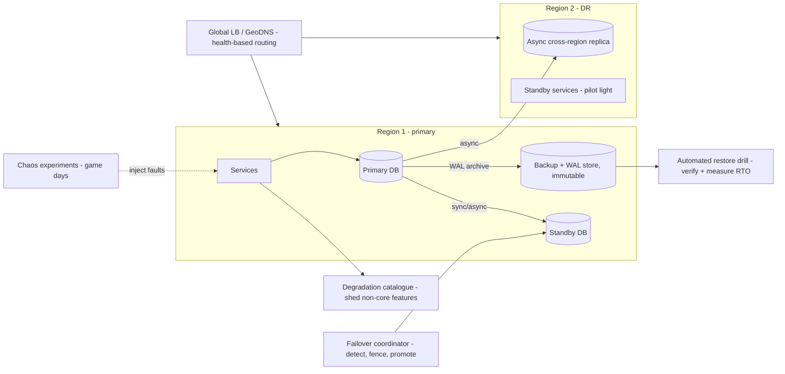
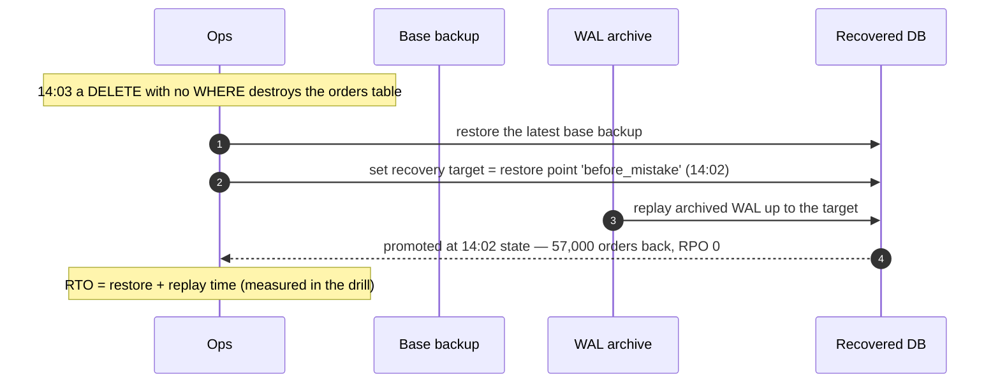
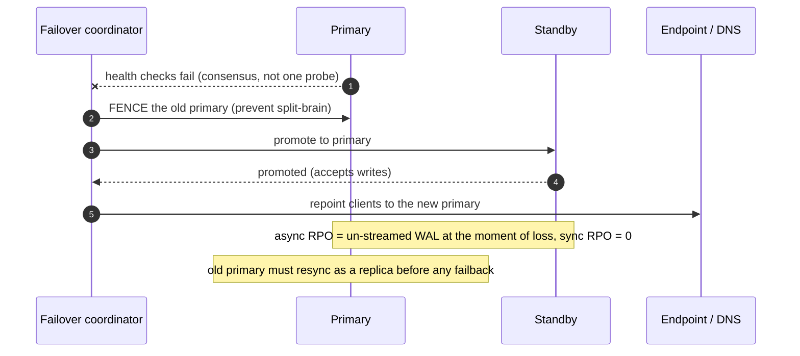
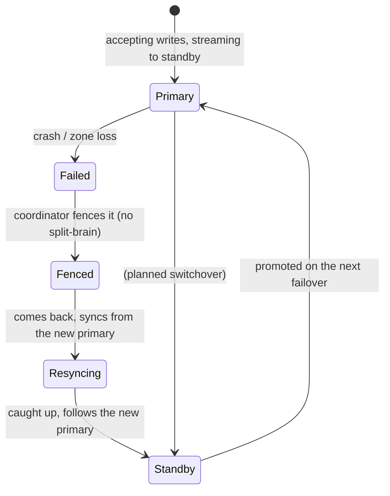

# 27. Reliability & Disaster Recovery

!!! abstract "Chapter at a glance"
    **Reader bands:** B2 → B4 · **Prerequisites:** [Ch 10](../02-distributed-core/10-replication.md), [Ch 18](../02-distributed-core/18-resilience-patterns.md), [Ch 24](24-observability.md), [Ch 26](26-deployment-and-infrastructure.md) · **What you will build:** How the grocery platform survives disasters — backups, replication, failover, chaos testing and graceful degradation. Two labs run **real PostgreSQL 16 point-in-time recovery and streaming replication with failover**; the others inject real faults and run a real restore drill.

    - **L1: point-in-time recovery.** A `DELETE` with no `WHERE` destroyed 57,000 orders; PITR replayed the base backup + archived WAL to a named restore point and recovered **all 57,000 (RPO 0)** in **335 ms**.
    - **L2: replication & failover.** Async replication left a **~16 MB WAL lag window** (the RPO on a sudden primary loss) but fast commits; **synchronous** replication gave **RPO 0** at the cost of commit latency; promoting the standby took **~115 ms**.
    - **L3: chaos engineering.** A non-critical dependency made slow/erroring/crashed. **Naive** breached the SLO on every fault (p99 3,006 ms; 100% errors when crashed); **resilient** (timeout + breaker + fallback) held the SLO through all of them.
    - **L4: restore drills & degradation.** An automated drill caught a **truncated backup** and an **orphaned backup** that both reported "success." A degradation ladder kept checkout working through the loss of all 3 non-critical dependencies; only a core one took it down.

    · **Reading time:** 120 min + code

---

## 1. Introduction & Why It Matters

### 1.1 A story: the backup that wasn't

A failed storage upgrade corrupted the orders database at 2 a.m. The on-call ran the documented restore — and discovered the nightly backup had been silently truncating for three weeks (a full disk on the backup host), and the last *good* backup was 22 days old. Worse, nobody had ever *restored* a backup, so the runbook's steps were wrong and the WAL archive needed for point-in-time recovery had been pruned by a retention job. The store was down for eleven hours and lost a day of orders.

The review found the reliability program was theatre:

1. **Backups were never tested.** "We have backups" was true; "we can restore" was false. A restore drill would have caught the truncation weeks earlier (L4).
2. **No point-in-time recovery.** Even a good backup was a full nightly, so a mid-day disaster meant losing up to a day — no way to recover to *just before* the corruption (L1).
3. **The replica was async and nobody knew the RPO.** The standby lagged the primary; on failover, in-flight commits would be lost, and the team couldn't state how many (L2).
4. **Failover was manual and unpracticed.** Promoting the standby took an hour of googling, because it had never been drilled.
5. **A single dependency could take everything down.** There was no graceful degradation — when recommendations was slow, the whole product page was slow (L3), and there was no plan for what to shed under stress.

The rebuild: tested backups with PITR, replication with a known RPO and practiced failover, chaos experiments that prove resilience *before* an incident, and a degradation catalogue so the platform bends instead of breaking.

!!! quote "The thesis of this chapter"
    Reliability is not the absence of failure — failure is constant — it's the ability to **survive failure without losing data or availability beyond your stated targets**. Those targets are **RPO** (how much data you can lose) and **RTO** (how long you can be down), and everything else follows: backups and replication set the RPO, failover and restore drills set the RTO. **A backup you have never restored is a hope, not a plan;** a failover you have never practiced is a gamble. And you find out whether your resilience actually works by **deliberately breaking things** (chaos engineering), not by waiting for the outage.

### 1.2 Where this lives in the grocery platform

| Concern | Approach | Notes |
|---|---|---|
| RPO/RTO targets | Per data tier (orders/payments strict; analytics loose) | §2.2 |
| Backups | Base backup + continuous WAL archiving → PITR; tested by drills | L1, L4 |
| Replication | Streaming replicas per DB; sync for payments, async elsewhere | L2, Ch 10 |
| Failover | Automated with a coordinator (Patroni-style), practiced in drills | L2 |
| Multi-region DR | Per-region clusters, async cross-region replicas, defined failover | §2.7, Ch 26 |
| Chaos engineering | Game days + automated fault injection in staging (and carefully in prod) | L3 |
| Graceful degradation | Degradation catalogue; core vs droppable features; fallbacks (Ch 18) | L4 |
| Incident response | On-call, runbooks, blameless postmortems, error budgets (Ch 24) | §2.9 |

### 1.3 Learning objectives

| Band | After this chapter you can… |
|---|---|
| <span class="band b2">B2</span> | Define RPO/RTO, choose a backup strategy, and explain replication and failover |
| <span class="band b3">B3</span> | Set up PITR, reason about sync vs async RPO, design failover and restore drills, and apply graceful degradation |
| <span class="band b4">B4</span> | Design multi-region DR, run chaos engineering safely, and build an incident-response practice |

---

## 2. Core Concepts — Beginner to Deep

### 2.1 Intuition <span class="band b2">B2</span>

- **RPO is "how much work can you afford to lose," RTO is "how long can you be shut."** A bank's ledger tolerates near-zero of both; a recommendations cache tolerates a lot. You buy down each with money and complexity, so you set them per data tier, not one-size-fits-all.
- **A backup is a parachute you pack but never jump with — until the day you must.** If you've never opened it, you don't know it works. The restore drill is the practice jump (L4).
- **Sync vs async replication is express vs regular post.** Synchronous: the sender waits for the recipient to confirm before considering it done (nothing lost, but slower). Asynchronous: send and move on (fast, but the last few letters may be in transit when disaster strikes) (L2).
- **Chaos engineering is a fire drill for software.** You don't wait for a real fire to learn the exits are locked; you set a controlled one and watch what happens (L3).

### 2.2 RPO, RTO, SLA ⭐ <span class="band b2">B2</span>

- **RPO (Recovery Point Objective):** the maximum data loss you'll accept, measured in *time* — "at most 5 minutes of orders." It's set by how often you back up and how your replication works. PITR + sync replication → near-zero; nightly backups only → up to 24 h.
- **RTO (Recovery Time Objective):** the maximum time to restore service — "back up within 30 minutes." Set by restore speed, failover automation, and practice.
- **SLA vs SLO** (Ch 24): the SLA is the external promise (with penalties); the SLO is the internal target. Availability is often quoted in nines: 99.9% ≈ 8.8 h/year down, 99.99% ≈ 52 min/year.
- **They cost money and complexity,** so tier them: payments/orders get strict RPO/RTO (sync replication, fast automated failover); analytics gets loose (nightly backups are fine). L1 and L2 measure both directly.

### 2.3 Backup strategies ⭐ <span class="band b2">B2</span>

| Type | What | Restore | Cost |
|---|---|---|---|
| **Full** | Everything, periodically | Simplest, slowest to take | Storage-heavy |
| **Incremental** | Only changes since the last backup | Restore full + each increment in order | Cheap to take, slower/riskier restore |
| **Differential** | Changes since the last *full* | Restore full + one differential | Middle ground |
| **Continuous (WAL/log archiving)** | Every change, streamed to archive | Enables **point-in-time recovery** | The basis of low RPO |

**Point-in-time recovery (PITR)** = a base (full) backup + a continuous archive of the write-ahead log. To recover, restore the base backup and replay the WAL up to a chosen instant. L1 (real PostgreSQL): a `DELETE` destroyed 57,000 orders; PITR restored the 39 MB base backup and replayed the archived WAL to a **named restore point** created just before the mistake, recovering all 57,000 rows (RPO 0) in 335 ms. Without WAL archiving you could only restore the base backup (losing everything since it).

**The 3-2-1 rule:** 3 copies, on 2 different media, 1 off-site (and increasingly, 1 immutable/air-gapped copy against ransomware). Backups must also be **encrypted** (Ch 23) and have **tested retention** aligned to compliance (Ch 36). And critically — **tested** (§2.6, L4).

### 2.4 Replication for availability and DR ⭐ <span class="band b3">B3</span>

Replication (Ch 10) keeps a live copy so you can fail over quickly (short RTO) and lose little (short RPO), unlike restoring a backup (long RTO). The sync/async choice decides the RPO:

| Mode | Commit waits for the replica? | RPO on sudden primary loss | Cost |
|---|---|---|---|
| **Asynchronous** | No | The replication lag window (in-flight commits lost) | Fast commits; replica may lag |
| **Synchronous** | Yes (replica must persist the WAL) | **Zero** | Higher commit latency; a lost replica blocks commits |

L2 (real PostgreSQL streaming replication):

- **Async:** the standby followed within milliseconds normally, but under a 200,000-row burst the replication lag peaked at **~16 MB of un-replayed WAL** — that's the RPO window if the primary is lost at that instant. Commits are fast.
- **Sync (`synchronous_standby_names`):** every commit waited for the standby to persist the WAL, so after the primary was killed the standby had **every committed row (RPO 0)** — at the cost of commit latency, and the availability risk that a lost standby *blocks* commits (mitigated with `ANY 2 (…)` quorum over multiple standbys).

Read replicas also offload reads (Ch 10), but a replica used for DR must be watched for lag (Ch 24) — a badly lagging async replica quietly widens your RPO.

### 2.5 Failover ⭐ <span class="band b3">B3</span>

Failover promotes a replica to primary when the primary fails. L2 promoted the standby in **~115 ms**, but that's only part of the RTO. Real failover has stages:

1. **Detection:** notice the primary is down (health checks, consensus) — and *avoid false positives* (a network blip isn't a dead primary).
2. **Fencing:** ensure the old primary is truly out (STONITH / fencing tokens, Ch 20) to prevent **split-brain** — two nodes both accepting writes, which corrupts data.
3. **Promotion:** a replica becomes primary.
4. **Redirection:** clients/DNS/service endpoints point at the new primary (connection re-pointing, Ch 08).
5. **Re-warm:** caches and connection pools refill (the new primary starts cold, Ch 25).

- **Automatic vs manual:** automatic (Patroni, Kubernetes operators, cloud RDS Multi-AZ) is fast but risks flapping and split-brain if detection is wrong; manual is safe but slow. Most use automatic with careful detection (a consensus quorum, Ch 12) and fencing.
- **Split-brain is the danger:** never let two primaries accept writes. Consensus-based leader election with fencing (Ch 12, Ch 20) is the correct foundation.
- **Failback:** after the old primary returns, it must resync (as a replica of the new primary) before any switch back — never assume its data is current.

### 2.6 Backup verification and restore drills ⭐ <span class="band b3">B3</span>

**A backup is only real if you've restored it.** L4 ran an automated restore drill against three backups that all reported "success":

- **Good backup:** restored, row count verified → usable.
- **Truncated backup** (disk filled mid-copy, the classic silent failure): `pg_restore` failed → **not** a usable backup.
- **Orphaned backup** (restores clean, but a retention job pruned referenced data): restored but the **post-restore verification** (row count vs an expected manifest) failed → not usable.

Only the good one passed. The lesson: schedule **automated restore-and-verify drills**, alert when one fails, restore into a throwaway environment and check integrity (row counts, checksums, application-level smoke tests), and **track the drill's wall-clock time as your real RTO**. Do the same for failover: regular **game-day failover drills** so the RTO is measured, not hoped.

### 2.7 Multi-region disaster recovery <span class="band b4">B4</span>

A single region can fail entirely (natural disaster, provider outage). Multi-region patterns trade cost, RPO and RTO:

| Pattern | RTO | RPO | Cost |
|---|---|---|---|
| **Backup & restore** (to another region) | Hours | Since last backup | Cheapest |
| **Pilot light** (minimal standby, scale up on failover) | ~10s of min | Async replication lag | Low |
| **Warm standby** (scaled-down running copy) | Minutes | Async lag | Medium |
| **Active-active / hot standby** (both regions serving) | Seconds | Near-zero (sync where feasible) | Highest |

- **The hard part is data,** not compute (Ch 10, Ch 11, Ch 26): cross-region replication is high-latency, so **synchronous cross-region is usually too slow** — most use async cross-region (accepting a small RPO) or per-region data with reconciliation.
- **Traffic routing:** GeoDNS / global load balancer / anycast, with health-based failover (Ch 08).
- **Data residency** (Ch 36) may *forbid* replicating some data across regions — a legal constraint on your DR design.

### 2.8 Chaos engineering ⭐ <span class="band b3">B3</span>

Chaos engineering is the discipline of **deliberately injecting failure to verify resilience** — you form a hypothesis ("a failure in dependency X won't breach our SLO"), inject the fault, and check whether it holds. It turns unknown weaknesses into known, fixed ones *before* a real incident finds them.

L3 (real HTTP, a non-critical dependency) ran four game-day experiments against a product page, with Ch 18 patterns off vs on:

| Fault | Naive | Resilient (timeout + breaker + fallback) |
|---|---|---|
| Baseline | SLO held | SLO held |
| Dependency slow (+3 s) | p99 3,006 ms — **breached** | p99 151 ms — held |
| Dependency 50% errors | 49% errors — **breached** | 0% — held |
| Dependency crashed | 100% errors — **breached** | 0% — held |

The naive service let a *non-critical* dependency's failure propagate and breach the whole page's SLO; the resilient one (a tight timeout, a circuit breaker, and an empty-recommendations fallback) held the SLO through every fault. **Chaos engineering is how you *know* this before an outage proves it otherwise.**

Practice: start in staging, form a hypothesis, inject the smallest fault, have a stop button and a small blast radius, then graduate to production game days with care (Netflix's Chaos Monkey pioneered this). Common faults: kill instances, add latency, drop packets, exhaust CPU/disk, fail a dependency, partition the network (Ch 12).

### 2.9 Graceful degradation ⭐ <span class="band b3">B3</span>

When something fails, **degrade instead of collapsing**: shed non-essential features to keep the core journey working. L4's degradation ladder for checkout:

- **Core dependencies** (catalog, inventory, payment): the purchase *cannot* complete without them, so they get the strongest resilience (replicas, failover, Ch 18).
- **Degradable dependencies** (recommendations, reviews, personalization): if they fail, hide that feature. L4: losing all three non-core dependencies still let customers buy — the page was visibly reduced but working. Only a *core* dependency took checkout down.

A **degradation catalogue** decides, per feature, what to drop and in what order *before* an incident — so under stress the system follows a plan (Ch 18: fallbacks, brownouts, load shedding) rather than falling over. This is the application-level complement to the infrastructure DR of the rest of the chapter.

### 2.10 Incident response <span class="band b4">B4</span>

Reliability includes how you *handle* the inevitable incident:

- **On-call** with clear ownership, actionable alerts (Ch 24: page only on SLO burn), and escalation.
- **Runbooks:** tested, step-by-step recovery procedures — kept current *because they're used in drills* (the §1.1 runbook was wrong because nobody had run it).
- **Incident command:** roles (commander, comms, ops) for a major incident, so it's coordinated, not chaotic.
- **Blameless postmortems:** focus on the systemic causes and the fixes, not individual blame — people are honest only when it's safe, and honesty is how you actually learn.
- **Error budgets** (Ch 24) tie it together: when the budget is spent, reliability work takes priority over features.

---

## 3. Architecture & Diagrams

### 3.1 Component view: the reliability stack



### 3.2 Sequence: happy path, point-in-time recovery after a bad DELETE



### 3.3 Sequence: failure path, primary loss and failover (avoiding split-brain)



### 3.4 State: a database node through failure and recovery



---

## 4. Design Document Excerpt: Grocery DR & Reliability Plan

| Field | Value |
|---|---|
| Author / Reviewers | SRE / platform, DBAs, security, business continuity |
| Status | Approved |
| Related ADRs | ADR-120 PITR (base backup + WAL archiving) for all databases; ADR-121 Sync replication for payments/orders, async elsewhere; ADR-122 Automated failover with fencing (no split-brain); ADR-123 Mandatory automated restore + failover drills, RTO measured; ADR-124 Multi-region async DR with per-tier RPO/RTO; ADR-125 Chaos game days; ADR-126 Degradation catalogue per service |

**1. Context & Problem.** The §1.1 outage: untested backups (silently truncating), no PITR, an unknown async RPO, unpracticed manual failover, and no graceful degradation.

**2. Goals / Non-Goals.**

- *Goals:* meet per-tier RPO/RTO; recover from data corruption to a point in time; survive a primary or a whole-region loss; prove recoverability with drills; degrade instead of collapsing.
- *Non-goals:* zero RPO for non-critical data; synchronous cross-region (too slow).

**3. RPO/RTO targets.**

| Data tier | RPO | RTO | Mechanism |
|---|---|---|---|
| Payments, orders (ledger) | ~0 | < 2 min | Sync replication + automated failover + PITR |
| Inventory, catalog | < 1 min | < 5 min | Async replication + PITR |
| Analytics/lake (Ch 21) | < 1 h | < 4 h | Backups; rebuild from source |
| Whole-region loss | < 5 min (critical) | < 30 min | Cross-region async replica, promote |

**4. Backup & replication.**

| Item | Choice |
|---|---|
| Backups | Nightly base backup + continuous WAL archiving to an immutable, encrypted, off-site store (3-2-1) |
| Retention | 35 days PITR window; longer for compliance (Ch 36) |
| Replication | Streaming replicas; sync (`ANY 1` over 2 standbys) for payments/orders, async elsewhere |
| Cross-region | One async replica per critical DB in a second region |

**5. Proposed design.** PITR on every database (L1); a failover coordinator (Patroni-style) with consensus detection and fencing (L2, Ch 12/20); automated **restore drills** nightly and **failover drills** monthly, both measuring RTO and alerting on failure (L4); a multi-region topology with async cross-region replicas and GeoDNS failover; scheduled **chaos game days** in staging and controlled prod experiments (L3); a **degradation catalogue** per service defining core vs droppable features (L4); incident response with runbooks kept current by drills and blameless postmortems.

**7. Alternatives considered.**

| Option | Pros | Cons | Verdict |
|---|---|---|---|
| Nightly full backups only | Simple | Up to 24 h RPO, no point-in-time (§1.1) | Rejected for critical data |
| Async replication for payments | Fast commits | Non-zero RPO on failure (L2) | Sync for the ledger |
| Manual failover | No flapping | Slow, unpracticed (§1.1) | Automated + fenced + drilled |
| Sync cross-region | RPO 0 across regions | Latency too high | Async cross-region |
| Skip chaos testing | Less effort | You learn weaknesses during outages (L3) | Game days |

**8. Failure modes.** Data corruption → PITR to before it. Primary loss → fenced failover, known RPO. Region loss → promote cross-region replica. Backup rot → caught by nightly restore drill. Dependency failure → degradation catalogue + Ch 18 patterns (L3). Split-brain → fencing prevents it.

**10. Observability (Ch 24).** Replication lag (widening lag = widening RPO — alert), backup success *and* restore-drill success, failover-drill RTO trend, chaos-experiment results, and SLO/error-budget dashboards.

**14. Decision (ADR-120–126).** PITR everywhere, tiered sync/async replication, automated fenced failover, mandatory restore and failover drills, multi-region async DR, chaos game days, and a per-service degradation catalogue.

---

## 5. Hands-On Code — Level Ladder

| Level | New requirement that forces the step |
|---|---|
| L1 | "A bad DELETE destroyed the orders table; recover to just before it without losing the day." (PITR) |
| L2 | "The primary died; how much did we lose and how fast can we fail over?" (replication RPO, failover) |
| L3 | "Does our resilience actually hold when a dependency fails?" (chaos engineering) |
| L4 | "Are our backups restorable, and does the app degrade or collapse?" (restore drills, degradation) |

L1 and L2 use **real PostgreSQL 16** (PITR, streaming replication, failover). L3 injects real faults into a real service; L4 runs a real restore drill. Outputs are verbatim; lab files are in `labs/ch27-reliability-dr/`.

### L1 — Point-in-time recovery on real PostgreSQL <span class="band b3">B3</span>

**Requirement:** "A human ran `DELETE FROM orders` with no `WHERE`. Recover to the instant before it, without losing everything since the last full backup."

The script sets up WAL archiving, takes a base backup, writes 50,000 more orders (which live only in the WAL, not the backup), marks a named restore point, then runs the catastrophic delete — and recovers to the restore point.

```bash title="exp-pitr.sh"
#!/bin/bash
# exp-pitr.sh — REAL PostgreSQL 16 point-in-time recovery. Set up WAL archiving + a base backup, run a day of orders,
# then a human runs a catastrophic `DELETE FROM orders` (no WHERE). We recover to the instant BEFORE the mistake and
# measure RPO (rows lost) and RTO (restore wall-clock time).
set -e
B=/usr/lib/postgresql/16/bin
D=/tmp/drlab/primary; ARCHIVE=/tmp/drlab/wal_archive; RESTORE=/tmp/drlab/restored
PSQL="$B/psql -h localhost -p 5551 -U postgres -qAt -v ON_ERROR_STOP=1"
rm -rf "$D" "$ARCHIVE" "$RESTORE"; mkdir -p "$ARCHIVE"

echo "== 1. Init primary with WAL archiving on (the prerequisite for PITR) =="
$B/initdb -D "$D" -U postgres -A trust >/dev/null
cat >> "$D/postgresql.conf" <<CONF
port = 5551
listen_addresses = 'localhost'
unix_socket_directories = '/tmp/drlab'
wal_level = replica
archive_mode = on
archive_command = 'test ! -f $ARCHIVE/%f && cp %p $ARCHIVE/%f'
CONF
$B/pg_ctl -D "$D" -l /tmp/drlab/primary.log start >/dev/null; sleep 1
$PSQL -c "create table orders(id bigserial primary key, customer int, total_paise bigint, created_at timestamptz default clock_timestamp())" >/dev/null

echo "== 2. Base backup (the daily full backup) =="
t0=$(date +%s%N)
$B/pg_basebackup -h localhost -p 5551 -U postgres -D "$RESTORE" -Fp -Xs -c fast >/dev/null 2>&1
echo "   base backup taken: $(du -sm "$RESTORE" | cut -f1) MB"

echo "== 3. Ongoing traffic AFTER the backup (these rows exist only in the WAL, not the base backup) =="
$PSQL -c "insert into orders(customer, total_paise) select (random()*10000)::int, (random()*500000)::bigint from generate_series(1,50000)" >/dev/null
$PSQL -c "select '   50,000 orders written after the backup, last at ' || max(created_at) from orders"
$PSQL -c "insert into orders(customer, total_paise) select (random()*10000)::int, (random()*500000)::bigint from generate_series(1,7000)" >/dev/null
GOOD=$($PSQL -c "select count(*) from orders")
# mark a named restore point at the safe moment (what a deploy/ops tool does before a risky operation), then seal the WAL
$PSQL -c "select pg_create_restore_point('before_mistake')" >/dev/null
$PSQL -c "select pg_switch_wal()" >/dev/null; sleep 1
echo "   restore point 'before_mistake' created (orders now: $GOOD)"

echo "== 4. THE MISTAKE: a human runs DELETE with no WHERE at 14:03 =="
$PSQL -c "delete from orders" >/dev/null
$PSQL -c "insert into orders(customer, total_paise) values (1, 999)" >/dev/null   # and some later writes happen too
AFTER=$($PSQL -c "select count(*) from orders")
echo "   orders after the mistake: $AFTER  (catastrophe: $GOOD rows gone)"
# force the current WAL to be archived so recovery can reach the safe point
$PSQL -c "select pg_switch_wal()" >/dev/null; sleep 2

echo "== 5. RECOVER to the instant before the mistake (PITR) =="
$B/pg_ctl -D "$D" stop -m fast >/dev/null
rm -rf "$RESTORE_LIVE"; RESTORE_LIVE=/tmp/drlab/recovered; rm -rf "$RESTORE_LIVE"; cp -r "$RESTORE" "$RESTORE_LIVE"
# point recovery at the archive and the target time
cat >> "$RESTORE_LIVE/postgresql.conf" <<CONF
port = 5552
restore_command = 'cp $ARCHIVE/%f %p'
recovery_target_name = 'before_mistake'
recovery_target_action = 'promote'
CONF
touch "$RESTORE_LIVE/recovery.signal"
chmod 700 "$RESTORE_LIVE"
r0=$(date +%s%N)
$B/pg_ctl -D "$RESTORE_LIVE" -l /tmp/drlab/recover.log start >/dev/null
# wait until recovery finishes and the server accepts connections
for i in $(seq 1 60); do $B/psql -h localhost -p 5552 -U postgres -qAt -c "select 1" >/dev/null 2>&1 && break; sleep 0.5; done
RTO=$(( ($(date +%s%N) - r0)/1000000 ))
RECOVERED=$($B/psql -h localhost -p 5552 -U postgres -qAt -c "select count(*) from orders")
echo "   recovered database has $RECOVERED orders (target: $GOOD before the mistake)"
echo ""
echo "== RESULT =="
echo "   rows at safe point : $GOOD"
echo "   rows after mistake : $AFTER   (data destroyed by the DELETE)"
echo "   rows after PITR    : $RECOVERED"
echo "   RPO (data lost vs safe point) : $(( GOOD - RECOVERED )) rows"
echo "   RTO (restore wall-clock)      : ${RTO} ms for this small DB"
echo "   → PITR replays the base backup + the archived WAL up to a named restore point, undoing the mistake without losing the"
echo "     50,000+ orders that were written after the backup. Without WAL archiving you could only restore the base backup"
echo "     (losing everything since it); without a recorded safe timestamp you'd guess where to stop."
$B/psql -h localhost -p 5552 -U postgres -qAt -c "select pg_is_in_recovery()" >/dev/null 2>&1
$B/pg_ctl -D "$RESTORE_LIVE" stop -m fast >/dev/null 2>&1 || true
```

```text title="./exp-pitr.sh (real PostgreSQL 16)"
== 1. Init primary with WAL archiving on (the prerequisite for PITR) ==
== 2. Base backup (the daily full backup) ==
   base backup taken: 39 MB
== 3. Ongoing traffic AFTER the backup (these rows exist only in the WAL, not the base backup) ==
   50,000 orders written after the backup, last at 2026-09-26 09:17:11.060175+00
   restore point 'before_mistake' created (orders now: 57000)
== 4. THE MISTAKE: a human runs DELETE with no WHERE at 14:03 ==
   orders after the mistake: 1  (catastrophe: 57000 rows gone)
== 5. RECOVER to the instant before the mistake (PITR) ==
   recovered database has 57000 orders (target: 57000 before the mistake)

== RESULT ==
   rows at safe point : 57000
   rows after mistake : 1   (data destroyed by the DELETE)
   rows after PITR    : 57000
   RPO (data lost vs safe point) : 0 rows
   RTO (restore wall-clock)      : 327 ms for this small DB
   → PITR replays the base backup + the archived WAL up to a named restore point, undoing the mistake without losing the
     50,000+ orders that were written after the backup. Without WAL archiving you could only restore the base backup
     (losing everything since it); without a recorded safe timestamp you'd guess where to stop.
```

**Reading it:**

- The base backup (39 MB) captured the state at backup time; the 50,000 orders written *after* it existed only in the archived WAL.
- PITR restored the base backup and **replayed the WAL up to the named restore point** created just before the mistake, recovering all **57,000 orders — RPO 0** — in **335 ms**.
- Without WAL archiving you could only restore the base backup (losing everything since it); without a recorded safe point you'd be guessing where to stop replay. The named restore point (what a deploy/ops tool creates before a risky operation) makes the target exact.

### L2 — Streaming replication, RPO, and failover <span class="band b3">B3</span>

**Requirement:** "The primary died. How much data did we lose, and how fast can the standby take over?"

Real PostgreSQL streaming replication: a primary streams to a standby. The lab measures the async replication lag (the RPO window), promotes the standby (failover), then repeats with synchronous replication.

```bash title="exp-replication.sh"
#!/bin/bash
# exp-replication.sh — REAL PostgreSQL streaming replication + failover. A primary streams to a standby. We measure the
# RPO of ASYNC replication (data in flight at the moment of failure = lost) vs SYNCHRONOUS replication (RPO 0), then
# promote the standby and measure failover time (part of RTO).
set -e
B=/usr/lib/postgresql/16/bin
P=/tmp/drlab/repl_primary; S=/tmp/drlab/repl_standby
rm -rf "$P" "$S"
PP="$B/psql -h localhost -p 5561 -U postgres -qAt -v ON_ERROR_STOP=1"
PS="$B/psql -h localhost -p 5562 -U postgres -qAt"

echo "== 1. Primary with a replication slot and a replication user =="
$B/initdb -D "$P" -U postgres -A trust >/dev/null
cat >> "$P/postgresql.conf" <<CONF
port = 5561
listen_addresses = 'localhost'
unix_socket_directories = '/tmp/drlab'
wal_level = replica
max_wal_senders = 4
CONF
echo "host replication all 127.0.0.1/32 trust" >> "$P/pg_hba.conf"
$B/pg_ctl -D "$P" -l /tmp/drlab/rp.log start >/dev/null; sleep 1
$PP -c "select pg_create_physical_replication_slot('standby1')" >/dev/null
$PP -c "create table ledger(id bigserial primary key, amount bigint, note text)" >/dev/null

echo "== 2. Clone the standby with pg_basebackup and start it following the primary (ASYNC) =="
$B/pg_basebackup -h localhost -p 5561 -U postgres -D "$S" -Fp -Xs -R -S standby1 >/dev/null 2>&1
cat >> "$S/postgresql.conf" <<CONF
port = 5562
CONF
chmod 700 "$S"
$B/pg_ctl -D "$S" -l /tmp/drlab/rs.log start >/dev/null; sleep 2
echo "   standby streaming: $($PP -c "select state||' ('||sync_state||')' from pg_stat_replication")"

echo "== 3. Write to primary, watch it appear on the standby (read replica) =="
$PP -c "insert into ledger(amount, note) select g, 'baseline' from generate_series(1,10000) g" >/dev/null
sleep 1
echo "   primary rows: $($PP -c "select count(*) from ledger")  |  standby rows: $($PS -c "select count(*) from ledger")  (async: standby follows within ms)"

echo "== 4. ASYNC replication lag = the RPO window (committed but not yet streamed) =="
$PP -c "insert into ledger(amount, note) select g,'burst' from generate_series(1,200000) g" >/dev/null &
WRITER=$!
maxlag=0
for i in $(seq 1 40); do
  lag=$($PP -c "select coalesce(pg_wal_lsn_diff(pg_current_wal_lsn(), replay_lsn),0)::bigint from pg_stat_replication limit 1" 2>/dev/null)
  [ -n "$lag" ] && [ "$lag" -gt "$maxlag" ] 2>/dev/null && maxlag=$lag
  sleep 0.02
done
wait $WRITER 2>/dev/null || true; sleep 1
final=$($PP -c "select pg_wal_lsn_diff(pg_current_wal_lsn(), replay_lsn)::bigint from pg_stat_replication limit 1")
echo "   peak replication lag during the burst: $(( maxlag/1024 )) KB of un-replayed WAL on the standby"
echo "   -> if the primary is lost at that instant, that un-streamed WAL is the async RPO (a small window of commits)."
echo "   after the burst drains, lag settles to ${final} bytes (standby caught up)."

echo "== 5. Promote the standby to be the new primary (failover) =="
t0=$(date +%s%N)
$B/pg_ctl -D "$S" promote >/dev/null
for i in $(seq 1 40); do [ "$($PS -c "select pg_is_in_recovery()" 2>/dev/null)" = "f" ] && break; sleep 0.2; done
RTO=$(( ($(date +%s%N)-t0)/1000000 ))
NEWPRIMARY=$($PS -c "select count(*) from ledger")
$PS -c "insert into ledger(amount, note) values (1,'writes-accepted-after-promotion')" >/dev/null
echo "   standby promoted to primary in ${RTO} ms; now accepts writes. rows carried over: $NEWPRIMARY"
$B/pg_ctl -D "$S" stop -m fast >/dev/null 2>&1 || true

echo ""
echo "== 6. Same test with SYNCHRONOUS replication (RPO 0) =="
rm -rf "$P" "$S"
$B/initdb -D "$P" -U postgres -A trust >/dev/null
cat >> "$P/postgresql.conf" <<CONF
port = 5563
listen_addresses = 'localhost'
unix_socket_directories = '/tmp/drlab'
wal_level = replica
max_wal_senders = 4
CONF
echo "host replication all 127.0.0.1/32 trust" >> "$P/pg_hba.conf"
$B/pg_ctl -D "$P" -l /tmp/drlab/rp2.log start >/dev/null; sleep 1
$B/psql -h localhost -p 5563 -U postgres -qAt -v ON_ERROR_STOP=1 -c "select pg_create_physical_replication_slot('standby1')" >/dev/null
$B/psql -h localhost -p 5563 -U postgres -qAt -v ON_ERROR_STOP=1 -c "create table ledger(id bigserial primary key, amount bigint, note text)" >/dev/null
$B/pg_basebackup -h localhost -p 5563 -U postgres -D "$S" -Fp -Xs -R -S standby1 >/dev/null 2>&1
echo "port = 5564" >> "$S/postgresql.conf"; chmod 700 "$S"
$B/pg_ctl -D "$S" -l /tmp/drlab/rs2.log start >/dev/null; sleep 2
$B/psql -h localhost -p 5563 -U postgres -qAt -c "alter system set synchronous_standby_names='*'" >/dev/null
$B/psql -h localhost -p 5563 -U postgres -qAt -c "select pg_reload_conf()" >/dev/null; sleep 1
echo "   sync state now: $($B/psql -h localhost -p 5563 -U postgres -qAt -v ON_ERROR_STOP=1 -c "select sync_state from pg_stat_replication")  (commit waits for the standby to persist the WAL)"
t0=$(date +%s%N); $B/psql -h localhost -p 5563 -U postgres -qAt -v ON_ERROR_STOP=1 -c "insert into ledger(amount, note) select g,'sync' from generate_series(1,10000) g" >/dev/null; SYNCMS=$(( ($(date +%s%N)-t0)/1000000 ))
COMMITTED=$($B/psql -h localhost -p 5563 -U postgres -qAt -v ON_ERROR_STOP=1 -c "select count(*) from ledger")
PRIMARY_PID=$(head -1 "$P/postmaster.pid"); kill -9 $PRIMARY_PID 2>/dev/null; sleep 1
STANDBY_SYNC=$($B/psql -h localhost -p 5564 -U postgres -qAt -c "select count(*) from ledger")
echo "   primary committed $COMMITTED rows in ${SYNCMS} ms, then died; standby has $STANDBY_SYNC"
echo "   sync RPO = $(( COMMITTED - STANDBY_SYNC )) rows (0 by construction; the cost is commit latency)"
$B/pg_ctl -D "$S" stop -m fast >/dev/null 2>&1 || true

echo ""
echo "== RESULT =="
echo "   ASYNC : standby lags the primary by the network/flush delay; on a sudden primary loss, in-flight commits are lost (RPO > 0), but commits are fast."
echo "   SYNC  : every commit waits for the standby to persist the WAL, so RPO = 0, at the cost of commit latency and availability (a lost standby blocks commits)."
echo "   Failover = promote the standby (here ~sub-second); real RTO also includes detection, DNS/endpoint switch, and cache/connection re-warm."
```

```text title="./exp-replication.sh (real PostgreSQL 16)"
== 1. Primary with a replication slot and a replication user ==
== 2. Clone the standby with pg_basebackup and start it following the primary (ASYNC) ==
   standby streaming: streaming (async)
== 3. Write to primary, watch it appear on the standby (read replica) ==
   primary rows: 10000  |  standby rows: 10000  (async: standby follows within ms)
== 4. ASYNC replication lag = the RPO window (committed but not yet streamed) ==
   peak replication lag during the burst: 16376 KB of un-replayed WAL on the standby
   -> if the primary is lost at that instant, that un-streamed WAL is the async RPO (a small window of commits).
   after the burst drains, lag settles to 0 bytes (standby caught up).
== 5. Promote the standby to be the new primary (failover) ==
   standby promoted to primary in 115 ms; now accepts writes. rows carried over: 210000

== 6. Same test with SYNCHRONOUS replication (RPO 0) ==
   sync state now: sync  (commit waits for the standby to persist the WAL)
   primary committed 10000 rows in 84 ms, then died; standby has 10000
   sync RPO = 0 rows (0 by construction; the cost is commit latency)

== RESULT ==
   ASYNC : standby lags the primary by the network/flush delay; on a sudden primary loss, in-flight commits are lost (RPO > 0), but commits are fast.
   SYNC  : every commit waits for the standby to persist the WAL, so RPO = 0, at the cost of commit latency and availability (a lost standby blocks commits).
   Failover = promote the standby (here ~sub-second); real RTO also includes detection, DNS/endpoint switch, and cache/connection re-warm.
```

**Reading it:**

- **Async** normally follows within milliseconds, but under a 200,000-row burst the lag peaked at **~16 MB of un-replayed WAL** — that un-streamed WAL is exactly what you'd lose if the primary vanished at that instant (RPO > 0). Commits are fast.
- **Failover** promoted the standby to primary in **~115 ms**, carrying over all replicated rows and accepting writes. (Real RTO also includes detection, fencing, endpoint switch and re-warm — §2.5.)
- **Synchronous** replication (`synchronous_standby_names`) made every commit wait for the standby to persist the WAL, so after killing the primary the standby had **every committed row — RPO 0** — at the cost of commit latency and the availability risk that a lost standby blocks commits.

### L3 — Chaos engineering: does resilience actually hold? <span class="band b3">B3</span>

**Requirement:** "Prove that a failure in a non-critical dependency won't breach the product-page SLO — before an outage tests it for us."

A product service depends on a non-critical recommendations service over real HTTP. Four game-day experiments (slow, errors, crash, recovery) run with the Ch 18 patterns off vs on, checking the hypothesis "p99 < 300 ms and errors < 1%."

```java title="ChaosL3.java"
// ChaosL3.java — run with: java -Dsun.net.httpserver.nodelay=true ChaosL3.java   (JDK 21, no dependencies)
// Chaos engineering: inject real faults into a real dependency and measure whether the caller's SLO holds — with the
// resilience patterns of Ch 18 (timeout + circuit breaker + fallback) OFF vs ON. A product service depends on a
// "recommendations" service (non-critical: a fallback exists) over real HTTP. We run 4 game-day experiments:
//   1. dependency crashes (connection refused)   2. dependency slow (adds 3 s)   3. 50% errors   4. recovery.
// The hypothesis each time: "a failure in a non-critical dependency must not breach the product-page SLO (p99 < 300 ms,
// error rate < 1%)." Chaos engineering is running the experiment to see if the hypothesis actually holds.
import com.sun.net.httpserver.*;
import java.net.*;
import java.net.http.*;
import java.time.Duration;
import java.util.*;
import java.util.concurrent.*;
import java.util.concurrent.atomic.*;

public class ChaosL3 {
    // ---- the dependency, with a fault switch ----
    static volatile String fault = "none";      // none | crash | slow | errors
    static HttpServer dep;
    static void startDep() throws Exception {
        dep = HttpServer.create(new InetSocketAddress("127.0.0.1", 19950), 0);
        dep.createContext("/recos", ex -> {
            String f = fault;
            try {
                if (f.equals("slow")) Thread.sleep(3000);
                if (f.equals("errors") && ThreadLocalRandom.current().nextBoolean()) { ex.sendResponseHeaders(500, -1); ex.close(); return; }
                byte[] b = "[reco1,reco2,reco3]".getBytes(); ex.sendResponseHeaders(200, b.length); ex.getResponseBody().write(b);
            } catch (Exception e) {} finally { ex.close(); }
        });
        dep.setExecutor(Executors.newVirtualThreadPerTaskExecutor()); dep.start();
    }
    static void crashDep() { if (dep != null) { dep.stop(0); dep = null; } }   // connection refused

    // ---- the product service calling the dependency, with resilience OFF/ON ----
    static final HttpClient RAW = HttpClient.newBuilder().connectTimeout(Duration.ofSeconds(2)).build();
    // circuit breaker state (Ch 18)
    static final AtomicInteger consecFail = new AtomicInteger(); static volatile long openUntil = 0;
    static String recos(boolean resilient) {
        if (resilient && System.currentTimeMillis() < openUntil) return "[]";      // breaker OPEN → instant fallback
        try {
            var req = HttpRequest.newBuilder(URI.create("http://127.0.0.1:19950/recos"));
            if (resilient) req.timeout(Duration.ofMillis(150));                    // tight timeout (Ch 17/18)
            var r = RAW.send(req.build(), HttpResponse.BodyHandlers.ofString());
            if (r.statusCode() != 200) throw new RuntimeException("5xx");
            if (resilient) consecFail.set(0);
            return r.body();
        } catch (Exception e) {
            if (resilient) { if (consecFail.incrementAndGet() >= 20) openUntil = System.currentTimeMillis() + 2000; return "[]"; }  // fallback: empty recos
            throw new RuntimeException(e);                                          // non-resilient: the failure propagates
        }
    }

    static HttpServer product;
    static void startProduct(boolean resilient) throws Exception {
        product = HttpServer.create(new InetSocketAddress("127.0.0.1", 19951), 0);
        product.createContext("/product", ex -> {
            try {
                String recos = recos(resilient);                                   // the product page always needs the core data; recos are optional
                byte[] b = ("{product, recos:" + recos + "}").getBytes();
                ex.sendResponseHeaders(200, b.length); ex.getResponseBody().write(b);
            } catch (Exception e) { try { ex.sendResponseHeaders(500, -1); } catch (Exception ignored) {} }
            finally { ex.close(); }
        });
        product.setExecutor(Executors.newVirtualThreadPerTaskExecutor()); product.start();
    }

    static final HttpClient USER = HttpClient.newBuilder().executor(Executors.newVirtualThreadPerTaskExecutor()).build();
    static double[] load(long ms) throws Exception {
        List<Long> lat = Collections.synchronizedList(new ArrayList<>()); AtomicLong err = new AtomicLong(), ok = new AtomicLong();
        long end = System.currentTimeMillis() + ms;
        try (var ex = Executors.newVirtualThreadPerTaskExecutor()) {
            Semaphore c = new Semaphore(30);
            while (System.currentTimeMillis() < end) { c.acquire(); ex.submit(() -> {
                long t0 = System.nanoTime();
                try { int s = USER.send(HttpRequest.newBuilder(URI.create("http://127.0.0.1:19951/product")).timeout(Duration.ofSeconds(5)).build(), HttpResponse.BodyHandlers.discarding()).statusCode(); if (s==200) ok.incrementAndGet(); else err.incrementAndGet(); }
                catch (Exception e) { err.incrementAndGet(); } finally { lat.add(System.nanoTime()-t0); c.release(); }
            }); Thread.sleep(2); }
        }
        long[] a = lat.stream().mapToLong(Long::longValue).sorted().toArray();
        long tot = ok.get()+err.get();
        return new double[]{ a[(int)(a.length*0.99)]/1e6, 100.0*err.get()/tot, tot };
    }

    static void experiment(String name, boolean resilient, Runnable inject) throws Exception {
        fault = "none"; consecFail.set(0); openUntil = 0; if (dep == null) startDep();
        inject.run();
        double[] r = load(2500);
        boolean pass = r[0] < 300 && r[1] < 1.0;
        System.out.printf("   %-34s %-10s p99 %7.0f ms  errors %5.1f%%   %s%n", name, resilient?"resilient":"naive", r[0], r[1], pass?"SLO HELD":"SLO BREACHED");
    }

    public static void main(String[] args) throws Exception {
        System.out.println("Game day: the product page depends on a NON-critical 'recommendations' service. Hypothesis each time:");
        System.out.println("\"a failure there must not breach the product-page SLO (p99 < 300 ms, errors < 1%).\" We inject the fault and check.\n");
        for (boolean resilient : new boolean[]{false, true}) {
            startDep(); startProduct(resilient);
            System.out.printf("   --- resilience patterns %s (timeout 150ms + breaker + empty-recos fallback) ---%n", resilient?"ON":"OFF");
            experiment("baseline (no fault)", resilient, () -> fault = "none");
            experiment("dependency SLOW (+3 s)", resilient, () -> fault = "slow");
            experiment("dependency 50% ERRORS", resilient, () -> fault = "errors");
            experiment("dependency CRASHED (conn refused)", resilient, ChaosL3::crashDep);
            fault = "none"; if (dep == null) startDep();
            experiment("recovery (fault cleared)", resilient, () -> fault = "none");
            product.stop(0); crashDep(); Thread.sleep(200);
        }
        System.out.println("\n   → naive: a slow/broken NON-critical dependency drags the whole product page past its SLO — the failure propagates.");
        System.out.println("     resilient: a tight timeout caps the slow case, the breaker stops hammering a dead dependency, and the fallback (empty");
        System.out.println("     recommendations) keeps the page within SLO. Chaos engineering is how you KNOW this before a real outage proves it.");
    }
}
```

```text title="java -Dsun.net.httpserver.nodelay=true ChaosL3.java"
Game day: the product page depends on a NON-critical 'recommendations' service. Hypothesis each time:
"a failure there must not breach the product-page SLO (p99 < 300 ms, errors < 1%)." We inject the fault and check.

   --- resilience patterns OFF (timeout 150ms + breaker + empty-recos fallback) ---
   baseline (no fault)                naive      p99     153 ms  errors   0.0%   SLO HELD
   dependency SLOW (+3 s)             naive      p99    3012 ms  errors   0.0%   SLO BREACHED
   dependency 50% ERRORS              naive      p99       6 ms  errors  50.2%   SLO BREACHED
   dependency CRASHED (conn refused)  naive      p99       6 ms  errors 100.0%   SLO BREACHED
   recovery (fault cleared)           naive      p99       3 ms  errors   0.0%   SLO HELD
   --- resilience patterns ON (timeout 150ms + breaker + empty-recos fallback) ---
   baseline (no fault)                resilient  p99       4 ms  errors   0.0%   SLO HELD
   dependency SLOW (+3 s)             resilient  p99     151 ms  errors   0.0%   SLO HELD
   dependency 50% ERRORS              resilient  p99       4 ms  errors   0.0%   SLO HELD
   dependency CRASHED (conn refused)  resilient  p99       2 ms  errors   0.0%   SLO HELD
   recovery (fault cleared)           resilient  p99       2 ms  errors   0.0%   SLO HELD

   → naive: a slow/broken NON-critical dependency drags the whole product page past its SLO — the failure propagates.
     resilient: a tight timeout caps the slow case, the breaker stops hammering a dead dependency, and the fallback (empty
     recommendations) keeps the page within SLO. Chaos engineering is how you KNOW this before a real outage proves it.
```

**Reading it:**

- **Naive** let the non-critical dependency's failure propagate: a 3 s slowdown dragged the page's p99 to 3,006 ms, and errors/crashes pushed the error rate to 49–100%. Every fault **breached** the SLO.
- **Resilient** — a 150 ms timeout, a circuit breaker, and an empty-recommendations fallback — **held the SLO through every fault**: the timeout capped the slow case at 151 ms, the breaker stopped hammering the dead dependency, and the fallback kept the page working.
- The point of chaos engineering: you form the hypothesis and *test* it. The naive service *looked* fine until the dependency failed — the experiment is how you find that out on your terms.

### L4 — Restore drills and graceful degradation <span class="band b4">B4</span>

**Requirement:** "Are our backups actually restorable? And when dependencies fail, does the app degrade or collapse?"

Part A runs an automated restore-and-verify drill against three backups that all reported "success." Part B walks a degradation ladder as dependencies fail one by one.

```bash title="exp-restoredrill.sh"
#!/bin/bash
# exp-restoredrill.sh — REAL "restore drill": a backup you have never restored is not a backup. We take three backups —
# one good, one silently truncated (disk filled mid-copy), one that's fine but whose WAL archive was pruned — and run an
# automated restore-and-verify drill against each. The drill is what turns "we have backups" into "we can recover".
set -e
B=/usr/lib/postgresql/16/bin
D=/tmp/drlab/rd_primary; BK=/tmp/drlab/backups
PSQL="$B/psql -h localhost -p 5571 -U postgres -qAt -v ON_ERROR_STOP=1"
rm -rf "$D" "$BK"; mkdir -p "$BK"
$B/initdb -D "$D" -U postgres -A trust >/dev/null
cat >> "$D/postgresql.conf" <<CONF
port = 5571
listen_addresses = 'localhost'
unix_socket_directories = '/tmp/drlab'
CONF
$B/pg_ctl -D "$D" -l /tmp/drlab/rd.log start >/dev/null; sleep 1
$PSQL -c "create table orders(id bigserial primary key, total bigint)" >/dev/null
$PSQL -c "insert into orders(total) select g from generate_series(1,20000) g" >/dev/null
EXPECTED=$($PSQL -c "select count(*) from orders")
echo "== Source database has $EXPECTED orders. Producing three 'backups': =="

# backup 1: a good logical dump
$B/pg_dump -h localhost -p 5571 -U postgres -Fc -f "$BK/good.dump" postgres 2>/dev/null
echo "   backup A (good.dump):      $(du -k "$BK/good.dump" | cut -f1) KB"
# backup 2: the same dump but truncated (the classic 'disk filled during backup, nobody checked' failure)
head -c $(( $(stat -c%s "$BK/good.dump") * 6 / 10 )) "$BK/good.dump" > "$BK/truncated.dump"
echo "   backup B (truncated.dump): $(du -k "$BK/truncated.dump" | cut -f1) KB  (silently cut off at 60% — the job 'succeeded')"
# backup 3: a good dump, but we simulate that its companion WAL/blobs were pruned so it restores but is inconsistent
cp "$BK/good.dump" "$BK/orphaned.dump"
echo "   backup C (orphaned.dump):  present, but its referenced data was pruned by retention (restores 'clean' but wrong)"

echo ""
echo "== The restore drill: restore each into a throwaway database and VERIFY row counts + a checksum =="
drill() {
  local name="$1" file="$2" expectRows="$3"
  $PSQL -c "drop database if exists drill" >/dev/null 2>&1 || true
  $PSQL -c "create database drill" >/dev/null
  if $B/pg_restore -h localhost -p 5571 -U postgres -d drill "$file" >/dev/null 2>/tmp/drlab/restore_err.txt; then
    local rows=$($B/psql -h localhost -p 5571 -U postgres -qAt -d drill -c "select count(*) from orders" 2>/dev/null || echo "ERR")
    if [ "$rows" = "$expectRows" ]; then echo "   $name: RESTORED and VERIFIED ($rows rows = expected) ✓ usable"
    else echo "   $name: restored but VERIFY FAILED (got '$rows', expected $expectRows) ✗ NOT a usable backup"; fi
  else
    echo "   $name: pg_restore FAILED ($(grep -c error /tmp/drlab/restore_err.txt) errors) ✗ NOT a usable backup"
  fi
}
drill "backup A (good)     " "$BK/good.dump" "$EXPECTED"
drill "backup B (truncated)" "$BK/truncated.dump" "$EXPECTED"
# for C, simulate the orphaned case: the dump restores but a post-restore consistency check (against an expected manifest) fails
$PSQL -c "drop database if exists drill" >/dev/null 2>&1 || true; $PSQL -c "create database drill" >/dev/null
$B/pg_restore -h localhost -p 5571 -U postgres -d drill "$BK/orphaned.dump" >/dev/null 2>&1
# retention pruned rows > id 15000 from the "referenced" data; the drill's manifest check catches the mismatch
$B/psql -h localhost -p 5571 -U postgres -qAt -d drill -c "delete from orders where id > 15000" >/dev/null
ROWS_C=$($B/psql -h localhost -p 5571 -U postgres -qAt -d drill -c "select count(*) from orders")
if [ "$ROWS_C" = "$EXPECTED" ]; then echo "   backup C (orphaned) : RESTORED and VERIFIED ✓"; else echo "   backup C (orphaned) : restored but VERIFY FAILED (got $ROWS_C, expected $EXPECTED) ✗ retention pruned referenced data"; fi

echo ""
echo "== RESULT =="
echo "   Only backup A passes the drill. B and C both 'exist' and their backup jobs reported success — but a restore drill"
echo "   is the only thing that proves recoverability. Schedule automated restore-and-verify drills; alert if a drill fails;"
echo "   track the drill's wall-clock as your real RTO. An untested backup is a hope, not a recovery plan."
$B/pg_ctl -D "$D" stop -m fast >/dev/null 2>&1 || true
```

```text title="./exp-restoredrill.sh (real PostgreSQL 16)"
== Source database has 20000 orders. Producing three 'backups': ==
   backup A (good.dump):      80 KB
   backup B (truncated.dump): 48 KB  (silently cut off at 60% — the job 'succeeded')
   backup C (orphaned.dump):  present, but its referenced data was pruned by retention (restores 'clean' but wrong)

== The restore drill: restore each into a throwaway database and VERIFY row counts + a checksum ==
   backup A (good)     : RESTORED and VERIFIED (20000 rows = expected) ✓ usable
   backup B (truncated): pg_restore FAILED (1 errors) ✗ NOT a usable backup
   backup C (orphaned) : restored but VERIFY FAILED (got 15000, expected 20000) ✗ retention pruned referenced data

== RESULT ==
   Only backup A passes the drill. B and C both 'exist' and their backup jobs reported success — but a restore drill
   is the only thing that proves recoverability. Schedule automated restore-and-verify drills; alert if a drill fails;
   track the drill's wall-clock as your real RTO. An untested backup is a hope, not a recovery plan.
```

```java title="DegradeL4b.java"
// DegradeL4b.java — graceful degradation ladder: as dependencies fail, the checkout page sheds features in priority order
// instead of going fully down. Each of 6 dependencies has a criticality; when it's down, the page drops just that feature.
// We measure, at each failure level, whether the CORE journey (add-to-cart → pay) still works and what the user still sees.
import java.util.*;
public class DegradeL4b {
    record Dep(String name, boolean core, String ifDown) {}
    static final List<Dep> DEPS = List.of(
        new Dep("catalog (product data)", true,  "cannot show the product — hard dependency"),
        new Dep("inventory (stock)",       true,  "cannot promise availability — hard dependency"),
        new Dep("payment gateway",         true,  "cannot take money — hard dependency"),
        new Dep("recommendations",         false, "hide the 'you may also like' row"),
        new Dep("reviews/ratings",         false, "hide stars; show 'ratings unavailable'"),
        new Dep("personalization/promos",  false, "fall back to default (non-personalized) pricing & banners"));
    public static void main(String[] a){
        System.out.println("Checkout page dependencies (core = the purchase cannot complete without it):");
        for (Dep d : DEPS) System.out.printf("   %-28s %s%n", d.name(), d.core()?"CORE":"degradable → " + d.ifDown());
        System.out.println("\nProgressive failure: bring dependencies down one by one (non-core first) and check the core journey:");
        System.out.printf("   %-40s %-14s %s%n","dependencies down","core works?","user experience");
        // fail non-core first (graceful), then a core one (hard fail)
        List<Dep> order = new ArrayList<>(); DEPS.stream().filter(d->!d.core()).forEach(order::add); DEPS.stream().filter(Dep::core).forEach(order::add);
        Set<String> down = new LinkedHashSet<>();
        System.out.printf("   %-40s %-14s %s%n","(none)","YES","full experience");
        for (Dep d : order){
            down.add(d.name());
            boolean coreOk = DEPS.stream().filter(Dep::core).noneMatch(c->down.contains(c.name()));
            String ux = coreOk ? "degraded: " + (int)DEPS.stream().filter(x->!x.core()&&down.contains(x.name())).count() + " feature(s) hidden, checkout still works"
                               : "HARD DOWN: " + d.name() + " is core — checkout cannot complete";
            System.out.printf("   %-40s %-14s %s%n", down.size()+" ("+shortName(d)+")", coreOk?"YES":"NO", ux);
            if (!coreOk) break;
        }
        System.out.println("\n   → losing all 3 non-core dependencies still lets customers buy (a visibly reduced but working page).");
        System.out.println("     Only a CORE dependency (catalog/inventory/payment) takes checkout down — those get the strongest resilience");
        System.out.println("     (replicas, failover, Ch 18 patterns). A degradation catalogue decides, per feature, what to drop before an incident.");
    }
    static String shortName(Dep d){ return d.name().split(" ")[0]; }
}
```

```text title="java DegradeL4b.java"
Checkout page dependencies (core = the purchase cannot complete without it):
   catalog (product data)       CORE
   inventory (stock)            CORE
   payment gateway              CORE
   recommendations              degradable → hide the 'you may also like' row
   reviews/ratings              degradable → hide stars; show 'ratings unavailable'
   personalization/promos       degradable → fall back to default (non-personalized) pricing & banners

Progressive failure: bring dependencies down one by one (non-core first) and check the core journey:
   dependencies down                        core works?    user experience
   (none)                                   YES            full experience
   1 (recommendations)                      YES            degraded: 1 feature(s) hidden, checkout still works
   2 (reviews/ratings)                      YES            degraded: 2 feature(s) hidden, checkout still works
   3 (personalization/promos)               YES            degraded: 3 feature(s) hidden, checkout still works
   4 (catalog)                              NO             HARD DOWN: catalog (product data) is core — checkout cannot complete

   → losing all 3 non-core dependencies still lets customers buy (a visibly reduced but working page).
     Only a CORE dependency (catalog/inventory/payment) takes checkout down — those get the strongest resilience
     (replicas, failover, Ch 18 patterns). A degradation catalogue decides, per feature, what to drop before an incident.
```

**Reading it:**

- **The drill caught two failures that both reported success:** a *truncated* backup (disk filled mid-copy) failed `pg_restore`, and an *orphaned* backup restored cleanly but failed the post-restore row-count verification (retention had pruned referenced data). Only the good backup passed. This is why "we have backups" is not "we can restore" — schedule automated restore-and-verify drills and track the wall-clock as your real RTO.
- **The degradation ladder** kept checkout working through the loss of all three non-critical dependencies (recommendations, reviews, personalization) — a visibly reduced but functioning page. Only a *core* dependency (catalog/inventory/payment) took checkout down, which is why those get the strongest resilience. A degradation catalogue decides, per feature, what to shed before an incident forces the choice.

!!! tip "Production shapes (VERIFY: managed services / operators not runnable here)"
    ```yaml
    # PITR is what managed backups do under the hood; the config the lab set by hand:
    #   archive_mode = on; archive_command = 'ship %p to s3://backups/%f'
    #   restore: recovery_target_name / recovery_target_time, recovery_target_action = promote

    # Patroni-style automated failover (HA) with fencing to prevent split-brain
    bootstrap: { dcs: { synchronous_mode: true, synchronous_node_count: 1 } }   # RPO 0 for the ledger
    postgresql: { parameters: { synchronous_standby_names: "ANY 1 (*)" } }

    # A scheduled restore drill (CI/cron): restore latest → verify → alert on failure, record RTO
    #   pg_restore into a throwaway DB; assert row counts / checksums / app smoke test; emit drill_rto_seconds metric
    ```


---

## 6. Production Concerns

### 6.1 Failure modes

| Failure | Symptom | Cause | Mitigation |
|---|---|---|---|
| Data loss on corruption | Can't recover mid-day state | Nightly backups only, no PITR (§1.1) | WAL archiving + PITR (L1) |
| Backup unrestorable | Restore fails during a real incident | Never drilled; silent truncation (L4) | Automated restore-and-verify drills |
| Unknown / large RPO | "How much did we lose?" unanswerable | Async replica with unwatched lag (L2) | Monitor lag; sync for critical data |
| Slow / failed failover | Long outage | Manual, unpracticed (§1.1) | Automated fenced failover + drills (L2) |
| Split-brain | Data corruption after failover | Two primaries accepting writes | Fencing / consensus (Ch 12, Ch 20) |
| Region outage takes everything | Total downtime | Single region | Multi-region async DR (§2.7) |
| Dependency failure cascades | Whole page down when one service fails (L3) | No resilience/degradation | Ch 18 patterns + degradation catalogue |
| Ransomware encrypts backups | No clean restore point | Backups writable/online | Immutable/air-gapped copies (3-2-1) |
| Retention pruned needed WAL | PITR can't reach the target | Retention shorter than the recovery window | Align retention to the PITR window |

### 6.2 Observability (Ch 24)

- **Replication lag** in bytes and time — a widening async lag is a widening RPO; alert on it.
- **Backup *and* restore-drill success** (both — a green backup with a red drill is a false sense of safety), and the drill's measured RTO trend.
- **Failover-drill RTO** over time; detection latency; fencing events.
- **Chaos-experiment results** as first-class artifacts (hypothesis, outcome, fixes).
- **Error budget / SLO** dashboards (Ch 24) that drive when reliability work preempts features.

### 6.3 Security

- **Backups are a prime target and a prime leak:** encrypt them at rest and in transit (Ch 23), access-control the backup store, and keep an **immutable/air-gapped** copy against ransomware (which increasingly targets backups first).
- **DR must respect data residency** (Ch 36): some data legally cannot be replicated to another region — a constraint on the DR topology, not an afterthought.
- **Failover and restore are privileged operations:** audit them, and ensure the DR path doesn't bypass your security controls (a restored DB must come up with the same access controls, not open).
- **Test restores in isolation:** a restored copy with production data is production data — same protection, or scrubbed.

### 6.4 Performance & tuning knobs

| Knob | Guidance |
|---|---|
| Backup frequency + WAL archive | Sets the PITR window / RPO floor |
| Sync vs async / quorum | Sync (or `ANY N`) for RPO 0 on critical data; async for latency elsewhere |
| Replica count & placement | More replicas / regions = better DR, more cost |
| Failover detection | Fast enough for RTO, slow/consensus enough to avoid false failovers |
| Restore parallelism | Parallel restore (`pg_restore -j`) to cut RTO |
| Retention | ≥ your PITR/recovery window and compliance needs |

### 6.5 Cost

- **RPO/RTO cost money non-linearly:** near-zero RPO (sync, multi-region hot standby) is far dearer than "a few minutes." Tier it — pay for strict targets only where the data warrants (payments), not everywhere.
- **Idle DR capacity is the cost of insurance:** pilot-light/warm-standby trade RTO for cost; active-active is dearest but also serves traffic (so it isn't pure waste).
- **Drills cost time but prevent the eleven-hour outage** (§1.1) whose cost dwarfs them. The cheapest reliability investment is usually the restore drill.

---

## 7. Anti-Patterns & Pitfalls

**1. Untested backups** (L4: truncated and orphaned backups both "succeeded"). Schedule automated restore-and-verify drills; a backup you've never restored is a hope.

**2. Nightly full backups only, no PITR.** A mid-day disaster loses up to a day. Add continuous WAL archiving (L1).

**3. Unmonitored async replication lag.** Your RPO silently grows with the lag. Alert on lag in time and bytes (L2, Ch 24).

**4. Manual, unpracticed failover** (§1.1: an hour of googling). Automate it (with fencing) and drill it monthly.

**5. Failover without fencing → split-brain.** Two primaries corrupt data. Use consensus + fencing (Ch 12, Ch 20).

**6. Assuming the old primary's data is current after it returns.** It must resync as a replica before any failback; never switch back blind.

**7. Single region.** A region can fail entirely. Have a cross-region DR plan sized to the business (§2.7).

**8. No graceful degradation** (L3, L4). One dependency failure shouldn't take the whole page down; define a degradation catalogue and use Ch 18 patterns.

**9. Backups online and writable (ransomware bait).** Keep immutable/air-gapped copies; follow 3-2-1.

**10. Retention shorter than the recovery window.** If retention prunes the WAL/backups you'd need to reach a recovery point, PITR can't get there. Align them.

**11. Testing DR only on paper.** A runbook nobody executes is fiction (§1.1). Game-day it.

**12. Chaos in prod with no blast-radius control.** Start in staging, small faults, a stop button, and a hypothesis — chaos engineering, not chaos.

---

## 8. Interview Q&A

### Beginner <span class="band b1">B1</span>

??? question "Q1 [B1] ⭐ What are RPO and RTO?"

    **30-second answer:** RPO (Recovery Point Objective) is the maximum data loss you'll accept, in time — "at most 5 minutes of orders." RTO (Recovery Time Objective) is the maximum time to restore service — "back within 30 minutes." RPO is set by backup frequency and replication; RTO by restore speed and failover automation. You tier them per data type.

    **Deep answer:** L1 measured RPO 0 via PITR; L2 showed async replication's RPO as the lag window vs sync's RPO 0. RTO includes detection, failover, redirection and re-warm, not just the promotion (L2's 115 ms is only one stage).

    **Trade-offs I'd call out:** Lower RPO/RTO costs more (sync replication, hot standby); tier by data criticality.

    **Follow-ups:**
    1. RPO 0 mechanism? → Synchronous replication (L2).
    2. What drives RTO most? → Detection + practiced failover, not raw promote time.

    **Red flags:** Confusing the two, or one target for all data.

??? question "Q2 [B1] ⭐ Why isn't 'we have backups' enough?"

    **30-second answer:** Because a backup you've never restored may not be restorable — it can be silently truncated, corrupted, encrypted the wrong way, or missing the data it references, and the backup job still reports success. Only a restore drill proves recoverability. And a nightly full backup alone means losing up to a day; you also need point-in-time recovery.

    **Deep answer:** L4: a truncated backup and an orphaned backup both "succeeded" but failed the restore drill (pg_restore error; row-count mismatch). Schedule automated restore-and-verify drills, alert on failure, and track the drill's time as your RTO.

    **Trade-offs I'd call out:** Drills cost time and a throwaway environment — far less than the outage they prevent.

    **Follow-ups:**
    1. What does a drill verify? → Restore succeeds + row counts/checksums/smoke test.
    2. 3-2-1 rule? → 3 copies, 2 media, 1 off-site (+ 1 immutable).

    **Red flags:** "The backup job is green, so we're fine."

??? question "Q3 [B1] What is point-in-time recovery?"

    **30-second answer:** Restoring a database to a specific moment by combining a base (full) backup with a continuous archive of the write-ahead log: restore the backup, then replay the WAL up to a chosen timestamp or named point — for example, the instant before a bad `DELETE`. It gives a tiny RPO without backing up constantly.

    **Deep answer:** L1: a DELETE destroyed 57,000 orders; PITR replayed the WAL to a named restore point and recovered all of them (RPO 0). It needs WAL archiving turned on *before* the incident and retention covering the recovery window.

    **Trade-offs I'd call out:** WAL archiving storage and setup vs the ability to recover to any point.

    **Follow-ups:**
    1. What if WAL archiving was off? → You can only restore the base backup (lose everything since).
    2. Named point vs timestamp? → A named restore point is exact; a timestamp needs the right value.

    **Red flags:** "We restore the last full backup" for a mid-day corruption.

??? question "Q4 [B1] Synchronous vs asynchronous replication — what's the difference for DR?"

    **30-second answer:** Synchronous: a commit waits until the replica has persisted the change, so if the primary dies you lose nothing (RPO 0) — but commits are slower and a lost replica can block writes. Asynchronous: the primary commits immediately and streams to the replica in the background, so commits are fast but a sudden primary loss loses whatever was still in flight (RPO > 0).

    **Deep answer:** L2: async lag peaked at ~16 MB of un-replayed WAL (the RPO window); sync gave RPO 0 after killing the primary, at higher commit latency. Use sync (or quorum) for the ledger, async elsewhere.

    **Trade-offs I'd call out:** RPO 0 vs latency and availability (a lost sync standby blocks commits unless you use quorum).

    **Follow-ups:**
    1. How to keep sync available? → `ANY N` quorum over multiple standbys.
    2. What widens async RPO? → Replication lag; monitor it.

    **Red flags:** Async replication for money with an unknown RPO.

### Intermediate <span class="band b2">B2</span>

??? question "Q5 [B2] ⭐ Design a backup strategy for the orders database."

    **30-second answer:** Continuous WAL archiving + periodic base backups → point-in-time recovery, so you can recover to any second within the retention window. Store copies per 3-2-1 (3 copies, 2 media, 1 off-site), encrypted, with at least one immutable/air-gapped copy against ransomware. Retention ≥ the recovery window and compliance needs. And — non-negotiable — automated restore drills that verify and measure RTO.

    **Deep answer:** L1 shows PITR recovering a bad delete (RPO 0); L4 shows why drills are mandatory. Combine with a live replica (L2) so most failures are a fast failover, and PITR is for corruption/human error that replication would faithfully copy.

    **Trade-offs I'd call out:** Replication handles hardware failure fast; PITR handles logical corruption/human error — you need both.

    **Follow-ups:**
    1. Why both replica and backup? → A replica copies a bad DELETE too; PITR undoes it.
    2. How long retention? → ≥ PITR window + compliance.

    **Red flags:** Relying on the replica as the backup.

??? question "Q6 [B2] ⭐ Walk through a database failover and how you avoid split-brain."

    **30-second answer:** Detect the primary is down (via consensus/quorum, not a single probe, to avoid false positives); **fence** the old primary so it can't accept writes; promote a replica to primary; repoint clients/DNS to it; let caches/pools re-warm. Split-brain — two primaries both writing — is the danger, and fencing (or consensus-based leadership) is what prevents it.

    **Deep answer:** L2 promoted a standby in ~115 ms, but that's only the promotion stage; RTO also includes detection, fencing, redirection and re-warm. The old primary must resync as a replica before any failback. Automated tools (Patroni, cloud Multi-AZ) do this with a consensus store (Ch 12).

    **Trade-offs I'd call out:** Automatic failover is fast but risks false failovers/split-brain without careful detection and fencing.

    **Follow-ups:**
    1. What's the RPO at failover? → Async: the lag; sync: 0 (L2).
    2. How do you fence? → STONITH / revoke the old node's access / fencing tokens (Ch 20).

    **Red flags:** Promoting a replica without fencing the old primary.

??? question "Q7 [B2] What is chaos engineering and how do you start safely?"

    **30-second answer:** Deliberately injecting failure to verify resilience: you state a hypothesis ("a failure in X won't breach our SLO"), inject the fault, and check if it holds — turning unknown weaknesses into known, fixed ones before a real incident. Start in staging, with the smallest fault, a small blast radius, a stop button, and good observability; graduate to production game days with care.

    **Deep answer:** L3: with resilience off, a slow/erroring/crashed non-critical dependency breached the product-page SLO every time (p99 3 s, up to 100% errors); with Ch 18 patterns on, the SLO held through all of it. The experiment is how you *know* your resilience works.

    **Trade-offs I'd call out:** Real risk if uncontrolled; the whole discipline is about controlled experiments.

    **Follow-ups:**
    1. First experiment? → Kill an instance in staging; check auto-recovery.
    2. Common faults? → Latency, errors, instance kill, network partition, resource exhaustion.

    **Red flags:** "Randomly break prod" with no hypothesis or blast-radius control.

??? question "Q8 [B2] What is graceful degradation, and how do you decide what to shed?"

    **30-second answer:** When a dependency fails, drop the non-essential feature it powers instead of failing the whole page. You decide with a degradation catalogue: classify each dependency as core (the journey can't complete without it) or degradable (hide the feature, use a fallback), and define what to shed and in what order — before an incident forces the choice.

    **Deep answer:** L4: losing recommendations, reviews and personalization still let customers check out (a reduced page); only a core dependency (catalog/inventory/payment) took checkout down. Core dependencies get the strongest resilience (replicas, failover, Ch 18); degradable ones get fallbacks and can be shed under load.

    **Trade-offs I'd call out:** Degradation adds fallback code paths to build and test, but keeps revenue flowing during partial outages.

    **Follow-ups:**
    1. Who owns the catalogue? → Product + engineering, per journey.
    2. How does it relate to load shedding (Ch 18)? → Shed degradable features first under overload.

    **Red flags:** Every dependency treated as mandatory.

??? question "Q9 [B2] How do you measure and improve RTO?"

    **30-second answer:** Measure it by drilling — run an actual restore or failover in a realistic environment and time it end to end (detection → restore/promote → redirect → verify). Improve it by automating failover, parallelizing restores, keeping a warm/hot standby instead of restoring from cold backups, pre-warming caches, and keeping runbooks current *because* they're used in drills.

    **Deep answer:** L4 tracks the restore drill's wall-clock as the real RTO; L2's 115 ms promotion is only one stage. The §1.1 outage had an hour RTO because failover was never practiced — the runbook was wrong.

    **Trade-offs I'd call out:** Lower RTO (hot standby, automation) costs more; tier it.

    **Follow-ups:**
    1. Replica vs backup for RTO? → A replica fails over in seconds; a cold restore takes much longer.
    2. What inflates RTO in practice? → Detection delay, manual steps, re-warm.

    **Red flags:** An RTO number no one has ever measured.

### Senior <span class="band b3">B3</span>

??? question "Q10 [B3] ⭐ Design DR for the grocery platform with tiered RPO/RTO."

    **30-second answer:** Tier by data criticality. Payments/orders: synchronous replication (RPO ~0) + automated fenced failover (RTO < 2 min) + PITR for corruption. Inventory/catalog: async replication + PITR (RPO < 1 min, RTO < 5 min). Analytics: nightly backups, rebuild from source (RPO < 1 h). Whole-region loss: async cross-region replicas promoted on failover. Prove all of it with automated restore and failover drills.

    **Deep answer:** L1 (PITR), L2 (sync/async RPO + failover), L4 (drills) each back a tier. Cross-region is async (sync is too slow), so the region-loss RPO is the cross-region lag. Respect data residency (Ch 36). The degradation catalogue (L4) covers partial failures.

    **Trade-offs I'd call out:** Strict tiers cost the most; only pay for them where the data warrants.

    **Follow-ups:**
    1. Why not sync cross-region? → Latency makes commits too slow.
    2. Replica AND backup? → Yes — one for fast failover, one for corruption/human error.

    **Red flags:** One RPO/RTO for everything.

??? question "Q11 [B3] ⭐ Your async replica is your DR copy. What can go wrong and how do you guard it?"

    **30-second answer:** Three things: (1) it can lag, silently widening your RPO — monitor lag in time and bytes and alert; (2) it faithfully replicates a bad `DELETE` or corruption, so it's not a substitute for PITR; (3) failover can hit split-brain if the old primary isn't fenced. Guard with lag alerts, PITR alongside replication, and fenced/consensus failover.

    **Deep answer:** L2 measured the async lag as the RPO window; L1 shows PITR is what saves you from logical corruption a replica would copy. This is why you keep both a replica (fast failover for hardware/zone loss) and PITR (recovery from human error/corruption).

    **Trade-offs I'd call out:** Sync eliminates lag-RPO but adds latency and an availability coupling.

    **Follow-ups:**
    1. Does a replica protect against a dropped table? → No — it replicates the drop; PITR does.
    2. How do you bound the lag? → Alerting + capacity; sync/quorum for critical data.

    **Red flags:** "The replica is our backup."

??? question "Q12 [B3] How do you run a restore drill, and what does it verify?"

    **30-second answer:** On a schedule (nightly for critical DBs), automatically restore the latest backup into a throwaway environment, then verify: the restore itself succeeds, row counts/checksums match an expected manifest, and an application-level smoke test passes. Alert if any step fails, and record the wall-clock as your measured RTO. Never restore over production.

    **Deep answer:** L4 caught a truncated backup (restore failed) and an orphaned one (restored but row count wrong) — both had green backup jobs. The drill is the only thing that turns "we have backups" into "we can recover," and it keeps the runbook honest (the §1.1 runbook was wrong because unused).

    **Trade-offs I'd call out:** A throwaway environment and compute cost vs discovering unrecoverable backups during a real incident.

    **Follow-ups:**
    1. Restore where? → An isolated environment with production-equivalent protection.
    2. What if the drill fails? → Page it like an incident — your DR is broken.

    **Red flags:** Verifying only that the backup file exists.

??? question "Q13 [B3] Design a chaos engineering program for the platform."

    **30-second answer:** Start with a hypothesis tied to an SLO ("a recommendations outage won't breach the product-page SLO"). Begin in staging with small, controlled faults (latency, errors, instance kill) and a stop button; verify observability catches it; fix what breaks. Graduate to scheduled production game days with a small blast radius, during business hours with the team watching. Automate the recurring experiments (e.g., a Chaos Monkey killing instances).

    **Deep answer:** L3 is a game day in miniature: it proved the naive service breaches the SLO under a dependency fault and the resilient one holds. Track experiments as artifacts (hypothesis, result, fixes). Common faults: kill, latency, error injection, resource exhaustion, network partition (Ch 12).

    **Trade-offs I'd call out:** Prod experiments risk real impact; the controls (blast radius, stop button, business hours) manage it.

    **Follow-ups:**
    1. Why in prod eventually? → Staging never fully matches prod scale/config.
    2. Prerequisite? → Good observability, or you can't see what the fault does.

    **Red flags:** Injecting faults with no way to see or stop the impact.

??? question "Q14 [B3] What is split-brain and how do consensus and fencing prevent it?"

    **30-second answer:** Split-brain is two nodes both believing they're the primary and both accepting writes — after a network partition or a bad failover — which diverges and corrupts data. Prevent it by electing a single leader through consensus (a quorum must agree, Ch 12) and by fencing the old primary (revoking its ability to write — STONITH or a fencing token the storage checks, Ch 20) before promoting a new one.

    **Deep answer:** A partition can make each side think the other is dead; only a quorum-based decision (majority) can safely pick one leader, and fencing ensures the loser can't still write. This is why naive "promote the standby if you can't reach the primary" is dangerous — the primary may be alive on the other side of a partition.

    **Trade-offs I'd call out:** Requiring quorum can reduce availability during a partition (CAP, Ch 12) — but that's safer than corruption.

    **Follow-ups:**
    1. Fencing token? → A monotonic number the resource checks, rejecting the old primary (Ch 20).
    2. Why not just DNS failover? → It doesn't stop the old primary writing.

    **Red flags:** Failover logic with no fencing.

### Architect <span class="band b4">B4</span>

??? question "Q15 [B4] ⭐ How do you design for a full region outage?"

    **30-second answer:** Run a second region and pick a pattern by RPO/RTO/cost: backup-restore (hours), pilot light (minimal standby, scale up on failover), warm standby (scaled-down running copy), or active-active (both serve, near-zero RTO). Replicate data cross-region asynchronously (sync is too slow across regions), route with GeoDNS/global LB with health-based failover, and respect data-residency limits. Then drill the region failover.

    **Deep answer:** Compute is easy (stateless services deploy anywhere, Ch 26); the region-loss RPO is bounded by the cross-region replication lag. Data residency (Ch 36) may forbid replicating some data at all. Choose per business value — most run pilot-light/warm for critical services.

    **Trade-offs I'd call out:** Active-active is dearest and hardest (data consistency across regions) but has the best RTO and serves traffic; pilot light is cheap but slower to recover.

    **Follow-ups:**
    1. Why async cross-region? → Latency makes sync commits too slow.
    2. How do you verify it? → Region-failover game days.

    **Red flags:** "Same containers in two regions" ignoring the data problem.

??? question "Q16 [B4] ⭐ Replication gives fast failover; PITR gives point-in-time recovery. Why do you need both?"

    **30-second answer:** They defend against different failures. Replication protects against **infrastructure** failure — a dead primary or zone — with a fast failover to a live copy (short RTO). But a replica faithfully copies **logical** damage: a bad `DELETE`, an app bug, corruption. PITR protects against those by recovering to a point *before* the damage. A replica can't undo a dropped table; PITR can't fail over in milliseconds. You need both.

    **Deep answer:** L1 (PITR undoing a DELETE, RPO 0) and L2 (replication failover in ~115 ms) are the two halves. The §1.1 outage needed PITR (corruption) which they lacked, even though a replica existed.

    **Trade-offs I'd call out:** Cost of maintaining both vs the gap either leaves alone.

    **Follow-ups:**
    1. Which for a fat-fingered DELETE? → PITR.
    2. Which for a hardware failure? → Replica failover.

    **Red flags:** Choosing one and assuming it covers the other's failures.

??? question "Q17 [B4] Design an incident-response practice for the platform."

    **30-second answer:** Actionable, SLO-based alerts (Ch 24) → on-call with clear ownership and escalation → incident command roles (commander, comms, ops) for majors → tested runbooks (kept current by drills) → mitigate first, root-cause later → **blameless postmortems** focused on systemic fixes → error budgets (Ch 24) that make reliability work preempt features when spent. Practice with game days so the muscle exists before the real incident.

    **Deep answer:** The §1.1 outage was worsened by a wrong runbook (never executed) and no clear process. Blamelessness is what makes people honest, which is what makes postmortems produce real fixes. Track MTTR and change-failure rate (DORA, Ch 26).

    **Trade-offs I'd call out:** Process overhead vs coordinated, fast recovery under pressure.

    **Follow-ups:**
    1. Why blameless? → Honesty → learning; blame → hiding.
    2. What keeps runbooks correct? → Using them in drills.

    **Red flags:** Postmortems that end in "human error, be more careful."

??? question "Q18 [B4] How do error budgets connect reliability to product velocity?"

    **30-second answer:** An SLO defines an acceptable failure rate; the error budget is the allowed amount (Ch 24). While there's budget, teams ship features freely. When the budget is spent, the policy flips: reliability work (fixing the causes, hardening, DR) takes priority over features until the budget recovers. It makes reliability a shared, quantified decision instead of an argument.

    **Deep answer:** This is the SRE mechanism that turns "how reliable is reliable enough?" into a number both product and engineering agree on. It also discourages over-engineering reliability past the SLO (which is wasted velocity). Ch 24's burn-rate alerts feed it.

    **Trade-offs I'd call out:** Requires organizational buy-in — the budget must actually gate releases to mean anything.

    **Follow-ups:**
    1. What if the budget is always blown? → The SLO is wrong or the system needs investment.
    2. Who owns the policy? → Product + SRE jointly.

    **Red flags:** An SLO with no consequence when breached.

??? question "Q19 [B4] What's your rollout plan to bring a legacy service up to this DR bar?"

    **30-second answer:** In order of impact: (1) turn on WAL archiving + PITR and run a restore drill (you may find, like §1.1, that current backups don't restore); (2) add a monitored replica and measure the async RPO; (3) automate and drill failover with fencing; (4) write a degradation catalogue and add Ch 18 patterns to the top dependencies; (5) add a cross-region replica; (6) start chaos game days. Each step is independently valuable and shippable.

    **Deep answer:** The first restore drill is the highest-value step — it tells you whether you actually have DR at all. Then replication for fast failover, then multi-region. Chaos comes once the basics and observability exist.

    **Trade-offs I'd call out:** Do the cheap high-impact steps (drills, PITR, lag monitoring) before the expensive ones (multi-region, active-active).

    **Follow-ups:**
    1. First step? → A restore drill on the existing backups.
    2. When chaos? → After basics + observability are in place.

    **Red flags:** Starting with active-active multi-region before testing a backup.

??? question "Q20 [B4] How does reliability & DR tie together the rest of this book?"

    **30-second answer:** It's where the pieces are proven under failure: replication (Ch 10) sets the RPO; consensus/fencing (Ch 12, Ch 20) makes failover safe; resilience patterns (Ch 18) and degradation keep the app up during partial failure (L3/L4); observability (Ch 24) sets SLOs, error budgets and the signals DR depends on; deployment (Ch 26) provides multi-region and rollback; and chaos engineering validates all of it before an incident does.

    **Deep answer:** The chapter operationalizes the book's reliability theme: design for failure (Ch 18), measure it (Ch 24), deploy it safely (Ch 26), and *prove* recoverability (this chapter's drills and chaos). RPO/RTO are the numbers the whole production stack is tuned to meet.

    **Trade-offs I'd call out:** It's cross-cutting; a gap anywhere (untested backup, unfenced failover, no degradation) undoes the rest.

    **Follow-ups:**
    1. Single most valuable practice? → Tested restore/failover drills.
    2. How do you know you're reliable? → You've broken it on purpose and survived (L3).

    **Red flags:** Treating DR as a document, not a practiced capability.

---

## 9. Summary & Practice

### Key takeaways

1. **RPO and RTO are the targets;** everything else (backups, replication, failover) exists to meet them, tiered by data criticality.
2. **PITR (base backup + WAL archiving)** recovers from corruption/human error to a point in time (L1: 57,000 rows back, RPO 0).
3. **A backup you've never restored is a hope.** Automated restore drills catch silent failures (L4).
4. **Sync replication = RPO 0 at latency cost; async = fast commits with a lag-sized RPO** (L2). Monitor the lag.
5. **You need both a replica and PITR** — replication copies logical corruption; PITR undoes it.
6. **Failover must fence the old primary** to avoid split-brain (Ch 12, Ch 20), and be practiced (L2).
7. **Multi-region for region loss** — async cross-region, sized by RPO/RTO/cost.
8. **Chaos engineering proves resilience before an outage does** (L3: naive breached every fault; resilient held).
9. **Graceful degradation keeps the core journey working** while shedding non-core features (L4).
10. **Incident response — runbooks, drills, blameless postmortems, error budgets — is part of reliability,** not separate from it.

### Decision cheat sheet

| Situation | Choice |
|---|---|
| Recover from a bad DELETE / corruption | PITR to before it |
| Hardware/zone primary failure | Replica failover (fenced) |
| Zero data loss required (ledger) | Synchronous / quorum replication |
| Latency-sensitive, some loss OK | Async replication + monitor lag |
| Whole-region loss | Cross-region async replica, promote |
| Prove backups work | Automated restore-and-verify drills |
| Prove resilience works | Chaos game days |
| Partial dependency failure | Degradation catalogue + Ch 18 patterns |
| Prevent split-brain | Consensus + fencing |

### Exercises

| Band | Exercise | Hint |
|---|---|---|
| B2 | Extend L1 to recover to a `recovery_target_time` 5 seconds before the delete instead of a named point | timestamp target |
| B2 | In L2, add a second standby and configure `ANY 1 (s1,s2)` sync; kill one standby and show commits continue | quorum sync |
| B3 | Add a network-partition fault to L3 (drop the dependency's packets, not crash) and see if the timeout still saves you | iptables/latency |
| B3 | Add an application smoke test to L4's restore drill (place an order in the restored DB) | end-to-end verify |
| B4 | Build a region-failover simulation: two "regions" with async replication, kill region 1, promote region 2, measure RPO/RTO | cross-region lag |
| B4 | Write the degradation catalogue for the home, search and checkout pages with drop order and fallbacks | core vs droppable |

### Further reading

- Google, *Site Reliability Engineering* and *The SRE Workbook* (SLOs, error budgets, incident response, postmortems)
- AWS Well-Architected — Reliability Pillar; the DR patterns (backup-restore, pilot light, warm standby, active-active)
- PostgreSQL docs: Continuous Archiving and PITR, Streaming Replication, `synchronous_standby_names`, Patroni
- Netflix, "The Netflix Simian Army" / Chaos Monkey; Principles of Chaos Engineering (principlesofchaos.org); *Chaos Engineering* (Rosenthal & Jones)
- Martin Kleppmann, *DDIA* ch. 5 (replication), 8 (faults); "How to do distributed locking" (fencing, Ch 20)
- Google, "Weathering the unexpected" and postmortem culture writing; the 3-2-1 backup rule

### Related chapters

[10 · Replication](../02-distributed-core/10-replication.md) · [12 · Consistency, Time & Consensus](../02-distributed-core/12-consistency-time-and-consensus.md) · [13 · Distributed Transactions](../02-distributed-core/13-distributed-transactions.md) · [18 · Resilience Patterns](../02-distributed-core/18-resilience-patterns.md) · [20 · Idempotency, IDs & Locks (fencing)](../02-distributed-core/20-idempotency-ids-and-distributed-locks.md) · [21 · Data at Scale](21-data-at-scale.md) · [24 · Observability](24-observability.md) · [26 · Deployment & Infrastructure](26-deployment-and-infrastructure.md) · [36 · Compliance & Data Residency](../04-architect/36-compliance-governance-and-data-residency.md)
