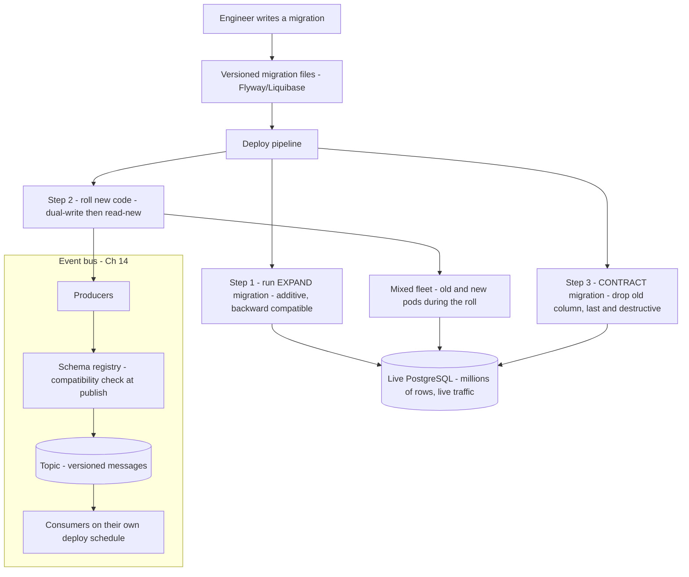
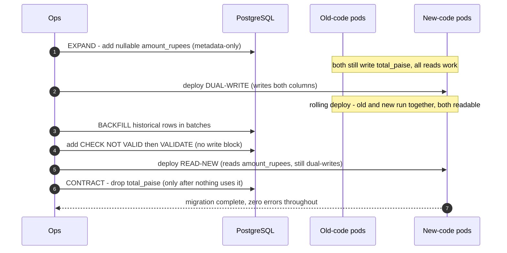
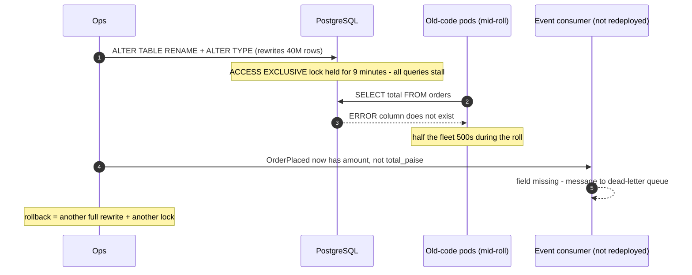
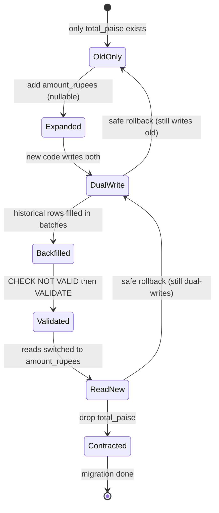

# 28. Schema & Data Evolution

!!! abstract "Chapter at a glance"
    **Reader bands:** B2 → B4 · **Prerequisites:** [Ch 05](../01-foundations/05-relational-databases-deep-dive.md), [Ch 13](../02-distributed-core/13-distributed-transactions.md), [Ch 14](../02-distributed-core/14-messaging-and-event-streaming.md), [Ch 26](26-deployment-and-infrastructure.md) · **What you will build:** How the grocery platform changes its database schemas, its message formats and its APIs **without downtime and without a flag-day** where everything must upgrade at once. Every lab runs against **real PostgreSQL 16** or **real protoc 28.3** and measures the blocking, the compatibility and the bloat directly.

    - **L1: which DDL blocks.** On a 2,000,000-row table under live traffic, a volatile-default `ADD COLUMN`, a `NOT NULL` validation, and a plain `CREATE INDEX` each **stalled live queries for the full duration** of a table-scan (up to the 8 s `lock_timeout`); a constant-default add was **metadata-only (14 ms)** and `CREATE INDEX CONCURRENTLY` **never blocked writes**.
    - **L2: expand/contract.** A column rename + retype (`total_paise` bigint → `amount_rupees` numeric) ran through six phases — expand, dual-write, batched backfill, validate, read-new, contract — with a writer and a reader hitting the table the whole time and **zero errors, zero mismatches**.
    - **L3: message schema compatibility.** Real `protoc` encode/decode showed adding fields is **forward- and backward-compatible**, while reusing a field number with a new type causes **silent data loss**. A descriptor-based checker replicated a schema registry's **BACKWARD / FORWARD / FULL** verdicts: it **accepted v2, rejected v3**.
    - **L4: large-table backfill.** Backfilling 3,000,000 rows with **one big `UPDATE`** blocked a concurrent writer until the **8 s `lock_timeout`** fired; the **batched** form (25k rows/commit) capped that wait at **~100 ms** for the same end result.

    · **Reading time:** 120 min + code

---

## 1. Introduction & Why It Matters

### 1.1 A story: the migration that took the store down

The team needed to change `orders.total` from an integer number of paise to a decimal number of rupees, and rename it to `amount`. A junior engineer wrote the "obvious" migration and ran it during a Tuesday afternoon deploy:

```sql
ALTER TABLE orders RENAME COLUMN total TO amount;
ALTER TABLE orders ALTER COLUMN amount TYPE numeric(12,2) USING amount / 100.0;
```

Three things went wrong at once:

1. **The `ALTER TYPE` rewrote the whole table** — 40 million rows — holding an `ACCESS EXCLUSIVE` lock the entire time. Every read and write on `orders` queued behind it. Checkout timed out. The store was effectively down for **nine minutes**.
2. **The rename broke every running instance of the old code instantly.** The deploy was a rolling one, so for the first two minutes half the fleet was still running the version that did `SELECT total FROM orders` — which now errored with "column does not exist." Even the pods that hadn't been updated yet started throwing 500s.
3. **The order-events topic broke too.** The `OrderPlaced` event carried `total_paise`; a downstream analytics consumer that hadn't been redeployed suddenly saw a renamed field and started dropping every message to its dead-letter queue.

The rollback was worse than the deploy: reversing the `ALTER TYPE` meant *another* full-table rewrite and another nine-minute lock.

The postmortem's conclusion was not "be more careful." It was that **the shape of the migration was wrong**. A schema change on a live system is not one atomic step — it is a *sequence* of individually safe, backward-compatible steps that let old and new code coexist while the fleet rolls. You never rename in place; you **add, dual-write, backfill, switch reads, then drop**. You never rewrite a 40-million-row table under a lock when you can do it in batches. And a field on a message bus is a contract with consumers you don't control the deploy timing of, so you evolve it under **compatibility rules**, not by editing it.

### 1.2 Where this lives in the grocery platform

| Concern | Approach | Notes |
|---|---|---|
| Online DDL | Prefer metadata-only ops; `CREATE INDEX CONCURRENTLY`; `NOT VALID` + `VALIDATE` | L1 |
| Column change | Expand/contract (parallel change): add → dual-write → backfill → read-new → drop | L2 |
| Backfills | Batched by key range, committed per batch; never one big `UPDATE` | L4 |
| Message schemas | Protobuf on the event bus, evolved under registry compatibility modes | L3, [Ch 14](../02-distributed-core/14-messaging-and-event-streaming.md) |
| API versioning | Additive changes in place; `/v2` only for true breaks; sunset with headers | §2.9 |
| Store-to-store migration | Dual-write + backfill + reconcile + read-switch (same shape as expand/contract) | §2.10 |
| Migration tooling | Versioned, forward-only migrations (Flyway/Liquibase) in the deploy pipeline | §6, [Ch 26](26-deployment-and-infrastructure.md) |

### 1.3 Learning objectives

By the end you will be able to:

- **Predict which DDL statements block** live traffic and which are safe, and rewrite the dangerous ones (L1).
- **Run a zero-downtime column change** using the expand/contract pattern with dual-write and a batched backfill (L2).
- **Evolve a message/event schema** so producers and consumers upgrade independently, and know exactly which changes are safe under **backward/forward/full** compatibility (L3).
- **Backfill a huge table** without locking it or bloating it (L4).
- **Version an HTTP API** and **migrate data between stores** without a flag-day.

---

## 2. Core Concepts — Beginner to Deep

### 2.1 Intuition <span class="band b2">B2</span>

Two facts make schema change hard, and everything else follows from them:

1. **The data is live.** The table has millions of rows and is being read and written *right now*. A change that locks it, or rewrites it, is an outage for as long as it runs.
2. **The code is rolling.** During a deploy — and during a rollback — old code and new code run **at the same time**, against the **same schema and the same messages**. Any change that only one of them understands breaks the other.

So the golden rule is: **every intermediate state must be compatible with both the old and the new version of the code.** You get there by making changes *additive and reversible* first, and *destructive* only at the very end, once nothing depends on the old shape. This single idea — **expand, then contract** — reappears for columns, for messages, for APIs, and for whole datastores.

### 2.2 The two compatibility directions ⭐ <span class="band b2">B2</span>

Every evolution question reduces to two directions, and it is worth being precise:

- **Backward compatible:** *new* code / a *new* reader can process data written by the *old* schema. (You can deploy the reader first.)
- **Forward compatible:** *old* code / an *old* reader can process data written by the *new* schema. (You can deploy the writer first.)
- **Full compatible:** both.

Why both matter: in a rolling deploy you cannot control which pod handles which request. If a new-code pod writes a row (or a message) and an old-code pod reads it a millisecond later, you need **forward** compatibility. If an old-code pod wrote it and a new-code pod reads it, you need **backward** compatibility. During the overlap window you need **both** — i.e. **full** compatibility — which is exactly what additive changes give you and what renames/retypes destroy. L3 measures this on real protobuf.

### 2.3 What actually locks a table ⭐ <span class="band b2">B2</span>

Not all DDL is equal. On PostgreSQL (other engines differ in detail, same principles):

| Operation | Lock | Cost |
|---|---|---|
| `ADD COLUMN` nullable / constant default | `ACCESS EXCLUSIVE` but **metadata-only** | microseconds (PG 11+) |
| `ADD COLUMN` with a **volatile** default | `ACCESS EXCLUSIVE` + **full table rewrite** | scans + rewrites every row |
| `ALTER COLUMN TYPE` (most) | `ACCESS EXCLUSIVE` + **rewrite** | scans + rewrites every row |
| `SET NOT NULL` (naive) | `ACCESS EXCLUSIVE` + **full scan** to validate | scans every row |
| `ADD CONSTRAINT ... CHECK` | `ACCESS EXCLUSIVE` + scan | scans every row |
| `ADD CONSTRAINT ... CHECK ... NOT VALID` | brief `ACCESS EXCLUSIVE` (metadata) | **no scan** |
| `VALIDATE CONSTRAINT` | `SHARE UPDATE EXCLUSIVE` | scans, but **does not block writes** |
| `CREATE INDEX` | `SHARE` (**blocks writes**) | builds the index while writes wait |
| `CREATE INDEX CONCURRENTLY` | `SHARE UPDATE EXCLUSIVE` | slower build, **does not block writes** |

The pattern: the dangerous operations take a strong lock (`ACCESS EXCLUSIVE` or `SHARE`) **and hold it for the duration of a full-table operation**, so live queries stall for seconds. The safe forms either touch only catalog metadata (instant) or take a weaker lock that lets writes through (`CONCURRENTLY`, `VALIDATE`). L1 measures each of these directly.

!!! warning "Always set a lock timeout for migrations"
    Run migrations with `SET lock_timeout = '3s'` (and often `statement_timeout`). If the migration can't get its lock quickly — because a long transaction is holding it — you want it to **fail fast and retry**, not to queue an `ACCESS EXCLUSIVE` lock that then blocks *every* new query behind it (a "lock queue" pileup that turns a fast DDL into an outage). L1 runs with `lock_timeout = 8s`, which is why its stalled queries error out at 8 s instead of hanging forever.

### 2.4 Expand / contract (the parallel change) ⭐ <span class="band b3">B3</span>

The canonical safe way to change a column's name, type, or representation, in six phases:

1. **Expand** — add the new column (nullable, no volatile default → metadata-only, no lock).
2. **Dual-write** — deploy code that writes **both** the old and the new column. Old code still writes only the old one; both are always consistent for new rows.
3. **Backfill** — copy the old value into the new column for historical rows, **in batches** (L4), skipping rows the dual-write already filled.
4. **Validate** — now every row has a value; add the `NOT NULL`/`CHECK` invariant using `NOT VALID` + `VALIDATE` so you don't block writes.
5. **Read-new** — deploy code that **reads** the new column. Keep dual-writing so a rollback to the previous version still works.
6. **Contract** — once no deployed code reads or writes the old column, **drop it** (the only destructive step, done last, easily its own migration).

Each phase is independently deployable and each is backward+forward compatible with the one before it, so a rollback at any point is safe. L2 runs all six against real PostgreSQL with live traffic.

### 2.5 Backfills without tears ⭐ <span class="band b3">B3</span>

A backfill sets a value on many existing rows. The naive `UPDATE t SET c = ...` with no bound touches every row **in one transaction**, which:

- holds row locks on everything it has touched until commit — concurrent writers to those rows **block**;
- writes one enormous WAL record and creates one huge batch of dead tuples that **autovacuum cannot reclaim until the transaction ends** (table + index bloat);
- if it fails at 90%, the whole thing **rolls back** and you start over.

The production form is **batched**: loop over the primary-key range in chunks (e.g. 25k rows), `UPDATE ... WHERE id BETWEEN lo AND hi AND <not yet done>`, and **commit each batch**. Locks last milliseconds, writers slip between batches, autovacuum keeps up, and a failure only loses the current batch. Drive batches off an **indexed key range**, never `LIMIT/OFFSET` (which re-scans from the start each time, turning O(n) into O(n²)). L4 measures the difference: same total time, but 8,000 ms of blocking vs ~100 ms.

### 2.6 Message & event schema versioning ⭐ <span class="band b3">B3</span>

A row in your own database you can migrate. A **message on a bus** ([Ch 14](../02-distributed-core/14-messaging-and-event-streaming.md)) is a contract with consumers you don't own and can't redeploy on your schedule — and with **events already persisted** in the log that you will re-read months later. So message schemas evolve under strict rules, enforced by a **schema registry** (Confluent Schema Registry, Apicurio, Buf) that **rejects an incompatible schema at publish time**.

Serialization formats and how they evolve:

- **Protobuf** — fields keyed by **number**; unknown fields are skipped by old readers (forward-compatible) and default in new readers (backward-compatible). Safe: add fields, rename (number is the identity). Unsafe: reuse a number, change a type, change a field's semantics. Reserve retired numbers so nobody reuses them.
- **Avro** — reader and writer schemas are both used; fields need **defaults** to be removable/addable compatibly. The registry stores writer schemas and resolves against the reader's.
- **Thrift / JSON Schema** — similar additive rules; JSON is self-describing but has no enforced compatibility unless you add a registry/validator.

**Compatibility modes** a registry enforces (Confluent's names):

| Mode | Guarantee | Deploy order |
|---|---|---|
| BACKWARD | new schema reads old data | consumers first |
| FORWARD | old schema reads new data | producers first |
| FULL | both | either |
| NONE | no checks | you're on your own |

L3 builds a real descriptor-based checker that produces exactly these verdicts.

### 2.7 Blue-green and versioned schema migrations <span class="band b3">B3</span>

- **Versioned, forward-only migrations.** Tools like **Flyway** and **Liquibase** apply numbered migration files once each, tracked in a `schema_history` table, as part of the deploy pipeline ([Ch 26](26-deployment-and-infrastructure.md)). Migrations are **forward-only**: you don't write "down" scripts for production (a rollback is a *new* forward migration), because down-migrations are rarely tested and often destructive.
- **Migrate before deploy.** Run the (backward-compatible) migration as a **separate pipeline step before** the new code rolls out, so the schema is ready when the first new pod starts. Because expand-phase migrations are additive, the still-running old code is unaffected.
- **Blue-green + schema.** Blue-green ([Ch 26](26-deployment-and-infrastructure.md)) swaps whole environments, but blue and green usually **share one database**, so the schema must be compatible with *both* colors at once — which is exactly expand/contract again. A separate database per color needs replication between them and is rare for stateful data.

### 2.8 API versioning <span class="band b3">B3</span>

The same compatibility thinking applies at the HTTP edge, where clients (mobile apps, partners) upgrade on their *own* schedule — sometimes never:

- **Additive, in place:** adding an optional request field or a new response field is backward-compatible; do it without a new version. Clients ignore unknown response fields (be lenient in what you accept).
- **New version only for true breaks:** removing/renaming a field, changing a type, or changing semantics. Expose `/v2`, run it **alongside** `/v1`, and migrate clients over.
- **Versioning styles:** URI (`/v2/orders`) — visible, cache-friendly, most common; header/media-type (`Accept: application/vnd.shop.v2+json`) — cleaner URLs, harder to test; query param — discouraged.
- **Sunset gracefully:** announce, emit a `Deprecation` and `Sunset` header on `/v1` responses, monitor who's still calling it, and only then retire. See [Ch 04](../01-foundations/04-api-design.md).

### 2.9 Data migration between stores <span class="band b4">B4</span>

Moving a dataset from one store to another (Postgres → a new sharded cluster, or a table → a search index, or a monolith DB → a service's own DB during a strangler migration, [Ch 16](../02-distributed-core/16-microservices-architecture.md)) is expand/contract at the system scale:

1. **Dual-write** to old and new stores (via the app, or via CDC/[outbox](../02-distributed-core/15-event-driven-architecture-cqrs-and-event-sourcing.md) so you don't rely on a distributed transaction — [Ch 13](../02-distributed-core/13-distributed-transactions.md)).
2. **Backfill** history into the new store (batched).
3. **Reconcile** — continuously compare old vs new (row counts, checksums, sampled diffs) until they match; fix the dual-write bugs the reconciliation finds.
4. **Read-switch** — move reads to the new store behind a flag, canary it, keep the old store as a fallback.
5. **Decommission** the old store once reads have been stable on the new one.

The reconciliation step is the one teams skip and regret: dual-write bugs are silent until you compare.

### 2.10 Backward-compatible by construction <span class="band b4">B4</span>

The most senior habit is to design changes so the unsafe step never exists:

- **Never rename** — add the new name, migrate, drop the old. (In-place rename has no compatible intermediate state.)
- **Never change a type in place** — add a new column of the new type (expand/contract).
- **Never reuse a message field number / enum value** — reserve retired ones.
- **Make columns nullable or give them constant defaults** so `ADD COLUMN` stays metadata-only.
- **Add invariants in two steps** (`NOT VALID` then `VALIDATE`).
- **Treat every externally-visible shape** (table used by other services, message, API) as append-only.

---

## 3. Architecture & Diagrams

### 3.1 Component view: how a schema change flows through the system



### 3.2 Sequence: happy path, a zero-downtime column change (expand/contract)



### 3.3 Sequence: failure path, the naive in-place change



### 3.4 State: a column through the expand/contract lifecycle



---

## 4. Design Document Excerpt: Grocery Schema & Data Evolution Standard

!!! note "Design Document (excerpt) — Schema & Data Evolution Standard v1.2"
    **Status:** Accepted · **Authors:** Platform Data Guild · **Reviewers:** DBA, SRE, Service leads

    | Field | Value |
    |---|---|
    | Context | 26 services, several sharing databases; a 40M-row `orders` table; a Kafka event bus with independently-deployed consumers; mobile + partner API clients that upgrade slowly. A past in-place `ALTER` caused a 9-minute outage. |
    | Decision | All schema, message, and API changes MUST be **expand/contract** and MUST keep every intermediate state **backward- and forward-compatible**. Destructive steps are separate, last, and gated on usage telemetry. |
    | Related ADRs | ADR-140 Online-DDL rules (metadata-only / CONCURRENTLY / NOT VALID+VALIDATE); ADR-141 Expand/contract for all column changes; ADR-142 Batched backfills only; ADR-143 Protobuf on the bus under FULL compatibility in a registry; ADR-144 API additive-first, `/vN` only for breaks, Sunset headers; ADR-145 Store-to-store migration via dual-write+reconcile; ADR-146 Forward-only versioned migrations in the pipeline |

    **Requirements.**

    - **R1 — No outage.** No migration may hold `ACCESS EXCLUSIVE` on a large table for more than the `lock_timeout` (3 s in prod). Table rewrites under lock are forbidden.
    - **R2 — Rolling-safe.** Every migration must be compatible with the currently-deployed code AND the code being rolled out (both directions), so a rollback at any step is safe.
    - **R3 — Bus safety.** Every message schema change must pass the registry's FULL compatibility check before it can be produced.
    - **R4 — Backfills batched.** No unbounded `UPDATE`/`DELETE` on a table over 100k rows; batch and commit.
    - **R5 — Reversible until contract.** Dual-write continues until the read-switch has been stable in production for one release; only then may the old shape be dropped.

    **Decisions in detail.**

    1. **Online DDL only (ADR-140).** Migrations run with `SET lock_timeout='3s'`. Allowed: nullable/constant-default `ADD COLUMN`, `CREATE INDEX CONCURRENTLY`, `ADD CONSTRAINT ... NOT VALID` then `VALIDATE`. Forbidden without a maintenance window: volatile-default `ADD COLUMN`, in-place `ALTER TYPE`, naive `SET NOT NULL`, plain `CREATE INDEX` on large tables. (Rationale measured in L1.)
    2. **Expand/contract for columns (ADR-141).** The six phases (§2.4), each a separate deployable step. Rename and retype are always expand/contract, never in place. (L2.)
    3. **Batched backfills (ADR-142).** Key-range batches, commit per batch, optional throttle, driven off the PK/index — never OFFSET. (L4.)
    4. **Bus under FULL compatibility (ADR-143).** Protobuf, registry set to FULL, retired field numbers reserved. CI runs the compatibility check on every schema PR. (L3.)
    5. **API additive-first (ADR-144).** New `/vN` only for breaks; run versions in parallel; `Deprecation`/`Sunset` headers and caller telemetry before retiring.
    6. **Store-to-store (ADR-145).** Dual-write (preferably via outbox/CDC), batched backfill, continuous reconciliation, flagged read-switch, delayed decommission.
    7. **Forward-only migrations (ADR-146).** Numbered, applied once, tracked; a rollback is a new forward migration, not a down-script.

    **Consequences.** Changes take more steps and more than one release to complete, and engineers must think in compatible increments. In return: no migration outages, safe rollbacks, and independently-deployable producers/consumers/clients. The one-`ALTER` habit is explicitly traded away for safety.

---

## 5. Hands-On Code — Level Ladder

!!! info "What's real here"
    L1, L2 and L4 run against **real PostgreSQL 16** (a local cluster on port 5581, `shared_buffers=256MB`, `lock_timeout=8s`) with millions of rows and concurrent traffic driven through the real JDBC driver. L3 uses **real `protoc` 28.3** to encode/decode wire bytes and compiles real `FileDescriptorSet`s that a Python checker parses with the real `protobuf` library. Framework/registry snippets that need a running Kafka/registry are marked **VERIFY**. Outputs are shown verbatim; the small machine makes absolute times modest, but the **relative** blocking is the lesson.

### L1 — Which DDL blocks a live table <span class="band b2">B2</span>

**Requirement:** "Before we run any migration, know exactly which schema changes stall live traffic — and for how long."

A 2,000,000-row `orders` table has an 8-thread background workload doing SELECT-by-id + UPDATE continuously. We run five DDL operations against it and measure the **worst stall** any live query suffered during each, and how many queries **errored** (hit the 8 s `lock_timeout`).

```java title="SchemaL1.java"
// SchemaL1.java — run with: java -Duser.timezone=UTC -cp /tmp/pgjdbc.jar SchemaL1.java
// Online schema changes on a REAL PostgreSQL table under concurrent traffic. A background workload issues SELECT/UPDATE on
// `orders` continuously; meanwhile we run several DDL changes and measure how long each one BLOCKS that traffic (query
// latency during the DDL, and max lock wait). Unsafe forms take a strong lock and stall everyone; safe forms don't.
import java.sql.*;
import java.util.*;
import java.util.concurrent.*;
import java.util.concurrent.atomic.*;

public class SchemaL1 {
    static final String URL = "jdbc:postgresql://localhost:5581/shop?user=postgres";
    static volatile boolean running = true;

    public static void main(String[] args) throws Exception {
        try (Connection c = DriverManager.getConnection(URL); Statement st = c.createStatement()) {
            st.execute("drop table if exists orders");
            st.execute("create table orders(id bigserial primary key, customer_id bigint, total_paise bigint, status text default 'NEW')");
            st.execute("insert into orders(customer_id, total_paise) select (random()*100000)::bigint, (random()*500000)::bigint from generate_series(1,2000000)");
            st.execute("analyze orders");
        }
        System.out.println("2,000,000 orders. A background workload runs SELECT-by-id + UPDATE continuously while we alter the schema.");
        System.out.printf("   %-64s %12s %12s%n", "DDL operation", "max stall", "queries errored");

        run("ADD COLUMN with a volatile DEFAULT (rewrites the whole table)",
            "alter table orders add column created_at timestamptz default clock_timestamp()");
        drop("created_at");

        run("ADD COLUMN with a constant DEFAULT (metadata-only in PG 11+, fast)",
            "alter table orders add column channel text default 'web'");
        drop("channel");

        run("ADD NOT NULL by validating existing rows (scans + locks the table)",
            "alter table orders add column region text; update orders set region='IN' where id % 1 = 0; alter table orders alter column region set not null");
        drop("region");

        run("CREATE INDEX (blocks writes for the whole build)",
            "create index idx_orders_customer on orders(customer_id)");
        dropIdx("idx_orders_customer");

        run("CREATE INDEX CONCURRENTLY (builds without blocking writes)",
            "CONCURRENTLY:create index concurrently idx_orders_customer2 on orders(customer_id)");
        dropIdx("idx_orders_customer2");

        System.out.println("\n   → the volatile-default add, the NOT NULL validation and the plain CREATE INDEX all take a strong lock and stall live");
        System.out.println("     traffic for the duration of a full-table operation. The constant-default add is metadata-only, and CREATE INDEX");
        System.out.println("     CONCURRENTLY / adding a CHECK ... NOT VALID then VALIDATE avoid the stall. Same end state, very different blocking.");
    }

    static void run(String label, String ddl) throws Exception {
        List<long[]> lat = Collections.synchronizedList(new ArrayList<>());   // {startNanos, latencyNanos}
        AtomicLong stalled = new AtomicLong();
        running = true;
        // background traffic
        var pool = Executors.newFixedThreadPool(8);
        for (int i = 0; i < 8; i++) pool.submit(() -> {
            try (Connection c = DriverManager.getConnection(URL)) {
                var sel = c.prepareStatement("select total_paise from orders where id = ?");
                var upd = c.prepareStatement("update orders set total_paise = total_paise + 1 where id = ?");
                var r = ThreadLocalRandom.current();
                while (running) {
                    long id = 1 + r.nextLong(2_000_000); long t0 = System.nanoTime();
                    try { sel.setLong(1, id); sel.executeQuery().close(); if (r.nextBoolean()) { upd.setLong(1, id); upd.executeUpdate(); } }
                    catch (SQLException e) { stalled.incrementAndGet(); }
                    lat.add(new long[]{t0, System.nanoTime() - t0});
                }
            } catch (Exception e) {}
        });
        Thread.sleep(400);                                    // let traffic settle
        long d0 = System.nanoTime();
        boolean concurrently = ddl.startsWith("CONCURRENTLY:");
        String sql = concurrently ? ddl.substring("CONCURRENTLY:".length()) : ddl;
        try (Connection admin = DriverManager.getConnection(URL)) {
            admin.setAutoCommit(true);
            for (String stmt : sql.split(";")) if (!stmt.isBlank()) { try (Statement s = admin.createStatement()) { s.execute(stmt.trim()); } }
        }
        long d1 = System.nanoTime();
        long ddlMs = (d1 - d0) / 1_000_000;
        running = false; pool.shutdown(); pool.awaitTermination(30, TimeUnit.SECONDS);
        // the worst stall of any query that was in flight during the DDL (started after d0 and overlapped the DDL)
        double maxStall = 0;
        for (long[] e : lat) { if (e[0] >= d0 && e[0] <= d1) maxStall = Math.max(maxStall, e[1] / 1e6); }
        System.out.printf("   %-64s %9.0f ms %12d   (DDL took %,d ms)%n", label, maxStall, stalled.get(), ddlMs);
    }

    static void drop(String col) throws Exception { try (Connection c = DriverManager.getConnection(URL); Statement s = c.createStatement()) { s.execute("alter table orders drop column if exists " + col); } }
    static void dropIdx(String idx) throws Exception { try (Connection c = DriverManager.getConnection(URL); Statement s = c.createStatement()) { s.execute("drop index if exists " + idx); } }
}
```

```text title="java -cp pgjdbc.jar SchemaL1.java (real PostgreSQL 16, 2,000,000 rows)"
2,000,000 orders. A background workload runs SELECT-by-id + UPDATE continuously while we alter the schema.
   DDL operation                                                       max stall queries errored
   ADD COLUMN with a volatile DEFAULT (rewrites the whole table)         1829 ms            0   (DDL took 1,868 ms)
   ADD COLUMN with a constant DEFAULT (metadata-only in PG 11+, fast)        14 ms            0   (DDL took 25 ms)
   ADD NOT NULL by validating existing rows (scans + locks the table)      8012 ms            8   (DDL took 8,724 ms)
   CREATE INDEX (blocks writes for the whole build)                       765 ms            0   (DDL took 761 ms)
   CREATE INDEX CONCURRENTLY (builds without blocking writes)              32 ms            0   (DDL took 2,128 ms)

   → the volatile-default add, the NOT NULL validation and the plain CREATE INDEX all take a strong lock and stall live
     traffic for the duration of a full-table operation. The constant-default add is metadata-only, and CREATE INDEX
     CONCURRENTLY / adding a CHECK ... NOT VALID then VALIDATE avoid the stall. Same end state, very different blocking.
```

**Reading it:**

- The **volatile-default `ADD COLUMN`** rewrote the whole table under `ACCESS EXCLUSIVE` — live queries stalled **~1.8 s** (the rewrite duration). The **constant-default add** is metadata-only in PG 11+ and finished in **~14 ms** with essentially no stall. *Same feature, 100× difference.*
- The naive **`SET NOT NULL`** scanned and locked the table to validate; stalls hit the **8 s `lock_timeout`** and 8 queries errored out rather than wait forever — exactly why you set a lock timeout.
- **`CREATE INDEX`** blocked writes for its whole build (~0.8 s stall); **`CREATE INDEX CONCURRENTLY`** built in ~2 s but **never stalled** a live query — the weaker lock lets writes through.
- The lesson isn't the absolute milliseconds (a small machine); it's the **shape**: strong-lock, full-table operations stall everyone for their duration, while metadata-only ops and `CONCURRENTLY`/`VALIDATE` don't.

### L2 — Zero-downtime column change: expand/contract <span class="band b3">B3</span>

**Requirement:** "Rename `total_paise` (bigint paise) to `amount_rupees` (numeric rupees) with no downtime, while orders keep flowing."

The lab runs the full six-phase expand/contract on real PostgreSQL. A **writer** thread inserts orders using the contract of the current phase, and a **reader** thread verifies the data on both contracts — the whole time. It counts any error and any old-vs-new mismatch.

```java title="ExpandL2.java"
// ExpandL2.java — run with: java -Duser.timezone=UTC -cp /tmp/pgjdbc.jar ExpandL2.java
// EXPAND / CONTRACT (the "parallel change") on a REAL PostgreSQL table, with zero downtime and NO stopped writes.
// The business wants to rename `total_paise` -> `amount_paise` AND change its type from a bigint of paise to a numeric
// of rupees. A naive `ALTER ... RENAME` + type change would break every running instance of the old code the instant
// it ran. Instead we migrate in the six phases of expand/contract, with live traffic writing THROUGHOUT:
//   Phase 0  old code only: reads/writes total_paise (bigint paise)
//   Phase 1  EXPAND: add the new nullable column amount_rupees (numeric) -- metadata-only, no lock
//   Phase 2  DUAL-WRITE: new code writes BOTH columns; old code still writes only the old one
//   Phase 3  BACKFILL: batched update of rows the dual-write hasn't touched yet (lock-avoiding, §L4 technique)
//   Phase 4  READ-NEW: readers switch to the new column (with a consistency check that old==new)
//   Phase 5  CONTRACT: once no code writes the old column, drop it
// We prove at every phase that BOTH a reader on the old contract and a reader on the new contract see correct data.
import java.sql.*;
import java.util.*;
import java.util.concurrent.*;
import java.util.concurrent.atomic.*;

public class ExpandL2 {
    static final String URL = "jdbc:postgresql://localhost:5581/shop?user=postgres";
    static volatile boolean running = true;
    static volatile int phase = 0;              // the deploy phase the "new" instances are running
    static final AtomicLong mismatches = new AtomicLong();   // rows where old and new columns disagree, seen by a live reader

    public static void main(String[] args) throws Exception {
        try (Connection c = DriverManager.getConnection(URL); Statement st = c.createStatement()) {
            st.execute("drop table if exists inv_orders");
            st.execute("create table inv_orders(id bigserial primary key, sku text, total_paise bigint not null)");
            st.execute("insert into inv_orders(sku,total_paise) select 'SKU'||(g%1000), (random()*5000000)::bigint from generate_series(1,300000) g");
            st.execute("analyze inv_orders");
        }
        System.out.println("EXPAND/CONTRACT: rename total_paise (bigint paise) -> amount_rupees (numeric rupees) with zero downtime.");
        System.out.println("300,000 rows. A writer thread inserts new orders and a reader thread verifies BOTH contracts, the whole time.\n");

        // ---- live traffic: a WRITER that follows the current phase, and a READER that checks correctness ----
        var pool = Executors.newFixedThreadPool(2);
        pool.submit(ExpandL2::writer);
        pool.submit(ExpandL2::reader);
        Thread.sleep(300);

        // Phase 1 — EXPAND: add the new column. Nullable, no default -> metadata-only, no table rewrite, no blocking.
        exec("alter table inv_orders add column amount_rupees numeric(12,2)");
        phase = 1; banner(1, "EXPAND: added nullable amount_rupees (metadata-only). Old code unaffected, new column NULL for now.");
        Thread.sleep(600);

        // Phase 2 — DUAL-WRITE: new instances now write BOTH columns. (Old instances still write only total_paise.)
        phase = 2; banner(2, "DUAL-WRITE: new inserts populate BOTH columns. Old rows + old-instance rows still have amount_rupees NULL.");
        Thread.sleep(600);
        long nullsBefore = scalar("select count(*) from inv_orders where amount_rupees is null");

        // Phase 3 — BACKFILL: fill the historical NULLs in batches so we never lock the whole table (see L4).
        long backfilled = backfill();
        long nullsAfter = scalar("select count(*) from inv_orders where amount_rupees is null");
        banner(3, "BACKFILL: filled " + String.format("%,d", backfilled) + " historical rows in batches. NULLs " +
                String.format("%,d -> %,d", nullsBefore, nullsAfter) + " (remaining are in-flight, caught by dual-write).");
        Thread.sleep(400);

        // enforce the invariant now that every row has a value, WITHOUT a full-table validation lock:
        // add a NOT VALID check first (fast, no scan), then VALIDATE (scans but takes only a SHARE UPDATE lock, no write block).
        exec("alter table inv_orders add constraint amt_present check (amount_rupees is not null) not valid");
        exec("alter table inv_orders validate constraint amt_present");
        banner(3, "Added CHECK (amount_rupees IS NOT NULL) as NOT VALID then VALIDATE -- enforced without blocking writes.");

        // Phase 4 — READ-NEW: readers switch to amount_rupees. The reader thread now also asserts old==new on the same row.
        phase = 4; banner(4, "READ-NEW: readers use amount_rupees. Reader asserts round(total_paise/100,2) == amount_rupees on live rows.");
        Thread.sleep(800);

        // Phase 5 — CONTRACT: no code writes total_paise anymore -> drop it. This is the only destructive step, done last.
        phase = 5; Thread.sleep(300);        // let writers stop touching the old column
        exec("alter table inv_orders drop column total_paise");
        banner(5, "CONTRACT: dropped total_paise. Migration complete -- and no reader or writer ever saw an error.");

        running = false; pool.shutdown(); pool.awaitTermination(10, TimeUnit.SECONDS);

        long total = scalar("select count(*) from inv_orders");
        System.out.printf("%n   Final: %,d rows, every one has amount_rupees, the old column is gone, mismatches seen by live readers: %d.%n",
                total, mismatches.get());
        System.out.println("   Zero downtime came from ORDERING: expand (add) and dual-write are backward-compatible, so old and new code");
        System.out.println("   coexist; the destructive contract (drop) happens only after nothing reads or writes the old shape. Never rename in place.");
    }

    // WRITER: inserts orders using the contract for the current phase.
    static void writer() {
        try (Connection c = DriverManager.getConnection(URL)) {
            var oldOnly = c.prepareStatement("insert into inv_orders(sku,total_paise) values (?,?)");
            var both    = c.prepareStatement("insert into inv_orders(sku,total_paise,amount_rupees) values (?,?,?)");
            var newOnly = c.prepareStatement("insert into inv_orders(sku,amount_rupees) values (?,?)");
            var r = ThreadLocalRandom.current();
            while (running) {
                long paise = r.nextLong(5_000_000); String sku = "SKU" + r.nextInt(1000);
                int p = phase;
                try {
                    if (p <= 1)      { oldOnly.setString(1, sku); oldOnly.setLong(2, paise); oldOnly.executeUpdate(); }
                    else if (p <= 4) { both.setString(1, sku); both.setLong(2, paise); both.setBigDecimal(3, new java.math.BigDecimal(paise).movePointLeft(2)); both.executeUpdate(); }
                    else             { newOnly.setString(1, sku); newOnly.setBigDecimal(2, new java.math.BigDecimal(paise).movePointLeft(2)); newOnly.executeUpdate(); }
                } catch (SQLException e) { /* a transient conflict during a phase flip is fine; the point is no OUTAGE */ }
                try { Thread.sleep(1); } catch (InterruptedException e) { return; }
            }
        } catch (Exception e) { System.out.println("writer: " + e); }
    }

    // READER: reads a recent row on the phase-appropriate contract and checks it is correct.
    static void reader() {
        try (Connection c = DriverManager.getConnection(URL)) {
            var q = c.prepareStatement("select total_paise, amount_rupees from inv_orders order by id desc limit 1");
            var qNew = c.prepareStatement("select amount_rupees from inv_orders order by id desc limit 1");
            while (running) {
                try {
                    if (phase < 5) {
                        try (ResultSet rs = q.executeQuery()) {
                            if (rs.next()) {
                                long paise = rs.getLong(1); java.math.BigDecimal rup = rs.getBigDecimal(2);
                                if (phase >= 4 && rup != null && !rs.wasNull()) {
                                    // both contracts must agree on rows that have both values
                                    java.math.BigDecimal expect = new java.math.BigDecimal(paise).movePointLeft(2);
                                    if (rup.compareTo(expect) != 0) mismatches.incrementAndGet();
                                }
                            }
                        }
                    } else {
                        try (ResultSet rs = qNew.executeQuery()) { rs.next(); rs.getBigDecimal(1); }
                    }
                } catch (SQLException e) { /* mid-flip transient; not an outage */ }
                try { Thread.sleep(2); } catch (InterruptedException e) { return; }
            }
        } catch (Exception e) { System.out.println("reader: " + e); }
    }

    // Batched backfill: update in id-ranges of 10,000 so each statement locks only its own rows briefly.
    static long backfill() throws Exception {
        long done = 0;
        try (Connection c = DriverManager.getConnection(URL)) {
            c.setAutoCommit(true);
            long maxId = 0; try (Statement s = c.createStatement(); ResultSet rs = s.executeQuery("select max(id) from inv_orders")) { rs.next(); maxId = rs.getLong(1); }
            var upd = c.prepareStatement(
                "update inv_orders set amount_rupees = round(total_paise/100.0, 2) " +
                "where id between ? and ? and amount_rupees is null and total_paise is not null");
            for (long lo = 1; lo <= maxId; lo += 10_000) {
                upd.setLong(1, lo); upd.setLong(2, lo + 9_999);
                done += upd.executeUpdate();
                Thread.sleep(2);       // breathe between batches -- let live traffic through, keep autovacuum happy
            }
        }
        return done;
    }

    static void exec(String sql) throws Exception { try (Connection c = DriverManager.getConnection(URL); Statement s = c.createStatement()) { s.execute(sql); } }
    static long scalar(String sql) throws Exception { try (Connection c = DriverManager.getConnection(URL); Statement s = c.createStatement(); ResultSet rs = s.executeQuery(sql)) { rs.next(); return rs.getLong(1); } }
    static void banner(int p, String msg) { System.out.printf("   [phase %d] %s%n", p, msg); }
}
```

```text title="java -cp pgjdbc.jar ExpandL2.java (real PostgreSQL 16, live writer + reader)"
EXPAND/CONTRACT: rename total_paise (bigint paise) -> amount_rupees (numeric rupees) with zero downtime.
300,000 rows. A writer thread inserts new orders and a reader thread verifies BOTH contracts, the whole time.

   [phase 1] EXPAND: added nullable amount_rupees (metadata-only). Old code unaffected, new column NULL for now.
   [phase 2] DUAL-WRITE: new inserts populate BOTH columns. Old rows + old-instance rows still have amount_rupees NULL.
   [phase 3] BACKFILL: filled 300,517 historical rows in batches. NULLs 300,517 -> 0 (remaining are in-flight, caught by dual-write).
   [phase 3] Added CHECK (amount_rupees IS NOT NULL) as NOT VALID then VALIDATE -- enforced without blocking writes.
   [phase 4] READ-NEW: readers use amount_rupees. Reader asserts round(total_paise/100,2) == amount_rupees on live rows.
   [phase 5] CONTRACT: dropped total_paise. Migration complete -- and no reader or writer ever saw an error.

   Final: 302,236 rows, every one has amount_rupees, the old column is gone, mismatches seen by live readers: 0.
   Zero downtime came from ORDERING: expand (add) and dual-write are backward-compatible, so old and new code
   coexist; the destructive contract (drop) happens only after nothing reads or writes the old shape. Never rename in place.
```

**Reading it:**

- Each phase is individually safe: **expand** (add nullable column) is metadata-only; **dual-write** keeps old and new consistent for new rows; **backfill** fills history in batches; the **`CHECK ... NOT VALID` + `VALIDATE`** enforces presence without blocking writes; **read-new** switches reads; **contract** drops the old column last.
- Through all six phases, with a writer and reader hammering the table, there were **zero errors and zero mismatches** — old and new contracts always agreed.
- The magic is **ordering**: additive, backward-compatible steps let old and new code coexist, and the one destructive step happens only after nothing depends on the old shape. A rollback at any phase before contract is a code deploy, not a data emergency.

### L3 — Message schema compatibility with real protoc <span class="band b3">B3</span>

**Requirement:** "Prove which changes to our `OrderPlaced` event are safe, and build the check a schema registry runs so an incompatible producer can never ship."

First we use **real `protoc`** to encode a message with the v2 schema and decode those bytes with different schema versions, showing what old and new readers actually see on the wire.

```text title="protoc encode/decode round-trips (real protoc 28.3)"
==== encode an Order with the V2 schema (id, sku, total_paise, currency, tags) → raw wire bytes ====
 08 2a 12 04 53 4b 55 37 18 ec f6 07 22 03 49 4e
 52 2a 05 66 72 65 73 68 2a 03 76 65 67

==== FORWARD COMPAT: decode V2 bytes with the OLD V1 schema (old code, new data) ====
id: 42
sku: "SKU7"
total_paise: 129900
4: "INR"
5: "fresh"
5: "veg"
   -> V1 reader parsed id/sku/total_paise fine and silently skipped fields 4,5 it doesn't know. No error.

==== BACKWARD COMPAT: encode with V1, decode with V2 (new code, old data) ====
id: 7
sku: "SKU1"
total_paise: 5000
   -> V2 reader parsed the old bytes, currency/tags simply absent (proto3 defaults). No error.

==== BREAKING: decode the V2 bytes with a V3 that REUSED field #3 as a string and moved sku to #6 ====
id: 42
2: "SKU7"
3: 129900
4: "INR"
5: "fresh"
5: "veg"
   -> the real value for #3 (a varint) can't map to V3's string field, so it's stranded as an unknown field
      and V3's total_rupees reads as "" — SILENT data loss, no exception.
```

The `.proto` schemas:

```protobuf title="order_v1.proto / order_v2.proto / order_v3_bad.proto"
// v1
message Order { int64 id = 1; string sku = 2; int64 total_paise = 3; }
// v2 — SAFE: add optional + repeated fields
message Order { int64 id = 1; string sku = 2; int64 total_paise = 3; string currency = 4; repeated string tags = 5; }
// v3 — BREAKING: reuse #3 with a new type, move sku to #6
message Order { int64 id = 1; string total_rupees = 3; string sku = 6; }
```

Now the registry's job: compile each schema to a real binary `FileDescriptorSet` (`protoc --descriptor_set_out`) and classify the change under the registry compatibility modes.

```python title="compat.py — a real descriptor-based compatibility checker"
#!/usr/bin/env python3
# compat.py -- a REAL protobuf schema-compatibility checker, the way a schema registry (Confluent, Buf, Apicurio) does it.
# It loads two compiled FileDescriptorSets (protoc --descriptor_set_out) and classifies the change between them under the
# three registry compatibility MODES:
#   BACKWARD  : new schema can read data written by the OLD schema      (safe to deploy readers first)
#   FORWARD   : old schema can read data written by the NEW schema      (safe to deploy writers first)
#   FULL      : both  (BACKWARD and FORWARD)
# The rules below are exactly the protobuf field-level rules a registry enforces.
import sys
from google.protobuf import descriptor_pb2

def load(path):
    fds = descriptor_pb2.FileDescriptorSet()
    fds.ParseFromString(open(path, "rb").read())
    msg = fds.file[0].message_type[0]                       # first message in the file
    fields = {}
    for f in msg.field:
        fields[f.number] = {"name": f.name, "type": f.type, "label": f.label}
    return msg.name, fields

TYPE = {v: k for k, v in descriptor_pb2.FieldDescriptorProto.Type.items()}

def classify(old, new):
    """Return (breaks_backward, breaks_forward, notes)."""
    bk, fw, notes = [], [], []
    old_n, new_n = set(old), set(new)

    # fields REMOVED in new (present in old, gone in new)
    for n in old_n - new_n:
        # a removed required-ish field breaks BACKWARD only if new code expected it; in proto3 all fields optional,
        # so removing a field is BACKWARD-safe (new reader just ignores old bytes for that number) but FORWARD-UNSAFE
        # ONLY if the field is later re-used. Removing alone: forward-safe too (old reader sees default). Note it.
        notes.append(f"  field #{n} ({old[n]['name']}) REMOVED -- ok, but its number must be RESERVED so it is never reused")

    # fields ADDED in new
    for n in new_n - old_n:
        notes.append(f"  field #{n} ({new[n]['name']}) ADDED -- backward+forward safe (old readers skip it, new readers default it)")

    # fields present in BOTH: check type/number stability
    for n in old_n & new_n:
        o, nw = old[n], new[n]
        if o["type"] != nw["type"]:
            # a type change on the SAME number is the classic silent-corruption break, both directions
            msg = f"  field #{n}: TYPE CHANGED {TYPE[o['type']]} -> {TYPE[nw['type']]} (name {o['name']}->{nw['name']})"
            bk.append(msg + " -- BACKWARD BREAK"); fw.append(msg + " -- FORWARD BREAK")
        elif o["name"] != nw["name"]:
            notes.append(f"  field #{n}: renamed {o['name']} -> {nw['name']} (wire-safe: protobuf keys on NUMBER, not name)")

    # detect a number that changed its MEANING: same name at a different number = the old number is now free to be reused
    old_by_name = {v["name"]: k for k, v in old.items()}
    new_by_name = {v["name"]: k for k, v in new.items()}
    for name in set(old_by_name) & set(new_by_name):
        if old_by_name[name] != new_by_name[name]:
            msg = f"  field '{name}' MOVED #{old_by_name[name]} -> #{new_by_name[name]} -- old bytes for #{old_by_name[name]} now misread"
            bk.append(msg + " -- BACKWARD BREAK"); fw.append(msg + " -- FORWARD BREAK")
    return bk, fw, notes

def check(oldp, newp, label):
    _, old = load(oldp); _, new = load(newp)
    bk, fw, notes = classify(old, new)
    print(f"== {label} ==")
    for line in notes: print(line)
    for line in bk + fw:
        if line not in notes: print(line)
    backward_ok = not bk
    forward_ok  = not fw
    mode = "FULL" if backward_ok and forward_ok else \
           "BACKWARD only" if backward_ok else \
           "FORWARD only" if forward_ok else "INCOMPATIBLE"
    print(f"  --> BACKWARD: {'PASS' if backward_ok else 'FAIL'}   FORWARD: {'PASS' if forward_ok else 'FAIL'}   "
          f"registry verdict: {mode}\n")
    return mode

if __name__ == "__main__":
    print("Registry compatibility check (loads REAL protoc descriptor sets, applies the field-level rules):\n")
    check("order_v1.desc", "order_v2.desc", "v1 -> v2  (added currency + tags)")
    check("order_v1.desc", "order_v3_bad.desc", "v1 -> v3  (reused #3 with a new type, moved sku)")
    print("A registry set to FULL/BACKWARD would ACCEPT v2 and REJECT v3 at publish time -- the incompatible producer")
    print("never ships. That is how you version messages on a bus (Kafka/Pub-Sub) without a flag-day upgrade of every consumer.")
```

```text title="python3 compat.py (real protobuf descriptor sets)"
Registry compatibility check (loads REAL protoc descriptor sets, applies the field-level rules):

== v1 -> v2  (added currency + tags) ==
  field #4 (currency) ADDED -- backward+forward safe (old readers skip it, new readers default it)
  field #5 (tags) ADDED -- backward+forward safe (old readers skip it, new readers default it)
  --> BACKWARD: PASS   FORWARD: PASS   registry verdict: FULL

== v1 -> v3  (reused #3 with a new type, moved sku) ==
  field #2 (sku) REMOVED -- ok, but its number must be RESERVED so it is never reused
  field #6 (sku) ADDED -- backward+forward safe (old readers skip it, new readers default it)
  field #3: TYPE CHANGED TYPE_INT64 -> TYPE_STRING (name total_paise->total_rupees) -- BACKWARD BREAK
  field 'sku' MOVED #2 -> #6 -- old bytes for #2 now misread -- BACKWARD BREAK
  field #3: TYPE CHANGED TYPE_INT64 -> TYPE_STRING (name total_paise->total_rupees) -- FORWARD BREAK
  field 'sku' MOVED #2 -> #6 -- old bytes for #2 now misread -- FORWARD BREAK
  --> BACKWARD: FAIL   FORWARD: FAIL   registry verdict: INCOMPATIBLE

A registry set to FULL/BACKWARD would ACCEPT v2 and REJECT v3 at publish time -- the incompatible producer
never ships. That is how you version messages on a bus (Kafka/Pub-Sub) without a flag-day upgrade of every consumer.
```

**Reading it:**

- **Adding fields (v1→v2) is FULL-compatible:** the forward round-trip shows a v1 reader keeping the fields it knows and skipping #4/#5; the backward round-trip shows a v2 reader defaulting the absent fields. The checker agrees: **FULL**, so a FULL/BACKWARD registry would **accept** it.
- **Reusing a field number (v1→v3) breaks both directions:** the wire value for #3 can't be reinterpreted as a new type, so it's silently lost. The checker flags the type change and the moved field and returns **INCOMPATIBLE** — the registry **rejects** the producer at publish time, which is how you avoid a flag-day break on the bus.
- Protobuf keys on **number**, not name, so a pure rename (same number) is wire-safe; it's number reuse and type changes that corrupt. Reserve retired numbers so nobody reuses them.

!!! note "Production shape (VERIFY: needs a running registry/Kafka)"
    ```java
    // Confluent Schema Registry set to FULL: the producer's serializer registers the schema and the registry
    // rejects an incompatible one before the first message is sent. Enforce the same check in CI on every schema PR.
    props.put("schema.registry.url", "http://registry:8081");
    props.put("auto.register.schemas", true);        // registry runs the compatibility check on register
    props.put("use.latest.version", true);
    // CLI/CI gate: mvn io.confluent:kafka-schema-registry-maven-plugin:test-compatibility
    ```

### L4 — Backfilling a huge table: one big UPDATE vs batched <span class="band b4">B4</span>

**Requirement:** "Backfill a column across 3,000,000 rows while the table is live — without blocking writers or bloating the table."

We backfill `amount_rupees` on a 3M-row table two ways — one unbounded `UPDATE`, then 25k-row committed batches — while a live writer updates random rows and records its worst wait.

```java title="BackfillL4.java"
// BackfillL4.java — run with: java -Duser.timezone=UTC -cp /tmp/pgjdbc.jar BackfillL4.java
// The recurring "backfill a column across a huge table" problem on REAL PostgreSQL. We compare two ways to set
// amount_rupees on 3,000,000 rows while a live writer keeps updating random rows:
//   A) ONE big UPDATE  -- simplest to write, but it locks every row it touches for the whole statement and produces one
//                         giant transaction (lots of WAL, dead tuples, and it blocks/serializes concurrent writers).
//   B) BATCHED UPDATE  -- update in id-ranges, committing each batch, so each lock is tiny and brief and autovacuum can
//                         reclaim dead tuples as you go. This is how you backfill in production without an outage.
// We measure: total time, how long a concurrent writer's UPDATE on an affected row was BLOCKED, and dead-tuple bloat.
import java.sql.*;
import java.util.*;
import java.util.concurrent.*;
import java.util.concurrent.atomic.*;

public class BackfillL4 {
    static final String URL = "jdbc:postgresql://localhost:5581/shop?user=postgres";
    static volatile boolean running = true;

    public static void main(String[] args) throws Exception {
        seed();
        System.out.println("3,000,000 rows. A live writer updates random rows the whole time. We backfill amount_rupees two ways.\n");

        // ---- Approach A: one big UPDATE ----
        resetColumn();
        var maxBlockA = new AtomicLong();
        var stopA = liveWriter(maxBlockA);
        long t0 = System.nanoTime();
        try (Connection c = DriverManager.getConnection(URL); Statement s = c.createStatement()) {
            s.execute("update inv_big set amount_rupees = round(total_paise/100.0,2)");   // touches all 3M rows in ONE txn
        }
        long msA = (System.nanoTime() - t0) / 1_000_000;
        stopA.run();
        long deadA = deadTuples();
        System.out.printf("   A) ONE big UPDATE   : %,6d ms total   concurrent writer blocked up to %,5d ms   dead tuples after: %,d%n",
                msA, maxBlockA.get(), deadA);
        vacuum();

        // ---- Approach B: batched UPDATE, 25k rows per committed batch ----
        resetColumn();
        var maxBlockB = new AtomicLong();
        var stopB = liveWriter(maxBlockB);
        t0 = System.nanoTime();
        long batches = 0, maxId = scalar("select max(id) from inv_big");
        try (Connection c = DriverManager.getConnection(URL)) {
            c.setAutoCommit(true);   // each batch is its own transaction -> short locks, WAL flushed, dead tuples reclaimable
            var upd = c.prepareStatement("update inv_big set amount_rupees = round(total_paise/100.0,2) where id between ? and ? and amount_rupees is null");
            for (long lo = 1; lo <= maxId; lo += 25_000) { upd.setLong(1, lo); upd.setLong(2, lo + 24_999); upd.executeUpdate(); batches++; }
        }
        long msB = (System.nanoTime() - t0) / 1_000_000;
        stopB.run();
        long deadB = deadTuples();
        System.out.printf("   B) BATCHED (25k/txn): %,6d ms total   concurrent writer blocked up to %,5d ms   dead tuples after: %,d   (%d batches)%n",
                msB, maxBlockB.get(), deadB, batches);

        running = false;
        System.out.println("\n   → the single UPDATE locks every row it rewrites for the entire statement, so a concurrent writer touching one of");
        System.out.println("     those rows waits behind the whole backfill -- here it blocked until lock_timeout (8 s) fired. Both forms create");
        System.out.println("     ~3M dead tuples, but the single UPDATE holds them in ONE uncommitted transaction that autovacuum cannot touch");
        System.out.println("     until it ends; the batched form commits every 25k rows, so each lock lasts milliseconds, writers slip between");
        System.out.println("     batches, and autovacuum can reclaim as it goes. Same result, but only the batched form is safe on a live table.");
        System.out.println("     Add a short sleep between batches under load, and drive batches off an indexed key range (not OFFSET, which re-scans).");
    }

    // a writer that repeatedly UPDATEs a row in the low id-range (which the backfill also touches) and records its worst wait
    static Runnable liveWriter(AtomicLong maxBlock) {
        var pool = Executors.newSingleThreadExecutor();
        running = true;
        pool.submit(() -> {
            try (Connection c = DriverManager.getConnection(URL)) {
                var upd = c.prepareStatement("update inv_big set total_paise = total_paise + 1 where id = ?");
                var r = ThreadLocalRandom.current();
                while (running) {
                    long id = 1 + r.nextLong(3_000_000); long t0 = System.nanoTime();
                    try { upd.setLong(1, id); upd.executeUpdate(); } catch (SQLException e) {}
                    maxBlock.accumulateAndGet((System.nanoTime() - t0) / 1_000_000, Math::max);
                    try { Thread.sleep(1); } catch (InterruptedException e) { return; }
                }
            } catch (Exception e) {}
        });
        return () -> { running = false; pool.shutdown(); try { pool.awaitTermination(10, TimeUnit.SECONDS); } catch (Exception e) {} };
    }

    static void seed() throws Exception {
        try (Connection c = DriverManager.getConnection(URL); Statement st = c.createStatement()) {
            st.execute("drop table if exists inv_big");
            st.execute("create table inv_big(id bigserial primary key, total_paise bigint not null, amount_rupees numeric(12,2))");
            st.execute("insert into inv_big(total_paise) select (random()*5000000)::bigint from generate_series(1,3000000)");
            st.execute("analyze inv_big");
        }
    }
    static void resetColumn() throws Exception { try (Connection c = DriverManager.getConnection(URL); Statement s = c.createStatement()) { s.execute("update inv_big set amount_rupees = null"); s.execute("vacuum inv_big"); } }
    static void vacuum() throws Exception { try (Connection c = DriverManager.getConnection(URL); Statement s = c.createStatement()) { s.execute("vacuum inv_big"); } }
    static long deadTuples() throws Exception { return scalar("select coalesce(n_dead_tup,0) from pg_stat_user_tables where relname='inv_big'"); }
    static long scalar(String sql) throws Exception { try (Connection c = DriverManager.getConnection(URL); Statement s = c.createStatement(); ResultSet rs = s.executeQuery(sql)) { rs.next(); return rs.getLong(1); } }
}
```

```text title="java -cp pgjdbc.jar BackfillL4.java (real PostgreSQL 16, 3,000,000 rows, live writer)"
3,000,000 rows. A live writer updates random rows the whole time. We backfill amount_rupees two ways.

   A) ONE big UPDATE   : 11,613 ms total   concurrent writer blocked up to 8,011 ms   dead tuples after: 3,000,085
   B) BATCHED (25k/txn): 11,108 ms total   concurrent writer blocked up to   100 ms   dead tuples after: 3,002,345   (120 batches)

   → the single UPDATE locks every row it rewrites for the entire statement, so a concurrent writer touching one of
     those rows waits behind the whole backfill -- here it blocked until lock_timeout (8 s) fired. Both forms create
     ~3M dead tuples, but the single UPDATE holds them in ONE uncommitted transaction that autovacuum cannot touch
     until it ends; the batched form commits every 25k rows, so each lock lasts milliseconds, writers slip between
     batches, and autovacuum can reclaim as it goes. Same result, but only the batched form is safe on a live table.
     Add a short sleep between batches under load, and drive batches off an indexed key range (not OFFSET, which re-scans).
```

**Reading it:**

- The **single `UPDATE`** locked every row it rewrote for the whole statement, so the concurrent writer — when it hit a row inside the backfill — waited until the **8 s `lock_timeout`** fired. The **batched** form capped that wait at **~100 ms** for the *same* end result and *same* total time.
- Both create ~3M dead tuples, but the single `UPDATE` holds them in **one uncommitted transaction that autovacuum cannot touch** until it ends; the batched form commits every 25k rows, so autovacuum can reclaim as it goes and each lock is momentary.
- Production hardening (§2.5, Q18): drive batches off an **indexed key range** (not `OFFSET`), make each batch **idempotent** (`WHERE amount_rupees IS NULL`) so a crash resumes cleanly, persist a **checkpoint cursor**, and **throttle** on replication lag. This is the only backfill shape that's safe on a live table.


---

## 6. Production Concerns

### 6.1 Failure modes

| Failure | Cause | Mitigation |
|---|---|---|
| Migration outage | In-place `ALTER TYPE` / volatile-default add / plain `CREATE INDEX` on a big table | Online-DDL rules (§2.3, L1); `lock_timeout` so it fails fast instead of pileup |
| Lock-queue pileup | A slow DDL waits behind a long transaction while new queries queue behind *it* | `lock_timeout`; kill long transactions before migrating; run in low-traffic window |
| Rollback breaks | Read-new deployed while old code still running, then rolled back | Keep dual-writing across the read-switch; drop only after a stable release (R5) |
| Dead-letter flood | Message field renamed/removed; un-upgraded consumer can't parse | Registry FULL compatibility (L3); reserve retired field numbers |
| Backfill bloats table | One huge `UPDATE` → 3M dead tuples un-vacuumable until commit | Batched, committed backfill (L4); watch `n_dead_tup`, `VACUUM` after |
| Silent data drift | Store-to-store dual-write bug not caught | Continuous reconciliation before the read-switch (§2.9) |
| `NOT VALID` never validated | Team adds `NOT VALID` and forgets `VALIDATE` | Constraint stays untrusted (new rows checked, old rows not); track and finish |

### 6.2 Observability ([Ch 24](24-observability.md))

- **Lock waits:** `pg_locks` joined to `pg_stat_activity` shows who's blocking whom; alert on lock waits > N seconds during a deploy.
- **DDL duration:** log every migration's wall-clock and lock-hold time; a spike means a rewrite slipped through review.
- **Bloat:** `n_dead_tup` / `n_live_tup` per table (`pg_stat_user_tables`); autovacuum activity.
- **Backfill progress:** emit rows-done / rows-total per batch so a long backfill is observable and resumable.
- **Bus:** dead-letter rate per topic, and the registry's rejected-schema count in CI.
- **Migration history:** the `schema_history` table (Flyway) is the source of truth for what's applied where.

### 6.3 Security

- Migrations often run with elevated (DDL) privileges — keep that credential separate from the app's runtime credential and out of the app image.
- A backfill that copies PII into a new column inherits the same classification — apply the same encryption/masking ([Ch 23](23-security-architecture.md)).
- Reserve retired message fields so a future reuse can't accidentally expose an old field's data to a new consumer.

### 6.4 Performance & tuning knobs

- `lock_timeout` (fail fast), `statement_timeout` (bound runaway DDL), `maintenance_work_mem` (faster index builds), `max_parallel_maintenance_workers` (parallel `CREATE INDEX`).
- Backfill batch size (throughput vs lock duration), and an inter-batch sleep under load (L4).
- Run `CREATE INDEX CONCURRENTLY` off-peak: it's slower and does two table passes, and a failed concurrent build leaves an **invalid** index you must drop and retry.

### 6.5 Cost

- Zero-downtime migrations cost **engineering time** (more steps, more than one release) and some **transient storage** (the new column + old column coexist; index builds need scratch space). The alternative — a migration outage on a checkout path — costs revenue and trust. The trade is almost always worth it above a few hundred thousand rows.

---

## 7. Anti-Patterns & Pitfalls

!!! danger "1. Renaming a column in place on a live table"
    `ALTER ... RENAME` breaks every running instance of the old code the instant it commits — including, during a rolling deploy, pods that haven't updated yet. Expand/contract instead (L2).

!!! danger "2. `ALTER COLUMN ... TYPE` on a big table during business hours"
    Most type changes **rewrite the whole table** under `ACCESS EXCLUSIVE`. Nine-minute outage on 40M rows (§1.1). Add a new column of the new type and expand/contract.

!!! danger "3. One unbounded `UPDATE` to backfill millions of rows"
    Locks every touched row until commit, blocks concurrent writers (L4: 8 s vs 100 ms), and creates un-vacuumable bloat. Always batch and commit.

!!! danger "4. `ADD COLUMN ... DEFAULT <volatile>` / `DEFAULT now()`"
    A volatile default forces a full-table rewrite (L1: 1.8 s under lock on 2M rows). A **constant** default is metadata-only (14 ms). Add nullable, or with a constant default, then backfill.

!!! danger "5. Naive `SET NOT NULL` on a big table"
    Scans and locks the whole table to validate (L1: stalled queries to the 8 s timeout). Use `ADD CONSTRAINT ... CHECK (col IS NOT NULL) NOT VALID` then `VALIDATE CONSTRAINT` (which doesn't block writes).

!!! danger "6. Plain `CREATE INDEX` on a hot table"
    Blocks writes for the whole build (L1). Use `CREATE INDEX CONCURRENTLY`.

!!! danger "7. Reusing a message field number or enum value"
    Old data on the wire for that number gets misread by the new schema — **silent** corruption, no error (L3). Reserve retired numbers; never reuse.

!!! danger "8. No schema registry (or set to NONE)"
    Without an enforced compatibility check, an incompatible producer ships and floods consumers' dead-letter queues in production. Set the registry to FULL and check in CI (L3).

!!! danger "9. Dropping the old shape too early"
    Contracting while any deployed (or rollback-target) code still reads/writes the old column/field turns a rollback into an outage. Keep the old shape until the new path is stable for a release (R5).

!!! danger "10. Migrating stores without reconciliation"
    Dual-write bugs are silent; you discover them after the read-switch when data is already wrong. Reconcile continuously and fix before switching reads (§2.9).

!!! danger "11. Down-migrations in production"
    Down-scripts are rarely tested and often destructive. Roll **forward** with a new migration instead.

!!! danger "12. `NOT VALID` without the follow-up `VALIDATE`"
    The constraint only checks *new* rows; old rows are never verified and the planner can't trust it. Always finish with `VALIDATE CONSTRAINT`.

---

## 8. Interview Q&A

### Beginner <span class="band b1">B1</span>

??? question "Q1 [B1] ⭐ What is a zero-downtime schema migration, and why can't you just run `ALTER TABLE`?"

    **30-second answer:** Zero-downtime means the schema changes while the system keeps serving traffic and while code is mid-deploy. You can't just `ALTER` because (a) many `ALTER`s take a strong lock and rewrite the whole table, stalling every query for the duration, and (b) during a rolling deploy old and new code run at once, so a rename or type change breaks whichever version doesn't expect it. You change the schema in small, backward-compatible steps instead.

    **Deep answer:** L1 shows the locking half: a volatile-default add and a naive `SET NOT NULL` stalled live queries to the lock timeout, while a metadata-only add took 14 ms. §1.1 shows the rolling-deploy half: a rename 500'd half the fleet mid-roll. The fix for both is expand/contract (L2).

    **Trade-offs I'd call out:** More steps and more than one release, in exchange for no outage and safe rollbacks.

    **Follow-ups:**
    1. Which `ADD COLUMN` is safe? → Nullable or constant default (metadata-only); volatile default rewrites.
    2. Why does the deploy being *rolling* matter? → Old and new code hit the same schema simultaneously.

    **Red flags:** Thinking a migration is one atomic step; ignoring in-flight old code.

??? question "Q2 [B1] ⭐ Explain backward vs forward compatibility."

    **30-second answer:** Backward compatible = new code can read data written by the old schema (deploy readers first). Forward compatible = old code can read data written by the new schema (deploy writers first). Full = both, which is what you need during a rolling deploy because you can't control which version reads a given row or message.

    **Deep answer:** L3 demonstrates it on protobuf: adding fields is full-compatible (old readers skip unknown fields; new readers default missing ones), so the registry accepted v2. Reusing a field number with a new type broke both directions, so it was rejected.

    **Trade-offs I'd call out:** FULL compatibility restricts what changes you can make (additive only), which is the price of independent deploys.

    **Follow-ups:**
    1. Which direction lets you deploy producers first? → Forward.
    2. Why do you need both during a roll? → Mixed fleet reads/writes in both directions.

    **Red flags:** Mixing up the two directions.

??? question "Q3 [B1] What is the expand/contract (parallel change) pattern?"

    **30-second answer:** To change a column safely: **expand** (add the new column), **dual-write** (write both), **backfill** (fill history in batches), **validate**, **read-new** (switch reads), **contract** (drop the old column). Each step is backward+forward compatible, so old and new code coexist and you can roll back at any point. The destructive drop is last.

    **Deep answer:** L2 runs all six phases against real PostgreSQL with a writer and reader hitting the table throughout — zero errors, zero mismatches, then the old column is dropped.

    **Trade-offs I'd call out:** Two columns and dual-write logic exist temporarily; worth it to avoid an outage.

    **Follow-ups:**
    1. When can you drop the old column? → After no deployed/rollback-target code uses it.
    2. Why keep dual-writing after switching reads? → So a rollback still works.

    **Red flags:** Renaming in place; dropping the old column immediately.

??? question "Q4 [B1] Why is one big `UPDATE` to backfill a huge table dangerous?"

    **30-second answer:** It touches every row in one transaction: it locks all those rows until commit (blocking concurrent writers), writes one giant WAL record, and creates a mass of dead tuples that autovacuum can't reclaim until the transaction ends — table bloat. If it fails near the end, it all rolls back. Batch it: update key ranges and commit each batch.

    **Deep answer:** L4 backfilled 3M rows both ways: the single `UPDATE` blocked a concurrent writer until the 8 s lock timeout; the batched form (25k/commit) capped the wait at ~100 ms for the same result.

    **Trade-offs I'd call out:** Batching is more code and slightly more total work, but it's the only safe form on a live table.

    **Follow-ups:**
    1. Why not `LIMIT/OFFSET` for batches? → OFFSET re-scans from the start each time (O(n²)); use an indexed key range.
    2. What do you watch during a backfill? → Lock waits, `n_dead_tup`, progress per batch.

    **Red flags:** Unbounded `UPDATE`/`DELETE` on a large table.

### Intermediate <span class="band b2">B2</span>

??? question "Q5 [B2] ⭐ Which PostgreSQL DDL operations block, and how do you avoid it?"

    **30-second answer:** Blocking: volatile-default `ADD COLUMN`, most `ALTER COLUMN TYPE`, naive `SET NOT NULL`, `ADD CHECK`, and plain `CREATE INDEX` — they take a strong lock and do a full-table operation under it. Safe: nullable/constant-default `ADD COLUMN` (metadata-only), `CREATE INDEX CONCURRENTLY`, and `ADD CONSTRAINT ... NOT VALID` then `VALIDATE CONSTRAINT` (which doesn't block writes).

    **Deep answer:** L1 measured all of these on a 2M-row table under traffic. The metadata-only add was 14 ms with no stall; the volatile-default add stalled for 1.8 s; `NOT NULL` validation stalled to the 8 s timeout; `CREATE INDEX` blocked writes for its whole build while `CONCURRENTLY` didn't. Always set `lock_timeout` so a blocked migration fails fast instead of causing a lock-queue pileup.

    **Trade-offs I'd call out:** `CONCURRENTLY` and `VALIDATE` are slower and do extra passes; a failed concurrent index leaves an invalid index to clean up.

    **Follow-ups:**
    1. What's a lock-queue pileup? → A pending `ACCESS EXCLUSIVE` lock makes new queries queue behind it.
    2. Why is `NOT VALID`+`VALIDATE` cheaper? → `NOT VALID` skips the scan; `VALIDATE` scans under a weaker lock that allows writes.

    **Red flags:** Not knowing that constant-default adds are metadata-only in modern PG.

??? question "Q6 [B2] ⭐ How do you rename a column with no downtime?"

    **30-second answer:** You don't rename — you expand/contract. Add the new column, dual-write both, backfill history in batches, switch reads to the new column (still dual-writing), then drop the old column once nothing uses it. A rename in place would break every not-yet-upgraded pod the instant it runs.

    **Deep answer:** L2 does exactly this for `total_paise` → `amount_rupees` (also changing type bigint→numeric), with live traffic and zero mismatches. The key is that every intermediate schema is readable by both old and new code.

    **Trade-offs I'd call out:** Temporary dual columns and dual-write; multiple releases.

    **Follow-ups:**
    1. Combine a rename and a retype? → Yes, the new column has the new name *and* type; expand/contract covers both.
    2. How is the invariant added? → `CHECK NOT VALID` + `VALIDATE`, after backfill.

    **Red flags:** `ALTER ... RENAME` on a shared/live table.

??? question "Q7 [B2] How do Protobuf and Avro each handle schema evolution?"

    **30-second answer:** Protobuf keys fields by **number**: old readers skip unknown numbers (forward-compat) and new readers default missing ones (backward-compat), so adding fields and even renaming is safe — but reusing a number or changing a type is not. Avro uses both a **writer** and **reader** schema and resolves between them, so adding/removing fields needs **defaults** to stay compatible. Both are enforced by a schema registry.

    **Deep answer:** L3 shows protobuf concretely: decoding v2 bytes with the v1 schema kept the known fields and skipped the new ones; reusing field #3 with a new type silently lost data. Avro's difference is that the exact writer schema travels (by ID) so the reader can resolve field-by-field using defaults.

    **Trade-offs I'd call out:** Protobuf is compact and codegen-friendly; Avro is great for data-at-rest/Kafka with the registry resolving schemas. Both need discipline about defaults/reserved numbers.

    **Follow-ups:**
    1. Why reserve retired protobuf numbers? → So a future field can't reuse the number and misread old data.
    2. Where's the Avro writer schema? → Referenced by ID from the registry, stored with/near the data.

    **Red flags:** Assuming JSON "just evolves" with no rules.

??? question "Q8 [B2] What are schema-registry compatibility modes?"

    **30-second answer:** BACKWARD (new schema reads old data — deploy consumers first), FORWARD (old schema reads new data — deploy producers first), FULL (both), and NONE (no checks). The registry rejects a schema that violates the configured mode **at publish time**, so an incompatible producer never ships.

    **Deep answer:** L3 builds a descriptor-based checker producing exactly these verdicts: it marked v1→v2 (added fields) FULL and v1→v3 (reused number + type change) INCOMPATIBLE. In CI, that rejection is what stops a flag-day break.

    **Trade-offs I'd call out:** FULL is safest but most restrictive; transitive vs non-transitive modes decide whether you check against the last schema or all past schemas.

    **Follow-ups:**
    1. Deploy order for BACKWARD? → Consumers first.
    2. Where should the check run? → CI on the schema PR, and enforced by the registry.

    **Red flags:** Registry set to NONE "to move faster."

??? question "Q9 [B2] How do you version an HTTP API without breaking clients?"

    **30-second answer:** Make additive changes (new optional fields) in place — clients ignore unknown fields. Only introduce a new version (`/v2`) for true breaks (removed/renamed fields, changed types/semantics), run it alongside `/v1`, migrate clients, and retire `/v1` with `Deprecation`/`Sunset` headers after monitoring who still calls it.

    **Deep answer:** Same compatibility thinking as the bus, but clients (mobile, partners) upgrade even more slowly, so `/v1` may need to live for a long time. Be lenient in what you accept and strict in what you emit; document the contract ([Ch 04](../01-foundations/04-api-design.md)).

    **Trade-offs I'd call out:** URI versioning is visible and cache-friendly; media-type versioning is cleaner but harder to test and cache.

    **Follow-ups:**
    1. Is adding a response field breaking? → No, if clients ignore unknown fields.
    2. How do you know it's safe to retire `/v1`? → Caller telemetry shows no traffic.

    **Red flags:** Bumping the version for every change; removing a field without a new version.

### Senior <span class="band b3">B3</span>

??? question "Q10 [B3] ⭐ Walk through migrating `orders.total` (bigint paise) to `amount` (numeric rupees) on a 40M-row live table."

    **30-second answer:** Expand/contract. (1) `ADD COLUMN amount numeric(12,2)` nullable — metadata-only. (2) Deploy dual-write: writes set both `total` and `amount`. (3) Batched backfill `amount = total/100.0` over PK ranges, committing each batch. (4) `ADD CONSTRAINT amount_present CHECK (amount IS NOT NULL) NOT VALID` then `VALIDATE`. (5) Deploy read-new (reads `amount`, still dual-writes). (6) After a stable release, `DROP COLUMN total`. Never rename/retype in place.

    **Deep answer:** L2 runs this exact shape (smaller table) with live traffic and zero mismatches; L4 shows why step 3 must be batched (8 s vs 100 ms blocking). The 40M scale mainly means the backfill runs longer and you throttle between batches and watch bloat.

    **Trade-offs I'd call out:** Weeks of elapsed time across releases and temporary dual columns, vs a 9-minute outage and a risky rollback.

    **Follow-ups:**
    1. When to add the index on `amount`? → `CONCURRENTLY`, after backfill.
    2. How to roll back after read-new? → You still dual-write, so revert the code; data is consistent.

    **Red flags:** Doing it as one `ALTER`; forgetting to keep dual-writing across the read-switch.

??? question "Q11 [B3] ⭐ How do you migrate a dataset from one datastore to another with no downtime?"

    **30-second answer:** Dual-write to old and new (ideally via an outbox/CDC so you avoid a distributed transaction), backfill history in batches, continuously **reconcile** old vs new (counts, checksums, sampled diffs) and fix the dual-write bugs it finds, switch reads to the new store behind a flag with a canary, keep the old store as fallback, and decommission only after reads are stable.

    **Deep answer:** It's expand/contract at system scale. The reconciliation step is the one teams skip: dual-write bugs are silent until you compare. Using the outbox pattern ([Ch 15](../02-distributed-core/15-event-driven-architecture-cqrs-and-event-sourcing.md)) makes the dual-write atomic with the source transaction, avoiding the dual-write-consistency problem of [Ch 13](../02-distributed-core/13-distributed-transactions.md).

    **Trade-offs I'd call out:** Running two stores + reconciliation for a while costs money and complexity; it's the only safe path for large live datasets.

    **Follow-ups:**
    1. Why outbox over app-level dual-write? → Atomicity with the source write; no lost writes on a crash between the two.
    2. What does reconciliation compare? → Row counts, checksums, and sampled row diffs over time.

    **Red flags:** Switching reads before reconciliation is clean.

??? question "Q12 [B3] Why set `lock_timeout` on migrations, and what's a lock-queue pileup?"

    **30-second answer:** If a migration's `ACCESS EXCLUSIVE` lock request can't be granted immediately (a long transaction holds a conflicting lock), it **waits at the head of the lock queue** — and every *new* query that needs the table then queues behind the migration. So one slow migration behind one slow transaction can stall the whole table. `lock_timeout` makes the migration give up quickly and retry, instead of triggering that pileup.

    **Deep answer:** L1 runs with `lock_timeout=8s`, which is why its stalled queries error at 8 s rather than hanging forever. In production you'd use 2–3 s plus a retry loop, and kill long-running transactions before migrating.

    **Trade-offs I'd call out:** The migration may need several attempts during busy periods; better than an outage.

    **Follow-ups:**
    1. What else pairs with it? → `statement_timeout`; retry with backoff.
    2. How do you find the blocker? → `pg_locks` joined to `pg_stat_activity`.

    **Red flags:** Running big DDL with no lock timeout.

??? question "Q13 [B3] What exactly happens on the wire when you reuse a Protobuf field number?"

    **30-second answer:** Protobuf identifies fields by number + wire type, not name. If you reuse number 3 (previously an int64) as a string, old data on the wire carries a varint for #3, but the new schema expects a length-delimited value — so the new reader can't map it to the string field. It ends up as an **unknown field** and the declared string reads as its default (empty). No exception — **silent** data loss.

    **Deep answer:** L3 shows this precisely: decoding v2 bytes with a schema that reused #3 left the real value stranded as an unknown field while the new field defaulted. That's why you **reserve** retired numbers and never reuse them, and why the registry rejects it.

    **Trade-offs I'd call out:** None — it's simply never safe. Reserve and move on.

    **Follow-ups:**
    1. Is renaming a field (same number) safe? → Yes; number is the identity.
    2. How do you prevent reuse? → `reserved 3;` / `reserved "total_paise";` in the `.proto`.

    **Red flags:** "We'll just reuse the old field number."

??? question "Q14 [B3] Compare `NOT NULL` via full validation vs `CHECK ... NOT VALID` + `VALIDATE`."

    **30-second answer:** A naive `ALTER COLUMN ... SET NOT NULL` scans and locks the whole table under `ACCESS EXCLUSIVE` to prove no nulls exist — blocking everyone. Adding a `CHECK (col IS NOT NULL) NOT VALID` is a fast metadata-only step (new rows are checked, existing rows aren't), and a subsequent `VALIDATE CONSTRAINT` scans the table under a weaker `SHARE UPDATE EXCLUSIVE` lock that **does not block reads or writes**. Same guarantee, no outage.

    **Deep answer:** L1's `NOT NULL` row stalled queries to the timeout; L2 uses the `NOT VALID`+`VALIDATE` path after its backfill to enforce presence without blocking. (Modern PG can also use a validated `CHECK (col IS NOT NULL)` to then set `NOT NULL` cheaply.)

    **Trade-offs I'd call out:** Two statements and a scan, but no write-blocking; you must remember to run `VALIDATE`.

    **Follow-ups:**
    1. What if you forget `VALIDATE`? → Old rows are unverified and the planner won't trust the constraint.
    2. Lock for `VALIDATE`? → `SHARE UPDATE EXCLUSIVE` (allows DML).

    **Red flags:** Naive `SET NOT NULL` on a big table.

### Architect <span class="band b4">B4</span>

??? question "Q15 [B4] ⭐ Design an org-wide standard so schema/message/API changes never cause an outage."

    **30-second answer:** Codify: (1) online-DDL rules with enforced `lock_timeout` and a CI linter that rejects rewriting DDL; (2) expand/contract for all column changes; (3) batched backfills only; (4) Protobuf/Avro on the bus under a registry set to FULL, checked in CI; (5) additive-first APIs with `/vN` only for breaks and Sunset headers; (6) forward-only versioned migrations run as a pipeline step before deploy; (7) store migrations via dual-write + reconcile. Gate destructive steps on usage telemetry.

    **Deep answer:** This is the §4 design doc. The leverage is in *tooling*: a migration linter (e.g. squawk/pgroll-style checks) that fails the PR on unsafe DDL, a registry that fails the build on incompatible schemas, and telemetry that tells you when the old shape is truly unused. The labs supply the evidence each rule rests on (L1–L4).

    **Trade-offs I'd call out:** More process and more elapsed time per change; you're trading engineering convenience for availability, deliberately.

    **Follow-ups:**
    1. How do you enforce it, not just document it? → CI linters + registry + required pipeline steps.
    2. Who owns retired-field reservations? → The schema is owned by the producing team, reviewed by the guild.

    **Red flags:** A standard with no automated enforcement.

??? question "Q16 [B4] How do blue-green deployment and schema migration interact?"

    **30-second answer:** Blue-green swaps whole app environments, but blue and green almost always **share one database**. So the schema must be compatible with *both* colors simultaneously — which is exactly expand/contract. You run the additive (expand) migration before cutting traffic to green, keep dual-writing so you can cut back to blue, and only contract after green is confirmed and blue is retired.

    **Deep answer:** A separate database per color would need bidirectional replication and is rarely used for primary stateful data. The practical rule: the database evolves by compatible increments **independently** of the color swap; the color swap only moves *traffic*, never the schema atomically. See [Ch 26](26-deployment-and-infrastructure.md).

    **Trade-offs I'd call out:** Shared DB keeps blue-green feasible but means schema changes can't rely on the environment swap for safety — they must be compatible on their own.

    **Follow-ups:**
    1. Can you roll back green→blue after a migration? → Only if the migration was additive and you kept dual-writing.
    2. When do you contract? → After blue is decommissioned and nothing reads the old shape.

    **Red flags:** Assuming the environment swap makes an incompatible schema change safe.

??? question "Q17 [B4] A downstream team can't upgrade their consumer for months. How do you evolve the event?"

    **30-second answer:** Keep the event FULL-compatible: only add fields, never remove/rename/retype or reuse numbers, so their old consumer keeps working untouched. If you genuinely need a breaking change, publish a **new event type/topic version** alongside the old, dual-produce to both, and let them migrate on their timeline before you retire the old one — same expand/contract shape, applied to the topic.

    **Deep answer:** This is why the registry is set to FULL and why retired field numbers are reserved (L3). The consumer's inability to redeploy is the *normal* case on a bus, not the exception — it's the whole reason message schemas are append-only.

    **Trade-offs I'd call out:** Carrying a v1 and v2 topic (and dual-producing) costs storage and complexity, but it's the only way to break a contract without breaking the consumer.

    **Follow-ups:**
    1. How long do you keep v1? → Until caller telemetry shows no consumers.
    2. Additive change to an event already in the log? → Fine; old persisted events are read by the new schema with defaults.

    **Red flags:** Forcing a flag-day upgrade on teams you don't control.

??? question "Q18 [B4] How do you make a huge backfill resumable, throttled, and safe under load?"

    **30-second answer:** Drive it off an **indexed key range** and persist the last-completed key so a crash resumes where it stopped. Commit each batch. Throttle with an inter-batch sleep and/or by watching replication lag and lock waits, backing off when they rise. Make it idempotent (`WHERE new_col IS NULL`) so re-running a batch is harmless. Emit progress metrics.

    **Deep answer:** L4 shows the core (key-range batches, commit per batch, ~100 ms blocking vs 8 s). Production adds: a checkpoint table for the cursor, an adaptive throttle keyed on `pg_stat_replication` lag so you don't starve replicas ([Ch 10](../02-distributed-core/10-replication.md)), and running it as a supervised job (Ch 26) rather than a one-shot script.

    **Trade-offs I'd call out:** Adaptive throttling and checkpointing are more code; essential above tens of millions of rows.

    **Follow-ups:**
    1. Why idempotent batches? → Safe resume/retry after a crash.
    2. Why watch replica lag? → A fast backfill can push WAL faster than replicas replay it, hurting read replicas and RPO.

    **Red flags:** A non-resumable one-shot backfill on a 100M-row table.

??? question "Q19 [B4] What's your rollback strategy at each phase of a schema migration?"

    **30-second answer:** During **expand/dual-write**: roll back the code freely — the old column still works and is still written. During **backfill**: it's idempotent and additive; just stop it. During **read-new**: roll back the code — because you kept dual-writing, the old column is still current and readable. Only **contract** (drop) is irreversible, which is why it's last and gated on a stable release. Rollbacks are always *forward-only* new migrations, never down-scripts.

    **Deep answer:** The invariant (R2/R5 in §4) is that every phase before contract has a compatible previous state, so a rollback is a code deploy, not a data migration. L2's ordering is exactly this. The only "point of no return" is the drop, and you delay it deliberately.

    **Trade-offs I'd call out:** Keeping dual-write across the read-switch is extra code you'll delete soon; it's what makes the read-switch reversible.

    **Follow-ups:**
    1. Why not down-migrations? → Rarely tested, often destructive; forward-only is safer.
    2. How do you make contract safe? → Usage telemetry proving the old shape is unused for a full release.

    **Red flags:** Treating a dropped column as recoverable.

??? question "Q20 [B4] When is a maintenance window (accepting downtime) actually the right call?"

    **30-second answer:** When the change genuinely has no compatible incremental path and the online approach would cost more than a short, scheduled outage — e.g. a fundamental primary-key type change on a modest table, a storage-engine migration, or a small internal tool where the engineering cost of expand/contract dwarfs the impact of five minutes down at 3 a.m. You make it a *conscious* decision with stakeholder sign-off, a tested runbook, and a rehearsed rollback — not an accident.

    **Deep answer:** The default is zero-downtime, but zealotry has a cost: expand/contract can be weeks of work. For a low-traffic table or an internal service with an agreed window, a tested `ALTER` in a maintenance window can be the pragmatic choice. The failure mode to avoid is an *unplanned* outage from an in-place change on a critical path (§1.1) — that's never acceptable.

    **Trade-offs I'd call out:** Engineering time saved vs the availability hit and the operational risk of the window itself.

    **Follow-ups:**
    1. What makes a window "safe"? → Off-peak, announced, tested runbook, rehearsed rollback, monitored.
    2. Would you ever window a checkout-path table? → Essentially never; that's where zero-downtime earns its cost.

    **Red flags:** Either extreme — always downtime, or never accepting that a window can be the right trade.

---

## 9. Summary & Practice

### Key takeaways

1. **Every intermediate state must be compatible with old *and* new code.** Rolling deploys and rollbacks run both at once. This single rule generates everything else.
2. **Know what locks.** Metadata-only adds and `CONCURRENTLY`/`VALIDATE` are safe; volatile-default adds, in-place `ALTER TYPE`, naive `SET NOT NULL` and plain `CREATE INDEX` stall live traffic (L1).
3. **Change columns by expand/contract:** add → dual-write → batched backfill → validate → read-new → drop. The destructive step is last (L2).
4. **Backfill in committed batches**, off an indexed key range — never one unbounded `UPDATE` (L4).
5. **Message and API schemas are append-only contracts** with parties you can't redeploy. Evolve them under registry compatibility modes; reserve retired field numbers (L3).
6. **Migrate stores** with dual-write + backfill + **reconcile** + flagged read-switch; reconciliation catches the silent bugs.
7. **Set `lock_timeout`** so a blocked migration fails fast instead of causing a lock-queue pileup.
8. **Roll forward, not down**, and gate the irreversible drop on usage telemetry.

### Decision cheat sheet

| Situation | Do this |
|---|---|
| Add a column | Nullable or constant default (metadata-only); backfill in batches if needed |
| Rename / retype a column | Expand/contract (never in place) |
| Add an index on a hot table | `CREATE INDEX CONCURRENTLY` |
| Add NOT NULL / a CHECK | `ADD CONSTRAINT ... NOT VALID` then `VALIDATE` |
| Backfill millions of rows | Batched, committed, key-range, idempotent, throttled |
| Change an event/message | Additive only; registry FULL; reserve retired numbers; new topic version for real breaks |
| Change an API | Additive in place; `/vN` + Sunset headers only for breaks |
| Move data between stores | Dual-write (outbox) → backfill → reconcile → read-switch → decommission |
| Truly no compatible path, low impact | A conscious, tested maintenance window |

### Exercises

1. **(B2)** Take a table with a `status text` column and add a `status_code smallint`. Write the six expand/contract migrations and the dual-write logic. Which steps are metadata-only?
2. **(B2)** Write a `.proto`, add two fields for v2, then deliberately reuse a field number for v3. Run the L3 encode/decode round-trip and explain what the v3 reader sees.
3. **(B3)** Rewrite a naive `UPDATE big_table SET x = f(y)` as a resumable, throttled batched backfill with a checkpoint cursor. Add a throttle that backs off on replication lag.
4. **(B3)** Given a migration that must `SET NOT NULL` on a 50M-row column, write the non-blocking sequence and explain each lock.
5. **(B4)** Design the CI checks that would have prevented the §1.1 outage: a DDL linter rule set and a registry compatibility gate. What does each reject?

### Further reading

- PostgreSQL docs: *ALTER TABLE*, *CREATE INDEX CONCURRENTLY*, *Explicit Locking*, *VALIDATE CONSTRAINT*.
- *Refactoring Databases* (Ambler & Sadalage) — the canonical catalogue of database refactorings incl. expand/contract.
- Confluent Schema Registry docs — compatibility types (BACKWARD/FORWARD/FULL/transitive).
- Protobuf language guide — *Updating a Message Type* (reserved fields, wire compatibility).
- Squawk / pgroll / gh-ost / pt-online-schema-change — online-migration tooling (VERIFY: not runnable offline here).

### Related chapters

- [Ch 05 — Relational Databases Deep Dive](../01-foundations/05-relational-databases-deep-dive.md): locks, MVCC, indexes.
- [Ch 13 — Distributed Transactions](../02-distributed-core/13-distributed-transactions.md): why dual-write needs an outbox.
- [Ch 14 — Messaging & Event Streaming](../02-distributed-core/14-messaging-and-event-streaming.md): the bus these schemas travel on.
- [Ch 15 — EDA, CQRS & Event Sourcing](../02-distributed-core/15-event-driven-architecture-cqrs-and-event-sourcing.md): outbox pattern, persisted events.
- [Ch 26 — Deployment & Infrastructure](26-deployment-and-infrastructure.md): rolling/blue-green deploys, migration pipeline steps.
- [Ch 04 — API Design](../01-foundations/04-api-design.md): API versioning and deprecation.
