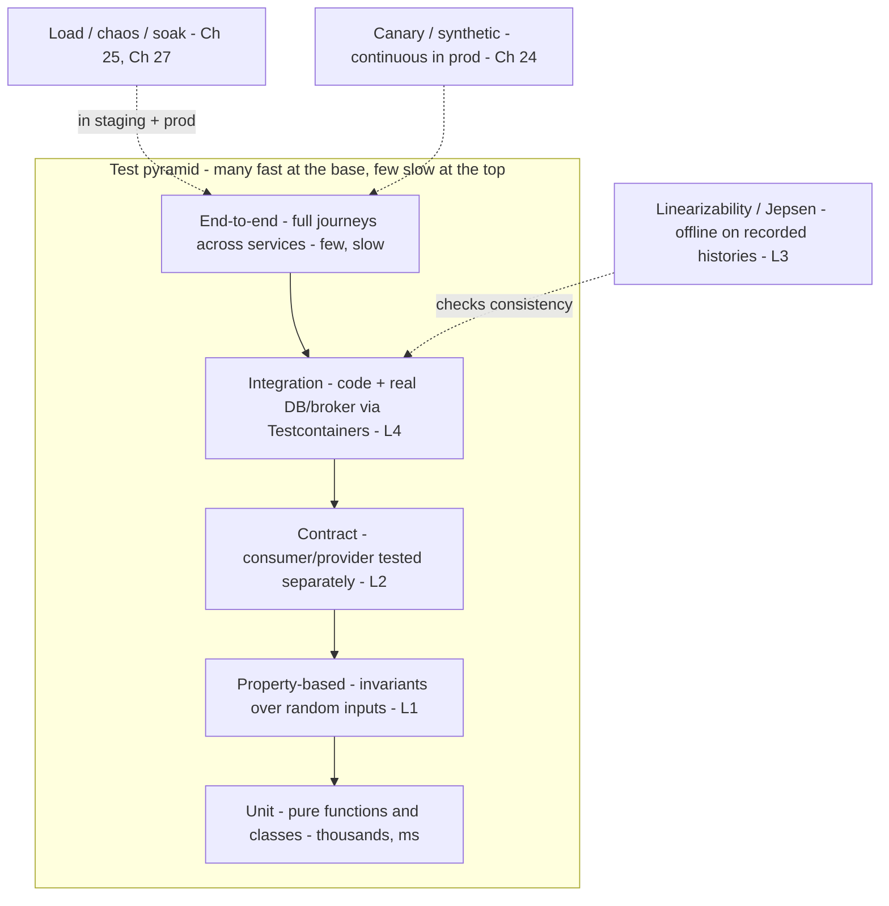
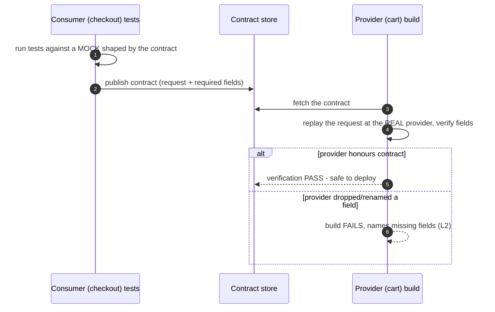
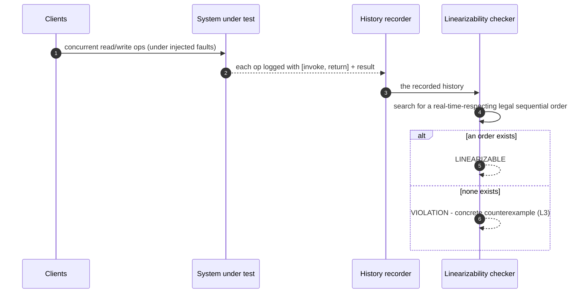
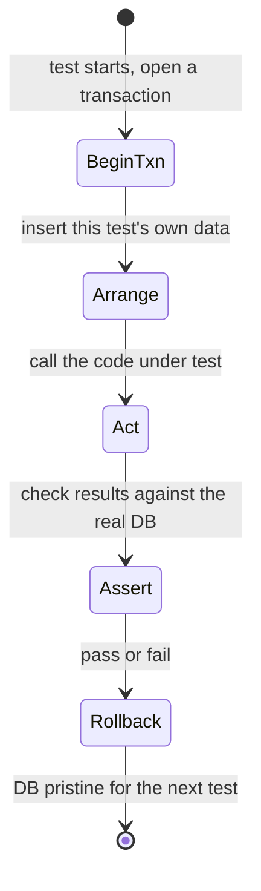

# 29. Testing Distributed Systems

!!! abstract "Chapter at a glance"
    **Reader bands:** B2 → B4 · **Prerequisites:** [Ch 12](../02-distributed-core/12-consistency-time-and-consensus.md), [Ch 17](../02-distributed-core/17-inter-service-communication.md), [Ch 18](../02-distributed-core/18-resilience-patterns.md), [Ch 28](28-schema-and-data-evolution.md) · **What you will build:** How the grocery platform proves its services are correct **before** an outage does it for them — the test pyramid, property-based tests, consumer-driven contracts, linearizability checking, and integration tests against a real database with fault injection. Every lab is a **real, runnable** test that finds a **real bug**.

    - **L1: property-based testing.** A hand-rolled property tester threw 1,000 random inputs at a money splitter, found that the naive one **loses paise on odd splits**, and **shrank** the failure to the minimal reproducer: **`total=1` split 2 ways loses 1 paisa**.
    - **L2: consumer-driven contracts.** A checkout consumer published a contract; verifying the provider against it (with **no consumer running**) **passed v1** and **failed v2** the instant the provider renamed `total_paise`→`amount` and dropped `currency` — naming the exact missing fields.
    - **L3: linearizability checking.** A from-scratch checker (the idea behind Jepsen/Knossos) **accepted** a correct register history and **rejected** both a **stale read** and a **lost update** — with a concrete "no valid order exists" verdict.
    - **L4: integration testing on real PostgreSQL.** A mock-free test proved **isolation via rollback**, **caught a missing `UNIQUE` constraint** (failed as shipped, passed after the migration), and verified the app **fails cleanly when the DB backend is killed mid-transaction** with **no partial write**.

    · **Reading time:** 120 min + code

---

## 1. Introduction & Why It Matters

### 1.1 A story: the tests were green and the checkout was broken

The order service had 94% unit-test coverage and a green pipeline. It still shipped three production incidents in one quarter:

1. **A rounding bug in split payments.** When a shared cart's total didn't divide evenly across payers, the sum of the charges was one paisa short of the total, and the ledger reconciliation job failed every night. Every unit test passed — because every unit test used a total that happened to divide evenly. Nobody wrote the odd case, because nobody *thought* of it (L1).
2. **A broken contract.** The cart team "refactored" a response field from `total_paise` to `amount` and deployed. Their tests passed (they updated them). Checkout's tests passed (they mocked the cart response with the *old* shape). In production, checkout read `null` and every order failed. Two green pipelines, one outage — because the mock on the consumer side and the real provider had silently diverged (L2).
3. **A stale read from a replica.** Under load, order reads were routed to an async replica that lagged the primary. A customer added an item, and the next screen showed the *old* cart — a linearizability violation that no functional test caught, because it only appeared under concurrency + replica lag. The team argued for a week about whether it was "really a bug" before someone recorded a history and proved it (L3).

The retro's conclusion: **coverage measured how much code ran, not whether the system was correct.** The mocks tested the team's *assumptions* about other services, not reality. And nothing tested the properties that actually matter in a distributed system — that money is conserved, that contracts hold across teams, that consistency guarantees are real under concurrency and failure. This chapter is about the tests that would have caught all three.

### 1.2 Where this lives in the grocery platform

| Test type | What it proves | Speed / count | Lab |
|---|---|---|---|
| Unit | A function/class is correct in isolation | ms, thousands | — |
| Property-based | A property holds for *all* inputs, not just examples | ms, hundreds of cases each | L1 |
| Contract | A consumer and provider agree on the API, tested separately | fast, per pair | L2 |
| Integration | Code + real dependency (DB, broker) behave together | slow, hundreds | L4 |
| Consistency / linearizability | The system honours its stated guarantee under concurrency | offline, on recorded histories | L3 |
| End-to-end | A user journey works across services | slow, few | §2.9 |
| Load / soak / chaos | It holds up under traffic and faults | scheduled | [Ch 25](25-performance-engineering.md), [Ch 27](27-reliability-and-disaster-recovery.md) |

### 1.3 Learning objectives

By the end you will be able to:

- **Shape a test suite** with the pyramid and know what each layer can and can't prove.
- **Write property-based tests** that find the edge cases you didn't think of, and read a shrunk counterexample (L1).
- **Use consumer-driven contracts** so services can be tested and deployed independently (L2).
- **Check linearizability** on a recorded history and understand how Jepsen finds consistency bugs (L3).
- **Write integration tests against real dependencies** with proper isolation and fault injection (L4).
- **Diagnose and prevent flaky tests**, and know when to test *in* production.

---

## 2. Core Concepts — Beginner to Deep

### 2.1 Intuition: you can't test a distributed system by example <span class="band b2">B2</span>

A single function has a manageable input space; a few examples plus the edge cases cover it. A distributed system's behaviour depends on **inputs × interleavings × failures × timing**, which is astronomically large and mostly invisible to example-based tests. So testing distributed systems is about **changing the question**:

- from "does it work on these inputs?" to "does this **property** hold for *all* inputs?" (property-based testing, L1);
- from "do my mocks match?" to "does the **contract** between services hold?" (contract testing, L2);
- from "did the test pass?" to "does a **valid explanation** of this observed history exist?" (linearizability, L3);
- from "does the mock behave?" to "does the **real dependency** behave, including when it fails?" (integration + fault injection, L4).

### 2.2 The test pyramid (and the ice-cream-cone anti-pattern) ⭐ <span class="band b2">B2</span>

The **pyramid**: many fast, isolated **unit** tests at the base; fewer **integration** tests in the middle; a handful of slow **end-to-end** tests at the top. The shape follows from cost: unit tests are milliseconds and pinpoint failures; e2e tests are minutes, flaky, and only tell you "something broke somewhere."

The **ice-cream cone** (the anti-pattern) inverts it — mostly manual/e2e tests, few unit tests — and gives you slow, flaky pipelines that fail without saying why. In a microservices world the pyramid gains a crucial middle layer, **contract tests** (L2), which give integration-level confidence at unit-level speed by testing each side against a shared contract instead of spinning up the whole system.

### 2.3 Test doubles: mocks, stubs, fakes, spies ⭐ <span class="band b2">B2</span>

A **test double** stands in for a real dependency:

- **Stub** — returns canned answers (`when(repo.find(1)).thenReturn(order)`).
- **Mock** — a stub that also **asserts on interactions** (was `save()` called once?).
- **Fake** — a working lightweight implementation (an in-memory repository).
- **Spy** — wraps a real object and records calls.

Doubles make unit tests fast and deterministic, but they encode **your assumptions** about the dependency. The §1.1 contract break is the classic failure: the mock said the cart returns `total_paise`, reality said `amount`, and the mock never updated. Rule of thumb: **mock at architectural boundaries you own the contract for**, and back every mocked cross-service boundary with a **contract test** (L2) and every mocked datastore with at least some **integration tests** against the real thing (L4).

### 2.4 Property-based testing ⭐ <span class="band b3">B3</span>

Instead of examples, you state an **invariant** and let the framework generate hundreds of random inputs to try to break it; on failure it **shrinks** the input to the smallest counterexample. Classic properties:

- **Round-trip:** `decode(encode(x)) == x` (serializers, [Ch 28](28-schema-and-data-evolution.md)).
- **Invariant:** the split parts sum to the total; a balance is never negative (L1).
- **Oracle:** the fast implementation agrees with a slow obvious one.
- **Idempotency:** `f(f(x)) == f(x)` (retries, [Ch 20](../02-distributed-core/20-idempotency-ids-and-distributed-locks.md)).
- **Commutativity:** applying events in any order yields the same state (CRDTs, [Ch 12](../02-distributed-core/12-consistency-time-and-consensus.md)).

Tools: **jqwik** (Java), Hypothesis (Python), QuickCheck (Haskell), fast-check (JS). L1 builds a tiny one from scratch — random generation + shrinking — and finds the paise-loss bug. **Shrinking is the killer feature:** a random failure at `total=727563, n=9` is useless as a bug report; shrunk to `total=1, n=2` it's obvious and becomes a one-line regression test.

### 2.5 Contract testing (consumer-driven) ⭐ <span class="band b3">B3</span>

In a **consumer-driven contract** (CDC), the **consumer** declares exactly the requests it makes and the response fields it depends on; that contract is published; the **provider** is verified against it **in isolation**. Neither side needs the other running.

Why it beats end-to-end integration for cross-service correctness:

- **Speed & stability:** no need to stand up a fleet; each side tests alone.
- **It catches the break at the source:** the provider's build fails the moment it violates a contract a consumer relies on (L2), naming the fields — before deploy.
- **It documents real usage:** the contract is the consumer's *actual* needs, so the provider can freely change anything **not** in any contract (L2 changed `items` freely; it broke only because it touched `total_paise`/`currency`).

**Pact** is the common tool (a broker stores contracts and gates deploys via "can-I-deploy"). L2 builds the mechanic from scratch: publish → verify → break. CDC pairs naturally with schema-registry compatibility for events ([Ch 28](28-schema-and-data-evolution.md) L3) — contracts for the sync API, the registry for the async bus.

### 2.6 Integration testing with real dependencies (Testcontainers) ⭐ <span class="band b3">B3</span>

Some bugs live *only* at the boundary with a real dependency: a constraint your ORM doesn't know about, a subtle SQL dialect difference, a transaction-isolation surprise, a serialization mismatch. **Testcontainers** starts a real PostgreSQL/Kafka/Redis in a throwaway Docker container per test run, so integration tests hit the real engine and clean up automatically. L4 uses a real PostgreSQL directly (Docker being unavailable here) and:

- **isolates tests** by running each in a transaction it **rolls back** (fast; the DB is pristine after) — the alternative is schema/database-per-test (stronger isolation, slower);
- **catches a real schema bug** a mock never could — a missing `UNIQUE` constraint (the mock enforces nothing);
- **injects a fault** — killing the DB backend mid-transaction — to test the error path.

### 2.7 Testing for consistency: linearizability & Jepsen <span class="band b4">B4</span>

The hardest distributed bugs are **consistency violations** that appear only under concurrency + failure. You can't assert them with examples; you **record a history** (each operation's real-time window and result) and **check** whether a valid explanation exists.

- **Linearizability** ([Ch 12](../02-distributed-core/12-consistency-time-and-consensus.md)): there is a single total order of operations consistent with real time (if A returns before B starts, A precedes B) and with the object's semantics (a read returns the last write). A checker searches for such an order; none existing = a violation (L3).
- **Jepsen** is the framework that does this at scale: it drives a real distributed database with randomized concurrent operations **under injected faults** (network partitions, process pauses, clock skew) via `nemesis`, records the history, and checks it with **Knossos** (linearizability) or **Elle** (transactional anomalies). It has found serious bugs in many production databases.

L3 builds the checker's core — the real-time-aware search — and shows it rejecting a stale read and a lost update.

### 2.8 Deterministic simulation testing <span class="band b4">B4</span>

The most powerful technique for the *implementation* of a distributed system: run the **entire system** — every node, the network, the clock, disk — on a **single-threaded deterministic simulation** where you control time and message delivery from a seed. Because everything is deterministic, a failing seed **replays exactly**, so a one-in-a-billion race becomes a reproducible bug. You then inject partitions, reorderings, and crashes and explore millions of schedules. FoundationDB pioneered this; TigerBeetle, and frameworks like `madsim` (Rust) and `turmoil` follow it. It requires designing the code for it (all I/O and time behind injectable interfaces), which is a significant commitment — the payoff is finding and reproducing concurrency bugs that are otherwise Heisenbugs.

### 2.9 End-to-end, smoke, and canary tests <span class="band b3">B3</span>

- **End-to-end** exercises a full user journey (add to cart → checkout → order confirmed) across real services. Keep them **few** — they're slow and flaky — and reserve them for the critical revenue paths.
- **Smoke tests** are a tiny set run right after deploy to confirm the system is alive (health endpoints, one login, one order).
- **Canary/synthetic monitoring** runs scripted journeys continuously in production against real endpoints, alerting when a journey breaks — testing *in* production ([Ch 24](24-observability.md)).

### 2.10 Flaky tests, test data, and CI <span class="band b3">B3</span>

- **Flaky tests** (pass/fail non-deterministically) destroy trust in the suite — people start ignoring red. Causes: timing/`sleep`, shared state between tests, real time/clock, ordering dependence, network. Fixes: control time (inject a clock), isolate state (L4's rollback), await conditions instead of sleeping, quarantine and fix — never retry-until-green as a habit.
- **Test data:** builders/factories over shared fixtures; each test creates what it needs; reset between tests (rollback or truncate).
- **CI:** run the fast layers on every push, gate merges on green, run slow integration/e2e on a schedule or pre-merge; make the pipeline **fast** (parallelize) or people route around it.

### 2.11 Coverage, mutation testing, and what "tested" means <span class="band b4">B4</span>

**Line/branch coverage** measures which code *ran*, not whether it was *checked* — you can have 100% coverage with no assertions. **Mutation testing** (PIT for Java) measures test *quality*: it makes small changes to your code (mutations) and checks whether a test fails; a surviving mutant is code your tests execute but don't actually verify. It's the honest answer to "are these tests worth anything?" — far more meaningful than a coverage percentage, and the antidote to the §1.1 "94% coverage, still broken" trap.

---

## 3. Architecture & Diagrams

### 3.1 The test pyramid for the grocery platform



### 3.2 Sequence: consumer-driven contract flow



### 3.3 Sequence: linearizability checking of a recorded history



### 3.4 State: a test's lifecycle with rollback isolation



---

## 4. Design Document Excerpt: Grocery Test Strategy

!!! note "Design Document (excerpt) — Test Strategy v2.0"
    **Status:** Accepted · **Authors:** Platform Quality Guild · **Reviewers:** Service leads, SRE

    | Field | Value |
    |---|---|
    | Context | 26 services, shared datastores, an event bus, and mobile/partner clients. A quarter of "green pipeline" outages (rounding bug, contract break, stale read) showed coverage ≠ correctness. |
    | Decision | Adopt the pyramid with a strong **contract** layer; mandate **property-based** tests for money/serialization/idempotency logic; **integration** tests against real dependencies for every repository/adapter; **linearizability/Jepsen**-style checks for any component claiming strong consistency; and **mutation testing** as the quality gate instead of a coverage number. |
    | Related ADRs | ADR-150 Test pyramid + no ice-cream-cone; ADR-151 Consumer-driven contracts (Pact) gate cross-service deploys; ADR-152 Property-based tests for invariant-bearing logic; ADR-153 Integration tests on real deps (Testcontainers) with rollback isolation; ADR-154 Jepsen-style consistency checks for stateful stores; ADR-155 Mutation score, not line coverage, as the gate; ADR-156 Flaky tests quarantined within 24h |

    **Requirements.**

    - **R1 — Fast feedback.** Unit + property + contract layers run on every push in under 10 minutes; slow integration/e2e run pre-merge and nightly.
    - **R2 — No mock drift.** Every mocked cross-service boundary MUST have a contract test; every mocked datastore MUST have integration tests on the real engine.
    - **R3 — Invariants proven.** Money math, serialization round-trips, and idempotency MUST have property-based tests. (L1.)
    - **R4 — Consistency proven, not asserted.** Any store/feature claiming linearizability MUST pass a recorded-history check under fault injection. (L3.)
    - **R5 — Quality measured.** Merge gate is a **mutation score** threshold on changed code, not line coverage.
    - **R6 — No flaky tolerance.** A flaky test is quarantined within 24h and fixed or deleted within a week; retry-until-green is banned in CI.

    **Decisions in detail.**

    1. **Contracts gate deploys (ADR-151).** Consumers publish contracts to a broker; providers verify in CI; a `can-i-deploy` check blocks a provider release that would break a live consumer. (L2.)
    2. **Property tests for invariants (ADR-152).** jqwik for Java; the shrunk counterexample is committed as a regression unit test. (L1.)
    3. **Real-dependency integration (ADR-153).** Testcontainers-backed; rollback-per-test isolation; fault-injection tests for connection loss and timeouts. (L4.)
    4. **Consistency checks (ADR-154).** Record histories under a nemesis (partitions, pauses); check with a linearizability/Elle checker; run in the nightly pipeline for stateful components. (L3.)
    5. **Mutation gate (ADR-155).** PIT on changed files; surviving mutants block merge; coverage is reported but not gated.

    **Consequences.** More engineering investment in the middle of the pyramid (contracts, real-dependency integration) and in property/consistency tests for the risky code. In return: independent deploys, edge cases found before production, consistency guarantees that are actually true, and a suite people trust. The "coverage number" theatre is explicitly abandoned.

---

## 5. Hands-On Code — Level Ladder

!!! info "What's real here"
    L1, L2 and L3 are pure JDK 21 (no dependencies) — the property tester, the contract verifier over real HTTP, and the linearizability checker are all built from scratch so you can see the mechanism. L4 runs against **real PostgreSQL 16** (local cluster on :5581) through the real JDBC driver, including a real `pg_terminate_backend` fault injection. Framework equivalents (jqwik, Pact, Jepsen/Knossos, Testcontainers) are named where they'd replace the hand-rolled version; snippets needing them are marked **VERIFY**.

### L1 — Property-based testing that finds an edge case <span class="band b2">B2</span>

**Requirement:** "Our split-payment math passed every unit test and still lost a paisa in production. Find that class of bug automatically."

A hand-rolled property tester states one invariant — **the split parts sum to the total** — throws 1,000 random `(total, n)` at each splitter, and **shrinks** any failure to the smallest input that still breaks it.

```java title="PropertyL1.java"
// PropertyL1.java — run with: java PropertyL1.java   (JDK 21, no dependencies)
// PROPERTY-BASED TESTING from scratch: instead of a few hand-picked examples, we state a PROPERTY that must hold for ALL
// inputs and let the framework throw hundreds of random inputs at it — then SHRINK any failure to the smallest counter-
// example. The system under test is a money splitter: split an order total (in paise) evenly across N people. The
// property every correct splitter must satisfy: THE PARTS SUM BACK TO THE TOTAL (you can't create or destroy money).
// We test a naive splitter (integer division — loses the remainder) and a correct one (distributes the remainder).
import java.util.*;
import java.util.function.*;

public class PropertyL1 {

    // ---- systems under test ----
    // NAIVE: total/n each. If total doesn't divide evenly, the remainder paise vanish. (A real bug seen in billing code.)
    static long[] splitNaive(long total, int n) {
        long each = total / n;
        long[] parts = new long[n];
        Arrays.fill(parts, each);
        return parts;
    }
    // CORRECT: give the first (total % n) people one extra paisa, so the parts sum exactly to total.
    static long[] splitCorrect(long total, int n) {
        long each = total / n, rem = total % n;
        long[] parts = new long[n];
        for (int i = 0; i < n; i++) parts[i] = each + (i < rem ? 1 : 0);
        return parts;
    }

    // ---- a tiny property-based tester with shrinking ----
    record Case(long total, int n) {}

    // property: sum(parts) == total, for all total>=0, n in [1..20]
    static boolean property(BiFunction<Long,Integer,long[]> split, Case c) {
        long[] parts = split.apply(c.total, c.n);
        long sum = 0; for (long p : parts) sum += p;
        return sum == c.total;
    }

    // shrink a failing case toward the smallest still-failing case (fewer people, smaller total)
    static Case shrink(BiFunction<Long,Integer,long[]> split, Case fail) {
        Case best = fail;
        boolean improved = true;
        while (improved) {
            improved = false;
            // try shrinking total toward 0, and n toward 1, greedily keeping any smaller case that STILL fails
            List<Case> candidates = new ArrayList<>();
            if (best.total > 0) { candidates.add(new Case(best.total / 2, best.n)); candidates.add(new Case(best.total - 1, best.n)); }
            if (best.n > 1)     { candidates.add(new Case(best.total, best.n - 1)); }
            for (Case cand : candidates) {
                if (cand.total >= 0 && cand.n >= 1 && !property(split, cand)) { best = cand; improved = true; break; }
            }
        }
        return best;
    }

    static void check(String name, BiFunction<Long,Integer,long[]> split, long seed) {
        Random r = new Random(seed);
        int RUNS = 1000;
        Case firstFail = null;
        for (int i = 0; i < RUNS; i++) {
            long total = (long) (r.nextDouble() * 1_000_000);   // 0..10,000.00 rupees in paise
            int n = 1 + r.nextInt(20);
            Case c = new Case(total, n);
            if (!property(split, c)) { firstFail = c; break; }
        }
        if (firstFail == null) {
            System.out.printf("   %-14s: PASSED %d random cases — property 'parts sum to total' holds.%n", name, RUNS);
        } else {
            Case small = shrink(split, firstFail);
            long[] parts = split.apply(small.total, small.n);
            long sum = 0; for (long p : parts) sum += p;
            System.out.printf("   %-14s: FAILED. Random counterexample total=%d n=%d; shrunk to the minimal failing case:%n",
                    name, firstFail.total, firstFail.n);
            System.out.printf("                   total=%d split %d ways = %s  → sum=%d, LOST %d paise.%n",
                    small.total, small.n, Arrays.toString(parts), sum, small.total - sum);
        }
    }

    public static void main(String[] args) {
        long seed = 42;
        System.out.println("Property-based testing: state one property ('the split parts sum to the total') and throw 1000 random");
        System.out.println("inputs at each splitter. A failure is SHRUNK to the smallest input that still breaks it.\n");
        check("splitNaive", PropertyL1::splitNaive, seed);
        check("splitCorrect", PropertyL1::splitCorrect, seed);
        System.out.println("\n   → the naive splitter passes hand-picked even cases (100 / 4 = 25 each) but a random search finds an ODD");
        System.out.println("     case in milliseconds; shrinking reports the *minimal* reproducer (e.g. 1 paisa split 2 ways) instead of");
        System.out.println("     the messy random one. That minimal case is what you paste into a regression unit test. Property tests");
        System.out.println("     find the edge cases you didn't think to write — exactly the ones that bite in production.");
    }
}
```

```text title="java PropertyL1.java"
Property-based testing: state one property ('the split parts sum to the total') and throw 1000 random
inputs at each splitter. A failure is SHRUNK to the smallest input that still breaks it.

   splitNaive    : FAILED. Random counterexample total=727563 n=9; shrunk to the minimal failing case:
                   total=1 split 2 ways = [0, 0]  → sum=0, LOST 1 paise.
   splitCorrect  : PASSED 1000 random cases — property 'parts sum to total' holds.

   → the naive splitter passes hand-picked even cases (100 / 4 = 25 each) but a random search finds an ODD
     case in milliseconds; shrinking reports the *minimal* reproducer (e.g. 1 paisa split 2 ways) instead of
     the messy random one. That minimal case is what you paste into a regression unit test. Property tests
     find the edge cases you didn't think to write — exactly the ones that bite in production.
```

**Reading it:**

- `splitNaive` (integer division) passes hand-picked *even* cases but a random search finds an odd one immediately; **shrinking** reduces the messy `total=727563, n=9` to the minimal `total=1, n=2` → parts `[0,0]`, **1 paisa lost**. That minimal case is the regression unit test you commit.
- `splitCorrect` distributes the remainder and **passes all 1,000** cases — the property holds.
- The lesson: example-based tests only cover the cases you *thought of*; a property + random generation covers the ones you didn't, and shrinking makes every failure a clean, minimal bug report. In real code you'd use **jqwik** (`@Property void parts_sum_to_total(@ForAll long total, @ForAll @IntRange(min=1,max=20) int n)`), which generates, shrinks and re-runs the shrunk case automatically.

### L2 — Consumer-driven contract testing <span class="band b3">B3</span>

**Requirement:** "The cart team renamed a field and broke checkout in production, even though both teams' pipelines were green. Catch that at build time."

The checkout **consumer** publishes a contract: `GET /cart/42` must return `cart_id` (number), `total_paise` (number), `currency` (string). We verify two provider versions against it over **real HTTP**, with **no consumer running**.

```java title="ContractL2.java"
// ContractL2.java — run with: java ContractL2.java   (JDK 21, no dependencies)
// CONSUMER-DRIVEN CONTRACT TESTING from scratch (the idea behind Pact). Integration tests that spin up every service are
// slow and flaky; contract tests let each side be tested ALONE against a shared CONTRACT. The CONSUMER (a checkout
// service) declares exactly the request it sends and the response FIELDS it depends on. That contract is published. The
// PROVIDER (the cart service) is then verified against the contract WITHOUT the consumer present: we replay the
// consumer's request at the real provider and assert the response satisfies every expectation. When the provider later
// drops/renames a field the consumer needs, verification FAILS — catching the break at build time, not in production.
import com.sun.net.httpserver.*;
import java.io.*;
import java.net.*;
import java.net.http.*;
import java.util.*;
import java.util.regex.*;

public class ContractL2 {

    // ---- the contract the CONSUMER publishes: request + the fields it relies on ----
    record Expectation(String method, String path, Map<String,String> requiredFields) {}

    // The checkout consumer only reads cart_id, total_paise and currency from the cart response. It does NOT care about
    // any other field. That is the whole point: the contract is the consumer's ACTUAL needs, nothing more.
    static final Expectation CONTRACT = new Expectation("GET", "/cart/42",
            Map.of("cart_id", "number", "total_paise", "number", "currency", "string"));

    // ---- two versions of the PROVIDER ----
    // v1 honours the contract. v2 has "refactored" total_paise -> amount and dropped currency — a breaking change the
    // provider team thought was internal. Contract verification is what tells them it is NOT internal.
    static HttpServer startProvider(int port, boolean v2) throws IOException {
        HttpServer s = HttpServer.create(new InetSocketAddress("127.0.0.1", port), 0);
        s.createContext("/cart/42", ex -> {
            String body = v2
                ? "{\"cart_id\": 42, \"amount\": 129900, \"items\": 3}"                       // renamed + dropped currency
                : "{\"cart_id\": 42, \"total_paise\": 129900, \"currency\": \"INR\", \"items\": 3}";
            byte[] b = body.getBytes();
            ex.getResponseHeaders().add("Content-Type", "application/json");
            ex.sendResponseHeaders(200, b.length); ex.getResponseBody().write(b); ex.close();
        });
        s.start();
        return s;
    }

    // ---- the verifier: replay the contract's request at a provider and check every required field is present ----
    record Result(boolean ok, List<String> failures) {}
    static Result verify(int port) throws Exception {
        HttpClient c = HttpClient.newHttpClient();
        HttpResponse<String> r = c.send(
            HttpRequest.newBuilder(URI.create("http://127.0.0.1:" + port + CONTRACT.path())).GET().build(),
            HttpResponse.BodyHandlers.ofString());
        String body = r.body();
        List<String> failures = new ArrayList<>();
        for (var e : CONTRACT.requiredFields().entrySet()) {
            String field = e.getKey(), type = e.getValue();
            if (!hasField(body, field, type))
                failures.add("missing/!" + type + " field '" + field + "'");
        }
        return new Result(failures.isEmpty(), failures);
    }

    // minimal JSON field presence + coarse type check (no dependency); enough to demonstrate the contract mechanic
    static boolean hasField(String json, String field, String type) {
        Matcher m = Pattern.compile("\"" + Pattern.quote(field) + "\"\\s*:\\s*(\"[^\"]*\"|-?\\d+(?:\\.\\d+)?)").matcher(json);
        if (!m.find()) return false;
        String val = m.group(1);
        boolean isString = val.startsWith("\"");
        return type.equals("string") == isString;
    }

    public static void main(String[] args) throws Exception {
        System.out.println("Consumer-driven contract: the checkout consumer needs {cart_id:number, total_paise:number, currency:string}.");
        System.out.println("We verify each provider version against that contract, with NO consumer running — just the published contract.\n");
        System.out.println("   Contract (published by the consumer): GET /cart/42 must return " + CONTRACT.requiredFields());
        System.out.println();

        HttpServer p1 = startProvider(19960, false);
        Result r1 = verify(19960);
        System.out.printf("   provider v1 (original)                : %s%n", r1.ok() ? "VERIFIED ✓ — honours the contract" : "FAILED ✗ " + r1.failures());
        p1.stop(0);

        HttpServer p2 = startProvider(19961, true);
        Result r2 = verify(19961);
        System.out.printf("   provider v2 (renamed total_paise→amount, dropped currency): %s%n",
                r2.ok() ? "VERIFIED ✓" : "CONTRACT BROKEN ✗ — " + r2.failures());
        p2.stop(0);

        System.out.println("\n   → v1 passes: every field the consumer relies on is present with the right type. v2 'refactored' a field the");
        System.out.println("     provider team believed was internal — and the contract test FAILS the provider's build, naming the exact");
        System.out.println("     missing fields, before it ever reaches the consumer. That is how you decouple deploys safely: the provider");
        System.out.println("     may change anything the contract does NOT mention (it changed nothing about 'items'), but not what it does.");
    }
}
```

```text title="java ContractL2.java"
Consumer-driven contract: the checkout consumer needs {cart_id:number, total_paise:number, currency:string}.
We verify each provider version against that contract, with NO consumer running — just the published contract.

   Contract (published by the consumer): GET /cart/42 must return {total_paise=number, cart_id=number, currency=string}

   provider v1 (original)                : VERIFIED ✓ — honours the contract
   provider v2 (renamed total_paise→amount, dropped currency): CONTRACT BROKEN ✗ — [missing/!number field 'total_paise', missing/!string field 'currency']

   → v1 passes: every field the consumer relies on is present with the right type. v2 'refactored' a field the
     provider team believed was internal — and the contract test FAILS the provider's build, naming the exact
     missing fields, before it ever reaches the consumer. That is how you decouple deploys safely: the provider
     may change anything the contract does NOT mention (it changed nothing about 'items'), but not what it does.
```

**Reading it:**

- **v1** is verified: every field the consumer relies on is present with the right type.
- **v2** "refactored" `total_paise`→`amount` and dropped `currency` — a change the provider team believed was internal. Verification **fails the provider's build** and names the exact missing fields, *before* it reaches checkout.
- The provider changed `items` freely — the contract doesn't mention it, so it's fair game. That's the discipline: **you may change anything no consumer contract depends on, and nothing it does.** In practice **Pact** records these interactions from the consumer's tests, a broker stores them, and a `can-i-deploy` gate blocks a provider release that would break a live consumer. This is the sync-API counterpart to the schema-registry check for events ([Ch 28](28-schema-and-data-evolution.md) L3).

### L3 — Linearizability checking (the idea behind Jepsen) <span class="band b4">B4</span>

**Requirement:** "Under load, a read returned a stale cart. The team argued for a week about whether it was 'really' a bug. Prove it mechanically."

A from-scratch checker takes a recorded history (each operation's real-time window `[invoke, return]` and result) and searches for a single sequential order that respects **both** real time and register semantics. If none exists, the history is **not linearizable** — the system violated its guarantee.

```java title="LinearL3.java"
// LinearL3.java — run with: java LinearL3.java   (JDK 21, no dependencies)
// LINEARIZABILITY CHECKING — the technique behind Jepsen/Knossos. You cannot unit-test a distributed register by asking
// "is it correct?"; you RECORD a concurrent HISTORY of operations (each with the real-time window [invoke, return] and
// its result) and then ask a checker: does there exist a single sequential order of these operations that (a) respects
// real time — if op A returned before op B was invoked, A precedes B — and (b) is a legal register execution (every read
// returns the most recent write)? If such an order exists the history is LINEARIZABLE; if not, the system violated the
// guarantee. We run the checker on three recorded histories from a replicated register (one correct, two buggy).
import java.util.*;

public class LinearL3 {

    // an operation in a recorded history. WRITE(value) or READ()->value. Times are logical ticks.
    record Op(String client, boolean isWrite, int value, int invoke, int ret) {
        public String toString() {
            return String.format("%s %s%s [%d..%d]", client, isWrite ? "write(" + value + ")" : "read()->", isWrite ? "" : ""+value, invoke, ret);
        }
    }

    // ---- the checker: real-time-aware brute-force search for a valid linearization (Wing & Gong style) ----
    // We repeatedly pick a "minimal" op (one whose invoke is <= the earliest return among remaining ops, so choosing it
    // cannot violate real-time order), apply it to the model, recurse, and backtrack. A read is legal iff it returns the
    // model's current value. If we consume all ops, we found a linearization.
    static List<Op> linearizationFound;
    static boolean linearizable(List<Op> remaining, int regValue, List<Op> acc) {
        if (remaining.isEmpty()) { linearizationFound = new ArrayList<>(acc); return true; }
        int minRet = Integer.MAX_VALUE;
        for (Op o : remaining) minRet = Math.min(minRet, o.ret());
        for (Op o : remaining) {
            if (o.invoke() > minRet) continue;                       // choosing o would break real-time order → skip
            int newVal = regValue;
            if (o.isWrite()) newVal = o.value();
            else if (o.value() != regValue) continue;                // read result inconsistent with model → not this pick
            List<Op> rest = new ArrayList<>(remaining); rest.remove(o);
            acc.add(o);
            if (linearizable(rest, newVal, acc)) return true;
            acc.remove(acc.size() - 1);                              // backtrack
        }
        return false;
    }

    static void check(String name, int initial, List<Op> history) {
        System.out.println("   " + name);
        for (Op o : history) System.out.println("        " + o);
        linearizationFound = null;
        boolean ok = linearizable(new ArrayList<>(history), initial, new ArrayList<>());
        if (ok) {
            StringBuilder sb = new StringBuilder();
            for (Op o : linearizationFound) sb.append(o.isWrite() ? "W" + o.value() : "R" + o.value()).append(" ");
            System.out.println("     → LINEARIZABLE. A valid real-time order exists: " + sb.toString().trim());
        } else {
            System.out.println("     → NOT LINEARIZABLE. No sequential order respects both real time and register semantics — the register lied.");
        }
        System.out.println();
    }

    public static void main(String[] args) {
        System.out.println("Linearizability checking: given a recorded history of a distributed register (initial value 0), does a valid");
        System.out.println("sequential order exist? The checker respects real-time order AND register semantics (a read = the last write).\n");

        // History 1: correct register. C2's read overlaps C1's write, so returning 1 is fine (write linearizes first).
        check("History 1 — correct register (quorum reads/writes):", 0, List.of(
            new Op("C1", true, 1, 0, 3),      // write(1)
            new Op("C2", false, 1, 2, 5),     // read()->1  (overlaps the write; legal)
            new Op("C1", true, 2, 6, 8),      // write(2)
            new Op("C3", false, 2, 9, 11)     // read()->2
        ));

        // History 2: async-replica STALE READ. write(1) fully completes and a read sees 1; then a LATER read hits a
        // lagging replica and returns 0 — the value has travelled backwards in time. No linearization can order this.
        check("History 2 — async replica served a STALE read:", 0, List.of(
            new Op("C1", true, 1, 0, 2),      // write(1) completes at t2
            new Op("C2", false, 1, 3, 5),     // read()->1  at t3..t5
            new Op("C3", false, 0, 6, 8)      // read()->0  at t6..t8  ← impossible: 1 was already observed and committed
        ));

        // History 3: LOST UPDATE. Two writes both ack (last-writer-wins bug drops one), then a read returns a value that
        // is consistent with neither final write ordering given the real-time constraints.
        check("History 3 — lost update (write acked but overwritten wrongly):", 0, List.of(
            new Op("C1", true, 1, 0, 2),      // write(1) completes at t2
            new Op("C2", true, 2, 3, 5),      // write(2) completes at t5 (strictly after write(1))
            new Op("C3", false, 1, 6, 8)      // read()->1  at t6..t8  ← must see 2 (the last completed write), not 1
        ));

        System.out.println("   → the checker is your oracle: it turns 'the database says it's strongly consistent' into a mechanical proof");
        System.out.println("     or a concrete counterexample. History 1 is accepted; the stale read and the lost update are both rejected");
        System.out.println("     with certainty. This is exactly how Jepsen finds consistency violations that survived every unit test —");
        System.out.println("     you generate randomized concurrent histories under fault injection (partitions, pauses) and check each one.");
    }
}
```

```text title="java LinearL3.java"
Linearizability checking: given a recorded history of a distributed register (initial value 0), does a valid
sequential order exist? The checker respects real-time order AND register semantics (a read = the last write).

   History 1 — correct register (quorum reads/writes):
        C1 write(1) [0..3]
        C2 read()->1 [2..5]
        C1 write(2) [6..8]
        C3 read()->2 [9..11]
     → LINEARIZABLE. A valid real-time order exists: W1 R1 W2 R2

   History 2 — async replica served a STALE read:
        C1 write(1) [0..2]
        C2 read()->1 [3..5]
        C3 read()->0 [6..8]
     → NOT LINEARIZABLE. No sequential order respects both real time and register semantics — the register lied.

   History 3 — lost update (write acked but overwritten wrongly):
        C1 write(1) [0..2]
        C2 write(2) [3..5]
        C3 read()->1 [6..8]
     → NOT LINEARIZABLE. No sequential order respects both real time and register semantics — the register lied.

   → the checker is your oracle: it turns 'the database says it's strongly consistent' into a mechanical proof
     or a concrete counterexample. History 1 is accepted; the stale read and the lost update are both rejected
     with certainty. This is exactly how Jepsen finds consistency violations that survived every unit test —
     you generate randomized concurrent histories under fault injection (partitions, pauses) and check each one.
```

**Reading it:**

- **History 1** (correct register) is **linearizable** — the checker even prints a valid order (`W1 R1 W2 R2`); C2's read overlapped C1's write, so returning `1` is legal.
- **History 2** (async replica) is **rejected**: `write(1)` completed and a read observed `1`, then a *later* read returned `0` — the value travelled backwards in time. No order can respect both real time and semantics.
- **History 3** (lost update) is **rejected**: two writes completed in sequence (`1` then `2`), but a later read returned `1` — it must see the last completed write, `2`.
- This is the checker at the heart of **Jepsen/Knossos**. The other half is generating randomized concurrent histories under a **nemesis** (partitions, pauses, clock skew) and checking each — which is how Jepsen finds violations that survive every functional test. Real checkers (Knossos, **Elle**) add heavy pruning because the search is exponential.

### L4 — Integration testing on real PostgreSQL, with fault injection <span class="band b3">B3</span>

**Requirement:** "A mocked repository passed while a missing DB constraint let duplicates through. Test against the real database — including when it fails."

This runs against **real PostgreSQL 16** and does three things a mock cannot: isolate tests via rollback, catch a missing `UNIQUE` constraint, and inject a real fault by killing the DB backend mid-transaction.

```java title="IntegrationL4.java"
// IntegrationL4.java — run with: java -cp /tmp/pgjdbc.jar IntegrationL4.java   (real PostgreSQL 16 on :5581)
// INTEGRATION TESTING against a REAL database (what Testcontainers gives you when Docker is available — here we use a
// real local PostgreSQL directly). Three things unit tests with a mocked repository CANNOT do:
//   A) ISOLATION: run each test inside a transaction that is ROLLED BACK, so tests don't pollute each other or the DB.
//   B) CATCH A REAL SCHEMA BUG: a missing UNIQUE constraint lets a duplicate email through — a mock would never notice,
//      because the mock doesn't enforce constraints. The real DB does, so the integration test finds it.
//   C) FAULT INJECTION: kill the DB connection mid-transaction (pg_terminate_backend) and assert the app fails cleanly
//      and rolls back — exercising the error path that only real failures trigger.
import java.sql.*;

public class IntegrationL4 {
    static final String URL = "jdbc:postgresql://localhost:5581/shop?user=postgres";
    static int pass = 0, fail = 0;
    static void assertThat(String name, boolean cond) {
        System.out.printf("      [%s] %s%n", cond ? "PASS" : "FAIL", name);
        if (cond) pass++; else fail++;
    }

    public static void main(String[] args) throws Exception {
        try (Connection setup = DriverManager.getConnection(URL); Statement st = setup.createStatement()) {
            st.execute("drop table if exists users");
            st.execute("create table users(id bigserial primary key, email text not null, name text)");
        }

        System.out.println("Integration testing against REAL PostgreSQL 16 (not a mock). Three capabilities a mock can't give you:\n");

        // ---- A) test isolation via transaction rollback ----
        System.out.println("   A) Isolation: each test runs in a transaction that is rolled back — the table is untouched afterward.");
        long before = count();
        for (int i = 0; i < 5; i++) {
            try (Connection c = DriverManager.getConnection(URL)) {
                c.setAutoCommit(false);
                try (PreparedStatement ps = c.prepareStatement("insert into users(email,name) values (?,?)")) {
                    ps.setString(1, "test" + i + "@shop.in"); ps.setString(2, "Test " + i); ps.executeUpdate();
                }
                // ... the test would assert things here against its own inserted rows ...
                c.rollback();     // undo everything this test did
            }
        }
        long after = count();
        assertThat("5 tests each inserted a row then rolled back; row count unchanged (" + before + " == " + after + ")", before == after);

        // ---- B) a real integration test that catches a MISSING UNIQUE CONSTRAINT ----
        System.out.println("\n   B) Catch a real schema bug: 'registering the same email twice must fail'.");
        System.out.println("      Run 1 — against the table AS SHIPPED (no unique constraint on email):");
        assertThat("duplicate email is rejected", duplicateEmailRejected());

        System.out.println("      Run 2 — after the migration adds `UNIQUE (email)`:");
        try (Connection c = DriverManager.getConnection(URL); Statement st = c.createStatement()) {
            st.execute("delete from users");
            st.execute("create unique index users_email_uq on users(email)");
        }
        assertThat("duplicate email is rejected", duplicateEmailRejected());

        // ---- C) fault injection: kill the connection mid-transaction ----
        System.out.println("\n   C) Fault injection: terminate the DB backend mid-transaction; the app must fail cleanly and not half-commit.");
        boolean cleanFailure = false, noPartialWrite;
        long rowsBeforeFault = count();
        try (Connection victim = DriverManager.getConnection(URL)) {
            victim.setAutoCommit(false);
            int pid; try (Statement s = victim.createStatement(); ResultSet rs = s.executeQuery("select pg_backend_pid()")) { rs.next(); pid = rs.getInt(1); }
            try (PreparedStatement ps = victim.prepareStatement("insert into users(email,name) values (?,?)")) {
                ps.setString(1, "midtxn@shop.in"); ps.setString(2, "Mid Txn"); ps.executeUpdate();   // written but NOT committed
            }
            // a "network partition / crash": kill this very backend from another connection, then try to commit
            try (Connection killer = DriverManager.getConnection(URL); Statement s = killer.createStatement()) {
                s.execute("select pg_terminate_backend(" + pid + ")");
            }
            try { victim.commit(); }
            catch (SQLException e) { cleanFailure = true; System.out.println("      → commit after backend kill threw, as it must: " + e.getClass().getSimpleName() + " (" + e.getMessage().strip().split("\n")[0] + ")"); }
        } catch (SQLException outer) { cleanFailure = true; }
        long rowsAfterFault = count();
        noPartialWrite = (rowsAfterFault == rowsBeforeFault);
        assertThat("the killed transaction surfaced an error to the app", cleanFailure);
        assertThat("no partial write survived (uncommitted row was discarded: " + rowsBeforeFault + " == " + rowsAfterFault + ")", noPartialWrite);

        System.out.printf("%n   Result: %d passed, %d failed.%n", pass, fail);
        System.out.println("   → the mock-free integration test caught a missing UNIQUE constraint (Run 1 FAILED, Run 2 PASSED after the");
        System.out.println("     migration), proved test isolation via rollback, and verified the app's behaviour when the database dies");
        System.out.println("     mid-transaction — none of which a mocked repository can tell you, because a mock enforces nothing and never fails.");
    }

    // the "registration" use case + its assertion; returns true if a duplicate was correctly rejected
    static boolean duplicateEmailRejected() throws Exception {
        try (Connection c = DriverManager.getConnection(URL)) {
            register(c, "dup@shop.in", "First");
            try { register(c, "dup@shop.in", "Second"); return false; }   // if this SUCCEEDS, the constraint is missing → bug
            catch (SQLException e) { return true; }                       // rejected → correct
        } finally {
            try (Connection c = DriverManager.getConnection(URL); Statement s = c.createStatement()) { s.execute("delete from users where email='dup@shop.in'"); }
        }
    }
    static void register(Connection c, String email, String name) throws SQLException {
        try (PreparedStatement ps = c.prepareStatement("insert into users(email,name) values (?,?)")) {
            ps.setString(1, email); ps.setString(2, name); ps.executeUpdate();
        }
    }
    static long count() throws Exception { try (Connection c = DriverManager.getConnection(URL); Statement s = c.createStatement(); ResultSet rs = s.executeQuery("select count(*) from users")) { rs.next(); return rs.getLong(1); } }
}
```

```text title="java -cp pgjdbc.jar IntegrationL4.java (real PostgreSQL 16)"
Integration testing against REAL PostgreSQL 16 (not a mock). Three capabilities a mock can't give you:

   A) Isolation: each test runs in a transaction that is rolled back — the table is untouched afterward.
      [PASS] 5 tests each inserted a row then rolled back; row count unchanged (0 == 0)

   B) Catch a real schema bug: 'registering the same email twice must fail'.
      Run 1 — against the table AS SHIPPED (no unique constraint on email):
      [FAIL] duplicate email is rejected
      Run 2 — after the migration adds `UNIQUE (email)`:
      [PASS] duplicate email is rejected

   C) Fault injection: terminate the DB backend mid-transaction; the app must fail cleanly and not half-commit.
      → commit after backend kill threw, as it must: PSQLException (FATAL: terminating connection due to administrator command)
      [PASS] the killed transaction surfaced an error to the app
      [PASS] no partial write survived (uncommitted row was discarded: 0 == 0)

   Result: 4 passed, 1 failed.
   → the mock-free integration test caught a missing UNIQUE constraint (Run 1 FAILED, Run 2 PASSED after the
     migration), proved test isolation via rollback, and verified the app's behaviour when the database dies
     mid-transaction — none of which a mocked repository can tell you, because a mock enforces nothing and never fails.
```

**Reading it:**

- **A — Isolation:** five tests each insert a row and **roll back**; the row count is unchanged afterward, so tests can't pollute each other. Fast, no cleanup, no ordering dependence.
- **B — Real bug caught:** "duplicate email must be rejected" **FAILS** against the table as shipped (no `UNIQUE` constraint — both inserts succeed) and **PASSES** after the migration adds `UNIQUE (email)`. A mock enforces nothing, so it would have passed both times and hidden the bug. (The suite's "1 failed" *is* the caught bug — exactly what you want the test to do before the constraint exists.)
- **C — Fault injection:** we `pg_terminate_backend` the very connection mid-transaction; the `commit()` throws (`terminating connection due to administrator command`) and **no partial row survives** — the app fails cleanly and the uncommitted write is discarded. This exercises the error path that only a real failure triggers.
- Framework equivalent: **Testcontainers** (`@Container PostgreSQLContainer<>`) starts a real, throwaway PostgreSQL per run and cleans up automatically — the same realism, containerized.


---

## 6. Production Concerns

### 6.1 Failure modes of a test suite

| Failure | Cause | Mitigation |
|---|---|---|
| Green pipeline, broken prod | Coverage without assertions; mocks that don't match reality | Mutation testing (§2.11); contract tests (L2); integration on real deps (L4) |
| Mock drift | Consumer mock and provider diverge silently | Consumer-driven contracts gating deploys (L2) |
| Missed edge cases | Only example-based tests | Property-based tests for invariant logic (L1) |
| Consistency bug shipped | No test exercises concurrency + faults | Linearizability/Jepsen checks (L3); deterministic simulation (§2.8) |
| Flaky suite ignored | Timing, shared state, real clock | Control time, isolate state (L4), await not sleep, quarantine (§2.10) |
| Slow suite routed around | Ice-cream cone; serial e2e | Rebalance to the pyramid; parallelize; contracts over e2e |
| "Works on my machine" | Tests depend on local state/ordering | Hermetic tests; ephemeral real deps (Testcontainers) |

### 6.2 Observability of the suite ([Ch 24](24-observability.md))

- Track **flaky rate** per test, **suite duration** and its trend, **mutation score** on changed code, and **contract-verification** results per pair.
- In production, **synthetic/canary** journeys and SLO monitoring are the continuation of testing — they catch what pre-prod can't.

### 6.3 Security

- Tests must not use production data with real PII; use synthetic/anonymized data ([Ch 23](23-security-architecture.md)).
- Never bake real secrets into test fixtures or CI logs; use a test vault/rotated test credentials.
- Include security tests: authz checks (a user can't read another's orders), input validation, and dependency/SAST scans in CI.

### 6.4 Performance & scale of testing

- Parallelize unit/property tests (they're independent); shard integration tests; cache dependencies and container images.
- Property tests: tune case count and generators (bias toward boundaries: 0, 1, max, negatives); use a fixed seed in CI for reproducibility and a random seed nightly to keep exploring.
- Reuse a single Testcontainer across a class where isolation allows (rollback-per-test), rather than a fresh container per test.

### 6.5 Cost

- The expensive layers are integration/e2e (compute, time) and Jepsen/simulation runs (long, scheduled). Spend there **proportionally to risk**: payments and inventory get consistency and fault-injection testing; a static content service does not. The cheap layers (unit/property/contract) are where most confidence should come from — that's the whole point of the pyramid.

---

## 7. Anti-Patterns & Pitfalls

!!! danger "1. Chasing a coverage number"
    100% line coverage with weak assertions catches nothing (§1.1). Measure test *quality* with mutation testing, not lines executed.

!!! danger "2. The ice-cream cone"
    Mostly manual/e2e tests, few unit tests → slow, flaky pipelines that can't localize failures. Invert it back to the pyramid.

!!! danger "3. Mocking a cross-service boundary with no contract test"
    Your mock encodes assumptions that silently rot. Back every mocked service boundary with a consumer-driven contract (L2).

!!! danger "4. Only example-based tests for invariant logic"
    You test the cases you thought of; the bug is in the case you didn't. Use property-based tests for money, serialization, idempotency (L1).

!!! danger "5. Asserting consistency with functional tests"
    Strong-consistency bugs only appear under concurrency + faults. You must record a history and check it (L3), not eyeball a single-threaded test.

!!! danger "6. Testing only against an in-memory fake of your database"
    H2-standing-in-for-Postgres hides constraint, dialect, and isolation bugs (L4's missing `UNIQUE` would pass against a naive fake). Integration-test the real engine.

!!! danger "7. `Thread.sleep` in tests"
    Timing-based waits are the #1 source of flakiness. Await a condition (poll with a deadline) or inject a controllable clock.

!!! danger "8. Retry-until-green in CI"
    Auto-retrying flaky tests hides real intermittent bugs and normalizes red. Quarantine and fix the flake instead.

!!! danger "9. Shared mutable state between tests"
    Order-dependent tests pass alone and fail in the suite (or vice versa). Isolate: rollback (L4), fresh fixtures, no static state.

!!! danger "10. No fault-injection tests"
    Happy-path integration tests never exercise the error handling that matters most. Kill connections, add latency, return 500s, and assert clean failure (L4-C, [Ch 27](27-reliability-and-disaster-recovery.md)).

!!! danger "11. A random counterexample with no shrinking"
    `total=727563, n=9` is a useless bug report; `total=1, n=2` is obvious. Always shrink, and commit the shrunk case as a regression test (L1).

!!! danger "12. Testing in prod as a substitute for pre-prod tests"
    Canaries and synthetics complement the pyramid; they don't replace it. Do both.

---

## 8. Interview Q&A

### Beginner <span class="band b1">B1</span>

??? question "Q1 [B1] ⭐ What is the test pyramid, and why that shape?"

    **30-second answer:** Many fast, isolated unit tests at the base; fewer integration tests in the middle; a few slow end-to-end tests at the top. The shape follows cost and signal: unit tests are milliseconds and pinpoint the failure; e2e tests are slow, flaky, and only say "something broke." You want most confidence to come from the cheap, precise layers. The inverted version — mostly e2e — is the "ice-cream cone" anti-pattern.

    **Deep answer:** In microservices a fourth layer matters: **contract** tests (L2) give integration-level confidence at unit speed by testing each side against a shared contract rather than spinning up the fleet.

    **Trade-offs I'd call out:** E2e tests are the most realistic and the most expensive/flaky; keep a few for critical journeys only.

    **Follow-ups:**
    1. Where do contract tests sit? → Between unit and integration.
    2. Why not all e2e? → Slow, flaky, poor failure localization.

    **Red flags:** Believing more e2e = better testing.

??? question "Q2 [B1] ⭐ Mocks vs stubs vs fakes — and the risk of mocking?"

    **30-second answer:** A stub returns canned values; a mock also asserts on interactions (was this called?); a fake is a working lightweight implementation (in-memory repo); a spy wraps a real object and records calls. The risk: a double encodes *your assumption* about the dependency, which can silently diverge from reality — a mocked service response with the wrong field shape passes your test and breaks in production.

    **Deep answer:** §1.1's contract outage was exactly this. Mitigation: back every mocked cross-service boundary with a contract test (L2) and every mocked datastore with integration tests on the real engine (L4).

    **Trade-offs I'd call out:** Doubles make tests fast/deterministic but less realistic; real dependencies are realistic but slow.

    **Follow-ups:**
    1. When is a fake better than a mock? → When you need working behaviour across many tests.
    2. How do you stop mock drift? → Contract tests.

    **Red flags:** Mocking everything and never testing against reality.

??? question "Q3 [B1] What's the difference between unit, integration, and end-to-end tests?"

    **30-second answer:** Unit tests one function/class in isolation with doubles (fast, thousands). Integration tests your code with a real dependency — a database, a broker — to catch boundary bugs (slower, hundreds). End-to-end tests a full user journey across multiple real services (slowest, a few). Each proves something different; you need all three in pyramid proportions.

    **Deep answer:** L4 shows what integration catches that unit can't: a missing DB constraint, real transaction behaviour, and failure handling when the DB dies.

    **Trade-offs I'd call out:** Realism vs speed/flakiness rises as you go up.

    **Follow-ups:**
    1. Why not skip integration and rely on unit + e2e? → The middle catches boundary bugs cheaply; e2e is too coarse.
    2. Example of an integration-only bug? → A constraint or SQL-dialect issue.

    **Red flags:** Calling everything "integration" or "e2e" loosely.

??? question "Q4 [B1] What makes a test flaky, and why does it matter?"

    **30-second answer:** A flaky test passes and fails without the code changing — usually from timing (`sleep`), shared state between tests, real clock/time, test-ordering dependence, or network. It matters because it destroys trust: once people see red that "isn't real," they start ignoring red, and a genuine failure slips through. Fix flakes; don't retry them away.

    **Deep answer:** Fixes: await conditions instead of sleeping, isolate state (L4's rollback), inject a controllable clock, make tests order-independent. Quarantine a flake fast so it doesn't rot the suite.

    **Trade-offs I'd call out:** Quarantining loses a little coverage temporarily; keeping a flake loses trust in the whole suite.

    **Follow-ups:**
    1. Why is retry-until-green bad? → Hides real intermittent bugs.
    2. How do you remove timing flakiness? → Inject the clock; poll with a deadline.

    **Red flags:** "Just re-run it, it's probably fine."

### Intermediate <span class="band b2">B2</span>

??? question "Q5 [B2] ⭐ What is property-based testing and when do you reach for it?"

    **30-second answer:** Instead of hand-picked examples, you state an invariant that must hold for *all* inputs and let the framework throw hundreds of random inputs at it, shrinking any failure to the minimal counterexample. Reach for it when a property is easy to state but the input space is large: money math, serialization round-trips, idempotency, ordering-independence, or a fast-vs-reference oracle.

    **Deep answer:** L1 states "the split parts sum to the total," throws 1,000 random cases at a naive splitter, finds it loses paise on odd splits, and shrinks the failure to `total=1, n=2`. That shrunk case becomes a regression unit test.

    **Trade-offs I'd call out:** You must be able to *state* the property and write a generator; some logic doesn't have a clean invariant.

    **Follow-ups:**
    1. Why is shrinking essential? → It turns a messy random failure into a minimal, obvious reproducer.
    2. Name three property shapes. → Round-trip, invariant, oracle.

    **Red flags:** Only ever writing example tests for invariant-heavy code.

??? question "Q6 [B2] ⭐ Explain consumer-driven contract testing."

    **30-second answer:** The consumer declares exactly the requests it makes and the response fields it depends on; that contract is published; the provider is verified against it in isolation, with no consumer running. If the provider changes something a consumer relies on, its build fails immediately, naming the fields. It gives cross-service correctness at unit-test speed and lets teams deploy independently.

    **Deep answer:** L2 builds it: v1 passes; v2 fails the instant it renames `total_paise`→`amount` and drops `currency`. Crucially the provider may change anything the contract doesn't mention (it changed `items` freely). Pact is the standard tool; a broker + `can-i-deploy` gates releases.

    **Trade-offs I'd call out:** Contracts test the pairs you have, not unknown consumers; keep them curated.

    **Follow-ups:**
    1. Why not just do end-to-end? → Slow, flaky, and finds the break late.
    2. How does this relate to schema registries? → Same idea for async events ([Ch 28](28-schema-and-data-evolution.md)).

    **Red flags:** Provider-driven "contracts" that are just the provider's schema, not consumer needs.

??? question "Q7 [B2] Why test against a real database instead of an in-memory fake?"

    **30-second answer:** Because the bugs that matter at the DB boundary — constraints, unique/foreign keys, SQL-dialect quirks, transaction isolation, sequence behaviour — don't exist in a fake. An H2-for-Postgres fake will happily accept a duplicate the real `UNIQUE` index would reject. Testcontainers spins up a real engine per run so integration tests hit reality.

    **Deep answer:** L4 catches a missing `UNIQUE (email)` constraint — the test fails as shipped and passes after the migration — something no mock or naive fake would flag, because they enforce nothing.

    **Trade-offs I'd call out:** Real dependencies are slower; use rollback isolation and reuse containers to keep it fast.

    **Follow-ups:**
    1. How do you isolate tests on a shared real DB? → Transaction rollback per test, or schema/db per test.
    2. What does Testcontainers add? → Ephemeral, real, auto-cleaned dependencies.

    **Red flags:** "We test against H2, it's basically Postgres."

??? question "Q8 [B2] How do you keep integration tests isolated and repeatable?"

    **30-second answer:** Each test starts a transaction, does its work, asserts, and **rolls back** — so the database is pristine for the next test and tests can't pollute each other. It's fast and needs no cleanup. Where a test must commit (to test triggers, or cross-connection visibility), use schema-per-test or truncate-between, which are stronger but slower.

    **Deep answer:** L4-A runs five tests that each insert and roll back; the row count is unchanged afterward. Combined with per-test data builders (no shared fixtures), this removes the two biggest flakiness sources: shared state and ordering dependence.

    **Trade-offs I'd call out:** Rollback can't test anything requiring a commit; pick isolation per test's needs.

    **Follow-ups:**
    1. When can't you use rollback? → Testing commit-time triggers or multi-connection visibility.
    2. Fixtures vs builders? → Builders/factories per test; avoid shared mutable fixtures.

    **Red flags:** Tests that depend on running in a particular order.

??? question "Q9 [B2] What is mutation testing and why prefer it to coverage?"

    **30-second answer:** Mutation testing makes tiny changes to your code (flip a `>` to `>=`, remove a line) and checks whether any test fails. A surviving mutant is code your tests *run* but don't actually *verify* — a gap coverage can't see. It measures test **quality**, whereas line coverage only measures which code executed, which can be 100% with zero assertions.

    **Deep answer:** §1.1's "94% coverage, still broken" is the trap mutation testing closes. PIT is the Java tool; gate merges on mutation score of changed code, report coverage but don't gate on it.

    **Trade-offs I'd call out:** Mutation testing is CPU-heavy; scope it to changed files in CI.

    **Follow-ups:**
    1. What's a surviving mutant? → A code change no test caught.
    2. Why not gate on coverage? → It's gameable and doesn't imply assertions.

    **Red flags:** Treating a coverage % as proof of quality.

### Senior <span class="band b3">B3</span>

??? question "Q10 [B3] ⭐ What is linearizability and how do you *test* for it?"

    **30-second answer:** Linearizability means every operation appears to take effect atomically at some instant between its invocation and its response, consistent with real time and the object's semantics (a read returns the latest write). You can't assert it by example; you **record a history** — each op's real-time window and result — and run a checker that searches for a single sequential order respecting real time and semantics. If none exists, the system violated linearizability.

    **Deep answer:** L3 builds the checker: it accepts a correct register history and rejects a stale read (a value that travelled backwards in time after being observed) and a lost update, each with a definitive "no valid order" verdict. Jepsen/Knossos does this on real databases under injected faults.

    **Trade-offs I'd call out:** The search is exponential; real checkers (Knossos, Elle) use smart pruning and work on bounded histories.

    **Follow-ups:**
    1. Why real-time order in the check? → That's what distinguishes linearizability from mere sequential consistency.
    2. What's Elle vs Knossos? → Elle checks transactional anomalies; Knossos checks linearizability.

    **Red flags:** Thinking a single-threaded functional test can prove consistency.

??? question "Q11 [B3] ⭐ How does Jepsen find consistency bugs that survive normal testing?"

    **30-second answer:** Jepsen drives a real distributed database with randomized concurrent operations while a **nemesis** injects real faults — network partitions, process pauses, clock skew — records the exact real-time history, and checks it with a linearizability/anomaly checker. Normal tests never combine concurrency *with* faults *with* an automated consistency oracle, so they miss the bugs that only appear in that combination.

    **Deep answer:** L3 is the checker core; the other half is fault injection and history recording. The power is the oracle: instead of a human deciding "is this ordering OK," a checker proves it or produces a counterexample — which is how Jepsen has found real violations in many databases' strongest-consistency claims.

    **Trade-offs I'd call out:** It's expensive to set up and run; reserve it for stateful components that make strong-consistency claims.

    **Follow-ups:**
    1. What does the nemesis do? → Injects partitions/pauses/skew.
    2. Why record real time? → The checker needs the invoke/return windows.

    **Red flags:** "Our database is CP, the vendor says so" without ever testing it.

??? question "Q12 [B3] How do you test the resilience patterns (timeout, retry, circuit breaker)?"

    **30-second answer:** With fault injection: make the dependency slow, error, or unavailable and assert the pattern behaves — the timeout fires at the bound, retries are idempotent and capped with backoff+jitter, the breaker opens after the threshold and short-circuits, and a fallback is served. You test these against a controllable fake dependency (or a real one with a fault switch), not the happy path.

    **Deep answer:** [Ch 27](27-reliability-and-disaster-recovery.md) L3 did exactly this — a dependency with a fault switch (slow/errors/crash) and asserting the SLO holds with patterns on. L4-C here injects a DB fault (kill the backend) and asserts clean failure with no partial write.

    **Trade-offs I'd call out:** Fault-injection tests are more work to write; they cover the code paths that cause real outages.

    **Follow-ups:**
    1. How do you test a retry is safe? → Property test for idempotency ([Ch 20](../02-distributed-core/20-idempotency-ids-and-distributed-locks.md)).
    2. How do you test a breaker opens? → Drive N failures and assert short-circuit.

    **Red flags:** Only testing the happy path of a resilience wrapper.

??? question "Q13 [B3] A field in a provider's response is used by three consumers. How do you change it safely?"

    **30-second answer:** Look at the contracts. If the change touches a field a consumer's contract relies on, the provider's verification fails and you don't ship until the consumers are updated — you evolve additively (add the new field, keep the old), migrate consumers, then remove the old field once no contract references it. If the field is in no contract, you can change it freely.

    **Deep answer:** This is CDC (L2) plus expand/contract ([Ch 28](28-schema-and-data-evolution.md)) applied to an API. The contract broker's `can-i-deploy` encodes the dependency: it knows which consumer versions rely on which provider version.

    **Trade-offs I'd call out:** Carrying old+new fields during migration; worth it for independent deploys.

    **Follow-ups:**
    1. How do you know it's safe to remove the old field? → No contract (and telemetry) references it.
    2. Same for events? → Schema registry compatibility ([Ch 28](28-schema-and-data-evolution.md)).

    **Red flags:** Changing a shared field with no contract to tell you who breaks.

??? question "Q14 [B3] How do you design tests to run fast enough that people keep them green?"

    **30-second answer:** Keep the pyramid: most tests unit/property (parallel, milliseconds). Make cross-service confidence come from contracts, not e2e. For integration, reuse a single real dependency with rollback isolation instead of a fresh container per test, and shard/parallelize. Run the fast layers on every push (<10 min) and the slow ones pre-merge/nightly. A slow suite gets bypassed, so speed is a correctness property.

    **Deep answer:** L4's rollback isolation is what lets many integration tests share one DB safely and quickly. Contract tests (L2) remove most of the need for slow e2e.

    **Trade-offs I'd call out:** Parallelism needs isolation; shared state breaks it, so invest in isolation first.

    **Follow-ups:**
    1. What runs on every push vs nightly? → Fast layers vs slow integration/e2e/Jepsen.
    2. Why is a slow suite a correctness risk? → People route around it.

    **Red flags:** A 40-minute suite everyone skips locally.

### Architect <span class="band b4">B4</span>

??? question "Q15 [B4] ⭐ Design a testing strategy for a payments-critical microservices platform."

    **30-second answer:** Pyramid with a strong contract layer. Unit + property tests for all money/serialization/idempotency logic (money conservation as a property). Consumer-driven contracts gating every cross-service deploy. Integration tests on real datastores with fault injection. Jepsen/linearizability checks for the ledger and inventory (anything claiming strong consistency), run nightly under a nemesis. Mutation score as the merge gate. Canary/synthetic journeys and SLO monitoring in prod. Invest proportionally to risk — payments get everything, static content gets the base.

    **Deep answer:** This is the §4 strategy. The labs supply each rung: L1 (money property), L2 (contracts), L3 (ledger linearizability), L4 (real-DB integration + fault injection). The leverage is automation: contracts gate deploys, mutation testing gates merges, Jepsen runs unattended.

    **Trade-offs I'd call out:** Significant investment in the middle/upper layers; justified for money, not for everything.

    **Follow-ups:**
    1. What gets Jepsen? → The ledger and inventory; not the CMS.
    2. What's the merge gate? → Mutation score on changed code.

    **Red flags:** One-size-fits-all testing regardless of component risk.

??? question "Q16 [B4] What is deterministic simulation testing and when is it worth it?"

    **30-second answer:** You run the entire system — nodes, network, clock, disk — on a single-threaded deterministic simulator driven by a seed, so every run is exactly reproducible. You inject partitions, reorderings, crashes and clock skew and explore millions of schedules; a failing seed replays the exact bug. It turns Heisenbugs into reproducible failures. It's worth it for the *implementation* of core distributed infrastructure (a database, a consensus system), where correctness under adversarial scheduling is existential.

    **Deep answer:** FoundationDB pioneered it; TigerBeetle uses it; `madsim`/`turmoil` bring it to Rust. The cost is architectural: all I/O, time, and randomness must go through injectable interfaces from day one — you design *for* it. For application services, Jepsen-on-the-real-system (L3-style) is usually the better ROI.

    **Trade-offs I'd call out:** Huge upfront design constraint; unmatched bug-finding for the systems that need it.

    **Follow-ups:**
    1. Why single-threaded? → Determinism → exact replay.
    2. Simulation vs Jepsen? → Simulation tests your implementation's schedules; Jepsen tests a real deployment under faults.

    **Red flags:** Proposing full simulation for a CRUD service.

??? question "Q17 [B4] How do you test data migrations and schema changes safely ([Ch 28](28-schema-and-data-evolution.md))?"

    **30-second answer:** Test the migration itself, not just the post-migration code: run it against a realistic-size copy in CI and assert it's online (no long locks), reversible where required, and idempotent/resumable for backfills. Add contract/compatibility tests so old and new code both work against each intermediate schema, and a reconciliation test for store-to-store moves. Verify against a real engine, because locking and constraint behaviour are engine-specific.

    **Deep answer:** [Ch 28](28-schema-and-data-evolution.md) L1/L2 measured lock behaviour and ran expand/contract with live traffic; the testing angle is to encode those as CI checks (a DDL linter + an integration test that runs traffic during the migration). L4's real-DB integration is the substrate.

    **Trade-offs I'd call out:** Realistic-size migration tests are slow; run them pre-merge/nightly, not on every push.

    **Follow-ups:**
    1. How do you test a backfill is resumable? → Kill it mid-run and re-run; assert idempotency.
    2. How do you test both code versions? → Run each against every intermediate schema.

    **Red flags:** Testing only the final schema state, never the migration path.

??? question "Q18 [B4] How do you test time-dependent and eventually-consistent behaviour without flakiness?"

    **30-second answer:** Never use `Thread.sleep`. Inject a controllable clock so you can advance time deterministically for TTLs, schedulers, and backoff. For eventual consistency, **await** the expected state by polling with a deadline (and assert it converges within a bound), rather than asserting immediately. For ordering/lag, record and check rather than assume timing.

    **Deep answer:** Time and asynchrony are the top flakiness sources (§2.10). A `Clock` abstraction (or a virtual-time test scheduler) makes time-based logic deterministic; await-with-deadline makes async assertions robust. Deterministic simulation (§2.8) is the extreme version — time is fully controlled.

    **Trade-offs I'd call out:** Requires designing time/IO behind injectable interfaces; pays off in stable tests.

    **Follow-ups:**
    1. How do you test a 24-hour TTL in a millisecond? → Advance the injected clock.
    2. Await vs sleep? → Poll for the condition with a timeout.

    **Red flags:** `sleep(2000)` "to let it settle."

??? question "Q19 [B4] How much should you test *in* production, and how?"

    **30-second answer:** As a complement to pre-prod, not a replacement. Use canary/synthetic monitoring (scripted journeys run continuously against prod), feature-flag canaries and progressive rollouts with automated rollback on SLO regression, shadow/mirror traffic to a new version, and careful chaos experiments in prod once you've earned confidence in staging. The goal is to catch what only production reveals — real traffic shapes, real data, real dependencies.

    **Deep answer:** This continues [Ch 24](24-observability.md) (SLOs, synthetics), [Ch 26](26-deployment-and-infrastructure.md) (canary/blue-green) and [Ch 27](27-reliability-and-disaster-recovery.md) (chaos). It presumes strong observability and safe rollback — testing in prod without those is just breaking prod.

    **Trade-offs I'd call out:** Real signal vs real risk; gate it behind flags, small blast radius, and instant rollback.

    **Follow-ups:**
    1. Prerequisite for chaos in prod? → Observability + fast rollback + steady-state hypothesis.
    2. Shadow traffic use? → Test a new version on real requests without affecting users.

    **Red flags:** "We test in prod" as an excuse for no pre-prod tests.

??? question "Q20 [B4] Your suite is green but you have no confidence in it. What do you do?"

    **30-second answer:** Diagnose *quality*, not quantity. Run mutation testing to find code that's executed but unverified. Audit the mocks: is every cross-service boundary backed by a contract test, every datastore by a real-dependency integration test? Add property tests for the invariant-bearing logic (money, serialization, idempotency). Add consistency checks for anything claiming strong guarantees. Kill flakes so red means red. Then rebalance to the pyramid.

    **Deep answer:** This is the §1.1 situation turned into a plan; each step maps to a lab (L1 properties, L2 contracts, L3 consistency, L4 real-dependency + fault injection) and to the §4 ADRs. Coverage stays as a report; the gate becomes mutation score.

    **Trade-offs I'd call out:** It's real work and it slows some merges; the alternative is green-pipeline outages.

    **Follow-ups:**
    1. First thing you'd measure? → Mutation score on recent changes.
    2. How do you rebuild trust in red? → Zero-tolerance for flakes.

    **Red flags:** Adding more of the same weak tests to raise a number.

---

## 9. Summary & Practice

### Key takeaways

1. **Coverage is not correctness.** Measure test *quality* (mutation testing), and prove *properties*, contracts, and consistency — not just that code ran (§1.1, §2.11).
2. **Shape the suite as a pyramid** with a strong **contract** layer; avoid the ice-cream cone (§2.2).
3. **Mocks encode assumptions** that rot; back every mocked boundary with a contract test and every mocked datastore with real-dependency integration (§2.3, L2, L4).
4. **Property-based tests** find the edge cases you didn't think of and shrink them to minimal reproducers (L1).
5. **Consumer-driven contracts** let services be tested and deployed independently and catch breaks at the source (L2).
6. **Consistency must be checked, not asserted:** record histories and run a linearizability/Jepsen checker (L3).
7. **Integration-test against the real engine** with rollback isolation and **fault injection** (L4).
8. **Kill flakiness** (control time, isolate state, await don't sleep) or the suite loses all value (§2.10).

### Decision cheat sheet

| Need to test… | Use |
|---|---|
| A pure function / invariant (money, serialization, idempotency) | Property-based test (L1) |
| Two services agree on an API | Consumer-driven contract (L2) |
| Code + real DB/broker behaviour, constraints, transactions | Integration test on the real engine (L4) |
| Strong-consistency claim under concurrency + faults | Linearizability/Jepsen check (L3) |
| A full revenue journey | A few end-to-end tests (§2.9) |
| Resilience patterns (timeout/retry/breaker) | Fault injection ([Ch 27](27-reliability-and-disaster-recovery.md), L4-C) |
| Is my suite actually good? | Mutation testing (§2.11) |
| Time/TTL/eventual consistency | Injected clock + await-with-deadline (§2.10) |
| What only prod reveals | Canary/synthetic + shadow traffic (§2.9) |

### Exercises

1. **(B2)** Write a property-based test for a `parsePrice`/`formatPrice` round-trip. Introduce a bug (drop trailing zeros) and confirm the tester finds and shrinks it.
2. **(B2)** Define a consumer-driven contract for an endpoint your service calls. Break the provider (rename a field) and watch verification fail; then evolve it additively and watch it pass.
3. **(B3)** Take L4's integration test and add a fault-injection case for a **statement timeout** (a slow query hitting `statement_timeout`); assert the app surfaces it and rolls back.
4. **(B3)** Extend L3's checker to a **read/write register with a CAS** operation, and construct a history that's linearizable for a correct CAS but not for a broken one.
5. **(B4)** Design the CI pipeline for §1.1's service so all three incidents would have been caught pre-merge. Which layer catches each, and where in the pipeline does it run?

### Further reading

- *Growing Object-Oriented Software, Guided by Tests* (Freeman & Pryce) — the London-school mocking discipline.
- jqwik / Hypothesis / QuickCheck docs — property-based testing and shrinking.
- Pact docs — consumer-driven contracts and `can-i-deploy`.
- Testcontainers docs — real dependencies in tests.
- Kyle Kingsbury's **Jepsen** analyses and the **Knossos**/**Elle** checkers.
- FoundationDB / TigerBeetle talks on **deterministic simulation testing**.
- PIT (pitest) — mutation testing for the JVM.

### Related chapters

- [Ch 12 — Consistency, Time & Consensus](../02-distributed-core/12-consistency-time-and-consensus.md): what linearizability means.
- [Ch 17 — Inter-Service Communication](../02-distributed-core/17-inter-service-communication.md): the boundaries contract tests protect.
- [Ch 18 — Resilience Patterns](../02-distributed-core/18-resilience-patterns.md): what fault-injection tests exercise.
- [Ch 20 — Idempotency, IDs & Distributed Locks](../02-distributed-core/20-idempotency-ids-and-distributed-locks.md): the idempotency you property-test.
- [Ch 27 — Reliability & Disaster Recovery](27-reliability-and-disaster-recovery.md): chaos engineering, the production end of fault injection.
- [Ch 28 — Schema & Data Evolution](28-schema-and-data-evolution.md): testing migrations and compatibility.
