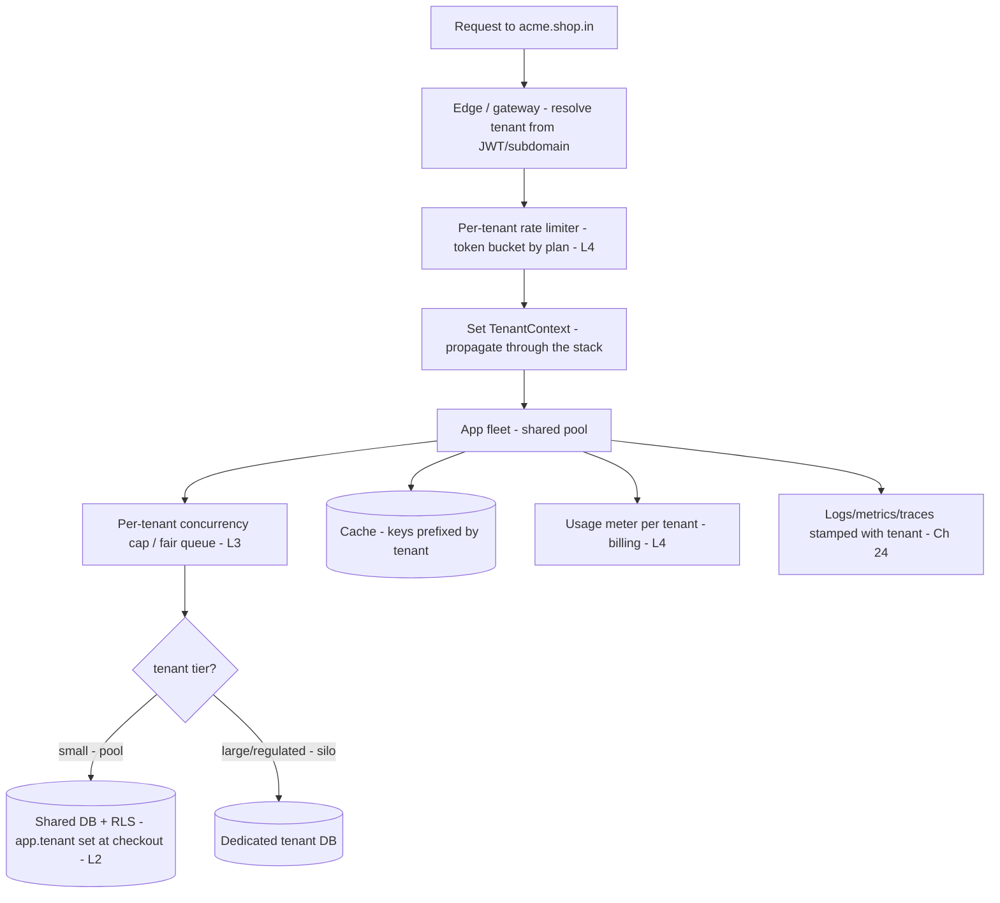
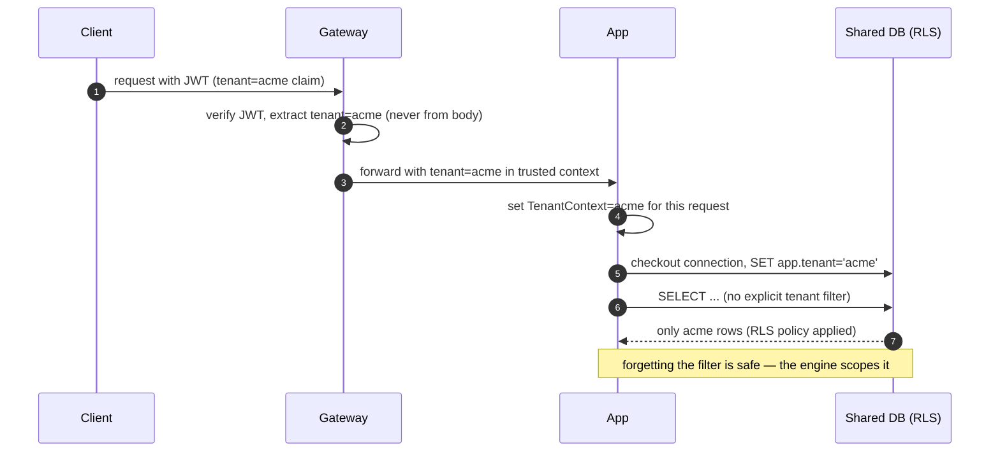
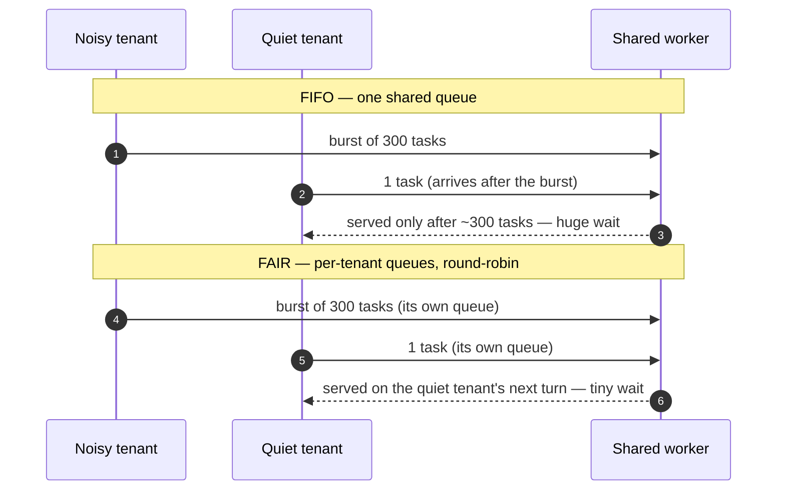
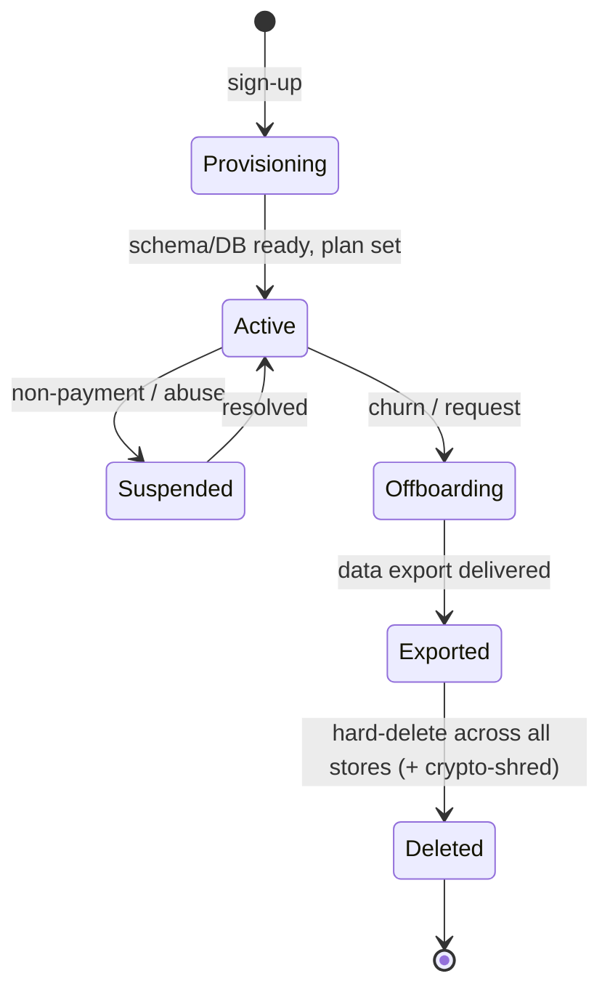

# 30. Multi-Tenancy & SaaS Architecture

!!! abstract "Chapter at a glance"
    **Reader bands:** B2 → B4 · **Prerequisites:** [Ch 05](../01-foundations/05-relational-databases-deep-dive.md), [Ch 11](../02-distributed-core/11-partitioning-and-sharding.md), [Ch 23](23-security-architecture.md), [Ch 28](28-schema-and-data-evolution.md) · **What you will build:** How one deployment of the grocery platform safely serves many isolated customer organizations (tenants) — data isolation, performance isolation, tiered plans, and tenant lifecycle. Two labs run against **real PostgreSQL 16** (isolation models + Row-Level Security) and two against **real Redis** and a deterministic scheduler (rate limiting, noisy-neighbor fairness).

    - **L1: data isolation models.** On real PostgreSQL, a **shared table** leaked **all 9 rows across 3 tenants** the moment a query forgot `WHERE tenant_id=?`; **schema-per-tenant** and **database-per-tenant** made that same forgotten filter harmless.
    - **L2: Row-Level Security.** A real RLS policy scoped **every** query to the connection's tenant: the L1 leak query returned **only 3 rows**, a cross-tenant `UPDATE` hit **0 rows**, and with no tenant set it **failed closed (0 rows)** — the leak became impossible.
    - **L3: noisy neighbor.** A 300-task burst from one tenant pushed quiet tenants' wait to **~224 ticks** under FIFO; **per-tenant fair queuing** dropped it to **~0** while the noisy tenant simply drained its own burst.
    - **L4: tiered rate limiting.** A real Redis atomic token bucket let the **free** tenant through **5/30**, **pro 20/30**, **enterprise 30/30**, metered each tenant's served requests for billing, and refilled **~2 tokens in 4 s** for the free plan.

    · **Reading time:** 120 min + code

---

## 1. Introduction & Why It Matters

### 1.1 A story: the report that showed another company's orders

The grocery platform started as a single-tenant system for one retail chain. It grew into a SaaS product: dozens of independent retail brands ("tenants") ran their storefronts on one shared deployment. The team added a `tenant_id` column to every table and moved on. Then, on a Monday, a brand manager at *Acme Grocers* opened the weekly sales report and saw **line items from Globex Foods** — a competitor. The report query had been written months earlier, before multi-tenancy, and it simply never got a `WHERE tenant_id = ?` clause. One forgotten filter, and a customer saw a competitor's revenue.

The incident review found the multi-tenancy was skin-deep:

1. **Isolation depended on every query remembering the tenant filter.** Hundreds of queries, one human mistake away from a breach each. There was no backstop (L1, L2).
2. **A batch import from one large tenant regularly slowed everyone down.** One tenant's nightly 2-million-row load saturated the shared connection pool; small tenants' checkout latency tripled every night. No performance isolation (L3).
3. **Every tenant got the same limits.** A free-trial tenant hammering the API with a scraper degraded paying customers, because there were no per-tenant rate limits or plans (L4).
4. **Offboarding was manual and incomplete.** When a tenant churned, deleting *only* their data across 40 shared tables was a risky hand-written script; nobody was confident it was complete (a compliance problem).
5. **Cost per tenant was unknown.** Finance couldn't say whether the free tier was subsidized by whom, because nothing attributed resource use to tenants.

The rebuild made tenancy a **first-class property of the platform**: isolation enforced by the database (not by discipline), performance fenced per tenant, plans and limits per tenant, and a clean lifecycle for onboarding, export and deletion. That is this chapter.

### 1.2 Where this lives in the grocery platform

| Concern | Approach | Notes |
|---|---|---|
| Data isolation | Shared-table + **RLS** for small tenants; **dedicated DB** for large/regulated ones | L1, L2 |
| Tenant context | Resolve from subdomain/JWT → propagate through every layer → set at DB checkout | §2.4 |
| Performance isolation | Per-tenant connection caps, fair queuing, per-tenant rate limits | L3, L4 |
| Plans & metering | Tiered plans (free/pro/enterprise); usage metered per tenant for billing | L4 |
| Lifecycle | Automated provisioning, per-tenant export & hard-delete | §2.8 |
| Compliance | Data residency, per-tenant encryption keys | §2.9, [Ch 23](23-security-architecture.md) |
| Scale | Pool small tenants; silo big ones; **cell-based** at very high tenant counts | §2.10 |

### 1.3 Learning objectives

By the end you will be able to:

- **Choose an isolation model** (pool / bridge / silo) per tenant tier, and know the trade-offs (L1).
- **Enforce isolation in the database** with Row-Level Security so a forgotten filter can't leak (L2).
- **Propagate tenant context** cleanly through the stack.
- **Fence performance per tenant** against noisy neighbors (L3) and **rate-limit and meter by plan** (L4).
- **Run the tenant lifecycle** — onboarding, export, deletion — and address residency, cost, and scale.

---

## 2. Core Concepts — Beginner to Deep

### 2.1 What multi-tenancy is (and isn't) <span class="band b2">B2</span>

A **tenant** is an isolated customer of your system — usually a whole organization (a retail brand), not an individual user; a tenant has many users. **Multi-tenancy** means one running system serves many tenants who must not see or affect each other, while sharing infrastructure to keep unit costs low. It is the economic engine of SaaS: one codebase, one (or few) deployments, many customers.

It is *not* the same as having many users — a single-tenant app can have millions of users. The defining requirement is **isolation between tenants**: data isolation (Acme never sees Globex's rows), performance isolation (Globex's burst doesn't slow Acme), and often configuration/branding isolation (each tenant's own settings, theme, plan). The central tension throughout: **sharing lowers cost but weakens isolation; dedicating strengthens isolation but raises cost.** Every decision in this chapter sits on that spectrum.

### 2.2 The isolation spectrum: pool, bridge, silo ⭐ <span class="band b2">B2</span>

The industry (notably AWS's SaaS guidance) names three points:

- **Silo** — dedicated resources per tenant (own database, sometimes own app instance/stack). Strongest isolation, easiest per-tenant backup/restore/residency, simplest "noisy neighbor" story. Highest cost and operational overhead; hard at thousands of tenants.
- **Pool** — all tenants share the same resources (one database, one app fleet), separated logically by a `tenant_id`. Cheapest and most scalable; isolation depends on software correctness (and RLS). Noisy-neighbor and blast-radius risks are highest.
- **Bridge** — a mix: shared app tier, but separated storage per tenant (schema-per-tenant), or pool for small tenants and silo for big ones.

Most mature SaaS is **not one model** — it's **pool for the long tail of small tenants and silo for large/regulated ones**, chosen per tier. L1 builds all three storage variants on real PostgreSQL and shows the isolation each gives.

### 2.3 Data isolation models in detail ⭐ <span class="band b2">B2</span>

| Model | Isolation | Cost @ 10k tenants | Per-tenant backup/restore | Migrations | Noisy neighbor |
|---|---|---|---|---|---|
| Shared table (`tenant_id`) | Weakest (software-enforced) | Lowest | Hard (filter by tenant) | One migration, all tenants at once | Worst |
| Shared DB, schema-per-tenant | Medium | Medium | Medium (per-schema) | Repeat per schema (10k times) | Medium |
| Database-per-tenant (silo) | Strongest | Highest | Easy (per-DB) | Repeat per DB | Best |

The shared-table model's fatal weakness is that **isolation lives in every query** (L1's leak). The two mitigations: **Row-Level Security** (L2) pushes the filter into the engine, and **careful framework enforcement** (a tenant-aware repository layer that refuses an unscoped query). Schema- and database-per-tenant move isolation into the topology, at the price of running migrations and connections N times (§2.10, [Ch 28](28-schema-and-data-evolution.md)).

### 2.4 Tenant context: resolve and propagate ⭐ <span class="band b3">B3</span>

Every request must be tagged with its tenant, and that tag must travel everywhere:

1. **Resolve** the tenant at the edge from a trustworthy source: a subdomain (`acme.shop.in`), a path (`/t/acme/...`), or — best — a **claim in the authenticated JWT** ([Ch 23](23-security-architecture.md)), never from a user-supplied header or body a client could forge.
2. **Propagate** it through the call stack: a request-scoped `TenantContext` (a `ThreadLocal`, or explicit parameter, or context propagated across async boundaries and to other services via a header/baggage). Losing tenant context across a thread pool or an async hop is a classic bug.
3. **Apply** it at every tenant-aware resource: set `app.tenant` on the DB connection at checkout (L2), prefix cache keys, scope search queries, route to the tenant's database (silo), and stamp logs/metrics with the tenant.

The golden rule: **derive the tenant from the authenticated principal, once, at the boundary — and never trust a tenant id that came from the request body.**

### 2.5 Row-Level Security as the backstop ⭐ <span class="band b3">B3</span>

PostgreSQL **Row-Level Security** attaches a policy to a table so the engine automatically adds the tenant predicate to *every* statement. L2 shows a policy keyed to a per-connection setting (`app.tenant`): even `SELECT * FROM orders` with no `WHERE` returns only the current tenant's rows, a cross-tenant `UPDATE` matches nothing, and with no tenant set it returns nothing (**fails closed**). Two non-negotiable cautions the lab demonstrates:

- **Superusers and table owners bypass RLS.** The app must connect as a **limited, non-owner role** (L2's first attempt leaked because it connected as the superuser). Use `FORCE ROW LEVEL SECURITY` if the owner must be subject to it.
- **Set the tenant from the authenticated principal at connection checkout**, never from client input, or you've just moved the injection point.

RLS is **defense in depth**, not a license to stop filtering in the app — it's the backstop that makes a forgotten filter a non-event instead of a breach.

### 2.6 Performance isolation and the noisy neighbor ⭐ <span class="band b3">B3</span>

In a pool model, tenants share CPU, connections, threads and I/O, so one tenant's spike can starve others — the **noisy neighbor** (L3). Defenses:

- **Per-tenant concurrency caps:** a tenant can hold at most K connections / N in-flight requests, so it can't drain the shared pool.
- **Fair scheduling:** per-tenant queues served round-robin or **weighted fair queuing** (weight by plan), so each tenant gets its share regardless of others' load (L3: quiet-tenant wait dropped from ~224 ticks to ~0).
- **Per-tenant rate limits & quotas** (L4): cap request rate and resource use per tenant/plan at admission.
- **Bulkheads** ([Ch 18](../02-distributed-core/18-resilience-patterns.md)): separate pools so one tenant's saturation is contained.
- **Silo the heavy tenants:** a tenant big enough to be a permanent noisy neighbor gets dedicated resources.

Performance isolation is about isolating **throughput and latency**, the complement to L1/L2's isolation of **data**.

### 2.7 Rate limiting, metering, and tiered plans ⭐ <span class="band b3">B3</span>

SaaS monetizes through **plans** (free / pro / enterprise) that differ in **limits** and **features**. Two mechanisms:

- **Rate limiting** at admission — a **token bucket** per tenant sized by plan (L4: free 5, pro 20, enterprise 200 capacity). It smooths bursts (the bucket allows a burst up to capacity, then throttles to the refill rate) and returns HTTP `429` with a `Retry-After` when empty. Implement it **atomically and centrally** (a Redis Lua script, L4) so limits hold across all app instances.
- **Metering** — count each tenant's billable usage (requests, orders, storage, API calls) into a per-tenant, per-period counter (L4's usage meter) that feeds **usage-based billing** and quota enforcement. Meter what you bill; make the meter accurate and idempotent.

Feature gating (which features a plan unlocks) is usually done with per-tenant **feature flags** keyed on plan.

### 2.8 Tenant lifecycle: onboarding, export, offboarding <span class="band b3">B3</span>

- **Onboarding / provisioning:** creating a tenant must be automated and fast — create the tenant record, (for silo) provision its schema/database and run migrations, seed defaults, set the plan. Manual onboarding doesn't scale past a handful of tenants.
- **Export:** tenants expect to get their data out (portability, and a legal right in many regimes). A per-tenant export is trivial in silo (dump the DB) and needs a careful tenant-scoped extract in pool.
- **Offboarding / deletion:** when a tenant leaves you must **completely** delete their data — every table, cache, search index, blob, backup-with-caveats. Silo makes this a `DROP DATABASE`; pool makes it a tenant-scoped delete across every store, which is exactly why **knowing every place tenant data lives** matters. This is both a trust and a **compliance** requirement (GDPR/DPDP "right to erasure").

### 2.9 Compliance: residency, encryption, and the tenant boundary <span class="band b4">B4</span>

- **Data residency:** some tenants (or laws) require data to stay in a region. Silo-by-region or a region-aware routing layer satisfies this; a single global pool usually can't.
- **Per-tenant encryption:** envelope encryption ([Ch 23](23-security-architecture.md)) with a **per-tenant data key** means a key can be revoked/rotated per tenant, and "crypto-shredding" (destroying a tenant's key) is a fast, provable deletion for that tenant's encrypted data.
- **The tenant boundary is a security boundary:** cross-tenant access is a top-severity vulnerability class (it's the SaaS form of IDOR/broken object-level authorization). Every authorization check must include the tenant ([Ch 23](23-security-architecture.md)); RLS (L2) is the data-layer enforcement of the same boundary.

### 2.10 Scaling tenancy: sharding and cells <span class="band b4">B4</span>

At high tenant counts the model must scale:

- **Shard tenants across databases/clusters:** partition by `tenant_id` ([Ch 11](../02-distributed-core/11-partitioning-and-sharding.md)) so no single database holds all tenants. A **tenant→shard routing map** (a lookup service) directs each request; you can place big tenants on their own shard and pack small ones together.
- **Cell-based architecture:** run many independent **cells**, each a full stack serving a subset of tenants. A cell is a blast-radius boundary — an incident, a bad deploy, or a noisy tenant is contained to one cell — and cells scale horizontally by adding more. This is how the largest SaaS platforms combine pool economics with silo-like isolation.
- **The "10 / 1,000 / 100,000 tenants" rule of thumb:** database-per-tenant is fine at 10, painful at 1,000 (connection and migration overhead), impractical at 100,000 (pool + RLS + sharding + cells instead). Design for the count you'll actually have.

### 2.11 Tenant-aware everything <span class="band b4">B4</span>

Multi-tenancy touches every subsystem, and forgetting one is a leak:

- **Cache** ([Ch 07](../01-foundations/07-caching.md)): prefix every key with the tenant (`t:acme:cart:42`) or a cache-per-tenant, or one tenant's data serves another's request.
- **Search** ([Ch 22](22-search-systems.md)): a per-tenant index or a mandatory tenant filter on every query.
- **Messaging** ([Ch 14](../02-distributed-core/14-messaging-and-event-streaming.md)): tenant on every message; consumers scope by it; consider per-tenant topics/partitions for isolation.
- **Observability** ([Ch 24](24-observability.md)): stamp logs, metrics and traces with the tenant so you can see per-tenant health, cost and SLOs — and debug one tenant without wading through all.
- **Config / feature flags:** per-tenant and per-plan settings, branding, and feature gates.

---

## 3. Architecture & Diagrams

### 3.1 Component view: a multi-tenant request



### 3.2 Sequence: resolving and enforcing tenant context



### 3.3 Sequence: the noisy-neighbor failure and the fair-queue fix



### 3.4 State: a tenant through its lifecycle



---

## 4. Design Document Excerpt: Grocery Multi-Tenancy Standard

!!! note "Design Document (excerpt) — Multi-Tenancy Standard v1.0"
    **Status:** Accepted · **Authors:** Platform Architecture Guild · **Reviewers:** Security, SRE, Billing

    | Field | Value |
    |---|---|
    | Context | The platform is SaaS for many retail brands. A cross-tenant data leak (a report missing its tenant filter) and recurring noisy-neighbor slowdowns showed tenancy was not enforced, only convention. |
    | Decision | Tenancy is a first-class platform property. Isolation is **enforced by the database (RLS)**, not by query discipline; big/regulated tenants are **siloed**; performance is fenced per tenant; plans set per-tenant limits; a standard lifecycle governs onboarding/export/deletion. |
    | Related ADRs | ADR-160 Pool+RLS for standard tenants, silo (dedicated DB) for enterprise/regulated; ADR-161 Tenant from JWT claim only, propagated via TenantContext, set as app.tenant at DB checkout; ADR-162 App connects as a non-owner role so RLS applies; ADR-163 Per-tenant rate limits + concurrency caps + fair queuing; ADR-164 Usage metering per tenant for billing; ADR-165 Automated provisioning + tenant export + hard-delete (crypto-shred); ADR-166 Cell-based topology beyond N tenants |

    **Requirements.**

    - **R1 — No cross-tenant read/write, ever.** Enforced at the data layer (RLS/silo), not only in application code. A forgotten filter MUST NOT leak. (L1, L2.)
    - **R2 — Tenant from identity.** The tenant is derived from the authenticated principal at the edge and never accepted from request bodies/headers a client controls. (§2.4.)
    - **R3 — Performance isolation.** No tenant may consume more than its per-plan share of connections/CPU; noisy tenants MUST NOT breach other tenants' SLOs. (L3, L4.)
    - **R4 — Metered & limited by plan.** Every tenant has a plan; limits are enforced centrally and atomically; billable usage is metered per tenant. (L4.)
    - **R5 — Clean lifecycle.** Onboarding is automated; export and complete deletion are supported and audited. (§2.8.)
    - **R6 — Residency & keys.** Regulated tenants can be pinned to a region and have a per-tenant encryption key (crypto-shred on deletion). (§2.9.)

    **Decisions in detail.**

    1. **Pool + RLS default, silo for big/regulated (ADR-160).** Standard tenants share DBs with RLS; enterprise/regulated tenants get a dedicated database (residency, backup, blast radius). (L1, L2.)
    2. **Tenant context (ADR-161/162).** JWT claim → `TenantContext` → `SET app.tenant` at checkout, app connects as a limited role so RLS binds. (L2.)
    3. **Performance fences (ADR-163).** Per-tenant connection caps + weighted fair queuing + per-tenant rate limits. (L3, L4.)
    4. **Metering (ADR-164).** Atomic per-tenant counters feed billing and quotas. (L4.)
    5. **Lifecycle (ADR-165).** Automated provision; export; hard-delete across every store; crypto-shred the tenant key.
    6. **Cells (ADR-166).** Beyond a set tenant count, run independent cells as blast-radius boundaries. (§2.10.)

    **Consequences.** More platform machinery (RLS, tenant context plumbing, fair scheduling, metering, provisioning automation, cells) and a per-tenant tier decision. In return: no cross-tenant leaks, contained blast radius, fair performance, monetizable plans, and compliant lifecycle. The "just add a tenant_id column" era is explicitly ended.

---

## 5. Hands-On Code — Level Ladder

!!! info "What's real here"
    L1 and L2 run against **real PostgreSQL 16** (:5581) — real schemas, real databases, and a real Row-Level Security policy (including the superuser-bypass footgun and the fix). L4 runs against **real Redis** with an **atomic server-side Lua** token bucket. L3 is a deterministic discrete-time simulation of a shared worker (reproducible, no timing flakiness). Managed equivalents (per-tenant KMS keys, cell routers, silo provisioners) are marked **VERIFY**.

### L1 — The three data isolation models, and a real leak <span class="band b2">B2</span>

**Requirement:** "Show what a query that forgets the tenant boundary returns under each isolation model — on a real database."

Three tenants store orders three ways on real PostgreSQL: a shared table with `tenant_id`, a schema per tenant, and a database per tenant. We run the *same* "forgot the filter" query against each.

```java title="IsolationL1.java"
// IsolationL1.java — run with: java -Duser.timezone=UTC -cp /tmp/pgjdbc.jar IsolationL1.java   (real PostgreSQL 16 on :5581)
// The three canonical multi-tenant DATA ISOLATION models, built on a real database, and the failure that motivates the
// stronger ones: a CROSS-TENANT LEAK. Three tenants (acme, globex, initech) share the platform. We store each tenant's
// orders three ways and show what a query that FORGETS the tenant boundary returns in each:
//   A) SHARED TABLE  — one `orders` table with a tenant_id column. Cheapest, but isolation depends entirely on every
//                      query remembering `WHERE tenant_id = ?`. Forget it once and you leak every tenant's data.
//   B) SCHEMA-PER-TENANT — one schema per tenant (acme.orders, globex.orders...). The search_path scopes queries; a
//                      forgotten filter can't reach another tenant's schema. Middle ground on cost and isolation.
//   C) DATABASE-PER-TENANT — a separate database per tenant. Strongest isolation (and easiest per-tenant backup/restore
//                      and residency), highest overhead. A connection to one DB literally cannot see another's data.
import java.sql.*;

public class IsolationL1 {
    static final String BASE = "jdbc:postgresql://localhost:5581/";
    static final String URL = BASE + "shop?user=postgres";
    static final String[] TENANTS = {"acme", "globex", "initech"};

    public static void main(String[] args) throws Exception {
        System.out.println("Three multi-tenant isolation models on real PostgreSQL 16. Tenants: acme, globex, initech.\n");
        sharedTable();
        schemaPerTenant();
        databasePerTenant();
        System.out.println("\n   → SHARED TABLE is cheapest but a single forgotten `WHERE tenant_id=?` leaks every tenant (see the bug below);");
        System.out.println("     mitigate with Row-Level Security (L2). SCHEMA-PER-TENANT scopes via search_path so a forgotten filter stays");
        System.out.println("     inside the tenant. DATABASE-PER-TENANT is strongest (separate backups, residency, blast radius) but costliest");
        System.out.println("     to run at 10,000 tenants. Most SaaS uses shared-table + RLS for small tenants and dedicated DBs for large ones.");
    }

    // ---------- A) SHARED TABLE with tenant_id ----------
    static void sharedTable() throws Exception {
        System.out.println("   A) SHARED TABLE (one table, tenant_id column):");
        try (Connection c = DriverManager.getConnection(URL); Statement st = c.createStatement()) {
            st.execute("drop table if exists shared_orders");
            st.execute("create table shared_orders(tenant_id text not null, id bigserial, total_paise bigint, primary key(tenant_id,id))");
            for (String t : TENANTS)
                for (int i = 0; i < 3; i++)
                    st.execute("insert into shared_orders(tenant_id,total_paise) values ('" + t + "'," + (1000 + i) + ")");
            // the CORRECT, scoped query for acme
            long acme = scalar(c, "select count(*) from shared_orders where tenant_id='acme'");
            // the BUG: a repository method that forgot the tenant filter
            long leaked = scalar(c, "select count(*) from shared_orders");
            System.out.printf("        correct query (WHERE tenant_id='acme') sees %d rows.%n", acme);
            System.out.printf("        BUG — a query that forgot the tenant filter sees %d rows (ALL tenants) → cross-tenant leak.%n", leaked);
        }
    }

    // ---------- B) SCHEMA-PER-TENANT ----------
    static void schemaPerTenant() throws Exception {
        System.out.println("   B) SCHEMA-PER-TENANT (acme.orders, globex.orders, ...):");
        try (Connection c = DriverManager.getConnection(URL); Statement st = c.createStatement()) {
            for (String t : TENANTS) {
                st.execute("drop schema if exists " + t + " cascade");
                st.execute("create schema " + t);
                st.execute("create table " + t + ".orders(id bigserial primary key, total_paise bigint)");
                for (int i = 0; i < 3; i++) st.execute("insert into " + t + ".orders(total_paise) values (" + (2000 + i) + ")");
            }
        }
        // a request for acme sets its search_path; the SAME "forgot the filter" query is now safe
        try (Connection c = DriverManager.getConnection(URL); Statement st = c.createStatement()) {
            st.execute("set search_path to acme");
            long acme = scalar(c, "select count(*) from orders");            // no tenant filter at all...
            System.out.printf("        request scoped to acme (search_path=acme): 'select count(*) from orders' sees %d rows — only acme's.%n", acme);
            st.execute("set search_path to globex");
            long globex = scalar(c, "select count(*) from orders");
            System.out.printf("        same query after switching search_path to globex: %d rows — only globex's. The filter can't be forgotten.%n", globex);
        }
    }

    // ---------- C) DATABASE-PER-TENANT ----------
    static void databasePerTenant() throws Exception {
        System.out.println("   C) DATABASE-PER-TENANT (tenant_acme, tenant_globex, ...):");
        try (Connection c = DriverManager.getConnection(URL); Statement st = c.createStatement()) {
            for (String t : TENANTS) {
                st.execute("drop database if exists tenant_" + t);
                st.execute("create database tenant_" + t);
            }
        }
        for (String t : TENANTS) {
            try (Connection c = DriverManager.getConnection(BASE + "tenant_" + t + "?user=postgres"); Statement st = c.createStatement()) {
                st.execute("create table orders(id bigserial primary key, total_paise bigint)");
                for (int i = 0; i < 3; i++) st.execute("insert into orders(total_paise) values (" + (3000 + i) + ")");
            }
        }
        // a connection to tenant_acme physically cannot query tenant_globex.orders
        try (Connection c = DriverManager.getConnection(BASE + "tenant_acme?user=postgres")) {
            long acme = scalar(c, "select count(*) from orders");
            System.out.printf("        connected to database tenant_acme: sees %d rows.%n", acme);
            try (Statement st = c.createStatement()) { st.executeQuery("select * from tenant_globex.orders"); }
            catch (SQLException e) { System.out.printf("        attempt to read tenant_globex from the acme connection: REJECTED (%s) — cross-DB access is impossible.%n", e.getMessage().strip().split("\n")[0]); }
        }
    }

    static long scalar(Connection c, String sql) throws SQLException {
        try (Statement s = c.createStatement(); ResultSet rs = s.executeQuery(sql)) { rs.next(); return rs.getLong(1); }
    }
}
```

```text title="java -cp pgjdbc.jar IsolationL1.java (real PostgreSQL 16)"
Three multi-tenant isolation models on real PostgreSQL 16. Tenants: acme, globex, initech.

   A) SHARED TABLE (one table, tenant_id column):
        correct query (WHERE tenant_id='acme') sees 3 rows.
        BUG — a query that forgot the tenant filter sees 9 rows (ALL tenants) → cross-tenant leak.
   B) SCHEMA-PER-TENANT (acme.orders, globex.orders, ...):
        request scoped to acme (search_path=acme): 'select count(*) from orders' sees 3 rows — only acme's.
        same query after switching search_path to globex: 3 rows — only globex's. The filter can't be forgotten.
   C) DATABASE-PER-TENANT (tenant_acme, tenant_globex, ...):
        connected to database tenant_acme: sees 3 rows.
        attempt to read tenant_globex from the acme connection: REJECTED (ERROR: relation "tenant_globex.orders" does not exist) — cross-DB access is impossible.

   → SHARED TABLE is cheapest but a single forgotten `WHERE tenant_id=?` leaks every tenant (see the bug below);
     mitigate with Row-Level Security (L2). SCHEMA-PER-TENANT scopes via search_path so a forgotten filter stays
     inside the tenant. DATABASE-PER-TENANT is strongest (separate backups, residency, blast radius) but costliest
     to run at 10,000 tenants. Most SaaS uses shared-table + RLS for small tenants and dedicated DBs for large ones.
```

**Reading it:**

- **Shared table:** the correct `WHERE tenant_id='acme'` sees 3 rows, but a query that forgot the filter sees **all 9 rows across every tenant** — the §1.1 leak, one missing clause away in every query you write.
- **Schema-per-tenant:** with `search_path` scoped to the tenant, `select count(*) from orders` (no tenant filter at all) returns only that tenant's 3 rows; switch the path and it's a different tenant's 3 — the filter *can't* be forgotten.
- **Database-per-tenant:** a connection to `tenant_acme` physically cannot reach `tenant_globex.orders` — cross-DB access is rejected outright.
- The trade-off ladder: shared table is cheapest but leans entirely on query correctness (fix with RLS, L2); schema and database move isolation into the topology at rising cost. Real SaaS mixes them — pooled shared tables for small tenants, dedicated databases for large/regulated ones.

### L2 — Row-Level Security makes the leak impossible <span class="band b3">B3</span>

**Requirement:** "Even if a query forgets the tenant filter, the database must not leak another tenant's data."

A real RLS policy on `shared_orders` scopes every statement to the connection's `app.tenant` setting. We run the exact L1 leak query, a cross-tenant `UPDATE`, and the no-tenant-set case.

```java title="RlsL2.java"
// RlsL2.java — run with: java -Duser.timezone=UTC -cp /tmp/pgjdbc.jar RlsL2.java   (real PostgreSQL 16 on :5581)
// ROW-LEVEL SECURITY: the database enforces tenant isolation, so a forgotten `WHERE tenant_id=?` (L1's leak) CANNOT leak.
// We create a real RLS policy on shared_orders keyed to a per-connection setting `app.tenant`. Every request sets that
// setting to the authenticated tenant; the policy then transparently scopes EVERY query — select/update/delete — to that
// tenant, at the engine, below the application. This is defense-in-depth for shared-table multi-tenancy: the app should
// still filter, but if it forgets, the blast radius is zero. We prove it with the exact query that leaked in L1, plus a
// cross-tenant UPDATE attempt, plus what happens for the privileged role (which bypasses RLS — a real footgun).
import java.sql.*;

public class RlsL2 {
    static final String ADMIN = "jdbc:postgresql://localhost:5581/shop?user=postgres";
    // the application connects as a NON-superuser, NON-owner role, so RLS policies actually apply to it (superusers bypass RLS)
    static final String URL = "jdbc:postgresql://localhost:5581/shop?user=app_user";
    static final String[] TENANTS = {"acme", "globex", "initech"};

    public static void main(String[] args) throws Exception {
        // ---- setup (as admin): table, seed data, a limited app role, grants, and an RLS policy ----
        try (Connection c = DriverManager.getConnection(ADMIN); Statement st = c.createStatement()) {
            st.execute("drop table if exists rls_orders");
            st.execute("create table rls_orders(tenant_id text not null, id bigserial, total_paise bigint, primary key(tenant_id,id))");
            for (String t : TENANTS) for (int i = 0; i < 3; i++)
                st.execute("insert into rls_orders(tenant_id,total_paise) values ('" + t + "'," + (1000 + i) + ")");
            // a limited role the app connects as: can read/write the table but is NOT its owner and NOT a superuser
            st.execute("drop role if exists app_user");
            st.execute("create role app_user login");
            st.execute("grant select, insert, update, delete on rls_orders to app_user");
            st.execute("grant usage, select on all sequences in schema public to app_user");
            // the RLS policy: a row is visible/modifiable iff its tenant_id equals the connection's app.tenant setting
            st.execute("alter table rls_orders enable row level security");
            st.execute("drop policy if exists tenant_isolation on rls_orders");
            st.execute("create policy tenant_isolation on rls_orders using (tenant_id = current_setting('app.tenant', true)) " +
                       "with check (tenant_id = current_setting('app.tenant', true))");
        }
        System.out.println("Row-Level Security on real PostgreSQL: the policy scopes EVERY query to current_setting('app.tenant').\n");

        // ---- a request authenticated as acme: set the tenant, then run the L1 leak query ----
        try (Connection c = DriverManager.getConnection(URL); Statement st = c.createStatement()) {
            st.execute("set app.tenant = 'acme'");
            long leakQuery = scalar(c, "select count(*) from rls_orders");             // NO tenant filter (L1's bug)
            System.out.printf("   as tenant=acme: 'select count(*) from rls_orders' (no WHERE!) → %d rows (only acme's). The leak is impossible.%n", leakQuery);

            // a malicious/ buggy cross-tenant UPDATE: try to zero out globex's orders while acting as acme
            int updated;
            try (PreparedStatement ps = c.prepareStatement("update rls_orders set total_paise = 0 where tenant_id = 'globex'")) {
                updated = ps.executeUpdate();
            }
            System.out.printf("   as tenant=acme: UPDATE ... WHERE tenant_id='globex' affected %d rows — RLS hid globex entirely, so nothing matched.%n", updated);

            // switch the connection's tenant and the SAME query returns a different tenant's data — cleanly scoped
            st.execute("set app.tenant = 'globex'");
            long globex = scalar(c, "select count(*) from rls_orders");
            long globexZeroed = scalar(c, "select count(*) from rls_orders where total_paise = 0");
            System.out.printf("   as tenant=globex: sees %d rows, and %d were zeroed by the acme attempt (proof globex was untouched).%n", globex, globexZeroed);
        }

        // ---- the footgun: if app.tenant is never set, current_setting(...,true) is NULL → the policy matches nothing ----
        try (Connection c = DriverManager.getConnection(URL)) {
            long unset = scalar(c, "select count(*) from rls_orders");
            System.out.printf("   with app.tenant UNSET: sees %d rows — RLS fails CLOSED (no tenant context = no rows), never open.%n", unset);
        }

        System.out.println("\n   → RLS turns 'every query must remember the tenant filter' (fragile, one bug = full breach) into a single policy the");
        System.out.println("     engine enforces on select/insert/update/delete. It fails CLOSED when no tenant is set. Two cautions: (1) the table");
        System.out.println("     OWNER and roles with BYPASSRLS ignore policies unless you FORCE it — the app must connect as a NON-owner, limited role;");
        System.out.println("     (2) set app.tenant from the authenticated principal at connection checkout, never from user input. Keep app-level");
        System.out.println("     filtering too — RLS is the backstop, not the only control.");
    }

    static long scalar(Connection c, String sql) throws SQLException {
        try (Statement s = c.createStatement(); ResultSet rs = s.executeQuery(sql)) { rs.next(); return rs.getLong(1); }
    }
}
```

```text title="java -cp pgjdbc.jar RlsL2.java (real PostgreSQL 16)"
Row-Level Security on real PostgreSQL: the policy scopes EVERY query to current_setting('app.tenant').

   as tenant=acme: 'select count(*) from rls_orders' (no WHERE!) → 3 rows (only acme's). The leak is impossible.
   as tenant=acme: UPDATE ... WHERE tenant_id='globex' affected 0 rows — RLS hid globex entirely, so nothing matched.
   as tenant=globex: sees 3 rows, and 0 were zeroed by the acme attempt (proof globex was untouched).
   with app.tenant UNSET: sees 0 rows — RLS fails CLOSED (no tenant context = no rows), never open.

   → RLS turns 'every query must remember the tenant filter' (fragile, one bug = full breach) into a single policy the
     engine enforces on select/insert/update/delete. It fails CLOSED when no tenant is set. Two cautions: (1) the table
     OWNER and roles with BYPASSRLS ignore policies unless you FORCE it — the app must connect as a NON-owner, limited role;
     (2) set app.tenant from the authenticated principal at connection checkout, never from user input. Keep app-level
     filtering too — RLS is the backstop, not the only control.
```

**Reading it:**

- As `tenant=acme`, `select count(*) from rls_orders` with **no `WHERE`** returns **only acme's 3 rows** — the leak that returned 9 in L1 is now impossible.
- A malicious `UPDATE ... WHERE tenant_id='globex'` run as acme affects **0 rows** — RLS hid globex entirely, so nothing matched; switching to `tenant=globex` confirms **0 rows were zeroed** (globex untouched).
- With **no tenant set**, the query returns **0 rows** — RLS **fails closed** (no context = no data), never open.
- Two production cautions the lab bakes in: the first version leaked because it connected as the **superuser** (superusers and table owners **bypass RLS**) — the fix is to connect as a **limited, non-owner role** (`app_user`); and `app.tenant` must be set from the **authenticated principal at connection checkout**, never from user input. On a pooled connection, use `SET LOCAL app.tenant` inside the request's transaction so it can't leak to the next borrower.

### L3 — The noisy neighbor, and fair queuing <span class="band b3">B3</span>

**Requirement:** "One tenant's burst must not wreck everyone else's latency."

A deterministic simulation of one shared worker: a noisy tenant bursts 300 tasks at once while two quiet tenants trickle in a few each. We compare FIFO against per-tenant fair queuing, measuring each tenant's wait.

```java title="NoisyL3.java"
// NoisyL3.java — run with: java NoisyL3.java   (JDK 21, no dependencies)
// THE NOISY-NEIGHBOR PROBLEM and its fix. Three tenants share ONE worker (a thread pool / DB connection / CPU). The
// "noisy" tenant dumps a 300-task burst at t=0; two "quiet" tenants submit a few tasks each, spread over time. We run the
// same workload under two scheduling policies and measure each tenant's WAIT time (completion tick - arrival tick):
//   FIFO  — one shared queue in arrival order. The burst lands first, so the quiet tenants' tasks sit behind 300 others.
//   FAIR  — one queue PER TENANT, served round-robin (weighted fair queuing). Each tenant gets a turn, so a quiet tenant
//           waits at most a few ticks regardless of how much the noisy one submits. The noisy tenant still gets its full
//           share — it just can't steal everyone else's. This is a deterministic discrete-time simulation (reproducible).
import java.util.*;

public class NoisyL3 {
    record Task(String tenant, int arrival) { }
    record Metrics(String tenant, double mean, long max, int n) { }

    // one unit of service per tick; returns per-tenant wait stats
    static Map<String,Metrics> simulate(boolean fair, List<Task> arrivals) {
        // group arrivals by tick for admission
        Map<Integer,List<Task>> byTick = new TreeMap<>();
        int lastArrival = 0;
        for (Task t : arrivals) { byTick.computeIfAbsent(t.arrival(), k -> new ArrayList<>()).add(t); lastArrival = Math.max(lastArrival, t.arrival()); }

        Deque<Task> fifo = new ArrayDeque<>();
        Map<String,Deque<Task>> perTenant = new LinkedHashMap<>();
        List<String> order = new ArrayList<>();               // tenant round-robin order
        Map<String,List<Long>> waits = new LinkedHashMap<>();

        int tick = 0, pending = arrivals.size(), done = 0, rr = 0;
        while (done < pending) {
            // admit everything that arrived at this tick
            List<Task> arriving = byTick.get(tick);
            if (arriving != null) for (Task t : arriving) {
                if (fair) {
                    perTenant.computeIfAbsent(t.tenant(), k -> { order.add(k); return new ArrayDeque<>(); }).add(t);
                } else fifo.add(t);
                waits.computeIfAbsent(t.tenant(), k -> new ArrayList<>());
            }
            // serve one task this tick
            Task served = null;
            if (fair) {
                for (int i = 0; i < order.size(); i++) {
                    String cand = order.get((rr + i) % order.size());
                    Deque<Task> q = perTenant.get(cand);
                    if (q != null && !q.isEmpty()) { served = q.poll(); rr = (order.indexOf(cand) + 1) % order.size(); break; }
                }
            } else {
                served = fifo.poll();
            }
            if (served != null) { waits.get(served.tenant()).add((long)(tick - served.arrival())); done++; }
            tick++;
            if (tick > 100000) break;                          // safety
        }
        Map<String,Metrics> out = new LinkedHashMap<>();
        for (var e : waits.entrySet()) {
            List<Long> w = e.getValue();
            double mean = w.stream().mapToLong(Long::longValue).average().orElse(0);
            long max = w.stream().mapToLong(Long::longValue).max().orElse(0);
            out.put(e.getKey(), new Metrics(e.getKey(), mean, max, w.size()));
        }
        return out;
    }

    public static void main(String[] args) {
        // build the workload: noisy tenant bursts 300 tasks at t=0; quiet tenants submit 1 task every 10 ticks
        List<Task> arrivals = new ArrayList<>();
        for (int i = 0; i < 300; i++) arrivals.add(new Task("noisy", 0));
        for (int i = 0; i < 20; i++) { arrivals.add(new Task("quietA", i * 10)); arrivals.add(new Task("quietB", i * 10 + 3)); }
        arrivals.sort(Comparator.comparingInt(Task::arrival));

        System.out.println("Noisy neighbor: 'noisy' bursts 300 tasks at once; 'quietA'/'quietB' submit 20 tasks each, spread out.");
        System.out.println("One shared worker. Wait time = ticks a task waited before being served.\n");

        report("FIFO (one shared queue, arrival order)", simulate(false, arrivals));
        report("FAIR (per-tenant queues, round-robin)", simulate(true, arrivals));

        System.out.println("   → under FIFO the burst monopolizes the worker, so the quiet tenants — who barely use the system — suffer huge");
        System.out.println("     waits purely because of a neighbor. Fair queuing gives each tenant its own line served in turn, so a quiet");
        System.out.println("     tenant's wait stays tiny no matter how much the noisy one submits; the noisy tenant simply takes longer to drain");
        System.out.println("     its own burst. Same idea in production: per-tenant connection-pool caps, per-tenant thread limits, weighted fair");
        System.out.println("     queuing, and per-tenant rate limits (L4). Isolation of THROUGHPUT, not just of DATA (L1/L2).");
    }

    static void report(String label, Map<String,Metrics> m) {
        System.out.println("   " + label + ":");
        for (Metrics x : m.values())
            System.out.printf("        %-7s tasks=%-3d  mean wait=%7.1f ticks  max wait=%6d ticks%n", x.tenant(), x.n(), x.mean(), x.max());
        System.out.println();
    }
}
```

```text title="java NoisyL3.java"
Noisy neighbor: 'noisy' bursts 300 tasks at once; 'quietA'/'quietB' submit 20 tasks each, spread out.
One shared worker. Wait time = ticks a task waited before being served.

   FIFO (one shared queue, arrival order):
        noisy   tasks=300  mean wait=  149.5 ticks  max wait=   299 ticks
        quietA  tasks=20   mean wait=  224.0 ticks  max wait=   300 ticks
        quietB  tasks=20   mean wait=  222.0 ticks  max wait=   298 ticks

   FAIR (per-tenant queues, round-robin):
        noisy   tasks=300  mean wait=  179.2 ticks  max wait=   339 ticks
        quietA  tasks=20   mean wait=    0.1 ticks  max wait=     1 ticks
        quietB  tasks=20   mean wait=    0.0 ticks  max wait=     0 ticks

   → under FIFO the burst monopolizes the worker, so the quiet tenants — who barely use the system — suffer huge
     waits purely because of a neighbor. Fair queuing gives each tenant its own line served in turn, so a quiet
     tenant's wait stays tiny no matter how much the noisy one submits; the noisy tenant simply takes longer to drain
     its own burst. Same idea in production: per-tenant connection-pool caps, per-tenant thread limits, weighted fair
     queuing, and per-tenant rate limits (L4). Isolation of THROUGHPUT, not just of DATA (L1/L2).
```

**Reading it:**

- **FIFO:** the burst lands first, so the quiet tenants — who barely use the system — wait a mean of **~224 / ~222 ticks** purely because of a neighbor. Their latency is hostage to someone else's load.
- **Fair queuing:** per-tenant queues served round-robin drop the quiet tenants' wait to **~0.1 / 0.0 ticks**; the noisy tenant's mean rises slightly (**149 → 179**) because it now yields turns instead of monopolizing the worker. It still gets its full share — it just can't steal everyone else's.
- This is **throughput isolation**, the complement to L1/L2's **data isolation**. In production the same idea appears as per-tenant connection-pool caps, per-tenant thread limits, weighted fair queuing (weight by plan), and admission-level rate limits (L4).

### L4 — Per-tenant rate limiting and tiered plans <span class="band b3">B3</span>

**Requirement:** "Enforce plan limits per tenant, centrally and atomically, and meter usage for billing."

A real Redis **atomic** token bucket (server-side Lua) rate-limits each tenant by plan. Three tenants on free/pro/enterprise each fire a 30-request burst; we count allowed vs throttled, meter served requests, and show the bucket refill.

```lua title="token_bucket.lua (runs inside Redis, atomically)"
-- token_bucket.lua — an ATOMIC per-tenant token-bucket rate limiter, evaluated server-side in Redis so concurrent
-- requests can't race. KEYS[1] = the tenant's bucket key. ARGV: capacity, refill_per_sec, now_ms, requested(=1).
-- State stored in a hash: tokens (current) + ts (last refill, ms). Refill lazily by elapsed time, then try to spend.
local key   = KEYS[1]
local cap   = tonumber(ARGV[1])
local rate  = tonumber(ARGV[2])          -- tokens added per second
local now   = tonumber(ARGV[3])          -- current time in ms
local want  = tonumber(ARGV[4])

local b = redis.call('HMGET', key, 'tokens', 'ts')
local tokens = tonumber(b[1])
local ts     = tonumber(b[2])
if tokens == nil then tokens = cap; ts = now end     -- first request: full bucket

-- refill for the time elapsed since the last update
local delta = math.max(0, now - ts) / 1000.0
tokens = math.min(cap, tokens + delta * rate)
ts = now

local allowed = 0
if tokens >= want then tokens = tokens - want; allowed = 1 end

redis.call('HMSET', key, 'tokens', tokens, 'ts', ts)
redis.call('PEXPIRE', key, 60000)                    -- idle buckets expire so we don't leak memory per tenant
return allowed
```

```bash title="exp-ratelimit.sh"
#!/bin/bash
# exp-ratelimit.sh — REAL per-tenant rate limiting + usage metering on REAL Redis, with tiered SaaS plans. Each tenant's
# plan sets its token-bucket capacity + refill rate. We fire an identical burst of 30 requests at three tenants on
# different plans and count ALLOWED vs THROTTLED (429), then read the per-tenant usage meter that billing would bill on.
set -e
R="redis-cli -p 6390"
$R FLUSHALL >/dev/null
SHA=$($R -x SCRIPT LOAD < /tmp/tenantlab/token_bucket.lua)

# plan definitions: name -> "capacity refill_per_sec"
declare -A PLAN=( ["free"]="5 0.5" ["pro"]="20 5" ["enterprise"]="200 50" )
declare -A TENANT_PLAN=( ["acme"]="free" ["globex"]="pro" ["initech"]="enterprise" )

echo "Per-tenant rate limiting on real Redis (atomic token bucket). Each tenant fires 30 requests in a tight burst."
echo "Plans:  free = capacity 5 (refill 0.5/s),  pro = capacity 20 (refill 5/s),  enterprise = capacity 200 (refill 50/s)"
echo ""
printf "   %-9s %-11s %8s %10s %10s\n" "tenant" "plan" "sent" "allowed" "throttled"

NOW=$($R TIME | head -1)000   # seconds -> ms (coarse; the burst is near-instant so refill ≈ 0)
for tenant in acme globex initech; do
  plan=${TENANT_PLAN[$tenant]}
  read cap rate <<< "${PLAN[$plan]}"
  allowed=0; throttled=0
  for i in $(seq 1 30); do
    ok=$($R EVALSHA "$SHA" 1 "rl:$tenant" "$cap" "$rate" "$NOW" 1)
    if [ "$ok" = "1" ]; then
      allowed=$((allowed+1))
      $R INCR "usage:$tenant:2026-09-26" >/dev/null    # meter only billable (served) requests
    else
      throttled=$((throttled+1))
    fi
  done
  printf "   %-9s %-11s %8d %10d %10d\n" "$tenant" "$plan" 30 "$allowed" "$throttled"
done

echo ""
echo "== Usage meter (what billing reads for the period) =="
for tenant in acme globex initech; do
  used=$($R GET "usage:$tenant:2026-09-26")
  printf "   %-9s served requests today: %s\n" "$tenant" "$used"
done

echo ""
echo "== Refill: wait 4s and let the free tenant (acme) try again =="
sleep 4
NOW2=$($R TIME | head -1)000
refilled=0
for i in $(seq 1 10); do
  ok=$($R EVALSHA "$SHA" 1 "rl:acme" 5 0.5 "$NOW2" 1)
  [ "$ok" = "1" ] && refilled=$((refilled+1))
done
echo "   acme (free) after 4s idle: $refilled of 10 allowed — the bucket refilled ~0.5 token/s * 4s ≈ 2 tokens. Steady state, not a reset."
```

```text title="./exp-ratelimit.sh (real Redis)"
Per-tenant rate limiting on real Redis (atomic token bucket). Each tenant fires 30 requests in a tight burst.
Plans:  free = capacity 5 (refill 0.5/s),  pro = capacity 20 (refill 5/s),  enterprise = capacity 200 (refill 50/s)

   tenant    plan            sent    allowed  throttled
   acme      free              30          5         25
   globex    pro               30         20         10
   initech   enterprise        30         30          0

== Usage meter (what billing reads for the period) ==
   acme      served requests today: 5
   globex    served requests today: 20
   initech   served requests today: 30

== Refill: wait 4s and let the free tenant (acme) try again ==
   acme (free) after 4s idle: 2 of 10 allowed — the bucket refilled ~0.5 token/s * 4s ≈ 2 tokens. Steady state, not a reset.
```

**Reading it:**

- The **free** tenant (capacity 5) got **5 of 30** requests through and **25 throttled**; **pro** (capacity 20) got **20**; **enterprise** (capacity 200) got all **30**. Same burst, different plans, enforced by one atomic bucket per tenant.
- The **usage meter** tallied served requests per tenant (5 / 20 / 30) — exactly what usage-based billing reads for the period. Meter only what you bill, and only served (allowed) requests.
- After **4 s idle**, the free bucket allowed **2 of 10** — it refilled ~0.5 token/s × 4 s ≈ **2 tokens**. A token bucket is **steady-state**, not a fixed-window reset: capacity sets the burst, refill sets the sustained rate.
- Doing this **in Redis with Lua** makes it atomic and global — every app instance shares one authoritative bucket, so concurrent requests across the fleet can't race past the limit. Return `429` with `Retry-After` when the bucket is empty.


---

## 6. Production Concerns

### 6.1 Failure modes

| Failure | Cause | Mitigation |
|---|---|---|
| Cross-tenant data leak | Forgotten `WHERE tenant_id` in shared-table model | RLS backstop (L2); tenant-aware repository; silo for sensitive tenants |
| RLS silently not applied | App connects as owner/superuser (bypasses RLS) | Connect as a limited non-owner role; `FORCE ROW LEVEL SECURITY` (L2) |
| Tenant context lost | Not propagated across async/thread-pool/service hops | Explicit context propagation; assert tenant is set before any DB call |
| Tenant from user input | Trusting a body/header tenant id | Derive from the authenticated JWT only (§2.4) |
| Noisy neighbor | Shared pool, no per-tenant limits | Concurrency caps, fair queuing, rate limits (L3, L4), silo the whale |
| Incomplete deletion | Tenant data spread across many stores | Inventory every store; automated tenant-scoped delete; crypto-shred (§2.8/2.9) |
| One tenant's bad deploy hits all | Single global blast radius | Cell-based architecture (§2.10) |
| Runaway cost on free tier | No per-tenant metering/limits | Metering + quotas + plan limits (L4) |

### 6.2 Observability ([Ch 24](24-observability.md))

- **Stamp everything with the tenant** — logs, metrics, traces — so you have **per-tenant** SLOs, error rates, latency, and cost. A dashboard "by tenant" is how you spot a noisy neighbor or a single tenant's outage.
- Alert on **cross-tenant access attempts** (an RLS deny, an authz failure with a tenant mismatch) — these are security signals.
- Track **per-tenant usage** vs plan limits to spot tenants about to hit quota (upsell) or abusing the free tier.

### 6.3 Security ([Ch 23](23-security-architecture.md))

- The **tenant is part of every authorization decision** — object-level checks must verify the object belongs to the caller's tenant (cross-tenant IDOR is the #1 SaaS vuln class).
- **RLS** is the data-layer enforcement of the tenant boundary (L2); connect as a least-privilege role.
- **Per-tenant encryption keys** enable revocation and crypto-shredding; store tenant keys in a KMS, never with the data.
- Test cross-tenant isolation explicitly ([Ch 29](29-testing-distributed-systems.md)): a test that "tenant A cannot read/modify tenant B" for every resource.

### 6.4 Performance & tuning

- Per-tenant connection caps stop one tenant draining the pool; size them by plan.
- Token-bucket capacity vs refill: capacity sets the allowed burst, refill sets the sustained rate (L4).
- In silo, connection count multiplies by tenants — use a proxy/pooler (PgBouncer) or you'll exhaust `max_connections` at a few hundred tenants.
- RLS adds the tenant predicate to every query — ensure `tenant_id` is the **leading column of the relevant indexes** (composite `(tenant_id, ...)`), or every query does extra work.

### 6.5 Cost

- **Cost per tenant** is a first-class metric: attribute compute, storage and I/O to tenants (via the tenant stamp) so finance knows margins per plan and which tenants are unprofitable.
- Pool is cheapest per tenant but risks noisy neighbors; silo is priciest but predictable. Place tenants on the model whose cost matches their revenue — free-tier tenants pooled densely, enterprise tenants siloed and paying for it.

---

## 7. Anti-Patterns & Pitfalls

!!! danger "1. Isolation by query discipline alone"
    Relying on every query to remember `WHERE tenant_id=?` guarantees a leak eventually (§1.1, L1). Add an engine-level backstop (RLS) or silo.

!!! danger "2. RLS while connecting as a superuser/owner"
    Superusers and table owners **bypass RLS** — your policy does nothing (L2's first run leaked). Connect as a limited non-owner role; `FORCE` for the owner.

!!! danger "3. Trusting a tenant id from the request"
    A `tenant_id` in the body or a header can be forged to access another tenant. Derive the tenant from the authenticated JWT only (§2.4).

!!! danger "4. Losing tenant context across async boundaries"
    A `ThreadLocal` tenant that isn't propagated into a thread pool or async task silently becomes null or another tenant's. Propagate explicitly; assert it's set before DB access.

!!! danger "5. No performance isolation"
    A shared pool with no per-tenant limits lets one tenant's batch job starve everyone (§1.1, L3). Cap concurrency, fair-queue, rate-limit.

!!! danger "6. One plan for everyone"
    No per-tenant limits means a free/abusive tenant degrades paying ones. Tiered plans + rate limits + metering (L4).

!!! danger "7. Un-prefixed cache keys / shared search index with no tenant filter"
    A cache key or search query without the tenant serves one tenant's data to another. Prefix keys; scope every index query (§2.11).

!!! danger "8. Database-per-tenant at 10,000 tenants"
    Connections, migrations and operational load explode. Pool + RLS + sharding + cells at high tenant counts (§2.10).

!!! danger "9. Manual onboarding/offboarding"
    Hand-written provisioning and deletion scripts don't scale and miss stores (incomplete deletion is a compliance breach). Automate the lifecycle (§2.8).

!!! danger "10. Tenant-blind observability"
    Metrics aggregated across all tenants hide a single tenant's outage or noisy behavior. Stamp everything with the tenant (§2.11, [Ch 24](24-observability.md)).

!!! danger "11. Forgetting the tenant in authorization"
    Object-level checks that don't verify tenant ownership are cross-tenant IDOR — a top SaaS vulnerability. Tenant is part of every authz decision ([Ch 23](23-security-architecture.md)).

!!! danger "12. No per-tenant cost attribution"
    Without it you can't tell which tenants/plans are profitable and you'll subsidize abusers. Attribute cost per tenant (§6.5).

---

## 8. Interview Q&A

### Beginner <span class="band b1">B1</span>

??? question "Q1 [B1] ⭐ What is multi-tenancy and why do SaaS products use it?"

    **30-second answer:** Multi-tenancy means one running system serves many isolated customers (tenants — usually whole organizations), sharing infrastructure while keeping each tenant's data and performance separate. SaaS uses it because sharing one codebase and few deployments across many customers is what makes the unit economics work; the hard part is enforcing isolation so tenants never see or affect each other.

    **Deep answer:** It's distinct from "many users" — a single-tenant app can have millions of users. The defining requirement is tenant isolation: data (L1/L2), performance (L3), and config. The core tension is sharing (cheap, weak isolation) vs dedicating (expensive, strong isolation).

    **Trade-offs I'd call out:** Cost vs isolation — the theme of every decision here.

    **Follow-ups:**
    1. Tenant vs user? → Tenant is an org with many users.
    2. Why not single-tenant per customer? → Cost and operational overhead at scale.

    **Red flags:** Equating multi-tenancy with multi-user.

??? question "Q2 [B1] ⭐ Describe the three data isolation models."

    **30-second answer:** (1) **Shared table** — one table with a `tenant_id` column; cheapest, weakest isolation (a forgotten filter leaks). (2) **Schema-per-tenant** — one schema per tenant in a shared database; medium isolation and cost. (3) **Database-per-tenant (silo)** — a separate database per tenant; strongest isolation, easy per-tenant backup/residency, highest cost. Most SaaS pools small tenants and siloes big ones.

    **Deep answer:** L1 builds all three on real PostgreSQL: the shared table leaked all 9 rows when a query forgot the filter; schema- and database-per-tenant made the same forgotten query harmless.

    **Trade-offs I'd call out:** Isolation vs cost vs operational overhead (migrations/connections × tenants).

    **Follow-ups:**
    1. When silo? → Large or regulated tenants (residency, blast radius).
    2. Shared-table's risk? → One forgotten filter = full leak.

    **Red flags:** Only knowing the `tenant_id` approach.

??? question "Q3 [B1] How does a request know which tenant it belongs to?"

    **30-second answer:** You resolve the tenant at the edge from a trustworthy source — ideally a claim in the authenticated JWT, or a subdomain/path — never from a header or body the client controls. Then you propagate it through the whole request (a tenant context) and apply it everywhere: the DB, the cache, the search index, logs.

    **Deep answer:** The golden rule is to derive the tenant from the authenticated principal once, at the boundary. Losing the context across async/thread-pool hops, or trusting a client-supplied tenant id, are the two classic bugs.

    **Trade-offs I'd call out:** Subdomain is user-visible and cache-friendly; JWT claim is the most secure.

    **Follow-ups:**
    1. Why not trust a `tenant_id` in the body? → A client can forge it → cross-tenant access.
    2. How does the DB know? → Set a per-connection tenant setting (L2).

    **Red flags:** Reading the tenant from a request parameter.

??? question "Q4 [B1] What is the 'noisy neighbor' problem?"

    **30-second answer:** In a shared (pool) model, tenants share CPU, connections and I/O, so one tenant's spike — a big batch job, a traffic burst — can consume the shared resources and slow down or break other tenants who did nothing wrong. It's a performance-isolation failure.

    **Deep answer:** L3 shows it: a 300-task burst from one tenant pushed quiet tenants' wait from ~0 to ~224 ticks under FIFO. Fixes: per-tenant concurrency caps, fair queuing, rate limits, or siloing the heavy tenant.

    **Trade-offs I'd call out:** Fairness mechanisms add scheduling overhead; siloing costs more.

    **Follow-ups:**
    1. One fix? → Per-tenant rate limit / concurrency cap.
    2. When to silo a tenant? → When it's a permanent noisy neighbor.

    **Red flags:** Thinking isolation is only about data.

### Intermediate <span class="band b2">B2</span>

??? question "Q5 [B2] ⭐ What is Row-Level Security and how does it help multi-tenancy?"

    **30-second answer:** RLS is a database feature that attaches a policy to a table so the engine automatically adds a predicate to every query — for multi-tenancy, `tenant_id = current_tenant`. Then even a query that forgets the tenant filter returns only the current tenant's rows, a cross-tenant update matches nothing, and with no tenant set it returns nothing (fails closed). It's the backstop that makes a forgotten filter a non-event instead of a breach.

    **Deep answer:** L2 proves all of this on real PostgreSQL with a policy keyed to a per-connection `app.tenant` setting. Two cautions: the app must connect as a **non-owner, non-superuser** role (superusers bypass RLS — L2's first run leaked), and the tenant must be set from the authenticated principal at checkout, not from user input.

    **Trade-offs I'd call out:** RLS adds the predicate to every query, so `tenant_id` must lead your indexes; and it's defense-in-depth, not a reason to stop filtering in the app.

    **Follow-ups:**
    1. Why did RLS "not work" as superuser? → Superusers/owners bypass it.
    2. What does fail-closed mean here? → No tenant set → zero rows, never all rows.

    **Red flags:** Not knowing superusers bypass RLS.

??? question "Q6 [B2] ⭐ How do you implement per-tenant rate limiting and tiered plans?"

    **30-second answer:** A token bucket per tenant, sized by plan (capacity = allowed burst, refill rate = sustained rate). Enforce it centrally and atomically — a Redis Lua script — so the limit holds across all app instances; return `429` with `Retry-After` when the bucket is empty. Separately meter each tenant's billable usage into a per-period counter for usage-based billing and quota checks.

    **Deep answer:** L4 does exactly this on real Redis: free 5 / pro 20 / enterprise 200 capacity → the free tenant got 5 of 30 requests, pro 20, enterprise all 30; the usage meter tallied served requests per tenant; and the free bucket refilled ~2 tokens in 4 s (steady state, not a reset).

    **Trade-offs I'd call out:** Atomicity is essential (a naive read-modify-write races across instances); central store adds a dependency on Redis.

    **Follow-ups:**
    1. Why atomic/Lua? → Concurrent requests across instances must not race the counter.
    2. Capacity vs refill? → Burst size vs sustained rate.

    **Red flags:** A per-instance in-memory limiter that doesn't hold globally.

??? question "Q7 [B2] Shared-table vs database-per-tenant — how do you choose?"

    **30-second answer:** By tenant tier. Shared-table (pool) for the long tail of small tenants — cheapest, most scalable, isolate with RLS. Database-per-tenant (silo) for large or regulated tenants — strongest isolation, easy per-tenant backup and residency, contained blast radius, but expensive and operationally heavy at scale. Many SaaS run both simultaneously.

    **Deep answer:** L1 shows the isolation difference; the operational difference is migrations and connections multiply by tenant count in silo (§2.10). Rule of thumb: silo is fine at 10 tenants, painful at 1,000, impractical at 100,000.

    **Trade-offs I'd call out:** Isolation and per-tenant ops ease vs cost and scale ceiling.

    **Follow-ups:**
    1. Migration cost in silo? → Run every migration N times.
    2. Connection cost in silo? → Use a pooler or exhaust `max_connections`.

    **Red flags:** One model for all tenants regardless of size/regulation.

??? question "Q8 [B2] How do you make sure tenant deletion is complete?"

    **30-second answer:** Know every place a tenant's data lives — every table, cache, search index, blob store, and message log — and delete from all of them, ideally through an automated, audited offboarding job. In silo it's a `DROP DATABASE`; in pool it's a tenant-scoped delete across each store. Per-tenant encryption enables "crypto-shredding" — destroy the tenant's key and the encrypted data is irrecoverable.

    **Deep answer:** Incomplete deletion is a compliance breach (GDPR/DPDP erasure). This is why an inventory of tenant-data locations (§2.11) and automated lifecycle (§2.8) matter — a hand-written script misses stores.

    **Trade-offs I'd call out:** Backups complicate "complete" deletion; document retention and use crypto-shred where possible.

    **Follow-ups:**
    1. Crypto-shredding? → Destroy the per-tenant key.
    2. Silo advantage here? → `DROP DATABASE`.

    **Red flags:** "We delete from the main table" (forgetting caches/indexes/blobs).

??? question "Q9 [B2] Why prefix cache keys with the tenant, and what else needs tenant-awareness?"

    **30-second answer:** Because a shared cache keyed only by, say, `cart:42` would serve tenant A's cart for tenant B's request — a cross-tenant leak through the cache. Prefix keys with the tenant (`t:acme:cart:42`). The same applies to search indexes (per-tenant index or mandatory filter), messaging (tenant on every message), logs/metrics (stamp with tenant), and config/feature flags.

    **Deep answer:** Multi-tenancy touches every subsystem; forgetting one is a leak (§2.11). The cache and search are the most commonly missed.

    **Trade-offs I'd call out:** Per-tenant indexes/caches isolate better but multiply resources; shared-with-filter is cheaper but relies on the filter.

    **Follow-ups:**
    1. Search options? → Per-tenant index vs mandatory tenant filter.
    2. Observability angle? → Per-tenant metrics/SLOs.

    **Red flags:** Only thinking about the database.

### Senior <span class="band b3">B3</span>

??? question "Q10 [B3] ⭐ Design the data layer for a SaaS with 50,000 small tenants and 50 enterprise tenants."

    **30-second answer:** Two tiers. The 50,000 small tenants go **pool + RLS**, sharded across several databases by `tenant_id` (no single DB holds all), with a tenant→shard routing map and a connection pooler. The 50 enterprise tenants get **silo** — a dedicated database each (residency, backup, blast radius, custom SLAs). Both share the app tier, with per-tenant limits. Consider cells to cap blast radius for the pooled tenants.

    **Deep answer:** L1/L2 give the pooled-tier isolation (RLS backstop); [Ch 11](../02-distributed-core/11-partitioning-and-sharding.md) gives the sharding; §2.10 gives cells. Indexes are `(tenant_id, ...)` so RLS predicates are cheap. Enterprise silos let you offer residency and per-tenant tuning the pool can't.

    **Trade-offs I'd call out:** Two operational models to maintain; justified by the very different needs of the two tiers.

    **Follow-ups:**
    1. Why shard the pooled tenants? → No single DB scales to 50k tenants' load.
    2. Why silo only 50? → Silo doesn't scale to 50k, but 50 is fine and enterprise pays for it.

    **Red flags:** One database for everyone, or database-per-tenant for 50,000.

??? question "Q11 [B3] ⭐ How do you prevent cross-tenant access at every layer?"

    **30-second answer:** Defense in depth: (1) derive tenant from the authenticated JWT at the edge, never from input; (2) include the tenant in every authorization check (object-level ownership); (3) enforce it at the data layer with RLS (pool) or physical separation (silo); (4) prefix caches, scope search, stamp messages; (5) test isolation explicitly for every resource. No single layer is trusted alone.

    **Deep answer:** Cross-tenant access is the SaaS form of broken object-level authorization (IDOR) — the top SaaS vuln class ([Ch 23](23-security-architecture.md)). L2 is the data-layer enforcement; the authz check is the app-layer one; the tests ([Ch 29](29-testing-distributed-systems.md)) prove it holds.

    **Trade-offs I'd call out:** Multiple enforcement layers cost effort but a single-layer failure shouldn't be a breach.

    **Follow-ups:**
    1. Data-layer enforcement? → RLS or silo.
    2. How do you test it? → "Tenant A cannot access tenant B" for every resource.

    **Red flags:** Trusting the application code alone.

??? question "Q12 [B3] How do you achieve performance isolation in a pool model?"

    **30-second answer:** Per-tenant concurrency caps (a tenant can hold at most K connections / N in-flight requests), fair scheduling (per-tenant queues served round-robin or weighted by plan), per-tenant rate limits (L4), and bulkheads (separate pools). A tenant big enough to be a permanent problem gets siloed. The goal: one tenant's load can't breach another's SLO.

    **Deep answer:** L3 shows fair queuing dropping quiet-tenant wait from ~224 ticks to ~0 while the noisy tenant just drains its own burst. L4 shows admission-level rate limits per plan. Combine both: rate-limit at the door, fair-queue inside.

    **Trade-offs I'd call out:** Fairness/limits add scheduling overhead and can leave capacity idle if caps are too tight; tune by plan.

    **Follow-ups:**
    1. Weighted fair queuing? → Weight a tenant's share by its plan.
    2. When bulkheads? → To contain one tenant's saturation.

    **Red flags:** "Autoscaling will handle it" — it doesn't fix intra-pool contention.

??? question "Q13 [B3] How does RLS interact with connection pooling, and what breaks?"

    **30-second answer:** RLS reads the tenant from a per-connection setting (`app.tenant`), but a connection pool reuses connections across requests/tenants. If you set `app.tenant` and don't reset it, the next request on that pooled connection inherits the previous tenant's context — a leak. So you must set the tenant at **checkout** and reset it at **return** (or use `SET LOCAL` inside the request's transaction so it's scoped and auto-cleared on commit/rollback).

    **Deep answer:** `SET LOCAL app.tenant='...'` inside the transaction is the clean pattern — it's transaction-scoped, so it can't leak to the next borrower. This is a common, subtle multi-tenant bug that L2's per-connection approach must handle in production.

    **Trade-offs I'd call out:** `SET LOCAL` requires a transaction around every tenant-scoped operation; a small discipline for a big safety win.

    **Follow-ups:**
    1. Why `SET LOCAL`? → Transaction-scoped, auto-reset, pool-safe.
    2. Symptom of the bug? → Intermittent cross-tenant reads under load.

    **Red flags:** Setting a session variable on a pooled connection and never resetting it.

??? question "Q14 [B3] How do you migrate schemas across thousands of tenants ([Ch 28](28-schema-and-data-evolution.md))?"

    **30-second answer:** For pool (shared table), one expand/contract migration covers all tenants at once — that's a big advantage. For silo/schema-per-tenant, you must run the migration against every database/schema, which you do as an orchestrated, resumable rollout (batch the tenants, track per-tenant migration state, retry failures) rather than one giant transaction. Either way the changes are backward-compatible (expand/contract) so old and new code coexist during the rollout.

    **Deep answer:** [Ch 28](28-schema-and-data-evolution.md) gives the online-DDL and expand/contract mechanics; the multi-tenant twist is orchestration across N schemas/DBs with per-tenant status tracking. This operational cost is a key reason not to silo at very high tenant counts.

    **Trade-offs I'd call out:** Pool = one migration but a shared blast radius; silo = N migrations but per-tenant control and rollback.

    **Follow-ups:**
    1. Pool migration advantage? → One migration, all tenants.
    2. Silo migration risk? → Partial rollout; need per-tenant tracking.

    **Red flags:** Running silo migrations as one unbatched loop with no resume.

### Architect <span class="band b4">B4</span>

??? question "Q15 [B4] ⭐ What is cell-based architecture and when do you need it?"

    **30-second answer:** You run many independent **cells**, each a complete stack (app + data) serving a subset of tenants. A cell is a blast-radius boundary: a bad deploy, an incident, or a noisy tenant is contained to one cell instead of taking down all tenants. You scale by adding cells and route each tenant to its cell via a thin routing layer. It's how the largest SaaS platforms get pool economics with silo-like fault isolation.

    **Deep answer:** Cells complement sharding (§2.10, [Ch 11](../02-distributed-core/11-partitioning-and-sharding.md)): shards partition data, cells partition the *entire stack* including failure domains. You need it when a single global blast radius is unacceptable — i.e., when "one bad deploy takes down every customer" is an existential risk. You also deploy changes cell-by-cell (a canary across cells).

    **Trade-offs I'd call out:** More operational complexity (many stacks, a router, cross-cell tooling) for dramatically smaller blast radius.

    **Follow-ups:**
    1. Cell vs shard? → Cell = whole stack + failure domain; shard = data partition.
    2. How do deploys use cells? → Roll out cell by cell.

    **Red flags:** Proposing cells for a 20-tenant product.

??? question "Q16 [B4] How do you handle data residency for regulated tenants?"

    **30-second answer:** Pin those tenants to a region: silo-by-region (their database and processing live in the required region) with a region-aware routing layer that sends their requests only to that region. A single global pool usually can't satisfy residency, so residency-bound tenants typically get dedicated, region-local infrastructure. Combine with per-tenant encryption keys managed in-region.

    **Deep answer:** This is a driver toward silo/cells for a subset of tenants even when most are pooled (§2.9). The routing layer maps tenant→region→cell/DB; metadata about a tenant (region, plan, key) lives in a global control plane, the data stays regional.

    **Trade-offs I'd call out:** Regional silos cost more and complicate global features (cross-region analytics must respect residency).

    **Follow-ups:**
    1. Why can't a global pool do residency? → Data would leave the required region.
    2. Where do keys live? → In-region KMS, per tenant.

    **Red flags:** Assuming one global database can meet residency rules.

??? question "Q17 [B4] How do you meter usage accurately for billing across a distributed system?"

    **30-second answer:** Emit a usage event per billable action, tagged with tenant, and aggregate into per-tenant, per-period counters — idempotently, so retries don't double-count (dedup by an event id, [Ch 20](../02-distributed-core/20-idempotency-ids-and-distributed-locks.md)). Store raw events (for dispute/audit) and roll them up. Reconcile the meter against the source of truth periodically. Enforce quotas off the same counters (L4).

    **Deep answer:** L4's per-tenant counter is the simple version; at scale you stream usage events ([Ch 14](../02-distributed-core/14-messaging-and-event-streaming.md)) into an aggregation pipeline with exactly-once/idempotent semantics, because billing must be accurate and defensible. Meter exactly what you bill.

    **Trade-offs I'd call out:** Exactly-once metering is hard; idempotent aggregation + reconciliation is the pragmatic answer.

    **Follow-ups:**
    1. Why idempotent? → Retries/at-least-once delivery must not double-bill.
    2. Why keep raw events? → Audit and dispute resolution.

    **Red flags:** Incrementing a counter with no dedup under at-least-once delivery.

??? question "Q18 [B4] A single tenant is 100× larger than any other. How do you handle it?"

    **30-second answer:** Silo it. A tenant that large is a permanent noisy neighbor and a blast-radius risk in any pool — give it dedicated resources (its own database, possibly its own cell), tuned and scaled for its load, on a plan that pays for it. Keep the thousands of small tenants pooled. This "pool the small, silo the whale" split is standard.

    **Deep answer:** Trying to keep the whale in the pool forces you to size the whole pool for its spikes (wasteful) or throttle it (unhappy big customer). Dedicated infrastructure also lets you offer it custom SLAs, residency, and maintenance windows. §2.2/2.10.

    **Trade-offs I'd call out:** A bespoke deployment to operate, justified by the revenue and risk of one huge tenant.

    **Follow-ups:**
    1. Why not just cap it in the pool? → You'd throttle your biggest customer.
    2. Its own cell? → Yes, for full fault isolation.

    **Red flags:** Sizing the shared pool around one giant tenant.

??? question "Q19 [B4] How do you know and control per-tenant cost and profitability?"

    **30-second answer:** Attribute resource use to tenants: stamp compute/storage/I/O and API calls with the tenant (the same tenant tag used in observability), roll it into a per-tenant cost figure, and compare to per-tenant revenue. Then act: pool dense free tenants cheaply, ensure enterprise silos are priced above their cost, rate-limit/meter abusers, and flag unprofitable tenants for plan changes.

    **Deep answer:** Without attribution you're flying blind — you can't tell if the free tier is a reasonable funnel or a money pit, or whether a "big" customer is actually unprofitable. Per-tenant cost is a first-class metric (§6.5) enabled by the tenant stamp (§2.11).

    **Trade-offs I'd call out:** Precise attribution (especially shared infra) is approximate; even rough attribution beats none.

    **Follow-ups:**
    1. Where does the data come from? → Per-tenant metering + infra cost allocation.
    2. What do you do with it? → Plan pricing, limits, silo/pool placement.

    **Red flags:** No idea which tenants or plans are profitable.

??? question "Q20 [B4] You're converting a single-tenant app to multi-tenant. What's your plan?"

    **30-second answer:** (1) Add `tenant_id` everywhere and a tenant model; (2) resolve/propagate tenant context from auth; (3) enforce isolation at the data layer (RLS now, silo for those who need it) — not by query discipline; (4) add per-tenant limits, metering, and plans; (5) make caches/search/messaging/observability tenant-aware; (6) build automated onboarding/export/deletion; (7) test cross-tenant isolation exhaustively; (8) plan for scale (sharding/cells) before you need it.

    **Deep answer:** This is the §4 standard as a migration. The riskiest step is data isolation — do it with an engine backstop (L2) and explicit isolation tests ([Ch 29](29-testing-distributed-systems.md)), because §1.1 shows what "we added a tenant_id" without a backstop costs. Migrate incrementally (expand/contract, [Ch 28](28-schema-and-data-evolution.md)).

    **Trade-offs I'd call out:** It touches every subsystem; sequence it so isolation lands before you onboard real tenants.

    **Follow-ups:**
    1. First safety net? → RLS + isolation tests.
    2. What's most often forgotten? → Cache/search/observability tenant-awareness.

    **Red flags:** "Add a tenant_id column and ship."

---

## 9. Summary & Practice

### Key takeaways

1. **Isolation is the whole game**, and the tension is always **sharing (cheap) vs dedicating (isolated)** — decided per tenant tier (§2.1, §2.2).
2. **Don't rely on query discipline.** Enforce data isolation in the engine (RLS) or the topology (silo); a forgotten filter must not leak (L1, L2).
3. **Connect as a limited role for RLS to apply**, set the tenant from the authenticated principal, and reset it per request on pooled connections (L2, Q13).
4. **Fence performance per tenant** — concurrency caps, fair queuing, rate limits — so no tenant breaches another's SLO (L3, L4).
5. **Plans, limits, and metering** are how SaaS monetizes and protects itself; enforce limits centrally and atomically (L4).
6. **Make every subsystem tenant-aware** — DB, cache, search, messaging, observability, config (§2.11).
7. **Automate the lifecycle** — onboarding, export, complete deletion (crypto-shred) — and respect residency (§2.8, §2.9).
8. **Scale with sharding and cells** at high tenant counts; pool the small, silo the whales (§2.10).

### Decision cheat sheet

| Question | Answer |
|---|---|
| Isolation for the long tail of small tenants | Pool + RLS |
| Isolation for large/regulated tenants | Silo (dedicated DB, possibly own cell) |
| Where does the tenant id come from | The authenticated JWT — never request input |
| Backstop against a forgotten filter | Row-Level Security (fail closed) |
| RLS not working? | You're connected as owner/superuser — use a limited role |
| Pooled connections + RLS | `SET LOCAL app.tenant` inside a transaction |
| Noisy neighbor | Concurrency caps + fair queuing + rate limits; silo the whale |
| Enforce plan limits | Per-tenant token bucket, atomic (Redis Lua) |
| Complete tenant deletion | Automated delete across all stores + crypto-shred |
| 100,000 tenants | Pool + RLS + sharding + cells |

### Exercises

1. **(B2)** Extend L2's RLS to add an `INSERT` policy that stamps `tenant_id` from `app.tenant` automatically, and prove a tenant can't insert a row for another tenant.
2. **(B2)** Reproduce the pooled-connection RLS leak (Q13): set `app.tenant` without `SET LOCAL`, reuse the connection for another tenant, and show the leak; then fix it with `SET LOCAL`.
3. **(B3)** Add **weighted** fair queuing to L3 (enterprise gets 3 turns per round, free gets 1) and measure how each tier's wait changes.
4. **(B3)** Extend L4 to add a monthly quota (a hard cap per tenant) alongside the rate limit, and return `429` vs `402 Payment Required` appropriately.
5. **(B4)** Design the tenant→shard→cell routing map for 100k tenants: what's in the control plane, how a request is routed, and how you rebalance a hot shard.

### Further reading

- AWS SaaS Lens / SaaS Factory — silo/pool/bridge, tenant isolation, cell-based architecture.
- PostgreSQL docs: *Row Security Policies*.
- *Designing Data-Intensive Applications* (Kleppmann) — partitioning (the basis for tenant sharding).
- Stripe / Shopify / Salesforce engineering write-ups on multi-tenancy and cells.
- "Crypto-shredding" and per-tenant KMS patterns (cloud provider KMS docs).

### Related chapters

- [Ch 05 — Relational Databases Deep Dive](../01-foundations/05-relational-databases-deep-dive.md): the engine features RLS builds on.
- [Ch 11 — Partitioning & Sharding](../02-distributed-core/11-partitioning-and-sharding.md): sharding tenants across databases.
- [Ch 23 — Security Architecture](23-security-architecture.md): the tenant as a security boundary, per-tenant keys.
- [Ch 24 — Observability](24-observability.md): per-tenant metrics, SLOs, and cost.
- [Ch 28 — Schema & Data Evolution](28-schema-and-data-evolution.md): migrating schemas across many tenants.
- [Ch 29 — Testing Distributed Systems](29-testing-distributed-systems.md): testing cross-tenant isolation.
