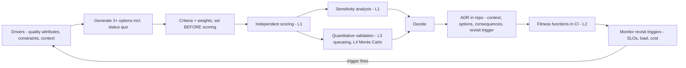
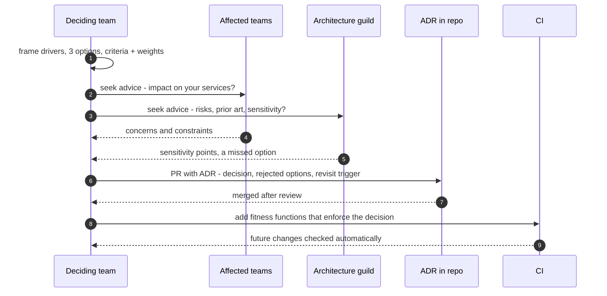
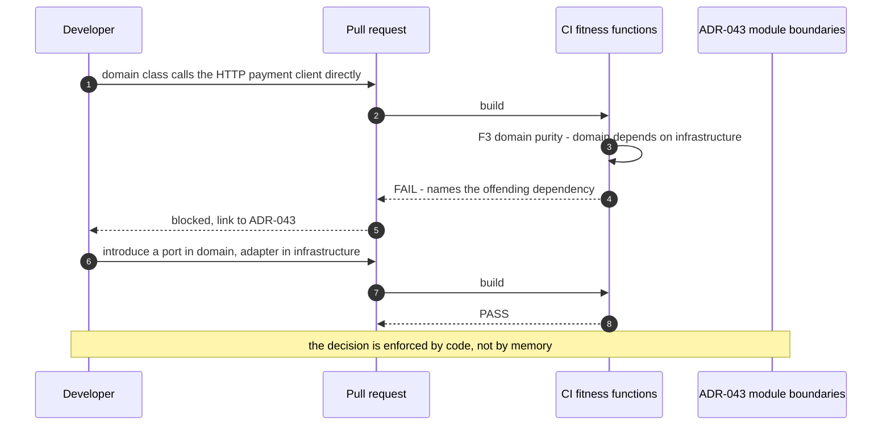
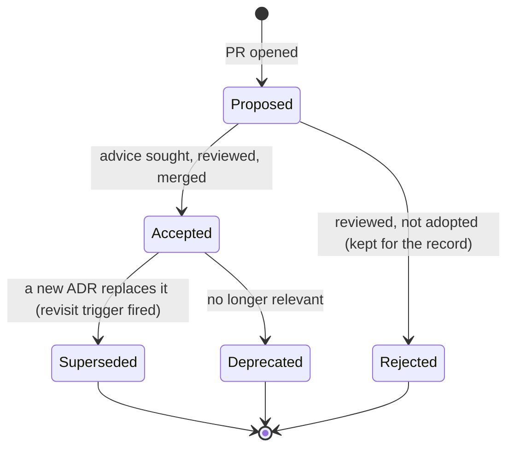

# 31. Architecture Decision Making

!!! abstract "Chapter at a glance"
    **Reader bands:** B3 → B4 · **Prerequisites:** [Ch 01](../00-orientation/01-what-system-design-is.md), [Ch 02](../01-foundations/02-back-of-the-envelope-estimation.md), [Ch 25](../03-production/25-performance-engineering.md), [Ch 29](../03-production/29-testing-distributed-systems.md) · **What you will build:** The architect's core skill — making, recording, quantifying and governing decisions. Four runnable labs turn decision-making from opinion into evidence: a weighted trade-off matrix **with sensitivity analysis**, executable **architecture fitness functions**, a **queueing-based SLO decision**, and a **Monte Carlo** decision under uncertainty.

    - **L1: trade-off matrix + sensitivity.** A Modular Monolith scored **4.57** vs Serverless 3.64 vs Microservices 2.86. Sensitivity showed the choice is **robust**: tripling the scalability weight didn't flip it; only scalability could flip it at all, at an extreme weight **≈8.75** — and then to **Serverless, not Microservices**.
    - **L2: fitness functions.** An eroded dependency graph **failed the build** with three named violations — an upward layer dependency, a domain→infrastructure leak, and the cycle **OrderService → Order → Pricing → OrderService**; the fixed graph passed.
    - **L3: decide with queueing math.** At 800 req/s against a 300 ms p99 SLO, the **sequential** call chain summed to **334 ms (breach)**; the **parallel** fan-out took the max, **111 ms (meets)**. The queueing cliff showed p99 going **196 ms → 16 s** as utilization rose from 0.5 to 0.99.
    - **L4: Monte Carlo under uncertainty.** The point estimate at the "likely" volume said **serverless is cheaper ($23k vs $28k)**; 200,000 trials over the skewed demand distribution said **VMs win in expectation ($29.6k vs $35.9k) and in 64% of futures**, with a break-even at **~147M requests/month**.

    · **Reading time:** 110 min + code

---

## 1. Introduction & Why It Matters

### 1.1 A story: the decision nobody could explain

Two years into the grocery platform, a new principal engineer asked a simple question in her first week: *"Why are we running 26 microservices with a team of 18 engineers?"*

Nobody could answer. The decision had been made in a meeting three years earlier. The people in the room had left. There was a Confluence page titled "Target Architecture" with a box diagram and the sentence "microservices for scalability." There was no record of:

1. **What problem the decision was solving.** Was it scale? Team autonomy? A reaction to a painful monolith release? Nobody knew, so nobody could tell whether the problem still existed.
2. **What alternatives were considered.** Had anyone evaluated a modular monolith? If so, why was it rejected?
3. **What trade-offs were accepted.** The operational cost of 26 services — distributed tracing, 26 pipelines, network failure modes, eventual consistency — was being paid every day, but nobody had ever written down that it was the *price* of some benefit.
4. **What would make the decision wrong.** No trigger to revisit. The platform had never exceeded 400 requests/second — far below anything that needed independent scaling — but the decision stood because it was never reopened.
5. **Whether the architecture still matched the decision.** Several "independent" services had grown synchronous call chains and shared a database, so the platform had the costs of microservices *and* the coupling of a monolith.

The principal engineer's first act was not to redesign anything. It was to **reconstruct the decision** — context, options, criteria, trade-offs — and write it down as an Architecture Decision Record. That exercise alone revealed that the original drivers no longer held, and it gave the team a principled basis for consolidating services. This chapter is about making decisions that can be explained, quantified, governed, and revisited.

!!! quote "The thesis of this chapter"
    Architecture is the set of decisions that are **expensive to change**. The architect's job is not to have the best opinions — it is to make those decisions **explicitly** (with options and criteria), **quantitatively** where possible (capacity, latency, cost, probability), **recorded** (ADRs), **governed** (fitness functions that keep the system true to them), and **revisitable** (with a stated trigger that would reopen them). An undocumented decision is an accident waiting to be inherited.

### 1.2 Where this lives in the grocery platform

| Decision practice | Grocery platform usage | Lab |
|---|---|---|
| Quality-attribute-driven trade-offs | Every style/technology choice scored against weighted drivers | L1 |
| Sensitivity analysis | Every scored decision states which weight would flip it | L1 |
| ADRs | One ADR per significant decision, in the repo, reviewed like code | §2.4 |
| Fitness functions | Layering, cycles, latency budgets, dependency rules checked in CI | L2 |
| Quantitative validation | Capacity/latency models before committing to a design | L3 |
| Decisions under uncertainty | Cost/demand ranges modeled with Monte Carlo, not single numbers | L4 |
| Review & governance | Lightweight ARB for one-way doors; teams decide two-way doors | §2.8 |

### 1.3 Learning objectives

By the end you will be able to:

- **Frame a decision** by its drivers (quality attributes, constraints, context) rather than by technology preference.
- **Score options** transparently and run a **sensitivity analysis** that shows how robust the choice is (L1).
- **Write an ADR** that a future engineer can use to understand, challenge, and revisit the decision.
- **Turn architectural rules into executable fitness functions** that fail the build when the architecture erodes (L2).
- **Validate a design quantitatively** against an SLO using queueing math (L3).
- **Decide under uncertainty** with distributions rather than point estimates (L4).
- Distinguish **one-way from two-way doors** and govern each appropriately.

---

## 2. Core Concepts — Beginner to Deep

### 2.1 Intuition: what makes a decision "architectural" <span class="band b3">B3</span>

Not every technical decision is architectural. A useful test: **a decision is architectural if it is expensive to reverse and affects quality attributes across the system.** Choosing a variable name is not; choosing between a shared database and database-per-service is. Choosing a logging library is borderline; choosing synchronous versus event-driven integration between bounded contexts is squarely architectural.

This matters because architectural decisions deserve a different process. Cheap, reversible decisions should be made quickly by the people closest to the work — slowing them down is waste. Expensive, irreversible decisions deserve options, analysis, evidence and a written record — rushing them is how you get §1.1. Amazon's framing is useful: **one-way doors** (hard or impossible to walk back through) versus **two-way doors** (you can walk back cheaply). Most decisions are two-way doors; the architect's skill is recognizing the few that aren't.

### 2.2 Quality attributes and architectural drivers ⭐ <span class="band b3">B3</span>

Architecture is shaped far more by **quality attributes** (the "-ilities") than by functional requirements. Two systems with identical features — "customers can place grocery orders" — can have completely different architectures depending on whether they must handle 10 or 10,000 orders per second, 99.5% or 99.99% availability, a team of 5 or 500.

The standard set (ISO/IEC 25010 plus the usual operational ones): **performance** (latency, throughput), **scalability**, **availability**, **reliability**, **security**, **modifiability/evolvability**, **testability**, **deployability**, **operability**, **observability**, **cost**, **time-to-market**, and **team fit** (can the team you actually have build and run it?).

Three rules make quality attributes useful rather than decorative:

1. **Make them measurable.** "Fast" is not a requirement; "p99 < 300 ms at 800 req/s" is (L3). The SEI's **quality attribute scenario** format forces this: *source → stimulus → artifact → environment → response → response measure*. Example: "When 800 req/s of checkout traffic (stimulus) arrive at peak (environment), the checkout API (artifact) responds (response) with p99 < 300 ms (measure)."
2. **Prioritize them.** They conflict. Maximum availability costs consistency (CAP, [Ch 12](../02-distributed-core/12-consistency-time-and-consensus.md)); maximum security costs usability; maximum evolvability costs time-to-market today. Weighting them (L1) is how you make the conflict explicit.
3. **Include constraints and context.** Constraints are non-negotiable (regulatory data residency, a mandated cloud, a fixed budget, a team that knows Java). Context includes the stage of the business — a startup searching for product-market fit should weight time-to-market far above scalability.

### 2.3 The decision process: options, criteria, trade-offs ⭐ <span class="band b3">B3</span>

A repeatable process for significant decisions:

1. **State the problem and drivers.** What forces are at work? What quality attributes matter most, and what are the constraints?
2. **Generate at least three options.** Always include "do nothing / keep the current approach." Two options is a false binary; one option is a rationalization.
3. **Define criteria and weights before scoring.** If you score first and weight second, you will (unconsciously) pick weights that crown your favorite.
4. **Score each option against each criterion** — ideally with several people scoring independently and then discussing divergences, which is where the real insights are.
5. **Run a sensitivity analysis** (L1). Which weights would flip the outcome? If a small, plausible change flips the winner, the decision is fragile and you need more information. If only an extreme change flips it, the decision is robust.
6. **Validate quantitatively** where a criterion is measurable — capacity, latency, cost (L3, L4) — rather than trusting a 1-to-5 score for something you can calculate.
7. **Decide, record, and state the revisit trigger.** "We choose X. We would revisit if Y happens." (§2.4)

The weighted matrix is not a machine that produces truth. Its value is that it **makes reasoning visible and arguable**. When two senior engineers disagree, the matrix shows *where* they disagree — usually on a weight (a values disagreement) or a score (a facts disagreement). Facts disagreements can be settled with evidence; values disagreements must be settled by whoever owns the business priority.

### 2.4 Architecture Decision Records (ADRs) ⭐ <span class="band b3">B3</span>

An ADR is a short document capturing one significant decision. Michael Nygard's original format remains the most common:

```markdown
# ADR-042: Use a modular monolith for the order domain

## Status
Accepted (2026-09-29). Supersedes ADR-017.

## Context
Order, cart, pricing and promotions change together in 80% of releases. The team is 18 engineers
in 3 squads. Peak load is 400 req/s; the 3-year forecast is 2,000 req/s. Today's 26-service layout
costs ~30% of engineering time in operational overhead (26 pipelines, distributed debugging).

## Decision
Consolidate order, cart, pricing and promotions into one deployable with enforced internal module
boundaries (fitness functions in CI). Keep payments and delivery as separate services.

## Options considered
1. Keep 26 microservices (status quo)  2. Modular monolith  3. Serverless functions
Scored in the decision matrix (appendix); monolith 4.57, serverless 3.64, microservices 2.86.

## Consequences
+ One pipeline, in-process calls, local transactions for the order domain.
− A bad deploy affects the whole order domain; mitigated by canaries (ADR-031).
− Must enforce module boundaries or it degrades into a big ball of mud (fitness functions, ADR-043).

## Revisit when
Sustained load exceeds 1,500 req/s, OR a single module needs an independent release cadence,
OR the sensitivity analysis flips (scalability weight > ~8.75).
```

What makes ADRs work in practice:

- **Keep them in the repo**, next to the code (`docs/adr/`), reviewed through pull requests. A wiki page nobody reviews rots; a file in the repo gets diffed and linked.
- **Keep them short** — one or two pages. The goal is the *reasoning*, not a design document.
- **Immutable once accepted.** You don't edit history; you write a new ADR that **supersedes** the old one. The chain of superseded ADRs is the architecture's history.
- **Record rejected options and why.** This is the section future engineers value most — it stops them re-proposing something already evaluated without new information.
- **Include the revisit trigger.** This single line is what would have prevented §1.1.
- **Write ADRs for decisions *not* to do something** too. "We will not introduce Kafka yet" is a decision with consequences.

Variants exist — MADR (Markdown ADR) adds explicit decision drivers and pros/cons per option; Y-statements compress an ADR to one sentence ("In the context of X, facing Y, we decided Z to achieve Q, accepting D"). The format matters far less than the habit.

### 2.5 Evaluation methods: ATAM and its lightweight cousins <span class="band b4">B4</span>

The **Architecture Tradeoff Analysis Method (ATAM)** from the SEI is the heavyweight, systematic approach: stakeholders build a **utility tree** (quality attributes → refined attributes → concrete scenarios, each rated by business importance and technical difficulty), architects walk through how the architecture handles the high-priority scenarios, and the team identifies **sensitivity points** (a decision that strongly affects one quality attribute), **trade-off points** (a decision that affects several attributes in opposite directions), and **risks**.

Full ATAM takes days and many stakeholders — appropriate for a bank's core ledger replacement, excessive for most decisions. Useful lighter methods:

- **Lightweight ATAM / mini-QAW** — a 2–4 hour workshop: agree the top 5 quality attribute scenarios, walk the candidate architecture through each, list risks.
- **Decision matrix + sensitivity** (L1) — for choosing among a few options.
- **Pre-mortem** — "It's a year from now and this decision failed. Why?" Surfaces risks people are reluctant to raise in a normal review.
- **Architecture spike / prototype** — when a score is really a guess, spend a few days building the riskiest part to turn the guess into evidence.
- **Risk storming** — everyone marks risks on the architecture diagram independently, then the team discusses clusters.

The key concepts transfer regardless of method: **sensitivity points** and **trade-off points** are the parts of the architecture to watch hardest, because that's where small changes have big consequences.

### 2.6 Quantitative decision-making ⭐ <span class="band b4">B4</span>

Where a criterion can be computed, compute it rather than score it. The architect's quantitative toolkit, most of which appears earlier in this handbook:

- **Back-of-the-envelope estimation** ([Ch 02](../01-foundations/02-back-of-the-envelope-estimation.md)) — storage, bandwidth, QPS, order-of-magnitude feasibility.
- **Latency budgets** — sequential calls add; parallel calls take the max; every hop adds network time and serialization (L3).
- **Queueing theory** — Little's Law (L = λW) and the M/M/1 response time R = S / (1 − ρ). The most important consequence for architects: **latency is non-linear in utilization**. At ρ = 0.5 you have headroom; at ρ = 0.9 you're on the cliff (L3: 196 ms → 1,484 ms for a 35 ms service). This is why capacity targets are typically 50–70% utilization, not 90%.
- **Universal Scalability Law** ([Ch 25](../03-production/25-performance-engineering.md)) — contention and coherency limit how far adding nodes helps.
- **Availability math** — serial dependencies multiply availabilities (three 99.9% services in series ≈ 99.7%); redundancy improves them (two independent 99% replicas ≈ 99.99%).
- **Cost models** — fixed versus variable cost, break-even points (L4).
- **Monte Carlo simulation** — when inputs are uncertain, sample them from distributions and look at the distribution of outcomes (L4).

L3's lesson generalizes: the numbers often settle arguments that adjectives cannot. "Async is more scalable" is an opinion; "the sequential chain's p99 is 334 ms against a 300 ms SLO; the parallel fan-out's is 111 ms" is a decision.

### 2.7 Deciding under uncertainty ⭐ <span class="band b4">B4</span>

Almost every architectural decision is made with uncertain inputs — future traffic, future team size, future product direction, vendor pricing changes. Three disciplines:

1. **Use ranges, not points.** Ask for pessimistic / likely / optimistic estimates. A single number hides both the spread and the skew.
2. **Beware skew.** Demand forecasts are usually **right-skewed** — a long tail of "what if it takes off" scenarios. When the cost function is non-linear or has different slopes for different options, plugging in the most likely value can pick the wrong option. L4 shows exactly this: the point estimate chose serverless; the distribution chose VMs.
3. **Prefer options that keep options open.** Under high uncertainty, the value of **reversibility** rises. A slightly more expensive choice that is easy to change can beat a cheaper choice that locks you in. This is real-options thinking: flexibility has a quantifiable value, and it is highest when uncertainty is highest.

Related practices: **last responsible moment** (defer irreversible decisions until you have more information, but not so late that you've lost options by default), and **decision triggers** (commit now, but state the observable condition that would make you switch — L4's "migrate at ~147M requests/month").

### 2.8 Governance: fitness functions, reviews, and who decides ⭐ <span class="band b4">B4</span>

A decision that isn't enforced decays. Two complementary mechanisms:

**Fitness functions** (from *Building Evolutionary Architectures*, Ford/Parsons/Kua) are automated checks that measure how well the system satisfies an architectural characteristic. They turn a whiteboard rule into a CI gate (L2):

| Kind | Example | Tooling |
|---|---|---|
| Structural (atomic, static) | Domain must not depend on infrastructure; no module cycles | ArchUnit, jQAssistant, dependency-cruiser |
| Performance (triggered) | Checkout p99 < 300 ms under the load-test profile | Gatling/k6 in CI, compared against a budget |
| Operational (continuous) | Error-budget burn rate below threshold | SLO monitoring ([Ch 24](../03-production/24-observability.md)) |
| Security | No critical CVEs in dependencies; no secrets in code | SCA / secret scanners |
| Holistic | Chaos experiment: losing recommendations doesn't breach checkout SLO | [Ch 27](../03-production/27-reliability-and-disaster-recovery.md) game days |

**Review processes** handle what can't be automated. The failure mode to avoid is the heavyweight **Architecture Review Board** that every change must queue for — it becomes a bottleneck and teams route around it. Better patterns:

- **Architecture advice process** — anyone can make an architectural decision, but they must seek advice from those affected and from people with expertise, and record it in an ADR. The decider stays accountable.
- **Tiered review** — two-way-door decisions are made by teams; one-way-door or cross-cutting decisions (a new datastore technology, a new integration style, anything touching the security boundary) get a lightweight review.
- **Paved road / golden path** — make the recommended choice the easiest choice (templates, platform defaults), so governance happens by default rather than by gate.
- **Technology radar** — publish Adopt / Trial / Assess / Hold for technologies, so teams know which choices need no justification and which need an ADR.

### 2.9 Cognitive traps in architecture decisions <span class="band b4">B4</span>

Architects are human and the same biases recur:

- **Résumé-driven development** — choosing technology because it's interesting to learn, not because it fits. Counter: the team-fit and operability criteria in the matrix.
- **Hype / cargo cult** — "Netflix does microservices." Netflix has problems of a scale you don't. Counter: context drivers.
- **Sunk cost** — keeping a decision because of the effort already invested. Counter: revisit triggers evaluated on current facts.
- **Anchoring** — the first option presented becomes the reference everything else is compared to. Counter: generate options independently before discussing.
- **Confirmation bias / HiPPO** — weighting criteria to favor the option the highest-paid person prefers. Counter: weights before scores; independent scoring; sensitivity analysis.
- **Analysis paralysis** — refusing to decide until uncertainty is gone (it never goes). Counter: two-way doors decided fast; time-boxed spikes; decision triggers.
- **Point-estimate fallacy** — L4.

### 2.10 Technical debt as a decision <span class="band b4">B4</span>

Technical debt is best understood as a **decision to trade future cost for present speed** — and like financial debt, it's fine when taken deliberately and serviced, disastrous when accumulated accidentally. Martin Fowler's quadrant separates **deliberate vs inadvertent** and **prudent vs reckless**: "we must ship now and will clean up after launch" (deliberate, prudent) is a legitimate architectural decision and deserves an ADR with a repayment trigger; "what's layering?" (inadvertent, reckless) is erosion that fitness functions exist to catch (L2).

Making debt a first-class decision means recording the shortcut, its expected cost (interest), and its repayment trigger — and tracking it like any other backlog item rather than letting it silently compound.

---

## 3. Architecture & Diagrams

### 3.1 Component view: the decision lifecycle



### 3.2 Sequence: happy path, a significant decision through the advice process



### 3.3 Sequence: failure path, architecture erosion caught by a fitness function



### 3.4 State: an ADR's lifecycle



---

## 4. Design Document Excerpt: Grocery Architecture Decision Process

!!! note "Design Document (excerpt) — Architecture Decision Process v1.0"
    **Status:** Accepted · **Authors:** Principal Engineers · **Reviewers:** Engineering leadership, squad tech leads

    | Field | Value |
    |---|---|
    | Context | The platform's founding decisions (26 microservices, shared DB for several) were undocumented; their drivers no longer held; nobody could say what would justify changing them. Architectural rules existed only on diagrams and eroded silently. |
    | Decision | Every significant decision gets an ADR in the repo with options, weighted criteria, sensitivity, quantitative evidence where measurable, and a revisit trigger. Rules that can be checked become fitness functions in CI. Decisions use an advice process, not a gate. |
    | Related ADRs | ADR-170 ADRs in-repo, immutable, supersede-don't-edit; ADR-171 Decision matrix with weights before scores + sensitivity analysis; ADR-172 Quantitative validation for performance/cost criteria; ADR-173 Monte Carlo for decisions with uncertain inputs; ADR-174 Fitness functions (ArchUnit) for layering, cycles, domain purity; ADR-175 Advice process + tiered review (one-way doors only); ADR-176 Quarterly review of revisit triggers |

    **Requirements.**

    - **R1 — Explainable.** Any engineer can find, for any significant decision, why it was made and what was rejected.
    - **R2 — Robustness known.** Every scored decision states which assumption, if changed, would flip it (L1).
    - **R3 — Evidence over adjectives.** Performance, capacity and cost claims are backed by a model or measurement (L3, L4).
    - **R4 — Enforced.** Structural decisions are enforced by fitness functions that fail the build (L2).
    - **R5 — Revisitable.** Every ADR has an observable revisit trigger, reviewed quarterly.
    - **R6 — Fast for two-way doors.** Reversible decisions are made by teams without review.

    **Decisions in detail.**

    1. **ADRs in-repo (ADR-170).** `docs/adr/NNNN-title.md`, MADR format, reviewed by PR; accepted ADRs are immutable.
    2. **Matrix + sensitivity (ADR-171).** Criteria and weights agreed first; ≥3 people score independently; sensitivity table attached. (L1.)
    3. **Quantitative validation (ADR-172).** Latency budgets and capacity via queueing models before committing. (L3.)
    4. **Uncertainty (ADR-173).** Demand/cost ranges as distributions; decisions report expected value, spread, and break-even. (L4.)
    5. **Fitness functions (ADR-174).** Layering, no cycles, domain purity, latency budget checks in CI. (L2.)
    6. **Advice process (ADR-175).** Decider seeks advice from affected teams and the guild; one-way doors get a 30-minute review.
    7. **Trigger review (ADR-176).** Each quarter, check every Accepted ADR's revisit trigger against current metrics.

    **Consequences.** A modest writing cost per decision and some CI investment. In return: decisions survive staff turnover, fragile decisions are identified before commitment, erosion is caught at PR time, and decisions are reopened when — and only when — their conditions change. The first application of this process (reconstructing the microservices decision) led to ADR-042 consolidating the order domain.

---

## 5. Hands-On Code — Level Ladder

!!! info "What's real here"
    All four labs are self-contained JDK 21 programs with deterministic output (fixed seeds, no timing dependence). They implement the *mechanisms* behind the practices: weighted scoring and one-at-a-time sensitivity (L1), graph-based architecture conformance (L2 — ArchUnit does the same on real bytecode), M/M/1 queueing latency budgets (L3), and Monte Carlo simulation over a triangular demand distribution (L4). Cost and capacity parameters are illustrative but internally consistent; plug in your own numbers.

### L1 — Weighted trade-off matrix with sensitivity analysis <span class="band b3">B3</span>

**Requirement:** "Choose the architecture style for the next phase — and tell us how confident we should be in that choice."

Three candidate styles are scored 1–5 against six weighted quality attributes. The program computes the weighted ranking, pushes the scalability weight to see if the winner flips, then sweeps every weight one at a time to find each one's flip point.

```java title="DecisionL1.java"
// DecisionL1.java — run with: java DecisionL1.java   (JDK 21, no dependencies)
// A WEIGHTED TRADE-OFF DECISION MATRIX with SENSITIVITY ANALYSIS. The grocery platform must pick an architecture style
// for its next phase. Three candidates are scored 1..5 against weighted quality attributes; we compute the ranking, then
// do the step most people skip: SENSITIVITY — vary the weights and see whether the winner is robust or an artifact of one
// number. A decision that flips when a weight nudges is a decision you don't actually understand yet.
import java.util.*;

public class DecisionL1 {
    // quality attributes (criteria) and their weights (must be > 0; need not sum to 1 — we normalize)
    static final String[] CRITERIA = {
        "time-to-market", "scalability", "operability", "cost-at-current-scale", "team-fit", "evolvability"
    };
    static final double[] WEIGHTS = { 3, 2, 2, 2, 3, 2 };     // this team weights speed + team-fit highest right now

    static final String[] OPTIONS = { "Modular Monolith", "Microservices", "Serverless (FaaS)" };
    // scores[option][criterion], 1 (poor) .. 5 (excellent), from an ATAM-style scoring workshop
    static final int[][] SCORES = {
        //  ttm  scale  ops  cost  team  evolve
        {    5,    3,    5,    5,    5,    4 },   // Modular Monolith
        {    2,    5,    2,    2,    2,    5 },   // Microservices
        {    4,    5,    3,    4,    3,    3 },   // Serverless
    };

    static double[] weightedTotals(double[] w) {
        double sum = Arrays.stream(w).sum();
        double[] totals = new double[OPTIONS.length];
        for (int o = 0; o < OPTIONS.length; o++) {
            double t = 0;
            for (int c = 0; c < CRITERIA.length; c++) t += SCORES[o][c] * (w[c] / sum);
            totals[o] = t;                                     // 1..5 scale (weighted average)
        }
        return totals;
    }
    static int winner(double[] totals) {
        int best = 0; for (int i = 1; i < totals.length; i++) if (totals[i] > totals[best]) best = i; return best;
    }

    public static void main(String[] args) {
        System.out.println("Weighted decision matrix — architecture style for the grocery platform's next phase.");
        System.out.print("   Criteria/weights: ");
        for (int c = 0; c < CRITERIA.length; c++) System.out.printf("%s=%.0f  ", CRITERIA[c], WEIGHTS[c]);
        System.out.println("\n");

        // the base ranking
        System.out.printf("   %-20s %s   weighted%n", "option", "raw scores (ttm/scale/ops/cost/team/evolve)");
        double[] base = weightedTotals(WEIGHTS);
        for (int o = 0; o < OPTIONS.length; o++)
            System.out.printf("   %-20s %-40s %6.2f%n", OPTIONS[o], Arrays.toString(SCORES[o]), base[o]);
        int baseWin = winner(base);
        System.out.printf("   → base winner: %s (%.2f)%n%n", OPTIONS[baseWin], base[baseWin]);

        // SENSITIVITY 1: crank scalability toward "scale is everything" and watch for a flip
        for (double sw : new double[]{6, 9}) {
            double[] w2 = WEIGHTS.clone(); w2[1] = sw;
            double[] s2 = weightedTotals(w2); int win2 = winner(s2);
            System.out.printf("   sensitivity A — scalability weight 2→%.0f:%n", sw);
            for (int o = 0; o < OPTIONS.length; o++) System.out.printf("        %-20s %6.2f%n", OPTIONS[o], s2[o]);
            System.out.printf("        → winner: %s%s%n%n", OPTIONS[win2], win2 != baseWin ? "  ← RANKING FLIPPED" : "  (unchanged)");
        }

        // SENSITIVITY 2: one-at-a-time — how much must EACH weight change (alone) to flip the winner, and to what?
        System.out.println("   sensitivity B — how far can each weight move (alone) before the winner changes?");
        for (int c = 0; c < CRITERIA.length; c++) {
            Double flipAt = null; int newWin = -1;
            for (double wv = 0.0; wv <= 12.0; wv += 0.25) {
                double[] w = WEIGHTS.clone(); w[c] = wv;
                int win = winner(weightedTotals(w));
                if (win != baseWin) { flipAt = wv; newWin = win; break; }
            }
            System.out.printf("        %-22s base weight %.0f → %s%n", CRITERIA[c], WEIGHTS[c],
                    flipAt == null ? "never flips within [0,12]" : String.format("flips to %s at weight ≈ %.2f", OPTIONS[newWin], flipAt));
        }

        System.out.println("\n   → the recommendation is the Modular Monolith, and the sensitivity analysis shows it's a ROBUST choice, not a coin-flip:");
        System.out.println("     tripling the scalability weight (2→6) doesn't change it, and of all six criteria only scalability can flip it at all —");
        System.out.println("     and only at an extreme weight (≈8.75, i.e. scalability valued ~3x everything else combined), at which point Serverless,");
        System.out.println("     not Microservices, takes over. That is the useful output: the ADR records not just the winner but that the decision is");
        System.out.println("     stable under normal disagreement about weights, with a concrete, quantified trigger to reopen it (scalability becoming");
        System.out.println("     dominant). A decision that flipped under a tiny weight nudge would be one you don't yet understand.");
    }
}
```

```text title="java DecisionL1.java"
Weighted decision matrix — architecture style for the grocery platform's next phase.
   Criteria/weights: time-to-market=3  scalability=2  operability=2  cost-at-current-scale=2  team-fit=3  evolvability=2  

   option               raw scores (ttm/scale/ops/cost/team/evolve)   weighted
   Modular Monolith     [5, 3, 5, 5, 5, 4]                         4.57
   Microservices        [2, 5, 2, 2, 2, 5]                         2.86
   Serverless (FaaS)    [4, 5, 3, 4, 3, 3]                         3.64
   → base winner: Modular Monolith (4.57)

   sensitivity A — scalability weight 2→6:
        Modular Monolith       4.22
        Microservices          3.33
        Serverless (FaaS)      3.94
        → winner: Modular Monolith  (unchanged)

   sensitivity A — scalability weight 2→9:
        Modular Monolith       4.05
        Microservices          3.57
        Serverless (FaaS)      4.10
        → winner: Serverless (FaaS)  ← RANKING FLIPPED

   sensitivity B — how far can each weight move (alone) before the winner changes?
        time-to-market         base weight 3 → never flips within [0,12]
        scalability            base weight 2 → flips to Serverless (FaaS) at weight ≈ 8.75
        operability            base weight 2 → never flips within [0,12]
        cost-at-current-scale  base weight 2 → never flips within [0,12]
        team-fit               base weight 3 → never flips within [0,12]
        evolvability           base weight 2 → never flips within [0,12]

   → the recommendation is the Modular Monolith, and the sensitivity analysis shows it's a ROBUST choice, not a coin-flip:
     tripling the scalability weight (2→6) doesn't change it, and of all six criteria only scalability can flip it at all —
     and only at an extreme weight (≈8.75, i.e. scalability valued ~3x everything else combined), at which point Serverless,
     not Microservices, takes over. That is the useful output: the ADR records not just the winner but that the decision is
     stable under normal disagreement about weights, with a concrete, quantified trigger to reopen it (scalability becoming
     dominant). A decision that flipped under a tiny weight nudge would be one you don't yet understand.
```

**Reading it:**

- The **Modular Monolith wins at 4.57** because this team, at this stage, weights time-to-market and team-fit highest — and the monolith scores 5 on both.
- **Sensitivity A:** tripling the scalability weight (2→6) doesn't change the winner. Only at 9 does it flip — and to **Serverless**, not Microservices. That second fact is a surprise a "monolith vs microservices" framing would have missed.
- **Sensitivity B:** five of six criteria can't flip the winner anywhere in [0, 12]. Only scalability can, at **≈8.75** — i.e., valuing scalability roughly as much as every other criterion combined. That's a **robust** decision.
- The ADR therefore records not just "monolith" but "monolith, robust to normal weight disagreement; revisit if scalability becomes the dominant driver" — a quantified revisit trigger.

### L2 — Architecture fitness functions <span class="band b3">B3</span>

**Requirement:** "Our layered architecture exists on a diagram. Make it impossible to violate without the build noticing."

The module dependency graph is checked by three fitness functions — **layering** (dependencies only point down), **no cycles**, and **domain purity** (domain never depends on infrastructure). First on an eroded graph, then on the fixed one.

```java title="FitnessL2.java"
// FitnessL2.java — run with: java FitnessL2.java   (JDK 21, no dependencies)
// ARCHITECTURE FITNESS FUNCTIONS (the core idea of *evolutionary architecture*): an architectural rule you can no longer
// only draw on a whiteboard, but EXECUTE as a test in CI, so the architecture can't silently erode as the code changes.
// We model the service/module dependency graph and run three fitness functions against it:
//   F1  LAYERING — dependencies may only point "down" (api → application → domain → infrastructure), never up/sideways.
//   F2  NO CYCLES — no dependency cycle between modules (a cycle means you can't build/deploy/reason about them apart).
//   F3  DOMAIN PURITY — the domain layer must not depend on infrastructure (keep business logic free of frameworks/IO).
// We run them on a graph that has real violations (FAIL, naming them), then on a fixed graph (PASS). This is what you put
// in CI — ArchUnit/jQAssistant do exactly this on real bytecode; here we implement the checks so the mechanism is visible.
import java.util.*;

public class FitnessL2 {
    // layers, ordered top (0) to bottom; a dependency is legal only if target layer index >= source layer index
    static final List<String> LAYERS = List.of("api", "application", "domain", "infrastructure");
    static int layerOf(String module, Map<String,String> layer) { return LAYERS.indexOf(layer.get(module)); }

    record Violation(String rule, String detail) {}

    static List<Violation> run(Map<String,String> layer, Map<String,List<String>> deps) {
        List<Violation> v = new ArrayList<>();
        // F1 LAYERING + F3 DOMAIN PURITY
        for (var e : deps.entrySet()) {
            String from = e.getKey();
            for (String to : e.getValue()) {
                int lf = layerOf(from, layer), lt = layerOf(to, layer);
                if (lt < lf)  // target is in a HIGHER layer than source → upward dependency
                    v.add(new Violation("F1 layering", from + " (" + layer.get(from) + ") → " + to + " (" + layer.get(to) + ") points UP a layer"));
                if (layer.get(from).equals("domain") && layer.get(to).equals("infrastructure"))
                    v.add(new Violation("F3 domain purity", from + " (domain) depends on " + to + " (infrastructure)"));
            }
        }
        // F2 NO CYCLES — DFS cycle detection over the module graph (report the first cycle found)
        Set<String> visiting = new HashSet<>(), done = new HashSet<>();
        for (String m : deps.keySet()) {
            if (done.contains(m)) continue;
            String cyc = findCycle(m, deps, visiting, done, new ArrayList<>());
            if (cyc != null) { v.add(new Violation("F2 no cycles", cyc)); break; }   // stop at first cycle (state is now stale)
        }
        return v;
    }
    static String findCycle(String node, Map<String,List<String>> deps, Set<String> visiting, Set<String> done, List<String> path) {
        visiting.add(node); path.add(node);
        for (String next : deps.getOrDefault(node, List.of())) {
            if (visiting.contains(next)) {                       // back-edge → cycle
                int i = path.indexOf(next);
                return String.join(" → ", path.subList(i, path.size())) + " → " + next;
            }
            if (!done.contains(next)) { String c = findCycle(next, deps, visiting, done, path); if (c != null) return c; }
        }
        visiting.remove(node); done.add(node); path.remove(path.size() - 1);
        return null;
    }

    static void report(String label, Map<String,String> layer, Map<String,List<String>> deps) {
        List<Violation> v = run(layer, deps);
        System.out.println("   " + label + ":");
        if (v.isEmpty()) System.out.println("        ✓ all fitness functions PASS — architecture conforms.");
        else { for (Violation x : v) System.out.printf("        ✗ %-16s %s%n", x.rule(), x.detail()); System.out.printf("        → %d violation(s): build FAILS.%n", v.size()); }
        System.out.println();
    }

    public static void main(String[] args) {
        Map<String,String> layer = new LinkedHashMap<>();
        layer.put("OrderApi","api"); layer.put("OrderService","application"); layer.put("Order","domain");
        layer.put("Pricing","domain"); layer.put("OrderRepoJpa","infrastructure"); layer.put("PaymentGatewayHttp","infrastructure");

        System.out.println("Architecture fitness functions on the module dependency graph (api→application→domain→infrastructure).\n");

        // BEFORE: a graph that eroded — three real violations
        Map<String,List<String>> bad = new LinkedHashMap<>();
        bad.put("OrderApi", List.of("OrderService"));
        bad.put("OrderService", List.of("Order", "Pricing", "OrderRepoJpa"));
        bad.put("Order", List.of("Pricing", "PaymentGatewayHttp"));   // F3: domain → infrastructure
        bad.put("Pricing", List.of("OrderService"));                   // F1: domain → application (points UP)  AND F2 cycle
        bad.put("OrderRepoJpa", List.of());
        bad.put("PaymentGatewayHttp", List.of());
        report("BEFORE (architecture has eroded)", layer, bad);

        // AFTER: the fixes — domain depends only downward/sideways within domain, infra accessed via a port in domain
        Map<String,List<String>> good = new LinkedHashMap<>();
        good.put("OrderApi", List.of("OrderService"));
        good.put("OrderService", List.of("Order", "Pricing", "OrderRepoJpa", "PaymentGatewayHttp")); // app wires infra
        good.put("Order", List.of("Pricing"));                         // domain depends only on domain
        good.put("Pricing", List.of());                                // no upward dep → cycle broken
        good.put("OrderRepoJpa", List.of());
        good.put("PaymentGatewayHttp", List.of());
        report("AFTER (fixed: infra wired by the application layer, domain pure)", layer, good);

        System.out.println("   → the same three rules that architects usually enforce by review (and lose) are here EXECUTABLE: the eroded graph");
        System.out.println("     fails the build naming each violation — an upward dependency, a domain→infrastructure leak, and the cycle it formed;");
        System.out.println("     the fixed graph passes. Run these in CI (ArchUnit/jQAssistant on real bytecode) and the architecture can evolve");
        System.out.println("     safely because every change is checked against its constraints — governance by test, not by tribal memory.");
    }
}
```

```text title="java FitnessL2.java"
Architecture fitness functions on the module dependency graph (api→application→domain→infrastructure).

   BEFORE (architecture has eroded):
        ✗ F3 domain purity Order (domain) depends on PaymentGatewayHttp (infrastructure)
        ✗ F1 layering      Pricing (domain) → OrderService (application) points UP a layer
        ✗ F2 no cycles     OrderService → Order → Pricing → OrderService
        → 3 violation(s): build FAILS.

   AFTER (fixed: infra wired by the application layer, domain pure):
        ✓ all fitness functions PASS — architecture conforms.

   → the same three rules that architects usually enforce by review (and lose) are here EXECUTABLE: the eroded graph
     fails the build naming each violation — an upward dependency, a domain→infrastructure leak, and the cycle it formed;
     the fixed graph passes. Run these in CI (ArchUnit/jQAssistant on real bytecode) and the architecture can evolve
     safely because every change is checked against its constraints — governance by test, not by tribal memory.
```

**Reading it:**

- The eroded graph **fails the build with three named violations**: `Order` (domain) reaching `PaymentGatewayHttp` (infrastructure), `Pricing` (domain) depending *up* on `OrderService` (application), and the cycle **OrderService → Order → Pricing → OrderService** that upward dependency created. Erosion usually looks like this — one convenient shortcut produces several violations.
- The fix follows hexagonal architecture ([Ch 34](34-modern-architecture-styles.md)): the domain defines what it needs; the application layer wires in infrastructure. The fixed graph passes.
- In production, **ArchUnit** runs exactly these rules against real bytecode in a unit test:

```java title="VERIFY: ArchUnit equivalent (needs the archunit-junit5 dependency)"
@AnalyzeClasses(packages = "in.grocery.order")
class ArchitectureTest {
  @ArchTest static final ArchRule layers = layeredArchitecture().consideringAllDependencies()
      .layer("Api").definedBy("..api..")
      .layer("Application").definedBy("..application..")
      .layer("Domain").definedBy("..domain..")
      .layer("Infrastructure").definedBy("..infrastructure..")
      .whereLayer("Api").mayNotBeAccessedByAnyLayer()
      .whereLayer("Application").mayOnlyBeAccessedByLayers("Api")
      .whereLayer("Domain").mayOnlyBeAccessedByLayers("Application", "Infrastructure");
  @ArchTest static final ArchRule domainPure = noClasses().that().resideInAPackage("..domain..")
      .should().dependOnClassesThat().resideInAnyPackage("..infrastructure..", "org.springframework..");
  @ArchTest static final ArchRule noCycles = slices().matching("in.grocery.order.(*)..").should().beFreeOfCycles();
}
```

### L3 — Deciding with queueing math: does the design meet the SLO? <span class="band b4">B4</span>

**Requirement:** "Checkout calls four services. Will it meet a 300 ms p99 at 800 req/s — sequentially, or only if we fan out?"

Each service is modeled as an M/M/1 queue: its p99 depends on its service time and its utilization ρ at the target load. Sequential calls add; parallel calls take the maximum.

```java title="BudgetL3.java"
// BudgetL3.java — run with: java BudgetL3.java   (JDK 21, no dependencies)
// A QUANTITATIVE architecture decision: does the design meet the latency SLO at target load? Architects argue "sync vs
// async" with adjectives; here we DECIDE it with numbers. Checkout needs data from 4 downstream services. We compare two
// designs against a 300 ms p99 SLO at 800 requests/sec:
//   A) SEQUENTIAL — call the 4 services one after another. End-to-end time = SUM of their latencies (+ queueing).
//   B) PARALLEL   — fan out the 4 independent calls at once. End-to-end time = MAX of their latencies (+ queueing).
// Latency isn't just service time: under load each service is a queue, so we add M/M/1 queueing delay, which EXPLODES as
// utilization ρ = arrival/capacity approaches 1. That queueing term is the thing back-of-envelope guesses always miss.
public class BudgetL3 {
    // per-service: base service time (ms) and capacity (max req/s this service instance can handle)
    static final String[] SVC = { "catalog", "inventory", "pricing", "promotions" };
    static final double[] SVC_MS  = { 20, 35, 15, 25 };        // service time with no queueing
    static final double[] SVC_CAP = { 2000, 2500, 3000, 2000 }; // capacity (req/s)

    // M/M/1 mean response time at arrival rate λ against capacity μ: R = 1/(μ-λ). Returns ms; ∞ if overloaded.
    static double responseMs(double serviceMs, double capRps, double arrivalRps) {
        double mu = capRps;                       // service rate (req/s)
        if (arrivalRps >= mu) return Double.POSITIVE_INFINITY;   // ρ>=1 → unbounded queue
        double rho = arrivalRps / mu;
        // M/M/1 mean time in system = serviceTime / (1 - ρ). p99 ≈ serviceTime * ln(100)/(1-ρ)/... — use a tail factor.
        double meanMs = serviceMs / (1 - rho);
        double p99Ms  = serviceMs + (meanMs - serviceMs) * 4.6; // exponential tail: p99 ≈ mean-queue * ln(100)
        return p99Ms;
    }

    public static void main(String[] args) {
        double SLO = 300, TARGET_RPS = 800;
        System.out.printf("Decision: which checkout design meets a %.0f ms p99 SLO at %.0f req/s? Four downstream services.%n%n", SLO, TARGET_RPS);

        System.out.printf("   %-11s %8s %8s %6s %10s%n", "service", "svc(ms)", "cap(r/s)", "ρ", "p99(ms)");
        double[] p99 = new double[SVC.length];
        for (int i = 0; i < SVC.length; i++) {
            p99[i] = responseMs(SVC_MS[i], SVC_CAP[i], TARGET_RPS);
            System.out.printf("   %-11s %8.0f %8.0f %6.2f %10s%n", SVC[i], SVC_MS[i], SVC_CAP[i], TARGET_RPS / SVC_CAP[i],
                    Double.isInfinite(p99[i]) ? "OVERLOAD" : String.format("%.1f", p99[i]));
        }

        double seq = 0, par = 0;
        for (double x : p99) { seq += x; par = Math.max(par, x); }
        System.out.printf("%n   A) SEQUENTIAL  end-to-end p99 = sum  = %6.1f ms  →  %s%n", seq, seq <= SLO ? "MEETS SLO" : "BREACHES SLO");
        System.out.printf("   B) PARALLEL    end-to-end p99 = max  = %6.1f ms  →  %s%n", par, par <= SLO ? "MEETS SLO" : "BREACHES SLO");

        // now the capacity question: which service saturates first (lowest capacity), and how much headroom at target?
        double minCap = Double.MAX_VALUE; String bottleneck = "";
        for (int i = 0; i < SVC.length; i++) if (SVC_CAP[i] < minCap) { minCap = SVC_CAP[i]; bottleneck = SVC[i]; }
        System.out.printf("%n   Bottleneck: '%s' (capacity %.0f r/s), headroom at %.0f r/s = %.0f%%. Beyond capacity, ANY design's latency → ∞.%n",
                bottleneck, minCap, TARGET_RPS, (1 - TARGET_RPS/minCap) * 100);

        // show the queueing cliff: p99 as utilization ρ rises toward 1 (independent of which service)
        System.out.println("\n   The queueing cliff (a 35 ms service's p99 as its utilization ρ rises toward 1):");
        for (double rho : new double[]{0.5, 0.8, 0.9, 0.95, 0.99}) {
            double r = responseMs(35, 1000, rho * 1000);
            System.out.printf("        ρ=%.2f: p99 ≈ %s%n", rho, Double.isInfinite(r) ? "OVERLOAD" : String.format("%.0f ms", r));
        }

        System.out.println("\n   → the numbers decide it: SEQUENTIAL breaches the 300 ms SLO (the four p99s add up), PARALLEL meets it comfortably");
        System.out.println("     (end-to-end ≈ the slowest single call). But the deeper lesson is the queueing cliff: neither design saves you once a");
        System.out.println("     service nears its capacity — p99 rises non-linearly as ρ→1 and goes vertical (196 ms → 16 s from ρ=0.5 to 0.99). So");
        System.out.println("     the real architectural decisions are 'fan out the independent calls' AND 'keep every service's utilization well below");
        System.out.println("     1' (headroom, autoscaling). This is the arithmetic an ADR should contain — not the adjective 'scalable'.");
    }
}
```

```text title="java BudgetL3.java"
Decision: which checkout design meets a 300 ms p99 SLO at 800 req/s? Four downstream services.

   service      svc(ms) cap(r/s)      ρ    p99(ms)
   catalog           20     2000   0.40       81.3
   inventory         35     2500   0.32      110.8
   pricing           15     3000   0.27       40.1
   promotions        25     2000   0.40      101.7

   A) SEQUENTIAL  end-to-end p99 = sum  =  333.9 ms  →  BREACHES SLO
   B) PARALLEL    end-to-end p99 = max  =  110.8 ms  →  MEETS SLO

   Bottleneck: 'catalog' (capacity 2000 r/s), headroom at 800 r/s = 60%. Beyond capacity, ANY design's latency → ∞.

   The queueing cliff (a 35 ms service's p99 as its utilization ρ rises toward 1):
        ρ=0.50: p99 ≈ 196 ms
        ρ=0.80: p99 ≈ 679 ms
        ρ=0.90: p99 ≈ 1484 ms
        ρ=0.95: p99 ≈ 3094 ms
        ρ=0.99: p99 ≈ 15974 ms

   → the numbers decide it: SEQUENTIAL breaches the 300 ms SLO (the four p99s add up), PARALLEL meets it comfortably
     (end-to-end ≈ the slowest single call). But the deeper lesson is the queueing cliff: neither design saves you once a
     service nears its capacity — p99 rises non-linearly as ρ→1 and goes vertical (196 ms → 16 s from ρ=0.5 to 0.99). So
     the real architectural decisions are 'fan out the independent calls' AND 'keep every service's utilization well below
     1' (headroom, autoscaling). This is the arithmetic an ADR should contain — not the adjective 'scalable'.
```

**Reading it:**

- **Sequential: 334 ms — breaches** the 300 ms SLO, even though no single service is slow; the budget is spent by *addition*. **Parallel: 111 ms — meets it**, because end-to-end latency is the slowest call, not the sum. The debate "sync chain vs fan-out" is settled by arithmetic.
- Every service's p99 is well above its raw service time (inventory: 35 ms → 111 ms at ρ = 0.32) — **queueing delay is part of latency** even at modest load.
- **The cliff:** the same 35 ms service goes from 196 ms at ρ = 0.5 to 679 ms at 0.8, 1.5 s at 0.9, and **16 s at 0.99**. No design survives a saturated dependency, so the second architectural decision is capacity headroom (target utilization ~50–70%, autoscaling on it — [Ch 25](../03-production/25-performance-engineering.md), [Ch 26](../03-production/26-deployment-and-infrastructure.md)).
- The M/M/1 model is an approximation (real services aren't exponential); its job is to **compare designs and locate cliffs** before building. A load test (a performance fitness function) verifies afterward.

### L4 — Decision under uncertainty: Monte Carlo <span class="band b4">B4</span>

**Requirement:** "Serverless or our own VMs for the new service? Traffic next year could be anywhere from 40M to 400M requests a month."

Serverless costs a fixed price per request (no ceiling). VMs cost a fleet sized for peak, with a 6-VM multi-AZ floor and a much lower marginal cost. Demand is a right-skewed triangular distribution (40M / 120M likely / 400M). We compare the naive point estimate with 200,000 Monte Carlo trials.

```java title="MonteCarloL4.java"
// MonteCarloL4.java — run with: java MonteCarloL4.java   (JDK 21, no dependencies)
// A DECISION UNDER UNCERTAINTY. We must choose the compute model for a new service for the next year:
//   A) SERVERLESS — pay per request. Cheap at low volume, but cost grows linearly with usage (no ceiling).
//   B) OWNED VMs  — provision a fleet sized for peak. High fixed cost, but flat regardless of actual usage.
// The catch: next year's traffic is UNCERTAIN. A naive comparison plugs in the expected volume and declares a winner —
// hiding the risk. Instead we run a Monte Carlo: sample thousands of plausible volumes, compute each option's annual cost
// per trial, and look at the whole DISTRIBUTION — means, p10/p90, and the probability each option is cheaper. The point
// estimate and the distribution can disagree, and the distribution is the one that tells you what you're risking.
import java.util.*;

public class MonteCarloL4 {
    // cost models (annual, USD)
    static double serverlessCost(double monthlyRequestsM) {   // $ per million requests, x12 months
        return monthlyRequestsM * 12 * 16.0;                  // $16 per million requests (invocations + GB-seconds of compute)
    }
    static double vmCost(double monthlyRequestsM) {
        // provision VMs for PEAK: peak ≈ 3x average req rate; each VM handles 50 req/s of this workload; $300/VM/month;
        // +30% for ops (patching, on-call, capacity mgmt); HA floor of 6 VMs (2 per AZ x 3 AZs) even at low traffic
        double avgRps = monthlyRequestsM * 1e6 / (30.0 * 24 * 3600);
        double peakRps = avgRps * 3.0;
        int vms = Math.max(6, (int) Math.ceil(peakRps / 50.0));
        return vms * 300.0 * 12 * 1.30;                       // fixed: you pay for the fleet whether used or not
    }

    // triangular sample: min, mode, max
    static double triangular(Random r, double lo, double mode, double hi) {
        double u = r.nextDouble(), f = (mode - lo) / (hi - lo);
        return u < f ? lo + Math.sqrt(u * (hi - lo) * (mode - lo))
                     : hi - Math.sqrt((1 - u) * (hi - lo) * (hi - mode));
    }

    public static void main(String[] args) {
        Random r = new Random(7);
        int N = 200_000;
        // uncertain monthly volume (millions of requests): pessimistic 40, likely 120, optimistic 400 (adoption unknown)
        double lo = 40, mode = 120, hi = 400;

        System.out.println("Decision under uncertainty: Serverless vs owned VMs for next year. Monthly volume is UNCERTAIN");
        System.out.printf("   (triangular: pessimistic %.0fM, likely %.0fM, optimistic %.0fM requests/month).%n%n", lo, mode, hi);

        // 1) the naive POINT estimate at the expected (mode) volume
        double pe = mode;
        System.out.printf("   Naive point estimate at the 'likely' %.0fM/mo:  serverless $%,.0f  vs  VMs $%,.0f  →  %s cheaper%n%n",
                pe, serverlessCost(pe), vmCost(pe), serverlessCost(pe) < vmCost(pe) ? "SERVERLESS" : "VMs");

        // 2) the Monte Carlo over the uncertain volume
        double[] sCost = new double[N], vCost = new double[N]; int sWins = 0;
        double crossover = crossoverVolume();
        for (int i = 0; i < N; i++) {
            double vol = triangular(r, lo, mode, hi);
            sCost[i] = serverlessCost(vol); vCost[i] = vmCost(vol);
            if (sCost[i] < vCost[i]) sWins++;
        }
        Arrays.sort(sCost); Arrays.sort(vCost);
        System.out.println("   Monte Carlo (" + String.format("%,d", N) + " trials over the uncertain volume):");
        System.out.printf("        %-12s %12s %12s %12s%n", "option", "mean $", "p10 $", "p90 $");
        System.out.printf("        %-12s %12s %12s %12s%n", "serverless", money(mean(sCost)), money(pct(sCost,10)), money(pct(sCost,90)));
        System.out.printf("        %-12s %12s %12s %12s%n", "owned VMs", money(mean(vCost)), money(pct(vCost,10)), money(pct(vCost,90)));
        System.out.printf("        P(serverless cheaper) = %.0f%%   |   P(VMs cheaper) = %.0f%%%n", 100.0*sWins/N, 100.0*(N-sWins)/N);
        System.out.printf("        break-even volume ≈ %.0fM requests/month (below → serverless wins, above → VMs win)%n%n", crossover);

        boolean pointSaysServerless = serverlessCost(pe) < vmCost(pe);
        boolean mcSaysServerless = mean(sCost) < mean(vCost);
        double pS = 100.0 * sWins / N;
        System.out.printf("   → the point estimate at the 'likely' volume says %s. The Monte Carlo says %s in expectation, and%n",
                pointSaysServerless ? "SERVERLESS" : "VMs", mcSaysServerless ? "SERVERLESS" : "VMs");
        System.out.printf("     serverless is cheaper in only %.0f%% of plausible futures. Why they disagree: the volume distribution is%n", pS);
        System.out.println("     RIGHT-SKEWED (the 'likely' 120M is below the mean, because upside adoption scenarios stretch to 400M), and");
        System.out.println("     serverless cost grows linearly with volume with no ceiling while the VM fleet has a high HA floor but a much");
        System.out.println("     lower marginal cost. Plugging in the mode ignores the fat upper tail — exactly where serverless gets expensive");
        System.out.printf("     (compare the p90s). Decision: prefer VMs, OR start serverless with a pre-agreed migration trigger at ~%.0fM/mo.%n", crossover);
        System.out.println("     Either is defensible; what is NOT defensible is the single-number comparison that hid the skew and the break-even.");
    }

    static double crossoverVolume() {   // solve serverlessCost(v) == vmCost(v) numerically
        for (double v = 1; v < 2000; v += 0.5) if (serverlessCost(v) >= vmCost(v)) return v;
        return -1;
    }
    static double mean(double[] a) { double s = 0; for (double x : a) s += x; return s / a.length; }
    static double pct(double[] sorted, int p) { return sorted[(int) Math.min(sorted.length - 1, (long) (p / 100.0 * sorted.length))]; }
    static String money(double v) { return String.format("$%,.0f", v); }
}
```

```text title="java MonteCarloL4.java"
Decision under uncertainty: Serverless vs owned VMs for next year. Monthly volume is UNCERTAIN
   (triangular: pessimistic 40M, likely 120M, optimistic 400M requests/month).

   Naive point estimate at the 'likely' 120M/mo:  serverless $23,040  vs  VMs $28,080  →  SERVERLESS cheaper

   Monte Carlo (200,000 trials over the uncertain volume):
        option             mean $        p10 $        p90 $
        serverless        $35,895      $18,051      $57,582
        owned VMs         $29,594      $28,080      $32,760
        P(serverless cheaper) = 36%   |   P(VMs cheaper) = 64%
        break-even volume ≈ 147M requests/month (below → serverless wins, above → VMs win)

   → the point estimate at the 'likely' volume says SERVERLESS. The Monte Carlo says VMs in expectation, and
     serverless is cheaper in only 36% of plausible futures. Why they disagree: the volume distribution is
     RIGHT-SKEWED (the 'likely' 120M is below the mean, because upside adoption scenarios stretch to 400M), and
     serverless cost grows linearly with volume with no ceiling while the VM fleet has a high HA floor but a much
     lower marginal cost. Plugging in the mode ignores the fat upper tail — exactly where serverless gets expensive
     (compare the p90s). Decision: prefer VMs, OR start serverless with a pre-agreed migration trigger at ~147M/mo.
     Either is defensible; what is NOT defensible is the single-number comparison that hid the skew and the break-even.
```

**Reading it:**

- **The point estimate and the distribution disagree.** At the "likely" 120M/month, serverless looks cheaper ($23k vs $28k). Across all plausible futures, **VMs are cheaper in expectation ($29.6k vs $35.9k) and in 64% of trials**.
- Why: the demand distribution is **right-skewed** — the mean (~187M) is well above the mode (120M) — and the options have different slopes. Serverless is cheaper below the **~147M break-even** and increasingly expensive above it, with no ceiling (**p90 $57.6k** vs VMs' $32.8k). Plugging in the mode ignored exactly the region where the decision flips.
- The honest ADR offers either "VMs" or "serverless now with a pre-agreed migration trigger at ~147M/month" — and, for the second, designs the functions to keep the exit cost low. The single-number comparison is the one option that isn't defensible.
- This generalizes to every decision with uncertain inputs and non-linear or differently-sloped outcomes: capacity, cost, vendor pricing, headcount.


---

## 6. Production Concerns

### 6.1 Failure modes of architectural decision-making

| Failure | Symptom | Mitigation |
|---|---|---|
| Undocumented decisions | Nobody can explain why (§1.1); re-litigated repeatedly | ADRs in repo with rejected options |
| Fragile decisions | Choice flips when someone disagrees slightly on a weight | Sensitivity analysis before committing (L1) |
| Adjective-driven design | "Scalable", "fast" with no numbers; SLO breached in prod | Quantitative validation (L3) |
| Point-estimate decisions | Cost overruns when demand deviates from the forecast | Distributions + Monte Carlo + break-even (L4) |
| Architecture erosion | Diagram says layered; code says big ball of mud | Fitness functions in CI (L2) |
| Decisions never revisited | Drivers changed, decision stands (§1.1) | Revisit triggers + quarterly review |
| Governance bottleneck | ARB queue; teams route around it | Advice process; tiered review; paved roads |
| Analysis paralysis | Two-way doors take weeks | Decide reversible choices fast; time-box spikes |

### 6.2 Observability of decisions ([Ch 24](../03-production/24-observability.md))

- **Revisit triggers should be metrics** you already collect — req/s, p99, cost per month, deploy frequency, change-coupling between modules — so the quarterly review is a dashboard, not an investigation.
- Track **fitness-function results over time**: the count of suppressed violations is a leading indicator of erosion.
- For decisions made under uncertainty, **track the actual value of the uncertain input** (e.g., monthly request volume) against the distribution you assumed; when reality exits your pessimistic/optimistic range, the decision needs revisiting.

### 6.3 Security

- Treat the **security boundary as a one-way door**: new trust boundaries, new data stores holding PII, new third-party integrations always get a reviewed ADR ([Ch 23](../03-production/23-security-architecture.md)).
- Add **security fitness functions**: dependency CVE thresholds, no secrets in code, authz annotations required on controllers.
- ADRs themselves may contain sensitive reasoning (threat models, vendor contracts) — keep those in an access-controlled repo or redact.

### 6.4 Performance of the decision process

- Time-box: a two-way door should be decided in hours; a significant ADR in days; an ATAM-style evaluation in a week or two.
- Use **spikes** to replace the most uncertain score with evidence — a two-day prototype is cheap compared with a wrong one-way-door decision.
- Reuse: a published **technology radar** and **decision templates** remove repeated debates.

### 6.5 Cost

- The cost of a decision includes **total cost of ownership**: build, run, operate, train, hire, and **exit** (the cost of reversing it later). Exit cost is what makes a door one-way; estimate it explicitly.
- Weight **operability** honestly. The §1.1 platform's 26 services cost roughly 30% of engineering capacity in overhead — a cost that never appeared in the original decision because it wasn't a criterion.

---

## 7. Anti-Patterns & Pitfalls

!!! danger "1. The undocumented decision"
    A significant, expensive-to-reverse decision with no record of context, options or trade-offs. It will be misunderstood, re-litigated or blindly preserved (§1.1). Write the ADR.

!!! danger "2. One option presented as a decision"
    If only one option was considered, it's a rationalization, not a decision. Always include at least three, including the status quo.

!!! danger "3. Weights chosen after scores"
    Adjusting weights once you've seen the scores lets you crown any favorite. Agree weights first; score independently.

!!! danger "4. No sensitivity analysis"
    A matrix without sensitivity hides whether the winner is robust or a coin-flip. Always ask "which weight flips it, and how far?" (L1).

!!! danger "5. Scoring what you could calculate"
    Giving "performance: 4/5" to a design whose latency you could have modeled. Compute it (L3).

!!! danger "6. The single-number forecast"
    Choosing based on the most likely value of a skewed input. The distribution can reverse the decision (L4).

!!! danger "7. Diagram-only architecture"
    Rules that live only on a whiteboard erode with every PR. Make them fitness functions (L2).

!!! danger "8. Editing accepted ADRs"
    Rewriting history destroys the record of why things changed. Supersede with a new ADR.

!!! danger "9. No revisit trigger"
    Decisions without a reopen condition either never get revisited (sunk cost) or get re-debated constantly. State the observable trigger.

!!! danger "10. Treating every decision as a one-way door"
    Heavy review for reversible choices creates bottlenecks and teaches teams to bypass governance. Fast lane for two-way doors.

!!! danger "11. Résumé-driven or hype-driven choices"
    "Everyone uses Kubernetes/Kafka/microservices." Your context, scale and team decide — make team-fit and operability explicit criteria.

!!! danger "12. The Ivory-tower architect"
    Decisions made far from the code, by people who won't operate the result. Use the advice process: the people accountable for running it decide, with advice.

---

## 8. Interview Q&A

### Beginner <span class="band b1">B1</span>

??? question "Q1 [B1] ⭐ What is an Architecture Decision Record, and why write one?"

    **30-second answer:** An ADR is a short document recording one significant architectural decision: the context and drivers, the decision, the options considered and why they were rejected, the consequences (good and bad), and ideally what would make you revisit it. You write it because architectural decisions are expensive to reverse and outlive the people who made them — without a record, future engineers either blindly preserve a decision whose reasons no longer hold or re-litigate it without knowing what was already evaluated.

    **Deep answer:** Keep ADRs in the repo, reviewed by PR, immutable once accepted (supersede, don't edit). The most valuable sections are "options considered" and "revisit when" — §1.1's platform ran 26 microservices for years after the drivers vanished because neither existed.

    **Trade-offs I'd call out:** A small writing cost per decision vs large savings in re-debate and mistaken preservation.

    **Follow-ups:**
    1. Where should ADRs live? → In the repo next to the code.
    2. What happens when a decision changes? → A new ADR supersedes the old one.

    **Red flags:** "The architecture is in the Confluence diagram."

??? question "Q2 [B1] ⭐ What are quality attributes and why do they drive architecture?"

    **30-second answer:** Quality attributes are the non-functional properties — performance, scalability, availability, security, modifiability, operability, cost, time-to-market. They drive architecture more than features do: two systems with identical features can need completely different architectures if one serves 10 req/s at 99.5% and the other 10,000 req/s at 99.99%. They also conflict, so prioritizing them is the core of architectural trade-offs.

    **Deep answer:** Make them measurable with quality-attribute scenarios ("at 800 req/s peak, checkout p99 < 300 ms") and weight them explicitly (L1). L3 shows a measurable attribute deciding a design.

    **Trade-offs I'd call out:** Optimizing one attribute usually costs another (availability vs consistency, security vs usability).

    **Follow-ups:**
    1. Make "fast" a requirement? → "p99 < 300 ms at 800 req/s."
    2. Why weight them? → To make conflicts explicit.

    **Red flags:** Listing "scalable, secure, fast" with no numbers or priorities.

??? question "Q3 [B1] What is a one-way door vs a two-way door decision?"

    **30-second answer:** A one-way door is a decision that's very expensive or impossible to reverse — choosing a primary database, a data model shared across teams, a public API contract. A two-way door is cheap to reverse — a library choice behind an interface, a config value, an internal endpoint. One-way doors deserve analysis, options and an ADR; two-way doors should be made quickly by the team closest to the work.

    **Deep answer:** Most decisions are two-way doors, and treating them as one-way creates governance bottlenecks. You can often convert a one-way door into a two-way door by adding an abstraction (a port/adapter) or by piloting in one place first.

    **Trade-offs I'd call out:** Speed vs safety; the skill is classifying correctly.

    **Follow-ups:**
    1. Make a one-way door two-way? → Isolate behind an interface, pilot first.
    2. Example of each? → DB engine (one-way) vs JSON library (two-way).

    **Red flags:** Same heavy process for every decision.

??? question "Q4 [B1] Why should you consider at least three options?"

    **30-second answer:** Because with one option you're rationalizing, and with two you're in a false binary that hides alternatives. Three or more — always including "keep what we have" — forces you to articulate criteria, surfaces hybrid solutions, and gives the decision matrix something meaningful to compare. The status quo is especially important because change has costs that the new option must beat.

    **Deep answer:** L1 compares three styles; the non-obvious result was that under extreme scalability weight, the winner flips to Serverless — not to Microservices, which a two-option "monolith vs microservices" framing would have assumed.

    **Trade-offs I'd call out:** More analysis time; guard with time-boxing.

    **Follow-ups:**
    1. Why include the status quo? → Change has a cost the new option must beat.
    2. Where do extra options come from? → Independent generation before discussion; advice from others.

    **Red flags:** "We evaluated microservices and chose microservices."

### Intermediate <span class="band b2">B2</span>

??? question "Q5 [B2] ⭐ How do you run a weighted decision matrix without it becoming theatre?"

    **30-second answer:** Agree criteria and weights before anyone scores; have several people score independently; discuss divergent scores (that's where facts are missing); calculate; then run a sensitivity analysis to see how robust the winner is. Treat the matrix as a tool for making reasoning visible and arguable, not as an oracle — and replace any score you could calculate with the calculation.

    **Deep answer:** L1 shows the full flow. The sensitivity step revealed the monolith was robust: only scalability could flip it, and only at an extreme weight (≈8.75). That's a far stronger statement than "it scored highest."

    **Trade-offs I'd call out:** Numbers can create false precision; the discussion around divergences is often more valuable than the total.

    **Follow-ups:**
    1. Why weights first? → Prevents crowning a favorite after the fact.
    2. Weight vs score disagreement? → Values (business owner decides) vs facts (get evidence).

    **Red flags:** One person fills in the matrix alone.

??? question "Q6 [B2] ⭐ What is sensitivity analysis and what does it tell you?"

    **30-second answer:** You vary the inputs — usually the weights, sometimes the scores — and see whether the winner changes. If a small, plausible change flips it, the decision is fragile and you need more information before committing. If only an extreme change flips it, the decision is robust. It also tells you which assumptions actually matter, so you know what to monitor as a revisit trigger.

    **Deep answer:** L1's one-at-a-time sweep found five of six criteria never flip the winner in [0,12], and scalability flips it only at ≈8.75 (to Serverless). That translates directly into the ADR's revisit trigger: "reopen if scalability becomes the dominant driver."

    **Trade-offs I'd call out:** One-at-a-time misses interactions; for high-stakes decisions vary several weights together or sample them randomly.

    **Follow-ups:**
    1. Decision is fragile — now what? → Gather evidence on the pivotal criterion (spike, measurement).
    2. How does it feed the ADR? → The flip point becomes the revisit trigger.

    **Red flags:** Presenting a matrix total as the whole answer.

??? question "Q7 [B2] What is an architecture fitness function?"

    **30-second answer:** An automated check that measures whether the system still satisfies an architectural characteristic — for example "the domain layer must not depend on infrastructure," "no dependency cycles between modules," or "checkout p99 < 300 ms under the load profile." Running them in CI means architectural rules are enforced on every change instead of living only on a diagram.

    **Deep answer:** L2 implements three structural fitness functions on a dependency graph: the eroded graph failed with an upward dependency, a domain→infrastructure leak, and a cycle; the fixed graph passed. ArchUnit does this on real Java bytecode; performance and operational fitness functions use load tests and SLO monitors.

    **Trade-offs I'd call out:** Rules need maintenance and occasional sanctioned exceptions; too many brittle rules annoy teams.

    **Follow-ups:**
    1. A non-structural example? → A latency budget check in a CI load test.
    2. Tooling for Java? → ArchUnit.

    **Red flags:** "Our architecture is enforced by code review."

??? question "Q8 [B2] How do you make a performance requirement testable?"

    **30-second answer:** Use a quality-attribute scenario: source, stimulus, artifact, environment, response, and a response measure. "Under 800 req/s of peak checkout traffic, the checkout API responds with p99 < 300 ms and < 0.1% errors." Then you can model it before building (L3) and verify it in a load test afterward (a performance fitness function).

    **Deep answer:** L3 models exactly this scenario: sequential calls breach (334 ms), parallel fan-out meets (111 ms). Without a measurable target you can't decide between the designs.

    **Trade-offs I'd call out:** Precise targets require knowing the load profile; start with estimates and refine.

    **Follow-ups:**
    1. Why p99 not average? → Tail latency is what users and upstream timeouts feel.
    2. How verify after building? → Load test in CI against the budget.

    **Red flags:** "It should be fast."

??? question "Q9 [B2] How does technical debt relate to architecture decisions?"

    **30-second answer:** Deliberate technical debt is an architecture decision — trading future cost for present speed — and deserves the same treatment: record it, estimate its "interest," and set a repayment trigger. Inadvertent debt is architecture erosion, which fitness functions help catch. The problem isn't debt; it's unrecorded, unserviced debt that compounds silently.

    **Deep answer:** Fowler's quadrant: deliberate-prudent ("ship now, refactor after launch") is fine with an ADR; inadvertent-reckless ("what's layering?") is what L2 catches at PR time.

    **Trade-offs I'd call out:** Speed now vs cost later; the trade is legitimate when explicit.

    **Follow-ups:**
    1. How do you track it? → ADR + backlog items with repayment triggers.
    2. How do you prevent accidental debt? → Fitness functions, reviews.

    **Red flags:** "We have no technical debt."

### Senior <span class="band b3">B3</span>

??? question "Q10 [B3] ⭐ Monolith, modular monolith, or microservices — how would you decide?"

    **30-second answer:** By drivers, not fashion. Key questions: how many teams need independent deploys? Do components have genuinely different scaling or availability needs? How much operational maturity (observability, CI/CD, on-call) exists? What's the business stage? For most organizations under ~50 engineers without divergent scaling needs, a modular monolith with enforced boundaries wins; extract services where a real driver exists. I'd make this a weighted matrix with sensitivity, and state the revisit trigger.

    **Deep answer:** L1 is exactly this decision: modular monolith 4.57, serverless 3.64, microservices 2.86 for a team weighting time-to-market and team-fit. The boundaries must be enforced (L2) or the monolith erodes. See [Ch 16](../02-distributed-core/16-microservices-architecture.md).

    **Trade-offs I'd call out:** Monolith: simpler ops, shared deploy blast radius. Microservices: independent deploy/scale, heavy distributed-systems tax.

    **Follow-ups:**
    1. What would make you extract a service? → Divergent scaling, independent release cadence, team ownership boundary.
    2. How do you keep the monolith modular? → Fitness functions on module boundaries.

    **Red flags:** Choosing microservices "for scalability" at 400 req/s.

??? question "Q11 [B3] ⭐ How do you use queueing theory in architecture decisions?"

    **30-second answer:** To predict latency and capacity before building. Key facts: Little's Law (concurrency = throughput × latency), and M/M/1 response time R = S/(1−ρ) — latency grows non-linearly with utilization and goes vertical near 100%. Practically: sequential calls add latencies, parallel calls take the max, and each service needs headroom (target ~50–70% utilization) or its tail latency explodes.

    **Deep answer:** L3: at 800 req/s the sequential design's p99 is 334 ms (breach), parallel 111 ms (meets); the cliff table shows a 35 ms service going from 196 ms at ρ=0.5 to 16 s at ρ=0.99. That's why capacity planning targets headroom, and why "just run hotter to save money" is dangerous.

    **Trade-offs I'd call out:** Models are approximations (real services aren't M/M/1); use them to compare designs and find cliffs, then verify with load tests.

    **Follow-ups:**
    1. Why target 60% not 90% utilization? → Tail latency non-linearity.
    2. How do you verify the model? → Load test; compare measured to predicted.

    **Red flags:** Assuming latency scales linearly with load.

??? question "Q12 [B3] How do you decide when inputs like future traffic are uncertain?"

    **30-second answer:** Estimate ranges (pessimistic/likely/optimistic), model them as distributions, and run a Monte Carlo over the decision's cost or performance model. Report expected value, spread (p10/p90), probability each option wins, and break-even points. Prefer reversible options when uncertainty is high, and set a decision trigger tied to the uncertain variable.

    **Deep answer:** L4: the point estimate at the likely volume chose serverless ($23k vs $28k), but because demand is right-skewed and serverless has no cost ceiling, the Monte Carlo showed VMs cheaper in expectation ($29.6k vs $35.9k) and in 64% of futures; break-even ~147M/month. Either "choose VMs" or "serverless with a migration trigger at 147M" is defensible; the single number was not.

    **Trade-offs I'd call out:** Distributions are themselves estimates; the value is exposing skew, tail risk and break-even, not false precision.

    **Follow-ups:**
    1. Why did the point estimate mislead? → Skew: the mode is below the mean.
    2. What do you monitor after deciding? → The actual volume vs the break-even.

    **Red flags:** Deciding on one forecast number.

??? question "Q13 [B3] How do you govern architecture across many teams without becoming a bottleneck?"

    **30-second answer:** Replace gates with an advice process and automation: teams make decisions (two-way doors freely), seek advice from affected teams and experts for significant ones, and record ADRs; one-way doors get a lightweight review. Enforce what can be automated with fitness functions, make the recommended path the easiest via paved roads and templates, and publish a technology radar so common choices need no debate.

    **Deep answer:** The heavyweight ARB fails because it queues everything and separates deciders from operators. The advice process keeps accountability with the team that will run the system while ensuring the right people are consulted. §2.8.

    **Trade-offs I'd call out:** Less central control; requires trust and good defaults.

    **Follow-ups:**
    1. What still needs review? → One-way doors: new datastores, security boundaries, cross-cutting integration styles.
    2. How do paved roads govern? → Defaults make the right choice the easy choice.

    **Red flags:** Every change waits for a monthly ARB.

??? question "Q14 [B3] What makes a good revisit trigger?"

    **30-second answer:** It's observable, specific, and tied to the assumption the decision depends on — ideally a metric you already collect. "Revisit when sustained load exceeds 1,500 req/s," "when monthly volume passes 147M requests," "when a module needs an independent release cadence," "when the scalability weight exceeds ~8.75." Vague triggers like "when it stops scaling" are useless.

    **Deep answer:** Sensitivity analysis (L1) and break-even analysis (L4) produce triggers directly — the flip points are exactly where the decision should be reopened. Review triggers quarterly against dashboards (ADR-176).

    **Trade-offs I'd call out:** Too many triggers become noise; pick the one or two assumptions the decision actually hinges on.

    **Follow-ups:**
    1. Where do triggers come from? → Flip points and break-evens.
    2. Who checks them? → Quarterly review, ideally automated alerts.

    **Red flags:** No trigger, or "revisit if needed."

### Architect <span class="band b4">B4</span>

??? question "Q15 [B4] ⭐ You inherit a system whose major decisions were never documented. What do you do?"

    **30-second answer:** Reconstruct before redesigning. For each major decision, recover the context (interview people, read history, look at the metrics of the time), list the options that plausibly existed, infer the drivers, and write retroactive ADRs marked as such. Then check each against current drivers — often you'll find the reasons no longer hold. Only then propose changes, as new ADRs with options, sensitivity and revisit triggers.

    **Deep answer:** This is §1.1. Reconstructing the microservices decision showed the scale driver never materialized (400 req/s peak) and the operational cost was ~30% of capacity, which justified ADR-042. Add fitness functions for the boundaries you intend to keep so the reconstructed architecture doesn't erode again.

    **Trade-offs I'd call out:** Time spent on archaeology vs acting quickly; archaeology prevents repeating the original mistake.

    **Follow-ups:**
    1. What if nobody remembers? → Infer from code history, incidents and metrics; mark confidence.
    2. First fitness function to add? → The boundary you most need to protect.

    **Red flags:** Immediately proposing a rewrite.

??? question "Q16 [B4] Explain sensitivity points and trade-off points (ATAM)."

    **30-second answer:** A sensitivity point is an architectural decision that strongly affects one quality attribute — e.g., a connection-pool size that governs tail latency. A trade-off point is a decision that affects several attributes in opposite directions — e.g., synchronous replication improves durability (RPO 0) but hurts latency and availability. Trade-off points are where architects earn their keep, because every choice there costs something.

    **Deep answer:** In ATAM, analyzing high-priority quality-attribute scenarios against the architecture surfaces these points and the associated risks. Examples from this handbook: sync vs async replication ([Ch 27](../03-production/27-reliability-and-disaster-recovery.md)), cache TTLs (freshness vs load), shared vs dedicated tenancy ([Ch 30](../03-production/30-multi-tenancy-and-saas-architecture.md)).

    **Trade-offs I'd call out:** Full ATAM is heavy; a mini-QAW captures most of the value for most decisions.

    **Follow-ups:**
    1. Example trade-off point? → Sync replication: durability vs latency/availability.
    2. How do you monitor them? → Fitness functions and SLOs on the affected attributes.

    **Red flags:** Treating every decision as a pure win.

??? question "Q17 [B4] How do you estimate and weigh the exit cost of a decision?"

    **30-second answer:** Estimate what it would cost to reverse: data migration, rewriting integrations, retraining, contract penalties, dual-running during transition. High exit cost is what makes a decision a one-way door. Under uncertainty, weight reversibility highly — a slightly more expensive but reversible choice can dominate, because flexibility has option value that grows with uncertainty.

    **Deep answer:** Lower exit cost through abstraction (ports/adapters around vendor services), standard formats/protocols, avoiding proprietary features in the core, and piloting in one domain. L4's "serverless with a migration trigger" is only defensible if the migration's exit cost is modest — design for it (containerize the functions, keep business logic framework-free).

    **Trade-offs I'd call out:** Abstractions cost effort and can prevent using a vendor's best features.

    **Follow-ups:**
    1. Reduce vendor lock-in? → Ports/adapters, standard protocols, portable data formats.
    2. When accept lock-in? → When the benefit is large and the uncertainty low.

    **Red flags:** Never mentioning exit cost.

??? question "Q18 [B4] How do you handle a strong disagreement between two senior engineers on a decision?"

    **30-second answer:** Make the disagreement precise. Put both options in a matrix; find whether they differ on weights (a values/priority disagreement) or scores (a factual disagreement). Factual disagreements get evidence — a spike, a model, a measurement. Priority disagreements get escalated to whoever owns the business priority. Run sensitivity: if the decision is robust across both people's weights, the disagreement doesn't matter. Record the dissent in the ADR.

    **Deep answer:** L1's sensitivity analysis is designed for this — it shows whether the disagreement is decision-relevant. Often it isn't, which defuses the argument. When it is, the flip point tells you exactly what evidence to gather.

    **Trade-offs I'd call out:** Time spent resolving vs deciding and moving on; for two-way doors, pick one and set a trigger.

    **Follow-ups:**
    1. Who breaks a values tie? → The business owner of the priority.
    2. Should dissent be recorded? → Yes, it informs future revisits.

    **Red flags:** Deciding by seniority or volume.

??? question "Q19 [B4] What fitness functions would you put on a modular monolith?"

    **30-second answer:** Structural: module boundaries (modules talk only through published APIs), no cycles between modules, domain purity (no framework/IO dependencies in domain), no cross-module database table access. Operational: build time and test time budgets, deploy frequency. Performance: p99 latency budgets per critical endpoint under a load profile. Coupling metrics: change-coupling between modules (co-changed files) as an early warning of a boundary in the wrong place.

    **Deep answer:** L2 implements layering, no-cycles and domain purity; ArchUnit or Spring Modulith's verification does the same on real code. Change-coupling is a great "the architecture is lying" signal — if two modules always change together, they may be one module, or the boundary is wrong.

    **Trade-offs I'd call out:** Too-strict rules generate suppressions; review suppressions as potential design issues.

    **Follow-ups:**
    1. Detect a wrong boundary? → High change-coupling between modules.
    2. Enforce no cross-module table access? → Schema per module + DB user per module, or static analysis of repositories.

    **Red flags:** A "modular" monolith with nothing enforcing modularity.

??? question "Q20 [B4] What distinguishes a senior engineer's decision-making from an architect's?"

    **30-second answer:** Scope, time horizon, and explicitness. A senior engineer makes excellent decisions within a component, mostly two-way doors, often intuitively. An architect makes and facilitates decisions across components and teams, for the long term, deliberately — framing drivers, surfacing options others didn't see, quantifying, recording, enforcing through fitness functions, and designing for reversibility. And increasingly, the architect's job is to help *others* decide well rather than to decide everything.

    **Deep answer:** The practices in this chapter — ADRs, matrices with sensitivity, quantitative models, Monte Carlo, fitness functions, advice process — are the tools of that shift from individual judgment to organizational decision quality. See also leading architecture at scale later in the handbook.

    **Trade-offs I'd call out:** Explicit process costs time; the value appears at the scale of many teams and many years.

    **Follow-ups:**
    1. How do you scale your influence? → Advice process, paved roads, published principles, mentoring.
    2. How do you know your decisions were good? → Revisit triggers, retrospectives on decisions, outcome metrics.

    **Red flags:** "The architect decides; teams implement."

---

## 9. Summary & Practice

### Key takeaways

1. **Architecture is the set of decisions that are expensive to change.** Distinguish one-way from two-way doors and apply process proportionately (§2.1).
2. **Quality attributes drive architecture.** Make them measurable, prioritize them, and include constraints and business context (§2.2).
3. **Options, criteria, weights, then scores.** At least three options including the status quo; weights before scores; independent scoring (§2.3).
4. **Sensitivity analysis tells you if a decision is robust** and yields the revisit trigger (L1).
5. **Record decisions as ADRs** — in the repo, immutable, with rejected options and a revisit trigger (§2.4).
6. **Enforce decisions with fitness functions** so architecture can't silently erode (L2).
7. **Compute what you can compute.** Latency budgets and queueing math settle arguments adjectives can't (L3).
8. **Decide under uncertainty with distributions.** Skew and tails can reverse a point-estimate decision (L4).
9. **Govern with an advice process, paved roads and automation**, not a bottleneck board (§2.8).

### Decision cheat sheet

| Situation | Approach |
|---|---|
| Reversible, local decision | Team decides quickly; no ADR needed |
| Expensive-to-reverse or cross-team decision | ADR with ≥3 options, weighted criteria, sensitivity, revisit trigger |
| Scores disagree | Facts: gather evidence (spike, model). Weights: business owner decides |
| Performance or capacity claim | Model it: latency budget + queueing (L3), then load-test |
| Uncertain inputs (demand, price) | Ranges → Monte Carlo → expected value, p10/p90, break-even (L4) |
| Rule that must hold as code changes | Fitness function in CI (L2) |
| Decision's drivers changed | New ADR superseding the old one |
| High uncertainty, similar options | Prefer the more reversible option; set a trigger |

### Exercises

1. **(B3)** Take a real decision from your system. Write the ADR retroactively: context, three options (incl. status quo), weighted criteria, and a revisit trigger.
2. **(B3)** Extend L1 to vary *two* weights simultaneously (a 2-D grid) and print the region where each option wins. Is the base point near a boundary?
3. **(B3)** Add a fourth fitness function to L2: "the api layer may only depend on the application layer" (no skipping layers). Construct a graph that violates it.
4. **(B4)** Extend L3 with a third design: parallel fan-out with a 150 ms timeout and a cached fallback for promotions. How does p99 change, and what does it cost in freshness?
5. **(B4)** Change L4's demand distribution to lognormal and add uncertainty to the serverless price (±20%). Does the decision change? What's the new break-even?

### Further reading

- Michael Nygard, *Documenting Architecture Decisions* (2011) — the original ADR post; MADR templates.
- Neal Ford, Rebecca Parsons, Patrick Kua, *Building Evolutionary Architectures* — fitness functions.
- Len Bass, Paul Clements, Rick Kazman, *Software Architecture in Practice* — quality attributes, ATAM.
- Mark Richards & Neal Ford, *Fundamentals of Software Architecture* and *Software Architecture: The Hard Parts* — trade-off analysis.
- Andrew Harmel-Law, *Facilitating Software Architecture* — the architecture advice process.
- Douglas Hubbard, *How to Measure Anything* — Monte Carlo and calibrated estimates for decisions.
- ArchUnit documentation — structural fitness functions for Java.

### Related chapters

- [Ch 01 — What System Design Is](../00-orientation/01-what-system-design-is.md): trade-offs as the core of design.
- [Ch 02 — Back-of-the-Envelope Estimation](../01-foundations/02-back-of-the-envelope-estimation.md): the quantitative foundation.
- [Ch 16 — Microservices Architecture](../02-distributed-core/16-microservices-architecture.md): the decision L1 analyzes.
- [Ch 25 — Performance Engineering](../03-production/25-performance-engineering.md): queueing, USL, capacity.
- [Ch 29 — Testing Distributed Systems](../03-production/29-testing-distributed-systems.md): fitness functions are tests for architecture.
- [Ch 30 — Multi-Tenancy & SaaS Architecture](../03-production/30-multi-tenancy-and-saas-architecture.md): pool vs silo as a worked trade-off.
