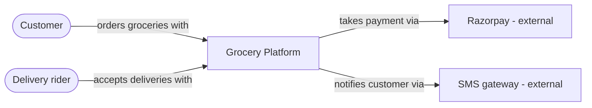
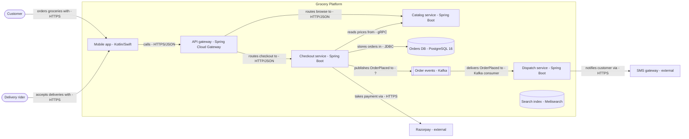
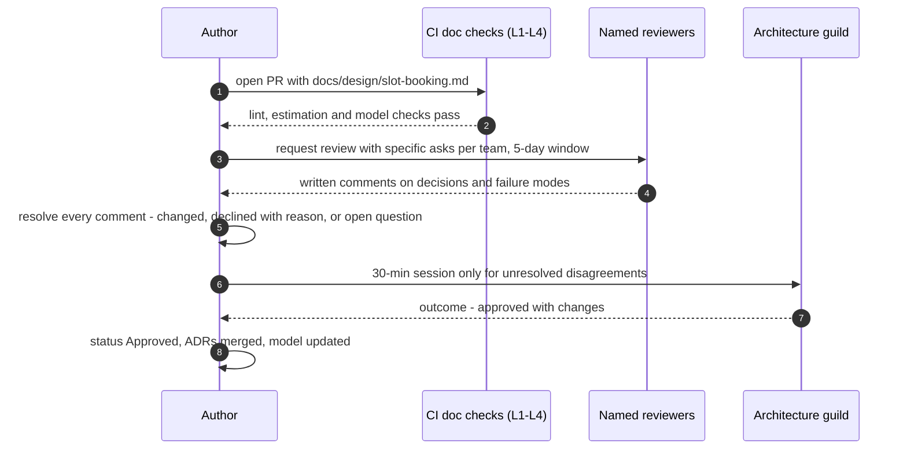
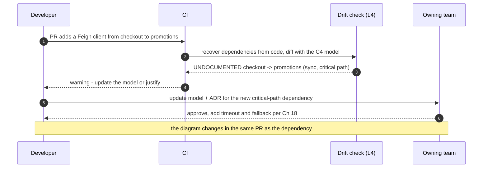
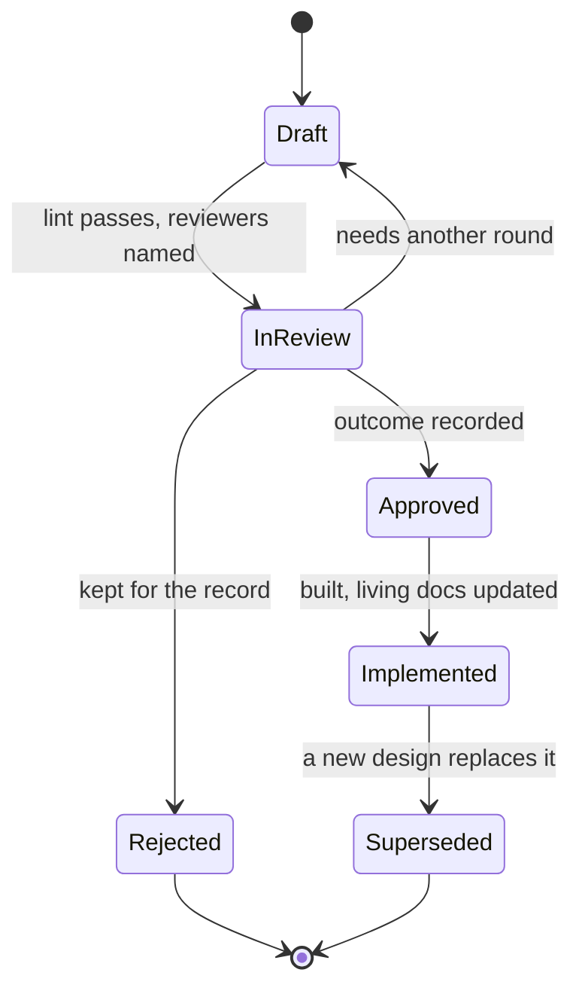

# 32. Design Documents & Architecture Communication

!!! abstract "Chapter at a glance"
    **Reader bands:** B2 → B4 · **Prerequisites:** [Ch 01](../00-orientation/01-what-system-design-is.md), [Ch 02](../01-foundations/02-back-of-the-envelope-estimation.md), [Ch 31](31-architecture-decision-making.md) · **What you will build:** The architect's primary output — a design document that gets the *right* review — plus the machinery that keeps architecture documentation true: a **design-doc linter**, **C4 diagrams generated from one model**, an **estimation consistency check**, and a **drift detector** that compares the documented architecture with the code. This chapter contains the **reusable design-document template** used throughout the handbook.

    - **L1: design-doc linter.** A plausible-looking one-page doc produced **18 findings** — 7 missing sections, 9 adjectives posing as requirements ("fast", "highly available", "real-time"), no compared alternatives, a two-word rollout, no decision record. The complete doc passed.
    - **L2: C4 from one model.** One model of 13 elements and 11 relationships generated **both** the System Context and Container diagrams, and validation caught **3 problems** a picture can't show: a container with **no owning team**, an **orphaned** search index, and an arrow with **no protocol**.
    - **L3: estimation consistency.** Recomputing a doc's capacity section from its own assumptions found **2 of 5 figures off by >2x**: peak writes overstated **8.6x** (500/s claimed vs 58/s derived) and storage understated **2.2x** (2.0 TB vs 4.5 TB) — the difference between "must shard" and "one PostgreSQL primary".
    - **L4: drift detection.** Scanning real source files recovered **8** actual dependencies; against the 6 drawn in the doc, **3 were undocumented** (including a synchronous checkout → promotions call on the critical path) and **1 was stale**.

    · **Reading time:** 100 min + code

---

## 1. Introduction & Why It Matters

### 1.1 A story: the design that everyone approved and nobody understood

The platform needed a new slot-booking system for scheduled deliveries. A senior engineer wrote a 28-page design document: a history of the old system, a dozen screenshots of the current UI, a complete REST API specification, class diagrams for every entity, and — on page 23 — two paragraphs describing the actual architecture: "slot inventory will be held in Redis for fast access; bookings are written to PostgreSQL asynchronously."

The document went to review. Eleven people were invited. Four opened it. Two left comments — both about API naming. It was approved in a meeting where the author presented slides that didn't match the document.

Three months after launch, a Redis failover lost thirty seconds of slot bookings. Customers were promised slots that were then given to someone else. The postmortem asked: *was the risk of losing Redis-held bookings discussed in the design review?* It had not been. Nobody had noticed that "written to PostgreSQL asynchronously" meant **the source of truth for a customer-visible promise lived in a cache**. The one decision that mattered was buried on page 23, between an ER diagram and a table of HTTP status codes.

The review found that the document failed at communication, not design effort:

1. **No problem statement or goals up front.** Reviewers couldn't tell what the design was optimizing for, so they couldn't judge whether it succeeded.
2. **Requirements were adjectives.** "Fast", "reliable", "scalable" — nothing a reviewer could check a design against (L1).
3. **The key decision wasn't framed as a decision.** No alternatives, no trade-offs, no "here's what we're risking." The durability trade-off was never presented as a choice (Ch 31).
4. **Wrong level of detail.** Pages of API minutiae (reviewable later, in code) and two paragraphs of architecture (only reviewable now).
5. **Diagrams didn't match each other or the text.** The slide deck and the document showed different components (L2, L4).

The rewrite of the design process — the template in §2.3, the review practices in §2.6, and the tooling in the labs — was aimed at one outcome: **the decisions that are expensive to change get discussed before they are made.**

!!! quote "The thesis of this chapter"
    A design document is not a record of work; it is a **tool for getting the right feedback on the decisions that are expensive to change, before you make them**. That means: lead with the problem, goals and measurable requirements; present the key decisions as decisions, with alternatives and trade-offs; pitch the detail at the level being reviewed; draw diagrams from a model so they can't contradict each other; and keep the documentation tied to the running system so it stays true. Everything else is decoration.

### 1.2 Where this lives in the grocery platform

| Artifact | When it's written | Reviewed by | Lab |
|---|---|---|---|
| Design doc (this template) | Before building anything non-trivial or cross-team | Affected teams + architecture guild (advice process) | L1, L3 |
| ADRs | For each significant decision inside or outside a design doc | PR review ([Ch 31](31-architecture-decision-making.md)) | — |
| C4 model | Maintained continuously in the repo | Changed via PR, rendered in CI | L2 |
| Architecture drift report | Every CI run on main | Owning team, platform guild | L4 |
| RFC | Cross-cutting proposals (new standards, platform changes) | Open to all engineers, time-boxed comment period | §2.7 |
| Runbooks, API docs | Near launch, generated where possible | Operating team | §2.9 |

### 1.3 Learning objectives

By the end you will be able to:

- **Write a design document** with the template in §2.3 that leads reviewers to the decisions that matter.
- **Pitch detail at the right level** for the audience and stage of the design.
- **Draw architecture with the C4 model** and generate diagrams from one model rather than drawing them by hand (L2).
- **Make every number in a doc derivable** from stated assumptions (L3).
- **Run an effective design review** — asynchronous-first, focused on decisions, with explicit outcomes.
- **Keep architecture documentation true** with linting (L1) and drift detection (L4).
- **Communicate architecture** to different audiences — executives, product, engineers, operators.

---

## 2. Core Concepts — Beginner to Deep

### 2.1 Intuition: why write it down at all <span class="band b2">B2</span>

Writing a design before building it feels slow. It's the opposite: a design document is the cheapest place to find a mistake. Changing a sentence costs minutes; changing a deployed data model costs weeks. The document also does things a conversation can't:

- **It forces clarity.** Vague ideas survive in conversation because the listener fills in the gaps charitably. Written down, "we'll cache it" has to become "we'll cache it where, with what TTL, and what happens on a miss during a failover" — and the gaps show.
- **It scales review.** A meeting reaches the people in the room at that hour. A document reaches everyone affected, asynchronously, including the team in another time zone who owns the dependency you're about to hammer.
- **It outlives the author.** Six months later, the doc (and its ADRs) is how the next engineer learns *why* — the problem of §1.1 in Ch 31.

The right amount of documentation depends on the cost of being wrong. A two-way-door change inside one service needs a PR description. A new service, a new datastore, or a change to a shared contract needs a design doc.

### 2.2 Know your audience and your level of detail ⭐ <span class="band b2">B2</span>

The most common design-doc failure is the wrong altitude — §1.1's 28 pages of API detail around two paragraphs of architecture. Match detail to the decisions being reviewed now:

| Stage / audience | They need | Leave out |
|---|---|---|
| Executives, product leadership | Problem, business impact, options at a high level, cost, risk, timeline | Component internals, APIs, schemas |
| Architecture review / peer teams | Goals, NFRs, key decisions + alternatives + trade-offs, container-level design, dependencies, failure modes | Class diagrams, full API specs, UI |
| Implementing team | Component design, data model, API contracts, sequence flows | Business justification already agreed |
| Operators / on-call | Deployment, dependencies, SLOs, alerts, runbooks, failure behavior | Design history, rejected options |

One document can serve several audiences if it's **layered**: an executive summary a reader can stop after, then the architecture-level design, then appendices with detail. What it must never do is make the reader dig for the decision.

**The inverted pyramid.** Journalists put the most important information first because readers stop reading. Design docs should too: title → one-paragraph summary (problem, proposal, key trade-off) → goals and requirements → the design and its decisions → everything else.

### 2.3 The design document template ⭐ <span class="band b2">B2</span>

This is the template used throughout the handbook (the orientation chapter's "Ch 32 template"). Sections marked **(required)** are what L1's linter checks.

```markdown
# Design: <name>                       Status: Draft | In review | Approved | Superseded
Author(s): …   Reviewers: …   Last updated: YYYY-MM-DD   Related: ADR-…, RFC-…

## Summary                                                  (required, ≤ 1 paragraph)
The problem, the proposal, and the single most important trade-off. A reader who stops here
should know what you're asking them to agree to.

## Context / problem                                        (required)
What is happening today, with evidence (metrics, incidents, customer impact). Why now.

## Goals                                                    (required)
Measurable outcomes. "Checkout p99 < 300 ms at 800 req/s" — not "make checkout faster."

## Non-goals                                                (required)
What this deliberately does NOT do. Prevents scope creep and wasted review comments.

## Requirements                                             (required)
Functional: the key capabilities.
Non-functional (quality attributes, Ch 31): latency, throughput, availability, durability
(RPO/RTO), consistency, security/compliance, cost — each with a number.
Constraints: fixed choices you must live with (cloud, regulation, team, deadline).

## Scale assumptions & estimation                           (required for anything stateful)
Assumptions (DAU, request mix, payload sizes, growth), then DERIVED figures (QPS, storage,
bandwidth) with their working. Keep derivations reproducible (L3).

## Proposed design                                          (required)
C4 context and container diagrams (L2). Main flows as sequence diagrams (happy + failure).
Data model and ownership. APIs/events at the contract level. How each goal/NFR is met.

## Key decisions                                            (required)
For each decision that is expensive to reverse: the options, the choice, and why.
Link an ADR for each (Ch 31).

## Alternatives considered                                  (required, ≥ 2 incl. status quo)
What else was evaluated and why it lost. The section future readers value most.

## Trade-offs, risks & failure modes                        (required)
What this design is bad at. What happens when each dependency is slow, down, or wrong.
Top risks with mitigations. Pre-mortem results if you ran one.

## Security & privacy                                       (required)
Trust boundaries, authn/authz, data classification, PII handling, threat-model summary.

## Observability & operations                               (required)
SLOs and alerts, dashboards, traces, runbooks, on-call owner.

## Rollout, migration & rollback                            (required)
Phases, feature flags, data migration (expand/contract, Ch 28), guardrails, rollback criteria.

## Cost                                                     (recommended)
Build and run cost; cost per request/order; how it scales.

## Open questions                                           (required — "None" is allowed)
What you don't know yet, who will answer it, by when.

## Appendix
Detailed API specs, schemas, benchmarks, meeting notes, glossary.
```

A few rules make the template work rather than become a form to fill in:

- **Delete sections that genuinely don't apply** — but say why in one line ("Cost: negligible, uses existing cluster") so reviewers know it was considered.
- **Every NFR has a number** (L1 flags adjectives). If you don't know the number, that's an open question, not an adjective.
- **Every number is derivable** from the assumptions (L3).
- **Every key decision has alternatives** — one option presented alone is a rationalization.
- **Length: as short as possible.** For most designs, 4–10 pages plus appendices. Amazon's six-page narrative format and Google's design docs both favor dense prose over slides.

### 2.4 Diagrams: the C4 model ⭐ <span class="band b3">B3</span>

Most architecture diagrams are ambiguous: boxes mean services in one place, classes in another, deployment nodes in a third; arrows mean "calls", "depends on", or "data flows" without saying which. Simon Brown's **C4 model** fixes this with four levels of zoom, like a map:

| Level | Shows | Audience | In the grocery platform |
|---|---|---|---|
| **1. System Context** | Your system as one box, its users and the external systems it depends on | Everyone, including non-technical | Customer, rider, the platform, Razorpay, SMS gateway |
| **2. Container** | The deployable/runnable units inside your system and how they communicate | Engineers, architects, ops | App, gateway, checkout, catalog, DBs, Kafka |
| **3. Component** | The major building blocks inside one container | The team building that container | Checkout's controllers, reservation logic, payment adapter |
| **4. Code** | Classes, tables | Rarely drawn by hand — generate from code if needed | — |

Plus supplementary views: **deployment** (containers mapped onto infrastructure), **dynamic** (a sequence of interactions for one scenario), and **system landscape** (many systems in an enterprise).

C4's discipline is in the notation rules, not the shapes:

- **Every element has a name, a type, a technology, and a one-line responsibility.**
- **Every arrow is one-directional and labeled** with what it does and how ("reads prices from — gRPC").
- **Every diagram has a title and a key**, and stays at one level of abstraction — no classes on a container diagram.
- **Most designs need only Levels 1 and 2**, plus a couple of dynamic (sequence) views for key flows. Level 3 only for complex containers.

This handbook draws C4 diagrams as Mermaid flowcharts with the level named in the title (§3.1–3.2 were generated by L2).

### 2.5 Diagrams as code and the single model <span class="band b3">B3</span>

Hand-drawn diagrams drift: the context diagram, the container diagram, the slide deck and the wiki page each get edited independently until they disagree (§1.1). Two escalating remedies:

- **Diagrams as text** (Mermaid, PlantUML, D2): diagrams live in the repo, are diffable, and are reviewed in PRs alongside the code they describe. This is the minimum.
- **Models as code** (Structurizr DSL, C4-PlantUML with a shared model, or L2's approach): you define the architecture **once** — elements and relationships — and **generate** every view from it. A rename happens in one place; views can't contradict each other; and the model can be **validated** (L2 caught a container with no owner, an orphaned element, and an arrow with no protocol).

The model also becomes queryable: "what depends on the orders database?" is a query rather than an archaeology project.

### 2.6 Design reviews that work ⭐ <span class="band b3">B3</span>

§1.1's review failed in a very common way: a large invite list, a long document, a meeting, and comments about naming. Practices that produce better reviews:

- **Asynchronous first.** Circulate the doc with a deadline (typically 3–5 working days) for written comments. Meetings are for resolving disagreements the comments surfaced, not for reading the doc together. (Amazon starts meetings with silent reading of a six-pager precisely because pre-reading doesn't reliably happen; either works if it's deliberate.)
- **Name the reviewers and what you want from each.** "Payments team: please check the idempotency design in §5.3. SRE: failure modes in §7." A doc sent to eleven people with no ask gets zero useful reviews.
- **Tell reviewers which decisions are open.** Point them at the key decisions and alternatives; say which parts are settled (don't relitigate) and which you're unsure about.
- **Lint before humans** (L1). Missing sections and adjective-requirements are the author's job to fix before anyone else spends time.
- **Explicit outcomes.** Every review ends in one of: *approved*, *approved with changes* (listed), *needs another round*, or *rejected* — recorded in the doc's status and history.
- **Comments are resolved, not ignored.** Each substantive comment gets a response: changed, won't change (with reason), or moved to open questions.
- **Separate facts from preferences** (Ch 31 §2.3): "this breaches the RPO" is a blocking fact; "I'd have used Kafka" is a preference unless it comes with a reason tied to the requirements.

**Reviewer checklist** (useful for anyone reviewing):

1. Can I state the problem and the proposal after reading the summary?
2. Are the goals measurable, and would the design meet them? (Can I check a number?)
3. What happens when each dependency fails? Where's the single point of failure?
4. Where does the source of truth for each piece of data live, and what's its durability? (§1.1's question.)
5. What's the hardest part to change later — and was it presented as a decision with alternatives?
6. Is the rollout reversible? What's the rollback trigger?
7. Is anything missing that my team will have to deal with?

### 2.7 RFCs, one-pagers and other formats <span class="band b3">B3</span>

Not every proposal is a design doc:

- **One-pager / pitch** — before a design doc: the problem, why now, rough approach, and the ask ("two engineers for six weeks"). Used to decide whether to invest in a full design.
- **RFC (Request for Comments)** — for cross-cutting proposals that affect many teams (a new API standard, adopting a new datastore, changing the deployment platform). Open to all engineers with a time-boxed comment period and a named decider. Rust, Python (PEPs) and many companies (Uber, Sourcegraph, HashiCorp) use variants.
- **ADR** — a single decision ([Ch 31](31-architecture-decision-making.md)). Design docs link ADRs for their key decisions.
- **Architecture overview / arc42** — for documenting an *existing* system: arc42 is a 12-section template (goals, constraints, context, solution strategy, building blocks, runtime, deployment, cross-cutting concepts, decisions, quality, risks, glossary) that pairs well with C4.
- **Postmortem** — the "design doc" written after reality disagreed with the design ([Ch 27](../03-production/27-reliability-and-disaster-recovery.md)); its action items often spawn new ADRs.

### 2.8 Numbers in documents <span class="band b3">B3</span>

Design docs are full of numbers — capacity, latency budgets, costs — and those numbers drive decisions: instance counts, database choice, whether to shard. Yet reviewers rarely recompute them. L3 shows the typical failure: a peak write rate overstated 8.6x in one line (the reads, computed separately, used the right number), and a storage figure with no working that was 2.2x low.

Rules for numbers:

- **Separate assumptions from derivations.** State assumptions once (DAU, orders/user, payload size, peak factor, retention); derive everything else from them.
- **Show the working** — a formula a reviewer can check. A number without derivation can't be challenged except by redoing it.
- **Generate derived figures where you can** (a small script or spreadsheet in the appendix), so the doc's numbers can't drift apart.
- **Round honestly and state precision** — "~58 writes/s" not "57.87"; ranges where uncertain ([Ch 31](31-architecture-decision-making.md) L4).
- **Let reviewers argue with assumptions, not results.** "I think 0.5 orders per DAU is too high for weekdays" is a productive review comment.

### 2.9 Living documentation: keeping it true <span class="band b4">B4</span>

Documentation rots because the system changes and the docs don't. Strategies, from weakest to strongest:

1. **Docs next to code, changed in the same PR** ("docs-as-code"): the reviewer sees the diagram diff with the code diff.
2. **Status and ownership on every doc**, with a "last verified" date. Stale docs get marked, not silently trusted.
3. **Generate what can be generated**: API references from OpenAPI/AsyncAPI specs, schema docs from migrations, C4 container views from the model (L2), dependency views from runtime telemetry.
4. **Detect drift automatically** (L4): recover the actual architecture — from code, from service-mesh telemetry, or from distributed traces ([Ch 24](../03-production/24-observability.md)) — and diff it against the documented model in CI. The undocumented dependencies are usually the dangerous ones (L4 found an unreviewed synchronous call on the checkout critical path).
5. **Make documentation executable**: fitness functions ([Ch 31](31-architecture-decision-making.md) L2) are architecture documentation that fails the build when it stops being true.

The design doc itself is a **point-in-time** artifact: once approved and built, mark it as such and let the model, ADRs and generated docs carry the current truth. Don't try to keep every design doc eternally up to date; keep the *living* artifacts true and link to them.

### 2.10 Communicating architecture beyond documents <span class="band b4">B4</span>

Senior architects spend as much time communicating as designing:

- **For executives:** lead with business outcome, risk and cost; one diagram (context level); the ask. Frame technical options as business options ("ship in 6 weeks with a known scaling limit at 3x today's load, or 12 weeks without it").
- **For product:** what users will experience, what's possible now vs later, what the constraints are and why.
- **For engineers across teams:** contracts, dependencies, timelines, and what you need from them.
- **For operators:** failure modes, SLOs, runbooks, and what's changing in their pager.
- **Storytelling with evidence:** a before/after with numbers (latency, incidents, cost) beats any architecture slide.
- **Architecture katas and brown-bags** spread design skill; **architecture decision logs** made visible to everyone spread context.
- **Say "I don't know" in writing** — the open questions section is a sign of rigor, not weakness.

---

## 3. Architecture & Diagrams

### 3.1 C4 Level 1 — System Context (generated by L2)



### 3.2 C4 Level 2 — Containers (generated by L2 from the same model)



Note what the generated diagram exposes: the `?` protocol on the Kafka arrow and the unconnected search index are the validation findings of L2, visible on the picture itself.

### 3.3 Sequence: happy path, a design doc from draft to approved



### 3.4 Sequence: failure path, how drift is caught after approval



### 3.5 State: a design document's lifecycle



---

## 4. Design Document Excerpt: Grocery Documentation Standard

!!! note "Design Document (excerpt) — Architecture Documentation Standard v1.0"
    **Status:** Accepted · **Authors:** Architecture guild · **Reviewers:** Tech leads, SRE, Product

    | Field | Value |
    |---|---|
    | Context | The slot-booking incident (§1.1) traced to a review that never discussed the key durability decision; diagrams in docs, slides and wikis disagreed with each other and with production. |
    | Decision | One design-doc template (§2.3) for all non-trivial work; C4 model in the repo as the single source of architecture diagrams; automated checks (doc lint, estimation consistency, model validation, drift) in CI; asynchronous-first reviews with named reviewers and recorded outcomes. |
    | Related ADRs | ADR-180 Design-doc template + required sections; ADR-181 docs-as-code under docs/design; ADR-182 C4 model as code, views generated in CI; ADR-183 Doc lint + estimation check as PR checks; ADR-184 Drift detection vs code and trace data, weekly report; ADR-185 Async review, named asks, recorded outcomes; ADR-186 Design docs are point-in-time — living truth is model + ADRs + generated docs |

    **Requirements.**

    - **R1 — Decisions reviewed before they're made.** Every expensive-to-reverse decision appears in a "Key decisions" section with alternatives.
    - **R2 — Measurable requirements.** No NFR without a number (L1).
    - **R3 — Consistent numbers.** Derived figures reproducible from stated assumptions (L3).
    - **R4 — One source of diagrams.** Context and container views generated from the C4 model; model validated (L2).
    - **R5 — True over time.** Documented dependencies diffed against actual dependencies; drift reported weekly and on PRs (L4).
    - **R6 — Review has an outcome.** Every review ends with a recorded status.

    **Decisions in detail.**

    1. **Template (ADR-180).** §2.3; sections may be dropped with a one-line reason.
    2. **Docs-as-code (ADR-181).** `docs/design/*.md` in the owning repo, reviewed by PR.
    3. **Model as code (ADR-182).** Structurizr DSL workspace per domain; CI renders views into the docs site. (L2 shows the mechanism.)
    4. **PR checks (ADR-183).** Lint (L1) and estimation consistency (L3) are warnings on draft, blocking on "In review."
    5. **Drift (ADR-184).** Dependencies recovered from code and from trace data; undocumented critical-path dependencies raise a ticket to the owning team. (L4.)
    6. **Reviews (ADR-185).** 5-day async window, named reviewers with specific asks, meeting only for unresolved disagreements.
    7. **Point-in-time docs (ADR-186).** Approved docs are marked "Implemented" and not maintained; the model, ADRs and generated references are.

    **Consequences.** Authors spend a bit more time on structure and numbers; CI gains a few fast checks. In return: reviews focus on decisions, diagrams agree with each other and with production, and the next engineer can find the "why."

---

## 5. Hands-On Code — Level Ladder

!!! info "What's real here"
    All four labs are self-contained JDK 21 programs that read real files: L1 lints real Markdown documents, L4 parses a real (small) Java source tree and a documented-model file. L2 emits real Mermaid — §3.1 and §3.2 above are its unmodified output. L3 recomputes figures with the Ch 02 method. Production equivalents (Structurizr, markdown linters like Vale, trace-based dependency discovery) are named in each lab.

### L1 — A design-doc linter <span class="band b2">B2</span>

**Requirement:** "Reviewers keep spending their time pointing out missing sections and vague requirements. Catch those automatically."

Two real Markdown docs: a plausible one-page proposal (`bad_design.md`) and one written with the §2.3 template (`good_design.md`). The linter checks required sections, adjectives-without-numbers, the number of listed alternatives, rollout substance, and a decision record.

```markdown title="docs/bad_design.md"
# Design: New Checkout Service

## Background
Checkout is slow and we want to rebuild it with microservices.

## Proposed Design
We will build a fast, highly scalable checkout service using Kafka and Redis.
It will be highly available and secure. Latency will be low and it will support real-time inventory.

## Alternatives
We could keep the old one, but it is slow.

## Rollout
Deploy it.
```

```java title="DocLintL1.java"
// DocLintL1.java — run with: java DocLintL1.java docs/bad_design.md docs/good_design.md   (JDK 21, no dependencies)
// A DESIGN-DOC LINTER. Most weak design docs fail in the same, mechanically detectable ways: required sections are
// missing, non-functional requirements are adjectives instead of numbers ("fast", "highly available"), only one option
// was considered, there's no rollout plan, and no one wrote down what is still unknown. A reviewer's first ten minutes
// are spent finding exactly these gaps. This linter finds them in milliseconds, so human review can focus on the design.
import java.nio.file.*;
import java.util.*;
import java.util.regex.*;

public class DocLintL1 {
    // sections every significant design doc needs (matched case-insensitively against '## ' headings, by keyword)
    static final Map<String, List<String>> REQUIRED = new LinkedHashMap<>();
    static {
        REQUIRED.put("Context / problem",       List.of("context", "background", "problem"));
        REQUIRED.put("Goals",                   List.of("goals"));
        REQUIRED.put("Non-goals",               List.of("non-goals", "non goals", "out of scope"));
        REQUIRED.put("Requirements (NFRs)",     List.of("requirements", "nfr"));
        REQUIRED.put("Proposed design",         List.of("proposed design", "design"));
        REQUIRED.put("Alternatives considered", List.of("alternatives"));
        REQUIRED.put("Trade-offs / risks",      List.of("trade-off", "tradeoff", "risks"));
        REQUIRED.put("Rollout / migration",     List.of("rollout", "migration"));
        REQUIRED.put("Observability",           List.of("observability", "monitoring"));
        REQUIRED.put("Security",                List.of("security"));
        REQUIRED.put("Open questions",          List.of("open questions"));
    }
    // adjectives that must come with a number on the same line to count as a requirement
    static final List<String> VAGUE = List.of("fast", "slow", "scalable", "highly available", "secure", "real-time",
            "low latency", "latency will be low", "robust", "performant", "high throughput");
    static final Pattern NUMBER = Pattern.compile("\\d");

    record Finding(String rule, String detail) {}

    static List<Finding> lint(List<String> lines) {
        List<Finding> f = new ArrayList<>();
        // collect headings and the body under each
        Map<String, List<String>> sections = new LinkedHashMap<>();
        String current = "(preamble)"; sections.put(current, new ArrayList<>());
        for (String l : lines) {
            if (l.startsWith("## ")) { current = l.substring(3).trim().toLowerCase(); sections.put(current, new ArrayList<>()); }
            else sections.get(current).add(l);
        }
        // R1: required sections
        for (var req : REQUIRED.entrySet()) {
            boolean found = sections.keySet().stream().anyMatch(h -> req.getValue().stream().anyMatch(h::contains)
                    // "design" alone must not be satisfied by "non-goals"-type headings; fine for this demo
            );
            if (!found) f.add(new Finding("R1 missing section", req.getKey()));
        }
        // R2: vague quality words without a number on the same line
        for (int i = 0; i < lines.size(); i++) {
            String l = lines.get(i).toLowerCase();
            if (l.startsWith("#")) continue;
            for (String v : VAGUE)
                if (l.contains(v) && !NUMBER.matcher(l).find())
                    f.add(new Finding("R2 unmeasurable NFR", "line " + (i + 1) + ": '" + v + "' with no number → state a target"));
        }
        // R3: alternatives must list at least 2 options (numbered/bulleted lines)
        sections.entrySet().stream().filter(e -> e.getKey().contains("alternatives")).findFirst().ifPresent(e -> {
            long options = e.getValue().stream().filter(x -> x.matches("^\\s*(\\d+\\.|-|\\*)\\s+.*")).count();
            if (options < 2) f.add(new Finding("R3 too few alternatives", options + " listed option(s); list ≥2 incl. status quo, with why rejected"));
        });
        // R4: rollout must be more than a one-liner (a plan has stages / guardrails)
        sections.entrySet().stream().filter(e -> e.getKey().contains("rollout")).findFirst().ifPresent(e -> {
            String body = String.join(" ", e.getValue()).trim();
            if (body.split("\\s+").length < 8) f.add(new Finding("R4 thin rollout", "'" + body + "' — needs stages, guardrails, rollback criteria"));
        });
        // R5: a decision should point to an ADR / revisit trigger
        String all = String.join("\n", lines).toLowerCase();
        if (!all.contains("adr-") && !all.contains("revisit"))
            f.add(new Finding("R5 no decision record", "no ADR reference or revisit trigger"));
        return f;
    }

    public static void main(String[] args) throws Exception {
        System.out.println("Design-doc linter: required sections, measurable NFRs, ≥2 alternatives, real rollout plan, decision record.\n");
        for (String path : args) {
            List<String> lines = Files.readAllLines(Path.of(path));
            List<Finding> f = lint(lines);
            System.out.printf("   %s (%d lines):%n", path, lines.size());
            if (f.isEmpty()) System.out.println("        ✓ PASS — ready for human review of the design itself.");
            else {
                for (Finding x : f) System.out.printf("        ✗ %-24s %s%n", x.rule(), x.detail());
                System.out.printf("        → %d finding(s): send back to the author before review.%n", f.size());
            }
            System.out.println();
        }
        System.out.println("   → the weak doc reads fine at a glance, but every quality claim is an adjective ('fast', 'highly scalable',");
        System.out.println("     'highly available'), the only alternative is a passing sentence rather than a compared option, the rollout is");
        System.out.println("     two words, and seven expected sections are missing. None of that needs a senior reviewer to spot — so automate");
        System.out.println("     it (a CI check on docs/design/*.md) and spend review time on the question only humans can answer:");
        System.out.println("     is this the right design for these requirements?");
    }
}
```

```text title="java DocLintL1.java docs/bad_design.md docs/good_design.md"
Design-doc linter: required sections, measurable NFRs, ≥2 alternatives, real rollout plan, decision record.

   docs/bad_design.md (14 lines):
        ✗ R1 missing section       Goals
        ✗ R1 missing section       Non-goals
        ✗ R1 missing section       Requirements (NFRs)
        ✗ R1 missing section       Trade-offs / risks
        ✗ R1 missing section       Observability
        ✗ R1 missing section       Security
        ✗ R1 missing section       Open questions
        ✗ R2 unmeasurable NFR      line 4: 'slow' with no number → state a target
        ✗ R2 unmeasurable NFR      line 7: 'fast' with no number → state a target
        ✗ R2 unmeasurable NFR      line 7: 'scalable' with no number → state a target
        ✗ R2 unmeasurable NFR      line 8: 'highly available' with no number → state a target
        ✗ R2 unmeasurable NFR      line 8: 'secure' with no number → state a target
        ✗ R2 unmeasurable NFR      line 8: 'real-time' with no number → state a target
        ✗ R2 unmeasurable NFR      line 8: 'latency will be low' with no number → state a target
        ✗ R2 unmeasurable NFR      line 11: 'slow' with no number → state a target
        ✗ R3 too few alternatives  0 listed option(s); list ≥2 incl. status quo, with why rejected
        ✗ R4 thin rollout          'Deploy it.' — needs stages, guardrails, rollback criteria
        ✗ R5 no decision record    no ADR reference or revisit trigger
        → 18 finding(s): send back to the author before review.

   docs/good_design.md (43 lines):
        ✓ PASS — ready for human review of the design itself.

   → the weak doc reads fine at a glance, but every quality claim is an adjective ('fast', 'highly scalable',
     'highly available'), the only alternative is a passing sentence rather than a compared option, the rollout is
     two words, and seven expected sections are missing. None of that needs a senior reviewer to spot — so automate
     it (a CI check on docs/design/*.md) and spend review time on the question only humans can answer:
     is this the right design for these requirements?
```

**Reading it:**

- The weak doc produced **18 findings**: 7 missing sections, **9 adjectives masquerading as requirements** ("fast", "scalable", "highly available", "secure", "real-time", "latency will be low"), **0 listed alternatives** (the only alternative is a passing sentence), a **two-word rollout**, and no ADR or revisit trigger. It "reads fine" — which is exactly why it gets approved without the conversation it needs.
- The template-based doc **passes**. That doesn't make its design right — it makes it *reviewable*: every requirement has a number a reviewer can check the design against.
- In production, run this as a PR check on `docs/design/**/*.md` — warning on drafts, blocking when status moves to "In review". Prose linters such as Vale can add style rules (weasel words, passive voice) with the same mechanism.

### L2 — C4 diagrams generated from one model <span class="band b3">B3</span>

**Requirement:** "Our context diagram, container diagram, slides and wiki disagree. Make them impossible to disagree."

The architecture is defined once as a model — people, systems, containers (with owner and technology), relationships (with verb and protocol). Both C4 levels are generated from it, and the model is validated.

```java title="C4ModelL2.java"
// C4ModelL2.java — run with: java C4ModelL2.java   (JDK 21, no dependencies)
// DIAGRAMS AS CODE from ONE MODEL (the Structurizr idea). Hand-drawn diagrams drift apart: the context diagram says one
// thing, the container diagram another, and neither matches production. Instead we define the architecture ONCE as a
// model — people, systems, containers, relationships — and GENERATE every C4 view from it. Because it is a model, we can
// also VALIDATE it: every container needs an owning team, every relationship needs a protocol, nothing may be orphaned.
import java.util.*;
import java.util.stream.*;

public class C4ModelL2 {
    enum Kind { PERSON, SYSTEM, EXTERNAL, CONTAINER, DATABASE, QUEUE }
    record Element(String id, String name, Kind kind, String parent, String owner, String tech) {}
    record Rel(String from, String to, String what, String protocol) {}

    static final Map<String, Element> E = new LinkedHashMap<>();
    static final List<Rel> R = new ArrayList<>();
    static void el(String id, String name, Kind k, String parent, String owner, String tech) { E.put(id, new Element(id, name, k, parent, owner, tech)); }
    static void rel(String f, String t, String what, String proto) { R.add(new Rel(f, t, what, proto)); }

    static void buildModel() {
        el("customer", "Customer", Kind.PERSON, null, null, null);
        el("rider", "Delivery rider", Kind.PERSON, null, null, null);
        el("shop", "Grocery Platform", Kind.SYSTEM, null, "platform", null);
        el("razorpay", "Razorpay", Kind.EXTERNAL, null, null, null);
        el("sms", "SMS gateway", Kind.EXTERNAL, null, null, null);
        // containers inside the platform
        el("app", "Mobile app", Kind.CONTAINER, "shop", "mobile-team", "Kotlin/Swift");
        el("gw", "API gateway", Kind.CONTAINER, "shop", "platform", "Spring Cloud Gateway");
        el("checkout", "Checkout service", Kind.CONTAINER, "shop", "checkout-team", "Spring Boot");
        el("catalog", "Catalog service", Kind.CONTAINER, "shop", "catalog-team", "Spring Boot");
        el("dispatch", "Dispatch service", Kind.CONTAINER, "shop", null, "Spring Boot");          // ← no owner (bug)
        el("ordersdb", "Orders DB", Kind.DATABASE, "shop", "checkout-team", "PostgreSQL 16");
        el("events", "Order events", Kind.QUEUE, "shop", "platform", "Kafka");
        el("search", "Search index", Kind.DATABASE, "shop", "catalog-team", "Meilisearch");      // ← orphan (bug)

        rel("customer", "app", "orders groceries with", "HTTPS");
        rel("rider", "app", "accepts deliveries with", "HTTPS");
        rel("app", "gw", "calls", "HTTPS/JSON");
        rel("gw", "checkout", "routes checkout to", "HTTP/JSON");
        rel("gw", "catalog", "routes browse to", "HTTP/JSON");
        rel("checkout", "catalog", "reads prices from", "gRPC");
        rel("checkout", "ordersdb", "stores orders in", "JDBC");
        rel("checkout", "razorpay", "takes payment via", "HTTPS");
        rel("checkout", "events", "publishes OrderPlaced to", null);                                   // ← no protocol (bug)
        rel("events", "dispatch", "delivers OrderPlaced to", "Kafka consumer");
        rel("dispatch", "sms", "notifies customer via", "HTTPS");
    }

    // map an element to the nearest element visible at a given level (context: collapse containers into their system)
    static String visible(String id, boolean context) {
        Element e = E.get(id);
        return (context && e.parent() != null) ? e.parent() : id;
    }
    static String shape(Element e) {
        String label = e.name() + (e.tech() != null ? " - " + e.tech() : "");
        return switch (e.kind()) {
            case PERSON -> e.id() + "([" + label + "])";
            case DATABASE -> e.id() + "[(" + label + ")]";
            case QUEUE -> e.id() + "[[" + label + "]]";
            case EXTERNAL -> e.id() + "[" + label + " - external]";
            default -> e.id() + "[" + label + "]";
        };
    }
    static String render(boolean context) {
        StringBuilder sb = new StringBuilder("flowchart LR\n");
        Set<String> shown = new LinkedHashSet<>();
        Set<String> edges = new LinkedHashSet<>();
        for (Rel r : R) {
            String a = visible(r.from(), context), b = visible(r.to(), context);
            if (a.equals(b)) continue;                              // internal to the system at context level
            shown.add(a); shown.add(b);
            String label = context ? r.what() : r.what() + " - " + (r.protocol() == null ? "?" : r.protocol());
            edges.add("    " + a + " -->|" + label + "| " + b);
        }
        if (!context) {                                             // container view groups containers in a subgraph
            sb.append("    subgraph shop[Grocery Platform]\n");
            for (Element e : E.values()) if ("shop".equals(e.parent())) sb.append("      ").append(shape(e)).append("\n");
            sb.append("    end\n");
            for (String id : shown) if (!"shop".equals(E.get(id).parent())) sb.append("    ").append(shape(E.get(id))).append("\n");
        } else for (String id : shown) sb.append("    ").append(shape(E.get(id))).append("\n");
        edges.forEach(x -> sb.append(x).append("\n"));
        return sb.toString();
    }

    static List<String> validate() {
        List<String> v = new ArrayList<>();
        Set<String> connected = new HashSet<>();
        for (Rel r : R) { connected.add(r.from()); connected.add(r.to()); }
        for (Element e : E.values()) {
            boolean isContainer = e.parent() != null;
            if (isContainer && e.owner() == null) v.add("V1 no owner       container '" + e.name() + "' has no owning team");
            if (e.kind() != Kind.SYSTEM && !connected.contains(e.id())) v.add("V2 orphan         '" + e.name() + "' has no relationships (dead, or undocumented)");
        }
        for (Rel r : R) if (r.protocol() == null) v.add("V3 no protocol     " + E.get(r.from()).name() + " → " + E.get(r.to()).name() + " (" + r.what() + ")");
        return v;
    }

    public static void main(String[] args) {
        buildModel();
        System.out.println("One architecture model → every C4 view is generated from it, and the model can be validated.\n");
        System.out.println("   Model: " + E.values().stream().collect(Collectors.groupingBy(Element::kind, TreeMap::new, Collectors.counting()))
                + ", " + R.size() + " relationships\n");
        System.out.println("=== Generated C4 Level 1 — System Context (containers collapsed into their system) ===");
        System.out.print(render(true));
        System.out.println("\n=== Generated C4 Level 2 — Containers (same model, more detail) ===");
        System.out.print(render(false));
        System.out.println("\n=== Model validation ===");
        List<String> v = validate();
        v.forEach(x -> System.out.println("   ✗ " + x));
        System.out.println("   → " + v.size() + " problem(s) found.\n");
        System.out.println("   → both diagrams come from one model, so they cannot contradict each other, and a rename happens once.");
        System.out.println("     The same model answers questions a picture can't: which container has no owner (Dispatch — who gets paged?),");
        System.out.println("     what is drawn but connected to nothing (Search index — dead, or a dependency nobody documented?), and which");
        System.out.println("     arrows hide their protocol. Structurizr DSL / C4-PlantUML do this for real; keep the model in the repo and");
        System.out.println("     render it in CI so the diagrams in the design doc are always regenerated from the current model.");
    }
}
```

```text title="java C4ModelL2.java"
One architecture model → every C4 view is generated from it, and the model can be validated.

   Model: {PERSON=2, SYSTEM=1, EXTERNAL=2, CONTAINER=5, DATABASE=2, QUEUE=1}, 11 relationships

=== Generated C4 Level 1 — System Context (containers collapsed into their system) ===
flowchart LR
    customer([Customer])
    shop[Grocery Platform]
    rider([Delivery rider])
    razorpay[Razorpay - external]
    sms[SMS gateway - external]
    customer -->|orders groceries with| shop
    rider -->|accepts deliveries with| shop
    shop -->|takes payment via| razorpay
    shop -->|notifies customer via| sms

=== Generated C4 Level 2 — Containers (same model, more detail) ===
flowchart LR
    subgraph shop[Grocery Platform]
      app[Mobile app - Kotlin/Swift]
      gw[API gateway - Spring Cloud Gateway]
      checkout[Checkout service - Spring Boot]
      catalog[Catalog service - Spring Boot]
      dispatch[Dispatch service - Spring Boot]
      ordersdb[(Orders DB - PostgreSQL 16)]
      events[[Order events - Kafka]]
      search[(Search index - Meilisearch)]
    end
    customer([Customer])
    rider([Delivery rider])
    razorpay[Razorpay - external]
    sms[SMS gateway - external]
    customer -->|orders groceries with - HTTPS| app
    rider -->|accepts deliveries with - HTTPS| app
    app -->|calls - HTTPS/JSON| gw
    gw -->|routes checkout to - HTTP/JSON| checkout
    gw -->|routes browse to - HTTP/JSON| catalog
    checkout -->|reads prices from - gRPC| catalog
    checkout -->|stores orders in - JDBC| ordersdb
    checkout -->|takes payment via - HTTPS| razorpay
    checkout -->|publishes OrderPlaced to - ?| events
    events -->|delivers OrderPlaced to - Kafka consumer| dispatch
    dispatch -->|notifies customer via - HTTPS| sms

=== Model validation ===
   ✗ V1 no owner       container 'Dispatch service' has no owning team
   ✗ V2 orphan         'Search index' has no relationships (dead, or undocumented)
   ✗ V3 no protocol     Checkout service → Order events (publishes OrderPlaced to)
   → 3 problem(s) found.

   → both diagrams come from one model, so they cannot contradict each other, and a rename happens once.
     The same model answers questions a picture can't: which container has no owner (Dispatch — who gets paged?),
     what is drawn but connected to nothing (Search index — dead, or a dependency nobody documented?), and which
     arrows hide their protocol. Structurizr DSL / C4-PlantUML do this for real; keep the model in the repo and
     render it in CI so the diagrams in the design doc are always regenerated from the current model.
```

**Reading it:**

- The **context view collapses containers into their system** automatically — internal arrows disappear, external ones are re-attached to "Grocery Platform". The **container view** shows the same relationships with protocols. §3.1 and §3.2 of this chapter are this exact output, rendered.
- **Validation finds what pictures hide:** the Dispatch service has **no owning team** (who gets paged?), the Search index is **connected to nothing** (dead, or an undocumented dependency?), and checkout → Kafka has **no protocol**, which the generated diagram even shows as `?`.
- In production, **Structurizr DSL** is the standard way to do this:

```text title="VERIFY: Structurizr DSL equivalent (render with Structurizr Lite / CLI)"
workspace "Grocery Platform" {
  model {
    customer = person "Customer"
    razorpay = softwareSystem "Razorpay" "Payments" "External"
    shop = softwareSystem "Grocery Platform" {
      checkout = container "Checkout service" "Places orders" "Spring Boot" { properties { "owner" "checkout-team" } }
      catalog  = container "Catalog service" "Products and prices" "Spring Boot"
      ordersdb = container "Orders DB" "Orders of record" "PostgreSQL 16" "Database"
    }
    checkout -> catalog "Reads prices from" "gRPC"
    checkout -> ordersdb "Stores orders in" "JDBC"
    checkout -> razorpay "Takes payment via" "HTTPS"
  }
  views {
    systemContext shop { include * autolayout lr }
    container shop { include * autolayout lr }
  }
}
```

### L3 — Are the doc's numbers consistent with its own assumptions? <span class="band b3">B3</span>

**Requirement:** "The capacity section says 500 orders/s and 2 TB. Before we size the cluster, check those against the doc's stated assumptions."

Every derived figure is recomputed from the doc's assumptions with the [Ch 02](../01-foundations/02-back-of-the-envelope-estimation.md) method and compared with the claim; anything off by more than 2x is flagged.

```java title="EstimateL3.java"
// EstimateL3.java — run with: java EstimateL3.java   (JDK 21, no dependencies)
// INTERNAL CONSISTENCY OF A DESIGN DOC'S NUMBERS. Design docs state assumptions (DAU, orders per user, payload size,
// retention) in one section and derived figures (peak QPS, storage, bandwidth) in another — often written on different
// days, sometimes by different people. Reviewers rarely recompute them. This check derives every figure from the stated
// assumptions (the back-of-envelope method of Ch 02) and compares it with what the doc claims, flagging anything off by
// more than 2x. An order-of-magnitude error in a capacity claim becomes a wrong instance count, a wrong DB, a wrong budget.
import java.util.*;

public class EstimateL3 {
    record Check(String metric, double claimed, double derived, String unit, String formula) {
        double ratio() { return claimed / derived; }
        boolean ok() { return ratio() >= 0.5 && ratio() <= 2.0; }
    }

    public static void main(String[] args) {
        // ---- assumptions as written in the doc's "Scale assumptions" section ----
        double dau = 2_000_000;             // daily active users
        double ordersPerDauPerDay = 0.5;    // half of DAU place an order each day
        double peakFactor = 5;              // festival peak vs daily average
        double orderBytes = 4 * 1024;       // stored order row + items + audit, bytes
        double retentionYears = 3;
        double readsPerOrder = 40;          // order-status polls, history views, support lookups per order lifetime
        double eventBytes = 1.5 * 1024;     // OrderPlaced event on Kafka
        double replicationFactor = 3;

        // ---- figures the doc CLAIMS in its "Capacity" section ----
        Map<String, Double> claimed = new LinkedHashMap<>();
        claimed.put("peak order writes/s", 500.0);
        claimed.put("order storage (3 yr, 1 copy)", 2.0);       // TB
        claimed.put("peak order reads/s", 2_300.0);
        claimed.put("Kafka ingest (3 replicas)/day", 4.2);      // GB/day
        claimed.put("avg order writes/s", 11.6);

        // ---- derive from assumptions ----
        double ordersPerDay = dau * ordersPerDauPerDay;
        double avgWps = ordersPerDay / 86_400;
        double peakWps = avgWps * peakFactor;
        double storageTB = ordersPerDay * 365 * retentionYears * orderBytes / 1e12;
        double peakRps = peakWps * readsPerOrder;
        double kafkaGBday = ordersPerDay * eventBytes * replicationFactor / 1e9;

        List<Check> checks = List.of(
            new Check("avg order writes/s", claimed.get("avg order writes/s"), avgWps, "/s", "2M DAU × 0.5 ÷ 86,400"),
            new Check("peak order writes/s", claimed.get("peak order writes/s"), peakWps, "/s", "avg × peak factor 5"),
            new Check("peak order reads/s", claimed.get("peak order reads/s"), peakRps, "/s", "peak writes × 40 reads/order"),
            new Check("order storage (3 yr, 1 copy)", claimed.get("order storage (3 yr, 1 copy)"), storageTB, " TB", "1M/day × 365 × 3 × 4 KiB"),
            new Check("Kafka ingest (3 replicas)/day", claimed.get("Kafka ingest (3 replicas)/day"), kafkaGBday, " GB", "1M/day × 1.5 KiB × 3")
        );

        System.out.println("Recomputing a design doc's capacity figures from its own stated assumptions (flag if off by >2x).\n");
        System.out.printf("   Assumptions: %,.0f DAU, %.1f orders/DAU/day, peak ×%.0f, %.0f KiB/order, %.0f yr retention, %.0f reads/order%n%n",
                dau, ordersPerDauPerDay, peakFactor, orderBytes / 1024, retentionYears, readsPerOrder);
        System.out.printf("   %-30s %10s %10s %7s   %s%n", "figure", "claimed", "derived", "ratio", "derivation");
        int bad = 0;
        for (Check c : checks) {
            System.out.printf("   %-30s %10s %10s %6.1fx   %-30s %s%n", c.metric(), fmt(c.claimed(), c.unit()), fmt(c.derived(), c.unit()),
                    c.ratio(), c.formula(), c.ok() ? "✓" : "✗ INCONSISTENT");
            if (!c.ok()) bad++;
        }
        System.out.printf("%n   → %d of %d figures disagree with the doc's own assumptions by more than 2x.%n", bad, checks.size());
        System.out.println("     The peak write rate is overstated ~9x — yet the peak READ figure matches the CORRECT derivation, which proves");
        System.out.println("     the author had the right number (58/s) when computing reads and the 500 is an isolated slip on one line. Storage");
        System.out.println("     is understated ~2.2x and the doc shows no working, so nobody can tell which assumption it silently changed.");
        System.out.println("     Each mistake changes a decision: 500 writes/s suggests sharding, 58 fits one PostgreSQL");
        System.out.println("     primary with room to spare. Put derivations in an estimation appendix, generated from the assumptions, so the");
        System.out.println("     numbers in the doc cannot drift apart — and so a reviewer can challenge an ASSUMPTION rather than a result.");
    }

    static String fmt(double v, String unit) {
        return (v >= 100 ? String.format("%,.0f", v) : String.format("%.1f", v)) + unit;
    }
}
```

```text title="java EstimateL3.java"
Recomputing a design doc's capacity figures from its own stated assumptions (flag if off by >2x).

   Assumptions: 2,000,000 DAU, 0.5 orders/DAU/day, peak ×5, 4 KiB/order, 3 yr retention, 40 reads/order

   figure                            claimed    derived   ratio   derivation
   avg order writes/s                 11.6/s     11.6/s    1.0x   2M DAU × 0.5 ÷ 86,400          ✓
   peak order writes/s                 500/s     57.9/s    8.6x   avg × peak factor 5            ✗ INCONSISTENT
   peak order reads/s                2,300/s    2,315/s    1.0x   peak writes × 40 reads/order   ✓
   order storage (3 yr, 1 copy)       2.0 TB     4.5 TB    0.4x   1M/day × 365 × 3 × 4 KiB       ✗ INCONSISTENT
   Kafka ingest (3 replicas)/day      4.2 GB     4.6 GB    0.9x   1M/day × 1.5 KiB × 3           ✓

   → 2 of 5 figures disagree with the doc's own assumptions by more than 2x.
     The peak write rate is overstated ~9x — yet the peak READ figure matches the CORRECT derivation, which proves
     the author had the right number (58/s) when computing reads and the 500 is an isolated slip on one line. Storage
     is understated ~2.2x and the doc shows no working, so nobody can tell which assumption it silently changed.
     Each mistake changes a decision: 500 writes/s suggests sharding, 58 fits one PostgreSQL
     primary with room to spare. Put derivations in an estimation appendix, generated from the assumptions, so the
     numbers in the doc cannot drift apart — and so a reviewer can challenge an ASSUMPTION rather than a result.
```

**Reading it:**

- **Peak writes: 500/s claimed vs 58/s derived (8.6x over).** The peak *reads* figure (2,300/s) matches the correct derivation (58 × 40 = 2,315), so the author clearly had the right write rate when computing reads — the 500 is an isolated slip that nobody recomputed.
- **Storage: 2.0 TB claimed vs 4.5 TB derived (2.2x under),** with no working shown — so a reviewer can't even tell which assumption was silently changed.
- Both errors change decisions: 500 writes/s pushes toward sharding ([Ch 11](../02-distributed-core/11-partitioning-and-sharding.md)); 58/s is comfortable on one PostgreSQL primary. An understated storage figure under-provisions disks and backups.
- The fix is structural, not "be more careful": put **assumptions in one place and generate the derived numbers**, so reviewers argue about assumptions and the figures can't drift.

### L4 — Detecting drift between the doc and the code <span class="band b4">B4</span>

**Requirement:** "The container diagram was approved six months ago. What has changed since?"

The lab parses a real (small) Java source tree — Feign clients for sync calls, Kafka `send`/`@KafkaListener` for async, `WebClient.create` for external hosts — recovers the actual dependency graph, and diffs it against the relationships drawn in the design doc.

```java title="src/checkout/CheckoutService.java (one of the scanned files)"
package in.grocery.checkout;
@FeignClient(name = "catalog", url = "${services.catalog}")
interface CatalogClient { Price price(String sku); }
@FeignClient(name = "promotions", url = "${services.promotions}")      // not in the documented model
interface PromotionsClient { Discount best(String cartId); }
class CheckoutService {
  @Autowired KafkaTemplate<String, OrderPlaced> kafka;
  void place(Order o) { kafka.send("order-events", o.id(), new OrderPlaced(o)); }
}
```

```java title="DriftL4.java"
// DriftL4.java — run with: java DriftL4.java src documented_model.txt   (JDK 21, no dependencies)
// DOCUMENTATION DRIFT DETECTION. A design doc's container diagram is true on the day it's approved and starts rotting the
// next day. Here we recover the ACTUAL architecture from the source code — Feign clients (sync calls), Kafka producers and
// listeners (async), and outbound WebClients to external hosts — and diff it against the relationships the doc DRAWS.
//   UNDOCUMENTED  = in the code, not in the doc   (the diagram is lying by omission — often the dangerous dependency)
//   STALE         = in the doc, not in the code   (the diagram shows something that no longer exists)
// Real tools do this from runtime data (service-mesh telemetry, distributed traces) or bytecode; here we parse source so
// the mechanism is visible. Run it in CI and a design doc can't quietly diverge from the system it describes.
import java.nio.file.*;
import java.util.*;
import java.util.regex.*;
import java.util.stream.*;

public class DriftL4 {
    static final Pattern FEIGN    = Pattern.compile("@FeignClient\\(name\\s*=\\s*\"([\\w-]+)\"");
    static final Pattern PRODUCE  = Pattern.compile("\\.send\\(\"([\\w-]+)\"");
    static final Pattern CONSUME  = Pattern.compile("@KafkaListener\\(topics\\s*=\\s*\"([\\w-]+)\"");
    static final Pattern EXTERNAL = Pattern.compile("WebClient\\.create\\(\"https?://([\\w.-]+)");
    static final Map<String,String> KNOWN_HOSTS = Map.of("api.razorpay.com", "ext:razorpay", "sms.gateway.example", "ext:sms");

    public static void main(String[] args) throws Exception {
        Path src = Path.of(args[0]);
        Set<String> actual = new TreeSet<>();
        Map<String,String> evidence = new HashMap<>();
        try (Stream<Path> files = Files.walk(src)) {
            for (Path f : files.filter(p -> p.toString().endsWith(".java")).toList()) {
                String service = src.relativize(f).getName(0).toString();     // top-level dir = service
                List<String> lines = Files.readAllLines(f);
                for (int i = 0; i < lines.size(); i++) {
                    String l = lines.get(i), where = src.relativize(f) + ":" + (i + 1);
                    if (l.trim().startsWith("//")) continue;                  // ignore commented-out code
                    Matcher m;
                    if ((m = FEIGN.matcher(l)).find())    add(actual, evidence, service + " -> " + m.group(1), where);
                    if ((m = PRODUCE.matcher(l)).find())  add(actual, evidence, service + " -> topic:" + m.group(1), where);
                    if ((m = CONSUME.matcher(l)).find())  add(actual, evidence, "topic:" + m.group(1) + " -> " + service, where);
                    if ((m = EXTERNAL.matcher(l)).find()) add(actual, evidence, service + " -> " + KNOWN_HOSTS.getOrDefault(m.group(1), "ext:" + m.group(1)), where);
                }
            }
        }
        Set<String> documented = Files.readAllLines(Path.of(args[1])).stream()
                .map(String::trim).filter(l -> !l.isEmpty() && !l.startsWith("#")).collect(Collectors.toCollection(TreeSet::new));

        System.out.println("Architecture drift: dependencies recovered from source code vs relationships drawn in the design doc.\n");
        System.out.println("   Recovered from code (" + actual.size() + "):");
        for (String a : actual) System.out.printf("      %-36s  (%s)%n", a, evidence.get(a));
        System.out.println("   Documented in the design doc (" + documented.size() + "): " + documented + "\n");

        Set<String> undocumented = new TreeSet<>(actual); undocumented.removeAll(documented);
        Set<String> stale = new TreeSet<>(documented); stale.removeAll(actual);
        Set<String> agree = new TreeSet<>(actual); agree.retainAll(documented);
        for (String u : undocumented) System.out.printf("   ✗ UNDOCUMENTED  %-36s found at %s%n", u, evidence.get(u));
        for (String s : stale)        System.out.printf("   ✗ STALE         %-36s drawn in the doc, absent from the code%n", s);
        System.out.printf("%n   → %d of %d documented relationships still hold; %d real dependencies are missing from the diagram; %d drawn%n",
                agree.size(), documented.size(), undocumented.size(), stale.size());
        System.out.println("     relationship(s) no longer exist. The undocumented ones matter most: checkout's synchronous call to promotions is now on the");
        System.out.println("     checkout critical path (a latency and availability dependency no reviewer approved), and promotions itself calls");
        System.out.println("     catalog. The stale dispatch → checkout arrow was removed from the code in June but still shapes how people reason");
        System.out.println("     about failure blast radius. Generate the container diagram from recovered dependencies (or fail CI on drift) and");
        System.out.println("     the design doc stays a description of the system rather than of its past.");
    }
    static void add(Set<String> s, Map<String,String> ev, String edge, String where) { s.add(edge); ev.putIfAbsent(edge, where); }
}
```

```text title="java DriftL4.java src documented_model.txt"
Architecture drift: dependencies recovered from source code vs relationships drawn in the design doc.

   Recovered from code (8):
      catalog -> topic:price-changes        (catalog/CatalogService.java:4)
      checkout -> catalog                   (checkout/CheckoutService.java:2)
      checkout -> ext:razorpay              (checkout/PaymentAdapter.java:3)
      checkout -> promotions                (checkout/CheckoutService.java:4)
      checkout -> topic:order-events        (checkout/CheckoutService.java:8)
      dispatch -> ext:sms                   (dispatch/DispatchListener.java:4)
      promotions -> catalog                 (promotions/PromotionsService.java:2)
      topic:order-events -> dispatch        (dispatch/DispatchListener.java:3)
   Documented in the design doc (6): [checkout -> catalog, checkout -> ext:razorpay, checkout -> topic:order-events, dispatch -> checkout, dispatch -> ext:sms, topic:order-events -> dispatch]

   ✗ UNDOCUMENTED  catalog -> topic:price-changes       found at catalog/CatalogService.java:4
   ✗ UNDOCUMENTED  checkout -> promotions               found at checkout/CheckoutService.java:4
   ✗ UNDOCUMENTED  promotions -> catalog                found at promotions/PromotionsService.java:2
   ✗ STALE         dispatch -> checkout                 drawn in the doc, absent from the code

   → 5 of 6 documented relationships still hold; 3 real dependencies are missing from the diagram; 1 drawn
     relationship(s) no longer exist. The undocumented ones matter most: checkout's synchronous call to promotions is now on the
     checkout critical path (a latency and availability dependency no reviewer approved), and promotions itself calls
     catalog. The stale dispatch → checkout arrow was removed from the code in June but still shapes how people reason
     about failure blast radius. Generate the container diagram from recovered dependencies (or fail CI on drift) and
     the design doc stays a description of the system rather than of its past.
```

**Reading it:**

- **8 real dependencies** were recovered with file-and-line evidence; **5 of the 6 documented** relationships still hold.
- **3 are undocumented.** The important one is **checkout → promotions**: a synchronous call added to the checkout critical path that no design review saw. Its latency now sits inside the checkout p99 budget ([Ch 31](31-architecture-decision-making.md) L3), and a promotions outage now becomes a checkout outage unless someone adds a timeout and fallback ([Ch 18](../02-distributed-core/18-resilience-patterns.md)). Promotions itself calls catalog, deepening the chain.
- **1 is stale:** dispatch → checkout was removed from the code (the scanner ignores the comment mentioning it) but is still on the diagram, where it misleads anyone reasoning about blast radius.
- In production, combine sources: code scanning (intent, including rare paths), **distributed traces / service-mesh telemetry** (reality, including config-driven calls — [Ch 24](../03-production/24-observability.md)), and infrastructure inventories. Report drift on every PR and weekly per domain; better still, generate the container view from the recovered graph.


---

## 6. Production Concerns

### 6.1 Failure modes of architecture documentation

| Failure | Symptom | Mitigation |
|---|---|---|
| Buried decision | Key trade-off never discussed in review (§1.1) | "Key decisions" section with alternatives up front |
| Adjective requirements | Nothing to check the design against | Every NFR has a number; lint (L1) |
| Wrong altitude | Reviewers comment on naming, miss architecture | Layered doc; detail in appendices (§2.2) |
| Inconsistent numbers | Wrong capacity plan, wrong DB choice | Assumptions → derivations, recomputed (L3) |
| Contradicting diagrams | Slides, doc, wiki disagree | One model, generated views (L2) |
| Stale docs | Diagram shows removed deps, misses new ones | Drift detection vs code/traces (L4) |
| Review theatre | Many invitees, no substantive comments, no outcome | Named asks, async window, recorded outcome (§2.6) |
| Doc as bureaucracy | Template filled mechanically, no thinking | Drop sections with a reason; short docs; reviewers ask the §2.6 checklist questions |

### 6.2 Observability of the documentation

- Track **doc lint findings, drift counts and "last verified" age** per domain; a rising drift count is architecture erosion made visible.
- **Runtime-recovered dependency graphs** (from traces, [Ch 24](../03-production/24-observability.md)) are the most honest drift source — they include dependencies that exist only via configuration or reflection.
- Measure review health: time from "In review" to outcome, number of substantive comments, percentage of reviews with a recorded outcome.

### 6.3 Security

- Design docs often contain **threat models, trust boundaries, and secrets-handling details**. Keep sensitive sections in access-controlled repos or appendices; never paste real credentials, internal hostnames or customer data into examples ([Ch 23](../03-production/23-security-architecture.md)).
- The **Security & privacy** section is required: trust boundaries on the container diagram, data classification per store, authn/authz per interface.
- Security reviewers should get a **specific ask** (§2.6), not a generic invite.

### 6.4 Performance of the process

- Lint and estimation checks run in seconds — make them PR checks so authors get feedback before reviewers do.
- Time-box reviews (3–5 days); unresolved items become open questions with owners rather than blocking indefinitely.
- Reuse: link standard sections (e.g., the platform's standard observability setup) rather than rewriting them in every doc.

### 6.5 Cost

- A design doc costs a few days of an engineer's time; §1.1's missed durability decision cost a customer-facing incident, a redesign and a migration. The return on a well-reviewed design is highest for one-way-door decisions — scale the effort to the reversibility ([Ch 31](31-architecture-decision-making.md)).

---

## 7. Anti-Patterns & Pitfalls

!!! danger "1. The buried decision"
    The expensive-to-reverse choice sits on page 23 between an ER diagram and a status-code table (§1.1). Put key decisions in their own section, with alternatives.

!!! danger "2. Adjectives as requirements"
    "Fast", "scalable", "highly available" give reviewers nothing to check. Every NFR gets a number (L1).

!!! danger "3. The novel"
    A 28-page doc that nobody reads fully. Keep it to what reviewers must decide on; move detail to appendices.

!!! danger "4. The slide deck instead of a doc"
    Slides hide gaps behind a presenter's voice and don't survive the meeting. Write prose; use slides only to summarize a written doc.

!!! danger "5. Unlabeled boxes and arrows"
    An arrow without direction, verb and protocol means different things to every reader. Use C4 notation rules (§2.4).

!!! danger "6. Mixed abstraction levels"
    Classes on a container diagram, infrastructure on a context diagram. One level per diagram.

!!! danger "7. Hand-maintained duplicate diagrams"
    Context, container, slides and wiki drawn separately will disagree. Generate views from one model (L2).

!!! danger "8. Numbers with no working"
    Reviewers can't challenge them and errors propagate into capacity plans. Assumptions first, derivations shown (L3).

!!! danger "9. Review by meeting"
    Reading the doc together in a meeting reaches few people and produces shallow feedback. Async first, meeting for disagreements.

!!! danger "10. No review outcome"
    "We discussed it" isn't a decision. Record approved / changes / rejected in the doc.

!!! danger "11. Treating the design doc as living documentation"
    Nobody updates a 10-page design doc for years. Keep the model, ADRs and generated docs true; mark the design doc point-in-time.

!!! danger "12. No open questions"
    A doc with no unknowns is either trivial or hiding them. List what you don't know, with owners.

---

## 8. Interview Q&A

### Beginner <span class="band b1">B1</span>

??? question "Q1 [B1] ⭐ What goes into a good design document?"

    **30-second answer:** A summary; the problem with evidence; goals and non-goals; measurable requirements (NFRs with numbers) and constraints; scale assumptions with derived figures; the proposed design at the right level (context and container diagrams, key flows, data ownership); the key decisions with alternatives considered; trade-offs, risks and failure modes; security; observability; rollout and rollback; cost; and open questions. It leads with what the reader must decide on.

    **Deep answer:** §2.3 is the full template. L1 lints for the mechanical failures — missing sections, adjective requirements, one-option "alternatives", thin rollouts — so human reviewers can focus on whether the design is right.

    **Trade-offs I'd call out:** Completeness vs brevity — drop sections that don't apply, with a one-line reason.

    **Follow-ups:**
    1. Most-skipped section that matters? → Alternatives considered, and non-goals.
    2. How long should it be? → As short as possible; typically 4–10 pages plus appendices.

    **Red flags:** Describing a design doc as an API spec or class diagram collection.

??? question "Q2 [B1] ⭐ What is the C4 model?"

    **30-second answer:** A way to draw software architecture at four levels of zoom: System Context (your system, its users and external systems), Container (the deployable units and how they talk), Component (the building blocks inside one container), and Code. Each diagram stays at one level, and every element and arrow is labeled with name, type/technology and purpose. Most designs need Levels 1 and 2 plus a few sequence diagrams.

    **Deep answer:** L2 generates both levels from one model, which keeps them consistent; §3.1 and §3.2 are its output. The value is less in the shapes than in the rules: labeled, directional arrows with protocols; one abstraction level per diagram.

    **Trade-offs I'd call out:** C4 is deliberately simple; it doesn't replace deployment or sequence views, it complements them.

    **Follow-ups:**
    1. Which level for executives? → Context.
    2. What's a "container" in C4? → A deployable/runnable unit, not a Docker container specifically.

    **Red flags:** Boxes and arrows with no labels.

??? question "Q3 [B1] Why write non-goals?"

    **30-second answer:** They draw the boundary of the design. They stop reviewers from spending comments on things you're deliberately not doing, stop scope creep during implementation, and make trade-offs explicit — "we are not replacing the payment provider" tells everyone the design must work with the existing one.

    **Deep answer:** Non-goals are also where you record things that are desirable but deferred, which is useful later: the next design can pick them up. L1 treats a missing non-goals section as a finding.

    **Trade-offs I'd call out:** None really; they cost a few lines and save many comments.

    **Follow-ups:**
    1. Non-goal vs out of scope? → Same idea; non-goal emphasizes it's deliberate.
    2. Can a non-goal become a goal later? → Yes, in a new design.

    **Red flags:** No boundary, leading to endless scope discussions in review.

??? question "Q4 [B1] What makes a requirement 'measurable'?"

    **30-second answer:** It has a number and a condition you can test: "checkout p99 < 300 ms at 800 req/s", "99.95% monthly availability for POST /checkout", "RPO 0 for orders". "Fast", "reliable" and "scalable" aren't requirements because no design can be checked against them.

    **Deep answer:** Use the quality-attribute scenario form from [Ch 31](31-architecture-decision-making.md): stimulus, environment, response, measure. If you don't know the number yet, list it as an open question rather than writing an adjective. L1 flags adjectives without numbers.

    **Trade-offs I'd call out:** Early numbers may be estimates; state them as such and revisit.

    **Follow-ups:**
    1. Why p99 rather than average? → Tail latency is what users and timeouts feel.
    2. Where do numbers come from? → Current metrics, product targets, estimation.

    **Red flags:** "The system must be highly available."

### Intermediate <span class="band b2">B2</span>

??? question "Q5 [B2] ⭐ How do you run a design review that produces useful feedback?"

    **30-second answer:** Lint first so reviewers don't waste time on missing sections. Name reviewers and give each a specific ask. Run it asynchronously with a deadline for written comments, and point people at the open decisions. Hold a meeting only for disagreements the comments surfaced. Resolve every substantive comment explicitly, and end with a recorded outcome: approved, approved with changes, another round, or rejected.

    **Deep answer:** §1.1's review failed on every point — broad invite, no asks, a meeting, naming comments, no discussion of the durability decision. The §2.6 reviewer checklist (source of truth, failure modes, hardest-to-change part, rollback) directs attention to what matters.

    **Trade-offs I'd call out:** Async reviews take days; for urgent two-way-door changes, a short sync review is fine.

    **Follow-ups:**
    1. How do you get people to actually read it? → Specific asks, short docs, deadlines; or Amazon-style silent reading at the start of the meeting.
    2. What if a reviewer blocks on preference? → Ask for the reason tied to requirements; otherwise record and move on.

    **Red flags:** "We presented it in the architecture meeting and nobody objected."

??? question "Q6 [B2] ⭐ Why generate diagrams from a model instead of drawing them?"

    **30-second answer:** Hand-drawn diagrams drift: context, container, slides and wiki get edited separately and start contradicting each other and the system. With one model, every view is generated, so they can't disagree, renames happen once, and the model can be validated and queried — which container has no owner, which element is orphaned, which arrows lack a protocol.

    **Deep answer:** L2 builds a 13-element model, generates both C4 levels, and validation finds three problems no picture reveals by itself. Structurizr DSL is the production tool; rendering in CI keeps the docs site current.

    **Trade-offs I'd call out:** Less layout freedom than a drawing tool; a small learning curve.

    **Follow-ups:**
    1. Minimum step if you can't adopt a modeling tool? → Diagrams as text (Mermaid/PlantUML) in the repo.
    2. What can you validate on a model? → Ownership, orphans, labels, illegal dependencies.

    **Red flags:** Architecture diagrams that exist only as PNGs in a slide deck.

??? question "Q7 [B2] How do you make sure the numbers in a design doc are right?"

    **30-second answer:** Separate assumptions from derived figures, show the working for each derivation, and ideally generate the derived figures from the assumptions with a small script. Then reviewers argue about assumptions (which is productive) and the derived numbers can't drift apart.

    **Deep answer:** L3 recomputes a doc's capacity section: peak writes overstated 8.6x and storage understated 2.2x. The first changes the architecture: 500 writes/s suggests sharding, while 58 fits one PostgreSQL primary. The reads matched the correct derivation, which revealed the 500 as an isolated slip.

    **Trade-offs I'd call out:** Precision theater — round honestly and give ranges when uncertain.

    **Follow-ups:**
    1. What's the most useful review comment on numbers? → Challenging an assumption.
    2. Where do derivations live? → An estimation appendix, or a script in the repo.

    **Red flags:** Capacity numbers with no stated assumptions.

??? question "Q8 [B2] Design doc vs ADR vs RFC — when do you use each?"

    **30-second answer:** A design doc describes how to build something non-trivial and gets feedback on its decisions before building. An ADR records one significant decision and its reasoning — design docs link ADRs for their key decisions. An RFC proposes a cross-cutting change affecting many teams (a new standard, platform or technology), open to broad comment with a named decider.

    **Deep answer:** They form a hierarchy: RFCs set direction, design docs apply it to a specific system, ADRs capture each decision durably. Design docs are point-in-time; ADRs and the architecture model are the living record ([Ch 31](31-architecture-decision-making.md)).

    **Trade-offs I'd call out:** Too many formats create confusion; define them clearly in one standard.

    **Follow-ups:**
    1. Which one survives longest? → ADRs.
    2. What precedes a design doc? → Often a one-pager to decide whether to invest.

    **Red flags:** Using a design doc as a permanent record that's never updated.

??? question "Q9 [B2] What should a design doc say about failure modes?"

    **30-second answer:** For each dependency and each stateful component: what happens when it's slow, down, or returns wrong data; what the user sees; how the system detects it; and how it recovers. Also where the source of truth for each piece of data lives and its durability (RPO/RTO). It should name single points of failure and the mitigations.

    **Deep answer:** §1.1's failure was precisely a missing failure-mode discussion — slot bookings held in Redis with asynchronous persistence meant a failover lost customer promises. A simple table (dependency × failure × effect × mitigation) forces the conversation. Link resilience patterns from [Ch 18](../02-distributed-core/18-resilience-patterns.md).

    **Trade-offs I'd call out:** Exhaustive FMEA is heavy; focus on critical-path dependencies and stateful stores.

    **Follow-ups:**
    1. The single most important question? → Where is the source of truth and how durable is it?
    2. How do you verify the claims later? → Chaos experiments ([Ch 27](../03-production/27-reliability-and-disaster-recovery.md)).

    **Red flags:** A design with no failure section, only the happy path.

### Senior <span class="band b3">B3</span>

??? question "Q10 [B3] ⭐ How do you keep architecture documentation from rotting?"

    **30-second answer:** Keep docs next to code and change them in the same PR; generate what can be generated (API references, schema docs, diagrams from the model); detect drift automatically by recovering the actual architecture from code or traces and diffing it against the documented model; make rules executable as fitness functions; and treat design docs as point-in-time, keeping the living truth in the model and ADRs.

    **Deep answer:** L4 recovers 8 dependencies from source and finds 3 undocumented (including a synchronous checkout → promotions call on the critical path) and 1 stale. Trace-based discovery ([Ch 24](../03-production/24-observability.md)) is even more honest because it captures config-driven and reflective calls.

    **Trade-offs I'd call out:** Drift checks need maintenance (new client libraries, new patterns); start with the critical-path dependencies.

    **Follow-ups:**
    1. Why are undocumented dependencies dangerous? → Nobody reviewed their latency/availability impact.
    2. Code scanning vs traces? → Code shows intent incl. rare paths; traces show reality incl. config-driven calls.

    **Red flags:** "We update the wiki quarterly."

??? question "Q11 [B3] ⭐ How do you pitch the same architecture to executives and to engineers?"

    **30-second answer:** Same facts, different altitude. Executives: business problem, options framed as business trade-offs (time, cost, risk, scalability limits), one context diagram, the ask. Engineers: requirements with numbers, container-level design, key decisions and alternatives, failure modes, contracts, rollout. Layer the document so both can stop reading at the right point.

    **Deep answer:** Translate technical options into outcomes: "ship in 6 weeks with a limit at 3x today's load, or 12 weeks without it." Evidence (before/after metrics) persuades both audiences. §2.2 and §2.10.

    **Trade-offs I'd call out:** Oversimplifying for executives can hide real risk; always state the top risk plainly.

    **Follow-ups:**
    1. What's the one diagram for executives? → System context.
    2. How do you present risk? → Probability, impact, mitigation, and what it costs to reduce.

    **Red flags:** Showing a container diagram with 30 boxes to a CFO.

??? question "Q12 [B3] What level of detail belongs in a design doc vs in code review?"

    **30-second answer:** The design doc covers decisions that are expensive to change and that cross boundaries: service boundaries, data ownership and durability, integration styles, contracts between teams, consistency model, failure behavior, rollout. Code review covers what's cheap to change: internal class structure, naming, algorithms within a component, most API field details.

    **Deep answer:** §1.1's doc inverted this — pages of API and class detail, two paragraphs of architecture. Contract-level API design (resources, idempotency, pagination, versioning) does belong in the doc because it crosses team boundaries; field-level detail usually doesn't.

    **Trade-offs I'd call out:** Some internal details are architecturally significant (e.g., a concurrency model); include them when they affect NFRs.

    **Follow-ups:**
    1. Is the data model in scope? → Ownership and key entities yes; every column no.
    2. How do you tell what's significant? → Would it be expensive to change after launch?

    **Red flags:** Design docs full of getters and setters.

??? question "Q13 [B3] How do you handle a design review where a senior reviewer strongly disagrees?"

    **30-second answer:** Make the disagreement concrete: is it a fact (the design violates a requirement) or a preference? Facts get evidence — a model, a spike, a benchmark. Preferences get weighed against the requirements; if they don't change an outcome, record them and move on. For genuine trade-off disagreements, use a decision matrix with sensitivity ([Ch 31](31-architecture-decision-making.md)) and escalate priority conflicts to the owner of the priority.

    **Deep answer:** Record the dissent in the doc or ADR — it's valuable when the decision is revisited. Don't let a design review turn into a status contest; the §2.6 rule "separate facts from preferences" is the tool.

    **Trade-offs I'd call out:** Time spent resolving vs moving on; for two-way doors, pick one and set a trigger.

    **Follow-ups:**
    1. What if they're right and you're past the deadline? → Correct it; a wrong one-way door costs more than a delay.
    2. How do you avoid it next time? → Involve them earlier (advice process).

    **Red flags:** Approving to avoid conflict, or overriding without addressing the argument.

??? question "Q14 [B3] What belongs in the rollout section of a design doc?"

    **30-second answer:** The phases (shadow, canary percentages, full), the feature flags, any data migration and its order (expand/contract), the guardrail metrics that gate each phase, the rollback trigger and procedure — including what happens to data written by the new version if you roll back — and who is on point.

    **Deep answer:** L1 flags a rollout shorter than a sentence. A good rollout connects to [Ch 26](../03-production/26-deployment-and-infrastructure.md) (canary, blue-green) and [Ch 28](../03-production/28-schema-and-data-evolution.md) (expand/contract): data written by the new version must remain readable by the old one until the rollback window closes.

    **Trade-offs I'd call out:** Slower rollouts reduce blast radius but delay value and prolong dual-running.

    **Follow-ups:**
    1. The most-forgotten rollback issue? → Data written in the new format.
    2. What gates a canary step? → SLO metrics vs the baseline.

    **Red flags:** "Deploy it."

### Architect <span class="band b4">B4</span>

??? question "Q15 [B4] ⭐ How would you set up architecture documentation for a 200-engineer organization?"

    **30-second answer:** A small set of formats with clear purposes: one-pagers, design docs (one template), ADRs, RFCs for cross-cutting change. Everything as code in the owning repos. A C4 model per domain as the single source of diagrams, rendered in CI into a docs portal. Automated checks: doc lint, estimation consistency, model validation, drift against code and traces. Async reviews with named asks and recorded outcomes. Living truth in model + ADRs + generated docs; design docs point-in-time.

    **Deep answer:** That's the §4 standard. The leverage is automation and defaults: the template and checks raise the floor without a central reviewer; the drift report surfaces erosion to owning teams; a portal (Backstage-style) makes it discoverable.

    **Trade-offs I'd call out:** Some process overhead; keep formats few and checks fast, or teams route around them.

    **Follow-ups:**
    1. How do you make docs discoverable? → A portal indexing repos, with ownership metadata.
    2. How do you measure success? → Review outcomes recorded, drift trend, incidents traced to undiscussed decisions.

    **Red flags:** A central wiki with 3,000 unowned pages.

??? question "Q16 [B4] How do you recover the real architecture of a system you just inherited?"

    **30-second answer:** Combine sources: distributed traces and service-mesh telemetry for runtime dependencies; code scanning for clients, topics and datastores; infrastructure-as-code and cloud inventories for deployed resources; database grants for who touches which data. Merge them into a model, diff against whatever documentation exists, and interview owners about the differences — the undocumented dependencies are where the surprises live.

    **Deep answer:** L4 shows code scanning; traces add config-driven and reflective calls; IaC shows what's deployed but unused. The result becomes the C4 model going forward (L2) and the baseline for drift detection.

    **Trade-offs I'd call out:** Traces only see exercised paths (rare batch jobs may be missing); code shows possibilities that may be dead.

    **Follow-ups:**
    1. Why combine sources? → Each has blind spots.
    2. What do you produce first? → A container-level model with owners.

    **Red flags:** Trusting the existing diagram.

??? question "Q17 [B4] What are the trade-offs between written design docs and design-by-whiteboard?"

    **30-second answer:** Whiteboarding is fast, collaborative and great for exploring options, but its reasoning evaporates, it reaches only the people present, and gaps get filled charitably by the room. Written docs are slower but force precision, scale review to everyone affected, and leave a record. The best practice combines them: explore on a whiteboard, then write the decision down.

    **Deep answer:** Amazon's six-page narrative culture exists because prose exposes muddled thinking that slides and whiteboards hide. But over-documenting two-way doors wastes time — scale to reversibility ([Ch 31](31-architecture-decision-making.md)).

    **Trade-offs I'd call out:** Speed and collaboration vs precision and durability.

    **Follow-ups:**
    1. When is a whiteboard enough? → Two-way doors within one team.
    2. How do you capture a whiteboard session? → Photo plus an ADR or doc section.

    **Red flags:** Either extreme — no writing at all, or a doc for every change.

??? question "Q18 [B4] How do you use documentation to reduce operational risk after launch?"

    **30-second answer:** The design doc's failure-mode and observability sections become runbooks, alerts and dashboards; SLOs defined in the doc become monitored; the container model tells on-call what depends on what (blast radius); drift detection flags new unreviewed dependencies; and postmortems feed back into ADRs and the model. Documentation is part of the operational system, not separate from it.

    **Deep answer:** The L4 finding — an undocumented synchronous call on the checkout critical path — is exactly the kind of thing that turns a promotions-service blip into a checkout outage. Surfacing it before the incident lets the owning team add a timeout and fallback ([Ch 18](../02-distributed-core/18-resilience-patterns.md)).

    **Trade-offs I'd call out:** Keeping runbooks current is work; generate what you can and test runbooks in game days.

    **Follow-ups:**
    1. What does on-call need most? → Dependencies, SLOs, failure behavior, runbook steps.
    2. How do you test runbooks? → Game days ([Ch 27](../03-production/27-reliability-and-disaster-recovery.md)).

    **Red flags:** Runbooks that were never exercised.

??? question "Q19 [B4] How do you write a design doc when requirements are still uncertain?"

    **30-second answer:** State the uncertainty explicitly: give ranges for assumptions, list open questions with owners and dates, design for the range (not a single point), identify which decisions are one-way doors and defer them if possible, and choose options that keep flexibility. Where the uncertainty is quantitative, show how the design behaves across the range ([Ch 31](31-architecture-decision-making.md) L4).

    **Deep answer:** Uncertainty isn't a reason to skip the doc — it's a reason to write down what you'd need to know and which parts of the design depend on it. Phase the rollout to learn: build the reversible parts first, measure, then decide the irreversible parts.

    **Trade-offs I'd call out:** Designing for a wide range costs more; design for the likely range with a clear trigger for the rest.

    **Follow-ups:**
    1. What's a decision trigger? → An observable condition that reopens a decision.
    2. How do you avoid analysis paralysis? → Time-box and phase.

    **Red flags:** Writing false precision to look confident.

??? question "Q20 [B4] What distinguishes a principal engineer's design doc from a senior engineer's?"

    **30-second answer:** Scope and emphasis. A senior's doc designs a system well. A principal's doc frames the problem in business terms, sets measurable goals others can check, presents the few decisions that matter as decisions with alternatives and quantified trade-offs, anticipates cross-team and organizational impact, designs the rollout and the reversibility, states uncertainty honestly, and is readable by executives and implementers alike. It's also short.

    **Deep answer:** It reflects the practices of this chapter and [Ch 31](31-architecture-decision-making.md): numbers over adjectives, sensitivity over certainty, models over drawings, and review designed to surface the decisions that are expensive to change.

    **Trade-offs I'd call out:** More upfront thinking time; far less rework.

    **Follow-ups:**
    1. What would you cut from a typical doc? → Implementation detail better reviewed in code.
    2. What would you add? → Alternatives, failure modes, revisit triggers.

    **Red flags:** Length as a proxy for rigor.

---

## 9. Summary & Practice

### Key takeaways

1. **A design doc is a tool for feedback on expensive decisions before they're made** — not a record of effort (§1.1).
2. **Lead with the summary, problem, goals and measurable requirements**; put the key decisions where reviewers can't miss them (§2.2, §2.3).
3. **Use the template (§2.3)** and drop sections only with a reason. Lint the mechanical failures before humans review (L1).
4. **Draw with C4**: labeled, directional arrows; one abstraction level per diagram; mostly Levels 1–2 (§2.4).
5. **Generate diagrams from one model** so they can't contradict each other, and validate the model (L2).
6. **Numbers come with assumptions and working** so reviewers can check and challenge them (L3).
7. **Reviews are async-first, with named asks and a recorded outcome** (§2.6).
8. **Keep architecture documentation true** with docs-as-code, generation, fitness functions and drift detection (L4).

### Decision cheat sheet

| Situation | Artifact / practice |
|---|---|
| Should we invest in this at all? | One-pager |
| Building something non-trivial or cross-team | Design doc (§2.3 template) |
| One significant decision | ADR ([Ch 31](31-architecture-decision-making.md)) |
| Change affecting many teams / a new standard | RFC with a named decider |
| Documenting an existing system | arc42 + C4 model |
| Diagrams for a design | C4 L1 + L2, sequence diagrams for key flows, generated from a model |
| Capacity figures | Assumptions → derivations, recomputable (L3) |
| Keeping docs true | Docs-as-code, generated references, drift detection (L4), fitness functions |
| Getting a good review | Lint first, named asks, async window, recorded outcome |

### Exercises

1. **(B2)** Take a design doc from your work (or §1.1's description) and rewrite its first page using the template's Summary, Context, Goals, Non-goals and Requirements. Run L1 on before and after.
2. **(B2)** Draw the C4 context and container diagrams for your current system. Label every arrow with verb and protocol. What did you discover?
3. **(B3)** Extend L2 with a deployment view: map containers to Kubernetes namespaces and nodes. Add a validation that every container has a deployment.
4. **(B3)** Extend L3 to read assumptions and claims from a YAML block in a real Markdown doc, so it can run as a CI check.
5. **(B4)** Extend L4 to consume a dependency list exported from distributed traces (a CSV of caller → callee) in addition to code. Which dependencies appear only in traces, and why?

### Further reading

- Simon Brown, *The C4 model for visualising software architecture* (c4model.com) and Structurizr.
- Gernot Starke & Peter Hruschka, *arc42* template documentation.
- Malte Ubl, *Design Docs at Google* (industrialempathy.com).
- Amazon's six-page narrative memos — writing culture descriptions from former Amazonians.
- Eltjo Poort & others on risk- and cost-driven architecture documentation.
- *Docs for Developers* (Bhatti et al.) — docs-as-code practices.
- Andrew Harmel-Law, *Facilitating Software Architecture* — reviews and the advice process.

### Related chapters

- [Ch 01 — What System Design Is](../00-orientation/01-what-system-design-is.md): what belongs in a design, and at what level.
- [Ch 02 — Back-of-the-Envelope Estimation](../01-foundations/02-back-of-the-envelope-estimation.md): the derivations L3 checks.
- [Ch 18 — Resilience Patterns](../02-distributed-core/18-resilience-patterns.md): what the failure-modes section should cover.
- [Ch 24 — Observability](../03-production/24-observability.md): trace-based dependency discovery.
- [Ch 28 — Schema & Data Evolution](../03-production/28-schema-and-data-evolution.md): rollout and migration sections.
- [Ch 31 — Architecture Decision Making](31-architecture-decision-making.md): ADRs, trade-off analysis and fitness functions.
