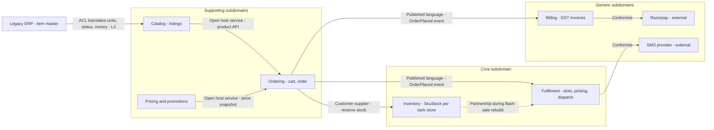
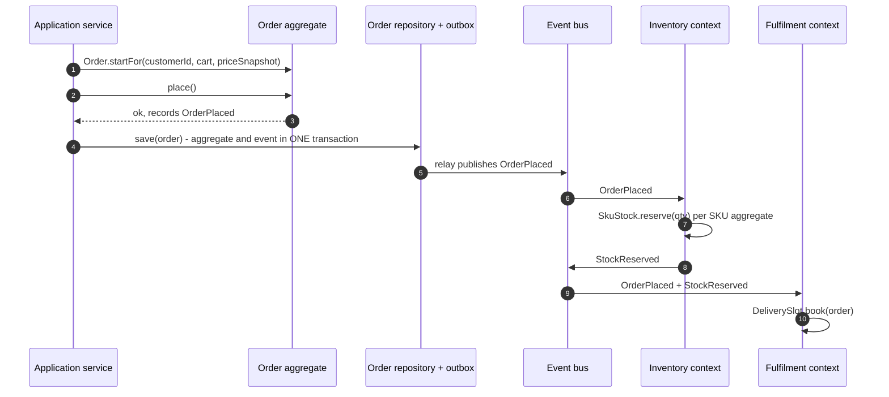
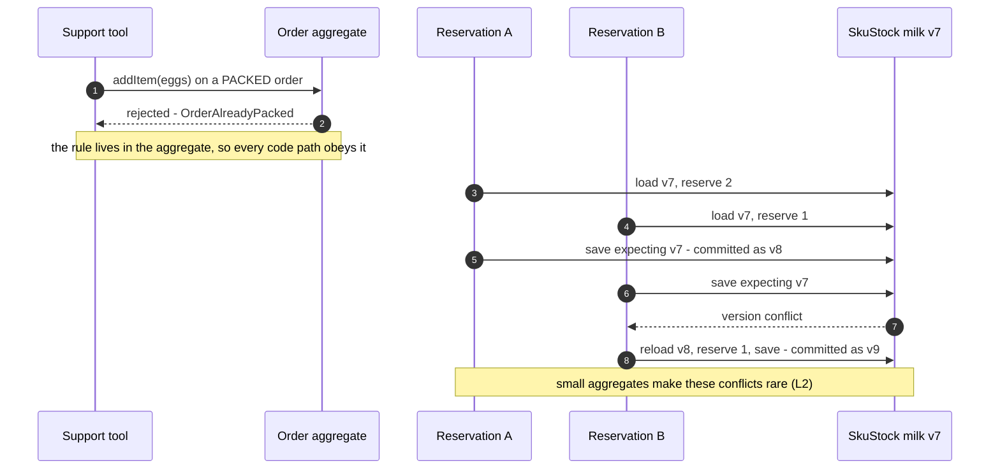
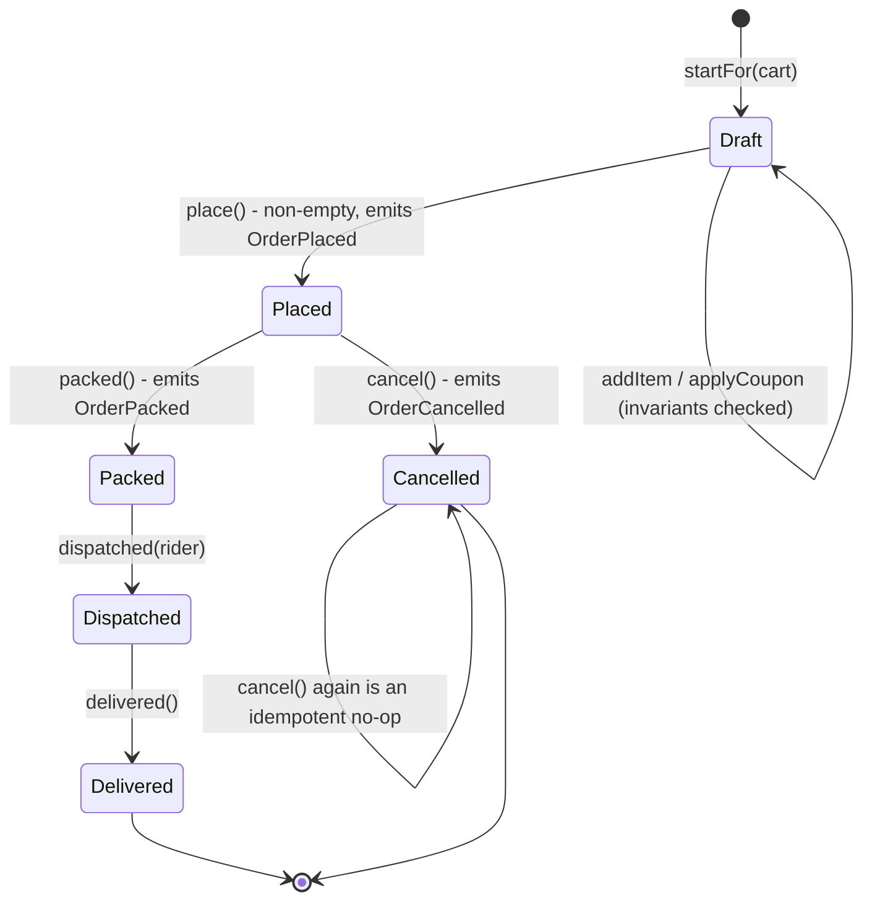

# 33. Domain-Driven Design

!!! abstract "Chapter at a glance"
    **Reader bands:** B2 → B4 · **Prerequisites:** [Ch 13](../02-distributed-core/13-distributed-transactions.md), [Ch 15](../02-distributed-core/15-event-driven-architecture-cqrs-and-event-sourcing.md), [Ch 16](../02-distributed-core/16-microservices-architecture.md), [Ch 31](31-architecture-decision-making.md) · **What you will build:** How to draw boundaries that match the business — strategic DDD (subdomains, bounded contexts, context maps, ubiquitous language) and tactical DDD (aggregates, entities, value objects, domain events, repositories) — applied to the grocery platform, with four runnable labs that measure what good and bad boundaries do.

    - **L1: rich aggregate vs anemic model.** The same 9 operations — a UI bug, bulk abuse, an admin tool, an oversized coupon, a second code path, a client retry — left the **anemic Order invalid after 8 of 9** (ending CANCELLED with a negative quantity and a total of **−₹4,999.01** against a real subtotal of ₹1,455); the **aggregate stayed valid after all 9**, treating the retried cancel as an idempotent no-op.
    - **L2: aggregate size vs contention.** 20,000 stock reservations, 16 in flight: one store-wide aggregate took **16.0x** the ideal time and wasted **93.7%** of work on version conflicts; per-SKU aggregates **3.2x**; per-SKU with the 5 hot SKUs split into stock buckets **1.1x**.
    - **L3: anti-corruption layer.** 12 legacy ERP rows: the naive mapping put a **wrong product into the Catalog for 9 of 12** (unnormalized units, ₹78.85 → ₹78.84, a discontinued item on sale, a blank tax code treated as exempt); the ACL produced **0 wrong products** — 8 translated, 4 quarantined with reasons.
    - **L4: finding bounded contexts.** Splitting by nouns made **78.9%** of weekly work cross boundaries. Modularity clustering independently found **Catalog** and **Fulfilment** contexts — and challenged the domain experts' draft in two concrete places.

    · **Reading time:** 130 min + code

---

## 1. Introduction & Why It Matters

### 1.1 A story: twenty-six services and one ball of mud

When the grocery platform moved to microservices, the team drew the service boundaries in an afternoon: one service per database table that "felt important." Product service. Price service. Stock service. Cart service. Order service. Customer service. Address service. Coupon service. Twenty-six in all.

Eighteen months later, the symptoms were unmistakable:

1. **Every feature touched five services.** Adding "buy 2, get 1 free" required changes to Coupon, Price, Cart, Order and Product services, five pull requests across four teams, and a release train to deploy them in the right order.
2. **The word "product" meant four different things.** To the catalog team it was a description with images; to pricing, a price book entry; to inventory, a stock-keeping unit in a specific dark store; to fulfilment, a physical item with a weight and a temperature class. The shared `Product` table had 63 columns, 40 of them nullable, and every team was afraid to change it.
3. **Business rules lived nowhere in particular.** The rule "an order can't be modified after it's packed" was enforced in the Order service, re-implemented (differently) in the admin tool, and forgotten in the customer-support tool — which is how a support agent added items to an order already on a rider's bike (L1).
4. **One service became a global lock.** Stock was modeled as a single "store inventory" document per dark store, so during a flash sale every reservation in the store queued behind every other (L2).
5. **The legacy ERP's model leaked everywhere.** Its unit codes, status codes and rupee-as-float prices appeared in every service that touched products, each with its own conversion bugs (L3).

The team had microservices, but not **boundaries**. They'd split the system by nouns, not by the business capabilities, language and consistency rules that actually belong together. The re-architecture started not with technology but with a two-day event-storming workshop and a question: *where does each word mean one thing?*

!!! quote "The thesis of this chapter"
    Domain-Driven Design is a way to make software boundaries follow the business. **Strategically**, you find the places where the language and rules of the business are consistent — **bounded contexts** — and draw your module, service and team boundaries there, with explicit relationships (a **context map**) between them. **Tactically**, inside a context you model the business in code: **aggregates** that own their invariants, **value objects** that make illegal values unrepresentable, and **domain events** that tell other contexts what happened. The payoff is changes that stay local, rules that can't be bypassed, and services that don't need to be deployed together.

### 1.2 Where this lives in the grocery platform

| DDD concept | Grocery platform | Lab |
|---|---|---|
| Core subdomain | Slot & dark-store fulfilment, flash-sale inventory | §2.2 |
| Supporting subdomains | Catalog, promotions, ordering | §2.2 |
| Generic subdomains | Payments (Razorpay), SMS, GST invoicing rules, identity | §2.2 |
| Bounded contexts | Catalog, Ordering, Inventory, Fulfilment, Billing | L4 |
| Context map | Ordering → Inventory (customer/supplier), Catalog ← ERP (ACL), Billing → Razorpay (conformist) | §3.1, L3 |
| Aggregates | Order, Cart, SkuStock (per dark store), DeliverySlot | L1, L2 |
| Value objects | Money (paise), Quantity + Unit, Pincode, GSTIN, DeliveryLocation | L1, L3 |
| Domain events | OrderPlaced, StockReserved, SlotBooked, OrderDispatched | §2.9 |

### 1.3 Learning objectives

By the end you will be able to:

- **Distinguish core, supporting and generic subdomains** and invest accordingly.
- **Find bounded contexts** using ubiquitous language, invariants and usage data (L4), and draw a **context map**.
- **Choose context-integration patterns** — ACL, open host service, published language, customer/supplier, conformist, shared kernel — and build an ACL (L3).
- **Design aggregates** that enforce invariants (L1) and are sized for concurrency (L2).
- **Use value objects, domain events, repositories and domain services** correctly.
- **Map bounded contexts to services and teams** — and know when not to.

---

## 2. Core Concepts — Beginner to Deep

### 2.1 Intuition: model the business, not the database <span class="band b2">B2</span>

Most enterprise code starts from the database: tables become classes, classes get getters and setters, and "services" manipulate them. It works for CRUD — and falls apart when the business rules get interesting, because the rules end up scattered across every place that writes data (L1).

DDD, introduced by Eric Evans in 2003, flips the starting point: **start from how domain experts talk about and run the business**. What are the things that matter? What rules must always hold? What happens, in what order? Where does the same word mean different things? The code should read like the business — `order.place()`, `slot.book(order)`, `stock.reserve(qty)` — and the boundaries should sit where the business itself has seams.

DDD has two halves that are often confused:

- **Strategic DDD** — the big picture: subdomains, bounded contexts, context maps, ubiquitous language. This is where the architectural value is, and it applies whether you build a monolith or microservices.
- **Tactical DDD** — the patterns inside one context: aggregates, entities, value objects, domain events, repositories, domain services, factories. Valuable where the domain is complex; overkill for CRUD.

A common failure is adopting the tactical patterns (lots of classes called `...Aggregate` and `...Repository`) without the strategic work — which gives you the ceremony without the boundaries.

### 2.2 Subdomains: core, supporting, generic ⭐ <span class="band b2">B2</span>

A **domain** is the business area the software serves (grocery quick-commerce). It decomposes into **subdomains**, which are *problem-space* areas — they exist whether or not you write software:

- **Core subdomain** — what differentiates the business and wins customers. For the grocery platform: *getting the right items to the customer within the promised slot from a dark store* — slot capacity, dark-store inventory under flash-sale load, dispatch. This is where you put your best engineers, build custom software, and apply rich DDD.
- **Supporting subdomain** — necessary and business-specific, but not a differentiator: catalog management, promotions, ordering workflow. Build it, but more simply; don't gold-plate.
- **Generic subdomain** — solved problems every business has: payments, SMS, identity, GST invoice formatting, email. **Buy or use off-the-shelf** (Razorpay, a notification provider, an identity provider), and integrate through an anti-corruption layer or a conformist relationship.

The classification is an **investment decision** ([Ch 31](31-architecture-decision-making.md)): the §1.1 platform spent months building its own coupon engine (supporting) and its own OTP delivery (generic) while its slot allocation (core) was a spreadsheet-driven batch job.

### 2.3 Ubiquitous language ⭐ <span class="band b2">B2</span>

**Ubiquitous language** is a shared vocabulary between domain experts and developers, used *everywhere* — in conversations, documents, and **the code itself** (class names, method names, event names). If the dark-store manager says "we *short-pick* an item when the shelf is empty," the code has a `ShortPick` event, not `ItemStatusUpdate(status=4)`.

Why it matters:

- **Translation is where bugs hide.** Every time a developer maps "what the business said" to "what the code calls it," meaning is lost.
- **It exposes boundaries.** When the same word means different things to different groups — "product," "order," "customer," "address" — that's a signal of **different bounded contexts**, each with its own model (§2.4).
- **It makes code reviewable by the business.** `if (order.isPacked()) throw new OrderAlreadyPacked()` can be checked with an operations manager; `if (o.st >= 4)` cannot.

The language is **bounded**: it's ubiquitous *within a context*, not across the enterprise. Trying to create one enterprise-wide canonical model with one definition of "Product" is how you get §1.1's 63-column table.

### 2.4 Bounded contexts ⭐ <span class="band b3">B3</span>

A **bounded context** is a boundary within which a particular model and its language are consistent. Inside it, "Product" means exactly one thing; outside, it may mean something else entirely.

| Context | What "Product" means there | Model |
|---|---|---|
| Catalog | A listing: name, description, images, category, attributes | `ProductListing` |
| Pricing | A price book entry: MRP, selling price, effective dates | `PriceBookEntry` |
| Inventory | Stock of one SKU in one dark store: on-hand, reserved | `SkuStock` |
| Fulfilment | A physical item: weight, temperature class, bin location | `PickItem` |

They share an **identifier** (the SKU code) but not a model. Each context evolves its model independently.

How to find bounded contexts (combine several signals):

- **Language** — where does the meaning of a key term change?
- **Invariants** — which data must be consistent together, immediately? That data belongs in one context (and usually one aggregate).
- **Business capabilities and processes** — "fulfil an order" vs "manage the catalog."
- **Change patterns** — what changes together in practice? (Change coupling from git history is good evidence.)
- **Usage patterns** — which entities do use cases touch together? (L4 builds this from event-storming output.)
- **Team ownership** — Conway's Law ([Ch 37](37-leading-architecture-at-scale.md)): a context owned by one team stays coherent; one owned by three teams fractures.

L4 shows that usage data is a useful *challenge* to a human draft but not a substitute for it: modularity clustering independently found the Catalog and Fulfilment contexts, and pulled `Address` into Fulfilment (the busy use cases need a *delivery location*, not the customer's address book — a real modeling insight). It also proposed a grouping, `{Cart, Coupon, StockLevel}`, that follows call patterns rather than any invariant or language.

**Bounded context ≠ microservice.** A context is a model boundary. It can be one service, several services (if it's big), or a module inside a modular monolith. What it should almost never be is *split* across teams or shared by several contexts' code.

### 2.5 Context maps and integration patterns ⭐ <span class="band b3">B3</span>

A **context map** shows the bounded contexts and the **relationships** between them — both technical (how they integrate) and organizational (who has power over whose model). The standard relationship patterns:

| Pattern | Meaning | Grocery example |
|---|---|---|
| **Partnership** | Two teams succeed or fail together; coordinate changes closely | Ordering + Fulfilment during the slot-booking rebuild |
| **Shared kernel** | Two contexts share a small, jointly-owned piece of model/code | A shared `Money`/`Sku` value-object library — keep it tiny |
| **Customer/Supplier** | Downstream (customer) needs influence upstream (supplier) priorities | Ordering (customer) ← Inventory (supplier) |
| **Conformist** | Downstream adopts upstream's model as-is, with no influence | Billing conforms to Razorpay's payment model |
| **Anti-corruption layer (ACL)** | Downstream translates upstream's model into its own, protecting it | Catalog ← legacy ERP (L3) |
| **Open host service (OHS)** | Upstream offers a well-defined protocol/API for many consumers | Catalog's public product API |
| **Published language** | A documented shared exchange format | Versioned `OrderPlaced` event schema in the registry ([Ch 28](../03-production/28-schema-and-data-evolution.md)) |
| **Separate ways** | No integration; duplicate instead | Marketing's own product copy for campaigns |

The **anti-corruption layer** deserves emphasis because it's the most common pattern in brownfield systems (L3). The legacy ERP's concepts — `GM`/`GMS`/`LTR` unit codes, status `S1..S9`, rupees as floats, sometimes-blank tax codes — must not leak into the Catalog's model. The ACL translates into the Catalog's language (`Unit`, `Money`, `Availability`), uses exact arithmetic, and **quarantines** what it can't translate faithfully. In L3 the naive mapping put a wrong product into the domain for 9 of 12 rows; the ACL for none.

### 2.6 Entities and value objects ⭐ <span class="band b2">B2</span>

- An **entity** has an identity that persists through change: an `Order` is the same order whether it's draft or delivered. Equality is by ID.
- A **value object** is defined entirely by its attributes, is **immutable**, and has no identity: `Money(2850 paise, INR)`, `Quantity(500, ML)`, `Pincode("560034")`, `DeliveryLocation(lat, lng, landmark)`. Two `Money(2850)` are interchangeable. Equality is by value.

Value objects are the most underused, highest-return tactical pattern:

- **They make illegal values unrepresentable.** A `Pincode` constructor that validates six digits means no code anywhere can hold an invalid pincode. A `Money` that stores paise as a `long` means no floating-point rounding bugs (L3's ₹78.85 → ₹78.84).
- **They carry behavior.** `money.add(other)` checks currency; `quantity.convertTo(Unit.G)`; `slotWindow.overlaps(other)`.
- **They're trivially thread-safe and easy to test.**

In Java, `record` types are ideal value objects:

```java title="Value objects as Java records"
public record Money(long paise) {
    public Money { if (paise < 0) throw new IllegalArgumentException("negative money"); }
    public static Money ofRupees(String r) { return new Money(new BigDecimal(r).movePointRight(2).setScale(0, RoundingMode.HALF_UP).longValueExact()); }
    public Money plus(Money o) { return new Money(Math.addExact(paise, o.paise)); }
    public Money times(int qty) { return new Money(Math.multiplyExact(paise, qty)); }
}
public record Pincode(String value) {
    public Pincode { if (!value.matches("[1-9][0-9]{5}")) throw new IllegalArgumentException("invalid pincode " + value); }
}
```

### 2.7 Aggregates: consistency boundaries ⭐ <span class="band b3">B3</span>

An **aggregate** is a cluster of entities and value objects treated as **one unit for data changes**, with one entity as the **aggregate root** — the only object outside code may hold a reference to. The aggregate's job is to **protect its invariants**: rules that must be true after every transaction.

For the `Order` aggregate (root `Order`, containing `OrderLine` entities and `Money`/`Quantity` values):

- total = Σ(line qty × unit price) − discount — **derived**, never stored independently;
- quantities are positive and ≤ 10 per SKU;
- discount ∈ [0, subtotal];
- items can only be added while DRAFT;
- only a PLACED order can be cancelled (and cancelling a CANCELLED order is an idempotent no-op).

The rules of aggregate design (Vaughn Vernon's formulation):

1. **Protect true invariants inside the aggregate boundary.** All changes go through the root's intention-revealing methods (`addItem`, `applyCoupon`, `place`), which refuse invalid transitions. No public setters. L1: the anemic Order became invalid after 8 of 9 operations; the aggregate after none.
2. **Design small aggregates.** An aggregate is loaded, locked and saved as a unit, so it is also the **unit of concurrency** (L2). A store-wide `StoreInventory` aggregate serializes every reservation — 16x slower than ideal with 94% of work wasted on conflicts. A per-SKU `SkuStock` aggregate matches the actual invariant (stock ≥ 0 per SKU) and runs 5x faster; splitting the hottest SKUs' stock into buckets gets within 10% of ideal.
3. **Reference other aggregates by identity.** An `Order` holds a `CustomerId`, not a `Customer` object. This keeps aggregates small and makes their transactional boundaries explicit.
4. **Update other aggregates with eventual consistency.** One transaction modifies **one** aggregate. If placing an order must reserve stock, the Order aggregate emits `OrderPlaced` and the Inventory context reacts — or a saga coordinates ([Ch 13](../02-distributed-core/13-distributed-transactions.md)). Rules spanning aggregates are therefore eventually consistent; if the business truly needs them to be immediately consistent, that's a sign they belong in one aggregate (and you pay the concurrency cost).

### 2.8 Repositories, factories, domain services, application services <span class="band b3">B3</span>

- **Repository** — a collection-like interface for loading and saving *aggregates* (not tables): `orders.byId(id)`, `orders.save(order)`. One repository per aggregate root. The domain defines the interface; infrastructure implements it (JPA, JDBC) — the dependency direction L2 of [Ch 31](31-architecture-decision-making.md) enforces.
- **Factory** — encapsulates complex creation so an aggregate is born valid: `Order.startFor(customerId, cart, pricingSnapshot)`.
- **Domain service** — domain logic that doesn't naturally belong to one entity, typically involving several aggregates or an external policy: `SlotAllocationService.bestSlotFor(order, darkStore)`. Stateless, named in the ubiquitous language.
- **Application service** — orchestrates a use case: load aggregates via repositories, call domain methods, save, publish events, handle transactions and authorization. It contains **no business rules**. If an application service has `if` statements about business policy, the logic is leaking out of the domain.

```java title="Application service: orchestration only (VERIFY: Spring wiring)"
@Service
class PlaceOrderHandler {
    private final Orders orders; private final Carts carts; private final PricingSnapshotPort pricing;
    @Transactional
    public OrderId handle(PlaceOrder cmd) {
        Cart cart = carts.byId(cmd.cartId()).orElseThrow();
        Order order = Order.startFor(cmd.customerId(), cart, pricing.snapshotFor(cart));   // factory
        order.place();                                                                      // invariants enforced here
        orders.save(order);                  // saves aggregate + its OrderPlaced event to the outbox atomically (Ch 15)
        return order.id();
    }
}
```

### 2.9 Domain events <span class="band b3">B3</span>

A **domain event** records something that happened in the domain that domain experts care about, named in the past tense in the ubiquitous language: `OrderPlaced`, `StockReserved`, `SlotBooked`, `ItemShortPicked`, `OrderDispatched`.

- **Within a context**, events decouple side effects from the aggregate that caused them.
- **Across contexts**, events are the primary integration mechanism: Ordering publishes `OrderPlaced`; Inventory, Fulfilment and Billing react. This implements "one aggregate per transaction, eventual consistency between aggregates" (§2.7 rule 4).
- **Reliably:** save the event in the same transaction as the aggregate (the **transactional outbox**, [Ch 15](../02-distributed-core/15-event-driven-architecture-cqrs-and-event-sourcing.md)) and publish it asynchronously — otherwise you can commit the order and lose the event.
- **Internal vs integration events:** events inside a context can carry rich domain objects; events crossing contexts form a **published language** — versioned, schema-registered, minimal, and stable ([Ch 28](../03-production/28-schema-and-data-evolution.md)).

**Event storming** (Alberto Brandolini) is the workshop technique that discovers events, commands, aggregates, policies and boundaries together with domain experts: everyone writes domain events on orange stickies along a timeline, then adds commands, actors, aggregates, policies and hotspots. Boundaries appear where the language changes and where flows hand off. L4's use-case/entity data is the kind of output an event-storming session produces.

### 2.10 From bounded contexts to services and teams <span class="band b4">B4</span>

Bounded contexts are the best starting point for service boundaries ([Ch 16](../02-distributed-core/16-microservices-architecture.md)), but the mapping isn't mechanical:

- **Start with a modular monolith** where contexts are modules with enforced boundaries (fitness functions, [Ch 31](31-architecture-decision-making.md) L2). Extract a context into a service when it has a real driver: independent scaling, independent release cadence, a different team, a different availability requirement.
- **One context → one team** (a team may own several small contexts). Never split one context across teams — its model will fracture.
- **Don't split a context by technical layer** (a "product-read-service" and a "product-write-service" owned by different teams) unless you're deliberately applying CQRS inside one team's context.
- **Microservices smaller than a context** are fine when there's a reason (a scaling hotspot), but they share the context's language and ideally its team.
- **Data ownership follows the context.** Each context owns its data; others get it through APIs, events or read models — never by querying its tables (the §1.1 shared 63-column `Product` table is the anti-pattern).

### 2.11 When DDD is overkill <span class="band b4">B4</span>

DDD's tactical patterns carry real cost: more classes, more mapping, eventual consistency between aggregates, and a learning curve. They pay off when the domain has **complex, evolving rules** and **concurrent actors**. They don't pay off for:

- **CRUD** — a settings screen, a reference-data admin page. Use simple data-centric code (transaction script, active record).
- **Generic subdomains** — you'll integrate a product, not model the domain.
- **Reporting/analytics** — read models and SQL, not aggregates.

Strategic DDD — finding contexts, speaking the business's language, drawing a context map, protecting boundaries with ACLs — is almost always worth it, even in a system that uses no tactical patterns at all.

---

## 3. Architecture & Diagrams

### 3.1 Context map of the grocery platform



### 3.2 Sequence: happy path, placing an order across contexts



### 3.3 Sequence: failure paths, invariant violation and concurrency conflict



### 3.4 State: the Order aggregate lifecycle



---

## 4. Design Document Excerpt: Grocery Domain Re-architecture

!!! note "Design Document (excerpt) — Bounded Contexts & Domain Model v1.0"
    **Status:** Accepted · **Authors:** Principal engineers + domain leads (ops, catalog, finance) · **Reviewers:** All tech leads

    | Field | Value |
    |---|---|
    | Context | 26 entity-shaped services; typical feature touches 5 services and 4 teams; a shared 63-column Product table; business rules duplicated across Order service, admin tool and support tool; store-wide inventory document serializes flash-sale reservations; ERP concepts leak into every product consumer. |
    | Decision | Re-draw boundaries around five bounded contexts (Catalog, Pricing & Promotions, Ordering, Inventory, Fulfilment) plus Billing, found by event storming and checked against usage data (L4). Each context owns its model and data, one team per context. Rich aggregates where rules are complex; ACL in front of the ERP; integration by published events via outbox. |
    | Related ADRs | ADR-190 Five bounded contexts + context map; ADR-191 Aggregates own invariants, no public setters (L1); ADR-192 Per-SKU SkuStock aggregate, hot-SKU stock buckets (L2); ADR-193 ACL for ERP item master with quarantine (L3); ADR-194 Money/Quantity/Pincode value-object kernel (shared kernel, versioned); ADR-195 Cross-context integration via versioned events + outbox; ADR-196 Contexts as modules first, extract to services on demand |

    **Requirements.**

    - **R1 — Local change.** A typical feature touches one context (target: ≥ 80% of features, measured by PRs per feature).
    - **R2 — Rules in one place.** Every business invariant is enforced inside an aggregate or value object; no code path can bypass it (L1).
    - **R3 — Flash-sale throughput.** Stock reservations sustain ≥ 90% of ideal throughput under Zipf-skewed load (L2).
    - **R4 — Clean ingestion.** No ERP concept appears outside the Catalog ACL; untranslatable rows are quarantined with reasons (L3).
    - **R5 — Independent deploys.** Contexts integrate only through published APIs and versioned events.

    **Decisions in detail.**

    1. **Contexts (ADR-190).** Catalog, Pricing & Promotions, Ordering, Inventory, Fulfilment, Billing. Address is modeled per context: Customer's address book in Ordering; a `DeliveryLocation` value object copied onto the order for Fulfilment (a finding from L4).
    2. **Aggregates (ADR-191).** `Order`, `Cart`, `SkuStock(darkStore, sku)`, `DeliverySlot`, `PriceBookEntry`. One aggregate per transaction; cross-aggregate rules via events or sagas.
    3. **Hot SKUs (ADR-192).** For the top-N SKUs by volume, stock split into buckets with background rebalancing (L2 design C).
    4. **ERP ACL (ADR-193).** Unit, status and tax-code translation tables; exact decimal money; plausibility checks; quarantine queue owned by catalog ops (L3).
    5. **Shared kernel (ADR-194).** A tiny versioned library: `Money`, `Quantity`, `Unit`, `Pincode`, `SkuCode`. Anything bigger is not shared.
    6. **Integration (ADR-195).** `OrderPlaced`, `StockReserved`, `SlotBooked`, `OrderDispatched` as a published language in the schema registry.
    7. **Modules first (ADR-196).** Ordering and Catalog start as modules in one deployable; Inventory and Fulfilment are separate services (independent scaling for flash sales).

    **Consequences.** Eventual consistency between Ordering and Inventory (a reservation may fail after the order is placed → compensating cancel, [Ch 13](../02-distributed-core/13-distributed-transactions.md)). More code for value objects and translation. In return: features land in one context, rules can't be bypassed, and flash-sale throughput stops collapsing on a single aggregate.

---

## 5. Hands-On Code — Level Ladder

!!! info "What's real here"
    All four labs are self-contained JDK 21 programs with deterministic output. L1 implements a real aggregate and an anemic model side by side. L2 is a discrete simulation of optimistic concurrency on different aggregate boundaries (the same conflict rule a `@Version` column enforces). L3 parses a real legacy feed file through a naive mapper and an ACL. L4 builds an entity-affinity graph from use cases and compares decompositions, including Louvain-style modularity clustering. JPA/Spring snippets are marked **VERIFY**.

### L1 — Rich aggregate vs anemic model <span class="band b2">B2</span>

**Requirement:** "A support agent added items to an order already on a rider's bike. Make that — and every rule like it — impossible, whichever code path calls us."

The same `Order` is implemented as an anemic data bag and as an aggregate root. Nine realistic operations — a UI bug, bulk abuse, an admin tool writing the total, an oversized coupon, a second code path, and a client retry — are replayed against both, checking five business rules after each.

```java title="AggregateL1.java"
// AggregateL1.java — run with: java AggregateL1.java   (JDK 21, no dependencies)
// ANEMIC MODEL vs RICH AGGREGATE. The same Order is implemented twice:
//   ANEMIC — a data bag with public setters; business rules live (or don't) in whichever service happens to touch it.
//   RICH   — an AGGREGATE ROOT that owns its invariants: state changes only through intention-revealing methods
//            (addItem, applyCoupon, place, cancel) that refuse to produce an invalid Order.
// We replay the same 8 operations — the kinds of calls real callers make: a bug, a race, a second code path — against both,
// and count how many leave the Order in a state that violates a business rule.
import java.util.*;

public class AggregateL1 {
    // ---------------- ANEMIC ----------------
    static class AnemicOrder {
        public String status = "DRAFT";
        public List<long[]> lines = new ArrayList<>();       // {skuHash, qty, unitPaise}
        public long totalPaise = 0;
        public long discountPaise = 0;
    }
    // ---------------- RICH AGGREGATE ----------------
    static final class Order {
        enum Status { DRAFT, PLACED, CANCELLED }
        record Line(String sku, int qty, long unitPaise) {}
        private Status status = Status.DRAFT;
        private final Map<String, Line> lines = new LinkedHashMap<>();
        private long discountPaise = 0;
        static final int MAX_QTY_PER_SKU = 10;

        void addItem(String sku, int qty, long unitPaise) {
            requireDraft("add items");
            if (qty <= 0) throw new IllegalArgumentException("quantity must be positive");
            if (unitPaise <= 0) throw new IllegalArgumentException("price must be positive");
            int newQty = qty + (lines.containsKey(sku) ? lines.get(sku).qty() : 0);
            if (newQty > MAX_QTY_PER_SKU) throw new IllegalStateException("max " + MAX_QTY_PER_SKU + " per SKU");
            lines.put(sku, new Line(sku, newQty, unitPaise));
        }
        void applyCoupon(long discount) {
            requireDraft("apply coupons");
            if (discount < 0 || discount > subtotal()) throw new IllegalArgumentException("discount must be within 0..subtotal");
            discountPaise = discount;
        }
        void place() {
            requireDraft("place");
            if (lines.isEmpty()) throw new IllegalStateException("cannot place an empty order");
            status = Status.PLACED;
        }
        void cancel() {
            if (status == Status.CANCELLED) return;                          // idempotent: a retried cancel is a no-op (Ch 20)
            if (status != Status.PLACED) throw new IllegalStateException("only a placed order can be cancelled");
            status = Status.CANCELLED;
        }
        long subtotal() { return lines.values().stream().mapToLong(l -> l.qty() * l.unitPaise()).sum(); }
        long total() { return subtotal() - discountPaise; }                 // DERIVED — can never disagree with lines
        private void requireDraft(String what) { if (status != Status.DRAFT) throw new IllegalStateException("cannot " + what + " when " + status); }
    }

    // business rules both models are supposed to honour — checked after every operation
    static List<String> violations(String status, List<long[]> lines, long total, long discount) {
        List<String> v = new ArrayList<>();
        long subtotal = lines.stream().mapToLong(l -> l[1] * l[2]).sum();
        if (total != subtotal - discount) v.add("total != subtotal - discount");
        if (lines.stream().anyMatch(l -> l[1] <= 0)) v.add("non-positive quantity");
        if (lines.stream().anyMatch(l -> l[1] > 10)) v.add("qty > 10 per SKU");
        if (discount < 0 || discount > subtotal) v.add("discount outside 0..subtotal");
        if (status.equals("PLACED") && lines.isEmpty()) v.add("placed with no items");
        return v;
    }

    interface Op { String name(); void anemic(AnemicOrder o); void rich(Order o); }
    static Op op(String name, java.util.function.Consumer<AnemicOrder> a, java.util.function.Consumer<Order> r) {
        return new Op() { public String name() { return name; } public void anemic(AnemicOrder o) { a.accept(o); } public void rich(Order o) { r.accept(o); } };
    }

    public static void main(String[] args) {
        List<Op> ops = List.of(
            op("add 2 x milk @ ₹60",                o -> { o.lines.add(new long[]{1, 2, 6000}); o.totalPaise += 12000; },
                                                    o -> o.addItem("milk", 2, 6000)),
            op("add -1 x bread (UI bug)",           o -> { o.lines.add(new long[]{2, -1, 4000}); o.totalPaise += -4000; },
                                                    o -> o.addItem("bread", -1, 4000)),
            op("add 15 x rice (bulk abuse)",        o -> { o.lines.add(new long[]{3, 15, 9000}); o.totalPaise += 135000; },
                                                    o -> o.addItem("rice", 15, 9000)),
            op("admin tool sets total directly",    o -> o.totalPaise = 99,
                                                    o -> { /* no setter exists: the total is derived */ }),
            op("coupon larger than subtotal",       o -> { o.discountPaise = 500000; o.totalPaise -= 500000; },
                                                    o -> o.applyCoupon(500000)),
            op("place the order",                   o -> o.status = "PLACED",
                                                    Order::place),
            op("add item AFTER placing (2nd path)", o -> o.lines.add(new long[]{4, 1, 2500}),     // forgot to update total too
                                                    o -> o.addItem("eggs", 1, 2500)),
            op("cancel the order",                  o -> o.status = "CANCELLED",
                                                    Order::cancel),
            op("cancel again (client retry)",       o -> o.status = "CANCELLED",
                                                    Order::cancel)
        );

        AnemicOrder a = new AnemicOrder(); Order r = new Order();
        int anemicBad = 0, richBad = 0;
        System.out.println("Replaying the same 9 operations against an ANEMIC Order and a RICH aggregate.\n");
        System.out.printf("   %-36s | %-40s | %s%n", "operation", "anemic: rules broken after this op", "rich aggregate");
        Set<String> seen = new LinkedHashSet<>();
        for (Op o : ops) {
            o.anemic(a);
            List<String> va = violations(a.status, a.lines, a.totalPaise, a.discountPaise);
            String richResult;
            try { o.rich(r); richResult = "accepted"; }
            catch (RuntimeException e) { richResult = "REJECTED: " + e.getMessage(); }
            List<long[]> rl = new ArrayList<>();
            for (var l : r.lines.values()) rl.add(new long[]{0, l.qty(), l.unitPaise()});
            List<String> vr = violations(r.status.name(), rl, r.total(), r.discountPaise);
            if (!va.isEmpty()) anemicBad++;
            if (!vr.isEmpty()) richBad++;
            List<String> fresh = new ArrayList<>(va); fresh.removeAll(seen); seen.addAll(va);
            String anemicCol = va.isEmpty() ? "valid" : va.size() + " broken" + (fresh.isEmpty() ? " (carried over)" : " (+" + String.join(", +", fresh) + ")");
            System.out.printf("   %-36s | %-40s | %s%n", o.name(), anemicCol, richResult + (vr.isEmpty() ? "" : "  → INVALID " + vr));
        }
        System.out.printf("%n   Operations that left the order violating a business rule:  anemic %d/9   rich %d/9%n", anemicBad, richBad);
        System.out.printf("   Final anemic order: status=%s, %d line(s), total ₹%.2f (true subtotal ₹%.2f)%n", a.status, a.lines.size(),
                a.totalPaise / 100.0, a.lines.stream().mapToLong(l -> l[1] * l[2]).sum() / 100.0);
        System.out.printf("   Final rich order:   status=%s, %d line(s), total ₹%.2f%n%n", r.status, r.lines.size(), r.total() / 100.0);
        System.out.println("   → the anemic model accepts every call, and once one invalid write lands the damage persists: every later state is");
        System.out.printf ("     invalid too, ending as a %s order with a negative quantity and a total of ₹%,.2f against a real subtotal of ₹%,.2f.%n",
                a.status, a.totalPaise / 100.0, a.lines.stream().mapToLong(l -> l[1] * l[2]).sum() / 100.0);
        System.out.println("     The rules existed, but in callers' heads; each new code path (admin tool, retry, second UI) was a chance to skip them.");
        System.out.println("     The aggregate makes illegal states unrepresentable: it rejects the bad commands at the boundary, derives the total");
        System.out.println("     instead of storing it, treats the retried cancel as an idempotent no-op, and ends valid. That is the core DDD move:");
        System.out.println("     put the invariant WITH the data it protects.");
    }
}
```

```text title="java AggregateL1.java"
Replaying the same 9 operations against an ANEMIC Order and a RICH aggregate.

   operation                            | anemic: rules broken after this op       | rich aggregate
   add 2 x milk @ ₹60                   | valid                                    | accepted
   add -1 x bread (UI bug)              | 1 broken (+non-positive quantity)        | REJECTED: quantity must be positive
   add 15 x rice (bulk abuse)           | 2 broken (+qty > 10 per SKU)             | REJECTED: max 10 per SKU
   admin tool sets total directly       | 3 broken (+total != subtotal - discount) | accepted
   coupon larger than subtotal          | 4 broken (+discount outside 0..subtotal) | REJECTED: discount must be within 0..subtotal
   place the order                      | 4 broken (carried over)                  | accepted
   add item AFTER placing (2nd path)    | 4 broken (carried over)                  | REJECTED: cannot add items when PLACED
   cancel the order                     | 4 broken (carried over)                  | accepted
   cancel again (client retry)          | 4 broken (carried over)                  | accepted

   Operations that left the order violating a business rule:  anemic 8/9   rich 0/9
   Final anemic order: status=CANCELLED, 4 line(s), total ₹-4999.01 (true subtotal ₹1455.00)
   Final rich order:   status=CANCELLED, 1 line(s), total ₹120.00

   → the anemic model accepts every call, and once one invalid write lands the damage persists: every later state is
     invalid too, ending as a CANCELLED order with a negative quantity and a total of ₹-4,999.01 against a real subtotal of ₹1,455.00.
     The rules existed, but in callers' heads; each new code path (admin tool, retry, second UI) was a chance to skip them.
     The aggregate makes illegal states unrepresentable: it rejects the bad commands at the boundary, derives the total
     instead of storing it, treats the retried cancel as an idempotent no-op, and ends valid. That is the core DDD move:
     put the invariant WITH the data it protects.
```

**Reading it:**

- The anemic model **accepts every call**. The first bad write (a −1 quantity from a UI bug) makes the order invalid, and it never recovers: **8 of 9** operations leave it breaking rules, and it ends CANCELLED with a total of **−₹4,999.01** against a real subtotal of ₹1,455. The rules existed — in the heads of whoever wrote each caller.
- The aggregate **rejects** the four illegal commands at the boundary with domain-language reasons, has **no setter** for the total (it's derived, so the admin tool's write simply can't happen), and treats the **retried cancel as an idempotent no-op** — the correct behavior for retries ([Ch 20](../02-distributed-core/20-idempotency-ids-and-distributed-locks.md)), rather than an error.
- With JPA the same aggregate keeps its shape: fields private, no setters, a `@Version` for optimistic locking, and lines owned by the root:

```java title="VERIFY: JPA mapping of the aggregate (needs spring-boot-starter-data-jpa)"
@Entity @Table(name = "orders")
public class Order extends AbstractAggregateRoot<Order> {       // Spring Data: registerEvent → published on save
    @Id private UUID id;
    @Version private long version;                               // optimistic lock = aggregate is the unit of concurrency
    @Enumerated(EnumType.STRING) private Status status = Status.DRAFT;
    @OneToMany(cascade = CascadeType.ALL, orphanRemoval = true) @JoinColumn(name = "order_id")
    private List<OrderLine> lines = new ArrayList<>();           // owned by the root; no OrderLineRepository
    protected Order() {}                                         // for JPA only
    public void place() { requireDraft("place"); if (lines.isEmpty()) throw new EmptyOrder(); status = Status.PLACED;
                          registerEvent(new OrderPlaced(id, total())); }
    // no public setters
}
```

### L2 — Aggregate size is the unit of concurrency <span class="band b3">B3</span>

**Requirement:** "During flash sales, reservations time out on version conflicts. Is it load — or our aggregate boundary?"

20,000 stock reservations over 300 SKUs with realistic skew (the top 5 SKUs take 43% of orders), 16 transactions in flight. Per round, one transaction per aggregate commits and the rest conflict and retry — exactly what an optimistic `@Version` check does.

```java title="ContentionL2.java"
// ContentionL2.java — run with: java ContentionL2.java   (JDK 21, no dependencies)
// AGGREGATE SIZE vs CONTENTION. An aggregate is the unit of consistency AND the unit of concurrency: each transaction
// loads one aggregate, changes it, and saves it with an optimistic version check. Two concurrent transactions on the SAME
// aggregate → one wins, the other gets a version conflict and retries. So how you draw the aggregate boundary decides how
// many writes can proceed in parallel. We process 20,000 stock reservations for a dark store (300 SKUs, realistic Zipf
// skew — a few SKUs like milk and bread get most orders) with 16 transactions in flight at a time, under three designs:
//   A) ONE aggregate for the whole store's inventory        ("StoreInventory" — the tempting OO model)
//   B) ONE aggregate per SKU                                 (the invariant "stock ≥ 0" is per SKU, so this is enough)
//   C) per SKU, with the 5 hottest SKUs' stock split into 8 sub-aggregates each (stock buckets) — for the hot-spot tail
// Deterministic discrete simulation: each round, up to 16 pending commands run concurrently; per aggregate, one commits
// and the rest conflict and go back to the head of the queue.
import java.util.*;
import java.util.function.*;

public class ContentionL2 {
    record Cmd(int id, int sku, int bucket) {}

    static int[] zipfSkus(int n, int skus, double s, Random r) {
        double[] cdf = new double[skus]; double sum = 0;
        for (int i = 0; i < skus; i++) { sum += 1.0 / Math.pow(i + 1, s); cdf[i] = sum; }
        int[] out = new int[n];
        for (int k = 0; k < n; k++) {
            double u = r.nextDouble() * sum; int lo = 0, hi = skus - 1;
            while (lo < hi) { int mid = (lo + hi) / 2; if (cdf[mid] < u) lo = mid + 1; else hi = mid; }
            out[k] = lo;
        }
        return out;
    }

    // returns {rounds, conflicts}
    static long[] run(List<Cmd> cmds, Function<Cmd, String> aggregateOf, int inFlight) {
        Deque<Cmd> queue = new ArrayDeque<>(cmds);
        long rounds = 0, conflicts = 0;
        while (!queue.isEmpty()) {
            rounds++;
            List<Cmd> batch = new ArrayList<>();
            for (int i = 0; i < inFlight && !queue.isEmpty(); i++) batch.add(queue.pollFirst());
            Set<String> committed = new HashSet<>();
            List<Cmd> retry = new ArrayList<>();
            for (Cmd c : batch) {
                if (committed.add(aggregateOf.apply(c))) continue;    // first writer to this aggregate commits
                conflicts++; retry.add(c);                            // version conflict → retry
            }
            for (int i = retry.size() - 1; i >= 0; i--) queue.addFirst(retry.get(i));
        }
        return new long[]{rounds, conflicts};
    }

    public static void main(String[] args) {
        int N = 20_000, SKUS = 300, IN_FLIGHT = 16, HOT = 5, BUCKETS = 8;
        Random r = new Random(33);
        int[] skus = zipfSkus(N, SKUS, 1.1, r);
        List<Cmd> cmds = new ArrayList<>();
        for (int i = 0; i < N; i++) cmds.add(new Cmd(i, skus[i], r.nextInt(BUCKETS)));
        long hotShare = Arrays.stream(skus).filter(s -> s < HOT).count();

        System.out.printf("%,d stock reservations over %d SKUs (Zipf s=1.1: top %d SKUs = %.0f%% of orders), %d transactions in flight.%n%n",
                N, SKUS, HOT, 100.0 * hotShare / N, IN_FLIGHT);
        System.out.printf("   %-52s %9s %11s %12s %14s%n", "aggregate design", "rounds", "conflicts", "wasted work", "vs ideal");
        long ideal = (N + IN_FLIGHT - 1) / IN_FLIGHT;
        String[] names = { "A) one StoreInventory aggregate", "B) one aggregate per SKU",
                           "C) per SKU + hot SKUs split into 8 stock buckets" };
        List<Function<Cmd, String>> designs = List.of(
            c -> "store",
            c -> "sku-" + c.sku(),
            c -> c.sku() < HOT ? "sku-" + c.sku() + "#" + c.bucket() : "sku-" + c.sku());
        for (int d = 0; d < designs.size(); d++) {
            long[] res = run(cmds, designs.get(d), IN_FLIGHT);
            double wasted = 100.0 * res[1] / (res[1] + N);
            System.out.printf("   %-52s %,9d %,11d %11.1f%% %13.1fx%n", names[d], res[0], res[1], wasted, (double) res[0] / ideal);
        }
        System.out.printf("   %-52s %,9d %11s%n", "(ideal: 16 commits every round)", ideal, "");

        System.out.println("\n   → A serializes everything: the store-wide aggregate lets exactly ONE reservation commit per round, so throughput");
        System.out.println("     collapses to 1/16 of capacity and almost all concurrent work is thrown away as version conflicts. There is no");
        System.out.println("     invariant spanning SKUs that needed that boundary — 'stock ≥ 0' is per SKU. B draws the boundary around the");
        System.out.println("     invariant and is 5x faster than A, yet still runs at only ~31% of capacity: with 43% of orders on 5 SKUs, milk and");
        System.out.println("     bread keep colliding. C splits only those hot SKUs' stock into buckets (each bucket enforces stock ≥ 0 on its");
        System.out.println("     share), paying for it with allocation logic (rebalance when a bucket runs dry) and reaching ~91% of capacity.");
        System.out.println("     Rule: make aggregates as SMALL as the invariants allow, reference other aggregates by ID, and let rules that");
        System.out.println("     span aggregates be eventually consistent via domain events.");
    }
}
```

```text title="java ContentionL2.java"
20,000 stock reservations over 300 SKUs (Zipf s=1.1: top 5 SKUs = 43% of orders), 16 transactions in flight.

   aggregate design                                        rounds   conflicts  wasted work       vs ideal
   A) one StoreInventory aggregate                         20,000     299,880        93.7%          16.0x
   B) one aggregate per SKU                                 4,007      44,012        68.8%           3.2x
   C) per SKU + hot SKUs split into 8 stock buckets         1,382       2,102         9.5%           1.1x
   (ideal: 16 commits every round)                          1,250            

   → A serializes everything: the store-wide aggregate lets exactly ONE reservation commit per round, so throughput
     collapses to 1/16 of capacity and almost all concurrent work is thrown away as version conflicts. There is no
     invariant spanning SKUs that needed that boundary — 'stock ≥ 0' is per SKU. B draws the boundary around the
     invariant and is 5x faster than A, yet still runs at only ~31% of capacity: with 43% of orders on 5 SKUs, milk and
     bread keep colliding. C splits only those hot SKUs' stock into buckets (each bucket enforces stock ≥ 0 on its
     share), paying for it with allocation logic (rebalance when a bucket runs dry) and reaching ~91% of capacity.
     Rule: make aggregates as SMALL as the invariants allow, reference other aggregates by ID, and let rules that
     span aggregates be eventually consistent via domain events.
```

**Reading it:**

- **A) One `StoreInventory` aggregate** commits exactly one reservation per round: **16x** the ideal time, **93.7%** of work thrown away as conflicts. No invariant spans SKUs, so the boundary buys nothing.
- **B) Per-SKU aggregates** match the real invariant (stock ≥ 0 per SKU) and are 5x faster — but still **3.2x** ideal, because milk and bread (the Zipf head) keep colliding.
- **C) Hot-SKU stock buckets** split each of the 5 hottest SKUs' stock into 8 sub-aggregates, each enforcing stock ≥ 0 on its share: **1.1x** ideal, 9.5% conflicts. The price is allocation logic — rebalancing stock between buckets when one runs dry.
- The general rule: **draw the aggregate around the invariant, then check the contention**. Conflict rate per aggregate type is the production metric that tells you a boundary is wrong.

### L3 — An anti-corruption layer for the legacy ERP <span class="band b3">B3</span>

**Requirement:** "Ingest the ERP item master into Catalog without letting ERP concepts — or ERP data errors — into our model."

Twelve rows from a real-looking ERP export, run through a naive mapper and through an ACL that translates into the Catalog's own language and quarantines what it can't translate faithfully.

```text title="legacy_erp_feed.txt"
# legacy ERP item master export: ITEMCD|DESC|UOM|PRICE|STAT|HSN
0001234|AMUL TAAZA MILK 500ML|ML|28.50|S1|0401
0001235|BRITANNIA BREAD 400G|GM|45.00|S1|1905
0001236|FORTUNE SUNFLOWER OIL 1L|LTR|189.99|S1|1512
0001237|TATA SALT 1KG|KG|28.00|S1|2501
0001238|MAGGI NOODLES 70G|GMS|14.00|S1|1902
0001239|FRESH EGGS 12PC|NOS|78.85|S1|0407
0001240|ALPHONSO MANGO 1KG|KG|399.00|S7|0804
0001241|OLD PEPSI 600ML|ML|40.00|S3|2202
0001242|PARLE G 250G|GM|0.29|S1|1905
0001243|IMPORTED CHEESE 200G|GM|425.50|S1|
0001244|KITCHEN TOWEL 2 ROLL|RL|99.00|S1|4818
0001245|ONION|KG|35.00|S9|0703
```

```java title="AclL3.java"
// AclL3.java — run with: java AclL3.java legacy_erp_feed.txt   (JDK 21, no dependencies)
// ANTI-CORRUPTION LAYER (ACL). The Catalog bounded context must ingest the legacy ERP's item master. The ERP speaks its own
// language: pipe-delimited rows, unit codes like GM/GMS/LTR/NOS, prices as rupee decimals, status codes S1..S9, HSN tax codes
// that are sometimes blank. Two ways to integrate:
//   NAIVE — map ERP fields straight onto the domain with a few conversions inline ("it's just a DTO").
//   ACL   — a translation layer that converts ERP concepts into the Catalog's OWN ubiquitous language (Quantity, Money,
//           Availability, TaxCategory), validates them, and QUARANTINES anything it cannot translate faithfully.
// We run the same 12 real-looking rows through both and count how many produce a wrong Product inside the Catalog domain.
import java.math.*;
import java.nio.file.*;
import java.util.*;

public class AclL3 {
    // ---------- the Catalog context's own model (its ubiquitous language) ----------
    enum Unit { G, KG, ML, L, PIECE }
    enum Availability { SELLABLE, SEASONAL, DISCONTINUED }
    record Quantity(BigDecimal value, Unit unit) {}
    record Money(long paise) { public String toString() { return String.format("₹%d.%02d", paise / 100, paise % 100); } }
    record Product(String sku, String name, String unit, long pricePaise, boolean sellable, String taxCategory) {}

    // ---------- NAIVE: the legacy row leaks straight into the domain ----------
    static Product naive(String[] f) {
        return new Product("SKU-" + f[0], f[1],
                f[2].toLowerCase(),                                   // legacy code used as-is ("gm", "ltr", "nos")
                (long) (Double.parseDouble(f[3]) * 100),              // float math + truncation
                !f[4].isBlank(),                                      // "has a status" == "can be sold"
                f.length > 5 && !f[5].isBlank() ? "HSN-" + f[5] : "EXEMPT");   // blank HSN silently becomes tax-exempt
    }

    // ---------- ACL: translate into the domain language, or quarantine with a reason ----------
    static final Map<String, Unit> UOM = Map.of("GM", Unit.G, "GMS", Unit.G, "KG", Unit.KG, "ML", Unit.ML,
            "LTR", Unit.L, "LT", Unit.L, "NOS", Unit.PIECE, "PCS", Unit.PIECE);
    static final Map<String, Availability> STATUS = Map.of("S1", Availability.SELLABLE, "S7", Availability.SEASONAL,
            "S3", Availability.DISCONTINUED);
    record Translation(Product product, String quarantineReason) {}

    static Translation acl(String[] f) {
        Unit unit = UOM.get(f[2]);
        if (unit == null) return new Translation(null, "unknown unit of measure '" + f[2] + "'");
        Availability avail = STATUS.get(f[4]);
        if (avail == null) return new Translation(null, "unknown status code '" + f[4] + "'");
        String hsn = f.length > 5 ? f[5].trim() : "";
        if (hsn.isEmpty()) return new Translation(null, "missing HSN code — tax category unknown, cannot invoice (GST)");
        Money price = new Money(new BigDecimal(f[3]).movePointRight(2).setScale(0, RoundingMode.HALF_UP).longValueExact());
        if (price.paise() < 100) return new Translation(null, "implausible price " + price + " for a packaged item (likely entry error)");
        String name = titleCase(f[1]);
        return new Translation(new Product("SKU-" + f[0], name, unit.name().toLowerCase(), price.paise(),
                avail != Availability.DISCONTINUED, "HSN-" + hsn), null);
    }
    static String titleCase(String s) {
        StringBuilder b = new StringBuilder();
        for (String w : s.toLowerCase().split(" ")) if (!w.isEmpty()) b.append(Character.toUpperCase(w.charAt(0))).append(w.substring(1)).append(' ');
        return b.toString().trim();
    }

    public static void main(String[] args) throws Exception {
        List<String[]> rows = Files.readAllLines(Path.of(args[0])).stream()
                .filter(l -> !l.isBlank() && !l.startsWith("#")).map(l -> l.split("\\|", -1)).toList();
        System.out.printf("Ingesting %d legacy ERP rows into the Catalog context, naive mapping vs anti-corruption layer.%n%n", rows.size());
        System.out.printf("   %-26s | %-44s | %s%n", "ERP row", "naive: defect in the domain", "ACL");
        int naiveDefects = 0, accepted = 0, quarantined = 0;
        for (String[] f : rows) {
            Product n = naive(f);
            Translation t = acl(f);
            List<String> defects = new ArrayList<>();
            if (t.product() == null) {
                if (n.sellable()) defects.add("admitted as sellable");
            } else {
                Product good = t.product();
                if (n.pricePaise() != good.pricePaise()) defects.add("price " + new Money(n.pricePaise()) + " ≠ " + new Money(good.pricePaise()));
                if (!n.unit().equals(good.unit())) defects.add("unit '" + n.unit() + "' ≠ '" + good.unit() + "'");
                if (n.sellable() != good.sellable()) defects.add("sellable=" + n.sellable() + " (is " + (good.sellable() ? "sellable" : "discontinued") + ")");
            }
            if (!defects.isEmpty()) naiveDefects++;
            String aclCol;
            if (t.product() == null) { quarantined++; aclCol = "QUARANTINED: " + t.quarantineReason(); }
            else { accepted++; aclCol = "ok: " + t.product().name() + ", " + new Money(t.product().pricePaise()) + ", size unit " + t.product().unit()
                    + (t.product().sellable() ? "" : ", NOT sellable"); }
            System.out.printf("   %-26s | %-44s | %s%n", f[0] + " " + trim(f[1], 18), defects.isEmpty() ? "—" : String.join("; ", defects), aclCol);
        }
        System.out.printf("%n   Rows producing a WRONG product inside the Catalog domain:  naive %d/%d   ACL 0/%d (%d translated, %d quarantined with a reason)%n%n",
                naiveDefects, rows.size(), rows.size(), accepted, quarantined);
        System.out.println("   → the naive mapping 'works' — every row loads — and that is the problem. Legacy unit codes leak in unnormalized, so");
        System.out.println("     a pack-size filter on 'g' or 'l' silently misses products; double arithmetic plus truncation turns ₹78.85 into ₹78.84;");
        System.out.println("     any status code means 'sellable', so a discontinued Pepsi and an unknown S9 onion go on sale; a blank HSN becomes");
        System.out.println("     'tax-exempt' on a GST invoice; and a ₹0.29 data-entry error goes live. The ACL translates into the Catalog's own");
        System.out.println("     language (Unit, Money, Availability), uses exact decimal arithmetic, and quarantines what it can't translate");
        System.out.println("     faithfully — with a reason a human can act on. The ERP's model stays outside the boundary, where it belongs.");
    }
    static String trim(String s, int n) { return s.length() <= n ? s : s.substring(0, n - 1) + "…"; }
}
```

```text title="java AclL3.java legacy_erp_feed.txt"
Ingesting 12 legacy ERP rows into the Catalog context, naive mapping vs anti-corruption layer.

   ERP row                    | naive: defect in the domain                  | ACL
   0001234 AMUL TAAZA MILK 5… | —                                            | ok: Amul Taaza Milk 500ml, ₹28.50, size unit ml
   0001235 BRITANNIA BREAD 4… | unit 'gm' ≠ 'g'                              | ok: Britannia Bread 400g, ₹45.00, size unit g
   0001236 FORTUNE SUNFLOWER… | unit 'ltr' ≠ 'l'                             | ok: Fortune Sunflower Oil 1l, ₹189.99, size unit l
   0001237 TATA SALT 1KG      | —                                            | ok: Tata Salt 1kg, ₹28.00, size unit kg
   0001238 MAGGI NOODLES 70G  | unit 'gms' ≠ 'g'                             | ok: Maggi Noodles 70g, ₹14.00, size unit g
   0001239 FRESH EGGS 12PC    | price ₹78.84 ≠ ₹78.85; unit 'nos' ≠ 'piece'  | ok: Fresh Eggs 12pc, ₹78.85, size unit piece
   0001240 ALPHONSO MANGO 1KG | —                                            | ok: Alphonso Mango 1kg, ₹399.00, size unit kg
   0001241 OLD PEPSI 600ML    | sellable=true (is discontinued)              | ok: Old Pepsi 600ml, ₹40.00, size unit ml, NOT sellable
   0001242 PARLE G 250G       | admitted as sellable                         | QUARANTINED: implausible price ₹0.29 for a packaged item (likely entry error)
   0001243 IMPORTED CHEESE 2… | admitted as sellable                         | QUARANTINED: missing HSN code — tax category unknown, cannot invoice (GST)
   0001244 KITCHEN TOWEL 2 R… | admitted as sellable                         | QUARANTINED: unknown unit of measure 'RL'
   0001245 ONION              | admitted as sellable                         | QUARANTINED: unknown status code 'S9'

   Rows producing a WRONG product inside the Catalog domain:  naive 9/12   ACL 0/12 (8 translated, 4 quarantined with a reason)

   → the naive mapping 'works' — every row loads — and that is the problem. Legacy unit codes leak in unnormalized, so
     a pack-size filter on 'g' or 'l' silently misses products; double arithmetic plus truncation turns ₹78.85 into ₹78.84;
     any status code means 'sellable', so a discontinued Pepsi and an unknown S9 onion go on sale; a blank HSN becomes
     'tax-exempt' on a GST invoice; and a ₹0.29 data-entry error goes live. The ACL translates into the Catalog's own
     language (Unit, Money, Availability), uses exact decimal arithmetic, and quarantines what it can't translate
     faithfully — with a reason a human can act on. The ERP's model stays outside the boundary, where it belongs.
```

**Reading it:**

- The naive mapper loads every row — and puts a **wrong product into the domain for 9 of 12**: unit codes like `gm`, `gms`, `ltr`, `nos` leak in (a pack-size filter on `g` misses them), `(long)(78.85 * 100)` truncates to **₹78.84**, a discontinued Pepsi is sellable, and four rows that should never go live (a ₹0.29 price entry error, a blank HSN tax code, an unknown unit `RL`, an unknown status `S9`) are admitted as sellable.
- The ACL translates into `Unit`, `Money` (exact `BigDecimal` → paise) and `Availability`; keeps the discontinued item but marks it **not sellable**; and **quarantines 4 rows with reasons** a catalog-ops person can act on. **0** wrong products reach the domain.
- The ERP's model — its codes, its float prices, its status numbering — now exists in exactly one place: the translation tables at the boundary.

### L4 — Finding bounded contexts from usage <span class="band b4">B4</span>

**Requirement:** "We split by nouns and every feature touches five services. Where should the boundaries be?"

Seventeen use cases from an event-storming session, each with the entities it touches and its weekly volume, form an entity-affinity graph. Candidate decompositions are scored by the share of weekly work that crosses contexts, the size of the largest context, and graph **modularity**.

```java title="ContextsL4.java"
// ContextsL4.java — run with: java ContextsL4.java   (JDK 21, no dependencies)
// FINDING BOUNDED CONTEXTS FROM HOW THE DOMAIN IS USED. The classic mistake is to split a system by NOUNS — one service per
// entity — which puts every real use case across several services. Bounded contexts should instead group what CHANGES and
// is USED TOGETHER. We take the grocery platform's use cases (the output of an event-storming session), each with the
// entities it touches and its weekly volume, build an entity-affinity graph, and compare candidate decompositions by:
//   cross-context %   — share of weekly use-case executions that must coordinate across more than one context
//   largest context   — entities in the biggest context (a proxy for "did we just rebuild the monolith?")
import java.util.*;
import java.util.stream.*;

public class ContextsL4 {
    record UseCase(String name, int weeklyK, List<String> entities) {}
    static final List<UseCase> UCS = List.of(
        new UseCase("browse catalog",        500, List.of("ProductDescription", "ProductPrice")),
        new UseCase("search products",       400, List.of("ProductDescription")),
        new UseCase("add to cart",           300, List.of("Cart", "ProductPrice", "StockLevel")),
        new UseCase("track delivery",        200, List.of("Shipment", "Rider")),
        new UseCase("checkout",               80, List.of("Cart", "Order", "Reservation", "Payment")),
        new UseCase("pay",                    80, List.of("Payment", "Order")),
        new UseCase("generate GST invoice",   80, List.of("Invoice", "Order", "Customer")),
        new UseCase("book delivery slot",     80, List.of("DeliverySlot", "Order")),
        new UseCase("assign rider",           80, List.of("Shipment", "Rider", "DeliverySlot")),
        new UseCase("dispatch order",         80, List.of("Shipment", "Order", "Address")),
        new UseCase("apply coupon",           60, List.of("Cart", "Coupon", "ProductPrice")),
        new UseCase("expire reservations",    50, List.of("Reservation", "StockLevel")),
        new UseCase("restock",                20, List.of("StockLevel")),
        new UseCase("update address",         10, List.of("Customer", "Address")),
        new UseCase("reprice",                 5, List.of("ProductPrice")),
        new UseCase("edit product",            5, List.of("ProductDescription")),
        new UseCase("refund",                  4, List.of("Payment", "Order", "Invoice")));

    static List<String> entities() { return UCS.stream().flatMap(u -> u.entities().stream()).distinct().sorted().toList(); }

    // score a decomposition: entity -> context name
    static String score(String label, Map<String, String> ctxOf) {
        long total = 0, cross = 0; double ctxPerUc = 0;
        for (UseCase u : UCS) {
            long k = u.entities().stream().map(ctxOf::get).distinct().count();
            total += u.weeklyK(); if (k > 1) cross += u.weeklyK(); ctxPerUc += k * (double) u.weeklyK();
        }
        Map<String, List<String>> groups = new TreeMap<>();
        ctxOf.forEach((e, c) -> groups.computeIfAbsent(c, x -> new ArrayList<>()).add(e));
        int largest = groups.values().stream().mapToInt(List::size).max().orElse(0);
        return String.format("   %-40s %8d %11.1f%% %13.2f %10d %11.2f", label, groups.size(), 100.0 * cross / total, ctxPerUc / total, largest, Math.abs(q(ctxOf)) < 0.005 ? 0.0 : q(ctxOf));
    }

    // affinity-threshold clustering: keep edges with co-usage >= t, contexts = connected components
    static Map<String, String> cluster(int t) {
        List<String> es = entities();
        Map<String, Map<String, Integer>> w = new HashMap<>();
        for (UseCase u : UCS)
            for (String a : u.entities()) for (String b : u.entities())
                if (!a.equals(b)) w.computeIfAbsent(a, x -> new HashMap<>()).merge(b, u.weeklyK(), Integer::sum);
        Map<String, String> ctx = new HashMap<>(); int id = 0;
        for (String s : es) {
            if (ctx.containsKey(s)) continue;
            String name = "C" + (++id); Deque<String> st = new ArrayDeque<>(List.of(s)); ctx.put(s, name);
            while (!st.isEmpty()) {
                String x = st.pop();
                for (var e : w.getOrDefault(x, Map.of()).entrySet())
                    if (e.getValue() >= t && !ctx.containsKey(e.getKey())) { ctx.put(e.getKey(), name); st.push(e.getKey()); }
            }
        }
        return ctx;
    }
    // modularity-based clustering (Louvain phase 1, local moving): a context is a group whose internal co-usage is much
    // higher than you'd expect by chance given each entity's total usage — avoids single-linkage "chaining"
    static double[][] adjacency(List<String> es) {
        int n = es.size(); double[][] a = new double[n][n];
        for (UseCase u : UCS) for (String x : u.entities()) for (String y : u.entities())
            if (!x.equals(y)) a[es.indexOf(x)][es.indexOf(y)] += u.weeklyK();
        return a;
    }
    static double modularity(double[][] a, int[] c) {
        int n = a.length; double[] k = new double[n]; double m2 = 0;
        for (int i = 0; i < n; i++) { for (int j = 0; j < n; j++) k[i] += a[i][j]; m2 += k[i]; }
        double q = 0;
        for (int i = 0; i < n; i++) for (int j = 0; j < n; j++) if (c[i] == c[j]) q += a[i][j] - k[i] * k[j] / m2;
        return q / m2;
    }
    static int[] louvain(double[][] a) {
        int n = a.length; int[] c = new int[n]; for (int i = 0; i < n; i++) c[i] = i;
        boolean moved = true;
        while (moved) {
            moved = false;
            for (int i = 0; i < n; i++) {
                int best = c[i]; double bestQ = modularity(a, c);
                Set<Integer> cands = new TreeSet<>(); for (int j = 0; j < n; j++) if (a[i][j] > 0) cands.add(c[j]);
                for (int cand : cands) { int old = c[i]; c[i] = cand; double q = modularity(a, c); c[i] = old;
                    if (q > bestQ + 1e-12) { bestQ = q; best = cand; } }
                if (best != c[i]) { c[i] = best; moved = true; }
            }
        }
        return c;
    }
    static Map<String, String> modularityContexts() {
        List<String> es = entities(); int[] c = louvain(adjacency(es));
        Map<String, String> m = new HashMap<>(); for (int i = 0; i < es.size(); i++) m.put(es.get(i), "M" + c[i]); return m;
    }
    static double q(Map<String, String> ctx) {
        List<String> es = entities(); List<String> names = new ArrayList<>(new TreeSet<>(ctx.values()));
        int[] c = new int[es.size()]; for (int i = 0; i < es.size(); i++) c[i] = names.indexOf(ctx.get(es.get(i)));
        return modularity(adjacency(es), c);
    }

    static Map<String, String> fromGroups(Map<String, List<String>> g) {
        Map<String, String> m = new HashMap<>(); g.forEach((c, es) -> es.forEach(e -> m.put(e, c))); return m;
    }
    static String describe(Map<String, String> ctx) {
        Map<String, List<String>> g = new TreeMap<>();
        ctx.forEach((e, c) -> g.computeIfAbsent(c, x -> new ArrayList<>()).add(e));
        return g.values().stream().map(l -> { Collections.sort(l); return "{" + String.join(", ", l) + "}"; }).sorted()
                .collect(Collectors.joining("\n        "));
    }

    public static void main(String[] args) {
        List<String> es = entities();
        System.out.printf("%d use cases over %d entities (weekly volume in thousands). Candidate decompositions:%n%n", UCS.size(), es.size());
        System.out.printf("   %-40s %8s %12s %13s %10s %11s%n", "decomposition", "contexts", "cross-ctx %", "ctx per call", "largest", "modularity");

        Map<String, String> perEntity = new HashMap<>(); es.forEach(e -> perEntity.put(e, e));
        System.out.println(score("A) one service per entity (nouns)", perEntity));
        Map<String, String> mono = new HashMap<>(); es.forEach(e -> mono.put(e, "Monolith"));
        System.out.println(score("B) one big module", mono));
        for (int t : new int[]{80, 100}) System.out.println(score("C) threshold clustering, edges ≥ " + t + "k/wk", cluster(t)));
        System.out.println(score("E) modularity clustering (Louvain)", modularityContexts()));
        Map<String, String> expert = fromGroups(Map.of(
            "Catalog",     List.of("ProductDescription", "ProductPrice", "Coupon"),
            "Ordering",    List.of("Cart", "Order", "Payment", "Invoice", "Customer", "Address"),
            "Inventory",   List.of("StockLevel", "Reservation"),
            "Fulfilment",  List.of("Shipment", "Rider", "DeliverySlot")));
        System.out.println(score("D) domain-expert draft (4 contexts)", expert));

        System.out.println("\n   C) threshold clustering at 80k/wk (single linkage):\n        " + describe(cluster(80)));
        System.out.println("\n   E) modularity clustering:\n        " + describe(modularityContexts()));
        System.out.println("\n   D) domain-expert draft:\n        " + describe(expert));

        System.out.println("\n   → no single number picks the design. Splitting by nouns (A) makes 79% of weekly work cross service boundaries —");
        System.out.println("     a distributed monolith. Minimising cross-context calls alone rewards one big module (B), and single-linkage");
        System.out.println("     clustering (C) chains everything into a blob via a few busy use cases. Modularity (E) is the most useful signal:");
        System.out.println("     it independently finds Catalog {ProductDescription, ProductPrice} and a Fulfilment context — and pulls Address");
        System.out.println("     into Fulfilment, because the busy use cases need a DELIVERY LOCATION, not the customer's address book. But it also");
        System.out.println("     proposes {Cart, Coupon, StockLevel}, which follows call patterns, not invariants or language. So the data doesn't");
        System.out.println("     replace the domain experts; it challenges their draft (D) in two concrete places: model Address separately per");
        System.out.println("     context (a DeliveryLocation copied onto the order), and question whether Reservation belongs to Inventory or to");
        System.out.println("     checkout. Boundaries are decided on ubiquitous language, invariants and team ownership, with this data as evidence.");
    }
}
```

```text title="java ContextsL4.java"
17 use cases over 14 entities (weekly volume in thousands). Candidate decompositions:

   decomposition                            contexts  cross-ctx %  ctx per call    largest  modularity
   A) one service per entity (nouns)              14        78.9%          2.16          1       -0.11
   B) one big module                               1         0.0%          1.00         14        0.00
   C) threshold clustering, edges ≥ 80k/wk         2         2.9%          1.03         13        0.00
   C) threshold clustering, edges ≥ 100k/wk        9        25.8%          1.38          4        0.27
   E) modularity clustering (Louvain)              5        36.6%          1.37          4        0.32
   D) domain-expert draft (4 contexts)             4        29.5%          1.44          6        0.24

   C) threshold clustering at 80k/wk (single linkage):
        {Address, Cart, Customer, DeliverySlot, Invoice, Order, Payment, ProductDescription, ProductPrice, Reservation, Rider, Shipment, StockLevel}
        {Coupon}

   E) modularity clustering:
        {Address, DeliverySlot, Rider, Shipment}
        {Cart, Coupon, StockLevel}
        {Customer, Invoice}
        {Order, Payment, Reservation}
        {ProductDescription, ProductPrice}

   D) domain-expert draft:
        {Address, Cart, Customer, Invoice, Order, Payment}
        {Coupon, ProductDescription, ProductPrice}
        {DeliverySlot, Rider, Shipment}
        {Reservation, StockLevel}

   → no single number picks the design. Splitting by nouns (A) makes 79% of weekly work cross service boundaries —
     a distributed monolith. Minimising cross-context calls alone rewards one big module (B), and single-linkage
     clustering (C) chains everything into a blob via a few busy use cases. Modularity (E) is the most useful signal:
     it independently finds Catalog {ProductDescription, ProductPrice} and a Fulfilment context — and pulls Address
     into Fulfilment, because the busy use cases need a DELIVERY LOCATION, not the customer's address book. But it also
     proposes {Cart, Coupon, StockLevel}, which follows call patterns, not invariants or language. So the data doesn't
     replace the domain experts; it challenges their draft (D) in two concrete places: model Address separately per
     context (a DeliveryLocation copied onto the order), and question whether Reservation belongs to Inventory or to
     checkout. Boundaries are decided on ubiquitous language, invariants and team ownership, with this data as evidence.
```

**Reading it:**

- **Nouns (A)** give 14 services and make **78.9%** of weekly work cross boundaries — the §1.1 distributed monolith, quantified.
- **Minimizing cross-context calls alone is a trap**: it rewards one big module (B), and single-linkage clustering (C at 80k) chains 13 of 14 entities into one blob through a few busy use cases.
- **Modularity (E)** is the most informative signal. It independently recovers **Catalog** `{ProductDescription, ProductPrice}` and a **Fulfilment** context — and pulls `Address` into Fulfilment, which is a genuine modeling insight: the busy use cases need a *delivery location*, not the customer's address book, so model a `DeliveryLocation` value object copied onto the order.
- But E also proposes `{Cart, Coupon, StockLevel}` — a call-pattern artifact with no shared invariant or language. The domain-expert draft (D) has a lower modularity score and is still the better starting point; the data challenges it in two specific places (Address per context; where Reservation belongs). **Algorithms provide evidence; language, invariants and ownership decide.**


---

## 6. Production Concerns

### 6.1 Failure modes

| Failure | Symptom | Mitigation |
|---|---|---|
| Entity services ("nouns") | Every feature touches 5 services; distributed monolith | Bounded contexts from language, invariants, usage (L4) |
| Anemic domain model | Rules duplicated and bypassed by new code paths | Aggregates own invariants; no setters (L1) |
| Oversized aggregate | Version conflicts, serialized writes, timeouts under load | Size to the true invariant; split hot spots (L2) |
| Shared canonical model | 63-column table nobody dares change | Per-context models; share IDs, not models |
| Leaking upstream model | Legacy codes and float money in every service | ACL with translation + quarantine (L3) |
| Lost cross-context events | Order placed, stock never reserved | Transactional outbox + idempotent consumers ([Ch 15](../02-distributed-core/15-event-driven-architecture-cqrs-and-event-sourcing.md)) |
| Cross-aggregate transaction | Deadlocks, long locks, distributed transactions | One aggregate per transaction; sagas for workflows ([Ch 13](../02-distributed-core/13-distributed-transactions.md)) |
| Context split across teams | Model fractures, conflicting changes | One team per context |

### 6.2 Observability

- **Per-context dashboards**: each bounded context has its own SLOs and owner ([Ch 24](../03-production/24-observability.md)).
- **Domain events as telemetry**: event rates (`OrderPlaced`/min, `ItemShortPicked`/order) are business metrics; lag between `OrderPlaced` and `StockReserved` measures eventual-consistency delay.
- **Aggregate conflict rate** (optimistic lock failures per aggregate type) is the early warning for L2's contention problem.
- **ACL quarantine volume and reasons** show upstream data quality and translation gaps.
- **Change coupling**: the share of PRs/features touching more than one context is the metric for R1.

### 6.3 Security

- Bounded contexts are natural **authorization boundaries**: each context enforces access to its own aggregates; don't let another context's service account write your data.
- **Value objects validate at the boundary** (pincode, GSTIN, phone numbers) — input validation becomes structural rather than remembered ([Ch 23](../03-production/23-security-architecture.md)).
- **PII lives in few contexts.** Pass IDs, not personal data, in cross-context events; copy only what the downstream context needs (Fulfilment needs a `DeliveryLocation`, not the customer's full profile).

### 6.4 Performance & tuning

- Aggregate size drives **load cost and lock contention**: keep collections inside aggregates bounded (an `Order` has ≤ 100 lines; a `Customer` does *not* contain all their orders).
- Use **optimistic locking** (`@Version`) per aggregate; retry on conflict with backoff; monitor conflict rates (L2).
- For read-heavy views spanning contexts, build **read models / CQRS projections** from events rather than joining across contexts at query time ([Ch 15](../02-distributed-core/15-event-driven-architecture-cqrs-and-event-sourcing.md)).
- Hot aggregates: split (buckets), queue per aggregate, or accept a different consistency model for that data.

### 6.5 Cost

- DDD's cost is **modeling effort and more code** (value objects, translations, events). Concentrate it in the core subdomain; use simple code or bought products elsewhere (§2.2, §2.11).
- The return shows up as **feature lead time**: §1.1's five-service features became one-context features, which is where the re-architecture paid for itself.

---

## 7. Anti-Patterns & Pitfalls

!!! danger "1. Splitting services by nouns"
    One service per entity/table puts every real use case across many services (L4: 79% of weekly work crossed boundaries). Split by bounded context.

!!! danger "2. The anemic domain model"
    Getters/setters plus "services" full of rules; every new code path is a chance to skip a rule (L1). Put invariants in aggregates and value objects.

!!! danger "3. The god aggregate"
    `StoreInventory`, `Customer`-with-all-orders. Big aggregates serialize writes and load huge graphs (L2). Size to the true invariant.

!!! danger "4. Modifying several aggregates in one transaction"
    Couples their lifecycles and locks, and fails across services. One aggregate per transaction; events or sagas for the rest.

!!! danger "5. The enterprise canonical model"
    One `Product` for the whole company becomes a 63-column table nobody can change. Each context gets its own model; share identifiers.

!!! danger "6. Integrating without an ACL"
    Letting a legacy or third-party model leak in (L3) spreads its concepts and bugs through your domain. Translate at the boundary.

!!! danger "7. Tactical DDD without strategic DDD"
    Classes named `...Aggregate` and `...Repository` inside wrong boundaries give you ceremony without benefit. Do the boundary work first.

!!! danger "8. DDD everywhere"
    Rich aggregates for a CRUD settings page. Use simple code for simple subdomains; buy generic ones (§2.11).

!!! danger "9. Primitive obsession"
    `String pincode`, `double price`, `int status`. Every consumer re-validates (or doesn't). Use value objects (L3's ₹78.85 → ₹78.84).

!!! danger "10. Querying another context's database"
    Couples you to its schema and bypasses its invariants. Use its API, its events, or a read model.

!!! danger "11. Business logic in application services"
    `if (order.getStatus() == PACKED && user.isAdmin())` in a handler means the rule isn't in the domain. Move it into the aggregate.

!!! danger "12. Letting an algorithm draw your boundaries"
    Clustering is evidence, not an answer — L4's modularity result grouped Cart, Coupon and StockLevel by call pattern alone. Decide on language, invariants and ownership.

---

## 8. Interview Q&A

### Beginner <span class="band b1">B1</span>

??? question "Q1 [B1] ⭐ What is a bounded context?"

    **30-second answer:** A boundary within which a particular domain model and its language are consistent — inside it, each term means exactly one thing. "Product" in Catalog is a listing with images; in Inventory it's stock of a SKU in a dark store; in Fulfilment it's a physical item with a weight. Each context has its own model and data, and they integrate through explicit relationships.

    **Deep answer:** Contexts are found where language changes, where invariants cluster, and where capabilities and teams separate. They're the best starting point for module and service boundaries. L4 shows that splitting by nouns instead made 79% of work cross boundaries.

    **Trade-offs I'd call out:** Multiple models mean translation between contexts; the alternative (one shared model) couples everything.

    **Follow-ups:**
    1. Is a bounded context a microservice? → Not necessarily; it's a model boundary — module, one service or several.
    2. How do contexts share data? → IDs, APIs, events, read models — not shared tables.

    **Red flags:** "One Product model for the whole company."

??? question "Q2 [B1] ⭐ Entity vs value object?"

    **30-second answer:** An entity has an identity that persists through changes — an Order is the same order from draft to delivered; equality is by ID. A value object is defined only by its attributes, is immutable and has no identity — Money(2850 paise), Pincode("560034"); equality is by value. Value objects are ideal for validating values once and carrying behavior.

    **Deep answer:** Value objects make illegal values unrepresentable: a validating `Pincode`, a `Money` in integer paise (L3's float bug disappears). Java records are a natural fit.

    **Trade-offs I'd call out:** More small types; far fewer validation bugs.

    **Follow-ups:**
    1. Is an Address an entity or a value? → Usually a value (DeliveryLocation), unless the business tracks it over time.
    2. Why immutable? → Safe sharing, no aliasing bugs.

    **Red flags:** Using `double` for money.

??? question "Q3 [B1] What is ubiquitous language?"

    **30-second answer:** A shared vocabulary used by domain experts and developers everywhere — in conversations, docs and the code itself. If operations says "short-pick," the code has a `ShortPick` event. It removes translation errors and makes code reviewable by the business. It's bounded: consistent within a context, not across the whole enterprise.

    **Deep answer:** Places where the same word means different things are signals of separate bounded contexts. Naming classes, methods and events in the domain's terms is the cheapest DDD practice with the biggest payoff.

    **Trade-offs I'd call out:** Requires time with domain experts; saves far more in misunderstandings.

    **Follow-ups:**
    1. What if two teams use a word differently? → Likely two contexts, each with its own model.
    2. Where should the language appear? → In code names, events and APIs.

    **Red flags:** `ItemStatusUpdate(status=4)` instead of `ItemShortPicked`.

??? question "Q4 [B1] Core, supporting and generic subdomains — why classify?"

    **30-second answer:** It's an investment decision. Core subdomains differentiate the business — build them in-house with your best people and rich modeling. Supporting subdomains are necessary and specific but not differentiating — build them simply. Generic subdomains are solved problems (payments, SMS, identity) — buy or use off-the-shelf and integrate.

    **Deep answer:** For the grocery platform the core is slot-based fulfilment and dark-store inventory; payments and SMS are generic. The §1.1 team inverted this — building its own OTP delivery while slot allocation was a spreadsheet job.

    **Trade-offs I'd call out:** Buying generic subdomains adds vendor dependency; use an ACL to contain it.

    **Follow-ups:**
    1. Can a subdomain change category? → Yes, as the business and market change.
    2. Where do you apply tactical DDD? → Mostly core.

    **Red flags:** Building a custom payment gateway.

### Intermediate <span class="band b2">B2</span>

??? question "Q5 [B2] ⭐ What is an aggregate and what are the rules for designing one?"

    **30-second answer:** A cluster of entities and value objects changed as one unit, with a root that is the only entry point, whose job is to enforce invariants. Rules: protect true invariants inside the boundary through intention-revealing methods; keep aggregates small; reference other aggregates by ID; modify one aggregate per transaction and use eventual consistency (events, sagas) between aggregates.

    **Deep answer:** L1: the Order aggregate stayed valid under 9 hostile operations while the anemic model broke after 8. L2: aggregate size is also the unit of concurrency — a store-wide aggregate ran 16x slower than ideal; per-SKU 3.2x; per-SKU with hot-SKU buckets 1.1x.

    **Trade-offs I'd call out:** Small aggregates mean more eventual consistency; large ones mean contention.

    **Follow-ups:**
    1. How do you decide the boundary? → What must be consistent immediately — the true invariant.
    2. How do two aggregates stay consistent? → Domain events or a saga.

    **Red flags:** An aggregate containing every related object.

??? question "Q6 [B2] ⭐ What is an anti-corruption layer and when do you need one?"

    **30-second answer:** A translation layer between your bounded context and an external or legacy model, so the external concepts don't leak into your domain. It converts their data into your ubiquitous language, validates it, and rejects or quarantines what it can't translate. You need one whenever you integrate with a legacy system, a third party whose model you don't control, or another context whose model differs significantly.

    **Deep answer:** L3: 12 ERP rows. A naive mapping produced a wrong product for 9 — unnormalized units, float money truncation, discontinued items on sale, blank tax codes treated as exempt. The ACL produced none, quarantining 4 rows with actionable reasons.

    **Trade-offs I'd call out:** Translation code to maintain; much cheaper than the ERP's model spreading through every service.

    **Follow-ups:**
    1. ACL vs conformist? → Conformist adopts the upstream model as-is — fine when it's good and stable.
    2. Where does the ACL live? → Inside the downstream context, at its edge.

    **Red flags:** Upstream DTOs used directly as domain objects.

??? question "Q7 [B2] What are domain events and how are they used across contexts?"

    **30-second answer:** Records of something meaningful that happened in the domain, named in the past tense — `OrderPlaced`, `StockReserved`. Within a context they decouple side effects; across contexts they're the main integration mechanism, giving eventual consistency between aggregates. Publish them reliably with a transactional outbox, and treat cross-context events as a versioned published language.

    **Deep answer:** §3.2 shows OrderPlaced saved atomically with the order and relayed to Inventory and Fulfilment. Consumers must be idempotent ([Ch 20](../02-distributed-core/20-idempotency-ids-and-distributed-locks.md)); schemas evolve under registry compatibility ([Ch 28](../03-production/28-schema-and-data-evolution.md)).

    **Trade-offs I'd call out:** Eventual consistency and harder debugging vs decoupled contexts.

    **Follow-ups:**
    1. Why the outbox? → Avoids committing the aggregate but losing the event.
    2. Internal vs integration events? → Integration events are minimal, stable and versioned.

    **Red flags:** Publishing to Kafka inside the DB transaction and hoping.

??? question "Q8 [B2] Repository vs DAO?"

    **30-second answer:** A DAO is table-oriented — CRUD per table. A repository is aggregate-oriented — a collection-like interface for loading and saving whole aggregates, defined in the domain and implemented in infrastructure. There's one repository per aggregate root, and it never exposes partial aggregates or lets callers bypass the root.

    **Deep answer:** `orders.byId(id)` returns a complete `Order` with its lines; `orders.save(order)` persists the aggregate plus its outbox events. Query-heavy screens use separate read models rather than bending repositories into report engines.

    **Trade-offs I'd call out:** Loading whole aggregates costs more for big ones — another reason to keep them small.

    **Follow-ups:**
    1. Who defines the interface? → The domain; infrastructure implements it.
    2. Repository for OrderLine? → No — it's inside the Order aggregate.

    **Red flags:** `OrderLineRepository.updateQuantity(lineId, qty)`.

??? question "Q9 [B2] Domain service vs application service?"

    **30-second answer:** A domain service holds domain logic that doesn't belong to one entity — often a policy across aggregates — named in the ubiquitous language (`SlotAllocationService`). An application service orchestrates a use case — load aggregates, call domain methods, save, publish, handle transactions and auth — and contains no business rules.

    **Deep answer:** If an application service has `if` statements about business policy, the rule has leaked out of the domain, which is how §1.1's support tool bypassed "can't modify a packed order." §2.8 shows a thin handler.

    **Trade-offs I'd call out:** The distinction adds structure; worth it where rules are complex.

    **Follow-ups:**
    1. Where do transactions go? → Application service.
    2. Where does "best slot for this order" go? → Domain service.

    **Red flags:** Fat "service" classes full of rules and thin data-bag entities.

### Senior <span class="band b3">B3</span>

??? question "Q10 [B3] ⭐ How do you find bounded contexts in an existing system?"

    **30-second answer:** Combine signals: run event storming with domain experts to find where language changes and where flows hand off; identify invariants that must be consistent together; look at change coupling in git history; analyze which entities use cases touch together; and consider team ownership. Draft contexts with experts, then use data to challenge the draft.

    **Deep answer:** L4 compares decompositions. Per-entity splitting: 79% of work cross-context. Single-linkage clustering chained into a blob. Modularity clustering independently found Catalog and Fulfilment and pulled Address into Fulfilment (a DeliveryLocation insight), but also grouped Cart/Coupon/StockLevel by call pattern alone. The data refined the experts' draft in two places; it didn't replace it.

    **Trade-offs I'd call out:** Data is biased by the current (possibly wrong) architecture; language and invariants carry more weight.

    **Follow-ups:**
    1. Best single signal? → Where the meaning of key terms changes.
    2. How do you validate a boundary? → Features should mostly change one context.

    **Red flags:** Drawing boundaries from the database schema.

??? question "Q11 [B3] ⭐ How do you size an aggregate?"

    **30-second answer:** As small as the true invariants allow. Ask which data must be consistent immediately, in one transaction, for a rule to hold — that's the aggregate. Everything else is referenced by ID and made eventually consistent. Then check concurrency: the aggregate is the unit of locking, so its write contention sets your throughput ceiling.

    **Deep answer:** L2: "stock ≥ 0" is per SKU, so a store-wide aggregate is unjustified and serializes all reservations (16x slower than ideal, 94% wasted work). Per-SKU is right but still suffers from Zipf skew; splitting hot SKUs' stock into buckets gets to 1.1x ideal at the cost of rebalancing logic.

    **Trade-offs I'd call out:** Smaller aggregates → more eventual consistency and cross-aggregate coordination.

    **Follow-ups:**
    1. What if the business insists on a cross-aggregate rule being immediate? → Merge the aggregates and accept the contention, or challenge the requirement.
    2. How do you detect a too-large aggregate in prod? → Optimistic-lock conflict rate.

    **Red flags:** Aggregates sized by object-graph convenience.

??? question "Q12 [B3] Explain the context-map relationship patterns and when to use each."

    **30-second answer:** Partnership (tightly coordinated teams), shared kernel (small jointly-owned model — keep tiny), customer/supplier (downstream needs shape upstream priorities), conformist (adopt upstream's model — when it's good and you have no leverage), ACL (translate to protect your model), open host service (upstream offers a stable protocol for many consumers), published language (documented shared format), separate ways (duplicate instead of integrate).

    **Deep answer:** The patterns encode power and coupling: conformist is cheap but couples you to upstream's changes; ACL costs translation but insulates you; OHS + published language is how an upstream serves many downstreams without negotiating with each. §3.1 maps them onto the grocery platform.

    **Trade-offs I'd call out:** Integration cost vs independence.

    **Follow-ups:**
    1. When is conformist fine? → A well-designed, stable upstream like a payment provider's API.
    2. Shared kernel risk? → It grows and couples teams; keep it to value objects.

    **Red flags:** A "shared kernel" that is the whole domain model.

??? question "Q13 [B3] How do you keep an invariant that spans two aggregates or contexts?"

    **30-second answer:** First, check whether it truly must be immediate — often the business accepts a short delay plus compensation. If eventual is fine: emit a domain event from the first aggregate and let the second react, or coordinate with a saga that includes compensation. If it must be immediate, the two pieces belong in one aggregate — and you accept the contention.

    **Deep answer:** "Don't oversell" spans Order and SkuStock. The grocery design reserves stock via an event after `OrderPlaced`; if reservation fails, a compensating cancel follows ([Ch 13](../02-distributed-core/13-distributed-transactions.md)). An alternative is to reserve first (SkuStock aggregate), then create the order referencing the reservation.

    **Trade-offs I'd call out:** Customer experience of compensation vs throughput and decoupling.

    **Follow-ups:**
    1. Which step do you do first — reserve or place? → Usually reserve first for customer-visible promises.
    2. What makes compensation safe? → Idempotent, well-defined reverse actions.

    **Red flags:** Two-phase commit across services as the default.

??? question "Q14 [B3] When should you not use tactical DDD?"

    **30-second answer:** For CRUD, generic subdomains, reporting, and simple data-centric features where rules are trivial. Tactical DDD adds classes, mapping and eventual consistency; it pays off only with complex, evolving rules and concurrent actors. Strategic DDD — language, bounded contexts, context maps, ACLs — is almost always worth it.

    **Deep answer:** A reference-data admin screen is a transaction script; the slot-allocation engine is a rich domain model. Mixing them in one codebase is fine as long as each context chooses its style.

    **Trade-offs I'd call out:** Consistency of style vs fitness for purpose — prefer fitness.

    **Follow-ups:**
    1. Where would you still use value objects? → Almost everywhere — cheap and high-value.
    2. Signs a CRUD area is growing rules? → Duplicated validation across endpoints.

    **Red flags:** Aggregates, factories and repositories for a lookup table.

### Architect <span class="band b4">B4</span>

??? question "Q15 [B4] ⭐ How do bounded contexts map to microservices and teams?"

    **30-second answer:** A bounded context is the natural unit of ownership: one team per context (a team can own several small ones). Services should not straddle contexts. Start with contexts as modules in a modular monolith and extract a context into its own service when there's a real driver — independent scaling, release cadence, availability or team boundary. A large context may be several services, but they share its language and team.

    **Deep answer:** §1.1's entity services had no context alignment, so every feature spanned teams. The redesign: Ordering and Catalog as modules; Inventory and Fulfilment extracted for flash-sale scaling. Enforce module boundaries with fitness functions ([Ch 31](31-architecture-decision-making.md)).

    **Trade-offs I'd call out:** Modules first avoid premature distribution; extraction later needs clean boundaries to be cheap.

    **Follow-ups:**
    1. Split one context across two teams? → Avoid; the model fractures.
    2. Signal to extract a module? → A real non-functional driver, not size alone.

    **Red flags:** Microservice per table.

??? question "Q16 [B4] How would you migrate from a shared database to context-owned data?"

    **30-second answer:** Incrementally with the strangler pattern: identify which context owns each table (split tables whose columns belong to different contexts), give each context its own schema, route writes through the owner's API, replace cross-context queries with APIs, events or read models, and use CDC/outbox for data others need. Move one context at a time behind an ACL, with expand/contract migrations.

    **Deep answer:** §1.1's 63-column Product table splits into ProductListing (Catalog), PriceBookEntry (Pricing), SkuStock (Inventory) and PickItem (Fulfilment). During migration, dual-write or CDC keeps old readers working ([Ch 28](../03-production/28-schema-and-data-evolution.md)); drift detection ([Ch 32](32-design-documents-and-architecture-communication.md) L4) finds remaining cross-context queries.

    **Trade-offs I'd call out:** A long migration with dual-running; each step is reversible.

    **Follow-ups:**
    1. First table to split? → The most contended or most frequently changed.
    2. How do you find all cross-context readers? → Query logs, DB grants, code scanning.

    **Red flags:** Big-bang database split.

??? question "Q17 [B4] How do DDD and event sourcing/CQRS relate?"

    **30-second answer:** They're complementary but independent. DDD gives you aggregates that emit domain events; event sourcing stores the aggregate *as* that stream of events instead of current state; CQRS separates the write model (aggregates) from read models (projections). Use event sourcing where history is itself valuable (ledgers, audit-heavy domains); use CQRS where reads span contexts or need different shapes. Many DDD systems use neither.

    **Deep answer:** For the grocery platform, a wallet/ledger could be event-sourced; orders use state storage plus an outbox; cross-context dashboards are CQRS read models fed by events ([Ch 15](../02-distributed-core/15-event-driven-architecture-cqrs-and-event-sourcing.md)).

    **Trade-offs I'd call out:** Event sourcing adds complexity (versioning, replay, snapshots); apply selectively.

    **Follow-ups:**
    1. Does DDD require event sourcing? → No.
    2. Where's CQRS most useful? → Queries spanning several contexts.

    **Red flags:** Event-sourcing every aggregate by default.

??? question "Q18 [B4] How do you run an event-storming workshop and turn it into architecture?"

    **30-second answer:** Get domain experts and engineers in a room (or a virtual board). Big-picture pass: everyone writes domain events on a timeline; then add hotspots, actors, external systems, commands and policies. Find boundaries where language changes and flows hand off. Then a design-level pass per candidate context: commands, aggregates, invariants, read models. Output: a context map, aggregate candidates, events as the published language, and hotspots as risks — captured in ADRs and a design doc.

    **Deep answer:** The output resembles L4's input (use cases, entities, volumes) plus the language and invariants that algorithms can't see. Use the data to challenge the draft, then decide ([Ch 31](31-architecture-decision-making.md) matrix if contested) and document ([Ch 32](32-design-documents-and-architecture-communication.md)).

    **Trade-offs I'd call out:** Two days of expensive people's time vs months of wrong boundaries.

    **Follow-ups:**
    1. Who must attend? → People who do the work, not just managers.
    2. What's a hotspot? → A conflict, question or pain point — often where the design risk is.

    **Red flags:** Architects drawing contexts without domain experts.

??? question "Q19 [B4] Your team has 'DDD' but every change still touches five services. Diagnose it."

    **30-second answer:** Likely tactical DDD without strategic DDD: services drawn by entity, shared models, cross-service transactions, business rules in application services. Measure change coupling (features spanning contexts), look for shared tables and cross-service synchronous chains, and check whether each service maps to a coherent language and invariant set. Then re-draw boundaries via event storming and migrate incrementally.

    **Deep answer:** L4's per-entity baseline (79% cross-context work) is the typical signature. Fixing it is a strangler migration: merge over-split services into context modules, introduce ACLs where models differ, move data ownership, and add fitness functions to prevent regression.

    **Trade-offs I'd call out:** Merging services feels like going backwards; it's correcting boundaries.

    **Follow-ups:**
    1. Metric to track the fix? → Share of features/PRs touching more than one context.
    2. First merge candidate? → Services always deployed together.

    **Red flags:** Adding an orchestration layer on top instead of fixing boundaries.

??? question "Q20 [B4] How do you decide what goes into a shared kernel?"

    **30-second answer:** Almost nothing. Only small, stable, genuinely identical concepts that several contexts must agree on exactly — typically value objects like Money, Quantity/Unit, Pincode, SkuCode — versioned as a library and changed only by agreement. Anything with context-specific meaning (Product, Customer, Order) stays out.

    **Deep answer:** The shared kernel is a coupling point: every change needs every sharing team's agreement. Keeping it to value objects gets the correctness benefits (consistent money handling, L3) without re-creating the enterprise canonical model (§1.1's 63-column Product).

    **Trade-offs I'd call out:** Duplication vs coupling — prefer a little duplication.

    **Follow-ups:**
    1. What if two contexts need the same entity? → They each model it; share the ID.
    2. How do you version the kernel? → Semver library; backward-compatible changes only.

    **Red flags:** A "common-domain" module every service depends on.

---

## 9. Summary & Practice

### Key takeaways

1. **DDD makes software boundaries follow the business.** Strategic DDD (contexts, language, maps) delivers most of the architectural value (§2.1).
2. **Classify subdomains** and invest accordingly: build the core richly, the supporting simply, buy the generic (§2.2).
3. **Ubiquitous language is bounded** — where meanings change, you've found a context boundary (§2.3, §2.4).
4. **Find contexts from language, invariants, change and usage data**; use data to challenge expert drafts, not replace them (L4).
5. **Make relationships explicit on a context map**, and protect your model with an ACL (L3).
6. **Aggregates own invariants** — no setters, intention-revealing methods, derived totals (L1).
7. **Size aggregates to the true invariant** — the aggregate is also the unit of concurrency (L2).
8. **One aggregate per transaction; events and sagas between them**, published reliably via outbox (§2.7, §2.9).
9. **Contexts map to teams; modules first, services when there's a driver** (§2.10).

### Decision cheat sheet

| Question | Answer |
|---|---|
| Where are the service/module boundaries? | Bounded contexts, found by language, invariants, usage, ownership |
| Same word, different meanings? | Separate contexts, separate models, shared ID |
| Integrating a legacy/third-party model? | ACL (or conformist if it's good and stable) |
| Where does a business rule live? | In the aggregate or value object that owns the data |
| How big should an aggregate be? | As small as the invariant; check conflict rates |
| Rule across two aggregates? | Event + eventual consistency, or saga; merge only if truly immediate |
| Money, units, codes? | Value objects — never primitives |
| CRUD or generic subdomain? | Simple code or a bought product, not tactical DDD |
| What to share between contexts? | IDs, events, a tiny kernel of value objects |

### Exercises

1. **(B2)** Add a `packed()` transition to L1's aggregate and a rule that items can't be removed after packing. Add the support-tool scenario from §1.1 and show the anemic model accepting it.
2. **(B3)** Extend L2 with a fourth design: per dark store *and* per SKU, across 20 dark stores. How does the conflict rate change? What does that say about sharding aggregates by location?
3. **(B3)** Extend L3's ACL to parse pack size from the description ("500ML", "1KG", "12PC") into a `Quantity` value object, quarantining rows where description and UOM disagree.
4. **(B4)** Replace L4's usage data with change coupling from a real repo's git history (files changed together in commits). Do the contexts it finds match your team boundaries?
5. **(B4)** Draw your own system's context map with the §2.5 relationship patterns. Where is a conformist relationship hurting you? Where would an ACL help?

### Further reading

- Eric Evans, *Domain-Driven Design: Tackling Complexity in the Heart of Software* (2003).
- Vaughn Vernon, *Implementing Domain-Driven Design* and *Domain-Driven Design Distilled*; "Effective Aggregate Design" (three-part essay).
- Vlad Khononov, *Learning Domain-Driven Design* — subdomains, context mapping, practical tactics.
- Alberto Brandolini, *Introducing EventStorming*.
- Nick Tune & Jean-Georges Perrin, *Architecture Modernization* — contexts, teams and migration.
- DDD Crew (github.com/ddd-crew) — bounded context canvas, context mapping cheat sheets.

### Related chapters

- [Ch 13 — Distributed Transactions](../02-distributed-core/13-distributed-transactions.md): sagas for cross-aggregate workflows.
- [Ch 15 — EDA, CQRS & Event Sourcing](../02-distributed-core/15-event-driven-architecture-cqrs-and-event-sourcing.md): outbox, read models.
- [Ch 16 — Microservices Architecture](../02-distributed-core/16-microservices-architecture.md): service boundaries.
- [Ch 28 — Schema & Data Evolution](../03-production/28-schema-and-data-evolution.md): versioning the published language; splitting shared tables.
- [Ch 31 — Architecture Decision Making](31-architecture-decision-making.md): fitness functions for module boundaries.
- [Ch 34 — Modern Architecture Styles](34-modern-architecture-styles.md): hexagonal architecture, modular monoliths.
