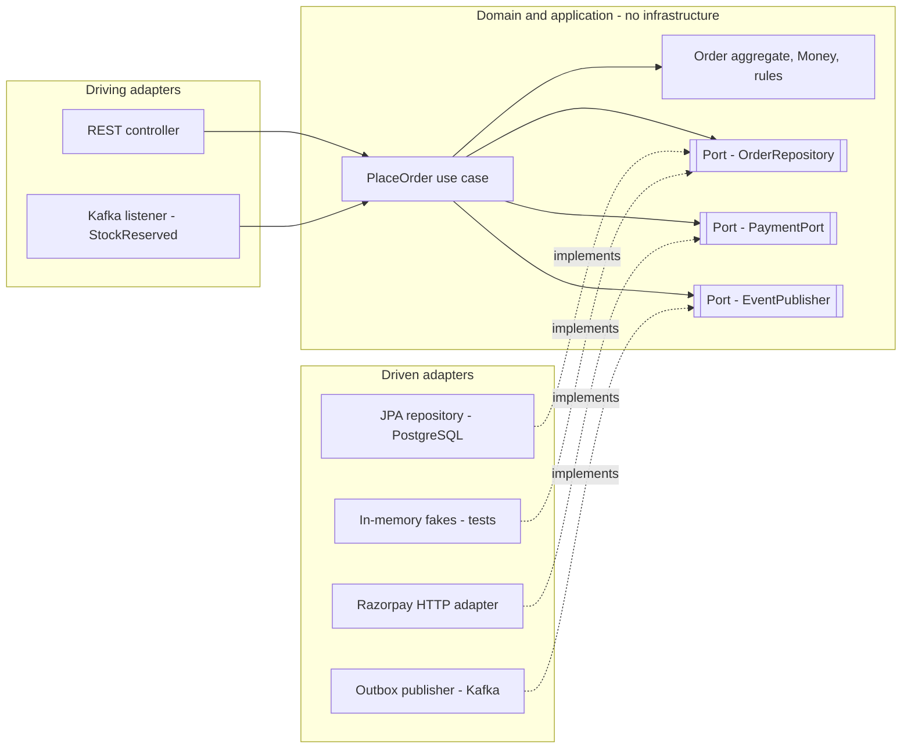
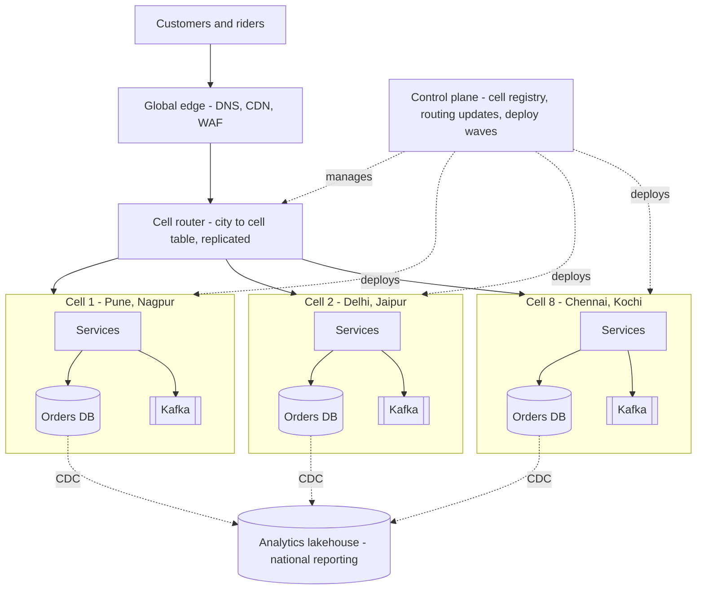
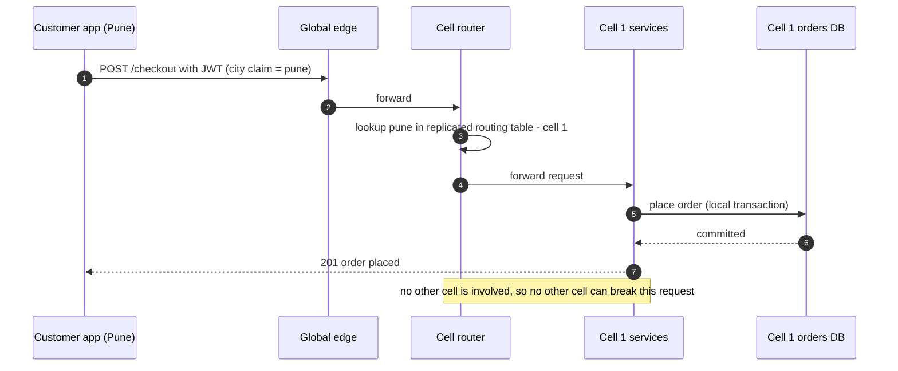
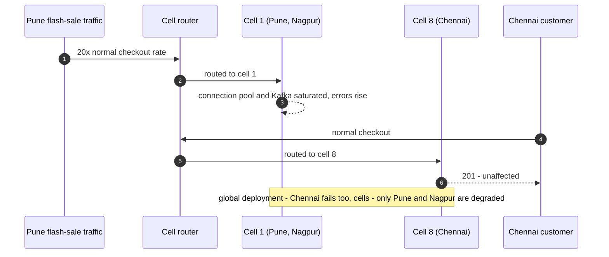
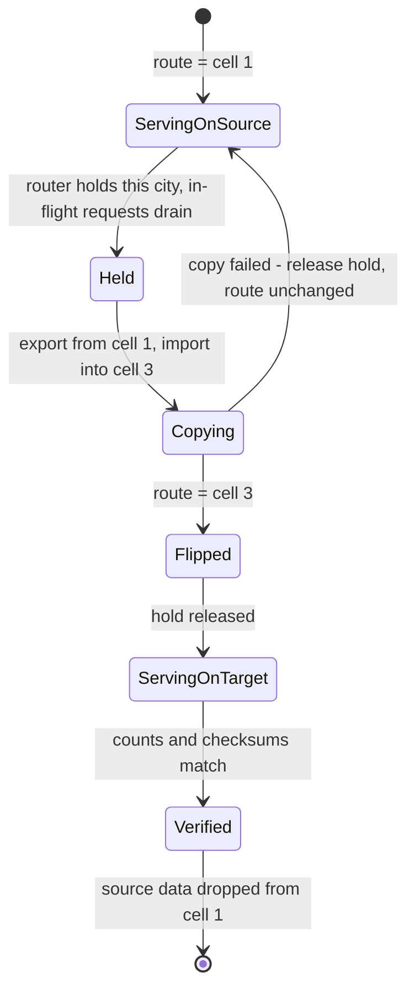

# 34. Modern Architecture Styles

!!! abstract "Chapter at a glance"
    **Reader bands:** B2 → B4 · **Prerequisites:** [Ch 16](../02-distributed-core/16-microservices-architecture.md), [Ch 18](../02-distributed-core/18-resilience-patterns.md), [Ch 31](31-architecture-decision-making.md), [Ch 33](33-domain-driven-design.md) · **What you will build:** A working understanding of the architecture styles an architect actually chooses between — layered, hexagonal/clean, modular monolith, microservices, event-driven, serverless, micro-frontends, and **cell-based** — what each costs, and how to combine and evolve them. Four runnable labs measure the key trade-offs, including a real cell router.

    - **L1: hexagonal architecture.** The same checkout domain ran 2,000 checkouts behind in-memory adapters and behind real ones (a file store plus a real HTTP payment gateway): **identical outcomes** (1,980 paid, 20 declined), the in-memory suite **~200–300x faster**, and a reflection-based dependency check passed the domain and **caught** a class that took an `HttpClient`.
    - **L2: modules vs services.** Five collaborator calls cost **~11 µs** in-process, **~1.1 ms** as serial HTTP calls on localhost (~99x) and **~0.5 ms** fanned out; with six required 99.9% deployables, expected downtime rose from **43 to 259 minutes/month**.
    - **L3: cells and blast radius.** Over 10,000 simulated years, 8 cells with 90-minute deploy waves cut lost platform-minutes from **880 to 205/year**, but latent bugs still reached **100%** of customers; spacing waves 12 h apart cut it to **110/year** and the worst incident to **12.5%**.
    - **L4: a real cell router.** Moving Pune between cells under live traffic: a naive routing flip returned **zero errors** and silently lost **1,519 acknowledged items**; a hold–copy–flip migration lost **0**, holding only Pune's requests for **~13 ms**.

    · **Reading time:** 120 min + code

---

## 1. Introduction & Why It Matters

### 1.1 A story: three architectures in three years

The grocery platform has lived through every fashionable style.

**Year 1 — the layered monolith.** A Spring Boot application with controllers, services and repositories. It shipped fast. By month ten, "services" called each other freely, the `OrderService` class was 4,000 lines, business rules lived in controllers and SQL, and a change to pricing broke delivery-slot booking. Tests needed a database and took 25 minutes.

**Year 2 — microservices.** The team split the monolith into 26 services by entity ([Ch 33](33-domain-driven-design.md) §1.1). Each service was small, but checkout now made nine synchronous calls, p99 latency tripled, a promotions deployment could take down checkout, and "local development" meant running 14 containers. The monolith's coupling had become network coupling.

**Year 3 — a festival outage.** During a Diwali flash sale, one city's surge exhausted the shared Kafka cluster and the shared orders database connection pool. Every city went down together — a customer in Chennai couldn't check out because of a sale in Pune. The post-incident review asked a question no style had answered: *why can one city's problem become every city's problem?*

The re-architecture that followed didn't pick a single fashionable style. It combined several, each where it paid off:

1. **Hexagonal architecture inside every deployable**, so the domain is testable without infrastructure and adapters are swappable (L1).
2. **A modular monolith for Ordering and Catalog**, where in-process calls are cheap and a transaction can span modules (L2).
3. **Separate services only where a real driver existed** — Inventory and Fulfilment, which need independent scaling for flash sales.
4. **Events between contexts**, not chains of synchronous calls.
5. **Cells** — independent copies of the whole stack, each serving a group of cities — so that an infrastructure failure, a bad deploy or one city's surge is confined to one cell (L3, L4).

!!! quote "The thesis of this chapter"
    An architecture style is a **bundle of constraints** you accept in exchange for specific qualities. Layered buys simplicity and costs coupling; hexagonal buys testability and replaceable infrastructure; modular monoliths buy cheap calls and simple operations; microservices buy independent deployment and scaling at the price of network calls and distributed failure; serverless buys zero-ops scaling at the price of cold starts and per-request cost; cells buy **blast-radius containment** at the price of duplicated infrastructure and routing. There is no best style — real systems **combine** them, one per level (inside a deployable, across deployables, across the fleet), and **evolve** between them as the drivers change.

### 1.2 Where this lives in the grocery platform

| Level | Style chosen | Why | Lab |
|---|---|---|---|
| Inside each deployable | Hexagonal (ports & adapters) | Test rules without infrastructure; swap Razorpay/SMS/DB adapters | L1 |
| Ordering + Catalog | Modular monolith | Change together; cheap in-process calls; local transactions | L2 |
| Inventory, Fulfilment | Separate services | Independent scaling for flash sales; different release cadence | L2 |
| Between contexts | Event-driven (outbox + Kafka) | Decoupled, no synchronous chains | [Ch 15](../02-distributed-core/15-event-driven-architecture-cqrs-and-event-sourcing.md) |
| Fleet | 8 cells by city group + a global control plane | Contain infra failures, bad deploys, one city's surge | L3, L4 |
| Web/app front ends | BFF per client; micro-frontends for the seller portal | Different client needs; independent seller-portal teams | §2.9 |
| Spiky side jobs | Serverless functions | Invoice PDFs, image resizing: bursty, stateless | §2.7 |

### 1.3 Learning objectives

By the end you will be able to:

- **Describe each major style** by the constraints it imposes and the qualities it buys.
- **Apply hexagonal architecture** and enforce its dependency rule (L1).
- **Price the move from modules to services** in latency and availability (L2).
- **Design a cell-based architecture** — cell sizing, routing, deploy waves, control plane — and quantify blast radius (L3).
- **Migrate tenants between cells safely** (L4).
- **Combine styles across levels** and plan an evolution path.

---

## 2. Core Concepts — Beginner to Deep

### 2.1 Intuition: styles are bundles of constraints <span class="band b2">B2</span>

An architecture style names a recurring set of structural decisions: what the building blocks are, how they may communicate, and what they may depend on. REST's constraints (statelessness, uniform interface) buy scalability and cacheability; the layered style's constraint (each layer uses only the layer below) buys separation of concerns. Every constraint closes some doors to open others.

Three consequences shape this chapter:

- **Choose by drivers, not by fashion** ([Ch 31](31-architecture-decision-making.md)): which quality attributes does this part of the system need most?
- **Styles apply at different levels.** "Hexagonal" describes the inside of a deployable; "microservices" describes how deployables relate; "cell-based" describes how copies of the whole system relate. You pick one at each level — they're not alternatives to each other.
- **Styles are points on an evolution path**, not permanent identities. Many successful systems go layered monolith → modular monolith → selective services → cells, as scale and organization demand.

### 2.2 Layered (n-tier) architecture <span class="band b2">B2</span>

The default: presentation → application/service → domain → persistence, each layer depending only on the one below.

- **Buys:** simplicity, familiarity, a clear place for each kind of code.
- **Costs:** the domain depends on persistence (the arrow points *down* to the database), so business logic tends to be written around tables; layers become pass-throughs ("sinkhole" anti-pattern); nothing stops a controller from calling a repository or one "service" from calling every other.
- **Fits:** small CRUD-heavy applications, early-stage products.

The critical weakness is the direction of the dependency at the bottom: the domain knows about the database. Hexagonal architecture fixes exactly that.

### 2.3 Hexagonal, onion and clean architecture ⭐ <span class="band b2">B2</span>

Alistair Cockburn's **ports and adapters** (hexagonal) architecture, and its close relatives Jeffrey Palermo's **onion** and Robert Martin's **clean** architecture, share one rule:

> **Dependencies point inward.** The domain is at the center and depends on nothing. Infrastructure depends on the domain, never the reverse.

- **Ports** are interfaces *owned by the domain* that describe what it needs (`OrderRepository`, `PaymentPort`) — **driven** (secondary) ports — or what it offers (`CheckoutUseCase`) — **driving** (primary) ports.
- **Adapters** implement ports for a technology: a JPA repository, a Razorpay HTTP client, a Kafka publisher (driven adapters); a REST controller, a Kafka listener, a CLI (driving adapters).
- **Wiring** (Spring configuration) connects adapters to ports at the edge of the application.

What it buys (L1 measures both):

1. **Business rules testable at memory speed.** L1 ran 2,000 checkouts through in-memory adapters in ~10–20 ms and through a real file store + HTTP gateway in ~3 s — with **identical** paid/declined outcomes. Most tests run against the fast wiring; each adapter gets a few contract/integration tests ([Ch 29](../03-production/29-testing-distributed-systems.md)).
2. **Replaceable infrastructure.** Moving from the file store to PostgreSQL, or from Razorpay to another gateway, is a new adapter; the domain doesn't change.

The rule must be **enforced**, or it erodes the first time someone passes an `HttpClient` into a domain class for convenience. L1's reflection check (and ArchUnit in real projects, [Ch 31](31-architecture-decision-making.md) L2) is that fitness function — and L1 shows it catching exactly that shortcut.

```java title="Package layout for one bounded context (hexagonal)"
in.grocery.ordering
 ├─ domain          // Order, Money, OrderRepository (port), PaymentPort (port) — no Spring, no JPA, no HTTP
 ├─ application     // PlaceOrderHandler (driving port implementation / use case), transactions
 ├─ adapter.in.web  // OrderController (REST → use case)
 ├─ adapter.in.kafka// StockReservedListener
 ├─ adapter.out.jpa // JpaOrderRepository implements OrderRepository
 └─ adapter.out.razorpay // RazorpayPaymentAdapter implements PaymentPort
```

Costs: more interfaces and mapping between domain objects and persistence/transport models; overkill for trivial CRUD (§2.11 of [Ch 33](33-domain-driven-design.md)).

### 2.4 Modular monolith ⭐ <span class="band b3">B3</span>

A **modular monolith** is one deployable whose internals are divided into **modules with enforced boundaries** — typically one module per bounded context — that interact only through published module APIs or events, never by reaching into each other's internals or tables.

- **Buys:** in-process calls (L2: ~11 µs for five calls vs ~1.1 ms over HTTP on localhost, and far more in a real network), local ACID transactions when genuinely needed, one pipeline, simple debugging, simple local development — plus most of microservices' *modularity* benefits.
- **Costs:** one deploy unit (a bad release affects all modules — mitigate with canaries and feature flags); modules scale together; the boundaries must be enforced or it becomes a ball of mud.
- **Enforcement:** module packages with public API sub-packages; ArchUnit or **Spring Modulith** verification in CI; one schema (or table prefix) per module with no cross-module table access; events between modules.

```java title="Spring Modulith verification (VERIFY: needs spring-modulith-starter-test)"
class ModularityTests {
    @Test void verifiesModuleStructure() {
        ApplicationModules.of(GroceryApplication.class).verify();   // fails on cycles and on access to another module's internals
    }
}
```

The modular monolith is the **recommended default** for most teams: it preserves the option to extract a module into a service later, cheaply, *because* the boundary is already clean.

### 2.5 Microservices, priced <span class="band b3">B3</span>

[Ch 16](../02-distributed-core/16-microservices-architecture.md) covers microservices in depth. The architectural point here is the **price list**, which L2 measures:

- **Latency:** each module-to-service boundary turns a microsecond call into a network call — ~99x on localhost in L2, before real network, TLS, sidecars and GC. Serial chains add; fan-out takes the max.
- **Tail latency:** p99 was already several milliseconds on localhost; every hop contributes its own tail.
- **Availability:** required synchronous dependencies multiply — six 99.9% deployables on a path give ~99.4%, i.e. ~6x the downtime (43 → 259 min/month).
- **Operations:** per-service pipelines, observability, on-call, versioning and contract testing.

What you buy with that price: **independent deployment, independent scaling, fault isolation between services (if you remove synchronous coupling), technology freedom, and team autonomy** at scale. The decision rule: extract a service when one of those benefits is concretely needed (a module with a different scaling profile, a different release cadence, a different team), and when you do, **remove required synchronous hops** — use events, caches and fan-out rather than chains.

### 2.6 Event-driven architecture <span class="band b3">B3</span>

In an event-driven style, components communicate by publishing and reacting to events rather than calling each other ([Ch 14](../02-distributed-core/14-messaging-and-event-streaming.md), [Ch 15](../02-distributed-core/15-event-driven-architecture-cqrs-and-event-sourcing.md)). Two topologies:

- **Choreography** — each service reacts to events and publishes its own; no central coordinator. Loosely coupled, but the end-to-end flow is implicit and harder to observe.
- **Orchestration** — a coordinator (saga orchestrator, workflow engine like Temporal) tells participants what to do. Explicit flow and easier error handling, but a central component.

Event-driven styles buy temporal decoupling (the consumer can be down), natural fan-out, and an audit trail; they cost eventual consistency, harder debugging, and schema-evolution discipline ([Ch 28](../03-production/28-schema-and-data-evolution.md)). Most modern systems are **hybrid**: synchronous APIs for queries and commands that need an immediate answer, events for propagating facts between contexts.

### 2.7 Serverless / Functions-as-a-Service <span class="band b3">B3</span>

In **serverless**, you deploy functions (or containers) and the platform handles provisioning, scaling (including to zero) and patching; you pay per invocation and compute-time.

- **Buys:** no servers to manage, automatic scaling for spiky loads, zero cost when idle, fast delivery for event-driven glue.
- **Costs:** **cold starts** (hundreds of ms to seconds for JVM functions without SnapStart/native images), execution-time limits, statelessness (state goes to managed stores), vendor coupling, harder local testing, and a cost curve that grows linearly with volume with no ceiling — [Ch 31](31-architecture-decision-making.md) L4 showed serverless cheaper at the "likely" volume but more expensive in expectation once demand uncertainty is modeled.
- **Fits:** bursty, stateless, event-triggered work: invoice PDF generation, image resizing, webhook handling, scheduled jobs. For steady high-volume Java services, containers usually win on cost and latency.

For Java specifically, cold starts are mitigated with GraalVM native images, AWS Lambda SnapStart / CRaC checkpointing, provisioned concurrency, or by running containers on a serverless container platform instead.

### 2.8 Cell-based architecture ⭐ <span class="band b4">B4</span>

A **cell** is a complete, independent copy of the system's data plane — services, databases, caches, queues — serving a fixed subset of customers (for the grocery platform: a group of cities). A thin **cell router** maps each request to its cell; a **control plane** manages cells, routing tables and deployments. Cells share *nothing* at runtime except the router and the control plane.

The purpose is **blast-radius containment**: cells are bulkheads ([Ch 18](../02-distributed-core/18-resilience-patterns.md)) at the level of the whole architecture. L3 quantifies it over 10,000 simulated years:

| Design | Platform-minutes lost / year | Worst single incident |
|---|---|---|
| One global deployment | 880 | 100% of customers |
| 8 cells, deploy waves over 90 min | 205 | 100% (latent bugs) |
| 8 cells, deploy waves 12 h apart | 110 | 12.5% |

Two lessons hide in that table:

1. **Cells confine infrastructure failures and noisy neighbors** (one city's flash sale, a poison tenant) to one cell — the dominant source of the 4x improvement.
2. **Cells don't help against latent bugs unless the deploy waves are slow.** A defect that triggers hours after deploy has already reached every cell in a 90-minute rollout. Spacing waves (and per-cell feature flags) is what turns cells into protection against *change* as well as infrastructure. (L3's latent bugs trigger 2–10 h after deploy, so 12 h spacing catches all of them by construction; choose real bake times from your own incident history.)

**Design decisions for cells:**

- **Partition key and cell size.** Choose a key with low cross-cell traffic (city group, tenant, customer ID). Size cells so a cell failure is tolerable (e.g., ≤ 15% of customers) and so the largest tenant fits in one cell. Keep cells identical in shape so one runbook fits all.
- **The router.** Stateless, simple, highly available, with the routing table replicated to every edge. It must be the most reliable component in the system because it's shared.
- **Control plane vs data plane.** The control plane (provisioning, routing-table updates, deployment orchestration) can be less available than the data plane; cells must keep serving if the control plane is down.
- **Deployments in waves**, cell by cell, with a canary cell first and bake times sized to your latent-bug profile.
- **Cross-cell concerns.** National reporting (aggregate via a data platform, not live queries across cells), global uniqueness (IDs with a cell prefix, [Ch 20](../02-distributed-core/20-idempotency-ids-and-distributed-locks.md)), and customers or tenants that **move between cells** — which needs a migration protocol (L4).

**Migrating a tenant between cells** (L4): a naive routing flip returned **no errors** and silently lost every acknowledged Pune item written before the flip, because the new cell had none of Pune's data. The safe protocol: **hold** the tenant's requests at the router (wait for in-flight ones to drain), **copy** the data, **flip** the route, **release**, then **verify and drop** the source. L4's hold lasted ~13 ms for a few thousand items and didn't touch Nagpur, another city on the same source cell. For large tenants, pre-copy with dual-write or CDC and pause only for the final delta ([Ch 28](../03-production/28-schema-and-data-evolution.md)).

Cells cost duplicated infrastructure (8 copies of every database and cluster), more operational tooling, and cross-cell complexity. They pay off at large scale — millions of customers, many teams, strict availability targets — not for an early-stage product.

### 2.9 Front-end architecture: BFF and micro-frontends <span class="band b3">B3</span>

- **Backend for Frontend (BFF):** a thin backend per client type (customer app, rider app, web, partner API) that aggregates and shapes data for that client. It keeps client-specific logic out of domain services and lets each client team evolve its API. Keep business rules out of BFFs.
- **Micro-frontends:** the front-end equivalent of microservices — a large web UI composed of independently built and deployed fragments owned by different teams (the seller portal's catalog, orders and payouts sections). Composition via module federation, web components or server-side includes. Costs: consistency of UX, bundle size, shared dependencies. Worth it only when several teams genuinely need to deploy parts of one UI independently.

### 2.10 Data architecture styles <span class="band b4">B4</span>

Styles apply to data too ([Ch 21](../03-production/21-data-at-scale.md)):

- **Database per service/context** — each context owns its data; others use APIs/events (the default with microservices and modular monoliths).
- **Lambda/Kappa** — batch + streaming vs streaming-only processing pipelines.
- **Lakehouse** — open table formats (Iceberg, Delta) over object storage for analytics.
- **Data mesh** — domain teams own and publish **data products** (with contracts, SLAs and discoverability) instead of a central data team owning all pipelines; a self-serve platform and federated governance make it work. Data mesh applies DDD's bounded-context thinking to analytical data; it's an organizational style as much as a technical one.

### 2.11 Combining and evolving styles ⭐ <span class="band b4">B4</span>

Real architectures are **compositions**:

| Level | Question | Typical choice |
|---|---|---|
| Inside a deployable | How is code organized? | Hexagonal / clean |
| Between contexts | How do contexts relate? | Modules in a monolith, or services |
| Between deployables | How do they communicate? | Events for facts, sync APIs for queries |
| Across the fleet | How is failure contained? | Cells at large scale |
| Front ends | How do clients get data? | BFF per client; micro-frontends if many UI teams |

A common, healthy **evolution path**:

1. **Layered monolith** — ship the product.
2. **Modular monolith with hexagonal modules** — as the domain grows, draw context boundaries ([Ch 33](33-domain-driven-design.md)) and enforce them.
3. **Selective extraction** — pull out the modules with real drivers (scaling, cadence, team) into services, connected by events.
4. **Cells** — when blast radius, not code structure, becomes the dominant risk.

Each step keeps the previous one's discipline. Skipping step 2 — going straight from a tangled monolith to microservices — produces the distributed monolith of §1.1.

---

## 3. Architecture & Diagrams

### 3.1 Hexagonal architecture of the Ordering context



### 3.2 Cell-based deployment of the grocery platform



### 3.3 Sequence: happy path, a request routed to its cell



### 3.4 Sequence: failure path, one cell's surge stays in that cell



### 3.5 State: a city moving between cells (L4 protocol)



---

## 4. Design Document Excerpt: Grocery Target Architecture

!!! note "Design Document (excerpt) — Target Architecture Styles v2.0"
    **Status:** Accepted · **Authors:** Principal engineers · **Reviewers:** SRE, all tech leads, finance (cost of cells)

    | Field | Value |
    |---|---|
    | Context | A layered monolith that tangled, then 26 entity services with 9-hop checkout calls, then a festival outage in which one city's surge took every city down through shared Kafka and DB pools. |
    | Decision | Combine styles by level: hexagonal inside deployables; modular monolith for Ordering + Catalog; services for Inventory and Fulfilment; events between contexts; 8 cells by city group with a global router and control plane; BFF per client; serverless for bursty side jobs. |
    | Related ADRs | ADR-200 Hexagonal package structure + ArchUnit dependency rule (L1); ADR-201 Ordering + Catalog modular monolith with Spring Modulith verification; ADR-202 Extract only with a named driver (scaling, cadence, team) (L2); ADR-203 No required synchronous chains longer than 2 hops on checkout; ADR-204 Cells by city group, ≤ 15% of customers per cell (L3); ADR-205 Deploy waves: canary cell, 12 h spacing for high-risk changes, per-cell flags (L3); ADR-206 Tenant move protocol: hold–copy–flip–verify–drop, CDC pre-copy for large cities (L4); ADR-207 Serverless for invoice PDFs and image processing |

    **Requirements.**

    - **R1 — Blast radius.** No single infrastructure failure or city surge may affect more than 15% of customers.
    - **R2 — Checkout latency.** p99 < 300 ms at festival peak; at most 2 required synchronous hops on the checkout path.
    - **R3 — Testability.** Business rules testable without infrastructure; the full domain suite runs in under a minute.
    - **R4 — Safe change.** A bad deploy that triggers within 12 hours affects at most one cell.
    - **R5 — Safe rebalancing.** Moving a city between cells loses no acknowledged write.

    **Decisions in detail.**

    1. **Inside deployables (ADR-200).** Domain/application/adapter packages; ArchUnit rules fail the build on infrastructure types in the domain (L1).
    2. **Modules first (ADR-201/202).** Ordering and Catalog stay together; Inventory and Fulfilment extracted for flash-sale scaling. Every extraction ADR names its driver and the latency/availability cost (L2).
    3. **Cells (ADR-204).** 8 cells; router with replicated table at every edge; control plane may be down without affecting the data plane; national reporting via CDC into the lakehouse.
    4. **Deploys (ADR-205).** Canary cell first; normal changes roll within a day; high-risk changes 12 h per wave; kill-switch flags per cell (L3).
    5. **City moves (ADR-206).** Hold–copy–flip–verify–drop; cities over 1M carts pre-copied via CDC so the hold covers only the final delta (L4).

    **Consequences.** Roughly 1.6x infrastructure cost for cells (duplicated DBs, Kafka, caches), a router and control plane to build and operate, and slower rollouts for risky changes. In return, the festival scenario becomes a one-cell incident, and checkout no longer depends on nine services being up.

---

## 5. Hands-On Code — Level Ladder

!!! info "What's real here"
    All four labs are JDK 21 programs with no dependencies. L1 and L2 start **real HTTP servers** (the JDK's `HttpServer`) and call them with the real `HttpClient`; L4 builds a **real cell router** that proxies HTTP to three real cells and migrates a city under live concurrent traffic, verifying every acknowledged write. L3 is a Monte Carlo model with explicit, stated assumptions. Timings in L1/L2/L4 vary from run to run; the ratios and the correctness results are stable. Run HTTP labs with `-Dsun.net.httpserver.nodelay=true` (otherwise Nagle/delayed-ACK adds ~40 ms per request).

### L1 — Hexagonal architecture: one domain, two sets of adapters <span class="band b2">B2</span>

**Requirement:** "Our tests need a database and a payment sandbox and take 25 minutes. Make the business rules testable without infrastructure — and keep them that way."

The checkout domain owns two ports, `OrderRepository` and `PaymentPort`. It's wired once with in-memory fakes and once with real adapters — an append-only file store and an HTTP client calling a real local payment server — and the same 2,000 checkouts run through both. A reflection-based dependency check (ArchUnit-style) scans the domain types, and a deliberately leaky class proves the check bites.

```java title="HexagonalL1.java"
// HexagonalL1.java — run with: java -Dsun.net.httpserver.nodelay=true HexagonalL1.java   (JDK 21, no dependencies)
// HEXAGONAL ARCHITECTURE (ports & adapters). The domain defines PORTS — interfaces for what it needs (store orders, take
// payment) — and knows nothing about HTTP, files or SQL. ADAPTERS implement those ports for a specific technology. We wire
// the SAME checkout domain two ways and run the SAME 2,000 checkouts through each:
//   TEST wiring  — in-memory repository + fake payment adapter
//   REAL wiring  — append-only FILE repository + HTTP payment adapter calling a real local HTTP payment server
// Then we check (by reflection, ArchUnit-style) that no domain type mentions an infrastructure type.
import com.sun.net.httpserver.HttpServer;
import java.io.*;
import java.lang.reflect.*;
import java.net.*;
import java.net.http.*;
import java.nio.file.*;
import java.util.*;
import java.util.concurrent.*;

public class HexagonalL1 {
    // ======================= DOMAIN (no infrastructure imports used here) =======================
    record OrderId(String value) {}
    record Money(long paise) {}
    enum Status { PAID, PAYMENT_DECLINED }
    record Order(OrderId id, String customer, Money total, Status status) {}
    // PORTS — owned by the domain
    interface OrderRepository { void save(Order o); Optional<Order> byId(OrderId id); long count(); }
    interface PaymentPort { boolean charge(String customer, Money amount); }
    // the use case — pure domain logic
    static final class CheckoutService {
        private final OrderRepository orders; private final PaymentPort payments;
        CheckoutService(OrderRepository orders, PaymentPort payments) { this.orders = orders; this.payments = payments; }
        Order checkout(OrderId id, String customer, Money total) {
            if (total.paise() <= 0) throw new IllegalArgumentException("empty order");
            Order o = new Order(id, customer, total, payments.charge(customer, total) ? Status.PAID : Status.PAYMENT_DECLINED);
            orders.save(o);
            return o;
        }
    }
    // a "shortcut" someone might add: the domain talks to HTTP directly — the check below must catch it
    static final class LeakyCheckoutService {
        private final HttpClient gateway;
        LeakyCheckoutService(OrderRepository orders, HttpClient gateway) { this.gateway = gateway; }
    }
    static final List<Class<?>> DOMAIN = List.of(OrderId.class, Money.class, Status.class, Order.class,
            OrderRepository.class, PaymentPort.class, CheckoutService.class);

    // ======================= ADAPTERS =======================
    static final class InMemoryOrders implements OrderRepository {
        private final Map<String, Order> m = new ConcurrentHashMap<>();
        public void save(Order o) { m.put(o.id().value(), o); }
        public Optional<Order> byId(OrderId id) { return Optional.ofNullable(m.get(id.value())); }
        public long count() { return m.size(); }
    }
    static final class FakePayments implements PaymentPort {       // declines amounts ending in 13 paise — test rule
        public boolean charge(String c, Money a) { return a.paise() % 100 != 13; }
    }
    static final class FileOrders implements OrderRepository {      // append-only log file, indexed in memory
        private final Path file; private final Map<String, Order> index = new HashMap<>();
        FileOrders(Path file) { this.file = file; }
        public synchronized void save(Order o) {
            try { Files.writeString(file, o.id().value() + "|" + o.customer() + "|" + o.total().paise() + "|" + o.status() + "\n",
                    StandardOpenOption.CREATE, StandardOpenOption.APPEND); }
            catch (IOException e) { throw new UncheckedIOException(e); }
            index.put(o.id().value(), o);
        }
        public synchronized Optional<Order> byId(OrderId id) { return Optional.ofNullable(index.get(id.value())); }
        public synchronized long count() {
            try { return Files.readAllLines(file).size(); } catch (IOException e) { throw new UncheckedIOException(e); }
        }
    }
    static final class HttpPayments implements PaymentPort {        // talks to a real HTTP "payment gateway"
        private final HttpClient http = HttpClient.newBuilder().version(HttpClient.Version.HTTP_1_1).build(); private final URI base;
        HttpPayments(URI base) { this.base = base; }
        public boolean charge(String c, Money a) {
            try {
                var req = HttpRequest.newBuilder(base.resolve("/charge?customer=" + c + "&paise=" + a.paise())).POST(HttpRequest.BodyPublishers.noBody()).build();
                return http.send(req, HttpResponse.BodyHandlers.ofString()).body().equals("APPROVED");
            } catch (Exception e) { throw new RuntimeException("payment gateway unreachable", e); }
        }
    }

    // ======================= the "real" payment gateway (a separate process in reality) =======================
    static ExecutorService gatewayPool;
    static HttpServer startGateway() throws IOException {
        HttpServer s = HttpServer.create(new InetSocketAddress("127.0.0.1", 0), 0);
        s.createContext("/charge", ex -> {
            String q = ex.getRequestURI().getQuery(); long paise = Long.parseLong(q.replaceAll(".*paise=(\\d+).*", "$1"));
            byte[] body = (paise % 100 != 13 ? "APPROVED" : "DECLINED").getBytes();
            ex.sendResponseHeaders(200, body.length); ex.getResponseBody().write(body); ex.close();
        });
        gatewayPool = Executors.newFixedThreadPool(4); s.setExecutor(gatewayPool); s.start(); return s;
    }

    static long[] runSuite(CheckoutService svc, OrderRepository repo, int n) {
        long paid = 0, declined = 0, t0 = System.nanoTime();
        for (int i = 0; i < n; i++) {
            Order o = svc.checkout(new OrderId("o" + i), "c" + (i % 50), new Money(1000 + i * 7L));
            if (o.status() == Status.PAID) paid++; else declined++;
        }
        return new long[]{paid, declined, repo.count(), (System.nanoTime() - t0) / 1_000_000};
    }

    // ArchUnit-lite: every field, method parameter/return and interface of domain types must avoid infrastructure packages
    static List<String> infraLeaks() { return infraLeaks(DOMAIN); }
    static List<String> infraLeaks(List<Class<?>> types) {
        List<String> banned = List.of("java.net.", "java.io.", "java.nio.", "java.sql.", "com.sun.net.");
        List<String> leaks = new ArrayList<>();
        for (Class<?> c : types) {
            List<Class<?>> used = new ArrayList<>();
            for (Field f : c.getDeclaredFields()) used.add(f.getType());
            for (Method m : c.getDeclaredMethods()) { used.add(m.getReturnType()); used.addAll(List.of(m.getParameterTypes())); used.addAll(List.of(m.getExceptionTypes())); }
            for (Constructor<?> k : c.getDeclaredConstructors()) used.addAll(List.of(k.getParameterTypes()));
            used.addAll(List.of(c.getInterfaces()));
            for (Class<?> u : used) for (String b : banned) if (u.getName().startsWith(b)) leaks.add(c.getSimpleName() + " uses " + u.getName());
        }
        return leaks;
    }

    public static void main(String[] args) throws Exception {
        int N = Integer.getInteger("n", 2000);
        System.out.println("Hexagonal architecture: one checkout domain, two sets of adapters, the same " + String.format("%,d", N) + " checkouts.\n");

        InMemoryOrders mem = new InMemoryOrders();
        long[] t = runSuite(new CheckoutService(mem, new FakePayments()), mem, N);

        HttpServer gw = startGateway();
        Path log = Files.createTempFile("orders", ".log");
        FileOrders file = new FileOrders(log);
        long[] r = runSuite(new CheckoutService(file, new HttpPayments(URI.create("http://127.0.0.1:" + gw.getAddress().getPort()))), file, N);
        gw.stop(0); gatewayPool.shutdownNow();

        System.out.printf("   %-52s %8s %9s %12s %10s%n", "wiring", "paid", "declined", "orders saved", "time");
        System.out.printf("   %-52s %,8d %,9d %,12d %,7d ms%n", "TEST: in-memory repository + fake payment adapter", t[0], t[1], t[2], t[3]);
        System.out.printf("   %-52s %,8d %,9d %,12d %,7d ms%n", "REAL: file repository + HTTP payment adapter", r[0], r[1], r[2], r[3]);
        System.out.printf("   → identical business outcomes: %s;  real wiring is %.0fx slower%n%n",
                (t[0] == r[0] && t[1] == r[1] && t[2] == r[2]) ? "YES" : "NO", (double) r[3] / Math.max(1, t[3]));

        List<String> leaks = infraLeaks();
        System.out.println("   Dependency rule check over " + DOMAIN.size() + " domain types (no java.net / java.io / java.nio / java.sql):");
        System.out.println(leaks.isEmpty() ? "        ✓ domain references no infrastructure type" : "        ✗ " + String.join("\n        ✗ ", leaks));
        List<String> leaky = infraLeaks(List.of(LeakyCheckoutService.class));
        System.out.println("   Same check against a LeakyCheckoutService that takes an HttpClient (the shortcut someone will try):");
        System.out.println("        ✗ " + String.join("\n        ✗ ", new LinkedHashSet<>(leaky)));
        Files.deleteIfExists(log);

        System.out.println("\n   → the domain produced the same paid/declined split and the same number of saved orders with both wirings, because");
        System.out.println("     it only knows its ports. That buys two things: the business rules are tested at in-memory speed (the fast suite");
        System.out.println("     above) with a few slower contract tests per adapter, and swapping the file store for PostgreSQL or Razorpay for");
        System.out.println("     another gateway is a new adapter, not a domain change. The reflection check is the fitness function that keeps it");
        System.out.println("     that way: the day someone passes an HttpClient into CheckoutService, the build fails.");
        System.exit(0);   // HttpClient keeps non-daemon selector threads alive
    }
}
```

```text title="java -Dsun.net.httpserver.nodelay=true HexagonalL1.java"
Hexagonal architecture: one checkout domain, two sets of adapters, the same 2,000 checkouts.

   wiring                                                   paid  declined orders saved       time
   TEST: in-memory repository + fake payment adapter       1,980        20        2,000      11 ms
   REAL: file repository + HTTP payment adapter            1,980        20        2,000   3,000 ms
   → identical business outcomes: YES;  real wiring is 273x slower

   Dependency rule check over 7 domain types (no java.net / java.io / java.nio / java.sql):
        ✓ domain references no infrastructure type
   Same check against a LeakyCheckoutService that takes an HttpClient (the shortcut someone will try):
        ✗ LeakyCheckoutService uses java.net.http.HttpClient

   → the domain produced the same paid/declined split and the same number of saved orders with both wirings, because
     it only knows its ports. That buys two things: the business rules are tested at in-memory speed (the fast suite
     above) with a few slower contract tests per adapter, and swapping the file store for PostgreSQL or Razorpay for
     another gateway is a new adapter, not a domain change. The reflection check is the fitness function that keeps it
     that way: the day someone passes an HttpClient into CheckoutService, the build fails.
```

**Reading it:**

- **Identical business outcomes** (1,980 paid, 20 declined, 2,000 saved) through both wirings, because the domain only knows its ports. The real wiring is a few hundred times slower — which is why most tests should run against the fast wiring, with a handful of contract/integration tests per adapter ([Ch 29](../03-production/29-testing-distributed-systems.md)).
- The dependency check passes for the 7 domain types and **fails `LeakyCheckoutService`**, which takes a `java.net.http.HttpClient`. Without that check, the rule erodes one convenient shortcut at a time.
- In a real codebase, the same check is an ArchUnit rule:

```java title="VERIFY: ArchUnit rule for the hexagonal dependency direction"
@ArchTest static final ArchRule domainIsPure = noClasses().that().resideInAPackage("..domain..")
    .should().dependOnClassesThat().resideInAnyPackage(
        "java.net..", "java.sql..", "jakarta.persistence..", "org.springframework..", "..adapter..");
```

### L2 — What a module boundary costs when it becomes a network boundary <span class="band b3">B3</span>

**Requirement:** "Should Pricing, Inventory and Promotions stay modules in our monolith or become services? Put numbers on it."

The same five collaborator functions are called in-process, as five serial HTTP calls to five real HTTP services, and as five parallel calls. Responses are verified identical; 3,000 measured runs each after warm-up. Then the availability arithmetic for required synchronous dependencies.

```java title="HopsL2.java"
// HopsL2.java — run with: java -Dsun.net.httpserver.nodelay=true HopsL2.java   (JDK 21, no dependencies)
// MODULAR MONOLITH vs MICROSERVICES: what a module boundary costs when it becomes a network boundary. A checkout needs five
// collaborators (catalog, pricing, inventory, promotions, orders). The SAME collaborator logic is called three ways:
//   MODULES          — in-process method calls between modules of one deployable
//   SERVICES, serial — each collaborator is a separate HTTP service; checkout calls them one after another (JSON over HTTP)
//   SERVICES, fan-out— the independent calls are made in parallel
// Measured on localhost, which is the BEST case: no real network, no TLS, no service mesh, no cross-zone hop. In a data
// centre add ~0.3–1 ms per hop plus TLS/sidecar overhead. Then we compute the availability side of the same trade.
import com.sun.net.httpserver.HttpServer;
import java.net.*;
import java.net.http.*;
import java.util.*;
import java.util.concurrent.*;

public class HopsL2 {
    static final String[] NAMES = {"catalog", "pricing", "inventory", "promotions", "orders"};

    // the collaborator logic — identical in both deployments (a little real work + a JSON-ish payload)
    static String handle(String name, String sku) {
        long h = 0; for (int i = 0; i < 2_000; i++) h = h * 31 + (sku.hashCode() ^ i);
        return "{\"svc\":\"" + name + "\",\"sku\":\"" + sku + "\",\"v\":" + (h & 0xffff) + "}";
    }
    static String checkoutInProcess(String sku) {
        StringBuilder sb = new StringBuilder();
        for (String n : NAMES) sb.append(handle(n, sku));
        return sb.toString();
    }

    static final HttpClient HTTP = HttpClient.newBuilder().version(HttpClient.Version.HTTP_1_1)
            .executor(Executors.newFixedThreadPool(8)).build();
    static final Map<String, URI> URIS = new HashMap<>();
    static String call(String n, String sku) throws Exception {
        return HTTP.send(HttpRequest.newBuilder(URIS.get(n).resolve("/" + n + "?sku=" + sku)).GET().build(),
                HttpResponse.BodyHandlers.ofString()).body();
    }
    static String checkoutSerial(String sku) throws Exception {
        StringBuilder sb = new StringBuilder(); for (String n : NAMES) sb.append(call(n, sku)); return sb.toString();
    }
    static final ExecutorService FAN = Executors.newFixedThreadPool(8);
    static String checkoutFanOut(String sku) throws Exception {
        List<Future<String>> fs = new ArrayList<>();
        for (String n : NAMES) fs.add(FAN.submit(() -> call(n, sku)));
        StringBuilder sb = new StringBuilder(); for (Future<String> f : fs) sb.append(f.get()); return sb.toString();
    }

    interface Op { String run(String sku) throws Exception; }
    static double[] measure(Op op, int warm, int n) throws Exception {
        for (int i = 0; i < warm; i++) op.run("SKU" + (i % 100));
        long[] t = new long[n];
        for (int i = 0; i < n; i++) { long s = System.nanoTime(); op.run("SKU" + (i % 100)); t[i] = System.nanoTime() - s; }
        Arrays.sort(t);
        return new double[]{ t[n / 2] / 1000.0, t[(int) (n * 0.99)] / 1000.0 };
    }

    public static void main(String[] args) throws Exception {
        List<HttpServer> servers = new ArrayList<>(); List<ExecutorService> pools = new ArrayList<>();
        for (String n : NAMES) {
            HttpServer s = HttpServer.create(new InetSocketAddress("127.0.0.1", 0), 0);
            s.createContext("/" + n, ex -> {
                String sku = ex.getRequestURI().getQuery().substring(4);
                byte[] b = handle(n, sku).getBytes();
                ex.sendResponseHeaders(200, b.length); ex.getResponseBody().write(b); ex.close();
            });
            ExecutorService p = Executors.newFixedThreadPool(4); pools.add(p); s.setExecutor(p); s.start(); servers.add(s);
            URIS.put(n, URI.create("http://127.0.0.1:" + s.getAddress().getPort()));
        }
        // sanity: all three produce the same response
        boolean same = checkoutInProcess("SKU7").equals(checkoutSerial("SKU7")) && checkoutSerial("SKU7").equals(checkoutFanOut("SKU7"));

        int WARM = 1_500, N = 3_000;
        double[] m = measure(HopsL2::checkoutInProcess, WARM, N);
        double[] s = measure(HopsL2::checkoutSerial, WARM, N);
        double[] f = measure(HopsL2::checkoutFanOut, WARM, N);

        System.out.printf("One checkout = 5 collaborator calls. Same logic, same responses (%s). %,d measured runs each, localhost.%n%n",
                same ? "verified identical" : "MISMATCH", N);
        System.out.printf("   %-40s %12s %12s %14s%n", "deployment", "p50", "p99", "p50 vs modules");
        System.out.printf("   %-40s %9.1f µs %9.1f µs %13s%n", "modular monolith (in-process calls)", m[0], m[1], "1x");
        System.out.printf("   %-40s %9.1f µs %9.1f µs %12.0fx%n", "microservices, 5 serial HTTP calls", s[0], s[1], s[0] / m[0]);
        System.out.printf("   %-40s %9.1f µs %9.1f µs %12.0fx%n", "microservices, 5 parallel HTTP calls", f[0], f[1], f[0] / m[0]);

        // availability: each independently deployed service at 99.9% monthly; the checkout path needs all of them
        double a = 0.999;
        double mono = a;                         // one deployable on the path
        double micro = Math.pow(a, 1 + NAMES.length);   // checkout service + 5 dependencies, all required
        System.out.printf("%n   Availability if every deployable is 99.9%% and all are required on the checkout path:%n");
        System.out.printf("        modular monolith (1 deployable):      %.3f%%  → %4.0f min/month down%n", mono * 100, (1 - mono) * 43_200);
        System.out.printf("        microservices (6 deployables):        %.3f%%  → %4.0f min/month down%n", micro * 100, (1 - micro) * 43_200);

        System.out.printf("%n   → even on localhost the HTTP path costs ~%.0fx the in-process one, and serial calls add up hop by hop (fan-out halves%n", s[0] / m[0]);
        System.out.println("     it). In absolute terms ~1 ms is small against a 300 ms budget — what bites in production is the TAIL (p99 is already");
        System.out.println("     several ms here, before real network, TLS, sidecars and GC pauses) and the AVAILABILITY multiplication: six required");
        System.out.println("     99.9% deployables give ~6x the downtime of one. None of this makes microservices wrong; it prices them. Independent");
        System.out.println("     deploys, scaling and team autonomy must be worth these costs, which is why the default is a modular monolith with");
        System.out.println("     enforced module boundaries, extracting a module when a real driver appears (Ch 16, Ch 31) — and, when you do,");
        System.out.println("     removing required synchronous hops (fan-out, caching, async events) rather than chaining them.");

        for (HttpServer x : servers) x.stop(0); pools.forEach(ExecutorService::shutdownNow); FAN.shutdownNow();
        System.exit(0);
    }
}
```

```text title="java -Dsun.net.httpserver.nodelay=true HopsL2.java"
One checkout = 5 collaborator calls. Same logic, same responses (verified identical). 3,000 measured runs each, localhost.

   deployment                                        p50          p99 p50 vs modules
   modular monolith (in-process calls)           11.2 µs      30.7 µs            1x
   microservices, 5 serial HTTP calls          1107.2 µs    7825.5 µs           99x
   microservices, 5 parallel HTTP calls         484.1 µs    4500.1 µs           43x

   Availability if every deployable is 99.9% and all are required on the checkout path:
        modular monolith (1 deployable):      99.900%  →   43 min/month down
        microservices (6 deployables):        99.401%  →  259 min/month down

   → even on localhost the HTTP path costs ~99x the in-process one, and serial calls add up hop by hop (fan-out halves
     it). In absolute terms ~1 ms is small against a 300 ms budget — what bites in production is the TAIL (p99 is already
     several ms here, before real network, TLS, sidecars and GC pauses) and the AVAILABILITY multiplication: six required
     99.9% deployables give ~6x the downtime of one. None of this makes microservices wrong; it prices them. Independent
     deploys, scaling and team autonomy must be worth these costs, which is why the default is a modular monolith with
     enforced module boundaries, extracting a module when a real driver appears (Ch 16, Ch 31) — and, when you do,
     removing required synchronous hops (fan-out, caching, async events) rather than chaining them.
```

**Reading it:**

- **~11 µs in-process vs ~1.1 ms serial HTTP (~99x)** — on localhost, the best case: no real network, no TLS, no service mesh. Fan-out roughly halves it. Absolute numbers vary per run; the ratio is stable.
- In absolute terms ~1 ms is small against a 300 ms budget. What bites is the **tail** (p99 already in milliseconds before any real network or GC) and **availability**: six required 99.9% deployables expect **259 minutes/month** of downtime versus **43** for one.
- The decision rule follows: keep modules in-process unless a concrete driver (scaling, cadence, ownership) justifies the price, and when you extract, remove required synchronous hops rather than chaining them.

### L3 — Cells and blast radius <span class="band b4">B4</span>

**Requirement:** "A flash sale in one city took every city down. Would cells have helped — and with what deploy policy?"

A Monte Carlo over 10,000 simulated years of incidents: bad deploys (30% of them latent, triggering 2–10 hours later), infrastructure failures, and one-city overloads. One global deployment is compared with 8 cells using fast (90-minute) and slow (12-hour-spaced) deploy waves.

```java title="CellsL3.java"
// CellsL3.java — run with: java CellsL3.java   (JDK 21, no dependencies)
// CELL-BASED ARCHITECTURE: containing the blast radius. The platform either runs as ONE global deployment (every city
// shares the same services, databases, caches and brokers) or as 8 CELLS — complete, independent copies of the stack,
// each serving a fixed set of cities (12.5% of customers), with deploys rolled out cell by cell in waves.
// We Monte-Carlo 10,000 simulated years of the incidents a real platform has:
//   • BAD DEPLOYS that slip past tests (12/yr). 70% break immediately; 30% are LATENT — they only trigger hours later
//     (a cache expiry, a nightly job, the first festival-size cart) — which is what a canary bake cannot catch.
//   • INFRASTRUCTURE FAILURES (6/yr): a database primary, a cache cluster, a broker. 30–90 min to recover.
//   • OVERLOAD from one city's flash sale or a poison tenant (4/yr): saturates the shared resources it lands on. 20–60 min.
// Global: every incident hits everyone. Cells: infra/overload incidents hit one cell; a bad deploy hits the cells that
// already have it when it triggers. Wave plan: cell 1 at t=0 (canary), cell 2 at +30 min, cells 3–4 at +60, 5–8 at +90.
import java.util.*;

public class CellsL3 {
    static final int CELLS = 8;
    static final double[] FAST_WAVES = {0, 30, 60, 60, 90, 90, 90, 90};            // minutes: whole rollout in 90 min
    static final double[] SLOW_WAVES = {0, 720, 1440, 1440, 2160, 2160, 2160, 2160}; // minutes: waves 12 h apart (36 h)

    // returns {customerMinutesLost (in units of 'whole-platform minutes'), worstIncidentShare}
    static double[] year(Random r, double[] waves) {
        boolean cells = waves != null;
        double lost = 0, worst = 0;
        // bad deploys
        for (int i = 0; i < 12; i++) {
            boolean latent = r.nextDouble() < 0.30;
            double trigger = latent ? 120 + r.nextDouble() * 480 : r.nextDouble() * 10;   // minutes after deploy start
            double detect = 5 + r.nextDouble() * 20, rollback = 15;
            double share;
            if (!cells) share = 1.0;
            else { int hit = 0; for (double w : waves) if (w <= trigger) hit++; share = hit / (double) CELLS; }
            // detection stops the rollout: cells not yet deployed never receive the bad version
            lost += share * (detect + rollback); worst = Math.max(worst, share);
        }
        // infrastructure failures
        for (int i = 0; i < 6; i++) {
            double dur = 30 + r.nextDouble() * 60, share = cells ? 1.0 / CELLS : 1.0;
            lost += share * dur; worst = Math.max(worst, share);
        }
        // overload from one city's flash sale / poison tenant
        for (int i = 0; i < 4; i++) {
            double dur = 20 + r.nextDouble() * 40, share = cells ? 1.0 / CELLS : 1.0;
            lost += share * dur; worst = Math.max(worst, share);
        }
        return new double[]{lost, worst};
    }

    public static void main(String[] args) {
        int Y = 10_000; double minutesPerYear = 525_600;
        System.out.printf("Blast radius: one global deployment vs %d cells with wave deploys. %,d simulated years each.%n%n", CELLS, Y);
        System.out.printf("   %-34s %18s %14s %18s %16s%n", "architecture", "platform-min lost", "p95 year", "effective avail.", "worst incident");
        String[] names = {"one global deployment", "8 cells, waves over 90 min", "8 cells, waves over 36 h"};
        double[][] plans = {null, FAST_WAVES, SLOW_WAVES};
        for (int d = 0; d < 3; d++) {
            Random r = new Random(2026);
            double[] lost = new double[Y]; double worst = 0;
            for (int y = 0; y < Y; y++) { double[] res = year(r, plans[d]); lost[y] = res[0]; worst = Math.max(worst, res[1]); }
            Arrays.sort(lost);
            double mean = Arrays.stream(lost).average().orElse(0);
            System.out.printf("   %-34s %14.0f min %10.0f min %17.4f%% %14.1f%%%n", names[d], mean, lost[(int) (Y * 0.95)],
                    100 * (1 - mean / minutesPerYear), worst * 100);
        }
        for (int d = 1; d < 3; d++) {
            Random r = new Random(7); int latentN = 0, allCells = 0; double share = 0;
            for (int i = 0; i < 200_000; i++) {
                if (r.nextDouble() >= 0.30) { r.nextDouble(); continue; }
                double trigger = 120 + r.nextDouble() * 480; int hit = 0;
                for (double w : plans[d]) if (w <= trigger) hit++;
                latentN++; if (hit == CELLS) allCells++; share += hit / (double) CELLS;
            }
            System.out.printf("%n   %s: latent bugs had reached all %d cells in %.0f%% of cases; mean share hit %.1f%%",
                    names[d], CELLS, 100.0 * allCells / latentN, 100 * share / latentN);
        }
        System.out.println();

        System.out.println("\n   → cells cut expected customer impact by ~4x because the most frequent large incidents — infrastructure failures and");
        System.out.println("     one city's overload — are confined to one cell (12.5% of customers), and an immediately-breaking deploy is caught in");
        System.out.println("     the canary cell. But a fast 90-minute rollout gives NO protection against latent bugs: by the time one triggers,");
        System.out.println("     every cell has it, so the worst incident is still 100%. Spacing the waves 12 h apart turns latent bugs into");
        System.out.println("     one-cell incidents too — the cost is slower delivery (a change takes 1.5 days to reach everyone), so reserve slow");
        System.out.println("     waves for risky changes and use per-cell feature flags for the rest. Cells are not free: duplicated infrastructure,");
        System.out.println("     a routing layer, cross-cell reporting, and customers who move between cities — they pay off at large scale.");
    }
}
```

```text title="java CellsL3.java"
Blast radius: one global deployment vs 8 cells with wave deploys. 10,000 simulated years each.

   architecture                        platform-min lost       p95 year   effective avail.   worst incident
   one global deployment                         880 min        967 min           99.8325%          100.0%
   8 cells, waves over 90 min                    205 min        280 min           99.9611%          100.0%
   8 cells, waves over 36 h                      110 min        121 min           99.9791%           12.5%

   8 cells, waves over 90 min: latent bugs had reached all 8 cells in 100% of cases; mean share hit 100.0%
   8 cells, waves over 36 h: latent bugs had reached all 8 cells in 0% of cases; mean share hit 12.5%

   → cells cut expected customer impact by ~4x because the most frequent large incidents — infrastructure failures and
     one city's overload — are confined to one cell (12.5% of customers), and an immediately-breaking deploy is caught in
     the canary cell. But a fast 90-minute rollout gives NO protection against latent bugs: by the time one triggers,
     every cell has it, so the worst incident is still 100%. Spacing the waves 12 h apart turns latent bugs into
     one-cell incidents too — the cost is slower delivery (a change takes 1.5 days to reach everyone), so reserve slow
     waves for risky changes and use per-cell feature flags for the rest. Cells are not free: duplicated infrastructure,
     a routing layer, cross-cell reporting, and customers who move between cities — they pay off at large scale.
```

**Reading it:**

- **Cells cut expected impact ~4x** (880 → 205 platform-minutes/year) because infrastructure failures and one city's surge — the §1.1 festival outage — are confined to one cell.
- **Fast waves don't contain latent bugs:** every latent bug had reached all 8 cells when it triggered, so the worst incident is still **100%**.
- **12-hour waves** turn latent bugs into one-cell incidents too: **110** platform-minutes/year and a worst incident of **12.5%**. That's partly by construction — the model's latent bugs trigger within 10 hours — so real bake times must come from your own incident data; the structural lesson (wave spacing must exceed bug-manifestation time) holds regardless.
- The cost side isn't in this model: duplicated infrastructure, router, control plane, slower delivery for risky changes. §4's design doc prices it.

### L4 — A real cell router, and moving a city between cells <span class="band b4">B4</span>

**Requirement:** "Cell 1 is hot. Move Pune to cell 3 during business hours without losing a single acknowledged cart item."

Three cells are real HTTP servers with their own stores; a router maps city → cell and proxies requests. Four Pune clients and two Nagpur clients add cart items continuously. After 1.5 s, Pune moves from cell 1 to cell 3 — naively (flip the route) and properly (hold–copy–flip–release–drop). Every acknowledged item is then read back through the router. A silent warm-up run precedes the two reported runs.

```java title="CellRouterL4.java"
// CellRouterL4.java — run with: java -Dsun.net.httpserver.nodelay=true CellRouterL4.java   (JDK 21, no dependencies)
// A REAL CELL ROUTER, and moving a city between cells under live traffic. Three cells are separate HTTP servers, each with
// its own cart store (no shared database — that's the point of cells). A thin routing layer maps city → cell and proxies
// requests. Client threads keep adding items to carts in Pune (and Nagpur) the whole time, recording every write the
// platform ACKNOWLEDGED. Mid-run we move Pune from cell-1 to cell-3 (rebalancing a hot cell), two ways:
//   NAIVE  — flip the routing entry. New requests go to cell-3, which has none of Pune's data.
//   PROPER — hold Pune's requests at the router (wait for in-flight ones to drain), copy Pune's data from cell-1 to
//            cell-3, flip the route, release the hold, then delete from cell-1.
// At the end we read every cart back through the router and check that every acknowledged item is still there.
import com.sun.net.httpserver.*;
import java.net.*;
import java.net.http.*;
import java.nio.charset.StandardCharsets;
import java.util.*;
import java.util.concurrent.*;
import java.util.concurrent.atomic.*;
import java.util.concurrent.locks.*;

public class CellRouterL4 {
    static final List<ExecutorService> POOLS = new ArrayList<>();
    static final HttpClient HTTP = HttpClient.newBuilder().version(HttpClient.Version.HTTP_1_1)
            .executor(pool(16)).build();
    static ExecutorService pool(int n) { ExecutorService p = Executors.newFixedThreadPool(n); POOLS.add(p); return p; }

    // ---------------- a cell: its own store, its own server ----------------
    static final class Cell {
        final String name; final HttpServer server;
        final Map<String, Map<String, List<String>>> store = new ConcurrentHashMap<>();   // city -> cart -> skus
        Cell(String name) throws Exception {
            this.name = name;
            server = HttpServer.create(new InetSocketAddress("127.0.0.1", 0), 0);
            server.createContext("/add", ex -> { Map<String, String> q = q(ex);
                store.computeIfAbsent(q.get("city"), c -> new ConcurrentHashMap<>())
                     .computeIfAbsent(q.get("cart"), c -> Collections.synchronizedList(new ArrayList<>())).add(q.get("sku"));
                reply(ex, 200, "OK"); });
            server.createContext("/get", ex -> { Map<String, String> q = q(ex);
                List<String> l = store.getOrDefault(q.get("city"), Map.of()).getOrDefault(q.get("cart"), List.of());
                synchronized (l) { reply(ex, 200, String.join(",", l)); } });
            server.createContext("/export", ex -> { Map<String, String> q = q(ex); StringBuilder sb = new StringBuilder();
                store.getOrDefault(q.get("city"), Map.of()).forEach((cart, l) -> { synchronized (l) { for (String s : l) sb.append(cart).append('|').append(s).append('\n'); } });
                reply(ex, 200, sb.toString()); });
            server.createContext("/import", ex -> { Map<String, String> q = q(ex);
                String body = new String(ex.getRequestBody().readAllBytes(), StandardCharsets.UTF_8); int n = 0;
                for (String line : body.split("\n")) { if (line.isBlank()) continue; String[] p = line.split("\\|");
                    store.computeIfAbsent(q.get("city"), c -> new ConcurrentHashMap<>())
                         .computeIfAbsent(p[0], c -> Collections.synchronizedList(new ArrayList<>())).add(p[1]); n++; }
                reply(ex, 200, String.valueOf(n)); });
            server.createContext("/drop", ex -> { store.remove(q(ex).get("city")); reply(ex, 200, "OK"); });
            server.setExecutor(pool(8)); server.start();
        }
        String url() { return "http://127.0.0.1:" + server.getAddress().getPort(); }
    }

    // ---------------- the router: city -> cell, with a per-city hold used during migration ----------------
    static final class Router {
        final Map<String, Cell> route = new ConcurrentHashMap<>();
        final Map<String, ReentrantReadWriteLock> hold = new ConcurrentHashMap<>();
        final HttpServer server;
        Router() throws Exception {
            server = HttpServer.create(new InetSocketAddress("127.0.0.1", 0), 0);
            server.createContext("/", ex -> {
                String city = q(ex).get("city");
                Lock l = hold.computeIfAbsent(city, c -> new ReentrantReadWriteLock()).readLock();
                l.lock();                                   // blocks only while this city is being migrated
                try {
                    Cell target = route.get(city);
                    HttpResponse<String> r = HTTP.send(HttpRequest.newBuilder(URI.create(target.url() + ex.getRequestURI())).GET().build(),
                            HttpResponse.BodyHandlers.ofString());
                    reply(ex, r.statusCode(), r.body());
                } catch (Exception e) { reply(ex, 502, "cell unreachable"); }
                finally { l.unlock(); }
            });
            server.setExecutor(pool(16)); server.start();
        }
        String url() { return "http://127.0.0.1:" + server.getAddress().getPort(); }

        void migrateNaive(String city, Cell to) { route.put(city, to); }

        long migrateProper(String city, Cell to) throws Exception {
            Cell from = route.get(city);
            Lock w = hold.computeIfAbsent(city, c -> new ReentrantReadWriteLock()).writeLock();
            long t0 = System.nanoTime();
            w.lock();                                        // 1. hold new requests for this city, wait for in-flight ones
            try {
                String dump = HTTP.send(HttpRequest.newBuilder(URI.create(from.url() + "/export?city=" + city)).GET().build(),
                        HttpResponse.BodyHandlers.ofString()).body();                       // 2. copy
                HTTP.send(HttpRequest.newBuilder(URI.create(to.url() + "/import?city=" + city)).POST(HttpRequest.BodyPublishers.ofString(dump)).build(),
                        HttpResponse.BodyHandlers.ofString());
                route.put(city, to);                                                          // 3. flip
            } finally { w.unlock(); }                                                         // 4. release
            long heldMs = (System.nanoTime() - t0) / 1_000_000;
            HTTP.send(HttpRequest.newBuilder(URI.create(from.url() + "/drop?city=" + city)).GET().build(), HttpResponse.BodyHandlers.ofString()); // 5. clean up
            return heldMs;
        }
    }

    static Map<String, String> q(HttpExchange ex) {
        Map<String, String> m = new HashMap<>(); String s = ex.getRequestURI().getRawQuery();
        if (s != null) for (String kv : s.split("&")) { String[] p = kv.split("=", 2); m.put(p[0], p.length > 1 ? p[1] : ""); }
        return m;
    }
    static void reply(HttpExchange ex, int code, String body) {
        try { byte[] b = body.getBytes(StandardCharsets.UTF_8); ex.sendResponseHeaders(code, b.length == 0 ? -1 : b.length);
              if (b.length > 0) ex.getResponseBody().write(b); } catch (Exception ignored) {} finally { ex.close(); }
    }

    // ---------------- one scenario ----------------
    static void scenario(String label, boolean proper, boolean print) throws Exception {
        Cell c1 = new Cell("cell-1"), c2 = new Cell("cell-2"), c3 = new Cell("cell-3");
        Router router = new Router();
        router.route.put("pune", c1); router.route.put("nagpur", c1); router.route.put("delhi", c2);

        Map<String, List<String>> acked = new ConcurrentHashMap<>();           // what the platform told clients succeeded
        AtomicLong ok = new AtomicLong(), failed = new AtomicLong();
        Map<String, AtomicLong> maxLatUs = Map.of("pune", new AtomicLong(), "nagpur", new AtomicLong());
        AtomicBoolean running = new AtomicBoolean(true);
        ExecutorService clients = pool(6);
        for (int t = 0; t < 6; t++) {
            final int tid = t;
            clients.submit(() -> {
                int i = 0; String city = tid < 4 ? "pune" : "nagpur";
                while (running.get()) {
                    String cart = city + "-cart" + tid + "-" + (i % 5), sku = "SKU" + (i++);
                    long s = System.nanoTime();
                    try {
                        HttpResponse<String> r = HTTP.send(HttpRequest.newBuilder(URI.create(router.url() + "/add?city=" + city + "&cart=" + cart + "&sku=" + sku)).GET().build(),
                                HttpResponse.BodyHandlers.ofString());
                        if (r.statusCode() == 200) { ok.incrementAndGet(); acked.computeIfAbsent(city + "/" + cart, k -> Collections.synchronizedList(new ArrayList<>())).add(sku); }
                        else failed.incrementAndGet();
                    } catch (Exception e) { failed.incrementAndGet(); }
                    maxLatUs.get(city).accumulateAndGet((System.nanoTime() - s) / 1000, Math::max);
                }
                return null;
            });
        }
        Thread.sleep(1500);
        long puneBefore = acked.entrySet().stream().filter(e -> e.getKey().startsWith("pune/"))
                .mapToLong(e -> { synchronized (e.getValue()) { return e.getValue().size(); } }).sum();   // approx: taken just before the move
        long heldMs = -1;
        if (proper) heldMs = router.migrateProper("pune", c3); else router.migrateNaive("pune", c3);
        Thread.sleep(1500);
        running.set(false); clients.shutdown(); clients.awaitTermination(10, TimeUnit.SECONDS);

        // verify every acknowledged item through the router
        long ackedItems = 0, missing = 0;
        for (var e : acked.entrySet()) {
            String[] k = e.getKey().split("/");
            String body = HTTP.send(HttpRequest.newBuilder(URI.create(router.url() + "/get?city=" + k[0] + "&cart=" + k[1])).GET().build(),
                    HttpResponse.BodyHandlers.ofString()).body();
            Set<String> present = new HashSet<>(Arrays.asList(body.split(",")));
            for (String sku : e.getValue()) { ackedItems++; if (!present.contains(sku)) missing++; }
        }
        if (print) {
            System.out.printf("   %-6s ok %,6d  failed %d | acked items %,6d  MISSING %,5d | %-17s | worst latency: Pune %,4d ms  Nagpur %,4d ms%n",
                    label, ok.get(), failed.get(), ackedItems, missing, proper ? "Pune held " + heldMs + " ms" : "no hold",
                    maxLatUs.get("pune").get() / 1000, maxLatUs.get("nagpur").get() / 1000);
            System.out.printf("          Pune items acknowledged before the move: ~%,d | Pune data left orphaned on cell-1: %s%n",
                    puneBefore, c1.store.containsKey("pune") ? "YES" : "no");
        }
        router.server.stop(0); c1.server.stop(0); c2.server.stop(0); c3.server.stop(0);
    }

    public static void main(String[] args) throws Exception {
        System.out.println("Cell router over 3 real HTTP cells. Pune + Nagpur on cell-1, Delhi on cell-2. 4 Pune + 2 Nagpur clients add items for 3 s;");
        System.out.println("at 1.5 s Pune is moved to cell-3. Then every acknowledged item is read back through the router.\n");
        scenario("warmup", true, false);                 // JIT warm-up, not reported
        scenario("NAIVE", false, true);
        scenario("PROPER", true, true);
        System.out.println("\n   → the naive flip returns no errors at all — which is what makes it dangerous: every Pune item acknowledged before the");
        System.out.println("     flip is now invisible, because cell-3 has none of Pune's data and cell-1's copy is orphaned. The proper move holds");
        System.out.println("     only Pune's requests at the router for the duration of the copy — Nagpur, on the SAME source cell, isn't held —");
        System.out.println("     flips the route while nothing is in flight, and loses nothing. The hold lasts exactly as long as the copy, which for");
        System.out.println("     a few thousand cart items is within normal latency noise — but it grows with the city's data, so production moves");
        System.out.println("     of large tenants use dual-write or change-data-capture to pre-copy, pause only for the final delta, verify before");
        System.out.println("     dropping the source, and replicate the routing table to every edge router.");
        POOLS.forEach(ExecutorService::shutdownNow);
        System.exit(0);
    }
}
```

```text title="java -Dsun.net.httpserver.nodelay=true CellRouterL4.java"
Cell router over 3 real HTTP cells. Pune + Nagpur on cell-1, Delhi on cell-2. 4 Pune + 2 Nagpur clients add items for 3 s;
at 1.5 s Pune is moved to cell-3. Then every acknowledged item is read back through the router.

   NAIVE  ok  4,961  failed 0 | acked items  4,961  MISSING 1,519 | no hold           | worst latency: Pune   20 ms  Nagpur   18 ms
          Pune items acknowledged before the move: ~1,515 | Pune data left orphaned on cell-1: YES
   PROPER ok  7,264  failed 0 | acked items  7,264  MISSING     0 | Pune held 13 ms   | worst latency: Pune   21 ms  Nagpur   16 ms
          Pune items acknowledged before the move: ~2,321 | Pune data left orphaned on cell-1: no

   → the naive flip returns no errors at all — which is what makes it dangerous: every Pune item acknowledged before the
     flip is now invisible, because cell-3 has none of Pune's data and cell-1's copy is orphaned. The proper move holds
     only Pune's requests at the router for the duration of the copy — Nagpur, on the SAME source cell, isn't held —
     flips the route while nothing is in flight, and loses nothing. The hold lasts exactly as long as the copy, which for
     a few thousand cart items is within normal latency noise — but it grows with the city's data, so production moves
     of large tenants use dual-write or change-data-capture to pre-copy, pause only for the final delta, verify before
     dropping the source, and replicate the routing table to every edge router.
```

**Reading it:**

- **The naive flip returns zero errors** — and **1,519 acknowledged items are gone**, matching the ~1,515 Pune items acknowledged before the move (the snapshot is taken an instant before the flip). Cell 3 has none of Pune's history; cell 1 still holds it, orphaned. Nothing in the error rate tells you.
- **The proper move loses nothing.** The router's per-city read/write lock holds only Pune's requests while in-flight ones drain, the data is copied, and the route flips; Nagpur, on the same source cell, is never held. The hold lasted ~13 ms here because Pune's data is a few thousand items.
- The hold grows with the tenant's data. For large cities, pre-copy with dual-write or CDC ([Ch 28](../03-production/28-schema-and-data-evolution.md)) so the hold covers only the final delta, verify counts/checksums before dropping the source, and replicate the routing table to every edge router.


---

## 6. Production Concerns

### 6.1 Failure modes by style

| Style | Characteristic failure | Mitigation |
|---|---|---|
| Layered monolith | Tangled layers, rules in controllers/SQL, slow DB-bound tests | Hexagonal modules; enforce the dependency rule (L1) |
| Hexagonal | Rule erodes via "just this once" infrastructure imports | ArchUnit/fitness functions in CI (L1) |
| Modular monolith | Modules reach into each other's internals/tables | Spring Modulith verification; schema per module |
| Microservices | Synchronous chains: latency and availability multiply (L2) | Events, fan-out, caching; extract only with a driver |
| Event-driven | Lost events, invisible flows, schema breaks | Outbox, tracing across async hops, schema registry |
| Serverless | Cold starts, runaway cost, time limits | SnapStart/native images, cost alerts, containers for steady load |
| Cells | Latent bug reaches every cell; router is a single point of failure | Slow waves + per-cell flags (L3); simple, replicated, well-tested router |
| Cell moves | Naive flip loses data silently (L4) | Hold–copy–flip–verify–drop; CDC pre-copy |

### 6.2 Observability

- **Tag every metric, log and trace with the cell ID** (and context/module) so per-cell SLOs, dashboards and alerts exist; a global average hides a dead cell ([Ch 24](../03-production/24-observability.md)).
- **Deploy-wave dashboards** compare the newly deployed cell against the others (canary analysis).
- For modular monoliths, **per-module metrics** (latency, errors, DB time) keep the modules visible even though they share a process.
- For event-driven flows, **distributed tracing across async hops** (propagate trace context in event headers) makes choreography observable.

### 6.3 Security

- Hexagonal adapters are natural **trust boundaries**: validate and authenticate in driving adapters; keep secrets in driven adapters' configuration, never in the domain ([Ch 23](../03-production/23-security-architecture.md)).
- **Cells limit breach blast radius** as well as outage blast radius when credentials, keys and databases are per cell.
- The **cell router and control plane** are high-value targets: least privilege, audited routing-table changes, and a signed, versioned routing table.
- BFFs must not become a bypass: authorization decisions stay in the owning service/context.

### 6.4 Performance & tuning

- Count **required synchronous hops** on critical paths and budget their latency ([Ch 31](31-architecture-decision-making.md) L3); L2 shows each hop's cost before any real network is involved.
- In modular monoliths, watch for **module-level contention** on shared pools (DB connections, thread pools) — give heavy modules their own bulkhead pools.
- **Cell sizing** trades blast radius against efficiency: smaller cells mean smaller incidents but more fixed overhead and more cross-cell moves.
- **Serverless:** measure cold-start frequency and duration; provision concurrency for latency-sensitive paths.

### 6.5 Cost

- Hexagonal and modular monoliths are nearly free in infrastructure; their cost is discipline.
- Microservices add per-service fixed costs (compute baseline, pipelines, observability, on-call).
- **Cells multiply the fixed infrastructure** (every database, cluster and cache per cell) — the grocery estimate was ~1.6x — and require a router and control plane. Justify them with the value of avoided platform-wide incidents (L3's 880 → 110 platform-minutes/year).
- Serverless is cheapest for spiky, low-duty-cycle work and most expensive for steady high volume ([Ch 31](31-architecture-decision-making.md) L4).

---

## 7. Anti-Patterns & Pitfalls

!!! danger "1. Choosing one style for everything"
    "We are a microservices company." Styles apply per level and per context; combine them (§2.11).

!!! danger "2. The distributed monolith"
    Services that must be deployed together and call each other synchronously in chains. All the costs of microservices (L2), none of the benefits.

!!! danger "3. Skipping the modular monolith"
    Going from a tangled monolith straight to services turns in-process coupling into network coupling. Modularize first.

!!! danger "4. Hexagonal in name only"
    Packages called `domain` that import JPA entities, `HttpClient` or Spring annotations. Enforce the dependency rule in CI (L1).

!!! danger "5. Ports that mirror the technology"
    A `PaymentPort` with `postJson(url, body)` isn't a port; it's an HTTP client with an interface. Ports speak the domain's language (`charge(customer, amount)`).

!!! danger "6. Long synchronous call chains"
    Nine required hops on checkout multiply latency and unavailability (L2). Fan out, cache, or use events.

!!! danger "7. Serverless for steady, latency-sensitive Java services"
    Cold starts and per-request pricing hurt exactly where steady containers are cheap and fast.

!!! danger "8. Cells with shared dependencies"
    A "cell" that still shares a global database, Kafka cluster or cache isn't a cell — §1.1's festival outage came through exactly those shared pools.

!!! danger "9. Fast deploy waves across cells"
    Rolling to all cells in 90 minutes gives no protection from latent bugs (L3). Bake times must match how long bugs take to show up.

!!! danger "10. Naive tenant moves between cells"
    Flipping the routing entry without moving data returns no errors and loses data silently (L4).

!!! danger "11. A smart router"
    Business logic, per-request database lookups or complex state in the cell router makes the one shared component fragile. Keep it dumb and replicated.

!!! danger "12. Cells too early"
    Cells for a 20-engineer product with one region multiply cost and tooling for a risk you don't yet have.

---

## 8. Interview Q&A

### Beginner <span class="band b1">B1</span>

??? question "Q1 [B1] ⭐ What is hexagonal (ports and adapters) architecture?"

    **30-second answer:** A way of structuring an application so the domain is at the center and depends on nothing; it defines ports — interfaces for what it needs (store orders, charge payments) and what it offers (use cases). Adapters implement those ports for specific technologies (JPA, Razorpay HTTP, REST controllers, Kafka listeners). Dependencies point inward, so the business logic can be tested without infrastructure and technologies can be swapped by writing new adapters.

    **Deep answer:** L1 runs the same checkout domain behind in-memory adapters and behind a real file store and HTTP gateway: identical outcomes, the in-memory suite hundreds of times faster. A reflection check enforces the rule and catches a class that takes an `HttpClient`.

    **Trade-offs I'd call out:** More interfaces and mapping; overkill for trivial CRUD.

    **Follow-ups:**
    1. Driving vs driven ports? → Driving: how the world calls the app (use cases). Driven: what the app calls (repositories, gateways).
    2. How do you enforce it? → ArchUnit rules in CI.

    **Red flags:** A "domain" package that imports JPA or HTTP classes.

??? question "Q2 [B1] ⭐ What is a modular monolith?"

    **30-second answer:** A single deployable application divided internally into modules with enforced boundaries — typically one per bounded context — that communicate only through published module APIs or events, never through each other's internals or tables. It gives most of the modularity benefits of microservices with in-process calls, local transactions and one pipeline.

    **Deep answer:** L2 prices the alternative: five module calls cost ~11 µs in-process versus ~1.1 ms as serial HTTP calls on localhost, and six required deployables multiply downtime ~6x. Boundaries must be enforced (Spring Modulith, ArchUnit) so modules can be extracted later cheaply.

    **Trade-offs I'd call out:** One deploy unit and shared scaling vs operational simplicity.

    **Follow-ups:**
    1. When extract a module? → When it needs independent scaling, cadence or ownership.
    2. How is it different from a "monolith"? → Enforced module boundaries and data ownership.

    **Red flags:** "Monolith" used as a synonym for "bad."

??? question "Q3 [B1] What is serverless and when is it a good fit?"

    **30-second answer:** You deploy functions or containers and the platform handles servers, scaling (including to zero) and patching; you pay per invocation and compute time. It fits bursty, stateless, event-triggered work — invoice PDFs, image resizing, webhooks, scheduled jobs. It fits poorly for steady high-volume, latency-sensitive services because of cold starts, time limits and linear per-request cost.

    **Deep answer:** JVM cold starts can be seconds; mitigate with SnapStart/CRaC, native images or provisioned concurrency. [Ch 31](31-architecture-decision-making.md) L4 showed serverless cheaper at the most likely volume but more expensive in expectation once demand uncertainty was modeled.

    **Trade-offs I'd call out:** Ops-free scaling vs cold starts, cost at scale, vendor coupling.

    **Follow-ups:**
    1. Main latency risk? → Cold starts.
    2. Where does state go? → Managed stores.

    **Red flags:** Serverless for the core checkout API because it's "modern."

??? question "Q4 [B1] What is a cell-based architecture?"

    **30-second answer:** Running several complete, independent copies of the system's data plane — services, databases, queues — each serving a fixed subset of customers (e.g., a group of cities), behind a thin router. Cells share nothing at runtime, so an infrastructure failure, a bad deploy or one tenant's surge affects only one cell's customers instead of everyone.

    **Deep answer:** L3: over 10,000 simulated years, 8 cells cut lost platform-minutes from 880 to 205 per year with fast deploy waves, and to 110 with 12-hour waves (worst incident 12.5% instead of 100%).

    **Trade-offs I'd call out:** Duplicated infrastructure, a router and control plane, cross-cell operations.

    **Follow-ups:**
    1. What's shared between cells? → Only the router and the control plane.
    2. How is a cell different from a shard? → A shard partitions data; a cell partitions the whole stack.

    **Red flags:** "Cells" that share one database.

### Intermediate <span class="band b2">B2</span>

??? question "Q5 [B2] ⭐ Layered vs hexagonal architecture — what's the actual difference?"

    **30-second answer:** The direction of the dependency at the bottom. In layered architecture the domain/service layer depends on the persistence layer, so business logic is shaped around the database. In hexagonal architecture the domain defines the persistence port and infrastructure depends on the domain. That inversion makes the domain testable without a database and technology-independent.

    **Deep answer:** Layered also tends to allow any "service" to call any other and controllers to reach repositories; hexagonal makes entry points (driving adapters) and exits (driven adapters) explicit. L1's identical outcomes across two wirings are only possible because the domain owns its ports.

    **Trade-offs I'd call out:** Hexagonal costs mapping between domain and persistence models.

    **Follow-ups:**
    1. Is clean/onion architecture different? → Same core rule, different vocabulary and ring names.
    2. Where do transactions go? → Application layer, not the domain.

    **Red flags:** "Hexagonal means six layers."

??? question "Q6 [B2] ⭐ What does converting a module into a microservice actually cost?"

    **30-second answer:** Latency (a microsecond call becomes a network call; serial calls add up), tail latency (each hop adds its own p99), availability (required synchronous dependencies multiply unavailability), operations (pipelines, observability, on-call, versioning, contract tests), and the loss of local transactions. You pay it to get independent deployment, independent scaling, team autonomy and fault isolation.

    **Deep answer:** L2 measures it on localhost — the best case: ~11 µs for five module calls vs ~1.1 ms serial HTTP (~99x) and ~0.5 ms fanned out; six required 99.9% deployables raise expected downtime from 43 to 259 min/month. Real networks, TLS and sidecars add more.

    **Trade-offs I'd call out:** The absolute latency may be fine; the availability and operational costs usually matter more.

    **Follow-ups:**
    1. How do you reduce the cost after extracting? → Events, fan-out, caching, fewer required hops.
    2. What's a good extraction driver? → Different scaling profile or release cadence.

    **Red flags:** "Microservices are faster because they scale."

??? question "Q7 [B2] Choreography vs orchestration in event-driven systems?"

    **30-second answer:** In choreography each service reacts to events and emits its own, with no central coordinator — loosely coupled but the overall flow is implicit and harder to follow and debug. In orchestration a coordinator (saga orchestrator, workflow engine) explicitly tells participants what to do — the flow is visible and error handling is centralized, at the cost of a central component.

    **Deep answer:** Use choreography for simple fan-out of facts (OrderPlaced → billing, analytics); use orchestration for multi-step business processes with compensation (checkout with reservation, payment, slot booking) — [Ch 13](../02-distributed-core/13-distributed-transactions.md).

    **Trade-offs I'd call out:** Coupling vs visibility.

    **Follow-ups:**
    1. How do you observe choreography? → Trace context in event headers; process dashboards.
    2. A workflow engine example? → Temporal, Camunda.

    **Red flags:** Complex multi-step flows built by pure choreography with no visibility.

??? question "Q8 [B2] What is a BFF and when would you use micro-frontends?"

    **30-second answer:** A Backend for Frontend is a thin backend per client type that aggregates and shapes data for that client, keeping client-specific logic out of domain services. Micro-frontends split a large web UI into independently built and deployed pieces owned by different teams. Use a BFF when clients have different needs; use micro-frontends only when several teams must deploy parts of one UI independently.

    **Deep answer:** The grocery platform has BFFs for the customer app, rider app and web; the seller portal uses micro-frontends because catalog, orders and payouts teams release independently. Business rules stay in domain services, not BFFs.

    **Trade-offs I'd call out:** BFFs duplicate some aggregation; micro-frontends risk inconsistent UX and bundle bloat.

    **Follow-ups:**
    1. What must a BFF not contain? → Business rules and authorization decisions.
    2. Composition options? → Module federation, web components, server-side includes.

    **Red flags:** Micro-frontends for a UI one team owns.

??? question "Q9 [B2] How do you enforce architecture style rules in code?"

    **30-second answer:** With fitness functions in CI: ArchUnit rules for layering and "domain depends on nothing"; Spring Modulith verification for module boundaries; dependency checks for cycles; per-module database schemas or grants so modules can't read each other's tables; and contract tests between services. Rules that aren't checked erode.

    **Deep answer:** L1's reflection check is a minimal ArchUnit: it passes the real domain and fails a class holding an `HttpClient`. [Ch 31](31-architecture-decision-making.md) L2 does the same for layering and cycles on a module graph.

    **Trade-offs I'd call out:** Rules need maintenance and sanctioned exceptions.

    **Follow-ups:**
    1. How do you stop cross-module table access? → Schema per module + DB user per module.
    2. What about services? → Contract tests and drift detection ([Ch 32](32-design-documents-and-architecture-communication.md)).

    **Red flags:** Architecture enforced only by code review.

### Senior <span class="band b3">B3</span>

??? question "Q10 [B3] ⭐ How do you decide cell size and the partition key?"

    **30-second answer:** Choose a key that keeps nearly all traffic within one cell — tenant, city group or customer ID — so cross-cell calls are rare. Size cells so losing one is tolerable (e.g., ≤ 15% of customers), so the largest tenant fits in one cell with headroom, and so the number of cells is operationally manageable. Keep cells identical in shape.

    **Deep answer:** For the grocery platform, city groups work because orders, dark stores and riders are local; national reporting goes through CDC into analytics rather than live cross-cell queries. Smaller cells reduce blast radius (L3) but raise fixed cost and the frequency of tenant moves (L4).

    **Trade-offs I'd call out:** Blast radius vs efficiency and cross-cell complexity.

    **Follow-ups:**
    1. What if one tenant outgrows a cell? → Give it its own cell, or split it by a finer key.
    2. How do you route? → Replicated routing table at every edge.

    **Red flags:** A partition key that makes most requests cross cells.

??? question "Q11 [B3] ⭐ Why didn't cells protect against latent bugs in L3, and how do you fix that?"

    **30-second answer:** Because a latent bug only triggers hours after deploy, and a 90-minute rollout has already put it into every cell by then — so the worst incident is still 100%. The fixes: space deploy waves by longer than typical latent-bug trigger times (at least for risky changes), use per-cell feature flags so behavior can be switched off where it misbehaves, and bake in the canary cell before continuing.

    **Deep answer:** L3: 90-minute waves → 205 platform-minutes/year with a worst incident of 100%; 12-hour waves → 110 and 12.5%. The model's latent bugs trigger within 2–10 hours, so 12-hour spacing catches all of them by construction; real bake times should come from your incident history.

    **Trade-offs I'd call out:** Slower delivery (1.5 days to reach all cells) vs contained risk; apply slow waves selectively.

    **Follow-ups:**
    1. Which changes get slow waves? → Schema changes, config changes, risky logic.
    2. What else helps? → Automated canary analysis comparing cells.

    **Red flags:** Believing cells alone make deploys safe.

??? question "Q12 [B3] How do you move a tenant between cells safely?"

    **30-second answer:** Hold the tenant's requests at the router and let in-flight ones drain; copy its data from the source cell to the target; flip the routing entry; release the hold; verify counts/checksums; then drop the source data. For large tenants, pre-copy with dual-write or CDC so the hold covers only the final delta.

    **Deep answer:** L4 does this over real HTTP under live traffic: a naive flip returned zero errors but lost 1,519 acknowledged items; the proper protocol lost none and held only Pune for ~13 ms, while Nagpur on the same source cell kept flowing.

    **Trade-offs I'd call out:** A brief pause for the tenant vs data loss; CDC removes most of the pause at the cost of complexity.

    **Follow-ups:**
    1. Why is the naive flip dangerous? → It fails silently.
    2. What if the copy fails? → Release the hold with the route unchanged.

    **Red flags:** "Just update the routing table."

??? question "Q13 [B3] What belongs in a cell's control plane vs data plane?"

    **30-second answer:** The data plane serves customer requests: the router and everything inside cells. The control plane manages them: cell provisioning, the routing table source of truth, deploy-wave orchestration, tenant moves, capacity. The data plane must keep working if the control plane is down — cells serve with the last good routing table — so the control plane can be simpler and less available.

    **Deep answer:** This separation is why the router must be dumb and self-sufficient (replicated table, no per-request calls to the control plane). Changes flow control plane → data plane asynchronously and are versioned and audited.

    **Trade-offs I'd call out:** Stale routing during control-plane outages vs availability.

    **Follow-ups:**
    1. What happens during a control-plane outage? → No new deploys or moves; traffic flows.
    2. Why version the routing table? → Rollback and audit.

    **Red flags:** A router that queries a database on every request.

??? question "Q14 [B3] When is serverless the wrong choice?"

    **30-second answer:** For steady, high-volume, latency-sensitive services (cold starts and per-request pricing hurt), long-running or stateful work (time limits, statelessness), workloads needing specialized runtimes or tuning, and teams that need strong local reproducibility. For Java, heavy frameworks worsen cold starts unless you use SnapStart/CRaC or native images.

    **Deep answer:** The grocery platform keeps checkout on containers and uses functions for invoice PDFs and image processing. The cost curve crossover ([Ch 31](31-architecture-decision-making.md) L4) is the quantitative argument.

    **Trade-offs I'd call out:** Ops simplicity vs cost, latency and control.

    **Follow-ups:**
    1. Middle ground? → Serverless containers (scale-to-zero container platforms).
    2. How do you control cost? → Budgets and alerts, concurrency limits.

    **Red flags:** Moving everything to Lambda to "save money."

### Architect <span class="band b4">B4</span>

??? question "Q15 [B4] ⭐ Design the architecture-style mix for a large grocery platform."

    **30-second answer:** Per level: hexagonal inside every deployable; bounded contexts as modules in a modular monolith where they change together (Ordering, Catalog), extracted into services where there's a driver (Inventory, Fulfilment for flash-sale scaling); events between contexts; BFF per client; serverless for bursty side jobs; and, at large scale, cells by city group with a replicated router and a separate control plane, deployed in waves.

    **Deep answer:** That's the §4 design, backed by the labs: L1 (testability, swappable adapters), L2 (price of extraction), L3 (blast radius and wave spacing), L4 (safe tenant moves). The mix follows the drivers of each part rather than one company-wide style.

    **Trade-offs I'd call out:** Several styles to understand vs each part getting what it needs.

    **Follow-ups:**
    1. What would you drop for a startup? → Cells and most services.
    2. What's the first style change as you grow? → Modularize with enforced boundaries.

    **Red flags:** One style everywhere.

??? question "Q16 [B4] How would you evolve a tangled layered monolith?"

    **30-second answer:** Don't jump to microservices. First draw bounded contexts ([Ch 33](33-domain-driven-design.md)) and restructure into a modular monolith with hexagonal modules, enforcing boundaries with fitness functions. Then extract only the modules with real drivers, using the strangler pattern and events. Add cells when blast radius becomes the dominant risk.

    **Deep answer:** Each step is reversible and reduces risk; skipping modularization creates a distributed monolith (§1.1 year 2). Measure progress by change coupling (features touching one module) and by extraction cost (how many cross-module calls a module has).

    **Trade-offs I'd call out:** Slower visible progress vs avoiding a costly wrong turn.

    **Follow-ups:**
    1. First module to extract? → The one with the clearest driver and fewest dependencies.
    2. How do you stop regressions? → Module verification in CI.

    **Red flags:** "Rewrite as microservices."

??? question "Q17 [B4] How do you handle cross-cell requirements like national reporting and global uniqueness?"

    **30-second answer:** Avoid live cross-cell calls. For reporting, stream each cell's changes (CDC or events) into a central analytics store and query there. For uniqueness, use IDs that embed the cell (or globally unique IDs like UUIDv7/Snowflake). For globally shared data (catalog, pricing rules), replicate read-only copies into each cell from a global source. Customers who move cities need a tenant-move protocol.

    **Deep answer:** The principle is that cells can depend on the control plane and global read-only data asynchronously, but never synchronously on each other at request time. [Ch 20](../02-distributed-core/20-idempotency-ids-and-distributed-locks.md) covers IDs; L4 covers moves.

    **Trade-offs I'd call out:** Reporting lag and replication complexity vs cell independence.

    **Follow-ups:**
    1. How fresh is national reporting? → Minutes, via streaming CDC.
    2. A global catalog? → Published to all cells; each cell reads locally.

    **Red flags:** A national dashboard that queries eight cell databases live.

??? question "Q18 [B4] Microservices vs cells — aren't they the same thing?"

    **30-second answer:** No — they partition along different axes. Microservices split the system by **function** (ordering, inventory), so each service serves all customers; a service failure affects everyone who needs that function. Cells split by **customer/tenant**, each cell running every function; a cell failure affects only that cell's customers. They combine: each cell can contain several services.

    **Deep answer:** Microservices contain *functional* failures if you remove synchronous coupling; cells contain *infrastructure, deployment and noisy-neighbor* failures across all functions (L3). The §1.1 festival outage was a shared-infrastructure failure that microservices couldn't contain.

    **Trade-offs I'd call out:** Cells multiply infrastructure; microservices multiply deployables.

    **Follow-ups:**
    1. Which one reduces blast radius of a bad deploy? → Cells, with slow waves.
    2. Can a cell be a monolith? → Yes — a modular monolith per cell is a valid design.

    **Red flags:** Treating "more services" as a blast-radius strategy.

??? question "Q19 [B4] How do you justify cells to finance?"

    **30-second answer:** Quantify both sides. Cost: duplicated infrastructure per cell (~1.6x for the grocery platform), router and control-plane engineering, operational tooling. Benefit: expected reduction in platform-wide outage minutes (L3: 880 → 110/year), times the cost of an outage minute (lost orders, refunds, reputation), plus the tail risk — worst incident 100% → 12.5% — which matters most during festival peaks.

    **Deep answer:** Present it as a Monte Carlo with explicit assumptions ([Ch 31](31-architecture-decision-making.md) L4) and sensitivity: which incident frequency or outage cost would make cells not worth it. Phase the rollout (start with 2–3 cells) to reduce upfront cost.

    **Trade-offs I'd call out:** Certain cost now vs probabilistic benefit later.

    **Follow-ups:**
    1. Cost per outage minute? → Peak GMV per minute plus refunds and churn estimate.
    2. Cheapest first step? → Separate the highest-risk shared dependency per cell group.

    **Red flags:** "Cells are best practice."

??? question "Q20 [B4] What distinguishes a principal engineer's answer to 'what architecture should we use?'"

    **30-second answer:** "It depends — and here's on what." They identify the drivers per part of the system, choose a style per level, quantify the costs of each boundary (latency, availability, operations, infrastructure), name the evolution path and the triggers for each next step, and make sure every style's rules are enforced. They also say what they'd *not* do yet.

    **Deep answer:** This chapter's labs are that reasoning in miniature: testability (L1), the price of distribution (L2), blast radius with its caveats (L3), and the operational protocols a style requires (L4). The answer is a composition with triggers, recorded as ADRs ([Ch 31](31-architecture-decision-making.md)).

    **Trade-offs I'd call out:** Nuance vs a simple story; give both — a clear recommendation and the conditions under which it changes.

    **Follow-ups:**
    1. What would change your recommendation? → Named triggers (scale, team count, incident profile).
    2. How do you keep it true? → Fitness functions and drift checks.

    **Red flags:** A single buzzword as the answer.

---

## 9. Summary & Practice

### Key takeaways

1. **Styles are bundles of constraints** that buy specific qualities; choose per level and per context, not per company (§2.1, §2.11).
2. **Hexagonal architecture** inverts the dependency so the domain owns its ports; enforce the rule in CI (L1).
3. **The modular monolith is the default**: cheap calls, simple ops, and cheap later extraction if boundaries are enforced (§2.4).
4. **Microservices have a measurable price** — latency, tail, availability, operations — pay it only for a named driver (L2).
5. **Events decouple contexts;** choose choreography or orchestration by how much visibility the flow needs (§2.6).
6. **Serverless fits bursty, stateless work**, not steady latency-sensitive services (§2.7).
7. **Cells contain blast radius** for infrastructure failures and noisy neighbors — and for bad deploys only with slow enough waves (L3).
8. **Tenant moves between cells need a protocol**; naive flips lose data silently (L4).
9. **Evolve**: layered → modular (hexagonal) → selective services → cells, each step keeping the previous one's discipline.

### Decision cheat sheet

| Need | Style |
|---|---|
| Testable business rules, swappable infrastructure | Hexagonal inside the deployable |
| Several contexts that change together, one team or a few | Modular monolith |
| A context with a different scaling profile, cadence or owner | Extract to a service; connect with events |
| Multi-step process with compensation | Orchestrated saga / workflow engine |
| Fan-out of facts to many consumers | Events (choreography) |
| Bursty, stateless side jobs | Serverless functions |
| Different client needs | BFF per client |
| Many teams on one web UI | Micro-frontends |
| Contain infra failures, noisy tenants, bad deploys at large scale | Cells + router + control plane + slow waves |

### Exercises

1. **(B2)** Add a `NotificationPort` to L1 with an SMS adapter (HTTP) and an in-memory fake. Extend the reflection check to include it. What does the fast suite now cover that it didn't?
2. **(B3)** In L2, add a 1 ms artificial network delay per hop and a 1% chance of a 200 ms GC pause on each service. How do p50 and p99 change for serial vs fan-out?
3. **(B3)** In L3, add a "bad config push" incident type that deploys to all cells at once (bypassing waves). How much of the cells' benefit does it erase? What does that tell you about config pipelines?
4. **(B4)** Extend L4 with a CDC-style pre-copy: stream writes to the target cell while still serving from the source, then hold only for the final delta. Compare hold durations for a city with 100x more data.
5. **(B4)** Write the ADR for introducing cells to your own system: drivers, partition key, cell size, router design, wave policy, cost estimate and revisit trigger.

### Further reading

- Alistair Cockburn, *Hexagonal Architecture* (original article) and *Hexagonal Architecture Explained*.
- Robert C. Martin, *Clean Architecture*.
- Mark Richards & Neal Ford, *Fundamentals of Software Architecture* — style catalogue with ratings.
- Spring Modulith reference documentation.
- AWS Well-Architected, *Reducing the Scope of Impact with Cell-Based Architecture*; Slack and DoorDash engineering posts on cells.
- Sam Newman, *Monolith to Microservices*.
- Zhamak Dehghani, *Data Mesh*.

### Related chapters

- [Ch 15 — EDA, CQRS & Event Sourcing](../02-distributed-core/15-event-driven-architecture-cqrs-and-event-sourcing.md): event-driven style details.
- [Ch 16 — Microservices Architecture](../02-distributed-core/16-microservices-architecture.md): service decomposition and operations.
- [Ch 18 — Resilience Patterns](../02-distributed-core/18-resilience-patterns.md): bulkheads — cells are bulkheads at architecture scale.
- [Ch 26 — Deployment & Infrastructure](../03-production/26-deployment-and-infrastructure.md): canaries and progressive delivery.
- [Ch 31 — Architecture Decision Making](31-architecture-decision-making.md): choosing between styles with evidence.
- [Ch 33 — Domain-Driven Design](33-domain-driven-design.md): bounded contexts as module and service boundaries.
