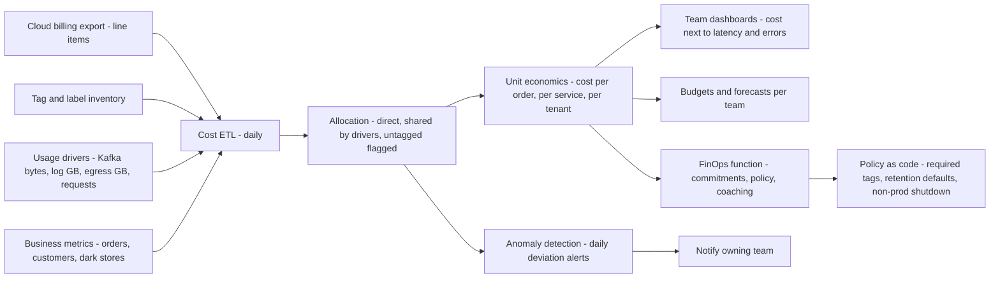
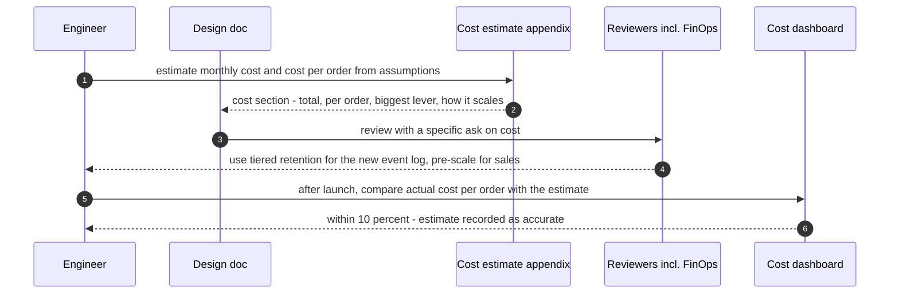
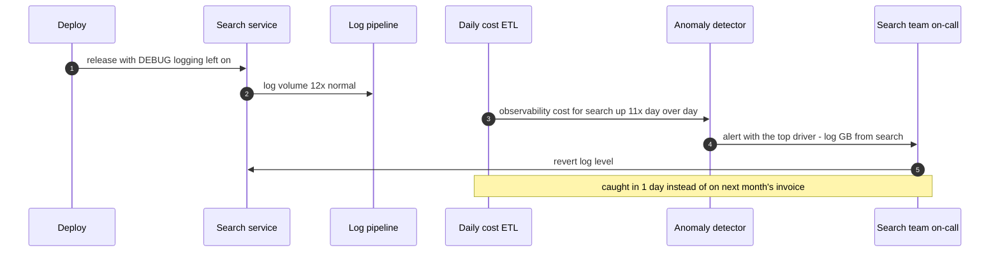
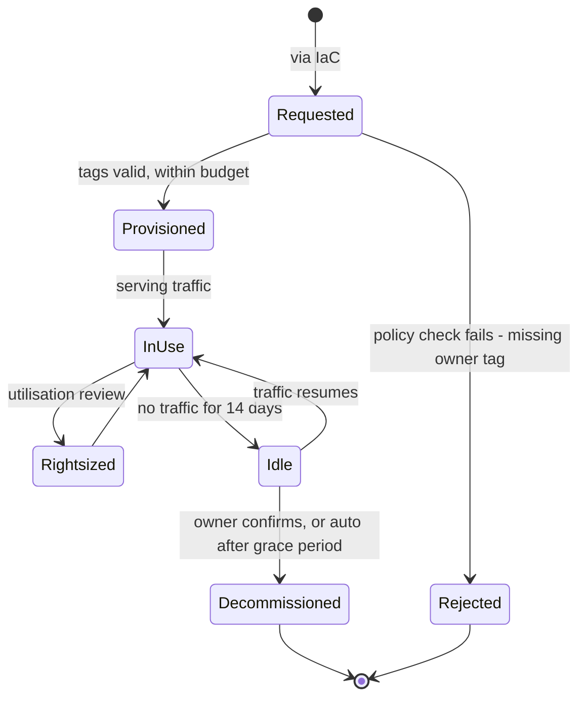

# 35. Cost Engineering & FinOps

!!! abstract "Chapter at a glance"
    **Reader bands:** B2 → B4 · **Prerequisites:** [Ch 02](../01-foundations/02-back-of-the-envelope-estimation.md), [Ch 26](../03-production/26-deployment-and-infrastructure.md), [Ch 31](31-architecture-decision-making.md), [Ch 34](34-modern-architecture-styles.md) · **What you will build:** Cost as a first-class architecture quality: turning a cloud bill into unit economics, rightsizing and autoscaling, commitment strategy under uncertainty, and the storage and data-transfer decisions nobody makes on purpose. Four runnable labs; **every price in this chapter is an illustrative assumption**, not a current vendor rate — substitute your contract's numbers.

    - **L1: unit economics from a bill.** A ₹2.28 crore/month bill (illustrative) became **₹0.76 per order**; driver-based allocation moved up to **₹3.7 L/month** between teams compared with an even split; **4.5%** of spend was untagged; the most expensive-looking service returned **8.5x** its cost in measured uplift.
    - **L2: rightsizing and autoscaling.** Over 14 days with a 5.3x festival spike, a static fleet sized for peak ran at **4%** of needed capacity; reactive autoscaling cost a fraction but was overloaded for the **first 5 minutes** of the sale; adding a scheduled pre-scale reached **0 overloaded minutes at 7%** of the static fleet's cost.
    - **L3: how much to commit.** Against expected demand the optimum commitment is where the marginal pod is busy **≥ 60%** of hours (37 pods, **−23%**). Under uncertain demand, committing to the **p90** was worst (**₹35.7 L** p95 regret); the curve was flat from 0.85x to 1.2x of the optimum, and growth-skew favored the upper end.
    - **L4: storage and transfer.** Measured on 50,000 real-shaped events: gzip **6.3x**, binary + gzip **9.0x** smaller than JSON. Three-year retention: order events are a rounding error at any policy, but logs + clickstream cost **₹23.2 crore kept hot and raw vs ₹29.3 lakh compressed and tiered**.

    · **Reading time:** 110 min + code

---

## 1. Introduction & Why It Matters

### 1.1 A story: the bill that doubled while traffic grew 20%

In the year after the microservices migration and the first festival season, the grocery platform's cloud bill went from ₹1.1 crore to ₹2.3 crore a month. Traffic grew 20%. The CFO asked engineering a reasonable question — *what did we get for the extra ₹1.2 crore?* — and nobody could answer.

The investigation took three weeks, because the bill was organized by *cloud product* (EC2, RDS, data transfer) rather than by anything the business understood. What it found:

1. **Nobody owned most of the spend.** Shared clusters, observability and networking were a third of the bill and belonged to no team; 5% was attached to resources with no tags at all — including instances from a load test that had finished four months earlier.
2. **The fleet was sized for Diwali, all year.** After a festival-season outage, the team had raised every service's replica count to survive peak and never lowered it. Average utilisation was in single digits (L2).
3. **Commitments were bought at the peak.** In a burst of cost-consciousness, someone had bought one-year reserved capacity equal to the *festival* fleet — which then sat idle eleven months a year, already paid for (L3).
4. **Logs were kept forever in the hot search cluster.** Debug-level logs from every service, uncompressed, retained indefinitely "in case we need them" — the fastest-growing line on the bill (L4).
5. **Nobody could say whether any spend was worth it.** The recommendations service was the obvious cut candidate by size — until someone looked at its A/B test results (L1).

None of these were technology failures. They were **decisions nobody knew they were making**: defaults, one-way ratchets, and costs with no owner. The fix wasn't a cost-cutting sprint; it was making cost visible per team and per order, giving it owners, and treating it as an architecture quality with the same rigor as latency and availability.

!!! quote "The thesis of this chapter"
    Cost is a **quality attribute** like latency or availability: it has a budget, it's shaped by architecture decisions, and it erodes unless someone owns it. FinOps makes it manageable by (1) **allocating** every rupee to an owner and a unit of business value — cost per order, not "the EC2 bill"; (2) **optimising** the few big levers — capacity matched to demand, commitments sized to the floor you're confident of, data kept in the cheapest tier that meets its access pattern; and (3) **operating** continuously — budgets, anomaly alerts, and engineers who see the cost of what they build. The goal is not the lowest bill; it's the most **value per rupee**, with effort proportionate to where the money actually goes.

### 1.2 Where this lives in the grocery platform

| FinOps practice | Grocery platform | Lab |
|---|---|---|
| Cost allocation | Tags on every resource; shared costs allocated by usage drivers; untagged spend reported daily | L1 |
| Unit economics | Cost per order, per active customer, per dark store; tracked monthly | L1 |
| Value assessment | Per-service cost vs measured business impact (A/B uplift) | L1 |
| Rightsizing & autoscaling | 60% target utilisation; autoscaling + calendar pre-scale for sales | L2, [Ch 26](../03-production/26-deployment-and-infrastructure.md) |
| Commitments | Savings plans sized to the confident floor, ratcheted quarterly | L3 |
| Data lifecycle | Compression, tiering, retention by data class | L4, [Ch 21](../03-production/21-data-at-scale.md) |
| Governance | Budgets and anomaly alerts per team; cost in design docs and ADRs | §2.9, [Ch 32](32-design-documents-and-architecture-communication.md) |

### 1.3 Learning objectives

By the end you will be able to:

- **Turn a cloud bill into unit economics** and choose a defensible allocation for shared costs (L1).
- **Rightsize capacity** and cover demand your autoscaler can't react to in time (L2).
- **Size commitment discounts** against a demand curve and under uncertainty (L3).
- **Estimate and cut storage and data-transfer costs** by encoding, tiering and topology (L4).
- **Design for cost** — know which architecture choices drive the bill.
- **Run FinOps as a practice**: ownership, budgets, anomalies, and cost in every design review.

---

## 2. Core Concepts — Beginner to Deep

### 2.1 Intuition: cost is an architecture quality <span class="band b2">B2</span>

In a data centre, cost was mostly a procurement decision made once every few years. In the cloud, **every engineer spends money every day**: a replica count, a log level, an instance type, a retention setting, a cross-region call pattern — each is a recurring charge. That makes cost an *emergent property of design*, like latency.

Three consequences shape this chapter:

- **Cost needs owners**, just as services need on-call owners. Spend nobody owns grows (L1's untagged line).
- **Cost must be measured in business units** to be decided on. "₹2.3 crore" invites panic; "₹0.76 per order, 0.12% of order value" invites proportionate action.
- **Cost trades off against other qualities.** Less headroom saves money and moves you toward the queueing cliff ([Ch 31](31-architecture-decision-making.md) L3); cells cost more infrastructure and buy blast-radius containment ([Ch 34](34-modern-architecture-styles.md)). The goal is value per rupee, not minimum rupees.

### 2.2 What drives a cloud bill ⭐ <span class="band b2">B2</span>

For most backend platforms, spend concentrates in a few categories:

| Driver | Typical share | Main levers |
|---|---|---|
| Compute (VMs, containers, functions) | 40–60% | Rightsizing, autoscaling, commitments, spot for interruptible work, efficient code |
| Databases and caches (managed) | 15–30% | Instance sizing, read replicas only where needed, storage tier, reserved capacity |
| Storage (block, object, search clusters) | 5–20% | Compression, lifecycle tiering, retention policy, deleting orphans |
| Data transfer (egress, cross-zone, cross-region) | 2–15% | Zone-aware routing, CDN, compression, avoiding cross-region chatter |
| Observability (logs, metrics, traces) | 5–15% | Log levels, sampling, retention, cardinality control |
| Non-production environments | 10–25% | Shut down off-hours, smaller shapes, ephemeral environments |

Two practical observations: **non-production is often a surprisingly large slice** (L1: dev/staging was ₹11.5 L/month, more than several production services), and **observability grows faster than traffic** because every new service and feature adds logs, metrics and cardinality.

### 2.3 Cost allocation and unit economics ⭐ <span class="band b2">B2</span>

**Allocation** assigns every rupee to an owner:

1. **Direct costs** — resources tagged to one service or team (a service's node pool, its database).
2. **Shared costs** — clusters, networking, observability, data platform, CI, non-prod. Allocate them by **usage drivers**: Kafka by bytes produced, observability by log/metric volume, NAT/egress by gigabytes out, the cluster control plane by requests or resource requests.
3. **Untagged costs** — a governance failure to be driven to zero, not allocated.

L1 compares an even split with driver-based allocation: the method moved up to ₹3.7 L/month between teams. An even split is simple but **distorts incentives** — a low-traffic team pays for another team's logs and has no reason to reduce its own.

**Unit economics** divides allocated cost by a business unit:

- **Cost per order** (L1: ₹0.76) — the headline metric for a commerce platform.
- **Cost per active customer**, **per dark store**, **per tenant** ([Ch 30](../03-production/30-multi-tenancy-and-saas-architecture.md)) — depending on how the business grows.
- **Cost per feature/service per order** — which enables value questions.

Unit cost is what makes growth legible: the bill doubling while cost per order stays flat is healthy; cost per order rising 60% (§1.1) is a problem regardless of the bill.

**Showback vs chargeback:** showback reports each team's cost to them; chargeback actually bills their budget. Start with showback — it changes behavior once people can see their numbers — and move to chargeback only where budgets are genuinely owned.

### 2.4 Value, not just cost <span class="band b3">B3</span>

Cost numbers without value numbers lead to bad cuts. L1's recommendations service was among the two largest lines — and its A/B-measured uplift (illustrative: +1.2% GMV at 18% contribution margin) returned about **8.5x** its cost. Cutting it would have "saved" ₹49 L a month and lost ₹4.2 crore of profit.

Ways to connect cost to value:

- **Experiments** — A/B tests with and without a feature give incremental revenue; divide by the feature's allocated cost.
- **Unit margin** — cloud cost per order relative to contribution margin per order. L1: ₹0.76 against a ₹650 order — for quick commerce, rider and dark-store costs dwarf cloud cost, so **cloud optimisation effort should be proportionate** (remove waste and bad incentives; don't micro-optimise at the expense of delivery speed).
- **Cost of downtime** — the value side of reliability spend ([Ch 34](34-modern-architecture-styles.md) cells, [Ch 27](../03-production/27-reliability-and-disaster-recovery.md) DR).

### 2.5 Rightsizing and autoscaling ⭐ <span class="band b3">B3</span>

Rightsizing matches provisioned capacity to demand. Two decisions dominate:

1. **Target utilisation.** Higher utilisation is cheaper but moves you up the queueing curve: latency rises non-linearly as utilisation approaches 100% ([Ch 31](31-architecture-decision-making.md) L3). ~50–70% CPU for latency-sensitive services is a common compromise; batch and async consumers can run hotter.
2. **How to cover demand the control loop can't react to in time.** Autoscalers act on observed metrics with a lag (metric window, scale-up decision, pod scheduling, JVM warm-up). A demand step faster than that lag overloads you before new capacity arrives.

L2 shows the whole trade-off on 14 days of demand with a festival spike of 5.3x a normal peak:

| Policy | Cost | Overloaded |
|---|---|---|
| Static for the all-time peak | 100% (4% needed utilisation) | 0 min |
| Static for a normal day | ~20% | 120 min — during the sale |
| Reactive autoscaling (60% target) | ~7% | 5 min — the first bucket of the sale |
| Autoscaling + scheduled pre-scale | ~7% | 0 min |

The general pattern: **autoscale for the daily curve; pre-scale for known events** (sales, campaigns, festival days — they're on the calendar); keep a **warm pool** or fast-starting images for unknown spikes; and use **load shedding** ([Ch 18](../02-distributed-core/18-resilience-patterns.md)) as the last line of defense rather than paying for peak all year.

Also rightsize the **shape**: memory-heavy JVM services on compute-optimised instances (or the reverse) waste money even at correct replica counts. Profile requests vs actual usage; Kubernetes resource requests set far above real usage are one of the most common sources of waste.

### 2.6 Pricing models and commitments ⭐ <span class="band b3">B3</span>

Cloud capacity is sold in three broad ways:

- **On-demand** — pay per hour/second, no commitment. The most flexible and most expensive.
- **Commitments** (reserved instances, savings plans, committed-use discounts) — commit to a spend or capacity level for 1–3 years for a discount (often 30–60%). **Paid whether used or not.**
- **Spot / preemptible** — spare capacity at a deep discount that the provider can reclaim with short notice. Only for interruptible work.

The commitment rule (L3): a marginal committed unit pays off if it would be busy in at least `commit price ÷ on-demand price` of the hours — 60% at a 40% discount. So **commit to the floor**, not the peak: the level your fleet stays at or above most of the time. Against the expected demand curve, L3's optimum was 37 pods (busy 62% of hours), saving 23%; committing to the p90 (92 pods) was **worse than no commitment at all**.

Under uncertainty about next year's demand:

- The cost curve is **flat near the optimum** (0.85x–1.2x within ~2% expected cost), so precision matters less than **avoiding the tails**.
- The right hedge follows the **skew**. L3's demand was more likely to grow than shrink, so a slightly *higher* commitment did as well on average and better in the p95 regret. If the risk were a shrinking market, you'd hedge lower.
- **Ratchet**: commitments are easy to add and hard to exit, so commit to the confident floor and add quarterly as growth materialises.

**Spot capacity** fits stateless, interruptible, retry-safe work: batch jobs, image processing, async consumers with checkpoints, CI runners, ML training with checkpointing. Never the checkout path or stateful primaries.

### 2.7 Storage, data lifecycle and data transfer ⭐ <span class="band b3">B3</span>

Storage and transfer costs are mostly **defaults nobody chose**: default log levels, default retention ("forever"), default storage class, default load balancing across zones.

**Encoding** — measured in L4 on 50,000 real-shaped order events: JSON 245 bytes/event; gzip **6.3x** smaller; a schema'd binary encoding **6.3x**; binary + gzip **9.0x**. Schema'd formats (Protobuf, Avro — [Ch 28](../03-production/28-schema-and-data-evolution.md)) and columnar formats (Parquet) for analytics compound this.

**Placement and lifecycle** usually matter more than encoding. Data has an access pattern that decays with age: hot for days, occasionally read for months, rarely for years. Match tiers to it:

| Tier | Use | Relative ₹/GB-month (illustrative) |
|---|---|---|
| Hot database / search cluster (SSD) | Queried constantly, low latency | 8.0 |
| Object storage, standard | Frequent reads, analytics | 1.9 |
| Object storage, infrequent access | Monthly reads | 1.0 |
| Archive | Compliance retention, rare reads (retrieval fee, hours of delay) | 0.08 |

L4's three-year retention for three streams: **order events** cost almost nothing at any policy (₹2 L kept hot and raw); **application logs and clickstream** — 1,000x and 200x larger — cost **₹23.2 crore hot and raw vs ₹29.3 lakh compressed and tiered**. The lesson is **proportionality**: rank data streams by size and optimise the big ones; the data engineers worry about (orders) is rarely the data that costs money.

**Retention policy** is the biggest single lever: decide per data class how long it's needed and at what access speed — then enforce it with lifecycle rules, not good intentions. Regulatory retention (GST invoices, payment records — [Ch 36](36-compliance-governance-and-data-residency.md)) goes to archive tiers; debug logs rarely need more than 7–30 days.

**Data transfer**: egress to the internet, cross-region replication and cross-zone traffic are billed per GB. L4 shows cross-zone transfer is small at this platform's scale (tens of thousands of rupees a month) but it becomes a top line for data-heavy systems (media, ML features, analytics replication). Levers: zone-aware routing, follower-fetching Kafka consumers, CDNs for egress, compression, and avoiding chatty cross-region calls.

### 2.8 Designing for cost <span class="band b4">B4</span>

Architecture decisions set the cost curve long before any optimisation:

- **Statelessness and fast startup** make autoscaling effective (a service that takes 3 minutes to warm up forces you to over-provision).
- **Caching** trades memory for database capacity; **read models** trade storage for query compute ([Ch 07](../01-foundations/07-caching.md), [Ch 15](../02-distributed-core/15-event-driven-architecture-cqrs-and-event-sourcing.md)).
- **Async processing** flattens peaks: work that can wait (emails, invoices, recommendations refresh) runs off-peak on cheaper capacity.
- **Multi-tenancy** amortises fixed costs ([Ch 30](../03-production/30-multi-tenancy-and-saas-architecture.md)); **cells** multiply them ([Ch 34](34-modern-architecture-styles.md)) — both are cost decisions as much as isolation decisions.
- **Service granularity**: each microservice carries a fixed floor (replicas for HA, pipelines, observability). Twenty-six services at a 3-replica HA floor is 78 pods before any traffic.
- **Serverless vs containers** is largely a cost-curve decision ([Ch 31](31-architecture-decision-making.md) L4).
- **Efficient code** matters at scale: a 20% CPU reduction in the hottest service is a 20% cut of its compute line — profile before scaling ([Ch 25](../03-production/25-performance-engineering.md)).

Put **cost in the design doc** ([Ch 32](32-design-documents-and-architecture-communication.md)): estimated monthly cost, cost per unit, how it scales, and the biggest lever.

### 2.9 FinOps as a practice <span class="band b4">B4</span>

The FinOps Foundation describes a loop of three phases, run continuously:

1. **Inform** — allocation, tagging, showback, unit economics, forecasts. Everyone can see what they spend and why.
2. **Optimise** — rightsizing, autoscaling, commitments, spot, storage lifecycle, waste removal (orphans, idle environments).
3. **Operate** — budgets per team, anomaly detection, governance (tag policies enforced at provisioning, approval for large commitments), cost reviews in design and ADRs, and continuous improvement.

Organisational ingredients:

- **Engineers own the cost of what they build** — with visibility, not blame. Put a cost panel next to latency and error rate on every service dashboard.
- **A small central FinOps function** runs the tooling, buys commitments (centrally, because they're pooled across teams), and coaches teams.
- **Anomaly detection**: alert on day-over-day or forecast deviation per team/service — a misconfigured autoscaler or a runaway log stream should page someone within hours, not appear on next month's invoice.
- **Policy as code**: required tags, allowed instance families, maximum retention defaults, auto-shutdown for non-prod — enforced at provisioning (Terraform policy, admission controllers).

### 2.10 Proportionality: where FinOps effort pays <span class="band b4">B4</span>

The recurring lesson of all four labs is **proportionality**:

- Cloud cost per order was ₹0.76 against a ₹650 order (L1) — meaningful, but not the business's biggest cost. Don't slow feature delivery to shave pennies.
- The big wins are structural and one-time: stop paying for peak all year (L2), stop committing to the peak (L3), stop keeping logs hot forever (L4), own the untagged spend (L1).
- Tiny streams stay tiny whatever you do (order events in L4); optimise the streams and services at the top of the ranked list.

Rank, then act: sort spend by owner and driver, attack the top five lines, and put guardrails in place so they don't grow back.

---

## 3. Architecture & Diagrams

### 3.1 Component view: the cost-visibility pipeline



### 3.2 Sequence: happy path, cost considered in a design review



### 3.3 Sequence: failure path, a runaway cost caught by anomaly detection



### 3.4 State: a cloud resource's cost lifecycle



---

## 4. Design Document Excerpt: Grocery FinOps Operating Model

!!! note "Design Document (excerpt) — Cost Management Standard v1.0"
    **Status:** Accepted · **Authors:** Platform engineering + Finance · **Reviewers:** CTO, CFO, all tech leads

    | Field | Value |
    |---|---|
    | Context | Bill doubled (₹1.1 → ₹2.3 crore/month) while traffic grew 20%; a third of spend unallocated; fleet sized for festival peak year-round; commitments bought at peak; logs retained hot indefinitely; no way to connect spend to value. |
    | Decision | Cost becomes a tracked quality attribute with owners: allocate 100% of spend (drivers for shared costs, zero untagged), report unit economics monthly, autoscale with calendar pre-scaling, size commitments to the confident floor, enforce data retention by class, and alert on anomalies daily. |
    | Related ADRs | ADR-210 Mandatory tags (owner, service, env, cost-centre) enforced at provisioning; ADR-211 Driver-based shared-cost allocation (L1); ADR-212 Cost per order as the headline metric; ADR-213 60% target utilisation + calendar pre-scale for sales (L2); ADR-214 Commitments ≤ confident floor, quarterly ratchet, central purchasing (L3); ADR-215 Retention by data class: debug logs 14 d hot, app logs 30 d hot → 1 y archive, clickstream 7 d hot → Parquet in lake (L4); ADR-216 Cost section required in design docs |

    **Requirements.**

    - **R1 — Owned.** ≥ 99% of spend allocated to a team; untagged spend < 1% and reported daily.
    - **R2 — Measured in business units.** Cost per order, per active customer and per dark store reported monthly with trend.
    - **R3 — No paying for peak all year.** Average utilisation of production compute ≥ 35% outside festival windows, with zero overload during planned sales.
    - **R4 — Commitments safe.** Committed spend ≤ the p20 of the next-12-month demand forecast; reviewed quarterly.
    - **R5 — Retention explicit.** Every data store has a retention and tiering policy; defaults are finite.
    - **R6 — Fast detection.** A 3x day-over-day cost anomaly for any team triggers an alert within 24 hours.

    **Decisions in detail.**

    1. **Allocation (ADR-210/211).** Tag policy checked in Terraform CI and by an admission controller; shared costs allocated by usage drivers (L1).
    2. **Unit economics (ADR-212).** Cost per order on every team dashboard next to latency and error rate.
    3. **Capacity (ADR-213).** HPA at 60% CPU; sale calendar feeds scheduled minimum replicas 30 min before each event (L2).
    4. **Commitments (ADR-214).** Central FinOps buys savings plans covering the confident floor; spot only for batch, image processing and async consumers (L3).
    5. **Data (ADR-215).** Lifecycle rules in object storage; log levels defaulted to INFO in production; clickstream compacted to Parquet (L4).
    6. **Design (ADR-216).** Every design doc states monthly cost, cost per unit and its biggest lever ([Ch 32](32-design-documents-and-architecture-communication.md)).

    **Consequences.** Tagging discipline and a small FinOps function; slightly more complex capacity configuration. Expected outcome: cost per order returns to its pre-migration trend, and spend growth tracks business growth.

---

## 5. Hands-On Code — Level Ladder

!!! info "What's real here"
    All four labs are JDK 21 programs with deterministic output. **All prices are illustrative assumptions** chosen to be internally consistent — the lessons are in the shapes and ratios, not the rupee amounts; substitute your own contract prices. L1 reads a real bill-shaped CSV and usage CSV; L2 and L3 model demand curves explicitly; L4 **measures** real encodings with `java.util.zip` on 50,000 generated events.

### L1 — Unit economics from a cloud bill <span class="band b2">B2</span>

**Requirement:** "Finance wants to know what we get for ₹2.3 crore a month. Turn the bill into cost per service and per order, and tell us what's worth it."

A bill-shaped CSV (direct, shared and untagged line items) and a usage-driver CSV (Kafka bytes, log GB, egress GB, lake GB, requests per service) are allocated two ways — even split and by drivers — then divided by monthly orders.

```text title="bill.csv (illustrative INR)"
# monthly cloud bill (illustrative INR), one line per billed resource group: item,service_tag,category,cost_inr
eks-nodes-checkout,checkout,compute,1850000
eks-nodes-catalog,catalog,compute,1120000
eks-nodes-search,search,compute,1480000
eks-nodes-inventory,inventory,compute,960000
eks-nodes-fulfilment,fulfilment,compute,1310000
eks-nodes-recommendations,recommendations,compute,2240000
rds-orders,checkout,database,1650000
rds-inventory,inventory,database,780000
rds-fulfilment,fulfilment,database,540000
opensearch-catalog,search,database,1390000
redis-cart,checkout,cache,420000
redis-catalog,catalog,cache,380000
gpu-reco-training,recommendations,compute,1260000
kafka-cluster,,shared,1100000
eks-control-plane-and-system-nodes,,shared,640000
nat-gateways-and-egress,,shared,1280000
observability-logs-metrics-traces,,shared,1560000
s3-data-lake,,shared,690000
dev-staging-environments,,shared,1150000
ec2-untagged-i-0a3f,,untagged,410000
ebs-orphaned-volumes,,untagged,265000
ec2-untagged-i-77c1,,untagged,330000
elastic-ips-unattached,,untagged,18000
```

```java title="UnitCostL1.java"
// UnitCostL1.java — run with: java UnitCostL1.java bill.csv usage.csv   (JDK 21, no dependencies)
// UNIT ECONOMICS FROM A CLOUD BILL. "The bill is ₹1.8 crore a month" tells nobody what to do. FinOps turns it into numbers
// teams and product owners can act on: cost PER SERVICE and cost PER ORDER. That needs three steps:
//   1. DIRECT costs — resources tagged to one service.
//   2. SHARED costs — Kafka, observability, NAT/egress, the data lake, the cluster control plane, dev/staging — allocated to
//      services. HOW you allocate changes who "owns" the cost, so we compare an even split with driver-based allocation.
//   3. UNTAGGED costs — nobody's, which in practice means nobody turns them off.
// All prices are ILLUSTRATIVE assumptions, not current vendor rates.
import java.nio.file.*;
import java.util.*;

public class UnitCostL1 {
    public static void main(String[] args) throws Exception {
        List<String[]> bill = rows(args[0]);
        Map<String, double[]> usage = new LinkedHashMap<>();      // service -> {kafkaGB, logGB, egressGB, lakeGB, requestsM}
        for (String[] u : rows(args[1])) usage.put(u[0], new double[]{d(u[1]), d(u[2]), d(u[3]), d(u[4]), d(u[5])});
        List<String> services = new ArrayList<>(usage.keySet());

        Map<String, Double> direct = new LinkedHashMap<>(); services.forEach(s -> direct.put(s, 0.0));
        Map<String, Double> shared = new LinkedHashMap<>();
        List<String[]> untagged = new ArrayList<>();
        double total = 0;
        for (String[] b : bill) {
            double c = d(b[3]); total += c;
            switch (b[2]) {
                case "shared" -> shared.put(b[0], c);
                case "untagged" -> untagged.add(b);
                default -> direct.merge(b[1], c, Double::sum);
            }
        }
        double directSum = direct.values().stream().mapToDouble(Double::doubleValue).sum();
        double sharedSum = shared.values().stream().mapToDouble(Double::doubleValue).sum();
        double untaggedSum = untagged.stream().mapToDouble(u -> d(u[3])).sum();

        // driver per shared item: which usage column decides each service's share
        Map<String, Integer> driver = Map.of("kafka-cluster", 0, "observability-logs-metrics-traces", 1,
                "nat-gateways-and-egress", 2, "s3-data-lake", 3, "eks-control-plane-and-system-nodes", 4);
        Map<String, Double> evenAlloc = new LinkedHashMap<>(), driverAlloc = new LinkedHashMap<>();
        services.forEach(s -> { evenAlloc.put(s, 0.0); driverAlloc.put(s, 0.0); });
        for (var e : shared.entrySet()) {
            for (String s : services) evenAlloc.merge(s, e.getValue() / services.size(), Double::sum);
            Integer col = driver.get(e.getKey());
            if (col != null) {
                double tot = services.stream().mapToDouble(s -> usage.get(s)[col]).sum();
                for (String s : services) driverAlloc.merge(s, e.getValue() * usage.get(s)[col] / tot, Double::sum);
            } else {    // dev/staging: allocate in proportion to each service's direct (production) spend
                for (String s : services) driverAlloc.merge(s, e.getValue() * direct.get(s) / directSum, Double::sum);
            }
        }

        double ORDERS = 30_000_000, AOV = 650;          // illustrative: ~1M orders/day, ₹650 average order value
        System.out.printf("Monthly bill ₹%s (illustrative) for %,.0f orders. Direct %.0f%%, shared %.0f%%, UNTAGGED %.1f%%.%n%n",
                crore(total), ORDERS, 100 * directSum / total, 100 * sharedSum / total, 100 * untaggedSum / total);
        System.out.printf("   %-16s %12s %14s %16s %14s %11s %9s%n", "service", "direct", "shared (even)", "shared (drivers)",
                "total (drivers)", "₹ / order", "of bill");
        for (String s : services) {
            double t = direct.get(s) + driverAlloc.get(s);
            System.out.printf("   %-16s %12s %14s %16s %14s %11.3f %8.1f%%%n", s, lakh(direct.get(s)), lakh(evenAlloc.get(s)),
                    lakh(driverAlloc.get(s)), lakh(t), t / ORDERS, 100 * t / total);
        }
        System.out.printf("   %-16s %12s %14s %16s %14s %11.3f %8.1f%%%n", "UNTAGGED", "", "", "", lakh(untaggedSum), untaggedSum / ORDERS, 100 * untaggedSum / total);
        System.out.printf("%n   Cloud cost per order: ₹%.2f  =  %.2f%% of ₹%.0f average order value.%n", total / ORDERS, 100 * total / ORDERS / AOV, AOV);

        // biggest swings between allocation methods
        System.out.println("\n   How much the allocation METHOD moves each service's shared-cost bill (drivers − even split):");
        for (String s : services) System.out.printf("        %-16s %+,12.0f ₹%n", s, driverAlloc.get(s) - evenAlloc.get(s));

        System.out.println("\n   Untagged line items (owner unknown):");
        for (String[] u : untagged) System.out.printf("        %-28s ₹%,10.0f%n", u[0], d(u[3]));

        // a value question the unit numbers make answerable
        String reco = "recommendations";
        double recoCost = direct.get(reco) + driverAlloc.get(reco);
        double upliftPct = 1.2, margin = 0.18;          // illustrative: A/B test shows +1.2% GMV; 18% contribution margin
        double upliftProfit = ORDERS * AOV * upliftPct / 100 * margin;
        System.out.printf("%n   Is recommendations worth ₹%s/month? A/B uplift %.1f%% of GMV × %.0f%% margin = ₹%s/month of profit → %s.%n",
                lakh(recoCost), upliftPct, margin * 100, lakh(upliftProfit),
                upliftProfit > recoCost ? String.format("pays for itself %.1fx", upliftProfit / recoCost) : String.format("covers only %.0f%% of its cost", 100 * upliftProfit / recoCost));

        String top = services.stream().max(Comparator.comparingDouble(x -> direct.get(x) + driverAlloc.get(x))).get();
        double maxSwing = services.stream().mapToDouble(x -> Math.abs(driverAlloc.get(x) - evenAlloc.get(x))).max().orElse(0);
        System.out.println("\n   → the bill becomes decisions only once it's per service and per order. The even split is simple but wrong: it");
        System.out.printf ("     charges services for other teams' logs and egress — driver-based allocation moves up to ₹%s a month between teams.%n", lakh(maxSwing));
        System.out.printf ("     Untagged spend (%.1f%% here) has no owner, so it's the first place to look for waste — orphaned volumes, unattached%n", 100 * untaggedSum / total);
        System.out.println("     IPs, forgotten instances — and the reason to enforce tagging at provisioning time.");
        System.out.printf ("     Per-service cost also makes value questions answerable. The two biggest lines are %s and recommendations; the%n", top);
        System.out.printf ("     latter looks like a cut candidate by size, yet its measured uplift returns ~%.1fx its cost. Judge spend by VALUE per%n", upliftProfit / recoCost);
        System.out.printf ("     rupee, not by size. Finally, context: cloud is ₹%.2f of a ₹%.0f order — for quick commerce, rider and dark-store costs%n", total / ORDERS, AOV);
        System.out.println("     dwarf it, so FinOps effort should be proportionate: remove waste and wrong incentives, don't micro-optimize.");
    }

    static List<String[]> rows(String f) throws Exception {
        return Files.readAllLines(Path.of(f)).stream().filter(l -> !l.isBlank() && !l.startsWith("#")).map(l -> l.split(",", -1)).toList();
    }
    static double d(String s) { return Double.parseDouble(s.trim()); }
    static String lakh(double v) { return String.format("%,.1f L", v / 100_000); }
    static String crore(double v) { return String.format("%.2f crore", v / 10_000_000); }
}
```

```text title="java UnitCostL1.java bill.csv usage.csv"
Monthly bill ₹2.28 crore (illustrative) for 30,000,000 orders. Direct 67%, shared 28%, UNTAGGED 4.5%.

   service                direct  shared (even) shared (drivers) total (drivers)   ₹ / order   of bill
   checkout               39.2 L         10.7 L           12.6 L         51.8 L       0.173     22.7%
   catalog                15.0 L         10.7 L           11.0 L         26.0 L       0.087     11.4%
   search                 28.7 L         10.7 L            7.3 L         36.0 L       0.120     15.8%
   inventory              17.4 L         10.7 L            8.4 L         25.8 L       0.086     11.3%
   fulfilment             18.5 L         10.7 L           10.4 L         28.9 L       0.096     12.7%
   recommendations        35.0 L         10.7 L           14.4 L         49.4 L       0.165     21.7%
   UNTAGGED                                                              10.2 L       0.034      4.5%

   Cloud cost per order: ₹0.76  =  0.12% of ₹650 average order value.

   How much the allocation METHOD moves each service's shared-cost bill (drivers − even split):
        checkout             +190,601 ₹
        catalog               +34,638 ₹
        search               -337,215 ₹
        inventory            -229,532 ₹
        fulfilment            -32,267 ₹
        recommendations      +373,776 ₹

   Untagged line items (owner unknown):
        ec2-untagged-i-0a3f          ₹   410,000
        ebs-orphaned-volumes         ₹   265,000
        ec2-untagged-i-77c1          ₹   330,000
        elastic-ips-unattached       ₹    18,000

   Is recommendations worth ₹49.4 L/month? A/B uplift 1.2% of GMV × 18% margin = ₹421.2 L/month of profit → pays for itself 8.5x.

   → the bill becomes decisions only once it's per service and per order. The even split is simple but wrong: it
     charges services for other teams' logs and egress — driver-based allocation moves up to ₹3.7 L a month between teams.
     Untagged spend (4.5% here) has no owner, so it's the first place to look for waste — orphaned volumes, unattached
     IPs, forgotten instances — and the reason to enforce tagging at provisioning time.
     Per-service cost also makes value questions answerable. The two biggest lines are checkout and recommendations; the
     latter looks like a cut candidate by size, yet its measured uplift returns ~8.5x its cost. Judge spend by VALUE per
     rupee, not by size. Finally, context: cloud is ₹0.76 of a ₹650 order — for quick commerce, rider and dark-store costs
     dwarf it, so FinOps effort should be proportionate: remove waste and wrong incentives, don't micro-optimize.
```

**Reading it:**

- The bill becomes **₹0.76 per order** — 0.12% of a ₹650 order. That single number sets the tone: worth managing, not worth slowing delivery for.
- **Allocation method matters**: driver-based allocation moves up to ₹3.7 L/month between teams versus an even split. Search and inventory were subsidising others' logs and egress; recommendations and checkout drive more shared spend than an even split admits.
- **Untagged spend (4.5%)** is four orphaned resources — two instances, forgotten volumes, unattached IPs. Nobody owns them, so nobody turns them off.
- **Value, not size**: recommendations is one of the two largest lines, yet its (illustrative) A/B-measured uplift returns **~8.5x** its cost. Cutting it by size would have been an expensive mistake.

### L2 — Rightsizing and autoscaling, costed <span class="band b3">B3</span>

**Requirement:** "After last Diwali we raised every replica count and never lowered it. What does that cost, and what's safe instead?"

Fourteen days of 5-minute demand buckets with daily peaks, weekends, noise and a festival flash sale; four capacity policies, each priced per pod-hour (illustrative) and scored on overloaded and degraded minutes.

```java title="ScalingL2.java"
// ScalingL2.java — run with: java ScalingL2.java   (JDK 21, no dependencies)
// RIGHTSIZING AND AUTOSCALING, costed. Fourteen days of checkout demand in 5-minute buckets: morning and evening peaks,
// busier weekends, noise, and one festival flash sale (day 11, 19:00–21:00) at ~6x normal. Each pod serves 150 req/s at
// the target utilisation (~60%, the knee before the queueing cliff of Ch 31 L3) and at most 250 req/s before it overloads.
// Four capacity policies, each priced at an ILLUSTRATIVE ₹18 per pod-hour:
//   A) static, sized for the all-time peak (+20% headroom)      — the "never page me" fleet
//   B) static, sized for a normal day's peak (+20%)            — cheap until the festival
//   C) reactive autoscaling to 60% target, 5-min reaction lag, 15-min scale-down cooldown, min 4 pods
//   D) C + a SCHEDULED pre-scale for the known sale (capacity for 6x from 18:30 to 21:30 on day 11)
import java.util.*;

public class ScalingL2 {
    static final int BUCKETS_PER_DAY = 288, DAYS = 14, N = BUCKETS_PER_DAY * DAYS;
    static final double TARGET = 150, MAX = 250, PRICE = 18;

    static double[] demand() {
        Random r = new Random(11); double[] d = new double[N];
        for (int i = 0; i < N; i++) {
            int day = i / BUCKETS_PER_DAY; double hour = (i % BUCKETS_PER_DAY) / 12.0;
            double base = 120 + 900 * Math.exp(-Math.pow((hour - 8.5) / 1.6, 2)) + 1300 * Math.exp(-Math.pow((hour - 19.5) / 1.8, 2))
                        + 350 * Math.exp(-Math.pow((hour - 13) / 2.0, 2));
            if (day % 7 == 5 || day % 7 == 6) base *= 1.25;                              // weekend
            base *= 1 + 0.08 * r.nextGaussian();                                          // noise
            if (day == 10 && hour >= 19 && hour < 21) base *= 6;                          // flash sale
            d[i] = Math.max(50, base);
        }
        return d;
    }

    record Result(double podHours, double cost, int overloadedMin, int degradedMin, int peakPods) {}

    static Result run(double[] d, java.util.function.IntUnaryOperator policy) {
        double podHours = 0; int overloaded = 0, degraded = 0, peak = 0;
        for (int i = 0; i < N; i++) {
            int pods = policy.applyAsInt(i); peak = Math.max(peak, pods);
            podHours += pods / 12.0;
            if (d[i] > pods * MAX) overloaded += 5;                                      // requests failing / timing out
            else if (d[i] > pods * TARGET * 1.33) degraded += 5;                          // ρ > ~0.8: latency on the cliff
        }
        return new Result(podHours, podHours * PRICE, overloaded, degraded, peak);
    }

    public static void main(String[] args) {
        double[] d = demand();
        double allPeak = Arrays.stream(d).max().getAsDouble();
        double normalPeak = 0; for (int i = 0; i < N; i++) if (i / BUCKETS_PER_DAY != 10) normalPeak = Math.max(normalPeak, d[i]);
        int podsA = (int) Math.ceil(allPeak * 1.2 / TARGET), podsB = (int) Math.ceil(normalPeak * 1.2 / TARGET);

        // C: reactive — decides pods for bucket i from demand observed in bucket i-1 (5-min lag), scale-down after 3 calm buckets
        int[] c = new int[N]; int cur = 4, calm = 0;
        for (int i = 0; i < N; i++) {
            if (i > 0) {
                int want = Math.max(4, (int) Math.ceil(d[i - 1] / TARGET));
                if (want > cur) { cur = want; calm = 0; }
                else if (want < cur) { if (++calm >= 3) { cur = want; calm = 0; } }
                else calm = 0;
            }
            c[i] = cur;
        }
        // D: C plus a calendar-driven floor for the known event
        int saleStart = 10 * BUCKETS_PER_DAY + 18 * 12 + 6, saleEnd = 10 * BUCKETS_PER_DAY + 21 * 12 + 6;
        double salePeak = 0; for (int i = saleStart; i < saleEnd; i++) salePeak = Math.max(salePeak, d[i]);
        int floor = (int) Math.ceil(salePeak * 1.1 / TARGET);
        int[] dd = c.clone(); for (int i = saleStart; i < saleEnd; i++) dd[i] = Math.max(dd[i], floor);

        System.out.printf("14 days of checkout demand: normal daily peak %,.0f req/s, festival peak %,.0f req/s (%.1fx). Pod = 150 req/s at target.%n%n",
                normalPeak, allPeak, allPeak / normalPeak);
        System.out.printf("   %-46s %9s %11s %12s %12s %10s%n", "capacity policy", "peak pods", "pod-hours", "cost (₹)", "overloaded", "degraded");
        Object[][] rows = {
            {"A) static for all-time peak (+20%)", run(d, i -> podsA)},
            {"B) static for a normal day's peak (+20%)", run(d, i -> podsB)},
            {"C) reactive autoscaling (60% target, 5-min lag)", run(d, i -> c[i])},
            {"D) C + scheduled pre-scale for the sale", run(d, i -> dd[i])}};
        for (Object[] row : rows) { Result x = (Result) row[1];
            System.out.printf("   %-46s %9d %,11.0f %,12.0f %9d min %7d min%n", row[0], x.peakPods(), x.podHours(), x.cost(), x.overloadedMin(), x.degradedMin()); }
        Result a = (Result) rows[0][1], cc = (Result) rows[2][1], ddr = (Result) rows[3][1];
        System.out.printf("%n   Static-for-peak fleet: pod-hours actually needed at target ÷ pod-hours provisioned = %.0f%% (the rest is idle headroom)%n",
                100 * Arrays.stream(d).map(x -> x / TARGET / 12.0).sum() / a.podHours());
        System.out.printf("   Autoscaling + pre-scale costs %.0f%% of the static-for-peak fleet.%n", 100 * ddr.cost() / a.cost());

        System.out.println("\n   → sizing statically for the festival peak buys safety by paying for idle pods almost all fortnight. Sizing for a");
        System.out.println("     normal day is cheap and fails exactly when revenue is highest. Reactive autoscaling tracks the daily curve at a");
        System.out.println("     fraction of the cost, but a ~5x step arrives faster than a 5-minute control loop: the first bucket of the sale is");
        System.out.println("     overloaded. Known events are not surprises — a calendar-driven pre-scale removes that gap for a few extra pod-hours.");
        System.out.println("     Rightsizing is therefore two decisions: the TARGET utilisation (cost vs the queueing cliff) and how you cover the");
        System.out.println("     demand your control loop can't react to in time (pre-scaling, warm pools, load shedding).");
    }
}
```

```text title="java ScalingL2.java"
14 days of checkout demand: normal daily peak 1,913 req/s, festival peak 10,178 req/s (5.3x). Pod = 150 req/s at target.

   capacity policy                                peak pods   pod-hours     cost (₹)   overloaded   degraded
   A) static for all-time peak (+20%)                    82      27,552      495,936         0 min       0 min
   B) static for a normal day's peak (+20%)              16       5,376       96,768       120 min       0 min
   C) reactive autoscaling (60% target, 5-min lag)        68       1,801       32,410         5 min       0 min
   D) C + scheduled pre-scale for the sale               75       1,905       34,296         0 min       0 min

   Static-for-peak fleet: pod-hours actually needed at target ÷ pod-hours provisioned = 4% (the rest is idle headroom)
   Autoscaling + pre-scale costs 7% of the static-for-peak fleet.

   → sizing statically for the festival peak buys safety by paying for idle pods almost all fortnight. Sizing for a
     normal day is cheap and fails exactly when revenue is highest. Reactive autoscaling tracks the daily curve at a
     fraction of the cost, but a ~5x step arrives faster than a 5-minute control loop: the first bucket of the sale is
     overloaded. Known events are not surprises — a calendar-driven pre-scale removes that gap for a few extra pod-hours.
     Rightsizing is therefore two decisions: the TARGET utilisation (cost vs the queueing cliff) and how you cover the
     demand your control loop can't react to in time (pre-scaling, warm pools, load shedding).
```

**Reading it:**

- **Static for the festival peak** never overloads — and only **4%** of its pod-hours are needed at the target utilisation. That's §1.1's "sized for Diwali, all year."
- **Static for a normal day** costs ~20% as much and is overloaded for the **entire two-hour sale** — the most valuable two hours of the fortnight.
- **Reactive autoscaling** tracks the daily curve at ~7% of the static-peak cost but is overloaded for the **first 5 minutes** of the sale: a ~5x step is faster than a 5-minute control loop.
- **Adding a scheduled pre-scale** for the known event removes that gap for ~100 extra pod-hours. Known events belong on a calendar, not in the autoscaler's reaction time.

### L3 — How much capacity to commit to <span class="band b3">B3</span>

**Requirement:** "Finance can get a 40% discount if we commit to a year of capacity. How much should we commit — given we don't know next year's demand?"

A year of hourly demand for the whole platform (daily curve, weekends, festival evenings, steady background load, 24-pod HA floor). Step 1 sweeps the commitment level against expected demand; step 2 runs 20,000 futures with demand scaled by a triangular(0.7, 1.0, 1.5) factor and compares expected cost, p95 cost, and p95 regret versus the hindsight-optimal commitment.

```java title="CommitL3.java"
// CommitL3.java — run with: java CommitL3.java   (JDK 21, no dependencies)
// HOW MUCH CAPACITY TO COMMIT TO. Cloud providers discount capacity you commit to for a year (reserved instances / savings
// plans) — but you pay for it every hour whether you use it or not; anything above the commitment runs on-demand.
// ILLUSTRATIVE prices: on-demand ₹18 per pod-hour; 1-year commitment ₹10.80 per pod-hour (40% off), billed 24×7.
// The fleet is the whole platform: ~10x checkout traffic plus 3,000 req/s of steady background work (search indexing, async
// consumers, batch), with an HA floor of 24 pods.
// Step 1: against next year's EXPECTED hourly demand, sweep the commitment level. A marginal committed pod pays off only if it
//         would be busy in ≥ 60% of hours (10.80 / 18).
// Step 2: next year's demand level is UNCERTAIN (new cities could add 50%; losing a market could cut 30%). Monte-Carlo it and
//         compare commitment levels on expected cost AND on regret versus the choice you'd make with hindsight.
import java.util.*;

public class CommitL3 {
    static final double OD = 18.0, COMMIT = 10.8;
    static final int FLOOR = 24;

    static int[] histogram(double scale) {               // hours spent at each pod count over the year
        int[] hist = new int[2000];
        for (int h = 0; h < 8760; h++) {
            int day = h / 24; double hour = h % 24 + 0.5;
            double rps = 120 + 900 * Math.exp(-Math.pow((hour - 8.5) / 1.6, 2)) + 1300 * Math.exp(-Math.pow((hour - 19.5) / 1.8, 2))
                       + 350 * Math.exp(-Math.pow((hour - 13) / 2.0, 2));
            if (day % 7 == 5 || day % 7 == 6) rps *= 1.25;
            if (day >= 290 && day < 305 && hour >= 18 && hour < 22) rps *= 3.5;         // festival-season evenings
            double platform = 10 * rps + 3000;                                          // + steady background: indexing, consumers, batch
            hist[Math.max(FLOOR, (int) Math.ceil(platform * scale / 150.0))]++;
        }
        return hist;
    }
    static double cost(int[] hist, int k) {
        double c = k * 8760.0 * COMMIT;
        for (int v = k + 1; v < hist.length; v++) c += (double) (v - k) * hist[v] * OD;
        return c;
    }
    static int optimum(int[] hist) { int best = 0; double bc = Double.MAX_VALUE;
        for (int k = 0; k < 400; k++) { double c = cost(hist, k); if (c < bc) { bc = c; best = k; } } return best; }
    static int pct(int[] hist, double p) { int acc = 0; for (int v = 0; v < hist.length; v++) { acc += hist[v]; if (acc >= p * 8760) return v; } return -1; }
    static double busyShare(int[] hist, int k) { int b = 0; for (int v = k; v < hist.length; v++) b += hist[v]; return (double) b / 8760; }
    static double tri(Random r, double lo, double mode, double hi) {
        double u = r.nextDouble(), f = (mode - lo) / (hi - lo);
        return u < f ? lo + Math.sqrt(u * (hi - lo) * (mode - lo)) : hi - Math.sqrt((1 - u) * (hi - lo) * (hi - mode));
    }

    public static void main(String[] args) {
        int[] exp = histogram(1.0);
        double allOd = cost(exp, 0);
        int best = optimum(exp);
        System.out.printf("Expected demand next year: floor %d, median %d, p90 %d, peak %d pods. All on-demand: ₹%.1f L/yr (illustrative).%n%n",
                pct(exp, 0.0001), pct(exp, 0.5), pct(exp, 0.9), pct(exp, 1.0), allOd / 1e5);
        System.out.printf("   %-12s %14s %14s %28s%n", "commit", "annual cost", "vs on-demand", "hours the marginal pod is busy");
        int[] show = {0, FLOOR, 40, 60, best, 100, 140, pct(exp, 1.0)};
        for (int k : Arrays.stream(show).distinct().sorted().toArray()) {
            double c = cost(exp, k);
            System.out.printf("   %4d pods%s %12.1f L %+13.1f%% %27.0f%%%n", k, k == best ? " ←" : "  ", c / 1e5, 100 * (c - allOd) / allOd, 100 * busyShare(exp, k));
        }
        System.out.printf("   → optimum against EXPECTED demand: commit %d pods (busy %.0f%% of hours, just above the 60%% break-even), saving %.1f%%.%n%n",
                best, 100 * busyShare(exp, best), 100 * (allOd - cost(exp, best)) / allOd);

        // Step 2 — uncertain demand level
        Random r = new Random(5); int TRIALS = 20_000;
        Map<Integer, int[]> hists = new HashMap<>(); Map<Integer, Integer> hindsight = new HashMap<>();
        int[] cand = {FLOOR, (int) Math.round(best * 0.7), (int) Math.round(best * 0.85), best, (int) Math.round(best * 1.2), pct(exp, 0.9)};
        double[][] costs = new double[cand.length][TRIALS], regrets = new double[cand.length][TRIALS];
        for (int t = 0; t < TRIALS; t++) {
            int key = (int) Math.round(tri(r, 0.7, 1.0, 1.5) * 100);            // 1% buckets
            int[] h = hists.computeIfAbsent(key, k -> histogram(k / 100.0));
            int hk = hindsight.computeIfAbsent(key, k -> optimum(hists.get(k)));
            double hc = cost(h, hk);
            for (int i = 0; i < cand.length; i++) { costs[i][t] = cost(h, cand[i]); regrets[i][t] = costs[i][t] - hc; }
        }
        System.out.println("   Demand scale next year ~ triangular(0.70, 1.00, 1.50). 20,000 trials:");
        System.out.printf("   %-29s %12s %12s %24s%n", "commit", "expected cost", "p95 cost", "p95 regret vs hindsight");
        String[] label = {"HA floor only", "0.7 × optimum", "0.85 × optimum", "optimum (expected)", "1.2 × optimum", "p90 of demand"};
        for (int i = 0; i < cand.length; i++) {
            double mean = Arrays.stream(costs[i]).average().orElse(0);
            Arrays.sort(costs[i]); Arrays.sort(regrets[i]);
            System.out.printf("   %4d pods  %-19s %9.1f L %10.1f L %19.1f L%n", cand[i], label[i], mean / 1e5,
                    costs[i][(int) (TRIALS * 0.95)] / 1e5, regrets[i][(int) (TRIALS * 0.95)] / 1e5);
        }
        System.out.println("\n   → against a known curve the rule is crisp: commit up to the level the fleet sits at or above for the break-even share");
        System.out.println("     of hours (60% at a 40% discount) and buy the rest on demand. Committing to the p90 or the peak is the expensive");
        System.out.println("     mistake — most of those pods idle while being paid for, which shows up as the worst expected cost and by far the");
        System.out.println("     largest regret. Under uncertainty two things matter. The cost curve is FLAT around the optimum (0.85x to 1.2x are");
        System.out.println("     within a few percent), so precision matters less than avoiding the tails. And the right hedge follows the SKEW:");
        System.out.println("     here demand is more likely to grow than shrink, so committing a little above the expected-demand optimum does as");
        System.out.println("     well on average and better in the bad tail. In practice: commit to the floor you're confident of, ratchet up each");
        System.out.println("     quarter as growth materialises (commitments are easier to add than to exit), and put only interruptible work");
        System.out.println("     (batch, async consumers) on spot/preemptible capacity — never the checkout path.");
    }
}
```

```text title="java CommitL3.java"
Expected demand next year: floor 29, median 44, p90 92, peak 435 pods. All on-demand: ₹85.2 L/yr (illustrative).

   commit          annual cost   vs on-demand hours the marginal pod is busy
      0 pods           85.2 L          +0.0%                         100%
     24 pods           70.1 L         -17.8%                         100%
     37 pods ←         65.6 L         -23.0%                          62%
     40 pods           65.6 L         -23.0%                          58%
     60 pods           71.7 L         -15.9%                          28%
    100 pods           98.3 L         +15.4%                           8%
    140 pods          133.9 L         +57.2%                           1%
    435 pods          411.5 L        +383.1%                           0%
   → optimum against EXPECTED demand: commit 37 pods (busy 62% of hours, just above the 60% break-even), saving 23.0%.

   Demand scale next year ~ triangular(0.70, 1.00, 1.50). 20,000 trials:
   commit                        expected cost     p95 cost  p95 regret vs hindsight
     24 pods  HA floor only            75.6 L      100.2 L                11.3 L
     26 pods  0.7 × optimum            74.5 L       99.0 L                10.0 L
     31 pods  0.85 × optimum           72.1 L       95.8 L                 6.9 L
     37 pods  optimum (expected)       70.6 L       92.0 L                 3.1 L
     44 pods  1.2 × optimum            70.6 L       89.5 L                 2.7 L
     92 pods  p90 of demand            94.3 L      103.0 L                35.7 L

   → against a known curve the rule is crisp: commit up to the level the fleet sits at or above for the break-even share
     of hours (60% at a 40% discount) and buy the rest on demand. Committing to the p90 or the peak is the expensive
     mistake — most of those pods idle while being paid for, which shows up as the worst expected cost and by far the
     largest regret. Under uncertainty two things matter. The cost curve is FLAT around the optimum (0.85x to 1.2x are
     within a few percent), so precision matters less than avoiding the tails. And the right hedge follows the SKEW:
     here demand is more likely to grow than shrink, so committing a little above the expected-demand optimum does as
     well on average and better in the bad tail. In practice: commit to the floor you're confident of, ratchet up each
     quarter as growth materialises (commitments are easier to add than to exit), and put only interruptible work
     (batch, async consumers) on spot/preemptible capacity — never the checkout path.
```

**Reading it:**

- **The break-even rule works exactly**: the optimum (37 pods) is where the marginal pod is busy 62% of hours — just above the 60% break-even (10.80 / 18). It saves **23%** versus all on-demand.
- **Committing to the p90 is the expensive mistake**: worse expected cost than everything else, and **₹35.7 L** of p95 regret. Committing to the peak would be far worse still.
- **Under uncertainty the curve is flat** between 0.85x and 1.2x of the optimum (expected cost within ~2%), so avoiding the tails matters more than precision.
- **The hedge follows the skew.** Demand here is more likely to grow than shrink (the triangle's mean is above its mode), so 1.2x the expected-demand optimum ties on expected cost and has the lowest p95 regret. For a shrinking-market risk you'd hedge the other way.

### L4 — Storage and data transfer: measure, then rank <span class="band b3">B3</span>

**Requirement:** "Should we switch our event log to a binary format to save money? And what about cross-zone traffic?"

Part 1 **measures** four encodings of 50,000 real-shaped order events with `java.util.zip`. Parts 2 and 3 apply the measured compression ratio to three real data streams — order events, application logs (volume from L1's usage data) and app clickstream — and price three years of retention and monthly cross-zone transfer.

```java title="StorageL4.java"
// StorageL4.java — run with: java StorageL4.java   (JDK 21, no dependencies)
// STORAGE AND DATA-TRANSFER COSTS — the lines on the bill nobody designed. Part 1 MEASURES real encodings of 50,000 order
// events (JSON, gzip'd JSON, a compact binary encoding, gzip'd binary) with java.util.zip; Part 2 extrapolates to the
// platform's event volume and prices three years of retention under different lifecycle policies; Part 3 prices a chatty
// cross-zone call pattern. ALL PRICES ARE ILLUSTRATIVE assumptions (₹ per GB-month / per GB), not current vendor rates.
import java.io.*;
import java.util.*;
import java.util.zip.*;

public class StorageL4 {
    static final String[] TYPES = {"OrderPlaced", "StockReserved", "PaymentCaptured", "OrderPacked", "OrderDelivered"};
    static final String[] CITIES = {"pune", "delhi", "bengaluru", "mumbai", "chennai", "hyderabad", "kolkata", "jaipur"};

    record Event(String type, String orderId, String customerId, String city, long tsMillis, long totalPaise, int items, String[] skus) {}

    static List<Event> events(int n) {
        Random r = new Random(3); List<Event> l = new ArrayList<>(); long ts = 1_780_000_000_000L;
        for (int i = 0; i < n; i++) {
            int items = 1 + r.nextInt(12); String[] skus = new String[items];
            for (int k = 0; k < items; k++) skus[k] = "SKU" + (100000 + r.nextInt(3000));
            ts += r.nextInt(400);
            l.add(new Event(TYPES[i % 5], "ORD" + (50_000_000 + i / 5), "CUST" + (1_000_000 + r.nextInt(2_000_000)),
                    CITIES[r.nextInt(CITIES.length)], ts, 5000 + r.nextInt(400_000), items, skus));
        }
        return l;
    }
    static byte[] json(List<Event> es) {
        StringBuilder sb = new StringBuilder();
        for (Event e : es) {
            sb.append("{\"eventType\":\"").append(e.type()).append("\",\"orderId\":\"").append(e.orderId())
              .append("\",\"customerId\":\"").append(e.customerId()).append("\",\"city\":\"").append(e.city())
              .append("\",\"occurredAt\":").append(e.tsMillis()).append(",\"totalPaise\":").append(e.totalPaise())
              .append(",\"itemCount\":").append(e.items()).append(",\"skus\":[");
            for (int k = 0; k < e.skus().length; k++) sb.append(k > 0 ? "," : "").append('"').append(e.skus()[k]).append('"');
            sb.append("]}\n");
        }
        return sb.toString().getBytes();
    }
    static byte[] binary(List<Event> es) throws IOException {     // schema'd binary: enums as bytes, ids/numbers as varints
        ByteArrayOutputStream bo = new ByteArrayOutputStream(); DataOutputStream o = new DataOutputStream(bo);
        for (Event e : es) {
            o.writeByte(Arrays.asList(TYPES).indexOf(e.type())); varint(o, Long.parseLong(e.orderId().substring(3)));
            varint(o, Long.parseLong(e.customerId().substring(4))); o.writeByte(Arrays.asList(CITIES).indexOf(e.city()));
            varint(o, e.tsMillis()); varint(o, e.totalPaise()); o.writeByte(e.items());
            for (String s : e.skus()) varint(o, Long.parseLong(s.substring(3)));
        }
        return bo.toByteArray();
    }
    static void varint(DataOutputStream o, long v) throws IOException { while ((v & ~0x7FL) != 0) { o.writeByte((int) ((v & 0x7F) | 0x80)); v >>>= 7; } o.writeByte((int) v); }
    static byte[] gzip(byte[] in) throws IOException { ByteArrayOutputStream bo = new ByteArrayOutputStream();
        try (GZIPOutputStream g = new GZIPOutputStream(bo) { { def.setLevel(6); } }) { g.write(in); } return bo.toByteArray(); }

    public static void main(String[] args) throws Exception {
        int N = 50_000; List<Event> es = events(N);
        byte[] j = json(es), jg = gzip(j), b = binary(es), bg = gzip(b);
        System.out.printf("Part 1 — measured encodings of %,d real-shaped order events (java.util.zip, level 6):%n%n", N);
        System.out.printf("   %-26s %12s %12s %10s%n", "encoding", "total", "bytes/event", "vs JSON");
        Object[][] enc = {{"JSON", j}, {"JSON + gzip", jg}, {"compact binary (varints)", b}, {"compact binary + gzip", bg}};
        for (Object[] e : enc) { byte[] x = (byte[]) e[1];
            System.out.printf("   %-26s %,10.0f KB %12.1f %9.1fx%n", e[0], x.length / 1024.0, (double) x.length / N, (double) j.length / x.length); }

        // Part 2 — three data streams, three years of retention. Order events use the measured sizes; logs and clickstream
        // use the measured JSON→gzip ratio as a proxy compression ratio (an assumption: logs typically compress 5–10x).
        double gzRatio = (double) j.length / jg.length;
        double[] rawGbPerDay = { 1_000_000 * 5.0 * j.length / N / 1e9,     // order events: ~1M orders × 5 events, measured bytes
                                 36_300 / 30.0,                              // application logs: 36,300 GB/month (L1 usage data)
                                 2_000_000.0 * 300 * 400 / 1e9 };            // clickstream: 2M DAU × 300 events × ~400 B
        String[] stream = {"order events", "application logs", "app clickstream"};
        double HOT = 8.0, STD = 1.9, IA = 1.0, ARCH = 0.08;                 // ₹/GB-month, illustrative
        int months = 36;
        System.out.printf("%n Part 2 — three data streams kept for 3 years. Illustrative ₹/GB-month: hot (DB / search cluster) %.1f,%n", HOT);
        System.out.printf("   object standard %.1f, infrequent %.1f, archive %.2f. Compression ratio applied: %.1fx (measured above).%n%n", STD, IA, ARCH, gzRatio);
        System.out.printf("   %-17s %10s %20s %22s %24s%n", "stream", "raw GB/day", "all hot, raw", "object store, gzip", "gzip + lifecycle tiers");
        double worstAll = 0, bestAll = 0;
        for (int i = 0; i < 3; i++) {
            double g = rawGbPerDay[i];
            double hotRaw = tiered(g, months, new double[]{HOT}, new int[]{9999});
            double stdGz = tiered(g / gzRatio, months, new double[]{STD}, new int[]{9999});
            double life = tiered(g / gzRatio, months, new double[]{STD, IA, ARCH}, new int[]{1, 11, 9999});
            worstAll += hotRaw; bestAll += life;
            System.out.printf("   %-17s %10.1f %18s %20s %22s%n", stream[i], g, rupees(hotRaw), rupees(stdGz), rupees(life));
        }
        System.out.printf("   %-17s %10s %18s %20s %22s%n", "all three", "", rupees(worstAll), "", rupees(bestAll));

        // Part 3 — cross-zone transfer for the same streams (3 zones; default placement vs zone-aware)
        double XAZ = 1.6;   // ₹ per GB crossing a zone boundary (both directions billed), illustrative
        System.out.printf("%n Part 3 — cross-zone transfer per month (3 zones, ₹%.1f per GB that crosses a zone, illustrative):%n", XAZ);
        System.out.printf("   %-17s %24s %28s%n", "stream", "default (2/3 cross zones)", "zone-aware (~5% spill-over)");
        double monthDefault = 0;
        for (int i = 0; i < 3; i++) {
            double gbMonth = rawGbPerDay[i] / gzRatio * 30 * 3;            // produced + replicated ×2 + consumed, compressed
            double def = gbMonth * (2.0 / 3.0) * XAZ, za = gbMonth * 0.05 * XAZ; monthDefault += def;
            System.out.printf("   %-17s %24s %28s%n", stream[i], rupees(def), rupees(za));
        }
        double bill = 22_800_000;
        System.out.printf("%n   For scale: the monthly cloud bill in L1 is %s. Worst-case storage for all three streams averages %s/month over%n",
                rupees(bill), rupees(worstAll / months));
        System.out.printf("   the 3 years; default cross-zone transfer is %s/month.%n", rupees(monthDefault));

        System.out.println("\n   → the measurement is real: gzip shrinks these JSON events ~6x and a schema'd binary encoding + gzip ~9x (Protobuf/Avro in");
        System.out.println("     practice, Ch 28). But proportionality decides where effort goes. Order events — the data engineers worry about — are");
        System.out.println("     a rounding error at any policy. Logs and clickstream are 100–1,000x bigger, and for them the retention policy, not the");
        System.out.println("     encoding, is the lever: 'keep everything hot, uncompressed' versus 'compress and tier' is the difference between a");
        System.out.println("     real line on the bill and a negligible one. Cross-zone transfer is small at this platform's scale; it becomes a");
        System.out.println("     top-five line for data-heavy systems (media, ML features, analytics replication), where zone-aware routing and");
        System.out.println("     follower-fetching consumers matter. FinOps rule: rank the streams by size first, then optimise the big ones.");
    }

    // cost of a growing dataset over `months`: each month's data ages through tiers; ageLimit[i] = months spent in tier i
    static String rupees(double v) { return v >= 1e7 ? String.format("₹%.2f Cr", v / 1e7) : v >= 1e5 ? String.format("₹%.1f L", v / 1e5) : String.format("₹%,.0f", v); }
    static double tiered(double gbPerDay, int months, double[] price, int[] ageLimit) {
        double gbPerMonth = gbPerDay * 30, cost = 0;
        for (int m = 0; m < months; m++)                   // for each billing month
            for (int born = 0; born <= m; born++) {        // each monthly cohort still stored
                int age = m - born, tier = 0, acc = 0;
                while (tier < ageLimit.length - 1 && age >= acc + ageLimit[tier]) { acc += ageLimit[tier]; tier++; }
                cost += gbPerMonth * price[tier];
            }
        return cost;
    }
}
```

```text title="java StorageL4.java"
Part 1 — measured encodings of 50,000 real-shaped order events (java.util.zip, level 6):

   encoding                          total  bytes/event    vs JSON
   JSON                           11,981 KB        245.4       1.0x
   JSON + gzip                     1,912 KB         39.2       6.3x
   compact binary (varints)        1,900 KB         38.9       6.3x
   compact binary + gzip           1,332 KB         27.3       9.0x

 Part 2 — three data streams kept for 3 years. Illustrative ₹/GB-month: hot (DB / search cluster) 8.0,
   object standard 1.9, infrequent 1.0, archive 0.08. Compression ratio applied: 6.3x (measured above).

   stream            raw GB/day         all hot, raw     object store, gzip   gzip + lifecycle tiers
   order events             1.2             ₹2.0 L               ₹7,433                 ₹2,481
   application logs      1210.0          ₹19.34 Cr              ₹73.3 L                ₹24.5 L
   app clickstream        240.0           ₹3.84 Cr              ₹14.5 L                 ₹4.9 L
   all three                             ₹23.20 Cr                                     ₹29.3 L

 Part 3 — cross-zone transfer per month (3 zones, ₹1.6 per GB that crosses a zone, illustrative):
   stream            default (2/3 cross zones)  zone-aware (~5% spill-over)
   order events                           ₹19                           ₹1
   application logs                   ₹18,538                       ₹1,390
   app clickstream                     ₹3,677                         ₹276

   For scale: the monthly cloud bill in L1 is ₹2.28 Cr. Worst-case storage for all three streams averages ₹64.4 L/month over
   the 3 years; default cross-zone transfer is ₹22,233/month.

   → the measurement is real: gzip shrinks these JSON events ~6x and a schema'd binary encoding + gzip ~9x (Protobuf/Avro in
     practice, Ch 28). But proportionality decides where effort goes. Order events — the data engineers worry about — are
     a rounding error at any policy. Logs and clickstream are 100–1,000x bigger, and for them the retention policy, not the
     encoding, is the lever: 'keep everything hot, uncompressed' versus 'compress and tier' is the difference between a
     real line on the bill and a negligible one. Cross-zone transfer is small at this platform's scale; it becomes a
     top-five line for data-heavy systems (media, ML features, analytics replication), where zone-aware routing and
     follower-fetching consumers matter. FinOps rule: rank the streams by size first, then optimise the big ones.
```

**Reading it:**

- **Encoding (measured):** JSON 245 bytes/event; gzip **6.3x** smaller; compact binary **6.3x**; binary + gzip **9.0x**. Real, and worth doing for high-volume streams.
- **Proportionality decides everything else.** The order events engineers debate cost **₹2 L over three years even kept hot and raw** — a rounding error. Application logs (~1,000x the volume) and clickstream (~200x) are where the money is: **₹23.2 crore hot and raw vs ₹29.3 lakh compressed and tiered** (illustrative prices). Retention policy is the lever, not encoding.
- **Cross-zone transfer** is small at this scale (~₹22k/month) and zone-aware routing cuts it ~13x. It becomes a major line only for data-heavy systems — check the size before investing.
- The FinOps rule the lab demonstrates: **rank the streams by size first, then optimise the big ones.**


---

## 6. Production Concerns

### 6.1 Failure modes

| Failure | Symptom | Mitigation |
|---|---|---|
| Unowned spend | Shared/untagged lines grow with no one accountable | Tag policy at provisioning; driver-based allocation (L1) |
| Paying for peak all year | Single-digit average utilisation | Autoscaling + calendar pre-scale (L2) |
| Under-provisioning to save money | Overload during sales, the most valuable hours | Pre-scale known events; target utilisation below the queueing knee |
| Committing to the peak | Idle reserved capacity, already paid | Commit to the confident floor; ratchet quarterly (L3) |
| Runaway logs/metrics | Observability cost growing faster than traffic | Log levels, sampling, cardinality limits, retention (L4) |
| Cut the wrong thing | Removing an expensive service that drives revenue | Cost with value: experiments, unit margin (L1) |
| Surprise invoice | Misconfiguration found a month later | Daily anomaly detection per team |
| Non-prod sprawl | Staging costs rival production | Off-hours shutdown, ephemeral environments, smaller shapes |

### 6.2 Observability of cost

- A **cost panel on every service dashboard**: daily cost, cost per request/order, trend — next to latency and errors ([Ch 24](../03-production/24-observability.md)).
- **Anomaly alerts** on per-team and per-service cost deviations, with the top driver (resource, SKU) in the alert.
- **Utilisation dashboards**: requested vs used CPU/memory per workload (the gap is waste), commitment utilisation and coverage.
- Observability is itself a cost: sample traces, cap metric cardinality, and set per-team log budgets.

### 6.3 Security

- Cost anomalies are also **security signals**: cryptomining on a compromised account shows up as a compute spike first.
- Enforce **budgets and quotas** per account/project so a leaked credential or a runaway loop can't create unbounded spend.
- Deleting "unused" resources needs care: confirm ownership and check for backups and compliance retention before removal ([Ch 36](36-compliance-governance-and-data-residency.md)).

### 6.4 Performance trade-offs

- Target utilisation trades cost against tail latency ([Ch 31](31-architecture-decision-making.md) L3); set it per service by latency sensitivity.
- Cheaper storage tiers are slower (archive retrieval takes hours) — match tier to access pattern, not just price.
- Spot interruptions add retries and tail latency; keep them off user-facing critical paths.
- Compression costs CPU; for hot paths, measure CPU vs bytes saved (usually a good trade for storage and transfer, not always for latency-critical RPC).

### 6.5 Cost of FinOps itself

- Tagging, allocation pipelines and a small FinOps team cost money and attention. Keep effort **proportionate** (§2.10): at ₹0.76 of cloud per ₹650 order, the priority is removing waste and bad incentives — not squeezing every rupee at the expense of delivery.

---

## 7. Anti-Patterns & Pitfalls

!!! danger "1. Treating the bill as finance's problem"
    Engineers make the spending decisions every day. Without visibility and ownership, cost grows by default (§1.1).

!!! danger "2. Reporting cost by cloud product"
    "EC2 ₹X, RDS ₹Y" answers nobody's question. Report by team, service and unit of business value (L1).

!!! danger "3. Even-split shared costs"
    Charges teams for others' usage and removes the incentive to reduce your own. Allocate by drivers (L1).

!!! danger "4. Cutting by size instead of value"
    The biggest line may be the best investment (L1: 8.5x return). Pair cost with measured value.

!!! danger "5. Sizing the fleet for the festival, all year"
    4% of provisioned capacity actually needed (L2). Autoscale and pre-scale.

!!! danger "6. Relying on reactive autoscaling for known spikes"
    A step faster than the control loop overloads the first minutes of a sale (L2). Pre-scale from the calendar.

!!! danger "7. Committing to the peak (or p90)"
    Idle, prepaid capacity; in L3 committing to the p90 was worse than no commitment. Commit to the confident floor.

!!! danger "8. Infinite retention by default"
    "Keep everything hot, just in case" turns logs into the fastest-growing line (L4: ₹23.2 crore vs ₹29.3 lakh). Retention per data class.

!!! danger "9. Optimising the small stuff"
    Compressing order events that cost ₹2 lakh over three years while logs cost crores. Rank first (L4).

!!! danger "10. Spot instances on the critical path"
    Interruptions become customer-facing errors. Spot is for interruptible, retry-safe work.

!!! danger "11. Finding problems on the invoice"
    A month is far too slow. Daily anomaly detection per team.

!!! danger "12. Cost cutting that erodes reliability"
    Removing headroom, replicas or DR to hit a number — until the outage costs more than the savings. Cost is one quality among several.

---

## 8. Interview Q&A

### Beginner <span class="band b1">B1</span>

??? question "Q1 [B1] ⭐ What is FinOps?"

    **30-second answer:** The practice of managing cloud cost as a shared responsibility between engineering, finance and product: make spend visible and owned (inform), reduce waste and buy capacity smartly (optimise), and keep it that way with budgets, anomaly alerts and cost in design reviews (operate). The goal is maximum business value per rupee, not the lowest bill.

    **Deep answer:** In the cloud every engineer makes spending decisions daily — replica counts, log levels, retention — so cost is an architecture quality that needs owners and metrics like cost per order (L1).

    **Trade-offs I'd call out:** FinOps effort itself costs time; keep it proportionate to where money goes.

    **Follow-ups:**
    1. The three phases? → Inform, optimise, operate.
    2. Who owns cost? → The teams that build and run the services, supported by a small central function.

    **Red flags:** "FinOps means cutting costs."

??? question "Q2 [B1] ⭐ What is unit economics and why does it matter?"

    **30-second answer:** Expressing cost per unit of business value — per order, per active customer, per tenant — instead of as a total. It shows whether growth is efficient: a bill that doubles with cost per order flat is healthy; cost per order rising means efficiency is getting worse. It also makes costs comparable to revenue and margin per unit.

    **Deep answer:** L1 turns a ₹2.28 crore bill into ₹0.76 per order (0.12% of order value) and per-service cost per order, which makes value questions answerable.

    **Trade-offs I'd call out:** Allocation choices affect the numbers; be consistent and transparent.

    **Follow-ups:**
    1. Best unit for a marketplace? → Cost per order, plus per active customer.
    2. For SaaS? → Cost per tenant ([Ch 30](../03-production/30-multi-tenancy-and-saas-architecture.md)).

    **Red flags:** Tracking only the total bill.

??? question "Q3 [B1] On-demand vs reserved/committed vs spot?"

    **30-second answer:** On-demand: pay as you go, most flexible, most expensive. Commitments (reserved instances, savings plans): commit to capacity or spend for 1–3 years for a big discount, paid whether used or not. Spot/preemptible: deep discount on spare capacity that can be reclaimed at short notice — only for interruptible work.

    **Deep answer:** Commit to the floor of your demand, run the variable part on demand (with autoscaling), and put batch and async consumers on spot (L3).

    **Trade-offs I'd call out:** Discount vs flexibility and interruption risk.

    **Follow-ups:**
    1. What should never run on spot? → The checkout path and stateful primaries.
    2. Why not commit to everything? → Unused commitments are paid anyway.

    **Red flags:** Buying reserved capacity for the peak.

??? question "Q4 [B1] Why do tags matter so much in cloud cost management?"

    **30-second answer:** Tags (owner, service, environment, cost centre) are how spend is attributed to teams and services. Untagged resources have no owner, so nobody reviews or turns them off — they're where forgotten load-test instances, orphaned volumes and unattached IPs accumulate. Enforce tags at provisioning, not after the fact.

    **Deep answer:** L1's untagged line was 4.5% of the bill, entirely orphaned resources. Policy as code (Terraform checks, admission controllers) rejects untagged resources before they exist.

    **Trade-offs I'd call out:** Enforcement adds friction; automate tags from IaC modules.

    **Follow-ups:**
    1. What about shared resources? → Tag as shared and allocate by drivers.
    2. How do you clean up existing untagged spend? → Report daily, find owners, set a deadline, then remove.

    **Red flags:** Tagging as a quarterly clean-up exercise.

### Intermediate <span class="band b2">B2</span>

??? question "Q5 [B2] ⭐ How do you allocate shared costs like Kafka, observability and networking?"

    **30-second answer:** By usage drivers that reflect who causes the cost: Kafka by bytes produced (or partitions), observability by log/metric/trace volume, NAT and egress by gigabytes out, cluster overhead by resource requests or requests served, non-prod proportional to production footprint. An even split is simple but shifts cost to low-usage teams and removes incentives.

    **Deep answer:** L1: driver-based allocation moved up to ₹3.7 L/month between teams versus an even split. Publish the method so teams can see and influence their drivers.

    **Trade-offs I'd call out:** Driver data must be collected and trusted; perfect precision isn't needed.

    **Follow-ups:**
    1. Showback or chargeback? → Showback first.
    2. What if a driver is unavailable? → Use a proxy (share of direct spend) and improve later.

    **Red flags:** "We split shared costs equally."

??? question "Q6 [B2] ⭐ How do you rightsize a service?"

    **30-second answer:** Compare what's provisioned with what's used: CPU/memory requests vs actual usage, replica counts vs demand over time, instance shape vs workload profile. Set a target utilisation that respects latency (often 50–70% for latency-sensitive services), autoscale to it, pre-scale for known events, and fix shape mismatches (memory-heavy on compute-optimised). Re-check after every major release.

    **Deep answer:** L2: a fleet sized for the festival peak all year used 4% of what it provisioned; autoscaling + pre-scale cost 7% with zero overload.

    **Trade-offs I'd call out:** Lower headroom saves money and raises latency risk ([Ch 31](31-architecture-decision-making.md) L3).

    **Follow-ups:**
    1. Kubernetes-specific waste? → Requests set far above usage.
    2. Why not 90% utilisation? → The queueing cliff.

    **Red flags:** Rightsizing by averages without looking at peaks.

??? question "Q7 [B2] Why isn't reactive autoscaling enough for a flash sale?"

    **30-second answer:** Autoscalers react to observed metrics with a lag — metric window, decision, scheduling, image pull, JVM warm-up — often several minutes. A sale that multiplies traffic 5x in seconds overloads the fleet before new capacity arrives. Known events should be pre-scaled from a calendar; unknown spikes need warm pools, fast-starting images and load shedding.

    **Deep answer:** L2: reactive autoscaling was overloaded for the first 5 minutes of the sale; adding a scheduled floor from 30 minutes before removed it for a few extra pod-hours.

    **Trade-offs I'd call out:** Pre-scaling costs a little extra; overload during the most valuable minutes costs far more.

    **Follow-ups:**
    1. How do you shorten the lag? → Smaller images, faster startup (CDS, native images), warm pools.
    2. What if the event isn't on the calendar? → Load shedding and queueing ([Ch 18](../02-distributed-core/18-resilience-patterns.md)).

    **Red flags:** "The HPA will handle Diwali."

??? question "Q8 [B2] How do you reduce observability cost without going blind?"

    **30-second answer:** Log at INFO in production with DEBUG switchable per service; sample traces (head or tail-based, keeping errors and slow requests); control metric cardinality (no user IDs as labels); set retention by value — hot for days, archive for compliance; convert high-volume logs to metrics where you only need counts; and give teams per-service log budgets with alerts.

    **Deep answer:** L4: application logs were ~1,000x the volume of order events, and the retention policy was the dominant lever (₹19.3 crore hot and raw vs ₹24.5 lakh compressed and tiered over 3 years, illustrative).

    **Trade-offs I'd call out:** Less data means occasionally missing a detail; keep errors and slow traces at full fidelity.

    **Follow-ups:**
    1. Tail-based sampling? → Decide after the trace completes, keep interesting ones.
    2. Cardinality risk? → Metric series explode cost and query time.

    **Red flags:** DEBUG logs retained forever in the search cluster.

??? question "Q9 [B2] How do storage tiers and lifecycle policies work?"

    **30-second answer:** Data gets less valuable to access quickly as it ages, so you move it through cheaper tiers: hot database/SSD → object storage standard → infrequent access → archive, with lifecycle rules doing the moves automatically. Each colder tier is cheaper per GB but slower or more expensive to read. Retention policies delete data you no longer need.

    **Deep answer:** L4: compression plus lifecycle tiering took three-year storage for logs and clickstream from ₹23.2 crore (hot, raw) to ₹29.3 lakh (illustrative). Choose tiers by access pattern; archive retrieval can take hours.

    **Trade-offs I'd call out:** Retrieval fees and latency on cold data; compliance requirements on retention.

    **Follow-ups:**
    1. Where do GST invoices go? → Archive with mandated retention ([Ch 36](36-compliance-governance-and-data-residency.md)).
    2. Analytics data? → Columnar (Parquet) in a lakehouse.

    **Red flags:** No retention policy ("keep forever").

### Senior <span class="band b3">B3</span>

??? question "Q10 [B3] ⭐ How much capacity should you commit to for a year?"

    **30-second answer:** Commit to the floor, not the peak: a marginal committed unit pays off only if it would be busy in at least (commit price ÷ on-demand price) of the hours — 60% at a 40% discount. Against a forecast, sweep the commitment level and pick the minimum-cost point; under uncertainty, check expected cost and regret across plausible futures, and ratchet up quarterly as the floor rises.

    **Deep answer:** L3: optimum 37 pods (busy 62% of hours), −23% vs all on-demand; committing to the p90 was worse than no commitment and had the largest regret. The curve was flat between 0.85x and 1.2x of the optimum; demand skewed toward growth made the upper end slightly better in the tail.

    **Trade-offs I'd call out:** Deeper discounts for longer terms vs flexibility to change architecture or provider.

    **Follow-ups:**
    1. Savings plan vs reserved instance? → Plans commit to spend and flex across instance types.
    2. Who buys them? → Central FinOps, pooled across teams.

    **Red flags:** Committing to cover the festival fleet.

??? question "Q11 [B3] ⭐ A service is the most expensive line on the bill. Do you cut it?"

    **30-second answer:** Not without its value. Measure what it contributes — an A/B test, attributed revenue, cost avoided, or its role in reliability — and compare with its fully allocated cost. If value clearly exceeds cost, optimise it (cheaper model, caching, rightsizing) rather than cut it. If it doesn't, challenge it.

    **Deep answer:** L1: recommendations looked like a cut candidate but its measured uplift returned ~8.5x its cost (illustrative). Unit economics per service is what makes the comparison possible.

    **Trade-offs I'd call out:** Value is sometimes hard to measure; use experiments where possible and proxies otherwise.

    **Follow-ups:**
    1. How do you measure value for infrastructure services? → Cost avoided, incidents prevented, developer time saved.
    2. What if value is uncertain? → Time-boxed experiment with a kill criterion.

    **Red flags:** Cutting by size alone.

??? question "Q12 [B3] Which architecture decisions most affect cost?"

    **30-second answer:** Service granularity (each service has an HA and operational floor); statefulness and startup time (determine how well you can autoscale); synchronous vs asynchronous processing (async flattens peaks); data placement, retention and replication (storage and transfer); tenancy model (pooling amortises, silos multiply); cells (duplicate infrastructure); serverless vs containers (different cost curves); and code efficiency in hot paths.

    **Deep answer:** These set the cost *curve*; FinOps optimisations move along it. Put estimated monthly cost and its biggest lever in every design doc ([Ch 32](32-design-documents-and-architecture-communication.md)).

    **Trade-offs I'd call out:** Most cost-saving choices trade against isolation, latency or delivery speed.

    **Follow-ups:**
    1. Cost of 26 microservices? → An HA floor of ~78 pods before traffic.
    2. Cheapest scaling lever? → Efficient code in the hottest path.

    **Red flags:** Treating cost as something to fix after launch.

??? question "Q13 [B3] How do you detect cost problems before the invoice?"

    **30-second answer:** Daily cost data (billing export) joined with tags and usage drivers, per team and per service; anomaly detection on day-over-day and forecast deviations with the top driver named; budgets with alerts at 50/80/100%; and per-service cost panels so engineers see changes right after deploys.

    **Deep answer:** §3.3's scenario — a DEBUG log level left on — is caught within a day as an 11x observability anomaly for one team, instead of a month later. Cost spikes can also signal security incidents (cryptomining).

    **Trade-offs I'd call out:** Noisy alerts get ignored; tune thresholds and group by owner.

    **Follow-ups:**
    1. Who receives the alert? → The owning team, not only finance.
    2. Hard limits? → Quotas and budgets per account for runaway protection.

    **Red flags:** Monthly invoice review as the only control.

??? question "Q14 [B3] How do you control non-production environment costs?"

    **30-second answer:** Shut them down outside working hours, use smaller instance shapes and fewer replicas, create ephemeral per-PR environments that are destroyed automatically, share heavy dependencies where isolation isn't needed, use spot for CI, and give non-prod its own budget and anomaly alerts.

    **Deep answer:** L1's illustrative dev/staging line (₹11.5 L/month) exceeded several production services. Off-hours shutdown alone removes ~65% of an always-on environment's hours.

    **Trade-offs I'd call out:** Less fidelity to production; keep one production-like staging for release validation.

    **Follow-ups:**
    1. Ephemeral environments' main risk? → Orphans if teardown fails — enforce TTLs.
    2. Load tests? → Scheduled, time-boxed, auto-destroyed.

    **Red flags:** Five always-on full copies of production.

### Architect <span class="band b4">B4</span>

??? question "Q15 [B4] ⭐ Design a FinOps operating model for a 200-engineer organisation."

    **30-second answer:** Engineers own their services' cost; a small central FinOps function owns tooling, commitments and policy. Every resource tagged at provisioning (policy as code); shared costs allocated by drivers; cost per order and per service on every team dashboard; budgets and daily anomaly alerts per team; commitments purchased centrally against the confident floor and reviewed quarterly; retention and tiering defaults per data class; cost sections in design docs; and a monthly review of unit economics with product and finance.

    **Deep answer:** That's the §4 standard. The labs back each part: allocation and value (L1), capacity (L2), commitments (L3), data (L4).

    **Trade-offs I'd call out:** Process overhead vs accountability; automate as much as possible.

    **Follow-ups:**
    1. First 90 days? → Tagging and allocation, then the top five waste items.
    2. How do you measure success? → Cost per order trend, untagged %, commitment utilisation.

    **Red flags:** A central team that "owns cost" for everyone.

??? question "Q16 [B4] How do cost and reliability trade off, and how do you decide?"

    **30-second answer:** Reliability costs money — headroom, replicas, multi-zone, DR regions, cells — and cutting it saves money until an outage costs more. Decide by pricing both sides: expected outage cost (probability × duration × cost per minute, [Ch 34](34-modern-architecture-styles.md) L3) against the reliability spend, tiered by the business criticality of each service.

    **Deep answer:** Checkout gets headroom and pre-scaling (L2) because its peak minutes are the most valuable; a reporting service can run hot and single-zone. Express it as SLO tiers with cost per tier, and review with the business ([Ch 31](31-architecture-decision-making.md)).

    **Trade-offs I'd call out:** Probabilistic benefits vs certain costs; use Monte Carlo and sensitivity.

    **Follow-ups:**
    1. Cost per outage minute? → Peak GMV per minute plus refunds and churn.
    2. Where would you cut first? → Non-prod and low-tier services, not the checkout path.

    **Red flags:** Across-the-board cost cuts that remove headroom from critical paths.

??? question "Q17 [B4] How would you reduce cost by 30% without harming the product?"

    **30-second answer:** Rank spend by owner and driver, then attack structural waste first: autoscale and pre-scale instead of static peak fleets; commit to the confident floor; enforce retention and tiering on logs and clickstream; shut down idle and non-prod capacity; remove orphans; fix requests-vs-usage gaps; move interruptible work to spot. Only then look at code efficiency and architecture changes, and pair every cut with its value and reliability impact.

    **Deep answer:** L2 (static peak → autoscale: large compute savings), L3 (commitment sizing: ~23% on committed workload), L4 (retention: order-of-magnitude on logs) typically deliver more than 30% combined in a platform like §1.1's, without touching features.

    **Trade-offs I'd call out:** One-time savings vs recurring discipline — add guardrails so waste doesn't return.

    **Follow-ups:**
    1. What wouldn't you cut? → Reliability of the revenue path.
    2. How do you keep savings? → Policies, budgets, anomaly alerts.

    **Red flags:** Starting with a rewrite for efficiency.

??? question "Q18 [B4] How do you forecast cloud cost for a new product or region?"

    **30-second answer:** Build a driver-based model: business volume forecasts (orders, users, events) → resource drivers (requests, storage, transfer) → cost via unit prices and your current cost per unit, including fixed floors (HA, non-prod, observability). Express demand as ranges and run it as a Monte Carlo to get expected cost and a p90; revisit monthly against actuals.

    **Deep answer:** Same method as [Ch 31](31-architecture-decision-making.md) L4 and L3 here: uncertainty and skew change decisions (commitments, architecture). For a new region add fixed costs that don't scale with volume (a full stack, cross-region replication).

    **Trade-offs I'd call out:** Model precision vs effort; the drivers matter more than decimal places.

    **Follow-ups:**
    1. Biggest forecasting error? → Ignoring fixed floors and non-prod.
    2. How do you validate? → Compare cost per unit with existing regions.

    **Red flags:** Forecasting from last month's bill × growth rate.

??? question "Q19 [B4] How do you make engineers care about cost without slowing them down?"

    **30-second answer:** Visibility and good defaults, not gates. Show cost next to latency on their dashboards; make cost per order a team metric; put cheap-by-default choices in the paved road (autoscaling templates, finite retention, INFO logging, right-sized base images); alert them quickly on anomalies; and celebrate savings. Reserve reviews for large commitments and one-way-door decisions.

    **Deep answer:** Most waste in §1.1 came from defaults and ratchets nobody noticed. Changing the defaults (platform templates, policy as code) removes it without asking anyone to remember anything.

    **Trade-offs I'd call out:** Too much cost pressure slows delivery; keep effort proportionate (§2.10).

    **Follow-ups:**
    1. Chargeback? → Only where teams really own budgets.
    2. Gamification? → Can work, but tie to value, not just savings.

    **Red flags:** Approval tickets for every instance.

??? question "Q20 [B4] What distinguishes a principal engineer's view of cost?"

    **30-second answer:** They treat cost as a design quality with explicit trade-offs, express it in business units, connect it to value, and focus on structural levers rather than one-off cuts. They know which architecture choices set the cost curve, quantify decisions under uncertainty (commitments, serverless vs containers), design guardrails so savings persist, and keep effort proportionate to where the money actually goes.

    **Deep answer:** L1–L4 in one sentence: allocate to owners and units, match capacity to demand, commit to the floor, and put data in the tier its access pattern deserves — then automate the defaults.

    **Trade-offs I'd call out:** Cost vs reliability vs speed; say explicitly which one you're prioritising and why.

    **Follow-ups:**
    1. First question about a new design's cost? → What's the cost per unit and what drives it.
    2. When is cost not the priority? → Pre-product-market-fit, where speed matters most.

    **Red flags:** "We'll optimise cost later."

---

## 9. Summary & Practice

### Key takeaways

1. **Cost is an architecture quality** with owners, budgets and trade-offs — not a finance afterthought (§2.1).
2. **Allocate every rupee** — direct, shared by usage drivers, untagged driven to zero — and express it per order, per customer, per tenant (L1).
3. **Judge spend by value**, not size: the biggest line may be the best investment (L1).
4. **Autoscale the daily curve, pre-scale known events**, keep target utilisation below the queueing knee (L2).
5. **Commit to the confident floor**, never the peak; the curve is flat near the optimum, so avoid the tails and ratchet quarterly (L3).
6. **Retention and tiering beat encoding** for big streams; rank data by size before optimising (L4).
7. **Design for cost**: service granularity, startup time, async processing, tenancy and cells set the cost curve (§2.8).
8. **Run FinOps continuously**: inform, optimise, operate — with anomaly alerts, policy as code and cost in design docs (§2.9).
9. **Be proportionate**: remove waste and bad incentives; don't trade delivery speed or reliability for pennies (§2.10).

### Decision cheat sheet

| Question | Answer |
|---|---|
| How do we see where money goes? | Tags + driver-based allocation → cost per service and per order |
| Is this expensive service worth it? | Compare allocated cost with measured value (A/B, margin) |
| How big should the fleet be? | Autoscale to a target utilisation; pre-scale known events |
| How much to commit? | Up to where the marginal unit is busy ≥ commit/on-demand ratio of hours; ratchet |
| Spot? | Only interruptible, retry-safe work |
| Logs and clickstream? | Finite retention, compression, lifecycle tiers, sampling |
| Cross-zone costs? | Check size first; zone-aware routing where it matters |
| How do we avoid surprises? | Daily anomaly alerts and budgets per team |
| New design? | Cost section: monthly cost, cost per unit, biggest lever |

### Exercises

1. **(B2)** Add a `cost-centre` column to L1's bill and produce showback per team (a team owns several services). Which team's number changes most between allocation methods?
2. **(B2)** In L2, change the target utilisation to 45% and 75%. How do cost and degraded minutes change? Where would you set it for checkout vs a batch service?
3. **(B3)** Extend L3 with a 3-year commitment at 60% off. When does it beat the 1-year option under the same demand uncertainty?
4. **(B3)** In L4, add Parquet-like columnar encoding (group each field across events before compressing). How much smaller than row-wise binary + gzip is it?
5. **(B4)** Build a cost model for launching the platform in a new region: fixed floors, variable costs per order, cross-region replication. What's the break-even order volume?

### Further reading

- FinOps Foundation, *FinOps Framework* (finops.org).
- J.R. Storment & Mike Fuller, *Cloud FinOps* (O'Reilly).
- AWS Well-Architected Framework, *Cost Optimization Pillar* (and equivalents for GCP/Azure).
- Kubernetes documentation on resource requests/limits and the Vertical/Horizontal Pod Autoscalers.
- Corey Quinn's writing on cloud cost (lastweekinaws.com) for practical, vendor-specific pitfalls.

### Related chapters

- [Ch 02 — Back-of-the-Envelope Estimation](../01-foundations/02-back-of-the-envelope-estimation.md): the arithmetic behind cost models.
- [Ch 21 — Data at Scale](../03-production/21-data-at-scale.md): storage tiers and lakehouse formats.
- [Ch 25 — Performance Engineering](../03-production/25-performance-engineering.md): efficient code as a cost lever.
- [Ch 26 — Deployment & Infrastructure](../03-production/26-deployment-and-infrastructure.md): autoscaling mechanics.
- [Ch 31 — Architecture Decision Making](31-architecture-decision-making.md): decisions under uncertainty, queueing and headroom.
- [Ch 34 — Modern Architecture Styles](34-modern-architecture-styles.md): the cost side of microservices, serverless and cells.
