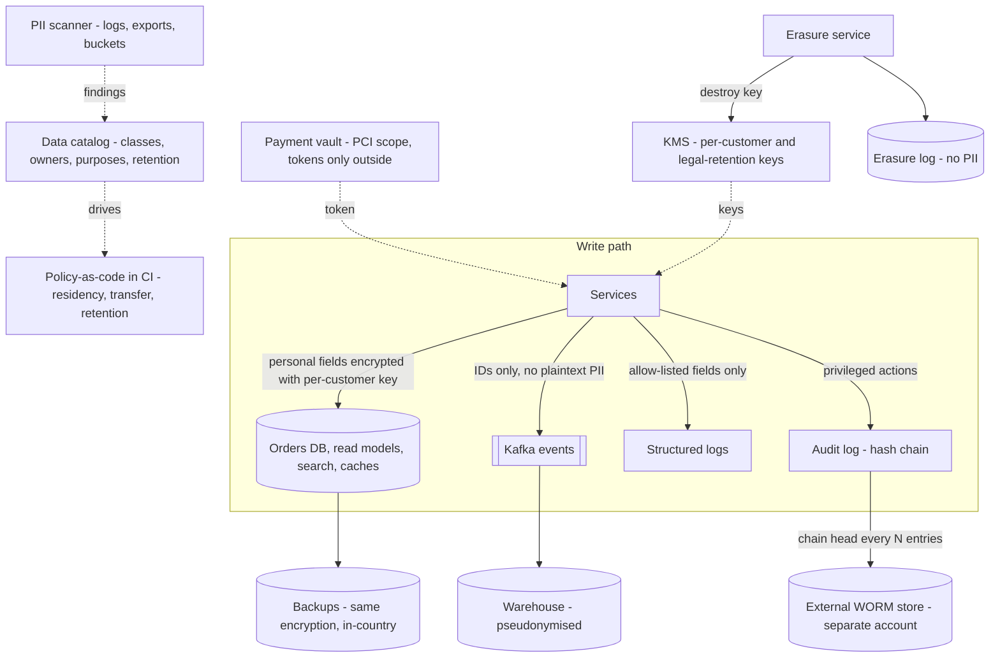
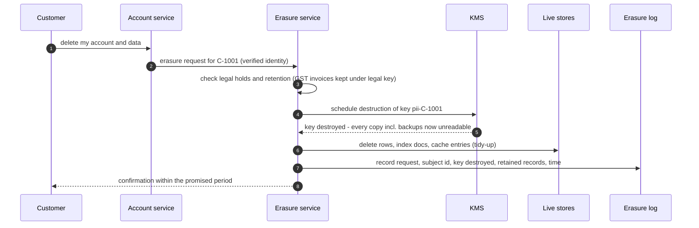
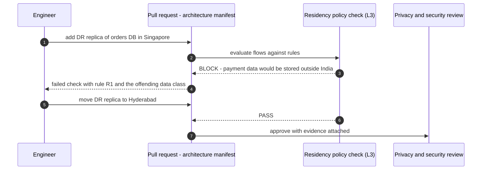
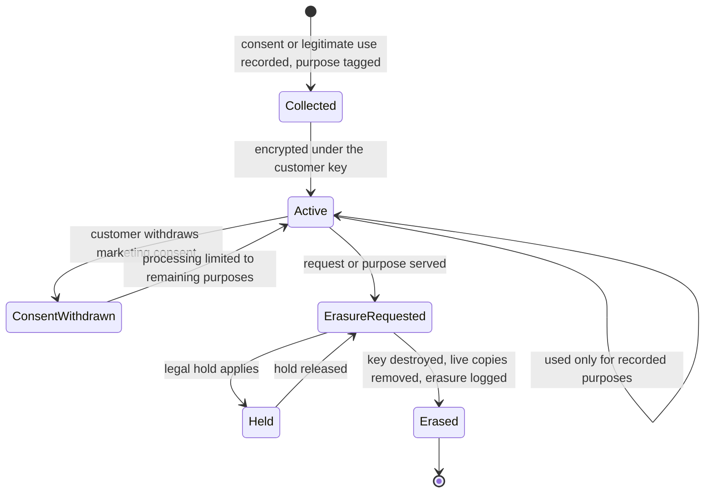

# 36. Compliance, Governance & Data Residency

!!! abstract "Chapter at a glance"
    **Reader bands:** B2 → B4 · **Prerequisites:** [Ch 21](../03-production/21-data-at-scale.md), [Ch 23](../03-production/23-security-architecture.md), [Ch 27](../03-production/27-reliability-and-disaster-recovery.md), [Ch 30](../03-production/30-multi-tenancy-and-saas-architecture.md) · **What you will build:** How regulation shapes architecture — privacy by design under India's DPDP Act (and GDPR for comparison), payment-data localisation and card tokenisation, statutory retention, audit evidence, and data governance — turned into engineering mechanisms you can test. Four runnable labs with real cryptography and hashing.

    - **L1: the right to erasure.** A customer's data lived in 6 stores plus a legally retained GST invoice. Deleting from the primary left **5 copies readable** (including the backup, with a sensitive shopping-basket inference); deleting "everywhere we remembered" left **2** (backup, warehouse); **crypto-shredding** (per-customer AES-256-GCM key destroyed) left **0**, kept the invoice under a separate legal-retention key, and left the other customer intact.
    - **L2: finding PII in logs.** On 20,000 log lines with planted synthetic identifiers, format-only regexes had **1.9%** precision for Aadhaar-format numbers and **0.9%** for card numbers; checksums (Verhoeff, Luhn + issuer prefix) raised that to 16.4% and 97.8%; key-aware scanning reached **100%** with **no loss of recall** — and redaction left **0** planted values and destroyed **0** order ids.
    - **L3: residency as policy-as-code.** 10 data flows checked against 5 rules: **5 blocked**, including a Singapore DR replica holding payment data, card numbers in logs shipped to a vendor, and clickstream reused for ad targeting without consent. A full orders-DB replica may only go to **Mumbai or Hyderabad**.
    - **L4: tamper-evident audit log.** 103,500 hash-chained events (~25k/s). The chain alone caught edits, deletes and reorders but **not a delete-and-recompute**; external write-once anchors caught that — neither caught deletion of the **3,500 entries written since the last anchor**.

    · **Reading time:** 120 min + code

!!! warning "Not legal advice"
    This chapter explains how engineers turn regulatory obligations into architecture. Laws and regulators' directions change, and their application depends on facts. Statements about specific laws reflect the author's understanding as of mid-2026 and are marked where status may have changed — **confirm every obligation with your legal and compliance teams** before relying on it.

---

## 1. Introduction & Why It Matters

### 1.1 A story: the audit that found what the architecture diagram didn't show

In its fourth year, the grocery platform prepared for three things at once: a payment-partner audit, its first formal privacy review under India's Digital Personal Data Protection Act, and due diligence from an investor. The architecture diagrams looked clean. The auditors didn't look at diagrams; they looked at data.

What they found:

1. **The DR region was in Singapore.** Chosen years earlier for latency and price, it held a full replica of the orders database — including payment transaction data that the platform's payment-data policy (and RBI's 2018 direction) required to be stored only in India (L3).
2. **Card numbers were in the logs.** A payment-adapter debug statement had logged request payloads for two weeks during an incident, and those logs had been shipped to a third-party observability vendor abroad (L2, L3).
3. **"Delete my account" didn't.** The erasure feature deleted the customer row. Their name, phone, address and order history remained in the read model, the support search index, caches, nightly backups and the analytics warehouse — for years (L1).
4. **Nobody could prove who issued refunds.** The refund audit table sat in the same database the operations team administered; several entries had been edited, and there was no way to show which (L4).
5. **Nobody knew where personal data was.** There was no inventory of which stores held which categories of personal data, for what purpose, for how long, or who could access it.

None of this was malice; each was an ordinary engineering choice made without the compliance constraint in view. The remediation took two quarters — moving the DR region, purging and re-shipping logs, retrofitting encryption for erasure, rebuilding the audit trail — and it would have cost a fraction of that if the constraints had been **architecture requirements from the start**.

!!! quote "The thesis of this chapter"
    Compliance obligations are **non-functional requirements with legal consequences**. Treat them like latency or availability: identify them early, turn each into a concrete engineering mechanism (a key hierarchy, a residency policy, a retention rule, a tamper-evident log, a scanner), make those mechanisms **testable and automated**, and keep the evidence continuously rather than assembling it for an audit. The recurring architectural moves are few: **know your data** (inventory and classification), **minimise it**, **encrypt it with keys you can destroy**, **control where it goes**, **retain it exactly as long as required**, and **prove what happened**.

### 1.2 Where this lives in the grocery platform

| Obligation (source) | Engineering mechanism | Lab |
|---|---|---|
| Erasure when the purpose is served / on request (DPDP; GDPR Art. 17) | Per-customer keys, crypto-shredding, erasure log | L1 |
| Security safeguards; data minimisation (DPDP; PCI DSS) | PII discovery + redaction in logs; structured logging allow-lists | L2 |
| Payment data stored only in India (RBI 2018 direction) | Residency policy-as-code; in-country DR | L3 |
| No storage of card numbers by merchants (RBI card-on-file tokenisation) | Network tokens; PCI vault boundary | L3, §2.5 |
| Purpose limitation and consent (DPDP) | Purpose tags on data flows; consent records | L3, §2.3 |
| Statutory retention (GST records) | Retention schedule + legal-retention keys + WORM | L1, L3 |
| Accountability, forensics (DPDP; CERT-In log retention; audits) | Hash-chained, externally anchored audit log | L4 |

### 1.3 Learning objectives

By the end you will be able to:

- **Translate regulatory obligations into architecture requirements** and mechanisms.
- **Design erasure that actually erases**, including backups and derived stores, while honouring legal retention (L1).
- **Discover and prevent personal data in the wrong places** (L2).
- **Enforce data residency and transfer rules** as policy-as-code over the architecture (L3).
- **Build tamper-evident audit trails** and know their limits (L4).
- **Set up data governance** — classification, ownership, retention, access reviews, evidence — that scales.

---

## 2. Core Concepts — Beginner to Deep

### 2.1 Intuition: compliance as non-functional requirements <span class="band b2">B2</span>

Laws rarely say "use AES-256" or "put the DR region in Hyderabad". They state outcomes: protect personal data with reasonable safeguards; process it only for the purpose it was collected; erase it when that purpose is served; keep tax records for a period; store payment data in the country; report breaches promptly. The architect's job is the translation:

| Legal outcome | Engineering requirement | Mechanism |
|---|---|---|
| "Erase when no longer needed" | Every copy of a customer's data can be made unrecoverable within N days | Crypto-shredding (L1) |
| "Reasonable security safeguards" | No plaintext personal data outside approved stores | Encryption, access control, PII scanning (L2) |
| "Store only in India" | No replica, backup or export of class X outside Indian regions | Residency policy in CI (L3) |
| "Be able to show what happened" | Tamper-evident record of privileged actions | Hash chain + external anchors (L4) |

Two principles run through everything:

- **Privacy by design and by default** — build the protection in (minimise, encrypt, restrict) rather than bolting it on; the default configuration should be the compliant one.
- **Evidence, continuously** — an obligation you can't demonstrate is, for an auditor or regulator, an obligation you didn't meet. Automate the evidence (scanner reports, policy results, verification runs) as part of normal operations.

### 2.2 The regulatory landscape for an Indian platform ⭐ <span class="band b2">B2</span>

A summary for engineers — **confirm specifics with counsel**:

- **Digital Personal Data Protection Act, 2023 (DPDP Act).** India's general personal-data law. Key concepts: *Data Principal* (the individual), *Data Fiduciary* (who decides purpose and means — the platform), *Data Processor* (acts on the fiduciary's behalf — vendors). Processing on **consent** (free, specific, informed, unconditional, unambiguous, by clear affirmative action, withdrawable as easily as given) or for specified **legitimate uses**. Obligations include notice, purpose limitation, accuracy, **reasonable security safeguards**, **breach notification** to the Data Protection Board and affected individuals, **erasure** once the purpose is served (unless retention is required by law), grievance redressal, and additional duties for **Significant Data Fiduciaries** (e.g., a Data Protection Officer, DPIAs, audits). Children's data needs verifiable parental consent and bars tracking/behavioural monitoring and targeted advertising directed at children. Cross-border transfer is permitted except to countries the government restricts by notification. Penalties are substantial (up to ₹250 crore for a failure to take reasonable security safeguards, per the Act's schedule). *The DPDP Rules, 2025 were notified in November 2025 with obligations phasing in over roughly 18 months — verify current commencement dates and the Rules' specifics, e.g. breach-reporting timelines, with counsel.*
- **RBI payment-data localisation (2018 direction on storage of payment system data, with 2019 FAQs).** Payment system operators must store the entire payment data in systems only in India; processing abroad is permitted if the data is deleted abroad and brought back within a short window (one business day/24 hours per the FAQs). It applies to payment system operators and flows through to their partners via contracts — so merchants' architectures are shaped by it.
- **RBI card-on-file tokenisation (effective October 2022).** Merchants and payment aggregators (other than card networks and issuers) may not store customers' actual card data; they use network/issuer tokens (retaining only limited data such as the last four digits for reference).
- **PCI DSS (v4.x).** The card industry's security standard for any system that stores, processes or transmits card data. The main architectural lever is **scope reduction**: hosted payment pages, tokenisation, and keeping card data inside a small, isolated vault.
- **GST record retention.** Under the CGST Act (s.36), books and records — including invoices — must be kept for **72 months** from the due date of the annual return for the year (longer if under appeal/investigation).
- **CERT-In directions (April 2022).** Report specified cyber incidents to CERT-In within **6 hours** of noticing them; maintain ICT system logs for a rolling **180 days** within Indian jurisdiction; synchronise clocks to specified NTP sources. *Verify the current directions and applicability.*
- **GDPR** (for EU residents' data, e.g., an EU-based seller or customer) — similar principles with notable differences: six lawful bases, 72-hour breach notification to the supervisory authority, transfer mechanisms (adequacy, standard contractual clauses), fines up to 4% of global turnover.
- **Assurance frameworks** — ISO/IEC 27001, SOC 2 — aren't laws, but partners and enterprise customers require them; they're the governance scaffolding that evidence hangs on.

The architectural consequences cluster into five themes: **where data is stored and flows** (residency), **how long it's kept and how it's erased** (retention/erasure), **what is collected and for what** (minimisation/purpose), **how it's protected** (security safeguards), and **what can be proven** (audit/evidence).

### 2.3 Data inventory, classification and purpose ⭐ <span class="band b2">B2</span>

Every compliance mechanism depends on knowing **what data you have, where it lives, why you have it, and how long you need it** — the §1.1 platform knew none of these.

- **Classify** data into a small number of classes with handling rules. For the grocery platform: *public* (catalog), *internal* (operational metrics), *personal* (name, phone, address, order history), *sensitive/special* (inferences from baskets — health, pregnancy, religion; children's data), *payment* (transaction data subject to localisation), *card* (PAN — never outside the vault), *legal-record* (GST invoices).
- **Inventory** (a data catalog / record of processing): for each store — which classes it holds, owner, purpose(s), legal basis, retention, location, who can access it, which processors receive it.
- **Tag at the source**: schema annotations (`@Personal`, `@Sensitive`), column tags in the catalog, and **purpose tags on data flows** (L3) so tooling can enforce rules automatically.
- **Discover what escaped**: scan logs, exports, object storage and warehouses for identifiers that shouldn't be there (L2). Discovery is how you find the gaps between the inventory and reality.

**Purpose limitation and consent**: record *why* each piece of personal data is processed, and check new uses against it. L3's clickstream flow (F4) reused personal data for ad targeting — a purpose the customer never agreed to — and was blocked; the aggregated, anonymised version (F5) passed. Consent should be recorded as data (who, what purpose, when, which notice version, withdrawn when) and checked at use, not just collected at sign-up.

### 2.4 Minimisation, pseudonymisation and encryption ⭐ <span class="band b3">B3</span>

The cheapest data to protect is data you don't have.

- **Minimise collection**: don't ask for a date of birth to deliver groceries.
- **Minimise propagation**: pass IDs, not personal data, in events and to downstream systems; give each context only the fields it needs ([Ch 33](33-domain-driven-design.md): Fulfilment gets a `DeliveryLocation`, not the customer profile).
- **Pseudonymise** for analytics: replace direct identifiers with keyed tokens (HMAC with a secret key), so analysts work without names and phone numbers. Pseudonymised data is still personal data under most laws (re-identification is possible with the key); **anonymised** aggregate data generally is not — but true anonymisation is harder than it looks (small groups, rare combinations).
- **Encrypt** at rest and in transit as a baseline ([Ch 23](../03-production/23-security-architecture.md)); **field-level encryption** with per-subject or per-tenant keys for personal fields enables crypto-shredding (L1) and limits who can read them even with database access.
- **Structured logging with allow-lists**: log known-safe fields by name; never log whole request/response bodies. This is the upstream fix for L2's findings.

### 2.5 Payment data: tokenisation and the PCI boundary <span class="band b3">B3</span>

Card data is the most regulated data most platforms touch, and the best strategy is to **not touch it**:

- **Hosted payment pages / SDKs** from the payment aggregator collect card details directly, so card numbers never reach your servers.
- **Network/issuer tokens** replace stored card numbers for repeat payments (as RBI's card-on-file rules require of merchants).
- If any component must handle card data, isolate it in a **small vault** (its own network segment, accounts, keys and admins) and keep everything else out of PCI scope. L3's rule R2 blocks any flow carrying raw card numbers; L2 finds them where they leaked.

**Payment transaction data** (amounts, parties, timestamps, references — not just card numbers) is what localisation rules address: store it in India, and design DR, analytics and vendor flows accordingly (L3). Foreign legs of processing (a card network abroad) are acceptable only when transient.

### 2.6 Data residency and cross-border transfer ⭐ <span class="band b3">B3</span>

Residency constraints turn into concrete architecture:

- **DR and replication**: a full replica of a store containing localised data must stay in-country — for the grocery platform, a **Mumbai primary with a Hyderabad DR region** rather than Singapore (L3: the only allowed regions). This also matters for cells ([Ch 34](34-modern-architecture-styles.md)) and multi-region designs ([Ch 27](../03-production/27-reliability-and-disaster-recovery.md)).
- **Backups and snapshots** are copies — they follow the same residency rules as the primary.
- **Vendors (processors)**: observability, support desks, email/SMS, analytics, fraud tools. Each is a data flow with a destination, data classes and purpose. Send them the minimum (pseudonymised IDs, no card data), under a data-processing agreement, encrypted.
- **Regional isolation for tenants/markets**: per-region clusters or cells for data that must stay in a jurisdiction ([Ch 30](../03-production/30-multi-tenancy-and-saas-architecture.md)).
- **Policy-as-code**: encode the rules and evaluate every flow in the architecture manifest in CI (L3). Architects and reviewers then argue about the rules once, and every design is checked against them automatically.

### 2.7 Retention and the right to erasure ⭐ <span class="band b3">B3</span>

Retention cuts both ways: keep data **no longer** than the purpose requires, and keep some records **at least** as long as the law requires.

- **Retention schedule**: per data class — debug logs 14 days; application logs 30–90 days hot then deleted (or longer only where required, e.g. security logs per CERT-In's 180-day direction); order history for the customer relationship plus a defined period; GST invoices 72+ months; marketing data until consent is withdrawn. Enforce with TTLs, lifecycle rules ([Ch 35](35-cost-engineering-and-finops.md)) and scheduled deletion jobs.
- **Erasure is hard because data spreads** (L1): the primary, CQRS read models, search indexes, caches, message logs (Kafka retention, compacted topics), backups, warehouses, vendor copies. Deleting from the primary left 5 readable copies; chasing copies still missed the immutable backup and the warehouse.
- **Crypto-shredding** makes erasure a single, provable action: encrypt personal fields with a per-customer key everywhere they're written (including backups and exports), and destroy the key. L1: 0 readable copies afterwards, other customers untouched. Pre-conditions: personal data is **never** written in plaintext anywhere (logs, exports, caches), keys live in a KMS with deletion controls, and derived stores (search, warehouse) index encrypted fields or pseudonymous IDs rather than plaintext.
- **Legal retention alongside erasure**: data the law requires you to keep (GST invoices) is encrypted under a separate **legal-retention key** with only the fields the law needs; it's retained, access-restricted, and deleted when the retention period ends.
- **Erasure log**: record that an erasure happened (request, subject ID, keys destroyed, what was retained and why, when) — **without** the personal data — as evidence.
- **Backups**: rotate within a bounded period, so even without crypto-shredding the data ages out; with crypto-shredding it's unreadable immediately.
- **Legal holds** (litigation, investigations) override deletion for specific subjects; the retention system must support suspending deletion with an audit trail.

### 2.8 Audit trails and evidence ⭐ <span class="band b3">B3</span>

Accountability obligations and forensics need a reliable record of **who did what to which object, when** — especially privileged actions: viewing personal data in support tools, issuing refunds, changing roles, exporting data, changing configuration.

What makes an audit trail trustworthy (L4):

1. **Completeness**: emitted from the application for every sensitive action, including by service accounts; include actor, action, target, time (synchronised clocks), source, and a correlation ID.
2. **Tamper evidence**: a **hash chain** detects edits, deletions and reorders — but an insider who controls the whole store can delete an entry and recompute every later hash (L4 case 4).
3. **External anchoring**: periodically write the chain head to a **write-once store outside the insider's control** (object storage with Object Lock/WORM in a separate account, or a public timestamping service). That defeats rewrites; the remaining gap is entries since the last anchor (L4 case 5) — shrink it by anchoring frequently or streaming each entry to the external store.
4. **Separation of duties**: the people who administer the application can't administer the audit store.
5. **Retention and access**: keep audit logs as long as required; restrict and audit access to them.
6. **Verification as a job**: verify the chain and anchors continuously and alert on failure — evidence you never check isn't evidence.

Beyond audit logs, **compliance evidence** includes access-review records, policy-check results (L3), scanner reports (L2), key-destruction records (L1), change approvals and DR test results. Automate collection so an audit is a report, not a project.

### 2.9 Breach readiness <span class="band b4">B4</span>

Breach notification obligations have short clocks (CERT-In: 6 hours for reportable incidents; DPDP: prompt notification to the Board and affected individuals, with details specified in the Rules; GDPR: 72 hours). You can't meet them without preparation:

- Know **which data is where** (inventory) so you can scope impact in hours, not weeks.
- Keep **logs and audit trails** sufficient to reconstruct access (and retained per CERT-In where applicable).
- A **runbook** with legal, security, communications and engineering roles, and pre-drafted notices.
- **Encryption and minimisation reduce impact**: a stolen backup of crypto-shredded or field-encrypted data exposes far less.
- Practise it (tabletop exercises), like DR drills ([Ch 27](../03-production/27-reliability-and-disaster-recovery.md)).

### 2.10 Data governance at scale <span class="band b4">B4</span>

Governance is how an organisation keeps these mechanisms working as teams and systems multiply:

- **Ownership**: every data store has an owning team and a data steward; every class has handling rules.
- **Catalog + lineage**: where data came from and where it flows (lineage from pipelines/CDC), so an erasure or a residency rule can be traced through derived datasets.
- **Policy-as-code** everywhere it can be: residency and transfer rules (L3), required encryption and tags at provisioning, retention defaults, allowed log fields — checked in CI and at deploy.
- **Access governance**: least privilege, just-in-time elevated access for production data with approval and audit, periodic access reviews.
- **Privacy reviews / DPIAs** for new features that process personal data in new ways — part of the design-doc process ([Ch 32](32-design-documents-and-architecture-communication.md)).
- **Metrics**: % of stores classified, % of flows passing policy, PII findings in logs per week (L2), erasure SLA, audit-verification status (L4).
- **Proportionality**: as with cost ([Ch 35](35-cost-engineering-and-finops.md)), concentrate effort where the risk is — payment data, children's data, sensitive inferences — rather than equal ceremony for every table.

---

## 3. Architecture & Diagrams

### 3.1 Component view: compliance mechanisms in the platform



### 3.2 Sequence: happy path, an erasure request



### 3.3 Sequence: failure path, a non-compliant design caught in CI



### 3.4 State: a personal record through its lifecycle



---

## 4. Design Document Excerpt: Grocery Compliance Architecture

!!! note "Design Document (excerpt) — Privacy, Residency & Audit Architecture v1.0"
    **Status:** Accepted · **Authors:** Security architecture + Data platform · **Reviewers:** Legal, Compliance, DPO, SRE, all tech leads

    | Field | Value |
    |---|---|
    | Context | Payment-partner audit, DPDP readiness review and investor due diligence found: payment data replicated to a Singapore DR region; card numbers in logs shipped abroad; erasure that deleted only the primary row; an editable refund audit table; no data inventory. |
    | Decision | Treat compliance obligations as NFRs with automated mechanisms and continuous evidence: data classification and catalog; field-level encryption with per-customer keys and crypto-shredding; in-country DR; residency and transfer policy-as-code; PII scanning and structured-logging allow-lists; card data only in a tokenised vault; hash-chained audit log with external WORM anchors. |
    | Related ADRs | ADR-220 Data classes + catalog + owners; ADR-221 Per-customer and legal-retention keys, crypto-shredding for erasure (L1); ADR-222 Structured logging allow-lists + PII scanner on logs and exports (L2); ADR-223 Residency and transfer rules as code, evaluated on every manifest change (L3); ADR-224 DR moved to Hyderabad; no localised data abroad; ADR-225 Card data only via aggregator hosted pages and network tokens; ADR-226 Audit log: hash chain + 1-minute external anchors in a separate account (L4); ADR-227 Retention schedule per data class, enforced by TTL/lifecycle |

    **Requirements.**

    - **R1 — Erasure.** A verified erasure request makes the customer's personal data unrecoverable in every store, including backups and the warehouse, within 30 days; legally retained records are kept under a separate key with minimum fields.
    - **R2 — No stray PII.** Zero card numbers and zero unapproved personal identifiers in logs and exports; findings alert the owning team within 1 hour.
    - **R3 — Residency.** Payment data and full replicas of localised stores exist only in Indian regions; every data flow passes the policy check before deploy.
    - **R4 — Purpose.** Every flow of personal data carries a purpose that matches consent or a documented legitimate use.
    - **R5 — Audit integrity.** Privileged actions are recorded in a tamper-evident log; verification runs hourly; the unanchored window is ≤ 1 minute.
    - **R6 — Evidence.** Policy results, scanner reports, key destructions and audit verifications are retained and reportable on demand.

    **Decisions in detail.**

    1. **Classification (ADR-220).** Seven classes (§2.3); schema annotations generate catalog entries; every store has an owner and retention.
    2. **Keys (ADR-221).** Envelope encryption: per-customer data keys wrapped by a KMS key; personal fields encrypted in the service before any write; search indexes store pseudonymous tokens.
    3. **Logs (ADR-222).** Logging library only emits allow-listed fields; scanner runs on the log pipeline and on exports, key-aware (L2).
    4. **Residency (ADR-223/224).** Manifest of data flows in the repo; rules in code; CI blocks violations (L3). DR region Hyderabad.
    5. **Payments (ADR-225).** Aggregator hosted checkout and network tokens; the platform never receives card numbers.
    6. **Audit (ADR-226).** Chain head anchored every minute to an Object-Lock bucket in a security-owned account; hourly verification (L4).
    7. **Retention (ADR-227).** Debug logs 14 d; app logs 90 d; security logs 180 d in India; GST invoices 72 months+; marketing data until consent withdrawn.

    **Consequences.** Encryption adds latency and complexity (key management, re-encryption on rotation, search over pseudonymous tokens); a second Indian region costs more than Singapore; engineers lose free-form logging. In return: erasure is provable, residency is enforced by construction, audit evidence is trustworthy, and audits become reports.

---

## 5. Hands-On Code — Level Ladder

!!! info "What's real here"
    All four labs are JDK 21 programs using the JDK's **real** cryptography (`javax.crypto` AES-256-GCM in L1, SHA-256 in L4) and real checksum algorithms (Verhoeff, Luhn) in L2. **All identifiers are synthetic**: Aadhaar-format numbers are randomly generated with a valid checksum, card numbers are the card networks' public test numbers, and names, phones and emails are invented. L3's rules are an illustrative engineering encoding of obligations, not legal advice. Output is deterministic except timings in L4.

### L1 — The right to erasure, across every copy <span class="band b2">B2</span>

**Requirement:** "A customer asked us to delete their data. Prove it's gone — from everywhere — while keeping the GST invoice the law requires."

Two customers' data is written to six stores (orders DB, read model, support search, cache, nightly backup, warehouse) plus a GST invoice archive. Three erasure strategies are applied to one customer, and every store is scanned for anything still readable. Encryption uses the JDK's real AES-256-GCM; the "KMS" is an in-memory key map.

```java title="ErasureL1.java"
// ErasureL1.java — run with: java ErasureL1.java   (JDK 21, no dependencies)
// THE RIGHT TO ERASURE vs WHERE DATA ACTUALLY LIVES. A customer asks the platform to delete their personal data (DPDP Act
// 2023 / GDPR Art. 17). Their data is not in one table: it's in the orders DB, a CQRS read model, the support search index,
// a cache, last night's backup, and the analytics warehouse. Three strategies:
//   A) delete from the primary database only             (what most first implementations do)
//   B) delete from every store we remembered              (but backups are immutable and the warehouse is someone else's)
//   C) CRYPTO-SHREDDING: personal fields are encrypted with a per-customer key (AES-256-GCM) at write time, in EVERY copy;
//      erasure destroys the key. Records the law requires us to KEEP (GST invoices, ~6 years) are encrypted under a separate
//      per-customer "legal-retention" key with only the minimum fields, and are kept.
// After each strategy we scan every store for the customer's personal data in readable form.
import javax.crypto.*;
import javax.crypto.spec.*;
import java.nio.charset.StandardCharsets;
import java.security.SecureRandom;
import java.util.*;

public class ErasureL1 {
    static final SecureRandom RNG = new SecureRandom();
    // ---- a toy KMS: key id -> key. Destroying a key is irreversible. ----
    static final Map<String, SecretKey> KMS = new HashMap<>();
    static SecretKey key(String id) {
        return KMS.computeIfAbsent(id, k -> { try { KeyGenerator g = KeyGenerator.getInstance("AES"); g.init(256); return g.generateKey(); }
                                                catch (Exception e) { throw new RuntimeException(e); } });
    }
    static String enc(String keyId, String plain) throws Exception {
        byte[] iv = new byte[12]; RNG.nextBytes(iv);
        Cipher c = Cipher.getInstance("AES/GCM/NoPadding"); c.init(Cipher.ENCRYPT_MODE, key(keyId), new GCMParameterSpec(128, iv));
        return "enc:" + keyId + ":" + Base64.getEncoder().encodeToString(iv) + ":" + Base64.getEncoder().encodeToString(c.doFinal(plain.getBytes(StandardCharsets.UTF_8)));
    }
    static String dec(String v) {
        if (!v.startsWith("enc:")) return v;
        String[] p = v.split(":"); SecretKey k = KMS.get(p[1]);
        if (k == null) return null;                                                  // key destroyed → unrecoverable
        try { Cipher c = Cipher.getInstance("AES/GCM/NoPadding"); c.init(Cipher.DECRYPT_MODE, k, new GCMParameterSpec(128, Base64.getDecoder().decode(p[2])));
              return new String(c.doFinal(Base64.getDecoder().decode(p[3])), StandardCharsets.UTF_8); }
        catch (Exception e) { return null; }
    }

    // ---- the six places a customer's data lives ----
    static final List<String> STORES = List.of("orders DB", "read model", "support search", "cache", "nightly backup", "warehouse");
    static Map<String, List<Map<String, String>>> world;

    static void populate(boolean encrypt, String... customers) throws Exception {
        world = new LinkedHashMap<>(); STORES.forEach(s -> world.put(s, new ArrayList<>()));
        for (String cust : customers) {
            String name = cust.equals("C-1001") ? "Priya Sharma" : "Arjun Mehta", phone = cust.equals("C-1001") ? "+91 98450 11223" : "+91 99000 44556";
            String addr = cust.equals("C-1001") ? "12 MG Road, Pune 411001" : "7 Park St, Kolkata 700016";
            String pk = "pii-" + cust, lk = "legal-" + cust;
            for (String store : STORES) {
                Map<String, String> r = new LinkedHashMap<>();
                r.put("customer", cust); r.put("store", store);
                r.put("name", encrypt ? enc(pk, name) : name);
                r.put("phone", encrypt ? enc(pk, phone) : phone);
                r.put("address", encrypt ? enc(pk, addr) : addr);
                r.put("basket", encrypt ? enc(pk, "milk, eggs, baby formula, pregnancy test") : "milk, eggs, baby formula, pregnancy test"); // sensitive inference
                world.get(store).add(r);
            }
            // the GST invoice: legally required to be retained — minimum fields, separate legal-retention key
            Map<String, String> inv = new LinkedHashMap<>();
            inv.put("customer", cust); inv.put("store", "GST invoice archive"); inv.put("invoiceNo", "INV-" + cust.substring(2));
            inv.put("name", encrypt ? enc(lk, name) : name); inv.put("address", encrypt ? enc(lk, addr) : addr); inv.put("taxablePaise", "129900");
            world.computeIfAbsent("GST invoice archive", k -> new ArrayList<>()).add(inv);
        }
    }

    // scan: which stores still expose the customer's personal data in readable form?
    static List<String> exposure(String cust) {
        List<String> exposed = new ArrayList<>();
        for (var e : world.entrySet())
            for (Map<String, String> r : e.getValue())
                if (cust.equals(r.get("customer"))) {
                    String nm = r.containsKey("name") ? dec(r.get("name")) : null;
                    if (nm != null) exposed.add(e.getKey() + (r.containsKey("basket") && dec(r.get("basket")) != null ? " (incl. basket)" : ""));
                }
        return exposed;
    }
    static void deleteFrom(String cust, List<String> stores) { for (String s : stores) world.get(s).removeIf(r -> cust.equals(r.get("customer"))); }

    public static void main(String[] args) throws Exception {
        String cust = "C-1001", other = "C-2002";
        System.out.println("Customer C-1001 asks us to erase their personal data. It lives in 6 stores (+ a GST invoice we must retain).\n");

        populate(false, cust, other);
        deleteFrom(cust, List.of("orders DB"));
        report("A) delete from the orders DB only", cust, other);

        populate(false, cust, other);
        deleteFrom(cust, List.of("orders DB", "read model", "support search", "cache"));  // backup is immutable; warehouse owned by another team
        report("B) delete from every store we remembered", cust, other);

        populate(true, cust, other);
        KMS.remove("pii-" + cust);                              // crypto-shred: destroy the personal-data key (KMS schedule-deletion)
        deleteFrom(cust, List.of("orders DB", "read model", "support search", "cache")); // tidy up live stores; not required for erasure
        report("C) crypto-shredding (per-customer key destroyed)", cust, other);

        // what the erasure log records — proof of erasure WITHOUT the personal data
        System.out.println("   Erasure log entry (kept as evidence):");
        System.out.println("        {\"request\":\"ER-2026-0931\",\"subject\":\"C-1001\",\"keyDestroyed\":\"pii-C-1001\",\"retainedUnderLaw\":[\"GST invoice INV-1001 (legal-C-1001)\"],");
        System.out.println("         \"completedAt\":\"2026-09-29T07:12:03Z\",\"stores\":6}");

        System.out.println("\n   → deleting from the primary leaves the customer readable in 5 other places — including the backup, which also keeps");
        System.out.println("     a sensitive INFERENCE (the basket) that was never a 'field' anyone thought to erase. Chasing every copy misses the");
        System.out.println("     immutable backup and the warehouse another team owns. Crypto-shredding makes erasure a single, provable action:");
        System.out.println("     every copy — backups included — was written as ciphertext under the customer's key, so destroying the key erases");
        System.out.println("     them all at once, while other customers are untouched. The GST invoice survives because the law requires it,");
        System.out.println("     under a separate purpose key with only the fields the law needs. Crypto-shredding only works if personal data is");
        System.out.println("     NEVER written in plaintext anywhere (logs, exports, caches) — enforce that at write time.");
    }

    static void report(String label, String cust, String other) {
        List<String> ex = new ArrayList<>(exposure(cust));
        boolean invoice = ex.remove("GST invoice archive");
        System.out.printf("   %-50s NOT erased (still readable): %d %s%n", label, ex.size(), ex);
        System.out.printf("   %-50s retained under legal obligation: %s%n", "", invoice ? "GST invoice (name + address only)" : "none");
        System.out.printf("   %-50s other customer C-2002 still intact: %s%n%n", "", exposure(other).size() == 7 ? "yes (7/7)" : "NO (" + exposure(other).size() + "/7)");
    }
}
```

```text title="java ErasureL1.java"
Customer C-1001 asks us to erase their personal data. It lives in 6 stores (+ a GST invoice we must retain).

   A) delete from the orders DB only                  NOT erased (still readable): 5 [read model (incl. basket), support search (incl. basket), cache (incl. basket), nightly backup (incl. basket), warehouse (incl. basket)]
                                                      retained under legal obligation: GST invoice (name + address only)
                                                      other customer C-2002 still intact: yes (7/7)

   B) delete from every store we remembered           NOT erased (still readable): 2 [nightly backup (incl. basket), warehouse (incl. basket)]
                                                      retained under legal obligation: GST invoice (name + address only)
                                                      other customer C-2002 still intact: yes (7/7)

   C) crypto-shredding (per-customer key destroyed)   NOT erased (still readable): 0 []
                                                      retained under legal obligation: GST invoice (name + address only)
                                                      other customer C-2002 still intact: yes (7/7)

   Erasure log entry (kept as evidence):
        {"request":"ER-2026-0931","subject":"C-1001","keyDestroyed":"pii-C-1001","retainedUnderLaw":["GST invoice INV-1001 (legal-C-1001)"],
         "completedAt":"2026-09-29T07:12:03Z","stores":6}

   → deleting from the primary leaves the customer readable in 5 other places — including the backup, which also keeps
     a sensitive INFERENCE (the basket) that was never a 'field' anyone thought to erase. Chasing every copy misses the
     immutable backup and the warehouse another team owns. Crypto-shredding makes erasure a single, provable action:
     every copy — backups included — was written as ciphertext under the customer's key, so destroying the key erases
     them all at once, while other customers are untouched. The GST invoice survives because the law requires it,
     under a separate purpose key with only the fields the law needs. Crypto-shredding only works if personal data is
     NEVER written in plaintext anywhere (logs, exports, caches) — enforce that at write time.
```

**Reading it:**

- **A) Primary-only delete** leaves the customer readable in **5 stores** — and every copy includes the shopping basket, a sensitive inference (pregnancy) that no one thought of as a "field" to erase.
- **B) Deleting everywhere we remembered** still leaves **2**: the nightly backup (immutable) and the warehouse (another team's system).
- **C) Crypto-shredding** leaves **0**: every copy, backups included, was ciphertext under `pii-C-1001`, so destroying that one key erased them all. The other customer is untouched (7/7). The GST invoice is retained under a separate `legal-C-1001` key with only name and address — the minimum the law needs.
- The erasure log records **that** it happened (request, subject id, key destroyed, what was retained and why) without any personal data — the evidence an auditor asks for.

```java title="VERIFY: envelope encryption with a cloud KMS (AWS SDK v2 shown; other clouds are similar)"
// Per-customer data key: generated once, stored WRAPPED next to the customer; the KMS key never leaves the KMS.
GenerateDataKeyResponse dk = kms.generateDataKey(r -> r.keyId("alias/pii-root").keySpec(DataKeySpec.AES_256));
byte[] wrappedKey = dk.ciphertextBlob().asByteArray();   // persist with the customer record
// Erasure: delete the wrapped key (and, for per-customer KMS keys, schedule key deletion) — every ciphertext becomes useless.
```

### L2 — Finding personal data in logs <span class="band b3">B3</span>

**Requirement:** "Card numbers ended up in logs shipped to a vendor. Build a scanner the team won't switch off — and a redactor that doesn't destroy debugging data."

20,000 synthetic log lines with realistic look-alikes (13-digit epoch timestamps, 12-digit order ids, hex trace ids, SKUs) and planted synthetic PII. Three scanner tiers: format-only regexes, plus identifier checksums (Verhoeff for Aadhaar-format numbers, Luhn + issuer prefix for cards, PAN entity letter), plus key-awareness (values of known non-PII keys are never candidates).

```java title="PiiScanL2.java"
// PiiScanL2.java — run with: java PiiScanL2.java   (JDK 21, no dependencies)
// FINDING PERSONAL DATA WHERE IT SHOULDN'T BE — in application logs. You can't protect, minimise or erase personal data you
// don't know you have, and logs are where it leaks (a request body logged at DEBUG, an exception message with a phone
// number). We generate 20,000 realistic log lines, plant known PII in some of them (ALL SYNTHETIC: generated checksum-valid
// Aadhaar-format numbers, public card-network TEST numbers, made-up phones/emails/PANs), and compare two scanners:
//   NAIVE     — format regexes only (12 digits = Aadhaar, 13–19 digits = card, ...)
//   VALIDATED — the same regexes plus the identifier's own rules: Verhoeff checksum for Aadhaar-format numbers, Luhn checksum
//               + issuer prefix for cards, entity-type letter for PAN
// Logs are full of look-alikes — 12-digit order ids, 13-digit epoch-millisecond timestamps — so precision matters: a scanner
// that cries wolf on every timestamp gets switched off. Then we REDACT and re-scan to prove nothing real survives.
import java.util.*;
import java.util.regex.*;

public class PiiScanL2 {
    // ---------------- Verhoeff (used by Aadhaar) ----------------
    static final int[][] D = {{0,1,2,3,4,5,6,7,8,9},{1,2,3,4,0,6,7,8,9,5},{2,3,4,0,1,7,8,9,5,6},{3,4,0,1,2,8,9,5,6,7},{4,0,1,2,3,9,5,6,7,8},
            {5,9,8,7,6,0,4,3,2,1},{6,5,9,8,7,1,0,4,3,2},{7,6,5,9,8,2,1,0,4,3},{8,7,6,5,9,3,2,1,0,4},{9,8,7,6,5,4,3,2,1,0}};
    static final int[][] P = {{0,1,2,3,4,5,6,7,8,9},{1,5,7,6,2,8,3,0,9,4},{5,8,0,3,7,9,6,1,4,2},{8,9,1,6,0,4,3,5,2,7},{9,4,5,3,1,2,6,8,7,0},
            {4,2,8,6,5,7,3,9,0,1},{2,7,9,3,8,0,6,4,1,5},{7,0,4,6,9,1,3,2,5,8}};
    static final int[] INV = {0,4,3,2,1,5,6,7,8,9};
    static boolean verhoeff(String n) { int c = 0; for (int i = 0; i < n.length(); i++) c = D[c][P[i % 8][n.charAt(n.length() - 1 - i) - '0']]; return c == 0; }
    static String withVerhoeff(String n) { int c = 0; for (int i = 0; i < n.length(); i++) c = D[c][P[(i + 1) % 8][n.charAt(n.length() - 1 - i) - '0']]; return n + INV[c]; }
    // ---------------- Luhn (payment cards) ----------------
    static boolean luhn(String n) { int s = 0; boolean alt = false; for (int i = n.length() - 1; i >= 0; i--) { int d = n.charAt(i) - '0'; if (alt) { d *= 2; if (d > 9) d -= 9; } s += d; alt = !alt; } return s % 10 == 0; }

    // ---------------- detectors ----------------
    static final Pattern AADHAAR = Pattern.compile("(?<![\\d-])[2-9]\\d{3}[ -]?\\d{4}[ -]?\\d{4}(?![\\d-])");
    static final Pattern CARD    = Pattern.compile("(?<!\\d)\\d{13,19}(?!\\d)");
    static final Pattern PAN     = Pattern.compile("\\b[A-Z]{5}\\d{4}[A-Z]\\b");
    static final Pattern PHONE   = Pattern.compile("(?<!\\d)(?:\\+91[ -]?)?[6-9]\\d{4}[ -]?\\d{5}(?!\\d)");
    static final Pattern EMAIL   = Pattern.compile("[\\w.+-]+@[\\w-]+\\.[\\w.]+");
    static final String PAN_ENTITY = "PCHFATBLJG";

    static boolean valid(String type, String m) {
        String digits = m.replaceAll("[ -]", "");
        return switch (type) {
            case "aadhaar" -> verhoeff(digits);
            case "card" -> luhn(digits) && "3456".indexOf(digits.charAt(0)) >= 0;
            case "pan" -> PAN_ENTITY.indexOf(m.charAt(3)) >= 0;
            default -> true;                                         // phones/emails: format is the check
        };
    }
    static final Map<String, Pattern> DET = new LinkedHashMap<>();
    static { DET.put("aadhaar", AADHAAR); DET.put("card", CARD); DET.put("pan", PAN); DET.put("phone", PHONE); DET.put("email", EMAIL); }

    record Line(String text, Map<String, Set<String>> truth) {}

    // key-aware: in structured (key=value) logs, values of known non-personal fields are never PII candidates
    static final Set<String> NON_PII_KEYS = Set.of("ts", "trace", "order", "latencyMs", "sku", "coupon", "svc", "level");
    static boolean inNonPiiField(String text, int start) {
        int sp = text.lastIndexOf(' ', start - 1), eq = text.indexOf('=', sp + 1);
        return eq > 0 && eq < start && NON_PII_KEYS.contains(text.substring(sp + 1, eq));
    }
    static boolean accept(int tier, String type, String text, Matcher m) {
        if (tier >= 1 && !valid(type, m.group())) return false;
        if (tier >= 2 && inNonPiiField(text, m.start())) return false;
        return true;
    }

    public static void main(String[] args) {
        Random r = new Random(17);
        String[] testCards = {"4111111111111111", "5555555555554444", "4012888888881881", "378282246310005", "6011111111111117"};
        List<Line> lines = new ArrayList<>();
        for (int i = 0; i < 20_000; i++) {
            Map<String, Set<String>> truth = new HashMap<>();
            long ts = 1_780_000_000_000L + r.nextInt(1_000_000_000);                          // 13-digit epoch millis
            String orderId = String.valueOf(200_000_000_000L + (long) (r.nextDouble() * 700_000_000_000L));  // 12-digit order id
            String base = String.format("ts=%d level=INFO svc=checkout trace=%016x order=%s latencyMs=%d", ts, r.nextLong(), orderId, 20 + r.nextInt(400));
            StringBuilder sb = new StringBuilder(base);
            if (r.nextDouble() < 0.02) { String a = withVerhoeff(String.valueOf(2 + r.nextInt(8)) + String.format("%010d", (long) (r.nextDouble() * 1e10)));
                a = a.substring(0, 4) + " " + a.substring(4, 8) + " " + a.substring(8); sb.append(" kycDoc=").append(a); truth.computeIfAbsent("aadhaar", k -> new HashSet<>()).add(a); }
            if (r.nextDouble() < 0.01) { String c = testCards[r.nextInt(testCards.length)]; sb.append(" payload={\"card\":\"").append(c).append("\"}"); truth.computeIfAbsent("card", k -> new HashSet<>()).add(c); }
            if (r.nextDouble() < 0.01) { String p = "" + (char) ('A' + r.nextInt(26)) + (char) ('A' + r.nextInt(26)) + (char) ('A' + r.nextInt(26)) + "P" + (char) ('A' + r.nextInt(26)) + String.format("%04d", r.nextInt(10000)) + (char) ('A' + r.nextInt(26));
                sb.append(" pan=").append(p); truth.computeIfAbsent("pan", k -> new HashSet<>()).add(p); }
            if (r.nextDouble() < 0.03) { String ph = "+91 " + (6 + r.nextInt(4)) + String.format("%04d %05d", r.nextInt(10000), r.nextInt(100000)); sb.append(" msg=\"OTP sent to ").append(ph).append("\""); truth.computeIfAbsent("phone", k -> new HashSet<>()).add(ph); }
            if (r.nextDouble() < 0.02) { String em = "user" + r.nextInt(99999) + "@example.in"; sb.append(" email=").append(em); truth.computeIfAbsent("email", k -> new HashSet<>()).add(em); }
            if (r.nextDouble() < 0.05) sb.append(" sku=SKU").append(100000 + r.nextInt(900000)).append(" coupon=FESTAB").append(1000 + r.nextInt(9000)).append("Z");  // look-alike noise
            lines.add(new Line(sb.toString(), truth));
        }

        System.out.println("20,000 synthetic log lines with planted (synthetic) PII among order ids, epoch timestamps, trace ids and SKUs.\n");
        String[] tiers = {"naive (format only)", "validated (checksums)", "validated + key-aware"};
        System.out.printf("   %-9s %8s | %-22s %-22s %-22s%n", "detector", "planted", "naive: hits / precision", "validated", "validated + key-aware");
        for (var d : DET.entrySet()) {
            int planted = 0; int[] hits = new int[3], tp = new int[3];
            for (Line l : lines) {
                Set<String> t = l.truth().getOrDefault(d.getKey(), Set.of()); planted += t.size();
                Matcher m = d.getValue().matcher(l.text());
                while (m.find()) for (int tier = 0; tier < 3; tier++)
                    if (accept(tier, d.getKey(), l.text(), m)) { hits[tier]++; if (t.contains(m.group())) tp[tier]++; }
            }
            StringBuilder row = new StringBuilder(String.format("   %-9s %8d |", d.getKey(), planted));
            for (int tier = 0; tier < 3; tier++)
                row.append(String.format(" %6d / %5.1f%% r%3.0f%%  ", hits[tier], hits[tier] == 0 ? 100.0 : 100.0 * tp[tier] / hits[tier], planted == 0 ? 100.0 : 100.0 * tp[tier] / planted));
            System.out.println(row);
        }
        System.out.println("   (hits / precision, r = recall)");

        // redaction with the validated scanner, then re-scan for any planted value
        int residual = 0, redactedLines = 0, orderIdsDestroyed = 0; String sample = null, sampleRedacted = null;
        for (Line l : lines) {
            String out = l.text();
            for (var d : DET.entrySet()) {
                Matcher m = d.getValue().matcher(out); StringBuilder sb = new StringBuilder();
                String cur = out;
                while (m.find()) m.appendReplacement(sb, accept(2, d.getKey(), cur, m) ? "[" + d.getKey().toUpperCase() + "]" : Matcher.quoteReplacement(m.group()));
                m.appendTail(sb); out = sb.toString();
            }
            for (String key : List.of("order=", "ts=")) { if (l.text().contains(key) && !out.contains(key + l.text().split(key)[1].split(" ")[0])) orderIdsDestroyed++; }
            if (!out.equals(l.text())) { redactedLines++; if (sample == null && l.truth().size() >= 2) { sample = l.text(); sampleRedacted = out; } }
            for (Set<String> vals : l.truth().values()) for (String v : vals) if (out.contains(v)) residual++;
        }
        System.out.printf("%n   Redaction (validated + key-aware): %,d lines changed; planted PII still present: %d; order ids/timestamps destroyed: %d%n",
                redactedLines, residual, orderIdsDestroyed);
        System.out.println("   before: " + sample);
        System.out.println("   after:  " + sampleRedacted);

        System.out.println("\n   → format-only regexes drown in look-alikes: 13-digit epoch timestamps look like card numbers and 12-digit order ids");
        System.out.println("     look like Aadhaar numbers, so the naive scanner's alerts are almost all noise and get ignored. Checksums remove most");
        System.out.println("     of it — Luhn + issuer prefix makes the card detector nearly exact — but a checksum passes random digits ~10% of the");
        System.out.println("     time, so thousands of order ids still 'pass' Verhoeff, and redacting them would destroy the ids engineers need.");
        System.out.println("     Knowing the STRUCTURE of the log (which keys can never hold personal data) closes the gap. That's also the real fix:");
        System.out.println("     structured logging with field allow-lists, so personal data is never written — scanning is the safety net.");
    }
}
```

```text title="java PiiScanL2.java"
20,000 synthetic log lines with planted (synthetic) PII among order ids, epoch timestamps, trace ids and SKUs.

   detector   planted | naive: hits / precision validated              validated + key-aware 
   aadhaar        394 |  20466 /   1.9% r100%     2404 /  16.4% r100%      394 / 100.0% r100%  
   card           182 |  20279 /   0.9% r100%      186 /  97.8% r100%      182 / 100.0% r100%  
   pan            181 |    181 / 100.0% r100%      181 / 100.0% r100%      181 / 100.0% r100%  
   phone          620 |    716 /  86.6% r100%      716 /  86.6% r100%      620 / 100.0% r100%  
   email          412 |    412 / 100.0% r100%      412 / 100.0% r100%      412 / 100.0% r100%  
   (hits / precision, r = recall)

   Redaction (validated + key-aware): 1,728 lines changed; planted PII still present: 0; order ids/timestamps destroyed: 0
   before: ts=1780087243523 level=INFO svc=checkout trace=fe35230c89d04d65 order=839552981919 latencyMs=184 kycDoc=4355 7339 6128 msg="OTP sent to +91 95081 16159"
   after:  ts=1780087243523 level=INFO svc=checkout trace=fe35230c89d04d65 order=839552981919 latencyMs=184 kycDoc=[AADHAAR] msg="OTP sent to [PHONE]"

   → format-only regexes drown in look-alikes: 13-digit epoch timestamps look like card numbers and 12-digit order ids
     look like Aadhaar numbers, so the naive scanner's alerts are almost all noise and get ignored. Checksums remove most
     of it — Luhn + issuer prefix makes the card detector nearly exact — but a checksum passes random digits ~10% of the
     time, so thousands of order ids still 'pass' Verhoeff, and redacting them would destroy the ids engineers need.
     Knowing the STRUCTURE of the log (which keys can never hold personal data) closes the gap. That's also the real fix:
     structured logging with field allow-lists, so personal data is never written — scanning is the safety net.
```

**Reading it:**

- **Format-only is useless for numeric identifiers**: 1.9% precision for Aadhaar-format numbers and 0.9% for cards — timestamps and order ids dominate. Alerts like that get ignored.
- **Checksums help a lot but not completely**: Luhn + issuer prefix makes the card detector 97.8% precise; Verhoeff only reaches 16.4%, because ~10% of random 12-digit order ids pass a checksum by chance. Redacting those would destroy the order ids engineers need.
- **Structure closes the gap**: excluding values of known non-PII keys (`order=`, `ts=`, `trace=`) reaches 100% precision with 100% recall on every detector, and the redaction pass removes every planted value while destroying **0** order ids or timestamps. That 100% is partly by construction — the synthetic logs use known keys — which is exactly the argument for structured logging: when logs have structure, scanning becomes precise.
- The upstream fix is still the one that matters: log allow-listed fields only, so personal data isn't written in the first place.

### L3 — Residency and transfer rules as policy-as-code <span class="band b3">B3</span>

**Requirement:** "Before any design ships, check every data flow — replicas, exports, vendors — against our residency, card-data, purpose and retention rules."

Ten flows from the architecture manifest, each with data classes, destination region, purpose and safeguards, are evaluated against five rules. The rules are an illustrative engineering encoding of obligations the platform has identified — not legal advice.

```java title="ResidencyL3.java"
// ResidencyL3.java — run with: java ResidencyL3.java   (JDK 21, no dependencies)
// DATA RESIDENCY AND TRANSFER RULES AS POLICY-AS-CODE. Architects draw data flows — DR replicas, analytics exports, log
// shipping, vendor integrations — and each one moves some CLASSES of data to some PLACE for some PURPOSE. Whether that's
// allowed is decided by rules. Here the platform's rules are encoded as data and every flow in the architecture manifest is
// evaluated in CI, so a design that replicates payment data abroad fails review before anyone builds it.
// The rules below are THIS PLATFORM'S ENCODING of obligations it has identified (modelled on RBI's 2018 payment-data
// storage direction, RBI card-on-file tokenisation, the DPDP Act 2023's purpose/consent model, and GST record retention).
// They are illustrative engineering policy, NOT legal advice; real rules come from counsel and change over time.
import java.util.*;

public class ResidencyL3 {
    enum Region { IN_MUMBAI, IN_HYDERABAD, SG, US, EU }
    static boolean india(Region r) { return r == Region.IN_MUMBAI || r == Region.IN_HYDERABAD; }

    record Flow(String id, String description, Set<String> dataClasses, Region destination, String purpose, Set<String> safeguards) {}
    record Finding(String flow, String rule, String detail) {}

    // consented / legitimate purposes per data class (DPDP: process only for the purpose consented or a legitimate use)
    static final Map<String, Set<String>> PURPOSES = Map.of(
        "personal", Set.of("order-fulfilment", "customer-support", "fraud-prevention", "legal-compliance", "dr"),
        "payment", Set.of("order-fulfilment", "fraud-prevention", "legal-compliance", "dr"),
        "behavioural", Set.of("order-fulfilment", "recommendations-with-consent", "dr"));

    static List<Finding> evaluate(Flow f) {
        List<Finding> out = new ArrayList<>();
        Set<String> c = f.dataClasses(); Set<String> s = f.safeguards();
        // R1 payment data: stored only in India; processing abroad allowed only if deleted there within one business day
        if (c.contains("payment") && !india(f.destination())) {
            boolean transientProcessing = s.contains("processing-only") && s.contains("deleted-abroad-within-24h");
            if (!transientProcessing) out.add(new Finding(f.id(), "R1 payment-data localisation", "payment data would be STORED in " + f.destination()));
        }
        // R2 card numbers: never outside the tokenisation vault (PCI scope); merchants keep tokens, not card numbers
        if (c.contains("card-number")) out.add(new Finding(f.id(), "R2 card data", "raw card numbers leave the PCI vault — use network tokens"));
        // R3 purpose limitation: every personal data class must have the flow's purpose among its allowed purposes
        for (String cls : new TreeSet<>(c)) if (PURPOSES.containsKey(cls) && !PURPOSES.get(cls).contains(f.purpose()) && !s.contains("anonymised"))
            out.add(new Finding(f.id(), "R3 purpose limitation", "'" + cls + "' data used for '" + f.purpose() + "' without a matching purpose/consent"));
        // R4 cross-border personal data: allowed unless the destination is on a government-restricted list; require encryption in transit+rest
        Set<Region> restricted = Set.of();                     // placeholder: DPDP s.16 lets the government notify restricted countries
        if ((c.contains("personal") || c.contains("behavioural")) && !india(f.destination()) && !s.contains("anonymised")) {
            if (restricted.contains(f.destination())) out.add(new Finding(f.id(), "R4 restricted destination", f.destination() + " is restricted"));
            if (!s.contains("encrypted")) out.add(new Finding(f.id(), "R4 cross-border safeguards", "personal data to " + f.destination() + " without encryption"));
            if (!s.contains("dpa")) out.add(new Finding(f.id(), "R4 cross-border safeguards", "no data-processing agreement with the recipient"));
        }
        // R5 GST records: the invoice archive must keep 72 months after the annual-return due date; flows may not shorten it
        if (c.contains("gst-invoice") && s.stream().anyMatch(x -> x.startsWith("retention-")) && !s.contains("retention-72m+"))
            out.add(new Finding(f.id(), "R5 GST retention", "retention shorter than the statutory period"));
        return out;
    }

    public static void main(String[] args) {
        List<Flow> manifest = List.of(
            new Flow("F1", "orders DB → DR replica (Hyderabad)", Set.of("personal", "payment", "gst-invoice"), Region.IN_HYDERABAD, "dr", Set.of("encrypted", "retention-72m+")),
            new Flow("F2", "orders DB → DR replica (Singapore)", Set.of("personal", "payment"), Region.SG, "dr", Set.of("encrypted", "dpa")),
            new Flow("F3", "payment auth → card network (abroad leg)", Set.of("payment"), Region.US, "order-fulfilment", Set.of("processing-only", "deleted-abroad-within-24h", "encrypted", "dpa")),
            new Flow("F4", "clickstream → US marketing SaaS", Set.of("personal", "behavioural"), Region.US, "ad-targeting", Set.of("encrypted", "dpa")),
            new Flow("F5", "clickstream → US marketing SaaS (aggregated)", Set.of("behavioural"), Region.US, "ad-targeting", Set.of("anonymised")),
            new Flow("F6", "app logs → EU observability vendor", Set.of("personal", "card-number"), Region.EU, "customer-support", Set.of("encrypted", "dpa")),
            new Flow("F7", "support tickets → SG helpdesk vendor", Set.of("personal"), Region.SG, "customer-support", Set.of("encrypted", "dpa")),
            new Flow("F8", "fraud signals → US fraud vendor", Set.of("personal", "payment"), Region.US, "fraud-prevention", Set.of("encrypted", "dpa")),
            new Flow("F9", "invoice archive → cold storage", Set.of("gst-invoice", "personal"), Region.IN_MUMBAI, "legal-compliance", Set.of("encrypted", "retention-36m")),
            new Flow("F10", "recommendations model training", Set.of("behavioural"), Region.IN_MUMBAI, "recommendations-with-consent", Set.of("encrypted")));

        System.out.printf("Evaluating %d data flows from the architecture manifest against %d residency/transfer rules.%n%n", manifest.size(), 5);
        int blocked = 0;
        for (Flow f : manifest) {
            List<Finding> fs = evaluate(f);
            System.out.printf("   %-4s %-46s → %-12s %s%n", f.id(), f.description(), f.destination(), fs.isEmpty() ? "PASS" : "BLOCK");
            for (Finding x : fs) System.out.printf("          ✗ %-28s %s%n", x.rule(), x.detail());
            if (!fs.isEmpty()) blocked++;
        }
        System.out.printf("%n   %d of %d flows blocked.%n", blocked, manifest.size());

        // consequence for DR design: where can a full orders-DB replica go?
        System.out.print("   Allowed regions for a full orders-DB DR replica: ");
        List<String> ok = new ArrayList<>();
        for (Region r : Region.values())
            if (evaluate(new Flow("DR", "", Set.of("personal", "payment", "gst-invoice"), r, "dr", Set.of("encrypted", "dpa", "retention-72m+"))).isEmpty()) ok.add(r.name());
        System.out.println(ok);

        System.out.println("\n   → the dangerous flows are ordinary engineering decisions: a DR replica in Singapore (F2) is 'just' a failover region,");
        System.out.println("     but it stores payment data outside India; debug logs shipped to an observability vendor (F6) carry card numbers");
        System.out.println("     (L2 finds them); a clickstream export (F4) reuses personal data for ad targeting the customer never agreed to — the");
        System.out.println("     aggregated version (F5) of the same export passes. A payment network's foreign leg (F3) passes only because it");
        System.out.println("     processes transiently and deletes within a day. Encoding the rules and running them over every manifest change");
        System.out.println("     turns compliance from a yearly audit surprise into a failed build, and makes the DR decision explicit: full-copy");
        System.out.println("     replicas stay in Indian regions; anything abroad must be transient, anonymised, or have payment data removed.");
    }
}
```

```text title="java ResidencyL3.java"
Evaluating 10 data flows from the architecture manifest against 5 residency/transfer rules.

   F1   orders DB → DR replica (Hyderabad)             → IN_HYDERABAD PASS
   F2   orders DB → DR replica (Singapore)             → SG           BLOCK
          ✗ R1 payment-data localisation payment data would be STORED in SG
   F3   payment auth → card network (abroad leg)       → US           PASS
   F4   clickstream → US marketing SaaS                → US           BLOCK
          ✗ R3 purpose limitation        'behavioural' data used for 'ad-targeting' without a matching purpose/consent
          ✗ R3 purpose limitation        'personal' data used for 'ad-targeting' without a matching purpose/consent
   F5   clickstream → US marketing SaaS (aggregated)   → US           PASS
   F6   app logs → EU observability vendor             → EU           BLOCK
          ✗ R2 card data                 raw card numbers leave the PCI vault — use network tokens
   F7   support tickets → SG helpdesk vendor           → SG           PASS
   F8   fraud signals → US fraud vendor                → US           BLOCK
          ✗ R1 payment-data localisation payment data would be STORED in US
   F9   invoice archive → cold storage                 → IN_MUMBAI    BLOCK
          ✗ R5 GST retention             retention shorter than the statutory period
   F10  recommendations model training                 → IN_MUMBAI    PASS

   5 of 10 flows blocked.
   Allowed regions for a full orders-DB DR replica: [IN_MUMBAI, IN_HYDERABAD]

   → the dangerous flows are ordinary engineering decisions: a DR replica in Singapore (F2) is 'just' a failover region,
     but it stores payment data outside India; debug logs shipped to an observability vendor (F6) carry card numbers
     (L2 finds them); a clickstream export (F4) reuses personal data for ad targeting the customer never agreed to — the
     aggregated version (F5) of the same export passes. A payment network's foreign leg (F3) passes only because it
     processes transiently and deletes within a day. Encoding the rules and running them over every manifest change
     turns compliance from a yearly audit surprise into a failed build, and makes the DR decision explicit: full-copy
     replicas stay in Indian regions; anything abroad must be transient, anonymised, or have payment data removed.
```

**Reading it:**

- **F2** — a DR replica in Singapore — is blocked: it would *store* payment data outside India. **F1**, the Hyderabad replica with the same data, passes; the engine computes that a full orders replica may only go to Mumbai or Hyderabad.
- **F3** — the card network's foreign leg — passes only because it is processing-only with deletion abroad within a day. **F8**, a fraud vendor that would *store* payment data in the US, is blocked; sending it tokenised or pseudonymised signals would change that.
- **F6** — logs to an EU observability vendor — is blocked because they carry card numbers (what L2 finds).
- **F4** reuses personal and behavioural data for ad targeting without a matching purpose — blocked; **F5**, the aggregated/anonymised version of the same export, passes.
- **F9** would archive invoices with a 36-month retention, shorter than the statutory period — blocked.
- In production this runs as OPA/Rego (or similar) over the service manifests and Terraform plans in CI, with data classes drawn from the catalog.

### L4 — A tamper-evident audit log <span class="band b4">B4</span>

**Requirement:** "Refund records were edited and we can't tell which. Build an audit trail an insider with database access can't silently rewrite."

103,500 audit events are appended to a SHA-256 hash chain; every 10,000th chain head is anchored to an external write-once store. Then an insider tries to hide a specific refund five ways, and verification runs with and without the anchors.

```java title="AuditLogL4.java"
// AuditLogL4.java — run with: java AuditLogL4.java   (JDK 21, no dependencies)
// A TAMPER-EVIDENT AUDIT LOG. Regulators, auditors and incident responders need to trust "who did what to which record
// when" — refunds issued, PII viewed, roles granted. An audit table in the same database the admins control proves nothing:
// anyone with write access can edit it. Two layers of evidence:
//   1. HASH CHAIN — each entry stores SHA-256(previous hash || entry). Editing, deleting or reordering any entry breaks
//      every hash after it.
//   2. ANCHORED CHECKPOINTS — every 10,000 entries, (sequence number, chain hash) is written to an EXTERNAL write-once store
//      (object storage with Object Lock/WORM, another team's account, or a public timestamping service). Someone who
//      controls the log's database can't change what was already anchored elsewhere.
// We append 100,000 events, then apply the manipulations an insider with database access could make, and verify.
import java.nio.charset.StandardCharsets;
import java.security.MessageDigest;
import java.util.*;

public class AuditLogL4 {
    record Entry(long seq, String at, String actor, String action, String target, String detail, String prevHash, String hash) {}
    static final int ANCHOR_EVERY = 10_000, TOTAL = 103_500;             // 3,500 entries written since the last anchor

    static String sha(String s) throws Exception {
        byte[] h = MessageDigest.getInstance("SHA-256").digest(s.getBytes(StandardCharsets.UTF_8));
        StringBuilder b = new StringBuilder(); for (byte x : h) b.append(String.format("%02x", x)); return b.toString();
    }
    static String body(long seq, String at, String actor, String action, String target, String detail) {
        return seq + "|" + at + "|" + actor + "|" + action + "|" + target + "|" + detail;
    }
    static Entry make(long seq, String prev, String at, String actor, String action, String target, String detail) throws Exception {
        return new Entry(seq, at, actor, action, target, detail, prev, sha(prev + "|" + body(seq, at, actor, action, target, detail)));
    }

    // verify: recompute the chain; compare with external anchors. Returns a list of problems found.
    static List<String> verify(List<Entry> log, Map<Long, String> anchors, boolean useAnchors) throws Exception {
        List<String> problems = new ArrayList<>();
        String prev = "GENESIS"; long expectSeq = 1;
        for (Entry e : log) {
            if (e.seq() != expectSeq) { problems.add("sequence gap/reorder at position " + expectSeq + " (found seq " + e.seq() + ")"); break; }
            if (!e.prevHash().equals(prev)) { problems.add("broken link at seq " + e.seq()); break; }
            String h = sha(prev + "|" + body(e.seq(), e.at(), e.actor(), e.action(), e.target(), e.detail()));
            if (!h.equals(e.hash())) { problems.add("entry " + e.seq() + " content does not match its hash"); break; }
            prev = e.hash(); expectSeq++;
        }
        if (useAnchors) {
            Map<Long, String> bySeq = new HashMap<>(); for (Entry e : log) bySeq.put(e.seq(), e.hash());
            for (var a : new TreeMap<>(anchors).entrySet()) {
                String h = bySeq.get(a.getKey());
                if (h == null) { problems.add("anchored entry " + a.getKey() + " is missing (log truncated or rewritten)"); break; }
                if (!h.equals(a.getValue())) { problems.add("chain hash at anchored seq " + a.getKey() + " differs from the external anchor"); break; }
            }
        }
        return problems;
    }

    public static void main(String[] args) throws Exception {
        String[] actors = {"agent.ravi", "agent.meena", "ops.kiran", "admin.suresh", "svc.refunds"};
        String[] actions = {"VIEW_PII", "ISSUE_REFUND", "EDIT_ADDRESS", "GRANT_ROLE", "EXPORT_ORDERS"};
        Random r = new Random(9);
        List<Entry> log = new ArrayList<>(); Map<Long, String> anchors = new HashMap<>();
        String prev = "GENESIS"; long t0 = System.nanoTime();
        for (long seq = 1; seq <= TOTAL; seq++) {
            int a = r.nextInt(actions.length);
            String detail = actions[a].equals("ISSUE_REFUND") ? "amountPaise=" + (500 + r.nextInt(50_000)) : actions[a].equals("GRANT_ROLE") ? "role=support-l1" : "-";
            Entry e = make(seq, prev, String.format("2026-09-%02dT%02d:%02d:%02dZ", 1 + (int) (seq / 4000), r.nextInt(24), r.nextInt(60), r.nextInt(60)),
                    actors[r.nextInt(actors.length)], actions[a], "ORD" + (50_000_000 + r.nextInt(900_000)), detail);
            log.add(e); prev = e.hash();
            if (seq % ANCHOR_EVERY == 0) anchors.put(seq, e.hash());               // written to external WORM storage
        }
        double appendMs = (System.nanoTime() - t0) / 1e6;
        long v0 = System.nanoTime(); List<String> clean = verify(log, anchors, true); double verifyMs = (System.nanoTime() - v0) / 1e6;
        System.out.printf("Appended %,d audit events in %.0f ms (%,.0f/s); full verification in %.0f ms. %d external anchors (last at seq 100,000).%n",
                TOTAL, appendMs, TOTAL / (appendMs / 1000), verifyMs, anchors.size());
        System.out.println("Clean log: " + (clean.isEmpty() ? "VERIFIED" : clean) + "\n");

        // an insider with write access to the audit table tries to hide refund fraud at seq 42,137
        int target = 42_000; while (!log.get(target).action().equals("ISSUE_REFUND")) target++;      // first refund after seq 42,000
        System.out.printf("   Insider cover-up of entry %,d (%s by %s, %s):%n%n", log.get(target).seq(), log.get(target).action(), log.get(target).actor(), log.get(target).detail());
        System.out.printf("   %-58s %-22s %s%n", "manipulation", "hash chain alone", "chain + external anchors");

        List<Entry> m1 = new ArrayList<>(log); Entry o = m1.get(target);
        m1.set(target, new Entry(o.seq(), o.at(), "svc.refunds", o.action(), o.target(), o.detail(), o.prevHash(), o.hash()));
        row("1. change the actor on the entry", m1, anchors);

        List<Entry> m2 = new ArrayList<>(log); m2.remove(target);
        row("2. delete the entry", m2, anchors);

        List<Entry> m3 = new ArrayList<>(log); Collections.swap(m3, target, target + 1);
        row("3. swap it with the next entry (reorder)", m3, anchors);

        List<Entry> m4 = rewrite(new ArrayList<>(log.subList(0, target)), log.subList(target + 1, log.size()));
        row("4. delete it AND recompute every later hash", m4, anchors);

        List<Entry> m5 = new ArrayList<>(log.subList(0, 100_000));
        row("5. delete the 3,500 entries written since the last anchor", m5, anchors);

        System.out.println("\n   → the hash chain alone catches the clumsy edits (1–3): any change breaks every later hash. But an insider who controls");
        System.out.println("     the whole table can delete the entry and recompute the rest of the chain (4) — internally consistent, undetectable");
        System.out.println("     from inside. External anchors defeat that: the chain hash at seq 50,000 no longer matches what was written to");
        System.out.println("     write-once storage outside the insider's control. Neither catches (5), removing entries written since the last");
        System.out.println("     anchor: anchor often (or stream every entry to the external store) so that window is seconds, not hours. Keep the");
        System.out.println("     anchor store in a separate account with separate admins, and alert on any verification failure.");
    }

    static List<Entry> rewrite(List<Entry> head, List<Entry> tail) throws Exception {
        String prev = head.get(head.size() - 1).hash(); long seq = head.get(head.size() - 1).seq() + 1;
        for (Entry e : tail) { Entry n = make(seq++, prev, e.at(), e.actor(), e.action(), e.target(), e.detail()); head.add(n); prev = n.hash(); }
        return head;
    }
    static void row(String label, List<Entry> log, Map<Long, String> anchors) throws Exception {
        List<String> a = verify(log, anchors, false), b = verify(log, anchors, true);
        System.out.printf("   %-58s %-22s %s%n", label, a.isEmpty() ? "NOT detected" : "DETECTED", b.isEmpty() ? "NOT detected" : "DETECTED — " + b.get(b.size() - 1));
    }
}
```

```text title="java AuditLogL4.java"
Appended 103,500 audit events in 4091 ms (25,297/s); full verification in 2166 ms. 10 external anchors (last at seq 100,000).
Clean log: VERIFIED

   Insider cover-up of entry 42,008 (ISSUE_REFUND by ops.kiran, amountPaise=40476):

   manipulation                                               hash chain alone       chain + external anchors
   1. change the actor on the entry                           DETECTED               DETECTED — entry 42008 content does not match its hash
   2. delete the entry                                        DETECTED               DETECTED — sequence gap/reorder at position 42008 (found seq 42009)
   3. swap it with the next entry (reorder)                   DETECTED               DETECTED — sequence gap/reorder at position 42008 (found seq 42009)
   4. delete it AND recompute every later hash                NOT detected           DETECTED — chain hash at anchored seq 50000 differs from the external anchor
   5. delete the 3,500 entries written since the last anchor  NOT detected           NOT detected

   → the hash chain alone catches the clumsy edits (1–3): any change breaks every later hash. But an insider who controls
     the whole table can delete the entry and recompute the rest of the chain (4) — internally consistent, undetectable
     from inside. External anchors defeat that: the chain hash at seq 50,000 no longer matches what was written to
     write-once storage outside the insider's control. Neither catches (5), removing entries written since the last
     anchor: anchor often (or stream every entry to the external store) so that window is seconds, not hours. Keep the
     anchor store in a separate account with separate admins, and alert on any verification failure.
```

**Reading it:**

- **Edits, deletions and reorders (1–3)** break the chain and are caught by the chain alone.
- **Delete-and-recompute (4)** produces an internally consistent chain — invisible to the chain alone. The external anchor at sequence 50,000 exposes it: the recomputed chain no longer matches what was written outside the insider's reach.
- **Deleting entries written since the last anchor (5)** is caught by **neither** — the unanchored window is the residual risk. Anchor frequently (e.g., every minute) or stream every entry to the external store, and keep that store in a separate account with separate administrators.
- Throughput here is ~25k entries/s single-threaded (with simple hex formatting); shard chains per service or partition and anchor a combined root for higher volumes.


---

## 6. Production Concerns

### 6.1 Failure modes

| Failure | Symptom | Mitigation |
|---|---|---|
| Erasure misses copies | Data survives in read models, backups, warehouse (L1) | Crypto-shredding; no plaintext PII anywhere |
| Plaintext PII leaks around encryption | Logs, exports, caches written in clear | Structured logging allow-lists; scanners on every sink (L2) |
| Key loss or premature destruction | Unrecoverable data for active customers | KMS with deletion windows, two-person approval for bulk destruction, backups of wrapped keys |
| Residency violation via "infrastructure" | DR, backups, vendors abroad (L3) | Flows in a manifest; policy-as-code in CI |
| Purpose creep | Data reused for new purposes without consent | Purpose tags on flows; privacy review in design docs |
| Editable audit trail | Evidence can't be trusted (L4) | Hash chain + external anchors + separation of duties |
| Over-retention | Old data kept "just in case" | Retention schedule enforced by TTL/lifecycle |
| Under-retention | Statutory records deleted | Legal-retention class, WORM storage, legal holds |
| Slow breach response | Can't scope impact within hours | Inventory, logs, runbook, drills |

### 6.2 Observability

- Dashboards for **compliance signals**: PII findings per day by source (L2), policy-check failures (L3), erasure requests and SLA, audit-verification status and unanchored window (L4), key destructions.
- **Access logs for personal data** (support tool views, exports) feed the audit log and anomaly detection (an agent viewing hundreds of customer profiles).
- Be careful that observability itself doesn't become a PII store — the logs, traces and dashboards are data sinks too ([Ch 24](../03-production/24-observability.md)).

### 6.3 Security

- Compliance and security overlap but aren't the same: you can be compliant and breached, or secure and non-compliant (keeping data too long). Design for both ([Ch 23](../03-production/23-security-architecture.md)).
- **KMS as crown jewels**: key-destruction and key-use permissions are the most sensitive in the system; separate duties and audit every use.
- **Separate accounts** for audit anchors, backups and the payment vault limit what one compromised admin can alter.
- Treat vendors as part of the attack surface: minimise what they receive, contract for security and breach notification, review regularly.

### 6.4 Performance trade-offs

- Field-level encryption adds CPU and latency per field and prevents database-side search on encrypted columns — use blind indexes (HMAC tokens) for equality lookups and pseudonymous IDs in search.
- Hash-chaining serialises audit writes per chain; shard chains by partition (per service or per time window) and anchor each (L4: ~25k entries/s single-threaded with naive hex formatting).
- Scanning every log line costs CPU; scan at the pipeline with sampling for high-volume, low-risk streams and fully for high-risk sinks (exports, vendor-bound logs).

### 6.5 Cost

- An in-country DR region may cost more than a cheaper foreign one; residency is a constraint, not an option to optimise away.
- Encryption and KMS calls add cost at scale — cache data keys (envelope encryption) rather than calling the KMS per field.
- The cost of non-compliance — penalties, remediation projects (§1.1's two quarters), lost partners — dwarfs the mechanisms, but apply them proportionately to risk ([Ch 35](35-cost-engineering-and-finops.md)).

---

## 7. Anti-Patterns & Pitfalls

!!! danger "1. Compliance as a pre-audit project"
    Evidence assembled once a year is stale and incomplete. Build mechanisms and collect evidence continuously.

!!! danger "2. Erasure = DELETE FROM customers"
    Leaves read models, indexes, caches, backups and warehouses readable (L1). Design erasure across every copy.

!!! danger "3. Crypto-shredding with plaintext side-channels"
    Encrypting the database while logs, exports and caches hold plaintext makes the key destruction meaningless. No plaintext PII anywhere.

!!! danger "4. Logging request bodies"
    The most common way card numbers and personal data leak (§1.1, L2). Log allow-listed fields only.

!!! danger "5. Format-only PII scanning"
    Alerts drown in look-alikes (L2: 1.9% precision) and get ignored. Validate candidates and use structure.

!!! danger "6. DR region chosen for price and latency alone"
    Replicas and backups are copies subject to residency rules (L3). Check the rules before the region.

!!! danger "7. Vendors as an afterthought"
    Every observability, support and analytics tool is a cross-border data flow with a purpose. Minimise, contract, record.

!!! danger "8. Consent collected but never checked"
    A checkbox at sign-up that no data flow ever consults. Record consent as data and check purpose at use (L3 R3).

!!! danger "9. Audit table in the application database"
    Anyone who administers it can edit it (§1.1). Hash-chain it and anchor externally (L4).

!!! danger "10. Hash chain without external anchors"
    An insider can delete and recompute (L4 case 4). Anchor to a store they can't write.

!!! danger "11. Keeping everything forever"
    Over-retention is itself a violation and increases breach impact. Retention schedule per class.

!!! danger "12. Storing card numbers 'just for refunds'"
    Tokens do that job; storing card data brings PCI scope and violates card-on-file rules for merchants.

---

## 8. Interview Q&A

### Beginner <span class="band b1">B1</span>

??? question "Q1 [B1] ⭐ How do regulations become architecture requirements?"

    **30-second answer:** Laws state outcomes — protect personal data, use it only for its purpose, erase it when no longer needed, keep tax records for a period, store payment data in-country, report breaches quickly. The architect translates each into a testable engineering requirement and a mechanism: crypto-shredding for erasure, policy-as-code for residency, a tamper-evident log for accountability, scanners for data leakage. Then automate the evidence.

    **Deep answer:** §2.1's table maps outcomes to mechanisms; the labs implement four of them. Treat them as NFRs in design docs, with owners and fitness functions ([Ch 31](31-architecture-decision-making.md)).

    **Trade-offs I'd call out:** Mechanisms cost latency, complexity and money; apply proportionately to risk.

    **Follow-ups:**
    1. Who decides what the law requires? → Legal/compliance; engineers design how to meet it.
    2. How do you prove it? → Automated evidence (policy results, scanner reports, verification jobs).

    **Red flags:** "Compliance is legal's job."

??? question "Q2 [B1] ⭐ What is data residency / localisation?"

    **30-second answer:** A requirement that certain data be stored (and sometimes processed) only within a country or region. For an Indian payments-related platform, RBI's 2018 direction requires payment system data to be stored only in India; transient processing abroad is allowed if the data is deleted there quickly. Architecturally it constrains where replicas, backups, DR regions, analytics and vendors can be.

    **Deep answer:** L3 evaluates the platform's data flows: a Singapore DR replica with payment data is blocked; the only allowed regions for a full orders replica are Mumbai and Hyderabad.

    **Trade-offs I'd call out:** Fewer region choices; possibly higher cost; DR designs within one country.

    **Follow-ups:**
    1. Are backups covered? → Yes — they're copies.
    2. What about a card network processing abroad? → Transient processing with prompt deletion.

    **Red flags:** Treating the DR region as a pure latency/price decision.

??? question "Q3 [B1] What is crypto-shredding?"

    **30-second answer:** Encrypting a subject's personal data with a key specific to them, in every place it's written, and erasing the data by destroying the key. Every copy — primary, replicas, backups, exports — becomes unreadable at once, without having to find and delete each copy. Other subjects' data, under other keys, is unaffected.

    **Deep answer:** L1: primary-only deletion left 5 readable copies; crypto-shredding left 0, while a GST invoice under a separate legal-retention key was kept. It only works if personal data is never written in plaintext anywhere.

    **Trade-offs I'd call out:** Key management complexity and encryption overhead; search on encrypted fields needs blind indexes.

    **Follow-ups:**
    1. How do you keep records required by law? → Separate retention key and minimal fields.
    2. What breaks it? → Plaintext copies in logs, exports, caches.

    **Red flags:** "We'll delete it from the database."

??? question "Q4 [B1] Why tokenise card data?"

    **30-second answer:** So your systems never store — and ideally never see — actual card numbers. Hosted payment pages collect them and network/issuer tokens stand in for them on repeat payments. That keeps most of the platform out of PCI DSS scope, removes the highest-value data from breach impact, and meets RBI's rule that merchants don't store card-on-file data.

    **Deep answer:** L3's rule R2 blocks any flow carrying raw card numbers; L2 shows how they leak into logs. If some component must handle card data, isolate it in a small vault.

    **Trade-offs I'd call out:** Dependence on the payment aggregator/token service; some features (card-level analytics) need token-based designs.

    **Follow-ups:**
    1. What can you keep? → Token, last four digits, card network/issuer for display.
    2. How do you refund? → Via the token/payment reference, not the card number.

    **Red flags:** Storing card numbers "for refunds."

### Intermediate <span class="band b2">B2</span>

??? question "Q5 [B2] ⭐ Design the right-to-erasure feature for a platform with CQRS, search, Kafka, backups and a warehouse."

    **30-second answer:** Encrypt personal fields at write time with a per-customer key from a KMS, in every store and message, and keep only pseudonymous IDs in search and the warehouse. On a verified request: check legal holds and retention; destroy the customer key (all copies become unreadable, including backups); tidy up live stores (delete rows, index documents, cache entries, compact topics); keep legally required records under a separate retention key with minimal fields; write an erasure log without personal data; confirm to the customer.

    **Deep answer:** L1 demonstrates the outcome: 0 readable copies vs 5 with primary-only deletion. Enforce "no plaintext PII anywhere" with logging allow-lists and scanners (L2).

    **Trade-offs I'd call out:** Encryption overhead and key-management risk vs provable erasure.

    **Follow-ups:**
    1. Kafka compacted topics? → Tombstones plus encrypted payloads; destroying the key covers retained history.
    2. Backups? → Covered by the key destruction; also rotate within a bounded period.

    **Red flags:** An erasure design that ignores backups.

??? question "Q6 [B2] ⭐ How do you find personal data where it shouldn't be?"

    **30-second answer:** Scan the sinks — logs, exports, object storage, warehouses, vendor feeds — with detectors for the identifiers you care about (phones, emails, Aadhaar-format numbers, PAN, card numbers), validate candidates with each identifier's rules (Verhoeff, Luhn + issuer prefix, PAN structure) and use structure (field names/keys) to exclude known non-PII fields. Redact at the pipeline, alert the owning team, and fix the source.

    **Deep answer:** L2: format-only precision was 1.9% (Aadhaar) and 0.9% (cards) because timestamps and order ids look alike; checksums raised it to 16.4%/97.8%; key-aware scanning reached 100% without losing recall, and redaction removed all planted values while keeping order ids intact.

    **Trade-offs I'd call out:** Scanning cost vs coverage; ML classifiers help with free text but need tuning.

    **Follow-ups:**
    1. Why not just redact everything numeric? → Destroys operational data (order ids, timestamps).
    2. The real fix? → Structured logging with allow-lists.

    **Red flags:** A scanner nobody looks at because it's all false positives.

??? question "Q7 [B2] What does purpose limitation mean for system design?"

    **30-second answer:** Personal data may be used only for the purposes it was collected for (consent or legitimate use). In design terms: record the purpose(s) for each data class, tag data flows with their purpose, check new uses against recorded purposes and consent, and require a privacy review when a new purpose appears. Aggregated/anonymised data can often be used more freely.

    **Deep answer:** L3's rule R3 blocks a clickstream export for ad targeting (a purpose the customer never agreed to), while the aggregated version passes. Consent is stored as data and checked at use.

    **Trade-offs I'd call out:** Friction for analytics and marketing; mitigated by anonymisation and proper consent flows.

    **Follow-ups:**
    1. What about ML training? → A purpose too — needs consent or a legitimate basis.
    2. How do you record consent? → Subject, purpose, notice version, time, withdrawal.

    **Red flags:** "We collected it, so we can use it."

??? question "Q8 [B2] How long should you keep data?"

    **30-second answer:** Exactly as long as its purpose or a legal obligation requires — no longer, no shorter. Set a retention schedule per data class (debug logs days, app logs weeks to months, security logs per regulator direction, order history per relationship, GST invoices 72+ months), enforce it with TTLs and lifecycle rules, support legal holds, and record deletions.

    **Deep answer:** Over-retention increases breach impact and violates erasure duties; under-retention violates record-keeping laws. Legal-retention data is minimised and encrypted under its own key (L1).

    **Trade-offs I'd call out:** Engineers' "keep it just in case" vs obligations and cost ([Ch 35](35-cost-engineering-and-finops.md)).

    **Follow-ups:**
    1. Legal hold? → Suspends deletion for specific subjects with an audit trail.
    2. How do you enforce? → Automated lifecycle, not manual clean-ups.

    **Red flags:** "We keep everything forever."

??? question "Q9 [B2] What makes an audit log trustworthy?"

    **30-second answer:** Completeness (every privileged action, with actor, action, target, time and source), tamper evidence (hash chain), external anchoring (chain heads written to a write-once store outside the operators' control), separation of duties, appropriate retention, and continuous verification with alerts.

    **Deep answer:** L4: the chain alone caught edits, deletes and reorders but not a delete-and-recompute; external anchors caught that; neither caught deletion of unanchored recent entries — so anchor frequently or stream entries externally.

    **Trade-offs I'd call out:** Serialised writes per chain and anchoring cost vs trustworthy evidence.

    **Follow-ups:**
    1. Where do anchors go? → Object Lock bucket in a separate account, or a timestamping service.
    2. What about clock trust? → Synchronised clocks; include sequence numbers.

    **Red flags:** An audit table the same admins can UPDATE.

### Senior <span class="band b3">B3</span>

??? question "Q10 [B3] ⭐ Design DR for a platform whose payment data must stay in India."

    **30-second answer:** Primary in one Indian region, DR in another Indian region, with replication, backups and snapshots staying in-country; anything leaving the country is transient processing (deleted promptly), anonymised/aggregated, or stripped of payment data. Encode this as policy-as-code over the architecture's data flows so a foreign replica fails CI.

    **Deep answer:** L3 evaluates all flows and computes the allowed regions for a full orders-DB replica: Mumbai and Hyderabad. The trade-off is fewer regions and potentially correlated risk within one country — mitigate with independent zones, providers or on-prem backups if needed ([Ch 27](../03-production/27-reliability-and-disaster-recovery.md)).

    **Trade-offs I'd call out:** Residency constraints vs geographic diversity and cost.

    **Follow-ups:**
    1. Can non-payment services fail over abroad? → Stateless compute could, if data stays in India — check latency and rules.
    2. What about global analytics? → Aggregated, anonymised extracts.

    **Red flags:** "The DR region is Singapore because it's cheaper."

??? question "Q11 [B3] ⭐ How do you make search and analytics work with encrypted personal data?"

    **30-second answer:** Don't index plaintext. Use pseudonymous tokens (keyed HMAC of identifiers) as join keys and for equality search ("blind indexes"); keep analytics on pseudonymised or aggregated data; decrypt only in the service that needs the value, for the user who's allowed to see it. For free-text search over personal data (support tools), use a separate, access-controlled, audited index whose entries are encrypted under the subject key so crypto-shredding covers it.

    **Deep answer:** This is what makes L1's crypto-shredding complete: if the warehouse or search index held plaintext, destroying the key wouldn't erase anything there.

    **Trade-offs I'd call out:** Lost query flexibility (no range/fuzzy search on encrypted fields) vs erasure and breach resilience.

    **Follow-ups:**
    1. Blind index risk? → Frequency analysis on low-cardinality fields; use per-field keys and avoid blind-indexing low-cardinality values.
    2. Pseudonymised = anonymous? → No; still personal data.

    **Red flags:** Plaintext customer names in the warehouse "for convenience."

??? question "Q12 [B3] How do you encode compliance rules as code without turning engineers into lawyers?"

    **30-second answer:** Legal and compliance define the rules in plain language; a small platform team encodes them as policies over data classes, regions, purposes and safeguards; engineers declare their data flows in a manifest (or it's derived from infrastructure code) and CI evaluates them. Engineers see concrete failures ("payment data would be stored in SG"), not legal text.

    **Deep answer:** L3 is that pattern: 5 rules, 10 flows, 5 blocked with specific reasons. Real implementations use OPA/Rego or similar over Terraform plans and service manifests, plus a data catalog for classes.

    **Trade-offs I'd call out:** Rules drift from the law unless owned and reviewed; manifests drift from reality unless derived or checked ([Ch 32](32-design-documents-and-architecture-communication.md) L4).

    **Follow-ups:**
    1. Who owns the rules? → Compliance (content) + platform team (code).
    2. How do you keep manifests true? → Derive from infra code and runtime telemetry.

    **Red flags:** Compliance rules that exist only in a PDF.

??? question "Q13 [B3] What are the architectural implications of processing children's data?"

    **30-second answer:** Under the DPDP Act, processing a child's personal data needs verifiable parental consent, and tracking, behavioural monitoring and targeted advertising directed at children are not allowed (subject to exemptions the Rules may define). Architecturally: know whether a user is a child (age assurance at onboarding), flag their data as a special class, exclude it from personalisation, ad and profiling pipelines by policy, and apply stricter retention and access.

    **Deep answer:** It's a data-class-driven policy: the same L3 mechanism can block flows of child-flagged data into recommendation or marketing systems. Confirm current specifics with counsel.

    **Trade-offs I'd call out:** Age assurance friction and accuracy vs obligations.

    **Follow-ups:**
    1. Where is the flag enforced? → At data-flow and feature level, by policy.
    2. What about inferences? → Treat inferred sensitive attributes as sensitive.

    **Red flags:** Recommendation pipelines that ignore age.

??? question "Q14 [B3] How would you prepare to notify a breach within hours?"

    **30-second answer:** Know what data is where (inventory), keep sufficient access logs and audit trails (retained and in the required jurisdiction), have a runbook with legal/security/comms/engineering roles and pre-drafted notices, practise it, and reduce impact in advance with minimisation and encryption. Detection and scoping speed are the bottlenecks.

    **Deep answer:** CERT-In requires reporting specified incidents within 6 hours; DPDP and GDPR set their own notification duties. A trustworthy audit trail (L4) is what lets you say what was accessed.

    **Trade-offs I'd call out:** Investment in preparation vs penalties and trust lost in a slow, uncertain response.

    **Follow-ups:**
    1. First question in a breach? → What data classes, how many subjects, which systems.
    2. How does encryption help? → Reduces what's exposed if keys weren't compromised.

    **Red flags:** No inventory — scoping takes weeks.

### Architect <span class="band b4">B4</span>

??? question "Q15 [B4] ⭐ Design a compliance architecture for a new Indian quick-commerce platform."

    **30-second answer:** Data classes and a catalog from day one; field-level encryption with per-customer and legal-retention keys (crypto-shredding for erasure); payments via hosted pages and tokens (no card data); structured logging allow-lists plus PII scanning of sinks; residency and purpose rules as code over a data-flow manifest; in-country DR; retention schedule enforced by lifecycle; hash-chained audit log anchored externally; consent recorded as data; breach runbook; evidence collected automatically.

    **Deep answer:** That's §4, with L1–L4 as the verified mechanisms. The architecture decisions to make early (because they're expensive later): encryption at the field level, where DR lives, what never enters logs, and the audit-log design.

    **Trade-offs I'd call out:** Up-front complexity vs §1.1's two-quarter retrofit.

    **Follow-ups:**
    1. What's hardest to retrofit? → Field-level encryption and erasure across derived stores.
    2. What can wait? → Advanced tooling (ML classifiers) — start with rules.

    **Red flags:** "We'll do compliance before the audit."

??? question "Q16 [B4] How do multi-tenancy and data residency interact?"

    **30-second answer:** Tenants (or markets) may have different residency and contractual requirements. Use regional cells or silos for tenants whose data must stay in a jurisdiction, pool the rest, route by tenant to the right region, keep per-tenant keys for crypto-shredding and contract termination, and make residency a property in the tenant registry that policy checks consult.

    **Deep answer:** Combines [Ch 30](../03-production/30-multi-tenancy-and-saas-architecture.md) (silo vs pool), [Ch 34](34-modern-architecture-styles.md) (cells) and L3 (policy). Global services (billing, analytics) receive only aggregated or pseudonymised data.

    **Trade-offs I'd call out:** Regional stacks multiply cost and operations; pool where rules allow.

    **Follow-ups:**
    1. Tenant moving regions? → A migration with residency checks at each step ([Ch 34](34-modern-architecture-styles.md) L4).
    2. Global search across tenants? → Only over data allowed to leave each region.

    **Red flags:** One global database for tenants with residency requirements.

??? question "Q17 [B4] How do you keep compliance mechanisms from eroding as the system evolves?"

    **30-second answer:** The same way you keep architecture from eroding: automation. Policy checks in CI on every manifest and infrastructure change, PII scanners on every sink, audit-log verification jobs, catalog coverage metrics, drift detection between documented and actual data flows, periodic access reviews, and privacy review built into the design-doc template.

    **Deep answer:** These are compliance fitness functions ([Ch 31](31-architecture-decision-making.md) L2) and drift detection ([Ch 32](32-design-documents-and-architecture-communication.md) L4) applied to data. Metrics make erosion visible (PII findings per week trending up is a leading indicator).

    **Trade-offs I'd call out:** Tooling cost vs periodic painful remediation.

    **Follow-ups:**
    1. Leading indicator of erosion? → New sinks without classification; rising scanner findings.
    2. Who responds to failures? → The owning team, like any failing check.

    **Red flags:** An annual audit as the only check.

??? question "Q18 [B4] Hash chain vs append-only database vs blockchain for audit logs?"

    **30-second answer:** An append-only table (permissions preventing UPDATE/DELETE) stops casual edits but not a DBA. A hash chain makes any edit detectable but can be rewritten by whoever controls the whole store. Periodic external anchoring to a write-once store controlled by someone else fixes that at low cost. A blockchain (distributed consensus among mutually distrusting parties) is rarely needed inside one organisation — anchoring gives the same tamper evidence with far less complexity. Managed immutable ledgers and WORM storage are practical options.

    **Deep answer:** L4 quantifies it: chain alone misses delete-and-recompute; anchors catch it; the remaining gap is the unanchored window.

    **Trade-offs I'd call out:** Complexity and throughput vs strength of evidence.

    **Follow-ups:**
    1. When would a distributed ledger make sense? → Multiple organisations that don't trust a single operator.
    2. How often to anchor? → Small enough that losing the window is acceptable (seconds to a minute).

    **Red flags:** Blockchain as the default answer.

??? question "Q19 [B4] How do you balance compliance with product velocity?"

    **30-second answer:** Make the compliant path the easy path: a logging library that only emits allow-listed fields, an encryption library that handles keys, templates for new services with classification and retention defaults, policy checks with clear messages, and a lightweight privacy review for new data uses. Concentrate heavy process on high-risk data (payments, children's data, sensitive inferences) and new purposes.

    **Deep answer:** The same philosophy as cost ([Ch 35](35-cost-engineering-and-finops.md)) and architecture governance ([Ch 31](31-architecture-decision-making.md)): paved roads plus automated checks, not gates and tickets.

    **Trade-offs I'd call out:** Platform investment up front vs engineers repeatedly solving compliance by hand.

    **Follow-ups:**
    1. First paved-road component? → The logging and encryption libraries.
    2. What still needs human review? → New purposes and new data classes.

    **Red flags:** A compliance ticket queue for every schema change.

??? question "Q20 [B4] What distinguishes a principal engineer's approach to compliance?"

    **30-second answer:** They treat regulations as design inputs from day one, translate them into a small set of mechanisms that make violations structurally hard (encryption with destroyable keys, residency by policy, allow-listed logging, tamper-evident audit), automate the evidence, know the limits of each mechanism (L2's residual false positives, L4's unanchored window), and work with legal as partners — asking precise questions rather than guessing at the law.

    **Deep answer:** §1.1's failures were all engineering defaults that compliance-aware design would have avoided. The labs show both what each mechanism achieves and where it stops.

    **Trade-offs I'd call out:** Engineering effort now vs remediation, penalties and trust later.

    **Follow-ups:**
    1. What would you ask legal first? → Data classes in scope, residency, retention periods, notification timelines.
    2. What would you build first? → Classification, logging allow-lists, per-customer keys.

    **Red flags:** Either ignoring compliance or giving legal advice.

---

## 9. Summary & Practice

### Key takeaways

1. **Compliance obligations are NFRs with legal consequences**; translate each into a testable mechanism and automate the evidence (§2.1).
2. **Know your data**: classes, inventory, owners, purposes, retention — everything else depends on it (§2.3).
3. **Minimise and encrypt**: pass IDs not PII, pseudonymise analytics, encrypt personal fields with keys you can destroy (§2.4).
4. **Erasure must cover every copy**; crypto-shredding makes it one provable action while legal retention uses a separate key (L1).
5. **Find stray PII with validated, structure-aware scanning**, and fix it upstream with logging allow-lists (L2).
6. **Encode residency, transfer and purpose rules as code** over the architecture's data flows; DR and vendors are data flows (L3).
7. **Keep card data out** with hosted pages and tokens; keep payment data in-country (§2.5).
8. **Make audit trails tamper-evident** with hash chains and external anchors, and know the unanchored window (L4).
9. **Be breach-ready and proportionate**: inventory, logs, runbooks, drills — and effort concentrated on the riskiest data (§2.9, §2.10).

### Decision cheat sheet

| Need | Mechanism |
|---|---|
| Erasure across all stores and backups | Per-subject keys + crypto-shredding + erasure log |
| Keep records the law requires | Legal-retention class, separate key, WORM, retention schedule |
| No PII in logs | Structured logging allow-lists + key-aware scanner + redaction |
| Payment data in-country | Residency policy-as-code; in-country DR and backups |
| No card data | Hosted payment pages, network tokens, isolated vault if unavoidable |
| New use of personal data | Purpose check against consent/legitimate use; privacy review |
| Analytics on personal data | Pseudonymised or aggregated datasets |
| Trustworthy audit trail | Hash chain + frequent external WORM anchors + separation of duties |
| Breach notification in hours | Inventory, logs, runbook, drills |

### Exercises

1. **(B2)** Extend L1 with a Kafka topic store holding `OrderPlaced` events with encrypted customer fields. Show that crypto-shredding covers the topic's retained history.
2. **(B2)** Add detectors to L2 for UPI IDs and GSTINs (GSTIN has a checksum character). Measure precision with and without the checksum.
3. **(B3)** Extend L3's policy with a "children's data" class that may not flow to recommendations or marketing systems. Add a flow that violates it.
4. **(B3)** In L4, shard the audit log into 8 chains (per service) and anchor a Merkle root of the 8 chain heads each minute. How does verification change?
5. **(B4)** Write the data inventory for your own system: classes, stores, purposes, retention, locations, processors. Which flows would L3-style rules block?

### Further reading

- *The Digital Personal Data Protection Act, 2023* and the *DPDP Rules, 2025* (MeitY) — primary texts; check current commencement status.
- RBI, *Storage of Payment System Data* (2018) and its FAQs; RBI directions on card-on-file tokenisation.
- PCI Security Standards Council, *PCI DSS v4.x*.
- CERT-In, *Directions under section 70B(6) of the IT Act* (April 2022).
- GDPR (Regulation (EU) 2016/679) and EDPB guidance on pseudonymisation and transfers.
- Ann Cavoukian, *Privacy by Design: The 7 Foundational Principles*.
- NIST Privacy Framework; ISO/IEC 27001 and 27701.

### Related chapters

- [Ch 21 — Data at Scale](../03-production/21-data-at-scale.md): lakehouse, retention tiers.
- [Ch 23 — Security Architecture](../03-production/23-security-architecture.md): encryption, KMS, access control.
- [Ch 27 — Reliability & Disaster Recovery](../03-production/27-reliability-and-disaster-recovery.md): DR design under residency constraints.
- [Ch 30 — Multi-Tenancy & SaaS Architecture](../03-production/30-multi-tenancy-and-saas-architecture.md): per-tenant keys and regional isolation.
- [Ch 32 — Design Documents & Architecture Communication](32-design-documents-and-architecture-communication.md): privacy sections and drift detection.
- [Ch 35 — Cost Engineering & FinOps](35-cost-engineering-and-finops.md): retention and lifecycle as cost levers.
