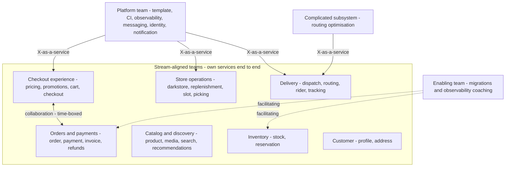
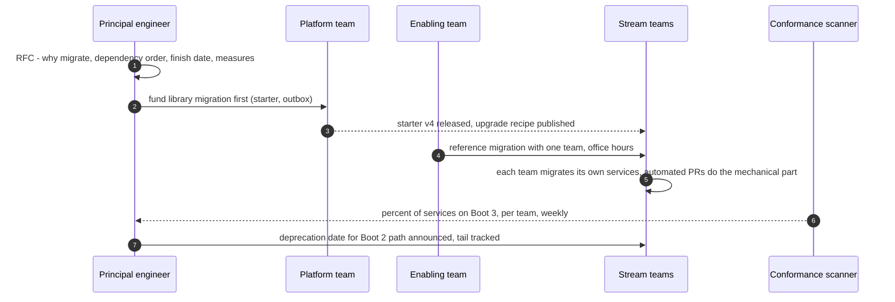
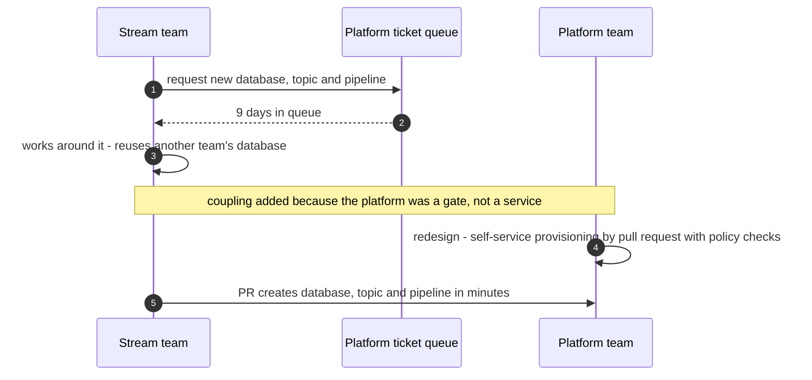
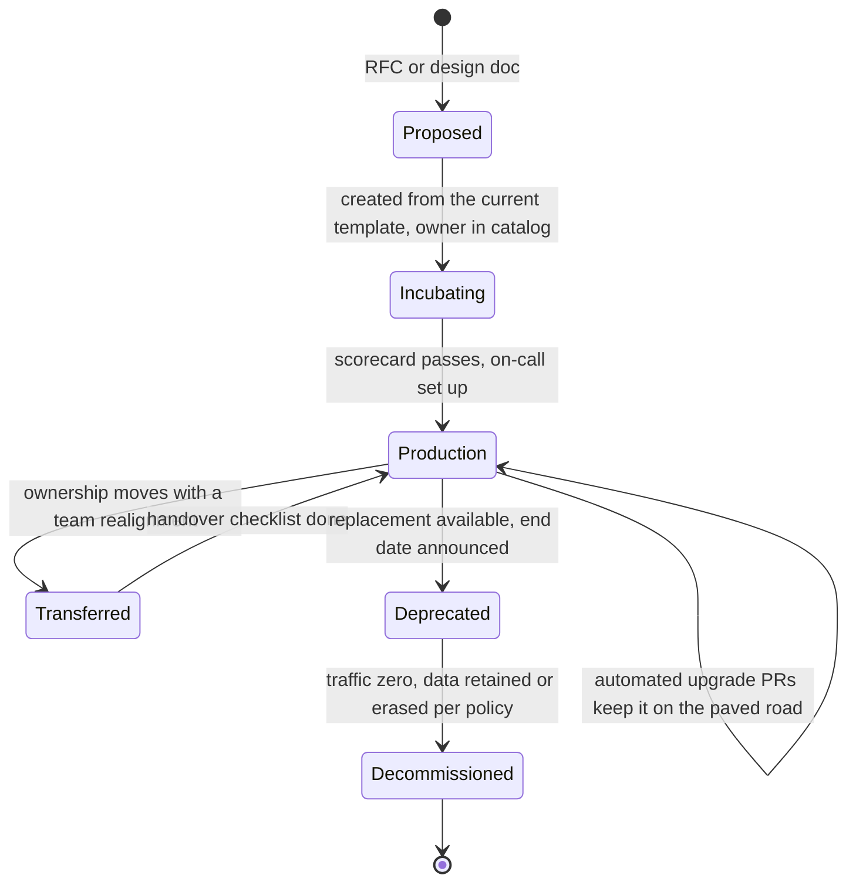

# 37. Leading Architecture at Scale

!!! abstract "Chapter at a glance"
    **Reader bands:** B3 → B4 · **Prerequisites:** [Ch 16](../02-distributed-core/16-microservices-architecture.md), [Ch 31](31-architecture-decision-making.md), [Ch 32](32-design-documents-and-architecture-communication.md), [Ch 33](33-domain-driven-design.md) · **What you will build:** The socio-technical side of architecture — how team structure shapes the system (Conway's law), how to organise teams around the flow of change, how a platform team keeps a fleet of services on a paved road, how to run a fleet-wide migration, and how staff+ engineers lead without formal authority. Four runnable labs over the grocery platform's 26 services.

    - **L1: Conway's law, measured.** A year of 500 features against two ownership maps: organised by history and layer, **91%** of features needed more than one team and every bounded context was split across 2–3 teams; aligning teams to the Ch 33 contexts helped only modestly (**86%**) — because this year's work flows *across* those contexts.
    - **L2: teams from change data.** Within cognitive-load limits (2–4 services per team, balanced load), grouping services by how they change together cut hand-offs from **500 to 240** and multi-team features from **86% to 43%** — and surfaced groupings to question, such as a shared messaging capability that belongs with a platform team.
    - **L3: the paved road, scanned.** 26 real repos generated from template v3/v2/v1 or by hand and scanned for 8 golden-path capabilities: current-template services passed **100%**, v2 **60%**, v1 **28%**, hand-rolled **19%**; only **8 of 26** were fully on the current path.
    - **L4: a fleet-wide migration.** Spring Boot 2 → 3 across 26 services: a central team took **31 sprints (~14 months)**; team-owned with libraries migrated first **11**; starting everyone before the libraries were ready finished about the same (**10.4**) but spent **32% more effort** on workarounds; adding codemods **8.6 sprints** and **37% less effort**.

    · **Reading time:** 110 min + code

---

## 1. Introduction & Why It Matters

### 1.1 A story: the architecture that the org chart rewrote

The grocery platform's architecture team produced an excellent target architecture: bounded contexts from event storming ([Ch 33](33-domain-driven-design.md)), a modular monolith for ordering, services for inventory and fulfilment, events between contexts, cells for blast radius ([Ch 34](34-modern-architecture-styles.md)). The ADRs were written, the diagrams generated from a model, the fitness functions in CI.

Eighteen months later the system looked nothing like the target. The reason was not bad engineering. It was the organisation:

1. **Teams were organised by technical layer and history** — an "API team", a "data team", a "core team", a "mobile team". Every bounded context was split across two or three of them. Each feature needed a meeting between teams, so teams built integration shortcuts — a shared table here, a synchronous call there — and the architecture drifted towards the org chart (L1).
2. **The architecture team decided; delivery teams implemented.** Decisions made far from the code were resisted, misunderstood, or quietly worked around. The architects became a review bottleneck and were cut out of the loop.
3. **Standards were documents, not defaults.** Every new service was set up by hand from a wiki page, so each one was different: some had tracing, some had the outbox, some had JSON logs. By service twenty, no two were configured alike (L3).
4. **The big migration never finished.** A move to Spring Boot 3 was assigned to a two-person "migration squad". A year later a third of the services were migrated, the squad was burnt out, and the owning teams had learned nothing about their new stack (L4).
5. **Nobody could say whether things were getting better.** There were no measures of delivery flow, coordination cost, or standards adoption — only anecdotes.

The recovery was led by two principal engineers who treated the organisation as part of the architecture. They realigned teams to how work actually flowed, created a platform team whose product was a paved road, replaced review gates with an advice process and automated checks, and ran migrations as sequenced, team-owned programmes with the platform doing the enabling work first.

!!! quote "The thesis of this chapter"
    At scale, architecture is **socio-technical**: the system you get is shaped as much by team boundaries, incentives and defaults as by diagrams. Conway's law isn't a curiosity — it's a force, and you either use it (align teams to how change flows) or it rewrites your architecture for you. The architect's leverage therefore shifts from *making decisions* to *shaping the conditions* under which many teams make good decisions: team boundaries that minimise hand-offs, a platform that makes the right thing the easy thing, governance by guardrails and advice rather than gates, migrations that are planned and enabled rather than assigned, and measures that show whether it's working.

### 1.2 Where this lives in the grocery platform

| Lever | Grocery platform | Lab |
|---|---|---|
| Team boundaries | 8 stream-aligned teams owning 3–4 services each, aligned to change flow | L1, L2 |
| Team types | Stream-aligned teams, a platform team, an enabling team for migrations/observability | §2.3 |
| Paved road | Service template + platform starter + CI + catalog; scanner and scorecards | L3 |
| Governance | Advice process, ADRs, fitness functions, tech radar ([Ch 31](31-architecture-decision-making.md)) | §2.6 |
| Migrations | Platform-first enablers, team-owned execution, codemods, tracking fitness function | L4 |
| Measures | DORA metrics, hand-offs per feature, golden-path adoption, cognitive-load surveys | §2.9 |

### 1.3 Learning objectives

By the end you will be able to:

- **Explain and use Conway's law**, including the inverse Conway manoeuvre (L1).
- **Design team boundaries** with Team Topologies' team types, interaction modes and cognitive-load limits (L2).
- **Build and run a paved road** as a platform product, and measure adoption and drift (L3).
- **Plan and lead fleet-wide migrations** that finish (L4).
- **Govern architecture across many teams** without becoming a bottleneck.
- **Lead as a staff+ engineer**: technical strategy, influence without authority, and measuring outcomes.

---

## 2. Core Concepts — Beginner to Deep

### 2.1 Intuition: architecture is socio-technical <span class="band b3">B3</span>

Every interface in a system is also a line of communication between the people who own each side. If two teams must change their services together every week, they must talk every week; if they can't, they'll find ways around it — shared databases, duplicated logic, synchronous calls "just for now". Over time the system's structure converges on the organisation's communication structure.

That makes three things part of an architect's job at scale:

- **Team boundaries** — who owns what determines how much coordination each change needs (L1, L2).
- **Defaults** — what's easy gets done; what requires remembering a wiki page doesn't (L3).
- **Flow of work** — large changes across many teams need sequencing, enablers and ownership, not heroics (L4).

### 2.2 Conway's law and the inverse Conway manoeuvre ⭐ <span class="band b3">B3</span>

> "Organizations which design systems are constrained to produce designs which are copies of the communication structures of these organizations." — Melvin Conway, 1968

Two practical readings:

- **Descriptive**: look at your org chart and you can predict your architecture's seams — and its problems. The §1.1 platform, organised by layer, grew layer-shaped services with cross-team coupling in every feature.
- **Prescriptive — the inverse Conway manoeuvre**: design the team structure you need for the architecture you want, so the natural communication paths reinforce the intended boundaries.

L1 measures it: the same 26 services and the same year of 500 features, under two ownership maps. Organised by history and layer, **91%** of features needed more than one team, 26% needed three or more, and the busiest team pairs had to coordinate on 80+ features a year. Aligning teams to the bounded contexts on paper improved this only modestly — **86%** still crossed a team boundary — because the year's work flowed *across* those contexts (promotions changes always touched the cart; slot capacity always touched dark-store stock). The lesson: **align teams to how change actually flows**, which you measure, rather than to nouns or contexts inferred on a whiteboard.

### 2.3 Team Topologies ⭐ <span class="band b3">B3</span>

Matthew Skelton and Manuel Pais's *Team Topologies* gives a vocabulary that has become standard:

**Four team types:**

| Type | Purpose | Grocery example |
|---|---|---|
| **Stream-aligned** | Owns a slice of the business value stream end to end; the default type | Checkout experience, Fulfilment, Delivery, Catalog |
| **Platform** | Provides internal services that reduce stream teams' cognitive load, consumed as self-service | Service template, CI, observability, messaging, identity |
| **Enabling** | Helps stream teams adopt new capabilities, then steps away | A migration/observability enabling team (L4) |
| **Complicated-subsystem** | Owns a part requiring deep specialist knowledge | Routing optimisation, search ranking, fraud models |

**Three interaction modes:**

- **Collaboration** — two teams work closely for a limited time on something new (high bandwidth, high cost; should end).
- **X-as-a-Service** — one team consumes another's capability through a clear API with minimal coordination (the goal for platform services).
- **Facilitating** — an enabling team coaches another team to build a capability.

**Cognitive load** is the organising constraint: a team can only own as much as it can understand and operate. Too many services, domains or technologies per team and quality drops, on-call becomes miserable, and changes slow down. L2's limits (2–4 services per team, change load at most 1.5x the average) encode that constraint; without it, the "optimal" organisation is one giant team with zero hand-offs and no ability to cope.

**Team size**: small, long-lived teams (5–9 people) with stable ownership — "you build it, you run it".

### 2.4 Deriving team boundaries from change ⭐ <span class="band b4">B4</span>

Because change flow is what determines coordination, measure it:

- **Feature and ticket data**: which services each feature touched (L1/L2 use this).
- **Change coupling from version control**: files and services that change in the same commits or pull requests.
- **Runtime coupling**: synchronous call graphs from tracing ([Ch 24](../03-production/24-observability.md)).

Then optimise under constraints. L2's local search assigns 26 services to 8 teams to minimise hand-offs (for each feature, teams involved minus one) within cognitive-load limits:

| Ownership | Hand-offs / year | Multi-team features |
|---|---|---|
| Historical (by layer) | 591 | 91% |
| Bounded contexts on paper | 500 | 86% |
| Optimised from change data | **240** | **43%** |

The optimised teams are **evidence, not a decision**. Some groupings reflect genuine domain cohesion (pricing, promotions, cart and checkout as one "checkout experience" team). Others are warnings: identity and notification grouped with rider and tracking because OTP logins and rider updates both send messages — a shared capability that belongs with a **platform team** as a self-service API, not inside one stream team. Ask of every coupling: is it **essential** (one domain — align a team to it) or **accidental** (a design flaw — fix the design)? And weigh skills, on-call load and domain language before moving anything. Re-run the analysis periodically; how change flows shifts with the product.

### 2.5 Platform engineering and the paved road ⭐ <span class="band b3">B3</span>

A **platform team** exists to reduce stream-aligned teams' cognitive load. Its main product is often a **paved road** (golden path): the easiest way to build, ship and run a service is also the standard-compliant way.

Components of the grocery platform's paved road:

- A **service template** (Backstage software template or similar) that generates a new service with the hexagonal package structure ([Ch 34](34-modern-architecture-styles.md)), the platform starter (JSON logs, tracing, metrics, outbox — [Ch 15](../02-distributed-core/15-event-driven-architecture-cqrs-and-event-sourcing.md)), health endpoints, an ArchUnit test ([Ch 31](31-architecture-decision-making.md)), a CI pipeline with SBOM and vulnerability scanning, a Dockerfile on the standard base image, and a catalog entry with an owner.
- **Self-service infrastructure**: databases, topics, buckets and secrets provisioned by pull request, with policy-as-code guardrails ([Ch 36](36-compliance-governance-and-data-residency.md)).
- **A service catalog / developer portal**: every service, its owner, docs, dependencies, scorecard.

The key lesson from L3: **a template is a one-time copy**. Services created from the current template passed all 8 checks; services from older templates and hand-rolled ones drifted (v2 60%, v1 28%, hand-rolled 19%), because every later improvement — SBOMs, Java 21, the newer starter — never reached them. Only 8 of 26 services were fully on the current path. So a platform team's job is not just the template but **keeping the fleet on it**:

- **Libraries over copy-paste**: put behaviour in a versioned starter/BOM that services depend on, so upgrades are a version bump.
- **Automated upgrade pull requests** (Renovate for versions; OpenRewrite recipes for code changes).
- **Scorecards** per service and team, generated by a conformance scanner, so drift is visible.
- **Platform as a product**: talk to users (stream teams), measure adoption and satisfaction, deprecate carefully, and keep it the **thinnest viable platform** — enough to reduce load, not a second bureaucracy.

The failure mode is the **ticket-ops platform**: a team that provisions things on request via tickets, becoming a bottleneck with a queue. Self-service with guardrails is the goal.

### 2.6 Governance at scale: guardrails, not gates <span class="band b3">B3</span>

With 8+ teams, central architecture review of every change doesn't scale ([Ch 31](31-architecture-decision-making.md) §2.8). The pattern that works:

- **Principles** — a short list that lets teams make consistent decisions alone ("prefer events between contexts", "no shared databases", "personal data encrypted at the field level").
- **Guardrails** — automated checks that enforce the non-negotiables: fitness functions, policy-as-code, conformance scanners (L3), contract tests.
- **Paved roads** — make the recommended choice the default (§2.5).
- **The advice process** — anyone can make an architectural decision after seeking advice from those affected and from experts, recorded in an ADR.
- **Light review for one-way doors** — new datastores, new trust boundaries, cross-context contracts, big migrations.
- **A technology radar** — Adopt / Trial / Assess / Hold, so common choices need no debate.
- **Architecture guild / community of practice** — engineers from every team share decisions, patterns and incidents; architects facilitate rather than dictate.

The architect's role shifts from gatekeeper to **designer of the decision system**: the principles, guardrails and forums that make many independent decisions coherent.

### 2.7 Leading large migrations ⭐ <span class="band b4">B4</span>

Fleet-wide changes — framework upgrades, moving off a shared database, adopting a new messaging platform, entering cells — are where architecture leadership is most visible. They fail in predictable ways: under-resourced central squads, no sequencing, unclear finish lines, and a long tail nobody owns.

L4 schedules a Spring Boot 2 → 3 / Java 21 migration across 26 services and two shared libraries:

| Strategy | Finish | Effort spent | Notes |
|---|---|---|---|
| Central 2-stream migration team | 31 sprints (~14 months) | 58 | Bottleneck; owners don't learn their stack |
| Platform migrates libraries first, teams own services | 11 sprints | 58 | Parallel across 8 teams |
| Teams start immediately, libraries not ready | 10.4 sprints | 76 (+32%) | Same finish, 9 workarounds to undo |
| Libraries first + automated codemods | 8.6 sprints | 37 | Mechanical changes automated |

What the table teaches:

1. **Centralised migration is a bottleneck** — the same work takes three times as long and leaves owning teams uninvolved.
2. **Sequence the dependencies and fund the enablers first.** Starting everyone immediately looks faster and finishes at about the same time, but burns a third more effort on shims that someone must later remove — a false economy the calendar alone won't show.
3. **Automate the mechanical part** (OpenRewrite recipes, codemods) — the biggest single win.

A migration playbook:

- **Make the case** with data: risk of staying (end-of-support dates, CVEs), benefit of moving.
- **Plan the dependency order** and the enabling work (shared libraries, recipes, docs, a reference migration).
- **Team ownership**: each team migrates its own services, with an enabling team available to help.
- **A tracking fitness function** — L3's scanner answering "% of services on Boot 3" — visible on a dashboard.
- **A deprecation policy**: announced end dates for the old path, with support tapering.
- **Finish the tail**: the last 10% takes disproportionate effort; plan for it and celebrate finishing.

### 2.8 Technical strategy <span class="band b4">B4</span>

Principal engineers and architects own **technical strategy**: a coherent answer to "where is our technology going, and why?"

- **Diagnosis** — the honest current state: constraints, risks, bottlenecks (measured where possible — L1's coordination cost, L3's drift, DORA metrics).
- **Guiding policies** — the few choices that address the diagnosis ("teams own their services end to end", "events between contexts", "one paved road").
- **Coherent actions** — the concrete programmes: team realignment, platform investments, migrations, deprecations, each with owners and measures.
- **A target architecture** as a direction, not a blueprint — updated as reality teaches you.
- **A technical-debt budget** — a standing share of capacity (often 15–25%) for platform upgrades, debt paydown and resilience work, so it doesn't have to win against every feature.

Write it down ([Ch 32](32-design-documents-and-architecture-communication.md)) and revisit it at least yearly.

### 2.9 Measuring whether it's working <span class="band b4">B4</span>

- **DORA metrics** — deployment frequency, lead time for changes, change failure rate, and time to restore service. They measure delivery flow and stability, and respond to team structure and platform quality.
- **Coordination measures** — hand-offs per feature, multi-team feature share (L1/L2), cross-team pull-request reviews.
- **Platform measures** — golden-path adoption and drift (L3), time to create a production-ready service, platform satisfaction surveys.
- **Architecture measures** — fitness-function pass rates, drift reports ([Ch 32](32-design-documents-and-architecture-communication.md) L4), ADR coverage of one-way doors.
- **People measures** — cognitive-load and on-call surveys (the SPACE framework reminds you that productivity is multi-dimensional; don't reduce it to one number).

Use measures to find constraints and check interventions, never to rank individuals.

### 2.10 Influence without authority: the staff+ engineer <span class="band b4">B4</span>

Senior technical leaders usually lead without direct reports. Common staff+ archetypes (Will Larson): **tech lead** (guides one team's execution), **architect** (owns direction for a critical area), **solver** (dives into the hardest problems), **right hand** (extends an executive's reach across the org). All rely on influence:

- **Write** — design docs, strategy, ADRs; writing scales your thinking beyond meetings.
- **Build consensus before the meeting** — talk to the people affected; the meeting ratifies.
- **Bring evidence** — L1–L4-style analysis turns opinions into shared facts.
- **Make others successful** — sponsor, mentor, delegate the interesting work, and give credit.
- **Stay close to the code** — enough to keep your judgement grounded and your credibility real.
- **Pick your battles** — two-way doors aren't worth a fight ([Ch 31](31-architecture-decision-making.md)); one-way doors are.
- **Disagree and commit** — make your case well, then support the decision once it's made.

---

## 3. Architecture & Diagrams

### 3.1 Team topology of the grocery platform



### 3.2 Sequence: happy path, a team-owned migration wave



### 3.3 Sequence: failure path, the ticket-ops platform bottleneck



### 3.4 State: a service's ownership lifecycle



---

## 4. Design Document Excerpt: Grocery Engineering Organisation & Platform Strategy

!!! note "Design Document (excerpt) — Engineering Operating Model v1.0"
    **Status:** Accepted · **Authors:** Principal engineers, VP Engineering · **Reviewers:** All engineering managers and tech leads

    | Field | Value |
    |---|---|
    | Context | Target architecture drifted towards the org chart; every bounded context split across 2–3 layer-based teams; 91% of features needed multiple teams; services configured by hand from a wiki; the Boot 3 migration stalled with a 2-person squad. |
    | Decision | Reorganise into stream-aligned teams by change flow (validated with feature data), a platform team running the paved road as a product, and a small enabling team; govern with principles, guardrails and the advice process; run migrations platform-first and team-owned; measure with DORA plus coordination and adoption metrics. |
    | Related ADRs | ADR-230 Stream-aligned teams from change data, 2–4 services each (L1, L2); ADR-231 Platform team owns template, starter, CI, observability, messaging and notification as self-service; ADR-232 Conformance scanner + scorecards + automated upgrade PRs (L3); ADR-233 Advice process replaces the architecture review board, except one-way doors; ADR-234 Migration playbook: platform-first enablers, team ownership, codemods, tracking fitness function (L4); ADR-235 20% capacity for platform and debt work; ADR-236 DORA + hand-offs per feature + golden-path adoption as org-level measures |

    **Requirements.**

    - **R1 — Local change.** ≤ 50% of features require more than one team (measured quarterly from feature data).
    - **R2 — Bounded load.** No team owns more than 4 services or carries more than 1.5x the average change load.
    - **R3 — Paved road.** 90% of services pass all golden-path checks within two quarters; a new production-ready service in under a day.
    - **R4 — Migrations finish.** Fleet-wide migrations have a dependency plan, enablers funded first, and an announced end date for the old path.
    - **R5 — Decisions close to the code.** One-way doors get ADRs and light review; everything else is decided by teams with advice.

    **Decisions in detail.**

    1. **Teams (ADR-230).** Seven stream-aligned teams from L2's analysis, adjusted by humans: notification and identity move to the platform team as shared capabilities.
    2. **Platform (ADR-231/232).** Template + starter as a versioned library; Renovate and OpenRewrite for upgrades; scanner in CI and weekly scorecards (L3).
    3. **Governance (ADR-233).** Principles page, tech radar, guild fortnightly; ADRs in repos.
    4. **Migrations (ADR-234).** Boot 3: platform migrates the starter and outbox library in sprints 1–5; teams migrate with recipes; target 9 sprints (L4 strategy D).
    5. **Capacity (ADR-235).** 20% of each team's capacity for platform upgrades, debt and resilience.
    6. **Measures (ADR-236).** DORA per team; hand-offs per feature; adoption dashboard.

    **Consequences.** A reorganisation is disruptive — ownership transfers, on-call changes, new relationships — and must be done carefully and explained. In return: fewer hand-offs, a fleet that stays current, migrations that finish, and architects whose influence scales through defaults and guardrails.

---

## 5. Hands-On Code — Level Ladder

!!! info "What's real here"
    All four labs are JDK 21 programs with deterministic output. L1 and L2 replay the same year of 500 features (generated from the platform's recurring feature types in `features.csv`) against ownership maps from `services.csv`; L2 runs a real local-search optimiser under stated constraints. L3 **writes 26 real repositories to disk** and scans the actual files. L4 is a dependency-aware list scheduler. The lead-time model (L1), the workaround penalty and codemod saving (L4) are stated assumptions — change them and re-run.

All four labs share two input files (in `labs/ch37-leading-architecture/`):

- `services.csv` — the 26 services with their bounded context, their **current** owner (9 teams organised by history and layer) and their **context-aligned** owner (8 teams), plus migration effort in sprints.
- `features.csv` — 14 recurring feature types with yearly weights and the services each touches (e.g. `promo-change,14,pricing promotions cart`).

Run every lab with `-Dstdout.encoding=UTF-8` so the box-drawing characters print correctly.

### L1 — Conway's law, measured <span class="band b3">B3</span>

**Requirement:** "Features take weeks, and every one needs a meeting. Is that the code — or who owns it?"

A year of 500 features is replayed against two ownership maps for the *same* services. The code never changes; only who owns what. The lead-time model (5 days + 4 days per extra team) is an explicit assumption.

```java title="ConwayL1.java"
// ConwayL1.java — run with: java ConwayL1.java services.csv features.csv   (JDK 21, no dependencies)
// CONWAY'S LAW, MEASURED. "Organisations design systems that mirror their communication structures" — and the reverse is
// what an architect can use: if the teams don't match the architecture's boundaries, every change needs a meeting.
// We replay a year of feature work (500 features drawn from the platform's recurring feature types, 15% with an extra
// incidental service) against two ownership maps for the SAME 26 services:
//   CURRENT — 9 teams organised by history and technical layer (api-team, data-team, core-team, web-team...)
//   ALIGNED — 8 stream-aligned teams, one per bounded context (Ch 33), each owning 3–4 cohesive services
// For each, we count how many teams each feature needs, which team pairs must coordinate often, and estimate lead time with
// an explicit, simple model: 5 days of work + 4 days of hand-off/coordination for every additional team involved.
import java.nio.file.*;
import java.util.*;
import java.util.stream.*;

public class ConwayL1 {
    record Svc(String name, String context, String current, String aligned, int effort) {}
    record Archetype(String name, int weight, List<String> services) {}

    static List<String[]> csv(String f) throws Exception {
        return Files.readAllLines(Path.of(f)).stream().filter(l -> !l.isBlank() && !l.startsWith("#")).map(l -> l.split(",")).toList();
    }

    public static void main(String[] args) throws Exception {
        Map<String, Svc> svcs = new LinkedHashMap<>();
        for (String[] r : csv(args[0])) svcs.put(r[0], new Svc(r[0], r[1], r[2], r[3], Integer.parseInt(r[4])));
        List<Archetype> arch = new ArrayList<>();
        for (String[] r : csv(args[1])) arch.add(new Archetype(r[0], Integer.parseInt(r[1]), List.of(r[2].trim().split(" "))));

        // a year of features
        Random rnd = new Random(37); int total = arch.stream().mapToInt(Archetype::weight).sum();
        List<Set<String>> features = new ArrayList<>(); List<String> names = new ArrayList<>(svcs.keySet());
        for (int i = 0; i < 500; i++) {
            int x = rnd.nextInt(total); Archetype a = arch.get(0);
            for (Archetype c : arch) { if (x < c.weight()) { a = c; break; } x -= c.weight(); }
            Set<String> s = new TreeSet<>(a.services());
            if (rnd.nextDouble() < 0.15) s.add(names.get(rnd.nextInt(names.size())));
            features.add(s);
        }

        System.out.printf("%d services, 500 features over a year. Same code, same features — two ownership maps.%n%n", svcs.size());
        System.out.printf("   %-34s %6s %11s %11s %11s %13s %12s%n", "ownership map", "teams", "avg teams", "≥2 teams", "≥3 teams", "lead time*", "hot pairs**");
        for (String map : List.of("current", "aligned")) {
            Map<String, String> owner = new HashMap<>();
            svcs.values().forEach(s -> owner.put(s.name(), map.equals("current") ? s.current() : s.aligned()));
            int teams = (int) owner.values().stream().distinct().count();
            double sumTeams = 0, sumLead = 0; int two = 0, three = 0;
            Map<String, Integer> pairs = new TreeMap<>();
            for (Set<String> f : features) {
                List<String> ts = f.stream().map(owner::get).distinct().sorted().toList();
                sumTeams += ts.size(); if (ts.size() >= 2) two++; if (ts.size() >= 3) three++;
                sumLead += 5 + 4 * (ts.size() - 1);
                for (int i = 0; i < ts.size(); i++) for (int j = i + 1; j < ts.size(); j++) pairs.merge(ts.get(i) + "↔" + ts.get(j), 1, Integer::sum);
            }
            long hot = pairs.values().stream().filter(v -> v >= 25).count();       // pairs that must coordinate ~every other week
            System.out.printf("   %-34s %6d %11.2f %10.0f%% %10.0f%% %10.1f d %12d%n",
                    map.equals("current") ? "CURRENT (by history / layer)" : "ALIGNED (by bounded context)", teams,
                    sumTeams / 500, 100.0 * two / 500, 100.0 * three / 500, sumLead / 500, hot);
            {
                String top = pairs.entrySet().stream().sorted(Map.Entry.<String, Integer>comparingByValue().reversed()).limit(3)
                        .map(e -> e.getKey() + " (" + e.getValue() + ")").collect(Collectors.joining(", "));
                System.out.printf("        busiest coordination pairs: %s%n", top);
            }
        }
        System.out.println("   *  lead-time model (an assumption, not a measurement): 5 days + 4 days per additional team involved");
        System.out.println("   ** team pairs that must coordinate on ≥ 25 features a year (about every other week)");

        // who owns what, and how contexts are split today
        System.out.println("\n   Bounded contexts split across teams TODAY:");
        Map<String, Set<String>> ctxTeams = new TreeMap<>();
        svcs.values().forEach(s -> ctxTeams.computeIfAbsent(s.context(), k -> new TreeSet<>()).add(s.current()));
        ctxTeams.forEach((c, t) -> System.out.printf("        %-11s → %d team(s): %s%n", c, t.size(), t));

        System.out.println("\n   → ownership changes coordination with no code change at all: organised by history and layer, every bounded context");
        System.out.println("     is split across 2–3 teams and 26% of features need three or more teams. But aligning teams to the bounded");
        System.out.println("     contexts on paper helps only modestly here — most features still cross a team boundary — because this year's");
        System.out.println("     work doesn't flow along those contexts: promotions changes always touch the cart, slot capacity always touches");
        System.out.println("     dark-store stock. Conway's law cuts both ways: teams must be aligned to how CHANGE actually flows (value streams),");
        System.out.println("     which you measure from feature and commit history, not infer from nouns. L2 does exactly that.");
    }
}
```

```text title="java -Dstdout.encoding=UTF-8 ConwayL1.java services.csv features.csv"
26 services, 500 features over a year. Same code, same features — two ownership maps.

   ownership map                       teams   avg teams    ≥2 teams    ≥3 teams    lead time*  hot pairs**
   CURRENT (by history / layer)            9        2.18         91%         26%        9.7 d           13
        busiest coordination pairs: api-team↔data-team (85), core-team↔finance-eng (82), api-team↔ops-eng (75)
   ALIGNED (by bounded context)            8        2.00         86%         14%        9.0 d            9
        busiest coordination pairs: ordering↔pricing-promo (110), ordering↔payments (83), fulfilment-ops↔inventory (64)
   *  lead-time model (an assumption, not a measurement): 5 days + 4 days per additional team involved
   ** team pairs that must coordinate on ≥ 25 features a year (about every other week)

   Bounded contexts split across teams TODAY:
        catalog     → 3 team(s): [api-team, data-team, web-team]
        customer    → 2 team(s): [platform-team, web-team]
        delivery    → 2 team(s): [data-team, mobile-team]
        fulfilment  → 2 team(s): [api-team, ops-eng]
        inventory   → 3 team(s): [api-team, core-team, ops-eng]
        ordering    → 2 team(s): [api-team, core-team]
        payments    → 2 team(s): [core-team, finance-eng]
        pricing     → 3 team(s): [api-team, data-team, growth-team]

   → ownership changes coordination with no code change at all: organised by history and layer, every bounded context
     is split across 2–3 teams and 26% of features need three or more teams. But aligning teams to the bounded
     contexts on paper helps only modestly here — most features still cross a team boundary — because this year's
     work doesn't flow along those contexts: promotions changes always touch the cart, slot capacity always touches
     dark-store stock. Conway's law cuts both ways: teams must be aligned to how CHANGE actually flows (value streams),
     which you measure from feature and commit history, not infer from nouns. L2 does exactly that.
```

**Reading it:**

- Organised by history and layer, **every** bounded context is split across 2–3 teams, **91%** of features need more than one team and **26%** need three or more. Thirteen team pairs must coordinate roughly every other week; api-team and data-team share 85 features a year.
- Aligning teams to the bounded contexts helps — three-team features fall from 26% to 14%, hot pairs from 13 to 9 — but **86%** of features still cross a team boundary. The busiest pair becomes ordering↔pricing-promo (**110** features): promotions changes always touch the cart.
- The lesson is the chapter's thesis: Conway's law rewards aligning teams to how **change actually flows**, which you measure — not to a context map drawn from nouns.

```bash title="VERIFY: the same analysis on real history — services touched per merged PR"
# One line per PR: the top-level service directories it changed. Feed into ConwayL1's feature list.
git log --merges --first-parent main --since=1.year --pretty=format:'%H' | while read c; do
  git diff --name-only "$c^1" "$c" | cut -d/ -f2 | sort -u | paste -sd' ' -
done > features-from-git.txt
```

### L2 — Deriving teams from change data, within cognitive-load limits <span class="band b3">B3</span>

**Requirement:** "If contexts on paper don't match how work flows, what team boundaries *would*? And don't give me one giant team."

A simulated-annealing local search (30 restarts × 20,000 moves and swaps) assigns the 26 services to 8 teams to minimise hand-offs, subject to Team Topologies-style limits: 2–4 services per team and at most 1.5x the average change load. It takes about 45 seconds.

```java title="TeamsL2.java"
// TeamsL2.java — run with: java TeamsL2.java services.csv features.csv   (JDK 21, no dependencies)
// DERIVING TEAM BOUNDARIES FROM HOW CHANGE FLOWS — under cognitive-load limits. Using the same year of features as L1, a
// local search assigns the 26 services to 8 teams to minimise HAND-OFFS (for each feature, the number of teams involved
// minus one). Without limits the answer is trivial and useless — one giant team has zero hand-offs. So we add the limits
// Team Topologies argues for: each team owns 2–4 services (cognitive load), and no team carries more than 1.5x the average
// change load. Then we compare with the context-aligned map from L1 and list where the data disagrees with the contexts.
import java.nio.file.*;
import java.util.*;

public class TeamsL2 {
    static List<String> SVC = new ArrayList<>(); static Map<String, String> ALIGNED = new HashMap<>(), CURRENT = new HashMap<>();
    static List<int[]> FEATURES = new ArrayList<>();                   // service indices per feature
    static final int TEAMS = 8, MIN = 2, MAX = 4; static double LOAD_CAP;

    static List<String[]> csv(String f) throws Exception {
        return Files.readAllLines(Path.of(f)).stream().filter(l -> !l.isBlank() && !l.startsWith("#")).map(l -> l.split(",")).toList();
    }
    static int handoffs(int[] team) {
        int h = 0;
        for (int[] f : FEATURES) { Set<Integer> t = new HashSet<>(); for (int s : f) t.add(team[s]); h += t.size() - 1; }
        return h;
    }
    static int[] load(int[] team) {                                   // features touching each team
        int[] l = new int[Arrays.stream(team).max().getAsInt() + 1];
        for (int[] f : FEATURES) { Set<Integer> t = new HashSet<>(); for (int s : f) t.add(team[s]); for (int x : t) l[x]++; }
        return l;
    }
    static boolean feasible(int[] team) {
        int[] size = new int[TEAMS]; for (int t : team) size[t]++;
        for (int s : size) if (s < MIN || s > MAX) return false;
        for (int l : load(team)) if (l > LOAD_CAP) return false;
        return true;
    }
    static int[] fromMap(Map<String, String> m) {
        List<String> names = new ArrayList<>(new TreeSet<>(m.values())); int[] t = new int[SVC.size()];
        for (int i = 0; i < SVC.size(); i++) t[i] = names.indexOf(m.get(SVC.get(i))); return t;
    }

    public static void main(String[] args) throws Exception {
        for (String[] r : csv(args[0])) { SVC.add(r[0]); CURRENT.put(r[0], r[2]); ALIGNED.put(r[0], r[3]); }
        List<String[]> arch = csv(args[1]); int total = arch.stream().mapToInt(a -> Integer.parseInt(a[1])).sum();
        Random rnd = new Random(37);                                      // identical feature year to L1
        for (int i = 0; i < 500; i++) {
            int x = rnd.nextInt(total); String[] a = arch.get(0);
            for (String[] c : arch) { int w = Integer.parseInt(c[1]); if (x < w) { a = c; break; } x -= w; }
            Set<String> s = new TreeSet<>(List.of(a[2].trim().split(" ")));
            if (rnd.nextDouble() < 0.15) s.add(SVC.get(rnd.nextInt(SVC.size())));
            FEATURES.add(s.stream().mapToInt(SVC::indexOf).toArray());
        }
        int[] aligned = fromMap(ALIGNED);
        double avgLoad = Arrays.stream(load(aligned)).average().orElse(0); LOAD_CAP = 1.5 * avgLoad;

        // local search: moves and swaps, many restarts from the aligned map, keep the best feasible
        Random r = new Random(7); int[] best = aligned.clone(); int bestH = handoffs(best);
        for (int restart = 0; restart < 30; restart++) {
            int[] cur = aligned.clone(); int curH = handoffs(cur);
            for (int it = 0; it < 20_000; it++) {
                int[] nxt = cur.clone(); int a = r.nextInt(SVC.size());
                if (r.nextBoolean()) nxt[a] = r.nextInt(TEAMS); else { int b = r.nextInt(SVC.size()); int tmp = nxt[a]; nxt[a] = nxt[b]; nxt[b] = tmp; }
                if (!feasible(nxt)) continue;
                int h = handoffs(nxt);
                if (h <= curH || r.nextDouble() < Math.exp((curH - h) / Math.max(0.5, 20.0 * (1 - it / 20_000.0)))) { cur = nxt; curH = h; }
                if (curH < bestH) { best = cur.clone(); bestH = curH; }
            }
        }

        int[] current = fromMap(CURRENT);
        int[] one = new int[SVC.size()];                                 // everyone in one team
        System.out.printf("Same 500 features. Hand-offs = Σ (teams per feature − 1). Limits: %d–%d services per team, change load ≤ %.0f features/team.%n%n",
                MIN, MAX, LOAD_CAP);
        System.out.printf("   %-44s %8s %10s %14s %16s%n", "ownership map", "teams", "hand-offs", "multi-team %", "max team load");
        row("one giant team (no limits)", one, 1);
        row("CURRENT — by history / layer", current, 9);
        row("ALIGNED — by bounded context (L1)", aligned, 8);
        row("OPTIMISED from change data (within limits)", best, 8);

        System.out.println("\n   Optimised teams (services grouped by who changes together):");
        Map<Integer, List<String>> teams = new TreeMap<>();
        for (int i = 0; i < SVC.size(); i++) teams.computeIfAbsent(best[i], k -> new ArrayList<>()).add(SVC.get(i));
        for (var e : teams.entrySet()) {
            Map<String, Long> ctx = new TreeMap<>(); for (String s : e.getValue()) ctx.merge(ALIGNED.get(s), 1L, Long::sum);
            System.out.printf("        T%d: %-44s from contexts %s%n", e.getKey() + 1, e.getValue(), ctx);
        }
        long mixed = teams.values().stream().filter(l -> l.stream().map(ALIGNED::get).distinct().count() > 1).count();
        System.out.printf("   %d of %d optimised teams mix bounded contexts.%n", mixed, teams.size());
        System.out.println("\n   → with no limits the 'best' organisation is one giant team — zero hand-offs and unmanageable cognitive load.");
        System.out.println("     Within realistic limits, grouping services by how they change together more than halves hand-offs compared");
        System.out.println("     with the context-aligned map (e.g. pricing, promotions, cart and checkout form one checkout-experience team;");
        System.out.println("     slot and picking travel with dark-store stock). Some groupings are warnings, not answers: identity and notification");
        System.out.println("     land with rider and tracking only because OTP logins and rider updates both send messages — a shared capability");
        System.out.println("     like that belongs with a PLATFORM team offering it as a stable self-service API, not inside one stream team.");
        System.out.println("     The output is evidence for a human decision: check whether each coupling is essential (one domain) or accidental");
        System.out.println("     (a design flaw to fix), weigh skills, on-call and language, and re-run it every quarter as the product changes.");
    }

    static void row(String label, int[] team, int teams) {
        int h = handoffs(team); int multi = 0;
        for (int[] f : FEATURES) { Set<Integer> t = new HashSet<>(); for (int s : f) t.add(team[s]); if (t.size() > 1) multi++; }
        System.out.printf("   %-44s %8d %10d %13.0f%% %16d%n", label, teams, h, 100.0 * multi / FEATURES.size(), Arrays.stream(load(team)).max().getAsInt());
    }
}
```

```text title="java -Dstdout.encoding=UTF-8 TeamsL2.java services.csv features.csv"
Same 500 features. Hand-offs = Σ (teams per feature − 1). Limits: 2–4 services per team, change load ≤ 188 features/team.

   ownership map                                   teams  hand-offs   multi-team %    max team load
   one giant team (no limits)                          1          0             0%              500
   CURRENT — by history / layer                        9        591            91%              333
   ALIGNED — by bounded context (L1)                   8        500            86%              212
   OPTIMISED from change data (within limits)          8        240            43%              171

   Optimised teams (services grouped by who changes together):
        T1: [stock, reservation]                         from contexts {inventory=2}
        T2: [rider, tracking, identity, notification]    from contexts {customer=2, delivery=2}
        T3: [dispatch, routing]                          from contexts {delivery=1, fulfilment-ops=1}
        T4: [order, payment, invoice, refunds]           from contexts {ordering=1, payments=3}
        T5: [replenishment, darkstore, slot, picking]    from contexts {fulfilment-ops=2, inventory=2}
        T6: [profile, address]                           from contexts {customer=2}
        T7: [product, media, search, recommendations]    from contexts {catalog=3, pricing-promo=1}
        T8: [pricing, promotions, cart, checkout]        from contexts {ordering=2, pricing-promo=2}
   6 of 8 optimised teams mix bounded contexts.

   → with no limits the 'best' organisation is one giant team — zero hand-offs and unmanageable cognitive load.
     Within realistic limits, grouping services by how they change together more than halves hand-offs compared
     with the context-aligned map (e.g. pricing, promotions, cart and checkout form one checkout-experience team;
     slot and picking travel with dark-store stock). Some groupings are warnings, not answers: identity and notification
     land with rider and tracking only because OTP logins and rider updates both send messages — a shared capability
     like that belongs with a PLATFORM team offering it as a stable self-service API, not inside one stream team.
     The output is evidence for a human decision: check whether each coupling is essential (one domain) or accidental
     (a design flaw to fix), weigh skills, on-call and language, and re-run it every quarter as the product changes.
```

**Reading it:**

- **Without limits the answer is useless**: one team, zero hand-offs, and all 500 features on one team's plate. The cognitive-load constraints are what make the problem meaningful.
- **Within the limits**, grouping by change more than halves hand-offs (500 → **240**) and cuts multi-team features from 86% to **43%**, while *lowering* the busiest team's load (212 → 171).
- **6 of 8** optimised teams mix contexts. Some are genuine value streams: T8 (pricing, promotions, cart, checkout) is a checkout-experience team; T5 puts slot and picking with the dark-store services they always change with.
- **T2 is a warning, not an answer**: identity and notification land with rider and tracking because OTP logins and rider updates both send messages. That is a shared capability — the §4 design moves it to the platform team as a self-service API.
- Treat the output as evidence for people who know the domain, skills and on-call realities — then re-run it every quarter.

### L3 — The paved road, and the drift away from it <span class="band b3">B3</span>

**Requirement:** "We have a service template. Why are no two services configured alike, and which ones are furthest off?"

The lab **writes 26 real repositories to disk** — each generated from template v3 (current), v2, v1, or by hand — and then a scanner that reads only the files (`pom.xml`, `application.yml`, `Dockerfile`, CI workflow, tests, `catalog-info.yaml`) checks 8 golden-path capabilities.

```java title="PavedRoadL3.java"
// PavedRoadL3.java — run with: java PavedRoadL3.java services.csv   (JDK 21, no dependencies)
// THE PAVED ROAD (GOLDEN PATH) AT SCALE. At 26 services and 8 teams, "please follow the standards" doesn't scale; a
// platform team gives teams a service TEMPLATE that already does the right thing — Spring Boot 3 on Java 21, the platform
// starter (JSON logs, tracing, outbox), health and metrics endpoints, an ArchUnit test, CI with SBOM + vulnerability scan,
// and an ownership file for the service catalog. Services are created from whatever template version existed at the time,
// and some were hand-rolled. This lab GENERATES the 26 repos on disk (from template v1, v2, v3 or by hand), then runs a
// conformance SCANNER over the real files to measure adoption of each capability and where drift accumulates.
import java.nio.file.*;
import java.util.*;

public class PavedRoadL3 {
    enum Origin { TEMPLATE_V3, TEMPLATE_V2, TEMPLATE_V1, HAND_ROLLED }

    // ---------- generator: what each origin produces ----------
    static void generate(Path repo, String svc, String owner, Origin o, Random r) throws Exception {
        Files.createDirectories(repo.resolve("src/main/resources")); Files.createDirectories(repo.resolve(".github/workflows"));
        Files.createDirectories(repo.resolve("src/test/java/in/grocery/" + svc));
        boolean hr = o == Origin.HAND_ROLLED;
        String boot = switch (o) { case TEMPLATE_V3, TEMPLATE_V2 -> "3.3.4"; case TEMPLATE_V1 -> "2.7.18"; default -> r.nextBoolean() ? "3.1.2" : "2.7.5"; };
        int starter = switch (o) { case TEMPLATE_V3 -> 4; case TEMPLATE_V2 -> 3; case TEMPLATE_V1 -> 1 + r.nextInt(2); default -> 0; };
        String java = switch (o) { case TEMPLATE_V3 -> "21"; case TEMPLATE_V2 -> r.nextBoolean() ? "21" : "17"; default -> "17"; };
        Files.writeString(repo.resolve("pom.xml"), "<project>\n  <parent><artifactId>spring-boot-starter-parent</artifactId><version>" + boot + "</version></parent>\n"
                + "  <properties><java.version>" + java + "</java.version></properties>\n  <dependencies>\n"
                + (starter > 0 ? "    <dependency><artifactId>grocery-platform-starter</artifactId><version>" + starter + ".2.0</version></dependency>\n" : "")
                + "  </dependencies>\n</project>\n");
        boolean json = o == Origin.TEMPLATE_V3 || o == Origin.TEMPLATE_V2 || (o == Origin.TEMPLATE_V1 && r.nextBoolean()) || (hr && r.nextDouble() < 0.3);
        boolean prom = !hr || r.nextBoolean();
        Files.writeString(repo.resolve("src/main/resources/application.yml"), "spring.application.name: " + svc + "\n"
                + (json ? "logging.structured.format.console: ecs\n" : "logging.pattern.console: \"%d %p %c %m%n\"\n")
                + "management.endpoints.web.exposure.include: " + (prom ? "health,prometheus" : "health") + "\n");
        Files.writeString(repo.resolve("Dockerfile"), "FROM eclipse-temurin:" + java + "-jre\nCOPY target/app.jar /app.jar\nENTRYPOINT [\"java\",\"-jar\",\"/app.jar\"]\n");
        boolean sbom = o == Origin.TEMPLATE_V3, scan = o == Origin.TEMPLATE_V3 || o == Origin.TEMPLATE_V2;
        Files.writeString(repo.resolve(".github/workflows/ci.yml"), "name: ci\njobs:\n  build:\n    steps:\n      - run: mvn -B verify\n"
                + (sbom ? "      - run: mvn cyclonedx:makeAggregateBom\n" : "") + (scan ? "      - uses: aquasecurity/trivy-action@0.24.0\n" : ""));
        boolean arch = o == Origin.TEMPLATE_V3 || (o == Origin.TEMPLATE_V2 && r.nextBoolean());
        if (arch) Files.writeString(repo.resolve("src/test/java/in/grocery/" + svc + "/ArchitectureTest.java"), "@AnalyzeClasses class ArchitectureTest { /* layered + domain purity rules */ }\n");
        boolean catalog = o != Origin.HAND_ROLLED && (o != Origin.TEMPLATE_V1 || r.nextBoolean());
        if (catalog) Files.writeString(repo.resolve("catalog-info.yaml"), "kind: Component\nmetadata:\n  name: " + svc + "\nspec:\n  owner: " + owner + "\n");
        Files.writeString(repo.resolve(".template-origin"), o.name() + "\n");
    }

    // ---------- scanner: reads only the files ----------
    record Check(String name, java.util.function.Predicate<Path> test) {}
    static String read(Path p) { try { return Files.exists(p) ? Files.readString(p) : ""; } catch (Exception e) { return ""; } }
    static final List<Check> CHECKS = List.of(
        new Check("Spring Boot 3.x", p -> read(p.resolve("pom.xml")).contains("<version>3.")),
        new Check("Java 21 runtime image", p -> read(p.resolve("Dockerfile")).contains("temurin:21")),
        new Check("platform starter ≥ 4", p -> read(p.resolve("pom.xml")).matches("(?s).*platform-starter</artifactId><version>[4-9].*")),
        new Check("structured JSON logs", p -> read(p.resolve("src/main/resources/application.yml")).contains("structured.format")),
        new Check("health + metrics exposed", p -> read(p.resolve("src/main/resources/application.yml")).contains("prometheus")),
        new Check("architecture test", p -> { try (var w = Files.walk(p.resolve("src/test"))) { return w.anyMatch(f -> f.toString().endsWith("ArchitectureTest.java")); } catch (Exception e) { return false; } }),
        new Check("CI: SBOM + vuln scan", p -> { String c = read(p.resolve(".github/workflows/ci.yml")); return c.contains("cyclonedx") && c.contains("trivy"); }),
        new Check("catalog entry with owner", p -> read(p.resolve("catalog-info.yaml")).contains("owner:")));

    public static void main(String[] args) throws Exception {
        List<String[]> svcs = Files.readAllLines(Path.of(args[0])).stream().filter(l -> !l.isBlank() && !l.startsWith("#")).map(l -> l.split(",")).toList();
        Path root = Path.of("repos"); if (Files.exists(root)) try (var w = Files.walk(root)) { w.sorted(Comparator.reverseOrder()).forEach(p -> p.toFile().delete()); }
        Random r = new Random(4);
        Origin[] plan = new Origin[svcs.size()];                                   // 8 v3, 9 v2, 5 v1, 4 hand-rolled
        List<Origin> pool = new ArrayList<>();
        for (int i = 0; i < 8; i++) pool.add(Origin.TEMPLATE_V3); for (int i = 0; i < 9; i++) pool.add(Origin.TEMPLATE_V2);
        for (int i = 0; i < 5; i++) pool.add(Origin.TEMPLATE_V1); for (int i = 0; i < 4; i++) pool.add(Origin.HAND_ROLLED);
        Collections.shuffle(pool, r);
        for (int i = 0; i < svcs.size(); i++) { plan[i] = pool.get(i); generate(root.resolve(svcs.get(i)[0]), svcs.get(i)[0], svcs.get(i)[3], plan[i], r); }
        long files; try (var w = Files.walk(root)) { files = w.filter(Files::isRegularFile).count(); }
        System.out.printf("Generated %d service repos (%,d files) from template v3/v2/v1 or by hand; scanning them against the v3 golden path.%n%n", svcs.size(), files);

        // scan
        Map<String, Integer> passByCheck = new LinkedHashMap<>(); Map<Origin, int[]> byOrigin = new EnumMap<>(Origin.class);
        List<String> worst = new ArrayList<>(); int[] score = new int[svcs.size()];
        for (int i = 0; i < svcs.size(); i++) {
            Path p = root.resolve(svcs.get(i)[0]);
            Origin o = Origin.valueOf(read(p.resolve(".template-origin")).trim());
            for (Check c : CHECKS) if (c.test().test(p)) { passByCheck.merge(c.name(), 1, Integer::sum); score[i]++; } else passByCheck.putIfAbsent(c.name(), 0);
            byOrigin.computeIfAbsent(o, k -> new int[2]); byOrigin.get(o)[0] += score[i]; byOrigin.get(o)[1] += CHECKS.size();
        }
        System.out.println("   Adoption by capability (26 services):");
        for (var e : passByCheck.entrySet()) System.out.printf("        %-26s %2d/26  %s%n", e.getKey(), e.getValue(), "█".repeat(e.getValue()));
        System.out.println("\n   Conformance by how the service was created:");
        for (var e : byOrigin.entrySet()) System.out.printf("        %-12s %5.0f%% of checks pass%n", e.getKey(), 100.0 * e.getValue()[0] / e.getValue()[1]);
        Integer[] idx = new Integer[svcs.size()]; for (int i = 0; i < idx.length; i++) idx[i] = i;
        Arrays.sort(idx, Comparator.comparingInt(i -> score[i]));
        System.out.print("\n   Lowest-scoring services: ");
        for (int k = 0; k < 5; k++) System.out.printf("%s %d/8 (%s)%s", svcs.get(idx[k])[0], score[idx[k]], plan[idx[k]], k < 4 ? ", " : "\n");
        long fully = Arrays.stream(score).filter(x -> x == CHECKS.size()).count();
        System.out.printf("   Fully on the current golden path: %d of 26 services.%n", fully);

        System.out.println("\n   → the golden path works where it was used: services created from the current template pass every check, with no");
        System.out.println("     one having to remember the standards. The drift is in services created from OLD template versions and in");
        System.out.println("     hand-rolled ones — templates are a one-time copy, so every improvement since then (SBOM, Java 21, starter v4)");
        System.out.println("     never reached them. At scale the platform team's job is therefore not just the template but keeping the fleet on");
        System.out.println("     it: a scanner like this in CI, automated upgrade PRs (Renovate/OpenRewrite recipes) for the mechanical gaps, and a");
        System.out.println("     scorecard per team so the remaining work is visible — golden path by default, drift made visible, not policed.");
    }
}
```

```text title="java -Dstdout.encoding=UTF-8 PavedRoadL3.java services.csv"
Generated 26 service repos (161 files) from template v3/v2/v1 or by hand; scanning them against the v3 golden path.

   Adoption by capability (26 services):
        Spring Boot 3.x            20/26  ████████████████████
        Java 21 runtime image      11/26  ███████████
        platform starter ≥ 4        8/26  ████████
        structured JSON logs       21/26  █████████████████████
        health + metrics exposed   25/26  █████████████████████████
        architecture test          12/26  ████████████
        CI: SBOM + vuln scan        8/26  ████████
        catalog entry with owner   19/26  ███████████████████

   Conformance by how the service was created:
        TEMPLATE_V3    100% of checks pass
        TEMPLATE_V2     60% of checks pass
        TEMPLATE_V1     28% of checks pass
        HAND_ROLLED     19% of checks pass

   Lowest-scoring services: media 1/8 (TEMPLATE_V1), reservation 1/8 (HAND_ROLLED), slot 1/8 (HAND_ROLLED), product 2/8 (TEMPLATE_V1), pricing 2/8 (HAND_ROLLED)
   Fully on the current golden path: 8 of 26 services.

   → the golden path works where it was used: services created from the current template pass every check, with no
     one having to remember the standards. The drift is in services created from OLD template versions and in
     hand-rolled ones — templates are a one-time copy, so every improvement since then (SBOM, Java 21, starter v4)
     never reached them. At scale the platform team's job is therefore not just the template but keeping the fleet on
     it: a scanner like this in CI, automated upgrade PRs (Renovate/OpenRewrite recipes) for the mechanical gaps, and a
     scorecard per team so the remaining work is visible — golden path by default, drift made visible, not policed.
```

**Reading it:**

- Current-template services pass **100%** (by construction — that is what a paved road is); v2 **60%**, v1 **28%**, hand-rolled **19%**. Only **8 of 26** services are fully on the current path.
- The capabilities added most recently — **SBOM + vulnerability scan (8/26)**, **starter v4 (8/26)**, **Java 21 (11/26)** — have the lowest adoption: a template is a one-time copy, so improvements never reach earlier services.
- The lowest scorers (media, reservation, slot at 1/8) are where the platform team's upgrade pull requests and help should go first. Reservation and slot are hand-rolled and business-critical — drift concentrated where risk is highest.
- Wire the scanner into CI and a weekly per-team scorecard, and it doubles as L4's migration fitness function ("% on Boot 3" is the first row).

```yaml title="VERIFY: an OpenRewrite recipe run that closes the mechanical gaps (Maven plugin)"
# mvn -U org.openrewrite.maven:rewrite-maven-plugin:run \
#   -Drewrite.recipeArtifactCoordinates=org.openrewrite.recipe:rewrite-spring:RELEASE \
#   -Drewrite.activeRecipes=org.openrewrite.java.spring.boot3.UpgradeSpringBoot_3_3
# Renovate keeps grocery-platform-starter current across all repos:
packageRules:
  - matchPackageNames: ["in.grocery:grocery-platform-starter"]
    groupName: platform starter
    automerge: true
    matchUpdateTypes: ["minor", "patch"]
```

### L4 — A fleet-wide migration, planned <span class="band b4">B4</span>

**Requirement:** "Spring Boot 2 is out of support. Get all 26 services to Boot 3 / Java 21 — how, and how long?"

A dependency-aware list scheduler plans the migration four ways. The platform starter (3 sprints) must be migrated before every service; the outbox library (2 sprints) before its 7 users. The workaround penalty (+80% effort for a service started before its libraries are ready) and the codemod saving (−40%) are stated assumptions.

```java title="MigrationL4.java"
// MigrationL4.java — run with: java MigrationL4.java services.csv   (JDK 21, no dependencies)
// A FLEET-WIDE MIGRATION, PLANNED. Moving 26 services from Spring Boot 2 to Spring Boot 3 / Java 21 (javax → jakarta, new
// observability APIs, new security config) is the kind of change an architect leads but can't do alone. It has a dependency
// structure: the shared platform starter must be migrated first, the outbox library (used by 7 services) after it, then each
// service. Effort per service comes from services.csv (1–3 sprints). We schedule it four ways with a simple list scheduler
// (each team works on one migration at a time; longest task first) and compare how long the fleet takes to finish:
//   A) CENTRAL migration team (2 parallel streams) migrates libraries and all 26 services
//   B) TEAM-OWNED: the platform team migrates the libraries first; each of the 8 stream teams migrates its own services
//   C) TEAM-OWNED, NO PLATFORM-FIRST: teams start at once and work around the unmigrated libraries (+80% effort per service
//      started before the libraries it needs are ready — shims, forks, duplicated fixes)
//   D) B + automated codemods (OpenRewrite-style recipes do the mechanical javax→jakarta/config changes): −40% service effort
import java.nio.file.*;
import java.util.*;

public class MigrationL4 {
    record Task(String name, String team, double effort, List<String> deps) {}
    static final Set<String> OUTBOX_USERS = Set.of("order", "payment", "refunds", "stock", "reservation", "dispatch", "checkout");

    // returns {finish sprint, burn-up by sprint}
    static Object[] schedule(List<Task> tasks, Map<String, Integer> slots, boolean penaltyIfLibsNotReady) {
        Map<String, Double> finish = new HashMap<>(); Map<String, Double> teamFree = new HashMap<>();
        List<Task> pending = new ArrayList<>(tasks);
        pending.sort(Comparator.comparingDouble(Task::effort).reversed());       // longest first within a team
        Map<String, PriorityQueue<Double>> teamSlots = new HashMap<>();
        for (var e : slots.entrySet()) { PriorityQueue<Double> q = new PriorityQueue<>(); for (int i = 0; i < e.getValue(); i++) q.add(0.0); teamSlots.put(e.getKey(), q); }
        // libraries first in list order when they share a team
        pending.sort(Comparator.comparing((Task t) -> !t.name().startsWith("lib:")).thenComparing(Comparator.comparingDouble(Task::effort).reversed()));
        List<Double> serviceDone = new ArrayList<>(); double spent = 0; int workarounds = 0;
        while (!pending.isEmpty()) {
            Task pick = null; double bestStart = Double.MAX_VALUE;
            for (Task t : pending) {
                double depsDone = 0; boolean ok = true;
                for (String d : t.deps()) { if (!finish.containsKey(d)) { if (!penaltyIfLibsNotReady) { ok = false; break; } } else depsDone = Math.max(depsDone, finish.get(d)); }
                if (!ok) continue;
                double slotFree = teamSlots.get(t.team()).peek();
                double start = penaltyIfLibsNotReady ? slotFree : Math.max(slotFree, depsDone);
                if (start < bestStart) { bestStart = start; pick = t; }
            }
            if (pick == null) throw new IllegalStateException("deadlock");
            double effort = pick.effort();
            if (penaltyIfLibsNotReady && !pick.name().startsWith("lib:"))
                for (String d : pick.deps()) if (!finish.containsKey(d) || finish.get(d) > bestStart) { effort *= 1.8; workarounds++; break; }
            spent += effort;
            teamSlots.get(pick.team()).poll(); double end = bestStart + effort; teamSlots.get(pick.team()).add(end);
            finish.put(pick.name(), end); pending.remove(pick);
            if (!pick.name().startsWith("lib:")) serviceDone.add(end);
        }
        double total = finish.values().stream().mapToDouble(Double::doubleValue).max().orElse(0);
        double effortSum = 0; for (Task t : tasks) effortSum += t.effort();
        return new Object[]{total, serviceDone, spent, workarounds};
    }

    public static void main(String[] args) throws Exception {
        List<String[]> svcs = Files.readAllLines(Path.of(args[0])).stream().filter(l -> !l.isBlank() && !l.startsWith("#")).map(l -> l.split(",")).toList();
        System.out.printf("Fleet migration: Spring Boot 2 → 3 / Java 21 across %d services + 2 shared libraries (starter: 3 sprints, outbox: 2).%n%n", svcs.size());
        System.out.printf("   %-62s %11s %14s %12s %22s%n", "strategy", "done after", "effort spent", "workarounds", "services done by 4 / 8 / 12");
        double[] finishAt = new double[4], spentBy = new double[4];
        String[] labels = {"A) central migration team, 2 parallel streams", "B) platform migrates libraries first, teams own their services",
                "C) teams start immediately, libraries not ready (workarounds)", "D) B + automated codemods (−40% service effort)"};
        for (int s = 0; s < 4; s++) {
            List<Task> tasks = new ArrayList<>(); Map<String, Integer> slots = new HashMap<>();
            String libTeam = s == 0 ? "central" : "platform";
            tasks.add(new Task("lib:starter", libTeam, 3, List.of()));
            tasks.add(new Task("lib:outbox", libTeam, 2, List.of("lib:starter")));
            for (String[] v : svcs) {
                double eff = Double.parseDouble(v[4]) * (s == 3 ? 0.6 : 1.0);
                List<String> deps = new ArrayList<>(List.of("lib:starter")); if (OUTBOX_USERS.contains(v[0])) deps.add("lib:outbox");
                tasks.add(new Task(v[0], s == 0 ? "central" : v[3], eff, deps));
            }
            if (s == 0) slots.put("central", 2); else { slots.put("platform", 1); for (String[] v : svcs) slots.put(v[3], 1); }
            Object[] res = schedule(tasks, slots, s == 2);
            @SuppressWarnings("unchecked") List<Double> done = (List<Double>) res[1];
            long at4 = done.stream().filter(x -> x <= 4).count(), at8 = done.stream().filter(x -> x <= 8).count(), at12 = done.stream().filter(x -> x <= 12).count();
            double effort = tasks.stream().mapToDouble(Task::effort).sum();
            finishAt[s] = (double) res[0]; spentBy[s] = (double) res[2];
            System.out.printf("   %-62s %7.1f spr %10.1f spr %12d %13d / %2d / %2d%n", labels[s], finishAt[s], spentBy[s], (int) res[3], at4, at8, at12);
        }
        System.out.println("   (1 sprint = 2 weeks. Effort per service from services.csv; penalties/savings are stated assumptions.)");

        System.out.printf("%n   → a central team is the bottleneck: %.0f sprints of work through 2 streams takes %.0f sprints (~%.0f months), and the teams%n",
                spentBy[0], finishAt[0], finishAt[0] * 2 / 4.33);
        System.out.println("     who own the services learn nothing about their new stack. Team ownership parallelises across 8 teams and finishes");
        System.out.printf ("     in %.0f sprints. Starting every team immediately, before the shared libraries are migrated, finishes at about the%n", finishAt[1]);
        System.out.printf ("     same time (%.1f vs %.1f sprints) — parallelism hides the wait — but burns %.0f%% more effort on workarounds that must%n",
                finishAt[2], finishAt[1], 100 * (spentBy[2] - spentBy[1]) / spentBy[1]);
        System.out.println("     later be removed: a false economy. Codemods cut both time and effort. The architect's job is the plan and the");
        System.out.println("     enablers: sequence dependencies, fund the platform work first, supply recipes, track progress with a fitness");
        System.out.println("     function (L3's scanner: % of services on Boot 3), and let each team own its migration.");
    }
}
```

```text title="java -Dstdout.encoding=UTF-8 MigrationL4.java services.csv"
Fleet migration: Spring Boot 2 → 3 / Java 21 across 26 services + 2 shared libraries (starter: 3 sprints, outbox: 2).

   strategy                                                        done after   effort spent  workarounds services done by 4 / 8 / 12
   A) central migration team, 2 parallel streams                     31.0 spr       58.0 spr            0             0 /  2 /  5
   B) platform migrates libraries first, teams own their services    11.0 spr       58.0 spr            0             0 / 18 / 26
   C) teams start immediately, libraries not ready (workarounds)     10.4 spr       76.4 spr            9             3 / 18 / 26
   D) B + automated codemods (−40% service effort)                    8.6 spr       36.8 spr            0             0 / 25 / 26
   (1 sprint = 2 weeks. Effort per service from services.csv; penalties/savings are stated assumptions.)

   → a central team is the bottleneck: 58 sprints of work through 2 streams takes 31 sprints (~14 months), and the teams
     who own the services learn nothing about their new stack. Team ownership parallelises across 8 teams and finishes
     in 11 sprints. Starting every team immediately, before the shared libraries are migrated, finishes at about the
     same time (10.4 vs 11.0 sprints) — parallelism hides the wait — but burns 32% more effort on workarounds that must
     later be removed: a false economy. Codemods cut both time and effort. The architect's job is the plan and the
     enablers: sequence dependencies, fund the platform work first, supply recipes, track progress with a fitness
     function (L3's scanner: % of services on Boot 3), and let each team own its migration.
```

**Reading it:**

- **A) Central team**: 58 sprints of work through 2 streams takes **31 sprints (~14 months)** — only 5 services are done after 12 sprints. This is the §1.1 migration squad.
- **B) Platform-first, team-owned**: the same 58 sprints of effort, spread across 8 teams after the libraries are ready — done in **11 sprints**.
- **C) Everyone starts immediately**: finishes at about the same time (**10.4** sprints) because parallelism hides the wait, but spends **76.4** sprints of effort — **32% more** — and leaves **9 workarounds** to unpick. A calendar-only view would call this the winner.
- **D) B + codemods**: **8.6 sprints** and **36.8** sprints of effort — 25 of 26 services done by sprint 8. Automating the mechanical changes is the biggest single lever.
- The architect's contribution is the plan and the enablers, not the typing: sequencing, funding the platform work first, recipes, and a tracking fitness function.


---

## 6. Production Concerns

### 6.1 Failure modes

| Failure | Symptom | Mitigation |
|---|---|---|
| Teams split by layer | Every feature needs several teams (L1) | Stream-aligned teams by change flow (L2) |
| Teams aligned to nouns, not flow | Contexts on paper, coordination in practice (L1) | Measure change coupling; realign |
| Overloaded teams | Slow changes, painful on-call, quality drops | Cognitive-load limits; platform takes shared capabilities |
| Template drift | Old services miss every improvement (L3) | Versioned libraries, automated upgrade PRs, scorecards |
| Ticket-ops platform | Queues and workarounds (§3.3) | Self-service with guardrails; platform as product |
| Central migration squad | Migration never finishes (L4) | Platform-first enablers, team ownership, codemods |
| Architecture review bottleneck | Teams bypass architects | Advice process, principles, guardrails |
| Reorg without architecture | New seams where the old ones were | Inverse Conway: design teams and architecture together |

### 6.2 Observability of the organisation

- **DORA metrics per team** from CI/CD and incident data.
- **Coordination**: multi-team features and cross-team PR reviews per quarter (L1/L2 method on real ticket and git data).
- **Paved-road adoption**: scanner scorecards per service and team (L3), trend over time.
- **Migration progress**: a fitness function per programme (% migrated), with the tail listed by owner (L4).
- **Surveys**: cognitive load, on-call health, platform satisfaction — quarterly and anonymous.

### 6.3 Security

- The paved road is the most effective security control at scale: SBOMs, vulnerability scanning, secure defaults and patched base images reach every service automatically — or don't reach drifted ones (L3).
- Ownership in the catalog is a security requirement: every service has someone who receives its vulnerability alerts and on-call pages.
- Migrations are often security-driven (end-of-support frameworks); track them like vulnerabilities, with deadlines.

### 6.4 Performance and flow

- Team size and ownership affect delivery speed more than most technical choices: every extra team on a feature adds hand-off latency (L1's model assumes 4 days; measure your own).
- Collaboration mode is expensive; time-box it and move to X-as-a-service once the interface is clear.
- Platform APIs need SLOs like any product — a slow or flaky platform taxes every team.

### 6.5 Cost

- A platform team costs headcount; it pays back through fewer hand-offs, faster service creation, fewer incidents from drift, and migrations that finish (L4's 31 → 8.6 sprints).
- Reorganisations have real costs (context switching, lost knowledge, morale); do them deliberately, rarely, and with evidence.
- Allocate a standing share of capacity to platform and debt work (§2.8), or it loses every prioritisation battle.

---

## 7. Anti-Patterns & Pitfalls

!!! danger "1. Ignoring Conway's law"
    Drawing a target architecture without changing team boundaries; the org chart rewrites it (§1.1, L1).

!!! danger "2. Teams by technical layer"
    Frontend team, backend team, database team: every feature crosses all of them.

!!! danger "3. Aligning teams to nouns rather than flow"
    Contexts that look right on paper but don't match how work actually changes (L1). Measure change coupling.

!!! danger "4. One team owning too much"
    Minimising hand-offs by piling services onto one team trades coordination cost for cognitive overload (L2's degenerate case).

!!! danger "5. Architects as gatekeepers"
    Central review of everything becomes a bottleneck and gets bypassed. Guardrails, principles and advice.

!!! danger "6. Standards as wiki pages"
    What isn't the default doesn't happen consistently (§1.1). Paved roads and automated checks.

!!! danger "7. Templates without upgrades"
    A template is a one-time copy; the fleet drifts from it (L3). Versioned libraries and automated PRs.

!!! danger "8. Ticket-ops platform teams"
    A platform that provisions by ticket is a queue, not a product. Self-service with guardrails.

!!! danger "9. The two-person migration squad"
    Central teams can't migrate a fleet in reasonable time, and owners learn nothing (L4).

!!! danger "10. Starting everyone before the enablers are ready"
    Looks faster, finishes about the same, costs a third more effort in workarounds (L4).

!!! danger "11. Measuring individuals"
    DORA and flow metrics are for finding system constraints, not ranking people.

!!! danger "12. Reorganising without evidence"
    Frequent, intuition-driven reorgs destroy ownership. Use change data and cognitive-load limits, then keep teams stable.

---

## 8. Interview Q&A

### Beginner <span class="band b1">B1</span>

??? question "Q1 [B1] ⭐ What is Conway's law?"

    **30-second answer:** Organisations design systems that mirror their communication structures. If teams are organised by technical layer, the system grows layer-shaped seams and every feature crosses teams; if teams own business capabilities end to end, the system tends toward capability-shaped services. The "inverse Conway manoeuvre" uses this deliberately: design the teams you need for the architecture you want.

    **Deep answer:** L1 measures it: the same services and features need very different coordination depending only on ownership — 91% of features were multi-team when organised by layer.

    **Trade-offs I'd call out:** Reorganising is costly; align gradually and with evidence.

    **Follow-ups:**
    1. What's the inverse Conway manoeuvre? → Shape teams to match the target architecture.
    2. Can architecture change without team changes? → Usually it drifts back.

    **Red flags:** Treating the org chart as irrelevant to architecture.

??? question "Q2 [B1] ⭐ What are the four team types in Team Topologies?"

    **30-second answer:** Stream-aligned teams own a slice of the value stream end to end (the default); platform teams provide internal self-service capabilities that reduce stream teams' cognitive load; enabling teams coach other teams to adopt new capabilities and then step away; complicated-subsystem teams own parts needing deep specialist knowledge.

    **Deep answer:** The grocery platform has seven stream-aligned teams, a platform team (template, CI, observability, messaging, identity, notification), an enabling team for migrations, and a routing-optimisation subsystem team (§3.1).

    **Trade-offs I'd call out:** Too many platform/enabling teams create dependencies; keep most teams stream-aligned.

    **Follow-ups:**
    1. The three interaction modes? → Collaboration, X-as-a-service, facilitating.
    2. Which is the default type? → Stream-aligned.

    **Red flags:** A "platform team" that is really a ticket queue.

??? question "Q3 [B1] What is a paved road (golden path)?"

    **30-second answer:** A supported, well-maintained default way to build and run services — a template, shared libraries, CI pipelines, infrastructure modules and docs — that makes the standard-compliant choice the easiest choice. Teams can leave it with good reason, but most don't need to.

    **Deep answer:** L3: services from the current template passed all 8 checks; older-template and hand-rolled services drifted badly. The road must be kept current across the fleet, not just offered to new services.

    **Trade-offs I'd call out:** Standardisation vs team autonomy; keep escape hatches.

    **Follow-ups:**
    1. What goes in it? → Template, starter library, CI, observability, catalog entry.
    2. How do you keep old services on it? → Versioned libraries and automated upgrade PRs.

    **Red flags:** Standards that exist only as documents.

??? question "Q4 [B1] What are the DORA metrics?"

    **30-second answer:** Four measures of software delivery performance: deployment frequency, lead time for changes (commit to production), change failure rate, and time to restore service after a failure. Together they capture throughput and stability, and they improve with good team boundaries, automation and platform quality.

    **Deep answer:** Use them per team to find constraints — e.g., long lead times from cross-team hand-offs (L1) or manual release steps — not to rank people.

    **Trade-offs I'd call out:** Easy to game if tied to rewards; pair with qualitative measures.

    **Follow-ups:**
    1. What moves lead time most? → Hand-offs and manual steps.
    2. What else would you measure? → Coordination, adoption, cognitive load.

    **Red flags:** Using DORA to compare individual engineers.

### Intermediate <span class="band b2">B2</span>

??? question "Q5 [B2] ⭐ How do you decide team boundaries?"

    **30-second answer:** Start from how change flows: which services change together (feature and git data), which bounded contexts exist, and which capabilities are shared. Group services so most features need one team, within cognitive-load limits (a few services per team, balanced change and on-call load). Move shared capabilities to a platform team as self-service. Validate with domain language and skills, then keep teams stable.

    **Deep answer:** L2: within limits, change-based grouping cut hand-offs from 500 (contexts on paper) to 240 and multi-team features from 86% to 43%. Some groupings were accidental coupling (messaging used by many flows) better handled by a platform service.

    **Trade-offs I'd call out:** Optimising coordination vs team size, skills and stability.

    **Follow-ups:**
    1. Why not one big team? → Cognitive load and communication overhead.
    2. How often revisit? → Quarterly analysis; change teams rarely.

    **Red flags:** Boundaries drawn from the org chart or from nouns.

??? question "Q6 [B2] ⭐ What is team cognitive load and why does it matter for architecture?"

    **30-second answer:** The total mental effort a team needs to understand, change and operate what it owns — domains, services, technologies, on-call. When it exceeds capacity, changes slow, quality drops and on-call becomes unsustainable. Architecture should be split so each team's share fits; platforms exist to remove undifferentiated load (infrastructure, observability, messaging).

    **Deep answer:** L2 encodes cognitive load as limits (2–4 services, change load ≤ 1.5x average); without them the optimiser collapses everything into one team. Measure it with surveys and ownership counts.

    **Trade-offs I'd call out:** Smaller scopes mean more teams and more interfaces.

    **Follow-ups:**
    1. How do you reduce it? → Platform services, simpler architecture, fewer technologies.
    2. Signals of overload? → Slow changes, burnout, incident rate.

    **Red flags:** Assigning services to teams by headcount alone.

??? question "Q7 [B2] How do you keep 100 services consistent without central control?"

    **30-second answer:** Put the standard into defaults and automation: a service template, shared versioned libraries (logging, tracing, security, outbox), a CI pipeline, infrastructure modules, and a conformance scanner that produces scorecards. Automate upgrades with Renovate/OpenRewrite. Publish principles and a tech radar for decisions the paved road doesn't cover.

    **Deep answer:** L3 shows why the automation matters: without it, services created at different times drift apart (v1 28%, v2 60%, current 100%).

    **Trade-offs I'd call out:** Shared libraries create coupling; version them and avoid business logic in them.

    **Follow-ups:**
    1. Library vs template? → Libraries upgrade; templates copy once.
    2. Hand-rolled services? → Scorecards and help to converge.

    **Red flags:** "We have a standards page."

??? question "Q8 [B2] What makes a platform team successful?"

    **30-second answer:** Treating the platform as a product for internal users: understand stream teams' needs, provide self-service capabilities with clear APIs and SLOs, measure adoption and satisfaction, keep it the thinnest viable platform, and maintain it (upgrades, deprecations). It should reduce cognitive load, not add gates.

    **Deep answer:** §3.3 shows the failure: ticket-based provisioning becomes a queue and teams work around it, adding coupling. Self-service by pull request with policy checks fixes that.

    **Trade-offs I'd call out:** Building platform features vs letting teams choose their own tools.

    **Follow-ups:**
    1. How do you measure it? → Adoption, time to production-ready service, satisfaction.
    2. What shouldn't it own? → Business logic.

    **Red flags:** A platform nobody chose to use.

??? question "Q9 [B2] How do architects govern without becoming a bottleneck?"

    **30-second answer:** Replace review gates with principles, guardrails (fitness functions, policy-as-code, scanners), paved roads, and the advice process — teams decide after seeking advice, and record ADRs. Reserve light review for one-way doors. Architects facilitate a guild and spend time embedded with teams.

    **Deep answer:** This scales decisions across many teams while keeping them coherent ([Ch 31](31-architecture-decision-making.md) §2.8).

    **Trade-offs I'd call out:** Less central control; requires trust and good defaults.

    **Follow-ups:**
    1. What still needs review? → New datastores, trust boundaries, cross-context contracts, big migrations.
    2. How do you know it's working? → Fitness-function pass rates, fewer escalations.

    **Red flags:** Every change waits for an architecture board.

### Senior <span class="band b3">B3</span>

??? question "Q10 [B3] ⭐ How would you lead a Spring Boot 2 → 3 migration across 100 services?"

    **30-second answer:** Make the case (support dates, CVEs), map dependencies, fund the enablers first (shared libraries migrated, OpenRewrite recipes, a reference migration by one team), then let each team own its services with an enabling team available. Track a fitness function (% of services on Boot 3) on a dashboard, announce an end date for the old path, and plan the long tail.

    **Deep answer:** L4: a central squad would take ~14 months for 26 services; team-owned with libraries first 11 sprints; starting everyone before libraries were ready finished about the same but cost 32% more effort; codemods brought it to 8.6 sprints with 37% less effort.

    **Trade-offs I'd call out:** Upfront platform investment delays the visible start but reduces total effort.

    **Follow-ups:**
    1. What about teams that won't prioritise it? → Deadline, capacity allocation, escalation with data.
    2. How do you avoid a long tail? → Track the tail by owner; help the last teams directly.

    **Red flags:** "Assign two engineers to migrate everything."

??? question "Q11 [B3] ⭐ Your target architecture keeps drifting. How do you diagnose and fix it?"

    **30-second answer:** Check the socio-technical causes first: do team boundaries match the architecture's boundaries (Conway)? Are standards defaults or documents? Are rules enforced by guardrails? Measure coordination (multi-team features), drift (fitness functions, dependency drift), and adoption. Then fix structurally: realign teams to change flow, strengthen the paved road, add guardrails.

    **Deep answer:** L1 shows drift's typical cause — contexts split across layer-based teams. [Ch 32](32-design-documents-and-architecture-communication.md) L4 detects dependency drift; L3 here detects configuration drift.

    **Trade-offs I'd call out:** Enforcement vs autonomy; start with visibility, then defaults, then enforcement.

    **Follow-ups:**
    1. First metric to collect? → Multi-team features per quarter.
    2. What if teams disagree with the target? → Revisit it — they may be right.

    **Red flags:** More architecture reviews as the only response.

??? question "Q12 [B3] When should two teams collaborate closely, and when should they interact as a service?"

    **30-second answer:** Collaborate (high-bandwidth, joint work) when discovering something new with an unclear interface — a new capability, a redesign across a boundary — and time-box it. Once the interface is clear, move to X-as-a-service: one team provides a stable API, the other consumes it with minimal coordination.

    **Deep answer:** L1's busiest pairs (e.g., the ordering and pricing-promo teams sharing 110 features a year) suggest either a missing team boundary change or a missing service interface; L2 addresses the first, API design the second.

    **Trade-offs I'd call out:** Collaboration is fast for discovery but expensive to sustain.

    **Follow-ups:**
    1. Sign a collaboration should end? → The interface stopped changing.
    2. Sign it should become one team? → Collaboration never ends.

    **Red flags:** Permanent "collaboration" between the same two teams.

??? question "Q13 [B3] How do you handle ownership transfers during a reorganisation?"

    **30-second answer:** Treat each service transfer as a migration: a handover checklist (runbooks, alerts, dashboards, known issues, secrets, on-call shadowing), a period of joint on-call, updated catalog ownership, and a scorecard check (L3) so the receiving team knows what it inherits. Transfer fewer, larger chunks rather than scattering services.

    **Deep answer:** Reorgs fail when ownership is transferred on paper only; incidents during handover are common. The service lifecycle (§3.4) includes an explicit "transferred" state.

    **Trade-offs I'd call out:** Speed of reorganisation vs operational risk.

    **Follow-ups:**
    1. What's the riskiest part? → Undocumented operational knowledge.
    2. How long is joint on-call? → Until the new team handles incidents alone.

    **Red flags:** Changing the owner field and calling it done.

??? question "Q14 [B3] How do you prioritise platform and tech-debt work against features?"

    **30-second answer:** Give it a standing capacity allocation (often 15–25%) rather than competing item by item, and back specific large investments with data: incidents caused, lead-time impact, security exposure, migration deadlines. Frame debt as risk and cost in business terms, and show results.

    **Deep answer:** L4's comparison (31 vs 8.6 sprints) is the kind of evidence that funds enablers; L3's scorecards show where drift carries risk.

    **Trade-offs I'd call out:** Features now vs speed and safety later.

    **Follow-ups:**
    1. What if leadership refuses? → Quantify risk; start with the highest-leverage item.
    2. How do you show value? → DORA and incident trends.

    **Red flags:** "We'll do it when things calm down."

### Architect <span class="band b4">B4</span>

??? question "Q15 [B4] ⭐ Design the engineering organisation for a 150-engineer grocery platform."

    **30-second answer:** 15–18 stream-aligned teams of 6–9 grouped around value streams (checkout, orders and payments, catalog and discovery, store operations, inventory, delivery, customer), boundaries validated with change data and cognitive-load limits; a platform group (developer platform, data platform, messaging/identity/notification as services); one or two enabling teams; complicated-subsystem teams for routing and search ranking. Govern with principles, paved roads, guardrails and an advice process; measure DORA, coordination and adoption.

    **Deep answer:** §4 is the 8-team version; L1–L4 provide the evidence and mechanisms (ownership analysis, team optimisation, paved-road scanning, migration planning).

    **Trade-offs I'd call out:** More teams mean more interfaces; keep interaction modes explicit.

    **Follow-ups:**
    1. Where does architecture sit? → Principal engineers embedded across value streams plus a small guild.
    2. How many platform engineers? → Enough to keep stream teams' load down — often 15–25% of engineering.

    **Red flags:** A central architecture department that designs for everyone.

??? question "Q16 [B4] How do you write and drive a multi-year technical strategy?"

    **30-second answer:** Diagnose honestly with data (coordination costs, drift, reliability, DORA), choose a few guiding policies, and define coherent actions with owners, sequencing and measures. Write it down, socialise it before publishing, tie it to business goals, allocate capacity, and review it at least yearly as evidence changes.

    **Deep answer:** Rumelt's kernel (diagnosis, guiding policy, coherent actions) works well for engineering strategy. The labs show the sort of diagnosis that makes strategy concrete.

    **Trade-offs I'd call out:** Specific enough to guide decisions, flexible enough to adapt.

    **Follow-ups:**
    1. How do you get buy-in? → Involve teams in the diagnosis.
    2. How do you know it's working? → The chosen measures move.

    **Red flags:** A strategy that's a list of technologies.

??? question "Q17 [B4] How do you lead without authority across teams that don't report to you?"

    **30-second answer:** Earn influence through evidence, writing, and making others successful: bring data that reframes problems, write clear proposals, build consensus before meetings, sponsor and mentor, stay close to the code, choose battles (one-way doors), and disagree-and-commit once decisions are made. Align your work with leaders' goals so they want your help.

    **Deep answer:** Every lab in this chapter is a tool for that kind of influence: L1/L2 turn "our org slows us down" into numbers; L3 turns "standards drift" into a scorecard; L4 turns "we need more time" into a plan.

    **Trade-offs I'd call out:** Speed of deciding alone vs durability of decisions others own.

    **Follow-ups:**
    1. What if a team refuses a necessary change? → Understand why, adjust, then escalate with data if needed.
    2. How do you scale yourself? → Write, delegate, and grow other leaders.

    **Red flags:** "I'm the architect, so they must follow."

??? question "Q18 [B4] Centralised platform vs team autonomy — where do you draw the line?"

    **30-second answer:** Centralise what's undifferentiated and where consistency matters (build and deploy, observability, security baselines, identity, messaging, data governance); leave to teams what's specific to their domain (domain models, service design within principles, feature technology choices within the radar). Make the central parts self-service and optional-but-attractive, with guardrails only for true non-negotiables.

    **Deep answer:** The paved road with escape hatches is the balance; L3's scorecards make deviation visible without forbidding it.

    **Trade-offs I'd call out:** Consistency and leverage vs local optimisation and innovation.

    **Follow-ups:**
    1. When is a guardrail justified? → Security, compliance, reliability non-negotiables.
    2. What if a team needs something the platform lacks? → Build it and consider contributing it back.

    **Red flags:** Mandating tools that don't fit teams' problems.

??? question "Q19 [B4] How would you evaluate whether a reorganisation worked?"

    **30-second answer:** Define measures before it: multi-team features and hand-offs (L1/L2 method on real data), DORA metrics per team, incident and on-call load, cognitive-load survey results, and golden-path adoption. Compare over two to three quarters, accounting for the dip during transition, and check qualitative signals from teams.

    **Deep answer:** Reorgs are experiments with a hypothesis ("aligning to change flow will halve cross-team features"); treat them that way and be ready to adjust.

    **Trade-offs I'd call out:** Short-term disruption vs long-term flow.

    **Follow-ups:**
    1. How long before judging? → At least two quarters.
    2. What if metrics worsen? → Look for missing platform capabilities or wrong boundaries.

    **Red flags:** Declaring success on the day of the announcement.

??? question "Q20 [B4] What distinguishes a principal engineer's impact from a senior engineer's?"

    **30-second answer:** Scope and leverage. A senior engineer delivers excellent systems within a team. A principal engineer shapes how many teams build systems: team boundaries aligned to change, platforms that make good choices easy, governance that scales, migrations that finish, and a strategy that connects technology to business outcomes. Their output is measured in other teams' results.

    **Deep answer:** The move from "I design" to "I design the conditions under which others design well" is the core shift; this chapter's labs are the evidence-gathering tools of that role.

    **Trade-offs I'd call out:** Less direct coding vs broader impact — stay close enough to the code to keep judgement sharp.

    **Follow-ups:**
    1. How do you measure your impact? → Changes in org-level measures and in others' growth.
    2. Biggest risk in the role? → Losing touch with the code and the teams.

    **Red flags:** Impact described only as "I designed X."

---

## 9. Summary & Practice

### Key takeaways

1. **Architecture at scale is socio-technical**: team boundaries, defaults and incentives shape the system (§2.1).
2. **Conway's law is a force**: align teams to how change actually flows, not to layers or nouns (L1).
3. **Use Team Topologies' vocabulary**: stream-aligned, platform, enabling and complicated-subsystem teams; collaboration, X-as-a-service and facilitating modes; cognitive load as the constraint (§2.3).
4. **Derive boundaries from change data within load limits** — and treat the result as evidence for human judgement (L2).
5. **Run the paved road as a product and keep the fleet on it**: versioned libraries, automated upgrades, scorecards (L3).
6. **Govern with principles, guardrails and advice**, reserving review for one-way doors (§2.6).
7. **Lead migrations with a plan and enablers**: platform first, team ownership, codemods, a tracking fitness function (L4).
8. **Measure flow and adoption**, not individuals (§2.9).
9. **Lead through evidence, writing and others' success** (§2.10).

### Decision cheat sheet

| Situation | Approach |
|---|---|
| Features constantly cross teams | Measure change coupling; realign teams to flow (L1, L2) |
| A capability everyone needs | Platform team, X-as-a-service |
| Teams need to adopt something new | Enabling team, facilitating mode |
| Deep specialist component | Complicated-subsystem team |
| Services configured inconsistently | Paved road + versioned libraries + scanner + auto-upgrade PRs (L3) |
| Fleet-wide upgrade | Platform-first enablers, team ownership, codemods, tracking (L4) |
| Architecture review queue | Principles + guardrails + advice process |
| Is the reorg working? | DORA, hand-offs per feature, surveys over 2–3 quarters |

### Exercises

1. **(B3)** Export six months of your team's tickets or PRs with the services each touched. Run L1's analysis on them: what share of changes needs more than one team?
2. **(B3)** In L2, change the limits to 3–5 services per team and 6 teams. How do hand-offs and max load change? Where would you draw the line?
3. **(B3)** Add two checks to L3's scanner — "uses the standard base image digest" and "has a runbook link in catalog-info" — and compute per-team scorecards.
4. **(B4)** In L4, give the platform team two parallel streams and add a "reference migration" task that must finish before other teams start. Does it change the finish date? The effort?
5. **(B4)** Write a one-page technical strategy for your organisation using diagnosis / guiding policies / coherent actions, with one measure per action.

### Further reading

- Melvin Conway, *How Do Committees Invent?* (1968).
- Matthew Skelton & Manuel Pais, *Team Topologies*.
- Nicole Forsgren, Jez Humble & Gene Kim, *Accelerate* (DORA research).
- Will Larson, *Staff Engineer* and *An Elegant Puzzle*.
- Tanya Reilly, *The Staff Engineer's Path*.
- Richard Rumelt, *Good Strategy Bad Strategy*.
- Gregor Hohpe, *The Software Architect Elevator*.
- Backstage, Renovate and OpenRewrite documentation for paved-road tooling.

### Related chapters

- [Ch 16 — Microservices Architecture](../02-distributed-core/16-microservices-architecture.md): services per team and ownership.
- [Ch 31 — Architecture Decision Making](31-architecture-decision-making.md): ADRs, advice process, fitness functions.
- [Ch 32 — Design Documents & Architecture Communication](32-design-documents-and-architecture-communication.md): RFCs, strategy documents, drift detection.
- [Ch 33 — Domain-Driven Design](33-domain-driven-design.md): bounded contexts as candidate team boundaries.
- [Ch 34 — Modern Architecture Styles](34-modern-architecture-styles.md): hexagonal template structure, cells and ownership.
- [Ch 35 — Cost Engineering & FinOps](35-cost-engineering-and-finops.md): paved-road defaults as cost controls.
