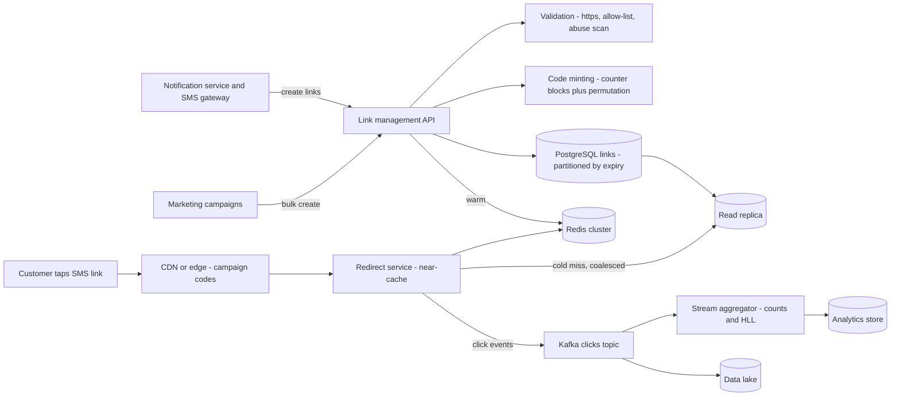
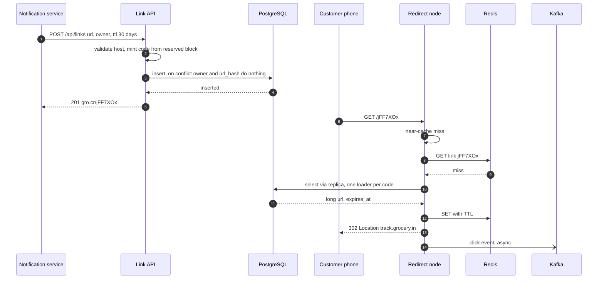
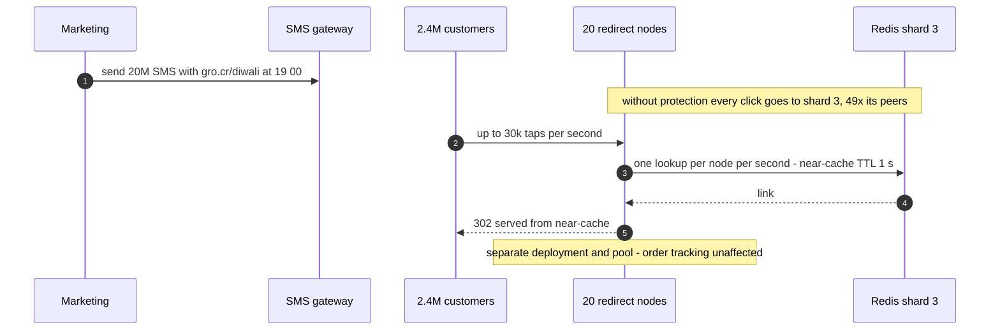
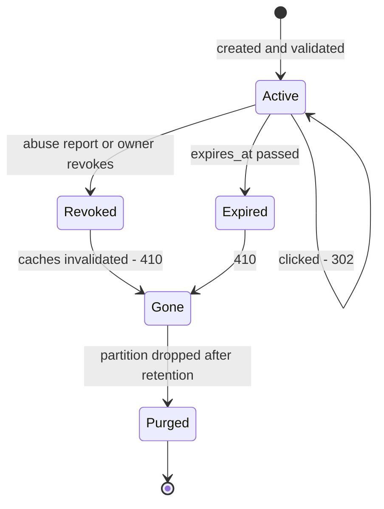

# 38. Case Study: URL Shortener & SMS Short Links

!!! abstract "Chapter at a glance"
    **Reader bands:** B1 → B4 · **Prerequisites:** [Ch 02](../01-foundations/02-back-of-the-envelope-estimation.md), [Ch 07](../01-foundations/07-caching.md), [Ch 11](../02-distributed-core/11-partitioning-and-sharding.md), [Ch 20](../02-distributed-core/20-idempotency-ids-and-distributed-locks.md) · **What you will build:** The grocery platform's short-link service, `gro.cr`. It carries every order-tracking, slot-reminder and refund SMS, plus marketing campaigns. This is the classic first interview case study, done properly: requirements, estimation, code generation, the redirect path, caching under campaign spikes, click analytics, abuse prevention and expiry. Four runnable labs, one with a real HTTP server on PostgreSQL.

    - **L1: minting codes.** Over 2 million codes, 6-character truncated MD5 hashes produced **40 collisions** (the birthday bound predicts 35). A plain counter gives 5-character codes, but **100%** of their neighbours are other customers' live links. A counter passed through a keyed Feistel permutation is unique by construction, needs no lookup, and neighbour guesses hit **0.00%**.
    - **L2: a real shortener.** JDK HttpServer and PostgreSQL. A retried create returned the **same** code. `http`, a `grocery.in@evil.example` userinfo trick and a look-alike domain were all refused. An expired link returned **410** and an unknown one **404**. Under 50,000 Zipf-distributed redirects the cache absorbed **85%**. **716** of the database reads were concurrent misses on the same cold code, a small thundering herd.
    - **L3: the read path.** An LRU cache holding 1% of links served **58.5%** of 10 million clicks; 10x the memory reached only **77.7%**. A 20-million-SMS campaign put **27,184 req/s** on one Redis shard, **49x** its peers. A 1-second near-cache on each node cut that to **570**.
    - **L4: counting clicks.** On PostgreSQL with durable commits, a per-click `UPDATE` on one hot campaign row ran at **~2,300 clicks/s** with a **~67 ms p99**. Micro-batching made the redirect's cost a **0.01 ms** memory increment and used **20x fewer statements**. Merged HyperLogLog sketches counted 663,668 unique devices within **+0.41%** in 16 KB each; adding per-node counts overstated them by **294%**.

    · **Reading time:** 100 min + code

---

## 1. Introduction & Why It Matters

### 1.1 A story: the link that took down checkout

The grocery platform's first short-link service was a weekend project: a `links` table with an auto-increment id, base62-encoded, and a controller that looked it up and returned a 301. It worked for a year. Then four things happened in one Diwali week:

1. **Enumeration.** A security researcher noticed that `gro.cr/6laZE` and `gro.cr/6laZF` were both order-tracking links — for different customers. Each tracking page showed the delivery address and the rider's phone number. Sequential codes had turned every SMS into a key to its neighbours.
2. **The campaign spike.** Marketing sent 20 million SMS with one offer link at 7 pm. Every click hit the same row, the same Redis key, the same shard. The redirect service's connection pool — shared with the order-tracking API — was exhausted, and customers opening "where is my order?" links saw errors.
3. **Analytics lied.** The dashboard showed 40% fewer clicks than the SMS gateway's delivery count suggested. The 301 redirects were **cached by browsers**: repeat clicks never reached the server. At the same time WhatsApp's link-preview crawler inflated the "clicks" on shared links.
4. **Phishing.** Anyone with an internal API token could shorten any URL. A compromised partner account created `gro.cr/kyc` pointing at a look-alike login page, and the platform's own trusted domain delivered it.

The rebuilt service, which this chapter designs, treats a short link as what it is: a **tiny, public, security-sensitive, read-heavy key-value lookup with spiky traffic and analytics on the side.**

!!! quote "The thesis of this chapter"
    A URL shortener looks trivial — a map from code to URL — which is why interviewers love it: all the difficulty is in the details that production adds. **Code generation** is a trade-off between coordination, collisions, length and guessability (L1). **Writes must be idempotent and validated**, because retries are normal and a trusted domain is a phishing tool (L2). **The read path is a caching problem with a hot-key twist**: skewed popularity makes a small cache effective, but a campaign concentrates load on one key that sharding cannot spread (L3). **Analytics must never slow the redirect**: count asynchronously, and use sketches for unique counts (L4). Get those four right and the "simple" service survives Diwali.

### 1.2 Where this lives in the grocery platform

| Producer of links | Volume | Lifetime | Notes |
|---|---|---|---|
| Notification service — order tracking, OTP-free deep links, slot reminders, refunds | ~2M/day | 30 days | Personal: the page behind must still authenticate |
| Marketing — campaign links, one per campaign or per recipient | 1–20M per campaign | 90 days | Personalised links for attribution; UTM parameters |
| Support — links in chat and email | ~50k/day | 90 days | |
| Partners/vendors — store pages, offers | Low | Until revoked | Allow-listed destinations only |

The service sits behind the SMS pipeline ([Ch 40](40-notification-system.md)) and in front of the web and app landing pages. India's SMS rules make it part of compliance too: links in commercial and transactional SMS must be on the sender's registered, whitelisted URLs in the DLT system (TRAI, from late 2024 — VERIFY current rules), so a controlled first-party shortener is effectively mandatory.

### 1.3 Learning objectives

By the end you will be able to:

- **Run the interview framework** on a classic problem: requirements, estimation, API, data model, high-level design, deep dives.
- **Choose a code-generation scheme** and justify it with collision, coordination, length and privacy numbers (L1).
- **Build the write path**: idempotent creation, destination validation, custom aliases, expiry (L2).
- **Design the read path**: 301 vs 302, caching layers, hot keys and campaign spikes (L2, L3).
- **Design click analytics** that never slows a redirect, including unique counts (L4).
- **Handle abuse, privacy and lifecycle**: phishing, enumeration, bots, deletion and data retention.

---

## 2. Core Concepts — Beginner to Deep

### 2.1 Intuition: a coat-check counter <span class="band b1">B1</span>

A short link is a coat-check ticket. You hand over a long URL (the coat) and get a small ticket (the code). Anyone holding the ticket can collect the coat. So:

- Tickets must be **unique**. Two coats on one ticket is a disaster.
- Tickets should be **short**. They go into 160-character SMS.
- Tickets should **not be guessable** if the coats are personal. Ticket 41 shouldn't tell you that ticket 42 exists.
- The counter must be **fast** at returning coats, because far more people collect than deposit.
- Old coats are eventually **cleared out**, and a cleared ticket must say "gone", not hand out someone else's coat.

### 2.2 Requirements <span class="band b1">B1</span>

**Functional**

- Create a short link for a long URL, with owner, optional custom alias and optional expiry; bulk-create for campaigns.
- Redirect `GET /{code}` to the long URL.
- Expire and revoke links; report abuse.
- Click analytics per link and campaign: total clicks, unique visitors, by time, device and region.

**Non-functional**

- **Redirect latency**: p99 under 20 ms server-side; the redirect is on the path of every SMS tap.
- **Availability**: 99.95% for redirects, since a broken tracking link becomes a support call. Creation can be less available, because notification sends can retry.
- **Scale**: see §2.3; spikes from campaigns matter more than averages.
- **Security**: destinations limited to allow-listed domains; codes not enumerable; no personal data in codes or URLs.
- **Durability**: a link must not disappear or change destination before it expires.

**Out of scope** (say so in an interview): link-in-bio pages, QR design, a public consumer shortener.

### 2.3 Estimation <span class="band b1">B1</span>

Using [Ch 02](../01-foundations/02-back-of-the-envelope-estimation.md)'s method:

| Quantity | Estimate |
|---|---|
| Transactional links | 2M/day ≈ **23 creates/s** average |
| Personalised campaign | 20M links in 1 hour ≈ **5,600 creates/s** (bulk API) |
| Redirects, normal | ~3 clicks per tracking link ≈ 6M/day ≈ **70/s** average, a few thousand/s at evening peak |
| Redirects, campaign | 20M SMS × 12% click-through, decaying over ~10 min → **~30,000/s peak** on one code (L3) |
| Row size | code 7 B + URL ~150 B + owner, timestamps, hash ≈ **~300 B** with index overhead |
| Live rows | 2M × 30 d + ~8M/day campaign × 90 d ≈ **~780M rows ≈ 230 GB** — bounded by expiry |
| Code space | 62^7 ≈ **3.5 trillion**; at 2M/day that lasts thousands of years (L1) |

Three conclusions shape the design. **Reads dominate and are spiky**, so the read path is cache-first and must survive hot keys. **Storage is modest because links expire**, so a single well-run relational database (partitioned) is enough — no need to reach for a wide-column store by reflex. **Bulk creation** needs a batch API and cheap code minting.

### 2.4 API <span class="band b2">B2</span>

```http
POST /api/links                       Idempotency-Key: 7f3c...   (or natural key: owner + url)
{ "url": "https://track.grocery.in/orders/ORD-88213?t=f3a9", "owner": "notification-svc", "ttlDays": 30 }
→ 201 { "code": "jFF7XOx", "short": "https://gro.cr/jFF7XOx", "expiresAt": "..." }
→ 200 same body with "existing": true    (retry)
→ 422 { "error": "destination host 'grocery-in.example' is not on the allow-list" }

POST /api/links:batch                 up to 10,000 items → 202 + job id, results file (campaigns)
PUT  /api/aliases/diwali              custom alias → 409 if taken or reserved
DELETE /api/links/{code}              revoke → subsequent GET returns 410
GET  /{code}                          → 302 Location: ... | 404 | 410
GET  /api/links/{code}/stats          clicks, uniques, by hour/device/region (from the analytics store)
```

The redirect endpoint is public and unauthenticated. The management API is internal, authenticated per service ([Ch 23](../03-production/23-security-architecture.md)), and rate-limited per owner ([Ch 39](39-distributed-rate-limiter.md)).

### 2.5 Generating codes ⭐ <span class="band b2">B2</span>

L1 compares four schemes over 2 million codes:

| Scheme | Length | Collisions | Uniqueness check per insert | Guessable neighbours |
|---|---|---|---|---|
| A) Hash of URL, truncated to 6 base62 | 6 | **40** (birthday bound ≈ 35) | Yes (must detect and retry) | No |
| B) Random 7 base62, check-and-retry | 7 | 0 (after retry) | **Yes, every insert** | No |
| C) Counter → base62 | **5** | 0 | No | **100%** |
| D) Counter → keyed permutation → base62 | 7 | 0 | **No** | **0.00%** |

- **Hash truncation** is attractive because it needs no coordination and dedupes identical URLs for free. But collisions grow with n²/2N — 40 in 2M codes, millions per year at scale — so you still need check-and-retry. And "same URL → same code" is wrong across owners anyway (different expiry, analytics, revocation).
- **Random codes** are simple and unguessable, and collisions stay rare while the space is sparse (0.00006% full in L1). The cost is a uniqueness check on every insert — a unique index and a retry loop. That's fine for most systems.
- **Counters** are perfect for the database: unique, short, no lookup. They are a privacy failure for personal links (§1.1).
- **Counter + permutation** keeps the counter's properties and removes the ordering. A Feistel network with secret round keys is a bijection on the 62^7 space; cycle-walking keeps outputs inside it. Two consecutive counter values map to unrelated-looking codes (`jFF7XOx`, `jstj0mT`, `pt1IVd8`…).

**Getting counter values without a bottleneck**: each node reserves a **block** (L2: one `nextval` on a sequence per 1,000 codes — 11 round-trips for 10,003 codes). Alternatives are a Snowflake-style id ([Ch 20](../02-distributed-core/20-idempotency-ids-and-distributed-locks.md)), whose 64 bits are too long for 7 characters, or ranges leased from ZooKeeper/etcd. Blocks waste unused values when a node restarts — irrelevant in a 3.5-trillion space.

!!! warning "A permutation hides order, not existence"
    Codes from a 3.5-trillion space with a few hundred million live links are sparse, so random guessing rarely hits. But "rarely" isn't "never" at millions of guesses. Rate-limit 404s per client ([Ch 39](39-distributed-rate-limiter.md)), and never let a short code alone unlock personal data: the tracking page behind it still requires a signed token or login.

### 2.6 The write path <span class="band b2">B2</span>

1. **Authenticate** the calling service; check its quota.
2. **Validate the destination** (L2): parse it with a real URL parser, require `https`, reject user-info (`https://grocery.in@evil.example` points at `evil.example`), and require an **allow-listed host** — exact match, not "contains grocery". Optionally scan with a safe-browsing service for partner links.
3. **Idempotency**: the notification service retries on timeouts. Either honour an `Idempotency-Key` header or use a natural key — L2 uses a unique `(owner, sha256(url))` constraint with `insert … on conflict do nothing`, then reads the existing code. A retry returns **200 with the same code**, never a second link.
4. **Mint the code** (§2.5) or reserve a custom alias (checked against a reserved-word list: `api`, `admin`, `login`, brand names, profanity).
5. **Store** with owner, created/expiry timestamps and campaign id.
6. **Warm the cache** for campaign links created ahead of a send (L3).

### 2.7 The read path: 301 vs 302 ⭐ <span class="band b2">B2</span>

| Status | Meaning | Browser caching | Use |
|---|---|---|---|
| **301** Moved Permanently | Destination will never change | Browsers and proxies may cache indefinitely | Rarely: you lose analytics and the ability to revoke |
| **302** Found / **307** Temporary | Destination may change | Not cached unless headers say so | **Default**: every click reaches you, revocation works |
| **308** Permanent (method-preserving) | As 301 for non-GET | Cached | Not for short links |
| **404** / **410** | Unknown / gone for good | 410 may be cached | Unknown code / expired or revoked |

L2 returns **302** with `Cache-Control: private, max-age=0`. The §1.1 analytics gap came from 301s: browsers served repeat clicks from cache. The trade-off is explicit: 302 means **you serve every click**, so the read path must be cheap.

The read path, in order:

1. **Edge/CDN** (optional) for campaign codes, with short TTLs and the redirect logic in an edge function.
2. **In-process near-cache** on every redirect node — seconds of TTL, the hot-key defence (L3).
3. **Distributed cache** (Redis) — minutes to hours of TTL, holding the working set.
4. **Database** — the source of truth, reached on cold misses. Coalesce concurrent misses per key: L2 saw **716** duplicate reads when many requests missed the same cold, popular code at once ([Ch 07](../01-foundations/07-caching.md)).
5. **Negative caching** for unknown codes, briefly, so enumeration attempts don't reach the database.

### 2.8 Caching under skew and hot keys ⭐ <span class="band b3">B3</span>

Link popularity is heavily skewed. L3 models it as Zipf (s = 1.0 — measure your own) and replays 10 million clicks over 1 million links:

| LRU size | % of links | Hit ratio | Memory |
|---|---|---|---|
| 1,000 | 0.1% | 40.3% | 0.2 MB |
| 10,000 | 1% | 58.5% | 2 MB |
| 100,000 | 10% | 77.7% | 20 MB |
| 250,000 | 25% | 85.5% | 50 MB |

The curve flattens: the head is cheap to cache, the long tail always reaches the database. **Size the cache for the head and the database for the tail.**

A **campaign** is a different shape: one key takes most of the traffic. Sharding spreads *keys*, not load, so every click on the offer code lands on one Redis shard — **27,184 req/s, 49x its peers** in L3's 20M-SMS blast. That is still within one shard's capacity (~27% of ~100k simple GETs/s — VERIFY), but the load scales with **the size of the blast, not the cluster**: a ~74M-SMS festival campaign would saturate it, and adding shards changes nothing. Defences:

- **Near-cache** on each node: at most one lookup per node per TTL. With a 1-second TTL on 20 nodes, the hot shard sees **570 req/s**.
- **Pre-warm** scheduled campaigns on every node before the send.
- **Edge caching** of the redirect with a short TTL for campaign codes.
- **Bulkheads**: a separate connection pool and deployment for the redirect path, so a spike can't starve order tracking (§1.1) ([Ch 18](../02-distributed-core/18-resilience-patterns.md)).

### 2.9 Data model and storage <span class="band b3">B3</span>

```sql
create table links (
  code        char(7)      primary key,
  long_url    text         not null,
  owner       text         not null,
  url_hash    bytea        not null,          -- sha256(long_url), for idempotent create
  campaign_id text,
  created_at  timestamptz  not null default now(),
  expires_at  timestamptz,
  revoked_at  timestamptz,
  unique (owner, url_hash)
) partition by range (expires_at);            -- expiry = drop a partition, not a mass DELETE
```

The access pattern is pure key-value (lookup by code), and the live set is ~230 GB. A partitioned PostgreSQL with a read replica or two, fronted by caches, meets it comfortably. **Partitioning by expiry month** turns expiry into `DROP PARTITION` rather than billions of deletes. Put permanent (no-expiry) links in their own partition.

When would you choose DynamoDB or Cassandra instead? When the live set reaches many terabytes, you need multi-region active-active writes, or you want native per-item TTL. The key-value access pattern ports easily. In an interview, name the trigger rather than picking by reflex ([Ch 06](../01-foundations/06-nosql-and-polyglot-persistence.md)).

**Sharding**, if needed, is by hash of code ([Ch 11](../02-distributed-core/11-partitioning-and-sharding.md)). Because codes come from a permutation, they are already uniformly distributed.

### 2.10 Click analytics ⭐ <span class="band b3">B3</span>

Marketing wants clicks, unique visitors, time series and breakdowns — in near real time. The iron rule: **the redirect must not wait for analytics.**

L4 measured three ways to count 40,000 clicks against PostgreSQL with durable commits:

| Strategy | Clicks/s | p99 cost on the redirect | DB statements |
|---|---|---|---|
| `UPDATE` per click, spread over 1,000 links | ~12,000 | ~11 ms | 40,000 |
| `UPDATE` per click, one hot campaign link | **~2,300** | **~67 ms** | 40,000 |
| Buffer + 1 s micro-batch upsert | paced 10,000 | **0.01 ms** | **~2,000** |

A synchronous counter update puts a row lock on the redirect path. It degrades exactly when a campaign makes one link hot, because every commit on that row queues behind the previous one. In production:

- The redirect node emits a **click event** (code, timestamp, hashed device id, user agent, coarse region) to a local buffer, then to **Kafka** ([Ch 14](../02-distributed-core/14-messaging-and-event-streaming.md)).
- A **stream aggregator** (Flink/Kafka Streams) produces per-minute counts per link and campaign into an analytics store (ClickHouse, Druid or Pinot), and the raw events land in the lake for ad-hoc analysis.
- **Unique visitors** use **HyperLogLog**: unique counts don't add across nodes or time windows (L4: adding 20 per-node counts overstated uniques by **294%**), but HLL sketches **merge**. L4's 16 KB sketches came within **+0.41%** (standard error 0.81% at p = 14). Redis `PFADD`/`PFMERGE` and ClickHouse `uniqHLL12` implement the same idea.
- **Bot filtering**: link-preview crawlers (WhatsApp, Slack, iMessage), security scanners and prefetchers fetch links without a human. Identify them by user agent and behaviour (HEAD requests, no JS beacon) and count them separately. Don't block them — previews help click-through.

Counts are seconds behind real time; say so on the dashboard. For money-related attribution (affiliate payouts), reconcile from raw events, not from the real-time counters.

### 2.11 Abuse, privacy and lifecycle <span class="band b3">B3</span>

- **Phishing and open redirects**: allow-listed destination hosts, parsed properly (L2); no public creation; partner links scanned and reviewed; an abuse-report endpoint and a kill switch that revokes a code everywhere, including caches (publish invalidation events).
- **Enumeration**: permuted codes (L1), rate limits on 404s, negative caching, and nothing sensitive behind a code alone.
- **Personal data**: never put phone numbers, names or order details in the long URL's query string in clear. Use opaque tokens resolved server-side. Click events store a **salted hash** of the device id, with retention limits and erasure support ([Ch 36](../04-architect/36-compliance-governance-and-data-residency.md)).
- **Expiry**: 410 after expiry. Don't recycle codes for at least the retention period of any system that might still hold them (SMS archives, screenshots). With a 3.5-trillion space there is no reason to recycle at all.
- **Revocation**: a `revoked_at` column plus a cache-invalidation event; near-caches' short TTLs bound the staleness.

### 2.12 Multi-region and availability <span class="band b4">B4</span>

- **Reads** are replicated to every serving region; a region can serve redirects from its cache and replica even if the primary is down. Stale reads are acceptable for links created seconds ago, except for the creator's own immediate test click. Handle that with read-your-writes, by routing the first lookup of a fresh code to the primary, or by writing through the cache on create ([Ch 10](../02-distributed-core/10-replication.md)).
- **Writes** go to one primary region, with the second region as warm standby ([Ch 27](../03-production/27-reliability-and-disaster-recovery.md)). Because counter blocks are reserved, the standby's minting just continues from the sequence after failover, without collisions.
- **Degraded mode**: if the database is unavailable, redirects continue from caches for the working set; creation fails fast and callers retry (notifications can send without a link as a last resort).
- **SLOs**: redirect availability and latency per region; creation success rate; analytics freshness ([Ch 24](../03-production/24-observability.md)).

### 2.13 Interview framing <span class="band b4">B4</span>

In a 45-minute interview, spend roughly: 5 min requirements, 5 min estimation, 5 min API and data model, 10 min high-level design, 15 min on two deep dives, and 5 min on failure modes and evolution. The strongest deep dives are **code generation** (show the trade-off table, not one scheme) and **hot keys / analytics** (show you know the redirect path must stay cheap). Staff-level signals: bounded storage via expiry, abuse and privacy as first-class requirements, choosing PostgreSQL *or* a KV store with a stated trigger, and bulkheads between campaign spikes and transactional links.

---

## 3. Architecture & Diagrams

### 3.1 Component view



### 3.2 Sequence: happy path, create then click



### 3.3 Sequence: failure path, campaign spike on one code



### 3.4 State: a link's lifecycle



---

## 4. Design Document Excerpt: gro.cr Short-Link Service

!!! note "Design Document (excerpt) — Short-Link Service v2"
    **Status:** Accepted · **Authors:** Messaging platform team · **Reviewers:** Security, SRE, Marketing tech

    | Field | Value |
    |---|---|
    | Context | v1 used sequential codes (enumerable), 301 redirects (lost analytics), one shared pool (campaign spike broke order tracking), synchronous counters, and unrestricted destinations (phishing). TRAI DLT requires whitelisted URLs in SMS. |
    | Decision | 7-char codes from block-allocated counters through a keyed Feistel permutation; 302 redirects; allow-listed https destinations; idempotent create; near-cache + Redis + partitioned PostgreSQL; clicks via Kafka to a stream aggregator with HLL uniques; separate redirect deployment. |
    | Related ADRs | ADR-240 Code scheme: counter blocks + permutation (L1); ADR-241 302 + no-store for redirects; ADR-242 Destination allow-list and idempotent create (L2); ADR-243 Three-tier read path with 1 s near-cache and campaign pre-warm (L3); ADR-244 Async click pipeline, HLL for uniques (L4); ADR-245 PostgreSQL partitioned by expiry month; KV store when live set exceeds ~2 TB or multi-region writes needed; ADR-246 No code recycling; 410 after expiry |

    **Requirements.**

    - **R1** Redirect p99 < 20 ms server-side, 99.95% availability per region.
    - **R2** Survive a 100M-SMS campaign on a single code without affecting transactional links.
    - **R3** No destination outside the allow-list; no enumerable codes; nothing personal in codes or URLs.
    - **R4** Create is idempotent; bulk create 20M links in under an hour.
    - **R5** Click counts within 1 minute; unique visitors within 2%.

    **Decisions in detail.**

    1. **Codes (ADR-240).** Blocks of 1,000 from a sequence; 4-round Feistel over 62^7 with keys in the secrets manager; custom aliases from a separate namespace with a reserved list.
    2. **Redirects (ADR-241).** 302 with `Cache-Control: private, max-age=0`; 410 for expired/revoked; 404 negative-cached for 60 s.
    3. **Write path (ADR-242).** URL parsed with the platform's URL library; https, no user-info, exact host match; unique `(owner, url_hash)`.
    4. **Read path (ADR-243).** Caffeine near-cache 1 s TTL (10k entries); Redis TTL 24 h; miss coalescing per code; campaign codes pre-warmed 10 min before send.
    5. **Analytics (ADR-244).** Click events to Kafka `link-clicks` keyed by code; Flink per-minute aggregates + HLL (p = 14) per link/day; bots flagged by UA list.
    6. **Storage (ADR-245).** Monthly partitions by `expires_at`; permanent links in a `never` partition; two read replicas.

    **Consequences.** 302 means every click is served, so the read path's cost is the design's centre. Counts lag by seconds. Codes are 7 characters, not 5. In exchange: private links, working analytics, isolation from campaigns, and bounded storage.

---

## 5. Hands-On Code — Level Ladder

!!! info "What's real here"
    All four labs are JDK 21. **L2 and L4 run against a real PostgreSQL 16** (L2 also runs a real JDK HttpServer and HttpClient over TCP); L1 and L3 are deterministic simulations with a fixed seed. Timings in L2 and L4 vary by machine; the shapes don't. The Zipf popularity, click-through rate, Redis capacity and decay constant in L3 are stated assumptions.

L2 and L4 need PostgreSQL 16 on port 5581 with a database `shop` and the JDBC driver jar (`postgresql-42.7.4.jar`) in the lab folder; the lab README has a one-command Docker alternative. Run every lab with `-Dstdout.encoding=UTF-8`; JDBC labs also need `-Duser.timezone=UTC`.

### L1 — Four ways to mint a short code <span class="band b2">B2</span>

**Requirement:** "Every order-tracking SMS carries a link. Codes must be short, unique, cheap to mint — and must not let one customer find another's order."

Two million codes are minted four ways. The permutation is a 4-round Feistel network on 42 bits with cycle-walking to stay within 62^7 — a bijection, so uniqueness is guaranteed without storing or checking anything.

```java title="CodeGenL1.java"
// CodeGenL1.java — run with: java CodeGenL1.java   (JDK 21, no dependencies)
// FOUR WAYS TO MINT A SHORT CODE. The grocery platform sends ~2 million SMS a day with a link (order tracking, slot reminders,
// "your refund is processed"). Each link needs a short, unique code: gro.cr/aZ3kP9q. We mint 2,000,000 codes four ways
// and measure what matters: collisions, extra database round-trips, length, and whether an attacker can ENUMERATE other
// customers' links by guessing neighbouring codes (tracking links carry an order id and an address on the page behind them).
//   A) hash the long URL (MD5) and keep the first 6 base62 chars     — no coordination, but collisions
//   B) random 7-char base62, check-and-retry on collision            — needs a uniqueness check per insert
//   C) global counter → base62                                       — unique and short, but sequential (guessable)
//   D) counter → Feistel permutation over 62^7 → base62              — unique, no check needed, not sequential
import java.math.BigInteger;
import java.security.MessageDigest;
import java.util.*;

public class CodeGenL1 {
    static final String ALPHABET = "0123456789ABCDEFGHIJKLMNOPQRSTUVWXYZabcdefghijklmnopqrstuvwxyz";
    static final long SPACE7 = pow(62, 7);                       // 3,521,614,606,208

    static long pow(long b, int e) { long r = 1; for (int i = 0; i < e; i++) r *= b; return r; }
    static String base62(long v, int width) {
        char[] c = new char[width];
        for (int i = width - 1; i >= 0; i--) { c[i] = ALPHABET.charAt((int) (v % 62)); v /= 62; }
        return v == 0 ? new String(c) : null;
    }
    static String base62(long v) { StringBuilder sb = new StringBuilder(); do { sb.append(ALPHABET.charAt((int) (v % 62))); v /= 62; } while (v > 0); return sb.reverse().toString(); }

    // --- D: a 4-round Feistel network on two halves, with cycle-walking so the result stays inside [0, 62^7) ---
    static final long HALF = 1L << 21;                           // 2^42 > 62^7, so split 42 bits into 2 × 21
    static final long[] KEYS = {0x5DEECE66DL, 0x2545F491L, 0x9E3779B9L, 0x7F4A7C15L};  // secret round keys
    static long round(long x, long k) { long h = (x * 0x9E3779B97F4A7C15L) ^ k; h ^= h >>> 29; h *= 0xBF58476D1CE4E5B9L; h ^= h >>> 32; return h & (HALF - 1); }
    static long feistel(long v) {
        long l = v >>> 21, r = v & (HALF - 1);
        for (long k : KEYS) { long t = l ^ round(r, k); l = r; r = t; }
        return (l << 21) | r;
    }
    static long permute(long v) { long x = feistel(v); while (x >= SPACE7) x = feistel(x); return x; }   // cycle-walk

    public static void main(String[] args) throws Exception {
        int n = 2_000_000; Random rnd = new Random(38);
        System.out.printf("Minting %,d short codes. 62^6 = %,d   62^7 = %,d%n%n", n, pow(62, 6), SPACE7);
        System.out.printf("   %-44s %6s %12s %14s %18s%n", "strategy", "length", "collisions", "extra lookups", "neighbour guess hits");

        // A) hash-truncate
        MessageDigest md5 = MessageDigest.getInstance("MD5"); Set<String> a = new HashSet<>(); int aColl = 0;
        for (int i = 0; i < n; i++) {
            String url = "https://grocery.in/orders/ORD-" + (10_000_000 + i) + "/track?t=" + Long.toHexString(rnd.nextLong());
            byte[] h = md5.digest(url.getBytes());
            String code = base62(new BigInteger(1, h).mod(BigInteger.valueOf(pow(62, 6))).longValue(), 6);
            if (!a.add(code)) aColl++;
        }
        System.out.printf("   %-44s %6d %,12d %,14d %18s%n", "A) MD5(url) truncated to 6 base62 chars", 6, aColl, 0, "~0% (random)");

        // B) random + retry
        Set<String> b = new HashSet<>(); int bRetry = 0;
        for (int i = 0; i < n; i++) { String c; do { c = base62(Math.floorMod(rnd.nextLong(), SPACE7), 7); if (b.contains(c)) bRetry++; } while (!b.add(c)); }
        System.out.printf("   %-44s %6d %,12d %,14d %18s%n", "B) random 7 chars, check-and-retry", 7, 0, n + bRetry, "~0% (random)");

        // C) counter
        long start = 100_000_000L; Set<String> c = new HashSet<>(); int cHits = 0;
        for (long i = 0; i < n; i++) c.add(base62(start + i));
        List<String> cList = new ArrayList<>(c);
        for (int i = 0; i < 10_000; i++) { String s = cList.get(rnd.nextInt(cList.size())); if (c.contains(base62(decode(s) + 1))) cHits++; }
        System.out.printf("   %-44s %6d %,12d %,14d %17.1f%%%n", "C) counter → base62", base62(start + n).length(), 0, 0, 100.0 * cHits / 10_000);

        // D) counter → permutation
        Set<Long> dSet = new HashSet<>(); List<String> dList = new ArrayList<>(); Set<String> dCodes = new HashSet<>();
        for (long i = 0; i < n; i++) { long p = permute(start + i); dSet.add(p); String s = base62(p, 7); dList.add(s); dCodes.add(s); }
        int dHits = 0;
        for (int i = 0; i < 10_000; i++) { String s = dList.get(rnd.nextInt(dList.size())); String nb = base62(decode(s) + 1, 7); if (nb != null && dCodes.contains(nb)) dHits++; }
        System.out.printf("   %-44s %6d %,12d %,14d %17.2f%%%n", "D) counter → Feistel permutation → base62", 7, n - dSet.size(), 0, 100.0 * dHits / 10_000);

        System.out.println("\n   First five codes minted by C and D (consecutive counter values):");
        StringBuilder sc = new StringBuilder(), sd = new StringBuilder();
        for (int i = 0; i < 5; i++) { sc.append(base62(start + i)).append(' '); sd.append(dList.get(i)).append(' '); }
        System.out.println("        C: " + sc.toString().trim()); System.out.println("        D: " + sd.toString().trim());

        // birthday check on A
        double expectedA = (double) n * (n - 1) / 2 / pow(62, 6);
        System.out.printf("%n   Birthday estimate for A: n²/2N = %,.0f expected colliding pairs (measured %,d).%n", expectedA, aColl);
        System.out.printf("   Random 7-char space is %.5f%% full after %,d codes, so B needed %,d retries — but still one lookup per insert.%n", 100.0 * n / SPACE7, n, bRetry);
        System.out.printf("   At 2M links/day, 62^7 lasts %,.0f years for C/D; 62^6 would last %,.0f years.%n", SPACE7 / 2e6 / 365, pow(62, 6) / 2e6 / 365);

        System.out.println("\n   → hashing needs no coordination but collides (and two customers' different URLs can't share a code), so it");
        System.out.println("     still needs a check-and-retry — at which point it is B with extra steps. B is simple and unguessable but");
        System.out.println("     costs a uniqueness check on every insert (a unique index and a retry loop). C is perfect for the database and");
        System.out.println("     terrible for privacy: every tracking link's neighbour is another customer's order. D keeps C's properties —");
        System.out.println("     unique by construction, no lookup, one short range per node — and a keyed permutation makes neighbours useless.");
        System.out.println("     A permutation hides ORDER, not existence: codes are still 7 chars from a 3.5-trillion space, so pair it with");
        System.out.println("     rate limiting (Ch 39) and never put secrets behind a short link alone.");
    }
    static long decode(String s) { long v = 0; for (char ch : s.toCharArray()) v = v * 62 + ALPHABET.indexOf(ch); return v; }
}
```

```text title="java -Dstdout.encoding=UTF-8 CodeGenL1.java"
Minting 2,000,000 short codes. 62^6 = 56,800,235,584   62^7 = 3,521,614,606,208

   strategy                                     length   collisions  extra lookups neighbour guess hits
   A) MD5(url) truncated to 6 base62 chars           6           40              0       ~0% (random)
   B) random 7 chars, check-and-retry                7            0      2,000,000       ~0% (random)
   C) counter → base62                               5            0              0             100.0%
   D) counter → Feistel permutation → base62         7            0              0              0.00%

   First five codes minted by C and D (consecutive counter values):
        C: 6laZE 6laZF 6laZG 6laZH 6laZI
        D: jFF7XOx jstj0mT pt1IVd8 d5RctH9 JNOJwOr

   Birthday estimate for A: n²/2N = 35 expected colliding pairs (measured 40).
   Random 7-char space is 0.00006% full after 2,000,000 codes, so B needed 0 retries — but still one lookup per insert.
   At 2M links/day, 62^7 lasts 4,824 years for C/D; 62^6 would last 78 years.

   → hashing needs no coordination but collides (and two customers' different URLs can't share a code), so it
     still needs a check-and-retry — at which point it is B with extra steps. B is simple and unguessable but
     costs a uniqueness check on every insert (a unique index and a retry loop). C is perfect for the database and
     terrible for privacy: every tracking link's neighbour is another customer's order. D keeps C's properties —
     unique by construction, no lookup, one short range per node — and a keyed permutation makes neighbours useless.
     A permutation hides ORDER, not existence: codes are still 7 chars from a 3.5-trillion space, so pair it with
     rate limiting (Ch 39) and never put secrets behind a short link alone.
```

**Reading it:**

- **A) Hash truncation** produced **40** collisions in 2M codes, right where the birthday estimate n²/2N = 35 says it should. At a year's volume the collisions number in the tens of thousands, so hashing still needs a check-and-retry.
- **B) Random** codes needed **0** retries, because the 7-character space is only 0.00006% full, but it still paid **2,000,000** uniqueness lookups.
- **C) Counter** codes are 5 characters and need nothing, but **100%** of sampled neighbours were other live links: `6laZE 6laZF 6laZG…`.
- **D) Counter + permutation**: 0 collisions, 0 lookups, **0.00%** neighbour hits: `jFF7XOx jstj0mT pt1IVd8…`. The cost is two extra characters.

### L2 — A real shortener on PostgreSQL <span class="band b2">B2</span>

**Requirement:** "Services create links, customers follow them. Retries must not duplicate links; nothing may point outside our domains; expired links must say so."

A JDK HttpServer on virtual threads serves `POST /api/links` and `GET /{code}` from PostgreSQL. Codes come from a sequence in blocks of 1,000 per node, passed through L1's permutation. A load phase then sends 50,000 Zipf-distributed redirects over 10,000 links from 200 concurrent clients.

```java title="ShortenerL2.java"
// ShortenerL2.java — run with (PostgreSQL 16 on :5581, db "shop"):
//   java -cp postgresql-42.7.4.jar -Dsun.net.httpserver.nodelay=true ShortenerL2.java
// A REAL SHORTENER: JDK HttpServer + PostgreSQL. Create links with POST /api/links, follow them with GET /{code}.
// What makes it production-shaped rather than a toy:
//   • codes come from a database SEQUENCE handed out in BLOCKS of 1,000 per node (one round-trip per 1,000 links), then a
//     keyed permutation (L1 strategy D) — unique by construction, not guessable
//   • create is IDEMPOTENT per (owner, url): the notification service retries on timeouts, and must not mint a second code
//   • destinations are VALIDATED: https only, host on an allow-list — a public shortener on our domain is a phishing kit,
//     and India's DLT rules for SMS require that links in templates resolve to registered domains
//   • expired links return 410 Gone, unknown ones 404; redirects are 302 (not 301) so every click reaches us (analytics)
//   • a small read-through cache in front of the database for the redirect path
import com.sun.net.httpserver.HttpServer;
import java.net.*;
import java.net.http.*;
import java.nio.charset.StandardCharsets;
import java.security.MessageDigest;
import java.sql.*;
import java.time.*;
import java.util.*;
import java.util.concurrent.*;
import java.util.concurrent.atomic.*;
import java.util.regex.*;

public class ShortenerL2 {
    static final String DB = "jdbc:postgresql://127.0.0.1:5581/shop?user=claude";
    static final Set<String> ALLOWED_HOSTS = Set.of("grocery.in", "track.grocery.in", "pay.grocery.in", "offers.grocery.in");
    static final AtomicLong dbReads = new AtomicLong();

    // ---- code minting: block-allocated sequence + permutation (see CodeGenL1 strategy D) ----
    static final String ALPHABET = "0123456789ABCDEFGHIJKLMNOPQRSTUVWXYZabcdefghijklmnopqrstuvwxyz";
    static final long SPACE7 = 3_521_614_606_208L, HALF = 1L << 21;
    static final long[] KEYS = {0x5DEECE66DL, 0x2545F491L, 0x9E3779B9L, 0x7F4A7C15L};
    static long round(long x, long k) { long h = (x * 0x9E3779B97F4A7C15L) ^ k; h ^= h >>> 29; h *= 0xBF58476D1CE4E5B9L; h ^= h >>> 32; return h & (HALF - 1); }
    static long feistel(long v) { long l = v >>> 21, r = v & (HALF - 1); for (long k : KEYS) { long t = l ^ round(r, k); l = r; r = t; } return (l << 21) | r; }
    static String code(long counter) { long x = feistel(counter); while (x >= SPACE7) x = feistel(x); char[] c = new char[7]; for (int i = 6; i >= 0; i--) { c[i] = ALPHABET.charAt((int) (x % 62)); x /= 62; } return new String(c); }

    static long blockNext = 0, blockEnd = 0; static int blocksFetched = 0;
    static synchronized long nextCounter(Connection c) throws SQLException {
        if (blockNext == blockEnd) {
            try (ResultSet rs = c.createStatement().executeQuery("select nextval('link_block_seq')")) { rs.next(); blockNext = rs.getLong(1) * 1000; blockEnd = blockNext + 1000; blocksFetched++; }
        }
        return blockNext++;
    }

    // ---- validation ----
    static String validate(String url) {
        URI u;
        try { u = new URI(url); } catch (URISyntaxException e) { return "not a valid URL"; }
        if (!"https".equals(u.getScheme())) return "only https destinations are allowed";
        if (u.getRawUserInfo() != null) return "credentials in URL are not allowed";
        if (u.getHost() == null || !ALLOWED_HOSTS.contains(u.getHost().toLowerCase())) return "destination host '" + u.getHost() + "' is not on the allow-list";
        if (url.length() > 2048) return "URL too long";
        return null;
    }

    // ---- read-through cache (bounded LRU) ----
    record Link(String url, Instant expires) {}
    static final Map<String, Link> cache = Collections.synchronizedMap(new LinkedHashMap<>(16, 0.75f, true) {
        protected boolean removeEldestEntry(Map.Entry<String, Link> e) { return size() > 5_000; } });

    static BlockingQueue<Connection> pool = new LinkedBlockingQueue<>();

    public static void main(String[] args) throws Exception {
        for (int i = 0; i < 16; i++) pool.add(DriverManager.getConnection(DB));
        try (Statement s = pool.peek().createStatement()) {
            s.execute("drop table if exists links"); s.execute("drop sequence if exists link_block_seq");
            s.execute("create sequence link_block_seq start 100000");
            s.execute("""
                create table links(code char(7) primary key, long_url text not null, owner text not null,
                  url_hash bytea not null, created_at timestamptz not null default now(), expires_at timestamptz,
                  unique(owner, url_hash))""");
        }
        HttpServer server = HttpServer.create(new InetSocketAddress("127.0.0.1", 0), 512);
        server.setExecutor(Executors.newVirtualThreadPerTaskExecutor());
        server.createContext("/api/links", ex -> {
            String body = new String(ex.getRequestBody().readAllBytes(), StandardCharsets.UTF_8);
            String url = field(body, "url"), owner = field(body, "owner"), ttl = field(body, "ttlDays");
            String err = url == null ? "url is required" : validate(url);
            if (err != null) { send(ex, 422, "{\"error\":\"" + err + "\"}"); return; }
            Connection c = take();
            try {
                byte[] hash = MessageDigest.getInstance("SHA-256").digest(url.getBytes(StandardCharsets.UTF_8));
                String code = code(nextCounter(c));
                try (PreparedStatement ps = c.prepareStatement("insert into links(code,long_url,owner,url_hash,expires_at) values (?,?,?,?,?) on conflict (owner,url_hash) do nothing")) {
                    ps.setString(1, code); ps.setString(2, url); ps.setString(3, owner); ps.setBytes(4, hash);
                    ps.setObject(5, ttl == null ? null : OffsetDateTime.now(ZoneOffset.UTC).plusDays(Long.parseLong(ttl)));
                    if (ps.executeUpdate() == 1) { send(ex, 201, "{\"code\":\"" + code + "\",\"short\":\"https://gro.cr/" + code + "\"}"); return; }
                }
                try (PreparedStatement ps = c.prepareStatement("select code from links where owner=? and url_hash=?")) {   // idempotent replay
                    ps.setString(1, owner); ps.setBytes(2, hash); ResultSet rs = ps.executeQuery(); rs.next();
                    send(ex, 200, "{\"code\":\"" + rs.getString(1) + "\",\"short\":\"https://gro.cr/" + rs.getString(1) + "\",\"existing\":true}");
                }
            } catch (Exception e) { send(ex, 500, "{\"error\":\"" + e.getMessage() + "\"}"); } finally { pool.add(c); }
        });
        server.createContext("/", ex -> {
            String code = ex.getRequestURI().getPath().substring(1);
            if (!code.matches("[0-9A-Za-z]{7}")) { send(ex, 404, ""); return; }
            Link l = cache.get(code);
            if (l == null) {
                Connection c = take();
                try (PreparedStatement ps = c.prepareStatement("select long_url, expires_at from links where code=?")) {
                    dbReads.incrementAndGet(); ps.setString(1, code); ResultSet rs = ps.executeQuery();
                    if (!rs.next()) { send(ex, 404, ""); return; }
                    Timestamp t = rs.getTimestamp(2); l = new Link(rs.getString(1), t == null ? null : t.toInstant()); cache.put(code, l);
                } catch (SQLException e) { send(ex, 500, ""); return; } finally { pool.add(c); }
            }
            if (l.expires() != null && l.expires().isBefore(Instant.now())) { send(ex, 410, ""); return; }
            ex.getResponseHeaders().add("Location", l.url()); ex.getResponseHeaders().add("Cache-Control", "private, max-age=0");
            ex.sendResponseHeaders(302, -1); ex.close();
        });
        server.start();
        String base = "http://127.0.0.1:" + server.getAddress().getPort();
        HttpClient http = HttpClient.newBuilder().version(HttpClient.Version.HTTP_1_1).followRedirects(HttpClient.Redirect.NEVER)
                .executor(Executors.newVirtualThreadPerTaskExecutor()).build();

        System.out.println("Shortener on " + base + " (PostgreSQL 16, JDK HttpServer on virtual threads)\n");
        System.out.println("   Creating links:");
        String track = post(http, base, "{\"url\":\"https://track.grocery.in/orders/ORD-88213?t=f3a9\",\"owner\":\"notification-svc\",\"ttlDays\":\"30\"}");
        post(http, base, "{\"url\":\"https://track.grocery.in/orders/ORD-88213?t=f3a9\",\"owner\":\"notification-svc\",\"ttlDays\":\"30\"}");
        post(http, base, "{\"url\":\"https://offers.grocery.in/diwali?utm_source=sms\",\"owner\":\"marketing\"}");
        post(http, base, "{\"url\":\"http://track.grocery.in/orders/ORD-1\",\"owner\":\"notification-svc\"}");
        post(http, base, "{\"url\":\"https://grocery.in@evil.example/login\",\"owner\":\"marketing\"}");
        post(http, base, "{\"url\":\"https://grocery-in.example/kyc-update\",\"owner\":\"marketing\"}");
        try (Statement s = pool.peek().createStatement()) {   // an expired reminder link, created 31 days ago with a 30-day TTL
            s.execute("insert into links values ('Zz0exp1','https://grocery.in/slots/remind','notification-svc','\\x00'::bytea, now()-interval '31 days', now()-interval '1 day')");
        }
        String trackCode = field(track, "code");
        System.out.println("\n   Following links:");
        for (String c : List.of(trackCode, "Zz0exp1", "aaaaaaa", "../etc")) {
            HttpResponse<Void> r = http.send(HttpRequest.newBuilder(URI.create(base + "/" + c)).build(), HttpResponse.BodyHandlers.discarding());
            System.out.printf("        GET /%-8s → %d %s%n", c, r.statusCode(), r.headers().firstValue("Location").map(x -> "Location: " + x).orElse(""));
        }

        // ---- load: 10,000 links, then 50,000 redirects with a skewed (Zipf-like) popularity, 200 concurrent clients ----
        List<String> codes = new ArrayList<>();
        try (Connection c = DriverManager.getConnection(DB); PreparedStatement ps = c.prepareStatement("insert into links(code,long_url,owner,url_hash) values (?,?,?,?)")) {
            c.setAutoCommit(false);
            for (int i = 0; i < 10_000; i++) {
                String code = code(nextCounter(c)); String url = "https://track.grocery.in/orders/ORD-" + (200_000 + i);
                ps.setString(1, code); ps.setString(2, url); ps.setString(3, "bulk"); ps.setBytes(4, MessageDigest.getInstance("SHA-256").digest(url.getBytes())); ps.addBatch(); codes.add(code);
            }
            ps.executeBatch(); c.commit();
        }
        double[] cdf = new double[codes.size()]; double sum = 0;
        for (int i = 0; i < cdf.length; i++) { sum += 1.0 / (i + 1); cdf[i] = sum; }
        Random rnd = new Random(38); int total = 50_000; String[] picks = new String[total];
        for (int i = 0; i < total; i++) { double x = rnd.nextDouble() * sum; int idx = Arrays.binarySearch(cdf, x); picks[i] = codes.get(idx < 0 ? -idx - 1 : idx); }
        cache.clear(); dbReads.set(0);
        long[] lat = new long[total]; AtomicInteger ok = new AtomicInteger(); Semaphore conc = new Semaphore(200);
        long t0 = System.nanoTime();
        try (var exec = Executors.newVirtualThreadPerTaskExecutor()) {
            for (int i = 0; i < total; i++) {
                final int k = i; conc.acquire();
                exec.submit(() -> {
                    try { long s = System.nanoTime();
                        HttpResponse<Void> r = http.send(HttpRequest.newBuilder(URI.create(base + "/" + picks[k])).build(), HttpResponse.BodyHandlers.discarding());
                        lat[k] = System.nanoTime() - s; if (r.statusCode() == 302) ok.incrementAndGet();
                    } catch (Exception e) { lat[k] = Long.MAX_VALUE; } finally { conc.release(); }
                });
            }
        }
        double secs = (System.nanoTime() - t0) / 1e9; Arrays.sort(lat);
        long distinct = Arrays.stream(picks).distinct().count();
        System.out.printf("%n   Load: %,d redirects over 10,000 links (Zipf popularity, %,d distinct links hit), 200 concurrent clients%n", total, distinct);
        System.out.printf("        302s: %,d   throughput: %,.0f redirects/s   p50 %.2f ms   p99 %.2f ms   (timings vary by machine)%n",
                ok.get(), total / secs, lat[total / 2] / 1e6, lat[(int) (total * 0.99)] / 1e6);
        System.out.printf("        database reads: %,d for %,d redirects — the cache absorbed %.1f%%%n", dbReads.get(), total, 100.0 * (total - dbReads.get()) / total);
        System.out.printf("        but only %,d distinct links were requested: %,d reads were CONCURRENT misses for a code another request was%n", distinct, dbReads.get() - distinct);
        System.out.println("        already loading — a small thundering herd on cold, popular links (fix: coalesce misses per key, Ch 7)");
        System.out.printf("        counter values used: %,d via %d sequence round-trips (blocks of 1,000)%n", codes.size() + 3, blocksFetched);

        System.out.println("\n   → the retry returned the SAME code (200, existing) instead of minting a second link; http, a userinfo trick");
        System.out.println("     that really points at evil.example, and a look-alike domain were all refused before anything was stored.");
        System.out.println("     Expired links say 410 (gone for good), unknown ones 404. Redirects are 302 with no browser caching, so every");
        System.out.println("     click reaches us — the price of analytics is that we must serve every one, which is why the cache matters.");
        server.stop(0); System.exit(0);
    }

    static Connection take() { try { return pool.take(); } catch (InterruptedException e) { throw new RuntimeException(e); } }
    static String field(String json, String k) { Matcher m = Pattern.compile("\"" + k + "\"\\s*:\\s*\"([^\"]*)\"").matcher(json); return m.find() ? m.group(1) : null; }
    static void send(com.sun.net.httpserver.HttpExchange ex, int status, String body) throws java.io.IOException {
        byte[] b = body.getBytes(StandardCharsets.UTF_8); ex.getResponseHeaders().add("Content-Type", "application/json");
        ex.sendResponseHeaders(status, b.length == 0 ? -1 : b.length); if (b.length > 0) ex.getResponseBody().write(b); ex.close();
    }
    static String post(HttpClient http, String base, String json) throws Exception {
        HttpResponse<String> r = http.send(HttpRequest.newBuilder(URI.create(base + "/api/links")).header("Content-Type", "application/json")
                .POST(HttpRequest.BodyPublishers.ofString(json)).build(), HttpResponse.BodyHandlers.ofString());
        System.out.printf("        POST %-58s → %d %s%n", field(json, "url"), r.statusCode(), r.body());
        return r.body();
    }
}
```

```text title="java -cp postgresql-42.7.4.jar -Duser.timezone=UTC -Dsun.net.httpserver.nodelay=true ShortenerL2.java"
Shortener on http://127.0.0.1:43925 (PostgreSQL 16, JDK HttpServer on virtual threads)

   Creating links:
        POST https://track.grocery.in/orders/ORD-88213?t=f3a9           → 201 {"code":"jFF7XOx","short":"https://gro.cr/jFF7XOx"}
        POST https://track.grocery.in/orders/ORD-88213?t=f3a9           → 200 {"code":"jFF7XOx","short":"https://gro.cr/jFF7XOx","existing":true}
        POST https://offers.grocery.in/diwali?utm_source=sms            → 201 {"code":"pt1IVd8","short":"https://gro.cr/pt1IVd8"}
        POST http://track.grocery.in/orders/ORD-1                       → 422 {"error":"only https destinations are allowed"}
        POST https://grocery.in@evil.example/login                      → 422 {"error":"credentials in URL are not allowed"}
        POST https://grocery-in.example/kyc-update                      → 422 {"error":"destination host 'grocery-in.example' is not on the allow-list"}

   Following links:
        GET /jFF7XOx  → 302 Location: https://track.grocery.in/orders/ORD-88213?t=f3a9
        GET /Zz0exp1  → 410 
        GET /aaaaaaa  → 404 
        GET /../etc   → 404 

   Load: 50,000 redirects over 10,000 links (Zipf popularity, 6,806 distinct links hit), 200 concurrent clients
        302s: 50,000   throughput: 5,455 redirects/s   p50 23.06 ms   p99 124.84 ms   (timings vary by machine)
        database reads: 7,522 for 50,000 redirects — the cache absorbed 85.0%
        but only 6,806 distinct links were requested: 716 reads were CONCURRENT misses for a code another request was
        already loading — a small thundering herd on cold, popular links (fix: coalesce misses per key, Ch 7)
        counter values used: 10,003 via 11 sequence round-trips (blocks of 1,000)

   → the retry returned the SAME code (200, existing) instead of minting a second link; http, a userinfo trick
     that really points at evil.example, and a look-alike domain were all refused before anything was stored.
     Expired links say 410 (gone for good), unknown ones 404. Redirects are 302 with no browser caching, so every
     click reaches us — the price of analytics is that we must serve every one, which is why the cache matters.
```

**Reading it:**

- The **retry** returned `200 … "existing":true` with the same code `jFF7XOx`. The unique `(owner, url_hash)` constraint makes a concurrent double-create impossible, not just unlikely.
- **Validation** refused `http://`, the user-info trick (`grocery.in@evil.example` really points at `evil.example`) and the look-alike host, all before anything was stored.
- **410** for the expired reminder, **404** for an unknown code and for a path that isn't a code at all. The 302 carries `Cache-Control: private, max-age=0` so browsers don't cache it.
- Under load the cache absorbed **85%** of redirects. Only 6,806 distinct links were requested, though, so **716** database reads were duplicates: concurrent requests missed the same cold, popular code before the first one had loaded it. This is exercise 3.
- **11** sequence round-trips minted 10,003 counter values; block allocation takes the database out of the minting path.

```java title="VERIFY: the same redirect in Spring Boot 3 (WebFlux shown; MVC is analogous)"
@GetMapping("/{code:[0-9A-Za-z]{7}}")
Mono<ResponseEntity<Void>> go(@PathVariable String code, ServerHttpRequest req) {
    return links.resolve(code)                                        // near-cache → Redis → DB, coalesced
        .map(l -> l.expired() ? ResponseEntity.status(HttpStatus.GONE).<Void>build()
                              : ResponseEntity.status(HttpStatus.FOUND).location(l.uri())
                                    .cacheControl(CacheControl.noStore()).<Void>build())
        .doOnNext(r -> clicks.emit(code, req))                        // async, never blocks the redirect
        .defaultIfEmpty(ResponseEntity.notFound().build());
}
```

### L3 — The read path: cache sizing and the campaign spike <span class="band b3">B3</span>

**Requirement:** "How much cache do we need, and what happens at 7 pm when marketing sends 20 million SMS with one link?"

Part 1 replays 10 million Zipf-distributed clicks through a real LRU cache at five sizes. Part 2 simulates the campaign second by second against 20 redirect nodes and a 6-shard Redis cluster, with and without a 1-second near-cache.

```java title="ReadPathL3.java"
// ReadPathL3.java — run with: java ReadPathL3.java   (JDK 21, no dependencies)
// THE READ PATH AT SCALE: how big a cache, and what happens when marketing sends 20 million SMS at 7 pm.
// Part 1 replays 10,000,000 clicks over 1,000,000 links with a skewed popularity (Zipf, s = 1.0 — an assumption; measure
// your own) through a real LRU cache (LinkedHashMap in access order) of several sizes and reports the hit ratio, the
// database reads that remain, and the cache's memory at ~200 bytes per entry.
// Part 2 simulates a campaign spike second by second: 20M SMS with one offer link, clicks decaying over 10 minutes on top
// of normal traffic, served by 20 redirect nodes in front of a 6-shard Redis cluster. Every request for the offer code
// hashes to ONE shard. We compare shard load without and with a 1-second in-process near-cache on each node.
import java.util.*;

public class ReadPathL3 {
    public static void main(String[] args) {
        int links = 1_000_000, clicks = 10_000_000; Random rnd = new Random(38);
        double[] cdf = new double[links]; double sum = 0;
        for (int i = 0; i < links; i++) { sum += 1.0 / (i + 1); cdf[i] = sum; }
        int[] perm = new int[links]; for (int i = 0; i < links; i++) perm[i] = i;
        for (int i = links - 1; i > 0; i--) { int j = rnd.nextInt(i + 1); int t = perm[i]; perm[i] = perm[j]; perm[j] = t; }
        int[] stream = new int[clicks];
        for (int i = 0; i < clicks; i++) { int idx = Arrays.binarySearch(cdf, rnd.nextDouble() * sum); stream[i] = perm[idx < 0 ? -idx - 1 : idx]; }
        long distinct = Arrays.stream(stream).distinct().count();

        System.out.printf("Part 1 — %,d clicks over %,d links (Zipf s=1.0); %,d distinct links clicked at least once.%n%n", clicks, links, distinct);
        System.out.printf("   %-18s %12s %11s %20s %18s%n", "LRU cache size", "% of links", "hit ratio", "DB reads remaining", "cache memory");
        for (int size : new int[]{1_000, 10_000, 50_000, 100_000, 250_000}) {
            LinkedHashMap<Integer, Boolean> lru = new LinkedHashMap<>(size * 2, 0.75f, true) {
                protected boolean removeEldestEntry(Map.Entry<Integer, Boolean> e) { return size() > size; } };
            long hits = 0;
            for (int k : stream) { if (lru.get(k) != null) hits++; else lru.put(k, Boolean.TRUE); }
            System.out.printf("   %,18d %11.1f%% %10.1f%% %,20d %15.0f MB%n", size, 100.0 * size / links, 100.0 * hits / clicks, clicks - hits, size * 200 / 1e6);
        }

        // ---------------- Part 2: the campaign spike ----------------
        int nodes = 20, shards = 6, seconds = 600; double baseRps = 3_000;           // normal redirect traffic
        double totalCampaignClicks = 20_000_000 * 0.12;                              // 12% click-through (assumption)
        double tau = 90;                                                              // clicks decay with a 90 s time constant
        int hotShard = 2;
        long[][] shardLoad = new long[2][shards]; long[] peakHot = new long[2]; long[] peakOther = new long[2]; long peakRps = 0;
        for (int s = 0; s < seconds; s++) {
            double campaign = totalCampaignClicks / tau * Math.exp(-s / tau);
            long hot = Math.round(campaign), normal = Math.round(baseRps * (0.9 + 0.2 * rnd.nextDouble()));
            peakRps = Math.max(peakRps, hot + normal);
            for (int mode = 0; mode < 2; mode++) {
                long[] load = new long[shards];
                for (int k = 0; k < shards; k++) load[k] = normal / shards;              // background spread evenly (misses of L1)
                load[hotShard] += mode == 0 ? hot : Math.min(hot, nodes);               // near-cache: ≤ 1 miss per node per second
                for (int k = 0; k < shards; k++) shardLoad[mode][k] += load[k];
                peakHot[mode] = Math.max(peakHot[mode], load[hotShard]);
                long other = 0; for (int k = 0; k < shards; k++) if (k != hotShard) other = Math.max(other, load[k]);
                peakOther[mode] = Math.max(peakOther[mode], other);
            }
        }
        System.out.printf("%nPart 2 — campaign: 20M SMS × 12%% click-through = %,.0f clicks on ONE code, decaying over 10 min; peak %,d redirects/s.%n",
                totalCampaignClicks, peakRps);
        System.out.println("   Redis cluster: 6 shards. A single Redis shard comfortably serves ~100k simple GETs/s (VERIFY on your hardware).\n");
        System.out.printf("   %-44s %22s %20s %16s%n", "", "peak on HOT shard /s", "peak other shard /s", "hot / other");
        String[] label = {"no near-cache (every click → Redis)", "1 s near-cache on each of 20 nodes"};
        for (int m = 0; m < 2; m++)
            System.out.printf("   %-44s %,22d %,20d %15.0fx%n", label[m], peakHot[m], peakOther[m], (double) peakHot[m] / peakOther[m]);

        double saturatingBlast = 20_000_000.0 * 100_000 / peakHot[0];
        System.out.printf("%n   At this blast the hot shard runs at ~%.0f%% of one shard's capacity — fine today. But its load scales with the%n", 100.0 * peakHot[0] / 100_000);
        System.out.printf("   SIZE OF THE BLAST, not the cluster: a ~%,.0fM-SMS festival campaign saturates it, and adding shards changes nothing.%n", saturatingBlast / 1e6);
        System.out.println("\n   → the cache curve flattens fast: 1% of links as cache serves 58% of clicks, 10x more memory only gets to 78%,");
        System.out.println("     and the long tail of cold links always reaches the database — size the database for the tail, the cache for");
        System.out.println("     the head. The campaign is a different problem: sharding spreads KEYS, not load, so every click on the offer");
        System.out.println("     code lands on one shard at ~49x its peers' load. A near-cache of even one second on each node caps it at one");
        System.out.println("     lookup per node per second; for a scheduled campaign, pre-warm the code on every node before the blast.");
    }
}
```

```text title="java -Dstdout.encoding=UTF-8 ReadPathL3.java"
Part 1 — 10,000,000 clicks over 1,000,000 links (Zipf s=1.0); 762,847 distinct links clicked at least once.

   LRU cache size       % of links   hit ratio   DB reads remaining       cache memory
                1,000         0.1%       40.3%            5,969,787               0 MB
               10,000         1.0%       58.5%            4,149,039               2 MB
               50,000         5.0%       71.8%            2,820,044              10 MB
              100,000        10.0%       77.7%            2,228,565              20 MB
              250,000        25.0%       85.5%            1,448,328              50 MB

Part 2 — campaign: 20M SMS × 12% click-through = 2,400,000 clicks on ONE code, decaying over 10 min; peak 29,769 redirects/s.
   Redis cluster: 6 shards. A single Redis shard comfortably serves ~100k simple GETs/s (VERIFY on your hardware).

                                                  peak on HOT shard /s  peak other shard /s      hot / other
   no near-cache (every click → Redis)                          27,184                  550              49x
   1 s near-cache on each of 20 nodes                              570                  550               1x

   At this blast the hot shard runs at ~27% of one shard's capacity — fine today. But its load scales with the
   SIZE OF THE BLAST, not the cluster: a ~74M-SMS festival campaign saturates it, and adding shards changes nothing.

   → the cache curve flattens fast: 1% of links as cache serves 58% of clicks, 10x more memory only gets to 78%,
     and the long tail of cold links always reaches the database — size the database for the tail, the cache for
     the head. The campaign is a different problem: sharding spreads KEYS, not load, so every click on the offer
     code lands on one shard at ~49x its peers' load. A near-cache of even one second on each node caps it at one
     lookup per node per second; for a scheduled campaign, pre-warm the code on every node before the blast.
```

**Reading it:**

- **Diminishing returns**: 0.1% of links as cache already serves 40%; 1% serves **58.5%**; 25x more (25%) reaches only 85.5%. About 763k distinct links were clicked at least once, and that tail always reaches the database.
- The **campaign** pushes **27,184 req/s** onto the shard holding the offer code, **49x** the other shards. That is fine at this size (~27% of one shard) but scales with the blast: ~74M SMS would saturate it, whatever the shard count.
- A **1-second near-cache** caps the hot shard at one lookup per node per second: **570 req/s**, the same as its peers.

### L4 — Counting clicks without hurting redirects <span class="band b3">B3</span>

**Requirement:** "Marketing wants clicks and unique visitors per link, live — without slowing a single redirect."

Part 1 counts 40,000 clicks against PostgreSQL with durable commits, using 32 concurrent writers, three ways. Part 2 counts unique devices across 20 nodes exactly and with a HyperLogLog implemented in the lab.

```java title="AnalyticsL4.java"
// AnalyticsL4.java — run with (PostgreSQL 16 on :5581, db "shop"):
//   java -cp postgresql-42.7.4.jar AnalyticsL4.java
// COUNTING CLICKS WITHOUT HURTING REDIRECTS. Marketing wants clicks and UNIQUE visitors per link, per campaign, in near
// real time. Part 1 measures three ways to count 40,000 clicks against real PostgreSQL with 32 concurrent writers:
//   A) UPDATE the link's counter on every click — clicks spread over 1,000 links
//   B) the same, but every click is on ONE campaign link (a single hot row)
//   C) append clicks to an in-memory buffer; a flusher aggregates per code and upserts once a second (micro-batching)
// Part 2 counts unique visitors: exact (a HashSet of device ids) vs a HyperLogLog sketch implemented below (p = 14,
// 16,384 registers), including MERGING the sketches of 20 redirect nodes — something exact sets can't do cheaply.
import java.sql.*;
import java.util.*;
import java.util.concurrent.*;
import java.util.concurrent.atomic.*;
import java.util.concurrent.locks.LockSupport;

public class AnalyticsL4 {
    static final String DB = "jdbc:postgresql://127.0.0.1:5581/shop?user=claude";

    public static void main(String[] args) throws Exception {
        try (Connection c = DriverManager.getConnection(DB); Statement s = c.createStatement()) {
            s.execute("drop table if exists link_stats"); s.execute("create table link_stats(code text primary key, clicks bigint not null)");
            s.execute("insert into link_stats select 'L' || g, 0 from generate_series(0, 999) g");
        }
        int clicks = 40_000, writers = 32;
        System.out.printf("Part 1 — %,d clicks, %d concurrent writers, PostgreSQL 16 with durable commits (fsync on)%n%n", clicks, writers);
        System.out.printf("   %-52s %10s %22s %14s %10s%n", "strategy", "clicks/s", "p99 cost on redirect", "DB statements", "counted");
        run("A) UPDATE per click, spread over 1,000 links", clicks, writers, false);
        run("B) UPDATE per click, ONE hot campaign link", clicks, writers, true);
        batched(clicks, writers);

        // ---------------- Part 2: unique visitors ----------------
        int nodes = 20, events = 3_000_000; Random rnd = new Random(38);
        long[] devicePool = new long[900_000]; for (int i = 0; i < devicePool.length; i++) devicePool[i] = rnd.nextLong();
        Set<Long> exact = new HashSet<>(); HLL[] perNode = new HLL[nodes]; for (int i = 0; i < nodes; i++) perNode[i] = new HLL(14);
        for (int i = 0; i < events; i++) {
            long dev = devicePool[(int) Math.min(devicePool.length - 1, Math.abs(rnd.nextGaussian()) * 300_000)];   // repeat visitors
            exact.add(dev); perNode[rnd.nextInt(nodes)].add(dev);                                                   // any node may serve a click
        }
        HLL merged = new HLL(14); for (HLL h : perNode) merged.merge(h);
        long sumOfNodes = 0; for (HLL h : perNode) sumOfNodes += Math.round(h.estimate());
        long est = Math.round(merged.estimate());
        System.out.printf("%nPart 2 — %,d clicks from repeat visitors across %d redirect nodes%n%n", events, nodes);
        System.out.printf("   %-46s %,14d %20s%n", "exact unique devices (HashSet)", exact.size(), "~" + (exact.size() * 56L / 1_000_000) + " MB of set entries");
        System.out.printf("   %-46s %,14d %20s   error %+.2f%%%n", "HyperLogLog, 20 node sketches merged", est, "16 KB per sketch", 100.0 * (est - exact.size()) / exact.size());
        System.out.printf("   %-46s %,14d %20s   error %+.0f%%%n", "adding the 20 per-node unique counts instead", sumOfNodes, "", 100.0 * (sumOfNodes - exact.size()) / exact.size());
        System.out.printf("   HLL standard error at p=14: 1.04/√16384 = %.2f%%%n", 104.0 / Math.sqrt(16384));

        System.out.println("\n   → counting with a synchronous UPDATE puts a row lock on the redirect's critical path; it is tolerable when");
        System.out.println("     clicks spread out and collapses onto one lock exactly when a campaign makes one link hot (several times slower,");
        System.out.println("     with a far worse p99). Micro-batching makes the redirect's cost a memory increment and turns 40,000 increments into one upsert");
        System.out.println("     per link per second (20x fewer statements) — take clicks off the redirect path (in production: a");
        System.out.println("     Kafka topic + stream aggregation, Ch 14), accepting counts that are a second or so behind. Unique visitors");
        System.out.println("     don't add up across nodes or days; HyperLogLog sketches do merge, in kilobytes, within about 1%.");
        System.exit(0);
    }

    static void run(String label, int clicks, int writers, boolean hot) throws Exception {
        try (Connection c = DriverManager.getConnection(DB)) { c.createStatement().execute("update link_stats set clicks = 0"); }
        AtomicInteger next = new AtomicInteger(); AtomicLong stmts = new AtomicLong(); long[] lat = new long[clicks];
        long t0 = System.nanoTime();
        try (var exec = Executors.newFixedThreadPool(writers)) {
            for (int w = 0; w < writers; w++) exec.submit(() -> {
                try (Connection c = DriverManager.getConnection(DB); PreparedStatement ps = c.prepareStatement("update link_stats set clicks = clicks + 1 where code = ?")) {
                    int i;
                    while ((i = next.getAndIncrement()) < clicks) { long s0 = System.nanoTime(); ps.setString(1, hot ? "L7" : "L" + (i * 7919 % 1000)); ps.executeUpdate(); lat[i] = System.nanoTime() - s0; stmts.incrementAndGet(); }
                } catch (SQLException e) { throw new RuntimeException(e); }
                return null;
            });
        }
        double secs = (System.nanoTime() - t0) / 1e9;
        Arrays.sort(lat);
        System.out.printf("   %-52s %,10.0f %19.2f ms %,14d %,10d%n", label, clicks / secs, lat[(int) (clicks * 0.99)] / 1e6, stmts.get(), total());
    }

    static void batched(int clicks, int writers) throws Exception {
        try (Connection c = DriverManager.getConnection(DB)) { c.createStatement().execute("update link_stats set clicks = 0"); }
        ConcurrentHashMap<String, LongAdder> buffer = new ConcurrentHashMap<>(); AtomicLong stmts = new AtomicLong();
        Connection fc = DriverManager.getConnection(DB);
        Runnable flush = () -> {
            try {
                Map<String, Long> snap = new TreeMap<>();
                for (String k : buffer.keySet()) { long v = buffer.get(k).sumThenReset(); if (v > 0) snap.put(k, v); }
                if (snap.isEmpty()) return;
                try (PreparedStatement ps = fc.prepareStatement("insert into link_stats values (?, ?) on conflict (code) do update set clicks = link_stats.clicks + excluded.clicks")) {
                    for (var e : snap.entrySet()) { ps.setString(1, e.getKey()); ps.setLong(2, e.getValue()); ps.addBatch(); }
                    ps.executeBatch(); stmts.addAndGet(snap.size());
                }
            } catch (SQLException e) { throw new RuntimeException(e); }
        };
        ScheduledExecutorService flusher = Executors.newSingleThreadScheduledExecutor();
        flusher.scheduleAtFixedRate(flush, 1, 1, TimeUnit.SECONDS);
        // clicks arrive at a steady 10,000/s for 4 s (as they would from redirect traffic), so the flusher runs several times
        AtomicInteger next = new AtomicInteger(); long[] lat = new long[clicks]; long t0 = System.nanoTime(); double pace = 10_000;
        try (var exec = Executors.newFixedThreadPool(writers)) {
            for (int w = 0; w < writers; w++) exec.submit(() -> {
                int i;
                while ((i = next.getAndIncrement()) < clicks) {
                    long due = t0 + (long) (i / pace * 1e9); long wait = due - System.nanoTime();
                    if (wait > 0) LockSupport.parkNanos(wait);
                    long s0 = System.nanoTime();
                    String code = i % 2 == 0 ? "L7" : "L" + (i * 7919 % 1000);           // half the clicks on the hot link
                    buffer.computeIfAbsent(code, k -> new LongAdder()).increment();
                    lat[i] = System.nanoTime() - s0;
                }
            });
        }
        double secs = (System.nanoTime() - t0) / 1e9;
        flusher.shutdown(); flusher.awaitTermination(5, TimeUnit.SECONDS); flush.run();   // final flush on shutdown
        Arrays.sort(lat);
        System.out.printf("   %-52s %,10.0f %19.4f ms %,14d %,10d%n", "C) buffer + 1 s micro-batch upsert (half on hot link)", clicks / secs, lat[(int) (clicks * 0.99)] / 1e6, stmts.get(), total());
        System.out.println("      (C is paced at 10,000 clicks/s — its limit is the redirect traffic, not the counter)");
        fc.close();
    }

    static long total() throws SQLException {
        try (Connection c = DriverManager.getConnection(DB); ResultSet rs = c.createStatement().executeQuery("select sum(clicks) from link_stats")) { rs.next(); return rs.getLong(1); }
    }

    // ---------------- HyperLogLog ----------------
    static final class HLL {
        final int p, m; final byte[] reg;
        HLL(int p) { this.p = p; this.m = 1 << p; this.reg = new byte[m]; }
        static long mix(long z) { z = (z ^ (z >>> 33)) * 0xff51afd7ed558ccdL; z = (z ^ (z >>> 33)) * 0xc4ceb9fe1a85ec53L; return z ^ (z >>> 33); }
        void add(long item) {
            long h = mix(item); int idx = (int) (h >>> (64 - p)); long w = h << p;
            byte rho = (byte) (w == 0 ? 64 - p + 1 : Long.numberOfLeadingZeros(w) + 1);
            if (rho > reg[idx]) reg[idx] = rho;
        }
        void merge(HLL o) { for (int i = 0; i < m; i++) if (o.reg[i] > reg[i]) reg[i] = o.reg[i]; }
        double estimate() {
            double sum = 0; int zeros = 0;
            for (byte r : reg) { sum += Math.pow(2, -r); if (r == 0) zeros++; }
            double alpha = 0.7213 / (1 + 1.079 / m), e = alpha * m * m / sum;
            return (e <= 2.5 * m && zeros > 0) ? m * Math.log((double) m / zeros) : e;   // small-range correction
        }
    }
}
```

```text title="java -cp postgresql-42.7.4.jar -Duser.timezone=UTC AnalyticsL4.java"
Part 1 — 40,000 clicks, 32 concurrent writers, PostgreSQL 16 with durable commits (fsync on)

   strategy                                               clicks/s   p99 cost on redirect  DB statements    counted
   A) UPDATE per click, spread over 1,000 links             12,253               11.33 ms         40,000     40,000
   B) UPDATE per click, ONE hot campaign link                2,263               67.22 ms         40,000     40,000
   C) buffer + 1 s micro-batch upsert (half on hot link)     10,000              0.0100 ms          2,029     40,000
      (C is paced at 10,000 clicks/s — its limit is the redirect traffic, not the counter)

Part 2 — 3,000,000 clicks from repeat visitors across 20 redirect nodes

   exact unique devices (HashSet)                        663,668 ~37 MB of set entries
   HyperLogLog, 20 node sketches merged                  666,410     16 KB per sketch   error +0.41%
   adding the 20 per-node unique counts instead        2,613,952                        error +294%
   HLL standard error at p=14: 1.04/√16384 = 0.81%

   → counting with a synchronous UPDATE puts a row lock on the redirect's critical path; it is tolerable when
     clicks spread out and collapses onto one lock exactly when a campaign makes one link hot (several times slower,
     with a far worse p99). Micro-batching makes the redirect's cost a memory increment and turns 40,000 increments into one upsert
     per link per second (20x fewer statements) — take clicks off the redirect path (in production: a
     Kafka topic + stream aggregation, Ch 14), accepting counts that are a second or so behind. Unique visitors
     don't add up across nodes or days; HyperLogLog sketches do merge, in kilobytes, within about 1%.
```

**Reading it:**

- **Spread-out updates** manage ~12,000/s with an ~11 ms p99, already a cost on every redirect. On **one hot row** throughput drops to **~2,300/s** and p99 to **~67 ms**: each commit on the row waits for the previous one to flush.
- **Micro-batching** makes the redirect's cost a **0.01 ms** memory increment and writes **~2,000** upserts (one per link per flush) instead of 40,000. All 40,000 clicks were counted, including the final flush on shutdown.
- **Unique visitors**: merged HLL sketches estimated **666,410** against an exact **663,668** (+0.41%, inside the 0.81% standard error) in 16 KB per sketch. Adding per-node unique counts gave **2.6 million** (+294%), because the same device clicks through many nodes.
- In production the buffer is a Kafka topic and the flusher a stream job. The principle is the same: counts are a second behind, and the redirect never waits.


---

## 6. Production Concerns

### 6.1 Failure modes

| Failure | Symptom | Mitigation |
|---|---|---|
| Sequential codes | Neighbouring links enumerable (L1) | Keyed permutation; no personal data behind code alone |
| 301 redirects | Missing clicks; can't revoke | 302/307 with no-store |
| Campaign hot key | One shard/row saturated; shared pool exhausted (L3) | Near-cache, pre-warm, edge, bulkheads |
| Cold-miss stampede | Duplicate DB reads (L2: 716) | Per-key miss coalescing |
| Synchronous counters | Redirect latency tied to row locks (L4) | Async events + aggregation |
| Unrestricted destinations | Phishing on the trusted domain | Allow-list, parser-based validation, abuse kill switch |
| Mass expiry deletes | Vacuum storms, replica lag | Partition by expiry, drop partitions |
| Bot traffic | Inflated clicks | UA/behaviour filtering, separate counts |

### 6.2 Observability

- **RED metrics** on the redirect path, per region and per status (302/404/410), plus cache hit ratio per tier.
- **Hot-key detection**: top codes per node per minute (count-min sketch), alerting when one code exceeds a share of traffic.
- **404 rate per client** as an enumeration signal.
- **Analytics lag**: event time vs aggregation time.
- **Creation**: idempotent replays (200s), validation rejections by reason — a spike in rejections may be an attack or a misconfigured campaign.

### 6.3 Security

- Destination allow-list managed as code, reviewed changes, audit log ([Ch 36](../04-architect/36-compliance-governance-and-data-residency.md)).
- Management API: mTLS/service identity, per-owner quotas.
- Permutation keys rotate only for *new* codes (old codes stay valid — the mapping is only used at mint time).
- Tracking pages behind links require a signed token bound to the order and expiry.

### 6.4 Performance

- The redirect handler does no allocation-heavy work: a near-cache lookup, a header, an async enqueue. It's a good fit for virtual threads or a non-blocking server ([Ch 19](../02-distributed-core/19-concurrency-at-scale-in-java.md)).
- Keep responses tiny: no body on 302, keep-alive, HTTP/2 at the edge.
- Bulk creation: batch inserts (L2 inserted 10,000 in one batch), pre-reserved counter blocks, async results.

### 6.5 Cost

- Storage is small and bounded by expiry; the main costs are the redirect fleet and the analytics pipeline.
- Edge caching of campaign codes is the cheapest capacity for spikes.
- Keep raw click events for a limited period (e.g., 90 days) and aggregates longer ([Ch 35](../04-architect/35-cost-engineering-and-finops.md)).

---

## 7. Anti-Patterns & Pitfalls

!!! danger "1. Auto-increment ids as public codes"
    Every link reveals its neighbours (L1). Permute, or use random codes.

!!! danger "2. Hash truncation without collision handling"
    Birthday collisions arrive far sooner than intuition says — 40 in 2 million at 6 characters (L1).

!!! danger "3. Deduplicating identical URLs across owners"
    Different owners need different expiry, analytics and revocation. Dedupe per owner, if at all.

!!! danger "4. 301 by default"
    Browser caching hides clicks and makes revocation impossible for those who've clicked before.

!!! danger "5. Validating destinations with string matching"
    `contains("grocery.in")` accepts `grocery.in.evil.example` and `grocery.in@evil.example`. Parse, then compare hosts exactly (L2).

!!! danger "6. Public or unauthenticated link creation"
    Your trusted domain becomes a phishing service.

!!! danger "7. Counting clicks synchronously"
    A row lock on the redirect path, worst exactly during campaigns (L4).

!!! danger "8. Summing unique counts"
    Uniques don't add across nodes, days or links (L4: +294%). Use mergeable sketches.

!!! danger "9. Expecting sharding to fix a hot key"
    Sharding spreads keys, not load. One code lives on one shard (L3).

!!! danger "10. One pool for campaigns and transactional links"
    A campaign spike starves order tracking (§1.1). Bulkhead them.

!!! danger "11. Deleting expired rows one by one"
    Billions of deletes cause vacuum and replication pain. Partition by expiry.

!!! danger "12. Recycling codes"
    Old SMS and screenshots still point at them; a recycled code sends someone else's customer to a new destination.

---

## 8. Interview Q&A

### Beginner <span class="band b1">B1</span>

??? question "Q1 [B1] ⭐ Design a URL shortener — what are the core components?"

    **30-second answer:** A write API that validates the long URL, mints a unique short code and stores code → URL. A redirect endpoint that looks up the code, through caches, and returns a 302 to the long URL. A database as the source of truth, a cache for the hot working set, and an asynchronous pipeline for click analytics. Plus expiry, abuse controls and monitoring.

    **Deep answer:** Reads dominate (clicks ≫ creates) and are spiky, so the redirect path is cache-first and must survive hot keys (L3). Code generation is the interesting write-side choice (L1).

    **Trade-offs I'd call out:** 302 vs 301 (analytics vs caching); random vs counter codes (lookups vs guessability).

    **Follow-ups:**
    1. How long should codes be? → 7 base62 chars ≈ 3.5 trillion.
    2. Which status code? → 302/307 by default.

    **Red flags:** Jumping to a NoSQL database without estimating anything.

??? question "Q2 [B1] ⭐ 301 or 302 — which would you use and why?"

    **30-second answer:** 302 (or 307) by default. A 301 says the redirect is permanent, so browsers and proxies may cache it — repeat clicks never reach you, analytics undercount, and you can't revoke or change the destination for anyone who has the cached redirect. A 302 means every click reaches the service, so the read path has to be cheap and well-cached.

    **Deep answer:** L2 returns 302 with `Cache-Control: private, max-age=0`. A 301 can be right for truly permanent vanity links where analytics don't matter.

    **Trade-offs I'd call out:** Server load vs control and measurement.

    **Follow-ups:**
    1. What about 308? → Permanent and method-preserving; same caching issue.
    2. And for expired links? → 410 Gone.

    **Red flags:** "301, because it's faster" without mentioning analytics or revocation.

??? question "Q3 [B1] How many characters does a short code need?"

    **30-second answer:** Work it out from the number of codes you'll ever mint and the alphabet. Base62 gives 62^6 ≈ 56.8 billion and 62^7 ≈ 3.5 trillion. At 2M links/day, 7 characters lasts thousands of years; 6 would last about 78 years but random schemes would collide much sooner. For random codes you also want the space sparse enough that guesses rarely hit a live code.

    **Deep answer:** L1 computes both: 62^7 lasts 4,824 years at 2M/day. A counter needs only 5 characters today — which is exactly why it's guessable.

    **Trade-offs I'd call out:** SMS characters vs sparsity and privacy.

    **Follow-ups:**
    1. Why not base64? → `+` and `/` are awkward in URLs; base62 is URL-safe.
    2. Case-insensitive codes? → Base36 needs more characters.

    **Red flags:** Picking a length without arithmetic.

??? question "Q4 [B1] How do you estimate the load for a shortener?"

    **30-second answer:** Creates per day from the business (2M transactional links/day ≈ 23/s, plus bulk campaigns up to ~5,600/s), clicks per link (~3) for average redirects, and the campaign spike for peak (20M SMS × 12% click-through, decaying over ~10 minutes ≈ 30k/s on one code). Storage = live rows × row size, bounded by expiry: ~780M rows × ~300 B ≈ 230 GB.

    **Deep answer:** The conclusion drives the design: reads are spiky and concentrated, storage is modest, bulk creation needs a batch API (§2.3).

    **Trade-offs I'd call out:** Designing for average vs peak; peaks dominate here.

    **Follow-ups:**
    1. What if links never expired? → Storage grows ~1 TB/year; partition and archive.
    2. What dominates cost? → The redirect fleet and analytics.

    **Red flags:** Using averages only.

### Intermediate <span class="band b2">B2</span>

??? question "Q5 [B2] ⭐ Compare ways to generate short codes."

    **30-second answer:** Hash-and-truncate needs no coordination but collides (birthday bound) and still needs check-and-retry. Random codes are unguessable but need a uniqueness check per insert. A counter is unique and short with no lookup but is enumerable. A counter through a keyed permutation keeps the counter's uniqueness and no-lookup property while hiding the order.

    **Deep answer:** L1 over 2M codes: hash-truncate 40 collisions (35 predicted); random 0 retries but 2M lookups; counter 100% neighbour hits; permutation 0 collisions, 0 lookups, 0.00% neighbour hits.

    **Trade-offs I'd call out:** Coordination (counter blocks) vs per-insert checks vs privacy.

    **Follow-ups:**
    1. How do nodes get counter values? → Reserve blocks from a sequence or a coordination service.
    2. What if a node crashes mid-block? → Unused values are lost — harmless.

    **Red flags:** "MD5 the URL and take 6 characters" with no collision plan.

??? question "Q6 [B2] How do you make link creation idempotent?"

    **30-second answer:** Either an `Idempotency-Key` header stored with the result, or a natural key: a unique constraint on (owner, hash(url)). Insert with `on conflict do nothing`; if nothing was inserted, read and return the existing code with 200. Retries then never mint a second link.

    **Deep answer:** L2: the notification service's retry returned the same code `jFF7XOx` with `existing: true`. Note that a counter value was still consumed — harmless.

    **Trade-offs I'd call out:** Natural key dedupes legitimately repeated creates too — usually desired per owner.

    **Follow-ups:**
    1. Different TTL on retry? → Treat as the same link; or include TTL in the key if semantics differ.
    2. Across owners? → Different links.

    **Red flags:** Checking existence with a SELECT then INSERT without a unique constraint (race).

??? question "Q7 [B2] How do you stop the shortener being used for phishing?"

    **30-second answer:** No public creation; authenticated services with quotas; destinations restricted to allow-listed hosts, validated by parsing the URL (https only, no user-info, exact host match), not string matching; safe-browsing scans for partner links; an abuse report endpoint and a kill switch that revokes a code and invalidates caches.

    **Deep answer:** L2 rejected `http://`, `https://grocery.in@evil.example/login` (really `evil.example`) and `grocery-in.example`. DLT rules for SMS in India also require whitelisted URLs.

    **Trade-offs I'd call out:** Flexibility for marketing vs safety; manage the allow-list as code with review.

    **Follow-ups:**
    1. Redirect chains? → Don't allow destinations that are themselves shorteners.
    2. How fast can you revoke? → Cache TTLs plus invalidation events bound it to seconds.

    **Red flags:** `url.contains("grocery.in")`.

??? question "Q8 [B2] ⭐ How would you cache redirects?"

    **30-second answer:** Three tiers: a short-TTL in-process near-cache on each redirect node, a distributed cache (Redis) for the working set, and the database for cold misses — with per-key miss coalescing and brief negative caching of unknown codes. Popularity is skewed, so a small cache captures most traffic; the tail always reaches the database.

    **Deep answer:** L3: 1% of links as cache served 58.5% of clicks, 10% only 77.7%. L2 saw 716 duplicate DB reads from concurrent misses on the same cold code — coalescing fixes that.

    **Trade-offs I'd call out:** Near-cache staleness vs hot-key protection.

    **Follow-ups:**
    1. Revocation with near-caches? → Short TTL plus invalidation events.
    2. Cache warming? → Pre-warm campaign codes before sends.

    **Red flags:** Only a Redis cache, with no plan for hot keys.

??? question "Q9 [B2] SQL or NoSQL for the links table?"

    **30-second answer:** Estimate first. With expiry the live set is ~230 GB of pure key-value lookups, which partitioned PostgreSQL with read replicas and caches serves comfortably, and it gives unique constraints for idempotency. Move to DynamoDB/Cassandra if the live set grows to many terabytes, if you need multi-region active-active writes, or if you want native per-item TTL at huge scale.

    **Deep answer:** Partition by expiry month so expiry is dropping partitions ([Ch 06](../01-foundations/06-nosql-and-polyglot-persistence.md)).

    **Trade-offs I'd call out:** Operational familiarity and constraints vs horizontal write scaling.

    **Follow-ups:**
    1. Shard key? → Hash of code; permuted codes are already uniform.
    2. How do you delete expired links? → Drop partitions.

    **Red flags:** "NoSQL because it's a key-value problem" with no numbers.

### Senior <span class="band b3">B3</span>

??? question "Q10 [B3] ⭐ A campaign sends 20M SMS with one link. What breaks and how do you design for it?"

    **30-second answer:** All clicks hit one key: one Redis shard, one DB row if you count synchronously, and possibly a shared connection pool. Sharding doesn't help because it spreads keys, not load. Defend with a near-cache on every node (at most one lookup per node per TTL), pre-warming, edge caching for campaign codes, async click counting, and a separate deployment/pool for redirects so transactional links are unaffected.

    **Deep answer:** L3: 27,184 req/s on one shard, 49x its peers, reduced to 570 with a 1 s near-cache on 20 nodes. At ~74M SMS that shard would saturate. L4: a synchronous hot-row counter ran at ~2,300 clicks/s with a ~67 ms p99.

    **Trade-offs I'd call out:** Near-cache staleness (1 s) vs load.

    **Follow-ups:**
    1. What if the campaign is unannounced? → Hot-key detection promotes codes to the near-cache automatically.
    2. Per-recipient links instead? → Spreads load, costs 20M creates — use the bulk API.

    **Red flags:** "Add more Redis shards."

??? question "Q11 [B3] ⭐ How do you build click analytics without slowing redirects?"

    **30-second answer:** The redirect only emits an event (buffered, async) to Kafka. A stream processor aggregates per link and time bucket into an analytics store, and raw events go to the lake. Unique visitors use HyperLogLog sketches, which merge across nodes and windows. Bots and link-preview crawlers are flagged and counted separately.

    **Deep answer:** L4: micro-batching cut the redirect's cost to a 0.01 ms memory increment and statements 20x; HLL merged across 20 nodes was within +0.41%, while summing per-node uniques overstated by 294%.

    **Trade-offs I'd call out:** Seconds of lag; possible loss of buffered events on a crash (acceptable for analytics, not billing).

    **Follow-ups:**
    1. Exactly-once counts? → Idempotent event ids and transactional sinks, if money depends on it.
    2. Real-time dashboard? → Per-minute aggregates, clearly labelled as lagging.

    **Red flags:** `UPDATE clicks = clicks + 1` in the redirect handler.

??? question "Q12 [B3] How do you handle expiry and deletion at scale?"

    **30-second answer:** Store `expires_at`, return 410 after it (checked on read, so expiry is exact without a sweeper), and partition by expiry month so purging is `DROP PARTITION` after a retention period. Revocation sets `revoked_at` and publishes a cache invalidation. Never recycle codes.

    **Deep answer:** L2 returned 410 for a link past its TTL. Mass deletes would cause vacuum and replication lag.

    **Trade-offs I'd call out:** Keeping expired rows for a grace period (support queries, "this link expired" pages) vs storage.

    **Follow-ups:**
    1. Can users extend expiry? → Yes, if the row still exists; moves partitions.
    2. Erasure requests? → Delete the link and the hashed-device click events per policy.

    **Red flags:** A nightly `DELETE WHERE expires_at < now()` over billions of rows.

??? question "Q13 [B3] How do you prevent enumeration of short links?"

    **30-second answer:** Non-sequential codes (random, or a keyed permutation of a counter), a sparse code space, rate limits and alerts on 404s per client, negative caching so probes don't reach the database, and — most important — nothing sensitive reachable by the code alone: the page behind it requires a signed token or login.

    **Deep answer:** L1: counter codes had 100% neighbour hits, permuted codes 0.00%. With ~780M live codes in 3.5T, a random guess hits ~0.02% of the time — which is why rate limits still matter.

    **Trade-offs I'd call out:** Longer codes vs SMS length.

    **Follow-ups:**
    1. Is the permutation secret important? → Yes; with the keys, codes can be inverted to counters.
    2. What about custom aliases? → Public by nature; never for personal links.

    **Red flags:** "Nobody will guess them."

??? question "Q14 [B3] How do you support a bulk campaign of 20M personalised links?"

    **30-second answer:** A batch API that accepts large files or streams, returns a job id, and writes results asynchronously. Pre-reserve large counter blocks, mint codes in memory, and insert with batched statements or COPY into the right expiry partition. Warm caches only for the likely-hot subset. Throttle so transactional creates keep their SLO.

    **Deep answer:** At ~5,600 inserts/s for an hour, PostgreSQL batching is comfortable; L2 inserted 10,000 in one batch.

    **Trade-offs I'd call out:** Personalised attribution vs 20M rows and a larger cache footprint.

    **Follow-ups:**
    1. Alternative? → One campaign link plus a signed recipient parameter.
    2. Partial failures? → Idempotent per-item keys; resumable jobs.

    **Red flags:** 20M synchronous single-row API calls.

### Architect <span class="band b4">B4</span>

??? question "Q15 [B4] ⭐ Design the short-link service for a national-scale grocery platform, end to end."

    **30-second answer:** Internal-only creation with allow-listed destinations and idempotent create; 7-char codes from counter blocks through a keyed permutation; 302 redirects; a separate redirect deployment with near-cache, Redis and replicas; PostgreSQL partitioned by expiry; click events to Kafka, stream-aggregated with HLL uniques; hot-key detection, pre-warming and edge caching for campaigns; abuse kill switch; SLOs per region.

    **Deep answer:** §4 and the labs: L1 for codes, L2 for the write/read contract, L3 for capacity and hot keys, L4 for analytics.

    **Trade-offs I'd call out:** Postgres vs KV store trigger; 302 cost; count lag.

    **Follow-ups:**
    1. Multi-region? → Replicated reads everywhere, single write region, block allocation survives failover.
    2. Biggest risk? → Abuse of the trusted domain.

    **Red flags:** A design without abuse, privacy or campaign considerations.

??? question "Q16 [B4] How do you make redirects survive a database or region outage?"

    **30-second answer:** Redirects are read-only and cacheable: serve from near-cache and Redis for the working set, from local replicas for misses, and fail creation fast while the primary is down. Replicate to a second region with its own caches; route users by DNS or anycast. Tolerate stale reads except read-your-writes for a creator's first click.

    **Deep answer:** Degraded mode keeps the vast majority of clicks working because the head of the popularity curve is cached (L3).

    **Trade-offs I'd call out:** Long cache TTLs improve survival but slow revocation.

    **Follow-ups:**
    1. Fresh links during failover? → May 404 until replicated; creation retries.
    2. How do you test it? → Game days that kill the primary ([Ch 27](../03-production/27-reliability-and-disaster-recovery.md)).

    **Red flags:** No distinction between the read and write availability requirements.

??? question "Q17 [B4] Build vs buy: would you use a SaaS shortener?"

    **30-second answer:** For marketing-only links a SaaS (Bitly-style) can be fine. For transactional links carrying order tracking, you want a first-party domain, control over destinations and data (DLT whitelisting, privacy, residency), latency and availability you control, and no per-click fees at millions of clicks per day. Many companies run both: first-party for transactional, SaaS for some marketing.

    **Deep answer:** The core is small; the value is in integration (notifications, analytics, abuse) — a strong case for building it on the paved road ([Ch 37](../04-architect/37-leading-architecture-at-scale.md)).

    **Trade-offs I'd call out:** Build and run cost vs control and compliance.

    **Follow-ups:**
    1. What would change your mind? → No platform team; low volume.
    2. Data residency? → A SaaS may store click data abroad ([Ch 36](../04-architect/36-compliance-governance-and-data-residency.md)).

    **Red flags:** Ignoring compliance for SMS links.

??? question "Q18 [B4] How would you evolve the code scheme without breaking existing links?"

    **30-second answer:** Codes are forever: existing codes stay resolvable by lookup regardless of how they were minted. A new scheme (longer codes, new permutation keys, a prefix for a new namespace) applies only to new codes. Keep the namespaces disjoint (e.g., by length or a leading character) so new codes never collide with old ones.

    **Deep answer:** Because the permutation is used only at mint time, rotating keys changes future codes but must guarantee disjointness — for example by using a fresh counter range per key version.

    **Trade-offs I'd call out:** Simplicity vs future flexibility; reserve a version bit early.

    **Follow-ups:**
    1. Moving from 7 to 8 characters? → Disjoint by length; nothing to migrate.
    2. Migrating from sequential v1 codes? → Keep them resolvable; expire them naturally.

    **Red flags:** Re-minting codes for existing links.

??? question "Q19 [B4] What are the privacy obligations for click analytics?"

    **30-second answer:** Click events contain personal data (IP, device id, possibly linked to a customer via the personalised link). Minimise: coarse region, salted hashed device ids, no raw IPs beyond short security retention; state the purpose; set retention (raw 90 days, aggregates longer); support erasure; keep data in-region; and never put personal identifiers in URLs.

    **Deep answer:** HLL sketches store no identifiers — a privacy win as well as a size win ([Ch 36](../04-architect/36-compliance-governance-and-data-residency.md)).

    **Trade-offs I'd call out:** Attribution precision vs minimisation.

    **Follow-ups:**
    1. Per-recipient links? → Personal data by design; treat accordingly.
    2. Third-party pixels on landing pages? → Consent required.

    **Red flags:** Logging full URLs with phone numbers in query strings.

??? question "Q20 [B4] What would you monitor to know the service is healthy, and what would page you?"

    **30-second answer:** Page on redirect SLO burn (availability and p99 per region), a sudden rise in 5xx or 404s, cache hit ratio collapse, and hot-key saturation. Ticket-level alerts on creation errors, analytics lag, validation rejection spikes and abuse reports. Dashboards for top codes, per-client 404 rates and campaign traffic.

    **Deep answer:** Hot-key detection (count-min sketch of codes) both alerts and promotes codes into the near-cache ([Ch 24](../03-production/24-observability.md)).

    **Trade-offs I'd call out:** Paging on symptoms (SLO burn) rather than causes.

    **Follow-ups:**
    1. What's your SLI? → Fraction of redirects returning 3xx/410/404 correctly within 20 ms.
    2. Campaign readiness? → Pre-send checklist: pre-warm, capacity, allow-list.

    **Red flags:** Only CPU and memory alerts.

---

## 9. Summary & Practice

### Key takeaways

1. **Estimate first**: reads dominate and spike; expiry bounds storage (~230 GB live) (§2.3).
2. **Code generation is a trade-off**: hashes collide, random codes need lookups, counters leak order; counter blocks + keyed permutation get the best of each (L1).
3. **Creation is idempotent and validated**: natural-key upserts; parse URLs, allow-list hosts (L2).
4. **302 by default**: every click reaches you, so the read path must be cheap (§2.7).
5. **Cache the head, size the DB for the tail**; coalesce misses (L2, L3).
6. **Hot keys defeat sharding**: near-cache, pre-warm, edge, bulkheads (L3).
7. **Analytics off the redirect path**; HLL for uniques (L4).
8. **Abuse and privacy are requirements**, not afterthoughts (§2.11).

### Decision cheat sheet

| Question | Default answer |
|---|---|
| Code length | 7 base62 (3.5T) |
| Code scheme | Counter blocks + keyed permutation; random + unique index is also fine |
| Redirect status | 302/307, no-store; 410 for expired |
| Store | Partitioned PostgreSQL + replicas; KV store past a stated trigger |
| Cache | Near-cache (seconds) + Redis + miss coalescing + negative caching |
| Campaigns | Pre-warm, near-cache, edge, separate pool |
| Analytics | Kafka → stream aggregation → OLAP; HLL uniques; bots flagged |
| Abuse | Internal creation only, allow-list, kill switch, 404 rate limits |

### Exercises

1. **(B2)** In L1, change the code length for strategy A to 7 characters and re-run. How many collisions now? At what number of codes would you expect the first collision?
2. **(B2)** Add custom aliases to L2 with a reserved-word list and a 409 on conflict.
3. **(B3)** Add per-key miss coalescing (a `ConcurrentHashMap<String, CompletableFuture<Link>>`) to L2 and show database reads fall to the number of distinct links.
4. **(B3)** In L3, change the Zipf exponent to 0.8 and 1.2. How does the cache size needed for 80% hit ratio change?
5. **(B4)** Extend L4 with per-hour HLL sketches and compute daily uniques by merging 24 of them; compare with an exact count.

### Further reading

- RFC 9110 (HTTP semantics) — redirect status codes and caching.
- Flajolet et al., *HyperLogLog: the analysis of a near-optimal cardinality estimation algorithm* (2007); Heule et al., *HyperLogLog in Practice* (2013).
- Black & Rogaway, *Ciphers with Arbitrary Finite Domains* (cycle-walking, Feistel on small domains).
- TRAI directions on URL whitelisting in commercial SMS (DLT) — check the current version.
- OWASP: Unvalidated Redirects and Forwards cheat sheet.

### Related chapters

- [Ch 07 — Caching](../01-foundations/07-caching.md): stampedes, near-caches, hot keys.
- [Ch 11 — Partitioning & Sharding](../02-distributed-core/11-partitioning-and-sharding.md): hash partitioning and why it doesn't fix hot keys.
- [Ch 14 — Messaging & Event Streaming](../02-distributed-core/14-messaging-and-event-streaming.md): the click pipeline.
- [Ch 20 — Idempotency, IDs & Distributed Locks](../02-distributed-core/20-idempotency-ids-and-distributed-locks.md): id schemes and the birthday bound.
- [Ch 39 — Distributed Rate Limiter](39-distributed-rate-limiter.md): limiting 404 probes and creation quotas.
- [Ch 40 — Notification System](40-notification-system.md): the main producer of links.
