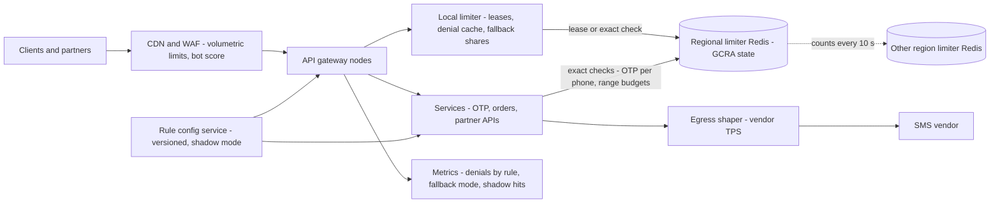
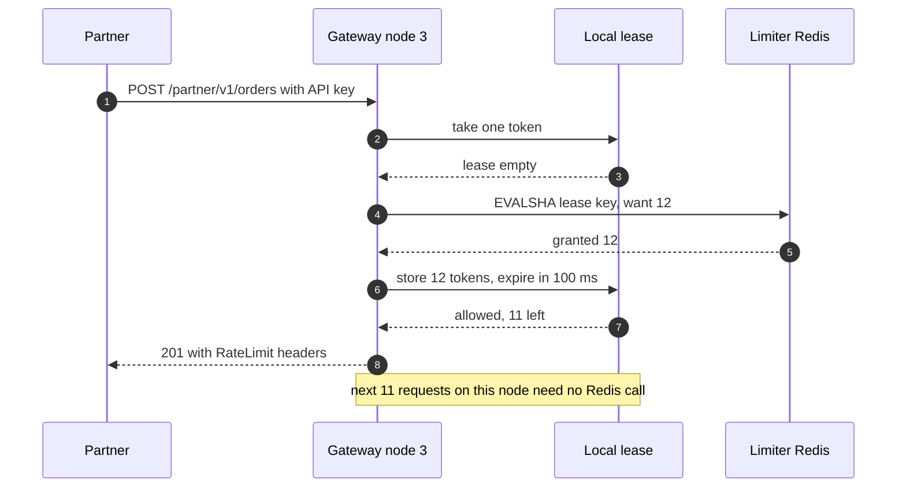
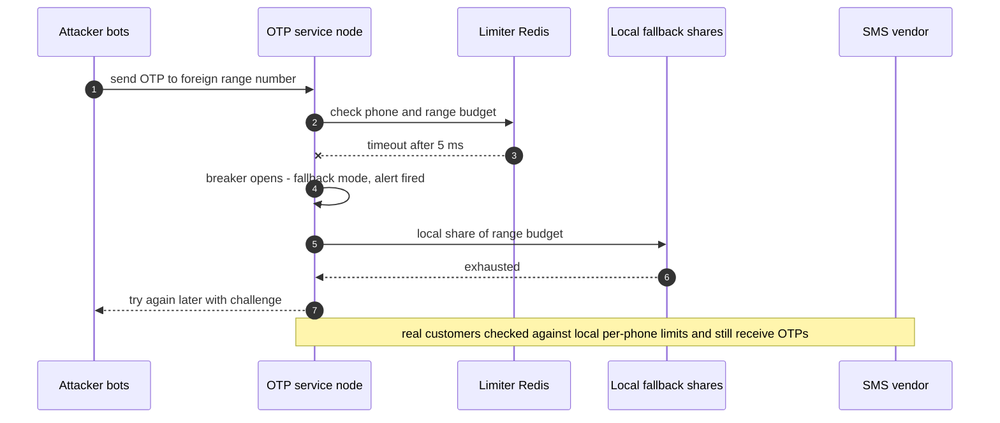
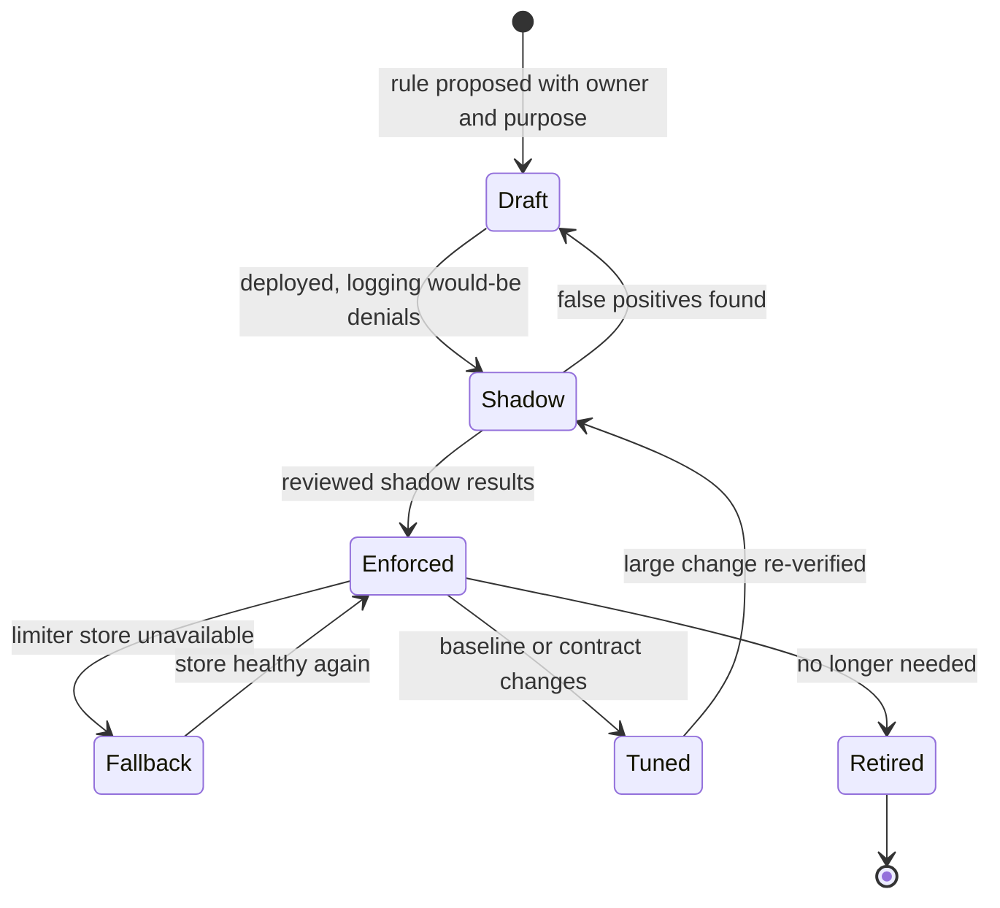

# 39. Case Study: Distributed Rate Limiter

!!! abstract "Chapter at a glance"
    **Reader bands:** B2 → B4 · **Prerequisites:** [Ch 08](../01-foundations/08-load-balancing-proxies-and-gateways.md), [Ch 18](../02-distributed-core/18-resilience-patterns.md) (rate-limiting algorithms), [Ch 23](../03-production/23-security-architecture.md) · **What you will build:** The grocery platform's rate-limiting service. It sets per-customer limits at the gateway, enforces partner API contracts, protects OTP against SMS-pumping fraud, and paces calls to outbound vendors. [Ch 18](../02-distributed-core/18-resilience-patterns.md) compared the algorithms on one client. This chapter designs the *system*: millions of keys, many gateway nodes, two regions, adversaries, and the limiter's own failures.

    - **L1: state per key (real Redis).** An exact sliding-window log for 100,000 users took **987 bytes per key**, ~9.9 GB at 10M keys. GCRA took **90 bytes**, one integer, and made **exactly** the token bucket's decisions (0 of 2.2M differ). On bursty traffic the sliding-window counter disagreed with the exact log on **4.3%** of decisions and let a key reach **108** requests in a true 60-second window against a limit of 60.
    - **L2: one global limit from 8 nodes (real Redis Lua).** A partner with a 1,000 req/s contract sent 900 req/s, skewed onto one node. Local per-node limits rejected **4,093** in-contract requests. A central GCRA rejected 0, at **1 Redis call per request**. Adaptive token leasing rejected 0 with **0.17 calls per request**, and still held the cap at 2,000 req/s offered.
    - **L3: OTP SMS pumping.** Per-IP limits sent **47,175** attack SMS and locked out **57.5%** of real users, who share carrier CGNAT addresses. Per-phone limits blocked no real users but let **59,199** attack SMS through. Per-destination-range budgets plus attestation cut the attack to **79** SMS (₹356 instead of ₹266,396), with **3** real users affected.
    - **L4: regions and failures.** A static 500/500 split between regions refused **99,370** in-contract requests when the partner's traffic moved. Rebalancing every 10 s refused **914**. A central limiter admitted **1,468/s** against a 1,000 contract during a partition. With the limiter's Redis down for 2 minutes, failing open sent **2,059** attack SMS (₹9,265), failing closed refused **3,955** real logins, and a local fallback allowed **30** attack SMS and refused **16** real logins.

    · **Reading time:** 100 min + code

---

## 1. Introduction & Why It Matters

### 1.1 A story: the limiter that locked out Jio

The grocery platform had rate limiting from day one: a Redis token bucket at the gateway ([Ch 08](../01-foundations/08-load-balancing-proxies-and-gateways.md)), keyed by IP address, 10 OTP requests per hour. Then, in one month:

1. **Real customers were locked out.** On a Sunday morning, thousands of customers on one mobile carrier couldn't log in. Carrier-grade NAT puts thousands of phones behind one public IP, and the per-IP OTP limit treated them as one abusive client.
2. **An SMS-pumping attack cost ₹18 lakh in a weekend.** Fraudsters triggered OTPs to international number ranges where they shared the termination fees. They used thousands of residential-proxy IPs and never sent more than two OTPs to any number. No per-IP or per-phone limit fired.
3. **A logistics partner was throttled inside its contract.** Its 1,000 req/s limit was enforced as 125 req/s on each of 8 gateway nodes, and the partner's traffic arrived mostly on one node. The partner escalated; the account manager doubled the limit to make the complaints stop.
4. **The limiter took down login.** Redis for rate limits had a failover. The gateway was configured to fail closed, so for 90 seconds nobody could request an OTP.
5. **The SMS vendor throttled us.** The vendor's contract was 500 SMS/s. During a campaign, notification workers across three services collectively sent 1,200/s, and the vendor dropped messages — including OTPs.

Each of these is a *system design* failure of the limiter, not an algorithm choice. The rebuilt limiter, designed here, starts from **what each limit protects, who it limits, where it's enforced, and what happens when it breaks.**

!!! quote "The thesis of this chapter"
    A rate limiter is several different controls sharing one mechanism: **abuse prevention** (fraud, scraping, credential stuffing), **fairness** (one customer can't starve others), **contracts** (partner quotas), and **protection** of our capacity and of vendors'. Each needs the right **key** (L3), the right **accuracy** and **state size** (L1), the right **enforcement topology** for many nodes and regions (L2, L4), and an explicit **failure mode** (L4). The algorithm — token bucket, GCRA, sliding window — is the easy part.

### 1.2 Where this lives in the grocery platform

| Limit | Protects | Key | Typical rule | On limiter failure |
|---|---|---|---|---|
| Customer API | Fairness, capacity | User id (fallback: device, IP) | 20 req/s, burst 40 | Fail open, local fallback |
| Search/catalog scraping | Data, capacity | Device + IP + ASN | Adaptive | Fail open |
| OTP send | Fraud (SMS cost), abuse | Phone, destination range, device, IP (loose) | 3/10 min per phone; range budgets | Local fallback, never fully open |
| Login verify | Credential stuffing | Phone + device; global failure ratio | 5 failed / 15 min | Fail closed per phone |
| Partner API | Contract | API key | 1,000 req/s global | Fail open (paid customer) |
| Vendor egress (SMS, Razorpay, ERP) | Vendor contract | Vendor account | 500 SMS/s | Queue and shape (leaky bucket) |

### 1.3 Learning objectives

By the end you will be able to:

- **Specify limits** by what they protect, choosing keys that attackers can't cheaply rotate and customers don't share (L3).
- **Choose the state representation** for millions of keys: GCRA, token bucket, sliding counter or log (L1).
- **Enforce a global limit across many nodes**: central store, local splits, or token leasing (L2).
- **Span regions** and **decide failure behaviour** per limit (L4).
- **Design the limiter service**: rule configuration, headers, observability, and the tiers where limits apply.

---

## 2. Core Concepts — Beginner to Deep

### 2.1 Intuition: turnstiles with different jobs <span class="band b2">B2</span>

A stadium has turnstiles at each gate (per-node limits), a total capacity (a global limit), a rule of four tickets per buyer (per-customer quota), and guards watching for touts buying hundreds of tickets through many friends (abuse detection). They all "limit rate", but they answer different questions and fail differently. A turnstile jam at one gate shouldn't close the stadium; a broken ticket scanner shouldn't let the touts in free.

### 2.2 Requirements <span class="band b2">B2</span>

**Functional**

- Evaluate a request against one or more rules (key, algorithm, rate, burst, window) and return allow/deny plus remaining quota and retry-after.
- Rules configured per route, per client class, per partner, without redeploying.
- Support rate limits (per second/minute), quotas (per day/month) and budgets (per destination range per hour).
- Shadow mode: evaluate new rules and log what they would do, without enforcing.

**Non-functional**

- **Latency**: under 1 ms p99 added at the gateway, and never a network round-trip per request on hot paths if avoidable (L2).
- **Scale**: 150k req/s at the gateway at sale peaks; 10M+ active keys.
- **Accuracy**: contracts within a few percent; fraud budgets as hard caps.
- **Availability**: the limiter must never be the reason the platform is down; failure behaviour is explicit per rule (L4).
- **Multi-region**: two regions, active-active.

### 2.3 Estimation <span class="band b2">B2</span>

| Quantity | Estimate |
|---|---|
| Gateway requests at peak | 150k req/s; 1–3 rules evaluated each → up to ~450k rule checks/s |
| Active keys | ~5M customers/day + devices + IPs + partners + phones ≈ **10M keys** |
| State with GCRA | 10M × ~90 B ≈ **0.9 GB** (L1) — a small Redis cluster |
| State with exact logs | 10M × ~1 KB ≈ **~10 GB**, and write amplification per request |
| Central store load | 450k Lua calls/s — several Redis shards, ~20–40 µs each on localhost (L2), 0.5–1 ms across AZs |
| OTP sends | ~120k/hour normal; attack traffic of the same order (L3) |

The estimates point at the design. **GCRA state is small**, so storage is not the problem. **One store call per rule per request is expensive at 450k/s and across AZs**, so hot-path limits should be local or leased (L2), and exact central checks reserved for low-volume, high-value rules like OTP.

### 2.4 Choosing the key: who are you actually limiting? ⭐ <span class="band b3">B3</span>

The key decides who shares a bucket. L3 shows how badly the obvious key can fail:

| Policy | Attack SMS | Attack cost | Real users blocked |
|---|---|---|---|
| Per IP, 10/hour | 47,175 | ₹212,288 | **57.5%** |
| Per phone, 3/10 min and 5/hour | 59,199 | ₹266,396 | 0% |
| Per phone + per IP 60/hour + per device 5/hour | 59,199 | ₹266,396 | **48.1%** |
| Per phone + **per destination-range budget** + attestation → challenge | **79** | **₹356** | **3 users** |

- **IP addresses are shared and cheap.** Carrier CGNAT puts hundreds or thousands of real customers behind one IPv4 address. Residential-proxy networks give attackers thousands of addresses. Per-IP limits hurt customers more than attackers. Use them loosely, and per ASN or subnet for clearly abusive networks.
- **Device fingerprints are cheap to rotate** unless backed by attestation (Play Integrity, App Attest).
- **Phone numbers** are the right key against repeated OTPs to one number, but a pump spreads across thousands of numbers.
- **Key on what the attacker must concentrate.** An SMS pump earns only from certain destination ranges. Budget those ranges, with limits learned from normal traffic, and the attack has nowhere to hide. Expect the attacker to adapt: add a per-country and a global international budget, and alert on anomalies.
- **Spend friction on risk.** Attestation failures and unusual ranges get a challenge, not a block, so the few real users there still get through.

For authenticated APIs, the **user id** is the natural key: stable, not shared, and costly to multiply. Limit anonymous endpoints (OTP, search, catalog) with **layered keys**, and treat the limit as a fraud control with costs on both sides.

### 2.5 State: GCRA, token bucket, windows ⭐ <span class="band b3">B3</span>

With millions of keys, per-key state size and write cost matter as much as behaviour. L1 measured real Redis memory:

| Representation | Bytes per key | 10M keys |
|---|---|---|
| Sliding-window log (sorted set, 30 timestamps) | 987 | 9.87 GB |
| Sliding-window counter (two counters) | 149 | 1.49 GB |
| Token bucket (hash of tokens + timestamp) | 123 | 1.23 GB |
| **GCRA** (one "theoretical arrival time") | **90** | **0.90 GB** |

**GCRA** (Generic Cell Rate Algorithm, from ATM networks) stores one number per key: the *theoretical arrival time* (TAT) of the next request if the client sent at exactly the allowed rate. With emission interval T = 1/rate and burst tolerance τ:

```text
new_tat = max(tat, now) + T
if new_tat - now > τ + T  → deny   (retry after new_tat - T - τ - now)
else                       → allow, tat = new_tat
```

It is mathematically a token bucket (L1: 0 of 2.2M decisions differ), with one integer of state and a natural retry-after. It is what `redis-cell` and several gateways implement.

**Sliding-window counters** are approximate. The weighted two-window estimate assumes the previous window's requests were evenly spread. [Ch 18](../02-distributed-core/18-resilience-patterns.md)'s single-burst test hid the error; L1's bursty traffic exposed it: **4.3%** of decisions differed from the exact log (73,704 extra allows, 22,468 extra denials), and a key reached **108** in a true 60-second span against a limit of 60. That's better than the fixed window's 120, but not a hard cap. Use them where "roughly N per window" is enough.

**Exact logs** are the only hard "at most N in any window". Use them where that matters and volume is low — OTP sends per phone — with short TTLs.

### 2.6 Enforcing a global limit across many nodes ⭐ <span class="band b3">B3</span>

L2 enforced one partner's 1,000 req/s contract from 8 gateway nodes, with the partner sending 900 req/s skewed 60% onto node 0:

| Strategy | In-contract requests rejected | Redis calls per request | Over the limit (2,000 req/s offered) |
|---|---|---|---|
| Local only (limit ÷ 8 per node) | **4,093** | 0 | Capped only because load was even |
| Central GCRA in Redis | 0 | **1.00** | Capped at ~1,010/s |
| **Token leasing** (adaptive) | 0 | **0.17** | Capped; 0.39 calls/request |

- **Local splits** are free but wrong whenever load is uneven — sticky connections, one partner data centre, uneven load-balancing — and nodes come and go with autoscaling, changing N.
- **Central checks** are exact and simple (one atomic Lua script — [Ch 18](../02-distributed-core/18-resilience-patterns.md) L3), but add a network round-trip and a store call to every request: fine for thousands of req/s, costly at 450k rule checks/s across AZs.
- **Token leasing**: a node takes a small batch of tokens from the central GCRA and spends them locally. L2 needed three refinements before leasing matched the central limiter: **size leases to each node's recent rate** (~50 ms of its traffic), **give unused tokens back** when a lease expires, and **cache denials** until tokens are due. Fixed large leases stranded tokens on quiet nodes and rejected in-contract traffic. Over the limit, leases shrink because tokens are scarce, so the call rate rises (0.39 per request).
- **Other options**: approximate local limits with periodic count synchronisation (gossip), or a **sticky** routing of each key to one limiter node (consistent hashing), which moves the hot-key problem to that node.

A practical tiering: **local limiters** for coarse protection (per-node concurrency, load shedding — [Ch 18](../02-distributed-core/18-resilience-patterns.md)), **leased or central GCRA** for customer and partner limits, and **central exact checks** for low-volume fraud controls.

### 2.7 Multi-region limits <span class="band b4">B4</span>

A global contract served from two regions needs either a global store or a split. L4:

| Design | In-contract requests rejected | Max admitted in 1 s (contract 1,000) | Cross-region calls |
|---|---|---|---|
| Static split 500/500 | **99,370** | 944 | 0 |
| Static split from history 800/200 | **167,179** | 945 | 0 |
| **Rebalance every 10 s by demand** | 914 | 1,000 | 0 |
| Central limiter in one region | 0 | **1,468** during a partition (fail open) | 308,377 |

Traffic between regions moves — failovers, DNS changes, a partner's own routing — so a static split refuses in-contract traffic exactly when it moves. **Rebalancing shares by recent demand** keeps both properties, with only periodic, asynchronous exchange of counts between regions. A single central limiter is exact until the regions partition, and then it must either over-admit or fail. Most platforms accept approximate global limits (a few percent) for contracts, and keep hard fraud budgets per region with conservative shares.

### 2.8 When the limiter fails ⭐ <span class="band b4">B4</span>

The limiter's store will fail. Decide the behaviour **per rule**, in advance. L4 took the OTP limiter's Redis down for 2 minutes during an attack:

| Behaviour | Attack SMS in 2 min | Real OTPs refused |
|---|---|---|
| Fail open | 2,059 (₹9,265) | 0 |
| Fail closed | 0 | **3,955** — nobody can log in |
| **Local fallback** (1/8 of each budget per node, 3x headroom) | 30 (₹135) | 16 |

- **Fail open** where the limit protects fairness or capacity and other layers (load shedding) still protect the system: customer API limits, partner quotas.
- **Fail closed** only where the downside of allowing is worse than an outage, and scope it narrowly (per phone after failed logins, not "all OTPs").
- **Local fallback** for fraud controls: each node enforces a conservative share of the budget from its last known configuration. The 16 refused logins in L4 come from an assumed 0.4% of retries landing on a node whose local per-phone limit is stricter — an assumption to measure.
- Protect the limiter: timeouts of a few milliseconds on limiter calls, a circuit breaker around the store, and an alert on fallback mode.

### 2.9 Responding: headers, retry-after and clients <span class="band b2">B2</span>

- `429 Too Many Requests` with `Retry-After`, and the `RateLimit-Policy` / `RateLimit` headers (IETF draft — VERIFY the current field names) so clients can pace themselves.
- Don't reveal fraud-control internals: an OTP budget denial can look like "Please try again later" with a challenge, not "range budget exceeded".
- Clients back off with jitter ([Ch 18](../02-distributed-core/18-resilience-patterns.md)); partners get documented limits and a dashboard of their usage.
- **Shape instead of reject** for outbound vendor limits: queue SMS and pace them at the vendor's TPS with a leaky bucket, prioritising OTPs over marketing ([Ch 40](40-notification-system.md)).

### 2.10 Rules, configuration and rollout <span class="band b3">B3</span>

- Rules as data: `{match: route/client class, key: [phone], algorithm: gcra, rate: 3/600s, burst: 3, onFailure: localFallback, mode: enforce|shadow}`.
- Stored in a config service, versioned, reviewed; pushed to gateways and cached locally, so a config store outage doesn't stop limiting.
- **Shadow mode first**: log would-be denials for a week, check false positives against known-good traffic, then enforce.
- **Budgets learned from baselines** (L3's range budgets ≈ 3x normal hourly volume), recomputed daily, with manual overrides for campaigns.
- Per-tenant/plan limits for B2B ([Ch 30](../03-production/30-multi-tenancy-and-saas-architecture.md)).

### 2.11 Where limits live <span class="band b3">B3</span>

| Tier | Limits | Why there |
|---|---|---|
| Edge/CDN/WAF | Volumetric per IP/ASN, bot scores | Cheapest place to drop floods |
| API gateway | Per user, per API key, per route class | Knows identity, before work starts |
| Service | Business rules (OTP per phone, orders per minute per B2B account), concurrency limits | Knows domain context |
| Egress | Vendor TPS | Protects vendor contracts |
| Data tier | Connection pools, statement timeouts | Last line of defence |

### 2.12 Interview framing <span class="band b4">B4</span>

Spend five minutes on *what the limits protect and who they key on*. Most candidates jump to "Redis token bucket", so that alone is a strong signal. Then cover the algorithm and state size (GCRA), the distributed enforcement options with their trade-offs (central, local, leasing), multi-region, and failure modes per rule. Staff-level signals: CGNAT and residential proxies, SMS pumping, shadow mode, and fail-open vs fail-closed as a per-rule decision.

---

## 3. Architecture & Diagrams

### 3.1 Component view



### 3.2 Sequence: happy path, a leased partner limit



### 3.3 Sequence: failure path, limiter store down during an OTP attack



### 3.4 State: a rule's lifecycle



---

## 4. Design Document Excerpt: Platform Rate-Limiting Service

!!! note "Design Document (excerpt) — Rate Limiting v2"
    **Status:** Accepted · **Authors:** Edge platform team · **Reviewers:** Security/fraud, SRE, Partner engineering

    | Field | Value |
    |---|---|
    | Context | v1 limited OTPs per IP (locked out CGNAT customers), missed an SMS-pumping attack, enforced partner contracts as per-node splits, failed closed on a Redis failover, and didn't pace vendor egress. |
    | Decision | Rules as versioned data with shadow mode; GCRA state in regional Redis; leased tokens for high-volume limits, exact central checks for fraud controls; destination-range budgets and attestation for OTP; demand-based cross-region rebalancing for contracts; per-rule failure mode with local fallback; egress shaping for vendors. |
    | Related ADRs | ADR-250 GCRA as the default algorithm, exact log only for OTP-per-phone (L1); ADR-251 Adaptive token leasing at the gateway (L2); ADR-252 OTP keys: phone + destination-range budgets + attestation/challenge; IP limits loose and ASN-based (L3); ADR-253 Cross-region share rebalancing every 10 s (L4); ADR-254 Failure mode declared per rule; local fallback for fraud budgets (L4); ADR-255 Shadow mode mandatory before enforcement; ADR-256 Vendor egress via leaky-bucket shaper with OTP priority |

    **Requirements.**

    - **R1** Added latency under 1 ms p99 at the gateway at 150k req/s.
    - **R2** Partner contracts enforced within 2% globally; no in-contract rejections when traffic moves between regions.
    - **R3** SMS-pumping cost under ₹5,000/day at attack volumes seen so far; real-user OTP denial under 0.05%.
    - **R4** No platform outage caused by the limiter's store; failure mode per rule.
    - **R5** Vendor TPS never exceeded.

    **Decisions in detail.**

    1. **State (ADR-250).** GCRA with TAT in microseconds, `PX` expiry of burst + 1 s; OTP-per-phone as a sorted set with 1 h TTL.
    2. **Enforcement (ADR-251).** Leases of ~50 ms of each node's rate (1–50 tokens), 100 ms expiry, give-back on expiry, denial caching.
    3. **OTP (ADR-252).** Range budgets = 3x the 28-day hourly baseline per range, a per-country and a global international budget; attestation failure → challenge.
    4. **Regions (ADR-253).** Each region publishes per-key demand every 10 s; shares recomputed proportionally.
    5. **Failure (ADR-254).** Limiter calls time out at 5 ms; breaker; fallback shares = budget ÷ nodes × 3; alert.
    6. **Rollout (ADR-255).** Every new rule spends ≥7 days in shadow with a false-positive review.

    **Consequences.** More moving parts than a single Redis token bucket: rule configuration, leasing logic and fallback shares to test. Contracts are approximate by a few percent. Fraud budgets need tuning and on-call attention during campaigns. In return: no locked-out carriers, attack cost bounded, partners served within contract, and a limiter that can't take the platform down.

---

## 5. Hands-On Code — Level Ladder

!!! info "What's real here"
    All four labs are JDK 21. **L1 and L2 run against a real Redis 7**: L1 measures memory with `INFO`, and L2 executes the GCRA and lease scripts in Lua with a simulated clock passed in, so the decisions are reproducible. L3 and L4 are deterministic simulations with a fixed seed. Traffic mixes, attack parameters, SMS prices, attestation pass rates and the L4 fallback's 0.4% refusal rate are stated assumptions.

L1 and L2 need a Redis 7 on port 6390: `redis-server --port 6390 --save '' --appendonly no`. Run every lab with `-Dstdout.encoding=UTF-8`.

### L1 — State per key, and how accurate it is <span class="band b2">B2</span>

**Requirement:** "We'll hold limiter state for 10 million keys. Which representation, how much memory, and how wrong is each?"

Part 1 writes 100,000 keys of each representation into a real Redis (pipelined) and measures `used_memory`. Part 2 replays 2.2 million bursty decisions through the exact log, the sliding counter, the fixed window, a token bucket and GCRA, all in exact integer arithmetic.

```java title="LimiterStateL1.java"
// LimiterStateL1.java — run with (Redis 7 on :6390):  java LimiterStateL1.java   (JDK 21, no dependencies)
// WHAT A RATE LIMITER COSTS PER KEY, AND HOW ACCURATE IT IS. Ch 18 compared algorithms on one client. A platform limiter
// holds state for MILLIONS of keys (every user, device, IP, phone number, API key), so state size and accuracy per key
// decide the design. Part 1 stores 100,000 keys of each representation in a REAL Redis (pipelined) and measures memory
// with INFO: a sliding-window LOG (sorted set of timestamps), a sliding-window COUNTER (two fixed-window counters),
// a TOKEN BUCKET (hash of tokens + timestamp) and GCRA (one "theoretical arrival time" per key). Each key models a user
// halfway through a 60-requests-per-minute limit (30 requests in the window).
// Part 2 replays bursty traffic for 20,000 keys through exact and approximate algorithms in memory and measures how often
// the approximations decide differently, and the worst overshoot in any true 60-second window.
import java.io.*;
import java.net.Socket;
import java.nio.charset.StandardCharsets;
import java.util.*;

public class LimiterStateL1 {
    public static void main(String[] args) throws Exception {
        int keys = 100_000;
        System.out.printf("Part 1 — %,d keys per representation in real Redis (limit 60/min, 30 requests in the current window)%n%n", keys);
        System.out.printf("   %-40s %14s %18s%n", "representation", "bytes per key", "10M keys would need");
        try (Redis r = new Redis("127.0.0.1", 6390)) {
            long now = 1_790_000_000_000L; Random rnd = new Random(39);
            String[] names = {"sliding log (ZSET of 30 timestamps)", "sliding counter (2 window counters)", "token bucket (HASH tokens + ts)", "GCRA (one TAT integer)"};
            for (int kind = 0; kind < 4; kind++) {
                r.cmd("FLUSHALL"); long before = usedMemory(r);
                List<String[]> batch = new ArrayList<>();
                for (int k = 0; k < keys; k++) {
                    String key = "rl:" + kind + ":user:" + (9_000_000 + k);
                    switch (kind) {
                        case 0 -> { String[] c = new String[2 + 60]; c[0] = "ZADD"; c[1] = key;
                                    for (int i = 0; i < 30; i++) { long ts = now - rnd.nextInt(60_000); c[2 + 2 * i] = Long.toString(ts); c[3 + 2 * i] = ts + "-" + i; }
                                    batch.add(c); }
                        case 1 -> { long w = now / 60_000; batch.add(new String[]{"SET", key + ":" + w, "18"}); batch.add(new String[]{"SET", key + ":" + (w - 1), "41"}); }
                        case 2 -> batch.add(new String[]{"HSET", key, "t", "30.000", "ts", Long.toString(now)});
                        default -> batch.add(new String[]{"SET", key, Long.toString(now + 30_000)});
                    }
                    if (batch.size() >= 1000) { r.pipeline(batch); batch.clear(); }
                }
                r.pipeline(batch);
                long bytes = usedMemory(r) - before; double perKey = (double) bytes / keys;
                System.out.printf("   %-40s %,14.0f %15.2f GB%n", names[kind], perKey, perKey * 10_000_000 / 1e9);
            }
            r.cmd("FLUSHALL");
        }

        // ---------------- Part 2: accuracy ----------------
        int nKeys = 20_000, limit = 60; long windowMs = 60_000, horizon = 10 * 60_000; Random rnd = new Random(7);
        long decisions = 0, cntFalseAllow = 0, cntFalseDeny = 0, diffCounter = 0, diffGcra = 0, worstLog = 0, worstCounter = 0, worstFixed = 0, diffFixed = 0, worstG = 0;
        for (int k = 0; k < nKeys; k++) {
            // a user: quiet background plus 0–3 bursts (app retries, pull-to-refresh storms, scripts)
            List<Long> t = new ArrayList<>();
            double rate = 0.2 + rnd.nextDouble() * 0.8;                                   // requests per second baseline... per 10 s
            for (long ms = 0; ms < horizon; ms += (long) (-Math.log(1 - rnd.nextDouble()) * 10_000 / rate)) t.add(ms);
            int bursts = rnd.nextInt(4);
            for (int b = 0; b < bursts; b++) { long at = (long) (rnd.nextDouble() * horizon); int n = 20 + rnd.nextInt(60); for (int i = 0; i < n; i++) t.add(at + i * (50 + rnd.nextInt(400))); }
            Collections.sort(t);
            Deque<Long> log = new ArrayDeque<>(); long curW = -1, cur = 0, prev = 0; long fW = -1, fCount = 0;
            long emission = windowMs / limit;                                             // 1,000 ms per request
            long tat = 0;                                                                 // GCRA state: one integer
            long milliTokens = limit * 1000L, lastTs = 0;                                 // token bucket in exact integer milli-tokens
            List<Long> allowedLog = new ArrayList<>(), allowedCounter = new ArrayList<>(), allowedFixed = new ArrayList<>(), allowedG = new ArrayList<>();
            for (long ts : t) {
                if (ts >= horizon) continue; decisions++;
                // exact sliding log
                while (!log.isEmpty() && log.peekFirst() <= ts - windowMs) log.pollFirst();
                boolean aLog = log.size() < limit; if (aLog) { log.addLast(ts); allowedLog.add(ts); }
                // sliding window counter (Cloudflare-style weighted previous window)
                long w = ts / windowMs; if (w != curW) { prev = (w == curW + 1) ? cur : 0; cur = 0; curW = w; }
                double est = prev * (1 - (double) (ts % windowMs) / windowMs) + cur;
                boolean aCnt = est < limit; if (aCnt) { cur++; allowedCounter.add(ts); }
                // fixed window
                long fw = ts / windowMs; if (fw != fW) { fW = fw; fCount = 0; }
                boolean aFix = fCount < limit; if (aFix) { fCount++; allowedFixed.add(ts); }
                // token bucket and GCRA (same parameters: 1 per second, burst 60) — should agree exactly
                milliTokens = Math.min(limit * 1000L, milliTokens + (ts - lastTs) * 1000 / emission); lastTs = ts;
                boolean aTb = milliTokens >= 1000; if (aTb) milliTokens -= 1000;
                long newTat = Math.max(tat, ts) + emission; boolean aG = newTat - ts <= windowMs; if (aG) { tat = newTat; allowedG.add(ts); }
                if (aCnt && !aLog) cntFalseAllow++; if (!aCnt && aLog) cntFalseDeny++;
                if (aCnt != aLog) diffCounter++; if (aFix != aLog) diffFixed++; if (aG != aTb) diffGcra++;
            }
            worstLog = Math.max(worstLog, maxInWindow(allowedLog, windowMs));
            worstCounter = Math.max(worstCounter, maxInWindow(allowedCounter, windowMs));
            worstFixed = Math.max(worstFixed, maxInWindow(allowedFixed, windowMs));
            worstG = Math.max(worstG, maxInWindow(allowedG, windowMs));
        }
        System.out.printf("%nPart 2 — %,d decisions for %,d bursty keys over 10 minutes, limit %d per 60 s%n%n", decisions, nKeys, limit);
        System.out.printf("   %-44s %22s %28s%n", "algorithm", "decisions ≠ exact log", "max allowed in any 60 s");
        System.out.printf("   %-44s %22s %28d%n", "sliding window log (exact reference)", "—", worstLog);
        System.out.printf("   %-44s %21.3f%% %28d%n", "sliding window counter (weighted)", 100.0 * diffCounter / decisions, worstCounter);
        System.out.printf("   %-44s %21.3f%% %28d%n", "fixed window", 100.0 * diffFixed / decisions, worstFixed);
        System.out.printf("   %-44s %22s %28d%n", "GCRA / token bucket (1/s, burst 60)", "(a rate, not a window)", worstG);
        System.out.printf("   sliding counter errors: %,d extra allows, %,d extra denials (it assumes the previous window was evenly spread)%n", cntFalseAllow, cntFalseDeny);
        System.out.printf("   GCRA vs token bucket (1/s, burst 60): %,d of %,d decisions differ.%n", diffGcra, decisions);

        System.out.println("\n   → at platform scale the limiter is a memory problem first: the exact log stores every request (~1 KB per");
        System.out.println("     key here, ~10 GB for 10M keys); GCRA stores one integer and makes exactly the token bucket's decisions.");
        System.out.println("     The sliding-window counter is cheap but only approximate, and its error depends on the traffic's SHAPE:");
        System.out.println("     it assumes last window's requests were evenly spread, so a burst at the end of one window lets a key through");
        System.out.println("     well above the limit within a true 60 s span — better than the fixed window's double, but not a hard cap.");
        System.out.println("     Use GCRA/token bucket for rates, and an exact log only where 'at most N per window' must hold (OTP per phone).");
    }

    static long maxInWindow(List<Long> ts, long w) { int j = 0; long best = 0; for (int i = 0; i < ts.size(); i++) { while (ts.get(i) - ts.get(j) >= w) j++; best = Math.max(best, i - j + 1); } return best; }
    static long usedMemory(Redis r) throws IOException {
        String info = (String) r.cmd("INFO", "memory");
        for (String l : info.split("\r\n")) if (l.startsWith("used_memory:")) return Long.parseLong(l.substring(12));
        throw new IOException("no used_memory");
    }

    /** Minimal RESP client (from Ch 18) plus pipelining. */
    static final class Redis implements Closeable {
        final Socket s; final OutputStream out; final BufferedInputStream in;
        Redis(String host, int port) throws IOException { s = new Socket(host, port); out = new BufferedOutputStream(s.getOutputStream(), 1 << 16); in = new BufferedInputStream(s.getInputStream(), 1 << 16); }
        void write(String... parts) throws IOException {
            StringBuilder sb = new StringBuilder("*").append(parts.length).append("\r\n");
            for (String p : parts) { byte[] b = p.getBytes(StandardCharsets.UTF_8); sb.append('$').append(b.length).append("\r\n").append(p).append("\r\n"); }
            out.write(sb.toString().getBytes(StandardCharsets.UTF_8));
        }
        Object cmd(String... parts) throws IOException { write(parts); out.flush(); return read(); }
        void pipeline(List<String[]> cmds) throws IOException { for (String[] c : cmds) write(c); out.flush(); for (int i = 0; i < cmds.size(); i++) read(); }
        Object read() throws IOException {
            int type = in.read(); String line = line();
            return switch (type) {
                case '+' -> line; case ':' -> Long.parseLong(line);
                case '$' -> { int n = Integer.parseInt(line); if (n < 0) yield null; byte[] b = in.readNBytes(n); line(); yield new String(b, StandardCharsets.UTF_8); }
                case '*' -> { int n = Integer.parseInt(line); List<Object> l = new ArrayList<>(); for (int i = 0; i < n; i++) l.add(read()); yield l; }
                case '-' -> throw new IOException("redis error: " + line);
                default -> throw new IOException("unexpected reply type " + (char) type);
            };
        }
        String line() throws IOException { StringBuilder sb = new StringBuilder(); int c; while ((c = in.read()) != '\r') sb.append((char) c); in.read(); return sb.toString(); }
        public void close() throws IOException { s.close(); }
    }
}
```

```text title="java -Dstdout.encoding=UTF-8 LimiterStateL1.java"
Part 1 — 100,000 keys per representation in real Redis (limit 60/min, 30 requests in the current window)

   representation                            bytes per key 10M keys would need
   sliding log (ZSET of 30 timestamps)                 986            9.86 GB
   sliding counter (2 window counters)                 149            1.49 GB
   token bucket (HASH tokens + ts)                     122            1.22 GB
   GCRA (one TAT integer)                               90            0.90 GB

Part 2 — 2,217,134 decisions for 20,000 bursty keys over 10 minutes, limit 60 per 60 s

   algorithm                                     decisions ≠ exact log      max allowed in any 60 s
   sliding window log (exact reference)                              —                           60
   sliding window counter (weighted)                            4.338%                          108
   fixed window                                                 5.263%                          120
   GCRA / token bucket (1/s, burst 60)          (a rate, not a window)                          119
   sliding counter errors: 73,704 extra allows, 22,468 extra denials (it assumes the previous window was evenly spread)
   GCRA vs token bucket (1/s, burst 60): 0 of 2,217,134 decisions differ.

   → at platform scale the limiter is a memory problem first: the exact log stores every request (~1 KB per
     key here, ~10 GB for 10M keys); GCRA stores one integer and makes exactly the token bucket's decisions.
     The sliding-window counter is cheap but only approximate, and its error depends on the traffic's SHAPE:
     it assumes last window's requests were evenly spread, so a burst at the end of one window lets a key through
     well above the limit within a true 60 s span — better than the fixed window's double, but not a hard cap.
     Use GCRA/token bucket for rates, and an exact log only where 'at most N per window' must hold (OTP per phone).
```

**Reading it:**

- **Memory**: the exact log costs **987 bytes per key**, 11x GCRA's **90**. At 10M keys that's ~9.9 GB against 0.9 GB, before counting a write per request into a sorted set.
- **GCRA = token bucket**: **0** of 2,217,134 decisions differ once both use integer arithmetic. An earlier floating-point version of this lab showed 65 spurious differences: use integer microseconds in production code too.
- **The sliding counter is approximate**: 4.3% of decisions differ from the exact log, mostly extra allows (73,704), and one key reached **108** in a true 60-second span against a limit of 60. The fixed window reached 120. GCRA with burst 60 reached 119, which is its design: burst 60 plus 1/s refill.

### L2 — One global limit from eight nodes <span class="band b3">B3</span>

**Requirement:** "A partner's contract is 1,000 req/s across our whole gateway fleet. Don't throttle them inside it; don't let them exceed it; don't add a Redis call to every request if we can help it."

Three enforcement strategies, with the GCRA and leasing logic running as **Lua in a real Redis**. The simulated clock is passed as an argument, so the result is reproducible.

```java title="GlobalLimitL2.java"
// GlobalLimitL2.java — run with (Redis 7 on :6390):  java GlobalLimitL2.java   (JDK 21, no dependencies)
// ENFORCING ONE GLOBAL LIMIT FROM 8 GATEWAY NODES. A logistics partner's API key may call us at 1,000 req/s (burst 100).
// Requests arrive at 8 gateway nodes; the limit is for the key as a whole. Three ways to enforce it, all executed for real
// (the Lua scripts run in a real Redis; time is a simulated clock passed in, so runs are reproducible):
//   A) LOCAL ONLY: each node enforces 1,000/8 = 125 req/s with its own GCRA           — no network calls
//   B) CENTRAL GCRA: every request runs one Lua call in Redis                          — exact, one round-trip per request
//   C) TOKEN LEASING: a node takes a lease of tokens (sized to ~50 ms of its own traffic, 1–20) from the Redis GCRA
//      and spends them locally; unused tokens are given back when the lease expires after 100 ms; leases are at least
//      5 tokens (or the node's size), and a denied node caches the denial until they are due — few round-trips
// Two traffic scenarios over 10 s: (1) UNDER the limit but SKEWED — 900 req/s, 60% of it landing on node 0 (a sticky
// load-balancer or one partner data centre); (2) OVER the limit — 2,000 req/s spread evenly.
import java.io.*;
import java.net.Socket;
import java.nio.charset.StandardCharsets;
import java.util.*;

public class GlobalLimitL2 {
    static final long EMISSION_US = 1_000, TOLERANCE_US = 100 * EMISSION_US;     // 1,000/s, burst 100
    static final String LEASE = """
            local tat = tonumber(redis.call('GET', KEYS[1]) or '0')
            local now, em, tol, want = tonumber(ARGV[1]), tonumber(ARGV[2]), tonumber(ARGV[3]), tonumber(ARGV[4])
            local minGrant = math.min(want, 5)                   -- don't take leases smaller than 5 tokens
            local base = math.max(tat, now)
            local room = math.floor((now + tol - base) / em)
            local n = math.min(want, room)
            if n < minGrant then return -(base + minGrant * em - now - tol) end   -- denied: µs until minGrant tokens fit
            redis.call('SET', KEYS[1], base + n * em, 'PX', 60000)
            return n""";
    static final String GIVE_BACK = """
            local tat = tonumber(redis.call('GET', KEYS[1]) or '0')
            local now, back = tonumber(ARGV[1]), tonumber(ARGV[2])
            if tat > now then redis.call('SET', KEYS[1], math.max(now, tat - back), 'PX', 60000) end
            return 1""";

    static String shaBack; static final String KEY = "rl:partner:logistics-7";
    record Result(double allowedPerSec, long rejected, long redisCalls, long requests, long wasted, double maxSecond) {}

    public static void main(String[] args) throws Exception {
        try (Redis r = new Redis("127.0.0.1", 6390)) {
            String sha = (String) r.cmd("SCRIPT", "LOAD", LEASE); shaBack = (String) r.cmd("SCRIPT", "LOAD", GIVE_BACK);
            System.out.println("Global limit 1,000 req/s (burst 100) for one partner key, 8 gateway nodes, 10 s simulated, real Redis Lua.\n");
            long t0 = System.nanoTime(); long calls0 = 0;
            for (int sc = 0; sc < 2; sc++) {
                double total = sc == 0 ? 900 : 2000; double[] share = new double[8];
                for (int n = 0; n < 8; n++) share[n] = sc == 0 ? (n == 0 ? 0.60 : 0.40 / 7) : 1.0 / 8;
                long[][] arrivals = arrivals(total, share, 10_000_000L, new Random(39 + sc));
                long requests = Arrays.stream(arrivals).mapToLong(a -> a.length).sum();
                System.out.printf("   Scenario %d — %s: %,.0f req/s offered%s%n", sc + 1, sc == 0 ? "UNDER the limit, skewed" : "OVER the limit, even",
                        total, sc == 0 ? " (node 0 gets 60% = 540 req/s)" : "");
                System.out.printf("      %-38s %13s %11s %13s %16s %15s%n", "strategy", "allowed/s", "rejected", "Redis calls", "calls/request", "busiest second");
                for (int st = 0; st < 3; st++) {
                    r.cmd("DEL", KEY);
                    Result res = run(st, arrivals, r, sha);
                    calls0 += res.redisCalls();
                    System.out.printf("      %-38s %,13.0f %,11d %,13d %16.3f %,15.0f%n", new String[]{"A) local only (125/s per node)", "B) central GCRA in Redis", "C) leasing (adaptive 1-20, 100 ms)"}[st],
                            res.allowedPerSec(), res.rejected(), res.redisCalls(), (double) res.redisCalls() / res.requests(), res.maxSecond());
                    if (st == 2) System.out.printf("         leased tokens expired unused and given back: %,d%n", res.wasted());
                }
                System.out.println();
            }
            // real round-trip cost of one Lua call
            long n = 20_000, s = System.nanoTime();
            for (int i = 0; i < n; i++) r.cmd("EVALSHA", sha, "1", "rl:bench", Long.toString(i * 2_000L), Long.toString(EMISSION_US), Long.toString(TOLERANCE_US), "1");
            double us = (System.nanoTime() - s) / 1e3 / n;
            System.out.printf("   Measured cost of one Lua call on localhost: %.0f µs round-trip (cross-AZ adds ~0.5–1 ms; VERIFY in your network).%n", us);
        }
        System.out.println("\n   → local limits need no network but are wrong under skew: they rejected thousands of requests from a partner");
        System.out.println("     within its contract, because node 0 saw 540 req/s against a 125 share; they cap the total only when load is");
        System.out.println("     even. A central GCRA is exact but costs a Redis round-trip on every request. Leasing admitted exactly what");
        System.out.println("     the central limiter did under skew with about a sixth of the calls, and held the cap when over the limit.");
        System.out.println("     It needed three refinements to get there (in earlier runs of this lab, fixed 20-token leases stranded tokens");
        System.out.println("     on quiet nodes and rejected in-contract traffic): size leases to each node's rate, give unused tokens back,");
        System.out.println("     and cache denials. Over the limit, calls rise again because every lease is small — tokens are scarce.");
    }

    static long[][] arrivals(double totalRate, double[] share, long horizonUs, Random rnd) {
        long[][] a = new long[share.length][];
        for (int n = 0; n < share.length; n++) {
            List<Long> l = new ArrayList<>(); double rate = totalRate * share[n] / 1e6;
            for (double t = 0; ; ) { t += -Math.log(1 - rnd.nextDouble()) / rate; if (t >= horizonUs) break; l.add((long) t); }
            a[n] = l.stream().mapToLong(Long::longValue).toArray();
        }
        return a;
    }

    static Result run(int strategy, long[][] arrivals, Redis r, String sha) throws IOException {
        int nodes = arrivals.length; int[] idx = new int[nodes];
        long[] localTat = new long[nodes]; long[] leaseTokens = new long[nodes]; long[] leaseExpiry = new long[nodes]; long[] deniedUntil = new long[nodes]; double[] rateEst = new double[nodes]; long[] lastSeen = new long[nodes];
        long allowed = 0, rejected = 0, calls = 0, requests = 0, wasted = 0; long[] perSecond = new long[10];
        while (true) {                                                 // merge arrivals across nodes in time order
            int n = -1; long t = Long.MAX_VALUE;
            for (int k = 0; k < nodes; k++) if (idx[k] < arrivals[k].length && arrivals[k][idx[k]] < t) { t = arrivals[k][idx[k]]; n = k; }
            if (n < 0) break; idx[n]++; requests++;
            boolean ok;
            switch (strategy) {
                case 0 -> { long em = EMISSION_US * nodes, tol = TOLERANCE_US;           // 125/s each
                            long nt = Math.max(localTat[n], t) + em; ok = nt - t <= tol + em; if (ok) localTat[n] = nt; }
                case 1 -> { calls++; ok = lease(r, sha, t, 1) == 1; }
                default -> {
                    // lease size follows this node's recent rate: ~50 ms of its traffic, between 1 and 20 tokens
                    rateEst[n] = rateEst[n] * 0.98 + 0.02 * (lastSeen[n] == 0 ? 0 : 1e6 / Math.max(1, t - lastSeen[n])); lastSeen[n] = t;
                    int want = (int) Math.max(1, Math.min(20, Math.round(rateEst[n] * 0.05)));
                    if (leaseTokens[n] > 0 && t > leaseExpiry[n]) {                // expired lease: give the unused tokens back
                        calls++; wasted += leaseTokens[n];
                        r.cmd("EVALSHA", shaBack, "1", KEY, Long.toString(t), Long.toString(leaseTokens[n] * EMISSION_US)); leaseTokens[n] = 0;
                    }
                    if (leaseTokens[n] == 0 && t >= deniedUntil[n]) {
                        calls++; long got = lease(r, sha, t, want);
                        if (got > 0) { leaseTokens[n] = got; leaseExpiry[n] = t + 100_000; } else deniedUntil[n] = t - got;   // cache the denial
                    }
                    ok = leaseTokens[n] > 0; if (ok) leaseTokens[n]--;
                }
            }
            if (ok) { allowed++; perSecond[(int) (t / 1_000_000)]++; } else rejected++;
        }
        for (int k = 0; k < nodes; k++) wasted += leaseTokens[k];
        double maxSec = Arrays.stream(perSecond).max().orElse(0);
        return new Result(allowed / 10.0, rejected, calls, requests, wasted, maxSec);
    }

    static long lease(Redis r, String sha, long nowUs, int want) throws IOException {
        return (Long) r.cmd("EVALSHA", sha, "1", KEY, Long.toString(nowUs), Long.toString(EMISSION_US), Long.toString(TOLERANCE_US), Integer.toString(want));
    }

    /** Minimal RESP client (Ch 18). */
    static final class Redis implements Closeable {
        final Socket s; final OutputStream out; final BufferedInputStream in;
        Redis(String host, int port) throws IOException { s = new Socket(host, port); s.setTcpNoDelay(true); out = new BufferedOutputStream(s.getOutputStream()); in = new BufferedInputStream(s.getInputStream()); }
        Object cmd(String... parts) throws IOException {
            StringBuilder sb = new StringBuilder("*").append(parts.length).append("\r\n");
            for (String p : parts) { byte[] b = p.getBytes(StandardCharsets.UTF_8); sb.append('$').append(b.length).append("\r\n").append(p).append("\r\n"); }
            out.write(sb.toString().getBytes(StandardCharsets.UTF_8)); out.flush(); return read();
        }
        Object read() throws IOException {
            int type = in.read(); String line = line();
            return switch (type) {
                case '+' -> line; case ':' -> Long.parseLong(line);
                case '$' -> { int n = Integer.parseInt(line); if (n < 0) yield null; byte[] b = in.readNBytes(n); line(); yield new String(b, StandardCharsets.UTF_8); }
                case '-' -> throw new IOException("redis error: " + line);
                default -> throw new IOException("unexpected reply type " + (char) type);
            };
        }
        String line() throws IOException { StringBuilder sb = new StringBuilder(); int c; while ((c = in.read()) != '\r') sb.append((char) c); in.read(); return sb.toString(); }
        public void close() throws IOException { s.close(); }
    }
}
```

```text title="java -Dstdout.encoding=UTF-8 GlobalLimitL2.java"
Global limit 1,000 req/s (burst 100) for one partner key, 8 gateway nodes, 10 s simulated, real Redis Lua.

   Scenario 1 — UNDER the limit, skewed: 900 req/s offered (node 0 gets 60% = 540 req/s)
      strategy                                   allowed/s    rejected   Redis calls    calls/request  busiest second
      A) local only (125/s per node)                   486       4,093             0            0.000             503
      B) central GCRA in Redis                         895           0         8,951            1.000             930
      C) leasing (adaptive 1-20, 100 ms)               895           0         1,484            0.166             930
         leased tokens expired unused and given back: 4,823

   Scenario 2 — OVER the limit, even: 2,000 req/s offered
      strategy                                   allowed/s    rejected   Redis calls    calls/request  busiest second
      A) local only (125/s per node)                 1,009       9,665             0            0.000           1,095
      B) central GCRA in Redis                       1,010       9,658        19,757            1.000           1,099
      C) leasing (adaptive 1-20, 100 ms)             1,009       9,671         7,781            0.394           1,087
         leased tokens expired unused and given back: 14

   Measured cost of one Lua call on localhost: 31 µs round-trip (cross-AZ adds ~0.5–1 ms; VERIFY in your network).

   → local limits need no network but are wrong under skew: they rejected thousands of requests from a partner
     within its contract, because node 0 saw 540 req/s against a 125 share; they cap the total only when load is
     even. A central GCRA is exact but costs a Redis round-trip on every request. Leasing admitted exactly what
     the central limiter did under skew with about a sixth of the calls, and held the cap when over the limit.
     It needed three refinements to get there (in earlier runs of this lab, fixed 20-token leases stranded tokens
     on quiet nodes and rejected in-contract traffic): size leases to each node's rate, give unused tokens back,
     and cache denials. Over the limit, calls rise again because every lease is small — tokens are scarce.
```

**Reading it:**

- **Local splits** allowed only **486 req/s** of a 900 req/s in-contract load: node 0 received 540 req/s against its 125 share. Over the limit, with even load, they happened to cap correctly at ~1,009.
- **Central GCRA**: exact both times, at **1.00** Redis call per request. On localhost that is 20–50 µs; across AZs it's the 0.5–1 ms that R1 can't afford at 450k checks/s.
- **Leasing** matched the central limiter under skew (895/s, **0** rejected) with **0.17** calls per request, and held the cap over the limit with 0.39. It gave back 4,823 unused tokens under skew, which is exactly why it didn't strand capacity.
- The output records the history: fixed 20-token leases without give-back rejected 244–922 in-contract requests in earlier runs. The refinements are what make leasing correct.

### L3 — OTP SMS pumping: choosing the key <span class="band b3">B3</span>

**Requirement:** "Stop fraudsters triggering OTPs to premium ranges without locking real customers out of login."

One hour of simulated OTP traffic: 100,000 real users (60% behind carrier CGNAT) and a pumping attack using 5,000 proxy IPs, fresh device ids and 30,000 numbers in 5 international ranges. Four policies are applied to the same requests.

```java title="OtpAbuseL3.java"
// OtpAbuseL3.java — run with: java OtpAbuseL3.java   (JDK 21, no dependencies)
// RATE LIMITING AS FRAUD CONTROL: OTP SMS PUMPING. Login is OTP-by-SMS. In an SMS-pumping attack, fraudsters trigger OTPs
// to phone numbers in ranges where they share the termination revenue — every OTP costs the platform money and nobody
// ever logs in. One hour of traffic is simulated (fixed seed):
//   LEGIT — 100,000 users request an OTP (some retry because the SMS is slow); 60% are on mobile data behind carrier
//           CGNAT (a few hundred shared IPs), 40% on home broadband; 1,500 international requests (NRI customers) spread
//           over many country ranges
//   ATTACK — 60,000 OTP requests to 30,000 numbers in 5 international ranges, sent through 5,000 residential-proxy IPs,
//           each request with a fresh device fingerprint (emulators), at most 2 OTPs per number
// Four limiting policies are applied to the same traffic; we count SMS sent to attackers (and their cost at an
// assumed ₹4.50 per international SMS) and the legitimate users who couldn't get an OTP at all within the hour.
import java.util.*;

public class OtpAbuseL3 {
    record Req(long t, String user, String phone, String range, String ip, String device, boolean attack, boolean intl, boolean attestOk) {}

    public static void main(String[] args) {
        Random rnd = new Random(39); List<Req> reqs = new ArrayList<>(); long hour = 3_600_000;
        String[] cgnat = new String[300]; for (int i = 0; i < cgnat.length; i++) cgnat[i] = "cgnat-" + i;
        String[] legitIntlRanges = new String[60]; for (int i = 0; i < 60; i++) legitIntlRanges[i] = "+9" + (70 + i % 10) + "-" + i;
        for (int u = 0; u < 100_000; u++) {
            boolean intl = u < 1_500;
            String phone = "p" + u, range = intl ? legitIntlRanges[rnd.nextInt(60)] : "+91";
            String ip = rnd.nextDouble() < 0.6 ? cgnat[(int) Math.min(cgnat.length - 1, Math.abs(rnd.nextGaussian()) * 90)] : "home-" + rnd.nextInt(40_000);
            String dev = "dev-" + u; boolean att = rnd.nextDouble() > 0.03;                  // 3% of real phones fail attestation
            long t = (long) (rnd.nextDouble() * hour);
            int retries = rnd.nextDouble() < 0.15 ? 1 + (rnd.nextDouble() < 0.2 ? 1 + rnd.nextInt(2) : 0) : 0;   // slow SMS → retries
            for (int k = 0; k <= retries; k++) reqs.add(new Req(t + k * (30_000 + rnd.nextInt(60_000)), "u" + u, phone, range, ip, dev, false, intl, att));
        }
        String[] attackRanges = {"+2x1-77", "+2x3-50", "+8x2-99", "+3x7-66", "+2x5-12"};
        for (int i = 0; i < 60_000; i++) {
            int num = rnd.nextInt(30_000);
            reqs.add(new Req((long) (rnd.nextDouble() * hour), "atk", "a" + num, attackRanges[num % 5], "proxy-" + rnd.nextInt(5_000),
                    "emu-" + i, true, true, rnd.nextDouble() < 0.10));                             // 10% get past attestation
        }
        reqs.sort(Comparator.comparingLong(Req::t));
        long legitUsers = 100_000;
        System.out.printf("One hour: %,d OTP requests (%,d legitimate from %,d users, %,d attack).%n%n", reqs.size(),
                reqs.stream().filter(r -> !r.attack()).count(), legitUsers, reqs.stream().filter(Req::attack).count());
        System.out.printf("   %-58s %12s %14s %18s%n", "policy", "attack SMS", "attack cost", "legit users blocked");
        String[] names = {
            "P1) per IP: 10 OTPs/hour",
            "P2) per phone: 3 per 10 min, 5 per hour",
            "P3) P2 + per IP 60/hour + per device 5/hour",
            "P4) P2 + per-range hourly budget + attestation → challenge"};
        for (int p = 0; p < 4; p++) evaluate(p, names[p], reqs, legitUsers, rnd);

        System.out.println("\n   → the obvious key is the wrong one: per-IP limits barely touch an attacker with 5,000 proxy IPs and lock out");
        System.out.println("     real customers who share a carrier CGNAT address with thousands of others. Per-phone limits stop repeats to");
        System.out.println("     one number but not a pump that spreads across 30,000 numbers. What works is keying on what the attacker must");
        System.out.println("     concentrate — the destination ranges that pay out — with budgets learned from normal traffic, and spending");
        System.out.println("     friction (attestation, then a challenge) only where risk is high. Limits here are a fraud control with a");
        System.out.println("     rupee cost on both sides, so measure false positives as carefully as attacks stopped.");
    }

    static void evaluate(int policy, String name, List<Req> reqs, long legitUsers, Random seed) {
        Random rnd = new Random(1000 + policy);
        Map<String, Deque<Long>> phoneLog = new HashMap<>(); Map<String, Integer> ipCount = new HashMap<>(), devCount = new HashMap<>(), rangeCount = new HashMap<>();
        long attackSms = 0; double cost = 0; Set<String> legitServed = new HashSet<>(), legitSeen = new HashSet<>();
        for (Req r : reqs) {
            if (!r.attack()) legitSeen.add(r.user());
            boolean allow = true;
            if (policy == 0) allow = ipCount.merge(r.ip(), 1, Integer::sum) <= 10;
            if (policy >= 1) {
                Deque<Long> log = phoneLog.computeIfAbsent(r.phone(), k -> new ArrayDeque<>());
                while (!log.isEmpty() && log.peekFirst() <= r.t() - 3_600_000) log.pollFirst();
                long last10 = log.stream().filter(x -> x > r.t() - 600_000).count();
                allow = last10 < 3 && log.size() < 5;
                if (allow) log.addLast(r.t());
            }
            if (allow && policy == 2) allow = ipCount.merge(r.ip(), 1, Integer::sum) <= 60 && devCount.merge(r.device(), 1, Integer::sum) <= 5;
            if (allow && policy == 3 && r.intl()) {
                int budget = 60;                                               // ~3x a range's normal hourly volume (learned baseline)
                if (rangeCount.merge(r.range(), 1, Integer::sum) > budget) allow = false;
                else if (!r.attestOk()) allow = rnd.nextDouble() < (r.attack() ? 0.20 : 0.95);   // challenge: humans pass, farms rarely
            }
            if (allow) {
                if (r.attack()) { attackSms++; cost += 4.50; } else legitServed.add(r.user());
            }
        }
        long blocked = legitSeen.size() - legitServed.size();
        System.out.printf("   %-58s %,12d %14s %,11d (%.2f%%)%n", name, attackSms, String.format("₹%,.0f", cost), blocked, 100.0 * blocked / legitUsers);
    }
}
```

```text title="java -Dstdout.encoding=UTF-8 OtpAbuseL3.java"
One hour: 179,343 OTP requests (119,343 legitimate from 100,000 users, 60,000 attack).

   policy                                                       attack SMS    attack cost legit users blocked
   P1) per IP: 10 OTPs/hour                                         47,175       ₹212,288      57,503 (57.50%)
   P2) per phone: 3 per 10 min, 5 per hour                          59,199       ₹266,396           0 (0.00%)
   P3) P2 + per IP 60/hour + per device 5/hour                      59,199       ₹266,396      48,122 (48.12%)
   P4) P2 + per-range hourly budget + attestation → challenge           79           ₹356           3 (0.00%)

   → the obvious key is the wrong one: per-IP limits barely touch an attacker with 5,000 proxy IPs and lock out
     real customers who share a carrier CGNAT address with thousands of others. Per-phone limits stop repeats to
     one number but not a pump that spreads across 30,000 numbers. What works is keying on what the attacker must
     concentrate — the destination ranges that pay out — with budgets learned from normal traffic, and spending
     friction (attestation, then a challenge) only where risk is high. Limits here are a fraud control with a
     rupee cost on both sides, so measure false positives as carefully as attacks stopped.
```

**Reading it:**

- **Per IP**: 47,175 attack SMS still sent, since each proxy IP made ~12 requests. **57,503 real users** (57.5%) were blocked, because their carrier CGNAT address was shared with hundreds of others.
- **Per phone**: no real user blocked, but the attack barely noticed (**59,199** sent). Two OTPs per number stays under any sane per-phone limit.
- **Adding IP and device limits** (P3) blocked **48%** of real users (CGNAT again) and **no** extra attack traffic (fresh devices, 12 requests per IP).
- **Range budgets + attestation**: **79** attack SMS (₹356), and **3** real international users who failed attestation and then the challenge. The budget works because the attacker must send to the ranges that pay.

### L4 — Regions, partitions and the limiter's own outage <span class="band b4">B4</span>

**Requirement:** "Serve a global contract from two regions while traffic moves between them, and decide what the OTP limiter does when its Redis is down."

A deterministic second-by-second simulation. Part 1 shifts a partner's traffic from 80% Mumbai to 25% over two minutes, with a runaway job at 1,400 req/s and an inter-region partition in minutes 6–7. Part 2 takes the OTP limiter's store down for 2 minutes during an attack.

```java title="RegionsFailuresL4.java"
// RegionsFailuresL4.java — run with: java RegionsFailuresL4.java   (JDK 21, no dependencies)
// A LIMITER THAT SPANS REGIONS AND SURVIVES ITS OWN OUTAGES. Deterministic simulation, second by second.
// Part 1 — a partner's contract is 1,000 req/s GLOBALLY; we serve it from two regions (Mumbai, Hyderabad), each with its own
// Redis. Over 10 minutes the partner shifts traffic from 80/20 to 25/75 (their DNS failover), offering 900 req/s — within
// contract — except for a runaway batch job in minutes 6–7 at 1,400 req/s. The ideal limiter rejects nothing in contract
// and never admits more than 1,000 in a second. Four designs:
//   S1 static split 500/500          S2 static split from last month's traffic, 800/200
//   S3 rebalance every 10 s: each region's share ∝ its demand in the last 10 s (regions exchange counts asynchronously)
//   S4 one central limiter in Mumbai: exact, but every Hyderabad request crosses regions (+~25 ms) and, during a 60 s
//      inter-region partition (minutes 6–7), Hyderabad must fail open or closed
// Part 2 — the limiter's Redis in one region is down for 2 minutes during an SMS-pumping attack (L3). What should the
// OTP endpoint do? fail OPEN (allow), fail CLOSED (reject), or fall back to LOCAL per-node limits with each node holding
// a 1/N share of the range budgets.
import java.util.*;

public class RegionsFailuresL4 {
    public static void main(String[] args) {
        int seconds = 600; double limit = 1000, offered = 900; Random rnd = new Random(39);
        double[] mumShare = new double[seconds];
        for (int s = 0; s < seconds; s++) mumShare[s] = s < 180 ? 0.80 : s < 300 ? 0.80 - 0.55 * (s - 180) / 120.0 : 0.25;
        double[][] demand = new double[seconds][2];
        for (int s = 0; s < seconds; s++) { double noise = 0.95 + 0.1 * rnd.nextDouble(); double off = (s >= 360 && s < 420) ? 1_400 : offered; demand[s][0] = off * mumShare[s] * noise; demand[s][1] = off * (1 - mumShare[s]) * noise; }

        System.out.println("Part 1 — contract 1,000 req/s global; offered 900 req/s (1,400 in minutes 6–7); Mumbai share 80% → 25% over minutes 3–5\n");
        System.out.printf("   %-52s %18s %20s %22s%n", "design", "in-contract reqs", "max admitted in 1 s", "cross-region calls");
        System.out.printf("   %-52s %18s %20s %22s%n", "", "rejected", "(contract 1,000)", "");
        String[] names = {"S1) static split 500 / 500", "S2) static split from history 800 / 200", "S3) rebalance every 10 s by demand",
                "S4) central in Mumbai (partition min 6–7: fail open)"};
        for (int d = 0; d < 4; d++) {
            double[] share = d == 0 ? new double[]{500, 500} : new double[]{800, 200};
            double rejected = 0, maxAdmit = 0, cross = 0; double[] window = new double[2];
            for (int s = 0; s < seconds; s++) {
                if (d == 2 && s > 0 && s % 10 == 0) {                       // rebalance on the last 10 s of demand (known with a lag)
                    double tot = window[0] + window[1]; share[0] = limit * window[0] / tot; share[1] = limit - share[0]; window = new double[2];
                }
                double admit = 0;
                if (d == 3) {
                    boolean partitioned = s >= 360 && s < 420;
                    cross += demand[s][1];
                    double central = Math.min(limit, demand[s][0] + (partitioned ? 0 : demand[s][1]));
                    admit = central + (partitioned ? demand[s][1] : 0);    // Hyderabad fails open while partitioned
                    
                } else {
                    for (int g = 0; g < 2; g++) { double a = Math.min(share[g], demand[s][g]); admit += a; window[g] += demand[s][g]; }
                }
                rejected += Math.max(0, Math.min(limit, demand[s][0] + demand[s][1]) - admit);   // only in-contract traffic counts
                maxAdmit = Math.max(maxAdmit, admit);
            }
            System.out.printf("   %-52s %,18.0f %,20.0f %,22.0f%n", names[d], rejected, maxAdmit, cross);
        }

        // ---------------- Part 2 ----------------
        System.out.println("\nPart 2 — OTP limiter's Redis down for 120 s (minutes 4–6) during an SMS-pumping attack; 8 gateway nodes\n");
        int nodes = 8; double legitPerSec = 33, attackPerSec = 17, rangeBudgetPerHour = 60 * 5;   // 5 attacked ranges, 60/h each (L3)
        System.out.printf("   %-50s %22s %22s %16s%n", "behaviour while Redis is down", "attack SMS in outage", "legit OTPs refused", "attack cost");
        String[] modes = {"fail OPEN (allow everything)", "fail CLOSED (reject everything)", "LOCAL fallback (1/8 of each budget per node)"};
        for (int m = 0; m < 3; m++) {
            double attackSms = 0, legitRefused = 0; double[] localBudget = new double[nodes];
            Arrays.fill(localBudget, rangeBudgetPerHour / nodes * (120.0 / 3600) * 3);            // a node's share for the outage, with 3x headroom
            for (int s = 0; s < 120; s++) {
                double legit = legitPerSec * (0.9 + 0.2 * rnd.nextDouble()), atk = attackPerSec * (0.9 + 0.2 * rnd.nextDouble());
                switch (m) {
                    case 0 -> attackSms += atk;
                    case 1 -> legitRefused += legit;
                    default -> {                                                 // per-phone limits are local too: legit mostly unaffected
                        for (int n = 0; n < nodes; n++) { double a = Math.min(localBudget[n], atk / nodes); localBudget[n] -= a; attackSms += a; }
                        legitRefused += legit * 0.004;                          // retries that hit a different node's phone limit (assumption)
                    }
                }
            }
            System.out.printf("   %-50s %,22.0f %,22.0f %16s%n", modes[m], attackSms, legitRefused, String.format("₹%,.0f", attackSms * 4.50));
        }

        System.out.println("\n   → a global quota split statically between regions is wrong as soon as traffic moves: the partner is refused");
        System.out.println("     while well inside its contract. Rebalancing shares by recent demand keeps both properties with only periodic");
        System.out.println("     count exchange; a single central limiter is exact but puts a cross-region call on every remote request and");
        System.out.println("     turns a partition into a choice between over-admitting (1,468/s here) and an outage. When the limiter itself fails, the");
        System.out.println("     right default depends on what the limit protects: failing open on an OTP endpoint during an attack pays the");
        System.out.println("     fraudsters, failing closed stops all logins; a conservative local fallback bounds both. Decide per limit, in");
        System.out.println("     advance, and test it.");
    }
}
```

```text title="java -Dstdout.encoding=UTF-8 RegionsFailuresL4.java"
Part 1 — contract 1,000 req/s global; offered 900 req/s (1,400 in minutes 6–7); Mumbai share 80% → 25% over minutes 3–5

   design                                                 in-contract reqs  max admitted in 1 s     cross-region calls
                                                                  rejected     (contract 1,000)                       
   S1) static split 500 / 500                                       99,370                  944                      0
   S2) static split from history 800 / 200                         167,179                  945                      0
   S3) rebalance every 10 s by demand                                  914                1,000                      0
   S4) central in Mumbai (partition min 6–7: fail open)                  0                1,468                308,377

Part 2 — OTP limiter's Redis down for 120 s (minutes 4–6) during an SMS-pumping attack; 8 gateway nodes

   behaviour while Redis is down                        attack SMS in outage     legit OTPs refused      attack cost
   fail OPEN (allow everything)                                        2,059                      0           ₹9,265
   fail CLOSED (reject everything)                                         0                  3,955               ₹0
   LOCAL fallback (1/8 of each budget per node)                           30                     16             ₹135

   → a global quota split statically between regions is wrong as soon as traffic moves: the partner is refused
     while well inside its contract. Rebalancing shares by recent demand keeps both properties with only periodic
     count exchange; a single central limiter is exact but puts a cross-region call on every remote request and
     turns a partition into a choice between over-admitting (1,468/s here) and an outage. When the limiter itself fails, the
     right default depends on what the limit protects: failing open on an OTP endpoint during an attack pays the
     fraudsters, failing closed stops all logins; a conservative local fallback bounds both. Decide per limit, in
     advance, and test it.
```

**Reading it:**

- **Static splits** refused **99,370** (500/500) and **167,179** (800/200, last month's split) in-contract requests. Any static split is wrong once traffic moves, and the historical one was the worst after the shift.
- **Rebalancing every 10 s** refused only **914**, in the seconds just after the shift. It also capped the runaway job at exactly 1,000/s.
- **Central in Mumbai** refused nothing in contract but made **308,377** cross-region calls, and during the partition Hyderabad's fail-open admitted **1,468/s**.
- **Limiter outage**: fail open paid the fraudsters **₹9,265** in two minutes; fail closed refused **3,955** real OTPs, so nobody could log in; local fallback allowed **30** attack SMS and refused **16** (from an assumed 0.4% cross-node retry effect — measure your own).


---

## 6. Production Concerns

### 6.1 Failure modes

| Failure | Symptom | Mitigation |
|---|---|---|
| Keying on shared identifiers | CGNAT customers locked out (L3) | User/phone keys; IP limits loose, per ASN |
| Keying on cheap identifiers | Attack spreads across IPs, devices, numbers (L3) | Key on what the attacker must concentrate; attestation |
| Per-node splits of global limits | In-contract rejections under skew (L2) | Leasing or central GCRA |
| Static regional splits | Rejections when traffic moves (L4) | Demand-based rebalancing |
| Limiter store down | Outage (fail closed) or fraud (fail open) (L4) | Per-rule mode; local fallback |
| Approximate windows as hard caps | 108 allowed against 60 (L1) | GCRA or exact logs where it matters |
| Unpaced vendor egress | Vendor drops OTPs | Shaper with priorities |
| Enforcing untested rules | False positives at scale | Shadow mode |

### 6.2 Observability

- Allowed/denied per rule, per key class, per region; top denied keys.
- **Shadow-mode would-deny counts** and samples for review.
- Limiter latency and error rate; **fallback mode active** as an alert.
- Lease statistics: calls per request, tokens given back.
- Fraud dashboards: OTP sends by destination range vs baseline, SMS spend per hour, conversion (OTP sent → login verified) — pumping shows up as sends with no logins.

### 6.3 Security

- Limits are part of the security architecture ([Ch 23](../03-production/23-security-architecture.md)): credential stuffing, OTP abuse, scraping, enumeration of short links ([Ch 38](38-url-shortener-and-short-links.md)).
- Don't leak limit internals in error messages for fraud controls.
- Trust client IPs only from your own edge (`X-Forwarded-For` hygiene, [Ch 08](../01-foundations/08-load-balancing-proxies-and-gateways.md)).

### 6.4 Performance

- Evaluate rules in one Lua call per request when several keys apply (pass all keys, return the first denial).
- Pipeline or batch lease requests; keep limiter Redis in the same AZ as gateways.
- Hot keys (one partner, one campaign) concentrate on one shard — leasing reduces calls on those keys most (L2).

### 6.5 Cost

- GCRA keeps the store small (L1: 0.9 GB for 10M keys).
- The dominant cost in L3 is **SMS**, not infrastructure: a limiter design is also a fraud budget. Report attack spend avoided alongside infrastructure cost ([Ch 35](../04-architect/35-cost-engineering-and-finops.md)).

---

## 7. Anti-Patterns & Pitfalls

!!! danger "1. Per-IP limits on mobile traffic"
    CGNAT shares one IP across thousands of customers (L3: 57.5% locked out).

!!! danger "2. Trusting cheap identifiers"
    IPs from proxy networks and unattested device ids rotate freely.

!!! danger "3. One limit design for every purpose"
    Fairness, contracts and fraud need different keys, accuracy and failure modes.

!!! danger "4. Global limit ÷ N nodes"
    Wrong under skew and when N changes (L2: 4,093 in-contract rejections).

!!! danger "5. A store call per rule per request at high volume"
    Adds latency and load; lease or keep coarse limits local.

!!! danger "6. Sliding counters as hard caps"
    Approximate under bursts (L1: 108 vs 60).

!!! danger "7. Exact logs for millions of keys"
    ~1 KB per key and a write per request (L1).

!!! danger "8. Static regional splits of global quotas"
    Rejections exactly when traffic fails over (L4).

!!! danger "9. Fail closed by default"
    The limiter becomes the outage (§1.1). Decide per rule.

!!! danger "10. Fail open on fraud controls"
    Attackers notice (L4: ₹9,265 in 2 minutes).

!!! danger "11. Enforcing new rules without shadow mode"
    False positives land on real customers first.

!!! danger "12. Rejecting when you should shape"
    Outbound vendor limits call for queuing and pacing, with OTP priority.

---

## 8. Interview Q&A

### Beginner <span class="band b2">B2</span>

??? question "Q1 [B2] ⭐ Design a distributed rate limiter — where do you start?"

    **30-second answer:** With what each limit protects and who it limits: fairness per user, contracts per API key, fraud controls per phone and destination, capacity per service, vendor TPS. That decides the key, the accuracy needed and the failure mode. Then the algorithm (GCRA/token bucket by default), where state lives (Redis, local, leased), multi-node and multi-region enforcement, response headers, configuration with shadow mode, and observability.

    **Deep answer:** §1.2's table is the requirements answer; L1–L4 cover state, distribution, keys and failures.

    **Trade-offs I'd call out:** Accuracy vs latency and cost; strictness vs false positives.

    **Follow-ups:**
    1. Which algorithm? → GCRA: one integer per key, token-bucket semantics.
    2. Where enforced? → Edge, gateway, service, egress — different limits at each.

    **Red flags:** "Redis INCR with EXPIRE" as the whole design.

??? question "Q2 [B2] What is GCRA and why is it popular?"

    **30-second answer:** The Generic Cell Rate Algorithm stores one value per key, the theoretical arrival time of the next request at the allowed rate. A request is allowed if it isn't earlier than that time minus the burst tolerance; then the time advances by one emission interval. It behaves exactly like a token bucket but with one integer of state and a natural retry-after.

    **Deep answer:** L1: 90 bytes per key in Redis vs 123 for a token-bucket hash, and 0 of 2.2M decisions differ.

    **Trade-offs I'd call out:** A rate with burst, not an "N per window" cap.

    **Follow-ups:**
    1. Retry-After? → new_tat − τ − T − now.
    2. Units? → Integers (µs) avoid float drift.

    **Red flags:** Not knowing that token bucket and GCRA are equivalent.

??? question "Q3 [B2] Why are per-IP limits dangerous for a mobile-first product?"

    **30-second answer:** Carrier-grade NAT puts hundreds or thousands of phones behind one public IPv4 address, so a per-IP limit treats a carrier's customers as one client and locks them out. Meanwhile attackers rent thousands of residential IPs. Per-IP limits end up hurting customers more than attackers.

    **Deep answer:** L3: a 10/hour per-IP OTP limit blocked 57.5% of real users and still let 47,175 attack SMS through.

    **Trade-offs I'd call out:** IP limits still help against volumetric floods — keep them loose, at the edge, per ASN.

    **Follow-ups:**
    1. Better keys? → User id, phone, attested device, destination range.
    2. IPv6? → Limit per /64, not per address.

    **Red flags:** Strict per-IP OTP limits.

??? question "Q4 [B2] What should a 429 response contain?"

    **30-second answer:** Status 429, a `Retry-After` header, and rate-limit headers describing the policy and remaining quota (the IETF `RateLimit` fields) so clients can pace themselves. For fraud controls, keep the message generic and possibly present a challenge rather than revealing the rule.

    **Deep answer:** GCRA gives Retry-After directly. Clients back off with jitter ([Ch 18](../02-distributed-core/18-resilience-patterns.md)).

    **Trade-offs I'd call out:** Transparency for partners vs opacity for attackers.

    **Follow-ups:**
    1. 429 vs 503? → 429 is per-client; 503 is server overload.
    2. Should partners see usage? → Yes, a dashboard.

    **Red flags:** Returning 500 or silently dropping.

??? question "Q5 [B2] Token bucket or sliding window for a 'max 60 per minute' rule?"

    **30-second answer:** If the rule is a rate with some burst, a token bucket/GCRA (60/min, burst N). If it must never exceed 60 in any 60-second span, only an exact sliding log guarantees it; a sliding-window counter is approximate and can exceed the limit under bursty traffic; a fixed window can double it at boundaries.

    **Deep answer:** L1: sliding counter reached 108 in a true 60 s span, fixed window 120, GCRA (burst 60) 119 by design; the log exactly 60.

    **Trade-offs I'd call out:** Exactness vs memory (987 vs 90 bytes per key).

    **Follow-ups:**
    1. When is exact needed? → Fraud/compliance caps like OTPs per phone.
    2. Why did Ch 18's test show the counter as exact? → A single burst; error depends on traffic shape.

    **Red flags:** Claiming the sliding counter is exact.

### Intermediate <span class="band b2">B2</span>

??? question "Q6 [B2] ⭐ How do you enforce one global limit across many gateway nodes?"

    **30-second answer:** Options: split the limit per node (free, wrong under skew and autoscaling); check a central store per request (exact, a round-trip each time); or lease tokens from the central store in small batches sized to each node's rate, giving unused tokens back and caching denials (near-exact with far fewer calls). Or route each key to one limiter node by consistent hashing.

    **Deep answer:** L2 with 900 req/s skewed onto one node: local splits rejected 4,093 in-contract requests; central 0 at 1.0 calls/request; leasing 0 at 0.17.

    **Trade-offs I'd call out:** Latency and store load vs accuracy.

    **Follow-ups:**
    1. What went wrong with fixed leases? → Stranded tokens on quiet nodes rejected in-contract traffic.
    2. Over the limit? → Leases shrink; calls rise (0.39/request).

    **Red flags:** "Divide by the number of pods."

??? question "Q7 [B2] How much state does a limiter need for 10 million keys?"

    **30-second answer:** Depends on representation: GCRA ~90 bytes per key in Redis (~0.9 GB for 10M), a token-bucket hash ~123, two window counters ~149, an exact log ~1 KB with 30 entries (~10 GB). Choose GCRA for most limits and exact logs only for small, short-lived key sets.

    **Deep answer:** L1 measured these with `INFO memory` on 100,000 real keys each.

    **Trade-offs I'd call out:** Exactness vs memory and write cost.

    **Follow-ups:**
    1. Expiry? → PX of burst window + margin, so idle keys disappear.
    2. Sharding? → Hash by key; hot keys need leasing.

    **Red flags:** Sorted sets for every limit.

??? question "Q8 [B2] How do you roll out a new limit safely?"

    **30-second answer:** Rules as versioned configuration; deploy in shadow mode that logs would-be denials; review false positives against known-good traffic for a week; then enforce gradually (by region or percentage); monitor denials by rule with an easy rollback.

    **Deep answer:** §3.4 lifecycle; shadow hits are the key metric.

    **Trade-offs I'd call out:** Speed of protection vs customer impact; emergency rules can skip shadow with tighter monitoring.

    **Follow-ups:**
    1. During an attack? → Emergency rule with narrow scope, then shadow-review.
    2. Who owns rules? → The team whose resource it protects, with platform review.

    **Red flags:** Pushing a strict rule straight to enforcement.

??? question "Q9 [B2] Rate limiting vs load shedding vs backpressure?"

    **30-second answer:** Rate limiting caps what a given client may send (fairness, contracts, abuse), independent of current load. Load shedding rejects work when the system is overloaded, prioritising important traffic. Backpressure slows producers by signalling downstream capacity. You need all three; rate limits alone don't protect against aggregate overload.

    **Deep answer:** [Ch 18](../02-distributed-core/18-resilience-patterns.md) covers shedding; egress shaping (§2.9) is backpressure towards vendors.

    **Trade-offs I'd call out:** Static limits vs adaptive shedding.

    **Follow-ups:**
    1. Adaptive limits? → Concurrency limits based on latency (AIMD, Vegas).
    2. Priority? → Checkout over browse.

    **Red flags:** Using rate limits as the only overload protection.

### Senior <span class="band b3">B3</span>

??? question "Q10 [B3] ⭐ Design OTP rate limiting that stops SMS pumping without locking out customers."

    **30-second answer:** Layered keys: per phone (3/10 min, 5/hour, exact), per destination range and country budgets learned from baseline, a global international budget, attested-device checks with a challenge on failure, loose per-ASN limits for known-abusive networks. Monitor sends vs verified logins per range. Treat it as a fraud control with a cost on both sides; shadow new rules.

    **Deep answer:** L3: per-IP 47,175 attack SMS and 57.5% of users blocked; per-phone 59,199 and 0%; range budgets + attestation 79 SMS (₹356) and 3 users.

    **Trade-offs I'd call out:** Budgets can hit real customers in a small range during spikes — use challenges, not blocks.

    **Follow-ups:**
    1. Attacker spreads over more ranges? → Per-country and global international budgets, anomaly alerts.
    2. Alternatives? → WhatsApp/voice OTP, silent network authentication.

    **Red flags:** Per-IP limits as the main control.

??? question "Q11 [B3] ⭐ The limiter's Redis is down. What happens?"

    **30-second answer:** Whatever each rule declares. Fairness and partner limits fail open (other layers protect capacity). Fraud controls fall back to local, conservative shares of their budgets. Fail closed only for narrowly scoped rules where allowing is worse than an outage. Limiter calls have millisecond timeouts and a breaker; fallback mode alerts.

    **Deep answer:** L4, 2-minute outage during an attack: fail open 2,059 attack SMS (₹9,265); fail closed 3,955 real OTPs refused; local fallback 30 attack SMS, 16 refused (assumed).

    **Trade-offs I'd call out:** Fraud exposure vs availability.

    **Follow-ups:**
    1. How do you test it? → Game days killing the limiter store.
    2. Replicated Redis? → Helps, but failovers still cause seconds of errors.

    **Red flags:** One global fail-open/closed switch.

??? question "Q12 [B3] How do you enforce a partner quota across two active-active regions?"

    **30-second answer:** Give each region a share of the global limit and rebalance shares periodically by recent demand, exchanging counts asynchronously. Accept a few percent of approximation. A single central limiter is exact but adds cross-region latency and forces a fail-open/closed choice during partitions.

    **Deep answer:** L4: static 500/500 rejected 99,370 in-contract requests as traffic moved; rebalancing every 10 s rejected 914; central admitted 1,468/s during a partition.

    **Trade-offs I'd call out:** Rebalance interval vs responsiveness.

    **Follow-ups:**
    1. During a region failover? → The surviving region's share grows at the next rebalance.
    2. Daily quotas? → Reconcile exact totals asynchronously.

    **Red flags:** Static splits.

??? question "Q13 [B3] How do you handle a hot key — one huge partner or a campaign?"

    **30-second answer:** A single key lives on one shard, so its limiter checks concentrate there. Lease tokens so most requests are decided locally, cache denials, and if needed give the key its own shard. Shape rather than reject if the traffic is legitimate but bursty.

    **Deep answer:** L2: leasing cut calls to 0.17 per request under the limit.

    **Trade-offs I'd call out:** Lease granularity vs accuracy.

    **Follow-ups:**
    1. Sub-keys? → Split the key into N sub-buckets with rate/N each, randomly chosen — approximate.
    2. Detection? → Top keys per shard.

    **Red flags:** Ignoring shard concentration.

??? question "Q14 [B3] How do you pace calls to a vendor with a TPS limit, from many services?"

    **30-second answer:** Centralise egress: all services enqueue SMS to one queue; a shaper (leaky bucket) sends at the vendor's TPS minus headroom, with priority classes (OTP before transactional before marketing). If multiple senders must remain, use a global GCRA with leasing and back-pressure producers.

    **Deep answer:** §1.1's vendor throttling came from three services each pacing locally ([Ch 40](40-notification-system.md)).

    **Trade-offs I'd call out:** Latency for low-priority messages vs vendor compliance.

    **Follow-ups:**
    1. Multiple vendors? → Route and fail over by vendor health and cost.
    2. OTP latency SLO? → Separate high-priority lane.

    **Red flags:** Each service with its own limiter for the same vendor.

### Architect <span class="band b4">B4</span>

??? question "Q15 [B4] ⭐ Design the rate-limiting platform for a national grocery app."

    **30-second answer:** Edge volumetric limits; gateway limits per user and API key with GCRA state in regional Redis and adaptive leasing; service-level exact checks for fraud controls (OTP per phone, range budgets, attestation); egress shaping for vendors; rules as versioned data with shadow mode; per-rule failure modes with local fallback; cross-region share rebalancing; observability including fraud metrics (sends vs verifications).

    **Deep answer:** §4 and L1–L4.

    **Trade-offs I'd call out:** Approximate contracts vs exact fraud caps; complexity of leasing.

    **Follow-ups:**
    1. Build or buy? → Edge/WAF bought; business limits built on the gateway.
    2. Biggest risk? → Locking out real customers.

    **Red flags:** No mention of keys, failure modes or fraud.

??? question "Q16 [B4] How do you measure whether your limits are right?"

    **30-second answer:** Measure both sides: harm prevented (attack spend avoided, abusive traffic dropped, overload incidents avoided) and harm caused (false positives: real users denied, support tickets, partner complaints, conversion drop on denied flows). Use shadow mode and holdouts for new rules, and review top denied keys regularly.

    **Deep answer:** L3 expressed both in rupees and users.

    **Trade-offs I'd call out:** Aggressive vs lenient thresholds.

    **Follow-ups:**
    1. Leading indicator for pumping? → OTP send-to-verify ratio by range.
    2. For partners? → Denials within contract should be zero.

    **Red flags:** Measuring only denials.

??? question "Q17 [B4] Build your own limiter or use the gateway's/cloud's?"

    **30-second answer:** Use managed edge/WAF limits for volumetric protection and the gateway's built-in limiter for simple per-key limits. Build (on shared components) where the business needs it: fraud-aware OTP limits, partner contracts across regions, leasing, per-rule failure modes. Keep one rule model across both.

    **Deep answer:** Spring Cloud Gateway's `RedisRateLimiter` is a token bucket per request; fine for many routes, not for §2.4–2.8's needs.

    **Trade-offs I'd call out:** Build cost vs fit.

    **Follow-ups:**
    1. Envoy global rate limit service? → Central check per request with a descriptor model; consider its latency.
    2. Vendor lock-in? → Rules as data keep portability.

    **Red flags:** Building a WAF from scratch.

??? question "Q18 [B4] How do rate limits interact with multi-tenancy and pricing plans?"

    **30-second answer:** Limits become product features: per-tenant plans with quotas and burst, visible usage, overage policies, and noisy-neighbour protection. Key by tenant and user, enforce plan limits at the gateway, and keep capacity-protection limits separate from commercial quotas (fail modes differ: quotas may fail open, capacity protection sheds).

    **Deep answer:** [Ch 30](../03-production/30-multi-tenancy-and-saas-architecture.md).

    **Trade-offs I'd call out:** Hard quotas vs overage billing.

    **Follow-ups:**
    1. Enterprise bursts? → Burst credits.
    2. Quota reset time zones? → Use UTC, document it.

    **Red flags:** Mixing commercial quotas with protection limits.

??? question "Q19 [B4] An attacker adapts to your OTP limits. What's your long-term strategy?"

    **30-second answer:** Make attacks expensive and signals rich: attested devices, risk scoring combining many signals (range, device, behaviour, velocity), progressive friction (challenge, delay, voice OTP), per-country budgets, commercial controls with SMS vendors (blocked premium ranges, spend caps), monitoring send-to-verify ratios, and quick-response tooling for new rules in shadow and enforce modes.

    **Deep answer:** Limits are one layer of a fraud system; the adversary changes keys, so the controls must key on what they can't cheaply change.

    **Trade-offs I'd call out:** Friction for real users vs attack cost.

    **Follow-ups:**
    1. Vendor-side controls? → Spend alerts, range blocks.
    2. Alternative channels? → WhatsApp OTP, silent network auth.

    **Red flags:** A single static threshold.

??? question "Q20 [B4] What SLOs and alerts would you set for the limiter itself?"

    **30-second answer:** Added latency p99 under 1 ms at the gateway; limiter store availability; fallback-mode duration; false-positive rate (in-contract rejections for partners, real-user OTP denials); shadow review backlog. Page on fallback mode and on a sudden rise in denials across many keys (misconfiguration); ticket on shadow-mode hits and drifting baselines.

    **Deep answer:** A spike in denials across unrelated keys is usually your bug, not an attack.

    **Trade-offs I'd call out:** Sensitivity vs alert fatigue.

    **Follow-ups:**
    1. Kill switch? → Per rule, audited.
    2. Config errors? → Validate rules in CI; canary rollout.

    **Red flags:** No monitoring of the limiter's own false positives.

---

## 9. Summary & Practice

### Key takeaways

1. **Start from what each limit protects**; fairness, contracts, fraud and capacity differ (§1.2).
2. **The key matters most**: IPs are shared and cheap; key on what attackers must concentrate (L3).
3. **GCRA by default**: one integer per key, token-bucket semantics (L1).
4. **Sliding counters are approximate**; exact logs only where caps must be hard (L1).
5. **Global limits from many nodes**: central for exactness, leasing for scale — sized, returned, denial-cached (L2).
6. **Regions**: rebalance shares by demand; central limiters struggle with partitions (L4).
7. **Failure mode per rule**, with local fallback for fraud controls (L4).
8. **Shadow first, measure both sides**.

### Decision cheat sheet

| Need | Choice |
|---|---|
| Per-user API fairness | GCRA per user id at the gateway, leased, fail open |
| Partner contract | GCRA per API key, leasing, cross-region rebalancing, fail open |
| OTP abuse | Exact per phone + range budgets + attestation/challenge, local fallback |
| Hard "N per window" | Sliding log, low-volume keys only |
| Vendor TPS | Central egress queue + leaky-bucket shaper with priorities |
| Volumetric floods | Edge/WAF per IP/ASN |

### Exercises

1. **(B2)** In L1, add a 4th scenario with smoother traffic (no bursts). How does the sliding counter's error change?
2. **(B3)** In L2, add node churn: node 7 leaves at 5 s and a new node joins. Compare local splits and leasing.
3. **(B3)** In L3, make the attacker spread over 50 ranges. Which additional budget stops it, and what does it cost real users?
4. **(B4)** In L4, change the rebalance interval to 1 s and 60 s. Plot in-contract rejections against exchange traffic.
5. **(B4)** Implement a multi-key Lua script that checks phone, range and country budgets atomically and returns the first denial with retry-after.

### Further reading

- ATM Forum Traffic Management Specification (GCRA); Brandur Leach, *Rate limiting, cells, and GCRA*.
- Cloudflare, *How we built rate limiting capable of scaling to millions of domains* (sliding-window counters).
- Stripe, *Scaling your API with rate limiters*.
- IETF draft *RateLimit header fields for HTTP*.
- Twilio/industry write-ups on SMS pumping (artificially inflated traffic) and mitigations.
- Envoy global rate limiting service documentation.

### Related chapters

- [Ch 08 — Load Balancing, Proxies & Gateways](../01-foundations/08-load-balancing-proxies-and-gateways.md): gateway limiter placement.
- [Ch 18 — Resilience Patterns](../02-distributed-core/18-resilience-patterns.md): algorithms, shedding, backoff.
- [Ch 23 — Security Architecture](../03-production/23-security-architecture.md): abuse and identity.
- [Ch 30 — Multi-Tenancy & SaaS Architecture](../03-production/30-multi-tenancy-and-saas-architecture.md): plan quotas.
- [Ch 38 — URL Shortener](38-url-shortener-and-short-links.md): rate-limiting 404 probes.
- [Ch 40 — Notification System](40-notification-system.md): vendor egress shaping and OTP priority.
