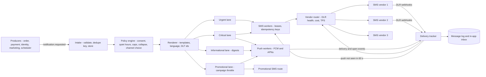
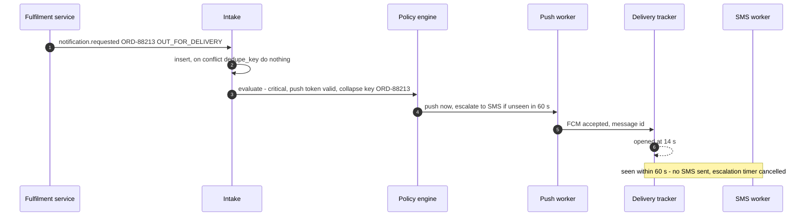
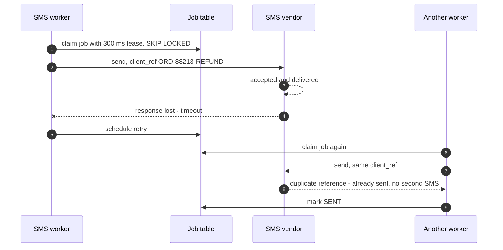
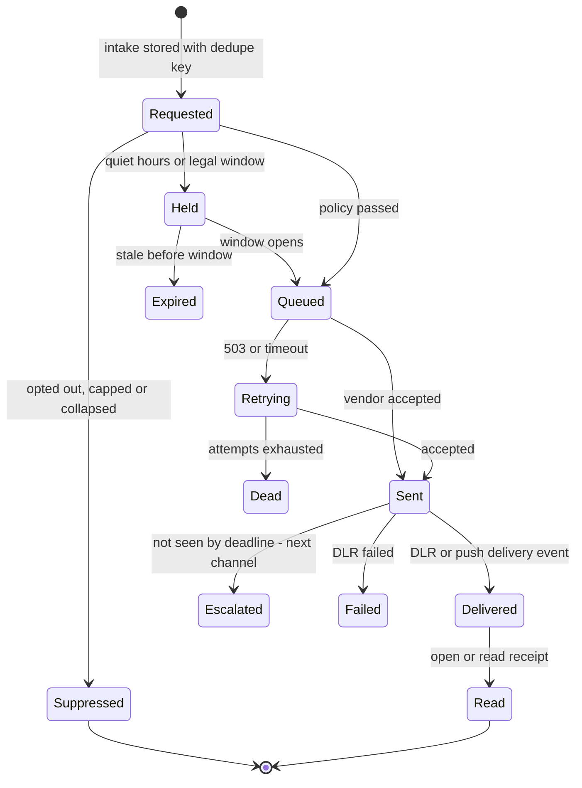

# 40. Case Study: Notification System

!!! abstract "Chapter at a glance"
    **Reader bands:** B1 → B4 · **Prerequisites:** [Ch 14](../02-distributed-core/14-messaging-and-event-streaming.md), [Ch 20](../02-distributed-core/20-idempotency-ids-and-distributed-locks.md), [Ch 38](38-url-shortener-and-short-links.md), [Ch 39](39-distributed-rate-limiter.md) · **What you will build:** The grocery platform's notification service. It carries OTPs, order updates, refunds, slot reminders, price-drop alerts and marketing across push, SMS, WhatsApp, email and in-app. The chapter covers the classic interview design (fan-out, templates, preferences, queues, retries) plus what production adds: priority under campaigns, exactly-once *for the customer* on at-least-once plumbing, silently failing vendors, and deciding what not to send.

    - **L1: priority lanes.** A 2.5M-SMS campaign triggered the login and order surge it then competed with. With one FIFO queue, **every OTP expired** and order updates had a p99 wait of **82 minutes**. Strict priority protected OTPs but left **130,467** campaign SMS unsent at the 21:00 legal cut-off. Campaign-friendly "fair" weights let **11.9%** of OTPs expire. A separate promotional route delivered everything on time.
    - **L2: exactly-once for the customer, on real PostgreSQL.** 20,000 events ran through a `SKIP LOCKED` job table with bus redeliveries, vendor timeouts and worker crashes. With no dedupe, **1,838 customers** got duplicate SMS. A dedupe key at intake halved that to **884**. Passing an idempotency key the vendor honours took it to **0**. Nothing was lost in any design.
    - **L3: silent vendor failure.** The cheapest vendor delivered only 35% of OTPs for 40 minutes while its API kept returning 200. Failing over on errors never triggered: **3.9%** of OTPs arrived within 30 s during the incident. Routing on delivery-report health moved traffic **42 s** after the failure began and got **90%** through. Adding one resend through another vendor reached **98.9%**.
    - **L4: what not to send.** For 100,000 customers over a day, sending everything everywhere cost **₹50,971** in SMS and gave **55%** of customers more than 10 notifications. Opt-outs, quiet hours, collapsing, caps, digests and push-first-then-SMS escalation cut SMS spend to **₹11,067**. Customers with more than 10 notifications fell to **2.7%**, and ~99% of critical updates were still seen within 2 minutes.

    · **Reading time:** 110 min + code

---

## 1. Introduction & Why It Matters

### 1.1 A story: Diwali night

At 19:00 on Diwali, marketing launched a 2.5-million-SMS campaign with a big discount. It worked. Within minutes, hundreds of thousands of customers opened the app and asked for a login OTP. The notification service had one queue, one SMS vendor account and one worker pool:

1. **OTPs queued behind the campaign.** They arrived 40 minutes later, long after they had expired. Customers who wanted to buy couldn't log in.
2. **Order updates queued too.** "Your order is out for delivery" arrived after the order did.
3. **Duplicates.** A Kafka consumer rebalance during the surge re-delivered thousands of events, and vendor timeouts caused resends. Some customers got the same OTP three times; some got "Your refund of ₹1,240 is processed" twice and called support asking for the second refund.
4. **The vendor silently degraded.** The cheapest SMS vendor's route to one operator failed. Its API still returned `200 Accepted`. Nothing alerted until customers complained on social media.
5. **The campaign missed the window.** The campaign's tail was still sending at 21:40, after the permitted window for promotional SMS.
6. **Notification fatigue.** Customers who ordered got six status pushes, five campaign pushes and three price-drop alerts that evening. Uninstalls rose the next day.

The redesigned service, built in this chapter, treats notifications as a **product with obligations**: some messages are urgent and cheap to lose, some critical and must arrive once, some optional and must respect consent and time windows. The architecture follows from those classes.

!!! quote "The thesis of this chapter"
    A notification system is a fan-out pipeline whose hard problems are not throughput but **judgement and guarantees**. **Priority**: messages differ by orders of magnitude in urgency, and the pipe is shared (L1). **Delivery semantics**: every hop is at-least-once, so exactly-once *for the customer* needs idempotency keys end to end, including at the vendor (L2). **Truth about delivery**: vendors fail silently, so route on delivery receipts, not API responses (L3). **Restraint**: preferences, quiet hours, collapsing, caps and channel escalation decide what *not* to send, which is where cost and customer trust are won (L4).

### 1.2 Where this lives in the grocery platform

| Message | Class | Channels | Latency | Guarantee |
|---|---|---|---|---|
| Login OTP | Urgent | SMS (WhatsApp fallback) | Seconds; useless after 5 min | Arrive once; resend on request |
| Order confirmed → delivered, refunds | Critical | Push → SMS fallback; in-app | < 1–2 min | Exactly-once for the customer, no loss |
| Slot reminder, rider arriving | Critical/timely | Push, SMS | Minutes | At-least-once, collapse superseded |
| Price drop, back in stock | Informational | Push, in-app, email digest | Hours | Best effort, batched |
| Campaigns | Promotional | Push, SMS (promotional route), WhatsApp templates, email | Hours; legal time windows | Consent, caps, opt-out |
| Vendor/rider alerts | Operational | Push, SMS, IVR | Seconds to minutes | At-least-once |

Producers include order, payment, fulfilment, identity (OTP), marketing and the reminder scheduler ([Ch 09](../01-foundations/09-scalability-fundamentals.md) publishes `notification.requested` events). Links in messages go through `gro.cr` ([Ch 38](38-url-shortener-and-short-links.md)). OTP abuse controls are in [Ch 39](39-distributed-rate-limiter.md).

### 1.3 Learning objectives

By the end you will be able to:

- **Design the pipeline**: intake API and events, templating and localisation, preference and policy evaluation, channel queues, vendor adapters, delivery tracking.
- **Prioritise** under shared capacity, and separate routes by class (L1).
- **Deliver exactly-once for the customer** with dedupe keys, leases and vendor idempotency (L2).
- **Route across vendors** using delivery-report health, failover and resends (L3).
- **Decide what to send** with preferences, quiet hours, frequency caps, collapsing, digests and channel escalation (L4).
- **Meet India-specific obligations**: DLT templates and headers, promotional time windows, consent, and data minimisation.

---

## 2. Core Concepts — Beginner to Deep

### 2.1 Intuition: a post office with express, registered and bulk mail <span class="band b1">B1</span>

A post office handles express parcels (OTPs: must arrive today, worthless tomorrow), registered letters (refund confirmations: must arrive, exactly once, with proof), and bulk flyers (campaigns: cheap, can wait, must respect "no junk mail" stickers). Running them all through one counter means express waits behind flyers. Sending a registered letter twice because a receipt was lost confuses the recipient. And the post office must notice when one courier company quietly stops delivering.

### 2.2 Requirements <span class="band b1">B1</span>

**Functional**

- Accept notification requests from services (API and events), with recipient, template, variables, class, dedupe key and optional schedule.
- Render per channel and language from versioned templates (DLT-registered for SMS).
- Apply preferences, consent, quiet hours, caps, collapsing and channel selection.
- Send through push (FCM/APNs), SMS (multiple vendors), WhatsApp Business, email and in-app inbox.
- Track status per message: accepted, sent, delivered, read, failed. Expose status and history.
- Campaigns: audience segments, scheduling, throttling, reporting.

**Non-functional**

- **OTP**: p99 < 10 s end to end, even during campaigns.
- **Critical**: no loss, no customer-visible duplicates; p99 < 2 min.
- **Scale**: ~5M transactional notifications/day, campaigns up to ~20M recipients.
- **Availability**: 99.95% for intake and urgent/critical sending.
- **Compliance**: consent and opt-out honoured, promotional windows, DLT templates, retention limits.

### 2.3 Estimation <span class="band b1">B1</span>

| Quantity | Estimate |
|---|---|
| Transactional | ~5M/day ≈ 60/s average, ~200/s evening peak (surges to more during campaigns — L1) |
| OTP | ~20/s normal, ~150/s during a campaign-driven login surge |
| Campaigns | 2.5M SMS in 2 h at a 500/s vendor contract ≈ 83 min of the whole pipe |
| Push | 20M campaign pushes via FCM in batches of 500 ≈ 40k API calls |
| Storage | Message log ~1 KB each × ~30M/day ≈ 30 GB/day; keep 90 days hot, summaries longer |
| SMS cost | ₹0.12–0.20 per SMS; policy choices change spend by 4–5x (L4) |

The volume is not large for a modern queue. What dominates the design is **shared vendor capacity**, **per-message guarantees** and **cost**.

### 2.4 Architecture of the pipeline ⭐ <span class="band b2">B2</span>

1. **Intake**: an API and a Kafka topic `notification.requested`. Each request carries a **dedupe key** chosen by the producer (e.g., `ORD-88213:OUT_FOR_DELIVERY`), a class, a template id and variables. Intake validates, stores the request (unique on dedupe key) and acknowledges.
2. **Policy evaluation**: load the recipient's preferences, consent, quiet hours, device tokens and recent-send counters. Decide channels, timing (now, held, digest) and whether this request supersedes a pending one (collapse).
3. **Rendering**: template × language × channel, with variables. SMS templates must match the DLT-registered template.
4. **Channel queues per class**: separate queues/lanes for urgent, critical, informational and promotional traffic, per channel (L1).
5. **Channel workers and vendor adapters**: pace to each vendor's TPS ([Ch 39](39-distributed-rate-limiter.md) egress shaping), pick a vendor by health and cost (L3), send with an idempotency key (L2), and record the vendor message id.
6. **Delivery tracking**: vendor webhooks (DLRs), FCM responses, email events, read receipts. Update message status, feed vendor health, trigger fallbacks (push not seen in 60 s → SMS).
7. **Inbox and history**: in-app inbox and a customer-support view of what was sent and delivered.

Each stage is a separate consumer group so a slow stage doesn't block intake, and each has its own dead-letter handling ([Ch 14](../02-distributed-core/14-messaging-and-event-streaming.md)).

### 2.5 Priority and isolation ⭐ <span class="band b2">B2</span>

L1 simulated the Diwali evening against a 500 SMS/s vendor contract: a 2.5M-SMS campaign, which then drove OTPs from 20/s to 150/s and order updates from 60/s to 200/s.

| Strategy | OTP p99 | OTPs expired | Transactional p99 | Campaign unsent at 21:00 |
|---|---|---|---|---|
| One FIFO queue | none sent in time | **100%** | **4,893 s** | 0 |
| Lanes, strict priority | 0 s | 0% | 0 s | **130,467** |
| Lanes, weighted 20/30/50 | 300 s | **11.9%** | 464 s | 85,537 |
| **Priority + separate promotional route (400/s)** | 0 s | 0% | 0 s | **0** |

- **Never share a FIFO queue** between urgent and bulk messages.
- **Strict priority** protects the urgent classes, but bulk traffic gets only what's left, so it can miss legal windows.
- **Weights tuned for the campaign** starve OTPs exactly when the campaign drives logins.
- **Separate capacity** — a promotional vendor account/route — removes the contention. India's DLT framework already separates promotional from transactional and service messages (different headers and templates). Size the promotional route so campaigns finish within the permitted window, and schedule campaigns with the surge they create in mind.

The same principle applies to push (separate FCM sending pools per class) and to workers (bulkheads per class — [Ch 18](../02-distributed-core/18-resilience-patterns.md)).

### 2.6 Delivery semantics: exactly-once for the customer ⭐ <span class="band b3">B3</span>

Every hop is at-least-once: the event bus redelivers, workers crash, and a vendor call can time out *after* the vendor accepted the message. L2 measured the duplicates each hop causes, using a real PostgreSQL job table:

| Design | Jobs queued (20,000 events) | Customers with duplicates | Lost |
|---|---|---|---|
| No dedupe | 21,018 | **1,838** (1,950 extra SMS) | 0 |
| Unique dedupe key at intake | 20,000 | 884 (926) | 0 |
| **+ idempotency key honoured by the vendor** | 20,000 | **0** | 0 |

- **Dedupe at intake**: a unique constraint on the producer's dedupe key (`insert … on conflict do nothing`) absorbs redelivered events ([Ch 20](../02-distributed-core/20-idempotency-ids-and-distributed-locks.md)).
- **Leases, not locks**: workers claim jobs with `FOR UPDATE SKIP LOCKED` and a short lease. A crashed worker's jobs become claimable again, so nothing is lost.
- **Unknown outcomes**: a timeout or a crash after sending leaves the outcome unknown. Retrying risks a duplicate; not retrying risks a loss. Only an **idempotency key the vendor honours** (a client reference the vendor dedupes on, or FCM's message id semantics — VERIFY each vendor's guarantee) closes the gap.
- **Where the vendor can't dedupe**, choose per message class. Refunds and payments: prefer a rare duplicate *with idempotent wording* ("Your refund of ₹1,240 for order 88213 is processed" is harmless twice; "You have received ₹1,240" is not). OTPs: a duplicate is fine; a loss is not.

### 2.7 Vendors, routing and delivery receipts ⭐ <span class="band b3">B3</span>

SMS reaches phones through aggregators and operator routes you don't control. Vendors fail in ways their API doesn't show: `200 Accepted` while the route to one operator is broken. L3:

| Policy | OTPs ≤ 30 s overall | During the incident | ₹ per useful OTP |
|---|---|---|---|
| Cheapest vendor only | 65.9% | **3.9%** | 0.182 |
| Fail over on API errors | 65.9% | **3.9%** | 0.182 |
| **Route on DLR health** (85% threshold, 60 s window, 5% probe) | 94.6% | 90.0% | **0.137** |
| DLR routing + one resend via another vendor after 20 s | **99.4%** | **98.9%** | 0.139 |

- **Delivery reports (DLRs) are the health signal.** Measure, per vendor and per operator/circle, the share of sends delivered within the deadline over a sliding window. Route away when it drops, and keep a small probe share to detect recovery. L3 detected the failure 42 s after it began. A send can only be judged once its deadline has passed.
- **Resend via another vendor** for OTPs when no DLR arrives in time. It costs a few percent more SMS; a failed login costs far more. Users can also tap "resend" or "get OTP on WhatsApp".
- Routing also optimises **cost** (the cheapest healthy vendor wins) and respects **vendor TPS** and **per-operator** health.
- Push has its own failure modes: stale tokens (clean up on `UNREGISTERED`), OS-level throttling of background pushes, silent drops on some Android OEMs. That's why critical pushes escalate to SMS if not seen (L4).

### 2.8 What to send: preferences, consent, timing, restraint ⭐ <span class="band b3">B3</span>

L4 applied increasingly careful policies to one day of events for 100,000 customers:

| Policy | Push | SMS | SMS ₹/day | Critical seen ≤ 2 min | Customers > 10/day |
|---|---|---|---|---|---|
| Send everything; critical on push + SMS | 972,543 | 339,808 | 50,971 | 99.0% | **54.9%** |
| + opt-outs + quiet hours | 680,205 | 299,341 | 44,901 | 99.0% | 31.3% |
| + collapse + marketing cap 2/day + digest | 302,033 | 161,686 | 24,253 | 99.4% | 12.6% |
| **+ push first, SMS fallback at 60 s** | 302,033 | **73,783** | **11,067** | 99.4% | **2.7%** |

- **Consent and opt-outs** are obligations, not tuning ([Ch 36](../04-architect/36-compliance-governance-and-data-residency.md)). Store them per channel and purpose, honour them at send time, and keep an audit of consent changes.
- **Time windows**: quiet hours for non-urgent messages; legal windows for promotional SMS (TRAI; VERIFY current rules). Hold messages and send them when the window opens, rather than dropping them — and drop them if they're stale by then.
- **Collapse superseded updates**: "packed" is pointless if "out for delivery" follows two minutes later. Use a collapse key per order; push services also support collapse keys natively. (L4 counts a collapsed update as seen, because the newer update carries it.)
- **Frequency caps** on promotional messages per user per day and week, and **digests** for informational alerts.
- **Channel escalation**: push first (free), then SMS only if the push isn't delivered or seen within a deadline. That's cheaper than sending both, and it's what makes push dependable.

### 2.9 Templates, localisation and India's DLT <span class="band b2">B2</span>

- Templates are versioned artefacts with an owner, per channel and language (English, Hindi, Tamil, Kannada, …), with typed variables. The service renders them; producers send only ids and variables.
- **DLT** (Distributed Ledger Technology registration, TRAI): commercial SMS must use a registered **header** (sender id) and **content template**, with variables in registered positions. Messages that don't match are blocked by operators. Keep the DLT template id with each template version, and test rendering against the registered pattern in CI.
- **WhatsApp Business** templates are pre-approved by Meta for business-initiated messages outside the 24-hour service window.
- Links in templates go through the first-party shortener ([Ch 38](38-url-shortener-and-short-links.md)), which also satisfies URL whitelisting.
- **Never put secrets or unnecessary personal data in messages** beyond what's needed (masked order ids, no full addresses in SMS).

### 2.10 Data model <span class="band b3">B3</span>

```sql
create table notification_request (          -- one per producer request
  id bigserial primary key, dedupe_key text unique not null, user_id bigint not null,
  class text not null, template_id text not null, variables jsonb not null,
  collapse_key text, not_before timestamptz, created_at timestamptz default now());

create table notification_message (          -- one per channel attempt chain
  id bigserial primary key, request_id bigint references notification_request, channel text not null,
  status text not null, vendor text, vendor_msg_id text, attempts int default 0,
  locked_until timestamptz, next_attempt_at timestamptz, sent_at timestamptz, delivered_at timestamptz);

create table user_channel_pref (user_id bigint, channel text, purpose text, opted_in boolean,
  quiet_start time, quiet_end time, updated_at timestamptz, primary key (user_id, channel, purpose));
```

At higher volume, the message log moves to a partitioned table or a wide-column store keyed by user and time, while the working queue stays small ([Ch 21](../03-production/21-data-at-scale.md)).

### 2.11 Campaigns at scale <span class="band b4">B4</span>

- **Audience resolution** runs as a batch job over the customer store (segments, exclusions, opt-outs, caps already used today), producing a recipient list partitioned into chunks.
- **Throttled release**: chunks are released at the promotional route's capacity, and stopped automatically if the platform is degraded (brownout: [Ch 18](../02-distributed-core/18-resilience-patterns.md)).
- **Surge-aware scheduling**: a campaign creates logins and orders (L1). Coordinate with capacity planning, pre-scale, and stagger large sends.
- **Kill switch** per campaign, and a preview/test-send flow.
- **Measure outcomes** (opens, clicks via the shortener, orders), not just sends.

### 2.12 Multi-region and resilience <span class="band b4">B4</span>

- Intake in both regions; requests are idempotent by dedupe key, so a replayed request after failover is harmless.
- Vendor adapters in both regions, with vendor TPS shared via leased global limits ([Ch 39](39-distributed-rate-limiter.md)).
- If all SMS vendors fail: OTP falls back to WhatsApp or voice; critical updates to push and in-app; campaigns pause.
- Backpressure: if channel queues grow beyond thresholds, shed informational traffic first and hold promotional traffic.

### 2.13 Interview framing <span class="band b4">B4</span>

Interviewers expect fan-out, queues, retries and templates. Stand out by classifying messages (urgent/critical/informational/promotional) and deriving priority and guarantees from that, by explaining *where* duplicates come from and how the vendor idempotency key closes the gap, by routing on DLRs rather than API responses, and by treating restraint (consent, caps, collapse, escalation) as a first-class part of the design.

---

## 3. Architecture & Diagrams

### 3.1 Component view



### 3.2 Sequence: happy path, "out for delivery"



### 3.3 Sequence: failure path, vendor timeout after acceptance



### 3.4 State: a message's lifecycle



---

## 4. Design Document Excerpt: Notification Platform v2

!!! note "Design Document (excerpt) — Notification Platform v2"
    **Status:** Accepted · **Authors:** Messaging platform team · **Reviewers:** Marketing tech, Identity, Legal/compliance, SRE

    | Field | Value |
    |---|---|
    | Context | Diwali incident: OTPs behind a campaign in one FIFO queue; duplicate refund SMS; a silent vendor failure undetected for 45 min; promotional SMS after 21:00; notification fatigue and uninstalls. |
    | Decision | Message classes with separate lanes and a separate promotional route; dedupe keys at intake, leased jobs, vendor idempotency keys; DLR-health vendor routing with OTP resend; a policy engine for consent, quiet hours, caps, collapse and push-first escalation; DLT-bound templates. |
    | Related ADRs | ADR-260 Four message classes and per-class lanes/pools; promotional traffic on its own vendor route (L1); ADR-261 Producer-supplied dedupe keys, unique at intake; SKIP LOCKED leases; vendor client references (L2); ADR-262 DLR-health routing per vendor and operator, 85% threshold, 5% probe; OTP resend via alternate vendor at 20 s (L3); ADR-263 Policy engine: consent per channel and purpose, quiet hours, promo cap 2/day, collapse keys, daily digest, push-first with 60 s SMS escalation (L4); ADR-264 Templates versioned with DLT ids, rendering tested in CI; ADR-265 Message log 90 days hot, then aggregated |

    **Requirements.**

    - **R1** OTP p99 < 10 s end to end, including during campaigns.
    - **R2** Zero lost critical messages; customer-visible duplicates < 0.01%.
    - **R3** Detect a silent vendor degradation within 2 minutes.
    - **R4** No promotional message outside consent or legal windows.
    - **R5** SMS spend reduced ≥ 50% without reducing critical reach.

    **Decisions in detail.**

    1. **Lanes (ADR-260).** Kafka topics per class; worker pools per class; SMS egress shaped per class with OTP strict priority; promotional route 400 SMS/s.
    2. **Delivery (ADR-261).** `notification_request.dedupe_key` unique; job leases 30 s (300 ms in the lab); max 8 attempts, then DLQ with alert; vendor client reference = message id.
    3. **Routing (ADR-262).** Health per vendor × operator from DLRs, 60 s window; cheapest healthy vendor; OTP resend if no DLR by 20 s.
    4. **Policy (ADR-263).** Preferences cached per user; counters in Redis; collapse per order; digests at 19:00 local.
    5. **Templates (ADR-264).** Template registry with DLT header/template ids, languages and owners.

    **Consequences.** More moving parts (policy engine, router, tracker), and dependence on vendor DLR quality. Collapsing and escalation add a little latency to some messages. In return: OTPs that arrive during campaigns, no double refunds, fast detection of vendor failures, and less than a quarter of the SMS spend.

---

## 5. Hands-On Code — Level Ladder

!!! info "What's real here"
    All four labs are JDK 21. **L2 runs against a real PostgreSQL 16** with 8 worker threads claiming jobs through `FOR UPDATE SKIP LOCKED`. Its fault injection uses thread-local randomness, so its exact counts vary slightly between runs; the pattern doesn't. L1, L3 and L4 are deterministic simulations with fixed seeds. Traffic shapes, vendor behaviour, costs and push reachability are stated assumptions.

L2 needs PostgreSQL 16 on port 5581 (database `shop`) and `postgresql-42.7.4.jar`. Run every lab with `-Dstdout.encoding=UTF-8`.

### L1 — Priority lanes on a shared SMS pipe <span class="band b2">B2</span>

**Requirement:** "Marketing sends 2.5 million SMS at 19:00. OTPs must still arrive in seconds, order updates within minutes, and the campaign must finish before 21:00."

A second-by-second simulation of the vendor's 500 SMS/s contract. The campaign drives its own surge: OTPs rise from 20/s to 150/s and order updates from 60/s to 200/s.

```java title="PriorityLanesL1.java"
// PriorityLanesL1.java — run with: java PriorityLanesL1.java   (JDK 21, no dependencies)
// ONE SMS PIPE, THREE KINDS OF MESSAGE. The SMS vendor contract allows 500 messages/s. At 19:00 marketing enqueues a
// 2,500,000-SMS Diwali campaign; meanwhile customers keep requesting OTPs (~20/s, useless after 5 minutes, should arrive
// within seconds) and the platform keeps sending transactional updates (~60/s: order confirmed, out for delivery, refunds).
// The campaign WORKS: from 19:05 customers open the app and log in (OTPs rise to ~150/s for 30 min) and from 19:10 they
// order (transactional rises to ~200/s for 50 min) — the campaign creates the traffic it competes with.
// Promotional SMS may only be sent 09:00–21:00 (TRAI), so the campaign must finish by 21:00. Simulated per second for two
// hours with Poisson arrivals; four ways to share the pipe:
//   A) one FIFO queue for everything
//   B) three lanes, strict priority: OTP > transactional > marketing
//   C) three lanes, weighted fair share OTP 20% / transactional 30% / marketing 50% (unused share flows to the others)
//   D) B, plus marketing on its own promotional route/account (400 msg/s) so it never competes for the 500
import java.util.*;

public class PriorityLanesL1 {
    public static void main(String[] args) {
        int horizon = 7200; long campaign = 2_500_000;
        System.out.printf("Vendor 500 SMS/s. 19:00 campaign of %,d SMS; OTP 20/s → 150/s (19:05–19:35), expires 300 s;%ntransactional 60/s → 200/s (19:10–20:00). Window 19:00–21:00.%n%n", campaign);
        System.out.printf("   %-44s %9s %9s %11s %12s %20s%n", "strategy", "OTP p50", "OTP p99", "OTP expired", "txn p99", "campaign unsent 21:00");
        String[] names = {"A) one FIFO queue", "B) lanes, strict priority", "C) lanes, weighted fair 20/30/50", "D) B + separate promotional route (400/s)"};
        for (int s = 0; s < 4; s++) run(s, names[s], horizon, campaign);
        System.out.println("\n   → a single queue puts OTPs behind the campaign exactly when the campaign drives logins. Strict priority");
        System.out.println("     protects OTPs and order updates, but the campaign only gets what is left and misses the 21:00 cut-off.");
        System.out.println("     'Fair' weights chosen for the campaign starve OTPs during the login surge. A separate promotional route");
        System.out.println("     (India's DLT rules already separate promotional from transactional/service traffic) removes the contention;");
        System.out.println("     size it so the campaign finishes inside the legal window. Priority is a product decision per message type.");
    }

    static void run(int strategy, String name, int horizon, long campaign) {
        Random rnd = new Random(40); expiredInDrain = 0;
        Deque<Integer> otp = new ArrayDeque<>(), txn = new ArrayDeque<>(), fifo = new ArrayDeque<>();   // arrival seconds
        long mkt = campaign; boolean fifoHasCampaign = strategy == 0;
        long fifoCampaignLeft = campaign;                                  // in FIFO the campaign sits ahead of later arrivals
        List<Integer> otpWait = new ArrayList<>(), txnWait = new ArrayList<>(); int otpExpired = 0, otpTotal = 0;
        for (int t = 0; t < horizon; t++) {
            int nOtp = poisson(rnd, t >= 300 && t < 2100 ? 150 : 20), nTxn = poisson(rnd, t >= 600 && t < 3600 ? 200 : 60);
            otpTotal += nOtp;                                                             // the campaign drives logins and orders
            if (strategy == 0) { for (int i = 0; i < nOtp; i++) fifo.add(-(t + 1)); for (int i = 0; i < nTxn; i++) fifo.add(t + 1); }   // sign marks OTP
            else { for (int i = 0; i < nOtp; i++) otp.add(t); for (int i = 0; i < nTxn; i++) txn.add(t); }
            int cap = 500;
            switch (strategy) {
                case 0 -> {
                    long c = Math.min(cap, fifoCampaignLeft); fifoCampaignLeft -= c; cap -= (int) c;       // campaign first: it arrived first
                    while (cap > 0 && !fifo.isEmpty()) {
                        int a = fifo.poll(); int arr = Math.abs(a) - 1; cap--;
                        if (a < 0) { if (t - arr > 300) otpExpired++; else otpWait.add(t - arr); } else txnWait.add(t - arr);
                    }
                    mkt = fifoCampaignLeft;
                }
                case 1, 3 -> {
                    cap = drainOtp(otp, cap, t, otpWait); otpExpired += expire(otp, t);
                    while (cap > 0 && !txn.isEmpty()) { txnWait.add(t - txn.poll()); cap--; }
                    int mktCap = strategy == 3 ? 400 : cap; long c = Math.min(mktCap, mkt); mkt -= c;
                }
                default -> {
                    int qo = 100, qt = 150, qm = 250;                                                     // 20 / 30 / 50
                    int usedO = Math.min(qo, otp.size()), usedT = Math.min(qt, txn.size()); int usedM = (int) Math.min(qm, mkt);
                    int spare = cap - usedO - usedT - usedM;
                    // redistribute unused capacity in priority order (work-conserving)
                    int extraO = Math.min(spare, otp.size() - usedO); spare -= extraO;
                    int extraT = Math.min(spare, txn.size() - usedT); spare -= extraT;
                    int extraM = (int) Math.min(spare, mkt - usedM);
                    drainOtp(otp, usedO + extraO, t, otpWait); otpExpired += expire(otp, t);
                    for (int i = 0; i < usedT + extraT; i++) txnWait.add(t - txn.poll());
                    mkt -= usedM + extraM;
                }
            }
        }
        otpExpired += (strategy == 0 ? (int) fifo.stream().filter(a -> a < 0).count() : otp.size());   // never sent in the window
        otpExpired += expiredInDrain;
        Collections.sort(otpWait); Collections.sort(txnWait);
        System.out.printf("   %-44s %9s %9s %10.1f%% %11ds %,20d%n", name, fmt(pct(otpWait, 50)), fmt(pct(otpWait, 99)), 100.0 * otpExpired / otpTotal,
                pct(txnWait, 99), mkt);
    }
    static int expiredInDrain = 0;
    static int drainOtp(Deque<Integer> q, int cap, int t, List<Integer> waits) {
        while (cap > 0 && !q.isEmpty()) { int a = q.poll(); if (t - a > 300) { expiredInDrain++; continue; } waits.add(t - a); cap--; }
        return cap;
    }
    static int expire(Deque<Integer> q, int t) { int n = 0; while (!q.isEmpty() && t - q.peek() > 300) { q.poll(); n++; } return n; }
    static String fmt(int s) { return s < 0 ? "none sent" : s + "s"; }
    static int pct(List<Integer> l, int p) { return l.isEmpty() ? -1 : l.get(Math.min(l.size() - 1, l.size() * p / 100)); }
    static int poisson(Random r, double lambda) { double l = Math.exp(-lambda), p = 1; int k = 0; do { k++; p *= r.nextDouble(); } while (p > l); return k - 1; }
}
```

```text title="java -Dstdout.encoding=UTF-8 PriorityLanesL1.java"
Vendor 500 SMS/s. 19:00 campaign of 2,500,000 SMS; OTP 20/s → 150/s (19:05–19:35), expires 300 s;
transactional 60/s → 200/s (19:10–20:00). Window 19:00–21:00.

   strategy                                       OTP p50   OTP p99 OTP expired      txn p99 campaign unsent 21:00
   A) one FIFO queue                            none sent none sent      100.0%        4893s                    0
   B) lanes, strict priority                           0s        0s        0.0%           0s              130,467
   C) lanes, weighted fair 20/30/50                   64s      300s       11.9%         464s               85,537
   D) B + separate promotional route (400/s)           0s        0s        0.0%           0s                    0

   → a single queue puts OTPs behind the campaign exactly when the campaign drives logins. Strict priority
     protects OTPs and order updates, but the campaign only gets what is left and misses the 21:00 cut-off.
     'Fair' weights chosen for the campaign starve OTPs during the login surge. A separate promotional route
     (India's DLT rules already separate promotional from transactional/service traffic) removes the contention;
     size it so the campaign finishes inside the legal window. Priority is a product decision per message type.
```

**Reading it:**

- **One FIFO queue**: the campaign ahead of everything took ~83 minutes of the pipe. Every OTP expired before it could be sent, and order updates had a p99 wait of 4,893 s. The campaign "finished", at the customers' expense.
- **Strict priority**: OTPs and order updates at 0 s. But during the surge they used 350 of the 500/s, and **130,467** campaign SMS were still unsent at 21:00.
- **Weights 20/30/50**, chosen to protect the campaign, gave OTPs 100/s against 150/s arriving: **11.9%** expired and the p99 hit the 300 s limit.
- **A separate 400/s promotional route** decouples them: nothing expired, and the campaign finished inside the window.

### L2 — Exactly-once for the customer, on real PostgreSQL <span class="band b3">B3</span>

**Requirement:** "No customer should get 'Your refund is processed' twice, and no notification may be lost — on plumbing that is at-least-once everywhere."

8 worker threads claim jobs from a real PostgreSQL table with `FOR UPDATE SKIP LOCKED` and a 300 ms lease. Faults are injected: 5% bus redeliveries, 10% vendor 503s, 3% vendor timeouts after acceptance, and 1% worker crashes after sending. The fake vendor records what each phone actually received.

```java title="DeliveryL2.java"
// DeliveryL2.java — run with (PostgreSQL 16 on :5581, db "shop"):
//   java -cp postgresql-42.7.4.jar -Duser.timezone=UTC DeliveryL2.java
// AT-LEAST-ONCE EVERYWHERE, EXACTLY-ONCE FOR THE CUSTOMER. 20,000 "out for delivery" events flow into the notification
// service. Every hop is at-least-once, so duplicates come from three places:
//   • the event bus redelivers ~5% of events (consumer rebalances)
//   • the SMS vendor times out on ~3% of calls AFTER it has accepted the message (the response is lost; we retry)
//   • a worker crashes ~1% of the time after sending but before marking the job done (its lease expires; another retries)
// The vendor also fails ~10% of calls transiently (503) — those must be retried or messages are lost.
// A real PostgreSQL job table with FOR UPDATE SKIP LOCKED leases and 8 worker threads; three designs:
//   A) no dedupe anywhere             B) unique dedupe key at intake       C) B + idempotency key passed to the vendor
import java.sql.*;
import java.util.*;
import java.util.concurrent.*;
import java.util.concurrent.atomic.*;

public class DeliveryL2 {
    static final String DB = "jdbc:postgresql://127.0.0.1:5581/shop?user=claude";

    /** The SMS vendor: records what the customer's phone actually received. Honours client references if asked to. */
    static final class Vendor {
        final ConcurrentHashMap<String, AtomicInteger> received = new ConcurrentHashMap<>();
        final Set<String> seenRefs = ConcurrentHashMap.newKeySet(); final AtomicLong calls = new AtomicLong();
        String send(String key, boolean useRef, ThreadLocalRandom r) {
            calls.incrementAndGet();
            double x = r.nextDouble();
            if (x < 0.10) return "503";                                       // rejected, nothing sent
            boolean deliver = !useRef || seenRefs.add(key);                   // vendor-side idempotency on client reference
            if (deliver) received.computeIfAbsent(key, k -> new AtomicInteger()).incrementAndGet();
            if (x < 0.13) return "TIMEOUT";                                   // accepted, but our HTTP call timed out
            return "OK";
        }
    }

    public static void main(String[] args) throws Exception {
        System.out.println("20,000 notification events; 8 workers; PostgreSQL job table with SKIP LOCKED leases.\n");
        System.out.printf("   %-42s %11s %12s %14s %13s %12s%n", "design", "jobs queued", "vendor calls", "customers got", "duplicates", "lost");
        for (int d = 0; d < 3; d++) run(d);
        System.out.println("\n   → every hop is at-least-once, so duplicates are the default, not a bug to be surprised by. A unique dedupe key");
        System.out.println("     at intake removes the bus redeliveries; the rest come from sends whose outcome we can't know — a timeout");
        System.out.println("     after the vendor accepted, a crash after the send. Only an idempotency key the VENDOR honours closes that");
        System.out.println("     gap; without one, choose per message type between a rare duplicate (OTP, order update) and a rare loss. Retries");
        System.out.println("     with a lease make sure nothing is lost: every design delivered every notification at least once.");
    }

    static void run(int design) throws Exception {
        try (Connection c = DriverManager.getConnection(DB); Statement s = c.createStatement()) {
            s.execute("drop table if exists notification_jobs");
            s.execute("""
                create table notification_jobs(id bigserial primary key, dedupe_key text not null, phone text not null,
                  template text not null, status text not null default 'PENDING', attempts int not null default 0,
                  locked_until timestamptz, next_attempt_at timestamptz not null default now())""");
            if (design >= 1) s.execute("create unique index on notification_jobs(dedupe_key)");
            s.execute("create index on notification_jobs(status, next_attempt_at)");
        }
        // intake: 20,000 events, ~5% redelivered by the bus
        Random rnd = new Random(40); int events = 20_000;
        try (Connection c = DriverManager.getConnection(DB); PreparedStatement ps = c.prepareStatement(
                "insert into notification_jobs(dedupe_key, phone, template) values (?,?,?)" + (design >= 1 ? " on conflict (dedupe_key) do nothing" : ""))) {
            c.setAutoCommit(false);
            for (int e = 0; e < events; e++) {
                int copies = rnd.nextDouble() < 0.05 ? 2 : 1;
                for (int k = 0; k < copies; k++) { ps.setString(1, "ORD-" + (500_000 + e) + ":OUT_FOR_DELIVERY:sms"); ps.setString(2, "98" + (40_000_000 + e)); ps.setString(3, "DLT-1107-out-for-delivery"); ps.addBatch(); }
            }
            ps.executeBatch(); c.commit();
        }
        long queued;
        try (Connection c = DriverManager.getConnection(DB); ResultSet rs = c.createStatement().executeQuery("select count(*) from notification_jobs")) { rs.next(); queued = rs.getLong(1); }

        Vendor vendor = new Vendor(); AtomicInteger crashes = new AtomicInteger();
        try (var pool = Executors.newFixedThreadPool(8)) {
            for (int w = 0; w < 8; w++) pool.submit(() -> { worker(vendor, design >= 2, crashes); return null; });
        }
        long dupCustomers = vendor.received.values().stream().filter(a -> a.get() > 1).count();
        long extraMsgs = vendor.received.values().stream().mapToLong(a -> a.get() - 1).sum();
        long lost = events - vendor.received.size();
        System.out.printf("   %-42s %,11d %,12d %,14d %,6d (%,d SMS) %,6d%n",
                new String[]{"A) no dedupe", "B) dedupe key at intake", "C) B + vendor idempotency key"}[design],
                queued, vendor.calls.get(), vendor.received.size(), dupCustomers, extraMsgs, lost);
    }

    static void worker(Vendor vendor, boolean vendorRef, AtomicInteger crashes) throws Exception {
        ThreadLocalRandom r = ThreadLocalRandom.current();
        try (Connection c = DriverManager.getConnection(DB)) {
            PreparedStatement claim = c.prepareStatement("""
                update notification_jobs set locked_until = now() + interval '300 milliseconds', attempts = attempts + 1
                where id in (select id from notification_jobs
                             where status = 'PENDING' and next_attempt_at <= now() and (locked_until is null or locked_until < now())
                             order by id for update skip locked limit 50)
                returning id, dedupe_key, attempts""");
            PreparedStatement done = c.prepareStatement("update notification_jobs set status = 'SENT' where id = ?");
            PreparedStatement retry = c.prepareStatement("update notification_jobs set locked_until = null, next_attempt_at = now() + interval '20 milliseconds', status = case when attempts >= 8 then 'DEAD' else 'PENDING' end where id = ?");
            int idle = 0;
            while (idle < 40) {
                List<long[]> ids = new ArrayList<>(); List<String> keys = new ArrayList<>();
                try (ResultSet rs = claim.executeQuery()) { while (rs.next()) { ids.add(new long[]{rs.getLong(1), rs.getInt(3)}); keys.add(rs.getString(2)); } }
                if (ids.isEmpty()) {
                    try (ResultSet rs = c.createStatement().executeQuery("select count(*) from notification_jobs where status = 'PENDING'")) { rs.next(); if (rs.getLong(1) == 0) idle += 10; }
                    idle++; Thread.sleep(25); continue;
                }
                idle = 0;
                for (int i = 0; i < ids.size(); i++) {
                    String outcome = vendor.send(keys.get(i), vendorRef, r);
                    if (r.nextDouble() < 0.01) { crashes.incrementAndGet(); continue; }      // crashed before recording: lease will expire
                    if (outcome.equals("OK")) { done.setLong(1, ids.get(i)[0]); done.executeUpdate(); }
                    else { retry.setLong(1, ids.get(i)[0]); retry.executeUpdate(); }       // 503 or timeout: retry later
                }
            }
        }
    }
}
```

```text title="java -cp postgresql-42.7.4.jar -Duser.timezone=UTC DeliveryL2.java"
20,000 notification events; 8 workers; PostgreSQL job table with SKIP LOCKED leases.

   design                                     jobs queued vendor calls  customers got    duplicates         lost
   A) no dedupe                                    21,018       24,362         20,000  1,838 (1,950 SMS)      0
   B) dedupe key at intake                         20,000       23,235         20,000    884 (926 SMS)      0
   C) B + vendor idempotency key                   20,000       23,219         20,000      0 (0 SMS)      0

   → every hop is at-least-once, so duplicates are the default, not a bug to be surprised by. A unique dedupe key
     at intake removes the bus redeliveries; the rest come from sends whose outcome we can't know — a timeout
     after the vendor accepted, a crash after the send. Only an idempotency key the VENDOR honours closes that
     gap; without one, choose per message type between a rare duplicate (OTP, order update) and a rare loss. Retries
     with a lease make sure nothing is lost: every design delivered every notification at least once.
```

**Reading it:**

- **A) No dedupe**: 1,018 redelivered events became extra jobs, and together with timeouts and crashes **1,838 customers** got duplicates.
- **B) Dedupe key at intake** removed the redeliveries (exactly 20,000 jobs). The **884** remaining duplicates come from sends whose outcome was unknown — timeouts after acceptance and crashes before recording.
- **C) Vendor idempotency key**: **0** duplicates. The vendor recognised the retried client reference.
- **Lost: 0 in every design.** Leases and retries guarantee at-least-once; dedupe decides whether the customer notices. Counts vary slightly between runs because the fault injection is per-thread random.

### L3 — Routing around a silently failing vendor <span class="band b3">B3</span>

**Requirement:** "When a vendor says 'accepted' but doesn't deliver, find out in minutes and move OTP traffic — without paying the most expensive vendor all the time."

Two hours of OTPs at ~50/s across three vendors. The cheapest breaks silently for 40 minutes: 35% delivered, late, while its API still returns 200. Health comes only from simulated delivery reports.

```java title="VendorRoutingL3.java"
// VendorRoutingL3.java — run with: java VendorRoutingL3.java   (JDK 21, no dependencies)
// SILENT VENDOR FAILURE. Three SMS vendors (cost per SMS, normal delivery rate): V1 ₹0.12 97%, V2 ₹0.15 96%, V3 ₹0.20 98%.
// For two hours OTPs are sent at ~50/s. From minute 30 to minute 70, V1's route to one large operator breaks SILENTLY: its
// API still answers 200 "accepted", but only 35% of messages are delivered, late. The only evidence is delivery reports
// (DLRs), which arrive after delivery — or never. An OTP is useful only if it arrives within 30 s. Four routing policies:
//   S1 all traffic to the cheapest vendor
//   S2 fail over on API errors (5xx/timeouts)                          — V1 never errors, so nothing happens
//   S3 health from DLRs: per vendor, share of the last 60 s of sends delivered within 30 s; below 85% → route to the
//      next-cheapest healthy vendor, keep 5% probe traffic on the sick one to detect recovery
//   S4 S3 + if no DLR within 20 s, resend the OTP once through a different vendor
import java.util.*;

public class VendorRoutingL3 {
    static final double[] COST = {0.12, 0.15, 0.20}, RATE = {0.97, 0.96, 0.98};

    record Sent(long t, int vendor, boolean delivered, long deliveredAt) {}

    public static void main(String[] args) {
        System.out.println("OTPs at ~50/s for 2 h; V1 silently degrades to 35% delivery in minutes 30–70 (API still returns 200).\n");
        System.out.printf("   %-52s %14s %16s %13s %16s%n", "policy", "OTPs ≤30 s", "during incident", "SMS sent", "₹ per useful OTP");
        String[] names = {"S1) cheapest vendor only", "S2) fail over on API errors", "S3) route on DLR health (85%, 60 s window)", "S4) S3 + resend via other vendor after 20 s"};
        for (int p = 0; p < 4; p++) run(p, names[p]);
        System.out.println("\n   → the vendor's API said 'accepted' throughout; failing over on errors never triggered. Delivery reports are the");
        System.out.println("     only honest health signal, so route on them: measured over a sliding window they exposed the silent failure");
        System.out.println("     in under a minute (a send can only be judged once its 30 s deadline passes) and moved traffic, keeping a trickle on the");
        System.out.println("     sick vendor to see recovery. A single resend through another vendor covers the messages already lost —");
        System.out.println("     worth its extra SMS for OTPs, where a failed login costs far more than ₹0.20; not for marketing.");
    }

    static void run(int policy, String name) {
        Random rnd = new Random(40); int horizon = 7200; long incidentFrom = 1800_000, incidentTo = 4200_000;
        Deque<Sent> window = new ArrayDeque<>();                                  // sends from the last 90 s, for DLR health
        boolean[] healthy = {true, true, true};
        long useful = 0, total = 0, usefulIncident = 0, totalIncident = 0, sms = 0; double cost = 0; long firstShift = -1;
        for (long ms = 0; ms < horizon * 1000L; ms += 20) {                          // ~50/s
            if (rnd.nextDouble() > 0.999) continue;
            total++; boolean inInc = ms >= incidentFrom && ms < incidentTo; if (inInc) totalIncident++;
            // --- health from DLRs visible NOW: a send counts once 30 s have passed (delivered in time or not) ---
            if (policy >= 2 && ms % 1000 == 0) {
                while (!window.isEmpty() && window.peekFirst().t() < ms - 90_000) window.pollFirst();
                for (int v = 0; v < 3; v++) {
                    long n = 0, ok = 0;
                    for (Sent s : window) if (s.vendor() == v && s.t() <= ms - 30_000 && s.t() > ms - 90_000) { n++; if (s.delivered() && s.deliveredAt() - s.t() <= 30_000) ok++; }
                    boolean was = healthy[v]; healthy[v] = n < 20 || (double) ok / n >= 0.85;
                    if (was && !healthy[v] && firstShift < 0) firstShift = ms;
                }
            }
            int v = 0;
            if (policy >= 2) { v = -1; for (int k = 0; k < 3; k++) if (healthy[k]) { v = k; break; } if (v < 0) v = 2; if (!healthy[0] && rnd.nextDouble() < 0.05) v = 0; }
            Sent s = send(ms, v, rnd, incidentFrom, incidentTo); sms++; cost += COST[v]; window.addLast(s);
            boolean ok = s.delivered() && s.deliveredAt() - ms <= 30_000;
            if (!ok && policy == 3 && !(s.delivered() && s.deliveredAt() - ms <= 20_000)) {   // no DLR by 20 s → resend elsewhere
                int alt = v == 0 ? 1 : 0; if (!healthy[alt]) alt = 2;
                Sent r2 = send(ms + 20_000, alt, rnd, incidentFrom, incidentTo); sms++; cost += COST[alt];
                ok = r2.delivered() && r2.deliveredAt() - ms <= 30_000;
            }
            if (ok) { useful++; if (inInc) usefulIncident++; }
        }
        System.out.printf("   %-52s %13.1f%% %15.1f%% %,13d %16.3f%n", name, 100.0 * useful / total, 100.0 * usefulIncident / totalIncident, sms, cost / useful);
        if (firstShift >= 0) System.out.printf("        first shift away from V1 at minute %.1f (incident began at minute 30.0)%n", firstShift / 60_000.0);
    }

    static Sent send(long t, int v, Random rnd, long from, long to) {
        boolean broken = v == 0 && t >= from && t < to;
        double rate = broken ? 0.35 : RATE[v];
        boolean delivered = rnd.nextDouble() < rate;
        long latency = broken ? 20_000 + (long) (rnd.nextDouble() * 90_000) : 2_000 + (long) (-Math.log(1 - rnd.nextDouble()) * 3_000);
        return new Sent(t, v, delivered, t + latency);
    }
}
```

```text title="java -Dstdout.encoding=UTF-8 VendorRoutingL3.java"
OTPs at ~50/s for 2 h; V1 silently degrades to 35% delivery in minutes 30–70 (API still returns 200).

   policy                                                   OTPs ≤30 s  during incident      SMS sent ₹ per useful OTP
   S1) cheapest vendor only                                      65.9%             3.9%       359,645            0.182
   S2) fail over on API errors                                   65.9%             3.9%       359,645            0.182
   S3) route on DLR health (85%, 60 s window)                    94.6%            90.0%       359,651            0.137
        first shift away from V1 at minute 30.7 (incident began at minute 30.0)
   S4) S3 + resend via other vendor after 20 s                   99.4%            98.9%       378,975            0.139
        first shift away from V1 at minute 30.6 (incident began at minute 30.0)

   → the vendor's API said 'accepted' throughout; failing over on errors never triggered. Delivery reports are the
     only honest health signal, so route on them: measured over a sliding window they exposed the silent failure
     in under a minute (a send can only be judged once its 30 s deadline passes) and moved traffic, keeping a trickle on the
     sick vendor to see recovery. A single resend through another vendor covers the messages already lost —
     worth its extra SMS for OTPs, where a failed login costs far more than ₹0.20; not for marketing.
```

**Reading it:**

- **S1 and S2 are identical**: the vendor never returned an error, so error-based failover never triggered. During the incident, **3.9%** of OTPs arrived within 30 s.
- **S3 (DLR health)** shifted traffic 42 s after the failure began and kept **90%** of OTPs on time during the incident. It was also the cheapest per *useful* OTP (₹0.137): wasted SMS cost money too.
- **S4 (resend after 20 s via another vendor)** reached **98.9%** during the incident, for 5% more SMS.

### L4 — What not to send <span class="band b3">B3</span>

**Requirement:** "Customers should get what they need, when they can act on it, without us paying for noise or breaking consent and time rules."

One simulated day for 100,000 customers — order lifecycles, six campaigns, price-drop alerts — through four increasingly careful policies.

```java title="PolicyEngineL4.java"
// PolicyEngineL4.java — run with: java PolicyEngineL4.java   (JDK 21, no dependencies)
// WHAT TO SEND, ON WHICH CHANNEL, AND WHEN. One simulated day for 100,000 customers (fixed seed). Events:
//   • order lifecycle for ~30% of customers: confirmed, picked, packed, out for delivery, arriving, delivered — several
//     within minutes of each other (quick-commerce), plus occasional refunds          → CRITICAL (the customer is waiting)
//   • 6 marketing campaigns across the day to everyone (one at 22:30)                 → PROMOTIONAL
//   • price-drop alerts on wishlisted items (0–8 per user per day)                     → INFORMATIONAL
// Channels: push (free; 80% of customers have a working push token; a push is seen within 60 s ~85% of the time when the
// phone is reachable) and SMS (₹0.15; delivered and read within 2 minutes ~97% of the time). Four policies:
//   P1 send everything, critical on push AND SMS
//   P2 P1 + respect opt-outs (20% opted out of marketing) + quiet hours 22:00–08:00 for non-critical (held to 08:00)
//   P3 P2 + collapse order updates within 3 min (send only the latest) + marketing cap 2/day + price drops as one digest
//   P4 P3 + critical goes to push first; SMS only if the push isn't delivered/seen within 60 s
import java.util.*;

public class PolicyEngineL4 {
    enum Kind { CRITICAL, PROMO, INFO }
    record Ev(int user, int minute, Kind kind, String type) {}

    public static void main(String[] args) {
        int users = 100_000; Random rnd = new Random(40); List<Ev> evs = new ArrayList<>();
        boolean[] hasPush = new boolean[users], optOutPromo = new boolean[users];
        for (int u = 0; u < users; u++) { hasPush[u] = rnd.nextDouble() < 0.80; optOutPromo[u] = rnd.nextDouble() < 0.20; }
        String[] stages = {"confirmed", "picked", "packed", "out_for_delivery", "arriving", "delivered"};
        int[] gaps = {0, 2, 2, 3, 6, 4};                                                         // minutes between stages
        for (int u = 0; u < users; u++) {
            if (rnd.nextDouble() < 0.30) {
                int orders = rnd.nextDouble() < 0.2 ? 2 : 1;
                for (int o = 0; o < orders; o++) {
                    int m = 7 * 60 + rnd.nextInt(15 * 60);                                         // orders 07:00–22:00
                    for (int s = 0; s < stages.length; s++) { m += gaps[s] + rnd.nextInt(2); evs.add(new Ev(u, m, Kind.CRITICAL, stages[s])); }
                    if (rnd.nextDouble() < 0.05) evs.add(new Ev(u, m + 60, Kind.CRITICAL, "refund"));
                }
            }
            for (int c : new int[]{9 * 60, 11 * 60 + 30, 13 * 60, 17 * 60, 19 * 60, 22 * 60 + 30}) evs.add(new Ev(u, c, Kind.PROMO, "campaign"));
            int drops = rnd.nextInt(9); for (int d = 0; d < drops; d++) evs.add(new Ev(u, rnd.nextInt(24 * 60), Kind.INFO, "price_drop"));
        }
        evs.sort(Comparator.comparingInt(Ev::user).thenComparingInt(Ev::minute));
        System.out.printf("One day, %,d customers, %,d events (%,d critical, %,d promotional, %,d informational).%n%n", users, evs.size(),
                evs.stream().filter(e -> e.kind() == Kind.CRITICAL).count(), evs.stream().filter(e -> e.kind() == Kind.PROMO).count(),
                evs.stream().filter(e -> e.kind() == Kind.INFO).count());
        System.out.printf("   %-46s %10s %9s %10s %15s %13s %13s%n", "policy", "push", "SMS", "SMS ₹/day", "critical seen", "quiet-hours", "users >10");
        System.out.printf("   %-46s %10s %9s %10s %15s %13s %13s%n", "", "", "", "", "≤ 2 min", "promo sends", "a day");
        String[] names = {"P1) send everything; critical on push + SMS", "P2) P1 + opt-outs + quiet hours", "P3) P2 + collapse + caps + digest", "P4) P3 + push first, SMS fallback at 60 s"};
        for (int p = 0; p < 4; p++) run(p, names[p], evs, users, hasPush, optOutPromo);
        System.out.println("\n   → sending everything everywhere costs ~₹51,000 a day in SMS and buries the messages that matter: over half of");
        System.out.println("     customers get more than 10 notifications in a day. Preferences and quiet hours are");
        System.out.println("     obligations (consent, TRAI time windows), not optimisations. Collapsing updates that a newer one supersedes,");
        System.out.println("     capping marketing and batching alerts cut volume sharply without losing anything a customer needed. Escalating");
        System.out.println("     from push to SMS only when the push isn't seen cuts SMS spend by more than half again, and critical updates");
        System.out.println("     still reach ~99% of customers within two minutes — the fallback, not the double send, makes push dependable.");
    }

    static void run(int policy, String name, List<Ev> evs, int users, boolean[] hasPush, boolean[] optOut) {
        Random rnd = new Random(400 + policy);
        long push = 0, sms = 0, critTotal = 0, critSeen = 0, quietPromo = 0; int[] perUser = new int[users];
        int i = 0;
        while (i < evs.size()) {
            int u = evs.get(i).user(); int j = i; while (j < evs.size() && evs.get(j).user() == u) j++;
            List<Ev> mine = evs.subList(i, j); int promoSent = 0; boolean digestSent = false;
            for (int k = 0; k < mine.size(); k++) {
                Ev e = mine.get(k);
                if (e.kind() == Kind.CRITICAL) {
                    critTotal++;
                    if (policy >= 2 && k + 1 < mine.size() && mine.get(k + 1).kind() == Kind.CRITICAL && mine.get(k + 1).minute() - e.minute() <= 3
                            && !e.type().equals("refund")) { critSeen++; continue; }    // superseded within 3 min: the next update carries it
                    boolean pushSeen = hasPush[u] && rnd.nextDouble() < 0.85;
                    if (hasPush[u]) { push++; perUser[u]++; }
                    boolean smsSent = policy < 3 || !pushSeen;
                    if (smsSent) { sms++; perUser[u]++; }
                    boolean smsSeen = smsSent && rnd.nextDouble() < 0.97;                  // SMS delivered and read within 2 min
                    if (pushSeen || smsSeen) critSeen++;
                } else if (e.kind() == Kind.PROMO) {
                    if (policy >= 1 && optOut[u]) continue;
                    boolean quiet = e.minute() >= 22 * 60 || e.minute() < 8 * 60;
                    if (policy >= 1 && quiet) continue;                                    // held: in practice re-queued to 08:00 next day
                    if (policy >= 2 && promoSent >= 2) continue;
                    promoSent++; if (quiet) quietPromo++;
                    if (hasPush[u]) push++; else sms++;
                    perUser[u]++;
                } else {
                    if (policy >= 2) { if (digestSent) continue; digestSent = true; }       // one daily digest
                    boolean quiet = e.minute() >= 22 * 60 || e.minute() < 8 * 60;
                    if (policy >= 1 && quiet && policy < 2) continue;
                    if (hasPush[u]) { push++; perUser[u]++; }
                }
            }
            i = j;
        }
        long heavy = Arrays.stream(perUser).filter(x -> x > 10).count();
        System.out.printf("   %-46s %,10d %,9d %,10.0f %14.1f%% %,13d %12.1f%%%n", name, push, sms, sms * 0.15, 100.0 * critSeen / critTotal, quietPromo, 100.0 * heavy / users);
    }
}
```

```text title="java -Dstdout.encoding=UTF-8 PolicyEngineL4.java"
One day, 100,000 customers, 1,218,912 events (218,656 critical, 600,000 promotional, 400,256 informational).

   policy                                               push       SMS  SMS ₹/day   critical seen   quiet-hours     users >10
                                                                                          ≤ 2 min   promo sends         a day
   P1) send everything; critical on push + SMS       972,543   339,808     50,971           99.0%       100,000         54.9%
   P2) P1 + opt-outs + quiet hours                   680,205   299,341     44,901           99.0%             0         31.3%
   P3) P2 + collapse + caps + digest                 302,033   161,686     24,253           99.4%             0         12.6%
   P4) P3 + push first, SMS fallback at 60 s         302,033    73,783     11,067           99.4%             0          2.7%

   → sending everything everywhere costs ~₹51,000 a day in SMS and buries the messages that matter: over half of
     customers get more than 10 notifications in a day. Preferences and quiet hours are
     obligations (consent, TRAI time windows), not optimisations. Collapsing updates that a newer one supersedes,
     capping marketing and batching alerts cut volume sharply without losing anything a customer needed. Escalating
     from push to SMS only when the push isn't seen cuts SMS spend by more than half again, and critical updates
     still reach ~99% of customers within two minutes — the fallback, not the double send, makes push dependable.
```

**Reading it:**

- **P1** sends **1.3 million** notifications a day, including **100,000** promotional messages at 22:30. **55%** of customers get more than 10 notifications.
- **P2** (consent and quiet hours) is the legal baseline: no quiet-hours promotions, ~330k fewer sends.
- **P3** (collapse, caps, digest) roughly halves volume and SMS spend again. Critical reach is unchanged: collapsed updates are counted as seen because the newer update carries them.
- **P4** (push first, SMS at 60 s if unseen) cuts SMS from 161,686 to **73,783** a day (₹24,253 → ₹11,067). Critical updates are still seen within 2 minutes by 99.4% of customers, and only **2.7%** of customers get more than 10 notifications.


---

## 6. Production Concerns

### 6.1 Failure modes

| Failure | Symptom | Mitigation |
|---|---|---|
| Shared FIFO queue | OTPs expire behind campaigns (L1) | Class lanes, separate promotional route |
| Duplicate events and unknown outcomes | Double OTPs and refund SMS (L2) | Dedupe keys, leases, vendor idempotency, idempotent wording |
| Silent vendor degradation | "Accepted" but undelivered (L3) | DLR-health routing per operator, probes, resends |
| Stale push tokens | Pushes silently dropped | Token hygiene, escalation to SMS |
| Campaign surge | Logins and orders spike (L1) | Surge-aware scheduling, pre-scaling, kill switch |
| Consent or window violations | Regulatory exposure (L4) | Policy engine, hold queues, audit |
| Template mismatch with DLT | Operator blocks SMS | CI rendering tests against registered templates |
| Notification fatigue | Opt-outs, uninstalls (L4) | Caps, collapse, digests |

### 6.2 Observability

- End-to-end latency per class (requested → delivered), per channel and vendor.
- DLR delivery rate per vendor × operator × circle, with thresholds that drive routing and alerts.
- Queue depth and age per lane; OTP expiry rate.
- Duplicate rate (same dedupe key delivered twice, from DLRs) and DLQ size.
- Suppression reasons (opted out, capped, collapsed, quiet hours) — a sudden change usually means a policy bug.
- Spend per class per day.

### 6.3 Security and privacy

- Minimise content: masked identifiers, no full addresses or amounts beyond need in SMS.
- OTP messages carry app-hash/domain-bound formats for autofill and anti-phishing (Android SMS Retriever, WebOTP).
- Vendor webhooks authenticated (signatures, allow-listed IPs).
- Consent records and message logs are personal data: retention and erasure ([Ch 36](../04-architect/36-compliance-governance-and-data-residency.md)).

### 6.4 Performance

- Batch push sends (FCM batch APIs), connection reuse to vendors, async I/O or virtual threads for vendor calls ([Ch 19](../02-distributed-core/19-concurrency-at-scale-in-java.md)).
- Keep the job table small: move finished messages to the log partition.
- Policy evaluation from cached preferences and Redis counters, not per-message database reads.

### 6.5 Cost

- SMS dominates: routing to the cheapest healthy vendor (L3) and push-first escalation (L4) are the biggest levers.
- WhatsApp and email have different pricing; choose channels per class and region.
- Report spend per class and per campaign; charge back campaign sends to marketing budgets ([Ch 35](../04-architect/35-cost-engineering-and-finops.md)).

---

## 7. Anti-Patterns & Pitfalls

!!! danger "1. One queue for all messages"
    OTPs wait behind campaigns (L1).

!!! danger "2. Weights chosen by whoever shouts loudest"
    Campaign-friendly weights starve OTPs during the surge the campaign creates (L1).

!!! danger "3. Trusting at-least-once plumbing to be exactly-once"
    Duplicates come from the bus, timeouts and crashes (L2).

!!! danger "4. Dedupe only at intake"
    Unknown send outcomes still duplicate; use vendor idempotency keys (L2).

!!! danger "5. Non-idempotent message wording"
    "You received ₹1,240" twice looks like two payments. Name the reference.

!!! danger "6. Health from API responses"
    Vendors return 200 while undelivered (L3). Use DLRs.

!!! danger "7. Single vendor"
    No escape during outages or silent failures.

!!! danger "8. Always sending push and SMS"
    Doubles cost and noise; escalate instead (L4).

!!! danger "9. Ignoring quiet hours and legal windows"
    Regulatory risk and irritated customers.

!!! danger "10. Sending every status update"
    Collapse superseded updates.

!!! danger "11. Templates hard-coded in services"
    Breaks DLT compliance, localisation and ownership.

!!! danger "12. Campaigns without a kill switch or surge plan"
    The campaign becomes the incident.

---

## 8. Interview Q&A

### Beginner <span class="band b1">B1</span>

??? question "Q1 [B1] ⭐ Design a notification system — what are the main components?"

    **30-second answer:** An intake API/topic where services request notifications with a template id, variables, recipient, class and a dedupe key; a policy engine for preferences, consent, timing and channel choice; a renderer with versioned, localised templates; per-class, per-channel queues; channel workers with vendor adapters (FCM/APNs, SMS vendors, WhatsApp, email); a delivery tracker consuming receipts; and a message log and in-app inbox.

    **Deep answer:** §2.4 pipeline; each stage is an independent consumer so slow vendors don't block intake.

    **Trade-offs I'd call out:** A central service vs each team sending directly (consistency, compliance, cost control vs autonomy).

    **Follow-ups:**
    1. How do producers call it? → Events for most, API for synchronous OTP.
    2. Where are templates? → A registry owned by the service, not in producers.

    **Red flags:** A single `sendSms()` utility called inline from business code.

??? question "Q2 [B1] ⭐ Why separate queues for OTPs and marketing?"

    **30-second answer:** They differ by orders of magnitude in urgency and volume. In a shared FIFO queue, OTPs wait behind millions of campaign messages and expire. Separate lanes with priority (and ideally a separate promotional route) keep OTPs at seconds while campaigns drain.

    **Deep answer:** L1: one FIFO queue — every OTP expired, order updates' p99 wait was 82 min; priority lanes — OTP p99 0 s.

    **Trade-offs I'd call out:** Strict priority can starve bulk; give it its own capacity.

    **Follow-ups:**
    1. Campaign deadline? → Size the promotional route for the legal window.
    2. Push too? → Separate sending pools per class.

    **Red flags:** "Just add more workers" (the vendor TPS is the bottleneck).

??? question "Q3 [B1] What is a DLR and why does it matter?"

    **30-second answer:** A delivery report: the vendor's asynchronous callback saying whether an SMS reached the handset (or failed). The send API only says the vendor accepted the message. DLRs are the only real signal of delivery, so they drive status, retries, vendor health and routing.

    **Deep answer:** L3: the vendor returned 200 throughout a 40-minute failure; only DLRs revealed it.

    **Trade-offs I'd call out:** DLRs can be delayed or missing — use deadlines.

    **Follow-ups:**
    1. Push equivalent? → FCM delivery data, app-side open events.
    2. Missing DLRs? → Treat as not delivered after the deadline.

    **Red flags:** Marking SMS "delivered" on HTTP 200.

??? question "Q4 [B1] How do you handle user preferences and opt-outs?"

    **30-second answer:** Store consent per user, channel and purpose (transactional vs promotional), with timestamps and source; evaluate at send time (not at campaign creation); honour opt-out keywords and in-app settings immediately; keep an audit trail. Transactional service messages follow different rules from promotional ones.

    **Deep answer:** L4: honouring opt-outs and quiet hours removed ~330k sends a day.

    **Trade-offs I'd call out:** Granularity vs simplicity for users.

    **Follow-ups:**
    1. Opt-out during a running campaign? → Evaluated per message at send time.
    2. Global unsubscribe vs per category? → Offer both.

    **Red flags:** Checking consent once when the campaign is built.

### Intermediate <span class="band b2">B2</span>

??? question "Q5 [B2] ⭐ How do you avoid sending duplicate notifications?"

    **30-second answer:** Producers supply a dedupe key per logical notification; intake stores it with a unique constraint so redelivered events are dropped. Workers claim jobs with leases and retry on failure. For unknown outcomes (timeouts, crashes after send), pass an idempotency key the vendor dedupes on. Where impossible, pick duplicate-vs-loss per class and word messages idempotently.

    **Deep answer:** L2: no dedupe 1,838 customers with duplicates; intake dedupe 884; plus vendor key 0; none lost.

    **Trade-offs I'd call out:** At-most-once loses messages; at-least-once duplicates; choose per class.

    **Follow-ups:**
    1. What's a good dedupe key? → Business event id + type + channel.
    2. Kafka exactly-once? → Doesn't cover the external vendor call.

    **Red flags:** "Kafka exactly-once solves it."

??? question "Q6 [B2] How do workers claim jobs safely from a database queue?"

    **30-second answer:** `UPDATE … WHERE id IN (SELECT … FOR UPDATE SKIP LOCKED LIMIT n) RETURNING …`, setting a lease expiry and incrementing attempts. Other workers skip locked rows. If a worker dies, its lease expires and the job is reclaimed. Finished jobs are marked done; failures get a backoff and eventually a dead-letter state.

    **Deep answer:** L2 ran 8 workers this way on PostgreSQL with injected crashes; nothing was lost.

    **Trade-offs I'd call out:** Database queues are simple and transactional with intake; Kafka/SQS scale further.

    **Follow-ups:**
    1. Lease too short? → Duplicate sends while the first is still in flight.
    2. Table bloat? → Move finished rows out; partition.

    **Red flags:** `SELECT` then `UPDATE` without locking.

??? question "Q7 [B2] Push, SMS, WhatsApp or email — how do you choose the channel?"

    **30-second answer:** By message class, user preference, reachability and cost. Push is free but unreliable (tokens, OEM throttling); SMS is reliable and paid; WhatsApp is rich and cheaper for some templates but needs opt-in; email suits receipts and digests. For critical messages use push first and escalate to SMS if not seen within a deadline.

    **Deep answer:** L4: push-first escalation halved SMS again (₹24,253 → ₹11,067/day) with critical reach unchanged.

    **Trade-offs I'd call out:** Latency of escalation vs cost.

    **Follow-ups:**
    1. OTP channel? → SMS primary, WhatsApp/voice fallback.
    2. No push token? → SMS directly.

    **Red flags:** Always sending on every channel.

??? question "Q8 [B2] What is notification collapsing?"

    **30-second answer:** Replacing pending or recent notifications that a newer one supersedes — "packed" followed by "out for delivery" two minutes later becomes one notification. Implement with a collapse key per entity, short holding windows for fast-changing states, and the push services' native collapse keys.

    **Deep answer:** Part of L4's policy set that cut pushes from 680k to 302k per day.

    **Trade-offs I'd call out:** A short hold adds seconds of latency.

    **Follow-ups:**
    1. Which messages never collapse? → Refunds, OTPs.
    2. In-app inbox? → Keep the full history there.

    **Red flags:** Sending every state transition.

??? question "Q9 [B2] How do you template messages for many languages and channels?"

    **30-second answer:** A template registry: id, versions, channel variants, languages, typed variables, owner, and for SMS the DLT header and template id. Producers send template id + variables; the renderer chooses language from preferences and validates variables. CI tests rendering against DLT patterns.

    **Deep answer:** §2.9.

    **Trade-offs I'd call out:** Central control vs team velocity; self-service registry with review.

    **Follow-ups:**
    1. Template change mid-campaign? → Pin a version per campaign.
    2. Missing translation? → Fallback language.

    **Red flags:** Message text concatenated in business code.

### Senior <span class="band b3">B3</span>

??? question "Q10 [B3] ⭐ An SMS vendor is returning 200 but messages aren't arriving. How does your system detect and react?"

    **30-second answer:** Track DLR-based delivery rate per vendor (and per operator/circle) over a sliding window, judging each send after its deadline. When it drops below a threshold, route to the next-best healthy vendor, keep a small probe share on the sick one to detect recovery, alert, and resend recent undelivered OTPs through another vendor.

    **Deep answer:** L3: error-based failover never triggered (3.9% within 30 s during the incident); DLR routing detected it in 42 s and reached 90%; plus resends 98.9%.

    **Trade-offs I'd call out:** Threshold sensitivity vs flapping; probe share vs cost.

    **Follow-ups:**
    1. Per operator? → Yes, failures are often route-specific.
    2. What if all vendors degrade? → WhatsApp/voice for OTP.

    **Red flags:** Health checks that only ping the vendor API.

??? question "Q11 [B3] ⭐ How do you run a 20M-recipient campaign without hurting transactional traffic?"

    **30-second answer:** Separate promotional lane, workers and vendor route; resolve the audience in batch with opt-outs and caps; release in throttled chunks within the legal window; coordinate with capacity for the surge the campaign creates; brownout hooks to pause; kill switch; measure outcomes.

    **Deep answer:** L1: strict priority on a shared pipe left 130k unsent at 21:00; a separate 400/s route finished on time with OTPs unaffected.

    **Trade-offs I'd call out:** Cost of a separate route vs guaranteed isolation.

    **Follow-ups:**
    1. Personalised links? → Bulk-create via the shortener ([Ch 38](38-url-shortener-and-short-links.md)).
    2. Push campaigns? → FCM topics or batched sends with rate limits.

    **Red flags:** Launching the whole list at once at 19:00.

??? question "Q12 [B3] Exactly-once delivery — is it possible?"

    **30-second answer:** Not end to end with an external vendor unless the vendor deduplicates on your key. You can make everything up to the vendor call effectively exactly-once (dedupe keys, transactional state), and with vendor idempotency the customer sees exactly one message. Otherwise you choose at-least-once with idempotent content, or at-most-once and accept rare losses.

    **Deep answer:** L2 shows each source of duplicates and what removes it.

    **Trade-offs I'd call out:** Duplicate vs loss per class.

    **Follow-ups:**
    1. Push? → FCM message ids and collapse keys limit visible duplicates.
    2. Email? → Message-ID headers help clients thread, not dedupe.

    **Red flags:** Claiming exactly-once without mentioning the vendor boundary.

??? question "Q13 [B3] How would you implement quiet hours and legal time windows?"

    **30-second answer:** Evaluate at send time in the user's time zone: non-urgent messages outside the window go to a hold queue keyed by release time; at release, re-check freshness (drop if stale) and consent. Promotional SMS respect regulatory windows regardless of preferences. Urgent and critical messages bypass quiet hours.

    **Deep answer:** L4: P1 sent 100,000 promotional messages at 22:30; the policy engine sent none.

    **Trade-offs I'd call out:** Holding vs dropping.

    **Follow-ups:**
    1. Time zones? → From the user profile or device.
    2. Released backlog at 08:00? → Throttle it.

    **Red flags:** A cron job that sends everything at 08:00 at once.

??? question "Q14 [B3] How do you design retries and dead letters for notifications?"

    **30-second answer:** Retry transient failures (503, timeouts) with exponential backoff and jitter, bounded by a per-class deadline (OTPs are useless after 5 min, so don't retry past it); switch vendor on repeated failure; after max attempts or deadline, move to a dead-letter state with reason, alert on DLQ growth, and allow replay for critical classes.

    **Deep answer:** L2 used 8 attempts and leases; §3.4 lifecycle.

    **Trade-offs I'd call out:** Persistence vs freshness.

    **Follow-ups:**
    1. Permanent failures (invalid number)? → No retry; mark and notify owner.
    2. Replay safety? → Dedupe keys make replays idempotent.

    **Red flags:** Infinite retries.

### Architect <span class="band b4">B4</span>

??? question "Q15 [B4] ⭐ Design the notification platform for a national grocery app end to end."

    **30-second answer:** Message classes with lanes and routes; intake with dedupe keys; a policy engine for consent, windows, caps, collapse and escalation; a template registry with DLT ids; channel workers with leases and vendor idempotency; multi-vendor routing on DLR health with OTP resends; a delivery tracker, message log and inbox; campaigns with throttled release; observability on latency per class, DLR rates and spend.

    **Deep answer:** §4 and L1–L4.

    **Trade-offs I'd call out:** Central platform vs team autonomy; cost vs reach.

    **Follow-ups:**
    1. Build vs buy? → A CPaaS for channels, own policy and routing.
    2. Biggest risk? → OTP delivery during surges.

    **Red flags:** No classification of messages.

??? question "Q16 [B4] Build or buy — would you use a notification SaaS?"

    **30-second answer:** Buy the channels (FCM, SMS/WhatsApp aggregators, email providers) and possibly an orchestration SaaS for marketing journeys; build or tightly control the transactional core — dedupe, priority, routing on DLRs, consent and DLT compliance — because it's on the critical path for login and orders and needs your data. Keep vendor adapters pluggable.

    **Deep answer:** Multi-vendor routing (L3) requires abstraction over vendors either way.

    **Trade-offs I'd call out:** Speed and features vs control and cost at scale.

    **Follow-ups:**
    1. Data residency? → Vendors storing message content abroad.
    2. Lock-in? → Templates and consent in your own registry.

    **Red flags:** Outsourcing OTP delivery with no fallback.

??? question "Q17 [B4] How do you measure the notification system's success?"

    **30-second answer:** Per class: delivery latency and success (OTP within 30 s, critical within 2 min), duplicate and loss rates, spend per delivered useful message; for engagement: opens, clicks, conversions, opt-out and uninstall rates, notifications per user; for compliance: violations (should be zero).

    **Deep answer:** L4's "customers > 10/day" is a fatigue proxy worth tracking.

    **Trade-offs I'd call out:** Engagement vs fatigue — measure opt-outs next to clicks.

    **Follow-ups:**
    1. Who owns fatigue? → A shared cap across teams, not per-team.
    2. Experimentation? → Holdouts for campaigns.

    **Red flags:** Measuring sends.

??? question "Q18 [B4] How does the notification platform interact with the rest of the architecture during a regional outage?"

    **30-second answer:** Intake in both regions with idempotent dedupe keys; queues replicated or re-driven from the event log; vendor adapters in both regions with shared TPS via leased limits; OTP falls back across vendors and channels; promotional traffic pauses automatically; critical backlog drains first on recovery.

    **Deep answer:** [Ch 27](../03-production/27-reliability-and-disaster-recovery.md), [Ch 39](39-distributed-rate-limiter.md).

    **Trade-offs I'd call out:** Duplicate risk during failover vs loss.

    **Follow-ups:**
    1. Replay after recovery? → Deadlines drop stale OTPs.
    2. DLR webhooks to a dead region? → Vendor-side failover URLs.

    **Red flags:** Single-region notification service.

??? question "Q19 [B4] How do you govern notifications across many product teams?"

    **30-second answer:** A platform with a policy layer every team must go through: shared frequency caps and priorities per user across teams, template ownership and review, class definitions, budgets per team, dashboards for sends and opt-outs by team, and an approval path for new promotional types. Teams keep autonomy over content and triggers within those guardrails.

    **Deep answer:** Guardrails, not gates ([Ch 37](../04-architect/37-leading-architecture-at-scale.md)).

    **Trade-offs I'd call out:** Central caps can block a team's campaign; arbitration rules are needed.

    **Follow-ups:**
    1. Who wins a cap conflict? → Priority by class, then by value.
    2. Cost attribution? → Per team and campaign.

    **Red flags:** Every team sending directly to vendors.

??? question "Q20 [B4] What privacy and compliance obligations apply?"

    **30-second answer:** Consent per purpose and channel with audit; opt-out honoured promptly; DLT registration of headers and templates; promotional time windows; minimising personal data in message content; retention limits on message logs and erasure support; vendor contracts covering data handling and residency.

    **Deep answer:** [Ch 36](../04-architect/36-compliance-governance-and-data-residency.md) — DPDP Act obligations apply to consent records and logs.

    **Trade-offs I'd call out:** Personalisation vs minimisation.

    **Follow-ups:**
    1. Retain full SMS text? → Store template id and variables, redact sensitive ones.
    2. Marketing consent from third parties? → Verify provenance.

    **Red flags:** Logging full message bodies with OTPs.

---

## 9. Summary & Practice

### Key takeaways

1. **Classify messages** (urgent, critical, informational, promotional); priority and guarantees follow (§1.2).
2. **Isolate capacity**: lanes and a separate promotional route; campaigns create the surge they compete with (L1).
3. **Exactly-once for the customer** needs dedupe keys, leases and vendor idempotency (L2).
4. **Route on DLRs**, not API responses; resend OTPs through another vendor (L3).
5. **Restraint is design**: consent, windows, collapse, caps, digests and push-first escalation (L4).
6. **Templates are governed artefacts** with DLT ids and languages.
7. **Measure useful delivery and fatigue**, not sends.

### Decision cheat sheet

| Need | Choice |
|---|---|
| OTP | SMS strict priority lane, DLR routing, resend via alternate vendor, WhatsApp/voice fallback |
| Critical updates | Push first, SMS at 60 s if unseen, collapse keys, dedupe keys |
| Informational | Push/in-app, daily digest |
| Promotional | Separate route, consent at send time, caps, windows, throttled release |
| Job queue | Kafka per class, or PostgreSQL SKIP LOCKED at moderate volume |
| Duplicates | Dedupe key at intake + vendor client reference + idempotent wording |

### Exercises

1. **(B2)** In L1, add a WhatsApp route for OTPs that absorbs 30% of OTPs during the surge. How much capacity does that free for the campaign?
2. **(B3)** In L2, shorten the lease to 50 ms and add a 100 ms vendor latency. What new source of duplicates appears?
3. **(B3)** In L3, make the failure operator-specific (40% of numbers) and compute health per operator. Compare with vendor-level health.
4. **(B4)** In L4, add a shared cap of 6 notifications per user per day across all classes except critical. What happens to marketing reach?
5. **(B4)** Design the schema and API for a customer-support view that shows every message sent to a customer, with delivery status, without exposing OTP values.

### Further reading

- Firebase Cloud Messaging documentation (collapse keys, priorities, batch sends).
- TRAI Telecom Commercial Communications Customer Preference Regulations (TCCCPR) and DLT — check current directions.
- WhatsApp Business Platform documentation on template messages and conversation windows.
- Uber and Airbnb engineering blogs on notification platforms and prioritisation.
- Martin Kleppmann, *Designing Data-Intensive Applications* — end-to-end argument and idempotence.

### Related chapters

- [Ch 14 — Messaging & Event Streaming](../02-distributed-core/14-messaging-and-event-streaming.md): topics, share groups and DLQs.
- [Ch 18 — Resilience Patterns](../02-distributed-core/18-resilience-patterns.md): bulkheads, backoff, brownouts.
- [Ch 20 — Idempotency, IDs & Distributed Locks](../02-distributed-core/20-idempotency-ids-and-distributed-locks.md): dedupe keys and leases.
- [Ch 38 — URL Shortener](38-url-shortener-and-short-links.md): links in messages.
- [Ch 39 — Distributed Rate Limiter](39-distributed-rate-limiter.md): OTP abuse and vendor egress limits.
- [Ch 41 — Chat: Customer–Rider Messaging](41-chat-customer-rider-messaging.md): real-time messaging next door.
