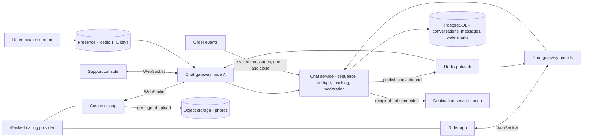
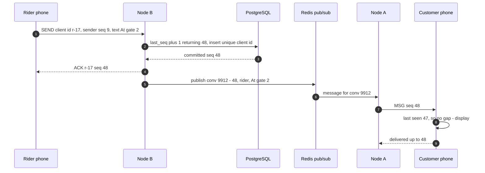
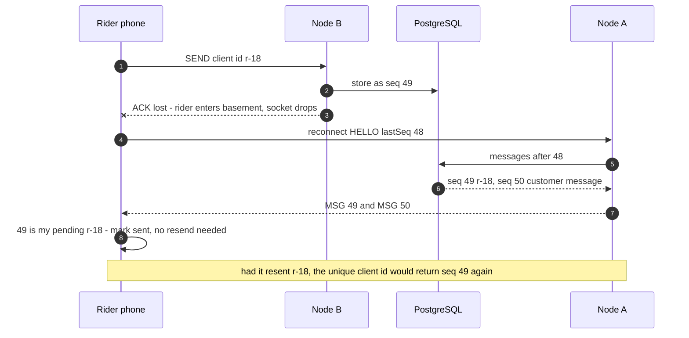
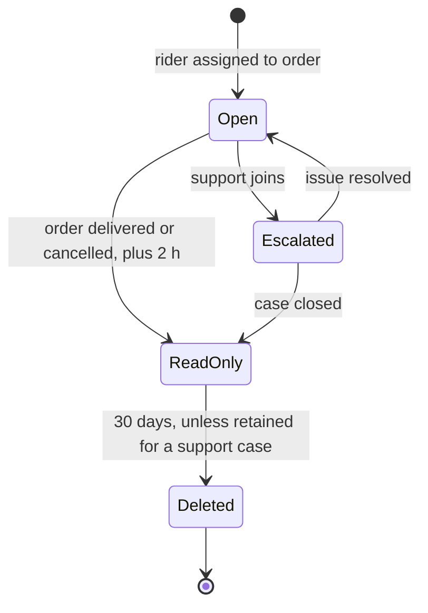

# 41. Case Study: Chat — Customer–Rider Messaging

!!! abstract "Chapter at a glance"
    **Reader bands:** B1 → B4 · **Prerequisites:** [Ch 03](../01-foundations/03-networking-essentials.md) (SSE vs WebSockets, heartbeats), [Ch 14](../02-distributed-core/14-messaging-and-event-streaming.md), [Ch 20](../02-distributed-core/20-idempotency-ids-and-distributed-locks.md), [Ch 40](40-notification-system.md) · **What you will build:** The order-scoped chat between a customer, the rider delivering their order and, when needed, a support agent. It includes text and quick replies, delivery photos, read receipts, "rider is online", masked calling, and translation between languages. This is the classic "design WhatsApp" interview question narrowed to a real product: ordering and delivery guarantees on mobile networks, a multi-node WebSocket tier, presence that doesn't flap, and privacy between strangers.

    - **L1: order, duplicates and gaps.** 2,000 simulated conversations ran over lossy mobile networks with a skewed rider clock.
        - Sorting by the sender's clock showed **59,998** replies before the message they answered, plus **2,407** duplicates and **4,034** missing messages.
        - Sorting by server time fixed causality but left **539** of a sender's own messages out of order and **4,083** missing.
        - Client message ids, per-sender order, a per-conversation sequence and gap fetch gave **0 / 0 / 0 / 0**.
    - **L2: a real multi-node WebSocket chat.** Two hand-written RFC 6455 WebSocket servers, JDK clients, PostgreSQL for history and Redis pub/sub between nodes.
        - **4,187** sends, including **187** retries of a lost ACK, stored **4,000** messages, and every one was delivered across nodes.
        - 50 riders dropped and reconnected to the *other* node, and got the **250** messages they missed replayed from PostgreSQL.
        - Across all phones: **0** duplicates, **0** out of order, **0** gaps.
        - A virtual thread busy-waiting for its ACK first starved the server, a real bug fixed in the lab.
    - **L3: presence that doesn't flap.** 60,000 riders on mobile networks.
        - Heartbeats every 5 s cost **12,000 writes/s**, and riders showed offline **4.5 times an hour** when they weren't.
        - A 20 s grace period after a socket close cut that to **0.55**.
        - Deriving presence from location updates the rider already sends cost **0 extra writes**, with real departures shown within 34 s (p95).
    - **L4: keeping phone numbers out of chat.** Of 2,000 messages leaking a contact, a phone-number regex caught **15.8%**, and wrongly flagged 100 courier AWB numbers.
        - Normalising scripts, separators and number words (English and Hindi), with context rules, caught **85.7%** with **0** false positives on the known cases.
        - Numbers split across two messages or spelt with typos still got through.

    · **Reading time:** 110 min + code

---

## 1. Introduction & Why It Matters

### 1.1 A story: "where are you?" at the wrong gate

A customer in a large Bengaluru apartment complex ordered at 8 pm. The rider reached Gate 2; the customer was waiting at Gate 4. The first chat design, a REST endpoint plus push notifications, turned a two-minute problem into a twenty-minute one:

1. **Messages appeared out of order.** The rider's cheap phone clock was 90 seconds fast. His "Which gate?" appeared *after* the customer's answer "Gate 4", so the customer thought he'd ignored it.
2. **Messages went missing.** A push notification was dropped. The customer never saw "I'm at Gate 2" until they reopened the app.
3. **Duplicates.** On a weak signal, the rider's app retried "Coming" three times and all three appeared.
4. **"Rider offline".** Each time the rider walked through the basement, the customer's screen flipped to "Rider is offline" and the customer called support.
5. **Privacy.** Frustrated, the rider typed his personal number into the chat. Two weeks later, the customer reported that the rider was still messaging her on WhatsApp.

The redesigned chat is small in scale compared with a social messenger. It is **scoped to an order**, lives for hours, has two or three participants and happens under stress on bad networks. But it needs the same core guarantees as any messenger, plus privacy rules because the participants are strangers.

!!! quote "The thesis of this chapter"
    A chat system is **a replicated, ordered log per conversation**, delivered to phones over unreliable networks. The design follows from that. **Order and identity** come from the server: a client-generated id makes retries idempotent, and a server-assigned per-conversation sequence gives one order and lets every phone detect gaps. Phone clocks and push delivery are never trusted (L1). **Delivery** is push as a hint and sync by sequence as the truth, over a stateless multi-node WebSocket tier whose durable store is the database (L2). **Presence** is a derived, debounced signal, not a raw socket state (L3). And between strangers, **privacy** is part of the protocol: masked numbers, contact-detail masking and bounded retention (L4).

### 1.2 Where this lives in the grocery platform

| Aspect | Grocery chat |
|---|---|
| Participants | Customer, assigned rider; support agent joins on escalation; store picker occasionally ("your brand is out of stock — substitute?") |
| Lifetime | Opens at rider assignment, read-only 2 h after delivery, deleted after 30 days (support cases retained per policy) |
| Content | Text, quick replies ("At the gate", "Call me"), photo of delivery spot, location pin, system messages ("Rider picked up your order") |
| Scale | ~1.5M orders/day, ~40% use chat, ~8 messages each ≈ 5M messages/day; evening peak ~400 msg/s; ~60k riders online |
| Channels | In-app WebSocket when foregrounded; push notification ([Ch 40](40-notification-system.md)) when backgrounded; masked calling as fallback |
| Languages | Rider and customer languages differ (Kannada, Hindi, Tamil, English); optional machine translation |

The customer's order-tracking screen uses SSE ([Ch 03](../01-foundations/03-networking-essentials.md)); chat is the bidirectional exception that justifies WebSockets.

### 1.3 Learning objectives

By the end you will be able to:

- **Guarantee order, uniqueness and completeness** of messages on unreliable networks (L1).
- **Build a multi-node WebSocket tier** with durable history, cross-node routing and resume (L2).
- **Design presence and typing indicators** that are honest without being noisy or expensive (L3).
- **Protect participants' privacy**: masked calling, contact-detail masking, retention (L4).
- **Handle media, receipts, multi-device, translation and moderation**, and scale the design up to a general messenger.

---

## 2. Core Concepts — Beginner to Deep

### 2.1 Intuition: a shared notebook with numbered pages <span class="band b1">B1</span>

Imagine the conversation as a notebook kept at the post office. Anyone can send in a line; the clerk writes it on the next numbered line and sends copies to everyone. If your copy says lines 1–7 and then 9, you know line 8 is missing and ask for it. If you send the same line twice because you didn't hear back, the clerk recognises it and doesn't write it again. Your watch being wrong doesn't matter, because the line numbers decide the order.

### 2.2 Requirements <span class="band b1">B1</span>

**Functional**

- 1:1 (customer–rider) and small-group (plus support) conversations tied to an order.
- Send text, quick replies, images and location; system messages from order events.
- Delivery states: sent (server stored), delivered (reached the other phone), read.
- Online/last-seen and typing indicators.
- History on reconnect and on another device (customer's phone and web).
- Masked calling; contact-detail masking; report/block; support escalation.

**Non-functional**

- Message delivery p99 < 1 s when both apps are foregrounded; push within seconds otherwise.
- No loss, no duplicates, one agreed order per conversation.
- 99.95% availability during delivery hours; graceful degradation to push and calls.
- Privacy: no personal numbers exchanged; retention limits; data residency in India.

### 2.3 Estimation <span class="band b1">B1</span>

| Quantity | Estimate |
|---|---|
| Messages | ~5M/day; peak ~400/s (evening), 3x headroom ~1,200/s |
| Concurrent connections | ~60k riders (long-lived) + ~150k customers with open chat at peak ≈ **200k WebSockets** |
| Connection nodes | ~20–50k connections per node is comfortable on the JVM with virtual threads or Netty → 6–10 nodes with headroom |
| Storage | ~300 B per message → ~1.5 GB/day; 30-day retention ≈ 45 GB (plus images in object storage) |
| Presence | 60k riders; heartbeats every 30 s = 2,000 writes/s, or zero extra if derived from location updates (L3) |

The traffic is modest; the difficulty is **correctness on bad networks** and **long-lived connections across many nodes**.

### 2.4 Order, identity and completeness ⭐ <span class="band b2">B2</span>

Three identifiers do all the work:

1. **Client message id** (UUID generated on the phone): makes retries idempotent. The server stores `(conversation, sender, client_msg_id)` uniquely and returns the original sequence for a retry.
2. **Sender sequence** (per sender, per conversation): lets the server keep each person's own messages in the order they wrote them, even if the network reorders their requests.
3. **Conversation sequence** (assigned by the server on commit): the single order everyone displays, and the basis of sync — "give me everything after 47".

L1 compared designs over 2,000 simulated conversations with lossy links and a rider clock skewed up to ±2 minutes:

| Design | Duplicates shown | Missing | Reply before its question | Own messages out of order |
|---|---|---|---|---|
| No dedupe, sort by sender's clock | 2,407 | 4,034 | **59,998** | 0 |
| Dedupe, sort by server time | 0 | 4,083 | 0 | **539** |
| **Client id + sender order + conversation seq + gap fetch** | **0** | **0** | **0** | **0** |

- **Phone clocks can't order a conversation.** Replies appeared before the questions they answered.
- **Server time** fixes causality between people, because a reply is sent after its question was stored, but not a sender's own burst, which the network reorders.
- **Push delivery is a hint**: dropped pushes silently lose messages unless the phone compares sequences and fetches gaps.

Show a pending message immediately with a local "sending" state (optimistic UI), then place it at its sequence when the ACK arrives.

### 2.5 The WebSocket tier ⭐ <span class="band b3">B3</span>

A connection lives on one node; the other participant may be on another. L2 built this with two real nodes:

1. **Connect**: `HELLO(user, conversation, lastSeq)`; the node authenticates (short-lived token), registers the session locally, and **replays** everything after `lastSeq` from the database.
2. **Send**: the node stores the message in one transaction — increment the conversation's `last_seq` (`update … returning`), insert with the unique client id — then **ACKs** the sender with the sequence, and **publishes** to a pub/sub channel for the conversation.
3. **Fan-out**: every node subscribed to the conversation delivers to its local sessions. The receiving phone checks the sequence: duplicate → drop; gap → fetch.
4. **Reconnect anywhere**: nodes are stateless apart from live sockets. L2's riders reconnected to the other node and received the 250 messages they had missed.

L2's results: 4,000 messages across nodes; 187 duplicate retries absorbed; 0 duplicates, 0 gaps and 0 reordering on any phone; p50 ~93 ms end to end on a 2-CPU sandbox with durable commits (timings vary).

**Pub/sub is fire-and-forget.** A message published while a node restarts is lost *from the live path*, but the database has it, and the phone's gap check fetches it. That's why the durable log, not the broker, defines completeness.

**Routing options at larger scale**:

- **Broadcast pub/sub** (Redis pattern subscribe, as in L2): simple; every node sees every message. Fine for thousands of msg/s.
- **Channel per conversation**, subscribed only by nodes with a participant online: less traffic, more subscription churn.
- **User → node registry** plus direct node-to-node forwarding (gRPC): targeted; needs the registry kept fresh.
- **Kafka partitioned by conversation** into the chat service, and a connection tier that subscribes by user — the WhatsApp/Slack-style separation of "message store/router" and "gateway".

**Connection management**: heartbeats (ping/pong) under every idle timeout on the path ([Ch 03](../01-foundations/03-networking-essentials.md)); a bounded connection lifetime; draining on deploy (tell clients to reconnect elsewhere, with jitter); per-connection send buffers with limits, so slow consumers don't consume memory. And never busy-wait on a virtual thread: L2's first version spun while waiting for ACKs, pinned the sandbox's two carrier threads and stalled every connection ([Ch 19](../02-distributed-core/19-concurrency-at-scale-in-java.md)).

### 2.6 Receipts, typing and multi-device <span class="band b2">B2</span>

- **Sent** = the ACK with a sequence. **Delivered** = the receiving phone acknowledges up to sequence N. **Read** = the receiving phone reports its read watermark, "read up to N". Store watermarks per participant, not per message: one row per participant per conversation.
- **Typing** indicators are ephemeral: pub/sub only, never stored, throttled (at most one every 3 s), and they expire automatically.
- **Multi-device**: each device keeps its own `lastSeq`; a user's own sent messages are echoed to their other devices (L2's phones ignore their own echoes but advance `lastSeq`).

### 2.7 Presence ⭐ <span class="band b3">B3</span>

Mobile connections drop constantly: lifts, basements, tower handovers. Half of them drop silently, with no TCP close reaching the server. L3 simulated 60,000 riders:

| Design | Extra writes/s | False offline per rider-hour | Real offline shown p50 / p95 |
|---|---|---|---|
| Heartbeat 5 s, timeout 10 s, instant on close | 12,000 | **4.53** | 0 s / 10 s |
| Heartbeat 30 s, timeout 60 s, instant on close | 2,000 | 3.06 | 0 s / 57 s |
| + 20 s grace after a close | 2,000 | **0.55** | 20 s / 57 s |
| **From location updates (10 s), timeout 35 s, 20 s grace** | **0** | 0.67 | 20 s / **34 s** |

- **Instant offline on socket close** is the noisiest choice: mobile sockets close and reopen within seconds.
- **Grace periods (debouncing)** absorb flapping at the cost of ~20 s detection latency for real departures.
- **Derive presence from traffic you already have**: riders send location every 10 s for tracking ([Ch 47](47-delivery-dispatch-and-live-tracking.md)), which is a free heartbeat.
- **Show "last seen 2 min ago"** instead of a hard online/offline, and don't make business decisions (reassigning an order) on one missed heartbeat.
- Store presence in a TTL cache (Redis `SET key EX 35`); fan presence changes out only to interested parties (the customer's chat and dispatch), not to everyone.

### 2.8 Media, location and system messages <span class="band b2">B2</span>

- **Images** (delivery spot photos) upload directly to object storage with a pre-signed URL; the chat message carries a reference and thumbnail. Scan uploads, strip EXIF location metadata unless it's intended, and expire with the conversation.
- **Location pins** are messages with coordinates; live location sharing uses the tracking stream, not chat.
- **System messages** ("Rider picked up your order", "Order delivered") come from order events and get sequence numbers like any other message, so the timeline is coherent.

### 2.9 Privacy and safety between strangers ⭐ <span class="band b3">B3</span>

- **Masked calling**: calls go through a virtual number that maps to the pair only during the order window, so nobody needs a personal number.
- **Contact-detail masking**: people still type numbers into chat, often deliberately disguised. L4 measured detectors on 2,000 leaking messages and 18,000 ordinary ones, including 300 hard negatives:

| Detector | Recall | False positives |
|---|---|---|
| Regex for a 10-digit mobile | 15.8% | 100 (courier AWB numbers) |
| Normalise separators, Devanagari digits, +91/0; UPI/email | 59.0% | 200 (AWBs, our own support email) |
| **+ any-script digits, number words, context rules** | **85.7%** | **0** on the known hard negatives |

  Plain numbers are rare in real leaks: people write them with spaces, words or another script *because* plain numbers get caught. Normalisation is what makes detection work, and context rules keep it from masking an AWB, an OTP or the support address. What no per-message rule catches is **a number split across messages or deliberately misspelt**. That needs conversation-level detection, and it will never be perfect. Mask, don't block; log for trust and safety review.
- **Report and block**, visible to support; automatic closure of the conversation after delivery.
- **Retention**: read-only 2 h after delivery, deleted after 30 days unless attached to a support case; images deleted with the conversation ([Ch 36](../04-architect/36-compliance-governance-and-data-residency.md)).
- **Moderation** for abuse and harassment: keyword and classifier flags, human review, rider/customer sanctions.

### 2.10 Translation <span class="band b3">B3</span>

Riders often don't read the customer's language. Quick replies are pre-translated templates. Free text can be machine-translated on display, with the original shown on tap. Store the original, cache translations per message and language, and never translate numbers or addresses in a way that changes them.

### 2.11 Storage <span class="band b3">B3</span>

```sql
create table conversations (id bigint primary key, order_id bigint unique, last_seq bigint not null default 0,
  state text not null, created_at timestamptz, closes_at timestamptz);
create table chat_messages (conv_id bigint, seq bigint, sender text, client_msg_id text, kind text, body text,
  media_ref text, sent_at timestamptz default now(),
  primary key (conv_id, seq), unique (conv_id, sender, client_msg_id)) partition by range (sent_at);
create table chat_watermarks (conv_id bigint, participant text, delivered_seq bigint, read_seq bigint,
  primary key (conv_id, participant));
```

- **Partition by day** and drop partitions for retention.
- `update conversations set last_seq = last_seq + 1 … returning` serialises writes *per conversation*. That's fine for two or three participants; a huge group chat would need a different sequencer, such as a partition leader in Kafka.
- At messenger scale, a wide-column store keyed by `(conversation, seq)` (Cassandra, ScyllaDB, HBase — as Discord and Facebook have used) handles the write volume ([Ch 06](../01-foundations/06-nosql-and-polyglot-persistence.md)).

### 2.12 Scaling up to a general messenger <span class="band b4">B4</span>

If the interviewer asks for WhatsApp rather than order chat, the same core stretches:

- **Group chats** with thousands of members: fan-out on read for large groups, fan-out on write for small ones.
- **End-to-end encryption** (Signal protocol): the server stores ciphertext and routes; features like translation and contact masking move to the client or disappear.
- **Offline delivery queues** per device, with the server deleting messages once all devices have acknowledged them (WhatsApp's original model).
- **Connection tier** of millions of sockets per cluster (Erlang/Elixir, Netty), with a session registry.
- **Global** routing with regional stores and message relay between regions.

### 2.13 Interview framing <span class="band b4">B4</span>

Lead with the per-conversation sequence and client message id: they solve ordering, dedupe and sync in one idea. Then the connection tier: stateless nodes, pub/sub or registry, replay on reconnect. Then presence (debounced, derived), receipts (watermarks), media (pre-signed uploads), and — for this domain — privacy (masked calling, contact masking, retention). Mention push as the background path via the notification system.

---

## 3. Architecture & Diagrams

### 3.1 Component view



### 3.2 Sequence: happy path, a message across nodes



### 3.3 Sequence: failure path, lost ACK and reconnect to another node



### 3.4 State: a conversation's lifecycle



---

## 4. Design Document Excerpt: Order Chat v2

!!! note "Design Document (excerpt) — Order Chat v2"
    **Status:** Accepted · **Authors:** Customer experience platform · **Reviewers:** Rider platform, Trust & safety, SRE, Legal

    | Field | Value |
    |---|---|
    | Context | v1 (REST + push) displayed messages by client clock, lost dropped pushes, duplicated retries, flapped presence, and let personal numbers be exchanged. |
    | Decision | Per-conversation sequence and client message ids; WebSocket gateways with durable store and pub/sub routing, replay on reconnect; derived, debounced presence; masked calling and contact-detail masking; order-scoped lifetime and 30-day retention. |
    | Related ADRs | ADR-270 Conversation sequence from the store; unique client message ids; sender sequence enforcement (L1); ADR-271 Stateless WebSocket gateways, PostgreSQL log, Redis pub/sub, replay by lastSeq (L2); ADR-272 Receipts as per-participant watermarks; typing ephemeral; ADR-273 Presence from rider location stream, 35 s timeout, 20 s grace; "last seen" UI (L3); ADR-274 Contact masking with normalisation and context rules; masked calling; report/block (L4); ADR-275 Retention: read-only +2 h, delete at 30 days, partitions by day |

    **Requirements.**

    - **R1** No duplicates, no reordering, no silent loss on any phone.
    - **R2** p99 delivery < 1 s foregrounded; push within 5 s backgrounded.
    - **R3** False "offline" < 1 per rider-hour; real departure shown within 60 s.
    - **R4** No personal contact details exchanged in ≥ 85% of leak attempts; zero masking of OTPs, AWBs, order ids.
    - **R5** Conversation data deleted within 30 days unless under a support case.

    **Decisions in detail.**

    1. **Protocol (ADR-270).** `HELLO(lastSeq)`, `SEND(clientMsgId, senderSeq, body)`, `ACK(clientMsgId, seq)`, `MSG(seq, …)`, `RECEIPT(deliveredSeq, readSeq)`, `TYPING`.
    2. **Gateways (ADR-271).** Netty-based gateways, ~30k connections each, JWT per connection, 25 s pings, 1 h max lifetime, drain on deploy.
    3. **Presence (ADR-273).** Redis key `presence:rider:{id}` refreshed by the location pipeline, `EX 35`; close events start a 20 s grace timer.
    4. **Safety (ADR-274).** Detection runs in the chat service before storing; masked text stored and shown; original kept encrypted for 30 days for trust and safety.
    5. **Retention (ADR-275).** Daily partitions; object-storage lifecycle rules for photos.

    **Consequences.** Every send is a database transaction on the conversation row: fine for 2–3 participants, not for large groups. Presence lags real departures by ~20–35 s. Masking can't catch everything. In return: consistent conversations on bad networks, reconnects to any node, calm presence, and privacy by default.

---

## 5. Hands-On Code — Level Ladder

!!! info "What's real here"
    All four labs are JDK 21. **L2 is a real system**: two hand-written WebSocket servers (RFC 6455 handshake and framing) on virtual threads, JDK `java.net.http.WebSocket` clients, PostgreSQL 16 with durable commits for history and sequencing, and Redis 7 pub/sub between nodes. L1, L3 and L4 are deterministic simulations with fixed seeds. Network loss rates, clock skew, drop patterns and message corpora are stated assumptions.

L2 needs PostgreSQL 16 on port 5581 (database `shop`), Redis 7 on port 6390 and `postgresql-42.7.4.jar`. Run every lab with `-Dstdout.encoding=UTF-8`.

### L1 — Order, duplicates and gaps <span class="band b2">B2</span>

**Requirement:** "Every phone must show the same conversation, once, in order, with nothing missing — on networks that lose, delay and duplicate, and phones whose clocks are wrong."

An event-driven simulation of 2,000 conversations. Messages are replies to the latest message the sender had seen, so the checks can tell when a reply appears before its question.

```java title="OrderingL1.java"
// OrderingL1.java — run with: java OrderingL1.java   (JDK 21, no dependencies)
// ORDER, DUPLICATES AND GAPS IN A CHAT. 2,000 simulated customer↔rider conversations (10 minutes, ~40 messages each) over
// mobile networks: requests are lost (5%), acks are lost after the server stored the message (3% — the client retries
// the same message), latency has a heavy tail (so messages overtake each other), pushes to the other phone are dropped
// (5%), and the rider's cheap phone clock is off by up to ±2 minutes. Each message is a reply to the latest message its
// sender had seen. Three server designs:
//   A) store every request; clients sort by the SENDER'S timestamp
//   B) dedupe by client message id; sort by SERVER receive time
//   C) dedupe by client message id; server enforces each sender's own order (client sequence numbers) and assigns a
//      per-conversation SEQUENCE; receivers detect gaps in the sequence and fetch what's missing
// We check each participant's final view: duplicates, messages missing, replies shown before the message they answer,
// and a sender's own messages shown out of the order they were written.
import java.util.*;

public class OrderingL1 {
    record Msg(int conv, int sender, int clientSeq, long id, long clientTs, long parent) {}
    record Ev(long t, int type, Msg m, int target) {}                     // type 0 = arrives at server, 1 = arrives at phone

    public static void main(String[] args) {
        System.out.println("2,000 conversations × ~40 messages; 5% request loss, 3% ack loss (retry), heavy-tailed latency,");
        System.out.println("5% of pushes dropped, rider clock skew up to ±120 s.\n");
        System.out.printf("   %-58s %11s %9s %17s %17s%n", "design", "duplicates", "missing", "reply before its", "sender's own msgs");
        System.out.printf("   %-58s %11s %9s %17s %17s%n", "", "shown", "", "message", "out of order");
        String[] names = {"A) no dedupe, sort by sender's clock", "B) dedupe by message id, sort by server receive time",
                "C) dedupe + per-sender order + conversation seq + gap fetch"};
        for (int d = 0; d < 3; d++) run(d, names[d]);
        System.out.println("\n   → phones' clocks can't order a conversation: the rider's replies landed before the questions they answered.");
        System.out.println("     Server time fixes causality between people (a reply is sent after its question was stored) but not a");
        System.out.println("     sender's own burst, which the network reorders, and nothing notices a dropped push. The fix is the one");
        System.out.println("     every chat system converges on: a client-generated id for idempotent retries, the sender's own sequence");
        System.out.println("     number so the server keeps each person's order, and a server-assigned per-conversation sequence so every");
        System.out.println("     phone can see a gap and fetch it. Push delivery is a hint; the sequence is the truth.");
    }

    @SuppressWarnings("unchecked")
    static void run(int design, String name) {
        Random rnd = new Random(41);
        long dups = 0, missing = 0, replyFirst = 0, ownInv = 0, total = 0;
        for (int conv = 0; conv < 2000; conv++) {
            long[] skew = {(long) (rnd.nextGaussian() * 2000), (long) ((rnd.nextDouble() * 2 - 1) * 120_000)};
            PriorityQueue<Ev> q = new PriorityQueue<>(Comparator.comparingLong(Ev::t));
            // server state
            Set<Long> stored = new HashSet<>(); List<long[]> serverLog = new ArrayList<>();       // {msgId, serverTs, seq}
            Map<Long, Msg> byId = new HashMap<>(); int[] nextClientSeq = new int[2]; Map<Integer, Msg>[] held = new Map[]{new HashMap<>(), new HashMap<>()};
            long seq = 0;
            // phone state: what each phone has seen (msgId -> sort key), plus the latest seen message id for replies
            List<Map.Entry<Long, Long>>[] view = new List[]{new ArrayList<>(), new ArrayList<>()};
            long[] latestSeen = {-1, -1}; long[] lastSeenSeq = {0, 0};
            // generate sends
            int[] cSeq = new int[2]; long idGen = conv * 1000L;
            List<long[]> sendTimes = new ArrayList<>();
            for (int p = 0; p < 2; p++) for (long t = (long) (rnd.nextDouble() * 20_000); t < 600_000; t += 3_000 + (long) (-Math.log(1 - rnd.nextDouble()) * 27_000)) sendTimes.add(new long[]{t, p});
            sendTimes.sort(Comparator.comparingLong(a -> a[0]));
            int si = 0;
            while (si < sendTimes.size() || !q.isEmpty()) {
                long nextSend = si < sendTimes.size() ? sendTimes.get(si)[0] : Long.MAX_VALUE;
                if (q.isEmpty() || nextSend <= q.peek().t()) {
                    long t = nextSend; int p = (int) sendTimes.get(si)[1]; si++;
                    Msg m = new Msg(conv, p, cSeq[p]++, idGen++, t + skew[p], latestSeen[p]);
                    view[p].add(Map.entry(m.id(), design == 0 ? m.clientTs() : design == 1 ? t : -1L));   // local echo
                    byId.put(m.id(), m); total++;
                    // attempts until one reaches the server; ack loss causes an extra delivered copy
                    long at = t;
                    while (true) {
                        double x = rnd.nextDouble(); long lat = latency(rnd);
                        if (x < 0.05) { at += 3_000; continue; }                                  // request lost → retry
                        q.add(new Ev(at + lat, 0, m, -1));
                        if (x < 0.08) { at += 3_000; q.add(new Ev(at + latency(rnd), 0, m, -1)); }   // ack lost → duplicate send
                        break;
                    }
                    continue;
                }
                Ev e = q.poll();
                if (e.type() == 0) {                                                              // server receives
                    Msg m = e.m();
                    if (design >= 1 && stored.contains(m.id())) continue;
                    if (design == 2) {
                        if (m.clientSeq() != nextClientSeq[m.sender()]) { if (m.clientSeq() > nextClientSeq[m.sender()]) held[m.sender()].put(m.clientSeq(), m); continue; }
                        Msg cur = m;
                        while (cur != null) {
                            stored.add(cur.id()); seq++; serverLog.add(new long[]{cur.id(), e.t(), seq}); nextClientSeq[cur.sender()]++;
                            q.add(new Ev(e.t() + latency(rnd), 1, cur, 1 - cur.sender()));
                            cur = held[cur.sender()].remove(nextClientSeq[cur.sender()]);
                        }
                    } else {
                        stored.add(m.id()); seq++; serverLog.add(new long[]{m.id(), e.t(), seq});
                        q.add(new Ev(e.t() + latency(rnd), 1, m, 1 - m.sender()));
                    }
                } else {                                                                          // push arrives at the other phone
                    if (rnd.nextDouble() < 0.05) continue;                                        // dropped push
                    Msg m = e.m(); int p = e.target();
                    long key = design == 0 ? m.clientTs() : design == 1 ? serverTs(serverLog, m.id()) : seqOf(serverLog, m.id());
                    view[p].add(Map.entry(m.id(), key)); latestSeen[p] = m.id();
                }
            }
            // design C: each phone reconciles by sequence — own messages get their seq; gaps fetched from the server
            for (int p = 0; p < 2; p++) {
                List<Map.Entry<Long, Long>> v = view[p];
                if (design == 2) {
                    Set<Long> have = new HashSet<>(); List<Map.Entry<Long, Long>> nv = new ArrayList<>();
                    for (long[] row : serverLog) { nv.add(Map.entry(row[0], row[2])); }                  // gap fetch fills everything stored
                    view[p] = nv; v = nv;
                }
                v.sort(Comparator.comparingLong(Map.Entry::getValue));
                Map<Long, Integer> pos = new HashMap<>(); Map<Long, Integer> count = new HashMap<>();
                for (int i = 0; i < v.size(); i++) { long id = v.get(i).getKey(); count.merge(id, 1, Integer::sum); pos.putIfAbsent(id, i); }
                for (int c : count.values()) if (c > 1) dups += c - 1;
                for (long id : stored) if (!count.containsKey(id)) missing++;
                int[] lastOwn = {-1, -1};
                for (Map.Entry<Long, Long> en : v) {
                    Msg m = byId.get(en.getKey());
                    if (m.parent() >= 0 && pos.containsKey(m.parent()) && pos.get(m.parent()) > pos.get(m.id())) replyFirst++;
                    if (m.clientSeq() < lastOwn[m.sender()]) ownInv++; else lastOwn[m.sender()] = m.clientSeq();
                }
            }
        }
        System.out.printf("   %-58s %,11d %,9d %,17d %,17d%n", name, dups, missing, replyFirst, ownInv);
    }
    static long latency(Random r) { return 80 + (long) (-Math.log(1 - r.nextDouble()) * 300) + (r.nextDouble() < 0.10 ? 2_000 + r.nextInt(6_000) : 0); }
    static long serverTs(List<long[]> log, long id) { for (long[] r : log) if (r[0] == id) return r[1]; return Long.MAX_VALUE; }
    static long seqOf(List<long[]> log, long id) { for (long[] r : log) if (r[0] == id) return r[2]; return Long.MAX_VALUE; }
}
```

```text title="java -Dstdout.encoding=UTF-8 OrderingL1.java"
2,000 conversations × ~40 messages; 5% request loss, 3% ack loss (retry), heavy-tailed latency,
5% of pushes dropped, rider clock skew up to ±120 s.

   design                                                      duplicates   missing  reply before its sender's own msgs
                                                                    shown                     message      out of order
   A) no dedupe, sort by sender's clock                             2,407     4,034            59,998                 0
   B) dedupe by message id, sort by server receive time                 0     4,083                 0               539
   C) dedupe + per-sender order + conversation seq + gap fetch           0         0                 0                 0

   → phones' clocks can't order a conversation: the rider's replies landed before the questions they answered.
     Server time fixes causality between people (a reply is sent after its question was stored) but not a
     sender's own burst, which the network reorders, and nothing notices a dropped push. The fix is the one
     every chat system converges on: a client-generated id for idempotent retries, the sender's own sequence
     number so the server keeps each person's order, and a server-assigned per-conversation sequence so every
     phone can see a gap and fetch it. Push delivery is a hint; the sequence is the truth.
```

**Reading it:**

- **A** trusted the sender's clock. With the rider's clock off by up to two minutes, **59,998** replies were placed before the messages they answered. Lost ACKs also produced **2,407** duplicates, and dropped pushes **4,034** missing messages.
- **B** used server receive time and deduped by client id. Causality between people is fixed, because a reply can only be sent after its question was stored. But the network still reordered **539** of a sender's own rapid messages, and nothing noticed the **4,083** dropped pushes.
- **C** added per-sender order, a conversation sequence and gap fetch: **0** on every measure. The dropped pushes still happened; phones saw the gaps and fetched.

### L2 — A real multi-node WebSocket chat <span class="band b3">B3</span>

**Requirement:** "The customer and rider may be connected to different servers, drop off, and come back to a third. Deliver every message once, in order."

Two WebSocket nodes, hand-written against RFC 6455 on virtual threads. JDK WebSocket clients act as phones. PostgreSQL stores messages and assigns sequences; Redis pub/sub carries them between nodes.

```java title="WsChatL2.java"
// WsChatL2.java — run with (PostgreSQL 16 on :5581 db "shop", Redis 7 on :6390):
//   java -cp postgresql-42.7.4.jar -Duser.timezone=UTC WsChatL2.java
// A REAL MULTI-NODE WEBSOCKET CHAT. Two chat nodes, each a hand-written RFC 6455 WebSocket server (JDK ServerSocket +
// virtual threads — the handshake and framing are ~60 lines below), clients are the JDK's own java.net.http.WebSocket.
// The customer is connected to node A and the rider to node B, so every message must cross nodes:
//   SEND → node stores it in PostgreSQL (per-conversation sequence from `update … returning`, unique client message id
//          for idempotent retries) → ACK to the sender with the seq → PUBLISH on Redis `conv:<id>` → every node delivers
//          to its local sockets in that conversation.
//   HELLO with lastSeq → the node replays everything after lastSeq from PostgreSQL, then live messages follow.
// Scenario: 200 conversations × 20 messages across nodes; then 50 riders drop, customers keep sending, riders reconnect
// to the OTHER node; and 5% of sends are retried with the same client id (a lost ACK). Every phone checks its sequence.
import java.io.*;
import java.net.*;
import java.net.http.*;
import java.nio.charset.StandardCharsets;
import java.security.MessageDigest;
import java.sql.*;
import java.util.*;
import java.util.concurrent.*;
import java.util.concurrent.atomic.*;

public class WsChatL2 {
    static final String DB = "jdbc:postgresql://127.0.0.1:5581/shop?user=claude";

    // ======================= chat node =======================
    static final class Node {
        final String name; final ServerSocket ss; final BlockingQueue<Connection> pool = new LinkedBlockingQueue<>();
        final Map<Long, Set<Session>> byConv = new ConcurrentHashMap<>(); final Redis pub;
        Node(String name) throws Exception {
            this.name = name; ss = new ServerSocket(0, 512, InetAddress.getLoopbackAddress());
            for (int i = 0; i < 8; i++) pool.add(DriverManager.getConnection(DB));
            pub = new Redis(); Redis sub = new Redis(); sub.write("PSUBSCRIBE", "conv:*"); sub.flush(); sub.read();
            Thread.ofVirtual().start(() -> {                                    // Redis → local sockets
                try { while (true) { List<?> m = (List<?>) sub.read(); String ch = (String) m.get(2), payload = (String) m.get(3);
                    long conv = Long.parseLong(ch.substring(5));
                    for (Session s : byConv.getOrDefault(conv, Set.of())) s.send("MSG|" + payload); } } catch (Exception ignored) {}
            });
            Thread.ofVirtual().start(() -> { try { while (true) { Socket s = ss.accept(); Thread.ofVirtual().start(() -> serve(s)); } } catch (IOException ignored) {} });
        }
        int port() { return ss.getLocalPort(); }

        void serve(Socket sock) {
            Session sess = null;
            try (sock) {
                sock.setTcpNoDelay(true);
                InputStream in = new BufferedInputStream(sock.getInputStream()); OutputStream out = sock.getOutputStream();
                String key = null; String line;
                while (!(line = readLine(in)).isEmpty()) if (line.toLowerCase().startsWith("sec-websocket-key:")) key = line.substring(18).trim();
                String accept = Base64.getEncoder().encodeToString(MessageDigest.getInstance("SHA-1")
                        .digest((key + "258EAFA5-E914-47DA-95CA-C5AB0DC85B11").getBytes(StandardCharsets.US_ASCII)));
                out.write(("HTTP/1.1 101 Switching Protocols\r\nUpgrade: websocket\r\nConnection: Upgrade\r\nSec-WebSocket-Accept: " + accept + "\r\n\r\n").getBytes());
                out.flush();
                sess = new Session(out);
                String text;
                while ((text = readFrame(in, sess)) != null) {
                    String[] f = text.split("\\|", 5);
                    switch (f[0]) {
                        case "HELLO" -> {                                         // HELLO|user|conv|lastSeq
                            sess.user = f[1]; sess.conv = Long.parseLong(f[2]);
                            byConv.computeIfAbsent(sess.conv, k -> ConcurrentHashMap.newKeySet()).add(sess);
                            replay(sess, Long.parseLong(f[3]));
                        }
                        case "SEND" -> send(sess, f[1], Integer.parseInt(f[2]), f[3]);   // SEND|clientMsgId|clientSeq|text
                        default -> {}
                    }
                }
            } catch (Exception ignored) {
            } finally { if (sess != null && sess.conv != 0) byConv.getOrDefault(sess.conv, new HashSet<>()).remove(sess); }
        }

        void replay(Session s, long after) throws Exception {
            Connection c = pool.take();
            try (PreparedStatement ps = c.prepareStatement("select seq, sender, body from chat_messages where conv_id = ? and seq > ? order by seq")) {
                ps.setLong(1, s.conv); ps.setLong(2, after);
                try (ResultSet rs = ps.executeQuery()) { while (rs.next()) { replayed.incrementAndGet(); s.send("MSG|" + rs.getLong(1) + "|" + rs.getString(2) + "|" + rs.getString(3)); } }
            } finally { pool.add(c); }
        }

        void send(Session s, String clientId, int clientSeq, String body) throws Exception {
            Connection c = pool.take(); long seq; boolean fresh;
            try {
                c.setAutoCommit(false);
                try (PreparedStatement ex = c.prepareStatement("select seq from chat_messages where conv_id = ? and sender = ? and client_msg_id = ?")) {
                    ex.setLong(1, s.conv); ex.setString(2, s.user); ex.setString(3, clientId);
                    try (ResultSet rs = ex.executeQuery()) { fresh = !rs.next(); seq = fresh ? 0 : rs.getLong(1); }
                }
                if (fresh) {
                    try (PreparedStatement up = c.prepareStatement("update conversations set last_seq = last_seq + 1 where id = ? returning last_seq")) {
                        up.setLong(1, s.conv); try (ResultSet rs = up.executeQuery()) { rs.next(); seq = rs.getLong(1); }
                    }
                    try (PreparedStatement ins = c.prepareStatement("insert into chat_messages(conv_id, seq, sender, client_msg_id, body) values (?,?,?,?,?)")) {
                        ins.setLong(1, s.conv); ins.setLong(2, seq); ins.setString(3, s.user); ins.setString(4, clientId); ins.setString(5, body); ins.executeUpdate();
                    }
                }
                c.commit();
            } catch (Exception e) { c.rollback(); throw e; } finally { c.setAutoCommit(true); pool.add(c); }
            s.send("ACK|" + clientId + "|" + seq);
            if (fresh) synchronized (pub) { pub.cmd("PUBLISH", "conv:" + s.conv, seq + "|" + s.user + "|" + body); }
            else dedupedRetries.incrementAndGet();
        }
    }
    static final AtomicLong replayed = new AtomicLong(), dedupedRetries = new AtomicLong();
    static final Map<String, Long> SENT_AT = new ConcurrentHashMap<>();   // send time per client message id (shared by all phones)

    static final class Session {
        final OutputStream out; String user; long conv;
        Session(OutputStream out) { this.out = out; }
        synchronized void send(String text) throws IOException {                   // unmasked server text frame
            byte[] p = text.getBytes(StandardCharsets.UTF_8);
            ByteArrayOutputStream b = new ByteArrayOutputStream(); b.write(0x81);
            if (p.length < 126) b.write(p.length); else { b.write(126); b.write(p.length >> 8); b.write(p.length & 0xff); }
            b.write(p); out.write(b.toByteArray()); out.flush();
        }
    }
    static String readLine(InputStream in) throws IOException { StringBuilder sb = new StringBuilder(); int c; while ((c = in.read()) != '\n') { if (c < 0) throw new EOFException(); if (c != '\r') sb.append((char) c); } return sb.toString(); }
    static String readFrame(InputStream in, Session s) throws IOException {       // client frames are always masked
        while (true) {
            int b0 = in.read(); if (b0 < 0) return null; int b1 = in.read(); int op = b0 & 0x0f;
            long len = b1 & 0x7f; if (len == 126) len = (in.read() << 8) | in.read(); else if (len == 127) { len = 0; for (int i = 0; i < 8; i++) len = (len << 8) | in.read(); }
            byte[] mask = in.readNBytes(4), p = in.readNBytes((int) len);
            for (int i = 0; i < p.length; i++) p[i] ^= mask[i % 4];
            if (op == 8) return null;
            if (op == 1) return new String(p, StandardCharsets.UTF_8);
        }
    }

    // ======================= phone (client) =======================
    static final class Phone implements WebSocket.Listener {
        final String user; final long conv; WebSocket ws; long lastSeq = 0; final StringBuilder buf = new StringBuilder();
        final List<Long> seen = Collections.synchronizedList(new ArrayList<>()); final Map<String, Long> sentAt = SENT_AT;
        final ConcurrentHashMap<String, Long> acks = new ConcurrentHashMap<>(); long gaps = 0, dupes = 0; final List<Long> latencies;
        Phone(String user, long conv, List<Long> latencies) { this.user = user; this.conv = conv; this.latencies = latencies; }
        void connect(HttpClient http, int port) throws Exception {
            ws = http.newWebSocketBuilder().buildAsync(URI.create("ws://127.0.0.1:" + port + "/chat"), this).get(5, TimeUnit.SECONDS);
            ws.sendText("HELLO|" + user + "|" + conv + "|" + lastSeq, true).get();
        }
        public CompletionStage<?> onText(WebSocket w, CharSequence data, boolean last) {
            buf.append(data);
            if (last) { handle(buf.toString()); buf.setLength(0); }
            w.request(1); return null;
        }
        synchronized void handle(String m) {
            String[] f = m.split("\\|", 4);
            if (f[0].equals("ACK")) { acks.put(f[1], Long.parseLong(f[2])); return; }
            long seq = Long.parseLong(f[1]);
            if (f[2].equals(user)) { lastSeq = Math.max(lastSeq, seq); return; }            // own message echoed to my other devices
            if (seq <= lastSeq && seen.contains(seq)) { dupes++; return; }
            if (seq > lastSeq + 1 && !seen.isEmpty()) gaps++;
            seen.add(seq); lastSeq = Math.max(lastSeq, seq);
            Long t0 = sentAt.get(f[3]); if (t0 != null) latencies.add(System.nanoTime() - t0);
        }
    }

    public static void main(String[] args) throws Exception {
        try (Connection c = DriverManager.getConnection(DB); Statement s = c.createStatement()) {
            s.execute("drop table if exists chat_messages"); s.execute("drop table if exists conversations");
            s.execute("create table conversations(id bigint primary key, last_seq bigint not null default 0)");
            s.execute("create table chat_messages(conv_id bigint, seq bigint, sender text, client_msg_id text, body text, sent_at timestamptz default now(), primary key(conv_id, seq), unique(conv_id, sender, client_msg_id))");
            s.execute("insert into conversations(id) select g from generate_series(1, 200) g");
        }
        Node a = new Node("A"), b = new Node("B");
        HttpClient http = HttpClient.newBuilder().executor(Executors.newVirtualThreadPerTaskExecutor()).build();
        List<Long> lat = Collections.synchronizedList(new ArrayList<>());
        int convs = 200; Phone[] cust = new Phone[convs], rider = new Phone[convs];
        for (int i = 0; i < convs; i++) {
            cust[i] = new Phone("cust-" + i, i + 1, lat); rider[i] = new Phone("rider-" + i, i + 1, lat);
            cust[i].connect(http, a.port()); rider[i].connect(http, b.port());
        }
        Thread.sleep(300);
        System.out.println("Two WebSocket chat nodes (A, B), PostgreSQL for history, Redis pub/sub between nodes.");
        System.out.printf("%d conversations: every customer on node A, every rider on node B.%n%n", convs);

        // Phase 1: 20 messages per conversation, alternating, with 5% retried sends (same client id)
        Random rnd = new Random(41); AtomicLong sends = new AtomicLong();
        long t0 = System.nanoTime();
        try (var ex = Executors.newVirtualThreadPerTaskExecutor()) {
            for (int i = 0; i < convs; i++) {
                final int k = i; final long seed = rnd.nextLong();
                ex.submit(() -> {
                    Random r = new Random(seed);
                    for (int m = 0; m < 20; m++) {
                        Phone p = m % 2 == 0 ? cust[k] : rider[k]; String id = p.user + "-m" + m;
                        p.sentAt.put(id, System.nanoTime());
                        p.ws.sendText("SEND|" + id + "|" + m + "|" + id, true).join(); sends.incrementAndGet();
                        if (r.nextDouble() < 0.05) { p.ws.sendText("SEND|" + id + "|" + m + "|" + id, true).join(); sends.incrementAndGet(); }   // lost ACK → retry
                        long wait = System.nanoTime() + 2_000_000_000L; while (!p.acks.containsKey(id) && System.nanoTime() < wait) { try { Thread.sleep(1); } catch (InterruptedException e) { return; } }   // never spin on a virtual thread
                        try { Thread.sleep(5 + r.nextInt(10)); } catch (InterruptedException e) { return; }
                    }
                });
            }
        }
        Thread.sleep(500);
        double secs = (System.nanoTime() - t0) / 1e9;
        List<Long> l = new ArrayList<>(lat); Collections.sort(l);
        System.out.printf("   Phase 1 — %,d sends (%,d retries of the same client id) in %.1f s%n", sends.get(), dedupedRetries.get(), secs);
        System.out.printf("        delivered across nodes: %,d   end-to-end p50 %.2f ms   p99 %.2f ms   (localhost; timings vary)%n",
                l.size(), l.get(l.size() / 2) / 1e6, l.get((int) (l.size() * 0.99)) / 1e6);

        // Phase 2: 50 riders drop; customers send 5 more; riders reconnect to node A with their lastSeq
        for (int i = 0; i < 50; i++) rider[i].ws.sendClose(WebSocket.NORMAL_CLOSURE, "network change").join();
        Thread.sleep(300);
        for (int i = 0; i < 50; i++) for (int m = 20; m < 25; m++) {
            String id = cust[i].user + "-m" + m; cust[i].sentAt.put(id, System.nanoTime());
            cust[i].ws.sendText("SEND|" + id + "|" + m + "|" + id, true).join();
        }
        Thread.sleep(500); long before = replayed.get();
        for (int i = 0; i < 50; i++) { rider[i] = reconnect(rider[i], http, a.port(), lat); }
        Thread.sleep(800);
        System.out.printf("%n   Phase 2 — 50 riders dropped; customers sent 250 messages meanwhile; riders reconnected to node A%n");
        System.out.printf("        replayed from PostgreSQL on reconnect: %,d%n", replayed.get() - before);

        // Verification: every rider and customer saw each of the other side's messages exactly once, in sequence
        long expected = 0, got = 0, gaps = 0, dupes = 0; int[] outOfOrder = {0};
        try (Connection c = DriverManager.getConnection(DB); Statement s = c.createStatement(); ResultSet rs = s.executeQuery("select count(*), count(distinct (conv_id, sender, client_msg_id)) from chat_messages")) {
            rs.next(); System.out.printf("%n   Stored messages: %,d (distinct client ids: %,d — retries did not create duplicates)%n", rs.getLong(1), rs.getLong(2));
        }
        for (int i = 0; i < convs; i++) for (Phone p : new Phone[]{cust[i], rider[i]}) {
            List<Long> seen = new ArrayList<>(p.seen); got += seen.size(); gaps += p.gaps; dupes += p.dupes;
            for (int j = 1; j < seen.size(); j++) if (seen.get(j) < seen.get(j - 1)) outOfOrder[0]++;
            try (Connection c = DriverManager.getConnection(DB); PreparedStatement ps = c.prepareStatement("select count(*) from chat_messages where conv_id = ? and sender <> ?")) {
                ps.setLong(1, p.conv); ps.setString(2, p.user); try (ResultSet rs = ps.executeQuery()) { rs.next(); expected += rs.getLong(1); }
            }
        }
        System.out.printf("   Phones: expected to see %,d messages from the other side, saw %,d; duplicates dropped by seq %,d; out of order %d; gaps %d%n",
                expected, got, dupes, outOfOrder[0], gaps);
        System.out.println("\n   → the node a message arrives at is irrelevant: the database assigns the conversation's order, Redis carries it");
        System.out.println("     to whichever node holds the other phone, and a phone that was away asks for everything after its last");
        System.out.println("     sequence number — from any node. Retries with the same client id return the original sequence, so a lost");
        System.out.println("     ACK never becomes a second message. Pub/sub is fire-and-forget; the database is what makes delivery complete.");
        System.exit(0);
    }

    static Phone reconnect(Phone old, HttpClient http, int port, List<Long> lat) throws Exception {
        Phone p = new Phone(old.user, old.conv, lat); p.lastSeq = old.lastSeq; p.seen.addAll(old.seen);
        p.connect(http, port); return p;
    }

    /** Minimal RESP client with pub/sub support. */
    static final class Redis {
        final Socket s; final OutputStream out; final InputStream in;
        Redis() throws IOException { s = new Socket("127.0.0.1", 6390); s.setTcpNoDelay(true); out = new BufferedOutputStream(s.getOutputStream()); in = new BufferedInputStream(s.getInputStream()); }
        void write(String... parts) throws IOException {
            StringBuilder sb = new StringBuilder("*").append(parts.length).append("\r\n");
            for (String p : parts) { byte[] b = p.getBytes(StandardCharsets.UTF_8); sb.append('$').append(b.length).append("\r\n").append(p).append("\r\n"); }
            out.write(sb.toString().getBytes(StandardCharsets.UTF_8));
        }
        void flush() throws IOException { out.flush(); }
        Object cmd(String... parts) throws IOException { write(parts); flush(); return read(); }
        Object read() throws IOException {
            int type = in.read(); String line = line();
            return switch (type) {
                case '+' -> line; case ':' -> Long.parseLong(line);
                case '$' -> { int n = Integer.parseInt(line); if (n < 0) yield null; byte[] b = in.readNBytes(n); line(); yield new String(b, StandardCharsets.UTF_8); }
                case '*' -> { int n = Integer.parseInt(line); List<Object> l = new ArrayList<>(); for (int i = 0; i < n; i++) l.add(read()); yield l; }
                case '-' -> throw new IOException("redis error: " + line);
                default -> throw new IOException("unexpected reply type " + (char) type);
            };
        }
        String line() throws IOException { StringBuilder sb = new StringBuilder(); int c; while ((c = in.read()) != '\r') sb.append((char) c); in.read(); return sb.toString(); }
    }
}
```

```text title="java -cp postgresql-42.7.4.jar -Duser.timezone=UTC WsChatL2.java"
Two WebSocket chat nodes (A, B), PostgreSQL for history, Redis pub/sub between nodes.
200 conversations: every customer on node A, every rider on node B.

   Phase 1 — 4,187 sends (187 retries of the same client id) in 3.6 s
        delivered across nodes: 4,000   end-to-end p50 92.58 ms   p99 394.83 ms   (localhost; timings vary)

   Phase 2 — 50 riders dropped; customers sent 250 messages meanwhile; riders reconnected to node A
        replayed from PostgreSQL on reconnect: 250

   Stored messages: 4,250 (distinct client ids: 4,250 — retries did not create duplicates)
   Phones: expected to see 4,250 messages from the other side, saw 4,250; duplicates dropped by seq 0; out of order 0; gaps 0

   → the node a message arrives at is irrelevant: the database assigns the conversation's order, Redis carries it
     to whichever node holds the other phone, and a phone that was away asks for everything after its last
     sequence number — from any node. Retries with the same client id return the original sequence, so a lost
     ACK never becomes a second message. Pub/sub is fire-and-forget; the database is what makes delivery complete.
```

**Reading it:**

- **4,187 sends, 4,000 stored**: the **187** retries of the same client id got their original sequence back, and no second message was created.
- **Every message crossed nodes** (customers on A, riders on B), with p50 ~93 ms end to end on a 2-CPU sandbox with durable commits. Your timings will differ.
- **Reconnect to the other node**: the 50 riders who dropped received exactly the **250** messages sent while they were away, replayed from PostgreSQL.
- **Verification** from each phone's own view: 4,250 expected, 4,250 seen, with **0** duplicates, **0** out of order and **0** gaps.
- **A real bug, found on the way**: the first version waited for ACKs with `Thread.onSpinWait()` on virtual threads. On a 2-CPU machine two spinning senders pinned both carrier threads, so ACKs took 2 s to arrive. `Thread.sleep(1)` (or a future) fixed it. Never spin on a virtual thread.

### L3 — Presence that doesn't flap <span class="band b3">B3</span>

**Requirement:** "Show whether the rider is online without calling him offline every time he takes a lift, and without a heartbeat storm."

60,000 riders with realistic mobile drops (about six an hour, half of them silent) and occasional real departures. The simulation covers 10,000 riders for an hour and scales the load to 60,000.

```java title="PresenceL3.java"
// PresenceL3.java — run with: java PresenceL3.java   (JDK 21, no dependencies)
// PRESENCE ON MOBILE NETWORKS. Chat shows whether the rider is online ("Ramesh is online · typing…"), and dispatch uses the
// same signal. 60,000 riders are on shift in the evening. Their connections drop briefly and often — lifts, basements,
// tower handovers (~6 drops an hour, median 8 s, some over a minute) — and half of those drops are SILENT (no TCP close
// reaches the server). Riders also genuinely go offline (end of shift, app killed) about once every two hours.
// We simulate 10,000 riders for one hour (fixed seed) and scale load figures to 60,000. Presence designs:
//   S1 heartbeat every 5 s, offline after 10 s silence, offline immediately on socket close
//   S2 heartbeat every 30 s, offline after 60 s silence, offline immediately on socket close
//   S3 S2 + debounce: a socket close starts a 20 s grace period (a reconnect cancels it)
//   S4 no separate heartbeat: presence rides on the rider's location updates (already sent every 10 s for tracking),
//      offline after 35 s silence, 20 s grace on close
// Measured: presence-store writes per second, FALSE offline flips per rider-hour (shown offline during a brief drop),
// fan-out events (each flip notifies ~1.5 watchers: the customer's chat and dispatch), and how fast a REAL offline shows.
import java.util.*;

public class PresenceL3 {
    record Design(String name, double hb, double timeout, double grace, boolean piggyback) {}

    public static void main(String[] args) {
        Design[] ds = {
            new Design("S1) heartbeat 5 s, timeout 10 s, instant on close", 5, 10, 0, false),
            new Design("S2) heartbeat 30 s, timeout 60 s, instant on close", 30, 60, 0, false),
            new Design("S3) S2 + 20 s grace after a close", 30, 60, 20, false),
            new Design("S4) from location updates (10 s), timeout 35 s, 20 s grace", 10, 35, 20, true)};
        System.out.println("60,000 riders on shift; ~6 brief drops/hour each (median 8 s, half silent); real offline ~0.5/hour.\n");
        System.out.printf("   %-60s %13s %14s %13s %18s%n", "design", "extra writes", "false offline", "fan-out", "real offline shown");
        System.out.printf("   %-60s %13s %14s %13s %18s%n", "", "per second", "per rider-hr", "events/s", "after p50 / p95");
        for (Design d : ds) run(d);
        System.out.println("\n   → presence is a trade between honesty and noise. Frequent heartbeats detect real departures fast but cost");
        System.out.println("     writes and flag every lift ride as 'offline'; instant offline on socket close is the worst of both, because");
        System.out.println("     mobile connections close all the time and reopen seconds later. A short grace period absorbs the flapping,");
        System.out.println("     and deriving presence from traffic the rider already sends (location updates) costs no extra writes at all.");
        System.out.println("     Show 'last seen' rather than a hard offline, and never make a business decision on one missed heartbeat.");
    }

    static void run(Design d) {
        Random rnd = new Random(41); int riders = 10_000; double hour = 3600;
        long falseOffline = 0; List<Double> detect = new ArrayList<>(); long flips = 0;
        for (int r = 0; r < riders; r++) {
            double phase = rnd.nextDouble() * d.hb();                                   // heartbeat phase
            // brief drops
            for (double t = expo(rnd, 600); t < hour; t += expo(rnd, 600)) {
                double dur = Math.exp(Math.log(8) + 0.9 * rnd.nextGaussian());          // lognormal, median 8 s
                boolean silent = rnd.nextBoolean();
                boolean shownOffline;
                if (!silent) shownOffline = dur > d.grace();                            // close seen: offline after grace (0 = instantly)
                else {
                    double sinceLast = (t - phase) % d.hb(); if (sinceLast < 0) sinceLast += d.hb();
                    shownOffline = sinceLast + dur > d.timeout();                        // silence exceeds timeout
                }
                if (shownOffline) { falseOffline++; flips += 2; }                         // offline, then online again
                t += dur;
            }
            // one real offline event with probability 0.5 in the hour
            if (rnd.nextDouble() < 0.5) {
                double t = rnd.nextDouble() * hour; boolean silent = rnd.nextBoolean();
                double sinceLast = (t - phase) % d.hb(); if (sinceLast < 0) sinceLast += d.hb();
                detect.add(silent ? d.timeout() - sinceLast : d.grace()); flips++;
            }
        }
        Collections.sort(detect);
        double scale = 60_000.0 / riders;
        double writes = d.piggyback() ? 0 : 60_000 / d.hb();
        System.out.printf("   %-60s %,13.0f %14.2f %,13.1f %11.0f s / %2.0f s%n", d.name(), writes, (double) falseOffline / riders,
                flips * scale * 1.5 / 3600, detect.get(detect.size() / 2), detect.get((int) (detect.size() * 0.95)));
    }
    static double expo(Random r, double mean) { return -Math.log(1 - r.nextDouble()) * mean; }
}
```

```text title="java -Dstdout.encoding=UTF-8 PresenceL3.java"
60,000 riders on shift; ~6 brief drops/hour each (median 8 s, half silent); real offline ~0.5/hour.

   design                                                        extra writes  false offline       fan-out real offline shown
                                                                   per second   per rider-hr      events/s    after p50 / p95
   S1) heartbeat 5 s, timeout 10 s, instant on close                   12,000           4.53         239.2           0 s / 10 s
   S2) heartbeat 30 s, timeout 60 s, instant on close                   2,000           3.06         165.7           0 s / 57 s
   S3) S2 + 20 s grace after a close                                    2,000           0.55          40.4          20 s / 57 s
   S4) from location updates (10 s), timeout 35 s, 20 s grace               0           0.67          46.1          20 s / 34 s

   → presence is a trade between honesty and noise. Frequent heartbeats detect real departures fast but cost
     writes and flag every lift ride as 'offline'; instant offline on socket close is the worst of both, because
     mobile connections close all the time and reopen seconds later. A short grace period absorbs the flapping,
     and deriving presence from traffic the rider already sends (location updates) costs no extra writes at all.
     Show 'last seen' rather than a hard offline, and never make a business decision on one missed heartbeat.
```

**Reading it:**

- **S1**: fast detection, but **12,000** writes/s and **4.5** false offline flips per rider-hour.
- **S2** saves writes but still flags **3.06** false offlines an hour, because it trusts every socket close.
- **S3**: a **20 s grace** after a close cuts false offlines to **0.55**, at the cost of 20 s to show a real departure.
- **S4**: presence derived from the location stream: **0** extra writes, 0.67 false flips per rider-hour, and real departures shown within **34 s** at p95. That's faster than S2 and S3, whose silent-drop detection waits for a 60 s timeout.

### L4 — Keeping phone numbers out of the chat <span class="band b3">B3</span>

**Requirement:** "Mask contact details people type into chat, including disguised ones, without masking OTPs, order ids, AWB numbers or our support address."

A synthetic corpus of 20,000 messages. The 2,000 leaks are written 14 different ways. The 18,000 ordinary messages include 300 hard negatives: courier AWB numbers, our support email, and number words in normal speech.

```java title="ContactLeakL4.java"
// ContactLeakL4.java — run with: java ContactLeakL4.java   (JDK 21, no dependencies)
// KEEPING PHONE NUMBERS OUT OF THE CHAT. Customers and riders talk through the platform so that neither sees the other's
// real number (calls go through masked numbers). People still type numbers into chat — to take a tip off-platform, to
// keep contacting a customer after delivery, or in harassment. The platform masks contact details in chat messages.
// 20,000 synthetic messages (fixed seed): ordinary delivery chat — including numbers that MUST NOT be masked (4-digit
// delivery OTPs, order ids, flat numbers, amounts, pincodes) — and 2,000 messages that leak a contact in the ways people
// actually write them: plain, with spaces or dashes, +91 or leading 0, Devanagari digits, digits as words in English or
// Hindi ("nau aath chaar…"), mixed, and UPI ids / emails. Three detectors:
//   D1 a regex for a 10-digit Indian mobile number        D2 normalise (strip separators, map Devanagari digits, drop
//   +91/0) then regex, plus UPI/email patterns            D3 D2 + digits of any script + number words, with context rules
//   that leave courier AWB numbers, OTPs, order ids, amounts and our own support address alone
// The ordinary messages include 300 hard negatives (courier AWB numbers, our support email, number words in normal speech).
import java.util.*;
import java.util.regex.*;

public class ContactLeakL4 {
    record M(String text, boolean leak, String style) {}
    static final String[] EN = {"zero", "one", "two", "three", "four", "five", "six", "seven", "eight", "nine"};
    static final String[] HI = {"shunya", "ek", "do", "teen", "char", "paanch", "chhe", "saat", "aath", "nau"};
    static final char[] DEV = {'०', '१', '२', '३', '४', '५', '६', '७', '८', '९'};

    public static void main(String[] args) {
        Random r = new Random(41); List<M> msgs = new ArrayList<>();
        String[] ordinary = {"I'm at the gate", "Which tower is it?", "Please leave it with the guard", "Coming down in 2 min",
                "Delivery OTP is %04d", "Order ORD-%06d has 3 items", "Flat %d, B wing", "Change for ₹%d please", "Pincode is 5600%02d",
                "Reached, 5th floor", "Lift not working, taking stairs", "Can you bring it to gate %d?", "Paid ₹%d by UPI already",
                "Rider will reach in %d minutes", "Total is ₹%d.00", "It's house number %d, near the temple"};
        String[] hardNegatives = {"Courier AWB 7%09d for the return", "Write to support@grocery.in for the refund", "Bring two packets, one for my neighbour"};
        String[] styles = {"plain", "spaced", "dashed", "+91", "leading0", "devanagari", "kannada digits", "english words", "hindi words",
                "mixed", "upi", "email", "typo words", "split in two"};
        char[] KAN = {'೦', '೧', '೨', '೩', '೪', '೫', '೬', '೭', '೮', '೯'};
        for (int i = 0; i < 18_000; i++) {
            if (i < 300) { String h = hardNegatives[i % 3]; msgs.add(new M(h.contains("%") ? String.format(h, r.nextInt(1_000_000_000)) : h, false, "hard negative")); continue; }
            String t = ordinary[r.nextInt(ordinary.length)];
            msgs.add(new M(t.contains("%") ? String.format(t, r.nextInt(t.contains("OTP") ? 10_000 : t.contains("ORD") ? 1_000_000 : 1_000)) : t, false, "ordinary"));
        }
        for (int i = 0; i < 2_000; i++) {
            String num = (char) ('6' + r.nextInt(4)) + String.format("%09d", r.nextInt(1_000_000_000));
            String style = styles[r.nextInt(styles.length)], shown = switch (style) {
                case "plain" -> num; case "spaced" -> num.substring(0, 5) + " " + num.substring(5);
                case "dashed" -> num.substring(0, 3) + "-" + num.substring(3, 6) + "-" + num.substring(6);
                case "+91" -> "+91 " + num; case "leading0" -> "0" + num;
                case "devanagari" -> num.chars().mapToObj(c -> String.valueOf(DEV[c - '0'])).reduce("", String::concat);
                case "kannada digits" -> num.chars().mapToObj(c -> String.valueOf(KAN[c - '0'])).reduce("", String::concat);
                case "english words" -> words(num, EN); case "hindi words" -> words(num, HI);
                case "typo words" -> words(num, EN).replace("eight", "ate").replace("four", "for").replace("two", "to");
                case "split in two" -> num.substring(0, 5) + " (rest in next msg)";
                case "mixed" -> num.substring(0, 5) + " " + words(num.substring(5), EN);
                case "upi" -> "ramesh" + r.nextInt(100) + "@okaxis"; default -> "ramesh.k" + r.nextInt(100) + "@gmail.com";
            };
            String[] pre = {"call me on ", "my number ", "whatsapp ", "tip here ", "save this ", ""};
            msgs.add(new M(pre[r.nextInt(pre.length)] + shown, true, style));
        }
        Collections.shuffle(msgs, r);
        System.out.printf("%,d messages: %,d ordinary (with OTPs, order ids, flats, amounts, pincodes), %,d leaking a contact.%n%n",
                msgs.size(), msgs.stream().filter(m -> !m.leak()).count(), msgs.stream().filter(M::leak).count());
        System.out.printf("   %-60s %9s %17s%n", "detector", "recall", "false positives");
        Map<String, int[]> byStyle = new TreeMap<>();
        for (int d = 1; d <= 3; d++) {
            int tp = 0, fp = 0, leaks = 0; List<String> fpSamples = new ArrayList<>();
            for (M m : msgs) {
                boolean hit = detect(d, m.text());
                if (m.leak()) { leaks++; if (hit) tp++; if (d == 3 || d == 1) byStyle.computeIfAbsent(m.style(), k -> new int[4])[d == 1 ? 0 : 2] += hit ? 1 : 0; if (d == 1) byStyle.get(m.style())[1]++; }
                else if (hit) { fp++; if (fpSamples.size() < 2) fpSamples.add(m.text()); }
            }
            System.out.printf("   %-60s %8.1f%% %,17d%s%n", new String[]{"", "D1) regex for a 10-digit mobile number", "D2) normalise, then regex + UPI/email",
                    "D3) + any-script digits, number words, context rules"}[d], 100.0 * tp / leaks, fp, fpSamples.isEmpty() ? "" : "   e.g. \"" + fpSamples.get(0) + "\"");
        }
        System.out.println("\n   Recall by how the number was written (D1 → D3):");
        for (var e : byStyle.entrySet()) System.out.printf("        %-14s %5.0f%% → %5.0f%%%n", e.getKey(), 100.0 * e.getValue()[0] / e.getValue()[1], 100.0 * e.getValue()[2] / e.getValue()[1]);
        System.out.println("\n   → a phone-number regex finds only the numbers people write plainly; the rest are written with spaces, words or");
        System.out.println("     another script precisely because people know plain numbers get caught. Normalising first — separators,");
        System.out.println("     Devanagari digits, number words in the languages your users write — is what makes detection work, and");
        System.out.println("     context rules keep it from masking a courier AWB or our own support address. What no per-message rule catches:");
        System.out.println("     misspelt number words and a number split across two messages — detection has to look at the conversation, and");
        System.out.println("     it will never be perfect. Mask rather than block, log for trust & safety, and keep masked calling so that");
        System.out.println("     nobody needs to share a number in the first place.");
    }

    static String words(String num, String[] w) { StringBuilder sb = new StringBuilder(); for (char c : num.toCharArray()) sb.append(w[c - '0']).append(' '); return sb.toString().trim(); }

    static final Pattern MOBILE = Pattern.compile("(?<!\\d)[6-9]\\d{9}(?!\\d)");
    static final Pattern UPI_EMAIL = Pattern.compile("[A-Za-z0-9._-]{2,}@[A-Za-z]{2,}(\\.[A-Za-z]{2,})*");

    static boolean detect(int d, String text) {
        if (d == 1) return MOBILE.matcher(text).find();
        String t = text.toLowerCase();
        Matcher em = UPI_EMAIL.matcher(t);
        while (em.find()) if (d == 2 || !em.group().endsWith("@grocery.in")) return true;           // D3: our own addresses are fine
        StringBuilder sb = new StringBuilder();
        for (char c : t.toCharArray()) {
            if (d == 2) { int k = new String(DEV).indexOf(c); sb.append(k >= 0 ? (char) ('0' + k) : c); }
            else sb.append(Character.isDigit(c) ? (char) ('0' + Character.getNumericValue(c)) : c);   // any script's digits
        }
        t = sb.toString();
        if (d == 3) {                                                                  // number words → digits
            for (int i = 0; i < 10; i++) { t = t.replaceAll("\\b" + EN[i] + "\\b", String.valueOf(i)); t = t.replaceAll("\\b" + HI[i] + "\\b", String.valueOf(i)); }
        }
        t = t.replaceAll("(?<=\\d)[\\s.-]+(?=\\d)", "");                                // join digits split by separators
        t = t.replaceAll("\\+?91(?=[6-9]\\d{9}(?!\\d))", "").replaceAll("(?<!\\d)0(?=[6-9]\\d{9}(?!\\d))", "");
        if (d == 3 && t.matches(".*(otp|ord-|₹|pincode|awb).*") && !MOBILE.matcher(t.replaceAll("(ord-|awb )\\d+", "")).find()) return false;
        return MOBILE.matcher(t).find();
    }
}
```

```text title="java -Dstdout.encoding=UTF-8 ContactLeakL4.java"
20,000 messages: 18,000 ordinary (with OTPs, order ids, flats, amounts, pincodes), 2,000 leaking a contact.

   detector                                                        recall   false positives
   D1) regex for a 10-digit mobile number                           15.8%               100   e.g. "Courier AWB 7169564695 for the return"
   D2) normalise, then regex + UPI/email                            59.0%               200   e.g. "Write to support@grocery.in for the refund"
   D3) + any-script digits, number words, context rules             85.7%                 0

   Recall by how the number was written (D1 → D3):
        +91              100% →   100%
        dashed             0% →   100%
        devanagari         0% →   100%
        email              0% →   100%
        english words      0% →   100%
        hindi words        0% →   100%
        kannada digits     0% →   100%
        leading0           0% →   100%
        mixed              0% →   100%
        plain            100% →   100%
        spaced             0% →   100%
        split in two       0% →     0%
        typo words         0% →     3%
        upi                0% →   100%

   → a phone-number regex finds only the numbers people write plainly; the rest are written with spaces, words or
     another script precisely because people know plain numbers get caught. Normalising first — separators,
     Devanagari digits, number words in the languages your users write — is what makes detection work, and
     context rules keep it from masking a courier AWB or our own support address. What no per-message rule catches:
     misspelt number words and a number split across two messages — detection has to look at the conversation, and
     it will never be perfect. Mask rather than block, log for trust & safety, and keep masked calling so that
     nobody needs to share a number in the first place.
```

**Reading it:**

- **D1 (regex)**: **15.8%** recall, since only plain and +91 numbers match, and it masks **100** courier AWB numbers.
- **D2 (normalise)**: separators, Devanagari digits, +91/0, UPI and email lift recall to 59.0%. It also masks our own support email and the AWBs (**200** false positives).
- **D3**: digits in any script via `Character.getNumericValue` (so Kannada works), number words in English and Hindi, and context rules for AWBs, OTPs and our own domain. Recall **85.7%**, **0** false positives on these known hard negatives. Real traffic will produce new ones.
- **What got through**: numbers **split across two messages** (0%) and **misspelt number words** (3%). Catching those needs conversation-level detection, and people will keep inventing new forms. Masked calling, which removes the need to share a number, matters more than the detector.


---

## 6. Production Concerns

### 6.1 Failure modes

| Failure | Symptom | Mitigation |
|---|---|---|
| Client-clock ordering | Replies before questions (L1) | Server-assigned conversation sequence |
| Retries after lost ACK | Duplicates (L1, L2) | Unique client message id |
| Dropped pushes, pub/sub loss | Missing messages (L1) | Gap detection and fetch by sequence |
| Node restart | Sockets drop | Reconnect anywhere with lastSeq (L2), jittered |
| Busy-waiting on virtual threads | Whole node stalls (L2's first run) | Never spin; block or use futures |
| Presence flapping | False "offline" (L3) | Grace periods, derived presence, "last seen" |
| Contact sharing | Off-platform contact, harassment (L4) | Masked calling, masking, report/block |
| Hot conversation | One row serialises writes | Fine for 1:1; different sequencer for big groups |

### 6.2 Observability

- Messages/s, end-to-end latency (send → delivered watermark), ACK latency.
- Gap fetches per 1,000 messages (a rising rate means push or pub/sub trouble).
- Connections per node, reconnect rate, handshake failures.
- Presence flips per rider-hour; masking hits by style and false-positive reports.

### 6.3 Security

- Short-lived connection tokens bound to user and order; authorise every `HELLO` against the conversation's participants.
- Validate message size and kinds; rate-limit sends per user ([Ch 39](39-distributed-rate-limiter.md)).
- Pre-signed uploads scoped to the conversation; content scanning.
- Encryption in transit; sensitive originals encrypted at rest with short retention.

### 6.4 Performance

- Gateways on Netty or virtual threads; small per-connection buffers; batching writes per socket.
- Coalesce typing and receipt events.
- Replay in pages; clients cache history locally.

### 6.5 Cost

- Long-lived connections dominate compute; drop sockets when the app backgrounds and rely on push.
- Masked-calling minutes and translation calls are per-use costs: cache translations, offer quick replies.
- Retention bounds storage ([Ch 35](../04-architect/35-cost-engineering-and-finops.md)).

---

## 7. Anti-Patterns & Pitfalls

!!! danger "1. Ordering by client timestamps"
    Phone clocks are wrong (L1: 59,998 replies before their questions).

!!! danger "2. No client message id"
    Every retry after a lost ACK becomes a duplicate.

!!! danger "3. Trusting push or pub/sub for completeness"
    Both drop messages; the sequence and the store are the truth.

!!! danger "4. Sticky state in gateway nodes"
    Reconnecting to another node must work (L2).

!!! danger "5. Instant offline on socket close"
    Mobile sockets flap; debounce (L3).

!!! danger "6. Per-message read receipts rows"
    Watermarks per participant are enough.

!!! danger "7. Storing typing indicators"
    Ephemeral events belong on pub/sub only.

!!! danger "8. Exposing phone numbers"
    Use masked calling and contact masking between strangers.

!!! danger "9. A single phone-number regex for masking"
    Catches 16% of real leaks and flags AWB numbers (L4).

!!! danger "10. Chats that never close"
    Scope to the order; enforce retention.

!!! danger "11. Busy-waiting on virtual threads"
    It pins carrier threads and stalls the node (L2).

!!! danger "12. Uploading media through the chat socket"
    Use pre-signed object-storage uploads.

---

## 8. Interview Q&A

### Beginner <span class="band b1">B1</span>

??? question "Q1 [B1] ⭐ Design a chat between a customer and a delivery rider — the main components?"

    **30-second answer:** Mobile apps with WebSocket connections to stateless chat gateways; a chat service that assigns each conversation's sequence numbers, dedupes by client message id and stores messages; pub/sub (or a registry) to route messages to the gateway holding the other participant; push notifications when an app is backgrounded; presence in a TTL cache; object storage for photos; masked calling; retention.

    **Deep answer:** §3.1; L2 implements the core.

    **Trade-offs I'd call out:** WebSockets vs polling (bidirectional, low latency vs simplicity).

    **Follow-ups:**
    1. Why not SSE? → Chat is bidirectional and chatty.
    2. Backgrounded apps? → Push via the notification service.

    **Red flags:** Ordering by client timestamps.

??? question "Q2 [B1] ⭐ How do you keep messages in the right order?"

    **30-second answer:** The server assigns a monotonically increasing sequence number per conversation when it stores each message, and every client displays by that sequence. Client clocks are unreliable. Each sender's own order is kept with a per-sender sequence the server enforces.

    **Deep answer:** L1: client-clock order showed 59,998 replies before their questions; server time left 539 own-message inversions; sequences gave 0.

    **Trade-offs I'd call out:** A single sequencer per conversation limits write throughput per conversation — fine for 1:1.

    **Follow-ups:**
    1. Across conversations? → No global order needed.
    2. Pending messages? → Show locally, reposition on ACK.

    **Red flags:** "Use timestamps with NTP."

??? question "Q3 [B1] What happens if the rider's phone retries a message?"

    **30-second answer:** The retry carries the same client-generated message id; the server finds it (unique constraint) and returns the original sequence in the ACK, so nothing is stored or shown twice.

    **Deep answer:** L2: 187 retries, 0 duplicates stored or shown.

    **Trade-offs I'd call out:** Keeping dedupe keys forever vs a window — scope to the conversation's lifetime.

    **Follow-ups:**
    1. Where is the id generated? → On the phone, before the first attempt.
    2. What if the retry arrives at another node? → Same database constraint.

    **Red flags:** Deduping by message text.

??? question "Q4 [B1] How do read receipts work?"

    **30-second answer:** Each participant's phone reports watermarks: "delivered up to seq N" and "read up to seq M". The server stores one row per participant per conversation and forwards changes to the other participants, who render ticks for messages at or below the watermark.

    **Deep answer:** Watermarks turn per-message receipts into O(1) state.

    **Trade-offs I'd call out:** Privacy — allow disabling read receipts in some products.

    **Follow-ups:**
    1. Group chats? → Per-member watermarks; "read by 3 of 5".
    2. Offline? → Sent when the phone reconnects.

    **Red flags:** A row per message per reader.

### Intermediate <span class="band b2">B2</span>

??? question "Q5 [B2] ⭐ How do messages reach a user connected to a different server?"

    **30-second answer:** After storing a message, the chat service publishes it to a pub/sub channel for the conversation (or looks up the recipient's node in a registry and forwards it). The node holding the recipient's socket delivers it. If the recipient isn't connected, a push notification goes out. On reconnect the phone syncs from its last sequence.

    **Deep answer:** L2: customer on node A, rider on node B; 4,000 messages delivered across nodes.

    **Trade-offs I'd call out:** Broadcast pub/sub (simple, more traffic) vs registry (targeted, freshness issues).

    **Follow-ups:**
    1. Pub/sub drops a message? → The phone's gap check fetches it.
    2. Scale further? → Kafka partitioned by conversation.

    **Red flags:** Sticky sessions as the routing mechanism.

??? question "Q6 [B2] How does a phone catch up after being offline?"

    **30-second answer:** It reconnects to any node with `HELLO(lastSeq)`; the node replays stored messages after that sequence in pages, then live messages continue. Gaps detected later (a jump in sequence) trigger a fetch of the missing range.

    **Deep answer:** L2: 50 riders reconnected to the other node and received the 250 messages they missed.

    **Trade-offs I'd call out:** Replay size limits; long-offline devices fetch history lazily.

    **Follow-ups:**
    1. Race between replay and live messages? → Client dedupes by sequence.
    2. Multiple devices? → Each keeps its own lastSeq.

    **Red flags:** Relying on the push notification to carry the message.

??? question "Q7 [B2] How do you implement presence without flooding the system?"

    **30-second answer:** Keep presence as a TTL key refreshed by heartbeats or, better, by traffic the client already sends (location updates); debounce socket closes with a grace period; publish changes only to interested parties; show "last seen" rather than a hard offline.

    **Deep answer:** L3: 5 s heartbeats cost 12,000 writes/s and 4.5 false offlines per rider-hour; derived presence with grace cost 0 writes and 0.67.

    **Trade-offs I'd call out:** Detection speed vs noise.

    **Follow-ups:**
    1. Typing indicator? → Ephemeral pub/sub, throttled.
    2. Customer presence? → Only while the chat screen is open.

    **Red flags:** Offline the instant a socket closes.

??? question "Q8 [B2] How do you send photos in chat?"

    **30-second answer:** The app requests a pre-signed upload URL scoped to the conversation, uploads directly to object storage, then sends a chat message referencing the object (with a thumbnail). The service scans the image, strips unintended metadata, and deletes it when the conversation expires.

    **Deep answer:** Keeps large payloads off the WebSocket tier.

    **Trade-offs I'd call out:** Upload latency vs gateway load.

    **Follow-ups:**
    1. Access control? → Short-lived signed download URLs.
    2. Compression? → Client-side resize.

    **Red flags:** Base64 images over the socket.

??? question "Q9 [B2] Why WebSockets here when order tracking uses SSE?"

    **30-second answer:** Tracking is server → client only, so SSE's plain HTTP, auto-reconnect and resume fit. Chat is bidirectional and interactive — sends, receipts, typing — so a single full-duplex connection avoids a request per message and gives lower latency.

    **Deep answer:** [Ch 03](../01-foundations/03-networking-essentials.md) ADR-017 reserved WebSockets for chat.

    **Trade-offs I'd call out:** WebSockets need their own heartbeats, resume and proxy configuration.

    **Follow-ups:**
    1. Fallback? → HTTP send + SSE receive works too.
    2. HTTP/3? → WebTransport, not yet mainstream on mobile.

    **Red flags:** WebSockets everywhere by default.

### Senior <span class="band b3">B3</span>

??? question "Q10 [B3] ⭐ Walk through what makes delivery exactly-once from the user's point of view."

    **30-second answer:** Client message ids make sends idempotent at the server; the server assigns one sequence per stored message; delivery to phones is at-least-once (push, pub/sub, replay) and phones dedupe by sequence; gaps in the sequence trigger fetches, so nothing is silently lost. Result: each message appears once, in order, on every device.

    **Deep answer:** L1 isolates each mechanism; L2 shows it end to end: 0 duplicates, 0 gaps.

    **Trade-offs I'd call out:** Extra round-trips for gap fetches vs completeness.

    **Follow-ups:**
    1. What about the push notification text? → Collapse by conversation; the app syncs on open.
    2. Server crashes after commit, before ACK? → Client retries; dedupe returns the seq.

    **Red flags:** "Kafka exactly-once" as the answer.

??? question "Q11 [B3] How do you deploy chat gateways without disconnecting everyone at once?"

    **30-second answer:** Drain: stop accepting new connections on the old node, send clients a "reconnect" control message with a jittered delay, let them reconnect elsewhere with lastSeq, then terminate. Bound connection lifetime so load rebalances naturally. Keep gateways stateless so reconnects are cheap.

    **Deep answer:** Reconnect to another node is what L2 phase 2 tested.

    **Trade-offs I'd call out:** Deploy speed vs reconnect storms.

    **Follow-ups:**
    1. Load balancer? → L4/L7 with WebSocket support and long idle timeouts.
    2. Reconnect storm? → Jitter and server-side rate limits.

    **Red flags:** Rolling restarts that drop 30k sockets simultaneously.

??? question "Q12 [B3] ⭐ How do you stop riders and customers exchanging personal phone numbers?"

    **30-second answer:** Make it unnecessary — masked calling for the order window — and mask contact details in chat: normalise text (separators, digits in any script, number words in the languages used), detect numbers/UPI/emails, apply context rules so OTPs, order ids and AWBs aren't masked, look across consecutive messages, and log for trust & safety. Close chats after delivery.

    **Deep answer:** L4: a regex caught 15.8% and flagged AWBs; normalisation plus context rules caught 85.7% with no false positives on known cases; split and misspelt numbers still slipped through.

    **Trade-offs I'd call out:** Recall vs false positives that break legitimate messages.

    **Follow-ups:**
    1. Block or mask? → Mask, and escalate repeat offenders.
    2. Images of numbers? → OCR on uploads, if the risk warrants it.

    **Red flags:** A single regex.

??? question "Q13 [B3] How would you add machine translation?"

    **30-second answer:** Store the original; translate on display into the reader's language, cached per message and language; show "translated · see original"; pre-translate quick replies; protect numbers, addresses and names from translation; handle failures by showing the original.

    **Deep answer:** §2.10.

    **Trade-offs I'd call out:** Cost and latency vs comprehension.

    **Follow-ups:**
    1. Where does it run? → Asynchronously after storing; the translation follows the original.
    2. Privacy? → Data-processing terms with the provider.

    **Red flags:** Overwriting the original with a translation.

??? question "Q14 [B3] What storage would you use, and how does it change at 100x?"

    **30-second answer:** Today, PostgreSQL partitioned by day with `(conv_id, seq)` keys and a per-conversation sequence via `update … returning` — ~5M messages/day, 30-day retention. At 100x, a wide-column store keyed by conversation and sequence (Cassandra, ScyllaDB), a sequencer per conversation partition (Kafka partition or leader), and history paging.

    **Deep answer:** Discord's move from Cassandra to ScyllaDB is a public example of message storage at that scale ([Ch 06](../01-foundations/06-nosql-and-polyglot-persistence.md)).

    **Trade-offs I'd call out:** Transactions and constraints vs horizontal write scale.

    **Follow-ups:**
    1. Dedupe without unique constraints? → Lightweight transactions or dedupe in the sequencer.
    2. Retention? → TTLs or partition drops.

    **Red flags:** No retention.

### Architect <span class="band b4">B4</span>

??? question "Q15 [B4] ⭐ Design WhatsApp-scale messaging — what changes from order chat?"

    **30-second answer:** Millions of concurrent connections per region (Erlang/Netty gateways, session registry); per-device offline queues deleted after acknowledgement; group chats with fan-out strategies by size; end-to-end encryption, so the server routes ciphertext; media via CDN; multi-region routing; and far larger storage with a wide-column store. The core — client ids, sequences, sync by watermark — stays.

    **Deep answer:** §2.12.

    **Trade-offs I'd call out:** E2E encryption removes server-side features (search, moderation, translation).

    **Follow-ups:**
    1. Large groups? → Fan-out on read.
    2. Multi-device E2E? → Per-device keys (sender keys).

    **Red flags:** Designing WhatsApp as a REST API with polling.

??? question "Q16 [B4] How does chat degrade when parts of the system fail?"

    **30-second answer:** Pub/sub down: messages are still stored and ACKed; delivery falls back to push and gap-fetch on open. Database down: sends fail fast with "retry", the queue stays on the phone, and masked calling is promoted in the UI. Gateway node loss: clients reconnect elsewhere. Push provider down: in-app sync still works when opened.

    **Deep answer:** The durable log is the backbone; everything else is an accelerator ([Ch 18](../02-distributed-core/18-resilience-patterns.md)).

    **Trade-offs I'd call out:** Local send queues on phones need expiry.

    **Follow-ups:**
    1. Region failover? → Conversations are short-lived; route new ones to the healthy region.
    2. Message loss tolerance? → None once ACKed.

    **Red flags:** Treating Redis pub/sub as the message store.

??? question "Q17 [B4] How do you balance safety moderation with privacy?"

    **30-second answer:** Scope data to purpose: automated masking and abuse detection in-line, human review only on reports or strong signals, originals of masked content retained briefly and encrypted, strict access controls and audit for trust & safety staff, clear user policies, and retention limits. With E2E encryption, moderation shifts to client-side and user reports.

    **Deep answer:** [Ch 36](../04-architect/36-compliance-governance-and-data-residency.md) DPDP obligations apply.

    **Trade-offs I'd call out:** Safety for riders and customers vs data minimisation.

    **Follow-ups:**
    1. Rider safety? → SOS, report, block, support escalation.
    2. Retention for disputes? → Only attached to open cases.

    **Red flags:** Unlimited retention "for safety".

??? question "Q18 [B4] Build or buy chat?"

    **30-second answer:** Chat SDK vendors (Sendbird, Stream and others) offer channels, receipts and moderation quickly. Order chat is small and tightly integrated with orders, masked calling, rider apps and privacy rules, and data residency matters — a strong case for building a focused service, possibly using a vendor for masked calling and translation.

    **Deep answer:** The core is L2-sized; the value is in integration.

    **Trade-offs I'd call out:** Time to market vs control, cost per MAU and residency.

    **Follow-ups:**
    1. When buy? → Consumer social chat without a platform team.
    2. Hybrid? → Vendor for masked calling, own chat.

    **Red flags:** Ignoring data residency.

??? question "Q19 [B4] How would you test the chat system's correctness?"

    **30-second answer:** Property-based and simulation tests like L1 (lossy, reordering, duplicating networks; skewed clocks) asserting no duplicates, gaps or reorders; integration tests like L2 with real gateways, database and pub/sub including node kills and reconnects; chaos tests dropping pub/sub and pushes; load tests of connection counts and reconnect storms.

    **Deep answer:** [Ch 29](../03-production/29-testing-distributed-systems.md) — deterministic simulation finds ordering bugs that unit tests miss.

    **Trade-offs I'd call out:** Simulation fidelity vs cost.

    **Follow-ups:**
    1. Invariants to assert? → Per-phone sequence strictly increasing, no gaps after sync, one stored row per client id.
    2. Production checks? → Gap-fetch rate as a canary.

    **Red flags:** Testing only the happy path.

??? question "Q20 [B4] What metrics tell you chat is working for customers?"

    **30-second answer:** Delivery latency (send → delivered watermark), gap-fetch rate, reconnect success, presence flip rate, masking hits and false-positive reports, and outcome metrics: delivery success at first attempt, support contacts per order, and "couldn't find the rider" complaints. Chat exists to make handovers smooth; measure that.

    **Deep answer:** Link chat usage to delivery outcomes, not message counts.

    **Trade-offs I'd call out:** More chat can mean worse addresses — fix upstream.

    **Follow-ups:**
    1. Quick-reply usage? → A signal for better defaults.
    2. Language mismatch rate? → Drives translation investment.

    **Red flags:** Messages per day as the success metric.

---

## 9. Summary & Practice

### Key takeaways

1. **A conversation is an ordered log**: server-assigned sequence, client message ids, per-sender order (L1).
2. **Push and pub/sub are hints; the store is the truth**: gap detection and replay by sequence (L1, L2).
3. **Stateless gateways**: reconnect to any node with lastSeq (L2).
4. **Presence is derived and debounced**; show "last seen" (L3).
5. **Receipts are watermarks; typing is ephemeral.**
6. **Privacy between strangers**: masked calling, normalised contact masking, retention (L4).
7. **Never busy-wait on virtual threads** (L2).

### Decision cheat sheet

| Question | Answer |
|---|---|
| Transport | WebSocket in foreground; push in background |
| Order | Per-conversation sequence from the store |
| Dedupe | Unique `(conversation, sender, client_msg_id)` |
| Cross-node routing | Pub/sub by conversation → registry/Kafka at scale |
| Catch-up | `HELLO(lastSeq)` replay + gap fetch |
| Presence | TTL key from existing traffic, 20 s grace, "last seen" |
| Media | Pre-signed object-storage uploads |
| Privacy | Masked calling, contact masking, 30-day retention |

### Exercises

1. **(B2)** In L1, remove per-sender order enforcement from design C. What reappears?
2. **(B3)** In L2, kill node B mid-phase (close its server socket) and show that riders reconnecting to node A lose nothing.
3. **(B3)** Add read watermarks to L2: phones send `RECEIPT|readSeq` and the other side renders ticks.
4. **(B3)** In L3, add an adaptive grace period (longer for riders who flap often). What happens to real-offline detection?
5. **(B4)** Extend L4 to scan two consecutive messages together. How much of the "split in two" style does it catch, and what new false positives appear?

### Further reading

- RFC 6455 — The WebSocket Protocol.
- Discord engineering: *How Discord stores trillions of messages*.
- WhatsApp/Erlang talks on connection scaling; Slack engineering on real-time messaging architecture.
- Signal Protocol documentation (end-to-end encryption and multi-device).
- Martin Kleppmann, *Designing Data-Intensive Applications*, chapters on ordering and replication.

### Related chapters

- [Ch 03 — Networking Essentials](../01-foundations/03-networking-essentials.md): SSE vs WebSockets, heartbeats.
- [Ch 14 — Messaging & Event Streaming](../02-distributed-core/14-messaging-and-event-streaming.md): partitioned logs for routing.
- [Ch 20 — Idempotency, IDs & Distributed Locks](../02-distributed-core/20-idempotency-ids-and-distributed-locks.md): client ids and dedupe.
- [Ch 40 — Notification System](40-notification-system.md): push for backgrounded apps.
- [Ch 47 — Delivery Dispatch & Live Tracking](47-delivery-dispatch-and-live-tracking.md): the location stream presence rides on.
