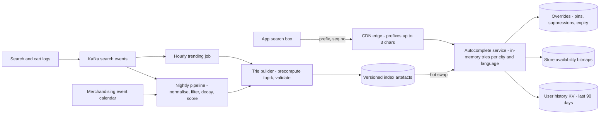
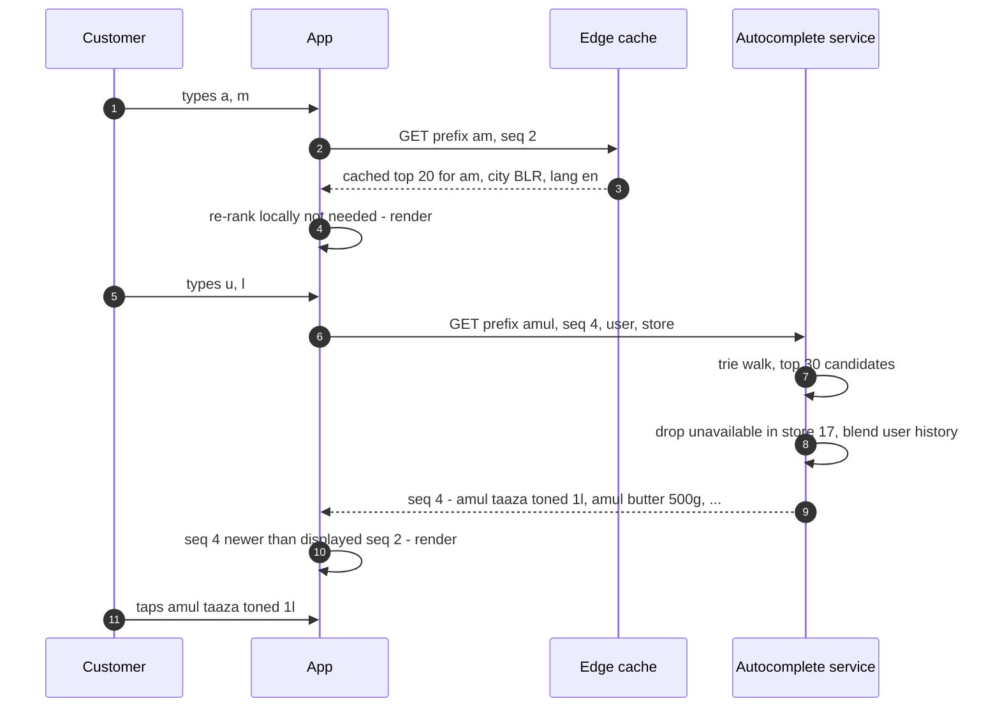
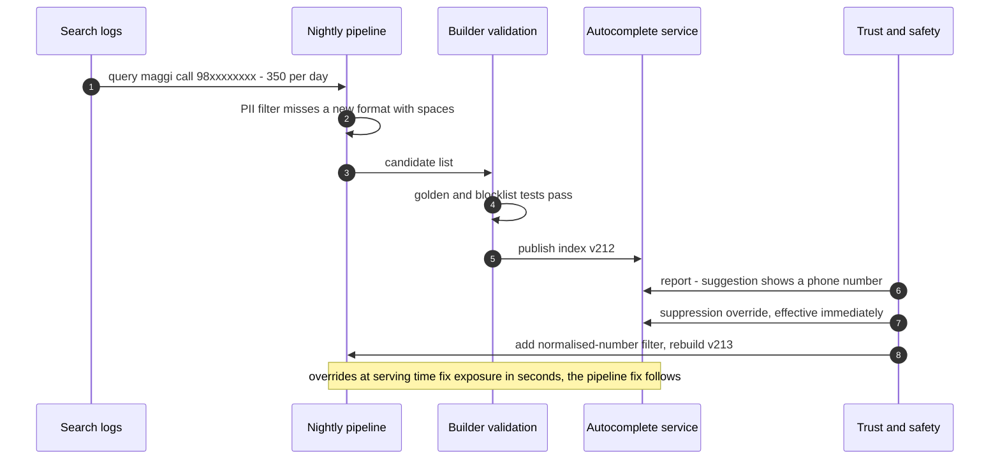
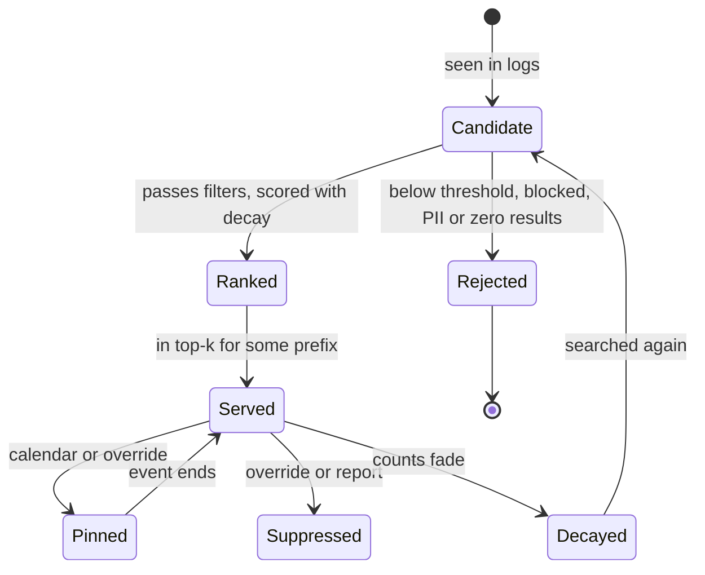

# 42. Case Study: Search Autocomplete (Typeahead)

!!! abstract "Chapter at a glance"
    **Reader bands:** B1 → B4 · **Prerequisites:** [Ch 07](../01-foundations/07-caching.md), [Ch 11](../02-distributed-core/11-partitioning-and-sharding.md), [Ch 22](../03-production/22-search-systems.md) (analyzers, edge n-grams, engine-side autocomplete) · **What you will build:** The grocery app's search box suggestions. As a customer types "am…", five suggestions appear within tens of milliseconds, ranked by what people search for, fresh with the season, free of junk, limited to what their dark store can deliver, and tuned to their own weekly staples. [Ch 22](../03-production/22-search-systems.md) covered autocomplete *inside a search engine*. This chapter designs the dedicated **query-suggestion system** the classic interview question asks for: the data structure, the offline pipeline, the serving tier and personalisation.

    - **L1: the data structure.** Over 200,000 suggestion candidates:
        - Scanning took **2.8 ms** p50 per keystroke.
        - A trie with a subtree search took **108 µs** p50 but **3.1 ms** p99, because short prefixes like "m" have 27,162 candidates below them.
        - A trie with the **top-5 precomputed at every node** answered in **0.2 µs** p50 and **2.2 µs** p99, with identical results, for 24 MB and a 1.2 s build.
    - **L2: from query logs to suggestions.** Over 30 days of synthetic logs:
        - All-time counts surfaced the mango season **11 days late** and kept suggesting rakhi on **every** day after the festival.
        - A 2-day half-life with a trending boost caught mango on **day 17**.
        - An event calendar showed rakhi on all 4 festival days and **0** after.
        - Without a filtering stage, phone numbers, a slur, a misspelling and zero-result queries were suggested on **96** prefix-days by every method.
    - **L3: keystroke economics.** 20,000 typing sessions:
        - Rendering every response produced **41.8** stale "jump-backs" per 100 searches; sequence numbers made that **0**.
        - A 120 ms debounce cut origin requests only 17%, since most people type slower than that.
        - Edge caching of 1–3-character prefixes plus client reuse of complete lists cut origin requests from **5.82 to 3.12** per search and the p95 from 479 to **308 ms**.
    - **L4: personalisation and availability.** For 5,000 repeat customers:
        - Global popularity put the wanted item in the top 5 after one character **16%** of the time, and **15%** of suggestions weren't stocked in the customer's store.
        - Filtering by store brought unstocked suggestions to **0%**.
        - Blending the customer's own history reached **73%** at one character, and keystrokes to find dropped from 11.6 to **4.2**.

    · **Reading time:** 90 min + code

---

## 1. Introduction & Why It Matters

### 1.1 A story: suggestions that embarrassed us

The first grocery autocomplete ran a `LIKE 'prefix%'` query against the product table, ordered by sales. It was replaced by a nightly job that counted search queries. Within a month:

1. **It was slow on the first letters.** "a" and "m" returned hundreds of thousands of candidates; p99 was over 300 ms, and the suggestions lagged behind typing.
2. **It showed a customer's phone number.** People type "call 98450xxxxx" into search boxes. A popular one became a suggestion for "c".
3. **It missed the mango season** for two weeks, and kept suggesting "rakhi" until September.
4. **It jumped backwards.** A slow response for "a" arrived after the response for "amul b" and replaced it.
5. **It suggested things the store couldn't deliver.** "Alphonso mango" was top of the list in a dark store that had none.
6. **It ignored the customer.** A family that bought the same toned milk every Monday still had to type "amul taaza toned 1l" in full.

A good autocomplete saves keystrokes, steers people to queries that return results, and is one of the highest-traffic endpoints in the app: every keystroke is a request. This chapter builds it properly.

!!! quote "The thesis of this chapter"
    Autocomplete is a **read-optimised, precomputed ranking problem**. At query time there's only time to walk to a prefix and read a list. So the work moves offline: the **data structure** precomputes each prefix's top-k (L1); the **pipeline** turns noisy logs into clean, fresh, time-aware counts (L2). The **serving tier** respects keystroke economics — sequence numbers, debouncing, edge and client caches (L3). And the final ranking is **re-ranked per request** for the customer's store and history (L4). What you suggest is also an editorial and privacy decision: filter before you rank.

### 1.2 Where this lives in the grocery platform

| Aspect | Grocery autocomplete |
|---|---|
| Surfaces | App and web search box; also the "reorder" quick-add |
| Suggestion types | Past queries (popular and personal), product names, brands, categories ("Dairy"), recipes later |
| Candidates | ~200k query suggestions per language/city after filtering |
| Traffic | ~1.2M searches/hour at peak × ~6 keystrokes ≈ **2,000 origin requests/s** after optimisations (L3); ~7,000 req/s before |
| Latency | Server p99 < 10 ms; keystroke-to-suggestion < 150 ms p95 on mobile |
| Freshness | Nightly rebuild + hourly trending updates; event calendar from merchandising |
| Constraints | Dark-store availability, language (English, Hinglish, Devanagari), blocklists, no PII |

### 1.3 Learning objectives

By the end you will be able to:

- **Choose and size the data structure**: trie with precomputed top-k, and its alternatives (L1).
- **Build the offline pipeline**: aggregation, time decay, trending, event calendars and filtering (L2).
- **Design the serving tier and client**: sequence numbers, debounce, edge and client caches, sharding (L3).
- **Personalise and constrain**: availability filtering and history re-ranking (L4).
- **Handle languages, spelling correction, safety and evaluation.**

---

## 2. Core Concepts — Beginner to Deep

### 2.1 Intuition: the shopkeeper who finishes your sentence <span class="band b1">B1</span>

A good shopkeeper hears "Amul…" and says "butter? taaza milk?" — the things most people want, the things *you* usually buy, and nothing they don't have in stock. They don't think hard about it; they remember. Autocomplete is that memory, prepared in advance so the answer is instant.

### 2.2 Requirements <span class="band b1">B1</span>

**Functional**

- Given a prefix (and user, city, store, language), return up to 5–10 suggestions, ranked.
- Suggestions from popular queries, the user's history, products, brands and categories.
- Handle spelling variants and scripts; exclude blocked, PII and zero-result suggestions.
- Update rankings daily, and trending terms within an hour.

**Non-functional**

- Server p99 < 10 ms; keystroke-to-render < 150 ms p95 on mobile networks.
- Very high read QPS, tiny payloads, high cacheability for short prefixes.
- Availability 99.9% — autocomplete can degrade to "no suggestions" without breaking search.

### 2.3 Estimation <span class="band b1">B1</span>

| Quantity | Estimate |
|---|---|
| Searches at peak | ~1.2M/hour ≈ 330/s |
| Keystrokes per search | ~6 before tapping a suggestion (L3: 5.8) |
| Requests before optimisation | ~2,000/s average at peak, bursts ~7,000/s |
| After edge + client caching | ~3.1 origin requests per search (L3) |
| Index size | 200k candidates → ~430k trie nodes; top-5 pointers per node ≈ 24 MB (L1); × languages × cities |
| Log volume | ~220k–500k queries/day to aggregate; tiny for a batch job |

Small data, huge read rate, strict latency: the whole index fits in memory on every serving node, replicated rather than sharded, unless personal or per-store data makes it too big.

### 2.4 Data structures ⭐ <span class="band b2">B2</span>

L1 answered 200,000 keystroke prefixes over 200,000 candidates:

| Approach | Build | Extra memory | p50 / keystroke | p99 / keystroke |
|---|---|---|---|---|
| Scan, sort, take 5 | — | — | 2,835 µs | 8,161 µs |
| Trie + subtree search with a heap | 554 ms | — | 108 µs | 3,081 µs |
| **Trie with top-5 precomputed per node** | 1,152 ms | 24 MB | **0.2 µs** | **2.2 µs** |

- **The first keystrokes are the expensive ones** for a plain trie: "m" had 27,162 candidates below it, and everyone types the first letter.
- **Precomputed top-k** moves the ranking to build time: each keystroke is a walk of prefix-length steps plus a read of k pointers.
- **Memory**: k pointers per node. Reduce it with a **radix/compressed trie** (merge single-child chains), storing top-k only on nodes with enough traffic, or using an FST (finite-state transducer, as Lucene's completion suggester does).
- **Updates**: rebuild offline and swap atomically, rather than updating counts in place. Precomputed lists make in-place updates expensive, because a count change can ripple up every ancestor's list.

Alternatives: search-engine completion suggesters (FST-based) and edge n-gram indexes ([Ch 22](../03-production/22-search-systems.md)), sorted arrays with binary search for prefix ranges, or Redis sorted sets per prefix (`ZREVRANGE` on `ac:am`) for small, frequently updated sets.

### 2.5 The offline pipeline ⭐ <span class="band b3">B3</span>

1. **Collect** search logs: the query typed, the query submitted, whether the search returned results, what was clicked or added to cart.
2. **Normalise**: lowercase, trim, collapse whitespace, unify scripts and transliterations ("doodh" ↔ "दूध" ↔ "milk" as aliases, [Ch 22](../03-production/22-search-systems.md)), strip quantities if you want generic suggestions.
3. **Filter**: minimum count and distinct users (so one person can't create a suggestion), a blocklist, PII patterns (phone numbers, emails), and **zero-result queries**. Suggesting a query that returns nothing is worse than no suggestion.
4. **Score** with **time decay**: each day's count weighted by 0.5^(age/half-life); a **trending boost** when the last hours exceed the trailing average; a merchandising **event calendar** for known events.
5. **Quality signals**: prefer queries that lead to add-to-cart, not just searches.
6. **Build** the trie per language/city, precompute top-k, validate (golden prefixes, size checks, blocklist test), publish a versioned artefact, and let servers hot-swap.

L2 simulated 30 days of logs with a mango season (from day 15) and a rakhi festival (days 23–26):

| Method | Next-day match, changing prefixes | Mango in "ma" from | Rakhi shown: festival / after |
|---|---|---|---|
| All-time counts | 82.9% | day 26 | 1 / 3 |
| Half-life 7 days | 84.4% | day 22 | 2 / 3 |
| Half-life 2 days + trending | 86.8% | **day 17** | 3 / 3 |
| **+ event calendar** | **89.7%** | day 17 | **4 / 0** |

And without filtering, junk was suggested on **96** prefix-days in every method. Decay and trending make suggestions fresh; only a calendar handles an event's first day and its end; only filtering keeps suggestions safe.

### 2.6 Serving and keystroke economics ⭐ <span class="band b2">B2</span>

Every keystroke can be a request, and mobile responses arrive out of order. L3 simulated 20,000 typing sessions:

| Strategy | Origin requests / search | Stale jump-backs / 100 | Visible after keystroke p50 / p95 |
|---|---|---|---|
| Request every keystroke, render everything | 5.82 | **41.8** | 64 / 479 ms |
| + drop out-of-order responses | 5.82 | 0 | 64 / 479 ms |
| + 120 ms debounce | 4.82 | 0 | 184 / 586 ms |
| **+ client prefix cache + edge cache (≤ 3 chars)** | **3.12** | 0 | 135 / **308 ms** |

- **Tag requests with a sequence number**, and render only responses newer than what's displayed. Also cancel superseded requests.
- **Debounce** trades latency for traffic. With typing slower than the debounce window, it saves little (17% here). Tune it on real inter-key times, or skip it on fast networks.
- **Edge cache** the first 1–3 characters. There are only a few thousand such prefixes; cache them per city/language with a short TTL.
- **Client cache**: if a prefix returned fewer than k results, every longer prefix is a local filter. Also cache recent responses for backspacing.
- **Payloads**: tiny JSON, gzip, HTTP/2 keep-alive; the server does an in-memory lookup and nothing else.

**Sharding** is usually unnecessary: replicate the full index to every node. If it's too big (many cities × languages × personal data), shard by **city/language**, not by first letter — letter ranges are badly unbalanced, because "m" and "a" are far hotter than "x". Hash the prefix when sharding within a city, and keep the hottest short prefixes in the edge cache anyway ([Ch 11](../02-distributed-core/11-partitioning-and-sharding.md)).

### 2.7 Personalisation and constraints ⭐ <span class="band b3">B3</span>

Grocery is repeat purchase. L4 predicted week-5 searches for 5,000 customers:

| Method | Target in top 5 after 1 char | after 8 | Keystrokes to find | Suggestions not in the store |
|---|---|---|---|---|
| Global popularity | 16.0% | 24.5% | 11.59 | **15.0%** |
| + only items the store stocks | 14.1% | 22.5% | 12.06 | **0%** |
| **+ the customer's own history** | **73.4%** | 78.2% | **4.23** | 0% |

- **Availability**: filter suggestions that map to products by the customer's dark store. It costs a little recall — some filtered items were wanted — but the store couldn't deliver them anyway. Keep a per-store "unavailable" bitmap or re-rank at request time.
- **Personal history**: a small per-user list (last 90 days of searches and purchases, capped at ~200 items), fetched from a key-value store keyed by user and merged at request time: `score = global share + w × personal share`.
- **Architecture**: global top-k from the trie (fetch k' = 20–50 candidates), then **re-rank per request** with store availability and the user's history. Personalisation is a re-ranking step, not a per-user index.
- **Privacy**: the user's own history is visible only to them; never mix one user's queries into another's suggestions except through aggregated, thresholded counts.

### 2.8 Languages, spelling and scripts <span class="band b3">B3</span>

- Build per-language tries, or a trie over normalised keys: transliteration ("aata", "atta", "आटा" → one key), with display strings per language ([Ch 22](../03-production/22-search-systems.md) covered analyzers).
- **Fuzzy prefixes**: allow one edit on prefixes longer than 3 characters ("amull b" → "amul butter") with a bounded Levenshtein automaton over the trie, used only when exact matches are few.
- Keyboard-adjacency and phonetic variants for Indian names ("paneer"/"panir").

### 2.9 Safety and editorial control <span class="band b3">B3</span>

- **Blocklists** (slurs, adult terms, competitor names if policy says so), maintained by trust & safety and tested in the build.
- **PII filters**: phone numbers, emails, addresses, order ids.
- **Thresholds**: minimum distinct users per suggestion, so individuals can't plant suggestions.
- **Manual overrides**: pin (campaigns, events) and suppress (a recalled product) with an expiry, applied at serving time so they take effect immediately.
- **Audit**: a report of new suggestions each day for review.

### 2.10 Evaluation <span class="band b4">B4</span>

- **Offline**: replay held-out sessions and measure **keystrokes saved**, MRR of the eventual query, success@k at each prefix length (L4's metrics), and zero-result rate of suggested queries.
- **Online**: suggestion click-through, searches per session, search-to-cart conversion, abandoned searches; A/B test changes.
- **Guardrails**: blocked-term exposure (target 0), unavailable-item suggestion rate, latency.

### 2.11 Interview framing <span class="band b4">B4</span>

The canonical answer is "a trie with top-k at each node, built offline from query logs, served from memory, cached". Stand out by quantifying why subtree search fails on short prefixes, by explaining time decay and trending *and* their limits (calendars), by making filtering a first-class pipeline stage, by covering client behaviour (sequence numbers, debounce, caching), and by personalising via request-time re-ranking.

---

## 3. Architecture & Diagrams

### 3.1 Component view



### 3.2 Sequence: happy path, typing "amul"



### 3.3 Sequence: failure path, bad suggestion reaches production



### 3.4 State: a suggestion's lifecycle



---

## 4. Design Document Excerpt: Autocomplete v2

!!! note "Design Document (excerpt) — Autocomplete v2"
    **Status:** Accepted · **Authors:** Search team · **Reviewers:** Trust & safety, Merchandising, Mobile, SRE

    | Field | Value |
    |---|---|
    | Context | v1: `LIKE` queries then a naive nightly count; slow first keystrokes, PII and slurs suggested, stale seasonal terms, out-of-order responses, out-of-stock suggestions, no personalisation. |
    | Decision | Per city/language tries with precomputed top-30 per node, built offline from filtered, decayed counts plus hourly trending and an event calendar; served from memory with edge caching of short prefixes; client sequence numbers and prefix cache; request-time re-ranking by store availability and user history; serving-time overrides. |
    | Related ADRs | ADR-280 Trie with precomputed top-k, versioned artefacts, hot swap (L1); ADR-281 Pipeline: normalise, filter (min users, blocklist, PII, zero results), 2-day half-life, trending boost, event calendar (L2); ADR-282 Client: seq numbers, cancel superseded, 80 ms debounce on slow networks only; edge cache ≤3 chars, TTL 10 min (L3); ADR-283 Re-rank: availability bitmaps per store, personal history KV (L4); ADR-284 Overrides applied at serving time with expiry and audit |

    **Requirements.**

    - **R1** Server p99 < 10 ms; keystroke-to-render p95 < 150 ms on 4G.
    - **R2** No blocked or PII suggestions (0 known exposures per quarter).
    - **R3** Seasonal and event terms appear within 1 day (calendar events from day 1).
    - **R4** < 1% of suggestions map to items unavailable in the customer's store.
    - **R5** Keystrokes per search reduced by ≥ 30% versus v1.

    **Decisions in detail.**

    1. **Index (ADR-280).** Compressed trie; top-30 per node (re-ranked to 5–8); ~25–60 MB per city-language; loaded from object storage; atomic reference swap.
    2. **Pipeline (ADR-281).** Spark job nightly; distinct-user threshold 20; PII regex over normalised text (L4 of [Ch 41](41-chat-customer-rider-messaging.md) shows why normalising first matters); zero-result check against the search engine.
    3. **Client (ADR-282).** Request ids; cancel in-flight; local cache of last 50 prefixes; complete-list reuse.
    4. **Re-rank (ADR-283).** Availability from the inventory stream; user history from a Redis hash per user (cap 200); blend weight tuned by A/B test.
    5. **Overrides (ADR-284).** Pins and suppressions in a small replicated table; applied after the trie lookup.

    **Consequences.** Nightly and hourly builds to operate; index artefacts per city/language; more logic in the client. In return: microsecond lookups, fresh and safe suggestions, and a big drop in keystrokes for repeat customers.

---

## 5. Hands-On Code — Level Ladder

!!! info "What's real here"
    All four labs are JDK 21 with fixed seeds. L1's latencies are **real JVM timings** on the sandbox and vary by machine; the result lists are verified identical across approaches. L2–L4 are simulations over synthetic vocabularies: log volumes, seasonality, typing speeds, network latency, store availability and customer behaviour are stated assumptions.

Run every lab with `-Dstdout.encoding=UTF-8`. No external services are needed.

### L1 — The data structure <span class="band b2">B2</span>

**Requirement:** "Five suggestions on every keystroke, from 200,000 candidates, in microseconds — including the first letter."

Three implementations answer the same prefixes. Latencies are real JVM timings; the result lists are checked for equality.

```java title="TrieTopKL1.java"
// TrieTopKL1.java — run with: java -Xmx2g TrieTopKL1.java   (JDK 21, no dependencies)
// THE DATA STRUCTURE BEHIND TYPEAHEAD. The grocery app shows 5 suggestions on every keystroke, ranked by how often people
// searched for them. The suggestion set is 200,000 distinct queries with Zipf-like popularity, built from a synthetic
// grocery vocabulary (fixed seed). We answer 200,000 keystroke prefixes (taken from real-looking typing sessions) three ways:
//   A) scan: filter every query that starts with the prefix, sort by count, take 5
//   B) trie: walk to the prefix node, then search the whole subtree keeping the best 5 in a heap
//   C) trie with the top 5 PRECOMPUTED at every node: walk to the prefix node and read its list
// We measure build time, memory, per-keystroke latency (real JVM timings on the first 2,000 / 5,000 / 20,000 prefixes —
// they vary by machine) and check that all three
// return identical suggestions.
import java.util.*;

public class TrieTopKL1 {
    static final class Node { final Map<Character, Node> kids = new HashMap<>(4); int count = -1; String word; String[] top; }

    public static void main(String[] args) {
        Random r = new Random(42);
        String[] brands = {"amul", "tata", "aashirvaad", "fortune", "britannia", "parle", "mother dairy", "nestle", "haldiram", "mdh",
                "everest", "saffola", "dabur", "patanjali", "maggi", "surf excel", "dettol", "colgate", "lays", "kurkure"};
        String[] items = {"milk", "atta", "rice", "dal", "oil", "ghee", "paneer", "curd", "butter", "bread", "biscuits", "salt", "sugar",
                "tea", "coffee", "noodles", "chips", "soap", "detergent", "toothpaste", "masala", "besan", "poha", "maida", "honey",
                "jam", "ketchup", "eggs", "chicken", "onion", "tomato", "potato", "banana", "mango", "apple", "grapes", "coriander"};
        String[] sizes = {"", " 500g", " 1kg", " 5kg", " 1l", " 500ml", " 200g", " family pack", " combo", " organic"};
        LinkedHashMap<String, Integer> counts = new LinkedHashMap<>();
        while (counts.size() < 200_000) {
            String q = switch (r.nextInt(4)) {
                case 0 -> items[r.nextInt(items.length)] + sizes[r.nextInt(sizes.length)];
                case 1 -> brands[r.nextInt(brands.length)] + " " + items[r.nextInt(items.length)] + sizes[r.nextInt(sizes.length)];
                case 2 -> brands[r.nextInt(brands.length)] + " " + items[r.nextInt(items.length)] + " " + (r.nextInt(900) + 100) + "g";
                default -> items[r.nextInt(items.length)] + " " + items[r.nextInt(items.length)] + " " + r.nextInt(50);
            };
            counts.putIfAbsent(q, 0);
        }
        List<String> qs = new ArrayList<>(counts.keySet()); Collections.shuffle(qs, r);
        for (int i = 0; i < qs.size(); i++) counts.put(qs.get(i), (int) Math.max(1, 1_000_000 / Math.pow(i + 1, 1.05)));   // Zipf
        String[] words = qs.toArray(new String[0]); int[] cnt = new int[words.length]; for (int i = 0; i < words.length; i++) cnt[i] = counts.get(words[i]);

        // keystroke workload: people type popular queries more often; every prefix of length 1..len is a request
        List<String> prefixes = new ArrayList<>();
        while (prefixes.size() < 200_000) { String w = words[Math.min(words.length - 1, (int) Math.abs(r.nextGaussian() * 2_000))]; for (int k = 1; k <= Math.min(w.length(), 12) && prefixes.size() < 200_000; k++) prefixes.add(w.substring(0, k)); }

        // build tries
        long t0 = System.nanoTime(); Node trie = new Node(); long nodes = 1;
        for (int i = 0; i < words.length; i++) { Node n = trie; for (char c : words[i].toCharArray()) { Node k = n.kids.get(c); if (k == null) { k = new Node(); n.kids.put(c, k); nodes++; } n = k; } n.count = cnt[i]; n.word = words[i]; }
        double buildTrie = (System.nanoTime() - t0) / 1e6;
        t0 = System.nanoTime(); precompute(trie); double buildTop = (System.nanoTime() - t0) / 1e6;

        System.out.printf("%,d suggestion candidates, %,d trie nodes; %,d keystroke prefixes (avg length %.1f).%n%n", words.length, nodes, prefixes.size(),
                prefixes.stream().mapToInt(String::length).average().orElse(0));
        System.out.printf("   %-52s %12s %14s %14s %14s%n", "approach", "build", "extra memory", "p50 / keystroke", "p99 / keystroke");
        long[] a = time(prefixes, 2_000, p -> scan(words, cnt, p)), b = time(prefixes, 5_000, p -> dfs(trie, p)), c = time(prefixes, 20_000, p -> top(trie, p));
        System.out.printf("   %-52s %12s %14s %11.1f µs %11.1f µs%n", "A) scan all candidates, sort, take 5", "—", "—", a[0] / 1e3, a[1] / 1e3);
        System.out.printf("   %-52s %9.0f ms %14s %11.1f µs %11.1f µs%n", "B) trie + subtree search with a heap", buildTrie, "—", b[0] / 1e3, b[1] / 1e3);
        System.out.printf("   %-52s %9.0f ms %11.0f MB %11.1f µs %11.1f µs%n", "C) trie with top-5 precomputed per node", buildTrie + buildTop, nodes * 5 * 8 / 1e6 + nodes * 16 / 1e6, c[0] / 1e3, c[1] / 1e3);
        int mismatch = 0;
        for (int i = 0; i < 2_000; i++) { String p = prefixes.get(i); if (!scan(words, cnt, p).equals(top(trie, p)) || !dfs(trie, p).equals(top(trie, p))) mismatch++; }
        System.out.printf("   identical top-5 across all three approaches on 2,000 checked prefixes: %s%n", mismatch == 0 ? "yes" : "NO (" + mismatch + " differ)");
        Node n1 = trie.kids.get('m'); int sub = subtree(n1);
        System.out.printf("   why B's p99 is high: the prefix 'm' has %,d candidates under it; C reads 5 pointers regardless.%n", sub);
        System.out.println("\n   → a scan is fine for a few thousand candidates and hopeless for hundreds of thousands. A plain trie makes long");
        System.out.println("     prefixes fast but short ones — the first keystrokes, which everybody types — still search huge subtrees.");
        System.out.println("     Precomputing the top-k at every node moves that work to build time and makes every keystroke a walk of");
        System.out.println("     prefix-length steps plus a read of k items, at the cost of memory and a rebuild when counts change.");
    }

    static List<String> scan(String[] w, int[] c, String p) {
        PriorityQueue<Integer> pq = new PriorityQueue<>((x, y) -> c[x] != c[y] ? Integer.compare(c[x], c[y]) : w[y].compareTo(w[x]));
        for (int i = 0; i < w.length; i++) if (w[i].startsWith(p)) { pq.add(i); if (pq.size() > 5) pq.poll(); }
        List<String> out = new ArrayList<>(); while (!pq.isEmpty()) out.add(w[pq.poll()]); Collections.reverse(out); return out;
    }
    static Node walk(Node n, String p) { for (char ch : p.toCharArray()) { n = n.kids.get(ch); if (n == null) return null; } return n; }
    static List<String> dfs(Node root, String p) {
        Node n = walk(root, p); if (n == null) return List.of();
        PriorityQueue<Node> pq = new PriorityQueue<>((x, y) -> x.count != y.count ? Integer.compare(x.count, y.count) : y.word.compareTo(x.word));
        Deque<Node> st = new ArrayDeque<>(); st.push(n);
        while (!st.isEmpty()) { Node x = st.pop(); if (x.count >= 0) { pq.add(x); if (pq.size() > 5) pq.poll(); } for (Node k : x.kids.values()) st.push(k); }
        List<String> out = new ArrayList<>(); while (!pq.isEmpty()) out.add(pq.poll().word); Collections.reverse(out); return out;
    }
    static List<String> top(Node root, String p) { Node n = walk(root, p); return n == null ? List.of() : Arrays.asList(n.top); }
    static List<Node> precompute(Node n) {                           // returns this subtree's top-5 terminal nodes
        List<Node> best = new ArrayList<>(); if (n.count >= 0) best.add(n);
        for (Node k : n.kids.values()) best.addAll(precompute(k));
        best.sort((x, y) -> x.count != y.count ? Integer.compare(y.count, x.count) : x.word.compareTo(y.word));
        if (best.size() > 5) best = new ArrayList<>(best.subList(0, 5));
        n.top = best.stream().map(x -> x.word).toArray(String[]::new);
        return best;
    }
    static int subtree(Node n) { int s = n.count >= 0 ? 1 : 0; for (Node k : n.kids.values()) s += subtree(k); return s; }
    static long[] time(List<String> ps, int n, java.util.function.Function<String, List<String>> f) {
        for (int i = 0; i < 200; i++) f.apply(ps.get(i));                         // warm-up
        long[] t = new long[n];
        for (int i = 0; i < n; i++) { long s = System.nanoTime(); f.apply(ps.get(i)); t[i] = System.nanoTime() - s; }
        Arrays.sort(t); return new long[]{t[n / 2], t[(int) (n * 0.99)]};
    }
}
```

```text title="java -Xmx2g -Dstdout.encoding=UTF-8 TrieTopKL1.java"
200,000 suggestion candidates, 429,506 trie nodes; 200,000 keystroke prefixes (avg length 6.5).

   approach                                                    build   extra memory p50 / keystroke p99 / keystroke
   A) scan all candidates, sort, take 5                            —              —      2834.7 µs      8160.9 µs
   B) trie + subtree search with a heap                       554 ms              —       107.5 µs      3081.3 µs
   C) trie with top-5 precomputed per node                   1152 ms          24 MB         0.2 µs         2.2 µs
   identical top-5 across all three approaches on 2,000 checked prefixes: yes
   why B's p99 is high: the prefix 'm' has 27,162 candidates under it; C reads 5 pointers regardless.

   → a scan is fine for a few thousand candidates and hopeless for hundreds of thousands. A plain trie makes long
     prefixes fast but short ones — the first keystrokes, which everybody types — still search huge subtrees.
     Precomputing the top-k at every node moves that work to build time and makes every keystroke a walk of
     prefix-length steps plus a read of k items, at the cost of memory and a rebuild when counts change.
```

**Reading it:**

- **Scan**: 2.8 ms p50 per keystroke. At thousands of keystrokes per second that's cores' worth of CPU for five strings.
- **Trie + subtree search**: fast on long prefixes (108 µs p50) but the **p99 is 3.1 ms**. Short prefixes carry huge subtrees; "m" alone has 27,162 candidates.
- **Precomputed top-5**: **0.2 µs** p50, 2.2 µs p99, identical answers. The ranking moved into a 1.2 s build and ~24 MB of pointers (a rough estimate).

### L2 — From query logs to suggestions <span class="band b3">B3</span>

**Requirement:** "Suggestions should follow the season and the festival calendar, and never show junk."

Thirty days of synthetic logs with a seasonal ramp, a festival spike and realistic junk, rebuilt nightly by four scoring methods, each with and without filtering.

```java title="SuggestPipelineL2.java"
// SuggestPipelineL2.java — run with: java SuggestPipelineL2.java   (JDK 21, no dependencies)
// FROM QUERY LOGS TO SUGGESTIONS. Suggestions are only as good as the counts behind them. We synthesise 30 days of search
// logs (~220,000 queries/day, fixed seed) for a grocery app: a stable Zipf vocabulary, plus the things that make real
// logs hard —
//   • SEASONAL: mango queries ramp up from day 15 as the season arrives (5x by day 25)
//   • EVENT: rakhi queries spike on days 23–26 (the festival is day 25) and then vanish
//   • JUNK: misspellings, queries containing phone numbers, a slur, and popular queries that return zero results
// Each night the pipeline rebuilds suggestions; we measure how well its top-5 for 16 common prefixes predicts TOMORROW's
// actual top-5, how long seasonal and event queries take to appear (and to disappear), and what junk would be shown.
//   M1 all-time counts            M2 exponential decay, half-life 7 days            M3 half-life 2 days + trending boost
//   M4 M3 + a merchandising calendar that knows the festival dates (pin during, remove after)
// Each is run without and with a filtering stage (min count, blocklist, phone-number pattern, zero-result queries).
import java.util.*;

public class SuggestPipelineL2 {
    public static void main(String[] args) {
        Random r = new Random(42); int days = 30;
        String[] base = {"milk", "atta", "amul butter", "amul milk", "maggi", "mother dairy milk", "rice", "moong dal", "masoor dal",
                "mustard oil", "maida", "masala", "mint", "milk powder", "maaza", "marie biscuits", "mayonnaise", "mushroom",
                "rajma", "raw peanuts", "ragi", "rava", "red chilli", "rin detergent", "rasna", "real juice", "ready to eat",
                "paneer", "potato", "onion", "tomato", "tea", "toor dal", "tata salt", "sugar", "surf excel", "bread", "banana",
                "curd", "coriander", "eggs", "chicken", "ghee", "gulab jamun", "detergent", "dettol", "chips", "kurkure"};
        String[] mango = {"mango alphonso", "mango banganapalli", "mango pulp", "mango shake", "mango juice"};
        String[] rakhi = {"rakhi", "rakhi gift hamper", "rakhi with chocolates", "raksha bandhan sweets"};
        String[] junk = {"mlik", "atta 9845012345", "maggi call 9876543210", "iphone 15", "ration card", "badword"};
        Set<String> blocked = Set.of("badword"); Set<String> zeroResult = Set.of("iphone 15", "ration card");
        List<Map<String, Integer>> log = new ArrayList<>();
        for (int d = 0; d < days; d++) {
            Map<String, Integer> day = new HashMap<>();
            for (int i = 0; i < base.length; i++) day.put(base[i], noisy(r, 40_000 / Math.pow(i + 1, 0.9)));
            double season = d < 15 ? 0.2 : Math.min(5, 0.2 + (d - 15) * 0.5);
            for (int i = 0; i < mango.length; i++) day.put(mango[i], noisy(r, 3_000 * season / (i + 1)));
            double fest = d >= 23 && d <= 26 ? (d == 25 ? 20 : d == 24 ? 12 : 6) : 0.05;
            for (int i = 0; i < rakhi.length; i++) day.put(rakhi[i], noisy(r, 1_500 * fest / (i + 1)));
            day.put("mlik", noisy(r, 900)); day.put("atta 9845012345", noisy(r, 400)); day.put("maggi call 9876543210", noisy(r, 350));
            day.put("iphone 15", noisy(r, 1_200)); day.put("ration card", noisy(r, 1_100)); day.put("badword", noisy(r, 500));
            log.add(day);
        }
        String[] prefixes = {"m", "ma", "man", "mi", "mo", "r", "ra", "rak", "ri", "a", "at", "i", "b", "c", "p", "t"};
        System.out.printf("30 days of logs, ~%,d queries/day; nightly rebuild; 16 common prefixes; top-5 per prefix.%n%n",
                log.get(0).values().stream().mapToInt(Integer::intValue).sum());
        System.out.printf("   %-40s %8s %12s %12s %13s %15s %11s%n", "method", "filtered", "next-day", "on changing", "mango in 'ma'", "rakhi in 'ra':", "junk shown");
        System.out.printf("   %-40s %8s %12s %12s %13s %15s %11s%n", "", "", "top-5 match", "prefixes", "from day", "festival/after", "");
        String[] names = {"M1) all-time counts", "M2) decay, half-life 7 days", "M3) half-life 2 days + trending boost", "M4) M3 + event calendar (rakhi 23–26)"};
        for (int m = 0; m < 4; m++) for (boolean f : new boolean[]{false, true}) {
            double overlap = 0, overlapCh = 0; int evals = 0, evalsCh = 0, mangoDay = -1, rakhiFest = 0, rakhiAfter = 0, junkShown = 0;
            for (int d = 5; d < days - 1; d++) {
                Map<String, Double> score = score(log, d, m);
                Map<String, Integer> tomorrow = log.get(d + 1);
                for (String p : prefixes) {
                    List<String> sug = topK(score, p, f, blocked, zeroResult, log, d);
                    List<String> actual = topK(toD(tomorrow), p, true, blocked, zeroResult, log, d + 1);
                    long hit = sug.stream().filter(actual::contains).count(); overlap += hit / 5.0; evals++;
                    if (Set.of("m", "ma", "man", "r", "ra", "rak").contains(p)) { overlapCh += hit / 5.0; evalsCh++; }
                    for (String s : sug) if (junkish(s, blocked, zeroResult)) junkShown++;
                    if (p.equals("ma") && mangoDay < 0 && sug.stream().anyMatch(s -> s.startsWith("mango"))) mangoDay = d + 1;
                    if (p.equals("ra") && sug.stream().anyMatch(s -> s.startsWith("rakhi") || s.startsWith("raksha"))) { if (d + 1 <= 26) rakhiFest++; else rakhiAfter++; }
                }
            }
            System.out.printf("   %-40s %8s %11.1f%% %11.1f%% %13s %9d / %-3d %11d%n", names[m], f ? "yes" : "no", 100 * overlap / evals, 100 * overlapCh / evalsCh,
                    mangoDay < 0 ? "never" : "day " + mangoDay, rakhiFest, rakhiAfter, junkShown);
        }
        System.out.println("   (rakhi: days shown in 'ra' during the festival, days 23–26 = 4 possible / stale days after it, 27–29 = 3 possible;");
        System.out.println("    mango season ramps from day 15; changing prefixes = m, ma, man, r, ra, rak; evaluation days 6–29)");
        System.out.println("\n   → most prefixes barely change day to day, so every method looks similar on average; the differences are all");
        System.out.println("     at the moments that matter. All-time counts surface the mango season 11 days late and a festival after it has");
        System.out.println("     started, then keep suggesting it; a short half-life with a trending boost catches the season within two days.");
        System.out.println("     But a nightly rebuild can't see a festival's first day, and decay doesn't make a spike this big go away —");
        System.out.println("     rakhi lingered for every day after the festival. Known events belong in a calendar (pin during, expire after).");
        System.out.println("     And none of it matters if the log isn't cleaned: phone numbers, a slur, a");
        System.out.println("     misspelling and zero-result queries were popular enough to be suggested on 96 prefix-days in every method.");
    }

    static int noisy(Random r, double mean) { return (int) Math.max(0, Math.round(mean * (1 + 0.1 * r.nextGaussian()))); }
    static Map<String, Double> toD(Map<String, Integer> m) { Map<String, Double> o = new HashMap<>(); m.forEach((k, v) -> o.put(k, v.doubleValue())); return o; }

    static Map<String, Double> score(List<Map<String, Integer>> log, int upTo, int method) {
        Map<String, Double> s = new HashMap<>();
        double half = method == 1 ? 7 : 2; int base = Math.min(method, 2);
        for (int d = 0; d <= upTo; d++) {
            double w = base == 0 ? 1 : Math.pow(0.5, (upTo - d) / half);
            for (var e : log.get(d).entrySet()) s.merge(e.getKey(), e.getValue() * w, Double::sum);
        }
        if (base == 2) {                                             // trending: yesterday vs trailing week average
            for (String q : s.keySet()) {
                double last = log.get(upTo).getOrDefault(q, 0), week = 0;
                for (int d = Math.max(0, upTo - 7); d < upTo; d++) week += log.get(d).getOrDefault(q, 0);
                week = Math.max(1, week / 7);
                double ratio = last / week; if (ratio > 1.5) s.put(q, s.get(q) * Math.min(4, ratio));
            }
        }
        if (method == 3) {                                           // merchandising calendar: the festival is known in advance
            int showDay = upTo + 1; boolean live = showDay >= 23 && showDay <= 26;
            for (String q : new ArrayList<>(s.keySet())) if (q.startsWith("rakhi") || q.startsWith("raksha")) s.put(q, live ? s.get(q) + 1e6 : 0.0);
        }
        return s;
    }
    static boolean junkish(String q, Set<String> blocked, Set<String> zero) {
        return blocked.contains(q) || zero.contains(q) || q.matches(".*\\b[6-9]\\d{9}\\b.*") || q.equals("mlik");
    }
    static List<String> topK(Map<String, Double> score, String p, boolean filter, Set<String> blocked, Set<String> zero, List<Map<String, Integer>> log, int d) {
        return score.entrySet().stream().filter(e -> e.getKey().startsWith(p))
                .filter(e -> !filter || (!junkish(e.getKey(), blocked, zero)))
                .sorted((a, b) -> Double.compare(b.getValue(), a.getValue())).limit(5).map(Map.Entry::getKey).toList();
    }
}
```

```text title="java -Dstdout.encoding=UTF-8 SuggestPipelineL2.java"
30 days of logs, ~222,169 queries/day; nightly rebuild; 16 common prefixes; top-5 per prefix.

   method                                   filtered     next-day  on changing mango in 'ma'  rakhi in 'ra':  junk shown
                                                      top-5 match     prefixes      from day  festival/after            
   M1) all-time counts                            no        59.8%        82.9%        day 26         1 / 3            96
   M1) all-time counts                           yes        59.8%        82.9%        day 26         1 / 3             0
   M2) decay, half-life 7 days                    no        60.4%        84.4%        day 22         2 / 3            96
   M2) decay, half-life 7 days                   yes        60.4%        84.4%        day 22         2 / 3             0
   M3) half-life 2 days + trending boost          no        61.3%        86.8%        day 17         3 / 3            96
   M3) half-life 2 days + trending boost         yes        61.3%        86.8%        day 17         3 / 3             0
   M4) M3 + event calendar (rakhi 23–26)          no        62.4%        89.7%        day 17         4 / 0            96
   M4) M3 + event calendar (rakhi 23–26)         yes        62.4%        89.7%        day 17         4 / 0             0
   (rakhi: days shown in 'ra' during the festival, days 23–26 = 4 possible / stale days after it, 27–29 = 3 possible;
    mango season ramps from day 15; changing prefixes = m, ma, man, r, ra, rak; evaluation days 6–29)

   → most prefixes barely change day to day, so every method looks similar on average; the differences are all
     at the moments that matter. All-time counts surface the mango season 11 days late and a festival after it has
     started, then keep suggesting it; a short half-life with a trending boost catches the season within two days.
     But a nightly rebuild can't see a festival's first day, and decay doesn't make a spike this big go away —
     rakhi lingered for every day after the festival. Known events belong in a calendar (pin during, expire after).
     And none of it matters if the log isn't cleaned: phone numbers, a slur, a
     misspelling and zero-result queries were popular enough to be suggested on 96 prefix-days in every method.
```

**Reading it:**

- **Averages hide the story**: 59.8–62.4% next-day overlap for every method, because most prefixes never change. On the prefixes that do change, the spread is 82.9% → 89.7%.
- **Seasonal**: all-time counts found mango on day 26, eleven days into the season; 2-day decay + trending found it on day 17.
- **Event**: no count-based method could show rakhi on the festival's first day, and all of them kept suggesting it after it ended (3 of 3 stale days). The **calendar** fixed both (4 / 0).
- **Junk**: filtering is the only thing that removed the 96 prefix-days of phone numbers, a slur, a misspelling and zero-result queries. Ranking never did.

### L3 — Keystroke economics <span class="band b2">B2</span>

**Requirement:** "Suggestions should keep up with typing on a mobile network without flooding the backend."

20,000 simulated typing sessions over a precomputed trie. Each user taps the target as soon as it appears. Network latency has a slow tail, so responses can arrive out of order.

```java title="KeystrokeL3.java"
// KeystrokeL3.java — run with: java KeystrokeL3.java   (JDK 21, no dependencies)
// KEYSTROKE ECONOMICS. Typeahead traffic is generated by fingers, not by users: one search can be ten requests. We build a
// 20,000-query suggestion trie (top-5 precomputed, as in L1) and simulate 20,000 typing sessions (fixed seed): the user
// wants a query drawn by popularity, types it character by character (inter-key time lognormal, median 180 ms), and taps
// the suggestion as soon as it appears. Network round trips are lognormal (median 60 ms) with a 10% slow tail (+200–600 ms),
// so responses can arrive out of order. Client/serving strategies:
//   K1 request on every keystroke, render every response as it arrives
//   K2 K1, but drop responses for prefixes older than the latest one rendered (request sequence numbers)
//   K3 K2 + debounce: send only after 120 ms without another keystroke
//   K4 K3 + client prefix cache (if a prefix returned fewer than 5 results, longer prefixes are filtered locally) and an
//      edge/CDN cache for prefixes of up to 3 characters (hit → 15 ms)
// Measured: server requests per search, stale suggestions flashed (an older prefix's results shown after a newer one's),
// and how long after the keystroke that made the target appear the user could actually see it.
import java.util.*;

public class KeystrokeL3 {
    static final class Node { final Map<Character, Node> kids = new HashMap<>(4); int count = -1; String word; String[] top; int size; }

    public static void main(String[] args) {
        Random r = new Random(42);
        String[] brands = {"amul", "tata", "aashirvaad", "fortune", "britannia", "parle", "nestle", "haldiram", "mdh", "saffola", "dabur", "maggi"};
        String[] items = {"milk", "atta", "rice", "dal", "oil", "ghee", "paneer", "curd", "butter", "bread", "biscuits", "salt", "sugar",
                "tea", "coffee", "noodles", "chips", "masala", "besan", "poha", "honey", "jam", "ketchup", "eggs", "onion", "tomato", "mango"};
        LinkedHashSet<String> set = new LinkedHashSet<>();
        while (set.size() < 20_000) set.add(brands[r.nextInt(brands.length)] + " " + items[r.nextInt(items.length)] + " " + (r.nextInt(900) + 100) + "g");
        for (String i : items) set.add(i); for (String b : brands) for (String i : items) set.add(b + " " + i);
        List<String> words = new ArrayList<>(set); Collections.shuffle(words, r);
        Node root = new Node(); int[] cnt = new int[words.size()];
        for (int i = 0; i < words.size(); i++) { cnt[i] = (int) Math.max(1, 1_000_000 / Math.pow(i + 1, 1.05)); Node n = root; for (char c : words.get(i).toCharArray()) n = n.kids.computeIfAbsent(c, k -> new Node()); n.count = cnt[i]; n.word = words.get(i); }
        pre(root);
        double[] cdf = new double[words.size()]; double sum = 0; for (int i = 0; i < cdf.length; i++) { sum += cnt[i]; cdf[i] = sum; }

        System.out.printf("20,000 typing sessions over a %,d-query suggestion index; users tap the target as soon as it's suggested.%n%n", words.size());
        System.out.printf("   %-58s %10s %10s %11s %13s %18s%n", "strategy", "keystrokes", "origin", "edge hits", "stale flashes", "target visible");
        System.out.printf("   %-58s %10s %10s %11s %13s %18s%n", "", "per search", "requests", "per search", "per 100", "p50 / p95 after key");
        String[] names = {"K1) request every keystroke, render every response", "K2) K1 + drop out-of-order responses",
                "K3) K2 + 120 ms debounce", "K4) K3 + client prefix cache + edge cache (≤3 chars)"};
        for (int s = 0; s < 4; s++) run(s, names[s], root, words, cdf, sum);
        System.out.println("\n   → without sequence numbers a slow response for 'am' can overwrite the results for 'amul b' — the user sees the");
        System.out.println("     suggestions jump backwards. Dropping out-of-order responses costs nothing. Debouncing cuts server traffic by");
        System.out.println("     skipping keystrokes typed in quick succession (only ~17% here: most people type slower than 120 ms a key) and");
        System.out.println("     adds its delay to every suggestion. Caching the first three characters at the edge and reusing complete result");
        System.out.println("     lists on the client halves origin traffic and brings the slow tail below K1's. Size the backend for origin");
        System.out.println("     requests per search after these, not for keystrokes.");
    }

    static void run(int strat, String name, Node root, List<String> words, double[] cdf, double sum) {
        Random r = new Random(7), net = new Random(8); long requests = 0, edge = 0, keys = 0, stale = 0; int sessions = 20_000; List<Double> visible = new ArrayList<>();
        for (int s = 0; s < sessions; s++) {
            int idx = Arrays.binarySearch(cdf, r.nextDouble() * sum); idx = idx < 0 ? -idx - 1 : idx; String target = words.get(idx);
            // typing times
            List<Double> keyT = new ArrayList<>(); double t = 0;
            for (int k = 0; k < target.length(); k++) { t += Math.exp(Math.log(180) + 0.5 * r.nextGaussian()); keyT.add(t); }
            // find the first prefix length at which the target is in the top-5
            int need = target.length();
            for (int k = 1; k <= target.length(); k++) { Node n = walk(root, target.substring(0, k)); if (n != null && Arrays.asList(n.top).contains(target)) { need = k; break; } }
            // requests: which prefixes are sent, and when their responses arrive
            record Resp(int len, double at) {}
            List<Resp> resps = new ArrayList<>(); Map<String, Integer> clientCache = new HashMap<>(); double targetShown = -1;
            for (int k = 1; k <= need; k++) {
                double sendAt = keyT.get(k - 1);
                if (strat >= 2) { double next = k < need ? keyT.get(k) : Double.MAX_VALUE; if (next - sendAt < 120) continue; sendAt += 120; }
                String p = target.substring(0, k);
                if (strat == 3) {                                                           // client prefix cache: a complete (<5) list covers extensions
                    boolean local = false; for (int j = 1; j < k; j++) { Integer sz = clientCache.get(target.substring(0, j)); if (sz != null && sz < 5) { local = true; break; } }
                    if (local) { resps.add(new Resp(k, sendAt + 1)); continue; }
                }
                double rtt = Math.exp(Math.log(60) + 0.4 * net.nextGaussian()) + (net.nextDouble() < 0.10 ? 200 + net.nextDouble() * 400 : 0);
                if (strat == 3 && k <= 3) { rtt = 15; edge++; } else requests++; resps.add(new Resp(k, sendAt + rtt)); Node n = walk(root, p); clientCache.put(p, n == null ? 0 : n.size);
            }
            keys += need;
            resps.sort(Comparator.comparingDouble(Resp::at));
            int rendered = 0;
            for (Resp rp : resps) {
                if (rp.len() < rendered) { if (strat == 0) { stale++; rendered = rp.len(); } continue; }   // K1 renders it anyway
                rendered = rp.len();
                if (rp.len() == need && targetShown < 0) targetShown = rp.at();
            }
            final int needF = need;
            if (targetShown < 0) targetShown = resps.stream().filter(x -> x.len() == needF).mapToDouble(Resp::at).max().orElse(keyT.get(need - 1));
            visible.add(targetShown - keyT.get(need - 1));
        }
        Collections.sort(visible);
        System.out.printf("   %-58s %10.2f %10.2f %11.2f %13.1f %10.0f / %4.0f ms%n", name, (double) keys / sessions, (double) requests / sessions, (double) edge / sessions,
                100.0 * stale / sessions, visible.get(visible.size() / 2), visible.get((int) (visible.size() * 0.95)));
    }
    static Node walk(Node n, String p) { for (char c : p.toCharArray()) { n = n.kids.get(c); if (n == null) return null; } return n; }
    static List<Node> pre(Node n) {
        List<Node> best = new ArrayList<>(); if (n.count >= 0) best.add(n); int size = n.count >= 0 ? 1 : 0;
        for (Node k : n.kids.values()) { best.addAll(pre(k)); size += k.size; }
        best.sort((x, y) -> x.count != y.count ? Integer.compare(y.count, x.count) : x.word.compareTo(y.word));
        if (best.size() > 5) best = new ArrayList<>(best.subList(0, 5));
        n.top = best.stream().map(x -> x.word).toArray(String[]::new); n.size = size; return best;
    }
}
```

```text title="java -Dstdout.encoding=UTF-8 KeystrokeL3.java"
20,000 typing sessions over a 20,351-query suggestion index; users tap the target as soon as it's suggested.

   strategy                                                   keystrokes     origin   edge hits stale flashes     target visible
                                                              per search   requests  per search       per 100 p50 / p95 after key
   K1) request every keystroke, render every response               5.82       5.82        0.00          41.8         64 /  479 ms
   K2) K1 + drop out-of-order responses                             5.82       5.82        0.00           0.0         64 /  479 ms
   K3) K2 + 120 ms debounce                                         5.82       4.82        0.00           0.0        184 /  586 ms
   K4) K3 + client prefix cache + edge cache (≤3 chars)             5.82       3.12        1.70           0.0        135 /  308 ms

   → without sequence numbers a slow response for 'am' can overwrite the results for 'amul b' — the user sees the
     suggestions jump backwards. Dropping out-of-order responses costs nothing. Debouncing cuts server traffic by
     skipping keystrokes typed in quick succession (only ~17% here: most people type slower than 120 ms a key) and
     adds its delay to every suggestion. Caching the first three characters at the edge and reusing complete result
     lists on the client halves origin traffic and brings the slow tail below K1's. Size the backend for origin
     requests per search after these, not for keystrokes.
```

**Reading it:**

- **K1**: in **41.8** of every 100 searches, an older prefix's slow response overwrote newer suggestions.
- **K2**: sequence numbers remove that for free.
- **K3**: the debounce saved one request in six, because typing (median 180 ms a key) is slower than the 120 ms window, and it pushed the median wait to 184 ms. Tune debounce on real data, or skip it.
- **K4**: the edge answers the first three characters (1.70 hits per search) and the client reuses complete lists. Origin traffic dropped to **3.12** per search, and the p95 improved to **308 ms**, better than K1's 479.

### L4 — Personalisation and availability <span class="band b3">B3</span>

**Requirement:** "Put this customer's usual items first, and never suggest what their store can't deliver."

5,000 repeat customers with personal staples, 20 dark stores with gaps in stock, four weeks of history and one week of test searches.

```java title="PersonalL4.java"
// PersonalL4.java — run with: java PersonalL4.java   (JDK 21, no dependencies)
// SUGGESTIONS FOR THIS CUSTOMER, IN THIS STORE. Grocery search is repetitive: people buy the same staples every week, and
// only what their dark store stocks can be delivered. 5,000 customers (fixed seed), each with 3–8 personal staples; a
// global list of 6,000 popular queries; 20 dark stores, each missing ~15% of items. From 4 weeks of each customer's
// history we predict week 5: after 1, 4, 8 and 12 characters, is what they want in the top 5?
//   G1 global popularity only                      G2 G1 filtered to items available in the customer's dark store
//   G3 G2 + blend in the customer's own history (score = global share + weight × personal share)
// Also measured: how many suggestions point at items the customer's store can't deliver.
import java.util.*;

public class PersonalL4 {
    public static void main(String[] args) {
        Random r = new Random(42);
        String[] brands = {"amul", "aashirvaad", "fortune", "britannia", "mother dairy", "nestle", "tata", "saffola", "dabur", "haldiram"};
        String[] items = {"milk", "atta", "rice", "dal", "oil", "ghee", "paneer", "curd", "butter", "bread", "biscuits", "tea", "coffee",
                "noodles", "besan", "poha", "honey", "eggs", "masala", "sugar"};
        String[] vars = {"500g", "1kg", "5kg", "1l", "500ml", "200g", "toned", "full cream", "gold", "classic", "organic", "family pack"};
        LinkedHashSet<String> set = new LinkedHashSet<>();
        while (set.size() < 6_000) set.add(brands[r.nextInt(brands.length)] + " " + items[r.nextInt(items.length)] + " " + vars[r.nextInt(vars.length)] + (r.nextBoolean() ? "" : " " + (r.nextInt(9) + 1)));
        List<String> global = new ArrayList<>(set); Map<String, Double> gScore = new HashMap<>();
        for (int i = 0; i < global.size(); i++) gScore.put(global.get(i), 1.0 / Math.pow(i + 1, 1.0));
        SORTED = new ArrayList<>(global); Collections.sort(SORTED);
        double gSum = gScore.values().stream().mapToDouble(Double::doubleValue).sum(); gScore.replaceAll((k, v) -> v / gSum);
        int stores = 20; List<Set<String>> missing = new ArrayList<>();
        for (int s = 0; s < stores; s++) { Set<String> m = new HashSet<>(); for (String q : global) if (r.nextDouble() < 0.15) m.add(q); missing.add(m); }

        int users = 5_000; int[] store = new int[users]; List<List<String>> staples = new ArrayList<>();
        for (int u = 0; u < users; u++) {
            store[u] = r.nextInt(stores); List<String> st = new ArrayList<>(); int n = 3 + r.nextInt(6);
            while (st.size() < n) { String q = global.get(r.nextInt(global.size())); if (!missing.get(store[u]).contains(q) && !st.contains(q)) st.add(q); }
            staples.add(st);
        }
        // history (weeks 1–4) and test (week 5): 6 searches a week, 65% from own staples, 35% global popularity
        List<Map<String, Integer>> hist = new ArrayList<>(); List<List<String>> test = new ArrayList<>();
        double[] cdf = new double[global.size()]; double c = 0; for (int i = 0; i < cdf.length; i++) { c += gScore.get(global.get(i)); cdf[i] = c; }
        for (int u = 0; u < users; u++) {
            Map<String, Integer> h = new HashMap<>(); List<String> t = new ArrayList<>();
            for (int w = 0; w < 5; w++) for (int k = 0; k < 6; k++) {
                String q;
                if (r.nextDouble() < 0.65) q = staples.get(u).get(r.nextInt(staples.get(u).size()));
                else { int i = Arrays.binarySearch(cdf, r.nextDouble() * c); q = global.get(i < 0 ? Math.min(cdf.length - 1, -i - 1) : i); }
                if (w < 4) h.merge(q, 1, Integer::sum); else t.add(q);
            }
            hist.add(h); test.add(t);
        }
        System.out.printf("%,d customers, %,d week-5 searches; %,d global queries; %d dark stores missing ~15%% of items each.%n%n",
                users, test.stream().mapToInt(List::size).sum(), global.size(), stores);
        System.out.printf("   %-52s %9s %9s %9s %9s %14s %16s%n", "method", "in top-5", "", "", "", "keystrokes", "suggestions not");
        System.out.printf("   %-52s %9s %9s %9s %9s %14s %16s%n", "", "@1 char", "@4", "@8", "@12", "to find", "in the store");
        String[] names = {"G1) global popularity", "G2) G1 + only items the customer's store stocks", "G3) G2 + the customer's own history"};
        for (int m = 0; m < 3; m++) {
            int[] at = {1, 4, 8, 12}; long[] hit = new long[4]; long n = 0, keys = 0, sugg = 0, unavailable = 0;
            for (int u = 0; u < users; u++) for (String target : test.get(u)) {
                n++; int found = target.length();
                for (int len = 1; len <= target.length(); len++) {
                    List<String> top = suggest(target.substring(0, len), m, global, gScore, missing.get(store[u]), hist.get(u));
                    if (len <= 12) { sugg += top.size(); for (String s : top) if (missing.get(store[u]).contains(s)) unavailable++; }
                    if (top.contains(target)) { found = len; break; }
                }
                keys += found; for (int a = 0; a < 4; a++) if (found <= at[a]) hit[a]++;
            }
            System.out.printf("   %-52s %8.1f%% %8.1f%% %8.1f%% %8.1f%% %14.2f %15.1f%%%n", names[m], 100.0 * hit[0] / n, 100.0 * hit[1] / n,
                    100.0 * hit[2] / n, 100.0 * hit[3] / n, (double) keys / n, 100.0 * unavailable / sugg);
        }
        System.out.println("\n   → global popularity is a poor predictor for a repeat-purchase business: most searches are for a customer's own");
        System.out.println("     staples, which are rarely the globally most popular variant. Filtering by the dark store removes every");
        System.out.println("     suggestion that would end in 'out of stock' — including a few the customer wanted, which is the right outcome");
        System.out.println("     when the store can't deliver them. Blending the customer's own history");
        System.out.println("     puts their usual items within the first keystroke or two. Serve it as global top-k from the precomputed trie,");
        System.out.println("     re-ranked per request with a small per-user history — personalisation is a re-ranking step, not a new index.");
    }

    static List<String> SORTED;
    static List<String> suggest(String p, int m, List<String> global, Map<String, Double> g, Set<String> missing, Map<String, Integer> hist) {
        Map<String, Double> score = new HashMap<>();
        int lo = Collections.binarySearch(SORTED, p); lo = lo < 0 ? -lo - 1 : lo;               // prefix range in the sorted list
        for (int i = lo; i < SORTED.size() && SORTED.get(i).startsWith(p); i++) { String q = SORTED.get(i); if (m == 0 || !missing.contains(q)) score.put(q, g.get(q)); }
        if (m == 2) {
            int total = hist.values().stream().mapToInt(Integer::intValue).sum();
            for (var e : hist.entrySet()) if (e.getKey().startsWith(p) && !missing.contains(e.getKey()))
                score.merge(e.getKey(), 0.5 * e.getValue() / (double) total, Double::sum);   // personal share, weight 0.5
        }
        return score.entrySet().stream().sorted((a, b) -> Double.compare(b.getValue(), a.getValue())).limit(5).map(Map.Entry::getKey).toList();
    }
}
```

```text title="java -Dstdout.encoding=UTF-8 PersonalL4.java"
5,000 customers, 30,000 week-5 searches; 6,000 global queries; 20 dark stores missing ~15% of items each.

   method                                                in top-5                                   keystrokes  suggestions not
                                                          @1 char        @4        @8       @12        to find     in the store
   G1) global popularity                                    16.0%     16.5%     24.5%     47.4%          11.59            14.9%
   G2) G1 + only items the customer's store stocks          14.1%     14.6%     22.5%     44.8%          12.06             0.0%
   G3) G2 + the customer's own history                      73.4%     74.1%     78.2%     86.5%           4.23             0.0%

   → global popularity is a poor predictor for a repeat-purchase business: most searches are for a customer's own
     staples, which are rarely the globally most popular variant. Filtering by the dark store removes every
     suggestion that would end in 'out of stock' — including a few the customer wanted, which is the right outcome
     when the store can't deliver them. Blending the customer's own history
     puts their usual items within the first keystroke or two. Serve it as global top-k from the precomputed trie,
     re-ranked per request with a small per-user history — personalisation is a re-ranking step, not a new index.
```

**Reading it:**

- **Global popularity** finds the wanted item after one character only **16%** of the time, and **15%** of what it suggests isn't in the customer's store.
- **Availability filtering** removes all of those, and loses ~2 points of recall on items the customer wanted but couldn't have had delivered. That's the right trade.
- **Personal history** puts the wanted item in the top 5 after **one** character **73%** of the time, and cuts keystrokes to find from 11.6 to **4.2**. It's a re-rank of global candidates plus a small per-user list, not a new index.
- The lab takes about a minute; the prefix lookup is a sorted-list range scan kept simple for readability.


---

## 6. Production Concerns

### 6.1 Failure modes

| Failure | Symptom | Mitigation |
|---|---|---|
| Subtree search on short prefixes | High p99 on first keystrokes (L1) | Precomputed top-k |
| Stale counts | Seasonal and event terms late or lingering (L2) | Decay, trending, event calendar |
| Junk in logs | PII, slurs, zero-result suggestions (L2) | Filtering stage, thresholds, overrides |
| Out-of-order responses | Suggestions jump backwards (L3) | Sequence numbers, cancellation |
| Keystroke storms | Origin overload | Edge cache, client cache, debounce (L3) |
| Unavailable items | "Out of stock" after tapping (L4) | Store availability filter |
| Bad index build | Wrong suggestions everywhere | Validation, versioned artefacts, instant rollback |

### 6.2 Observability

- Server latency and QPS per prefix length; edge hit ratio.
- Suggestion CTR, keystrokes per search, zero-result rate after tapping a suggestion.
- New suggestions per build (a spike means a pipeline problem); blocked-term exposure alarms.
- Index version per node; build durations and validation results.

### 6.3 Security and privacy

- No personal data in global suggestions: thresholds on distinct users, PII filters.
- Personal history is per user and deletable (erasure requests remove it immediately).
- Rate-limit suggestion endpoints against scraping ([Ch 39](39-distributed-rate-limiter.md)).

### 6.4 Performance

- Everything in memory; avoid allocation per request (pre-built response bytes per node for the hottest prefixes).
- Keep payloads under 1 KB; HTTP/2; edge close to users.
- Warm new index versions before swapping.

### 6.5 Cost

- Tiny compute per request; the edge absorbs the hottest prefixes.
- Memory scales with cities × languages; compress tries and trim top-k lists on cold nodes.
- The offline pipeline is a small batch job ([Ch 35](../04-architect/35-cost-engineering-and-finops.md)).

---

## 7. Anti-Patterns & Pitfalls

!!! danger "1. `LIKE 'prefix%'` on the product table"
    Slow on short prefixes and ranks by the wrong thing.

!!! danger "2. Subtree search at query time"
    Short prefixes are both the most common and the most expensive (L1).

!!! danger "3. All-time counts"
    Late for seasons, stale after events (L2).

!!! danger "4. No filtering stage"
    Phone numbers and slurs become suggestions (L2).

!!! danger "5. Suggesting zero-result queries"
    Leads customers to empty pages.

!!! danger "6. Rendering every response"
    Out-of-order responses jump backwards (L3).

!!! danger "7. Debounce as the only traffic control"
    Saves little and adds latency (L3).

!!! danger "8. Sharding by first letter"
    "m" and "a" are far hotter than "x".

!!! danger "9. Ignoring availability"
    Suggestions that end in "out of stock" (L4).

!!! danger "10. Per-user indexes"
    Personalise by re-ranking global candidates.

!!! danger "11. In-place count updates in a precomputed trie"
    Rebuild offline and swap.

!!! danger "12. No override path"
    Fixing a bad suggestion shouldn't wait for tonight's build.

---

## 8. Interview Q&A

### Beginner <span class="band b1">B1</span>

??? question "Q1 [B1] ⭐ Design search autocomplete — the core idea?"

    **30-second answer:** Build a trie of candidate queries from search logs, with the top-k most popular completions precomputed at every node. On each keystroke, walk to the prefix node and return its list. Build offline, serve from memory, cache short prefixes at the edge, and update daily plus hourly for trending.

    **Deep answer:** L1: precomputed top-5 answered in 0.2 µs p50 vs 108 µs for subtree search and 2.8 ms for a scan.

    **Trade-offs I'd call out:** Memory and rebuild cost vs query speed.

    **Follow-ups:**
    1. Why not a database query? → Slow on short prefixes, wrong ranking.
    2. How many suggestions? → 5–10.

    **Red flags:** `SELECT … LIKE 'x%' ORDER BY count`.

??? question "Q2 [B1] Why precompute top-k at every trie node?"

    **30-second answer:** Short prefixes have enormous subtrees — "m" had 27,162 candidates — and they're typed on every search. Precomputing moves the ranking to build time, so each request is a walk plus a read of k items, independent of subtree size.

    **Deep answer:** L1's plain trie had a 3.1 ms p99 driven by short prefixes; precomputed, 2.2 µs.

    **Trade-offs I'd call out:** k pointers per node of memory; rebuild on change.

    **Follow-ups:**
    1. Memory reduction? → Compressed trie, top-k only on hot nodes.
    2. k? → Store 20–30 to allow re-ranking.

    **Red flags:** Traversing subtrees per request.

??? question "Q3 [B1] Where do suggestions come from?"

    **30-second answer:** Search logs (submitted queries, weighted by success — results returned, clicks, add-to-cart), plus the product catalogue (names, brands, categories) for coverage, plus the user's own history. Logs are normalised, filtered and scored with time decay before building the index.

    **Deep answer:** §2.5 pipeline.

    **Trade-offs I'd call out:** Popularity vs quality signals.

    **Follow-ups:**
    1. New products with no searches? → Seed from the catalogue.
    2. Queries vs products? → Mix both, labelled.

    **Red flags:** Raw query counts with no filtering.

??? question "Q4 [B1] How do you estimate autocomplete load?"

    **30-second answer:** Searches per second at peak × keystrokes per search (~6), then subtract what caching and client behaviour remove. 330 searches/s × 5.8 ≈ 1,900 req/s, with bursts several times higher; edge and client caching cut origin traffic to ~3 per search (L3).

    **Deep answer:** §2.3.

    **Trade-offs I'd call out:** Sizing for keystrokes vs sizing for origin requests.

    **Follow-ups:**
    1. Memory? → ~25 MB per 200k candidates with top-5.
    2. Latency budget? → Server < 10 ms.

    **Red flags:** Sizing by searches instead of keystrokes.

### Intermediate <span class="band b2">B2</span>

??? question "Q5 [B2] ⭐ How do you keep suggestions fresh without losing stability?"

    **30-second answer:** Score with exponential time decay (a short half-life, e.g., 2 days), add a trending boost when recent volume exceeds the trailing average, rebuild nightly with an hourly trending overlay, and use a merchandising calendar for known events — pinned during, removed after.

    **Deep answer:** L2: all-time counts found the mango season 11 days late; 2-day half-life + trending by day 17; the calendar showed rakhi on all festival days and none after.

    **Trade-offs I'd call out:** Short half-lives flap; use trending thresholds and minimum volumes.

    **Follow-ups:**
    1. Why doesn't decay remove rakhi fast? → A spike that big takes days to decay below normal queries.
    2. Real-time trending? → Streaming counts with a sliding window.

    **Red flags:** All-time counts.

??? question "Q6 [B2] ⭐ How do you stop bad suggestions?"

    **30-second answer:** A filtering stage in the pipeline: minimum distinct users, blocklists, PII detection on normalised text, and removing queries that return zero results. Plus build-time validation, a daily review of new suggestions, and serving-time overrides to suppress anything immediately.

    **Deep answer:** L2: without filtering, junk was suggested on 96 prefix-days in every ranking method.

    **Trade-offs I'd call out:** Aggressive filters remove legitimate rare queries.

    **Follow-ups:**
    1. Coordinated manipulation? → Distinct-user thresholds, anomaly detection.
    2. Offensive combinations? → Classifier on candidates.

    **Red flags:** Relying on user reports alone.

??? question "Q7 [B2] ⭐ What should the client do?"

    **30-second answer:** Tag requests with a sequence number and render only newer responses; cancel superseded requests; cache recent prefix responses; reuse a complete list (fewer than k results) for longer prefixes locally; debounce lightly on slow networks; show cached suggestions instantly on backspace.

    **Deep answer:** L3: 41.8 stale jump-backs per 100 searches without sequence numbers; client + edge caching cut origin requests from 5.82 to 3.12.

    **Trade-offs I'd call out:** Debounce latency vs traffic.

    **Follow-ups:**
    1. Debounce value? → Tune on real inter-key times; 17% saving at 120 ms here.
    2. Offline? → Local history suggestions.

    **Red flags:** Rendering whatever arrives last.

??? question "Q8 [B2] How would you cache autocomplete?"

    **30-second answer:** At the edge/CDN for short prefixes (1–3 chars), keyed by city and language, with a TTL of minutes — few keys, very high hit rate. In the service, the index is already in memory. On the client, a small LRU of recent prefixes and complete-list reuse. Personalised re-ranking happens after the cached global candidates.

    **Deep answer:** L3: 1.70 edge hits per search.

    **Trade-offs I'd call out:** Personalised responses can't be edge-cached — cache the global part only.

    **Follow-ups:**
    1. Cache invalidation on new builds? → Version in the URL.
    2. Store-specific? → Filter on the client or at the service.

    **Red flags:** Caching personalised responses at the CDN.

??? question "Q9 [B2] Trie vs search-engine completion suggester?"

    **30-second answer:** Search engines offer FST-based completion suggesters and edge n-gram fields ([Ch 22](../03-production/22-search-systems.md)), which are good when suggestions are documents in the index and you want engine features (fuzzy, contexts). A dedicated in-memory trie service gives the lowest latency and full control over ranking, pipelines and overrides. Many teams start with the engine and move to a dedicated service at scale.

    **Deep answer:** Lucene's completion suggester is a weighted FST — conceptually a compressed trie with precomputed weights.

    **Trade-offs I'd call out:** Operational simplicity vs control and latency.

    **Follow-ups:**
    1. Context filters (store, city)? → Engine contexts or per-context tries.
    2. Update latency? → Engine near-real-time vs rebuild.

    **Red flags:** Hand-building a trie when the engine suffices at small scale.

### Senior <span class="band b3">B3</span>

??? question "Q10 [B3] ⭐ How do you personalise suggestions?"

    **30-second answer:** Fetch global candidates for the prefix (top 20–50), then re-rank per request with the user's history (recent searches and purchases from a KV store) and constraints (store availability, language). Blend scores, e.g., global share + w × personal share, tuned by A/B tests.

    **Deep answer:** L4: global 16% → personalised 73% target-in-top-5 at one character; keystrokes 11.6 → 4.2.

    **Trade-offs I'd call out:** Personal suggestions can be sensitive on shared devices — allow clearing history.

    **Follow-ups:**
    1. New users? → Global plus city and store context.
    2. History items not in global candidates? → Merge them in directly.

    **Red flags:** A trie per user.

??? question "Q11 [B3] How do you handle store availability?"

    **30-second answer:** Suggestions that map to products are filtered or demoted by the customer's dark-store availability at request time, using per-store bitmaps updated from the inventory stream. Generic queries ("milk") remain. Fetch more candidates than you show so filtering still leaves k.

    **Deep answer:** L4: 15% of global suggestions weren't stocked; filtering made it 0%, costing ~2 points of recall on items the store couldn't deliver anyway.

    **Trade-offs I'd call out:** Freshness of availability vs cost of updates.

    **Follow-ups:**
    1. Low stock? → Demote rather than remove.
    2. Substitutes? → Suggest the category.

    **Red flags:** Suggesting items the store can't deliver.

??? question "Q12 [B3] How would you shard the autocomplete index if it doesn't fit?"

    **30-second answer:** First by city and language, since each request is for one of them. If a single index is still too big, hash by prefix (or by the first n characters with care) rather than by alphabetical range, because letter ranges are heavily skewed; keep the hottest short prefixes at the edge; replicate each shard for reads.

    **Deep answer:** [Ch 11](../02-distributed-core/11-partitioning-and-sharding.md) on hot keys and range skew.

    **Trade-offs I'd call out:** Hash sharding by full prefix loses locality between consecutive keystrokes — fine for independent requests.

    **Follow-ups:**
    1. Multi-shard fan-out? → Avoid; one prefix → one shard.
    2. Replication lag? → Artefact versions per shard.

    **Red flags:** Shard A–M / N–Z.

??? question "Q13 [B3] How do you add spelling tolerance?"

    **30-second answer:** Normalise first (case, scripts, transliteration); then for prefixes longer than ~3 characters with few exact results, search the trie with a bounded edit distance (Levenshtein automaton) and blend fuzzy results with a penalty. Learn common misspellings from logs ("mlik" → "milk") as explicit aliases.

    **Deep answer:** [Ch 22](../03-production/22-search-systems.md) showed naive fuzziness breaking good queries — keep it constrained.

    **Trade-offs I'd call out:** Latency and false corrections vs recall.

    **Follow-ups:**
    1. Keyboard adjacency? → Weighted edits.
    2. Phonetic? → For names and Hinglish.

    **Red flags:** Unbounded fuzzy search on every keystroke.

??? question "Q14 [B3] How do you roll out a new index safely?"

    **30-second answer:** Build offline, validate (golden prefixes, blocklist tests, size and diff thresholds), publish a versioned artefact, canary to a few nodes, compare metrics, then roll out; keep the previous version for instant rollback. Serving-time overrides handle urgent fixes without a rebuild.

    **Deep answer:** §3.3 failure path.

    **Trade-offs I'd call out:** Validation strictness vs freshness.

    **Follow-ups:**
    1. Diff threshold? → Alert if > x% of top suggestions change.
    2. Client caches? → Versioned URLs.

    **Red flags:** Rebuilding in place on live nodes.

### Architect <span class="band b4">B4</span>

??? question "Q15 [B4] ⭐ Design autocomplete for a multi-city, multilingual grocery app end to end."

    **30-second answer:** Logs to Kafka; a nightly pipeline normalises, filters, decays and scores per city and language, with hourly trending and an event calendar; a builder precomputes top-30 per node and validates; versioned artefacts are hot-swapped into in-memory services; edge caches for short prefixes; clients with sequence numbers and caches; request-time re-ranking by store availability and user history; overrides; evaluation on keystrokes saved and conversion.

    **Deep answer:** §4 and L1–L4.

    **Trade-offs I'd call out:** Freshness vs stability; personalisation vs cacheability.

    **Follow-ups:**
    1. Biggest risk? → Offensive or PII suggestions.
    2. Scale driver? → Cities × languages, not QPS.

    **Red flags:** A single global index with no filtering.

??? question "Q16 [B4] How do you evaluate an autocomplete change?"

    **30-second answer:** Offline on held-out sessions: keystrokes saved, success@k by prefix length, MRR, zero-result rate of suggestions. Online A/B: suggestion CTR, searches per session, search-to-cart, abandonment, latency. Guardrails: blocked exposure, unavailable suggestions.

    **Deep answer:** L4's table is an offline evaluation.

    **Trade-offs I'd call out:** CTR can rise while conversion falls — optimise outcomes.

    **Follow-ups:**
    1. Position bias? → Interleaving or randomisation.
    2. Segment effects? → New vs repeat customers.

    **Red flags:** Shipping on offline metrics alone.

??? question "Q17 [B4] Real-time trending — how would you build it?"

    **30-second answer:** Stream search events through a windowed aggregation (Flink/Kafka Streams) computing counts per normalised query over the last hour vs a baseline; apply the same filters; emit a small overlay list per city/language every few minutes; merge it at serving time with the nightly index, capped and thresholded.

    **Deep answer:** Keeps the heavy index nightly, the overlay small ([Ch 14](../02-distributed-core/14-messaging-and-event-streaming.md)).

    **Trade-offs I'd call out:** Manipulation risk — require distinct users.

    **Follow-ups:**
    1. Breaking news for a grocery app? → Shortages, festivals, weather.
    2. Overlay size? → A few hundred entries.

    **Red flags:** Rebuilding the whole index every minute.

??? question "Q18 [B4] What are the privacy considerations?"

    **30-second answer:** Global suggestions must never reveal an individual's queries: thresholds on distinct users, PII filters, and aggregation. Personal history is visible only to its owner, deletable, retained for a bounded period, and excluded on shared or logged-out devices. Log retention and purpose limits apply.

    **Deep answer:** [Ch 36](../04-architect/36-compliance-governance-and-data-residency.md).

    **Trade-offs I'd call out:** Personalisation value vs data minimisation.

    **Follow-ups:**
    1. Erasure? → Remove history immediately; counts are aggregated.
    2. Sensitive categories (health products)? → Exclude from personal suggestions on shared screens.

    **Red flags:** Suggesting another customer's phone number (§1.1).

??? question "Q19 [B4] The index doubles every year. What changes?"

    **30-second answer:** Compress (radix trie or FST), trim top-k on cold nodes, split per city/language, move long-tail suggestions to a secondary tier (engine-backed) queried only when the in-memory tier has few results, and keep the edge doing the heavy lifting for short prefixes.

    **Deep answer:** L1's 24 MB per 200k scales linearly; FSTs are several times smaller.

    **Trade-offs I'd call out:** Two-tier complexity vs memory cost.

    **Follow-ups:**
    1. Memory-mapped artefacts? → Faster swaps, less heap.
    2. GC pressure? → Off-heap arrays.

    **Red flags:** Just buying bigger machines forever.

??? question "Q20 [B4] How does autocomplete connect to the rest of search?"

    **30-second answer:** It shares normalisation, synonyms and transliteration with the search engine ([Ch 22](../03-production/22-search-systems.md)), uses the engine to check that suggestions return results, feeds search logs back into its own pipeline, and passes the chosen suggestion (with a "suggested" flag) to search so ranking and analytics can attribute it.

    **Deep answer:** One analyzer definition used by both avoids "suggested but no results".

    **Trade-offs I'd call out:** Coupling vs consistency.

    **Follow-ups:**
    1. Suggest categories? → Deep-link into filtered search.
    2. Voice search? → Same pipeline on transcripts.

    **Red flags:** Separate normalisation rules for suggest and search.

---

## 9. Summary & Practice

### Key takeaways

1. **Precompute top-k per trie node**; short prefixes make query-time search expensive (L1).
2. **Clean, decayed, trending counts** — plus a calendar for known events (L2).
3. **Filtering is part of ranking**: thresholds, blocklists, PII, zero results (L2).
4. **Keystroke economics**: sequence numbers, edge and client caches; debounce with care (L3).
5. **Re-rank per request** for availability and personal history (L4).
6. **Build offline, swap atomically, override instantly.**

### Decision cheat sheet

| Need | Choice |
|---|---|
| Lookup | Trie/FST with precomputed top-k (store 20–30) |
| Freshness | 2-day half-life + hourly trending overlay + event calendar |
| Safety | Distinct-user threshold, blocklist, normalised PII filter, zero-result check, overrides |
| Client | Sequence numbers, cancellation, prefix cache, light debounce |
| Caching | Edge for ≤3-char prefixes per city/language |
| Personalisation | Request-time re-rank with user history KV |
| Availability | Per-store bitmaps at request time |
| Sharding | By city/language; hash within if needed |

### Exercises

1. **(B2)** In L1, store top-30 instead of top-5 per node. How do memory and latency change?
2. **(B3)** In L2, add a "distinct users ≥ 20" filter by simulating user ids. Which junk survives?
3. **(B3)** In L3, vary inter-key time (median 120 ms and 250 ms). When does debounce pay off?
4. **(B3)** In L4, tune the personal weight (0.1–2.0). Where does global discovery start to suffer?
5. **(B4)** Implement a compressed (radix) trie for L1 and compare node count and memory.

### Further reading

- Lucene/Elasticsearch completion suggester (weighted FSTs).
- Bar-Yossef & Kraus, *Context-sensitive query auto-completion* (WWW 2011).
- Cai & de Rijke, *A Survey of Query Auto Completion in Information Retrieval* (2016).
- Mitra & Craswell, *Query auto-completion for rare prefixes*.
- LinkedIn and Twitter engineering blogs on typeahead architecture.

### Related chapters

- [Ch 07 — Caching](../01-foundations/07-caching.md): edge and client caches.
- [Ch 11 — Partitioning & Sharding](../02-distributed-core/11-partitioning-and-sharding.md): skewed key ranges.
- [Ch 22 — Search Systems](../03-production/22-search-systems.md): analyzers and engine-side autocomplete.
- [Ch 39 — Distributed Rate Limiter](39-distributed-rate-limiter.md): protecting high-QPS endpoints.
- [Ch 41 — Chat](41-chat-customer-rider-messaging.md): normalised PII detection.
