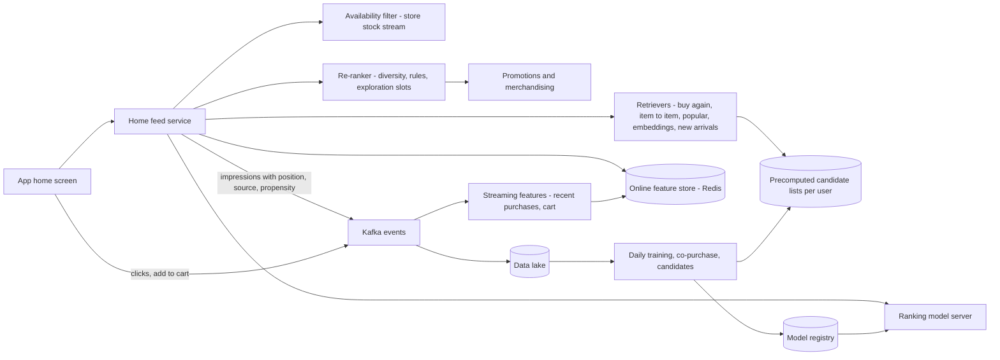
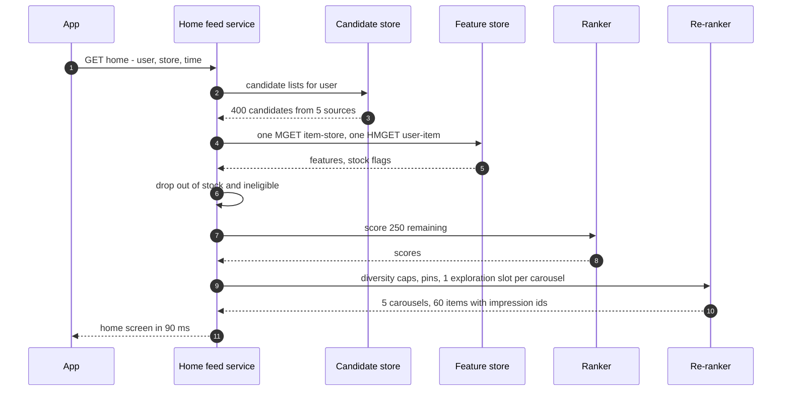
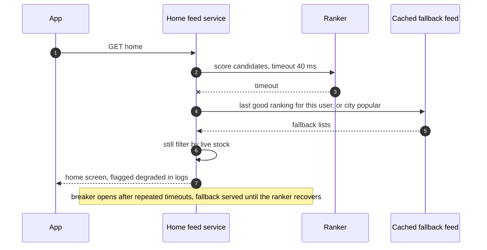
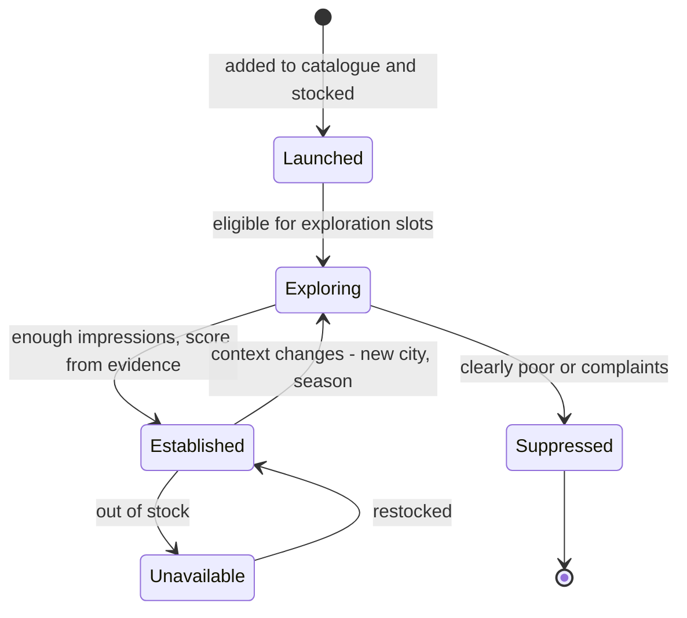

# 43. Case Study: Home Feed & Recommendations

!!! abstract "Chapter at a glance"
    **Reader bands:** B2 → B4 · **Prerequisites:** [Ch 07](../01-foundations/07-caching.md), [Ch 14](../02-distributed-core/14-messaging-and-event-streaming.md), [Ch 21](../03-production/21-data-at-scale.md), [Ch 22](../03-production/22-search-systems.md) · **What you will build:** The grocery app's home screen. It shows "Buy again", "Frequently bought together", "Picked for you" and "New arrivals" carousels, personalised per customer, restricted to what their dark store stocks, and assembled in under 150 ms. This is the "design a news feed / recommendation system" interview question in its most common modern shape: a **multi-stage pipeline** of candidate generation, feature fetch, ranking and re-ranking. The chapter focuses on the system and its failure modes, not on model architecture.

    - **L1: candidate generation.** For 20,000 customers' next basket:
        - Best-sellers reached **22%** recall@20, with the same 20 products for everyone.
        - Buy-again from the customer's own history reached **66%**, but found **0** new items.
        - Item-to-item co-purchase found **5,411** new items across 2,889 products.
        - A 12/5/3 blend gave up ~6 points of recall (**59%**) to find **3,521** new items.
    - **L2: learning to rank, and position bias.** The ranker was trained on 4M impressions logged by the old popularity ranker.
        - The naive model learned popularity **5x** too strongly (1.63 vs a true 0.30).
        - Adding position as a feature, or inverse-propensity weighting, recovered **0.25 / 0.29**, and lifted NDCG@10 from 0.939 to **0.999**. The old ranker scored 0.537.
    - **L3: the feature-fetch fan-out (real Redis).** Fetching features for 400 candidates:
        - One GET per candidate took **30.9 ms** p50 on localhost, about 430 ms with cross-zone round trips.
        - One MGET plus one HMGET took **0.61 ms**.
        - Caching item features in process for 30 s saved one more trip, but **5.0%** of stock flags were stale.
    - **L4: feedback loops and cold start.** Over 30 days with 40 new launches:
        - A greedy ranker reached **57%** of the oracle's clicks and gave **0 of 40** launches a fair trial, though 9 of them beat everything on the shelf.
        - Thompson sampling reached **92.5%** and ranked the best new product **#1**.
        - A reserved new-arrivals slot did as well here, but only because the best products happened to be new.

    · **Reading time:** 100 min + code

---

## 1. Introduction & Why It Matters

### 1.1 A story: the home screen that stopped learning

The grocery app's first home screen was a merchandising page: hand-picked banners and "Best-sellers in your city". It was replaced by a personalised feed built on a click-through model, and conversion rose. Six months later, it had quietly degraded:

1. **It only showed what customers already bought.** Buy-again dominated, repeat revenue was steady, and basket size stopped growing. No one discovered anything.
2. **It believed its own bias.** The model was retrained nightly on clicks from its own feed. Items at the top were clicked more because they were at the top, so the model ranked them even higher.
3. **New products never took off.** A new regional snack brand, better liked than anything in its category, received almost no impressions: it had no history, so it scored low, so it got no history.
4. **Out-of-stock items appeared.** Features came from a nightly batch. Items that sold out at 10 am were still on the feed at 7 pm.
5. **It got slow.** Each feed request made hundreds of calls to the feature store. The p99 crept to 900 ms, and the home screen showed a skeleton for a second.

A recommendation system is a closed loop: what it shows determines what it learns. This chapter designs the pipeline and, just as important, the controls around the loop.

!!! quote "The thesis of this chapter"
    A feed is a **multi-stage retrieval-and-ranking pipeline wrapped in a feedback loop**. **Retrieval** decides what's possible: blend sources with explicit quotas, because each one sees a different slice of what customers want (L1). **Ranking** learns from logs its predecessor shaped, so correct for position and selection bias (L2). **Serving** is a fan-out problem: batch feature reads and cache wisely, but never cache what must be fresh, like stock (L3). And **the loop** must be kept open with deliberate exploration, or the system stops learning about anything it doesn't already show (L4).

### 1.2 Where this lives in the grocery platform

| Carousel | Source | Constraint |
|---|---|---|
| Buy again | Customer's purchase history, due-ness | Only in-stock items at the customer's dark store |
| Frequently bought together | Item-to-item co-purchase from the cart | Complements, not substitutes |
| Picked for you | Blend of retrievers + learned ranker | Diversity across categories |
| New arrivals | Recently launched products + exploration | Reserved exposure for 14 days |
| Deals | Promotions service | Budget and eligibility |
| Banners | Merchandising | Pinned, time-bound |

| Scale | Estimate |
|---|---|
| Home-screen loads | ~3M/day; peak ~400/s |
| Candidates per request | ~400 retrieved → ~40 ranked per carousel → 10–20 shown |
| Catalogue | ~15k SKUs per dark store; ~300 dark stores |
| Latency budget | < 150 ms server side for the whole home screen |

### 1.3 Learning objectives

By the end you will be able to:

- **Design the multi-stage pipeline**: retrieval, feature fetch, ranking, re-ranking and business rules.
- **Choose and blend candidate sources** and measure retrieval recall (L1).
- **Train rankers from logs without learning their own bias** (L2).
- **Serve within a latency budget**: feature stores, batching, caching, precomputation (L3).
- **Keep the loop healthy**: exploration, cold start, diversity and guardrails (L4).

---

## 2. Core Concepts — Beginner to Deep

### 2.1 Intuition: the shop assistant with a notebook <span class="band b2">B2</span>

A good assistant remembers what you usually buy (buy again), knows what goes with it (bread → butter), knows what's popular, and occasionally suggests something new to see if you'll like it. They also know what's actually on the shelf today. A recommendation system is that assistant, working for millions of customers at once, and learning from how they respond.

### 2.2 Requirements <span class="band b2">B2</span>

**Functional**

- Assemble a personalised home screen: several carousels, each with 10–20 products.
- Only show items available at the customer's dark store, with correct prices.
- Respect business rules: pinned banners, promotions, excluded categories (e.g., no alcohol where not permitted), frequency caps.
- Learn from impressions, clicks, add-to-cart and purchases.

**Non-functional**

- p99 < 150 ms server-side at ~400 req/s peak (with bursts during campaigns).
- Freshness: stock within seconds; purchase history within minutes; models daily.
- Degrade gracefully: if ranking fails, fall back to a cached or non-personalised feed.

### 2.3 The multi-stage pipeline ⭐ <span class="band b2">B2</span>

```text
retrieve (~400 candidates from several sources, cheap)
   → filter (availability, eligibility, already in cart)
   → fetch features (item, user, user×item, context)
   → rank (learned model, ~40 per carousel)
   → re-rank (diversity, business rules, exploration slots, dedupe across carousels)
   → render (carousels, tracking ids for every impression)
```

Each stage narrows the set so the next, more expensive stage can afford to look more carefully. Retrieval must have high **recall**; ranking decides **order**; re-ranking applies **policy**.

### 2.4 Candidate generation ⭐ <span class="band b3">B3</span>

L1 predicted the week-12 basket of 20,000 simulated customers:

| Retriever | Recall@20 | New items found | Distinct products shown |
|---|---|---|---|
| Global best-sellers | 22.1% | 5,591 | 20 |
| Buy again (frequency + due) | **65.6%** | **0** | 3,000 |
| Item-to-item co-purchase | 2.3% | 5,411 | 2,889 |
| Blend 12 + 5 + 3 | 59.2% | 3,521 | 3,000 |

- **Buy again** dominates in grocery: most of a basket is staples. Score by frequency and **due-ness** — the usual gap since the last purchase has passed. It can never show anything new.
- **Item-to-item** (co-purchase, normalised by popularity so everything isn't "goes with milk") finds complements and genuine discovery, personal to the basket.
- **Best-sellers** handle cold starts and trends, but they're the same for everyone.
- Other sources at scale: **embedding retrieval** (two-tower models: user and item vectors, approximate nearest neighbour search — [Ch 22](../03-production/22-search-systems.md) L4 built HNSW), category affinity, seasonal and promotional lists.
- **Quotas** between sources are a product decision: the blend traded ~6 points of recall for thousands of discoveries. Measure both.

### 2.5 Ranking and the bias in your own logs ⭐ <span class="band b3">B3</span>

The ranker predicts the probability of engagement (click, add-to-cart, purchase) per candidate from features — historically logistic regression and gradient-boosted trees, now also deep models. Its training data is the impression log, which the *previous* ranker produced. L2 made the bias visible: clicks = P(examined | position) × relevance, and the old ranker put popular items on top.

| Model | Learned weight on popularity (true 0.30) | NDCG@10 | Expected clicks/request |
|---|---|---|---|
| Old popularity ranker | — | 0.537 | 1.202 |
| Naive logistic regression | **1.63** | 0.939 | 1.892 |
| + position feature (0 at serving) | 0.25 | **0.999** | 1.992 |
| Inverse-propensity weighted | 0.29 | 0.999 | 1.991 |

- **Position bias**: users look at the top more; treat position as a feature during training and fix it at serving, or weight examples by 1/P(examined).
- **Selection bias**: items never shown have no labels. Only exploration (L4) fixes that.
- **Label choice**: clicks reward clickbait. For grocery, add-to-cart and purchase are better targets; combine them in a multi-objective score with guardrails (margin, availability).
- **Offline → online**: offline metrics on logged data are biased by the same loop; confirm with A/B tests or interleaving.

### 2.6 Features and the feature store ⭐ <span class="band b3">B3</span>

| Feature group | Examples | Freshness | Where |
|---|---|---|---|
| Item | Price, discount, popularity, rating | Minutes–daily | Online store / local cache |
| Item × store | In stock, stock level | **Seconds** | Online store, never long-cached |
| User | Segments, spend band, diet preferences | Daily | Online store |
| User × item | Times bought, weeks since last purchase | Minutes | Online store (hash per user) |
| Context | Time of day, weather, festival | Request time | Computed |

The **feature store** keeps the same feature definitions for training (offline, point-in-time correct) and serving (online, low latency), avoiding training/serving skew.

**Fetch cost is round trips.** L3, against a real Redis, for 400 candidates:

| Strategy | Round trips | p50 (localhost) | Est. with 0.5 ms RTT |
|---|---|---|---|
| GET + HGET per candidate | 800 | 30.9 ms | ~431 ms |
| Batches of 100 | 8 | 0.83 ms | ~4.8 ms |
| One MGET + one HMGET | 2 | **0.61 ms** | ~1.6 ms |
| Local item cache (30 s) + one HMGET | 1 | 0.75 ms | ~1.2 ms, but **5.0%** stale stock |

Batch every read a request needs. Cache slow-changing item features in process, but **re-check stock** for the items actually shown, or subscribe to stock-change events.

### 2.7 Serving architecture: precompute vs on-request <span class="band b3">B3</span>

| Approach | How | Pros | Cons |
|---|---|---|---|
| **Precomputed** | Nightly job writes each user's feed to a KV store | Cheap, fast reads | Stale (stock, new purchases); computed for inactive users |
| **On-request** | Retrieve, fetch, rank per request | Fresh, context-aware | Latency and compute per request |
| **Hybrid** (common) | Precompute candidates and slow scores; re-rank and filter per request | Fresh where it matters, cheap elsewhere | Two paths to keep consistent |

The grocery design is hybrid: nightly per-user candidate lists (buy-again, item-to-item seeds), online ranking with fresh stock and cart context, and request-time business rules.

### 2.8 Re-ranking, diversity and business rules <span class="band b3">B3</span>

- **Diversity**: cap items per category and brand per carousel (maximal marginal relevance or simple caps), so "Picked for you" isn't ten kinds of milk.
- **Cross-carousel dedupe**: an item appears once on the screen.
- **Business rules**: pinned promotions, sponsored slots (labelled), excluded categories, legal restrictions, frequency caps on repeated impressions.
- **Exploration slots** (L4).

### 2.9 Feedback loops, exploration and cold start ⭐ <span class="band b4">B4</span>

L4 simulated 30 days of a carousel with 40 new launches on day 10:

| Policy | Clicks, % of oracle | New items fairly tried | Best new item's rank |
|---|---|---|---|
| Greedy on observed CTR | 57.3% | **0 / 40** | #492 |
| ε-greedy (10% of feeds, one random slot) | 73.9% | 4 / 40 | #301 |
| **Thompson sampling** | **92.5%** | 27 / 40 | **#1** |
| Greedy + reserved new-arrivals slot | 93.2% | 40 / 40 | #1 |

- A greedy system never learns about what it doesn't show. The greedy feed even locked onto whatever old products it happened to show first.
- **Thompson sampling** (or UCB) explores in proportion to uncertainty and stops exploring once evidence arrives.
- **Reserved slots** work for the specific case of new launches, and nothing else.
- **Cold-start users**: popularity by city and store, onboarding choices, and fast updates after the first order.
- **Cold-start items**: content features (category, brand, price) to borrow strength from similar items; exploration budget.
- **Log exploration** with its propensities, so training can debias (L2).

### 2.10 Evaluation and guardrails <span class="band b4">B4</span>

- **Offline**: recall@k for retrievers (L1), NDCG/AUC for rankers (L2), counterfactual estimates from logged propensities.
- **Online**: A/B tests on add-to-cart rate, basket size, GMV per session, new-product adoption, retention; interleaving for rankers.
- **Guardrails**: out-of-stock impressions (target ~0), latency, category diversity, share of sponsored slots, complaint rate.
- **Long-term effects**: discovery and basket growth, not only next-session clicks.

### 2.11 Data pipeline <span class="band b3">B3</span>

- **Events**: impressions (with request id, position, retriever source, exploration flag, propensity), clicks, add-to-cart, purchases → Kafka ([Ch 14](../02-distributed-core/14-messaging-and-event-streaming.md)).
- **Batch**: daily training sets with point-in-time features, model training, co-purchase matrices, per-user candidate lists ([Ch 21](../03-production/21-data-at-scale.md)).
- **Streaming**: recent purchases and cart events update user × item features within minutes; stock changes within seconds.
- **Model registry and rollout**: versioned models, shadow scoring, canary, rollback.

### 2.12 Interview framing <span class="band b4">B4</span>

Draw the multi-stage pipeline first. Then go deep on two of: candidate sources and quotas, the feedback loop (position bias, exploration, cold start), and the serving fan-out (feature store, batching, freshness). Name concrete metrics for each stage. Staff-level signals: treating recommendations as a closed loop, logging propensities, guardrails, and the build-vs-buy of ML platform pieces.

---

## 3. Architecture & Diagrams

### 3.1 Component view



### 3.2 Sequence: happy path, loading the home screen



### 3.3 Sequence: failure path, ranker times out



### 3.4 State: a new product's journey through the feed



---

## 4. Design Document Excerpt: Home Feed v2

!!! note "Design Document (excerpt) — Home Feed v2"
    **Status:** Accepted · **Authors:** Personalisation team · **Reviewers:** Merchandising, Search, Data platform, SRE

    | Field | Value |
    |---|---|
    | Context | v1 feed: buy-again dominated, self-reinforcing position bias, no exposure for new products, out-of-stock items from nightly features, 800 feature calls per request. |
    | Decision | Multi-source retrieval with explicit quotas; ranker trained with position debiasing on propensity-logged impressions; online feature store with batched reads and live stock; Thompson-sampling exploration slot per carousel plus a new-arrivals carousel; hybrid precompute; guardrails and A/B testing. |
    | Related ADRs | ADR-290 Retriever quotas per carousel, reviewed monthly (L1); ADR-291 Log position, source and propensity for every impression; position-aware training (L2); ADR-292 Feature store: Redis online, one MGET/HMGET per request, item cache 30 s, stock never cached (L3); ADR-293 Exploration: one Thompson slot per carousel, new-arrivals carousel for 14 days (L4); ADR-294 Hybrid serving: nightly candidates, online ranking; fallback to last good feed; ADR-295 Guardrails: zero out-of-stock impressions, diversity caps, p99 150 ms |

    **Requirements.**

    - **R1** Home screen p99 < 150 ms server-side; fallback within 60 ms if ranking fails.
    - **R2** Out-of-stock impressions < 0.1%.
    - **R3** Every new product gets ≥ 200 exploratory impressions per city within its first week.
    - **R4** Ranker trained only on propensity-logged impressions.
    - **R5** Add-to-cart per session and new-product adoption measured in every experiment.

    **Decisions in detail.**

    1. **Retrieval (ADR-290).** "Picked for you": 12 buy-again, 5 item-to-item, 3 popular/seasonal, then ranked; embeddings retriever behind a flag.
    2. **Ranking (ADR-291).** Gradient-boosted trees on purchase-weighted labels; position as a training feature; weekly retrain, daily for fast features.
    3. **Features (ADR-292).** Point-in-time training sets from the lake; online Redis with per-user hashes; stock via inventory events.
    4. **Exploration (ADR-293).** Beta posteriors per item × city for exploration slots; propensity logged.
    5. **Serving (ADR-294).** Candidates precomputed nightly for active users; on-request fallback to popular-by-store for new users.

    **Consequences.** More logging and data plumbing; exploration costs a little short-term conversion; two serving paths. In return: a feed that keeps learning, new products that get a fair chance, fresh availability, and a latency budget that holds.

---

## 5. Hands-On Code — Level Ladder

!!! info "What's real here"
    All four labs are JDK 21 with fixed seeds. **L3 runs against a real Redis 7**: its latencies are real localhost timings and vary by machine, and the cross-zone column is an estimate. L1 uses a shared synthetic world (`World.java`) and needs compiling with `javac`. L2 and L4 are simulations with hidden "true" models, so learned behaviour can be scored against the truth. Behavioural parameters are stated assumptions.

L3 needs Redis 7 on port 6390. L1 is two files: compile them with `javac -d out World.java CandidatesL1.java` and run `java -cp out CandidatesL1`. Run every lab with `-Dstdout.encoding=UTF-8`.

### L1 — Candidate generation <span class="band b2">B2</span>

**Requirement:** "Which sources should fill the home feed, and what does each cost us?"

The shared world: 20,000 customers with personal staples, complements and impulse buys over 12 weeks. Four retrievers predict each customer's week-12 basket from weeks 1–11.

```java title="World.java"
// World.java — the synthetic grocery world shared by the Chapter 43 labs (fixed seed).
// 3,000 products in 40 categories with Zipf popularity; each product has 2–3 complements (bread → butter, pasta → sauce).
// 20,000 customers, each with 5–15 staples bought on a personal cadence (weekly, fortnightly, monthly). Twelve weeks of
// orders: staples that are due, complements of what's in the basket (30%), and 1–3 popular impulse items.
import java.util.*;

final class World {
    final int products = 3_000, users = 20_000, weeks = 12;
    final int[] category = new int[products]; final double[] pop = new double[products]; final int[][] complements = new int[products][];
    final List<List<Set<Integer>>> baskets = new ArrayList<>();        // [user][week] -> items
    final double[] popCdf = new double[products]; double popSum;

    World(long seed) {
        Random r = new Random(seed);
        Integer[] order = new Integer[products]; for (int i = 0; i < products; i++) order[i] = i;
        Collections.shuffle(Arrays.asList(order), r);
        for (int i = 0; i < products; i++) { category[i] = r.nextInt(40); pop[order[i]] = 1.0 / Math.pow(i + 1, 0.9); }
        for (int i = 0; i < products; i++) { popSum += pop[i]; popCdf[i] = popSum; }
        for (int i = 0; i < products; i++) {
            int n = 2 + r.nextInt(2); complements[i] = new int[n];
            for (int k = 0; k < n; k++) complements[i][k] = drawPopular(r);          // complements skew popular too
        }
        for (int u = 0; u < users; u++) {
            int ns = 5 + r.nextInt(11); int[] staples = new int[ns]; int[] cadence = new int[ns]; int[] phase = new int[ns];
            for (int k = 0; k < ns; k++) { staples[k] = r.nextDouble() < 0.5 ? drawPopular(r) : r.nextInt(products); cadence[k] = new int[]{1, 1, 2, 4}[r.nextInt(4)]; phase[k] = r.nextInt(cadence[k]); }
            List<Set<Integer>> ub = new ArrayList<>();
            for (int w = 0; w < weeks; w++) {
                Set<Integer> b = new LinkedHashSet<>();
                for (int k = 0; k < ns; k++) if ((w + phase[k]) % cadence[k] == 0 && r.nextDouble() < 0.85) b.add(staples[k]);
                for (int item : new ArrayList<>(b)) for (int c : complements[item]) if (r.nextDouble() < 0.30) b.add(c);
                int impulse = 1 + r.nextInt(3); for (int k = 0; k < impulse; k++) b.add(drawPopular(r));
                ub.add(b);
            }
            baskets.add(ub);
        }
    }
    int drawPopular(Random r) { int i = Arrays.binarySearch(popCdf, r.nextDouble() * popSum); return i < 0 ? Math.min(products - 1, -i - 1) : i; }
}
```

```java title="CandidatesL1.java"
// CandidatesL1.java — run with: javac -d out World.java CandidatesL1.java && java -cp out CandidatesL1   (JDK 21, no deps)
// WHERE HOME-FEED CANDIDATES COME FROM. The home screen shows ~20 products per customer. Ranking can only reorder what
// candidate generation retrieves, so retrieval recall sets the ceiling. Using weeks 1–11 of the shared synthetic world, we
// predict each customer's week-12 basket with four retrievers and measure recall@20 (share of week-12 items that were in
// the 20), and how many distinct products the whole population was shown (catalogue coverage):
//   C1 global best-sellers
//   C2 BUY AGAIN: the customer's own history, scored by frequency and by whether the item is due (its usual gap has passed)
//   C3 ITEM-TO-ITEM: products co-purchased with the customer's recent items (co-occurrence normalised by popularity)
//   C4 BLEND: 12 buy-again + 5 item-to-item + 3 best-sellers, de-duplicated
import java.util.*;

public class CandidatesL1 {
    public static void main(String[] args) {
        World w = new World(43); int train = 11;
        // global counts and item-item co-occurrence from training weeks
        double[] count = new double[w.products]; Map<Long, Integer> co = new HashMap<>();
        for (List<Set<Integer>> ub : w.baskets) for (int wk = 0; wk < train; wk++) {
            Integer[] b = ub.get(wk).toArray(new Integer[0]);
            for (int i : b) count[i]++;
            for (int i : b) for (int j : b) if (i != j) co.merge((long) i * w.products + j, 1, Integer::sum);
        }
        Map<Integer, List<int[]>> neighbours = new HashMap<>();                 // i -> [(j, score*1000)]
        for (var e : co.entrySet()) {
            int i = (int) (e.getKey() / w.products), j = (int) (e.getKey() % w.products); if (e.getValue() < 5) continue;
            double score = e.getValue() / Math.sqrt(count[i] * count[j]);        // cosine: penalises items that are simply popular
            neighbours.computeIfAbsent(i, k -> new ArrayList<>()).add(new int[]{j, (int) (score * 1e6)});
        }
        neighbours.values().forEach(l -> l.sort((a, b) -> b[1] - a[1]));
        Integer[] best = new Integer[w.products]; for (int i = 0; i < w.products; i++) best[i] = i;
        Arrays.sort(best, (a, b) -> Double.compare(count[b], count[a]));

        System.out.printf("%,d customers, %,d products; history weeks 1–%d, predicting week %d (avg basket %.1f items).%n%n", w.users, w.products, train, train + 1,
                w.baskets.stream().mapToInt(ub -> ub.get(train).size()).average().orElse(0));
        System.out.printf("   %-52s %11s %16s %18s%n", "retriever", "recall@20", "new-to-customer", "distinct products");
        System.out.printf("   %-52s %11s %16s %18s%n", "", "", "items found", "shown (coverage)");
        String[] names = {"C1) global best-sellers", "C2) buy again (frequency + due)", "C3) item-to-item co-purchase", "C4) blend 12 + 5 + 3"};
        for (int s = 0; s < 4; s++) {
            long hit = 0, total = 0, newHits = 0; Set<Integer> shown = new HashSet<>();
            for (int u = 0; u < w.users; u++) {
                List<Set<Integer>> ub = w.baskets.get(u);
                Map<Integer, List<Integer>> seenWeeks = new HashMap<>();
                for (int wk = 0; wk < train; wk++) for (int i : ub.get(wk)) seenWeeks.computeIfAbsent(i, k -> new ArrayList<>()).add(wk);
                List<Integer> c1 = new ArrayList<>(); for (int i = 0; i < 20; i++) c1.add(best[i]);
                List<Integer> c2 = buyAgain(seenWeeks, train, 20);
                List<Integer> c3 = itemToItem(ub.get(train - 1), ub.get(train - 2), neighbours, seenWeeks.keySet(), 20);
                List<Integer> rec = switch (s) {
                    case 0 -> c1; case 1 -> c2; case 2 -> c3;
                    default -> { LinkedHashSet<Integer> m = new LinkedHashSet<>(buyAgain(seenWeeks, train, 12)); for (int i : c3) { if (m.size() >= 17) break; m.add(i); } for (int i : c1) { if (m.size() >= 20) break; m.add(i); } yield new ArrayList<>(m); }
                };
                shown.addAll(rec); Set<Integer> recSet = new HashSet<>(rec);
                for (int i : ub.get(train)) { total++; if (recSet.contains(i)) { hit++; if (!seenWeeks.containsKey(i)) newHits++; } }
            }
            System.out.printf("   %-52s %10.1f%% %16s %,18d%n", names[s], 100.0 * hit / total, String.format("%,d", newHits), shown.size());
        }
        System.out.println("\n   → in a repeat-purchase business the customer's own history is by far the strongest retriever — but it only");
        System.out.println("     ever shows what they already buy: it found no new items at all. Best-sellers find new items for everyone, but");
        System.out.println("     the same 20 for everyone. Item-to-item co-purchase finds about as many new items, spread across almost the whole");
        System.out.println("     catalogue — personal discovery. The blend gives up ~6 points of recall to find thousands of new items; that");
        System.out.println("     quota is a product decision (repeat revenue now vs discovery), and the ranker (L2) can only reorder what the");
        System.out.println("     retrievers bring back.");
    }

    static List<Integer> buyAgain(Map<Integer, List<Integer>> seen, int now, int k) {
        List<int[]> scored = new ArrayList<>();
        for (var e : seen.entrySet()) {
            List<Integer> wk = e.getValue(); int n = wk.size(), last = wk.get(n - 1);
            double gap = n > 1 ? (double) (last - wk.get(0)) / (n - 1) : 4;          // usual gap between purchases
            double due = Math.min(1.5, (now - last) / Math.max(1, gap));              // ≥1 → due now
            scored.add(new int[]{e.getKey(), (int) (1000 * n * due)});
        }
        scored.sort((a, b) -> b[1] - a[1]);
        List<Integer> out = new ArrayList<>(); for (int i = 0; i < Math.min(k, scored.size()); i++) out.add(scored.get(i)[0]); return out;
    }
    static List<Integer> itemToItem(Set<Integer> last, Set<Integer> prev, Map<Integer, List<int[]>> nb, Set<Integer> exclude, int k) {
        Map<Integer, Integer> score = new HashMap<>();
        for (Set<Integer> b : List.of(last, prev)) for (int i : b) for (int[] n : nb.getOrDefault(i, List.of()).subList(0, Math.min(10, nb.getOrDefault(i, List.of()).size())))
            if (!exclude.contains(n[0])) score.merge(n[0], n[1], Integer::sum);
        return score.entrySet().stream().sorted((a, b) -> b.getValue() - a.getValue()).limit(k).map(Map.Entry::getKey).toList();
    }
}
```

```text title="javac -d out World.java CandidatesL1.java && java -cp out CandidatesL1"
20,000 customers, 3,000 products; history weeks 1–11, predicting week 12 (avg basket 11.8 items).

   retriever                                              recall@20  new-to-customer  distinct products
                                                                         items found   shown (coverage)
   C1) global best-sellers                                    22.1%            5,591                 20
   C2) buy again (frequency + due)                            65.6%                0              3,000
   C3) item-to-item co-purchase                                2.3%            5,411              2,889
   C4) blend 12 + 5 + 3                                       59.2%            3,521              3,000

   → in a repeat-purchase business the customer's own history is by far the strongest retriever — but it only
     ever shows what they already buy: it found no new items at all. Best-sellers find new items for everyone, but
     the same 20 for everyone. Item-to-item co-purchase finds about as many new items, spread across almost the whole
     catalogue — personal discovery. The blend gives up ~6 points of recall to find thousands of new items; that
     quota is a product decision (repeat revenue now vs discovery), and the ranker (L2) can only reorder what the
     retrievers bring back.
```

**Reading it:**

- **Buy again** retrieves two-thirds of next week's basket, and never anything new.
- **Best-sellers** find new items for everyone but show all 20,000 customers the same 20 products.
- **Item-to-item** has low recall on its own (it deliberately excludes what the customer already buys), yet finds as many new items as best-sellers, spread across 2,889 products.
- **The blend** trades 6.4 points of recall for 3,521 discoveries. That's a product decision to make with data.

### L2 — Learning to rank from biased logs <span class="band b3">B3</span>

**Requirement:** "Train a better ranker from the clicks our current feed produces, without learning its bias back."

Clicks are generated as examination(position) × relevance, where relevance comes from a hidden true model. The logs come from the old popularity ranker. Three logistic-regression rankers are trained with SGD and scored against the truth.

```java title="RankingL2.java"
// RankingL2.java — run with: java RankingL2.java   (JDK 21, no dependencies)
// LEARNING TO RANK FROM YOUR OWN LOGS — AND THE POSITION-BIAS TRAP. Each home-feed request has 40 candidates (from L1's
// retrievers) with 4 features: buy-again score, co-purchase score, popularity and discount. A hidden "true" model decides
// how relevant each item is; a customer clicks an item with probability  examine(position) × relevance, where
// examine = 1 / (1 + 0.35 × position): the top slot is looked at far more than slot 10 (position bias).
// The logs come from the OLD ranker, which sorted mostly by popularity. From 200,000 logged requests we train logistic
// regression rankers (plain SGD, fixed seed) and evaluate them on 20,000 new requests against the TRUE relevance:
//   R0 the old popularity ranker (the logging policy)
//   R1 logistic regression on the 4 features, clicks as labels                     — naive
//   R2 R1 + position as a training feature, set to 0 when serving                  — debiasing by modelling position
//   R3 R1 with inverse-propensity weights (each example weighted by 1/examine)     — debiasing by reweighting
//   R* the true model (upper bound)
import java.util.*;

public class RankingL2 {
    static final double[] TRUE_W = {2.2, 1.4, 0.3, 0.8}; static final double TRUE_B = -3.0;
    static double examine(int pos) { return 1.0 / (1 + 0.35 * pos); }
    static double sigmoid(double z) { return 1 / (1 + Math.exp(-z)); }

    public static void main(String[] args) {
        Random r = new Random(43); int cands = 40, shown = 20;
        // --- logging: old ranker sorts by popularity + noise, shows top 20, clicks follow position bias ---
        List<double[]> X = new ArrayList<>(); List<Integer> Y = new ArrayList<>(); List<Integer> P = new ArrayList<>();
        for (int q = 0; q < 200_000; q++) {
            double[][] f = features(r, cands); Integer[] order = order(f, v -> v[2] + 0.3 * r.nextGaussian());
            for (int pos = 0; pos < shown; pos++) { double[] x = f[order[pos]]; double rel = relevance(x); X.add(x); P.add(pos); Y.add(r.nextDouble() < examine(pos) * rel ? 1 : 0); }
        }
        System.out.printf("Logged by the old popularity ranker: %,d impressions, %,d clicks (CTR %.2f%%).%n%n", X.size(), Y.stream().mapToInt(Integer::intValue).sum(),
                100.0 * Y.stream().mapToInt(Integer::intValue).sum() / X.size());
        double[] w1 = train(X, Y, P, false, false), w2 = train(X, Y, P, true, false), w3 = train(X, Y, P, false, true);
        System.out.printf("   %-52s %11s %11s %11s %11s %11s%n", "model", "w buy-again", "w co-purch", "w popular", "w discount", "w position");
        System.out.printf("   %-52s %11.2f %11.2f %11.2f %11.2f %11s%n", "true model (hidden)", TRUE_W[0], TRUE_W[1], TRUE_W[2], TRUE_W[3], "—");
        System.out.printf("   %-52s %11.2f %11.2f %11.2f %11.2f %11s%n", "R1 naive", w1[0], w1[1], w1[2], w1[3], "—");
        System.out.printf("   %-52s %11.2f %11.2f %11.2f %11.2f %11.2f%n", "R2 with position feature", w2[0], w2[1], w2[2], w2[3], w2[5]);
        System.out.printf("   %-52s %11.2f %11.2f %11.2f %11.2f %11s%n", "R3 inverse-propensity weighted", w3[0], w3[1], w3[2], w3[3], "—");

        // --- evaluation on fresh requests against true relevance ---
        String[] names = {"R0) old popularity ranker", "R1) naive logistic regression", "R2) + position feature (0 at serving)", "R3) inverse-propensity weighted", "R*) true model (upper bound)"};
        System.out.printf("%n   %-52s %10s %18s%n", "ranker", "NDCG@10", "expected clicks/req");
        Random e = new Random(99);
        List<double[][]> test = new ArrayList<>(); for (int q = 0; q < 20_000; q++) test.add(features(e, cands));
        for (int m = 0; m < 5; m++) {
            double ndcg = 0, clicks = 0; final int mm = m;
            for (double[][] f : test) {
                Integer[] order = order(f, v -> switch (mm) { case 0 -> v[2]; case 1 -> dot(w1, v, 0); case 2 -> dot(w2, v, 0); case 3 -> dot(w3, v, 0); default -> relevance(v); });
                double dcg = 0, idcg = 0; double[] rels = new double[f.length];
                for (int i = 0; i < f.length; i++) rels[i] = relevance(f[i]);
                double[] sorted = rels.clone(); Arrays.sort(sorted);
                for (int k = 0; k < 10; k++) { dcg += rels[order[k]] / (Math.log(k + 2) / Math.log(2)); idcg += sorted[f.length - 1 - k] / (Math.log(k + 2) / Math.log(2)); }
                for (int k = 0; k < shown; k++) clicks += examine(k) * rels[order[k]];
                ndcg += dcg / idcg;
            }
            System.out.printf("   %-52s %10.3f %18.3f%n", names[m], ndcg / test.size(), clicks / test.size());
        }
        System.out.println("\n   → the logs record what the OLD ranker chose to show at the top, so popular items look better than they are:");
        System.out.println("     the naive model inflates popularity and learns the logging policy's bias back. Modelling position explicitly");
        System.out.println("     (or reweighting by how likely each slot was to be seen) recovers weights close to the truth and a better");
        System.out.println("     ranking. Every learned ranker is trained on data its predecessor shaped — measure and correct for that, and");
        System.out.println("     keep some randomised traffic (L4) so the logs contain evidence about items the old ranker never showed.");
    }

    static double relevance(double[] x) { return sigmoid(TRUE_B + TRUE_W[0] * x[0] + TRUE_W[1] * x[1] + TRUE_W[2] * x[2] + TRUE_W[3] * x[3]); }
    static double[][] features(Random r, int n) {
        double[][] f = new double[n][4];
        for (int i = 0; i < n; i++) { double pop = r.nextDouble(); f[i][0] = r.nextDouble() < 0.3 ? r.nextDouble() : 0; f[i][1] = r.nextDouble() * r.nextDouble();
            f[i][2] = pop; f[i][3] = r.nextDouble() < 0.2 ? r.nextDouble() : 0; f[i][0] += 0.4 * pop * r.nextDouble(); }   // popular items are bought again more
        return f;
    }
    static Integer[] order(double[][] f, java.util.function.ToDoubleFunction<double[]> s) {
        Integer[] o = new Integer[f.length]; double[] sc = new double[f.length];
        for (int i = 0; i < f.length; i++) { o[i] = i; sc[i] = s.applyAsDouble(f[i]); }
        Arrays.sort(o, (a, b) -> Double.compare(sc[b], sc[a])); return o;
    }
    static double dot(double[] w, double[] x, int pos) { return w[4] + w[0] * x[0] + w[1] * x[1] + w[2] * x[2] + w[3] * x[3] + w[5] * pos; }
    // weights: [4 features, bias, position]
    static double[] train(List<double[]> X, List<Integer> Y, List<Integer> P, boolean positionFeature, boolean ips) {
        double[] w = new double[6]; Random r = new Random(1); int n = X.size(); double lr = 0.05;
        Integer[] idx = new Integer[n]; for (int i = 0; i < n; i++) idx[i] = i;
        for (int epoch = 0; epoch < 4; epoch++) {
            Collections.shuffle(Arrays.asList(idx), r);
            for (int k : idx) {
                double[] x = X.get(k); int pos = P.get(k); double z = dot(w, x, positionFeature ? pos : 0);
                double p = sigmoid(z), g = (Y.get(k) - p) * (ips ? (Y.get(k) == 1 ? 1 / examine(pos) : 1) : 1);
                for (int j = 0; j < 4; j++) w[j] += lr * g * x[j];
                w[4] += lr * g; if (positionFeature) w[5] += lr * g * pos;
            }
            lr *= 0.5;
        }
        return w;
    }
}
```

```text title="java -Dstdout.encoding=UTF-8 RankingL2.java"
Logged by the old popularity ranker: 4,000,000 impressions, 228,718 clicks (CTR 5.72%).

   model                                                w buy-again  w co-purch   w popular  w discount  w position
   true model (hidden)                                         2.20        1.40        0.30        0.80           —
   R1 naive                                                    1.82        1.08        1.63        0.57           —
   R2 with position feature                                    1.88        1.11        0.25        0.59       -0.17
   R3 inverse-propensity weighted                              1.89        1.09        0.29        0.55           —

   ranker                                                  NDCG@10 expected clicks/req
   R0) old popularity ranker                                 0.537              1.202
   R1) naive logistic regression                             0.939              1.892
   R2) + position feature (0 at serving)                     0.999              1.992
   R3) inverse-propensity weighted                           0.999              1.991
   R*) true model (upper bound)                              1.000              1.993

   → the logs record what the OLD ranker chose to show at the top, so popular items look better than they are:
     the naive model inflates popularity and learns the logging policy's bias back. Modelling position explicitly
     (or reweighting by how likely each slot was to be seen) recovers weights close to the truth and a better
     ranking. Every learned ranker is trained on data its predecessor shaped — measure and correct for that, and
     keep some randomised traffic (L4) so the logs contain evidence about items the old ranker never showed.
```

**Reading it:**

- **The naive model** learned a popularity weight of **1.63**, against a true 0.30. Popular items sat in the top slots, and top slots get clicked. It still beats the old ranker (0.939 vs 0.537), which makes the bias easy to miss.
- **Position as a feature** (−0.17 per slot) or **inverse-propensity weights** recover the true shape (0.25 / 0.29), and NDCG@10 reaches **0.999**.
- All learned weights are scaled down relative to the truth, because the click model isn't logistic. Only the ranking matters here.

### L3 — The feature-fetch fan-out <span class="band b3">B3</span>

**Requirement:** "Score 400 candidates per request inside a 150 ms budget, with correct stock."

A real Redis holds 60,000 item-store keys and 2,000 customer hashes. A writer thread changes stock for 2% of items per second while four fetch strategies each serve 500 requests.

```java title="FeatureFetchL3.java"
// FeatureFetchL3.java — run with (Redis 7 on :6390):  java FeatureFetchL3.java   (JDK 21, no dependencies)
// THE FEATURE-FETCH FAN-OUT. To rank a home feed the service scores ~400 candidates, and every candidate needs features:
// item-in-store features (price, in stock?, popularity) and customer-item features (times bought, weeks since last).
// They live in a REAL Redis (the online feature store): 3,000 items × 20 dark stores as strings, and one hash per customer.
// We serve 500 feed requests four ways and measure the real time spent fetching features:
//   F1 one GET per candidate + one HGET per candidate          — 800 round trips
//   F2 MGET / HMGET in batches of 100                          — 8 round trips
//   F3 one MGET + one HMGET for everything                     — 2 round trips
//   F4 item features from an in-process cache refreshed every 30 s, one HMGET for the customer — 1 round trip
// While requests run, 2% of items change stock status every second (a writer thread updates Redis), so F4's cache can
// show a stale "in stock" flag; we count those against Redis's current value.
import java.io.*;
import java.net.Socket;
import java.nio.charset.StandardCharsets;
import java.util.*;
import java.util.concurrent.*;
import java.util.concurrent.atomic.*;

public class FeatureFetchL3 {
    public static void main(String[] args) throws Exception {
        int items = 3_000, stores = 20, users = 2_000, cands = 400; Random r = new Random(43);
        try (Redis rd = new Redis()) {
            rd.cmd("FLUSHALL"); List<String[]> batch = new ArrayList<>();
            for (int s = 0; s < stores; s++) for (int i = 0; i < items; i++) {
                batch.add(new String[]{"SET", "f:" + s + ":" + i, (49 + r.nextInt(500)) + "|" + (r.nextDouble() < 0.9 ? 1 : 0) + "|" + r.nextInt(1000)});
                if (batch.size() == 2000) { rd.pipeline(batch); batch.clear(); }
            }
            for (int u = 0; u < users; u++) {
                String[] c = new String[2 + 2 * 60]; c[0] = "HSET"; c[1] = "u:" + u;
                for (int k = 0; k < 60; k++) { c[2 + 2 * k] = Integer.toString(r.nextInt(items)); c[3 + 2 * k] = (1 + r.nextInt(12)) + "|" + r.nextInt(12); }
                batch.add(c); if (batch.size() == 500) { rd.pipeline(batch); batch.clear(); }
            }
            rd.pipeline(batch);
        }
        // writer: 2% of items per second flip stock in every store
        AtomicBoolean stop = new AtomicBoolean(); Thread writer = new Thread(() -> {
            try (Redis w = new Redis()) { Random wr = new Random(7);
                while (!stop.get()) { List<String[]> b = new ArrayList<>(); for (int k = 0; k < items * 2 / 100 / 10; k++) { int i = wr.nextInt(items); for (int s = 0; s < stores; s++) b.add(new String[]{"SET", "f:" + s + ":" + i, (49 + wr.nextInt(500)) + "|" + (wr.nextBoolean() ? 1 : 0) + "|" + wr.nextInt(1000)}); }
                    w.pipeline(b); Thread.sleep(100); }
            } catch (Exception ignored) {} });
        writer.start();

        System.out.printf("Redis feature store: %,d item-store keys, %,d customer hashes. %d candidates per request, 500 requests each.%n%n", items * stores, users, cands);
        System.out.printf("   %-58s %12s %12s %12s %20s %14s%n", "strategy", "round trips", "p50", "p99", "at 0.5 ms RTT (est.)", "stale stock");
        String[] names = {"F1) GET + HGET per candidate", "F2) MGET / HMGET in batches of 100", "F3) one MGET + one HMGET", "F4) local item cache (30 s) + one HMGET"};
        Map<String, String> local = new HashMap<>(); long[] localLoadedAt = {0};
        try (Redis rd = new Redis()) {
            for (int s = 0; s < 4; s++) {
                Random q = new Random(100 + s); long[] t = new long[500]; long rts = 0, stale = 0, flags = 0;
                if (s == 3) { loadLocal(rd, local, items, stores); localLoadedAt[0] = System.nanoTime(); }
                for (int req = 0; req < 500; req++) {
                    int user = q.nextInt(users), store = q.nextInt(stores); String[] cand = new String[cands];
                    for (int k = 0; k < cands; k++) cand[k] = Integer.toString(q.nextInt(items));
                    long t0 = System.nanoTime(); int trips = 0; List<Object> itemF = new ArrayList<>();
                    switch (s) {
                        case 0 -> { for (String c : cand) { itemF.add(rd.cmd("GET", "f:" + store + ":" + c)); rd.cmd("HGET", "u:" + user, c); trips += 2; } }
                        case 1 -> { for (int b = 0; b < cands; b += 100) { String[] mg = new String[101]; mg[0] = "MGET"; String[] hm = new String[102]; hm[0] = "HMGET"; hm[1] = "u:" + user;
                                        for (int k = 0; k < 100; k++) { mg[1 + k] = "f:" + store + ":" + cand[b + k]; hm[2 + k] = cand[b + k]; }
                                        itemF.addAll((List<?>) rd.cmd(mg)); rd.cmd(hm); trips += 2; } }
                        case 2 -> { String[] mg = new String[cands + 1]; mg[0] = "MGET"; String[] hm = new String[cands + 2]; hm[0] = "HMGET"; hm[1] = "u:" + user;
                                    for (int k = 0; k < cands; k++) { mg[1 + k] = "f:" + store + ":" + cand[k]; hm[2 + k] = cand[k]; }
                                    itemF.addAll((List<?>) rd.cmd(mg)); rd.cmd(hm); trips = 2; }
                        default -> { if (System.nanoTime() - localLoadedAt[0] > 30e9) { loadLocal(rd, local, items, stores); localLoadedAt[0] = System.nanoTime(); }
                                     for (String c : cand) itemF.add(local.get("f:" + store + ":" + c));
                                     String[] hm = new String[cands + 2]; hm[0] = "HMGET"; hm[1] = "u:" + user; for (int k = 0; k < cands; k++) hm[2 + k] = cand[k];
                                     rd.cmd(hm); trips = 1; }
                    }
                    t[req] = System.nanoTime() - t0; rts += trips;
                    if (s == 3 && req % 10 == 0) {                               // audit: compare the cached stock flag with Redis now
                        String[] mg = new String[cands + 1]; mg[0] = "MGET"; for (int k = 0; k < cands; k++) mg[1 + k] = "f:" + store + ":" + cand[k];
                        List<?> now = (List<?>) rd.cmd(mg);
                        for (int k = 0; k < cands; k++) { flags++; if (!stockOf((String) now.get(k)).equals(stockOf((String) itemF.get(k)))) stale++; }
                    }
                    Thread.sleep(s == 3 ? 20 : 0);                              // F4 runs over ~10 s so the cache ages and refreshes
                }
                Arrays.sort(t); double avgTrips = (double) rts / 500;
                System.out.printf("   %-58s %12.0f %9.2f ms %9.2f ms %17.1f ms %14s%n", names[s], avgTrips, t[250] / 1e6, t[495] / 1e6,
                        t[250] / 1e6 + avgTrips * 0.5, s == 3 ? String.format("%.2f%%", 100.0 * stale / flags) : "0%");
            }
        }
        stop.set(true); writer.join();
        System.out.println("   (p50/p99 are real localhost timings and vary by machine; the 0.5 ms column adds a typical cross-AZ round trip");
        System.out.println("    per trip to the measured p50 — an estimate.)");
        System.out.println("\n   → the cost of features is round trips, not bytes: hundreds of tiny GETs cost far more than one large MGET,");
        System.out.println("     and across availability zones the difference is the whole latency budget. Batch everything a request needs");
        System.out.println("     into as few calls as possible (MGET/HMGET/pipelines, or a feature service that does it). Caching slowly-");
        System.out.println("     changing item features in process removes another trip (invisible on localhost, worth ~0.5 ms per request across");
        System.out.println("     zones), at the price of staleness — fine for popularity,");
        System.out.println("     not for stock: re-check availability for the items actually shown, or subscribe to stock changes.");
    }

    static String stockOf(String v) { return v == null ? "?" : v.split("\\|")[1]; }
    static void loadLocal(Redis rd, Map<String, String> local, int items, int stores) throws IOException {
        for (int s = 0; s < stores; s++) { String[] mg = new String[items + 1]; mg[0] = "MGET"; for (int i = 0; i < items; i++) mg[1 + i] = "f:" + s + ":" + i;
            List<?> v = (List<?>) rd.cmd(mg); for (int i = 0; i < items; i++) local.put("f:" + s + ":" + i, (String) v.get(i)); }
    }

    /** Minimal RESP client (Ch 18) with pipelining and arrays. */
    static final class Redis implements Closeable {
        final Socket s; final OutputStream out; final InputStream in;
        Redis() throws IOException { s = new Socket("127.0.0.1", 6390); s.setTcpNoDelay(true); out = new BufferedOutputStream(s.getOutputStream(), 1 << 16); in = new BufferedInputStream(s.getInputStream(), 1 << 16); }
        void write(String... parts) throws IOException {
            StringBuilder sb = new StringBuilder("*").append(parts.length).append("\r\n");
            for (String p : parts) { byte[] b = p.getBytes(StandardCharsets.UTF_8); sb.append('$').append(b.length).append("\r\n").append(p).append("\r\n"); }
            out.write(sb.toString().getBytes(StandardCharsets.UTF_8));
        }
        Object cmd(String... parts) throws IOException { write(parts); out.flush(); return read(); }
        void pipeline(List<String[]> cmds) throws IOException { for (String[] c : cmds) write(c); out.flush(); for (int i = 0; i < cmds.size(); i++) read(); }
        Object read() throws IOException {
            int type = in.read(); String line = line();
            return switch (type) {
                case '+' -> line; case ':' -> Long.parseLong(line);
                case '$' -> { int n = Integer.parseInt(line); if (n < 0) yield null; byte[] b = in.readNBytes(n); line(); yield new String(b, StandardCharsets.UTF_8); }
                case '*' -> { int n = Integer.parseInt(line); List<Object> l = new ArrayList<>(); for (int i = 0; i < n; i++) l.add(read()); yield l; }
                case '-' -> throw new IOException("redis error: " + line);
                default -> throw new IOException("unexpected reply type " + (char) type);
            };
        }
        String line() throws IOException { StringBuilder sb = new StringBuilder(); int c; while ((c = in.read()) != '\r') sb.append((char) c); in.read(); return sb.toString(); }
        public void close() throws IOException { s.close(); }
    }
}
```

```text title="java -Dstdout.encoding=UTF-8 FeatureFetchL3.java"
Redis feature store: 60,000 item-store keys, 2,000 customer hashes. 400 candidates per request, 500 requests each.

   strategy                                                    round trips          p50          p99 at 0.5 ms RTT (est.)    stale stock
   F1) GET + HGET per candidate                                        800     30.92 ms     43.30 ms             430.9 ms             0%
   F2) MGET / HMGET in batches of 100                                    8      0.83 ms      3.78 ms               4.8 ms             0%
   F3) one MGET + one HMGET                                              2      0.61 ms      1.36 ms               1.6 ms             0%
   F4) local item cache (30 s) + one HMGET                               1      0.75 ms      3.90 ms               1.2 ms          5.02%
   (p50/p99 are real localhost timings and vary by machine; the 0.5 ms column adds a typical cross-AZ round trip
    per trip to the measured p50 — an estimate.)

   → the cost of features is round trips, not bytes: hundreds of tiny GETs cost far more than one large MGET,
     and across availability zones the difference is the whole latency budget. Batch everything a request needs
     into as few calls as possible (MGET/HMGET/pipelines, or a feature service that does it). Caching slowly-
     changing item features in process removes another trip (invisible on localhost, worth ~0.5 ms per request across
     zones), at the price of staleness — fine for popularity,
     not for stock: re-check availability for the items actually shown, or subscribe to stock changes.
```

**Reading it:**

- **800 round trips**: 30.9 ms on localhost. At a typical cross-zone round trip it would be ~430 ms, three times the whole budget.
- **Batching** into 2–8 calls brings it under a millisecond locally and a few ms across zones.
- **A local item cache** saves one more trip, invisible on localhost and ~0.5 ms across zones. But after up to 30 s, **5.0%** of stock flags no longer matched Redis. Keep popularity and price in the cache; take stock live.

### L4 — Feedback loops and cold start <span class="band b4">B4</span>

**Requirement:** "New launches must get a fair chance, and the feed must keep finding better products."

A 30-day simulation of a 10-slot carousel with daily retraining. On day 10, 40 products launch; 9 of them beat every existing product. Four policies are scored against an oracle that knows the true click-through rates.

```java title="ExploreL4.java"
// ExploreL4.java — run with: java ExploreL4.java   (JDK 21, no dependencies)
// FEEDBACK LOOPS AND THE COLD START. A home-feed carousel shows 10 of 500 snack products to 5,000 customers a day (one city cluster). The
// ranker learns each product's click-through rate from yesterday's logs (daily retrain). On day 10, 40 NEW products
// launch — several are better than anything in the catalogue — but they have no clicks yet. Thirty days, fixed seed.
//   E1 greedy: rank by observed CTR with a small prior (new items start at the prior, below the proven winners)
//   E2 ε-greedy: one of the 10 slots goes to a random product 5% of the time... here: 10% of feeds get one random slot
//   E3 Thompson sampling: rank by a draw from each product's Beta(clicks+1, non-clicks+20) posterior
//   E4 greedy + a reserved "new arrivals" slot for products launched in the last 14 days (merchandising rule)
// Measured over days 10–30 against an oracle that knows every true CTR: total clicks (and the share of the oracle's),
// how many new products got a fair trial (≥ 200 impressions), and where the best new product ended up.
import java.util.*;

public class ExploreL4 {
    public static void main(String[] args) {
        Random r = new Random(43); int old = 500, fresh = 40, n = old + fresh, days = 30, feeds = 5_000, slots = 10;
        double[] ctr = new double[n];
        for (int i = 0; i < old; i++) ctr[i] = 0.01 + 0.05 * Math.pow(r.nextDouble(), 2);
        for (int i = old; i < n; i++) ctr[i] = 0.01 + 0.09 * Math.pow(r.nextDouble(), 2);           // new launches: wider spread
        int bestNew = old; for (int i = old; i < n; i++) if (ctr[i] > ctr[bestNew]) bestNew = i;
        double bestOld = 0; for (int i = 0; i < old; i++) bestOld = Math.max(bestOld, ctr[i]);
        int betterNew = 0; for (int i = old; i < n; i++) if (ctr[i] > bestOld) betterNew++;
        System.out.printf("500 products; 40 launch on day 10 (%d of them beat the best existing product's %.1f%% CTR; best new %.1f%%).%n", betterNew, 100 * bestOld, 100 * ctr[bestNew]);
        System.out.println("5,000 feeds a day × 10 slots, daily retrain. Measured over days 10–30.\n");
        System.out.printf("   %-52s %12s %10s %20s %20s%n", "policy", "clicks", "% oracle", "new items with", "best new item's");
        System.out.printf("   %-52s %12s %10s %20s %20s%n", "", "", "", "≥ 200 impressions", "rank on day 30");
        String[] names = {"E1) greedy on observed CTR", "E2) ε-greedy (10% of feeds get a random slot)", "E3) Thompson sampling", "E4) greedy + reserved new-arrivals slot"};
        double oracle = 0; { Integer[] o = rank(ctr, n); for (int k = 0; k < slots; k++) oracle += ctr[o[k]]; oracle *= (double) feeds * 21; }
        for (int p = 0; p < 4; p++) {
            Random q = new Random(7 + p); long[] imp = new long[n], clk = new long[n]; double clicks = 0; int bestRank = -1;
            for (int d = 0; d < days; d++) {
                int live = d < 10 ? old : n; double[] score = new double[live];
                for (int i = 0; i < live; i++) score[i] = (clk[i] + 0.5) / (imp[i] + 25.0);           // posterior mean with a prior of 2%
                int[][] cached = new int[7][]; for (int salt = 0; salt < 7; salt++) cached[salt] = top(score, live, slots, salt);
                int[][] newTop = new int[40][]; if (p == 3) for (int salt = 0; salt < 40; salt++) newTop[salt] = top(Arrays.copyOfRange(score, old, n), fresh, 1, salt);
                for (int f = 0; f < feeds; f++) {
                    int[] shown;
                    if (p == 2) { double[] s = new double[live]; for (int i = 0; i < live; i++) s[i] = beta(q, clk[i] + 1, imp[i] - clk[i] + 20); shown = top(s, live, slots, 0); }
                    else shown = cached[f % 7].clone();                                            // ties broken differently per feed
                    if (p == 1 && q.nextDouble() < 0.10) shown[slots - 1] = q.nextInt(live);
                    if (p == 3 && d >= 10 && d < 24) { int[] nw = newTop[f % 40]; shown[slots - 1] = old + (q.nextDouble() < 0.5 ? nw[0] : q.nextInt(fresh)); }
                    for (int i : shown) { imp[i]++; if (q.nextDouble() < ctr[i]) { clk[i]++; if (d >= 10) clicks++; } }
                }
                if (d == days - 1) { Integer[] o = rank(score, live); for (int k = 0; k < live; k++) if (o[k] == bestNew) bestRank = k + 1; }
            }
            int fair = 0; for (int i = old; i < n; i++) if (imp[i] >= 200) fair++;
            System.out.printf("   %-52s %,12.0f %9.1f%% %20s %20s%n", names[p], clicks, 100 * clicks / oracle, fair + " / " + fresh, "#" + bestRank);
        }
        System.out.println("\n   → a ranker trained only on its own past choices never learns about items it doesn't show: the greedy feed locked");
        System.out.println("     onto whatever it happened to show first and gave no new launch a fair trial, though 9 beat everything on the");
        System.out.println("     shelf. Uniform random exploration helps a little. Thompson sampling explores in proportion to uncertainty and");
        System.out.println("     exploits as soon as evidence arrives, reaching 92% of the oracle. A reserved new-arrivals slot did as well HERE");
        System.out.println("     because the best products happened to be new; it explores nothing else, so lock-in among existing products");
        System.out.println("     remains. Log which impressions were exploratory — L2's debiasing needs exactly that data.");
    }

    static double beta(Random r, double a, double b) { double x = gamma(r, a), y = gamma(r, b); return x / (x + y); }
    static double gamma(Random r, double k) {                          // Marsaglia–Tsang
        if (k < 1) return gamma(r, k + 1) * Math.pow(r.nextDouble(), 1 / k);
        double d = k - 1.0 / 3, c = 1 / Math.sqrt(9 * d);
        while (true) { double x = r.nextGaussian(), v = Math.pow(1 + c * x, 3); if (v <= 0) continue; double u = r.nextDouble();
            if (Math.log(u) < 0.5 * x * x + d - d * v + d * Math.log(v)) return d * v; }
    }
    static int[] top(double[] s, int n, int k, int salt) {
        PriorityQueue<Integer> pq = new PriorityQueue<>((a, b) -> s[a] != s[b] ? Double.compare(s[a], s[b]) : Integer.compare((b * 31 + salt) % 97, (a * 31 + salt) % 97));
        for (int i = 0; i < n; i++) { pq.add(i); if (pq.size() > k) pq.poll(); }
        int[] out = new int[pq.size()]; for (int i = out.length - 1; i >= 0; i--) out[i] = pq.poll(); return out;
    }
    static Integer[] rank(double[] s, int n) { Integer[] o = new Integer[n]; for (int i = 0; i < n; i++) o[i] = i; Arrays.sort(o, (a, b) -> Double.compare(s[b], s[a])); return o; }
}
```

```text title="java -Dstdout.encoding=UTF-8 ExploreL4.java"
500 products; 40 launch on day 10 (9 of them beat the best existing product's 6.0% CTR; best new 9.0%).
5,000 feeds a day × 10 slots, daily retrain. Measured over days 10–30.

   policy                                                     clicks   % oracle       new items with      best new item's
                                                                                   ≥ 200 impressions       rank on day 30
   E1) greedy on observed CTR                                 45,410      57.3%               0 / 40                 #492
   E2) ε-greedy (10% of feeds get a random slot)              58,556      73.9%               4 / 40                 #301
   E3) Thompson sampling                                      73,261      92.5%              27 / 40                   #1
   E4) greedy + reserved new-arrivals slot                    73,825      93.2%              40 / 40                   #1

   → a ranker trained only on its own past choices never learns about items it doesn't show: the greedy feed locked
     onto whatever it happened to show first and gave no new launch a fair trial, though 9 beat everything on the
     shelf. Uniform random exploration helps a little. Thompson sampling explores in proportion to uncertainty and
     exploits as soon as evidence arrives, reaching 92% of the oracle. A reserved new-arrivals slot did as well HERE
     because the best products happened to be new; it explores nothing else, so lock-in among existing products
     remains. Log which impressions were exploratory — L2's debiasing needs exactly that data.
```

**Reading it:**

- **Greedy** reached **57%** of the oracle. It locked onto whatever it showed first and gave no new launch 200 impressions. The best new product ended up at rank #492.
- **ε-greedy** explores uniformly: some improvement (74%) and 4 fair trials.
- **Thompson sampling** reached **92.5%**, tried 27 of the 40 launches, and put the best new product at **#1**.
- **A reserved new-arrivals slot** did as well (93.2%) *in this setup*, because the best products were the new ones. It does nothing about lock-in among existing products.


---

## 6. Production Concerns

### 6.1 Failure modes

| Failure | Symptom | Mitigation |
|---|---|---|
| One dominant retriever | No discovery (L1) | Quotas, multiple sources |
| Training on biased logs | Rich-get-richer ranking (L2) | Position features, propensities, exploration |
| Per-candidate feature calls | Latency blow-up (L3) | Batched reads, feature services |
| Cached stock | Out-of-stock items shown (L3) | Live stock filter |
| No exploration | Cold items never shown (L4) | Thompson slots, new-arrivals carousel |
| Ranker outage | Empty home screen | Fallback feed, breaker |
| Training/serving skew | Offline gains vanish online | Feature store, point-in-time joins |
| Metric myopia | Clicks up, baskets down | Purchase-based labels, guardrails |

### 6.2 Observability

- Per-stage latency and candidate counts; fallback rate.
- Impressions by retriever source and exploration flag; out-of-stock impression rate.
- Model score distributions and feature freshness; drift alerts.
- Online metrics per carousel: CTR, add-to-cart, purchase, new-product adoption.

### 6.3 Security and privacy

- Recommendations reveal purchase history: never show sensitive categories (health, intimate care) in shareable surfaces; respect opt-outs of personalisation.
- Aggregate thresholds for "customers also bought", so individual behaviour isn't exposed.
- Data minimisation and retention for behavioural logs ([Ch 36](../04-architect/36-compliance-governance-and-data-residency.md)).

### 6.4 Performance

- Batch feature reads (L3); keep the ranker co-located or use a fast RPC with a tight timeout.
- Score only what survived filtering; cap candidates per carousel.
- Cache the non-personal parts (city/store popular lists) aggressively.

### 6.5 Cost

- Precompute candidates only for active users; compute per request for the rest.
- Model serving cost scales with candidates × requests: trim candidates early.
- Exploration has an opportunity cost; budget it explicitly ([Ch 35](../04-architect/35-cost-engineering-and-finops.md)).

---

## 7. Anti-Patterns & Pitfalls

!!! danger "1. One retriever"
    Buy-again alone found 0 new items (L1).

!!! danger "2. Evaluating rankers without measuring retrieval"
    The ranker can't recover what retrieval missed.

!!! danger "3. Training on clicks without position"
    The model learns its predecessor's bias (L2: popularity 5x too strong).

!!! danger "4. No propensity logging"
    You can't debias or evaluate counterfactually later.

!!! danger "5. Per-candidate feature fetches"
    800 round trips per request (L3).

!!! danger "6. Caching stock"
    5% stale flags in 30 s (L3).

!!! danger "7. Pure exploitation"
    New products never get a chance (L4: 0/40).

!!! danger "8. Optimising clicks only"
    Clickbait items, smaller baskets.

!!! danger "9. No fallback"
    A ranker outage becomes an empty home screen.

!!! danger "10. Precomputing everything nightly"
    Stale for active users, wasted for inactive ones.

!!! danger "11. No diversity controls"
    Ten kinds of milk in one carousel.

!!! danger "12. Offline wins shipped without A/B tests"
    Logged data shares the loop's bias.

---

## 8. Interview Q&A

### Beginner <span class="band b2">B2</span>

??? question "Q1 [B2] ⭐ Design a recommendation feed — what are the stages?"

    **30-second answer:** Retrieve a few hundred candidates from several cheap sources (history, co-purchase, popular, embeddings); filter by availability and eligibility; fetch features; rank with a learned model; re-rank for diversity, business rules and exploration; render with impression logging. Offline pipelines build candidates, features and models; streaming keeps fast features fresh.

    **Deep answer:** §2.3; each stage narrows the set for the next.

    **Trade-offs I'd call out:** Recall at retrieval vs cost at ranking.

    **Follow-ups:**
    1. Why not rank everything? → 15k items × every request is too expensive.
    2. Where do business rules go? → Re-ranking.

    **Red flags:** One model scoring the whole catalogue per request.

??? question "Q2 [B2] ⭐ What candidate sources would you use for grocery?"

    **30-second answer:** Buy-again (history with due-ness), item-to-item co-purchase from the cart and recent orders, popular and seasonal by city/store, embedding similarity, and new arrivals — blended with explicit quotas.

    **Deep answer:** L1: buy-again 65.6% recall but no new items; the blend gave up ~6 points for 3,521 discoveries.

    **Trade-offs I'd call out:** Short-term conversion vs discovery.

    **Follow-ups:**
    1. Why normalise co-purchase? → Otherwise everything "goes with milk".
    2. Cold-start users? → Popular by store.

    **Red flags:** Collaborative filtering only.

??? question "Q3 [B2] Precompute feeds or compute on request?"

    **30-second answer:** Hybrid. Precompute slow parts (candidate lists, co-purchase neighbours) for active users, and do filtering, fresh features, ranking and rules on request. Pure precompute is stale for stock and recent purchases; pure on-request is expensive.

    **Deep answer:** §2.7 table.

    **Trade-offs I'd call out:** Freshness vs cost.

    **Follow-ups:**
    1. Inactive users? → Compute on request or use popular.
    2. After a purchase? → Stream updates to user features.

    **Red flags:** Nightly-only feeds for a product with changing stock.

??? question "Q4 [B2] What is a feature store?"

    **30-second answer:** A system that defines features once and serves them consistently offline (point-in-time correct training data) and online (low-latency lookups), so training and serving use the same values. Online stores are typically Redis or DynamoDB; offline stores are the lake.

    **Deep answer:** L3 shows the online side's latency depends on batching.

    **Trade-offs I'd call out:** Platform investment vs ad-hoc features with skew.

    **Follow-ups:**
    1. Point-in-time correctness? → Features as of the impression time, no leakage.
    2. Streaming features? → Written by stream processors.

    **Red flags:** Recomputing features differently for training and serving.

### Intermediate <span class="band b2">B2</span>

??? question "Q5 [B2] ⭐ How do you keep feature fetch within the latency budget?"

    **30-second answer:** Batch every read a request needs into as few calls as possible (MGET/HMGET, pipelining, a feature service that fans in), co-locate the store, cache slow-changing item features in process, precompute where possible, and never do per-candidate calls.

    **Deep answer:** L3: 800 round trips → 30.9 ms on localhost (~431 ms with cross-zone RTT); one MGET + HMGET → 0.61 ms.

    **Trade-offs I'd call out:** Local caching vs staleness (5% stale stock in 30 s).

    **Follow-ups:**
    1. Stock freshness? → Re-check or subscribe to changes.
    2. Feature service vs direct Redis? → A service hides layout and batching.

    **Red flags:** Loops of GETs.

??? question "Q6 [B2] How do you handle availability in recommendations?"

    **30-second answer:** Filter candidates by live stock at the customer's dark store before ranking, using a stock-change stream into the feature store (seconds of freshness), and re-check the final shown items. Never cache stock for long; demote low-stock items.

    **Deep answer:** L3's 30 s cache produced 5% stale stock flags.

    **Trade-offs I'd call out:** Freshness vs feature-store write load.

    **Follow-ups:**
    1. Substitutes? → Show a similar in-stock item.
    2. Guardrail? → Out-of-stock impression rate.

    **Red flags:** Stock from a nightly batch.

??? question "Q7 [B2] What should the ranker optimise?"

    **30-second answer:** For grocery, add-to-cart and purchase (value-weighted), not just clicks, with guardrails on availability, margin and diversity. Use a multi-objective score or a model per objective combined with weights tuned by experiments.

    **Deep answer:** Clicks favour attractive-but-unbought items.

    **Trade-offs I'd call out:** Sparse purchase labels vs noisy clicks.

    **Follow-ups:**
    1. Sponsored items? → Separate slots, labelled.
    2. Long-term value? → Retention and basket growth in experiments.

    **Red flags:** CTR as the only objective.

??? question "Q8 [B2] How do you ensure diversity?"

    **30-second answer:** Re-rank with caps per category and brand, or maximal marginal relevance (trade relevance against similarity to items already chosen); dedupe across carousels; reserve slots for exploration and new arrivals.

    **Deep answer:** §2.8.

    **Trade-offs I'd call out:** Diversity can lower immediate CTR but improves discovery.

    **Follow-ups:**
    1. Measure it? → Category entropy per screen.
    2. Personal diversity? → Some customers want only staples.

    **Red flags:** No diversity controls.

??? question "Q9 [B2] How do you handle a brand-new customer?"

    **30-second answer:** Start with popular and seasonal items for their city and dark store, use signup context (location, stated preferences such as vegetarian), and update quickly after the first sessions and order — streaming features make the second visit personal.

    **Deep answer:** Cold start for users is mostly a freshness problem.

    **Trade-offs I'd call out:** Asking preferences upfront vs friction.

    **Follow-ups:**
    1. Explore for new users? → Yes, broader categories.
    2. Returning after months? → Decay old history.

    **Red flags:** Empty "Buy again" as the first screen.

### Senior <span class="band b3">B3</span>

??? question "Q10 [B3] ⭐ Your model is trained on its own feed's clicks. What goes wrong and how do you fix it?"

    **30-second answer:** Position and selection bias: items shown higher are clicked more because they're higher, and items never shown have no labels, so the model reinforces its predecessor. Fix by logging position and propensity, modelling position in training (set to a fixed value at serving) or inverse-propensity weighting, and exploring to get labels for unshown items.

    **Deep answer:** L2: naive popularity weight 1.63 vs a true 0.30; debiased 0.25/0.29; NDCG@10 0.939 → 0.999.

    **Trade-offs I'd call out:** IPS increases variance; clip weights.

    **Follow-ups:**
    1. How do you know examination probabilities? → Randomisation experiments (swap positions).
    2. Offline evaluation? → Counterfactual estimators with logged propensities.

    **Red flags:** "Just retrain daily."

??? question "Q11 [B3] ⭐ How do new products get a fair chance?"

    **30-second answer:** Explicit exploration: Thompson sampling or UCB slots that explore in proportion to uncertainty, content features to borrow priors from similar items, a new-arrivals carousel for a launch window, and guardrails so exploration doesn't show clearly poor items for long.

    **Deep answer:** L4: greedy gave 0/40 launches a fair trial (57% of oracle); Thompson 92.5% and found the best new product; a reserved slot matched it only because the best items were new.

    **Trade-offs I'd call out:** Short-term clicks vs learning.

    **Follow-ups:**
    1. Budget? → A fixed share of impressions per carousel.
    2. Sponsored launches? → Separate, labelled.

    **Red flags:** Cold-start ignored.

??? question "Q12 [B3] How do you evaluate a new ranker?"

    **30-second answer:** Offline on logged data with debiased metrics (NDCG with propensities, counterfactual estimates); then online via A/B tests or interleaving on add-to-cart, basket value, adoption of new products and guardrails; check segments (new vs repeat, cities).

    **Deep answer:** Offline metrics share the logging bias (L2).

    **Trade-offs I'd call out:** Test duration vs speed of iteration.

    **Follow-ups:**
    1. Novelty effects? → Run long enough.
    2. Interference between carousels? → Test the whole screen.

    **Red flags:** Shipping on offline AUC.

??? question "Q13 [B3] What happens if the ranker is down?"

    **30-second answer:** A timeout and breaker around the ranker; fallback to the user's last good ranking (cached) or a store-level popular list; still apply live stock filtering and business rules; log the degraded mode. The home screen must never be empty.

    **Deep answer:** §3.3.

    **Trade-offs I'd call out:** Staleness of fallback vs availability.

    **Follow-ups:**
    1. Feature store down? → Rank with defaults or fallback.
    2. Retriever down? → Other sources fill quotas.

    **Red flags:** A 500 on the home screen.

??? question "Q14 [B3] How do you build item-to-item recommendations at scale?"

    **30-second answer:** Count co-occurrences in baskets (a batch job over the lake, pruned to pairs above a support threshold), normalise by popularity (cosine, lift or PMI), keep the top-N neighbours per item, and refresh daily. At request time, aggregate neighbours of the cart and recent purchases. Embeddings (item2vec, two-tower) generalise to sparse items.

    **Deep answer:** L1's co-purchase retriever found 5,411 new items across 2,889 products.

    **Trade-offs I'd call out:** Complements vs substitutes — a basket may contain both brands of the same item.

    **Follow-ups:**
    1. Distributed computation? → Map-reduce over baskets, sampling heavy users.
    2. Seasonality? → Time-decayed counts.

    **Red flags:** Raw co-occurrence counts (everything pairs with milk).

### Architect <span class="band b4">B4</span>

??? question "Q15 [B4] ⭐ Design the home feed for a 300-store grocery platform end to end."

    **30-second answer:** Event logging with positions and propensities; a lake with daily training and candidate generation; streaming features and stock; an online feature store; a home feed service doing retrieval with quotas, availability filtering, batched feature fetch, ranking, re-ranking with diversity, rules and exploration; fallback feeds; experiments and guardrails.

    **Deep answer:** §4 and L1–L4.

    **Trade-offs I'd call out:** Personalisation depth vs latency and cost.

    **Follow-ups:**
    1. Per-store models? → One model with store features.
    2. Biggest risk? → Feedback loops narrowing the catalogue.

    **Red flags:** No mention of the loop.

??? question "Q16 [B4] How do you govern the business side of recommendations?"

    **30-second answer:** Explicit policies in the re-ranker: sponsored slot limits and labelling, category exclusions, diversity caps, pins with expiry, fairness to small brands (exploration budgets), and dashboards for merchandising. Changes go through experiments with guardrails.

    **Deep answer:** Keeps commercial pressure from silently degrading relevance.

    **Trade-offs I'd call out:** Revenue from sponsorship vs trust.

    **Follow-ups:**
    1. Regulatory? → Disclosure of sponsored content.
    2. Who owns quotas? → Product, with data.

    **Red flags:** Unlabelled paid placements.

??? question "Q17 [B4] How would you reduce latency further if the budget drops to 50 ms?"

    **30-second answer:** Precompute more (per-user ranked lists refreshed on events), cache store-level components, shrink candidate sets, use a cheaper first-stage ranker and a heavier one only for the top, co-locate model and features, and move exploration decisions to precomputed slots.

    **Deep answer:** Latency is dominated by round trips and candidate counts (L3).

    **Trade-offs I'd call out:** Freshness vs speed.

    **Follow-ups:**
    1. Edge rendering? → Non-personal parts only.
    2. Async carousels? → Load lower carousels after the first paint.

    **Red flags:** Just adding more cache without addressing fan-out.

??? question "Q18 [B4] What are the privacy risks of recommendations?"

    **30-second answer:** Recommendations reveal behaviour (health products, pregnancy-related purchases) on shared screens and in notifications; "customers also bought" can leak individual behaviour for rare items. Mitigate with sensitive-category exclusions, aggregation thresholds, personalisation opt-outs, and retention limits.

    **Deep answer:** [Ch 36](../04-architect/36-compliance-governance-and-data-residency.md).

    **Trade-offs I'd call out:** Relevance vs discretion.

    **Follow-ups:**
    1. Inferred attributes? → Don't store or act on sensitive inferences.
    2. Deletion? → Remove from features and candidate lists.

    **Red flags:** Recommending sensitive items in push notifications.

??? question "Q19 [B4] Build vs buy for recommendations?"

    **30-second answer:** Buy or adopt platform pieces (feature store, experimentation, model serving, vector search) where mature; build the domain logic (retrievers, availability, business rules, exploration policy) that depends on your inventory and customers. Managed recommender services are useful for small catalogues and teams.

    **Deep answer:** The hard parts here were domain-specific: due-ness, stock, cold launches.

    **Trade-offs I'd call out:** Time to value vs control over the loop.

    **Follow-ups:**
    1. Data residency? → Managed services must run in-region.
    2. Talent? → A small team with a strong platform.

    **Red flags:** Buying a black box that can't log propensities.

??? question "Q20 [B4] How do you know the recommender is good for the business long-term?"

    **30-second answer:** Track long-horizon metrics: retention, basket growth, category breadth per customer, new-product adoption, complaint rates; use long-running holdouts (a small group without personalisation or with a baseline); watch for catalogue concentration (Gini of impressions).

    **Deep answer:** L1 and L4 show how short-term optimisation narrows discovery.

    **Trade-offs I'd call out:** Holdout cost vs knowledge.

    **Follow-ups:**
    1. Concentration metric? → Share of impressions to the top 1% of items.
    2. Seasonal confounds? → Holdouts control for them.

    **Red flags:** Only next-session CTR.

---

## 9. Summary & Practice

### Key takeaways

1. **Multi-stage pipeline**: retrieve → filter → features → rank → re-rank.
2. **Blend retrievers with quotas**; buy-again wins recall but finds nothing new (L1).
3. **Your logs are biased by your ranker**: model position, log propensities (L2).
4. **Batch feature reads**; never cache stock (L3).
5. **Explore deliberately** or the loop closes on itself (L4).
6. **Fallbacks, guardrails and experiments** keep it safe.

### Decision cheat sheet

| Need | Choice |
|---|---|
| Candidates | Buy-again + item-to-item + popular/seasonal + embeddings, with quotas |
| Ranker | GBDT/deep model on purchase-weighted labels, position-aware training |
| Features | Online store, one batched read per group, stock via events |
| Serving | Hybrid precompute + online ranking; fallback feed |
| Exploration | Thompson slots + new-arrivals window; log propensities |
| Re-ranking | Diversity caps, dedupe, rules, labelled sponsored slots |

### Exercises

1. **(B2)** In L1, change the blend to 8/8/4. Plot recall against new items found.
2. **(B3)** In L2, make examination fall off more steeply (0.8 instead of 0.35). How much worse does the naive model get?
3. **(B3)** In L3, add a stock-change subscription that invalidates the local cache. What happens to staleness and trips?
4. **(B4)** In L4, add position bias to the carousel and use Thompson sampling with position-debiased updates.
5. **(B4)** Design the impression log schema with everything needed for L2's debiasing and L4's counterfactual evaluation.

### Further reading

- Covington et al., *Deep Neural Networks for YouTube Recommendations* (2016).
- Joachims et al., *Unbiased Learning-to-Rank with Biased Feedback* (2017).
- Chapelle & Li, *An Empirical Evaluation of Thompson Sampling* (2011).
- Linden, Smith & York, *Amazon.com Recommendations: Item-to-Item Collaborative Filtering* (2003).
- Instacart, Pinterest and Swiggy engineering blogs on retrieval and ranking pipelines.

### Related chapters

- [Ch 07 — Caching](../01-foundations/07-caching.md): what can and can't be cached.
- [Ch 14 — Messaging & Event Streaming](../02-distributed-core/14-messaging-and-event-streaming.md): impression and stock events.
- [Ch 21 — Data at Scale](../03-production/21-data-at-scale.md): batch pipelines and the lake.
- [Ch 22 — Search Systems](../03-production/22-search-systems.md): vector retrieval and ranking.
- [Ch 42 — Search Autocomplete](42-search-autocomplete.md): personal re-ranking and availability.
- [Ch 46 — Grocery Checkout & Inventory Reservation](46-grocery-checkout-and-inventory-reservation.md): the stock signal the feed depends on.
