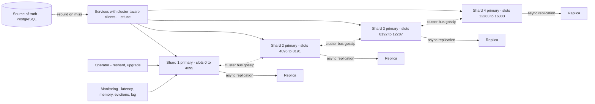
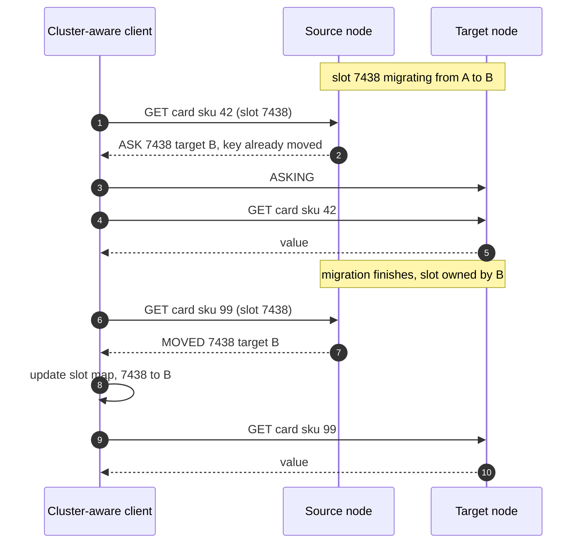
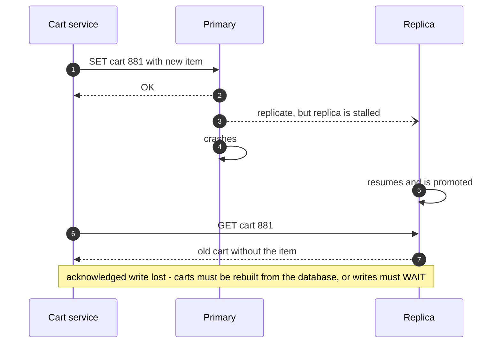
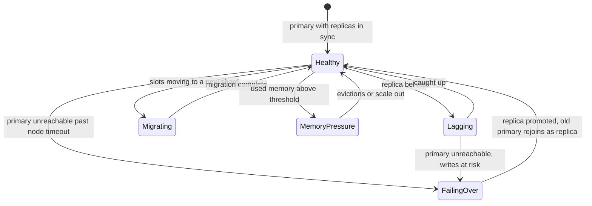

# 44. Case Study: Distributed Cache

!!! abstract "Chapter at a glance"
    **Reader bands:** B2 → B4 · **Prerequisites:** [Ch 07](../01-foundations/07-caching.md) (using caches: patterns, invalidation, stampedes), [Ch 10](../02-distributed-core/10-replication.md), [Ch 11](../02-distributed-core/11-partitioning-and-sharding.md) (consistent hashing) · **What you will build:** The *cache system itself* — the platform's shared, Redis-compatible cache tier used by product cards, sessions, rate limits, feature stores and presence. This is the "design Memcached/Redis" interview question: the server's data structures and eviction, its threading and protocol, partitioning and online resharding, replication and failover, and running it as a platform. [Ch 07](../01-foundations/07-caching.md) was about *using* a cache; this chapter is about *building and operating* one.

    - **L1: eviction policies.** Four policies (exact LRU, Redis-style sampled LRU, decayed LFU, W-TinyLFU) ran over 2M requests on Zipf, scan-polluted and shifting traces.
        - W-TinyLFU beat LRU by **9.1 points** at 10k slots (48.6% vs 39.5%) and resisted scans.
        - After an abrupt popularity shift, frequency history *lost* to LRU at larger sizes (66.3% vs 68.8%).
        - Sampled LRU stayed within **0.3 points** of exact LRU.
    - **L2: build a cache server, benchmark it like Redis.** A ~150-line RESP server with virtual threads, driven by the stock `redis-benchmark`.
        - It served **~50k ops/s** without pipelining and **~260–410k** with 16-deep pipelining.
        - The global lock showed only once pipelining removed the round-trip bottleneck.
        - Real Redis did **~2x** better (0.6–0.84M pipelined). It stored a key in **152 bytes**; the JVM cache needed **212**.
    - **L3: live resharding of a real Redis Cluster.** A 4th master was added and rebalanced under load.
        - **25%** of keys moved, all to the new node. Modulo hashing would have moved **75%**.
        - A client that follows MOVED/ASK redirects had **0 errors** (3,126 redirects followed).
        - A client with a stale slot map had **11,706 errors**.
    - **L4: what failover loses (real Redis).** The replica stalled for 300 ms and the primary was killed during the stall.
        - Asynchronous replication lost **thousands of acknowledged writes** (6,000–15,000 across runs).
        - With `WAIT 1 100`, **0 acknowledged writes were lost**: the writes made during the stall were never confirmed, at up to ~200 ms extra latency for those batches.

    · **Reading time:** 110 min + code

---

## 1. Introduction & Why It Matters

### 1.1 A story: the cache that became a database

The grocery platform's Redis started as a cache for product cards. Over two years it also became: the session store, the cart, rate-limit counters ([Ch 39](39-distributed-rate-limiter.md)), the feature store ([Ch 43](43-home-feed-and-recommendations.md)), presence ([Ch 41](41-chat-customer-rider-messaging.md)) and a few "temporary" queues. Then:

1. **Memory ran out** at 7 pm. The eviction policy was `allkeys-lru`, so Redis evicted carts and sessions to make room for product cards. Customers were logged out mid-checkout.
2. **A catalogue export** read every product once at midnight and flushed the hot set. The database took the full morning load at 6 am.
3. **Scaling out broke clients.** Adding shards to the client-side modulo-hash ring remapped 75% of keys. The cache emptied, and so did the patience of the database team.
4. **A failover lost carts.** The primary died; the replica, a few hundred milliseconds behind, was promoted. Items customers had just added vanished.
5. **One key melted a node.** A flash sale's product card was read 80k times a second from one shard.

The rebuild separated workloads into clusters by *what they are allowed to lose*, chose eviction per cluster, moved to hash-slot clustering with cluster-aware clients, and wrote down durability rules.

!!! quote "The thesis of this chapter"
    A distributed cache is a **memory-bound, partitioned, replicated key-value server**, and every design decision trades hit ratio, latency, capacity and durability. **Eviction** decides hit ratio per byte (L1). **Threading and protocol** decide throughput, and round trips dominate everything (L2). **Partitioning** decides how painfully you scale: hash slots move only what must move, if clients follow redirects (L3). **Replication** is asynchronous by default, so a cache is allowed to lose data — design so that it can (L4). And the most important decision is organisational: **what is allowed in the cache at all**.

### 1.2 Where this lives in the grocery platform

| Cluster | Contents | Eviction | Loss tolerance | Persistence |
|---|---|---|---|---|
| `cache-catalog` | Product cards, prices, search results | `allkeys-lfu` | Full (rebuild from DB) | None |
| `cache-session` | Sessions, carts (write-through to DB) | `noeviction` (alert at 70%) | Carts must be recoverable from DB | AOF everysec |
| `cache-ratelimit` | GCRA state, counters | `volatile-ttl` | Brief loss acceptable (fallback) | None |
| `cache-feature` | Online features, presence | `allkeys-lru` | Rebuildable from streams | None |

### 1.3 Learning objectives

By the end you will be able to:

- **Design the cache server**: data structures, memory accounting, eviction and expiry (L1).
- **Explain server threading and protocol performance**: event loops, pipelining, I/O threads (L2).
- **Partition and reshard online** with hash slots and redirects (L3).
- **Replicate and fail over**, and state exactly what can be lost (L4).
- **Operate the cache as a platform**: multi-tenancy, hot keys, big keys, observability and capacity.

---

## 2. Core Concepts — Beginner to Deep

### 2.1 Intuition: a warehouse's front shelf <span class="band b2">B2</span>

The warehouse (database) has everything but is slow to fetch from. The front shelf (cache) is small and fast. The questions: what to put on the shelf and what to remove when it's full (eviction); how many clerks serve customers and how (threading); how to split the shelf across several counters (partitioning); what happens when a counter closes (replication and failover). And one rule: nothing on the front shelf should be the only copy.

### 2.2 Requirements <span class="band b2">B2</span>

**Functional**

- GET/SET/DEL with TTLs; data structures (hashes, sorted sets, counters); atomic operations and scripts; pub/sub for invalidation.
- Horizontal partitioning; online resharding; replicas and automatic failover.
- Eviction policies per cluster; memory limits.

**Non-functional**

- Sub-millisecond p99 server latency; millions of ops/s per cluster.
- Availability 99.95%+; failover in seconds.
- Predictable memory: no surprise OOM kills.
- Multi-tenant isolation between teams.

### 2.3 Estimation <span class="band b2">B2</span>

| Quantity | Estimate |
|---|---|
| Peak ops | ~1.5M ops/s across clusters (product cards ~600k, features ~500k, rate limits ~300k, sessions ~100k) |
| Per node | ~150–250k ops/s for simple commands per Redis process on modern cores without pipelining; far more with pipelining (L2) |
| Memory | Product cards 2M × ~2 KB ≈ 4 GB; features 10M keys × ~100 B ≈ 1 GB; sessions 5M × ~1 KB ≈ 5 GB; plus overhead (L2: ~90 B per key before the value) and fragmentation (~1.2x) |
| Nodes | catalog: 6 masters + replicas (throughput-bound); sessions: 3 masters + replicas (memory-bound) |

### 2.4 The server: data structures, memory and expiry ⭐ <span class="band b3">B3</span>

- **Main dictionary**: a hash table with incremental rehashing (Redis moves a few buckets per operation, so resizing never pauses the server).
- **Compact encodings**: small hashes, lists and sets stored as packed arrays (listpack) until they grow. That's why many small hashes can be cheaper than many keys.
- **Memory accounting**: every key costs overhead (dictionary entry, key object, value object). L2 measured **152 B** per key with 64-byte values in Redis, and **212 B** in a naive JVM implementation (object headers, boxing). With jemalloc, fragmentation adds 10–30%; active defragmentation helps.
- **Expiry**: *lazy* (checked on access) plus *active* (a periodic job samples keys with TTLs and deletes expired ones, repeating while many are found). Neither needs a global sorted list of expiry times.
- **Big keys**: a 50 MB hash blocks the single thread when deleted or serialised; use `UNLINK` (background free) and cap value sizes.

### 2.5 Eviction ⭐ <span class="band b3">B3</span>

When memory hits `maxmemory`, something must go. L1 compared policies over 2M requests:

| Trace | Size | LRU | Sampled LRU | LFU (decayed) | W-TinyLFU |
|---|---|---|---|---|---|
| Zipf | 10k | 39.5% | 39.2% | 41.5% | **48.6%** |
| Zipf | 200k | 70.4% | 70.1% | 71.1% | 71.2% |
| Scan-polluted | 10k | 34.3% | 34.0% | 36.3% | **43.4%** |
| Shifting | 200k | **68.8%** | 68.5% | 67.6% | 66.3% |

- **Frequency beats recency under skew and scans**, especially at small cache sizes, where every slot matters. W-TinyLFU's admission filter stops one-hit wonders from displacing hot keys.
- **Frequency is history.** When popularity shifts abruptly, frequency policies lag. This is why Caffeine adapts its window size and Redis decays LFU counters over time (`lfu-decay-time`).
- **Sampled eviction** (pick 5 random keys, evict the worst) is within 0.3 points of exact LRU and needs no linked list or per-access pointer updates, the reason Redis uses it (`maxmemory-samples`).
- **Policy per workload**: `allkeys-lfu` for catalogue-like data; `volatile-*` when only TTL'd keys may be evicted; **`noeviction` for anything you can't lose** (sessions), with alerts well before the limit.

### 2.6 Threading, protocol and pipelining ⭐ <span class="band b3">B3</span>

- **Redis**: a single-threaded event loop executes commands (no locks, deterministic atomicity), with I/O threads (Redis 6+) for socket reads/writes. **Memcached**: multi-threaded with fine-grained locks. **Dragonfly/KeyDB**: shared-nothing multi-threading.
- **The protocol (RESP)** is simple text framing; parsing is cheap.
- **Round trips dominate.** L2's server did ~50k ops/s one command per round trip, and ~5–8x more with 16 commands pipelined. The same is true for real Redis. Batch with `MGET`, pipelines and Lua scripts ([Ch 43](43-home-feed-and-recommendations.md) L3: 800 round trips → 30 ms, 2 → 0.6 ms).
- **Locks matter only once round trips don't**: L2's global lock showed only with pipelining.
- **Slow commands block everyone** in a single-threaded server: `KEYS *`, huge `SMEMBERS`, big `DEL`s, long Lua scripts. Disable or rename dangerous commands; use `SCAN`.

### 2.7 Partitioning and resharding ⭐ <span class="band b3">B3</span>

| Scheme | How | Adding a node moves | Used by |
|---|---|---|---|
| Modulo | hash(key) % N | ~(N)/(N+1) of keys | Naive client-side sharding (avoid) |
| Consistent hashing + vnodes | Ring of virtual nodes | ~1/(N+1), from all nodes | Memcached clients, Dynamo-style ([Ch 11](../02-distributed-core/11-partitioning-and-sharding.md)) |
| **Hash slots** | 16,384 slots → nodes; slots move explicitly | Only the slots you choose | Redis Cluster |
| Proxy-based | Twemproxy/Envoy/Codis route requests | Depends | Simpler clients |

L3 added a fourth master to a real Redis Cluster under load: **25%** of keys moved, all to the new node. Modulo would have moved **75%**, mostly between the old nodes.

**Online migration protocol**: while a slot migrates, the source still serves keys it has. For keys already moved it answers **`ASK`** — "try the target, once, with `ASKING`". After the slot's ownership changes, requests get **`MOVED`**, telling clients to update their map. The smart client in L3 followed 3,126 redirects with **0 errors**; a client with a stale map failed **11,706** reads.

- **Hash tags** (`{sku123}`) force related keys into the same slot, so multi-key commands and Lua scripts work in a cluster.
- Clients must be **cluster-aware** (Lettuce, Jedis, redis-py cluster), or sit behind a proxy that is.

### 2.8 Replication and failover ⭐ <span class="band b4">B4</span>

- **Asynchronous replication**: the primary acknowledges writes before replicas receive them, streaming a replication log. Replicas that fall behind resync partially (backlog) or fully (snapshot).
- **Failover**: Sentinel (for non-cluster setups) or cluster nodes detect a failed primary by timeout and promote a replica. The promoted replica may lack the latest writes. L4, with a 300 ms replica stall, lost **thousands of acknowledged writes**.
- **`WAIT n timeout`** makes the client wait until n replicas have the write. In L4 it lost **0 acknowledged writes**, because writes during the stall were never confirmed, and the client knew. That's synchronous-ish replication at the cost of latency, but **not consensus**: a promotion can still pick a replica without the write when several exist.
- **Split brain**: a partitioned old primary may keep accepting writes until `min-replicas-to-write` stops it. Those writes are lost when it rejoins.
- **Persistence**: RDB snapshots and AOF (append-only file, fsync every second) protect against restarts, not against failover gaps.

The honest rule: **a cache may lose data**. Anything that must not be lost lives in a database, with the cache as a rebuildable copy (write-through or write-behind with a durable source). Stronger guarantees need a consensus-based store ([Ch 12](../02-distributed-core/12-consistency-time-and-consensus.md)).

### 2.9 Hot keys and big keys <span class="band b3">B3</span>

- **Hot keys** concentrate on one slot and node: client-side near-caches ([Ch 38](38-url-shortener-and-short-links.md) L3), read replicas with replica reads, key replication (`card:X#1..#8` read at random — [Ch 07](../01-foundations/07-caching.md)), and server-side client tracking (Redis 6 invalidation-based client caching).
- **Detection**: `redis-cli --hotkeys` (with LFU), sampling proxies, per-slot metrics.
- **Big keys**: split large collections, cap sizes, use `UNLINK`, find them with `--bigkeys` / `MEMORY USAGE`.

### 2.10 Multi-tenancy and governance <span class="band b4">B4</span>

- **Separate clusters by loss tolerance and eviction policy** (§1.2), not by team. A shared cluster with `allkeys-lru` will evict someone's session to cache someone else's product card.
- **Key naming conventions** with owner prefixes, mandatory TTLs on cache clusters, and per-tenant memory budgets watched in dashboards.
- **ACLs** per service (Redis 6 ACL users, command restrictions, key patterns).
- **Change control** on dangerous commands and configuration.

### 2.11 Operating the tier <span class="band b4">B4</span>

- **Metrics**: ops/s, latency (server and client), hit ratio per key prefix, evictions, expirations, memory and fragmentation, replication lag, connected clients, slow log.
- **Capacity**: plan for memory at peak plus headroom for fork-based snapshots (copy-on-write can need up to 2x memory during `BGSAVE` under heavy writes) and resharding.
- **Upgrades**: rolling, replicas first, then failover.
- **Managed vs self-hosted**: ElastiCache/MemoryDB/Azure Cache handle failover and patching; MemoryDB adds a durable transaction log for primary-grade durability.

### 2.12 Interview framing <span class="band b4">B4</span>

Start from requirements and loss tolerance, then: the server's hash table and memory; eviction (LRU vs LFU vs admission) with numbers; threading and pipelining; partitioning with hash slots and live migration (MOVED/ASK); replication, failover and what is lost; hot keys. Staff-level signals: separating clusters by durability, `noeviction` for non-rebuildable data, and saying clearly that a cache is not a database.

---

## 3. Architecture & Diagrams

### 3.1 Component view



### 3.2 Sequence: happy path, a key mid-migration



### 3.3 Sequence: failure path, failover loses acknowledged writes



### 3.4 State: a shard's lifecycle



---

## 4. Design Document Excerpt: Platform Cache v2

!!! note "Design Document (excerpt) — Platform Cache v2"
    **Status:** Accepted · **Authors:** Data platform team · **Reviewers:** Checkout, Catalog, Personalisation, SRE

    | Field | Value |
    |---|---|
    | Context | One shared Redis with `allkeys-lru` evicted sessions and carts; scans flushed the hot set; modulo client sharding remapped 75% of keys on scale-out; failover lost acknowledged cart writes; hot keys saturated single shards. |
    | Decision | Clusters by loss tolerance; eviction per cluster; Redis Cluster (hash slots) with cluster-aware clients; replicas with automatic failover; carts write-through to PostgreSQL with `WAIT 1` for the cache copy; hot-key near-caches; governance (TTLs, prefixes, ACLs, budgets). |
    | Related ADRs | ADR-300 Four clusters by loss tolerance (catalog, session, ratelimit, feature); ADR-301 Eviction: catalog `allkeys-lfu`, session `noeviction`, ratelimit `volatile-ttl` (L1); ADR-302 Pipelining/MGET mandatory for multi-key reads (L2); ADR-303 Redis Cluster + Lettuce; resharding runbook (L3); ADR-304 Durability: sessions/carts in PostgreSQL, cache rebuildable; `WAIT 1 50` on cart writes (L4); ADR-305 Hot keys: Caffeine near-cache + key replication; big-key limits |

    **Requirements.**

    - **R1** p99 < 1 ms server-side, < 3 ms client-side for single-key operations.
    - **R2** No loss of carts or sessions on any single-node failure.
    - **R3** Scale out by one shard without a hit-ratio drop of more than 5 points.
    - **R4** Catalogue hit ratio ≥ 90% at peak.
    - **R5** No cross-tenant evictions.

    **Decisions in detail.**

    1. **Clusters (ADR-300).** Separate endpoints, separate memory budgets and alerts.
    2. **Eviction (ADR-301).** LFU for catalog with `lfu-decay-time 1`; session cluster alerts at 70% memory, pages at 85%.
    3. **Clients (ADR-302/303).** Lettuce cluster client, topology refresh on MOVED and every 60 s; pipelining via async API.
    4. **Durability (ADR-304).** Carts: PostgreSQL is the source of truth; cache updated after commit; `WAIT` for session writes; AOF everysec on the session cluster.
    5. **Hot keys (ADR-305).** 1–5 s near-cache for read-mostly hot keys; replicate flash-sale keys ×8.

    **Consequences.** More clusters to run; client configuration standards to enforce; slightly higher write latency on sessions. In return: no cross-tenant evictions, painless scale-out, and clear rules about what may be lost.

---

## 5. Hands-On Code — Level Ladder

!!! info "What's real here"
    All four labs are JDK 21. **L2–L4 use real Redis 7**: L2 benchmarks a hand-written server and real Redis with the stock `redis-benchmark`; L3 creates a real 3-node Redis Cluster and reshards it live with `redis-cli --cluster`; L4 runs a real primary/replica pair and uses `kill -STOP/-KILL`. Timings and loss counts vary between runs on the 2-CPU sandbox; the patterns don't. L1 is a deterministic simulation of four eviction policies.

L2 needs Redis 7 on port 6390 and `redis-benchmark` on the PATH. L3 creates its own cluster (ports 7001–7004) with `cluster-setup.sh`. L4 starts and kills its own Redis processes on ports 6391–6392 (Linux). Run every lab with `-Dstdout.encoding=UTF-8`.

### L1 — Eviction policies <span class="band b2">B2</span>

**Requirement:** "With a fixed amount of memory, keep the keys that will be asked for again."

Four eviction policies, implemented from scratch, replay the same three traces at three cache sizes.

```java title="EvictionL1.java"
// EvictionL1.java — run with: java EvictionL1.java   (JDK 21, no dependencies)
// WHICH KEY DO YOU THROW AWAY? A cache server's hit ratio is decided by its eviction policy. Four policies, implemented
// here, replay the same three request traces (fixed seed) at several cache sizes:
//   LRU             exact least-recently-used (a linked hash map)
//   SAMPLED LRU     Redis's approach: sample 5 random keys, evict the least recently used of those (no global list)
//   LFU (decayed)   Redis-style: a small frequency counter per key that grows logarithmically and halves periodically
//   W-TinyLFU       Caffeine's approach: a 1% LRU window, a segmented-LRU main area, and a count-min sketch that only
//                   ADMITS a new key into the main area if it's been seen more often than the key it would replace
// Traces (2,000,000 requests over 1,000,000 keys):
//   ZIPF   a stable Zipf(0.9) popularity — product pages
//   SCAN   the same, with a nightly catalogue export reading 200,000 distinct cold keys once, interleaved
//   SHIFT  popularity that shifts abruptly halfway through (the morning milk rush → evening snacks)
import java.util.*;

public class EvictionL1 {
    interface Cache { boolean get(int k); String name(); }

    public static void main(String[] args) {
        int keys = 1_000_000, n = 2_000_000;
        int[][] traces = {zipf(n, keys, 1, false, false), zipf(n, keys, 2, true, false), zipf(n, keys, 3, false, true)};
        String[] tn = {"ZIPF", "SCAN", "SHIFT"};
        System.out.printf("Hit ratio (%%), %,d requests over %,d keys per trace.%n%n", n, keys);
        System.out.printf("   %-8s %-10s %10s %14s %16s %12s%n", "trace", "cache size", "LRU", "sampled LRU", "LFU (decayed)", "W-TinyLFU");
        for (int t = 0; t < 3; t++) for (int size : new int[]{10_000, 50_000, 200_000}) {
            Cache[] cs = {new Lru(size), new SampledLru(size, 5), new Lfu(size), new WTinyLfu(size)};
            double[] hr = new double[4];
            for (int c = 0; c < 4; c++) { long hits = 0; for (int k : traces[t]) if (cs[c].get(k)) hits++; hr[c] = 100.0 * hits / n; }
            System.out.printf("   %-8s %,10d %9.1f%% %13.1f%% %15.1f%% %11.1f%%%n", tn[t], size, hr[0], hr[1], hr[2], hr[3]);
        }
        System.out.println("\n   → recency alone is a weak signal under skew: a scan of cold keys pushes hot keys out of an LRU cache, and");
        System.out.println("     every one-hit wonder displaces something useful. Frequency-aware admission (W-TinyLFU) keeps the hot set and");
        System.out.println("     wins most at small sizes, where each slot matters (+9 points at 10,000 keys). But frequency is history: when");
        System.out.println("     popularity shifts abruptly, LFU and this fixed-window W-TinyLFU fall behind plain LRU at larger sizes — which");
        System.out.println("     is why Caffeine resizes its window adaptively (hill climbing) and Redis decays LFU counters. Sampled LRU is");
        System.out.println("     within half a point of exact LRU with no linked list, which is why Redis uses it. Measure on your own traces.");
    }

    // ---------- traces ----------
    static int[] zipf(int n, int keys, long seed, boolean scan, boolean shift) {
        Random r = new Random(seed); double[] cdf = new double[keys]; double s = 0;
        for (int i = 0; i < keys; i++) { s += 1 / Math.pow(i + 1, 0.9); cdf[i] = s; }
        int[] perm = new int[keys]; for (int i = 0; i < keys; i++) perm[i] = i; shuffle(perm, r);
        int[] perm2 = perm.clone(); shuffle(perm2, r);
        int[] out = new int[n]; int scanKey = 0;
        for (int i = 0; i < n; i++) {
            if (scan && i % 10 == 0 && scanKey < 200_000) { out[i] = keys + scanKey++; continue; }   // cold keys, touched once
            int idx = Arrays.binarySearch(cdf, r.nextDouble() * s); idx = idx < 0 ? -idx - 1 : idx;
            out[i] = (shift && i >= n / 2 ? perm2 : perm)[Math.min(idx, keys - 1)];
        }
        return out;
    }
    static void shuffle(int[] a, Random r) { for (int i = a.length - 1; i > 0; i--) { int j = r.nextInt(i + 1); int t = a[i]; a[i] = a[j]; a[j] = t; } }

    // ---------- LRU ----------
    static final class Lru implements Cache {
        final LinkedHashMap<Integer, Boolean> m; Lru(int cap) { m = new LinkedHashMap<>(cap * 2, 0.75f, true) { protected boolean removeEldestEntry(Map.Entry<Integer, Boolean> e) { return size() > cap; } }; }
        public boolean get(int k) { if (m.get(k) != null) return true; m.put(k, true); return false; }
        public String name() { return "LRU"; }
    }
    // ---------- sampled LRU (Redis allkeys-lru, maxmemory-samples 5) ----------
    static final class SampledLru implements Cache {
        final int cap, samples; final int[] keys; final Map<Integer, Integer> slot = new HashMap<>(); final long[] lastUse; long clock; final Random r = new Random(9); int size;
        SampledLru(int cap, int samples) { this.cap = cap; this.samples = samples; keys = new int[cap]; lastUse = new long[cap]; }
        public boolean get(int k) {
            clock++; Integer s = slot.get(k);
            if (s != null) { lastUse[s] = clock; return true; }
            int put;
            if (size < cap) put = size++;
            else { put = r.nextInt(cap); for (int i = 1; i < samples; i++) { int c = r.nextInt(cap); if (lastUse[c] < lastUse[put]) put = c; } slot.remove(keys[put]); }
            keys[put] = k; lastUse[put] = clock; slot.put(k, put); return false;
        }
        public String name() { return "sampled LRU"; }
    }
    // ---------- LFU with logarithmic counter and decay (Redis allkeys-lfu flavour, sampled eviction) ----------
    static final class Lfu implements Cache {
        final int cap; final int[] keys; final int[] freq; final Map<Integer, Integer> slot = new HashMap<>(); final Random r = new Random(11); int size; long ops;
        Lfu(int cap) { this.cap = cap; keys = new int[cap]; freq = new int[cap]; }
        void bump(int s) { int f = freq[s]; if (f < 255 && r.nextDouble() < 1.0 / ((f - 5) * 10 + 1 < 1 ? 1 : (f - 5) * 10 + 1)) freq[s]++; }
        public boolean get(int k) {
            if (++ops % (cap * 10L) == 0) for (int i = 0; i < size; i++) freq[i] >>= 1;     // periodic decay
            Integer s = slot.get(k);
            if (s != null) { bump(s); return true; }
            int put;
            if (size < cap) put = size++;
            else { put = r.nextInt(cap); for (int i = 1; i < 5; i++) { int c = r.nextInt(cap); if (freq[c] < freq[put]) put = c; } slot.remove(keys[put]); }
            keys[put] = k; freq[put] = 5; slot.put(k, put); return false;                  // new keys start at 5 (Redis LFU_INIT_VAL)
        }
        public String name() { return "LFU"; }
    }
    // ---------- W-TinyLFU (simplified Caffeine) ----------
    static final class WTinyLfu implements Cache {
        final int windowCap, probCap, protCap; final LinkedHashMap<Integer, Boolean> window = new LinkedHashMap<>(16, 0.75f, true),
                probation = new LinkedHashMap<>(16, 0.75f, true), protectedSeg = new LinkedHashMap<>(16, 0.75f, true);
        final CountMin sketch;
        WTinyLfu(int cap) { windowCap = Math.max(1, cap / 100); int main = cap - windowCap; protCap = main * 8 / 10; probCap = main - protCap; sketch = new CountMin(cap); }
        public boolean get(int k) {
            sketch.add(k);
            if (window.get(k) != null) return true;
            if (protectedSeg.get(k) != null) return true;
            if (probation.remove(k) != null) {                                             // promote on second hit
                protectedSeg.put(k, true);
                if (protectedSeg.size() > protCap) { int demoted = first(protectedSeg); protectedSeg.remove(demoted); probation.put(demoted, true); }
                return true;
            }
            window.put(k, true);
            if (window.size() > windowCap) {
                int candidate = first(window); window.remove(candidate);
                if (probation.size() + protectedSeg.size() < probCap + protCap) { probation.put(candidate, true); return false; }
                int victim = probation.isEmpty() ? first(protectedSeg) : first(probation);
                if (sketch.estimate(candidate) > sketch.estimate(victim)) { (probation.isEmpty() ? protectedSeg : probation).remove(victim); probation.put(candidate, true); }
            }
            return false;
        }
        static int first(LinkedHashMap<Integer, Boolean> m) { return m.keySet().iterator().next(); }
        public String name() { return "W-TinyLFU"; }
    }
    static final class CountMin {                                                           // 4-bit-style counters, periodic halving
        final int w; final int[][] t = new int[4][]; long adds; final long reset;
        CountMin(int cap) { w = Integer.highestOneBit(Math.max(64, cap * 4)); for (int i = 0; i < 4; i++) t[i] = new int[w]; reset = 10L * cap; }
        int h(int k, int i) { int x = k * (0x9E3779B1 + i * 0x7F4A7C15); x ^= x >>> 15; x *= 0x2C1B3C6D; x ^= x >>> 12; return x & (w - 1); }
        void add(int k) { for (int i = 0; i < 4; i++) { int j = h(k, i); if (t[i][j] < 15) t[i][j]++; } if (++adds == reset) { for (int[] row : t) for (int j = 0; j < w; j++) row[j] >>= 1; adds = 0; } }
        int estimate(int k) { int m = Integer.MAX_VALUE; for (int i = 0; i < 4; i++) m = Math.min(m, t[i][h(k, i)]); return m; }
    }
}
```

```text title="java -Xmx3g -Dstdout.encoding=UTF-8 EvictionL1.java"
Hit ratio (%), 2,000,000 requests over 1,000,000 keys per trace.

   trace    cache size        LRU    sampled LRU    LFU (decayed)    W-TinyLFU
   ZIPF         10,000      39.5%          39.2%            41.5%        48.6%
   ZIPF         50,000      55.0%          54.7%            56.5%        60.2%
   ZIPF        200,000      70.4%          70.1%            71.1%        71.2%
   SCAN         10,000      34.3%          34.0%            36.3%        43.4%
   SCAN         50,000      47.7%          47.4%            49.4%        53.3%
   SCAN        200,000      60.7%          60.5%            62.1%        62.2%
   SHIFT        10,000      39.4%          39.1%            41.4%        46.4%
   SHIFT        50,000      54.7%          54.4%            56.2%        55.2%
   SHIFT       200,000      68.8%          68.5%            67.6%        66.3%

   → recency alone is a weak signal under skew: a scan of cold keys pushes hot keys out of an LRU cache, and
     every one-hit wonder displaces something useful. Frequency-aware admission (W-TinyLFU) keeps the hot set and
     wins most at small sizes, where each slot matters (+9 points at 10,000 keys). But frequency is history: when
     popularity shifts abruptly, LFU and this fixed-window W-TinyLFU fall behind plain LRU at larger sizes — which
     is why Caffeine resizes its window adaptively (hill climbing) and Redis decays LFU counters. Sampled LRU is
     within half a point of exact LRU with no linked list, which is why Redis uses it. Measure on your own traces.
```

**Reading it:**

- **Small caches reward cleverness**: at 10,000 slots W-TinyLFU beats LRU by 9.1 points on Zipf and 9.1 on the scan trace. At 200,000 slots every policy converges.
- **Scans**: the 200,000 cold keys cost LRU ~5 points at 10k slots. W-TinyLFU's admission filter refuses most of them.
- **Shifts**: frequency history is a liability when popularity changes abruptly. At 200k slots, LFU (67.6%) and W-TinyLFU (66.3%) fall behind LRU (68.8%).
- **Sampled LRU** (5 samples) is within 0.3 points of exact LRU everywhere, with no global list to maintain.

### L2 — Build a cache server, benchmark it like Redis <span class="band b3">B3</span>

**Requirement:** "Understand what makes a cache server fast by building one and measuring it against the real thing."

A minimal RESP server with GET, SET with EX, DEL and PING, TTL expiry and sampled eviction, on virtual threads with two storage engines. It is driven by the stock `redis-benchmark`, and then compared with Redis 7 on memory per key.

```java title="MiniCacheL2.java"
// MiniCacheL2.java — run with (Redis 7 on :6390 and redis-benchmark on the PATH):  java -Xmx2g MiniCacheL2.java
// BUILD A CACHE SERVER, THEN BENCHMARK IT LIKE REDIS. A ~150-line cache server that speaks enough of Redis's protocol
// (RESP) for real Redis tools to talk to it: GET, SET key value [EX seconds], DEL, PING, CONFIG GET (answered empty),
// with lazy + periodic TTL expiry and a max-keys limit enforced by sampled-LRU eviction (as Redis does).
// Each client connection gets a virtual thread with blocking I/O. Two storage engines:
//   GLOBAL LOCK   one HashMap behind one lock          STRIPED   ConcurrentHashMap (lock striping inside)
// We run the stock `redis-benchmark` (50 clients, 200,000 requests, with and without 16-deep pipelining) against both,
// and against real Redis 7, then compare memory per key for 500,000 keys.
import java.io.*;
import java.net.*;
import java.nio.charset.StandardCharsets;
import java.util.*;
import java.util.concurrent.*;
import java.util.concurrent.atomic.*;
import java.util.concurrent.locks.ReentrantLock;

public class MiniCacheL2 {
    record Entry(byte[] value, long expiresAt, long lastUse) {}

    interface Store { byte[] get(String k); void set(String k, byte[] v, long exp); boolean del(String k); int size(); List<String> sample(int n); }
    static final class GlobalLock implements Store {
        final Map<String, Entry> m = new HashMap<>(); final ReentrantLock lock = new ReentrantLock(); final Random r = new Random();
        public byte[] get(String k) { lock.lock(); try { Entry e = m.get(k); if (e == null) return null; if (e.expiresAt() > 0 && e.expiresAt() < System.currentTimeMillis()) { m.remove(k); return null; } m.put(k, new Entry(e.value(), e.expiresAt(), System.nanoTime())); return e.value(); } finally { lock.unlock(); } }
        public void set(String k, byte[] v, long exp) { lock.lock(); try { m.put(k, new Entry(v, exp, System.nanoTime())); } finally { lock.unlock(); } }
        public boolean del(String k) { lock.lock(); try { return m.remove(k) != null; } finally { lock.unlock(); } }
        public int size() { lock.lock(); try { return m.size(); } finally { lock.unlock(); } }
        public List<String> sample(int n) { lock.lock(); try { List<String> out = new ArrayList<>(); var it = m.keySet().iterator(); for (int i = 0; i < n && it.hasNext(); i++) out.add(it.next()); return out; } finally { lock.unlock(); } }
    }
    static final class Striped implements Store {
        final ConcurrentHashMap<String, Entry> m = new ConcurrentHashMap<>(1 << 16);
        public byte[] get(String k) { Entry e = m.get(k); if (e == null) return null; if (e.expiresAt() > 0 && e.expiresAt() < System.currentTimeMillis()) { m.remove(k, e); return null; } return e.value(); }
        public void set(String k, byte[] v, long exp) { m.put(k, new Entry(v, exp, System.nanoTime())); }
        public boolean del(String k) { return m.remove(k) != null; }
        public int size() { return m.size(); }
        public List<String> sample(int n) { List<String> out = new ArrayList<>(); var it = m.keySet().iterator(); for (int i = 0; i < n && it.hasNext(); i++) out.add(it.next()); return out; }
    }

    static final class Server {
        final ServerSocket ss; final Store store; final int maxKeys; final AtomicLong evictions = new AtomicLong();
        Server(Store store, int maxKeys) throws IOException {
            this.store = store; this.maxKeys = maxKeys; ss = new ServerSocket(0, 1024, InetAddress.getLoopbackAddress());
            Thread.ofVirtual().start(() -> { try { while (true) { Socket s = ss.accept(); Thread.ofVirtual().start(() -> serve(s)); } } catch (IOException ignored) {} });
        }
        int port() { return ss.getLocalPort(); }
        void serve(Socket s) {
            try (s) {
                s.setTcpNoDelay(true);
                DataInputStream in = new DataInputStream(new BufferedInputStream(s.getInputStream(), 1 << 16));
                BufferedOutputStream out = new BufferedOutputStream(s.getOutputStream(), 1 << 16);
                while (true) {
                    List<byte[]> cmd = readCommand(in); if (cmd == null) return;
                    String name = new String(cmd.get(0), StandardCharsets.US_ASCII).toUpperCase();
                    switch (name) {
                        case "GET" -> { byte[] v = store.get(str(cmd.get(1))); if (v == null) out.write("$-1\r\n".getBytes()); else { out.write(('$' + String.valueOf(v.length) + "\r\n").getBytes()); out.write(v); out.write("\r\n".getBytes()); } }
                        case "SET" -> { long exp = cmd.size() >= 5 && str(cmd.get(3)).equalsIgnoreCase("EX") ? System.currentTimeMillis() + 1000L * Long.parseLong(str(cmd.get(4))) : 0;
                                        store.set(str(cmd.get(1)), cmd.get(2), exp); if (store.size() > maxKeys) evict(); out.write("+OK\r\n".getBytes()); }
                        case "DEL" -> out.write((":" + (store.del(str(cmd.get(1))) ? 1 : 0) + "\r\n").getBytes());
                        case "PING" -> out.write("+PONG\r\n".getBytes());
                        case "CONFIG" -> out.write("*0\r\n".getBytes());
                        default -> out.write(("-ERR unknown command '" + name + "'\r\n").getBytes());
                    }
                    if (in.available() == 0) out.flush();                       // flush once per pipelined batch
                }
            } catch (IOException ignored) {}
        }
        void evict() { for (String k : store.sample(5)) { store.del(k); evictions.incrementAndGet(); break; } }   // sampled eviction (simplified)
        static String str(byte[] b) { return new String(b, StandardCharsets.UTF_8); }
        static List<byte[]> readCommand(DataInputStream in) throws IOException {
            int t = in.read(); if (t < 0) return null;
            if (t != '*') throw new IOException("inline commands not supported");
            int n = Integer.parseInt(line(in)); List<byte[]> parts = new ArrayList<>(n);
            for (int i = 0; i < n; i++) { in.read(); int len = Integer.parseInt(line(in)); byte[] b = new byte[len]; in.readFully(b); in.read(); in.read(); parts.add(b); }
            return parts;
        }
        static String line(DataInputStream in) throws IOException { StringBuilder sb = new StringBuilder(); int c; while ((c = in.read()) != '\r') sb.append((char) c); in.read(); return sb.toString(); }
    }

    public static void main(String[] args) throws Exception {
        Server global = new Server(new GlobalLock(), 5_000_000), striped = new Server(new Striped(), 5_000_000);
        System.out.println("redis-benchmark -t set,get -n 200000 -c 50 -r 100000 -d 64   (2-CPU sandbox: server and benchmark share the CPUs)\n");
        System.out.printf("   %-40s %14s %14s %18s %18s%n", "server", "SET/s", "GET/s", "SET/s pipeline 16", "GET/s pipeline 16");
        for (Object[] s : new Object[][]{{"MiniCache — global lock", global.port()}, {"MiniCache — striped (ConcurrentHashMap)", striped.port()}, {"Redis 7.0 (single-threaded event loop)", 6390}}) {
            int port = (int) s[1]; double[] plain = bench(port, 1), piped = bench(port, 16);
            System.out.printf("   %-40s %,14.0f %,14.0f %,18.0f %,18.0f%n", s[0], plain[0], plain[1], piped[0], piped[1]);
        }
        // memory per key: 500,000 keys with 64-byte values
        var mx = java.lang.management.ManagementFactory.getMemoryMXBean();
        global = null; striped = null;
        for (int g = 0; g < 3; g++) { System.gc(); Thread.sleep(200); } long before = mx.getHeapMemoryUsage().getUsed();
        Striped mem = new Striped(); byte[] val = new byte[64]; for (int i = 0; i < 500_000; i++) mem.set("key:" + i, val.clone(), 0);
        for (int g = 0; g < 3; g++) { System.gc(); Thread.sleep(200); } long jvm = mx.getHeapMemoryUsage().getUsed() - before;
        if (mem.size() != 500_000) throw new IllegalStateException();                      // keep the map reachable until measured
        long redis; try (Socket sk = new Socket("127.0.0.1", 6390)) {
            OutputStream o = new BufferedOutputStream(sk.getOutputStream(), 1 << 16); InputStream i = new BufferedInputStream(sk.getInputStream());
            o.write("*1\r\n$8\r\nFLUSHALL\r\n".getBytes()); o.flush(); readLine(i);
            long b0 = usedMemory(o, i); String v = "x".repeat(64);
            for (int k = 0; k < 500_000; k++) { String key = "key:" + k; o.write(("*3\r\n$3\r\nSET\r\n$" + key.length() + "\r\n" + key + "\r\n$64\r\n" + v + "\r\n").getBytes()); if (k % 1000 == 999) { o.flush(); for (int j = 0; j < 1000; j++) readLine(i); } }
            redis = usedMemory(o, i) - b0;
            o.write("*1\r\n$8\r\nFLUSHALL\r\n".getBytes()); o.flush(); readLine(i);
        }
        System.out.printf("%n   Memory for 500,000 keys × 64-byte values: MiniCache (JVM heap) %.0f bytes/key, Redis %.0f bytes/key%n", (double) jvm / 500_000, (double) redis / 500_000);
        System.out.println("\n   → one request per round trip, both MiniCache engines are bound by syscalls and context switches, not by the map —");
        System.out.println("     the lock barely matters. Pipeline 16 commands per round trip and throughput multiplies for every server, and");
        System.out.println("     now the global lock starts to show (numbers vary between runs on a 2-CPU sandbox). Redis's single-threaded event loop needs no locks, does");
        System.out.println("     far less work per command than a thread-per-connection server, and stores each key more compactly;");
        System.out.println("     a JVM cache pays object headers, boxed entries and GC for its convenience. Build on proven engines; understand");
        System.out.println("     them by building one.");
        System.exit(0);
    }

    static double[] bench(int port, int pipeline) throws Exception {
        Process p = new ProcessBuilder("redis-benchmark", "-p", String.valueOf(port), "-t", "set,get", "-n", "200000", "-c", "50", "-r", "100000", "-d", "64", "-P", String.valueOf(pipeline), "-q")
                .redirectErrorStream(true).start();
        String out = new String(p.getInputStream().readAllBytes()); p.waitFor();
        double set = 0, get = 0;
        for (String l : out.split("[\r\n]")) {
            if (!l.contains("requests per second")) continue;
            if (l.startsWith("SET:")) set = Double.parseDouble(l.replaceAll("SET: ([0-9.]+).*", "$1"));
            if (l.startsWith("GET:")) get = Double.parseDouble(l.replaceAll("GET: ([0-9.]+).*", "$1"));
        }
        return new double[]{set, get};
    }
    static long usedMemory(OutputStream o, InputStream i) throws IOException {
        o.write("*2\r\n$4\r\nINFO\r\n$6\r\nmemory\r\n".getBytes()); o.flush();
        int len = Integer.parseInt(readLine(i).substring(1)); byte[] b = i.readNBytes(len + 2);
        for (String l : new String(b).split("\r\n")) if (l.startsWith("used_memory:")) return Long.parseLong(l.substring(12));
        return 0;
    }
    static String readLine(InputStream i) throws IOException { StringBuilder sb = new StringBuilder(); int c; while ((c = i.read()) != '\r') sb.append((char) c); i.read(); return sb.toString(); }
}
```

```text title="java -Xmx2g -Dstdout.encoding=UTF-8 MiniCacheL2.java"
redis-benchmark -t set,get -n 200000 -c 50 -r 100000 -d 64   (2-CPU sandbox: server and benchmark share the CPUs)

   server                                            SET/s          GET/s  SET/s pipeline 16  GET/s pipeline 16
   MiniCache — global lock                          45,882         52,165            258,398            322,061
   MiniCache — striped (ConcurrentHashMap)          51,033         51,894            331,675            407,332
   Redis 7.0 (single-threaded event loop)          101,112         90,992            621,118            840,336

   Memory for 500,000 keys × 64-byte values: MiniCache (JVM heap) 212 bytes/key, Redis 152 bytes/key

   → one request per round trip, both MiniCache engines are bound by syscalls and context switches, not by the map —
     the lock barely matters. Pipeline 16 commands per round trip and throughput multiplies for every server, and
     now the global lock starts to show (numbers vary between runs on a 2-CPU sandbox). Redis's single-threaded event loop needs no locks, does
     far less work per command than a thread-per-connection server, and stores each key more compactly;
     a JVM cache pays object headers, boxed entries and GC for its convenience. Build on proven engines; understand
     them by building one.
```

**Reading it:**

- **Without pipelining**, both MiniCache engines do ~45–55k ops/s and the lock barely matters: every command pays a round trip, a syscall and a context switch.
- **With 16-deep pipelining**, throughput multiplies about 5–8x, and the global lock now costs something against the striped map. Numbers vary between runs because the benchmark and servers share 2 CPUs.
- **Redis** does roughly twice as well in both modes: no locks, an event loop doing far less work per command, and I/O threads not even enabled.
- **Memory**: 152 bytes per key in Redis vs 212 in the JVM map, for the same 64-byte values.

### L3 — Live resharding of a real Redis Cluster <span class="band b3">B3</span>

**Requirement:** "Add capacity to the cache cluster during the day, without errors and without emptying the cache."

`cluster-setup.sh` creates a 3-master Redis Cluster and a spare node. The lab loads 30,000 keys, then adds the spare as a 4th master and rebalances with `redis-cli --cluster`. Meanwhile two clients read continuously: one with a static slot map, one that follows redirects.

```bash title="cluster-setup.sh"
#!/usr/bin/env bash
# Fresh 3-master Redis Cluster on 7001-7003 plus an empty node on 7004 (no replicas; lab only).
set -e
cd "$(dirname "$0")"
for p in 7001 7002 7003 7004; do redis-cli -p $p shutdown nosave >/dev/null 2>&1 || true; done
sleep 1
rm -rf cluster && mkdir -p cluster
for p in 7001 7002 7003 7004; do
  mkdir -p cluster/$p
  (cd cluster/$p && redis-server --port $p --cluster-enabled yes --cluster-config-file nodes.conf --save '' --appendonly no \
     --daemonize yes --cluster-node-timeout 2000 >/dev/null)
done
sleep 1
redis-cli --cluster create 127.0.0.1:7001 127.0.0.1:7002 127.0.0.1:7003 --cluster-yes >/dev/null
sleep 2
```

```java title="ClusterL3.java"
// ClusterL3.java — run with: ./cluster-setup.sh && java ClusterL3.java   (JDK 21; redis-server/redis-cli 7 on the PATH)
// SCALING A REAL REDIS CLUSTER OUT, WHILE IT SERVES TRAFFIC. A 3-master Redis Cluster (16,384 hash slots, key → slot by
// CRC16(key) mod 16384) holds 30,000 product-card keys. We add a 4th master and let `redis-cli --cluster rebalance` move
// slots to it — live — while two client threads keep reading random keys:
//   NAIVE client  loads the slot map once and never updates it; a MOVED or ASK reply is an error
//   SMART client  follows MOVED (updates that slot in its map, retries) and ASK (sends ASKING to the target for this one
//                 request without updating the map) — the protocol real cluster clients (Lettuce, Jedis) implement
// We count successful reads, redirects handled, errors and misses; then show where the keys ended up, and compare with
// what naive MODULO hashing (hash % nodes) would have moved.
import java.io.*;
import java.net.Socket;
import java.nio.charset.StandardCharsets;
import java.util.*;
import java.util.concurrent.atomic.*;

public class ClusterL3 {
    static final int KEYS = 30_000;

    public static void main(String[] args) throws Exception {
        int[] slotPort = slotMap(7001);
        Map<Integer, Redis> conns = new HashMap<>();
        for (int i = 0; i < KEYS; i++) { String k = "card:{sku" + i + "}"; smartCmd(conns, slotPort, new AtomicLong(), new AtomicLong(), "SET", k, "v" + i); }
        System.out.printf("3-master Redis Cluster, %,d keys loaded. Adding a 4th master and rebalancing live...%n%n", KEYS);

        AtomicBoolean done = new AtomicBoolean(); long[][] stats = new long[2][5];   // ok, moved, ask, errors, misses
        Thread[] clients = new Thread[2];
        for (int c = 0; c < 2; c++) {
            final int cid = c;
            clients[c] = new Thread(() -> {
                int[] map = slotMap(7001); Map<Integer, Redis> cc = new HashMap<>(); Random r = new Random(44 + cid);
                AtomicLong moved = new AtomicLong(), ask = new AtomicLong();
                while (!done.get()) {
                    String k = "card:{sku" + r.nextInt(KEYS) + "}";
                    try {
                        Object v = cid == 0 ? naiveGet(cc, map, k) : smartCmd(cc, map, moved, ask, "GET", k);
                        if (v instanceof String s && s.startsWith("-")) stats[cid][3]++; else if (v == null) stats[cid][4]++; else stats[cid][0]++;
                    } catch (IOException e) { stats[cid][3]++; }
                }
                stats[cid][1] = moved.get(); stats[cid][2] = ask.get();
            });
            clients[c].start();
        }
        Thread.sleep(500);
        long t0 = System.nanoTime();
        run("redis-cli", "--cluster", "add-node", "127.0.0.1:7004", "127.0.0.1:7001");
        Thread.sleep(2500);
        run("redis-cli", "--cluster", "rebalance", "127.0.0.1:7001", "--cluster-use-empty-masters", "--cluster-yes");
        double secs = (System.nanoTime() - t0) / 1e9;
        Thread.sleep(500); done.set(true); for (Thread t : clients) t.join();

        System.out.printf("   Rebalance took %.1f s. Reads during the whole run:%n%n", secs);
        System.out.printf("   %-44s %12s %14s %12s %10s %10s%n", "client", "successful", "MOVED handled", "ASK handled", "errors", "misses");
        String[] names = {"NAIVE (static slot map)", "SMART (follows MOVED and ASK)"};
        for (int c = 0; c < 2; c++) System.out.printf("   %-44s %,12d %,14d %,12d %,10d %,10d%n", names[c], stats[c][0], c == 0 ? 0 : stats[c][1], c == 0 ? 0 : stats[c][2], stats[c][3], stats[c][4]);

        System.out.println("\n   Keys per master after rebalancing:");
        int total = 0; for (int p = 7001; p <= 7004; p++) { try (Redis r = new Redis(p)) { long n = (Long) r.cmd("DBSIZE"); total += n; System.out.printf("        127.0.0.1:%d   %,6d keys  %s%n", p, n, "█".repeat((int) (n / 400))); } }
        long onNew; try (Redis r = new Redis(7004)) { onNew = (Long) r.cmd("DBSIZE"); }
        int modMoved = 0; for (int i = 0; i < KEYS; i++) { int h = crc16(("sku" + i).getBytes()); if (h % 3 != h % 4) modMoved++; }
        System.out.printf("%n   Keys that moved: %,d of %,d (%.0f%%) — all of them to the new node. Modulo hashing (hash %% 3 → %% 4) would have%n", onNew, total, 100.0 * onNew / total);
        System.out.printf("   moved %,d (%.0f%%), mostly between the OLD nodes, emptying most of every cache at once.%n", modMoved, 100.0 * modMoved / KEYS);
        System.out.println("\n   → hash slots make scale-out a gradual, key-by-key migration: only the slots that move change owner, and only");
        System.out.println("     to the new node. During the move the cluster answers MOVED (slot now lives elsewhere) or ASK (this key is");
        System.out.println("     mid-migration); a cluster-aware client follows both and never sees an error, while a client with a stale map");
        System.out.println("     fails on every key that moved. The {sku…} hash tag controls which keys share a slot, so multi-key commands");
        System.out.println("     on related keys keep working. Resharding is routine only if every client speaks the redirect protocol.");
        System.exit(0);
    }

    static Object naiveGet(Map<Integer, Redis> cc, int[] map, String k) throws IOException { return conn(cc, map[slot(k)]).cmd("GET", k); }
    static Object smartCmd(Map<Integer, Redis> cc, int[] map, AtomicLong moved, AtomicLong ask, String... cmd) throws IOException {
        int port = map[slot(cmd[1])];
        for (int attempt = 0; attempt < 5; attempt++) {
            Object v = conn(cc, port).cmd(cmd);
            if (v instanceof String s && s.startsWith("-MOVED")) { String[] f = s.split(" "); int p = Integer.parseInt(f[2].split(":")[1]); map[Integer.parseInt(f[1])] = p; port = p; moved.incrementAndGet(); continue; }
            if (v instanceof String s && s.startsWith("-ASK")) { int p = Integer.parseInt(s.split(" ")[2].split(":")[1]); Redis t = conn(cc, p); t.cmd("ASKING"); ask.incrementAndGet(); return t.cmd(cmd); }
            if (v instanceof String s && s.startsWith("-TRYAGAIN")) { try { Thread.sleep(5); } catch (InterruptedException e) { } continue; }
            return v;
        }
        return "-ERR too many redirects";
    }
    static Redis conn(Map<Integer, Redis> cc, int port) throws IOException { Redis r = cc.get(port); if (r == null) { r = new Redis(port); cc.put(port, r); } return r; }

    static int[] slotMap(int port) {
        int[] map = new int[16384];
        try (Redis r = new Redis(port)) {
            for (Object o : (List<?>) r.cmd("CLUSTER", "SLOTS")) { List<?> e = (List<?>) o; int from = ((Long) e.get(0)).intValue(), to = ((Long) e.get(1)).intValue(); int p = ((Long) ((List<?>) e.get(2)).get(1)).intValue(); for (int s = from; s <= to; s++) map[s] = p; }
        } catch (IOException e) { throw new UncheckedIOException(e); }
        return map;
    }
    static int slot(String key) {
        int s = key.indexOf('{'), e = s >= 0 ? key.indexOf('}', s + 1) : -1;
        String tag = (s >= 0 && e > s + 1) ? key.substring(s + 1, e) : key;
        return crc16(tag.getBytes(StandardCharsets.UTF_8)) & 16383;
    }
    static int crc16(byte[] b) {                                         // CRC16-CCITT (XMODEM), as Redis Cluster uses
        int crc = 0; for (byte x : b) { crc ^= (x & 0xff) << 8; for (int i = 0; i < 8; i++) crc = (crc & 0x8000) != 0 ? (crc << 1) ^ 0x1021 : crc << 1; crc &= 0xffff; } return crc;
    }
    static void run(String... cmd) throws Exception { Process p = new ProcessBuilder(cmd).redirectErrorStream(true).start(); p.getInputStream().readAllBytes(); p.waitFor(); }

    /** Minimal RESP client; error replies are returned as "-..." strings so the caller can see MOVED/ASK. */
    static final class Redis implements Closeable {
        final Socket s; final OutputStream out; final InputStream in;
        Redis(int port) throws IOException { s = new Socket("127.0.0.1", port); s.setTcpNoDelay(true); out = new BufferedOutputStream(s.getOutputStream()); in = new BufferedInputStream(s.getInputStream()); }
        Object cmd(String... parts) throws IOException {
            StringBuilder sb = new StringBuilder("*").append(parts.length).append("\r\n");
            for (String p : parts) { byte[] b = p.getBytes(StandardCharsets.UTF_8); sb.append('$').append(b.length).append("\r\n").append(p).append("\r\n"); }
            out.write(sb.toString().getBytes(StandardCharsets.UTF_8)); out.flush(); return read();
        }
        Object read() throws IOException {
            int type = in.read(); String line = line();
            return switch (type) {
                case '+' -> line; case ':' -> Long.parseLong(line); case '-' -> "-" + line;
                case '$' -> { int n = Integer.parseInt(line); if (n < 0) yield null; byte[] b = in.readNBytes(n); line(); yield new String(b, StandardCharsets.UTF_8); }
                case '*' -> { int n = Integer.parseInt(line); List<Object> l = new ArrayList<>(); for (int i = 0; i < n; i++) l.add(read()); yield l; }
                default -> throw new IOException("unexpected reply type " + (char) type);
            };
        }
        String line() throws IOException { StringBuilder sb = new StringBuilder(); int c; while ((c = in.read()) != '\r') { if (c < 0) throw new EOFException(); sb.append((char) c); } in.read(); return sb.toString(); }
        public void close() throws IOException { s.close(); }
    }
}
```

```text title="./cluster-setup.sh && java -Dstdout.encoding=UTF-8 ClusterL3.java"
3-master Redis Cluster, 30,000 keys loaded. Adding a 4th master and rebalancing live...

   Rebalance took 7.7 s. Reads during the whole run:

   client                                         successful  MOVED handled  ASK handled     errors     misses
   NAIVE (static slot map)                           129,995              0            0     11,706          0
   SMART (follows MOVED and ASK)                     140,737          3,126            1          0          0

   Keys per master after rebalancing:
        127.0.0.1:7001    7,492 keys  ██████████████████
        127.0.0.1:7002    7,481 keys  ██████████████████
        127.0.0.1:7003    7,500 keys  ██████████████████
        127.0.0.1:7004    7,527 keys  ██████████████████

   Keys that moved: 7,527 of 30,000 (25%) — all of them to the new node. Modulo hashing (hash % 3 → % 4) would have
   moved 22,496 (75%), mostly between the OLD nodes, emptying most of every cache at once.

   → hash slots make scale-out a gradual, key-by-key migration: only the slots that move change owner, and only
     to the new node. During the move the cluster answers MOVED (slot now lives elsewhere) or ASK (this key is
     mid-migration); a cluster-aware client follows both and never sees an error, while a client with a stale map
     fails on every key that moved. The {sku…} hash tag controls which keys share a slot, so multi-key commands
     on related keys keep working. Resharding is routine only if every client speaks the redirect protocol.
```

**Reading it:**

- **Movement**: exactly the keys in the slots handed to the new node moved (7,527, 25%), and nothing moved between the old nodes. The key counts end up even.
- **Modulo comparison**: hash % 3 → hash % 4 would have moved 22,496 keys (75%). For a cache, that's a mass miss storm onto the database.
- **Clients**: the smart client followed **3,126 MOVED** and **1 ASK** redirect and never failed. The static client failed **11,706** reads, one for every read of a key whose slot had moved. No reads were misses: the data travels with the slots.

### L4 — What failover loses <span class="band b4">B4</span>

**Requirement:** "Know exactly which acknowledged writes can disappear when the cache primary dies."

A real primary and replica. The client writes pipelined batches while the replica is stalled with SIGSTOP and the primary is killed with SIGKILL. Then the replica is resumed, promoted, and checked against every write the client believed was done.

```java title="FailoverL4.java"
// FailoverL4.java — run with: java FailoverL4.java   (JDK 21; redis-server 7 on the PATH; Linux, uses kill -STOP/-KILL)
// WHAT A CACHE FAILOVER LOSES. Real Redis: a primary (:6391) and a replica (:6392) with the default ASYNCHRONOUS
// replication. A client writes session/cart keys in pipelined batches of 50 and records every write the primary
// acknowledged. Then the replica stalls for 300 ms (SIGSTOP — standing in for a GC pause, a noisy neighbour or a network
// hiccup), the primary dies during the stall (SIGKILL), the replica resumes and is promoted (REPLICAOF NO ONE), and we
// check which ACKNOWLEDGED writes the new primary is missing. Two write modes:
//   ASYNC        count a write as done when the primary replies OK (Redis default)
//   WAIT 1 100   after each batch, WAIT for 1 replica to confirm (timeout 100 ms); count the batch as done only if it did
import java.io.*;
import java.net.Socket;
import java.nio.charset.StandardCharsets;
import java.util.*;

public class FailoverL4 {
    public static void main(String[] args) throws Exception {
        System.out.println("Primary :6391 → replica :6392 (async replication). Replica stalls 300 ms, primary is killed during the stall.\n");
        System.out.printf("   %-44s %12s %16s %12s %12s %14s%n", "write mode", "writes sent", "acknowledged", "lost (acked", "batch p50", "batch max");
        System.out.printf("   %-44s %12s %16s %12s %12s %14s%n", "", "", "", "but missing)", "", "");
        for (int mode = 0; mode < 2; mode++) run(mode);
        System.out.println("\n   → asynchronous replication acknowledges a write before any replica has it, so a failover during replica lag");
        System.out.println("     silently discards acknowledged writes. WAIT makes the client find out: batches written during the stall");
        System.out.println("     were NOT confirmed, so the client knows they aren't safe (retry, or rebuild from the source of truth) —");
        System.out.println("     at the price of waiting for a replica on every batch. WAIT is not consensus (a promoted replica can still");
        System.out.println("     miss writes WAIT counted if another replica had them), so the rule stands: a cache may lose data; keep the");
        System.out.println("     truth in a database, and don't store in a cache anything you can't rebuild or afford to lose.");
    }

    static void run(int mode) throws Exception {
        sh("redis-cli -p 6391 shutdown nosave; redis-cli -p 6392 shutdown nosave; sleep 0.5; rm -rf /tmp/fo && mkdir -p /tmp/fo/p /tmp/fo/r");
        sh("cd /tmp/fo/p && redis-server --port 6391 --save '' --appendonly no --daemonize yes --repl-diskless-sync-delay 0");
        sh("cd /tmp/fo/r && redis-server --port 6392 --save '' --appendonly no --daemonize yes --replicaof 127.0.0.1 6391");
        Thread.sleep(1500);
        long primaryPid = pid(6391), replicaPid = pid(6392);
        List<Integer> acked = new ArrayList<>(); List<Long> lat = new ArrayList<>(); int sent = 0; long t0 = System.currentTimeMillis();
        boolean stalled = false, killed = false;
        try (Redis p = new Redis(6391)) {
            while (true) {
                long now = System.currentTimeMillis() - t0;
                if (!stalled && now > 1000) { sh("kill -STOP " + replicaPid); stalled = true; }
                if (!killed && now > 1300) { sh("kill -KILL " + primaryPid); killed = true; }
                int base = sent; long b0 = System.nanoTime();
                try {
                    for (int i = 0; i < 50; i++) p.write("SET", "cart:" + (base + i), "item-" + (base + i));
                    p.flush(); sent += 50;
                    for (int i = 0; i < 50; i++) p.read();
                    boolean ok = true;
                    if (mode == 1) { Object n = p.cmd("WAIT", "1", "100"); ok = n instanceof Long l && l >= 1; }
                    lat.add(System.nanoTime() - b0);
                    if (ok) for (int i = 0; i < 50; i++) acked.add(base + i);
                } catch (IOException e) { break; }                              // primary is gone
            }
        }
        sh("kill -CONT " + replicaPid); Thread.sleep(300);
        int lost = 0;
        try (Redis r = new Redis(6392)) {
            r.cmd("REPLICAOF", "NO", "ONE");
            for (int k : acked) if (r.cmd("GET", "cart:" + k) == null) lost++;
        }
        Collections.sort(lat);
        System.out.printf("   %-44s %,12d %,16d %,12d %9.2f ms %11.2f ms%n", mode == 0 ? "ASYNC (reply OK = done)" : "WAIT 1 100 after each batch",
                sent, acked.size(), lost, lat.get(lat.size() / 2) / 1e6, lat.get(lat.size() - 1) / 1e6);
        sh("redis-cli -p 6392 shutdown nosave");
    }

    static long pid(int port) throws IOException { try (Redis r = new Redis(port)) { for (String l : ((String) r.cmd("INFO", "server")).split("\r\n")) if (l.startsWith("process_id:")) return Long.parseLong(l.substring(11)); } throw new IOException("no pid"); }
    static void sh(String c) throws Exception { Process p = new ProcessBuilder("bash", "-c", c + " >/dev/null 2>&1").start(); p.waitFor(); }

    static final class Redis implements Closeable {
        final Socket s; final OutputStream out; final InputStream in;
        Redis(int port) throws IOException { s = new Socket("127.0.0.1", port); s.setTcpNoDelay(true); out = new BufferedOutputStream(s.getOutputStream(), 1 << 16); in = new BufferedInputStream(s.getInputStream()); }
        void write(String... parts) throws IOException {
            StringBuilder sb = new StringBuilder("*").append(parts.length).append("\r\n");
            for (String p : parts) { byte[] b = p.getBytes(StandardCharsets.UTF_8); sb.append('$').append(b.length).append("\r\n").append(p).append("\r\n"); }
            out.write(sb.toString().getBytes(StandardCharsets.UTF_8));
        }
        void flush() throws IOException { out.flush(); }
        Object cmd(String... parts) throws IOException { write(parts); flush(); return read(); }
        Object read() throws IOException {
            int type = in.read(); if (type < 0) throw new EOFException(); String line = line();
            return switch (type) {
                case '+' -> line; case ':' -> Long.parseLong(line); case '-' -> throw new IOException(line);
                case '$' -> { int n = Integer.parseInt(line); if (n < 0) yield null; byte[] b = in.readNBytes(n); line(); yield new String(b, StandardCharsets.UTF_8); }
                default -> throw new IOException("unexpected reply type " + (char) type);
            };
        }
        String line() throws IOException { StringBuilder sb = new StringBuilder(); int c; while ((c = in.read()) != '\r') { if (c < 0) throw new EOFException(); sb.append((char) c); } in.read(); return sb.toString(); }
        public void close() throws IOException { s.close(); }
    }
}
```

```text title="java -Dstdout.encoding=UTF-8 FailoverL4.java"
Primary :6391 → replica :6392 (async replication). Replica stalls 300 ms, primary is killed during the stall.

   write mode                                    writes sent     acknowledged  lost (acked    batch p50      batch max
                                                                              but missing)                            
   ASYNC (reply OK = done)                           327,150          327,100        6,000      0.16 ms       25.02 ms
   WAIT 1 100 after each batch                       170,800          170,650            0      0.23 ms      201.06 ms

   → asynchronous replication acknowledges a write before any replica has it, so a failover during replica lag
     silently discards acknowledged writes. WAIT makes the client find out: batches written during the stall
     were NOT confirmed, so the client knows they aren't safe (retry, or rebuild from the source of truth) —
     at the price of waiting for a replica on every batch. WAIT is not consensus (a promoted replica can still
     miss writes WAIT counted if another replica had them), so the rule stands: a cache may lose data; keep the
     truth in a database, and don't store in a cache anything you can't rebuild or afford to lose.
```

**Reading it:**

- **ASYNC**: the primary acknowledged writes during the replica's 300 ms stall. When it died, those writes died with it. The run above lost **6,000** acknowledged writes; other runs lost up to 15,000.
- **WAIT 1 100**: batches written during the stall got 0 replica confirmations within 100 ms, so the client never counted them as done. **0 acknowledged writes were lost.** The cost: those batches waited ~100–200 ms, and every batch pays one extra round trip.
- The lesson isn't "always WAIT". It's that asynchronous replication makes a cache a **lossy** store, so anything that must survive lives in the database.


---

## 6. Production Concerns

### 6.1 Failure modes

| Failure | Symptom | Mitigation |
|---|---|---|
| Wrong eviction policy | Hot set flushed by scans (L1) | LFU/admission for catalogue data |
| Shared cluster, mixed data | Sessions evicted for product cards | Clusters by loss tolerance, `noeviction` |
| Round-trip-heavy clients | Latency blow-up (L2) | Pipelining, MGET, scripts |
| Modulo sharding | Mass remap on scale-out (L3) | Hash slots or consistent hashing |
| Stale client topology | Errors during resharding (L3) | Cluster-aware clients following MOVED/ASK |
| Async replication failover | Lost acknowledged writes (L4) | Source of truth elsewhere, `WAIT`, `min-replicas-to-write` |
| Hot key | One node saturated | Near-cache, key replication, replica reads |
| Big key / slow command | Server-wide latency spike | Limits, `UNLINK`, `SCAN`, renamed commands |
| Fork during snapshot | Memory spike, OOM | Headroom, snapshots on replicas |

### 6.2 Observability

- Hit ratio per key prefix (client-side metrics), evictions and expirations per second.
- Latency histograms (`LATENCY`, client timers), slow log.
- Memory used vs `maxmemory`, fragmentation ratio, big keys.
- Replication lag and link status; failover events; cluster state and open slots.
- Top keys per shard (hot-key detection).

### 6.3 Security

- No cache exposed to the internet; TLS in transit; ACL users per service with key patterns and command restrictions.
- Disable or rename `FLUSHALL`, `KEYS`, `CONFIG` for application users.
- Don't store secrets or unencrypted personal data you wouldn't store in the database.

### 6.4 Performance

- Pipelining and batching first (L2); then key design (small hashes, compact encodings).
- I/O threads for high connection counts; connection pooling or multiplexing clients (Lettuce multiplexes).
- Keep values small; compress large payloads client-side.

### 6.5 Cost

- Memory is the cost driver: compact encodings, TTLs on everything cacheable, and not caching what isn't read.
- Right-size by hit ratio per GB: the marginal gigabyte buys little on a flattened hit curve ([Ch 38](38-url-shortener-and-short-links.md) L3).
- Managed services trade a premium for operations ([Ch 35](../04-architect/35-cost-engineering-and-finops.md)).

---

## 7. Anti-Patterns & Pitfalls

!!! danger "1. The cache as the only copy"
    Failover loses acknowledged writes (L4).

!!! danger "2. One cluster for everything"
    Eviction policies and loss tolerance differ by data.

!!! danger "3. LRU for scan-heavy workloads"
    One export flushes the hot set (L1).

!!! danger "4. One command per round trip"
    The network, not the server, is the bottleneck (L2).

!!! danger "5. Modulo sharding"
    Scale-out remaps most keys (L3: 75%).

!!! danger "6. Cluster-unaware clients"
    Every resharding becomes errors (L3).

!!! danger "7. `KEYS *` in production"
    Blocks the single thread.

!!! danger "8. Big keys"
    Deleting or serialising them stalls the server.

!!! danger "9. No TTLs"
    Memory fills with data nobody reads.

!!! danger "10. `allkeys-*` eviction on sessions"
    Users logged out under memory pressure.

!!! danger "11. No memory headroom for forks"
    Snapshots trigger OOM.

!!! danger "12. Ignoring hot keys"
    Sharding doesn't spread one key's load.

---

## 8. Interview Q&A

### Beginner <span class="band b2">B2</span>

??? question "Q1 [B2] ⭐ Design a distributed cache — the main components?"

    **30-second answer:** Cache servers holding a hash table in memory with TTLs and an eviction policy; a partitioning scheme (hash slots or consistent hashing) so keys spread across nodes; replicas per shard with automatic failover; cluster-aware clients or a proxy for routing; and monitoring of hit ratio, latency, memory and replication lag.

    **Deep answer:** §2.4–2.8, with L1–L4 for eviction, throughput, resharding and failover.

    **Trade-offs I'd call out:** Durability vs latency; hit ratio vs memory cost.

    **Follow-ups:**
    1. Why in memory? → Sub-millisecond latency.
    2. What happens on a miss? → The client loads from the source of truth.

    **Red flags:** Treating the cache as durable storage.

??? question "Q2 [B2] ⭐ LRU or LFU?"

    **30-second answer:** LRU adapts quickly to changing popularity but is fooled by scans and one-hit wonders. LFU keeps frequently used keys but lags when popularity shifts unless counts decay. Admission-based policies like W-TinyLFU combine a recency window with frequency-based admission and usually win, especially for small caches.

    **Deep answer:** L1: W-TinyLFU +9.1 points over LRU at 10k slots and robust to scans, but behind LRU at 200k slots after an abrupt shift.

    **Trade-offs I'd call out:** Metadata per key; adaptation speed.

    **Follow-ups:**
    1. Redis options? → allkeys-lru/lfu, volatile-*, noeviction.
    2. How does Redis do LRU? → Sampling, not a linked list.

    **Red flags:** "LRU is always best."

??? question "Q3 [B2] How do TTLs expire without scanning everything?"

    **30-second answer:** Lazily — check expiry when a key is accessed — plus actively: a periodic task samples keys with TTLs, deletes the expired ones and repeats while a high fraction is expired. No global ordered structure is needed, and memory from rarely accessed expired keys is reclaimed probabilistically.

    **Deep answer:** L2's server does lazy expiry on GET.

    **Trade-offs I'd call out:** CPU for active expiry vs memory held by expired keys.

    **Follow-ups:**
    1. Mass expiry at the same second? → Add jitter to TTLs.
    2. TTL precision? → Milliseconds, best effort.

    **Red flags:** A timer per key.

??? question "Q4 [B2] Why is Redis single-threaded, and is that a problem?"

    **30-second answer:** Command execution on one thread avoids locks and makes each command atomic; the bottleneck is usually network round trips, not CPU. It's a problem for slow commands (which block everyone) and for using many cores in one process — solved by running more shards, I/O threads, or multi-threaded alternatives.

    **Deep answer:** L2: pipelining multiplied throughput for every server; Redis's event loop beat a lock-based JVM server ~2x.

    **Trade-offs I'd call out:** Simplicity and atomicity vs per-process core usage.

    **Follow-ups:**
    1. Memcached? → Multi-threaded, simpler data model.
    2. Lua scripts? → Atomic but block the loop — keep them short.

    **Red flags:** "Single-threaded means slow."

### Intermediate <span class="band b2">B2</span>

??? question "Q5 [B2] ⭐ How do you partition a cache, and what happens when you add a node?"

    **30-second answer:** Avoid modulo hashing, which remaps most keys. Use consistent hashing with virtual nodes (≈1/(N+1) of keys move) or hash slots (Redis Cluster: 16,384 slots mapped to nodes; you move only chosen slots, gradually). Clients must route by the current map and follow redirects during moves.

    **Deep answer:** L3: adding a 4th master moved 25% of keys, all to the new node; modulo would move 75%.

    **Trade-offs I'd call out:** Client complexity vs proxy latency.

    **Follow-ups:**
    1. Why 16,384 slots? → Small enough to gossip as a bitmap, enough for fine-grained balancing.
    2. Multi-key ops? → Hash tags.

    **Red flags:** hash % N.

??? question "Q6 [B2] What are MOVED and ASK?"

    **30-second answer:** Redis Cluster redirects. MOVED means the slot now lives on another node: update your slot map and retry there. ASK means the slot is being migrated and this key is already on the target: retry once on the target with ASKING, but don't update the map. Cluster-aware clients handle both transparently.

    **Deep answer:** L3: smart client handled 3,126 MOVED and ASK redirects with 0 errors; a static-map client had 11,706 errors.

    **Trade-offs I'd call out:** Extra hops during migration.

    **Follow-ups:**
    1. TRYAGAIN? → Multi-key operation spanning a migrating slot.
    2. Topology refresh? → On MOVED and periodically.

    **Red flags:** Clients with hard-coded shard lists.

??? question "Q7 [B2] How do you make cache operations fast from the client side?"

    **30-second answer:** Minimise round trips: pipelining, MGET/HMGET, Lua scripts for read-modify-write; multiplexed connections; keep values small; co-locate clients with the cache (same AZ); near-cache hot keys in process.

    **Deep answer:** L2: 5–8x throughput from 16-deep pipelining; [Ch 43](43-home-feed-and-recommendations.md) L3: 800 round trips → 30 ms vs 2 → 0.6 ms.

    **Trade-offs I'd call out:** Batching adds latency to the first item.

    **Follow-ups:**
    1. Pipelining in a cluster? → Group by node.
    2. Transactions? → MULTI/EXEC within one slot.

    **Red flags:** Loops of GETs.

??? question "Q8 [B2] How does replication work in Redis?"

    **30-second answer:** Asynchronous: the primary streams its command log to replicas, acknowledging clients before replicas apply writes. New or far-behind replicas get a snapshot plus the backlog; short disconnections resume from the backlog. Replicas can serve reads (possibly stale).

    **Deep answer:** L4 shows the consequence at failover.

    **Trade-offs I'd call out:** Latency vs durability.

    **Follow-ups:**
    1. Diskless replication? → Stream the snapshot directly (and mind the sync delay).
    2. Read from replicas? → Only if staleness is acceptable.

    **Red flags:** "Replication means no data loss."

??? question "Q9 [B2] What eviction policy for sessions?"

    **30-second answer:** None — `noeviction`, with memory alerts well before the limit, a dedicated cluster, TTLs for idle sessions, and ideally a durable source (database) so a failover or restart doesn't log everyone out. Eviction is for data that can be rebuilt.

    **Deep answer:** §1.1: `allkeys-lru` on a shared cluster logged customers out.

    **Trade-offs I'd call out:** `noeviction` makes writes fail when full — alert and scale first.

    **Follow-ups:**
    1. Session size limits? → Keep them small.
    2. Stateless tokens instead? → JWTs reduce session storage but not revocation needs.

    **Red flags:** Sessions in a shared LRU cache.

### Senior <span class="band b3">B3</span>

??? question "Q10 [B3] ⭐ What can you lose when a cache primary fails, and how do you limit it?"

    **30-second answer:** With asynchronous replication, any write acknowledged but not yet replicated to the promoted replica — plus writes accepted by a partitioned old primary. Limit it with WAIT (clients know which writes are replicated), `min-replicas-to-write` (primary stops accepting writes without replicas), AOF for restarts, and — most importantly — keeping the truth in a database so the cache can be rebuilt.

    **Deep answer:** L4: async lost thousands of acknowledged writes; WAIT 1 100 lost 0 acknowledged ones, at ~200 ms for batches during the stall.

    **Trade-offs I'd call out:** WAIT isn't consensus; MemoryDB-style durable logs cost latency.

    **Follow-ups:**
    1. Carts? → Database is the source of truth.
    2. Rate-limit counters? → Loss acceptable.

    **Red flags:** Storing the only copy of carts in Redis.

??? question "Q11 [B3] How do you handle a hot key that saturates one shard?"

    **30-second answer:** Detect it (hotkeys, per-slot metrics), then: near-cache in each client for a second or two; replicate the key under N suffixes and read one at random; allow replica reads for it; or use server-assisted client caching. Pre-warm known campaign keys.

    **Deep answer:** [Ch 38](38-url-shortener-and-short-links.md) L3: a 1 s near-cache cut the hot shard from 27k to 570 req/s.

    **Trade-offs I'd call out:** Staleness vs load.

    **Follow-ups:**
    1. Hot writes? → Shard the counter and aggregate.
    2. Why not reshard? → The key is indivisible.

    **Red flags:** Adding shards for a hot key.

??? question "Q12 [B3] How would you reshard a live cluster safely?"

    **30-second answer:** Add the new node, move slots incrementally (a few at a time) with key migration, relying on ASK during and MOVED after; verify all clients are cluster-aware first; throttle migration to protect latency; watch hit ratio and latency; avoid big keys that block migration; do it off-peak with a rollback plan.

    **Deep answer:** L3: 25% of keys moved in 7.7 s with 0 errors for the smart client.

    **Trade-offs I'd call out:** Migration speed vs latency impact.

    **Follow-ups:**
    1. Big keys? → Migrate slowly or split first.
    2. Managed service? → Online resharding APIs.

    **Red flags:** Flushing and rebuilding the cluster.

??? question "Q13 [B3] How do you estimate memory for a cache?"

    **30-second answer:** Keys × (key size + value size + per-key overhead), times a fragmentation factor, plus replication buffers, client buffers, and headroom for snapshots (copy-on-write). Measure overhead empirically for your encodings.

    **Deep answer:** L2: ~152 B per key in Redis for 64-byte values (≈90 B overhead); a JVM map needed ~212 B.

    **Trade-offs I'd call out:** Compact encodings (small hashes) vs access patterns.

    **Follow-ups:**
    1. Reduce memory? → Hashes of small fields, compression, shorter keys.
    2. Fork headroom? → Up to 2x under heavy writes.

    **Red flags:** Counting only value bytes.

??? question "Q14 [B3] How do you protect a shared cache from one bad tenant?"

    **30-second answer:** Separate clusters for different loss tolerances; within a cluster, key prefixes per owner, ACLs restricting commands and key patterns, memory budgets with alerts, mandatory TTLs, slow-command limits, and client-side rate limits.

    **Deep answer:** §2.10.

    **Trade-offs I'd call out:** Cost of more clusters vs blast radius.

    **Follow-ups:**
    1. Noisy neighbour on CPU? → Separate shards or clusters.
    2. Chargeback? → Memory per prefix.

    **Red flags:** One Redis for the whole company.

### Architect <span class="band b4">B4</span>

??? question "Q15 [B4] ⭐ Design the caching platform for a national grocery app end to end."

    **30-second answer:** Four clusters by loss tolerance (catalog LFU, sessions noeviction + durable source, rate limits volatile-ttl, features LRU); Redis Cluster with replicas and automatic failover; cluster-aware clients with pipelining; near-caches for hot keys; carts and sessions backed by PostgreSQL; ACLs, TTLs and budgets; dashboards for hit ratio, latency, memory and lag; resharding and failover runbooks tested in game days.

    **Deep answer:** §4 and L1–L4.

    **Trade-offs I'd call out:** Operational overhead of multiple clusters vs isolation.

    **Follow-ups:**
    1. Multi-region? → Regional clusters; don't replicate caches synchronously across regions.
    2. Managed or self-hosted? → Managed unless scale/cost justifies otherwise.

    **Red flags:** No durability story.

??? question "Q16 [B4] Redis vs Memcached vs an in-process cache — when each?"

    **30-second answer:** In-process (Caffeine) for the hottest, read-mostly data with short TTLs — no network hop, but per-pod duplication and invalidation fan-out. Memcached for simple, huge, multi-threaded key-value caching. Redis when you need data structures, atomic scripts, pub/sub, replication and clustering. Often all three in layers.

    **Deep answer:** [Ch 07](../01-foundations/07-caching.md)'s two-level cache.

    **Trade-offs I'd call out:** Features vs simplicity and memory efficiency.

    **Follow-ups:**
    1. Dragonfly/KeyDB? → Multi-threaded Redis-compatible engines.
    2. Hazelcast/Ignite? → Data grids with compute.

    **Red flags:** Redis for everything, including durable queues.

??? question "Q17 [B4] When should a cache become a primary datastore, if ever?"

    **30-second answer:** Only with a durable, consensus- or log-backed engine designed for it (e.g., MemoryDB's multi-AZ transaction log, or a real database with an in-memory engine), clear durability SLOs, backups and recovery tests. Plain Redis with async replication should hold only rebuildable or loss-tolerant data.

    **Deep answer:** L4 is the reason.

    **Trade-offs I'd call out:** Latency vs durability guarantees.

    **Follow-ups:**
    1. Leaderboards? → Rebuildable from a log.
    2. Carts? → Database-backed.

    **Red flags:** "We have AOF, so it's durable."

??? question "Q18 [B4] How do you do cache capacity planning?"

    **30-second answer:** Measure the hit-ratio curve against memory from real traces (simulate with key samples), choose the knee, add overhead and headroom, and size by the larger of memory and throughput needs; revisit with traffic growth and eviction metrics.

    **Deep answer:** L1's tables are hit-ratio curves.

    **Trade-offs I'd call out:** Cost of memory vs cost of database load.

    **Follow-ups:**
    1. Miss cost? → Database capacity and latency.
    2. Seasonal peaks? → Pre-scale.

    **Red flags:** Sizing to "fit everything".

??? question "Q19 [B4] How do you run caches across regions?"

    **30-second answer:** Keep caches regional and rebuildable from regional or replicated sources; invalidate via events that cross regions; avoid synchronous cross-region cache replication. For global data, active-active databases or CRDT-based caches (Redis Enterprise) exist, but add complexity.

    **Deep answer:** [Ch 27](../03-production/27-reliability-and-disaster-recovery.md): regional failover warms caches first.

    **Trade-offs I'd call out:** Cold cache after failover vs replication cost.

    **Follow-ups:**
    1. Warm-up after failover? → Pre-warm hot keys from a list.
    2. Sessions across regions? → Database-backed.

    **Red flags:** Cross-region synchronous cache writes.

??? question "Q20 [B4] What would you monitor and alert on for the cache tier?"

    **30-second answer:** Page on: latency SLO burn, memory above thresholds on noeviction clusters, failover events, replication link down, cluster state not OK. Ticket on: hit-ratio drops per prefix, eviction spikes, fragmentation, big keys, slow log entries, connection count growth.

    **Deep answer:** §6.2.

    **Trade-offs I'd call out:** Alert fatigue vs early warning.

    **Follow-ups:**
    1. Hit ratio source? → Client-side metrics per prefix.
    2. Capacity forecasting? → Memory growth trend.

    **Red flags:** Only CPU alerts.

---

## 9. Summary & Practice

### Key takeaways

1. **Separate clusters by what they may lose**; `noeviction` for non-rebuildable data.
2. **Eviction matters**: admission + frequency for skew and scans; recency for shifts (L1).
3. **Round trips dominate** throughput and latency; pipeline and batch (L2).
4. **Hash slots + cluster-aware clients** make scale-out routine (L3).
5. **Async replication loses acknowledged writes on failover**; keep truth elsewhere (L4).
6. **Hot keys and big keys** need specific handling.

### Decision cheat sheet

| Need | Choice |
|---|---|
| Catalogue-like cache | `allkeys-lfu` (or W-TinyLFU in process), TTL + jitter |
| Sessions/carts | Database truth, `noeviction` cluster, `WAIT` for replicated writes |
| Partitioning | Redis Cluster hash slots, hash tags for related keys |
| Clients | Cluster-aware, pipelining, topology refresh |
| Hot keys | Near-cache, key replication, replica reads |
| Failover | Replicas + automatic promotion; `min-replicas-to-write` |

### Exercises

1. **(B2)** In L1, add ARC or 2Q and compare with W-TinyLFU on the SCAN trace.
2. **(B3)** In L2, add I/O batching (read all available commands, then write all replies) and measure the non-pipelined throughput.
3. **(B3)** In L3, run a naive client that refreshes its map every second. How many errors remain?
4. **(B4)** In L4, add a second replica and `WAIT 1`: kill the primary and promote the *other* replica. What does WAIT guarantee now?
5. **(B4)** Design the key schema and memory budget for the session cluster at 5M active sessions.

### Further reading

- Redis documentation: eviction policies, cluster specification, replication, `WAIT`, client-side caching.
- Einziger, Friedman & Manes, *TinyLFU: A Highly Efficient Cache Admission Policy* (2017).
- Nishtala et al., *Scaling Memcache at Facebook* (NSDI 2013).
- Caffeine wiki: design and efficiency.
- AWS MemoryDB and ElastiCache documentation on durability and failover.

### Related chapters

- [Ch 07 — Caching](../01-foundations/07-caching.md): application-side patterns.
- [Ch 10 — Replication](../02-distributed-core/10-replication.md): async replication and failover.
- [Ch 11 — Partitioning & Sharding](../02-distributed-core/11-partitioning-and-sharding.md): consistent hashing.
- [Ch 38 — URL Shortener](38-url-shortener-and-short-links.md): hot keys and near-caches.
- [Ch 39 — Distributed Rate Limiter](39-distributed-rate-limiter.md): a cache-backed control plane.
- [Ch 43 — Home Feed & Recommendations](43-home-feed-and-recommendations.md): feature-store fan-out.
