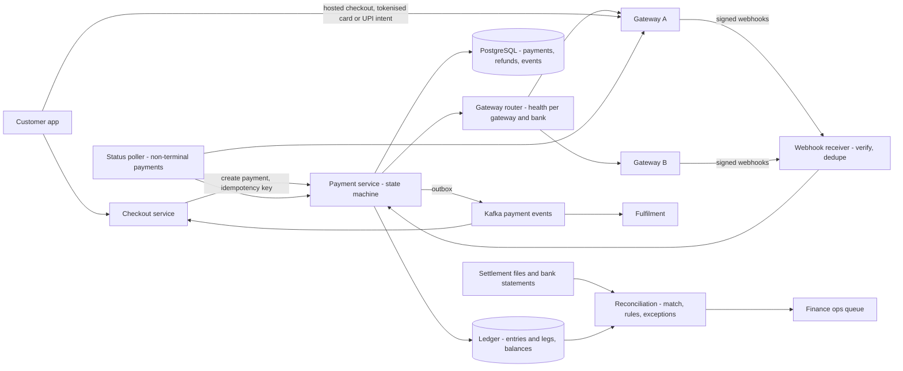
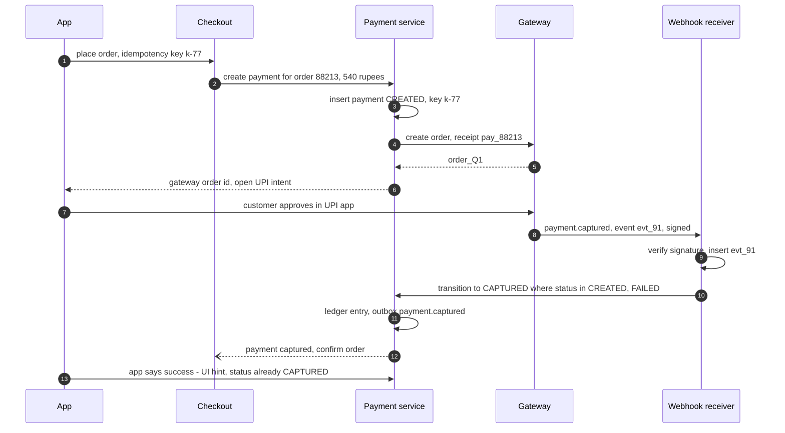
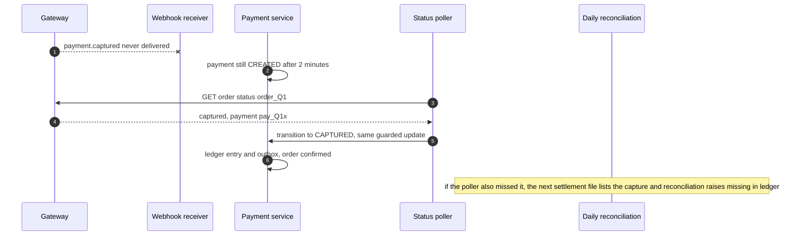
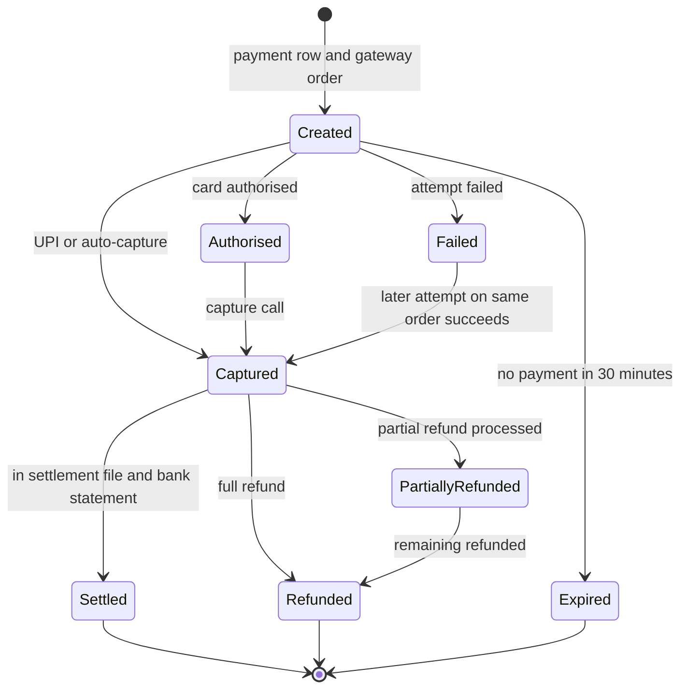

# 45. Case Study: Payment System

!!! abstract "Chapter at a glance"
    **Reader bands:** B2 → B4 · **Prerequisites:** [Ch 05](../01-foundations/05-relational-databases-deep-dive.md), [Ch 13](../02-distributed-core/13-distributed-transactions.md), [Ch 20](../02-distributed-core/20-idempotency-ids-and-distributed-locks.md), [Ch 23](../03-production/23-security-architecture.md), [Ch 36](../04-architect/36-compliance-governance-and-data-residency.md) · **What you will build:** The grocery platform's payment system: UPI and card checkouts through a Razorpay-style gateway, the customer wallet, refunds, reconciliation with the gateway's settlement files, and routing across gateways. Earlier chapters promised the pieces — idempotency keys ([Ch 20](../02-distributed-core/20-idempotency-ids-and-distributed-locks.md)), sagas with a `NEEDS_ATTENTION` state ([Ch 13](../02-distributed-core/13-distributed-transactions.md)), ledger invariants ([Ch 05](../01-foundations/05-relational-databases-deep-dive.md)), tokenisation ([Ch 23](../03-production/23-security-architecture.md)). This chapter assembles them into a system where every rupee is accounted for.

    - **L1: money under concurrency (real PostgreSQL).** 20,000 wallet operations ran on 16 threads.
        - A read-then-write balance column left **116 of 200** wallets wrong and silently created **₹34,011.55**.
        - Row locks plus a double-entry journal were exact, at ~4,100 ops/s.
        - Deriving balances from the journal under SERIALIZABLE was also exact, but hit a **retry storm**: 58,764 retries, 712 ops/s.
    - **L2: a real payment flow with webhooks.** A fake Razorpay-style gateway ran over HTTP, with webhooks that were duplicated, reordered and 5% dropped, plus some tampered app callbacks.
        - Trusting the app and applying every webhook fulfilled **1,621 orders twice** and **35 unpaid**, and left 106 paid payments marked FAILED.
        - A guarded state machine with event dedupe removed all of that, but left **87 paid customers unfulfilled** because their webhook never came.
        - A reconciliation poller brought the result to **1,708 of 1,708** correct.
    - **L3: daily settlement reconciliation.** Across 103,000 transactions with 232 real problems and 500 benign differences:
        - Totals alone explained nothing.
        - Exact line matching raised 582 breaks, **500 of them false alarms**, and found only 82 real problems.
        - Rules for settlement delays, rounding, fees and duplicates produced a queue of exactly the **232 real exceptions** worth ₹93,130. The largest is 40 customers charged with no order.
    - **L4: whose failure is it?** In 2 hours of UPI traffic there was a gateway incident and a bank outage.
        - Gateway-level failover fixed the gateway incident (54% → 91%) but did nothing for the bank outage.
        - Health per (gateway, bank), plus steering customers of the failed bank to another method, raised success during the bank outage from **79% to 89%**.
        - Auto-retrying on the second gateway brought the gateway incident to **97%**.

    · **Reading time:** 120 min + code

---

## 1. Introduction & Why It Matters

### 1.1 A story: the month the money didn't add up

The grocery platform's first payment integration was a tutorial: create an order at the gateway, open its checkout, and mark the order paid when the app says "success". Within a quarter the finance team escalated:

1. **Double shipments.** The app's success callback and the gateway's webhook both marked orders paid; each triggered fulfilment. About one order in twenty-five shipped twice.
2. **Charged, no order.** Some webhooks never arrived. Customers were debited, saw "payment pending" forever, and called support. Some paid twice trying again.
3. **Free groceries.** A modified app sent "success" for failed payments. A few dozen orders shipped unpaid before anyone noticed.
4. **Wallet drift.** Cashback and refunds went to a wallet whose balance was a column updated in application code. Under load the balances drifted; the total of all wallets no longer matched the money the company owed its customers.
5. **The settlement gap.** The gateway deposited ₹3.9 lakh less than expected one day. Nobody could say why: late settlements, fees, a duplicate, manual refunds from the dashboard, or a real loss.
6. **A bank outage looked like a gateway outage.** When one large bank's UPI went down, the team switched all traffic to the second gateway. It changed nothing, and nearly broke the second gateway's rate limits.

Payments are where distributed-systems theory meets money, regulation and customers' trust. Every message can be duplicated, delayed, lost or forged; the only defence is a design in which every state change is idempotent, every movement of money is recorded as a balanced entry, and every day ends with proof that the books match the bank.

!!! quote "The thesis of this chapter"
    A payment system is **a state machine per payment, a double-entry ledger for money, and reconciliation as the source of truth about the outside world**. **Money** moves only as immutable, balanced journal entries under concurrency control (L1). **Payment state** moves only through guarded, idempotent transitions driven by *verified* gateway events, never by the client, and pending states are resolved by asking the gateway (L2). **Reconciliation** against settlement files is not an accounting afterthought; it is how the system discovers its own bugs and the gateway's (L3). And **routing** must know whose failure it is — gateway or bank — before it acts (L4).

### 1.2 Where this lives in the grocery platform

| Flow | Actors | Money movement |
|---|---|---|
| UPI/card checkout | Customer → gateway (PSP) → nodal/escrow account → platform | Customer pays; settled T+1/T+2 minus fees |
| Wallet | Cashback, refunds-to-wallet, wallet payments | Internal liability to customers |
| Refunds | Platform → gateway → customer's source (or wallet) | Reverses a capture, fully or partly |
| Cash on delivery | Rider collects, deposits | Rider cash liability until deposited |
| Vendor payouts | Platform → sellers (marketplace) | Commission and taxes withheld, net paid out |

The payment service owns payments, refunds, the ledger and reconciliation. Checkout ([Ch 46](46-grocery-checkout-and-inventory-reservation.md)) calls it and reacts to its events through the outbox ([Ch 13](../02-distributed-core/13-distributed-transactions.md)).

### 1.3 Learning objectives

By the end you will be able to:

- **Model money** as a double-entry, append-only ledger with correct concurrency control (L1).
- **Design the payment state machine** around a gateway: orders, captures, webhooks, callbacks, timeouts and polling (L2).
- **Reconcile** internal records with settlement files and classify exceptions (L3).
- **Route across gateways** by success rate per gateway and bank, with safe retries (L4).
- **Handle refunds, wallets, idempotency, security (PCI, tokenisation) and Indian regulatory requirements.**

---

## 2. Core Concepts — Beginner to Deep

### 2.1 Intuition: a shop's cash book <span class="band b2">B2</span>

A shopkeeper writes every movement of money twice: "₹240 into the till, from Ravi's order". Nothing is erased; mistakes are fixed by writing a new line. At closing time, the till is counted and must match the book. The bank statement arrives the next day and is ticked off line by line. A payment system is that book, kept by computers that sometimes hear the same thing twice, sometimes not at all, and sometimes from someone lying.

### 2.2 Requirements <span class="band b2">B2</span>

**Functional**

- Accept payments by UPI (intent, collect), cards (tokenised), netbanking and wallets through one or more gateways; cash on delivery.
- Full and partial refunds, to source or to wallet.
- A customer wallet with cashback, refunds and payments.
- Payment status for checkout and support; receipts and GST invoices ([Ch 36](../04-architect/36-compliance-governance-and-data-residency.md)).
- Daily reconciliation with settlements; vendor payouts.

**Non-functional**

- **Correctness**: never charge twice for one order, never fulfil unpaid, never lose a captured payment; ledger always balanced.
- **Availability**: payments during peaks (festival sales) at 99.95%; graceful degradation (COD, other methods).
- **Latency**: checkout creation < 300 ms; status within seconds of the gateway's decision.
- **Security and compliance**: no raw card data (PCI DSS scope minimised), RBI tokenisation and payment-data storage in India, audit trails, data retention.

### 2.3 Estimation <span class="band b2">B2</span>

| Quantity | Estimate |
|---|---|
| Orders | ~1.5M/day; peak ~100 payments/s, 5–10x during sales |
| Methods | UPI ~70%, cards ~20%, others ~10% (illustrative) |
| Webhooks | ~2–3 events per payment → ~300/s peak |
| Ledger | ~4 legs per payment (capture, fee, settlement, refunds) → ~6M legs/day; append-only, partitioned by month |
| Reconciliation | ~1.5M settlement rows/day matched in a batch |

The volumes are modest for a database. The difficulty is **correctness under unreliable messages**, not throughput.

### 2.4 The ledger: double-entry, append-only ⭐ <span class="band b3">B3</span>

- **Accounts**: customer wallets, `psp_clearing` (money the gateway owes us), `bank` (our account), `merchant_payable`, `fees_expense`, `refunds_payable`, vendor payables, tax liabilities.
- **Entries**: every business event (capture, refund, settlement, fee, cashback) is one entry with two or more **legs** whose amounts sum to zero. A capture of ₹500 debits `psp_clearing` and credits `revenue`/`merchant_payable`; the next day's settlement debits `bank` and `fees_expense` and credits `psp_clearing`.
- **Immutability**: entries are never updated or deleted; corrections are reversing entries. The ledger *is* the audit trail.
- **Balances** are projections: the sum of legs, cached per account and maintained transactionally.
- **Money types**: integer minor units (paise), never floating point; currency per account.

L1 ran 20,000 concurrent wallet operations against three designs:

| Design | Throughput | Wrong balances | Money created/destroyed | Audit trail |
|---|---|---|---|---|
| Balance column, read-then-write | 6,963 ops/s | **116 of 200** | **₹34,011.55** | None |
| **Row lock + balance + double-entry journal** | 4,128 ops/s | 0 | ₹0 | Every movement |
| Journal only, balances by SUM, SERIALIZABLE | 712 ops/s | 0 | ₹0 | Every movement (58,764 retries) |

- **Lost updates** are the classic money bug: two operations read the same balance and each writes its own result ([Ch 05](../01-foundations/05-relational-databases-deep-dive.md)).
- **SERIALIZABLE** gives correct results with no application locking, but hot accounts (busy wallets, the platform's clearing account) turn conflict detection into retry storms. Use it for low-contention invariants.
- **The production shape**: append-only balanced legs + a balance row per account, updated under `SELECT … FOR UPDATE` in the same transaction, with a `CHECK (balance >= 0)` for accounts that can't go negative. For very hot internal accounts (clearing), aggregate legs asynchronously or shard the account into sub-accounts.

### 2.5 The payment state machine ⭐ <span class="band b3">B3</span>

```text
CREATED ──(authorised)──► AUTHORISED ──(captured)──► CAPTURED ──(refund)──► PARTIALLY_REFUNDED / REFUNDED
   │                                                     ▲
   └──(failed)──► FAILED ──(later attempt captured)──────┘       CREATED ──(expired)──► EXPIRED
```

- **Create** a payment row with our id and an **idempotency key** (per checkout attempt) before calling the gateway. Create the gateway order with our id as its receipt/reference, so the gateway itself dedupes retries.
- **Transitions are guarded in the database**: `UPDATE payments SET status='CAPTURED' WHERE id=? AND status IN ('CREATED','AUTHORISED','FAILED')`. Exactly one caller wins. Fulfilment is triggered only by the transition *into* CAPTURED (an outbox event), never by the arrival of a message.
- **Webhooks** are the authoritative push signal: verify the signature, dedupe by event id, process at-least-once and out of order. A late "failed" for an earlier attempt must not overwrite a capture.
- **The client callback** (checkout "success") is a UI hint. It triggers a status check against the gateway, never a state change by itself.
- **Unknown outcomes** (timeouts, missing webhooks): poll the gateway's status API for anything non-terminal past a threshold, and let daily reconciliation be the final authority ([Ch 13](../02-distributed-core/13-distributed-transactions.md) `NEEDS_ATTENTION`).

L2 built this over real HTTP with a fake gateway:

| Merchant design | Correctly fulfilled (of 1,708 paid) | Paid, not fulfilled | Fulfilled twice | Fulfilled unpaid | Paid but marked FAILED |
|---|---|---|---|---|---|
| Trust app, apply every webhook | 87 | 0 | **1,621** | **35** | 106 |
| Guarded state machine + dedupe | 1,621 | **87** | 0 | 0 | 20 |
| **+ reconciliation poller** | **1,708** | 0 | 0 | 0 | 0 |

The poller must check FAILED payments too: a customer's second attempt on the same order can succeed after a first failure.

### 2.6 Idempotency end to end <span class="band b3">B3</span>

| Hop | Key | Mechanism |
|---|---|---|
| App → checkout API | `Idempotency-Key` per checkout attempt | Stored request + response ([Ch 20](../02-distributed-core/20-idempotency-ids-and-distributed-locks.md)) |
| Payment service → gateway | Our payment id as the order receipt | The gateway returns the existing order |
| Gateway → webhook | Event id | `processed_events` table, same transaction as the transition |
| Transition → fulfilment | Outbox event per transition | Consumers dedupe by payment id |
| Refund request | Refund id from our side | Gateway refund API with our reference |
| Payouts | `(vendor, settlement date)` | Unique constraint; bank API reference |

"Exactly once" for money means: every hop is idempotent under the same logical key, and anything unknown is resolved by asking the counterparty.

### 2.7 Refunds, wallets and COD <span class="band b3">B3</span>

- **Refunds** are new payments in the other direction: their own state machine (CREATED → PROCESSED / FAILED), idempotent by refund id, capped by the captured amount minus previous refunds (checked under a lock on the payment), and reconciled like captures. Instant refunds to wallet are ledger entries only.
- **Wallet** balances are liabilities on the platform's books. Regulation limits what a closed-loop wallet can do (no cash-out; VERIFY current RBI PPI rules for your model).
- **COD** creates a rider cash liability at delivery and clears it on deposit, reconciled per rider per day.

### 2.8 Reconciliation ⭐ <span class="band b3">B3</span>

Every day the gateway's settlement file lists what it settled: payment id, gross, fee, tax on fee, net, UTR (bank transfer reference). Reconciliation matches it against the ledger. L3 injected 232 real problems and 500 benign differences:

| Method | Breaks for humans | Real problems found | False alarms |
|---|---|---|---|
| Totals only | 1 unexplained total (−₹3.9 lakh) | 0 | — |
| Exact line match | 582 | 82 | **500** |
| **+ carry-forward, tolerance, fee rules, dedupe** | **232** | **232** | **0** |

- **Timing**: settlements arrive T+1/T+2; carry unmatched items forward for a window before calling them breaks.
- **Tolerances**: auto-accept ±1 paisa rounding, and log it.
- **Expected fees**: compute the fee each method should carry (MDR per contract; UPI often zero for P2M below limits — VERIFY) and flag overcharges.
- **Duplicates** in the file, **refunds unknown to the ledger** (manual refunds in the gateway dashboard), and **payments unknown to the ledger** (dropped webhooks that also escaped polling) are the high-value exceptions.
- **Three-way matching**: ledger ↔ gateway file ↔ bank statement (UTR) proves the money actually arrived.
- Output: a categorised exception queue with rupee impact, owners and SLAs. Totals are a sanity check, never the method.

In L3 the rules happened to fit the injected patterns perfectly. In production, new kinds of discrepancy appear, so review what the rules auto-clear.

### 2.9 Routing across gateways ⭐ <span class="band b4">B4</span>

Multiple gateways give resilience, better success rates per method or bank, and commercial leverage. Routing must distinguish **where** failures happen. L4:

| Policy | Overall | During gateway incident | During bank outage | Customers steered |
|---|---|---|---|---|
| Everything via PSP-A | 83.2% | 54.4% | 79.1% | 0 |
| Gateway-level failover | 92.4% | 91.3% | **78.7%** | 0 |
| Health per (gateway, bank) + steer customers | 94.2% | 91.6% | **88.7%** | 5,852 |
| **+ auto-retry on the other gateway** | **95.5%** | **96.9%** | 88.7% | 5,834 |

- **Gateway-level health** mistakes a bank outage for a gateway outage and moves traffic for nothing.
- **Health per (gateway, method, bank)** from success rates and error codes: route around a gateway's weak spots; when all gateways fail for one bank, *tell the customer* — "Bank-3 UPI is down, pay by card or another UPI account".
- **Automatic retry on a second gateway** only for gateway-side errors, only before any debit is possible, and with idempotent orders on both sides.
- Keep a **probe share** on avoided paths so recovery is detected (L4's flip counts show the flapping without it — [Ch 40](40-notification-system.md) L3).

### 2.10 Security and compliance <span class="band b4">B4</span>

- **Card data**: use the gateway's hosted checkout or SDK so card numbers never touch your servers; store only network tokens or gateway tokens (RBI card-on-file tokenisation since 2022). This keeps PCI DSS scope to SAQ-A-like levels ([Ch 23](../03-production/23-security-architecture.md), [Ch 36](../04-architect/36-compliance-governance-and-data-residency.md)).
- **Webhooks**: verify HMAC signatures with rotated secrets, allow-list gateway IPs where offered, reject replays (timestamps).
- **Payment data storage**: RBI's 2018 directive requires payment system data to be stored in India (VERIFY scope for your role — merchants vs payment system operators).
- **Access and audit**: separate duties for refunds and payouts; approvals for large manual refunds; immutable audit logs ([Ch 36](../04-architect/36-compliance-governance-and-data-residency.md) L4).
- **Fraud**: velocity limits ([Ch 39](39-distributed-rate-limiter.md)), device signals, refund abuse detection, promo abuse.

### 2.11 Vendor payouts <span class="band b4">B4</span>

For marketplace sellers: compute each vendor's payable from ledger entries (sales − returns − commission − taxes withheld as applicable), pay out via banking APIs with idempotency keys, reconcile with bank statements, and handle failures (wrong account details) as held payables. The tax treatment (e.g., TCS/TDS for e-commerce operators) is regulation-dependent — VERIFY with finance.

### 2.12 Interview framing <span class="band b4">B4</span>

Draw: checkout → payment service (state machine) → gateway; webhooks back; ledger; reconciliation; outbox to fulfilment. Then go deep on idempotency (each hop), the state machine with guarded transitions and unknown outcomes, the double-entry ledger and concurrency, and reconciliation. Staff-level signals: "the client's success is not the truth", "reconciliation is how we find our bugs", "failures per bank, not per gateway", and knowing PCI/tokenisation scope.

---

## 3. Architecture & Diagrams

### 3.1 Component view



### 3.2 Sequence: happy path, UPI payment



### 3.3 Sequence: failure path, webhook lost



### 3.4 State: a payment's lifecycle



---

## 4. Design Document Excerpt: Payments Platform v2

!!! note "Design Document (excerpt) — Payments Platform v2"
    **Status:** Accepted · **Authors:** Payments team · **Reviewers:** Finance, Security, Checkout, SRE, Legal

    | Field | Value |
    |---|---|
    | Context | Double fulfilment from app callback + webhook; charged-without-order from lost webhooks; tampered success callbacks; wallet drift from mutable balances; unexplained settlement gaps; gateway-level failover during a bank outage. |
    | Decision | Guarded payment state machine driven by verified webhooks and status polling; double-entry append-only ledger with locked balance projections; end-to-end idempotency keys; daily three-way reconciliation with rules and exception queue; routing by health per (gateway, method, bank) with customer steering and PSP-side auto-retry. |
    | Related ADRs | ADR-310 Ledger: entries + legs, integer paise, balance rows under FOR UPDATE, CHECK non-negative wallets (L1); ADR-311 Payment state machine with guarded UPDATEs; webhook signature + event dedupe; app callback is a hint (L2); ADR-312 Status poller for CREATED/AUTHORISED/FAILED older than 2 min within the payment window (L2); ADR-313 Reconciliation: T+3 carry-forward, ±1 paisa, fee rules per method, duplicate detection, three-way with bank UTRs (L3); ADR-314 Routing per (gateway, method, bank), 85% threshold, 5% probe, steer customers on bank-side outages, one auto-retry for PSP-side errors (L4); ADR-315 Hosted checkout and tokenisation only; no card data in our systems |

    **Requirements.**

    - **R1** Zero double charges per order and zero fulfilment without capture.
    - **R2** Every captured payment either fulfilled or refunded within 30 minutes (poller) and within 1 day (reconciliation).
    - **R3** Ledger balanced at all times; wallet balances equal the sum of their legs.
    - **R4** Reconciliation exceptions triaged within 1 business day, each with rupee impact.
    - **R5** Payment success ≥ 95% excluding customer-side failures, including during single-gateway incidents.

    **Decisions in detail.**

    1. **Ledger (ADR-310).** `entries(id, kind, ref, created_at)`, `legs(entry_id, account, amount)`, `account_balances(account, balance, version)`; monthly partitions; nightly invariant job (sum of legs = 0 per entry; balance = sum of legs per account).
    2. **State machine (ADR-311/312).** Transitions only via one stored procedure per event type; outbox rows in the same transaction; poller every 30 s.
    3. **Reconciliation (ADR-313).** Settlement files ingested on arrival; matching engine with rules as configuration; exceptions to a finance queue with categories and owners.
    4. **Routing (ADR-314).** Health from success rates and error-code classes per (gateway, method, bank) over 5 minutes.
    5. **Security (ADR-315).** Webhook HMAC with rotated secrets; refund approvals above ₹10,000; audit log.

    **Consequences.** More moving parts (poller, reconciliation, router) and dependence on gateway APIs and file formats. Status sometimes lags by seconds to minutes. In return: no double shipments, no unpaid orders, a ledger that balances, and a daily proof that the money is where the books say.

---

## 5. Hands-On Code — Level Ladder

!!! info "What's real here"
    All four labs are JDK 21. **L1 and L2 run against a real PostgreSQL 16 with durable commits**. L2 runs two real HTTP servers: a fake Razorpay-style gateway, and the merchant's webhook and app endpoints. The fake gateway's fault rates, the fee rates (2% + 18% GST on cards, 0% on UPI) and the traffic and incident shapes in L3–L4 are **illustrative assumptions, not any gateway's actual terms**. L3 and L4 are deterministic simulations; L2's counts vary slightly between runs.

L1 and L2 need PostgreSQL 16 on port 5581 (database `shop`) and `postgresql-42.7.4.jar`. Run every lab with `-Dstdout.encoding=UTF-8`; the JDBC labs also need `-Duser.timezone=UTC`.

### L1 — Money under concurrency <span class="band b2">B2</span>

**Requirement:** "Wallet balances must be exactly what the operations imply, with no negatives, and every movement must be auditable."

20,000 wallet operations on 16 threads against real PostgreSQL, with three designs, followed by an audit.

```java title="LedgerL1.java"
// LedgerL1.java — run with (PostgreSQL 16 on :5581, db "shop"):
//   java -cp postgresql-42.7.4.jar -Duser.timezone=UTC LedgerL1.java
// MONEY UNDER CONCURRENCY. The grocery wallet (cashback + refunds-to-wallet) is real money. 16 threads run 20,000
// operations against 200 customer wallets (half the traffic on 10 busy ones): wallet payments (must not overdraw),
// refunds back to the wallet and top-ups. Three designs, all on real PostgreSQL with durable commits:
//   A) BALANCE COLUMN, read-then-write: SELECT balance; if enough, UPDATE balance = new value   (READ COMMITTED)
//   B) BALANCE COLUMN + JOURNAL, locked: SELECT … FOR UPDATE, then update the balance and insert double-entry legs
//   C) APPEND-ONLY DOUBLE-ENTRY JOURNAL: balances are SUM(legs); insert legs under SERIALIZABLE, retry on conflict
// Then we audit: does every wallet's balance equal what the successful operations imply? Any negative wallet? Does
// every journal entry balance (debits = credits)?
import java.sql.*;
import java.util.*;
import java.util.concurrent.*;
import java.util.concurrent.atomic.*;

public class LedgerL1 {
    static final String DB = "jdbc:postgresql://127.0.0.1:5581/shop?user=claude";
    static final int WALLETS = 200, OPS = 20_000, THREADS = 16; static final long START = 50_000;   // ₹500.00 in paise

    record Op(int wallet, long delta, String kind) {}   // delta applied to the wallet (negative = payment)

    public static void main(String[] args) throws Exception {
        Random r = new Random(45); List<Op> ops = new ArrayList<>();
        for (int i = 0; i < OPS; i++) {
            int w = r.nextBoolean() ? r.nextInt(10) : r.nextInt(WALLETS); double x = r.nextDouble();
            ops.add(x < 0.6 ? new Op(w, -(1_000 + r.nextInt(20_000)), "payment") : x < 0.85 ? new Op(w, 1_000 + r.nextInt(10_000), "refund") : new Op(w, 5_000 + r.nextInt(20_000), "topup"));
        }
        System.out.printf("%,d wallet operations (60%% payments, 25%% refunds, 15%% top-ups), %d threads, %d wallets, PostgreSQL 16.%n%n", OPS, THREADS, WALLETS);
        System.out.printf("   %-50s %8s %9s %8s %9s %13s %9s %11s %15s%n", "design", "ops/s", "declined", "retries", "wrong", "money created", "negative", "unbalanced", "audit trail");
        System.out.printf("   %-50s %8s %9s %8s %9s %13s %9s %11s %15s%n", "", "", "(no funds)", "", "balances", "or destroyed", "wallets", "entries", "");
        String[] names = {"A) balance column, read-then-write", "B) FOR UPDATE + balance + double-entry journal", "C) append-only journal, SERIALIZABLE + retry"};
        for (int d = 0; d < 3; d++) run(d, names[d], ops);
        System.out.println("\n   → the read-then-write balance loses updates as soon as two operations touch one wallet: most wallets end up");
        System.out.println("     wrong, money is silently created or destroyed, and there is no record of why. (No wallet went negative here —");
        System.out.println("     that needs two payments to pass the same stale check; it is possible, just rarer.) Locking the account row (B)");
        System.out.println("     makes every balance exact at half A's throughput. Deriving balances from the journal under SERIALIZABLE (C) is");
        System.out.println("     also exact, but on busy wallets the conflict detection turns into a retry storm — tens of thousands of retries");
        System.out.println("     and a fraction of the throughput. The usual production shape is B: an append-only, balanced journal as the");
        System.out.println("     record, plus a balance row per account updated under a row lock in the same transaction as a fast, checkable");
        System.out.println("     projection. Corrections are new entries, never UPDATEs to history.");
    }

    static void run(int design, String name, List<Op> ops) throws Exception {
        try (Connection c = DriverManager.getConnection(DB); Statement s = c.createStatement()) {
            s.execute("drop table if exists legs"); s.execute("drop table if exists entries"); s.execute("drop table if exists accounts");
            s.execute("create table accounts(id text primary key, balance bigint not null)");
            s.execute("create table entries(id bigserial primary key, kind text not null, created_at timestamptz default now())");
            s.execute("create table legs(entry_id bigint not null references entries, account text not null, amount bigint not null)");   // + credit, − debit
            s.execute("create index on legs(account)");
            s.execute("insert into accounts select 'wallet:' || g, " + START + " from generate_series(0," + (WALLETS - 1) + ") g");
            s.execute("insert into accounts values ('merchant_payable', 0), ('psp_clearing', 0), ('opening_balances', 0)");
            // opening balances as journal entries so C can derive balances from legs alone
            s.execute("insert into entries(kind) select 'opening' from generate_series(0," + (WALLETS - 1) + ")");
            s.execute("insert into legs select e.id, 'wallet:' || (e.id - 1), " + START + " from entries e");
            s.execute("insert into legs select e.id, 'opening_balances', -" + START + " from entries e");
        }
        AtomicInteger next = new AtomicInteger(), declined = new AtomicInteger(), retries = new AtomicInteger();
        long[] expected = new long[WALLETS]; Arrays.fill(expected, START);
        long t0 = System.nanoTime();
        try (var pool = Executors.newFixedThreadPool(THREADS)) {
            for (int t = 0; t < THREADS; t++) pool.submit(() -> {
                try (Connection c = DriverManager.getConnection(DB)) {
                    int i;
                    while ((i = next.getAndIncrement()) < ops.size()) {
                        Op op = ops.get(i);
                        boolean ok = switch (design) { case 0 -> readThenWrite(c, op); case 1 -> locked(c, op); default -> journal(c, op, retries); };
                        if (ok) synchronized (expected) { expected[op.wallet()] += op.delta(); } else declined.incrementAndGet();
                    }
                }
                return null;
            });
        }
        double secs = (System.nanoTime() - t0) / 1e9;
        int wrong = 0, negative = 0; long unbalanced, drift = 0;
        try (Connection c = DriverManager.getConnection(DB)) {
            for (int w = 0; w < WALLETS; w++) {
                long bal = balance(c, "wallet:" + w, design == 2);
                if (bal != expected[w]) wrong++; if (bal < 0) negative++; drift += bal - expected[w];
            }
            try (ResultSet rs = c.createStatement().executeQuery("select count(*) from (select entry_id from legs group by entry_id having sum(amount) <> 0) x")) { rs.next(); unbalanced = rs.getLong(1); }
        }
        System.out.printf("   %-50s %,8.0f %,9d %,8d %,9d %13s %,9d %,11d %15s%n", name, ops.size() / secs, declined.get(), retries.get(), wrong,
                String.format("₹%,.2f", drift / 100.0), negative, unbalanced, design == 0 ? "none" : "every movement");
    }

    static long balance(Connection c, String acct, boolean fromLegs) throws SQLException {
        try (PreparedStatement ps = c.prepareStatement(fromLegs ? "select coalesce(sum(amount),0) from legs where account = ?" : "select balance from accounts where id = ?")) {
            ps.setString(1, acct); try (ResultSet rs = ps.executeQuery()) { rs.next(); return rs.getLong(1); }
        }
    }
    static String counter(Op op) { return op.kind().equals("topup") ? "psp_clearing" : "merchant_payable"; }

    static boolean readThenWrite(Connection c, Op op) throws SQLException {
        long bal = balance(c, "wallet:" + op.wallet(), false);
        if (bal + op.delta() < 0) return false;
        try (PreparedStatement ps = c.prepareStatement("update accounts set balance = ? where id = ?")) { ps.setLong(1, bal + op.delta()); ps.setString(2, "wallet:" + op.wallet()); ps.executeUpdate(); }
        return true;
    }
    static boolean locked(Connection c, Op op) throws SQLException {
        c.setAutoCommit(false);
        try {
            long bal;
            try (PreparedStatement ps = c.prepareStatement("select balance from accounts where id = ? for update")) { ps.setString(1, "wallet:" + op.wallet()); try (ResultSet rs = ps.executeQuery()) { rs.next(); bal = rs.getLong(1); } }
            if (bal + op.delta() < 0) { c.rollback(); return false; }
            try (PreparedStatement ps = c.prepareStatement("update accounts set balance = balance + ? where id = ?")) { ps.setLong(1, op.delta()); ps.setString(2, "wallet:" + op.wallet()); ps.executeUpdate(); }
            insertEntry(c, op); c.commit(); return true;
        } catch (SQLException e) { c.rollback(); throw e; } finally { c.setAutoCommit(true); }
    }
    static boolean journal(Connection c, Op op, AtomicInteger retries) throws SQLException {
        while (true) {
            c.setAutoCommit(false); c.setTransactionIsolation(Connection.TRANSACTION_SERIALIZABLE);
            try {
                long bal = balance(c, "wallet:" + op.wallet(), true);
                if (bal + op.delta() < 0) { c.rollback(); return false; }
                insertEntry(c, op); c.commit(); return true;
            } catch (SQLException e) {
                c.rollback();
                if ("40001".equals(e.getSQLState())) { retries.incrementAndGet(); continue; }            // serialization failure: retry
                throw e;
            } finally { c.setAutoCommit(true); c.setTransactionIsolation(Connection.TRANSACTION_READ_COMMITTED); }
        }
    }
    static void insertEntry(Connection c, Op op) throws SQLException {
        long id;
        try (PreparedStatement ps = c.prepareStatement("insert into entries(kind) values (?) returning id")) { ps.setString(1, op.kind()); try (ResultSet rs = ps.executeQuery()) { rs.next(); id = rs.getLong(1); } }
        try (PreparedStatement ps = c.prepareStatement("insert into legs values (?,?,?),(?,?,?)")) {
            ps.setLong(1, id); ps.setString(2, "wallet:" + op.wallet()); ps.setLong(3, op.delta());
            ps.setLong(4, id); ps.setString(5, counter(op)); ps.setLong(6, -op.delta()); ps.executeUpdate();
        }
    }
}
```

```text title="java -cp postgresql-42.7.4.jar -Duser.timezone=UTC LedgerL1.java"
20,000 wallet operations (60% payments, 25% refunds, 15% top-ups), 16 threads, 200 wallets, PostgreSQL 16.

   design                                                ops/s  declined  retries     wrong money created  negative  unbalanced     audit trail
                                                               (no funds)           balances  or destroyed   wallets     entries                
   A) balance column, read-then-write                    6,963     3,649        0       116    ₹34,011.55         0           0            none
   B) FOR UPDATE + balance + double-entry journal        4,128     3,931        0         0         ₹0.00         0           0  every movement
   C) append-only journal, SERIALIZABLE + retry            712     3,964   58,764         0         ₹0.00         0           0  every movement

   → the read-then-write balance loses updates as soon as two operations touch one wallet: most wallets end up
     wrong, money is silently created or destroyed, and there is no record of why. (No wallet went negative here —
     that needs two payments to pass the same stale check; it is possible, just rarer.) Locking the account row (B)
     makes every balance exact at half A's throughput. Deriving balances from the journal under SERIALIZABLE (C) is
     also exact, but on busy wallets the conflict detection turns into a retry storm — tens of thousands of retries
     and a fraction of the throughput. The usual production shape is B: an append-only, balanced journal as the
     record, plus a balance row per account updated under a row lock in the same transaction as a fast, checkable
     projection. Corrections are new entries, never UPDATEs to history.
```

**Reading it:**

- **A** is the fastest, and wrong: **116 of 200** wallets don't match their operations, and **₹34,011.55** was created out of lost updates. There is no journal to tell anyone how.
- **B** (row lock + balance + balanced journal legs) is exact, with every movement recorded, at ~60% of A's throughput.
- **C** (balances derived from legs under SERIALIZABLE) is also exact. But half the traffic hits 10 busy wallets, and PostgreSQL's conflict detection forces **58,764 retries**: 712 ops/s.
- No design produced a negative wallet in this run. That takes two payments passing the same stale check, which is possible in A, just rarer than drift.

### L2 — A real payment flow with webhooks <span class="band b3">B3</span>

**Requirement:** "Fulfil every paid order exactly once, never an unpaid one, even though the gateway's webhooks are unreliable and the app can lie."

A fake Razorpay-style gateway and the merchant's service run as two HTTP servers, with PostgreSQL for payments, processed events and fulfilments. 2,000 checkouts run through each merchant design.

```java title="PaymentFlowL2.java"
// PaymentFlowL2.java — run with (PostgreSQL 16 on :5581, db "shop"):
//   java -cp postgresql-42.7.4.jar -Duser.timezone=UTC -Dsun.net.httpserver.nodelay=true PaymentFlowL2.java
// A PAYMENT FLOW WITH A REAL (FAKE) PAYMENT GATEWAY. Two real HTTP servers on localhost:
//   PSP        a Razorpay-style gateway: POST /v1/orders creates an order; GET /v1/orders/{id} returns its true status;
//              it sends signed WEBHOOKS (payment.captured / payment.failed) to the merchant — at least once (10% sent
//              twice), sometimes out of order (a failed first attempt's event arriving after the successful retry's),
//              and sometimes never (5% dropped)
//   MERCHANT   our payment service: PostgreSQL tables for payments and fulfilments, a webhook endpoint, and an endpoint
//              where the customer's app reports "payment success" after the checkout screen (2% of those are tampered)
// 2,000 checkouts: 85% pay (some after a failed first attempt), 10% fail, 5% abandon. Three merchant designs:
//   A) trust the app's success callback; apply every webhook as it comes
//   B) app callback is only a UI hint; guarded state machine (CREATED → CAPTURED | FAILED, FAILED → CAPTURED allowed,
//      CAPTURED terminal); webhook events deduplicated by event id; fulfil only on the transition INTO CAPTURED
//   C) B + a reconciliation poller: payments not yet CAPTURED (CREATED or FAILED — a retry can still succeed) after 2 s
//      are checked against the PSP's order status API, within the order's 30-minute payment window
// Afterwards we compare every payment with the PSP's truth.
import com.sun.net.httpserver.HttpServer;
import java.net.*;
import java.net.http.*;
import java.nio.charset.StandardCharsets;
import java.sql.*;
import java.util.*;
import java.util.concurrent.*;
import java.util.concurrent.atomic.*;

public class PaymentFlowL2 {
    static final String DB = "jdbc:postgresql://127.0.0.1:5581/shop?user=claude";
    static final Map<String, String> pspTruth = new ConcurrentHashMap<>();          // psp order id -> captured | failed | created
    static final Map<String, String> pspToOurs = new ConcurrentHashMap<>();
    static HttpClient http = HttpClient.newBuilder().version(HttpClient.Version.HTTP_1_1).executor(Executors.newVirtualThreadPerTaskExecutor()).build();
    static int design; static BlockingQueue<Connection> pool = new LinkedBlockingQueue<>();

    public static void main(String[] args) throws Exception {
        for (int i = 0; i < 12; i++) pool.add(DriverManager.getConnection(DB));
        HttpServer psp = HttpServer.create(new InetSocketAddress("127.0.0.1", 0), 512); psp.setExecutor(Executors.newVirtualThreadPerTaskExecutor());
        AtomicLong pspSeq = new AtomicLong(1000);
        psp.createContext("/v1/orders", ex -> {
            String body;
            if (ex.getRequestMethod().equals("POST")) { String id = "order_" + pspSeq.incrementAndGet(); pspTruth.put(id, "created"); body = id; }
            else { String id = ex.getRequestURI().getPath().substring("/v1/orders/".length()); body = pspTruth.getOrDefault(id, "unknown"); }
            byte[] b = body.getBytes(); ex.sendResponseHeaders(200, b.length); ex.getResponseBody().write(b); ex.close();
        });
        psp.start();
        HttpServer merchant = HttpServer.create(new InetSocketAddress("127.0.0.1", 0), 1024); merchant.setExecutor(Executors.newVirtualThreadPerTaskExecutor());
        merchant.createContext("/webhooks/psp", ex -> { String[] f = new String(ex.getRequestBody().readAllBytes()).split("\\|"); handleEvent(f[0], f[1], f[2]); ex.sendResponseHeaders(200, -1); ex.close(); });
        merchant.createContext("/app/payment-success", ex -> { String ours = new String(ex.getRequestBody().readAllBytes()); if (design == 0) appSuccess(ours); ex.sendResponseHeaders(200, -1); ex.close(); });
        merchant.start();
        String pspUrl = "http://127.0.0.1:" + psp.getAddress().getPort(), hook = "http://127.0.0.1:" + merchant.getAddress().getPort();

        System.out.println("2,000 checkouts through a fake Razorpay-style PSP over real HTTP; merchant state in PostgreSQL.");
        System.out.println("Webhooks: 10% duplicated, some out of order, 5% never delivered; 2% of app 'success' calls are tampered.\n");
        System.out.printf("   %-52s %9s %10s %13s %10s %10s %13s%n", "merchant design", "captured", "fulfilled", "charged, NOT", "fulfilled", "fulfilled", "paid, status");
        System.out.printf("   %-52s %9s %10s %13s %10s %10s %13s%n", "", "at PSP", "correctly", "fulfilled", "twice", "unpaid", "says FAILED");
        String[] names = {"A) trust app callback, apply every webhook", "B) guarded state machine + event dedupe", "C) B + reconciliation poller (CREATED/FAILED, 2 s)"};
        for (design = 0; design < 3; design++) {
            reset(); pspTruth.clear(); pspToOurs.clear();
            Random r = new Random(45); List<Thread> ts = new ArrayList<>();
            ScheduledExecutorService poller = Executors.newSingleThreadScheduledExecutor();
            if (design == 2) poller.scheduleAtFixedRate(() -> reconcile(pspUrl), 500, 500, TimeUnit.MILLISECONDS);
            try (var ex = Executors.newVirtualThreadPerTaskExecutor()) {
                for (int i = 0; i < 2_000; i++) {
                    String ours = "pay_" + i; long seed = r.nextLong();
                    ex.submit(() -> { checkout(ours, pspUrl, hook, new Random(seed)); return null; });
                }
            }
            Thread.sleep(design == 2 ? 3_500 : 1_500);                               // let late webhooks and the poller finish
            poller.shutdownNow();
            report(names[design]);
        }
        System.out.println("\n   → the app's 'success' is a claim from an untrusted device, and webhooks are at-least-once, unordered and");
        System.out.println("     occasionally missing. Applying them naively fulfils orders twice, cancels paid orders when a stale failure");
        System.out.println("     arrives last, and ships to customers who never paid. A guarded state machine (transitions checked in the");
        System.out.println("     UPDATE itself, events deduplicated, fulfilment only on entering CAPTURED) removes duplicates and wrong turns —");
        System.out.println("     but a dropped webhook still leaves a paid customer waiting forever. Only asking the PSP closes that gap: a");
        System.out.println("     reconciliation poller for anything not yet captured — including FAILED, because a retry on the same order can");
        System.out.println("     still succeed — and daily settlement reconciliation (L3) as the final backstop.");
        System.exit(0);
    }

    // ---------------- the customer's checkout, as the PSP experiences it ----------------
    static void checkout(String ours, String psp, String hook, Random r) throws Exception {
        String pspOrder = send(HttpRequest.newBuilder(URI.create(psp + "/v1/orders")).POST(HttpRequest.BodyPublishers.ofString(ours)).build());
        pspToOurs.put(pspOrder, ours);
        withConn(c -> { try (PreparedStatement ps = c.prepareStatement("insert into payments values (?,?,'CREATED', now())")) { ps.setString(1, ours); ps.setString(2, pspOrder); ps.executeUpdate(); } });
        double x = r.nextDouble(); List<String[]> events = new ArrayList<>();
        if (x < 0.85) {
            if (r.nextDouble() < 0.2) events.add(new String[]{"evt_" + pspOrder + "_1", pspOrder, "payment.failed"});   // first attempt failed
            events.add(new String[]{"evt_" + pspOrder + "_2", pspOrder, "payment.captured"}); pspTruth.put(pspOrder, "captured");
        } else if (x < 0.95) { events.add(new String[]{"evt_" + pspOrder + "_1", pspOrder, "payment.failed"}); pspTruth.put(pspOrder, "failed"); }
        // else abandoned: no events
        // app callback after the checkout screen: honest on success, occasionally tampered
        boolean appSaysSuccess = pspTruth.get(pspOrder).equals("captured") || (x >= 0.85 && r.nextDouble() < 0.02 / 0.15);
        if (appSaysSuccess) send(HttpRequest.newBuilder(URI.create(hook + "/app/payment-success")).POST(HttpRequest.BodyPublishers.ofString(ours)).build());
        // webhook delivery: shuffled order sometimes, duplicates, drops
        if (events.size() == 2 && r.nextDouble() < 0.3) Collections.swap(events, 0, 1);                   // stale failure arrives last
        for (String[] e : events) {
            if (r.nextDouble() < 0.05) continue;                                                            // dropped
            int copies = r.nextDouble() < 0.10 ? 2 : 1;
            for (int k = 0; k < copies; k++) { Thread.sleep(r.nextInt(30)); send(HttpRequest.newBuilder(URI.create(hook + "/webhooks/psp")).POST(HttpRequest.BodyPublishers.ofString(String.join("|", e))).build()); }
        }
    }
    static String send(HttpRequest req) throws Exception { return http.send(req, HttpResponse.BodyHandlers.ofString()).body(); }

    // ---------------- merchant logic ----------------
    static void appSuccess(String ours) { fulfilIfA(ours, "CAPTURED"); }
    static void handleEvent(String eventId, String pspOrder, String type) {
        String ours = pspToOurs.get(pspOrder); String to = type.equals("payment.captured") ? "CAPTURED" : "FAILED";
        if (design == 0) { fulfilIfA(ours, to); return; }
        withConn(c -> {
            try {
                c.setAutoCommit(false);
                try (PreparedStatement ps = c.prepareStatement("insert into processed_events values (?) on conflict do nothing")) { ps.setString(1, eventId); if (ps.executeUpdate() == 0) { c.rollback(); return; } }
                transition(c, ours, to); c.commit();
            } catch (SQLException e) { c.rollback(); } finally { c.setAutoCommit(true); }
        });
    }
    static void transition(Connection c, String ours, String to) throws SQLException {
        String allowedFrom = to.equals("CAPTURED") ? "('CREATED','FAILED')" : "('CREATED')";                  // CAPTURED is terminal
        try (PreparedStatement ps = c.prepareStatement("update payments set status = ? where id = ? and status in " + allowedFrom)) {
            ps.setString(1, to); ps.setString(2, ours);
            if (ps.executeUpdate() == 1 && to.equals("CAPTURED")) {
                try (PreparedStatement f = c.prepareStatement("insert into fulfilments(payment_id) values (?)")) { f.setString(1, ours); f.executeUpdate(); }
            }
        }
    }
    static void fulfilIfA(String ours, String to) {                                         // design A: last write wins, fulfil on every success
        withConn(c -> {
            try (PreparedStatement ps = c.prepareStatement("update payments set status = ? where id = ?")) { ps.setString(1, to); ps.setString(2, ours); ps.executeUpdate(); }
            if (to.equals("CAPTURED")) try (PreparedStatement f = c.prepareStatement("insert into fulfilments(payment_id) values (?)")) { f.setString(1, ours); f.executeUpdate(); }
        });
    }
    static void reconcile(String psp) {
        withConn(c -> {
            List<String[]> stale = new ArrayList<>();
            try (ResultSet rs = c.createStatement().executeQuery("select id, psp_order from payments where status in ('CREATED','FAILED') and created_at < now() - interval '2 seconds' and created_at > now() - interval '30 minutes'")) { while (rs.next()) stale.add(new String[]{rs.getString(1), rs.getString(2)}); }
            for (String[] p : stale) {
                String truth; try { truth = send(HttpRequest.newBuilder(URI.create(psp + "/v1/orders/" + p[1])).GET().build()); } catch (Exception e) { continue; }
                if (truth.equals("captured") || truth.equals("failed")) {
                    c.setAutoCommit(false); try { transition(c, p[0], truth.equals("captured") ? "CAPTURED" : "FAILED"); c.commit(); } catch (SQLException e) { c.rollback(); } finally { c.setAutoCommit(true); }
                }
            }
        });
    }

    interface SqlWork { void run(Connection c) throws SQLException; }
    static void withConn(SqlWork w) {                                                   // borrow a pooled connection, always return it
        Connection c; try { c = pool.take(); } catch (InterruptedException e) { return; }
        try { w.run(c); } catch (SQLException e) { System.err.println("sql: " + e.getMessage()); } finally { pool.add(c); }
    }
    static void reset() throws SQLException {
        try (Connection c = DriverManager.getConnection(DB); Statement s = c.createStatement()) {
            s.execute("drop table if exists fulfilments"); s.execute("drop table if exists processed_events"); s.execute("drop table if exists payments");
            s.execute("create table payments(id text primary key, psp_order text unique, status text not null, created_at timestamptz not null)");
            s.execute("create table processed_events(event_id text primary key)");
            s.execute("create table fulfilments(id bigserial primary key, payment_id text not null)");
        }
    }
    static void report(String name) throws SQLException {
        long captured = pspTruth.values().stream().filter("captured"::equals).count();
        int ok = 0, chargedNotFulfilled = 0, twice = 0, unpaid = 0, wrongStatus = 0;
        try (Connection c = DriverManager.getConnection(DB)) {
            Map<String, Integer> f = new HashMap<>(); Map<String, String> st = new HashMap<>();
            try (ResultSet rs = c.createStatement().executeQuery("select id, status from payments")) { while (rs.next()) st.put(rs.getString(1), rs.getString(2)); }
            try (ResultSet rs = c.createStatement().executeQuery("select payment_id, count(*) from fulfilments group by payment_id")) { while (rs.next()) f.put(rs.getString(1), rs.getInt(2)); }
            for (var e : pspToOurs.entrySet()) {
                boolean paid = "captured".equals(pspTruth.get(e.getKey())); int n = f.getOrDefault(e.getValue(), 0);
                if (paid && n == 1) ok++; if (paid && n == 0) chargedNotFulfilled++; if (n > 1) twice++; if (!paid && n > 0) unpaid++; if (paid && "FAILED".equals(st.get(e.getValue()))) wrongStatus++;
            }
        }
        System.out.printf("   %-52s %,9d %,10d %,13d %,10d %,10d %,13d%n", name, captured, ok, chargedNotFulfilled, twice, unpaid, wrongStatus);
    }
}
```

```text title="java -cp postgresql-42.7.4.jar -Duser.timezone=UTC -Dsun.net.httpserver.nodelay=true PaymentFlowL2.java"
2,000 checkouts through a fake Razorpay-style PSP over real HTTP; merchant state in PostgreSQL.
Webhooks: 10% duplicated, some out of order, 5% never delivered; 2% of app 'success' calls are tampered.

   merchant design                                       captured  fulfilled  charged, NOT  fulfilled  fulfilled  paid, status
                                                           at PSP  correctly     fulfilled      twice     unpaid   says FAILED
   A) trust app callback, apply every webhook               1,708         87             0      1,621         35           106
   B) guarded state machine + event dedupe                  1,708      1,621            87          0          0            20
   C) B + reconciliation poller (CREATED/FAILED, 2 s)       1,708      1,708             0          0          0             0

   → the app's 'success' is a claim from an untrusted device, and webhooks are at-least-once, unordered and
     occasionally missing. Applying them naively fulfils orders twice, cancels paid orders when a stale failure
     arrives last, and ships to customers who never paid. A guarded state machine (transitions checked in the
     UPDATE itself, events deduplicated, fulfilment only on entering CAPTURED) removes duplicates and wrong turns —
     but a dropped webhook still leaves a paid customer waiting forever. Only asking the PSP closes that gap: a
     reconciliation poller for anything not yet captured — including FAILED, because a retry on the same order can
     still succeed — and daily settlement reconciliation (L3) as the final backstop.
```

**Reading it:**

- **A** fulfilled almost every paid order twice: once for the app's success, once for the webhook. It shipped **35** orders whose "success" was tampered. It also left **106** paid payments with status FAILED, because a stale failure event arrived last and overwrote the capture.
- **B**: duplicates and unpaid fulfilments are gone. The guarded UPDATE only lets CAPTURED be entered once, and failures can't overwrite it. But **87** paid customers got nothing, because their capture webhook was dropped.
- **C**: the poller asks the gateway about anything not yet captured, **including FAILED**, and all **1,708** paid orders are fulfilled exactly once. The first version polled only CREATED payments. It missed 20 whose first attempt had failed and whose successful retry's webhook was lost.
- The pooled-connection helper exists because the first version used try-with-resources on pooled connections. That closed each connection before returning it to the pool, and the lab deadlocked.

### L3 — Daily settlement reconciliation <span class="band b3">B3</span>

**Requirement:** "Every morning, prove the gateway's settlement matches our ledger, and give finance a short list of real problems with their value."

A synthetic day: 103,000 ledger transactions and the gateway's settlement files for D and D+1, with 232 real problems and 500 benign differences injected.

```java title="ReconcileL3.java"
// ReconcileL3.java — run with: java ReconcileL3.java   (JDK 21, no dependencies)
// DAILY SETTLEMENT RECONCILIATION. Every morning the payment gateway sends a settlement file: every captured payment and
// refund it settled into our bank account, with its fee (and GST on the fee). Our ledger has its own view of the same
// day. 100,000 payments and 3,000 refunds (fixed seed), with the discrepancies that really occur — injected:
//   REAL PROBLEMS   40 captured at the PSP but missing from our ledger (dropped webhook, never reconciled)
//                   25 amount mismatches (we recorded the price before a coupon adjustment)
//                    5 payments the PSP settled twice
//                   12 refunds issued by hand in the PSP dashboard, unknown to our ledger
//                  150 fees charged at the card rate on UPI payments (UPI is charged 0% here)
//   NOISE          300 payments settled a day later (T+2, appear in tomorrow's file)
//                  200 one-paisa rounding differences
// Three ways to reconcile:
//   R1 totals only: compare the day's expected net with the amount deposited
//   R2 line-by-line exact match on (payment id, amount); everything unmatched is a break for a human
//   R3 R2 + rules: carry unmatched items forward 3 days before calling them breaks, auto-accept ±1 paisa, recompute the
//      expected fee per payment method, detect duplicates — and classify each break with its money impact
import java.util.*;

public class ReconcileL3 {
    record Pay(String id, long amount, String method, boolean refund) {}
    record Row(String id, long gross, long fee, boolean refund) {}

    public static void main(String[] args) {
        Random r = new Random(45); List<Pay> ledger = new ArrayList<>(); List<Row> fileD = new ArrayList<>(), fileD1 = new ArrayList<>();
        Map<String, String> truth = new HashMap<>();                                      // id -> injected issue
        for (int i = 0; i < 100_000; i++) ledger.add(new Pay("pay_" + i, 10_000 + r.nextInt(300_000), r.nextDouble() < 0.7 ? "upi" : "card", false));
        for (int i = 0; i < 3_000; i++) ledger.add(new Pay("rfnd_" + i, -(1_000 + r.nextInt(50_000)), "upi", true));
        List<Pay> shuffled = new ArrayList<>(ledger.subList(0, 100_000)); Collections.shuffle(shuffled, r); int k = 0;
        Set<String> late = new HashSet<>(), dup = new HashSet<>(), rounding = new HashSet<>(), feeWrong = new HashSet<>(), amountWrong = new HashSet<>();
        for (int i = 0; i < 300; i++) late.add(shuffled.get(k++).id());
        for (int i = 0; i < 5; i++) dup.add(shuffled.get(k++).id());
        for (int i = 0; i < 200; i++) rounding.add(shuffled.get(k++).id());
        for (int i = 0; i < 25; i++) amountWrong.add(shuffled.get(k++).id());
        while (feeWrong.size() < 150) { Pay p = shuffled.get(k++); if (p.method().equals("upi")) feeWrong.add(p.id()); }
        for (Pay p : ledger) {
            long gross = p.amount();
            if (rounding.contains(p.id())) gross += 1; if (amountWrong.contains(p.id())) gross -= 5_000 + r.nextInt(20_000);
            long fee = p.refund() ? 0 : expectedFee(p.method(), gross); if (feeWrong.contains(p.id())) fee = expectedFee("card", gross);
            Row row = new Row(p.id(), gross, fee, p.refund());
            if (late.contains(p.id())) fileD1.add(row); else fileD.add(row);
            if (dup.contains(p.id())) fileD.add(row);
        }
        for (int i = 0; i < 40; i++) { long g = 10_000 + r.nextInt(300_000); fileD.add(new Row("pay_x" + i, g, expectedFee("upi", g), false)); truth.put("pay_x" + i, "missing in ledger"); }
        for (int i = 0; i < 12; i++) fileD.add(new Row("rfnd_manual_" + i, -(2_000 + r.nextInt(40_000)), 0, true));
        amountWrong.forEach(id -> truth.put(id, "amount")); dup.forEach(id -> truth.put(id, "duplicate")); feeWrong.forEach(id -> truth.put(id, "fee"));
        for (int i = 0; i < 12; i++) truth.put("rfnd_manual_" + i, "unknown refund");
        for (int i = 0; i < 200; i++) fileD1.add(new Row("pay_next_" + i, 50_000, expectedFee("upi", 50_000), false));   // tomorrow's own payments
        int realIssues = truth.size();

        System.out.printf("Day D: ledger %,d payments + %,d refunds; settlement file %,d rows (+ %,d in the D+1 file).%n", 100_000, 3_000, fileD.size(), fileD1.size());
        System.out.printf("Injected: %d real problems, 500 noise items (300 settled late, 200 one-paisa rounding).%n%n", realIssues);
        System.out.printf("   %-54s %14s %13s %13s %22s%n", "method", "breaks for", "real problems", "false alarms", "money impact explained");
        System.out.printf("   %-54s %14s %13s %13s %22s%n", "", "humans", "found", "", "");

        // R1: totals only
        long expectedNet = 0; for (Pay p : ledger) expectedNet += p.amount() - (p.refund() ? 0 : expectedFee(p.method(), p.amount()));
        long depositedNet = 0; for (Row x : fileD) depositedNet += x.gross() - x.fee();
        System.out.printf("   %-54s %14s %13s %13s %22s%n", "R1) totals only", "1 (the total)", "0 identified", "—", String.format("₹%,.2f unexplained", (depositedNet - expectedNet) / 100.0));

        // R2 and R3: line matching
        for (int m = 2; m <= 3; m++) {
            Map<String, Pay> ours = new HashMap<>(); for (Pay p : ledger) ours.put(p.id(), p);
            Map<String, Integer> seen = new HashMap<>(); List<String[]> breaks = new ArrayList<>();       // [id, category, impact paise]
            for (Row x : fileD) {
                int n = seen.merge(x.id(), 1, Integer::sum); Pay p = ours.get(x.id());
                if (p == null) { breaks.add(new String[]{x.id(), x.refund() ? "unknown refund" : "missing in ledger", String.valueOf(x.gross())}); continue; }
                if (n > 1) { breaks.add(new String[]{x.id(), "duplicate", String.valueOf(x.gross() - x.fee())}); continue; }
                long diff = x.gross() - p.amount();
                if (diff != 0) { if (m == 3 && Math.abs(diff) <= 1) continue; breaks.add(new String[]{x.id(), Math.abs(diff) <= 1 ? "rounding" : "amount", String.valueOf(diff)}); continue; }
                if (m == 3 && !p.refund() && x.fee() != expectedFee(p.method(), x.gross())) breaks.add(new String[]{x.id(), "fee", String.valueOf(x.fee() - expectedFee(p.method(), x.gross()))});
            }
            Set<String> inFile = seen.keySet();
            Set<String> inD1 = new HashSet<>(); for (Row x : fileD1) inD1.add(x.id());
            for (Pay p : ledger) if (!inFile.contains(p.id())) {
                if (m == 3 && inD1.contains(p.id())) continue;                                   // carried forward, matched in D+1
                breaks.add(new String[]{p.id(), "not settled", String.valueOf(p.amount())});
            }
            long found = breaks.stream().filter(b -> truth.containsKey(b[0])).map(b -> b[0]).distinct().count();
            long falseAlarms = breaks.stream().filter(b -> !truth.containsKey(b[0])).count();
            long impact = breaks.stream().filter(b -> truth.containsKey(b[0])).mapToLong(b -> Math.abs(Long.parseLong(b[2]))).sum();
            System.out.printf("   %-54s %,14d %,13d %,13d %22s%n", m == 2 ? "R2) exact line match (id, amount)" : "R3) + T+3 carry-forward, ±1 paisa, fee rules, dedupe",
                    breaks.size(), found, falseAlarms, String.format("₹%,.2f", impact / 100.0));
            if (m == 3) {
                Map<String, long[]> byCat = new TreeMap<>(); for (String[] b : breaks) { long[] a = byCat.computeIfAbsent(b[1], x -> new long[2]); a[0]++; a[1] += Math.abs(Long.parseLong(b[2])); }
                System.out.println("\n   R3 exception queue by category:");
                byCat.forEach((cat, a) -> System.out.printf("        %-20s %4d   ₹%,12.2f%n", cat, a[0], a[1] / 100.0));
            }
        }
        System.out.println("\n   → a matching total is not proof of anything, and a mismatched total tells you nothing about where the money went.");
        System.out.println("     Line-by-line matching finds the problems but buries them under hundreds of timing and rounding differences that");
        System.out.println("     fix themselves — people stop reading the report. Rules for known benign patterns (settlement delays, rounding)");
        System.out.println("     and for known costs (the fee each method should carry) leave a short queue of real exceptions, each with a");
        System.out.println("     category and a rupee value: customers charged without an order, duplicate settlements to return, refunds");
        System.out.println("     nobody recorded, and a gateway overcharging fees. Reconciliation is how a payment system finds its own bugs.");
    }

    static long expectedFee(String method, long gross) { if (method.equals("upi")) return 0; long fee = Math.round(gross * 0.02); return fee + Math.round(fee * 0.18); }   // 2% + 18% GST (illustrative)
}
```

```text title="java -Dstdout.encoding=UTF-8 ReconcileL3.java"
Day D: ledger 100,000 payments + 3,000 refunds; settlement file 102,757 rows (+ 500 in the D+1 file).
Injected: 232 real problems, 500 noise items (300 settled late, 200 one-paisa rounding).

   method                                                     breaks for real problems  false alarms money impact explained
                                                                  humans         found                                     
   R1) totals only                                         1 (the total)  0 identified             — ₹-390,332.55 unexplained
   R2) exact line match (id, amount)                                 582            82           500             ₹87,343.14
   R3) + T+3 carry-forward, ±1 paisa, fee rules, dedupe              232           232             0             ₹93,129.97

   R3 exception queue by category:
        amount                 25   ₹    3,926.60
        duplicate               5   ₹    5,215.99
        fee                   150   ₹    5,786.83
        missing in ledger      40   ₹   75,999.41
        unknown refund         12   ₹    2,201.14

   → a matching total is not proof of anything, and a mismatched total tells you nothing about where the money went.
     Line-by-line matching finds the problems but buries them under hundreds of timing and rounding differences that
     fix themselves — people stop reading the report. Rules for known benign patterns (settlement delays, rounding)
     and for known costs (the fee each method should carry) leave a short queue of real exceptions, each with a
     category and a rupee value: customers charged without an order, duplicate settlements to return, refunds
     nobody recorded, and a gateway overcharging fees. Reconciliation is how a payment system finds its own bugs.
```

**Reading it:**

- **Totals**: the day is ₹3.9 lakh short, but a total can't say that most of that is next-day settlement, or which part is real.
- **Exact matching** raised 582 breaks. 500 were timing and rounding, which fix themselves. It found only 82 real problems, and none of the 150 fee overcharges, because it doesn't know what fees should be.
- **Rules** left exactly **232** exceptions, all real, with categories and values. The biggest by value: **40 customers charged with no order in our ledger** (₹76,000) — L2's lost-webhook problem, caught at the last line of defence.
- The rules are perfect here because the lab knows which patterns it injected. Real reconciliation needs review of what the rules auto-clear.

### L4 — Whose failure is it? <span class="band b4">B4</span>

**Requirement:** "Keep payment success high through gateway incidents and bank outages, without making things worse."

Two hours of simulated UPI traffic through two gateways and 8 issuer banks, with a gateway incident and a bank outage.

```java title="RoutingL4.java"
// RoutingL4.java — run with: java RoutingL4.java   (JDK 21, no dependencies)
// WHOSE FAILURE IS IT? Payment success depends on the gateway (PSP) AND on the customer's bank. Two hours of UPI
// checkouts (~40/s, fixed seed) across two PSPs and 8 issuer banks. Normally 93% succeed (the rest are customer-side:
// wrong PIN, insufficient balance). Two incidents:
//   PSP incident     minutes 20–50: PSP-A's UPI switch degrades, 40% success for every bank through PSP-A
//   BANK incident    minutes 70–90: issuer Bank-3 (20% of customers) is down, 5% success through ANY PSP
// A customer whose payment fails retries once 60% of the time. Four routing policies:
//   S1 everything through PSP-A (the cheaper contract)
//   S2 PSP-level health: if PSP-A's success over the last 5 min falls below 80%, send ALL traffic to PSP-B
//   S3 health per (PSP, bank): move only the traffic that is failing; if a bank fails on BOTH PSPs, it's the bank —
//      don't reroute, tell the customer ("Bank-3 UPI is down — pay by card or another UPI account")
//   S4 S3 + a failed attempt is retried once on the other PSP automatically if the failure looks PSP-side
import java.util.*;

public class RoutingL4 {
    static final double[] BANK_SHARE = {0.22, 0.18, 0.20, 0.12, 0.10, 0.08, 0.06, 0.04};

    public static void main(String[] args) {
        System.out.println("UPI checkouts ~40/s for 2 h; PSP-A degraded minutes 20–50; Bank-3 (20% of customers) down minutes 70–90.\n");
        System.out.printf("   %-58s %9s %12s %13s %15s %13s%n", "routing policy", "overall", "during PSP", "during BANK", "routing flips", "customers");
        System.out.printf("   %-58s %9s %12s %13s %15s %13s%n", "", "success", "incident", "incident", "", "nudged");
        String[] names = {"S1) everything via PSP-A", "S2) PSP-level health, fail over all traffic", "S3) health per (PSP, bank); bank-side → nudge customer",
                "S4) S3 + auto-retry on the other PSP for PSP-side failures"};
        for (int p = 0; p < 4; p++) run(p, names[p]);
        System.out.println("\n   → a gateway-level health check can't tell a gateway problem from a bank problem: when Bank-3 went down, S2 saw");
        System.out.println("     PSP-A's success fall and moved everyone to PSP-B, which failed Bank-3 just the same — churn without benefit.");
        System.out.println("     Measuring success per (gateway, bank) shows where the failure is: move only the traffic a healthy gateway can");
        System.out.println("     carry, and when every gateway fails for one bank, no routing helps — the only rescue is steering the customer to");
        System.out.println("     another bank or method. An automatic retry on a second gateway rescues gateway-side failures within the same");
        System.out.println("     checkout, but only with an idempotent order so the customer can't be charged twice. (S3/S4 flip often because an");
        System.out.println("     avoided path gets no traffic, so its window empties and it looks healthy again — real routers keep a small");
        System.out.println("     probe share on avoided paths, as in Ch 40's vendor routing.)");
    }

    static void run(int policy, String name) {
        Random r = new Random(45); int seconds = 7200; double rate = 40;
        long ok = 0, total = 0, okPsp = 0, totPsp = 0, okBank = 0, totBank = 0, flips = 0, nudged = 0;
        // health windows: success counts per (psp, bank) and per psp over the last 300 s, bucketed per 10 s
        int buckets = 30; long[][][] att = new long[2][9][buckets], suc = new long[2][9][buckets];
        int allTo = 0; boolean[][] avoid = new boolean[2][8];
        for (int t = 0; t < seconds; t++) {
            int b = (t / 10) % buckets;
            if (t % 10 == 0) for (int ps = 0; ps < 2; ps++) for (int k = 0; k < 9; k++) { att[ps][k][b] = 0; suc[ps][k][b] = 0; }
            if (t % 30 == 0 && t > 300) {                                                    // re-evaluate routing every 30 s
                if (policy == 1) { int want = rateOf(att[0][8], suc[0][8]) < 0.80 ? 1 : 0; if (want != allTo) { flips++; allTo = want; } }
                if (policy >= 2) for (int k = 0; k < 8; k++) for (int ps = 0; ps < 2; ps++) {
                    boolean bad = rateOf(att[ps][k], suc[ps][k]) < 0.80; if (bad != avoid[ps][k]) { flips++; avoid[ps][k] = bad; } }
            }
            int n = poisson(r, rate);
            for (int i = 0; i < n; i++) {
                int bank = pickBank(r); boolean inPsp = t >= 1200 && t < 3000, inBank = t >= 4200 && t < 5400;
                total++; if (inPsp) totPsp++; if (inBank) totBank++;
                int psp = policy == 0 ? 0 : policy == 1 ? allTo : (avoid[0][bank] && !avoid[1][bank] ? 1 : 0);
                boolean bankDown = policy >= 2 && avoid[0][bank] && avoid[1][bank];
                if (bankDown && r.nextDouble() < 0.6) { nudged++; ok++; if (inPsp) okPsp++; if (inBank) okBank++; continue; }   // pays by card / other account
                boolean s = attempt(r, t, psp, bank, att, suc, b);
                if (!s && policy == 3 && pspSide(t, psp)) s = attempt(r, t, 1 - psp, bank, att, suc, b);                         // automatic second gateway
                if (!s && r.nextDouble() < 0.6) s = attempt(r, t, psp, bank, att, suc, b);                                        // customer retries once
                if (s) { ok++; if (inPsp) okPsp++; if (inBank) okBank++; }
            }
        }
        System.out.printf("   %-58s %8.1f%% %11.1f%% %12.1f%% %,15d %,13d%n", name, 100.0 * ok / total, 100.0 * okPsp / totPsp, 100.0 * okBank / totBank, flips, nudged);
    }
    static boolean pspSide(int t, int psp) { return psp == 0 && t >= 1200 && t < 3000; }   // failure codes say "gateway" (PSP-side) in this window
    static boolean attempt(Random r, int t, int psp, int bank, long[][][] att, long[][][] suc, int b) {
        double p = 0.93;
        if (psp == 0 && t >= 1200 && t < 3000) p = 0.40;
        if (bank == 2 && t >= 4200 && t < 5400) p = 0.05;
        boolean s = r.nextDouble() < p;
        att[psp][bank][b]++; att[psp][8][b]++; if (s) { suc[psp][bank][b]++; suc[psp][8][b]++; }
        return s;
    }
    static double rateOf(long[] a, long[] s) { long x = 0, y = 0; for (int i = 0; i < a.length; i++) { x += a[i]; y += s[i]; } return x < 30 ? 1 : (double) y / x; }
    static int pickBank(Random r) { double x = r.nextDouble(), c = 0; for (int i = 0; i < 8; i++) { c += BANK_SHARE[i]; if (x < c) return i; } return 7; }
    static int poisson(Random r, double l) { double L = Math.exp(-l), p = 1; int k = 0; do { k++; p *= r.nextDouble(); } while (p > L); return k - 1; }
}
```

```text title="java -Dstdout.encoding=UTF-8 RoutingL4.java"
UPI checkouts ~40/s for 2 h; PSP-A degraded minutes 20–50; Bank-3 (20% of customers) down minutes 70–90.

   routing policy                                               overall   during PSP   during BANK   routing flips     customers
                                                                success     incident      incident                        nudged
   S1) everything via PSP-A                                       83.2%        54.4%         79.1%               0             0
   S2) PSP-level health, fail over all traffic                    92.4%        91.3%         78.7%              20             0
   S3) health per (PSP, bank); bank-side → nudge customer         94.2%        91.6%         88.7%             106         5,852
   S4) S3 + auto-retry on the other PSP for PSP-side failures     95.5%        96.9%         88.7%             106         5,834

   → a gateway-level health check can't tell a gateway problem from a bank problem: when Bank-3 went down, S2 saw
     PSP-A's success fall and moved everyone to PSP-B, which failed Bank-3 just the same — churn without benefit.
     Measuring success per (gateway, bank) shows where the failure is: move only the traffic a healthy gateway can
     carry, and when every gateway fails for one bank, no routing helps — the only rescue is steering the customer to
     another bank or method. An automatic retry on a second gateway rescues gateway-side failures within the same
     checkout, but only with an idempotent order so the customer can't be charged twice. (S3/S4 flip often because an
     avoided path gets no traffic, so its window empties and it looks healthy again — real routers keep a small
     probe share on avoided paths, as in Ch 40's vendor routing.)
```

**Reading it:**

- **S1** has no defence: 54% success during the gateway incident.
- **S2** handles the gateway incident (91%) but not the bank outage (78.7%). It even moved all traffic to PSP-B during the bank outage, which fails Bank-3 just the same.
- **S3** sees that Bank-3 fails on both gateways and steers those customers to another method. Success during the bank outage rises to **88.7%** (5,852 customers steered).
- **S4** adds one automatic retry on the other gateway for gateway-side errors: **96.9%** during the gateway incident.
- The high flip counts show the missing probe traffic; see exercise 4.


---

## 6. Production Concerns

### 6.1 Failure modes

| Failure | Symptom | Mitigation |
|---|---|---|
| Mutable balances | Drift, lost updates (L1) | Journal + locked balance projection |
| Hot ledger accounts | Retry storms or lock waits (L1) | Sub-accounts, async aggregation for internal accounts |
| Trusting the client | Unpaid fulfilment (L2) | Server-side verification only |
| Duplicate/out-of-order webhooks | Double fulfilment, paid marked failed (L2) | Guarded transitions, event dedupe |
| Lost webhooks | Charged, not fulfilled (L2) | Status poller, reconciliation |
| Settlement differences | Unexplained gaps (L3) | Line matching with rules, three-way |
| Bank outage misread as gateway outage | Useless failover (L4) | Health per (gateway, bank), customer steering |
| Retry on another gateway after a debit | Double charge | Auto-retry only for pre-debit gateway errors |
| Float money | Paise errors | Integer minor units |

### 6.2 Observability

- Payment success rate by method, gateway, bank; error-code classes.
- Time from gateway decision to our CAPTURED (webhook lag); poller resolutions per hour (should be small).
- Non-terminal payments by age; unfulfilled captures; refunds pending.
- Ledger invariants (daily job) and reconciliation exceptions by category and value.
- Alerts: success-rate drops per segment, webhook signature failures, reconciliation breaks above thresholds.

### 6.3 Security

- No card data; tokenisation; hosted checkout ([Ch 23](../03-production/23-security-architecture.md)).
- Webhook authentication; secrets in a vault; mTLS to gateways where supported.
- Four-eyes approval for manual refunds and payout changes; audit logs ([Ch 36](../04-architect/36-compliance-governance-and-data-residency.md)).
- Fraud controls on promos, refunds and wallet top-ups ([Ch 39](39-distributed-rate-limiter.md)).

### 6.4 Performance

- Payment creation is a few inserts and one gateway call; keep it off shared pools ([Ch 18](../02-distributed-core/18-resilience-patterns.md) bulkheads).
- Ledger writes are small; partition by month; index by account and reference.
- Reconciliation as a batch job over files; streaming ingestion of settlement data when available.

### 6.5 Cost

- Gateway fees (MDR) dominate: route by cost among healthy options, and verify fees in reconciliation (L3 found overcharges).
- Failed payments cost conversions; per-bank routing and customer steering recover revenue (L4).
- Chargebacks and fraud losses are costs to track per method.

---

## 7. Anti-Patterns & Pitfalls

!!! danger "1. Marking paid on the app's say-so"
    Clients can be modified (L2: 35 unpaid fulfilments).

!!! danger "2. Fulfilling on every capture message"
    Duplicates ship twice (L2: 1,621).

!!! danger "3. Last-write-wins statuses"
    A stale failure overwrites a capture.

!!! danger "4. Waiting forever for a webhook"
    Some never arrive; poll and reconcile.

!!! danger "5. Balance columns updated in application code"
    Lost updates create and destroy money (L1).

!!! danger "6. SERIALIZABLE on hot accounts without a plan"
    Retry storms (L1: 58,764 retries).

!!! danger "7. Floating-point money"
    Rounding errors compound; use paise.

!!! danger "8. Reconciling totals"
    A matching total can hide offsetting errors (L3).

!!! danger "9. Reconciliation reports nobody reads"
    Noise from timing and rounding buries real problems.

!!! danger "10. Failing over gateways for bank outages"
    No routing fixes an issuer outage (L4).

!!! danger "11. Retrying a payment on another gateway after a possible debit"
    Double charges.

!!! danger "12. Storing card numbers"
    PCI scope, regulatory breach — tokenise.

---

## 8. Interview Q&A

### Beginner <span class="band b2">B2</span>

??? question "Q1 [B2] ⭐ Design a payment system for an e-commerce app — the main components?"

    **30-second answer:** A payment service with a state machine per payment (created → captured → refunded), integrating one or more gateways via hosted checkout; a webhook receiver that verifies and dedupes events; a status poller for unknown outcomes; a double-entry ledger; an outbox to notify checkout and fulfilment; daily reconciliation against settlement files; and security controls (tokenisation, signatures, audit).

    **Deep answer:** §3.1; L1–L4 cover ledger, flow, reconciliation and routing.

    **Trade-offs I'd call out:** Speed of confirmation vs certainty; single vs multiple gateways.

    **Follow-ups:**
    1. Who decides an order is paid? → A verified gateway event or status check, never the client.
    2. Where is card data stored? → Nowhere in our systems.

    **Red flags:** "The app calls /markPaid after success."

??? question "Q2 [B2] ⭐ How do you prevent double charges?"

    **30-second answer:** Idempotency at every hop: an idempotency key per checkout attempt on our API; our payment id as the gateway order's receipt so the gateway dedupes order creation; one gateway order per checkout, reused on retries; payment attempts only through the gateway's checkout for that order; and refunds for any duplicate captures found by reconciliation.

    **Deep answer:** §2.6 table; [Ch 20](../02-distributed-core/20-idempotency-ids-and-distributed-locks.md) for the key store.

    **Trade-offs I'd call out:** Key lifetime vs storage.

    **Follow-ups:**
    1. Customer pays twice via two UPI apps? → Second capture detected, auto-refund.
    2. Retry after timeout? → Same key, same order.

    **Red flags:** Creating a new gateway order on every retry.

??? question "Q3 [B2] What is double-entry bookkeeping, and why use it in software?"

    **30-second answer:** Every movement of money is recorded as an entry with legs that sum to zero — a debit somewhere and a credit somewhere else. The ledger is append-only; balances are derived. It makes errors detectable (entries that don't balance), gives a full audit trail, and lets you reconstruct any balance at any time.

    **Deep answer:** L1: the journal designs kept every entry balanced and every balance exact; a mutable balance created ₹34,011.55 from nothing.

    **Trade-offs I'd call out:** More rows vs auditability.

    **Follow-ups:**
    1. Correcting a mistake? → A reversing entry.
    2. Balance queries? → Cached balance projections.

    **Red flags:** UPDATE statements on historical money records.

??? question "Q4 [B2] Why not trust the payment success callback from the app?"

    **30-second answer:** The app runs on a device you don't control; responses can be forged or replayed, and network issues mean it may never arrive. Use it only to trigger a server-side status check; the gateway's signed webhook or status API is the truth.

    **Deep answer:** L2: trusting it shipped 35 unpaid orders and duplicated fulfilments.

    **Trade-offs I'd call out:** A second of extra latency for certainty.

    **Follow-ups:**
    1. Signed client payloads? → Verify with the gateway anyway.
    2. UX while waiting? → "Confirming payment…" with polling.

    **Red flags:** Fulfilment triggered by a client request.

### Intermediate <span class="band b2">B2</span>

??? question "Q5 [B2] ⭐ How do you handle webhooks correctly?"

    **30-second answer:** Verify the signature, store the event id with a unique constraint and process in the same transaction as the state change, apply only allowed transitions (guarded UPDATE), treat events as at-least-once and unordered, respond 200 quickly (queue heavy work), and never rely on webhooks alone — poll non-terminal payments.

    **Deep answer:** L2: guarded transitions + dedupe removed duplicates and wrong statuses; polling fixed 87 lost webhooks.

    **Trade-offs I'd call out:** Synchronous processing vs queueing webhook bodies first.

    **Follow-ups:**
    1. Out-of-order failure after capture? → CAPTURED is terminal for failures.
    2. Signature secret rotation? → Accept two during rotation.

    **Red flags:** Last-write-wins status updates.

??? question "Q6 [B2] ⭐ A payment's outcome is unknown after a timeout. What do you do?"

    **30-second answer:** Don't guess and don't blindly retry. Record it as pending, query the gateway's status by our reference (with backoff), and apply the result through the same guarded transition. If still unknown after the window, mark it NEEDS_ATTENTION and let reconciliation resolve it; show the customer "payment processing".

    **Deep answer:** [Ch 13](../02-distributed-core/13-distributed-transactions.md) unknown outcomes; L2's poller.

    **Trade-offs I'd call out:** Customer wait vs certainty.

    **Follow-ups:**
    1. Gateway status API down? → Retry later; don't create a new order.
    2. Customer pays again meanwhile? → Detect and refund the duplicate.

    **Red flags:** "Retry the charge."

??? question "Q7 [B2] How do refunds work?"

    **30-second answer:** A refund is its own idempotent object with a state machine, created against a captured payment, checked under a lock so total refunds never exceed the capture, sent to the gateway with our refund id, confirmed by webhook or polling, recorded as ledger entries, and reconciled in the settlement file (negative rows).

    **Deep answer:** §2.7; L3 found 12 refunds issued manually in the gateway dashboard and unknown to the ledger.

    **Trade-offs I'd call out:** Instant refunds to wallet vs to source.

    **Follow-ups:**
    1. Partial refunds? → Track refunded amount per payment.
    2. Refund to a closed card? → The gateway/bank handles it; reconcile outcome.

    **Red flags:** Refunds as UPDATEs to the payment's amount.

??? question "Q8 [B2] How do you represent money in code and databases?"

    **30-second answer:** Integer minor units (paise) with an explicit currency, or a decimal type with fixed scale in the database; never binary floating point. Define rounding rules (banker's rounding or as contracts specify) for fees and taxes, and apply them once, in one place.

    **Deep answer:** L3's 200 one-paisa differences are what rounding disagreements look like.

    **Trade-offs I'd call out:** Integers vs decimals for multi-currency.

    **Follow-ups:**
    1. Java? → `long` paise or `BigDecimal` with scale 2.
    2. Tax computation? → Per line, rounded per rule.

    **Red flags:** `double amount`.

??? question "Q9 [B2] Why and how do you reconcile with the gateway?"

    **30-second answer:** Because messages get lost, duplicated or wrong, and the gateway and banks make mistakes too. Match each settlement row to the ledger by reference, with rules for timing, rounding and expected fees, and produce a categorised exception queue with rupee impact; do three-way matching with bank statements.

    **Deep answer:** L3: totals explained nothing; exact matching gave 500 false alarms; rules left 232 real exceptions, including 40 customers charged with no order.

    **Trade-offs I'd call out:** Auto-clear rules vs hidden problems.

    **Follow-ups:**
    1. Frequency? → Daily plus intraday for high volume.
    2. Who owns exceptions? → Finance ops with engineering for systemic causes.

    **Red flags:** "The totals matched."

### Senior <span class="band b3">B3</span>

??? question "Q10 [B3] ⭐ How do you keep a ledger correct under concurrency?"

    **30-second answer:** Append-only balanced entries; a balance row per account updated in the same transaction under a row lock (SELECT … FOR UPDATE) with checks (non-negative); serializable isolation only where contention is low; hot internal accounts split into sub-accounts or aggregated asynchronously; nightly invariant checks.

    **Deep answer:** L1: read-then-write left 116 of 200 wallets wrong; row locks exact at ~4,100 ops/s; SERIALIZABLE exact but 58,764 retries and 712 ops/s.

    **Trade-offs I'd call out:** Lock contention on hot accounts vs complexity of sharding them.

    **Follow-ups:**
    1. Deadlocks? → Lock accounts in a consistent order.
    2. Scale beyond one database? → Shard by account with a transfer saga.

    **Red flags:** Balances computed in application memory.

??? question "Q11 [B3] How do you route payments across multiple gateways?"

    **30-second answer:** Track success rates and error classes per (gateway, method, issuer bank) over a short window; route each payment to the cheapest healthy option; keep a probe share on degraded paths; when every gateway fails for a bank, steer the customer to another method; auto-retry on a second gateway only for pre-debit gateway errors, with idempotent orders.

    **Deep answer:** L4: gateway-level failover did nothing for a bank outage (78.7%); per-(gateway, bank) with steering 88.7%; auto-retry lifted the gateway incident to 96.9%.

    **Trade-offs I'd call out:** Cost-based routing vs success; contract minimums.

    **Follow-ups:**
    1. Tokenised cards across gateways? → Network tokens are portable; gateway tokens aren't.
    2. UPI intent? → The customer's app chooses the bank; route the PSP.

    **Red flags:** Failover on overall success rate.

??? question "Q12 [B3] How does fulfilment learn about payments reliably?"

    **30-second answer:** The payment service writes an outbox event in the same transaction as the transition to CAPTURED; a relay publishes it; checkout and fulfilment consume idempotently by payment id. Fulfilment never polls or listens to webhooks directly.

    **Deep answer:** [Ch 13](../02-distributed-core/13-distributed-transactions.md) outbox; L2's fulfilment row is written in the transition transaction.

    **Trade-offs I'd call out:** Seconds of latency vs consistency.

    **Follow-ups:**
    1. Payment captured after order expired? → Refund automatically or honour the order.
    2. Inventory reserved? → Released on expiry ([Ch 46](46-grocery-checkout-and-inventory-reservation.md)).

    **Red flags:** Dual writes to database and Kafka.

??? question "Q13 [B3] What are the PCI DSS implications, and how do you minimise them?"

    **30-second answer:** Handling card numbers puts your systems in PCI DSS scope (the strictest levels if you store or process them). Minimise scope by using the gateway's hosted checkout/SDK so cards go directly to the gateway, store only tokens (network or gateway tokens, as RBI requires), and never log payment payloads.

    **Deep answer:** [Ch 23](../03-production/23-security-architecture.md), [Ch 36](../04-architect/36-compliance-governance-and-data-residency.md).

    **Trade-offs I'd call out:** Checkout UX control vs compliance burden.

    **Follow-ups:**
    1. Saved cards? → Tokens with consent.
    2. Logs? → Scrub; test that PAN patterns never appear.

    **Red flags:** A card table in your database.

??? question "Q14 [B3] How do you handle a festival sale with 10x payments?"

    **30-second answer:** Pre-scale the payment service and webhook receivers, confirm gateway capacity and rate limits, spread traffic across gateways by health, queue webhook processing with backpressure, keep the ledger and state machine transactions small, watch success rates per bank and method in real time, and have customer-facing fallbacks (other methods, COD) and runbooks.

    **Deep answer:** L4's routing plus [Ch 18](../02-distributed-core/18-resilience-patterns.md) bulkheads.

    **Trade-offs I'd call out:** Aggressive retries vs gateway overload.

    **Follow-ups:**
    1. Gateway rate limit hit? → Shape requests; route elsewhere.
    2. Webhook storm? → Accept quickly, process from a queue.

    **Red flags:** Discovering gateway limits during the sale.

### Architect <span class="band b4">B4</span>

??? question "Q15 [B4] ⭐ Design the payments platform for a national grocery marketplace end to end."

    **30-second answer:** Payment service with guarded state machines for payments and refunds; multi-gateway router with health per (gateway, method, bank); hosted checkout and tokenisation; verified, deduped webhooks plus status polling; double-entry ledger with locked projections; outbox to checkout and fulfilment; wallet as ledger accounts; daily three-way reconciliation with an exception queue; vendor payouts; audit, approvals and fraud controls; observability by segment.

    **Deep answer:** §4 and L1–L4.

    **Trade-offs I'd call out:** Build vs buy of orchestration; single vs multiple gateways.

    **Follow-ups:**
    1. What would you build first? → State machine, ledger, reconciliation.
    2. Biggest risk? → Unreconciled money and double fulfilment.

    **Red flags:** No reconciliation.

??? question "Q16 [B4] How would you scale the ledger beyond one database?"

    **30-second answer:** Shard by account (customer wallets), keep each entry's legs within a shard where possible, and use a saga with a clearing account for cross-shard transfers; aggregate hot internal accounts from per-shard sub-accounts; keep a global, append-only event stream for reporting and reconciliation; verify invariants per shard and globally.

    **Deep answer:** Purpose-built ledgers (e.g., TigerBeetle) optimise for exactly this workload.

    **Trade-offs I'd call out:** Cross-shard transfers become eventual.

    **Follow-ups:**
    1. Consistency for balances? → Per shard strict, global eventual.
    2. Audits? → Replay the event stream.

    **Red flags:** Distributed transactions across shards for every payment.

??? question "Q17 [B4] Build vs buy for payments?"

    **30-second answer:** Buy gateways (and possibly a payment orchestration layer) for method coverage, compliance and bank connectivity. Build the parts that encode your business and your correctness: the state machine around your orders, the ledger, reconciliation, routing policy and customer steering — they differ by business and are where losses hide.

    **Deep answer:** Orchestration vendors offer routing, but you still own reconciliation and the ledger.

    **Trade-offs I'd call out:** Vendor lock-in vs time to market.

    **Follow-ups:**
    1. Open-source ledgers? → Consider for the core.
    2. When to add a second gateway? → When outages or success rates cost more than integration.

    **Red flags:** No ownership of reconciliation.

??? question "Q18 [B4] How do you design for regulatory change (tokenisation, data localisation, e-mandates)?"

    **30-second answer:** Isolate gateway- and regulation-specific logic in adapters, keep sensitive data out of your systems (tokens only), store payment data in-region, make consent and mandate flows explicit states, and track regulatory deadlines as architecture work with owners.

    **Deep answer:** [Ch 36](../04-architect/36-compliance-governance-and-data-residency.md) — policy as code and residency checks.

    **Trade-offs I'd call out:** Flexibility vs speed.

    **Follow-ups:**
    1. Recurring payments? → UPI Autopay/e-mandates with pre-debit notifications (VERIFY current rules).
    2. Data residency audits? → Evidence from infrastructure policy.

    **Red flags:** Regulation handled as last-minute patches.

??? question "Q19 [B4] How do you test a payment system?"

    **30-second answer:** A gateway simulator (like L2's) with fault injection — duplicates, reordering, drops, timeouts, tampered callbacks — plus property tests on the ledger (every entry balances, balances equal sums), concurrency tests (L1), reconciliation tests with synthetic discrepancies (L3), gateway sandbox tests, and production canaries with small real payments.

    **Deep answer:** [Ch 29](../03-production/29-testing-distributed-systems.md).

    **Trade-offs I'd call out:** Simulator fidelity vs real gateway behaviour.

    **Follow-ups:**
    1. Invariants to monitor in production? → Captures without fulfilment/refund after 1 hour.
    2. Chaos? → Block webhooks for an hour in staging.

    **Red flags:** Only happy-path sandbox tests.

??? question "Q20 [B4] What metrics tell you the payment system is healthy?"

    **30-second answer:** Success rate by method, gateway and bank (excluding customer-side failures); time to confirmed status; captures not fulfilled or refunded after N minutes (should be ~0); duplicate captures; reconciliation exceptions by category and value; ledger invariant violations (must be 0); refund turnaround; fees vs expected; chargeback and fraud rates.

    **Deep answer:** §6.2.

    **Trade-offs I'd call out:** Business vs technical metrics — watch both.

    **Follow-ups:**
    1. Page on what? → Success-rate drops per segment, invariant violations.
    2. Weekly review? → Exceptions trends with finance.

    **Red flags:** Only API latency and error rate.

---

## 9. Summary & Practice

### Key takeaways

1. **Double-entry, append-only ledger** with locked balance projections; integer paise (L1).
2. **Guarded state machine**; the client's success is a hint, never the truth (L2).
3. **Webhooks are at-least-once, unordered, lossy**: dedupe, guard, and poll (L2).
4. **Reconciliation finds the bugs**: line matching with rules, three-way, exception queue with rupee impact (L3).
5. **Route by (gateway, bank)**, steer customers on bank outages, retry only pre-debit (L4).
6. **Idempotency at every hop**, tokenisation, audit.

### Decision cheat sheet

| Need | Choice |
|---|---|
| Money records | Entries + legs, sum to zero, never updated |
| Balances | Balance row per account under FOR UPDATE, CHECK constraints |
| Payment status | Guarded UPDATEs, terminal states, outbox on CAPTURED |
| Webhooks | Signature, event-id dedupe, fast ack |
| Unknown outcomes | Status polling, NEEDS_ATTENTION, reconciliation |
| Reconciliation | Daily, line-level, rules, three-way |
| Routing | Health per (gateway, method, bank), probes, steering |
| Cards | Hosted checkout, tokens only |

### Exercises

1. **(B2)** In L1, add a `CHECK (balance >= 0)` constraint to design A and observe what happens instead of silent drift.
2. **(B3)** In L2, make 10% of webhooks arrive before the payment row exists (race with creation). Handle it.
3. **(B3)** In L3, add a new discrepancy type (settlement in the wrong currency) and see whether any rule wrongly auto-clears it.
4. **(B4)** In L4, add a 5% probe share on avoided paths and measure flips and recovery time.
5. **(B4)** Design the vendor payout job: inputs, ledger entries, idempotency, failure handling and reconciliation.

### Further reading

- Martin Fowler, *Accounting Patterns* (Account, Entry, Posting Rule).
- Stripe engineering: *Designing robust and predictable APIs with idempotency*; Square's *Books* ledger.
- Razorpay and Juspay developer documentation on webhooks, order status and settlements.
- RBI directions: tokenisation (CoF), storage of payment system data, PA/PG guidelines — check current versions.
- PCI DSS v4.x SAQ guidance.
- TigerBeetle design documents (financial accounting database).

### Related chapters

- [Ch 05 — Relational Databases](../01-foundations/05-relational-databases-deep-dive.md): isolation and lost updates.
- [Ch 13 — Distributed Transactions](../02-distributed-core/13-distributed-transactions.md): sagas, outbox, unknown outcomes.
- [Ch 20 — Idempotency, IDs & Locks](../02-distributed-core/20-idempotency-ids-and-distributed-locks.md): idempotency keys.
- [Ch 23 — Security Architecture](../03-production/23-security-architecture.md) and [Ch 36 — Compliance](../04-architect/36-compliance-governance-and-data-residency.md).
- [Ch 40 — Notification System](40-notification-system.md): routing on delivery health.
- [Ch 46 — Grocery Checkout & Inventory Reservation](46-grocery-checkout-and-inventory-reservation.md): the caller.
