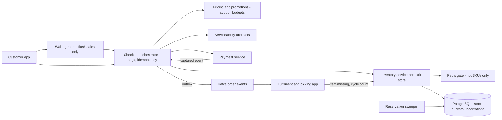
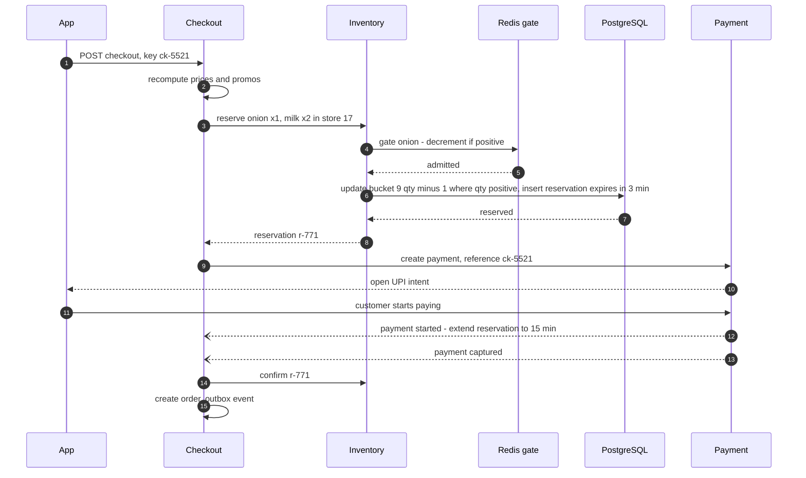
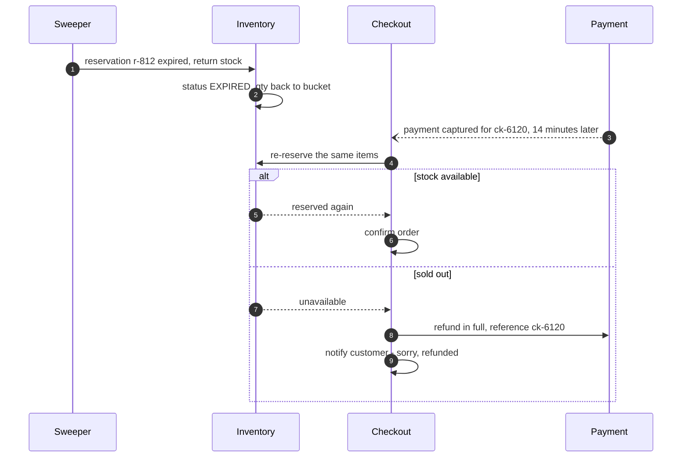
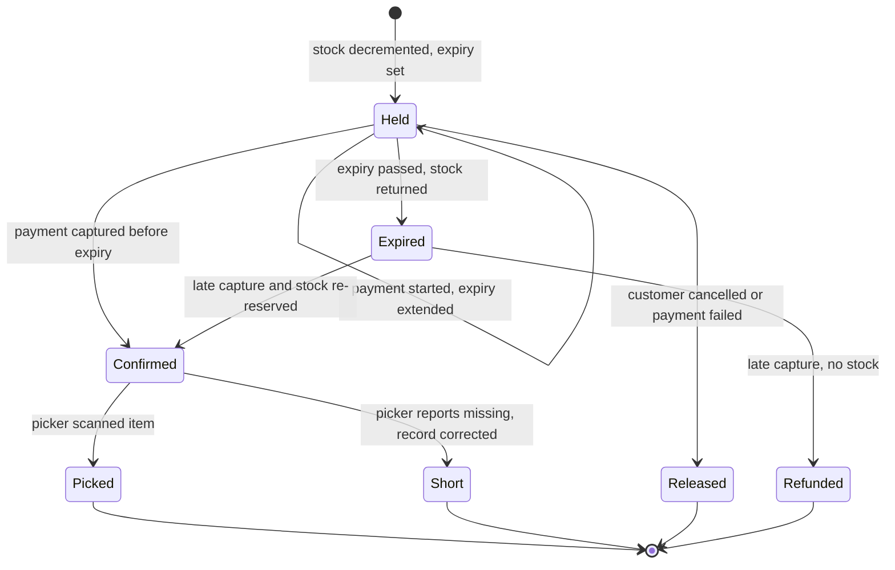

# 46. Case Study: Grocery Checkout & Inventory Reservation

!!! abstract "Chapter at a glance"
    **Reader bands:** B2 → B4 · **Prerequisites:** [Ch 02](../01-foundations/02-back-of-the-envelope-estimation.md) (hot-SKU estimate), [Ch 05](../01-foundations/05-relational-databases-deep-dive.md), [Ch 13](../02-distributed-core/13-distributed-transactions.md) (checkout saga), [Ch 18](../02-distributed-core/18-resilience-patterns.md), [Ch 45](45-payment-system.md) · **What you will build:** The grocery checkout: cart → price and promo validation → **stock reservation** in the customer's dark store → payment → order confirmation, with reservations that expire, dark-store stock that doesn't match the shelf, and 8 pm flash sales. Earlier chapters deferred the hard parts here: the national single-SKU deal on one hot row ([Ch 02](../01-foundations/02-back-of-the-envelope-estimation.md), [Ch 05](../01-foundations/05-relational-databases-deep-dive.md)), bucketing and a Redis front-gate, and "checkout re-validates availability" ([Ch 22](../03-production/22-search-systems.md)).

    - **L1: the ₹1 onion deal (real PostgreSQL + Redis).** 5,000 units, 20,000 attempts, 64 workers.
        - One row with an atomic conditional UPDATE sold out in **6.1 s** (~820/s, p99 254 ms). SELECT FOR UPDATE was slower.
        - **16 buckets** sold out **4.7x faster** (1.29 s). Without a sold-out flag, though, the losers probed every bucket: **245,489** DB transactions.
        - A **Redis front-gate** kept the database to **5,000** transactions, yet sold out no faster.
        - All four designs oversold **0**.
    - **L2: how long to hold stock.** A flash sale of 10,000 boxes for 25,000 customers.
        - A 30-minute hold left **1,621 boxes unsold** while **10,897** customers were told "sold out".
        - A 3-minute hold sold everything but charged **460** slow payers for boxes already gone.
        - Holding 3 minutes and extending to 15 once payment starts sold **9,993** with **123** late captures.
    - **L3: phantom stock.** Recorded stock overstated the shelf by 1,619 units in one day.
        - Selling to recorded stock left **3.91%** of orders with a missing item.
        - A flat 2-unit buffer cut that to 1.23% but hid 2,160 real units.
        - A per-SKU buffer learned from pick failures, plus correcting the record on a failed pick, reached **0.40%**, hiding 1,509 units.
    - **L4: the 8 pm crowd, end to end (real HTTP + PostgreSQL).** 8,000 customers arrived in 2 s for 2,000 boxes.
        - With no admission control, **7,575** got no answer in 25 s, and **1,838** buyers never heard that they'd bought.
        - A fast-503 limit answered everyone, but only **31%** of buyers were among the first 2,000 to arrive.
        - A **virtual waiting room** answered everyone, and **92%** of buyers were among the first 2,000.

    · **Reading time:** 110 min + code

---

## 1. Introduction & Why It Matters

### 1.1 A story: Diwali at 8 pm

Marketing announced "₹1 onions, 5,000 kg, 8 pm tonight" across India. The checkout team had load-tested for 3x normal traffic. At 8:00:00:

1. **One row became the whole company's bottleneck.** Every checkout with onions tried to decrement the same stock row. Checkouts for customers who didn't even want onions slowed down, because the connection pool was full of transactions queued on that row.
2. **Timeouts turned into retries.** Apps timed out after 3 seconds and retried; the retries joined the same queue. The service was busy completing checkouts for people who had already given up and tapped again.
3. **"Sold out" while carts held stock.** The first 5,000 checkouts reserved onions for 30 minutes. Thousands abandoned, but their reservations kept the onions off sale until 8:30, long after the crowd had left.
4. **Charged for nothing.** Customers whose UPI app took a long time paid after their reservation had expired and the onions had gone to someone else.
5. **Missing items at the door.** For fresh produce, recorded stock overstated the shelf. Pickers couldn't find items that checkout had happily sold; customers got partial orders and refunds.
6. **Unfair.** Who got the deal depended on retry timing, not on who came first. Social media noticed.

This chapter designs the checkout that survives 8 pm: fast and correct stock reservation under contention, reservations with sensible lifetimes, honesty about physical stock, and admission control that is fair.

!!! quote "The thesis of this chapter"
    Checkout is where **scarce physical stock meets unbounded demand**, and every design choice decides who gets what. **Contention** on hot items is solved by spreading the lock (buckets), keeping losers away from the database (a gate) and never holding locks across round trips (L1). **Reservations** are leases with a business-chosen lifetime; extend on evidence of intent, and handle late payments explicitly (L2). **Recorded stock is an estimate** of the shelf; buffer where it's wrong and correct it from the picker's feedback (L3). And under a crowd, **admission control** decides both whether the system survives and whether it's fair (L4).

### 1.2 Where this lives in the grocery platform

| Step | Service | Notes |
|---|---|---|
| Cart | Cart service | Per customer; prices shown are indicative |
| Validate | Pricing, promotions, serviceability | Final prices, coupon budgets, slot availability |
| Reserve | Inventory service (per dark store) | Leases on stock units; TTL |
| Pay | Payment service ([Ch 45](45-payment-system.md)) | Idempotent, webhook-driven |
| Confirm | Order service | Outbox events → fulfilment, notifications ([Ch 40](40-notification-system.md)) |
| Pick & pack | Dark-store app | Reports missing items → inventory corrections |

The checkout is a saga ([Ch 13](../02-distributed-core/13-distributed-transactions.md)): reserve → pay → confirm, with compensations (release the reservation, refund) on failure or expiry.

### 1.3 Learning objectives

By the end you will be able to:

- **Reserve stock correctly under extreme contention** and choose between single rows, buckets, gates and queues (L1).
- **Design reservation lifetimes** and the late-payment path (L2).
- **Handle inventory inaccuracy** with learned buffers and feedback from picking (L3).
- **Protect checkout with admission control** and a fair waiting room (L4).
- **Assemble the checkout saga** with idempotency, price and promo consistency, and failure handling.

---

## 2. Core Concepts — Beginner to Deep

### 2.1 Intuition: a counter with a limited batch of sweets <span class="band b2">B2</span>

A sweet shop has 5,000 boxes of a special. If everyone crowds one counter, the queue is the counter. Open 16 counters with a share of boxes each and the crowd moves faster, but "sold out" means asking every counter. Put a guard at the door with a clicker who stops letting people in after 5,000, and the counters never see the crowd. Give each buyer a few minutes to pay before the box goes back. And remember that the shop's ledger may say 5,000 while a few boxes were dropped in the back.

### 2.2 Requirements <span class="band b2">B2</span>

**Functional**

- Checkout validates prices, promotions and delivery slot; reserves every line item in the customer's dark store; takes payment; confirms the order.
- Partial availability: offer to proceed without unavailable items or suggest substitutes.
- Reservations expire; abandoned checkouts release stock.
- Flash sales with per-customer limits and fair access.

**Non-functional**

- **Never oversell** a reserved item beyond recorded stock; minimise shortfalls at picking.
- **Latency**: checkout p99 < 1 s in normal load; graceful and fair under flash crowds.
- **Throughput**: ~850 checkouts/s at normal peak ([Ch 02](../01-foundations/02-back-of-the-envelope-estimation.md)); flash sales far above that on a few SKUs.
- **Availability**: a hot SKU must not take down checkout for everything else.

### 2.3 Estimation <span class="band b2">B2</span>

| Quantity | Estimate |
|---|---|
| Checkouts at evening peak | ~850/s nationally, spread over ~300 dark stores |
| Per store per SKU | Usually a few per second — row locks are fine |
| National flash deal | ~250/s+ on one SKU if stock is national ([Ch 02](../01-foundations/02-back-of-the-envelope-estimation.md)) |
| Single-row lock throughput | ~800 reservations/s with a short transaction on the sandbox (L1); lower with longer transactions |
| Reservations outstanding | Checkouts/s × TTL: 850/s × 10 min ≈ 500k leases |

The ordinary case is easy because stock is per store. The flash sale is hard because it concentrates demand on one row and brings a crowd far above normal load.

### 2.4 Reserving stock under contention ⭐ <span class="band b3">B3</span>

L1 ran 20,000 attempts at 5,000 units from 64 workers against real PostgreSQL:

| Design | Sold out in | Reservations/s | p99 | Oversold | DB transactions |
|---|---|---|---|---|---|
| One row, atomic conditional UPDATE | 6.08 s | 822 | 254 ms | 0 | 20,000 |
| One row, SELECT FOR UPDATE then UPDATE | 6.89 s | 726 | 299 ms | 0 | 20,000 |
| **16 buckets** | **1.29 s** | **3,864** | 107 ms | 0 | **245,489** |
| **Redis front-gate + DB write** | 5.90 s | 848 | 250 ms | 0 | **5,000** |

- **Atomic conditional update** (`UPDATE … SET qty = qty − 1 WHERE qty > 0`) is correct and minimal: the check and the write are one statement. Holding a row lock across round trips (`SELECT … FOR UPDATE`, then `UPDATE`) lengthens the queue.
- **Buckets** split stock into N rows; each reservation picks one (randomly or by customer hash) and falls back to others when it's empty. Lock throughput scales with N. The cost: deciding "sold out" means checking every bucket. **Cache a sold-out flag** (or a total counter) once all buckets reach zero, or losers keep probing, as L1's 245k transactions show. Rebalance buckets near the end so no bucket strands stock.
- **A Redis gate** (Lua decrement-if-positive) answers winners and losers in microseconds and keeps losers away from the database. It is a second copy of the count: seed it from the database, and reconcile it, because a crash between gate and database leaks stock. It doesn't speed up the winners, who still queue on the database row — combine it with buckets.
- **Queued reservations**: put reservation requests on a partitioned queue and have a single consumer per SKU apply them in order. That's throughput without lock contention, with asynchronous answers.
- Keep the reservation transaction **tiny**: no payment calls, no remote calls, only the stock decrement and the reservation insert ([Ch 05](../01-foundations/05-relational-databases-deep-dive.md)).

### 2.5 Reservations as leases ⭐ <span class="band b3">B3</span>

A reservation is a lease: stock held for a customer until an expiry time. Model it explicitly:

```sql
create table reservations (
  id bigserial primary key, store_id int, sku text, qty int, checkout_id text,
  status text check (status in ('HELD','CONFIRMED','RELEASED','EXPIRED')),
  expires_at timestamptz not null, created_at timestamptz default now());
```

- **Expiry**: a sweeper returns expired HELD quantities to stock (in the same transaction as the status change), plus lazy checks at confirmation.
- **Confirmation**: payment captured → reservation CONFIRMED (idempotently, [Ch 45](45-payment-system.md)).
- **Late capture**: payment arrives after expiry. If stock is still available, re-reserve and confirm. Otherwise auto-refund and tell the customer; never silently oversell.

L2 simulated a flash sale with 60% payers (median 90 s, 5% over 10 minutes) and 40% abandoners:

| Policy | Sold (of 10,000) | Turned away while stock sat in abandoned carts | Late captures refunded | Unsold at end |
|---|---|---|---|---|
| Hold 30 min | 8,379 | **10,897** | 0 | **1,621** |
| Hold 10 min | 9,830 | 8,100 | 202 | 170 |
| Hold 3 min | 10,000 | 7,417 | **460** | 0 |
| **3 min, extend to 15 when payment starts** | 9,993 | 7,964 | 123 | 7 |

The TTL is a business trade between stranded stock and disappointed slow payers. **Extending on evidence of intent** (the customer entered the payment flow) gets most of both. Normal days tolerate longer holds; flash sales need short ones.

### 2.6 Physical stock vs recorded stock ⭐ <span class="band b3">B3</span>

Recorded stock is an estimate of what's on the shelf. Fresh produce, damage, misplacement and wastage make it wrong in one direction: phantom units. L3 simulated a day in a dark store:

| Policy | Orders with a missing item | Units on the shelf hidden by the buffer | Items sold |
|---|---|---|---|
| Sell to recorded stock | **3.91%** | 0 | 160,720 |
| Hide the last 2 units of every SKU | 1.23% | 2,160 | 158,680 |
| Per-SKU buffer from last week's pick failures | 0.50% | 1,509 | 159,267 |
| **+ correct the record when a pick fails** | **0.40%** | 1,509 | 159,267 |

- **Learn buffers per SKU** from pick failures and cycle counts: large for fresh produce, near zero for packaged goods.
- **Close the loop**: when a picker reports an item missing, correct recorded stock immediately (and trigger a cycle count), so the next checkout doesn't sell the same phantom unit.
- Buffers cost sales. The right level is a business trade between refunds and support contacts on one side, and hidden stock on the other.
- Offer **substitutions** at checkout for low-confidence items ("if unavailable, replace with a similar item?").

### 2.7 Admission control and the waiting room ⭐ <span class="band b4">B4</span>

A flash crowd far exceeds checkout capacity. L4 sent 8,000 customers in 2 seconds at a real checkout service with 10 database connections:

| Design | Bought | Told "sold out" | No answer in 25 s | Answer p99 | Buyers among the first 2,000 to arrive |
|---|---|---|---|---|---|
| No admission control | 162 (+1,838 who never heard back) | 263 | **7,575** | 24.8 s | 43% |
| 40 in flight, fast 503 + Retry-After | 2,000 | 6,000 | 0 | 9.5 s | **31%** |
| **Virtual waiting room, 300/s FIFO** | 2,000 | 6,000 | 0 | 9.9 s | **92%** |

- **No admission control**: requests queue for connections inside the service, clients time out and retry, and the service does work for people who have already given up. 1,838 customers bought a box and never learned it.
- **Load shedding** (a concurrency limit with a fast 503) saves the service ([Ch 18](../02-distributed-core/18-resilience-patterns.md)), but the winners are whoever's retry lands at the right moment.
- **A waiting room** hands out tickets in arrival order and admits them at a rate the backend can sustain. The database sees a steady load, every customer has a position, and first come is first served. Real waiting rooms add a pre-queue before the sale starts (randomised order among early arrivals), per-customer limits, and bot protection ([Ch 39](39-distributed-rate-limiter.md)).
- **Idempotent checkout**: a customer's retry must return their existing order, not "sold out".

### 2.8 Prices, promotions and coupon budgets <span class="band b3">B3</span>

- The cart shows indicative prices; checkout recomputes with the current price list and promotions and shows changes before payment.
- **Coupon budgets** ("first 10,000 orders get ₹100 off") are another hot counter: use the same techniques (atomic decrement, buckets, gates) and reserve the budget with the order, releasing it on expiry.
- Snapshot the final price, tax and promo per line into the order (immutable) for invoices ([Ch 36](../04-architect/36-compliance-governance-and-data-residency.md)) and refunds ([Ch 45](45-payment-system.md)).

### 2.9 The checkout saga <span class="band b3">B3</span>

1. `POST /checkout` with an idempotency key → validate cart, prices, promos, slot.
2. Reserve all lines in one transaction per store (or all-or-nothing with compensation). Partial availability → ask the customer.
3. Create the payment ([Ch 45](45-payment-system.md)) with the checkout id as reference.
4. On payment captured (event) → confirm reservations and create the order (outbox → fulfilment, notifications).
5. On failure, abandonment or expiry → release reservations; late capture → re-reserve or refund.
6. Everything keyed by checkout id; every step idempotent; stuck sagas surface as NEEDS_ATTENTION ([Ch 13](../02-distributed-core/13-distributed-transactions.md)).

### 2.10 Interview framing <span class="band b4">B4</span>

Draw the saga first. Then go deep on stock reservation under contention with the options table, and on the reservation lease (TTL trade-off, late captures). Staff-level signals: phantom inventory and feedback from picking, admission control and fairness, idempotent retries returning the original outcome, and keeping payment calls out of database transactions.

---

## 3. Architecture & Diagrams

### 3.1 Component view



### 3.2 Sequence: happy path, checkout with a hot SKU



### 3.3 Sequence: failure path, late capture after expiry



### 3.4 State: a reservation's lifecycle



---

## 4. Design Document Excerpt: Checkout & Inventory v2

!!! note "Design Document (excerpt) — Checkout & Inventory v2"
    **Status:** Accepted · **Authors:** Checkout and Inventory teams · **Reviewers:** Payments, Dark-store ops, Marketing, SRE

    | Field | Value |
    |---|---|
    | Context | Diwali flash sale: one hot row saturated the pool; timeouts and retries amplified load; 30-minute holds stranded stock; late payments charged for sold-out items; phantom stock caused missing items; outcomes were unfair. |
    | Decision | Atomic conditional updates with stock buckets for hot SKUs and a Redis gate for flash sales; reservation leases with short TTL extended on payment start and an explicit late-capture path; per-SKU buffers learned from picking plus immediate corrections; waiting room with FIFO admission for flash sales; idempotent checkout. |
    | Related ADRs | ADR-320 Reservation = one small transaction: conditional UPDATE + INSERT; no remote calls inside (L1); ADR-321 Hot SKUs: 16 buckets, sold-out flag, Redis gate seeded from DB and reconciled every minute (L1); ADR-322 TTL 3 min, extend to 15 min on payment start; late capture → re-reserve or auto-refund (L2); ADR-323 Per-SKU buffers from 7-day pick failures; picker "missing" corrects stock and opens a cycle count (L3); ADR-324 Flash sales behind a waiting room admitting at 70% of measured checkout capacity, FIFO with randomised pre-queue (L4); ADR-325 Checkout idempotency key returns the original outcome |

    **Requirements.**

    - **R1** Zero oversell against recorded stock; missing-item orders < 0.5%.
    - **R2** Flash sales never degrade checkout for other items (bulkheads).
    - **R3** Every customer in a flash sale gets an answer within 30 s; buyers ≥ 90% in arrival order.
    - **R4** Late captures refunded automatically within 5 minutes.
    - **R5** Stranded stock (held by abandoned checkouts) < 5% of flash-sale stock at any time.

    **Decisions in detail.**

    1. **Stock model (ADR-320/321).** `stock(store, sku, bucket, qty CHECK qty >= 0)`; buckets = 1 normally, 16 for configured hot SKUs.
    2. **Leases (ADR-322).** Reservation rows with `expires_at`; sweeper every 10 s; payment-started events extend.
    3. **Accuracy (ADR-323).** Buffer = ceil(1.5 × daily average misses) per SKU per store; nightly recompute.
    4. **Waiting room (ADR-324).** Edge-hosted queue; tokens signed; admission rate adjusted from checkout latency.
    5. **Idempotency (ADR-325).** Keys stored with outcome for 24 h ([Ch 20](../02-distributed-core/20-idempotency-ids-and-distributed-locks.md)).

    **Consequences.** More moving parts for flash sales (gate, buckets, waiting room); buffers hide some sellable stock; short TTLs require the late-capture path. In return: sales that finish in seconds without collateral damage, fewer missing items, and outcomes customers can see are fair.

---

## 5. Hands-On Code — Level Ladder

!!! info "What's real here"
    All four labs are JDK 21. **L1 and L4 run against a real PostgreSQL 16 with durable commits.** L1 also uses a real Redis 7 for the gate, and L4 runs a real HTTP checkout service with real HTTP clients. L2 and L3 are deterministic simulations; customer behaviour, payment times and shrinkage rates are stated assumptions. Timings vary by machine.

L1 needs PostgreSQL 16 on port 5581 (database `shop`) and Redis 7 on port 6390; L4 needs PostgreSQL. Both need `postgresql-42.7.4.jar` and `-Duser.timezone=UTC`. Run every lab with `-Dstdout.encoding=UTF-8`.

### L1 — The ₹1 onion deal <span class="band b3">B3</span>

**Requirement:** "5,000 units of one SKU, a national crowd. Never oversell, sell out fast, and don't let the rest of the platform feel it."

Four reservation designs against real PostgreSQL, with Redis as the gate in D. 64 workers make 20,000 attempts.

```java title="HotSkuL1.java"
// HotSkuL1.java — run with (PostgreSQL 16 on :5581 db "shop", Redis 7 on :6390):
//   java -cp postgresql-42.7.4.jar -Duser.timezone=UTC HotSkuL1.java
// THE NATIONAL ₹1 ONION DEAL. 5,000 units, one SKU, and 64 concurrent checkout workers hammering it (Ch 02 flagged this
// as the case where one row approaches its lock limit). Each reservation must also be recorded durably. Four designs:
//   A) ONE ROW, atomic:   UPDATE stock SET qty = qty - 1 WHERE sku = ? AND qty > 0, + INSERT reservation, one txn
//   B) ONE ROW, locked:   SELECT … FOR UPDATE, check, UPDATE, INSERT — the lock is held across two round trips
//   C) 16 BUCKETS:        stock split across 16 rows; a worker tries a random bucket, then the others if it's empty
//   D) REDIS FRONT-GATE:  a Lua DECR-if-positive in Redis admits or rejects instantly; admitted requests then write
//                         the reservation to PostgreSQL (the database never sees the rejected ones)
// 20,000 attempts in total (4x the stock). Measured: time to sell out, reservations/s while stock lasts, p99 latency,
// OVERSOLD units (must be 0) and how many database transactions were attempted.
import java.io.*;
import java.net.Socket;
import java.nio.charset.StandardCharsets;
import java.sql.*;
import java.util.*;
import java.util.concurrent.*;
import java.util.concurrent.atomic.*;

public class HotSkuL1 {
    static final String DB = "jdbc:postgresql://127.0.0.1:5581/shop?user=claude";
    static final int STOCK = 5_000, ATTEMPTS = 20_000, WORKERS = 64, BUCKETS = 16;
    static final String GATE = "local v = tonumber(redis.call('GET', KEYS[1]) or '0') if v > 0 then redis.call('DECR', KEYS[1]) return 1 end return 0";

    public static void main(String[] args) throws Exception {
        System.out.printf("One SKU, %,d units, %,d reservation attempts from %d concurrent workers (PostgreSQL 16, durable commits).%n%n", STOCK, ATTEMPTS, WORKERS);
        System.out.printf("   %-44s %10s %14s %11s %10s %14s %16s%n", "design", "sold", "sold out in", "reserv./s", "p99", "oversold", "DB transactions");
        System.out.printf("   %-44s %10s %14s %11s %10s %14s %16s%n", "", "", "", "", "", "", "attempted");
        String[] names = {"A) one row, atomic conditional UPDATE", "B) one row, SELECT FOR UPDATE then UPDATE", "C) 16 buckets, random then fallback", "D) Redis Lua front-gate + DB write"};
        for (int d = 0; d < 4; d++) run(d, names[d]);
        System.out.println("\n   → one row is correct and simple, and every buyer queues on its lock: ~800 reservations/s here, with a p99 over");
        System.out.println("     a quarter of a second. Holding the lock across two round trips (FOR UPDATE, then UPDATE) is slower still.");
        System.out.println("     Sixteen buckets spread the lock and sold out about 4x faster — but once stock ran out, every attempt probed all");
        System.out.println("     16 buckets before saying 'sold out', twelve times the database transactions of A. Cache a sold-out flag.");
        System.out.println("     The Redis front-gate kept the 15,000 losers away from the database entirely (5,000 transactions), yet sold out");
        System.out.println("     no faster: the winners still queue on the one row behind it. Combine them — gate plus buckets — for the");
        System.out.println("     biggest deals, and remember the gate is a second copy of the stock count that must be seeded and reconciled.");
    }

    static void run(int design, String name) throws Exception {
        try (Connection c = DriverManager.getConnection(DB); Statement s = c.createStatement()) {
            s.execute("drop table if exists reservations"); s.execute("drop table if exists stock");
            s.execute("create table stock(sku text, bucket int, qty int not null check (qty >= 0), primary key (sku, bucket))");
            s.execute("create table reservations(id bigserial primary key, sku text, bucket int, customer int, created_at timestamptz default now())");
            if (design == 2) s.execute("insert into stock select 'ONION-1KG', g, " + (STOCK / BUCKETS) + " + case when g < " + (STOCK % BUCKETS) + " then 1 else 0 end from generate_series(0," + (BUCKETS - 1) + ") g");
            else s.execute("insert into stock values ('ONION-1KG', 0, " + STOCK + ")");
        }
        String sha;
        try (Redis r = new Redis()) { r.cmd("SET", "gate:ONION-1KG", String.valueOf(STOCK)); sha = (String) r.cmd("SCRIPT", "LOAD", GATE); }
        AtomicInteger next = new AtomicInteger(), sold = new AtomicInteger(); long[] lat = new long[ATTEMPTS]; AtomicLong soldOutAt = new AtomicLong();
        AtomicInteger dbTx = new AtomicInteger(); DB_TX.set(dbTx);
        long t0 = System.nanoTime();
        try (var pool = Executors.newFixedThreadPool(WORKERS)) {
            for (int w = 0; w < WORKERS; w++) pool.submit(() -> {
                try (Connection c = DriverManager.getConnection(DB); Redis r = new Redis()) {
                    Random rnd = new Random(Thread.currentThread().threadId());
                    int i;
                    while ((i = next.getAndIncrement()) < ATTEMPTS) {
                        long s = System.nanoTime(); boolean ok = switch (design) {
                            case 0 -> atomic(c, 0, i); case 1 -> locked(c, i); case 2 -> buckets(c, rnd, i);
                            default -> ((Long) r.cmd("EVALSHA", sha, "1", "gate:ONION-1KG")) == 1 && atomic(c, 0, i);
                        };
                        lat[i] = System.nanoTime() - s;
                        if (ok) { if (sold.incrementAndGet() == STOCK) soldOutAt.set(System.nanoTime() - t0); }
                    }
                }
                return null;
            });
        }
        int left; try (Connection c = DriverManager.getConnection(DB)) { left = remaining(c); }
        int reservations; try (Connection c = DriverManager.getConnection(DB); ResultSet rs = c.createStatement().executeQuery("select count(*) from reservations")) { rs.next(); reservations = rs.getInt(1); }
        Arrays.sort(lat); double out = soldOutAt.get() / 1e9;
        System.out.printf("   %-44s %,10d %12.2f s %,11.0f %7.1f ms %,14d %,16d%n", name, reservations, out, STOCK / out, lat[(int) (ATTEMPTS * 0.99)] / 1e6,
                Math.max(0, reservations - STOCK), dbTx.get());
    }

    static int remaining(Connection c) throws SQLException { try (ResultSet rs = c.createStatement().executeQuery("select coalesce(sum(qty),0) from stock")) { rs.next(); return rs.getInt(1); } }
    static final java.util.concurrent.atomic.AtomicReference<AtomicInteger> DB_TX = new java.util.concurrent.atomic.AtomicReference<>();
    static boolean atomic(Connection c, int bucket, int customer) throws SQLException {
        DB_TX.get().incrementAndGet(); c.setAutoCommit(false);
        try (PreparedStatement u = c.prepareStatement("update stock set qty = qty - 1 where sku = 'ONION-1KG' and bucket = ? and qty > 0")) {
            u.setInt(1, bucket);
            if (u.executeUpdate() == 0) { c.rollback(); return false; }
            try (PreparedStatement ins = c.prepareStatement("insert into reservations(sku, bucket, customer) values ('ONION-1KG', ?, ?)")) { ins.setInt(1, bucket); ins.setInt(2, customer); ins.executeUpdate(); }
            c.commit(); return true;
        } catch (SQLException e) { c.rollback(); throw e; } finally { c.setAutoCommit(true); }
    }
    static boolean locked(Connection c, int customer) throws SQLException {
        DB_TX.get().incrementAndGet(); c.setAutoCommit(false);
        try {
            int qty; try (ResultSet rs = c.createStatement().executeQuery("select qty from stock where sku = 'ONION-1KG' and bucket = 0 for update")) { rs.next(); qty = rs.getInt(1); }
            if (qty <= 0) { c.rollback(); return false; }
            c.createStatement().executeUpdate("update stock set qty = qty - 1 where sku = 'ONION-1KG' and bucket = 0");
            try (PreparedStatement ins = c.prepareStatement("insert into reservations(sku, bucket, customer) values ('ONION-1KG', 0, ?)")) { ins.setInt(1, customer); ins.executeUpdate(); }
            c.commit(); return true;
        } catch (SQLException e) { c.rollback(); throw e; } finally { c.setAutoCommit(true); }
    }
    static boolean buckets(Connection c, Random rnd, int customer) throws SQLException {
        int start = rnd.nextInt(BUCKETS);
        for (int k = 0; k < BUCKETS; k++) if (atomic(c, (start + k) % BUCKETS, customer)) return true;   // all buckets empty → truly sold out
        return false;
    }

    static final class Redis implements Closeable {
        final Socket s; final OutputStream out; final InputStream in;
        Redis() throws IOException { s = new Socket("127.0.0.1", 6390); s.setTcpNoDelay(true); out = new BufferedOutputStream(s.getOutputStream()); in = new BufferedInputStream(s.getInputStream()); }
        Object cmd(String... parts) throws IOException {
            StringBuilder sb = new StringBuilder("*").append(parts.length).append("\r\n");
            for (String p : parts) { byte[] b = p.getBytes(StandardCharsets.UTF_8); sb.append('$').append(b.length).append("\r\n").append(p).append("\r\n"); }
            out.write(sb.toString().getBytes(StandardCharsets.UTF_8)); out.flush(); return read();
        }
        Object read() throws IOException {
            int type = in.read(); String line = line();
            return switch (type) {
                case '+' -> line; case ':' -> Long.parseLong(line);
                case '$' -> { int n = Integer.parseInt(line); if (n < 0) yield null; byte[] b = in.readNBytes(n); line(); yield new String(b, StandardCharsets.UTF_8); }
                case '-' -> throw new IOException(line);
                default -> throw new IOException("unexpected " + (char) type);
            };
        }
        String line() throws IOException { StringBuilder sb = new StringBuilder(); int c; while ((c = in.read()) != '\r') sb.append((char) c); in.read(); return sb.toString(); }
        public void close() throws IOException { s.close(); }
    }
}
```

```text title="java -cp postgresql-42.7.4.jar -Duser.timezone=UTC HotSkuL1.java"
One SKU, 5,000 units, 20,000 reservation attempts from 64 concurrent workers (PostgreSQL 16, durable commits).

   design                                             sold    sold out in   reserv./s        p99       oversold  DB transactions
                                                                                                                       attempted
   A) one row, atomic conditional UPDATE             5,000         6.08 s         822   254.4 ms              0           20,000
   B) one row, SELECT FOR UPDATE then UPDATE         5,000         6.89 s         726   299.2 ms              0           20,000
   C) 16 buckets, random then fallback               5,000         1.29 s       3,864   107.3 ms              0          245,489
   D) Redis Lua front-gate + DB write                5,000         5.90 s         848   249.7 ms              0            5,000

   → one row is correct and simple, and every buyer queues on its lock: ~800 reservations/s here, with a p99 over
     a quarter of a second. Holding the lock across two round trips (FOR UPDATE, then UPDATE) is slower still.
     Sixteen buckets spread the lock and sold out about 4x faster — but once stock ran out, every attempt probed all
     16 buckets before saying 'sold out', twelve times the database transactions of A. Cache a sold-out flag.
     The Redis front-gate kept the 15,000 losers away from the database entirely (5,000 transactions), yet sold out
     no faster: the winners still queue on the one row behind it. Combine them — gate plus buckets — for the
     biggest deals, and remember the gate is a second copy of the stock count that must be seeded and reconciled.
```

**Reading it:**

- **A**: ~820 reservations/s on one row, with a quarter-second p99 for everyone in the queue. **B** holds the lock across two round trips and is slower still.
- **C**: 16 buckets sold out **4.7x faster**. Once stock was gone, though, each of the remaining ~15,000 attempts tried all 16 buckets: 245,489 transactions to say "sold out". Exercise 1 adds the flag.
- **D**: the gate answered the 15,000 losers without the database (5,000 transactions in total), but the winners still queued on one row. Exercise 2 combines gate and buckets.
- **Oversold: 0** everywhere. The designs differ in speed and in how much work the database does, not in correctness.

### L2 — How long to hold stock <span class="band b3">B3</span>

**Requirement:** "Hold stock long enough for real payers, short enough that abandoned carts don't starve everyone else."

An event-driven simulation of a one-hour flash sale: 10,000 boxes, 25,000 customers, realistic payment times and abandonment.

```java title="ReservationTtlL2.java"
// ReservationTtlL2.java — run with: java ReservationTtlL2.java   (JDK 21, no dependencies)
// HOW LONG DO YOU HOLD STOCK FOR SOMEONE WHO MIGHT PAY? A one-hour flash sale: 10,000 mango boxes, 25,000 customers
// arriving (fixed seed). Checkout reserves one box. 60% of customers go on to pay — median 90 s (switching to the UPI app,
// entering the PIN), 5% take over 10 minutes (retries, bank OTP delays); 40% abandon and never pay. A reservation that
// expires returns its box to stock. A payment that completes after the reservation expired is a LATE CAPTURE: the box
// may already be someone else's, so the customer is charged for nothing and must be refunded (or the order oversold).
//   T30  reservation TTL 30 minutes          T10  TTL 10 minutes          T3  TTL 3 minutes
//   T3+  TTL 3 minutes, extended to 15 minutes the moment the customer actually starts paying (enters the gateway)
// Measured: boxes sold, customers told "sold out" while boxes were sitting in abandoned reservations, late captures
// that had to be refunded, and boxes left unsold at the end.
import java.util.*;

public class ReservationTtlL2 {
    record Customer(double arrive, boolean pays, double payStart, double payDone) {}

    public static void main(String[] args) {
        Random r = new Random(46); List<Customer> cs = new ArrayList<>();
        for (int i = 0; i < 25_000; i++) {
            double arrive = r.nextDouble() * 3600; boolean pays = r.nextDouble() < 0.6;
            double start = arrive + 10 + r.nextDouble() * 40;                                    // time to reach the gateway
            double dur = r.nextDouble() < 0.05 ? 600 + r.nextDouble() * 600 : Math.exp(Math.log(90) + 0.6 * r.nextGaussian());
            cs.add(new Customer(arrive, pays, start, start + dur));
        }
        cs.sort(Comparator.comparingDouble(Customer::arrive));
        System.out.println("Flash sale: 10,000 boxes, 25,000 customers over 1 hour; 60% pay (median 90 s, 5% > 10 min), 40% abandon.\n");
        System.out.printf("   %-52s %8s %22s %16s %14s%n", "reservation policy", "sold", "turned away while stock", "late captures", "unsold at end");
        System.out.printf("   %-52s %8s %22s %16s %14s%n", "", "", "sat in abandoned carts", "refunded", "");
        String[][] ps = {{"T30) hold 30 minutes", "1800", "0"}, {"T10) hold 10 minutes", "600", "0"}, {"T3) hold 3 minutes", "180", "0"},
                {"T3+) hold 3 minutes, extend to 15 when paying starts", "180", "900"}};
        for (String[] p : ps) run(cs, p[0], Double.parseDouble(p[1]), Double.parseDouble(p[2]));
        System.out.println("\n   → a long hold protects slow payers and starves everyone else: boxes sit in carts that will never pay while");
        System.out.println("     real buyers are told 'sold out'. A short hold recycles abandoned stock fast, but the slow payers' reservations");
        System.out.println("     expire under them — they get charged for a box that's gone, and must be refunded. Holding briefly and");
        System.out.println("     extending only when there's evidence of intent (the customer actually entered the payment flow) gets most of");
        System.out.println("     both. The TTL is a business policy with a measurable cost on each side; make the expiry and the late-capture");
        System.out.println("     path (auto-refund, or honour it if stock allows) explicit states, not accidents.");
    }

    static void run(List<Customer> cs, String name, double ttl, double extendTo) {
        int stock = 10_000, sold = 0, turnedAwayStranded = 0, lateRefunded = 0;
        // events: reservation expiries and payment completions
        PriorityQueue<double[]> ev = new PriorityQueue<>(Comparator.comparingDouble(a -> a[0]));   // [time, type(0 expire,1 pay), idx]
        double[] expiresAt = new double[cs.size()]; boolean[] active = new boolean[cs.size()]; int abandonedHeld = 0;
        int ci = 0;
        while (ci < cs.size() || !ev.isEmpty()) {
            double nextArrive = ci < cs.size() ? cs.get(ci).arrive() : Double.MAX_VALUE;
            if (!ev.isEmpty() && ev.peek()[0] <= nextArrive) {
                double[] e = ev.poll(); int idx = (int) e[2]; Customer c = cs.get(idx);
                if (e[1] == 0) {                                                         // expiry check
                    if (active[idx] && expiresAt[idx] <= e[0] + 1e-9) { active[idx] = false; stock++; if (!c.pays()) abandonedHeld--; }
                } else if (e[1] == 2) {                                                  // payment started: extend
                    if (active[idx] && extendTo > 0) { expiresAt[idx] = Math.max(expiresAt[idx], e[0] + extendTo); ev.add(new double[]{expiresAt[idx], 0, idx}); }
                } else {                                                                 // payment completed
                    if (active[idx]) { active[idx] = false; sold++; }
                    else if (stock > 0) { stock--; sold++; }                             // late, but a box happens to be free: honour it
                    else lateRefunded++;
                }
                continue;
            }
            Customer c = cs.get(ci); int idx = ci++;
            if (stock == 0) { if (abandonedHeld > 0) turnedAwayStranded++; continue; }
            stock--; active[idx] = true; expiresAt[idx] = c.arrive() + ttl; ev.add(new double[]{expiresAt[idx], 0, idx});
            if (c.pays()) { ev.add(new double[]{c.payStart(), 2, idx}); ev.add(new double[]{c.payDone(), 1, idx}); } else abandonedHeld++;
        }
        System.out.printf("   %-52s %,8d %,22d %,16d %,14d%n", name, sold, turnedAwayStranded, lateRefunded, stock);
    }
}
```

```text title="java -Dstdout.encoding=UTF-8 ReservationTtlL2.java"
Flash sale: 10,000 boxes, 25,000 customers over 1 hour; 60% pay (median 90 s, 5% > 10 min), 40% abandon.

   reservation policy                                       sold turned away while stock    late captures  unsold at end
                                                                 sat in abandoned carts         refunded               
   T30) hold 30 minutes                                    8,379                 10,897                0          1,621
   T10) hold 10 minutes                                    9,830                  8,100              202            170
   T3) hold 3 minutes                                     10,000                  7,417              460              0
   T3+) hold 3 minutes, extend to 15 when paying starts    9,993                  7,964              123              7

   → a long hold protects slow payers and starves everyone else: boxes sit in carts that will never pay while
     real buyers are told 'sold out'. A short hold recycles abandoned stock fast, but the slow payers' reservations
     expire under them — they get charged for a box that's gone, and must be refunded. Holding briefly and
     extending only when there's evidence of intent (the customer actually entered the payment flow) gets most of
     both. The TTL is a business policy with a measurable cost on each side; make the expiry and the late-capture
     path (auto-refund, or honour it if stock allows) explicit states, not accidents.
```

**Reading it:**

- **30 minutes**: **1,621 boxes unsold at the end**. They sat in abandoned carts until after the crowd left, while 10,897 customers were told "sold out".
- **3 minutes**: everything sold, but **460** slow payers were charged for boxes their reservation no longer held.
- **3 minutes + extend when paying starts**: 9,993 sold and 123 late captures. The extension targets the people who are actually paying. The remaining late captures are the 5% whose payments take longer than 15 minutes.

### L3 — Phantom stock <span class="band b3">B3</span>

**Requirement:** "Customers shouldn't find items missing at the door because our records were optimistic — and we shouldn't hide half the shelf to avoid it."

One simulated day in a dark store: 2,000 SKUs, 30,000 orders, shrinkage concentrated in fresh produce, and four stock policies.

```java title="PhantomStockL3.java"
// PhantomStockL3.java — run with: java PhantomStockL3.java   (JDK 21, no dependencies)
// THE SYSTEM SAYS 3, THE SHELF HAS 1. A dark store's recorded stock drifts from what's physically on the shelf: damaged
// produce, misplaced items, unrecorded wastage, theft. Checkout reserves against RECORDED stock; the picker finds out the
// truth. One simulated day (fixed seed) in a dark store with 2,000 SKUs (25% fresh produce with large discrepancies,
// the rest packaged with small ones) and 30,000 orders of ~6 items. Four policies:
//   P1 sell down to recorded stock (no buffer)
//   P2 hide the last 2 units of every SKU (a global safety buffer)
//   P3 per-SKU buffer learned from last week's pick failures (fresh produce gets a bigger one)
//   P4 P3 + when a picker reports an item missing, recorded stock is corrected to the shelf count at once
// Measured: orders that reached the customer with an item missing, units physically on the shelf at close that the buffer
// never offered (sales lost to caution), and items sold.
import java.util.*;

public class PhantomStockL3 {
    public static void main(String[] args) {
        int skus = 2_000; Random r = new Random(47);
        int[] recorded = new int[skus]; double[] lambda = new double[skus]; double[] demand = new double[skus]; boolean[] fresh = new boolean[skus];
        for (int i = 0; i < skus; i++) {
            fresh[i] = r.nextDouble() < 0.25; recorded[i] = 5 + r.nextInt(56);
            lambda[i] = fresh[i] ? 2.5 : 0.25;                                             // expected missing units per day
            demand[i] = 1.0 / Math.pow(i + 1, 0.6);
        }
        double sum = Arrays.stream(demand).sum(); double[] cdf = new double[skus]; double c = 0; for (int i = 0; i < skus; i++) { c += demand[i] / sum; cdf[i] = c; }
        List<int[]> orders = new ArrayList<>();
        for (int o = 0; o < 30_000; o++) { int n = 3 + r.nextInt(7); int[] items = new int[n]; for (int k = 0; k < n; k++) { int idx = Arrays.binarySearch(cdf, r.nextDouble()); items[k] = idx < 0 ? Math.min(skus - 1, -idx - 1) : idx; } orders.add(items); }
        // today's discrepancies (shrinkage) and last week's observed pick failures (to learn buffers)
        int[] shrink = new int[skus], lastWeekMisses = new int[skus];
        for (int i = 0; i < skus; i++) { shrink[i] = poisson(r, lambda[i]); for (int d = 0; d < 7; d++) lastWeekMisses[i] += poisson(r, lambda[i]); }
        // restock: recorded stock should cover a day's demand for most SKUs
        for (int i = 0; i < skus; i++) recorded[i] = Math.max(recorded[i], (int) Math.ceil(30_000 * 6 * demand[i] / sum * 0.9));

        System.out.printf("Dark store: %,d SKUs (25%% fresh), %,d orders; recorded stock overstates the shelf by %,d units in total.%n%n", skus, orders.size(), Arrays.stream(shrink).sum());
        System.out.printf("   %-58s %14s %16s %16s%n", "policy", "orders with a", "units on shelf,", "items sold");
        System.out.printf("   %-58s %14s %16s %16s%n", "", "missing item", "hidden by buffer", "");
        String[] names = {"P1) sell down to recorded stock", "P2) hide the last 2 units of every SKU", "P3) per-SKU buffer from last week's pick failures",
                "P4) P3 + correct recorded stock when a pick fails"};
        for (int p = 0; p < 4; p++) {
            int[] rec = recorded.clone(), shelf = new int[skus]; for (int i = 0; i < skus; i++) shelf[i] = Math.max(0, recorded[i] - shrink[i]);
            int[] buffer = new int[skus];
            for (int i = 0; i < skus; i++) buffer[i] = p == 0 ? 0 : p == 1 ? 2 : (int) Math.ceil(lastWeekMisses[i] / 7.0 * 1.5);
            int missingOrders = 0, lostSales = 0, sold = 0;
            for (int[] o : orders) {
                boolean missing = false;
                for (int it : o) {
                    if (rec[it] - buffer[it] <= 0) continue;                                      // shown out of stock
                    rec[it]--;                                                                   // reserved against recorded stock
                    if (shelf[it] > 0) { shelf[it]--; sold++; }
                    else { missing = true; if (p == 3) rec[it] = 0; }                             // picker can't find it; P4 fixes the record
                }
                if (missing) missingOrders++;
            }
            for (int i = 0; i < skus; i++) if (rec[i] - buffer[i] <= 0) lostSales += Math.max(0, shelf[i]);   // on the shelf, never offered
            System.out.printf("   %-58s %13.2f%% %,16d %,16d%n", names[p], 100.0 * missingOrders / orders.size(), lostSales, sold);
        }
        System.out.println("\n   → selling to recorded stock turns every discrepancy into a disappointed customer at the door — refunds, missing");
        System.out.println("     items and support calls (3.9% of orders here). A flat buffer hides stock that is really there and still misses");
        System.out.println("     the fresh produce that drifts most. A buffer learned per SKU from pick failures puts the caution where the errors");
        System.out.println("     are, and fixing the record the moment a picker finds a gap stops the same phantom unit being sold again. Inventory");
        System.out.println("     accuracy is a data-quality loop between the picker's handheld and the checkout — not a property of the database.");
        System.out.println("     Buffers do cost sales (compare items sold): the right buffer is a business trade between refunds and lost sales.");
    }
    static int poisson(Random r, double l) { double L = Math.exp(-l), p = 1; int k = 0; do { k++; p *= r.nextDouble(); } while (p > L); return k - 1; }
}
```

```text title="java -Dstdout.encoding=UTF-8 PhantomStockL3.java"
Dark store: 2,000 SKUs (25% fresh), 30,000 orders; recorded stock overstates the shelf by 1,619 units in total.

   policy                                                      orders with a  units on shelf,       items sold
                                                                missing item hidden by buffer                 
   P1) sell down to recorded stock                                     3.91%                0          160,720
   P2) hide the last 2 units of every SKU                              1.23%            2,160          158,680
   P3) per-SKU buffer from last week's pick failures                   0.50%            1,509          159,267
   P4) P3 + correct recorded stock when a pick fails                   0.40%            1,509          159,267

   → selling to recorded stock turns every discrepancy into a disappointed customer at the door — refunds, missing
     items and support calls (3.9% of orders here). A flat buffer hides stock that is really there and still misses
     the fresh produce that drifts most. A buffer learned per SKU from pick failures puts the caution where the errors
     are, and fixing the record the moment a picker finds a gap stops the same phantom unit being sold again. Inventory
     accuracy is a data-quality loop between the picker's handheld and the checkout — not a property of the database.
     Buffers do cost sales (compare items sold): the right buffer is a business trade between refunds and lost sales.
```

**Reading it:**

- **Recorded stock** sells every phantom unit: **3.91%** of orders arrive with something missing.
- **A flat buffer** cuts that to 1.23%, but hides 2,160 real units and still under-protects fresh produce.
- **A learned per-SKU buffer** does better on both counts: 0.50%, with 1,509 hidden units.
- **Correcting the record on a failed pick** stops repeat failures: **0.40%**.
- Every buffer costs sales (compare "items sold" with P1); the level is a business decision.

### L4 — The 8 pm crowd, end to end <span class="band b4">B4</span>

**Requirement:** "8,000 people tap 'Buy' within two seconds for 2,000 boxes. Everyone gets an answer quickly, the service survives, and the first to arrive are the first served."

A real checkout service (JDK HttpServer, 10 PostgreSQL connections, ~20 ms of DB work per checkout) and 8,000 real HTTP clients that time out at 3 s and retry. Three admission strategies.

```java title="WaitingRoomL4.java"
// WaitingRoomL4.java — run with (PostgreSQL 16 on :5581, db "shop"):
//   java -cp postgresql-42.7.4.jar -Duser.timezone=UTC -Dsun.net.httpserver.nodelay=true WaitingRoomL4.java
// THE 8 PM FLASH SALE, END TO END. A real checkout service (JDK HttpServer on virtual threads) with a 10-connection
// PostgreSQL pool: a checkout does ~20 ms of database work (price, promo, address checks), reserves stock (8 buckets)
// and inserts the order in one transaction, then calls the payment service (15 ms, simulated). A repeated request from
// a customer who already bought returns the earlier result. 2,000 boxes; 8,000 customers arrive within 2 seconds. Clients time out after 3 s
// and retry (with jitter) until they get an answer or 25 s pass. Three ways to face the crowd:
//   W1 no admission control: every request waits for a database connection
//   W2 concurrency limit: at most 40 checkouts in flight; the rest get 503 + Retry-After immediately
//   W3 virtual waiting room: customers join a queue and get a ticket; tickets are admitted at 300/s in arrival order;
//      the app polls its position every 1.5–2.5 s and checks out when admitted
// Measured: customers who got a definite answer (bought, or told "sold out"), p50/p99 time to that answer, requests the
// server absorbed, and FAIRNESS — of the 2,000 who bought, how many were among the first 2,000 to arrive.
import com.sun.net.httpserver.HttpServer;
import java.net.*;
import java.net.http.*;
import java.sql.*;
import java.time.Duration;
import java.util.*;
import java.util.concurrent.*;
import java.util.concurrent.atomic.*;

public class WaitingRoomL4 {
    static final String DB = "jdbc:postgresql://127.0.0.1:5581/shop?user=claude";
    static final int STOCK = 2_000, CUSTOMERS = 8_000, BUCKETS = 8;
    static final BlockingQueue<Connection> pool = new LinkedBlockingQueue<>();
    static final AtomicLong ticketSeq = new AtomicLong(), admittedUpTo = new AtomicLong(), requests = new AtomicLong();
    static final Semaphore inFlight = new Semaphore(40);
    static volatile boolean soldOut; static int design;

    public static void main(String[] args) throws Exception {
        for (int i = 0; i < 10; i++) pool.add(DriverManager.getConnection(DB));
        HttpServer srv = HttpServer.create(new InetSocketAddress("127.0.0.1", 0), 8192); srv.setExecutor(Executors.newVirtualThreadPerTaskExecutor());
        srv.createContext("/join", ex -> { requests.incrementAndGet(); byte[] b = String.valueOf(ticketSeq.incrementAndGet()).getBytes(); ex.sendResponseHeaders(200, b.length); ex.getResponseBody().write(b); ex.close(); });
        srv.createContext("/status", ex -> { requests.incrementAndGet(); long t = Long.parseLong(ex.getRequestURI().getQuery().substring(7));
            byte[] b = (soldOut ? "soldout" : t <= admittedUpTo.get() ? "admitted" : "wait " + (t - admittedUpTo.get())).getBytes(); ex.sendResponseHeaders(200, b.length); ex.getResponseBody().write(b); ex.close(); });
        srv.createContext("/checkout", ex -> {
            requests.incrementAndGet(); int code;
            if (design == 1 && !inFlight.tryAcquire()) { ex.getResponseHeaders().add("Retry-After", "1"); ex.sendResponseHeaders(503, -1); ex.close(); return; }
            try { int cust = Integer.parseInt(ex.getRequestURI().getQuery().substring(9)); code = alreadyBought(cust) ? 200 : soldOut ? 409 : checkout(cust); }
            catch (Exception e) { code = 500; } finally { if (design == 1) inFlight.release(); }
            ex.sendResponseHeaders(code, -1); ex.close();
        });
        srv.start();
        String base = "http://127.0.0.1:" + srv.getAddress().getPort();
        System.out.printf("Checkout service (10 DB connections, ~20 ms DB work per checkout), %,d boxes, %,d customers arriving within 2 s;%nclients time out at 3 s and retry.%n%n", STOCK, CUSTOMERS);
        System.out.printf("   %-46s %10s %12s %12s %12s %14s %14s%n", "design", "bought", "told sold", "no answer", "answer p50", "answer p99", "fair (bought");
        System.out.printf("   %-46s %10s %12s %12s %12s %14s %14s%n", "", "", "out", "in 25 s", "", "", "& first 2,000)");
        String[] names = {"W1) no admission control", "W2) 40 in flight, fast 503 + Retry-After", "W3) virtual waiting room, admit 300/s FIFO"};
        for (design = 0; design < 3; design++) run(base, names[design]);
        System.out.println("\n   → without admission control the crowd queues inside the service for database connections: requests time out,");
        System.out.println("     clients retry, and the retries join the same queue — work is done for people who have already given up, and");
        System.out.println("     who gets a box is decided by retry luck. Shedding with a fast 503 protects the database, but the order in which");
        System.out.println("     people are served is still random. A waiting room turns the crowd into an ordered queue in front of the");
        System.out.println("     service: the database sees a steady, safe rate, every customer gets an answer and a position, and the first");
        System.out.println("     to arrive are the first to buy. For a flash sale, fairness is part of correctness.");
        System.exit(0);
    }

    static boolean alreadyBought(int customer) throws Exception {                        // idempotent retry: return the earlier result
        Connection c = pool.poll(20, TimeUnit.SECONDS); if (c == null) return false;
        try (PreparedStatement ps = c.prepareStatement("select 1 from orders where customer = ?")) { ps.setInt(1, customer); try (ResultSet rs = ps.executeQuery()) { return rs.next(); } }
        finally { pool.add(c); }
    }
    static int checkout(int customer) throws Exception {
        Connection c = pool.poll(20, TimeUnit.SECONDS); if (c == null) return 503;
        boolean ok = false;
        try {
            c.setAutoCommit(false); int start = customer % BUCKETS;
            try (Statement w = c.createStatement()) { w.execute("select pg_sleep(0.02)"); }       // price, promo, address checks: ~20 ms of DB work
            for (int k = 0; k < BUCKETS && !ok; k++) try (PreparedStatement u = c.prepareStatement("update stock set qty = qty - 1 where bucket = ? and qty > 0")) { u.setInt(1, (start + k) % BUCKETS); ok = u.executeUpdate() == 1; }
            if (ok) try (PreparedStatement ins = c.prepareStatement("insert into orders(customer) values (?) on conflict do nothing")) { ins.setInt(1, customer); if (ins.executeUpdate() == 0) { c.rollback(); return 200; } }   // already bought
            c.commit();
        } finally { c.setAutoCommit(true); pool.add(c); }
        if (!ok) { soldOut = true; return 409; }
        Thread.sleep(15);                                                                 // create the payment order (outside the transaction)
        return 200;
    }

    static void run(String base, String name) throws Exception {
        try (Connection c = DriverManager.getConnection(DB); Statement s = c.createStatement()) {
            s.execute("drop table if exists orders"); s.execute("drop table if exists stock");
            s.execute("create table stock(bucket int primary key, qty int not null check (qty >= 0))");
            s.execute("insert into stock select g, " + (STOCK / BUCKETS) + " from generate_series(0," + (BUCKETS - 1) + ") g");
            s.execute("create table orders(customer int primary key, created_at timestamptz default now())");
        }
        soldOut = false; ticketSeq.set(0); admittedUpTo.set(0); requests.set(0);
        ScheduledExecutorService admitter = Executors.newSingleThreadScheduledExecutor();
        if (design == 2) admitter.scheduleAtFixedRate(() -> admittedUpTo.addAndGet(30), 0, 100, TimeUnit.MILLISECONDS);
        HttpClient http = HttpClient.newBuilder().version(HttpClient.Version.HTTP_1_1).executor(Executors.newVirtualThreadPerTaskExecutor()).build();
        long[] answeredAt = new long[CUSTOMERS]; int[] outcome = new int[CUSTOMERS]; long t0 = System.nanoTime();
        Random r = new Random(48); long[] arriveAt = new long[CUSTOMERS];
        for (int i = 0; i < CUSTOMERS; i++) arriveAt[i] = (long) (r.nextDouble() * 2_000_000_000L);
        Integer[] byArrival = new Integer[CUSTOMERS]; for (int i = 0; i < CUSTOMERS; i++) byArrival[i] = i; Arrays.sort(byArrival, Comparator.comparingLong(i -> arriveAt[i]));
        int[] arrivalRank = new int[CUSTOMERS]; for (int k = 0; k < CUSTOMERS; k++) arrivalRank[byArrival[k]] = k;
        try (var ex = Executors.newVirtualThreadPerTaskExecutor()) {
            for (int i = 0; i < CUSTOMERS; i++) {
                final int id = i;
                ex.submit(() -> {
                    long wait = t0 + arriveAt[id] - System.nanoTime(); if (wait > 0) Thread.sleep(wait / 1_000_000, (int) (wait % 1_000_000));
                    long start = System.nanoTime(), deadline = start + 25_000_000_000L; Random jr = new Random(id);
                    if (design == 2) {
                        long ticket = Long.parseLong(http.send(HttpRequest.newBuilder(URI.create(base + "/join")).build(), HttpResponse.BodyHandlers.ofString()).body());
                        while (System.nanoTime() < deadline) {
                            String st = http.send(HttpRequest.newBuilder(URI.create(base + "/status?ticket=" + ticket)).build(), HttpResponse.BodyHandlers.ofString()).body();
                            if (st.equals("soldout")) { outcome[id] = 409; answeredAt[id] = System.nanoTime() - start; return null; }
                            if (st.equals("admitted")) break;
                            Thread.sleep(1500 + jr.nextInt(1000));                 // poll interval the waiting room asks for
                        }
                    }
                    while (System.nanoTime() < deadline) {
                        try {
                            int code = http.send(HttpRequest.newBuilder(URI.create(base + "/checkout?customer=" + id)).timeout(Duration.ofSeconds(3)).build(), HttpResponse.BodyHandlers.discarding()).statusCode();
                            if (code == 200 || code == 409) { outcome[id] = code; answeredAt[id] = System.nanoTime() - start; return null; }
                            Thread.sleep(1000 + jr.nextInt(1000));                           // 503: Retry-After, with jitter
                        } catch (HttpTimeoutException e) { Thread.sleep(200 + jr.nextInt(300)); }   // gave up waiting; try again
                    }
                    return null;
                });
            }
        }
        admitter.shutdownNow();
        int bought = 0, sold409 = 0, none = 0, fair = 0; List<Long> t = new ArrayList<>();
        int dbOrders; try (Connection c = DriverManager.getConnection(DB); ResultSet rs = c.createStatement().executeQuery("select count(*) from orders")) { rs.next(); dbOrders = rs.getInt(1); }
        Set<Integer> buyers = new HashSet<>(); try (Connection c = DriverManager.getConnection(DB); ResultSet rs = c.createStatement().executeQuery("select customer from orders")) { while (rs.next()) buyers.add(rs.getInt(1)); }
        for (int i = 0; i < CUSTOMERS; i++) {
            if (outcome[i] == 200) bought++; else if (outcome[i] == 409) sold409++; else none++;
            if (outcome[i] != 0) t.add(answeredAt[i]);
        }
        for (int b : buyers) if (arrivalRank[b] < STOCK) fair++;
        Collections.sort(t);
        System.out.printf("   %-46s %,10d %,12d %,12d %9.2f s %11.2f s %13.1f%%%n", name, bought, sold409, none, t.get(t.size() / 2) / 1e9, t.get((int) (t.size() * 0.99)) / 1e9,
                100.0 * fair / Math.max(1, dbOrders));
        if (dbOrders != bought) System.out.printf("        (%,d orders in the database — %,d buyers never heard back: their request timed out after the box was theirs)%n", dbOrders, dbOrders - bought);
    }
}
```

```text title="java -cp postgresql-42.7.4.jar -Duser.timezone=UTC -Dsun.net.httpserver.nodelay=true WaitingRoomL4.java"
Checkout service (10 DB connections, ~20 ms DB work per checkout), 2,000 boxes, 8,000 customers arriving within 2 s;
clients time out at 3 s and retry.

   design                                             bought    told sold    no answer   answer p50     answer p99   fair (bought
                                                                      out      in 25 s                             & first 2,000)
   W1) no admission control                              162          263        7,575     22.48 s       24.76 s          43.4%
        (2,000 orders in the database — 1,838 buyers never heard back: their request timed out after the box was theirs)
   W2) 40 in flight, fast 503 + Retry-After            2,000        6,000            0      7.72 s        9.47 s          31.2%
   W3) virtual waiting room, admit 300/s FIFO          2,000        6,000            0      7.93 s        9.91 s          91.7%

   → without admission control the crowd queues inside the service for database connections: requests time out,
     clients retry, and the retries join the same queue — work is done for people who have already given up, and
     who gets a box is decided by retry luck. Shedding with a fast 503 protects the database, but the order in which
     people are served is still random. A waiting room turns the crowd into an ordered queue in front of the
     service: the database sees a steady, safe rate, every customer gets an answer and a position, and the first
     to arrive are the first to buy. For a flash sale, fairness is part of correctness.
```

**Reading it:**

- **W1**: the database sold all 2,000 boxes, but only **162** customers heard so. **1,838** buyers timed out after their box was already theirs, and **7,575** customers got no answer within 25 s. This is the retry storm: requests queued inside the service for connections, clients gave up and retried, and the retries joined the queue.
- **W2**: the concurrency limit sheds quickly and everyone gets an answer in under 10 s. But who wins depends on retry timing: only **31%** of buyers were among the first 2,000 arrivals.
- **W3**: the waiting room answers everyone in a similar time, and **92%** of buyers were among the first 2,000. The database saw a steady 300 checkouts/s.
- **Idempotent checkout** matters here too. The first version of this lab returned "sold out" to customers whose earlier, timed-out request had already bought them a box. The fix returns the existing order.


---

## 6. Production Concerns

### 6.1 Failure modes

| Failure | Symptom | Mitigation |
|---|---|---|
| Hot row | Pool exhaustion, collateral latency (L1) | Buckets, gate, bulkheads per SKU class |
| Locks across round trips | Longer queues (L1) | Conditional UPDATE, tiny transactions |
| Probing empty buckets | DB flooded after sell-out (L1) | Sold-out flag |
| Gate/DB drift | Leaked or oversold stock | Seed from DB, reconcile, gate never authoritative |
| Long holds | Stranded stock (L2) | Short TTL + extension on intent |
| Late captures | Charged, no item (L2) | Re-reserve or auto-refund |
| Phantom stock | Missing items (L3) | Learned buffers, picker feedback |
| Flash crowd | Timeouts, retry storms, unfairness (L4) | Waiting room, idempotent retries |

### 6.2 Observability

- Reservation latency and lock waits per SKU; top contended rows.
- Held vs confirmed vs expired reservations; stranded stock; late captures.
- Pick shortfalls per SKU/store; buffer effectiveness.
- Waiting-room queue length, admission rate, time to answer, abandonment.

### 6.3 Security

- Bot protection and per-customer limits on flash deals ([Ch 39](39-distributed-rate-limiter.md)).
- Signed waiting-room tokens bound to customer and sale.
- Server-side price and promo computation only.

### 6.4 Performance

- Reservation transaction: two statements, no remote calls.
- Separate connection pools (bulkheads) for flash-sale SKUs.
- Pre-warm and pre-scale before announced sales; load test with the real crowd shape.

### 6.5 Cost

- Flash-sale infrastructure (gate, waiting room) is used a few hours a month: edge-hosted and serverless options fit.
- Buffers trade hidden stock for fewer refunds and support calls; measure both in rupees ([Ch 35](../04-architect/35-cost-engineering-and-finops.md)).

---

## 7. Anti-Patterns & Pitfalls

!!! danger "1. Read-check-write stock updates"
    Race conditions oversell; use a conditional UPDATE.

!!! danger "2. Payment calls inside the reservation transaction"
    Locks held for seconds.

!!! danger "3. One row for a national deal"
    ~800/s and a 250 ms p99 for everyone (L1).

!!! danger "4. Buckets without a sold-out flag"
    Losers probe every bucket forever (L1).

!!! danger "5. Treating the Redis gate as the truth"
    It drifts; the database decides.

!!! danger "6. Long reservation holds in flash sales"
    Stock stranded in abandoned carts (L2).

!!! danger "7. No late-capture path"
    Customers charged for items that are gone (L2).

!!! danger "8. Believing recorded stock"
    Phantom units become missing items (L3).

!!! danger "9. Ignoring picker feedback"
    The same phantom unit is sold again and again.

!!! danger "10. No admission control"
    Retry storms; buyers who never learn they bought (L4).

!!! danger "11. Non-idempotent checkout retries"
    "Sold out" shown to a customer who already bought.

!!! danger "12. Unfair access"
    Retry luck decides winners (L4) — customers notice.

---

## 8. Interview Q&A

### Beginner <span class="band b2">B2</span>

??? question "Q1 [B2] ⭐ How do you prevent overselling stock?"

    **30-second answer:** Make the check and the decrement one atomic operation — `UPDATE stock SET qty = qty − 1 WHERE sku = ? AND qty > 0` — and treat zero rows updated as "not available", with a `CHECK (qty >= 0)` as a safety net. Record the reservation in the same transaction. Never read, check in code, then write.

    **Deep answer:** L1: all four designs oversold 0; they differed in throughput and database load.

    **Trade-offs I'd call out:** Row-lock contention on hot items.

    **Follow-ups:**
    1. Multiple items? → One transaction per store, lock rows in a consistent order.
    2. Across stores? → Separate reservations, saga.

    **Red flags:** `if (stock > 0) stock--` in application code.

??? question "Q2 [B2] ⭐ What is a stock reservation and why does it expire?"

    **30-second answer:** A lease: stock set aside for a checkout until payment completes or the lease expires. It prevents selling the same unit twice while the customer pays, and expiry returns stock from abandoned checkouts. The TTL is a business choice between stranded stock and slow payers.

    **Deep answer:** L2: 30-minute holds left 1,621 boxes unsold; 3-minute holds refunded 460 late payers.

    **Trade-offs I'd call out:** Normal days vs flash sales need different TTLs.

    **Follow-ups:**
    1. Extend? → On evidence of intent (payment started).
    2. Late payments? → Re-reserve or refund.

    **Red flags:** Reservations that never expire.

??? question "Q3 [B2] What is the checkout flow?"

    **30-second answer:** Validate cart, prices, promos and slot; reserve stock; create payment; on capture confirm reservations and create the order; on failure or expiry release reservations; everything idempotent under a checkout id; implemented as a saga with an outbox.

    **Deep answer:** §2.9; [Ch 13](../02-distributed-core/13-distributed-transactions.md).

    **Trade-offs I'd call out:** Reserve before or after payment? Before, so customers don't pay for unavailable items.

    **Follow-ups:**
    1. Partial availability? → Ask the customer.
    2. Price change mid-checkout? → Show and confirm.

    **Red flags:** A distributed transaction across inventory and payment gateway.

??? question "Q4 [B2] Why is a flash sale harder than normal peak traffic?"

    **30-second answer:** Normal load is spread across stores and SKUs; a flash sale concentrates demand on one SKU (one hot row) and brings a crowd far above capacity within seconds. That causes lock contention, pool exhaustion, timeouts and retry storms — and fairness becomes visible to customers.

    **Deep answer:** L1 and L4.

    **Trade-offs I'd call out:** Engineering effort for a few hours a month.

    **Follow-ups:**
    1. Estimation? → [Ch 02](../01-foundations/02-back-of-the-envelope-estimation.md): ~250/s on one row nationally.
    2. First mitigation? → Bulkhead the flash SKU.

    **Red flags:** "Autoscaling will handle it."

### Intermediate <span class="band b2">B2</span>

??? question "Q5 [B2] ⭐ How do you handle a single SKU with thousands of reservations per second?"

    **30-second answer:** Split its stock into buckets (N rows) so locks spread; cache a sold-out flag; put a Redis decrement-if-positive gate in front to reject losers without touching the database; or queue reservations per SKU to a single consumer. Keep the reservation transaction tiny and isolate the SKU's traffic.

    **Deep answer:** L1: one row ~820/s; 16 buckets ~3,860/s but 245k DB transactions without a sold-out flag; gate kept the DB to 5,000 transactions.

    **Trade-offs I'd call out:** Complexity; stranded stock in buckets; gate drift.

    **Follow-ups:**
    1. Bucket count? → From target rate / per-row rate.
    2. End of sale? → Rebalance buckets.

    **Red flags:** Just adding database replicas (writes don't scale that way).

??? question "Q6 [B2] SELECT FOR UPDATE or a conditional UPDATE?"

    **30-second answer:** A conditional UPDATE does the check and write in one statement and holds the lock only for that statement's duration inside a short transaction. SELECT FOR UPDATE holds the lock across at least two round trips. Use FOR UPDATE only when the decision needs data you can't express in the UPDATE.

    **Deep answer:** L1: FOR UPDATE ~13% slower and higher p99 on the hot row.

    **Trade-offs I'd call out:** Expressiveness vs lock time.

    **Follow-ups:**
    1. Optimistic locking? → Retry storms on hot rows.
    2. SKIP LOCKED? → For work queues, not stock.

    **Red flags:** Long transactions with user think-time.

??? question "Q7 [B2] How do you release stock from abandoned checkouts?"

    **30-second answer:** Reservations carry `expires_at`; a sweeper periodically marks expired HELD reservations EXPIRED and returns their quantity in the same transaction; confirmation checks expiry too. Payment events extend active leases when the customer starts paying.

    **Deep answer:** L2's policies.

    **Trade-offs I'd call out:** Sweeper frequency vs precision.

    **Follow-ups:**
    1. Redis TTL keys instead? → Expiry notifications aren't reliable; keep the DB authoritative.
    2. Sweeper crashes? → Idempotent, restartable.

    **Red flags:** Relying on the client to release.

??? question "Q8 [B2] How do you keep prices and promotions consistent through checkout?"

    **30-second answer:** Recompute prices and promos server-side at checkout, show changes before payment, reserve coupon budgets like stock, and snapshot final line prices, taxes and discounts into the order for invoices and refunds.

    **Deep answer:** §2.8.

    **Trade-offs I'd call out:** Honour cart prices briefly vs always current prices.

    **Follow-ups:**
    1. Coupon exhaustion race? → Atomic decrement of the budget.
    2. Price drop after payment? → Policy decision.

    **Red flags:** Trusting prices from the client.

??? question "Q9 [B2] What's phantom inventory and how do you deal with it?"

    **30-second answer:** Recorded stock that isn't physically on the shelf (damage, wastage, misplacement, theft). Checkout sells it; pickers can't find it. Mitigate with per-SKU buffers learned from pick failures, immediate record correction when a pick fails, cycle counts, and substitution options.

    **Deep answer:** L3: 3.91% of orders had a missing item selling to recorded stock; learned buffers + corrections 0.40%.

    **Trade-offs I'd call out:** Buffers hide sellable stock.

    **Follow-ups:**
    1. Fresh produce? → Larger buffers, weight-based items.
    2. Measure accuracy? → Cycle-count variance per SKU.

    **Red flags:** Treating the database as the shelf.

### Senior <span class="band b3">B3</span>

??? question "Q10 [B3] ⭐ Design admission control for a flash sale."

    **30-second answer:** A waiting room in front of checkout: customers get signed tickets in arrival order (with a randomised pre-queue for those who arrive before start), are admitted at a rate the backend sustains (adjusted from latency), poll with server-suggested intervals, and check out idempotently when admitted. Add per-customer limits and bot protection.

    **Deep answer:** L4: no control left 7,575 of 8,000 without an answer; fast 503 answered all but only 31% of buyers were early arrivals; the waiting room 92%.

    **Trade-offs I'd call out:** Waiting-room latency vs fairness and stability.

    **Follow-ups:**
    1. Where to host it? → Edge/CDN workers.
    2. Estimating wait? → Position ÷ admission rate.

    **Red flags:** Relying on autoscaling for a 100x spike.

??? question "Q11 [B3] A payment completes after its reservation expired. What happens?"

    **30-second answer:** The checkout saga handles it explicitly: try to re-reserve the items; if available, confirm the order; if not, refund automatically and notify the customer. Never confirm without stock, and never ignore the payment.

    **Deep answer:** L2: late captures ranged from 0 (30-minute holds) to 460 (3-minute holds); extending on payment start cut them to 123.

    **Trade-offs I'd call out:** Holding longer vs refunding more.

    **Follow-ups:**
    1. Partial availability? → Confirm available items, refund the rest.
    2. Communication? → Immediate, with refund timeline.

    **Red flags:** Oversell to avoid the refund.

??? question "Q12 [B3] How do you keep a hot SKU from slowing down every other checkout?"

    **30-second answer:** Bulkheads: separate connection pools or even a separate service path for flash SKUs, admission control in front of them, timeouts shorter than the pool wait, and a gate that rejects losers without touching the database. Normal SKUs keep their own capacity.

    **Deep answer:** §1.1's failure was shared pool exhaustion ([Ch 18](../02-distributed-core/18-resilience-patterns.md)).

    **Trade-offs I'd call out:** Idle reserved capacity.

    **Follow-ups:**
    1. Which SKUs? → Configured by merchandising for sales, detected automatically otherwise.
    2. Database-level? → Separate schema or instance for flash inventory.

    **Red flags:** One pool for everything.

??? question "Q13 [B3] How would you use Redis in inventory, safely?"

    **30-second answer:** As a front-gate or cache, not the source of truth: seed counts from the database, decrement atomically with Lua, write winners durably to the database, reconcile gate and database periodically (and after crashes), and fall back to database-only if Redis is unavailable.

    **Deep answer:** L1: the gate kept 15,000 losers off the database.

    **Trade-offs I'd call out:** Speed vs a second copy of truth.

    **Follow-ups:**
    1. Gate says yes, DB says no? → Reject; the DB wins.
    2. Gate says no, DB has stock? → Reconciliation returns it.

    **Red flags:** Redis as the only stock record.

??? question "Q14 [B3] How do you make checkout retries safe?"

    **30-second answer:** An idempotency key per checkout attempt stored with its outcome: retries return the original result (order created, or failure reason) rather than re-running reservation or payment; downstream calls carry the checkout id; consumers dedupe by it.

    **Deep answer:** L4: without idempotent results, a timed-out buyer who retried could be told "sold out" for a box they'd bought.

    **Trade-offs I'd call out:** Key retention vs storage.

    **Follow-ups:**
    1. Concurrent duplicates? → Unique key insert first; second waits or returns in-progress.
    2. Changed cart with same key? → Reject: key bound to request hash.

    **Red flags:** Deduping by timestamps.

### Architect <span class="band b4">B4</span>

??? question "Q15 [B4] ⭐ Design checkout and inventory reservation for a 300-store quick-commerce platform end to end."

    **30-second answer:** Inventory per dark store with atomic conditional updates; buckets and a Redis gate for hot SKUs; reservation leases with short TTLs extended on payment start; a checkout saga with idempotency, outbox and explicit late-capture handling; per-SKU buffers and picker feedback; waiting rooms and bulkheads for flash sales; observability on contention, leases, shortfalls and fairness.

    **Deep answer:** §4 and L1–L4.

    **Trade-offs I'd call out:** Simplicity for normal days vs machinery for sales.

    **Follow-ups:**
    1. Multi-region? → Stores are regional; inventory stays in-region.
    2. Biggest risk? → Flash sales and phantom stock.

    **Red flags:** Global inventory row for all stores.

??? question "Q16 [B4] How do you estimate and load-test a flash sale?"

    **30-second answer:** Estimate peak arrivals from audience × click-through × time window, per SKU and per store; compute required reservation rate vs per-row capacity; load-test with the real crowd shape (a spike in seconds, retries with timeouts), not a ramp; verify admission, bulkheads and fairness; rehearse the runbook.

    **Deep answer:** L4 shows why ramps lie: the failure is the spike plus retries.

    **Trade-offs I'd call out:** Test cost vs incident cost.

    **Follow-ups:**
    1. Client retry behaviour? → Include it in the load model.
    2. Kill switch? → Pause admission.

    **Red flags:** Testing at 3x steady load.

??? question "Q17 [B4] Reserve inventory at add-to-cart or at checkout?"

    **30-second answer:** At checkout for most grocery flows: add-to-cart reservations strand stock for browsing customers. Exceptions: extremely scarce items where a short cart hold improves experience. In both cases, use leases with short TTLs and show availability honestly.

    **Deep answer:** L2's stranded-stock numbers grow with hold time.

    **Trade-offs I'd call out:** Disappointment at checkout vs stranded stock.

    **Follow-ups:**
    1. Show "only 2 left"? → From recorded stock minus buffer.
    2. Slot capacity? → Same lease pattern.

    **Red flags:** Holding stock for every cart.

??? question "Q18 [B4] How do inventory accuracy and the checkout connect organisationally?"

    **30-second answer:** Accuracy is a joint data loop: dark-store ops (counts, wastage recording, picker scans) feed inventory; checkout consumes it with buffers. Define shared metrics (pick shortfall rate, cycle-count variance), give ops tools to correct stock quickly, and make buffer policy a joint business decision.

    **Deep answer:** L3's picker feedback reduced missing-item orders by a further 20%.

    **Trade-offs I'd call out:** Ops effort vs customer experience.

    **Follow-ups:**
    1. Incentives? → Reward accurate counts, not just speed.
    2. Automation? → Computer vision shelf counts.

    **Red flags:** Treating inventory as purely an engineering table.

??? question "Q19 [B4] How do you make flash sales fair?"

    **30-second answer:** A waiting room with arrival-order admission (randomised among pre-start arrivals), per-customer limits, bot and multi-account detection, signed tickets, and transparent positions; no advantage from faster retries. Measure fairness (buyers' arrival ranks) and publish rules.

    **Deep answer:** L4: 92% vs 31% of buyers among the first arrivals.

    **Trade-offs I'd call out:** Friction for customers vs fairness.

    **Follow-ups:**
    1. Bots? → Device attestation, limits ([Ch 39](39-distributed-rate-limiter.md)).
    2. Lottery instead? → Fairer for very scarce items.

    **Red flags:** First-to-retry wins.

??? question "Q20 [B4] What metrics prove checkout is healthy?"

    **30-second answer:** Checkout success rate and latency; reservation lock waits per SKU; held/expired/confirmed ratios; stranded stock and late captures; missing-item rate at picking; oversell (must be 0); waiting-room time-to-answer and fairness during sales; conversion from cart to order.

    **Deep answer:** §6.2.

    **Trade-offs I'd call out:** Technical vs customer outcome metrics — both.

    **Follow-ups:**
    1. Page on? → Oversell > 0, checkout success drop, lock waits.
    2. Post-sale review? → Fairness and stranded stock.

    **Red flags:** Only API latency.

---

## 9. Summary & Practice

### Key takeaways

1. **Atomic conditional updates** in tiny transactions; never hold locks across round trips (L1).
2. **Hot SKUs**: buckets + sold-out flag + Redis gate; the database stays authoritative (L1).
3. **Reservations are leases**: short TTL, extend on intent, explicit late-capture path (L2).
4. **Recorded stock is an estimate**: learned buffers and picker feedback (L3).
5. **Flash crowds need a waiting room** for survival and fairness; retries must be idempotent (L4).

### Decision cheat sheet

| Need | Choice |
|---|---|
| Normal reservations | Conditional UPDATE + INSERT per store |
| Hot SKU | 16+ buckets, sold-out flag, Redis gate |
| Reservation TTL | 3 min in sales, extend to 15 on payment start; longer on normal days |
| Late capture | Re-reserve or auto-refund |
| Inventory accuracy | Per-SKU buffers, picker corrections, cycle counts |
| Flash crowd | Waiting room FIFO + bulkheads + idempotent checkout |

### Exercises

1. **(B2)** In L1, add a sold-out flag to design C. How many DB transactions remain?
2. **(B3)** In L1, combine the Redis gate with 16 buckets. Does sell-out time improve?
3. **(B3)** In L2, add a per-customer limit of 2 boxes and a 20% share of customers who re-try after abandonment.
4. **(B3)** In L3, vary the buffer multiplier (0.5–3.0) and plot missing-item orders against hidden units.
5. **(B4)** In L4, make the admission rate adaptive (increase while p95 < 500 ms). What rate does it settle at?

### Further reading

- Shopify engineering on flash sales and resiliency ("pausing checkout", queues).
- Amazon Builders' Library: *Avoiding insurmountable queue backlogs*, *Using load shedding to avoid overload*.
- Queue-it and Cloudflare Waiting Room documentation.
- Research on retail inventory record inaccuracy (e.g., DeHoratius & Raman, 2008).
- PostgreSQL documentation on row locking and `UPDATE … RETURNING`.

### Related chapters

- [Ch 02 — Estimation](../01-foundations/02-back-of-the-envelope-estimation.md) and [Ch 05 — Relational Databases](../01-foundations/05-relational-databases-deep-dive.md): the hot-row limit.
- [Ch 13 — Distributed Transactions](../02-distributed-core/13-distributed-transactions.md): the checkout saga.
- [Ch 18 — Resilience Patterns](../02-distributed-core/18-resilience-patterns.md): load shedding and bulkheads.
- [Ch 39 — Distributed Rate Limiter](39-distributed-rate-limiter.md): per-customer limits and bots.
- [Ch 45 — Payment System](45-payment-system.md): captures, late captures and refunds.
- [Ch 47 — Delivery Dispatch & Live Tracking](47-delivery-dispatch-and-live-tracking.md): what happens after the order.
