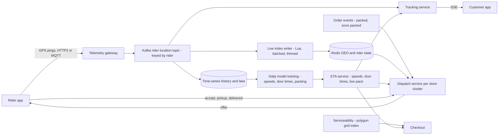
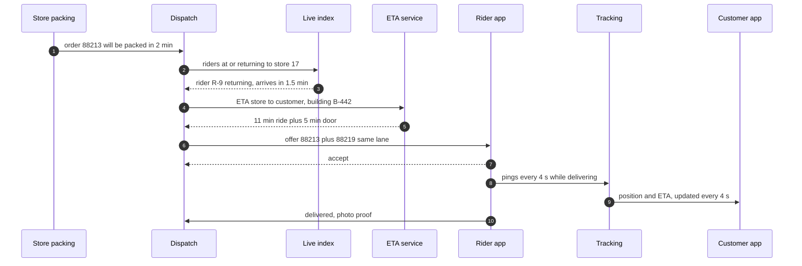
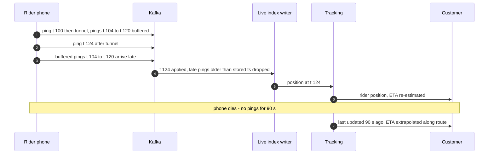
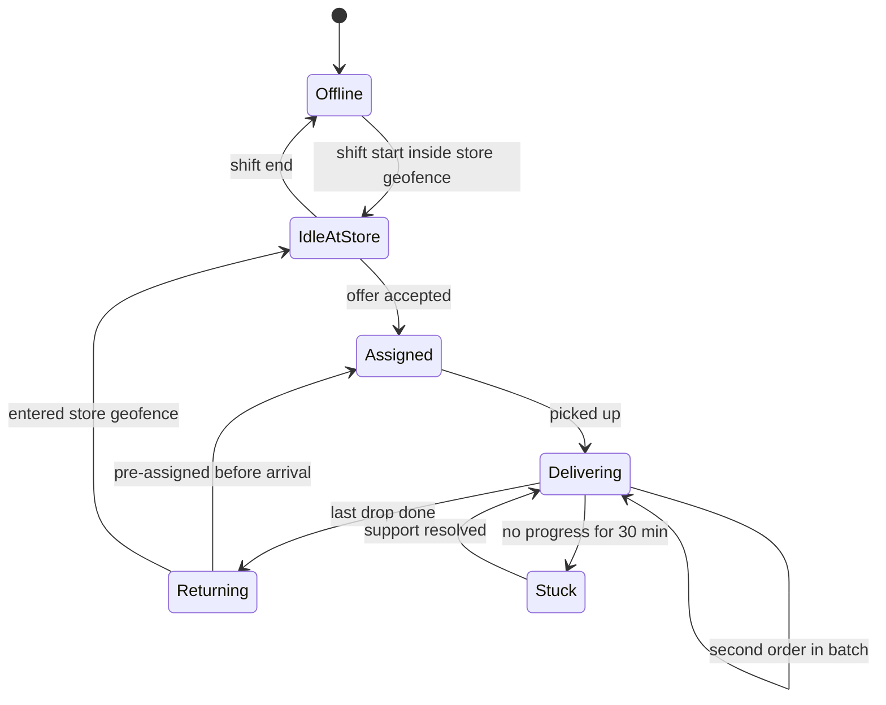

# 47. Case Study: Delivery Dispatch & Live Tracking

!!! abstract "Chapter at a glance"
    **Reader bands:** B2 → B4 · **Prerequisites:** [Ch 03](../01-foundations/03-networking-essentials.md) (SSE tracking), [Ch 06](../01-foundations/06-nosql-and-polyglot-persistence.md) (Redis GEO), [Ch 14](../02-distributed-core/14-messaging-and-event-streaming.md) (rider location topic), [Ch 41](41-chat-customer-rider-messaging.md) (presence from location) · **What you will build:** Everything between "order packed" and "delivered": geofenced serviceability, rider GPS ingestion, the live rider index, dispatch (which rider takes which order), ETAs and live tracking on the customer's screen. This is the "design Uber/Swiggy dispatch" interview question for a quick-commerce platform. Earlier chapters deferred all of it here: polygon serviceability ([Ch 01](../00-orientation/01-what-system-design-is.md)), telemetry ingestion ([Ch 03](../01-foundations/03-networking-essentials.md), [Ch 14](../02-distributed-core/14-messaging-and-event-streaming.md)), H3/geohash indexing and dispatch algorithms ([Ch 06](../01-foundations/06-nosql-and-polyglot-persistence.md)).

    - **L1: geo indexes (real Redis for riders).** Serviceability over 400 store polygons and 200,000 customer locations:
        - Testing every polygon took **1,457 ms** (136.7 polygon tests per lookup).
        - A 500 m grid index took **78 ms** (1.9 tests per lookup), with the same answers.
        - For the nearest 5 of 20,000 riders, brute force took **780 µs** p50, a 1 km grid **11 µs**, and Redis GEOSEARCH **468 µs** including the network round trip.
    - **L2: GPS ingestion (real Redis).** 250,000 pings from 50,000 riders, 3% delivered late:
        - Two commands per ping reached ~12,800 pings/s and left **480 riders** at an *older* position.
        - An ordering-safe Lua script per ping gave 0 stale riders.
        - Pipelining reached **~94,500 pings/s**.
        - A movement filter for the live index cut Redis writes from 250,000 to **145,061**.
    - **L3: dispatch.** 6 dark stores × 10 riders at evening peak:
        - FIFO to riders standing at the store delivered **40%** within the 20-minute promise.
        - Also assigning riders on their way back raised that to 53%.
        - Batching two orders to nearby customers raised it to 61%.
        - Both together reached **69%**, with the average falling from 24.8 to 18.0 minutes.
    - **L4: ETAs.** Across 6,677 evaluated deliveries:
        - A city-wide speed was off by **4.6 min** on average, and 49% arrived after the promise.
        - Zone × hour speeds and learned door times per building brought that to 2.4 min and 28%.
        - Re-estimating halfway from the rider's actual pace brought it to **1.2 min** and **11.5%**.

    · **Reading time:** 110 min + code

---

## 1. Introduction & Why It Matters

### 1.1 A story: the rider who was "2 minutes away" for 20 minutes

The first delivery system was simple: customers served by pincode, the nearest idle rider at the store assigned when an order was packed, rider positions written to a table every 4 seconds, and an ETA of distance ÷ 18 km/h. At scale:

1. **Serviceability was wrong at the edges.** Pincodes don't match 3 km delivery radii. Customers across a lake or a highway were accepted and then waited 40 minutes; customers just inside the radius but in the "wrong" pincode were turned away.
2. **The position table melted.** 50,000 riders × 1 ping every 4 s is 12,500 writes/s. Updates queued; "live" positions were a minute old, and dispatch sent riders who had already left.
3. **Positions jumped backwards.** Phones buffer pings in tunnels and send them later; a late ping overwrote a newer position, and the customer's map showed the rider reversing.
4. **Riders waited while orders waited.** At 8 pm, orders queued for riders at the store while riders were two minutes away on their way back. Dispatch only considered riders standing at the store.
5. **The ETA lied most at the worst time.** "Arriving in 2 minutes" in the evening jam, and in the gated complex whose security desk takes five minutes. Support calls peaked exactly when the ETA was least honest.

Delivery is where the product's promise ("in 20 minutes") is kept or broken. This chapter designs the geo, streaming, optimisation and estimation systems behind it.

!!! quote "The thesis of this chapter"
    Delivery is a **real-time, geo-indexed control loop**: positions stream in, an index answers "who is near", an optimiser decides "who goes where", and an estimator tells the customer "when". **Geo questions** are answered by a coarse index plus an exact check (L1). **Telemetry** is a high-volume stream that must be order-safe and thinned before it hits the live index (L2). **Dispatch** is an optimisation over the next few minutes — predicted availability and batching beat nearest-idle-rider (L3). **ETAs** come from learned speeds, learned last-100-metre times and live progress, and promises are sized from the error distribution (L4).

### 1.2 Where this lives in the grocery platform

| Concern | Data | Freshness | Store |
|---|---|---|---|
| Serviceability | Store delivery polygons | Hours | In-memory grid/H3 index per city |
| Rider positions | Raw GPS pings | Seconds | Kafka `delivery.rider.location.v1` → Redis GEO (live), time-series store (history) |
| Rider state | Idle, to-store, at-store, delivering, offline | Seconds | Redis hash + dispatch service memory |
| Dispatch | Packed and soon-packed orders, rider predictions | Every ~10–30 s | Dispatch service per store cluster |
| ETA | Speeds per zone × hour, door times per building, live progress | Model daily, estimate per update | Model store + request-time computation |
| Tracking | Rider position and ETA for the customer | ~2–5 s | SSE stream ([Ch 03](../01-foundations/03-networking-essentials.md)) |

### 1.3 Learning objectives

By the end you will be able to:

- **Index geo data** for serviceability polygons and nearest-rider queries (L1).
- **Ingest rider telemetry** at scale, order-safely, and keep the live index lean (L2).
- **Design dispatch**: assignment, predicted availability, batching, and fairness to riders (L3).
- **Estimate and communicate ETAs** honestly (L4).
- **Serve live tracking**, handle privacy and operate the loop.

---

## 2. Core Concepts — Beginner to Deep

### 2.1 Intuition: an air-traffic controller for scooters <span class="band b2">B2</span>

A controller has a radar (positions), a map of airspace (zones), a queue of planes wanting to land (orders), and runways (riders). They don't assign the nearest runway to each plane the moment it appears; they plan a few minutes ahead, pair things efficiently, and tell each plane an honest arrival time, updated as conditions change. Dispatch works the same way, with the radar fed by 50,000 phones.

### 2.2 Requirements <span class="band b2">B2</span>

**Functional**

- Decide if an address is serviceable and by which store (polygon zones, with overrides for rain, events and store load).
- Track rider positions and states; show the customer the rider on a map with an ETA.
- Assign packed orders to riders, with batching; reassign on problems.
- Rider app: offers, navigation, proof of delivery, earnings.

**Non-functional**

- Serviceability lookup < 5 ms; nearest riders < 10 ms.
- Ingest ~12,500 pings/s (peaks ~20k), live positions < 5 s old.
- Dispatch decisions within seconds of an order being packed (or predicted to be packed).
- ETA error small enough that promises hold ≥ 90% of the time.

### 2.3 Estimation <span class="band b2">B2</span>

| Quantity | Estimate |
|---|---|
| Riders online at peak | ~50,000 |
| Ping rate | 1 per 4 s → 12,500/s; ~200 bytes each → ~2.5 MB/s raw, ×RF3 in Kafka ([Ch 14](../02-distributed-core/14-messaging-and-event-streaming.md) exercise) |
| Live index | 50k riders × ~100 B = ~5 MB in Redis GEO — trivial size, high write rate |
| History | ~1 billion pings/day; days in the hot time-series store, months in the lake |
| Dispatch | ~1.5M orders/day; peak ~50/s nationally, ~0.5/min per store at the busiest (L3's setting) |
| Tracking streams | ~150k concurrent customers watching |

The data is small; the **rates and freshness** are the challenge.

### 2.4 Geo indexing ⭐ <span class="band b3">B3</span>

Every geo question is answered in two steps: a **coarse index** to find a few candidates near the point, then an **exact check** on those candidates.

| Question | Coarse index | Exact check |
|---|---|---|
| Which store's polygon contains this address? | Grid/geohash/H3 cells → polygons overlapping each cell | Point-in-polygon (ray casting) |
| Nearest available riders | Grid cells or Redis GEO (geohash in a sorted set) | Distance, then road distance/ETA for the top few |
| Riders inside a zone | Cells covering the zone | Point-in-polygon |

L1 measured both:

| Query | Method | Cost | Correct |
|---|---|---|---|
| Serviceability (400 polygons, 200k lookups) | Brute force | 1,457 ms, 136.7 polygon tests/lookup | ✓ |
| | **500 m grid index** | **78 ms, 1.9 tests/lookup** | ✓ identical |
| Nearest 5 of 20k riders | Brute force | 780 µs p50 | ✓ |
| | **1 km grid, expanding rings** | **11 µs** p50 | ✓ identical |
| | Redis GEOSEARCH | 468 µs p50, incl. network | ✓ (near-ties can swap: haversine vs flat distance) |

- **Geohash** encodes lat/lon into a string prefix: nearby points usually share prefixes, but neighbours across cell boundaries don't. Always search neighbouring cells too.
- **H3** (Uber's hexagonal grid) and **S2** (Google's) give uniform cells and hierarchical resolutions. H3 hexagons have equidistant neighbours, which is useful for zone-level aggregates such as demand, supply and surge.
- **Serviceability as data**: store polygons are edited by ops, versioned, and compiled into a per-city index (cell → candidate stores) that every service loads in memory. Dynamic overrides (rain, store overload) shrink polygons or change priorities in real time.
- **Straight line is only a filter.** Final ranking needs road distance or ETA (L4), especially across rivers, railway lines and one-way systems.

### 2.5 Telemetry ingestion ⭐ <span class="band b3">B3</span>

Rider apps send positions over HTTP/2 or MQTT to a gateway, which writes them to Kafka keyed by rider id (per-rider order within a partition). Consumers then feed:

- the **live index** (Redis GEO + last-seen hash) for dispatch and presence ([Ch 41](41-chat-customer-rider-messaging.md)),
- the **tracking fan-out** for customers watching their order,
- the **history store** (time-series or lake) for ETAs, disputes and payouts.

L2 replayed 250,000 pings with 3% delivered late into a real Redis:

| Ingester | Throughput | Redis commands | Riders left at an older position |
|---|---|---|---|
| GEOADD + HSET per ping, no ordering check | 12,781 pings/s | 500,000 | **480** |
| Lua per ping, drops older pings | 20,865 | 250,000 | 0 |
| **Lua, pipelined in batches of 200** | **94,526** | 250,000 | 0 |
| + write only if moved > 20 m or 15 s passed | 162,832 | **145,061** | 0 |

- **Order safety**: phones buffer and resend. Compare timestamps atomically (Lua, or a conditional update), or late pings move riders backwards.
- **Batching**: one round trip per ping caps throughput; batch per consumer poll.
- **Thinning**: the live index needs *news*, not every ping. Stationary riders at the store send nothing new. Raw pings still go to history.
- **GPS noise**: snap to roads, drop impossible jumps (speed > 80 km/h), and smooth positions for display.
- **Battery and data**: adaptive ping rates (faster while delivering, slower while idle) are the biggest lever of all.

### 2.6 Dispatch ⭐ <span class="band b4">B4</span>

Dispatch assigns orders to riders to minimise delivery time (and keep promises) at a given fleet size. L3 simulated the evening peak:

| Policy | Avg | p90 | Within 20 min | Riding min/order |
|---|---|---|---|---|
| FIFO to riders standing at the store | 24.8 min | 39.3 min | 40.0% | 20.0 |
| + assign riders on their way back | 21.6 min | 33.3 min | 53.2% | 20.0 |
| + batch 2 orders to nearby customers | 19.0 min | 26.3 min | 61.3% | 17.5 |
| **Both** | **18.0 min** | **24.6 min** | **69.1%** | 17.8 |

- **Predicted availability**: include riders who will reach the store before the order is packed. Dispatch plans on *when* things will be ready, from packing ETAs and rider ETAs, not on current state.
- **Batching**: two orders to neighbouring doors turn one return trip into two deliveries. Cap the detour and the second customer's extra wait.
- **Assignment algorithms**: greedy (fast, myopic) → batched optimisation every N seconds (bipartite matching / Hungarian algorithm or min-cost flow over orders × riders, with costs from ETAs and penalties for promise risk) → rolling-horizon optimisation with predicted orders.
- **Constraints**: rider shift ends, vehicle capacity, cold-chain items, rider acceptance (offers can be declined; handle timeouts and re-offers), fairness of earnings across riders.
- **Rebalancing**: move idle riders between nearby stores when demand is uneven (H3 cell demand forecasts).

### 2.7 ETAs ⭐ <span class="band b3">B3</span>

L4 evaluated four estimators on 6,677 held-out deliveries (promise = estimate + 2 min):

| ETA method | Mean error | p90 error | Arrived after the promise |
|---|---|---|---|
| Straight line × 1.4 at 18 km/h + 2 min | 4.6 min | 10.5 min | 49.0% |
| Speed per (zone, hour) + 2 min | 3.2 min | 7.4 min | 40.0% |
| + door time per building | 2.4 min | 5.2 min | 27.7% |
| **+ re-estimate halfway from actual pace** | **1.2 min** | **2.7 min** | **11.5%** |

- **Ride time** from learned speeds by zone and hour (or a routing engine with live traffic such as OSRM/GraphHopper, or a maps API), corrected by models trained on your riders' actual trips.
- **The last 100 metres** — gated complexes, lifts, security desks — often dominate the error, and only your own delivery history per building knows them.
- **Live updates**: once the rider is moving, their actual pace beats any prior. Update the ETA every few pings, and never let it count *up* suspiciously without explanation.
- **Promises** use the error distribution: promise the p80–p90, not the mean. The checkout promise ("20 min") also depends on packing time and rider availability, so it must come from the same models.

### 2.8 Live tracking <span class="band b3">B3</span>

- Customers watching an order subscribe via SSE ([Ch 03](../01-foundations/03-networking-essentials.md)). The tracking service consumes the rider location topic filtered by active deliveries and pushes a smoothed position + ETA every ~3–5 s.
- **Privacy**: show the rider's position only during an active delivery, approximate the rider's position before pickup, and never show the customer's address to anyone but the assigned rider. Retain raw tracks for a limited time ([Ch 36](../04-architect/36-compliance-governance-and-data-residency.md)).
- **Degradation**: if updates stop (tunnel, dead battery), show "last updated 1 min ago" and extrapolate along the route, rather than freezing silently.

### 2.9 Rider state and presence <span class="band b3">B3</span>

- States: `OFFLINE → IDLE_AT_STORE → ASSIGNED → PICKED_UP → DELIVERING → RETURNING → IDLE_AT_STORE`. Transitions come from app actions and geofences (entered store radius, reached customer).
- Presence is derived from the location stream with grace periods ([Ch 41](41-chat-customer-rider-messaging.md) L3).
- Stuck-state detection: "delivering" for 60 minutes triggers support outreach.

### 2.10 Interview framing <span class="band b4">B4</span>

Draw the loop: rider app → gateway → Kafka → live index / tracking / history; order events → dispatch → offers → rider app; ETA service used by checkout, dispatch and tracking. Then go deep on geo indexing (two-step), telemetry (order, batching, thinning), and dispatch (predicted availability, batching, matching). Staff-level signals: ETAs from learned door times and live progress, promises from error distributions, privacy of positions, and planning on predictions.

---

## 3. Architecture & Diagrams

### 3.1 Component view



### 3.2 Sequence: happy path, packed order to door



### 3.3 Sequence: failure path, late pings and a frozen phone



### 3.4 State: a rider's lifecycle during a shift



---

## 4. Design Document Excerpt: Delivery Platform v2

!!! note "Design Document (excerpt) — Delivery Platform v2"
    **Status:** Accepted · **Authors:** Delivery platform team · **Reviewers:** Dark-store ops, Rider experience, Checkout, SRE, Legal

    | Field | Value |
    |---|---|
    | Context | Pincode serviceability mismatched delivery radii; a position table couldn't take 12.5k writes/s; late pings moved riders backwards; dispatch ignored returning riders; ETAs were wrong in jams and at gated complexes. |
    | Decision | Polygon serviceability compiled into grid/H3 indexes; telemetry through Kafka into an order-safe, batched, thinned Redis live index; dispatch with predicted availability, batching and periodic matching; ETAs from zone × hour speeds, building door times and live pace; SSE tracking with privacy rules. |
    | Related ADRs | ADR-330 Serviceability polygons, versioned, compiled to 500 m grid / H3 res 8 per city (L1); ADR-331 Telemetry: Kafka keyed by rider, Lua timestamp-guarded updates, batches of 200, movement thinning for the live index (L2); ADR-332 Dispatch every 15 s per store cluster: min-cost matching over packed + soon-packed orders and present + returning riders, max 2-order batches within 1 km (L3); ADR-333 ETA = learned ride + learned door time, live re-estimation; promise at p85 (L4); ADR-334 Tracking via SSE only during active deliveries; raw tracks retained 30 days |

    **Requirements.**

    - **R1** Serviceability decision < 5 ms; zone edits live within 5 minutes.
    - **R2** Live positions < 5 s old for 99% of active riders; 0 backwards moves from late pings.
    - **R3** ≥ 85% of orders delivered within the promise at peak.
    - **R4** ETA shown to customers late by > 3 min for < 10% of deliveries.
    - **R5** Rider positions visible to customers only during their active delivery.

    **Decisions in detail.**

    1. **Geo (ADR-330).** Cells → candidate stores in memory in every checkout pod; overrides applied at request time.
    2. **Telemetry (ADR-331).** 48 partitions; consumers batch 200 or 50 ms; idle riders ping every 15 s, delivering riders every 4 s.
    3. **Dispatch (ADR-332).** Costs = predicted delivery time + promise-breach penalty + batch detour; Hungarian algorithm per cluster; offers expire in 20 s.
    4. **ETA (ADR-333).** Daily training on the last 8 weeks; door time per building with shrinkage to the neighbourhood mean for sparse buildings.
    5. **Tracking (ADR-334).** Smoothed positions; "last updated" when stale.

    **Consequences.** More models to train and monitor; dispatch complexity; building-level data to maintain. In return: honest promises, faster deliveries at the same fleet size, and a live index that stays fresh at peak.

---

## 5. Hands-On Code — Level Ladder

!!! info "What's real here"
    All four labs are JDK 21. **L1 (nearest riders) and L2 run against a real Redis 7**, with real GEOADD/GEOSEARCH and Lua. L1's serviceability part, L3 and L4 are deterministic simulations with fixed seeds over a synthetic city. Traffic, door times, packing times and rider speeds are stated assumptions. Timings vary by machine.

L1 and L2 need Redis 7 on port 6390. Run every lab with `-Dstdout.encoding=UTF-8`.

### L1 — Geo indexes <span class="band b2">B2</span>

**Requirement:** "Decide serviceability from polygons and find nearby riders in microseconds — with exactly the same answers as checking everything."

A synthetic Bengaluru-sized city with 400 store polygons and 20,000 riders. The riders are also loaded into a real Redis GEO set.

```java title="GeoL1.java"
// GeoL1.java — run with (Redis 7 on :6390):  java GeoL1.java   (JDK 21, no dependencies)
// THE TWO GEO QUESTIONS EVERY ORDER ASKS. Bengaluru-sized synthetic city (fixed seed):
//   1) SERVICEABILITY — "which dark store's delivery zone contains this customer?" 400 stores, each with an irregular
//      polygon (12–20 vertices) — the move from pincodes to geofences that Ch 01 deferred here. 200,000 lookups:
//        brute force ray-casting against every polygon  vs  a grid index (500 m cells → candidate polygons)
//   2) NEAREST RIDERS — "the 5 closest available riders to this store": 20,000 riders.
//        brute force distance to every rider (in memory)  vs  a geohash-style grid (in memory)  vs  REAL Redis GEOSEARCH
// Correctness is checked against brute force for every query.
import java.io.*;
import java.net.Socket;
import java.nio.charset.StandardCharsets;
import java.util.*;

public class GeoL1 {
    static final double LAT0 = 12.85, LON0 = 77.45, SPAN = 0.30;                // ~33 km square
    static final double M_PER_DEG_LAT = 111_320, M_PER_DEG_LON = 111_320 * Math.cos(Math.toRadians(12.97));

    public static void main(String[] args) throws Exception {
        Random r = new Random(47);
        // ---------- 1) serviceability polygons ----------
        List<double[][]> polys = new ArrayList<>();
        for (int s = 0; s < 400; s++) {
            double cx = LAT0 + 0.02 + r.nextDouble() * (SPAN - 0.04), cy = LON0 + 0.02 + r.nextDouble() * (SPAN - 0.04); int n = 12 + r.nextInt(9);
            double[][] p = new double[n][2];
            for (int k = 0; k < n; k++) { double a = 2 * Math.PI * k / n, rad = (1_200 + r.nextDouble() * 1_400) / M_PER_DEG_LAT; p[k][0] = cx + rad * Math.cos(a); p[k][1] = cy + rad * Math.sin(a) * M_PER_DEG_LAT / M_PER_DEG_LON; }
            polys.add(p);
        }
        double cell = 500 / M_PER_DEG_LAT; int gridN = (int) Math.ceil(SPAN / cell) + 1;
        List<List<Integer>> grid = new ArrayList<>(); for (int i = 0; i < gridN * gridN; i++) grid.add(new ArrayList<>());
        for (int s = 0; s < polys.size(); s++) {                                     // register each polygon in the cells its bounding box covers
            double[][] p = polys.get(s); double minA = 99, maxA = -99, minB = 999, maxB = -999;
            for (double[] v : p) { minA = Math.min(minA, v[0]); maxA = Math.max(maxA, v[0]); minB = Math.min(minB, v[1]); maxB = Math.max(maxB, v[1]); }
            for (int a = cellOf(minA, LAT0, cell); a <= cellOf(maxA, LAT0, cell); a++) for (int b = cellOf(minB, LON0, cell); b <= cellOf(maxB, LON0, cell); b++)
                if (a >= 0 && b >= 0 && a < gridN && b < gridN) grid.get(a * gridN + b).add(s);
        }
        double[][] pts = new double[200_000][2]; for (double[] q : pts) { q[0] = LAT0 + r.nextDouble() * SPAN; q[1] = LON0 + r.nextDouble() * SPAN; }
        long t0 = System.nanoTime(); int[] brute = new int[pts.length]; long tests = 0;
        for (int i = 0; i < pts.length; i++) { brute[i] = -1; for (int s = 0; s < polys.size(); s++) { tests++; if (inside(polys.get(s), pts[i])) { brute[i] = s; break; } } }
        double bruteMs = (System.nanoTime() - t0) / 1e6;
        t0 = System.nanoTime(); int mismatch = 0, served = 0; long gTests = 0;
        for (int i = 0; i < pts.length; i++) {
            int found = -1; int a = cellOf(pts[i][0], LAT0, cell), b = cellOf(pts[i][1], LON0, cell);
            for (int s : grid.get(a * gridN + b)) { gTests++; if (inside(polys.get(s), pts[i])) { found = s; break; } }
            if (found != -1) served++;
            if ((found == -1) != (brute[i] == -1) || (found != -1 && !inside(polys.get(brute[i]), pts[i]))) mismatch++;
        }
        double gridMs = (System.nanoTime() - t0) / 1e6;
        System.out.printf("1) Serviceability: 400 store polygons, 200,000 customer locations (%.0f%% inside some zone).%n%n", 100.0 * served / pts.length);
        System.out.printf("   %-46s %12s %22s %12s%n", "method", "total time", "polygon tests / lookup", "wrong");
        System.out.printf("   %-46s %9.0f ms %22.1f %,12d%n", "brute force: test every polygon", bruteMs, (double) tests / pts.length, 0);
        System.out.printf("   %-46s %9.0f ms %22.1f %,12d%n", "grid index (500 m cells → candidate polygons)", gridMs, (double) gTests / pts.length, mismatch);

        // ---------- 2) nearest riders ----------
        int riders = 20_000; double[][] rp = new double[riders][2];
        for (double[] q : rp) { q[0] = LAT0 + r.nextDouble() * SPAN; q[1] = LON0 + r.nextDouble() * SPAN; }
        double rc = 1_000 / M_PER_DEG_LAT; int rn = (int) Math.ceil(SPAN / rc) + 1; List<List<Integer>> rg = new ArrayList<>(); for (int i = 0; i < rn * rn; i++) rg.add(new ArrayList<>());
        for (int i = 0; i < riders; i++) rg.get(cellOf(rp[i][0], LAT0, rc) * rn + cellOf(rp[i][1], LON0, rc)).add(i);
        try (Redis red = new Redis()) {
            red.cmd("DEL", "riders:blr"); List<String[]> batch = new ArrayList<>();
            for (int i = 0; i < riders; i++) { batch.add(new String[]{"GEOADD", "riders:blr", String.valueOf(rp[i][1]), String.valueOf(rp[i][0]), "r" + i}); if (batch.size() == 1000) { red.pipeline(batch); batch.clear(); } }
            red.pipeline(batch);
            int queries = 5_000; double[][] qs = new double[queries][2]; for (double[] q : qs) { q[0] = LAT0 + 0.03 + r.nextDouble() * (SPAN - 0.06); q[1] = LON0 + 0.03 + r.nextDouble() * (SPAN - 0.06); }
            long[] tb = new long[queries], tg = new long[queries], tr = new long[queries]; int gridWrong = 0, redisWrong = 0;
            for (int i = 0; i < queries; i++) {
                long s = System.nanoTime(); List<Integer> b = bruteK(rp, qs[i], 5); tb[i] = System.nanoTime() - s;
                s = System.nanoTime(); List<Integer> g = gridK(rp, rg, rn, rc, qs[i], 5); tg[i] = System.nanoTime() - s;
                s = System.nanoTime(); List<?> res = (List<?>) red.cmd("GEOSEARCH", "riders:blr", "FROMLONLAT", String.valueOf(qs[i][1]), String.valueOf(qs[i][0]), "BYRADIUS", "3", "km", "ASC", "COUNT", "5"); tr[i] = System.nanoTime() - s;
                if (!new HashSet<>(g).equals(new HashSet<>(b))) gridWrong++;
                Set<Integer> rs = new HashSet<>(); for (Object o : res) rs.add(Integer.parseInt(((String) o).substring(1)));
                if (!rs.equals(new HashSet<>(b))) redisWrong++;
            }
            Arrays.sort(tb); Arrays.sort(tg); Arrays.sort(tr);
            System.out.printf("%n2) Nearest 5 riders to a point, %,d riders, %,d queries.%n%n", riders, queries);
            System.out.printf("   %-46s %12s %12s %30s%n", "method", "p50", "p99", "different from exact top-5");
            System.out.printf("   %-46s %9.1f µs %9.1f µs %30d%n", "brute force over every rider", tb[queries / 2] / 1e3, tb[queries * 99 / 100] / 1e3, 0);
            System.out.printf("   %-46s %9.1f µs %9.1f µs %30d%n", "grid index (1 km cells, expanding rings)", tg[queries / 2] / 1e3, tg[queries * 99 / 100] / 1e3, gridWrong);
            System.out.printf("   %-46s %9.1f µs %9.1f µs %30d%n", "Redis GEOSEARCH (network round trip incl.)", tr[queries / 2] / 1e3, tr[queries * 99 / 100] / 1e3, redisWrong);
            red.cmd("DEL", "riders:blr");
        }
        System.out.println("   (Redis uses haversine distance and 52-bit geohash-rounded positions; this lab uses a flat approximation, so riders at");
        System.out.println("    almost equal distance — the 5th and 6th — occasionally swap. Pick one distance function for ranking.)");
        System.out.println("\n   → both questions are 'find the few candidates near here, then do the exact check': a grid (or geohash, S2, H3)");
        System.out.println("     index turns 'test all 400 polygons' into ~1–3 tests, and 'measure 20,000 riders' into a few cells, with");
        System.out.println("     identical answers. Redis GEO is the same idea behind a network round trip, shared by every dispatcher. Straight-line");
        System.out.println("     distance is only the candidate filter: the final choice needs road distance and ETA (L4), and 'available' needs");
        System.out.println("     fresh positions (L2).");
    }

    static int cellOf(double v, double origin, double cell) { return (int) Math.floor((v - origin) / cell); }
    static boolean inside(double[][] poly, double[] p) {                               // ray casting
        boolean in = false;
        for (int i = 0, j = poly.length - 1; i < poly.length; j = i++)
            if ((poly[i][1] > p[1]) != (poly[j][1] > p[1]) && p[0] < (poly[j][0] - poly[i][0]) * (p[1] - poly[i][1]) / (poly[j][1] - poly[i][1]) + poly[i][0]) in = !in;
        return in;
    }
    static double dist(double[] a, double[] b) { double dx = (a[0] - b[0]) * M_PER_DEG_LAT, dy = (a[1] - b[1]) * M_PER_DEG_LON; return Math.sqrt(dx * dx + dy * dy); }
    static List<Integer> bruteK(double[][] rp, double[] q, int k) {
        PriorityQueue<Integer> pq = new PriorityQueue<>((x, y) -> Double.compare(dist(rp[y], q), dist(rp[x], q)));
        for (int i = 0; i < rp.length; i++) { pq.add(i); if (pq.size() > k) pq.poll(); }
        return new ArrayList<>(pq);
    }
    static List<Integer> gridK(double[][] rp, List<List<Integer>> g, int n, double cell, double[] q, int k) {
        int a = cellOf(q[0], LAT0, cell), b = cellOf(q[1], LON0, cell);
        PriorityQueue<Integer> pq = new PriorityQueue<>((x, y) -> Double.compare(dist(rp[y], q), dist(rp[x], q)));
        for (int ring = 0; ring < n; ring++) {
            for (int i = a - ring; i <= a + ring; i++) for (int j = b - ring; j <= b + ring; j++) {
                if (Math.max(Math.abs(i - a), Math.abs(j - b)) != ring || i < 0 || j < 0 || i >= n || j >= n) continue;
                for (int id : g.get(i * n + j)) { pq.add(id); if (pq.size() > k) pq.poll(); }
            }
            if (pq.size() == k && dist(rp[pq.peek()], q) <= ring * cell * M_PER_DEG_LAT) break;   // kth best is closer than any unvisited ring
        }
        return new ArrayList<>(pq);
    }

    static final class Redis implements Closeable {
        final Socket s; final OutputStream out; final InputStream in;
        Redis() throws IOException { s = new Socket("127.0.0.1", 6390); s.setTcpNoDelay(true); out = new BufferedOutputStream(s.getOutputStream(), 1 << 16); in = new BufferedInputStream(s.getInputStream(), 1 << 16); }
        void write(String... parts) throws IOException { StringBuilder sb = new StringBuilder("*").append(parts.length).append("\r\n"); for (String p : parts) { byte[] b = p.getBytes(StandardCharsets.UTF_8); sb.append('$').append(b.length).append("\r\n").append(p).append("\r\n"); } out.write(sb.toString().getBytes(StandardCharsets.UTF_8)); }
        Object cmd(String... parts) throws IOException { write(parts); out.flush(); return read(); }
        void pipeline(List<String[]> cmds) throws IOException { for (String[] c : cmds) write(c); out.flush(); for (int i = 0; i < cmds.size(); i++) read(); }
        Object read() throws IOException {
            int type = in.read(); String line = line();
            return switch (type) {
                case '+' -> line; case ':' -> Long.parseLong(line);
                case '$' -> { int n = Integer.parseInt(line); if (n < 0) yield null; byte[] b = in.readNBytes(n); line(); yield new String(b, StandardCharsets.UTF_8); }
                case '*' -> { int n = Integer.parseInt(line); List<Object> l = new ArrayList<>(); for (int i = 0; i < n; i++) l.add(read()); yield l; }
                case '-' -> throw new IOException(line);
                default -> throw new IOException("unexpected " + (char) type);
            };
        }
        String line() throws IOException { StringBuilder sb = new StringBuilder(); int c; while ((c = in.read()) != '\r') sb.append((char) c); in.read(); return sb.toString(); }
        public void close() throws IOException { s.close(); }
    }
}
```

```text title="java -Dstdout.encoding=UTF-8 GeoL1.java"
1) Serviceability: 400 store polygons, 200,000 customer locations (85% inside some zone).

   method                                           total time polygon tests / lookup        wrong
   brute force: test every polygon                     1457 ms                  136.7            0
   grid index (500 m cells → candidate polygons)         78 ms                    1.9            0

2) Nearest 5 riders to a point, 20,000 riders, 5,000 queries.

   method                                                  p50          p99     different from exact top-5
   brute force over every rider                       780.1 µs    2538.9 µs                              0
   grid index (1 km cells, expanding rings)            11.1 µs      73.2 µs                              0
   Redis GEOSEARCH (network round trip incl.)         467.6 µs    1536.7 µs                              7
   (Redis uses haversine distance and 52-bit geohash-rounded positions; this lab uses a flat approximation, so riders at
    almost equal distance — the 5th and 6th — occasionally swap. Pick one distance function for ranking.)

   → both questions are 'find the few candidates near here, then do the exact check': a grid (or geohash, S2, H3)
     index turns 'test all 400 polygons' into ~1–3 tests, and 'measure 20,000 riders' into a few cells, with
     identical answers. Redis GEO is the same idea behind a network round trip, shared by every dispatcher. Straight-line
     distance is only the candidate filter: the final choice needs road distance and ETA (L4), and 'available' needs
     fresh positions (L2).
```

**Reading it:**

- **Serviceability**: the grid index checks ~2 polygons instead of ~137, is **~19x** faster, and gives identical answers.
- **Nearest riders**: an in-memory grid with expanding rings is ~70x faster than brute force, again with identical results. The stopping rule guarantees no closer rider sits in an unvisited ring.
- **Redis GEOSEARCH** includes a network round trip and is shared by every dispatcher. Its 7 differences out of 5,000 queries are near-ties swapped by a different distance formula.

### L2 — GPS ingestion <span class="band b3">B3</span>

**Requirement:** "Keep the live rider index fresh at 12,500 pings/s, never let a late ping move a rider backwards, and don't write what doesn't matter."

250,000 synthetic pings, 3% delivered out of order, replayed into a real Redis with four ingesters.

```java title="TelemetryL2.java"
// TelemetryL2.java — run with (Redis 7 on :6390):  java TelemetryL2.java   (JDK 21, no dependencies)
// RIDER GPS INGESTION. 50,000 riders send a position every 4 s (12,500 pings/s — the Ch 14 estimate). Positions must land
// in the live geo index (Redis GEO + last-seen hash) that dispatch queries (L1). We replay 20 s of pings (250,000,
// fixed seed) as fast as the pipeline allows, into a REAL Redis. Mobile networks buffer and resend, so 3% of pings
// arrive late, AFTER a newer one from the same rider. 40% of riders are standing at a store (not moving). Four ingesters:
//   T1 per ping: GEOADD, then HSET last-seen — two round trips, no ordering check
//   T2 per ping: one Lua script updates both atomically and ignores pings older than the stored timestamp
//   T3 T2, pipelined in batches of 200 (the ingester buffers ~50 ms)
//   T4 T3 + a movement filter: write only if the rider moved > 20 m or 15 s passed since the last write
//      (every raw ping still goes to Kafka for history and ETA models; only the live index is thinned)
// Measured: real ingestion throughput, Redis commands issued, and riders whose live position ends up OLDER than their
// newest ping (a stale position that dispatch would trust).
import java.io.*;
import java.net.Socket;
import java.nio.charset.StandardCharsets;
import java.util.*;

public class TelemetryL2 {
    static final String LUA = """
            local ts = tonumber(ARGV[3])
            local prev = tonumber(redis.call('HGET', KEYS[2], ARGV[4]) or '0')
            if ts <= prev then return 0 end
            redis.call('GEOADD', KEYS[1], ARGV[1], ARGV[2], ARGV[4])
            redis.call('HSET', KEYS[2], ARGV[4], ts)
            return 1""";
    record Ping(int rider, double lat, double lon, long ts) {}

    public static void main(String[] args) throws Exception {
        Random r = new Random(47); int riders = 50_000;
        double[][] pos = new double[riders][2]; double[][] vel = new double[riders][2];
        for (int i = 0; i < riders; i++) { pos[i][0] = 12.85 + r.nextDouble() * 0.3; pos[i][1] = 77.45 + r.nextDouble() * 0.3;
            if (r.nextDouble() > 0.4) { double a = r.nextDouble() * 2 * Math.PI; vel[i][0] = 5 * Math.cos(a) / 111_320; vel[i][1] = 5 * Math.sin(a) / 108_000; } }   // 5 m/s
        List<Ping> pings = new ArrayList<>(); int[] phase = new int[riders]; for (int i = 0; i < riders; i++) phase[i] = r.nextInt(4000);
        for (long t = 0; t < 20_000; t += 4000) for (int i = 0; i < riders; i++) {
            long ts = t + phase[i]; double s = ts / 1000.0;
            pings.add(new Ping(i, pos[i][0] + vel[i][0] * s + r.nextGaussian() * 3 / 111_320, pos[i][1] + vel[i][1] * s + r.nextGaussian() * 3 / 108_000, ts));
        }
        pings.sort(Comparator.comparingLong(Ping::ts));
        int late = 0; for (int i = 0; i < pings.size() - 1; i++) if (r.nextDouble() < 0.03) { int j = Math.min(pings.size() - 1, i + 1 + r.nextInt(60_000)); Collections.swap(pings, i, j); late++; }  // delayed delivery
        long[] newest = new long[riders]; for (Ping p : pings) newest[p.rider()] = Math.max(newest[p.rider()], p.ts());
        System.out.printf("%,d pings from %,d riders (20 s at 1 ping / 4 s); ~%,d delivered out of order; 40%% of riders stationary.%n%n", pings.size(), riders, late);
        System.out.printf("   %-58s %14s %16s %22s%n", "ingester", "pings/s", "Redis commands", "riders left with an");
        System.out.printf("   %-58s %14s %16s %22s%n", "", "(real)", "", "older position");
        String[] names = {"T1) GEOADD + HSET per ping, no ordering check", "T2) one Lua script per ping, drops older pings", "T3) T2 pipelined in batches of 200",
                "T4) T3 + write only if moved > 20 m or 15 s passed"};
        try (Redis red = new Redis()) {
            String sha = (String) red.cmd("SCRIPT", "LOAD", LUA);
            for (int d = 0; d < 4; d++) {
                red.cmd("DEL", "geo:riders", "seen:riders");
                long cmds = 0; long t0 = System.nanoTime(); List<String[]> batch = new ArrayList<>();
                double[][] lastWritten = new double[riders][]; long[] lastWrittenTs = new long[riders];
                for (Ping p : pings) {
                    String id = "r" + p.rider(), lon = String.valueOf(p.lon()), lat = String.valueOf(p.lat()), ts = String.valueOf(p.ts() + 1);
                    if (d == 0) { red.cmd("GEOADD", "geo:riders", lon, lat, id); red.cmd("HSET", "seen:riders", id, ts); cmds += 2; continue; }
                    if (d == 3) {
                        double[] lw = lastWritten[p.rider()];
                        if (lw != null && p.ts() - lastWrittenTs[p.rider()] < 15_000 && dist(lw, p) < 20) continue;
                        if (lw == null || p.ts() > lastWrittenTs[p.rider()]) { lastWritten[p.rider()] = new double[]{p.lat(), p.lon()}; lastWrittenTs[p.rider()] = p.ts(); }
                    }
                    String[] c = {"EVALSHA", sha, "2", "geo:riders", "seen:riders", lon, lat, ts, id};
                    if (d == 1) { red.cmd(c); cmds++; } else { batch.add(c); cmds++; if (batch.size() == 200) { red.pipeline(batch); batch.clear(); } }
                }
                if (!batch.isEmpty()) red.pipeline(batch);
                double secs = (System.nanoTime() - t0) / 1e9;
                // audit: which riders' stored timestamp is older than their newest ping (T4 compares against newest WRITTEN, see note)
                int stale = 0; List<String[]> q = new ArrayList<>(); String[] hm = new String[riders + 2]; hm[0] = "HMGET"; hm[1] = "seen:riders"; for (int i = 0; i < riders; i++) hm[2 + i] = "r" + i;
                List<?> seen = (List<?>) red.cmd(hm);
                for (int i = 0; i < riders; i++) { long st = seen.get(i) == null ? 0 : Long.parseLong((String) seen.get(i)) - 1; if (st < newest[i] && (d != 3 || st < lastWrittenTs[i])) stale++; }
                System.out.printf("   %-58s %,14.0f %,16d %,22d%n", names[d], pings.size() / secs, cmds, stale);
            }
            red.cmd("DEL", "geo:riders", "seen:riders");
        }
        System.out.println("   (T4 deliberately skips pings that didn't move a rider; its check counts only positions older than its own last write.)");
        System.out.println("\n   → one round trip per update caps ingestion far below what one Redis can do; pipelining multiplies it. Without an");
        System.out.println("     ordering check, a late ping silently moves a rider back to where they were seconds ago — and dispatch trusts");
        System.out.println("     it. A Lua script that compares timestamps makes the update atomic and order-safe. Finally, most pings carry");
        System.out.println("     no news (riders waiting at the store): thinning the LIVE index by movement cuts writes sharply, while the raw");
        System.out.println("     stream still goes to Kafka for history, ETA training and dispute resolution.");
    }
    static double dist(double[] a, Ping p) { double dx = (a[0] - p.lat()) * 111_320, dy = (a[1] - p.lon()) * 108_000; return Math.sqrt(dx * dx + dy * dy); }

    static final class Redis implements Closeable {
        final Socket s; final OutputStream out; final InputStream in;
        Redis() throws IOException { s = new Socket("127.0.0.1", 6390); s.setTcpNoDelay(true); out = new BufferedOutputStream(s.getOutputStream(), 1 << 16); in = new BufferedInputStream(s.getInputStream(), 1 << 16); }
        void write(String... parts) throws IOException { StringBuilder sb = new StringBuilder("*").append(parts.length).append("\r\n"); for (String p : parts) { byte[] b = p.getBytes(StandardCharsets.UTF_8); sb.append('$').append(b.length).append("\r\n").append(p).append("\r\n"); } out.write(sb.toString().getBytes(StandardCharsets.UTF_8)); }
        Object cmd(String... parts) throws IOException { write(parts); out.flush(); return read(); }
        void pipeline(List<String[]> cmds) throws IOException { for (String[] c : cmds) write(c); out.flush(); for (int i = 0; i < cmds.size(); i++) read(); }
        Object read() throws IOException {
            int type = in.read(); String line = line();
            return switch (type) {
                case '+' -> line; case ':' -> Long.parseLong(line);
                case '$' -> { int n = Integer.parseInt(line); if (n < 0) yield null; byte[] b = in.readNBytes(n); line(); yield new String(b, StandardCharsets.UTF_8); }
                case '*' -> { int n = Integer.parseInt(line); List<Object> l = new ArrayList<>(); for (int i = 0; i < n; i++) l.add(read()); yield l; }
                case '-' -> throw new IOException(line);
                default -> throw new IOException("unexpected " + (char) type);
            };
        }
        String line() throws IOException { StringBuilder sb = new StringBuilder(); int c; while ((c = in.read()) != '\r') sb.append((char) c); in.read(); return sb.toString(); }
        public void close() throws IOException { s.close(); }
    }
}
```

```text title="java -Dstdout.encoding=UTF-8 TelemetryL2.java"
250,000 pings from 50,000 riders (20 s at 1 ping / 4 s); ~7,489 delivered out of order; 40% of riders stationary.

   ingester                                                          pings/s   Redis commands    riders left with an
                                                                      (real)                          older position
   T1) GEOADD + HSET per ping, no ordering check                      12,781          500,000                    480
   T2) one Lua script per ping, drops older pings                     20,865          250,000                      0
   T3) T2 pipelined in batches of 200                                 94,526          250,000                      0
   T4) T3 + write only if moved > 20 m or 15 s passed                162,832          145,061                      0
   (T4 deliberately skips pings that didn't move a rider; its check counts only positions older than its own last write.)

   → one round trip per update caps ingestion far below what one Redis can do; pipelining multiplies it. Without an
     ordering check, a late ping silently moves a rider back to where they were seconds ago — and dispatch trusts
     it. A Lua script that compares timestamps makes the update atomic and order-safe. Finally, most pings carry
     no news (riders waiting at the store): thinning the LIVE index by movement cuts writes sharply, while the raw
     stream still goes to Kafka for history, ETA training and dispute resolution.
```

**Reading it:**

- **T1**: two round trips per ping reach ~12,800 pings/s, barely the steady-state requirement with no headroom. **480** riders end up at an older position.
- **T2**: the Lua script makes each update atomic and ordering-safe (0 stale), and halves the commands.
- **T3**: batching 200 per round trip: **~94,500 pings/s** on one Redis.
- **T4**: skipping pings that carry no movement cuts live-index writes to 58%. The raw stream still has every ping.

### L3 — Dispatch <span class="band b4">B4</span>

**Requirement:** "Deliver more orders within the 20-minute promise at the same fleet size."

An evening peak at 6 dark stores with 10 riders each, demand just above one-order-per-trip capacity, and four dispatch policies.

```java title="DispatchL3.java"
// DispatchL3.java — run with: java DispatchL3.java   (JDK 21, no dependencies)
// WHICH RIDER TAKES WHICH ORDER? A quick-commerce evening peak (fixed seed): 6 dark stores, 10 riders each, orders
// arriving at ~0.55 per minute per store for 2 hours (just above what 10 riders can carry one order at a time),
// customers within 3 km. Packing takes 3–5 minutes; riders ride at
// 18 km/h on roads ~1.4x longer than the straight line, spend 2 minutes at the door, then ride back. Promise: 20 minutes.
//   D1 FIFO: when an order is packed, the first idle rider at the store takes it; otherwise it waits for one
//   D2 D1 + look-ahead: a rider riding back who will reach the store before the order is packed is assigned in
//      advance (dispatch plans on predicted availability, not on who is standing there)
//   D3 D1 + batching: a rider may take two packed orders whose customers are within 1 km of each other
//   D4 D2 + D3
// Measured: average and p90 order-to-door time, share delivered within the 20-minute promise, orders per rider-hour.
import java.util.*;

public class DispatchL3 {
    static final double RATE = 0.55;                                               // orders per minute per store
    record Order(int id, int store, double placed, double packed, double x, double y) {}

    public static void main(String[] args) {
        System.out.println("6 dark stores × 10 riders; ~0.55 orders/min/store for 2 h (evening peak); promise 20 min.\n");
        System.out.printf("   %-52s %10s %10s %16s %18s%n", "dispatch policy", "avg", "p90", "within 20 min", "riding min / order");
        String[] names = {"D1) FIFO to riders standing at the store", "D2) D1 + assign riders who are on their way back", "D3) D1 + batch 2 orders with nearby customers", "D4) D2 + D3"};
        for (int p = 0; p < 4; p++) run(p, names[p]);
        System.out.println("\n   → at peak the constraint is riders, not distance: every minute a rider spends riding back empty is a minute an");
        System.out.println("     order waits. Planning on predicted availability (riders about to arrive) removes idle gaps between trips, and");
        System.out.println("     batching two orders to neighbouring doors turns one return trip into two deliveries — each helps, together");
        System.out.println("     they keep most orders inside the promise at the same fleet size. Batching has a cost for the second customer,");
        System.out.println("     so cap the detour and the wait. Dispatch is an optimisation over the next few minutes, not a nearest-rider lookup.");
    }

    static void run(int policy, String name) {
        Random r = new Random(47); int stores = 6, perStore = 10; double hours = 2;
        List<Order> orders = new ArrayList<>(); int id = 0;
        for (int s = 0; s < stores; s++) for (double t = 0; t < hours * 60; t += -Math.log(1 - r.nextDouble()) / RATE) {
            double a = r.nextDouble() * 2 * Math.PI, d = 3 * Math.sqrt(r.nextDouble());
            orders.add(new Order(id++, s, t, t + 3 + 2 * r.nextDouble(), d * Math.cos(a), d * Math.sin(a)));
        }
        orders.sort(Comparator.comparingDouble(Order::packed));
        double[][] riderFree = new double[stores][perStore];                           // time each rider is back at the store
        double[] deliveredAt = new double[orders.size()]; boolean[] done = new boolean[orders.size()]; double riding = 0;
        Map<Integer, Integer> idx = new HashMap<>(); for (int i = 0; i < orders.size(); i++) idx.put(orders.get(i).id(), i);
        for (int i = 0; i < orders.size(); i++) {
            if (done[i]) continue;
            Order o = orders.get(i); double[] free = riderFree[o.store()];
            // choose a rider: D1 only riders already back by the packed time... else earliest returning (waits)
            int best = 0; for (int k = 1; k < perStore; k++) if (free[k] < free[best]) best = k;
            double start;
            if (policy == 1 || policy == 3) start = Math.max(o.packed(), free[best]);                                          // planned in advance: leaves as soon as both ready
            else { boolean anyIdle = free[best] <= o.packed(); start = anyIdle ? o.packed() : free[best] + 1.5; }                // not planned: noticed & assigned after arrival (+1.5 min)
            // batching: a second packed order with a customer within 1 km, packed within 3 min of this rider's start
            int second = -1;
            if (policy >= 2) for (int j = i + 1; j < orders.size() && orders.get(j).packed() <= start + 0.0 + 3; j++) {
                Order q = orders.get(j); if (done[j] || q.store() != o.store()) continue;
                if (Math.hypot(q.x() - o.x(), q.y() - o.y()) <= 1.0) { second = j; break; }
            }
            if (second >= 0) start = Math.max(start, orders.get(second).packed());
            double speed = 18.0 / 60, road = 1.4;                                        // km per minute; road factor
            double t1 = start + road * Math.hypot(o.x(), o.y()) / speed + 2;
            deliveredAt[i] = t1; done[i] = true; double back;
            if (second >= 0) {
                Order q = orders.get(second); double t2 = t1 + road * Math.hypot(q.x() - o.x(), q.y() - o.y()) / speed + 2;
                deliveredAt[second] = t2; done[second] = true; back = t2 + road * Math.hypot(q.x(), q.y()) / speed;
            } else back = t1 + road * Math.hypot(o.x(), o.y()) / speed;
            riding += back - start; free[best] = back;
        }
        double[] times = new double[orders.size()]; int within = 0;
        for (int i = 0; i < orders.size(); i++) { times[i] = deliveredAt[i] - orders.get(i).placed(); if (times[i] <= 20) within++; }
        Arrays.sort(times); double avg = Arrays.stream(times).average().orElse(0);
        System.out.printf("   %-52s %7.1f min %7.1f min %15.1f%% %18.1f%n", name, avg, times[(int) (times.length * 0.9)], 100.0 * within / times.length,
                riding / orders.size());
    }
}
```

```text title="java -Dstdout.encoding=UTF-8 DispatchL3.java"
6 dark stores × 10 riders; ~0.55 orders/min/store for 2 h (evening peak); promise 20 min.

   dispatch policy                                             avg        p90    within 20 min riding min / order
   D1) FIFO to riders standing at the store                24.8 min    39.3 min            40.0%               20.0
   D2) D1 + assign riders who are on their way back        21.6 min    33.3 min            53.2%               20.0
   D3) D1 + batch 2 orders with nearby customers           19.0 min    26.3 min            61.3%               17.5
   D4) D2 + D3                                             18.0 min    24.6 min            69.1%               17.8

   → at peak the constraint is riders, not distance: every minute a rider spends riding back empty is a minute an
     order waits. Planning on predicted availability (riders about to arrive) removes idle gaps between trips, and
     batching two orders to neighbouring doors turns one return trip into two deliveries — each helps, together
     they keep most orders inside the promise at the same fleet size. Batching has a cost for the second customer,
     so cap the detour and the wait. Dispatch is an optimisation over the next few minutes, not a nearest-rider lookup.
```

**Reading it:**

- **FIFO to idle riders** is overwhelmed at peak: 40% on time, p90 39 minutes.
- **Predicted availability** alone lifts on-time delivery to 53%. It removes the gap between a rider arriving and being noticed.
- **Batching** makes the most difference, because it cuts riding time per order (20.0 → 17.5 minutes).
- **Together**: 69% on time with an 18-minute average. The rest of the gap is fleet size, which dispatch alone can't fix.

### L4 — ETAs <span class="band b3">B3</span>

**Requirement:** "Tell customers when the rider will arrive, and keep the promise."

40,000 synthetic deliveries with zone-by-hour traffic and building-specific door times. The estimators learn from days 1–25 and are evaluated on days 26–30.

```java title="EtaL4.java"
// EtaL4.java — run with: java EtaL4.java   (JDK 21, no dependencies)
// HOW LONG UNTIL THE RIDER ARRIVES? 40,000 synthetic deliveries (fixed seed) over 30 days in a city with 25 zones, each
// with its own traffic by hour (evening peaks are slow, some zones much worse), and 2,000 destination buildings whose
// last 100 metres differ wildly: a house door takes a minute; a gated complex (security desk, lift, tower hunt) takes
// 4–9. Days 1–25 are history; ETAs are evaluated on days 26–30. The customer is promised "estimate + 2 minutes".
//   E1 straight-line distance × 1.4 at 18 km/h + 2 min at the door
//   E2 average speed for the (zone, hour) learned from history + 2 min at the door
//   E3 E2 + the door time learned per destination building
//   E4 E3 + a live update halfway: re-estimate the remaining ride from the rider's actual progress so far
//      (evaluated at the halfway point — it only helps customers still waiting, and the second half has its own noise)
// Measured: mean and p90 absolute error, and share of deliveries that arrive AFTER the promised time.
import java.util.*;

public class EtaL4 {
    record Trip(int day, int zone, int hour, int building, double km, double actual, double actualFirstHalf) {}

    public static void main(String[] args) {
        Random r = new Random(47); int zones = 25, buildings = 2_000;
        double[] zoneBase = new double[zones]; for (int z = 0; z < zones; z++) zoneBase[z] = 14 + r.nextDouble() * 10;                 // km/h off-peak
        double[] zonePeak = new double[zones]; for (int z = 0; z < zones; z++) zonePeak[z] = 0.45 + r.nextDouble() * 0.4;              // peak multiplier
        double[] door = new double[buildings]; int[] bZone = new int[buildings];
        for (int b = 0; b < buildings; b++) { door[b] = r.nextDouble() < 0.3 ? 4 + r.nextDouble() * 5 : 0.8 + r.nextDouble() * 1.5; bZone[b] = r.nextInt(zones); }
        List<Trip> trips = new ArrayList<>();
        for (int i = 0; i < 40_000; i++) {
            int day = 1 + r.nextInt(30), hour = 8 + r.nextInt(15), b = r.nextInt(buildings), z = bZone[b]; double km = 0.5 + 2.8 * Math.sqrt(r.nextDouble());
            double road = km * (1.25 + 0.3 * r.nextDouble());
            double speed = zoneBase[z] * (hour >= 18 && hour <= 21 ? zonePeak[z] : hour >= 9 && hour <= 10 ? 0.8 : 1.0) * Math.exp(0.15 * r.nextGaussian());
            double ride = road / speed * 60; double firstHalf = ride / 2 * Math.exp(0.1 * r.nextGaussian());
            double rideTotal = firstHalf + firstHalf * Math.exp(0.2 * r.nextGaussian());          // traffic partly persists: second half ≈ first, with its own noise
            trips.add(new Trip(day, z, hour, b, km, rideTotal + door[b] * Math.exp(0.2 * r.nextGaussian()), firstHalf));
        }
        // learn from days 1–25
        double[][] sumSpeed = new double[zones][24], cnt = new double[zones][24]; double[] doorSum = new double[buildings], doorCnt = new double[buildings];
        for (Trip t : trips) if (t.day() <= 25) {
            double rideMin = t.actual() - door[t.building()];                                   // history records ride and hand-over separately
            sumSpeed[t.zone()][t.hour()] += t.km() * 1.4 / (rideMin / 60); cnt[t.zone()][t.hour()]++;
            doorSum[t.building()] += t.actual() - rideMin * 1.0; doorCnt[t.building()]++;
        }
        System.out.printf("40,000 deliveries; learn from days 1–25, evaluate %,d on days 26–30. Promise = estimate + 2 min.%n%n", trips.stream().filter(t -> t.day() > 25).count());
        System.out.printf("   %-58s %12s %14s %18s%n", "ETA method", "mean error", "p90 error", "arrived after the");
        System.out.printf("   %-58s %12s %14s %18s%n", "", "", "", "promised time");
        String[] names = {"E1) straight line × 1.4 at 18 km/h + 2 min", "E2) learned speed per (zone, hour) + 2 min", "E3) E2 + learned door time per building",
                "E4) E3 + re-estimate halfway from actual progress"};
        for (int m = 0; m < 4; m++) {
            List<Double> err = new ArrayList<>(); int late = 0, n = 0;
            for (Trip t : trips) {
                if (t.day() <= 25) continue; n++;
                double spd = cnt[t.zone()][t.hour()] > 0 ? sumSpeed[t.zone()][t.hour()] / cnt[t.zone()][t.hour()] : 18;
                double ride = m == 0 ? t.km() * 1.4 / 18 * 60 : t.km() * 1.4 / spd * 60;
                double doorEst = m >= 2 && doorCnt[t.building()] > 0 ? doorSum[t.building()] / doorCnt[t.building()] : 2;
                double est = ride + doorEst;
                if (m == 3) est = t.actualFirstHalf() * 2 + doorEst;                              // halfway: extrapolate observed pace
                err.add(Math.abs(t.actual() - est)); if (t.actual() > est + 2) late++;
            }
            Collections.sort(err); double mean = err.stream().mapToDouble(Double::doubleValue).average().orElse(0);
            System.out.printf("   %-58s %9.1f min %11.1f min %17.1f%%%n", names[m], mean, err.get((int) (err.size() * 0.9)), 100.0 * late / n);
        }
        System.out.println("\n   → a single city-wide speed is wrong in both directions: too pessimistic off-peak, badly optimistic in the evening");
        System.out.println("     jams. Speeds learned per zone and hour fix the ride — and expose the next biggest error, the last hundred metres:");
        System.out.println("     gated complexes cost minutes that no map shows, and only delivery history per building knows them. Once the");
        System.out.println("     rider is moving, their actual pace beats any model, so update the ETA as the trip progresses. Promise with a");
        System.out.println("     buffer sized from the error distribution, not the average; a late 'arriving in 2 min' costs more trust than an");
        System.out.println("     honest 12.");
    }
}
```

```text title="java -Dstdout.encoding=UTF-8 EtaL4.java"
40,000 deliveries; learn from days 1–25, evaluate 6,677 on days 26–30. Promise = estimate + 2 min.

   ETA method                                                   mean error      p90 error  arrived after the
                                                                                               promised time
   E1) straight line × 1.4 at 18 km/h + 2 min                       4.6 min        10.5 min              49.0%
   E2) learned speed per (zone, hour) + 2 min                       3.2 min         7.4 min              40.0%
   E3) E2 + learned door time per building                          2.4 min         5.2 min              27.7%
   E4) E3 + re-estimate halfway from actual progress                1.2 min         2.7 min              11.5%

   → a single city-wide speed is wrong in both directions: too pessimistic off-peak, badly optimistic in the evening
     jams. Speeds learned per zone and hour fix the ride — and expose the next biggest error, the last hundred metres:
     gated complexes cost minutes that no map shows, and only delivery history per building knows them. Once the
     rider is moving, their actual pace beats any model, so update the ETA as the trip progresses. Promise with a
     buffer sized from the error distribution, not the average; a late 'arriving in 2 min' costs more trust than an
     honest 12.
```

**Reading it:**

- **One city-wide speed** breaks half the promises (49%), mostly in the evening jams.
- **Zone × hour speeds** fix much of the ride error, but a big error remains at the door.
- **Door time per building** brings the mean error to 2.4 minutes and late arrivals to 28%.
- **Re-estimating halfway** from the rider's actual pace cuts late arrivals to **11.5%**. This helps only customers still waiting, and the second half of the ride still has its own noise.
- An earlier version of this lab made the second half identical to the first, which made E4 look perfect. The noise is there on purpose.


---

## 6. Production Concerns

### 6.1 Failure modes

| Failure | Symptom | Mitigation |
|---|---|---|
| Brute-force geo queries | Slow serviceability and dispatch (L1) | Grid/H3/geohash index + exact check |
| Per-ping round trips | Stale live index at peak (L2) | Batching, pipelining |
| Late pings | Riders move backwards (L2) | Timestamp-guarded atomic updates |
| Every ping written live | Write amplification (L2) | Movement thinning; adaptive ping rates |
| Nearest-idle-rider dispatch | Orders wait while riders return (L3) | Predicted availability, batching, matching |
| Naive ETAs | Broken promises at peak (L4) | Zone × hour speeds, door times, live pace |
| Frozen tracking | Anxious customers, support calls | "Last updated", extrapolation |
| Serviceability edits break zones | Unserviceable areas | Versioned polygons, validation, instant rollback |

### 6.2 Observability

- Live index freshness (p99 age of positions), ingestion lag per partition, dropped late pings.
- Dispatch: time from packed to assigned, offer decline rate, batch rate, promise-hit rate per store.
- ETA error distributions by zone, hour and building type; promise calibration.
- Tracking stream counts and staleness.

### 6.3 Security and privacy

- Location is sensitive personal data for riders and customers: purpose limitation, retention limits, access controls ([Ch 36](../04-architect/36-compliance-governance-and-data-residency.md)).
- Show rider locations only during active deliveries; mask customer addresses until assignment.
- Detect GPS spoofing (fake-location apps) with consistency checks: speed, accelerometer, network location.

### 6.4 Performance

- In-memory geo indexes in every service that needs them; Redis GEO for shared, frequently updated data.
- Dispatch per store cluster (partitioned by geography) so optimisation problems stay small.
- ETA computation cached per (zone, hour) with request-time door and progress adjustments.

### 6.5 Cost

- Rider time is the dominant cost: batching and predicted availability are worth more than any infrastructure saving (L3).
- Ping rates cost riders' battery and data as well as our ingestion; adapt them to state.
- Maps and routing API calls: cache, and use them only for final ranking of a few candidates ([Ch 35](../04-architect/35-cost-engineering-and-finops.md)).

---

## 7. Anti-Patterns & Pitfalls

!!! danger "1. Pincodes as delivery zones"
    They don't match delivery radii.

!!! danger "2. Testing every polygon"
    136 polygon tests per lookup instead of ~2 (L1).

!!! danger "3. Geohash without neighbours"
    Points near cell edges miss their nearest riders.

!!! danger "4. One database row per rider updated every ping"
    Write storms at peak; use a stream + batched live index.

!!! danger "5. Last-write-wins positions"
    Late pings move riders backwards (L2: 480 riders).

!!! danger "6. Writing every ping to the live index"
    Most pings carry no news (L2).

!!! danger "7. Only idle riders at the store are available"
    Orders wait for riders who are two minutes away (L3).

!!! danger "8. No batching"
    Every order costs a full return trip.

!!! danger "9. Straight-line ETAs"
    49% of promises broken (L4).

!!! danger "10. Ignoring the last 100 metres"
    Gated complexes add minutes no map shows.

!!! danger "11. Promising the mean"
    Half the customers are late by construction.

!!! danger "12. Showing rider location outside deliveries"
    Privacy breach and safety risk.

---

## 8. Interview Q&A

### Beginner <span class="band b2">B2</span>

??? question "Q1 [B2] ⭐ Design the delivery tracking and dispatch system — main components?"

    **30-second answer:** Rider apps stream GPS to a gateway into Kafka; consumers maintain a live geo index (Redis GEO), feed tracking (SSE to customers) and history; a serviceability index answers which store serves an address; dispatch assigns orders to riders using the live index and an ETA service; the ETA service combines learned speeds, door times and live progress.

    **Deep answer:** §3.1; L1–L4 for each part.

    **Trade-offs I'd call out:** Freshness vs write cost; optimisation vs latency.

    **Follow-ups:**
    1. Why Kafka? → Fan-out to several consumers, replay, per-rider order.
    2. Why not a database table of positions? → Write rate and freshness.

    **Red flags:** Riders polling for orders from a database.

??? question "Q2 [B2] ⭐ How do you find the nearest available riders quickly?"

    **30-second answer:** A spatial index: Redis GEO (geohash in a sorted set) with GEOSEARCH by radius, or an in-memory grid/H3 index with expanding rings; filter by availability; then rank the few candidates by road ETA. Keep positions fresh and prune stale riders.

    **Deep answer:** L1: brute force 780 µs, grid 11 µs, Redis 468 µs incl. network, same answers.

    **Trade-offs I'd call out:** Shared Redis index vs per-service in-memory index.

    **Follow-ups:**
    1. Cell boundaries? → Search neighbouring cells.
    2. Road distance? → Only for the top candidates.

    **Red flags:** Scanning all riders per order.

??? question "Q3 [B2] How would you decide if an address is serviceable?"

    **30-second answer:** Store delivery zones as polygons; compile them into a grid or H3 index mapping cells to candidate polygons; at lookup, find the cell and run point-in-polygon on the few candidates; apply dynamic overrides (weather, store load). Keep polygons versioned and validated.

    **Deep answer:** L1: 1.9 polygon tests per lookup instead of 136.7; 78 ms vs 1.46 s for 200k lookups.

    **Trade-offs I'd call out:** Cell size vs memory and candidate counts.

    **Follow-ups:**
    1. Overlapping zones? → Choose by store priority or ETA.
    2. Edits? → Recompile and hot-swap.

    **Red flags:** Pincode lists.

??? question "Q4 [B2] How many writes per second does rider tracking generate?"

    **30-second answer:** Riders × ping rate: 50,000 riders at one ping per 4 s is 12,500 pings/s, with peaks higher. Each ping goes to Kafka (replicated) and, if newsworthy, to the live index; history is written in batches.

    **Deep answer:** L2: one round trip per ping capped at ~12,800/s; batching reached ~94,500/s on one Redis.

    **Trade-offs I'd call out:** Ping rate vs battery and freshness.

    **Follow-ups:**
    1. Reduce it? → Adaptive rates, movement thinning.
    2. Storage per day? → ~1B pings; tiered retention.

    **Red flags:** Not estimating the write rate.

### Intermediate <span class="band b2">B2</span>

??? question "Q5 [B2] ⭐ How do you ingest GPS pings reliably?"

    **30-second answer:** Gateway → Kafka keyed by rider id; consumers batch updates to the live index with an atomic, timestamp-guarded write (Lua) so late pings don't move riders backwards; thin updates by movement; write raw pings to history; handle GPS noise (snapping, jump filtering).

    **Deep answer:** L2: no ordering check left 480 riders stale; Lua + batching 0 stale at ~94,500 pings/s; thinning cut writes to 145k of 250k.

    **Trade-offs I'd call out:** Latency of batching vs throughput.

    **Follow-ups:**
    1. Duplicate pings? → Idempotent by timestamp.
    2. Partition count? → From throughput per consumer.

    **Red flags:** Direct writes from rider apps to Redis.

??? question "Q6 [B2] How does live tracking reach the customer?"

    **30-second answer:** The tracking service consumes location events for active deliveries and pushes smoothed positions and ETAs over SSE to subscribed customers every few seconds, with resume and heartbeats; stale positions show "last updated" and are extrapolated along the route.

    **Deep answer:** [Ch 03](../01-foundations/03-networking-essentials.md) built the SSE layer.

    **Trade-offs I'd call out:** Update frequency vs battery and cost.

    **Follow-ups:**
    1. Scale? → Partition subscriptions by order id.
    2. Privacy? → Only during active delivery.

    **Red flags:** Customers polling the database.

??? question "Q7 [B2] What's the difference between geohash, H3 and S2?"

    **30-second answer:** All map positions to hierarchical cells. Geohash uses rectangular cells encoded as string prefixes (simple, but uneven sizes and edge effects). H3 uses hexagons with equidistant neighbours and fixed resolutions (good for aggregates and smoothing). S2 uses cells on a cube projection with a space-filling curve (good for region coverings).

    **Deep answer:** Redis GEO uses 52-bit geohash scores in a sorted set.

    **Trade-offs I'd call out:** Library support and query types.

    **Follow-ups:**
    1. Demand heatmaps? → H3.
    2. Polygon coverings? → S2 or H3 polyfill.

    **Red flags:** Assuming prefix sharing means proximity everywhere.

??? question "Q8 [B2] How do you estimate an ETA?"

    **30-second answer:** Ride time from road distance and learned speeds per zone and hour (or a routing engine with traffic), plus learned last-100-metre time per building, plus packing time for pre-dispatch ETAs; update live from the rider's actual pace; promise at a percentile, not the mean.

    **Deep answer:** L4: straight line 4.6 min mean error, 49% late; learned speeds + door times 2.4 min, 28%; live re-estimation 1.2 min, 11.5%.

    **Trade-offs I'd call out:** Model complexity vs interpretability.

    **Follow-ups:**
    1. New buildings? → Neighbourhood averages.
    2. ETA jumps? → Smooth, explain.

    **Red flags:** Distance ÷ constant speed.

??? question "Q9 [B2] How do you manage rider state?"

    **30-second answer:** An explicit state machine (offline, idle at store, assigned, delivering, returning) driven by app actions and geofence events, stored in Redis with the live position, consumed by dispatch; presence from the location stream with grace periods; stuck-state detection.

    **Deep answer:** §2.9, [Ch 41](41-chat-customer-rider-messaging.md) L3.

    **Trade-offs I'd call out:** Automatic geofence transitions vs rider taps.

    **Follow-ups:**
    1. App killed? → Presence timeout, reassign.
    2. Fraud? → Consistency checks.

    **Red flags:** Implicit states inferred ad hoc.

### Senior <span class="band b3">B3</span>

??? question "Q10 [B3] ⭐ Design the dispatch algorithm."

    **30-second answer:** Every few seconds per store cluster, solve an assignment problem between orders (packed and soon to be packed) and riders (at store and returning soon), with costs from predicted delivery times, promise-breach penalties and batch detours; allow batches of 2–3 compatible orders; send offers with timeouts; re-plan continuously.

    **Deep answer:** L3: FIFO 40% on time; predicted availability 53%; batching 61%; both 69%, average 24.8 → 18.0 min.

    **Trade-offs I'd call out:** Batching improves throughput but delays some customers.

    **Follow-ups:**
    1. Algorithm? → Hungarian / min-cost flow; heuristics at scale.
    2. Rider declines? → Re-offer, track acceptance rates.

    **Red flags:** Nearest idle rider per order, immediately.

??? question "Q11 [B3] How do you keep promises accurate at checkout?"

    **30-second answer:** Compute the promise from the same models dispatch uses: packing time (store load), rider availability (predicted), ride and door ETAs, at a high percentile; adjust serviceability and promises dynamically when stores are overloaded or weather is bad; measure calibration.

    **Deep answer:** L4's error distribution sizes the buffer.

    **Trade-offs I'd call out:** Conservative promises lose conversions; optimistic ones lose trust.

    **Follow-ups:**
    1. Rain? → Speed models by weather, shrink zones.
    2. Per-customer? → Building door times.

    **Red flags:** A fixed "20 minutes" everywhere.

??? question "Q12 [B3] How do you handle GPS noise and spoofing?"

    **30-second answer:** Filter impossible jumps (speed thresholds), snap to roads with map matching, smooth for display, fuse with network location; detect spoofing through consistency (speed, sensor data, mock-location flags, repeated identical coordinates) and flag accounts.

    **Deep answer:** Spoofing affects dispatch fairness and payouts.

    **Trade-offs I'd call out:** Aggressive filtering hides real movement.

    **Follow-ups:**
    1. Tunnels? → Dead reckoning along route.
    2. Payout disputes? → History store.

    **Red flags:** Trusting raw coordinates.

??? question "Q13 [B3] How do you partition dispatch as the platform grows?"

    **30-second answer:** By geography: each dispatcher owns a store cluster (a set of H3 cells), keeping optimisation problems small and data local; riders can move between clusters via handoff; cross-cluster rebalancing runs at a slower cadence.

    **Deep answer:** Partitioning by geography mirrors how work flows ([Ch 37](../04-architect/37-leading-architecture-at-scale.md)).

    **Trade-offs I'd call out:** Boundary effects between clusters.

    **Follow-ups:**
    1. Failover? → Standby dispatcher per cluster with state in Redis.
    2. Hot cluster? → Split it.

    **Red flags:** One global dispatcher.

??? question "Q14 [B3] How do you reduce the write load of rider tracking without losing freshness?"

    **30-second answer:** Adaptive ping rates by state (fast while delivering, slow while idle), movement-based thinning for the live index, batching and pipelining, compact encodings, and keeping every raw ping only in the stream and history.

    **Deep answer:** L2: thinning cut live-index writes to 58% with 0 stale riders.

    **Trade-offs I'd call out:** Thinning thresholds vs display smoothness.

    **Follow-ups:**
    1. Customer map smoothness? → Interpolate client-side.
    2. Battery? → Fused location, larger intervals when idle.

    **Red flags:** Uniform 1-second pings for everyone.

### Architect <span class="band b4">B4</span>

??? question "Q15 [B4] ⭐ Design delivery for a 300-store quick-commerce platform end to end."

    **30-second answer:** Polygon serviceability compiled to cell indexes; telemetry via Kafka to a timestamp-safe, batched, thinned Redis live index plus history; dispatch per store cluster with predicted availability, batching and matching; ETA service with learned speeds, door times and live pace; SSE tracking with privacy; models trained daily from history; SLOs on freshness, promise-hit rate and ETA error.

    **Deep answer:** §4 and L1–L4.

    **Trade-offs I'd call out:** Optimisation sophistication vs operational simplicity.

    **Follow-ups:**
    1. First to build? → Ingestion and index, then ETA, then smarter dispatch.
    2. Biggest risk? → Promise accuracy at peak.

    **Red flags:** No feedback loop from history to models.

??? question "Q16 [B4] How do you evaluate a new dispatch algorithm safely?"

    **30-second answer:** Replay historical days in a simulator (like L3, with real order and rider traces), compare delivery times, promise hits, rider earnings and fairness; then switchback experiments (alternate algorithms by time slot per store, since stores interact within a cluster) rather than user-level A/B tests; monitor guardrails.

    **Deep answer:** Network effects make user-randomised tests invalid for dispatch.

    **Trade-offs I'd call out:** Simulator fidelity vs speed.

    **Follow-ups:**
    1. Rider behaviour? → Model acceptance.
    2. Guardrails? → Rider earnings per hour.

    **Red flags:** Randomising by customer.

??? question "Q17 [B4] What are the privacy and safety obligations around location?"

    **30-second answer:** Location is personal data for riders and customers: collect for stated purposes (dispatch, tracking, safety, payouts), minimise (show only during active deliveries, approximate before pickup), retain briefly, restrict access, audit, and support safety features (SOS, trip sharing).

    **Deep answer:** [Ch 36](../04-architect/36-compliance-governance-and-data-residency.md).

    **Trade-offs I'd call out:** Operational needs vs minimisation.

    **Follow-ups:**
    1. Rider off-shift tracking? → Never.
    2. Law enforcement requests? → Legal process.

    **Red flags:** Indefinite raw track retention.

??? question "Q18 [B4] Build or buy maps, routing and ETA?"

    **30-second answer:** Buy base maps and routing (maps APIs) or run open-source routing (OSRM, Valhalla, GraphHopper) on OpenStreetMap; build the parts that encode your operations: speeds learned from your riders, door times per building, packing times, and the promise logic.

    **Deep answer:** L4 showed the biggest gains come from your own data.

    **Trade-offs I'd call out:** API cost at scale vs operating routing servers.

    **Follow-ups:**
    1. Map quality in India? → Supplement with rider-reported paths.
    2. Cost control? → Route only top candidates.

    **Red flags:** Calling a maps API for every rider for every order.

??? question "Q19 [B4] How does delivery connect to the rest of the platform?"

    **30-second answer:** Checkout uses serviceability and promise ETAs ([Ch 46](46-grocery-checkout-and-inventory-reservation.md)); order events drive dispatch; chat uses rider presence ([Ch 41](41-chat-customer-rider-messaging.md)); notifications announce states ([Ch 40](40-notification-system.md)); payouts use history; support uses tracks and states.

    **Deep answer:** Location events are a shared stream with several consumers ([Ch 14](../02-distributed-core/14-messaging-and-event-streaming.md)).

    **Trade-offs I'd call out:** Shared stream schemas need governance ([Ch 28](../03-production/28-schema-and-data-evolution.md)).

    **Follow-ups:**
    1. Contract for the location event? → Versioned schema.
    2. Failure isolation? → Consumers independent.

    **Red flags:** Services reading each other's databases.

??? question "Q20 [B4] What metrics show delivery is healthy?"

    **30-second answer:** Promise-hit rate by store and hour; order-to-door time distribution; live position freshness; dispatch latency and batch rate; ETA error and calibration; rider utilisation and earnings; offer decline rate; customer "where is my order" contacts.

    **Deep answer:** §6.2.

    **Trade-offs I'd call out:** Customer speed vs rider welfare.

    **Follow-ups:**
    1. Page on? → Freshness and promise-hit drops.
    2. Weekly review? → Per-store outliers.

    **Red flags:** Only system metrics.

---

## 9. Summary & Practice

### Key takeaways

1. **Geo queries = coarse index + exact check** (L1).
2. **Telemetry**: stream, order-safe atomic updates, batching, thinning (L2).
3. **Dispatch plans ahead**: predicted availability, batching, matching (L3).
4. **ETAs** from learned speeds, door times and live pace; promise at a percentile (L4).
5. **Privacy** of positions is a design constraint.

### Decision cheat sheet

| Need | Choice |
|---|---|
| Serviceability | Versioned polygons → grid/H3 index + point-in-polygon |
| Nearest riders | Redis GEO or in-memory grid; road ETA for top candidates |
| Ingestion | Kafka keyed by rider → Lua timestamp-guarded, batched writes |
| Dispatch | Periodic matching per cluster, predicted availability, 2-order batches |
| ETA | Zone × hour speeds + building door time + live pace; promise p85 |
| Tracking | SSE with smoothing and staleness indicators |

### Exercises

1. **(B2)** In L1, vary the grid cell size (250 m, 1 km, 2 km) and plot polygon tests per lookup against index memory.
2. **(B3)** In L2, add adaptive ping rates (idle riders every 15 s) and measure the new ingest volume.
3. **(B3)** In L3, replace greedy assignment with the Hungarian algorithm every 30 s. Does it beat D4?
4. **(B3)** In L4, add rain days that slow zones by 30% and see how each estimator degrades.
5. **(B4)** Design the location event schema and its retention across Kafka, Redis and the lake.

### Further reading

- Uber engineering: H3 hexagonal hierarchical index; DISCO dispatch.
- DoorDash engineering: dispatch optimisation and ETA prediction.
- Swiggy and Zomato engineering blogs on delivery ETAs and last-mile time.
- Redis GEO documentation; Google S2 geometry library.
- Kuhn, *The Hungarian Method for the Assignment Problem* (1955).

### Related chapters

- [Ch 03 — Networking Essentials](../01-foundations/03-networking-essentials.md): SSE tracking.
- [Ch 06 — NoSQL & Polyglot Persistence](../01-foundations/06-nosql-and-polyglot-persistence.md): Redis GEO.
- [Ch 14 — Messaging & Event Streaming](../02-distributed-core/14-messaging-and-event-streaming.md): the location topic.
- [Ch 41 — Chat](41-chat-customer-rider-messaging.md): presence from location.
- [Ch 46 — Grocery Checkout](46-grocery-checkout-and-inventory-reservation.md): promises at checkout.
