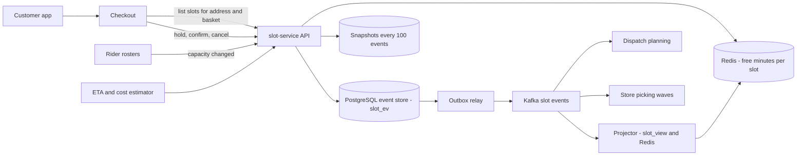
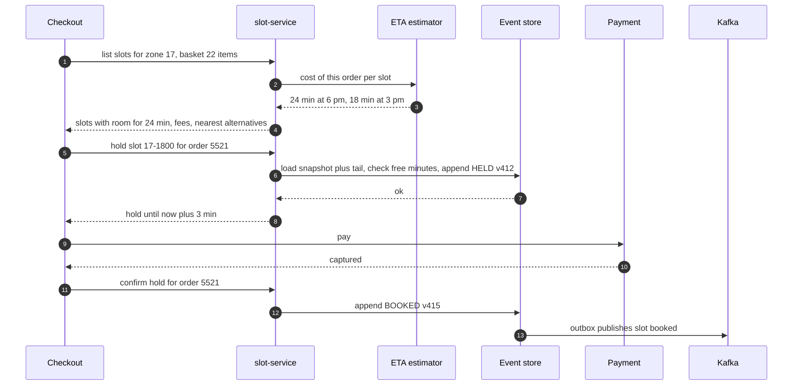
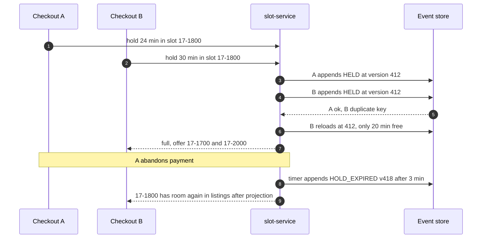
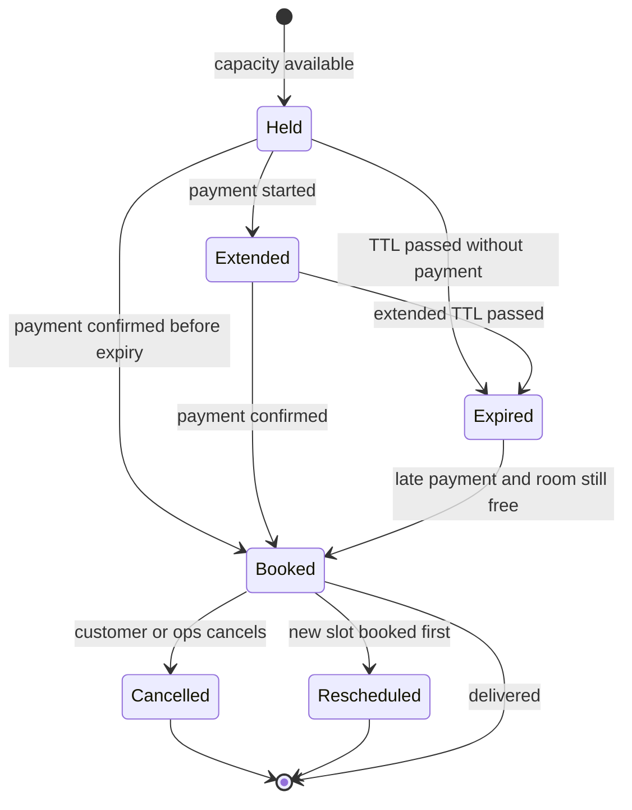

# 48. Case Study: Delivery Slot Booking & Capacity

!!! abstract "Chapter at a glance"
    **Reader bands:** B2 → B4 · **Prerequisites:** [Ch 05](../01-foundations/05-relational-databases-deep-dive.md) (isolation, row locks), [Ch 15](../02-distributed-core/15-event-driven-architecture-cqrs-and-event-sourcing.md) (event sourcing, projections), [Ch 46](46-grocery-checkout-and-inventory-reservation.md) (holds and TTLs), [Ch 47](47-delivery-dispatch-and-live-tracking.md) (rider-minutes, ETAs) · **What you will build:** `slot-service`, which answers "which delivery slots can I have, and can I book this one?" for scheduled grocery orders. That means capacity that means something, bookings that can't overbook under a Diwali-eve rush, an event-sourced slot aggregate with a history you can audit and rebuild (the design [Ch 15](../02-distributed-core/15-event-driven-architecture-cqrs-and-event-sourcing.md) deferred here), and slot screens and prices that move demand to where the riders are. It is also the classic "design a booking system (tickets, appointments, hotel rooms)" interview question, with capacity that isn't a simple count.

    **The four labs:**

    - **L1, what "full" means (simulation).** One zone over 30 days:
        - A cap of 40 orders per slot accepted 9,321 orders and delivered **2,444 late** (26%).
        - Capacity in rider-minutes from the roster, with each booking deducting its estimated cost (including evening traffic), delivered **21 late**.
        - The number delivered on time stayed about the same (~6,900–7,050). The rule decides whether customers hear "full" at booking time or "sorry, late" at the door.
    - **L2, bookings under contention (real PostgreSQL).** 32 workers made 12,000 attempts on 60 slots, 70% of them on 8 hot slots:
        - Read-check-write in Java overbooked **all 60 slots**, with 2,965 bookings against ~2,000 slots' worth of capacity.
        - SERIALIZABLE isolation fixed it with 1,043 retries.
        - A conditional `UPDATE … WHERE used + m <= cap` fixed it with **0 retries** and the best throughput and p99.
        - An event-sourced append guarded by `PK(slot, version)` was also exact, with 1,020 retries.
    - **L3, the slot as an event-sourced aggregate (real PostgreSQL, 819,306 events).**
        - A projector bug made **2,088 of 3,000** slots wrong, and 442 were shown as full while they had room.
        - Rebuilding the read model from the events took **~1 s** and fixed all of them.
        - Snapshots cut loading a hot slot from 2,800 rows (1.4 ms p50) to 52 rows (0.12 ms).
        - "What did this slot look like earlier" and "whose hold filled it" are 3–12 ms queries.
    - **L4, moving demand (simulation).** With the same riders:
        - Offering the nearest free slots, plus peak fees and shoulder discounts, cut lost customers from **1,631 to 1,357**.
        - Moving the same rider-hours into the peak cut them to **1,242**.
        - The acceptance rates are stated assumptions (VERIFY).

    · **Reading time:** 100 min + code

---

## 1. Introduction & Why It Matters

### 1.1 A story: the 7 pm slot that was always available

The first slot system had a table `slot(zone, start, max_orders=40, booked)`. The app showed slots with `booked < max_orders`; checkout did `SELECT booked … ; if (booked < 40) INSERT booking; UPDATE slot SET booked = booked_read + 1`. It went wrong in four ways:

1. **"Full" didn't mean full.** Forty orders at 11 am took 25 minutes each. Forty orders at 7 pm, in the jam, to towers with security desks, took 45. The 7 pm slot was "available" long after the riders were fully booked, and a quarter of those orders arrived after their window.
2. **Diwali eve overbooked every slot.** Slots for the festival opened at 6 am; thousands of customers booked in the same second, two checkouts read the same `booked` and both wrote `booked + 1`, and some slots ended up with 60 orders on a 40-order counter that said 41.
3. **Nobody could say what happened.** "Why was I told the 6 pm slot was full at 9:14?" The counter said 40; the bookings table said 38; there was no history of holds, cancellations and reschedules. Support refunded and apologised.
4. **Everyone wanted 7 pm.** Afternoon riders sat idle while evening customers were turned away. The app greyed out full slots and customers left instead of scrolling.

Slots are a promise made hours or days ahead. This chapter designs what a slot's capacity *means*, how to take it safely, how to keep its history, and how to fill the day evenly.

!!! quote "The thesis of this chapter"
    A delivery slot is **capacity in the unit that actually runs out** (rider-minutes from the roster, picker-minutes in the store), consumed by bookings that each deduct their **own estimated cost** (L1). Taking capacity must be **one atomic step** (a conditional update or a version-guarded append), because check-then-act overbooks (L2). The slot's **history is the source of truth**: events rebuild the read model after bugs and answer audit questions (L3). And capacity is only half the problem: **showing the right alternatives and pricing peaks** moves demand to where the riders are, and the roster should follow demand too (L4).

### 1.2 Where this lives in the grocery platform

| Concern | Owner | Data | Store |
|---|---|---|---|
| Slot templates (zones × hours × days) | `slot-service` | Rules, cut-offs, fees | PostgreSQL |
| Capacity per slot | `slot-service` from rosters ([Ch 47](47-delivery-dispatch-and-live-tracking.md)) and store picking capacity | Rider-minutes, picker-minutes | PostgreSQL (events + read model) |
| Slot availability for browsing | `slot-service` read model | Free minutes per slot | Redis cache, seconds-stale |
| Holds and bookings | `slot-service` | Events: HELD, BOOKED, EXPIRED, CANCELLED, RESCHEDULED, CAPACITY_CHANGED | PostgreSQL event store |
| Cost estimate per order | ETA service ([Ch 47](47-delivery-dispatch-and-live-tracking.md)) | Minutes by address, hour, basket size | Model + request-time computation |
| Events to others | Kafka `slot.slot.booked.v1` ([Ch 00](../00-orientation/00-how-to-use-this-handbook.md) service map) | Dispatch planning, picking waves, notifications | Outbox → Kafka |

### 1.3 Learning objectives

By the end you will be able to:

- **Model slot capacity** in the right units, per zone and per hour (L1).
- **Book capacity safely** under contention, and choose between locking, isolation and optimistic concurrency (L2).
- **Event-source the slot aggregate**: projections, rebuilds, snapshots, audit and time travel (L3).
- **Shape demand** with slot display, pricing and rostering (L4).
- Design holds, cut-offs, rescheduling, and the interplay with checkout and dispatch.

---

## 2. Core Concepts — Beginner to Deep

### 2.1 Intuition: a doctor's appointment book <span class="band b2">B2</span>

A clinic doesn't cap appointments at "20 a day". A check-up takes 10 minutes and a procedure takes 45, so the receptionist books time, from the rota of the doctors on duty. Two receptionists must never give away the same time. The book is kept in pen, so "who cancelled Tuesday at 3?" has an answer. And when everyone wants Saturday morning, a good receptionist offers Friday evening first, before the patient walks out. Slot booking is that appointment book, for thousands of zones at once.

### 2.2 Requirements <span class="band b2">B2</span>

**Functional**

- Generate slots per zone (e.g. hourly or two-hourly, 7 days ahead) from templates, with cut-off times (book by T−90 min).
- Show available slots for an address, with fees, quickly.
- Hold a slot during checkout; confirm on payment; expire abandoned holds ([Ch 46](46-grocery-checkout-and-inventory-reservation.md)).
- Cancel and reschedule; ops can change capacity (roster changes, rain) and close slots.
- Tell dispatch and stores what's booked (picking waves, rider plans).

**Non-functional**

- Slot listing p99 < 50 ms (it's on the checkout path).
- **Never overbook** beyond configured capacity, even at festival peaks.
- Full audit history of each slot.
- Availability shown may be seconds stale; booking must be exact.

### 2.3 Estimation <span class="band b2">B2</span>

| Quantity | Estimate |
|---|---|
| Zones | ~1,500 across cities |
| Slots | 1,500 zones × 16 hourly slots × 7 days ≈ 170k open slots |
| Scheduled orders | ~600k/day (the rest are express, [Ch 47](47-delivery-dispatch-and-live-tracking.md)) |
| Slot events | Holds + bookings + expiries ≈ 3–4 per order → ~2M events/day, ~100 B each → ~200 MB/day |
| Hot moment | Festival slots opening: tens of thousands of attempts in minutes, concentrated on a few evening slots per zone |
| Listing reads | Every checkout and cart view: ~5–10k/s at peak, served from cache |

Storage is small; **contention on hot slots** and **correctness of capacity** are the problems.

### 2.4 Capacity: what runs out? ⭐ <span class="band b3">B3</span>

A slot's capacity is the minimum over the resources the order consumes:

- **Rider-minutes**: the riders rostered for the zone in that window × 60, times a utilisation target (e.g. 95%).
- **Picker-minutes** in the dark store for the picking wave that feeds the slot.
- **Vehicle constraints**: cold-chain bags, bulky-item vans.

Each booking deducts its **estimated cost** in the scarce resource: ride out and back for its distance and hour, door time for its building, extra time for bulky baskets. The estimates come from the same models as ETAs ([Ch 47](47-delivery-dispatch-and-live-tracking.md) L4). L1 compared four rules:

| Capacity rule | Booked | Lost | Late | On time |
|---|---|---|---|---|
| 40 orders per slot | 9,321 | 162 | **2,444** | 6,877 |
| 28 orders per slot | 8,596 | 887 | 1,688 | 6,908 |
| Rider-minutes from roster, estimated minutes per order | 7,759 | 1,724 | 712 | 7,047 |
| + estimate knows evening traffic | 7,062 | 2,421 | **21** | 7,041 |

- **No capacity rule creates riders.** On-time deliveries are about the same in every row. The rule decides whether the customer learns "full" at booking time (and can choose another slot) or "late" at the door.
- **A count can't be tuned.** 40 is too generous at peak, and 28 is still late at peak while turning away off-peak customers.
- **Estimate quality matters**: the traffic term alone took late orders from 712 to 21.
- **Winning back lost customers** needs demand shaping and rostering (L4), not a looser rule.

### 2.5 Taking capacity safely ⭐ <span class="band b3">B3</span>

L2 ran 12,000 booking attempts from 32 concurrent workers against real PostgreSQL:

| Method | Booked | Slots over capacity | Retries | Attempts/s | p99 |
|---|---|---|---|---|---|
| Read, check in Java, write back (READ COMMITTED) | 2,965 | **60 of 60** | 0 | 4,880 | 31.6 ms |
| Same, SERIALIZABLE + retry | 1,996 | 0 | 1,043 | 5,247 | 36.7 ms |
| **Conditional `UPDATE … WHERE used + m <= cap`** | 1,999 | 0 | **0** | **7,679** | **20.6 ms** |
| Event-sourced append, `PK(slot, version)` + retry | 1,998 | 0 | 1,020 | 5,192 | 35.4 ms |

- **Check-then-act** is the root bug: two transactions read the same `used` and both decide there's room. READ COMMITTED doesn't prevent it; it also *loses updates* (the counter under-reports).
- **Conditional update**: the check and the write are one statement. The row lock serialises bookings on a hot slot, and a failed condition is an immediate, clean "full".
- **SERIALIZABLE** is correct without rewriting the logic, but pays in aborts on exactly the hot rows.
- **Optimistic version append** (event sourcing): the unique key is the guard; conflicts retry. Retries rise with contention, but you get the history (L3).
- **Very hot slots**: split capacity into sub-buckets ([Ch 46](46-grocery-checkout-and-inventory-reservation.md) L1), or put a Redis gate in front for admission with the database as the source of truth.

### 2.6 Holds, confirmations and expiry <span class="band b3">B3</span>

A customer picks a slot before paying. The slot service **holds** the minutes (`HELD`), and payment success **confirms** it (`BOOKED`). Abandoned checkouts **expire** (`HOLD_EXPIRED`) after a TTL, with the lease pattern from [Ch 46](46-grocery-checkout-and-inventory-reservation.md) L2: short TTL, extended when payment actually starts. Late payment after expiry either re-books if there's still room, or triggers a refund and apology flow. Holds count against capacity; the listing shows `cap − held − booked`.

### 2.7 The event-sourced slot aggregate ⭐ <span class="band b4">B4</span>

[Ch 15](../02-distributed-core/15-event-driven-architecture-cqrs-and-event-sourcing.md) promised an event-sourced aggregate per slot, for contention plus an audit of who took which slot. The design:

- **Event store**: `slot_ev(slot_id, version, type, customer, minutes, at)`, `PRIMARY KEY (slot_id, version)`. Commands load the aggregate, validate (capacity, cut-off), and append with version + 1. A duplicate key means someone else won the race: reload and retry.
- **Read model** (projection): `slot_view(slot_id, cap, held, booked)` feeds listings (via cache). Projectors consume events via the outbox/Kafka.
- **Snapshots** every N events bound the load cost for busy slots.

L3, on 819,306 events for 3,000 slots in real PostgreSQL:

| Scenario | Result |
|---|---|
| Projector v1 ignores `RESCHEDULED_OUT` | 2,088 of 3,000 slots wrong; **442 shown full with room** |
| Fix the projector, rebuild from the store | 819,306 events replayed in ~0.9–1.1 s; **0 wrong** |
| Load a hot slot: full replay | 2,802 rows, 1.41 ms p50, 3.74 ms p99 |
| Load a hot slot: snapshot + tail | **52 rows, 0.12 ms p50, 0.28 ms p99** |
| Time travel: slot state midway through its history | 1,492 events, 2.5 ms |
| Audit: whose hold took the slot to its fullest point | window-function query, ~12 ms |

- **Projection bugs are recoverable**: a mutable counter keeps a wrong number forever; an event store can recompute it.
- **Events are business facts** ("customer X held 22 minutes at 18:04"), which is what support and finance ask about.
- **Costs**: more moving parts, schema evolution of events ([Ch 28](../03-production/28-schema-and-data-evolution.md)), eventual consistency of the read model. A simple alternative is a conditional-update counter (L2 B3) plus an append-only booking log in the same transaction: most of the audit value, less machinery.

### 2.8 Demand shaping ⭐ <span class="band b3">B3</span>

L4 held riders fixed and varied what customers see and pay:

| Policy | Served | Lost | Avg hours moved | Net fee (₹, 30 days) |
|---|---|---|---|---|
| Time-ordered list, full slots greyed | 6,238 | 1,631 | 0.19 | 0 |
| Offer the 2 closest free slots | 6,430 | 1,439 | 0.26 | 0 |
| ₹20 peak fee / −₹15 shoulder discount | 6,302 | 1,567 | 0.37 | +25,650 |
| Both | 6,512 | 1,357 | 0.46 | +25,945 |
| Both + roster follows demand (same rider-hours) | **6,627** | **1,242** | 0.44 | +33,210 |

- **Recommend, don't grey out**: offer the nearest free slots, earlier as well as later.
- **Price the peak**: fees and discounts move flexible customers before the peak fills, leaving room for those who can't move.
- **Roster to demand**: the same rider-hours placed where demand is. Slot booking data is the best input to rostering.
- **Green/batched slots**: discounts for slots where the rider is already going to the same building (batching, [Ch 47](47-delivery-dispatch-and-live-tracking.md) L3).
- The acceptance and price-response rates in L4 are assumptions (VERIFY); measure them with experiments (switchback per zone, since slots interact).

### 2.9 Listing availability fast <span class="band b3">B3</span>

- The listing is read-heavy and tolerates seconds of staleness: serve `free minutes per slot` for the zone from Redis, updated by the projector.
- Showing "available" doesn't guarantee booking: the booking command is the exact check. Show "almost full" when free minutes are below a threshold, to set expectations.
- Filter per order: a slot with 20 free minutes can take a 15-minute order but not a 35-minute one. Compute availability with this order's estimated cost.

### 2.10 Rescheduling, cancellations and capacity changes <span class="band b3">B3</span>

- **Reschedule** = book the new slot first, then release the old (never the reverse, or the customer can lose both). Model it as a saga across two aggregates, or one transaction if both live in one database.
- **Capacity drops** (rider sick, rain) can leave slots over-committed: flag them, protect already-booked orders, stop new holds, and ask dispatch to borrow riders or notify customers early.
- **Cut-offs**: stop booking a slot when picking must start; close slots in zones affected by events.

### 2.11 Interview framing <span class="band b4">B4</span>

This is the classic "design a booking system" question (tickets, hotel rooms, doctor appointments, restaurant tables). Cover:

- the unit of capacity;
- atomic capacity checks under contention;
- holds with TTL;
- history and auditing (event sourcing as an option, with its costs);
- fast availability reads with exact booking;
- rescheduling as a saga;
- demand shaping.

Staff-level signals are saying "count is the wrong unit", separating browse staleness from booking exactness, and connecting booking data to rostering.

---

## 3. Architecture & Diagrams

### 3.1 Component view



### 3.2 Sequence: happy path, hold then confirm



### 3.3 Sequence: failure path, concurrent last capacity and an expired hold



### 3.4 State: one hold's lifecycle



---

## 4. Design Document Excerpt: slot-service v2

!!! note "Design Document (excerpt) — slot-service v2: capacity in minutes, event-sourced slots"
    **Status:** Accepted · **Authors:** Fulfilment platform team · **Reviewers:** Dispatch, Store ops, Checkout, SRE, Finance

    | Field | Value |
    |---|---|
    | Context | Order-count caps made evening slots overfull and daytime slots underused. Check-then-act overbooked festival slots. Counters drifted from bookings with no history. Full slots were greyed out and customers left. |
    | Decision | Capacity in rider- and picker-minutes from rosters; bookings deduct estimated cost per order and slot. Event-sourced slot aggregate with version-guarded appends, snapshots every 100 events, and projections to Redis for listings. Holds with 3-minute TTL, extended on payment start. Nearest-alternative recommendations and peak/shoulder pricing. Roster planning uses booking curves. |
    | Related ADRs | ADR-340: capacity = min(rider-minutes × 0.95, picker-minutes) per zone-slot, cost from the ETA service (L1). ADR-341: event store `PK(slot_id, version)`, optimistic concurrency, outbox to Kafka (L2, L3). ADR-342: snapshots every 100 events; the read model is rebuildable in minutes (L3). ADR-343: holds 3 min, extended to 15 when payment starts ([Ch 46](46-grocery-checkout-and-inventory-reservation.md)). ADR-344: listings from Redis, ≤ 5 s stale, with an exact check at hold time. ADR-345: demand shaping via recommendations and fees, experiment-gated (L4). |

    **Requirements.**

    - **R1:** 0 slots booked beyond capacity, audited daily from events.
    - **R2:** ≥ 98% of booked orders delivered within their slot.
    - **R3:** Listing p99 < 50 ms; hold/confirm p99 < 100 ms at festival peak.
    - **R4:** Any slot's state at any past time is answerable within seconds.
    - **R5:** Read model rebuildable from events in < 10 minutes for the whole country.

    **Decisions in detail.**

    1. **Capacity (ADR-340).** The roster service emits `CAPACITY_CHANGED` events. The ETA service gives order cost per slot, with traffic by hour and door time by building.
    2. **Concurrency (ADR-341).** Hot slots see retries (L2: ~1 per 12 attempts overall). Retries are bounded, and past 5 of them we return "try another slot" with alternatives. A Redis admission gate is available as a flag for festival openings.
    3. **Snapshots (ADR-342).** Written asynchronously by the projector, never on the booking path.
    4. **Holds (ADR-343).** Expiry is a scheduled command that appends `HOLD_EXPIRED` idempotently.
    5. **Demand (ADR-345).** Fee changes need Finance approval, and are tested by switchback per zone.

    **Consequences.**

    - We take on more infrastructure (event store, projector, snapshots), eventual consistency in listings, dependence on the ETA estimator's quality, and event schema governance.
    - In return we get honest slots, zero overbooking, auditable history, recoverable read models, and a demand lever.

---

## 5. Hands-On Code — Level Ladder

!!! info "What's real here"
    **L2 and L3 run against a real PostgreSQL 16** (fsync on). They use real concurrent transactions, SERIALIZABLE aborts, unique-key conflicts, batched appends and replays. L1 and L4 are deterministic simulations with fixed seeds. Rosters, order costs, customer acceptance rates and price responses are stated assumptions (VERIFY against your own data). Timings vary by machine.

L2 and L3 need PostgreSQL on port 5581 (database `shop`) and the PostgreSQL JDBC driver. Run every lab with `-Dstdout.encoding=UTF-8`, and the JDBC labs also with `-Duser.timezone=UTC`.

### L1 — What "full" means <span class="band b2">B2</span>

**Requirement:** "A slot shown as available must be deliverable on time."

One zone, 30 days, a roster that changes by hour, orders that differ in cost, and four capacity rules.

```java title="SlotCapacityL1.java"
// SlotCapacityL1.java — run with: java SlotCapacityL1.java   (JDK 21, no dependencies)
// WHAT DOES "THIS SLOT IS FULL" MEAN? One delivery zone, 30 days, 16 one-hour slots a day (7 am – 11 pm), fixed seed.
// The rider roster varies by hour: 6 riders early morning, 8 through the day, 14 in the 5–9 pm peak, 8 late.
// Each order costs rider-minutes: ride out and back (0.5–4 km, roads 1.4x the straight line, 18 km/h), plus the door
// (1–2 min for a house, 4–9 for a gated tower), plus 3 min for a bulky order (25% of orders). Customers pick their
// preferred slot (evenings are popular); if it's shown as full, 50% pick the next free slot within 2 hours, the rest leave.
// Orders beyond a slot's real rider-minutes are delivered late (they spill past the slot window).
//   C1 cap each slot at 40 orders (the number ops set years ago)
//   C2 cap each slot at 28 orders (ops lowered it after complaints)
//   C3 cap per slot = the roster's rider-minutes; each booking deducts its ESTIMATED minutes (distance + building door
//      history + bulky flag), stop at 95%
//   C4 C3, but the estimate also knows each slot's traffic (evening rides are 35% slower)
// Measured over 30 days: orders booked, customers lost, orders delivered late, and rider utilisation.
import java.util.*;

public class SlotCapacityL1 {
    static final int SLOTS = 16, DAYS = 30;
    static final int[] RIDERS = {6, 6, 6, 8, 8, 8, 8, 8, 8, 8, 14, 14, 14, 14, 8, 8};              // 7,8,...,22 h
    static final double[] PREF = {2, 4, 5, 5, 6, 7, 6, 5, 5, 7, 12, 16, 15, 11, 6, 3};             // preferred-slot weights
    record Order(int pref, double km, boolean gated, boolean bulky, double doorActual, double noise) {}

    static double slowdown(int s) { int h = 7 + s; return h >= 17 && h <= 20 ? 1.35 : 1.0; }
    static double actualMinutes(Order o, int s) { return (2 * 1.4 * o.km() / 0.3) * slowdown(s) * o.noise() + o.doorActual() + (o.bulky() ? 3 : 0); }
    static double estMinutes(Order o, int s, boolean traffic) { return 2 * 1.4 * o.km() / 0.3 * (traffic ? slowdown(s) : 1.0) + (o.gated() ? 6.5 : 1.5) + (o.bulky() ? 3 : 0); }

    public static void main(String[] args) {
        System.out.println("One zone, 30 days, 16 hourly slots; roster 6 / 8 / 14 (5–9 pm) / 8 riders; ~320 orders wanted per day.\n");
        System.out.printf("   %-56s %9s %9s %10s %12s %12s%n", "slot capacity rule", "booked", "lost", "late", "on time", "rider util.");
        String[] names = {"C1) 40 orders per slot", "C2) 28 orders per slot", "C3) rider-minutes from roster, est. minutes per order",
                "C4) C3 + estimate knows evening traffic"};
        for (int p = 0; p < 4; p++) run(p, names[p]);
        System.out.println("\n   → riders are the bottleneck at peak, so no capacity rule delivers many more orders on time (~6,900–7,050 in all");
        System.out.println("     four). What the rule decides is WHEN the customer hears the truth: an order count accepts evening towers it");
        System.out.println("     can't deliver (26% late under C1), while rider-minutes from the roster, with each booking deducting its own");
        System.out.println("     estimated cost, says 'full' at booking time instead (late: 2,444 → 21). The estimate must know what makes an");
        System.out.println("     order expensive, including evening traffic (C3 → C4). Winning back the lost customers is a demand problem (L4).");
    }

    static void run(int policy, String name) {
        Random r = new Random(48); long booked = 0, lost = 0, late = 0; double used = 0, avail = 0;
        double prefSum = Arrays.stream(PREF).sum();
        for (int d = 0; d < DAYS; d++) {
            int n = 270 + r.nextInt(100);
            double[] estUsed = new double[SLOTS], realUsed = new double[SLOTS]; int[] count = new int[SLOTS];
            for (int i = 0; i < n; i++) {
                double x = r.nextDouble() * prefSum; int pref = 0; while (x > PREF[pref]) { x -= PREF[pref]; pref++; }
                boolean gated = r.nextDouble() < 0.3;
                Order o = new Order(pref, 0.5 + 3.5 * Math.sqrt(r.nextDouble()), gated, r.nextDouble() < 0.25,
                        gated ? 4 + 5 * r.nextDouble() : 1 + r.nextDouble(), Math.exp(0.15 * r.nextGaussian()));
                boolean second = r.nextDouble() < 0.5; int chosen = -1;
                for (int s = pref; s <= Math.min(SLOTS - 1, pref + (second ? 2 : 0)); s++) {
                    boolean ok = switch (policy) {
                        case 0 -> count[s] < 40;
                        case 1 -> count[s] < 28;
                        default -> estUsed[s] + estMinutes(o, s, policy == 3) <= 0.95 * RIDERS[s] * 60;
                    };
                    if (ok) { chosen = s; break; }
                }
                if (chosen < 0) { lost++; continue; }
                booked++; count[chosen]++; estUsed[chosen] += estMinutes(o, chosen, policy == 3);
                double m = actualMinutes(o, chosen);
                if (realUsed[chosen] + m > RIDERS[chosen] * 60) late++;
                realUsed[chosen] += m;
            }
            for (int s = 0; s < SLOTS; s++) { used += Math.min(realUsed[s], RIDERS[s] * 60); avail += RIDERS[s] * 60; }
        }
        System.out.printf("   %-56s %,9d %,9d %,10d %,12d %11.1f%%%n", name, booked, lost, late, booked - late, 100 * used / avail);
    }
}
```

```text title="java -Dstdout.encoding=UTF-8 SlotCapacityL1.java"
One zone, 30 days, 16 hourly slots; roster 6 / 8 / 14 (5–9 pm) / 8 riders; ~320 orders wanted per day.

   slot capacity rule                                          booked      lost       late      on time  rider util.
   C1) 40 orders per slot                                       9,321       162      2,444        6,877        90.0%
   C2) 28 orders per slot                                       8,596       887      1,688        6,908        90.3%
   C3) rider-minutes from roster, est. minutes per order        7,759     1,724        712        7,047        91.1%
   C4) C3 + estimate knows evening traffic                      7,062     2,421         21        7,041        89.6%

   → riders are the bottleneck at peak, so no capacity rule delivers many more orders on time (~6,900–7,050 in all
     four). What the rule decides is WHEN the customer hears the truth: an order count accepts evening towers it
     can't deliver (26% late under C1), while rider-minutes from the roster, with each booking deducting its own
     estimated cost, says 'full' at booking time instead (late: 2,444 → 21). The estimate must know what makes an
     order expensive, including evening traffic (C3 → C4). Winning back the lost customers is a demand problem (L4).
```

**Reading it:**

- **About 7,000 orders are delivered on time under every rule.** The riders are the limit, and no rule changes that.
- **C1** accepts 2,444 orders it can't deliver on time, mostly evening towers.
- **C2** (a smaller count) is still late at peak and also turns away customers when there's room.
- **C3 and C4** book what the roster can carry. The traffic term in the estimate removes almost all remaining lateness (712 → 21).
- The extra "lost" customers under C4 are the honest cost of saying "full" at booking time. L4 wins some of them back.

### L2 — Booking under contention <span class="band b3">B3</span>

**Requirement:** "Never book a slot beyond its capacity, even when thousands of customers book the same evening at once."

60 slots, 32 concurrent workers, 12,000 attempts against a real PostgreSQL.

```java title="SlotBookingL2.java"
// SlotBookingL2.java — run with (PostgreSQL on :5581, db shop):
//   java -Duser.timezone=UTC -cp /tmp/eslab/postgresql-42.7.4.jar SlotBookingL2.java   (JDK 21)
// SLOTS OPEN FOR DIWALI EVE. 60 evening slots (12 zones × 5 hours) open at once; each has 840 rider-minutes (14 riders).
// 32 concurrent booking workers (the checkout pods) make 12,000 attempts (fixed seed): 70% of customers want one of
// 8 hot slots; each order costs 15–35 minutes (its L1 estimate); if the preferred slot is full the customer tries up to
// 2 others. Four ways to take capacity, all against a REAL PostgreSQL (fsync on):
//   B1 read the slot's used minutes, check in Java, INSERT booking, UPDATE used = <value read> + minutes  (READ COMMITTED)
//   B2 the same logic in a SERIALIZABLE transaction, retried on serialization failure (SQLState 40001)
//   B3 one conditional statement: UPDATE slot SET used = used + m WHERE id = ? AND used + m <= cap — then INSERT booking
//   B4 event-sourced: rebuild the slot from its events (SUM, MAX(version)), append event version+1; the primary key
//      (slot_id, version) rejects a concurrent append at the same version → reload and retry (optimistic concurrency)
// Measured: bookings accepted, slots over capacity (audited from the booking/event rows), retries, attempts/s, p99.
import java.sql.*;
import java.util.*;
import java.util.concurrent.*;
import java.util.concurrent.atomic.*;

public class SlotBookingL2 {
    static final String URL = "jdbc:postgresql://localhost:5581/shop?user=claude";
    static final int SLOTS = 60, CAP = 840, WORKERS = 32, ATTEMPTS = 12_000;
    record Attempt(int customer, int[] slots, int minutes) {}

    public static void main(String[] args) throws Exception {
        Random r = new Random(48); List<Attempt> work = new ArrayList<>();
        for (int i = 0; i < ATTEMPTS; i++) {
            int pref = r.nextDouble() < 0.7 ? r.nextInt(8) : 8 + r.nextInt(SLOTS - 8);
            work.add(new Attempt(i, new int[]{pref, r.nextInt(SLOTS), r.nextInt(SLOTS)}, 15 + r.nextInt(21)));
        }
        System.out.printf("60 slots × 840 rider-minutes; %d workers; %,d booking attempts (70%% want 8 hot slots); real PostgreSQL.%n%n", WORKERS, ATTEMPTS);
        System.out.printf("   %-58s %9s %12s %9s %11s %9s%n", "booking method", "booked", "slots over", "retries", "attempts/s", "p99");
        System.out.printf("   %-58s %9s %12s %9s %11s %9s%n", "", "", "capacity", "", "", "");
        String[] names = {"B1) read, check in Java, write back (READ COMMITTED)", "B2) same, SERIALIZABLE + retry",
                "B3) conditional UPDATE ... WHERE used + m <= cap", "B4) event-sourced append, PK(slot, version) + retry"};
        for (int m = 0; m < 4; m++) run(m, names[m], work);
        System.out.println("\n   → B1 is the classic check-then-act race: two workers read the same 'used', both see room, both book. SERIALIZABLE");
        System.out.println("     detects it but pays in aborted transactions on exactly the hot slots. A conditional UPDATE makes the check and");
        System.out.println("     the write one atomic step — the row lock serialises bookings per slot and nothing retries. The event-sourced");
        System.out.println("     aggregate is equally correct (the version key is the guard) and keeps who-took-what as history (L3); its");
        System.out.println("     retries on hot slots are the price of optimistic concurrency.");
    }

    static void setup(Connection c) throws SQLException {
        try (Statement s = c.createStatement()) {
            s.execute("DROP TABLE IF EXISTS slot_booking, slot, slot_event");
            s.execute("CREATE TABLE slot (id int PRIMARY KEY, cap int NOT NULL, used int NOT NULL DEFAULT 0)");
            s.execute("CREATE TABLE slot_booking (id bigserial PRIMARY KEY, slot_id int NOT NULL, customer int NOT NULL, minutes int NOT NULL)");
            s.execute("CREATE TABLE slot_event (slot_id int, version int, customer int NOT NULL, minutes int NOT NULL, PRIMARY KEY (slot_id, version))");
            s.execute("INSERT INTO slot SELECT g, " + CAP + ", 0 FROM generate_series(0," + (SLOTS - 1) + ") g");
        }
    }

    static void run(int method, String name, List<Attempt> work) throws Exception {
        try (Connection c = DriverManager.getConnection(URL)) { setup(c); }
        AtomicInteger next = new AtomicInteger(), booked = new AtomicInteger(); AtomicLong retries = new AtomicLong();
        long[] lat = new long[work.size()];
        ExecutorService ex = Executors.newFixedThreadPool(WORKERS); List<Future<?>> fs = new ArrayList<>();
        long t0 = System.nanoTime();
        for (int w = 0; w < WORKERS; w++) fs.add(ex.submit(() -> {
            try (Connection c = DriverManager.getConnection(URL)) {
                c.setAutoCommit(false);
                if (method == 1) c.setTransactionIsolation(Connection.TRANSACTION_SERIALIZABLE);
                int i;
                while ((i = next.getAndIncrement()) < work.size()) {
                    Attempt a = work.get(i); long s0 = System.nanoTime();
                    for (int slot : a.slots()) { if (book(c, method, slot, a, retries)) { booked.incrementAndGet(); break; } }
                    lat[i] = System.nanoTime() - s0;
                }
            }
            return null;
        }));
        for (Future<?> f : fs) f.get(); ex.shutdown();
        double secs = (System.nanoTime() - t0) / 1e9;
        int over = 0;
        try (Connection c = DriverManager.getConnection(URL); Statement s = c.createStatement();
             ResultSet rs = s.executeQuery(method == 3 ? "SELECT count(*) FROM (SELECT slot_id FROM slot_event GROUP BY slot_id HAVING sum(minutes) > " + CAP + ") x"
                     : "SELECT count(*) FROM (SELECT slot_id FROM slot_booking GROUP BY slot_id HAVING sum(minutes) > " + CAP + ") x")) { rs.next(); over = rs.getInt(1); }
        Arrays.sort(lat);
        System.out.printf("   %-58s %,9d %12d %,9d %,11.0f %6.1f ms%n", name, booked.get(), over, retries.get(), work.size() / secs, lat[(int) (lat.length * 0.99)] / 1e6);
    }

    static boolean book(Connection c, int method, int slot, Attempt a, AtomicLong retries) throws SQLException {
        while (true) {
            try {
                boolean ok;
                switch (method) {
                    case 0, 1 -> {
                        int used;
                        try (PreparedStatement p = c.prepareStatement("SELECT used FROM slot WHERE id = ?")) { p.setInt(1, slot); try (ResultSet rs = p.executeQuery()) { rs.next(); used = rs.getInt(1); } }
                        ok = used + a.minutes() <= CAP;
                        if (ok) {
                            insertBooking(c, slot, a);
                            try (PreparedStatement p = c.prepareStatement("UPDATE slot SET used = ? WHERE id = ?")) { p.setInt(1, used + a.minutes()); p.setInt(2, slot); p.executeUpdate(); }
                        }
                    }
                    case 2 -> {
                        try (PreparedStatement p = c.prepareStatement("UPDATE slot SET used = used + ? WHERE id = ? AND used + ? <= cap")) {
                            p.setInt(1, a.minutes()); p.setInt(2, slot); p.setInt(3, a.minutes()); ok = p.executeUpdate() == 1;
                        }
                        if (ok) insertBooking(c, slot, a);
                    }
                    default -> {
                        int version, used;
                        try (PreparedStatement p = c.prepareStatement("SELECT coalesce(max(version),0), coalesce(sum(minutes),0) FROM slot_event WHERE slot_id = ?")) {
                            p.setInt(1, slot); try (ResultSet rs = p.executeQuery()) { rs.next(); version = rs.getInt(1); used = rs.getInt(2); }
                        }
                        ok = used + a.minutes() <= CAP;
                        if (ok) try (PreparedStatement p = c.prepareStatement("INSERT INTO slot_event VALUES (?,?,?,?)")) {
                            p.setInt(1, slot); p.setInt(2, version + 1); p.setInt(3, a.customer()); p.setInt(4, a.minutes()); p.executeUpdate();
                        }
                    }
                }
                c.commit(); return ok;
            } catch (SQLException e) {
                c.rollback();
                if ("40001".equals(e.getSQLState()) || "23505".equals(e.getSQLState()) || "40P01".equals(e.getSQLState())) { retries.incrementAndGet(); continue; }
                throw e;
            }
        }
    }
    static void insertBooking(Connection c, int slot, Attempt a) throws SQLException {
        try (PreparedStatement p = c.prepareStatement("INSERT INTO slot_booking (slot_id, customer, minutes) VALUES (?,?,?)")) { p.setInt(1, slot); p.setInt(2, a.customer()); p.setInt(3, a.minutes()); p.executeUpdate(); }
    }
}
```

```text title="java -Duser.timezone=UTC -cp postgresql-42.7.4.jar SlotBookingL2.java"
60 slots × 840 rider-minutes; 32 workers; 12,000 booking attempts (70% want 8 hot slots); real PostgreSQL.

   booking method                                                booked   slots over   retries  attempts/s       p99
                                                                            capacity                                
   B1) read, check in Java, write back (READ COMMITTED)           2,965           60         0       4,880   31.6 ms
   B2) same, SERIALIZABLE + retry                                 1,996            0     1,043       5,247   36.7 ms
   B3) conditional UPDATE ... WHERE used + m <= cap               1,999            0         0       7,679   20.6 ms
   B4) event-sourced append, PK(slot, version) + retry            1,998            0     1,020       5,192   35.4 ms

   → B1 is the classic check-then-act race: two workers read the same 'used', both see room, both book. SERIALIZABLE
     detects it but pays in aborted transactions on exactly the hot slots. A conditional UPDATE makes the check and
     the write one atomic step — the row lock serialises bookings per slot and nothing retries. The event-sourced
     aggregate is equally correct (the version key is the guard) and keeps who-took-what as history (L3); its
     retries on hot slots are the price of optimistic concurrency.
```

**Reading it:**

- **B1** booked 2,965 orders into capacity for about 2,000, and every one of the 60 slots went over. The `used` column also lost updates, so it under-reports what was booked.
- **B2** is exact, but 1,043 transactions aborted and retried.
- **B3** is exact with no retries, and has the highest throughput and lowest p99.
- **B4** is exact too. Its 1,020 retries are version conflicts on hot slots, and in exchange it has the history L3 uses.

### L3 — The slot as an event-sourced aggregate <span class="band b4">B4</span>

**Requirement:** "Be able to explain and recompute every slot's state."

819,306 events for 3,000 slots in a real PostgreSQL event table: a buggy projector, a rebuild, snapshots, time travel and an audit query.

```java title="SlotEventsL3.java"
// SlotEventsL3.java — run with (PostgreSQL on :5581, db shop):
//   java -Duser.timezone=UTC -cp /tmp/eslab/postgresql-42.7.4.jar SlotEventsL3.java   (JDK 21)
// THE SLOT AS AN EVENT-SOURCED AGGREGATE (the Ch 15 promise). 3,000 slots (100 zones × 30 hourly slots for one day);
// every change is an event: HELD (checkout holds minutes), BOOKED (hold confirmed), HOLD_EXPIRED, CANCELLED,
// RESCHEDULED_OUT, CAPACITY_CHANGED (roster changed). Busy evening slots churn thousands of holds; quiet ones a few dozen.
// Events are generated (fixed seed), bulk-loaded into a REAL PostgreSQL event table, and then:
//   1) projector v1 — the live read model — has a bug: it ignores RESCHEDULED_OUT (only CANCELLED frees capacity)
//   2) fix the projector and REBUILD the read model by replaying every event from the store
//   3) loading one aggregate to make a booking decision: full replay vs latest snapshot (every 100 events) + tail
//   4) time travel: the state of a hot slot halfway through its day, and whose hold took it to its fullest point
// Measured: real load/replay times, rows read, and read-model slots that disagree with the event history.
import java.sql.*;
import java.util.*;

public class SlotEventsL3 {
    static final String URL = "jdbc:postgresql://localhost:5581/shop?user=claude&reWriteBatchedInserts=true";
    static final int SLOTS = 3000, HELD = 1, BOOKED = 2, EXPIRED = 3, CANCELLED = 4, RESCHED = 5, CAPCHG = 6;
    record Ev(int slot, int version, int type, int customer, int minutes, long at) {}
    static final class State { int cap = 840, held, booked, version; void apply(Ev e, boolean buggy) {
        version = e.version();
        switch (e.type()) {
            case HELD -> held += e.minutes(); case BOOKED -> { held -= e.minutes(); booked += e.minutes(); }
            case EXPIRED -> held -= e.minutes(); case CANCELLED -> booked -= e.minutes();
            case RESCHED -> { if (!buggy) booked -= e.minutes(); } case CAPCHG -> cap = e.minutes();
        } }
        boolean same(State o) { return cap == o.cap && held == o.held && booked == o.booked; } }

    public static void main(String[] args) throws Exception {
        Random r = new Random(48); List<Ev> all = new ArrayList<>(); long day0 = 1_790_000_000_000L; Map<Integer, State> truth = new HashMap<>();
        for (int s = 0; s < SLOTS; s++) {
            boolean hot = s % 30 >= 11 && s % 30 <= 14 && r.nextDouble() < 0.5;                 // some evening slots are hot
            int target = hot ? 1500 + r.nextInt(2500) : 20 + r.nextInt(150);
            State st = new State(); int v = 0; long t = day0 + r.nextInt(3_600_000); List<int[]> bookedList = new ArrayList<>();
            while (v < target) {
                t += hot ? 500 + r.nextInt(3000) : 60_000 + r.nextInt(900_000);
                double x = r.nextDouble(); Ev e;
                if (x < 0.01) e = new Ev(s, ++v, CAPCHG, 0, 700 + 20 * r.nextInt(15), t);
                else if (x < 0.05 && !bookedList.isEmpty()) { int[] b = bookedList.remove(r.nextInt(bookedList.size())); e = new Ev(s, ++v, r.nextBoolean() ? CANCELLED : RESCHED, b[0], b[1], t); }
                else {
                    int m = 15 + r.nextInt(21), cust = r.nextInt(5_000_000);
                    if (st.held + st.booked + m > st.cap) continue;                               // full: the hold is refused, no event
                    Ev h = new Ev(s, ++v, HELD, cust, m, t); st.apply(h, false); all.add(h);
                    t += 20_000 + r.nextInt(400_000);
                    if (r.nextDouble() < 0.7) { e = new Ev(s, ++v, BOOKED, cust, m, t); bookedList.add(new int[]{cust, m}); } else e = new Ev(s, ++v, EXPIRED, cust, m, t);
                }
                st.apply(e, false); all.add(e);
            }
            truth.put(s, st);
        }
        System.out.printf("%,d events for %,d slots (busiest slot %,d events).%n%n", all.size(), SLOTS, truth.values().stream().mapToInt(x -> x.version).max().orElse(0));
        try (Connection c = DriverManager.getConnection(URL)) {
            try (Statement s = c.createStatement()) {
                s.execute("DROP TABLE IF EXISTS slot_ev, slot_view, slot_snap");
                s.execute("CREATE TABLE slot_ev (slot_id int, version int, type smallint NOT NULL, customer int NOT NULL, minutes int NOT NULL, at timestamptz NOT NULL, PRIMARY KEY (slot_id, version))");
                s.execute("CREATE TABLE slot_view (slot_id int PRIMARY KEY, cap int, held int, booked int, version int)");
                s.execute("CREATE TABLE slot_snap (slot_id int, version int, cap int, held int, booked int, PRIMARY KEY (slot_id, version))");
            }
            c.setAutoCommit(false);
            long t0 = System.nanoTime();
            try (PreparedStatement p = c.prepareStatement("INSERT INTO slot_ev VALUES (?,?,?,?,?,?)")) {
                int n = 0; for (Ev e : all) { p.setInt(1, e.slot()); p.setInt(2, e.version()); p.setShort(3, (short) e.type()); p.setInt(4, e.customer()); p.setInt(5, e.minutes()); p.setTimestamp(6, new Timestamp(e.at())); p.addBatch(); if (++n % 5000 == 0) p.executeBatch(); }
                p.executeBatch();
            }
            c.commit(); try (Statement s = c.createStatement()) { s.execute("ANALYZE slot_ev"); } c.commit();
            System.out.printf("   load: %,d events appended in %.1f s (%,.0f events/s, batched)%n%n", all.size(), (System.nanoTime() - t0) / 1e9, all.size() / ((System.nanoTime() - t0) / 1e9));

            // 1) + 2) projector v1 (buggy) vs rebuilt v2
            for (int ver = 1; ver <= 2; ver++) {
                t0 = System.nanoTime(); Map<Integer, State> view = replayAll(c, ver == 1);
                double secs = (System.nanoTime() - t0) / 1e9;
                try (Statement s = c.createStatement()) { s.execute("TRUNCATE slot_view"); }
                try (PreparedStatement p = c.prepareStatement("INSERT INTO slot_view VALUES (?,?,?,?,?)")) {
                    for (var en : view.entrySet()) { State st = en.getValue(); p.setInt(1, en.getKey()); p.setInt(2, st.cap); p.setInt(3, st.held); p.setInt(4, st.booked); p.setInt(5, st.version); p.addBatch(); }
                    p.executeBatch();
                }
                c.commit();
                int wrong = 0, phantom = 0; for (int s = 0; s < SLOTS; s++) { State v = view.get(s), tr = truth.get(s); if (!v.same(tr)) wrong++;
                    if (v.held + v.booked + 35 > v.cap && tr.held + tr.booked + 35 <= tr.cap) phantom++; }
                System.out.printf("   %s: replayed %,d events in %.2f s → %,d of %,d slots disagree with history; %,d shown FULL that have room%n",
                        ver == 1 ? "projector v1 (ignores RESCHEDULED_OUT)" : "projector v2 rebuilt from the event store", all.size(), secs, wrong, SLOTS, phantom);
            }
            // snapshots every 100 events
            try (PreparedStatement p = c.prepareStatement("INSERT INTO slot_snap VALUES (?,?,?,?,?)")) {
                State st = null; int cur = -1;
                for (Ev e : all) { if (e.slot() != cur) { cur = e.slot(); st = new State(); } st.apply(e, false);
                    if (e.version() % 100 == 0) { p.setInt(1, cur); p.setInt(2, e.version()); p.setInt(3, st.cap); p.setInt(4, st.held); p.setInt(5, st.booked); p.addBatch(); } }
                p.executeBatch();
            }
            c.commit();
            // 3) aggregate loads
            List<Integer> hot = new ArrayList<>(); for (int s = 0; s < SLOTS; s++) if (truth.get(s).version > 1000) hot.add(s);
            System.out.println("\n   loading one aggregate for a booking decision (2,000 loads each, real queries):");
            System.out.printf("   %-44s %18s %12s %12s%n", "", "rows read / load", "p50", "p99");
            for (boolean hotSet : new boolean[]{false, true}) for (boolean snap : new boolean[]{false, true}) {
                long[] lat = new long[2000]; long rows = 0; Random q = new Random(7);
                for (int i = 0; i < 2000; i++) {
                    int s = hotSet ? hot.get(q.nextInt(hot.size())) : q.nextInt(SLOTS);
                    long s0 = System.nanoTime(); int[] res = load(c, s, snap); lat[i] = System.nanoTime() - s0; rows += res[0];
                    if (res[1] != truth.get(s).booked) throw new IllegalStateException("load mismatch " + s);
                }
                c.commit(); Arrays.sort(lat);
                System.out.printf("   %-44s %,18.1f %9.2f ms %9.2f ms%n", (hotSet ? "hot slot, " : "any slot, ") + (snap ? "snapshot + tail" : "full replay"), rows / 2000.0, lat[1000] / 1e6, lat[1980] / 1e6);
            }
            // 4) time travel + audit
            int s = hot.get(0); long first = all.stream().filter(e -> e.slot() == s).mapToLong(Ev::at).min().orElse(0), last = all.stream().filter(e -> e.slot() == s).mapToLong(Ev::at).max().orElse(0), at = (first + last) / 2;
            t0 = System.nanoTime(); State past = new State(); int n = 0;
            try (PreparedStatement p = c.prepareStatement("SELECT slot_id, version, type, customer, minutes, at FROM slot_ev WHERE slot_id = ? AND at <= ? ORDER BY version")) {
                p.setInt(1, s); p.setTimestamp(2, new Timestamp(at));
                try (ResultSet rs = p.executeQuery()) { while (rs.next()) { past.apply(ev(rs), false); n++; } }
            }
            double ms = (System.nanoTime() - t0) / 1e6;
            String sql = """
                    SELECT customer, minutes, version FROM (
                      SELECT customer, minutes, version, type,
                             sum(CASE type WHEN 1 THEN minutes WHEN 3 THEN -minutes WHEN 4 THEN -minutes WHEN 5 THEN -minutes ELSE 0 END)
                               OVER (ORDER BY version) AS taken
                      FROM slot_ev WHERE slot_id = ? AND type <> 6) x
                    WHERE type = 1 ORDER BY taken DESC, version LIMIT 1""";
            long t1 = System.nanoTime(); String who;
            try (PreparedStatement p = c.prepareStatement(sql)) { p.setInt(1, s); try (ResultSet rs = p.executeQuery()) { rs.next(); who = "customer " + rs.getInt(1) + " (" + rs.getInt(2) + " min, event v" + rs.getInt(3) + ")"; } }
            System.out.printf("%n   time travel: slot %d as of %tR UTC (midway through its history) — held %d, booked %d of %d min, from %,d events in %.1f ms%n", s, new java.util.Date(at), past.held, past.booked, past.cap, n, ms);
            System.out.printf("   audit: the hold that took this slot to its fullest point was %s — %.1f ms%n", who, (System.nanoTime() - t1) / 1e6);
        }
        System.out.println("\n   → the read model is a cache of the history, so a projector bug is a data bug you can FIX: rebuild from the events");
        System.out.println("     and every slot is right again — a mutable counter would have kept the wrong number forever. Busy slots grow");
        System.out.println("     long histories and full replay slows down with them; a snapshot bounds the tail to under 100 events. For quiet");
        System.out.println("     slots the difference is noise. Questions nobody planned for — what did this slot look like an hour ago, whose");
        System.out.println("     hold filled it — are queries over the history, not forensics.");
    }

    static Ev ev(ResultSet rs) throws SQLException { return new Ev(rs.getInt(1), rs.getInt(2), rs.getShort(3), rs.getInt(4), rs.getInt(5), rs.getTimestamp(6).getTime()); }

    static Map<Integer, State> replayAll(Connection c, boolean buggy) throws SQLException {
        Map<Integer, State> m = new HashMap<>();
        try (Statement s = c.createStatement()) { s.setFetchSize(10_000);
            try (ResultSet rs = s.executeQuery("SELECT slot_id, version, type, customer, minutes, at FROM slot_ev ORDER BY slot_id, version")) {
                while (rs.next()) { Ev e = ev(rs); m.computeIfAbsent(e.slot(), k -> new State()).apply(e, buggy); } } }
        c.commit(); return m;
    }

    static int[] load(Connection c, int slot, boolean snap) throws SQLException {
        State st = new State(); int from = 0, rows = 0;
        if (snap) try (PreparedStatement p = c.prepareStatement("SELECT version, cap, held, booked FROM slot_snap WHERE slot_id = ? ORDER BY version DESC LIMIT 1")) {
            p.setInt(1, slot); try (ResultSet rs = p.executeQuery()) { if (rs.next()) { from = rs.getInt(1); st.cap = rs.getInt(2); st.held = rs.getInt(3); st.booked = rs.getInt(4); rows++; } }
        }
        try (PreparedStatement p = c.prepareStatement("SELECT slot_id, version, type, customer, minutes, at FROM slot_ev WHERE slot_id = ? AND version > ? ORDER BY version")) {
            p.setInt(1, slot); p.setInt(2, from); try (ResultSet rs = p.executeQuery()) { while (rs.next()) { st.apply(ev(rs), false); rows++; } }
        }
        return new int[]{rows, st.booked};
    }
}
```

```text title="java -Duser.timezone=UTC -cp postgresql-42.7.4.jar SlotEventsL3.java"
819,306 events for 3,000 slots (busiest slot 3,994 events).

   load: 819,306 events appended in 6.8 s (120,685 events/s, batched)

   projector v1 (ignores RESCHEDULED_OUT): replayed 819,306 events in 0.98 s → 2,088 of 3,000 slots disagree with history; 442 shown FULL that have room
   projector v2 rebuilt from the event store: replayed 819,306 events in 0.89 s → 0 of 3,000 slots disagree with history; 0 shown FULL that have room

   loading one aggregate for a booking decision (2,000 loads each, real queries):
                                                  rows read / load          p50          p99
   any slot, full replay                                     259.7      0.09 ms      2.84 ms
   any slot, snapshot + tail                                  48.7      0.07 ms      0.13 ms
   hot slot, full replay                                   2,802.5      1.41 ms      3.74 ms
   hot slot, snapshot + tail                                  51.5      0.12 ms      0.28 ms

   time travel: slot 13 as of 05:18 UTC (midway through its history) — held 29, booked 809 of 840 min, from 1,492 events in 2.5 ms
   audit: the hold that took this slot to its fullest point was customer 4966253 (22 min, event v523) — 12.4 ms

   → the read model is a cache of the history, so a projector bug is a data bug you can FIX: rebuild from the events
     and every slot is right again — a mutable counter would have kept the wrong number forever. Busy slots grow
     long histories and full replay slows down with them; a snapshot bounds the tail to under 100 events. For quiet
     slots the difference is noise. Questions nobody planned for — what did this slot look like an hour ago, whose
     hold filled it — are queries over the history, not forensics.
```

**Reading it:**

- **A projector that forgets one event type** corrupted 2,088 slots. 442 of them turned customers away while they had room.
- **Replaying the history** (about 1 second for 819k events) repaired every one. A counter-only design would have no way back.
- **Snapshots** matter for hot slots: 52 rows instead of 2,802, about 12x faster at p50. Quiet slots barely notice.
- **Time travel and audit** are ordinary SQL over the events: a few milliseconds each.

### L4 — Moving demand to where the riders are <span class="band b3">B3</span>

**Requirement:** "Lose fewer customers without hiring more riders."

The same zone, with capacity in rider-minutes. What the customer is shown, what they pay, and where the riders are rostered all vary. Customer acceptance and price response are stated assumptions (VERIFY).

```java title="DemandShapingL4.java"
// DemandShapingL4.java — run with: java DemandShapingL4.java   (JDK 21, no dependencies)
// WINNING BACK THE CUSTOMERS L1 TURNED AWAY. Same zone, roster and rider-minute capacity as L1 C4 (30 days, fixed seed),
// with demand close to what the riders can carry over the whole day — but over half of it wants 5–9 pm. When the preferred
// slot is full, what the customer is SHOWN decides whether they stay. Stated assumptions (VERIFY against your own data):
// a customer accepts an alternative 1 h away with 60% probability, 2–3 h away 35%, further 10%; a ₹20 peak surcharge and
// ₹15 discount on the shoulder slots (3–5 pm, 9–11 pm) make 30% of peak-preferring customers move by themselves to a
// discounted shoulder slot within 3 hours.
//   S1 slot list in time order; full slots greyed out; the customer scans forward from their preferred slot
//   S2 when the preferred slot is full, offer the two free slots CLOSEST to it (earlier or later)
//   S3 S1 + peak surcharge / off-peak discount
//   S4 S2 + S3
//   S5 S4 + the SAME 146 rider-hours rostered to follow demand (one rider moved from 10 am–5 pm into 5–9 pm)
// Measured: orders served, customers lost, average hours between preferred and delivered slot, net delivery-fee change,
// and rider utilisation over the day.
import java.util.*;

public class DemandShapingL4 {
    static final int SLOTS = 16, DAYS = 30;
    static final int[] RIDERS = {6, 6, 6, 8, 8, 8, 8, 8, 8, 8, 14, 14, 14, 14, 8, 8};
    static final int[] ROSTER2 = {6, 6, 6, 7, 7, 7, 7, 7, 7, 7, 16, 16, 16, 15, 8, 8};   // same 146 rider-hours, shifted to the peak
    static final double[] PREF = {2, 4, 5, 5, 6, 7, 6, 5, 5, 7, 16, 20, 18, 14, 6, 3};
    static boolean peak(int s) { return s >= 10 && s <= 13; }
    static boolean shoulder(int s) { return s == 8 || s == 9 || s == 14 || s == 15; }        // 3–5 pm and 9–11 pm

    public static void main(String[] args) {
        System.out.println("One zone, 30 days, 16 hourly slots, rider-minute capacity (L1 C4); ~260 orders wanted/day, over half for 5–9 pm.\n");
        System.out.printf("   %-52s %9s %8s %14s %14s %12s%n", "what the customer is shown", "served", "lost", "avg hours", "net fee", "rider util.");
        System.out.printf("   %-52s %9s %8s %14s %14s %12s%n", "", "", "", "from preferred", "change (₹)", "");
        String[] names = {"S1) time-ordered list, full slots greyed", "S2) offer the 2 closest free slots", "S3) S1 + ₹20 peak fee / −₹15 shoulder discount", "S4) S2 + S3", "S5) S4 + roster follows demand (same rider-hours)"};
        for (int p = 0; p < 5; p++) run(p, names[p]);
        System.out.println("\n   → no screen creates riders, so the gains are real but modest. Offering the two nearest free slots (earlier ones");
        System.out.println("     too) serves 192 more orders than greying out full ones. Peak fees and shoulder discounts move some demand before");
        System.out.println("     the peak fills and net ₹25,650 over the month. Together they cut lost customers from 1,631 to 1,357 (−17%).");
        System.out.println("     Moving rider-hours into the peak (the SAME 146 per day) takes it to 1,242: demand shaping and rostering are one");
        System.out.println("     problem. The acceptance and price-response rates are assumptions; measure them with an experiment first.");
    }

    static double accept(int dist) { return dist <= 1 ? 0.6 : dist <= 3 ? 0.35 : 0.10; }

    static void run(int policy, String name) {
        Random r = new Random(48); long served = 0, lost = 0, fee = 0; double shift = 0, used = 0, avail = 0;
        double prefSum = Arrays.stream(PREF).sum(); boolean pricing = policy >= 2, closest = policy == 1 || policy >= 3; int[] roster = policy == 4 ? ROSTER2 : RIDERS;
        for (int d = 0; d < DAYS; d++) {
            int n = 230 + r.nextInt(60); double[] left = new double[SLOTS];
            for (int s = 0; s < SLOTS; s++) { left[s] = 0.95 * roster[s] * 60; avail += roster[s] * 60; }
            for (int i = 0; i < n; i++) {
                double x = r.nextDouble() * prefSum; int pref = 0; while (x > PREF[pref]) { x -= PREF[pref]; pref++; }
                double cost = (2 * 1.4 * (0.5 + 3.5 * Math.sqrt(r.nextDouble())) / 0.3) * (peak(pref) ? 1.35 : 1) + (r.nextDouble() < 0.3 ? 6.5 : 1.5) + (r.nextDouble() < 0.25 ? 3 : 0);
                double u = r.nextDouble(), u2 = r.nextDouble(); int want = pref;
                if (pricing && peak(pref) && u2 < 0.30) {                                               // price-moved: nearest off-peak slot with room
                    int best = -1; for (int dd = 1; dd <= 3 && best < 0; dd++) for (int s : new int[]{pref - dd, pref + dd}) if (s >= 0 && s < SLOTS && shoulder(s) && left[s] >= cost) { best = s; break; }
                    if (best >= 0) want = best;
                }
                int chosen = -1;
                if (left[want] >= cost) chosen = want;
                else if (closest) {
                    List<Integer> free = new ArrayList<>(); for (int s = 0; s < SLOTS; s++) if (left[s] >= cost) free.add(s);
                    final int w = want; free.sort(Comparator.comparingInt(s -> Math.abs(s - w)));
                    for (int k = 0; k < Math.min(2, free.size()) && chosen < 0; k++) if (u < accept(Math.abs(free.get(k) - pref))) chosen = free.get(k);
                } else {
                    for (int s = want + 1; s < SLOTS; s++) if (left[s] >= cost) { if (u < accept(s - pref)) chosen = s; break; }
                }
                if (chosen < 0) { lost++; continue; }
                served++; left[chosen] -= cost; used += cost; shift += Math.abs(chosen - pref);
                if (pricing) fee += peak(chosen) ? 20 : shoulder(chosen) ? -15 : 0;
            }
        }
        System.out.printf("   %-52s %,9d %,8d %14.2f %,14d %11.1f%%%n", name, served, lost, shift / served, fee, 100 * used / avail);
    }
}
```

```text title="java -Dstdout.encoding=UTF-8 DemandShapingL4.java"
One zone, 30 days, 16 hourly slots, rider-minute capacity (L1 C4); ~260 orders wanted/day, over half for 5–9 pm.

   what the customer is shown                              served     lost      avg hours        net fee  rider util.
                                                                           from preferred     change (₹)             
   S1) time-ordered list, full slots greyed                 6,238    1,631           0.19              0        80.6%
   S2) offer the 2 closest free slots                       6,430    1,439           0.26              0        83.6%
   S3) S1 + ₹20 peak fee / −₹15 shoulder discount           6,302    1,567           0.37         25,650        82.6%
   S4) S2 + S3                                              6,512    1,357           0.46         25,945        85.5%
   S5) S4 + roster follows demand (same rider-hours)        6,627    1,242           0.44         33,210        87.5%

   → no screen creates riders, so the gains are real but modest. Offering the two nearest free slots (earlier ones
     too) serves 192 more orders than greying out full ones. Peak fees and shoulder discounts move some demand before
     the peak fills and net ₹25,650 over the month. Together they cut lost customers from 1,631 to 1,357 (−17%).
     Moving rider-hours into the peak (the SAME 146 per day) takes it to 1,242: demand shaping and rostering are one
     problem. The acceptance and price-response rates are assumptions; measure them with an experiment first.
```

**Reading it:**

- **Offering the two nearest free slots** beats greying out full ones: 192 more orders served.
- **Peak fees** move some customers before the peak fills, and the fees more than pay for the shoulder discounts under these assumptions.
- **Together** they cut lost customers by 17%.
- **Rostering the same rider-hours toward demand** cuts them further, to 1,242. Slot booking curves should drive the roster.
- The gains are modest because riders are the constraint. Treat the numbers as the shape of the effect, not a forecast.


---

## 6. Production Concerns

### 6.1 Failure modes

| Failure | Symptom | Mitigation |
|---|---|---|
| Count-based capacity | Late evening deliveries, idle afternoons (L1) | Rider/picker-minutes, per-order cost |
| Check-then-act | Overbooked slots at festival peaks (L2) | Conditional update or version-guarded append |
| SERIALIZABLE everywhere | Abort storms on hot slots (L2) | Targeted atomic statements |
| Projector bug | Slots shown full with room (L3) | Rebuild from events; daily audit of read model against events |
| Hot slot long history | Slow aggregate loads (L3) | Snapshots |
| Abandoned holds | Phantom full slots | Short TTLs, extension on payment start |
| Capacity drop after booking | Over-committed slots | Flag, protect booked orders, borrow riders, notify early |
| Stale listings | "Available" then "full" at hold | Show "almost full"; recommend alternatives on failure |

### 6.2 Observability

- Overbooking audit: sum of booked minutes vs capacity per slot (should be 0 violations).
- Hold outcomes: confirm rate, expiry rate, late payments after expiry.
- Contention: version conflicts/retries per slot, p99 of hold commands.
- Read model drift: sampled comparison with event replay; projector lag.
- Business: fill rate by hour, lost customers (slot full, no alternative chosen), in-slot delivery rate, fee revenue.

### 6.3 Security and privacy

- Slot events contain customer ids and addresses by reference only; keep PII in the order service.
- Ops actions (close slot, change capacity) are events with actor ids, which gives an audit trail for free.
- Rate-limit hold attempts per customer to stop bots hoarding festival slots ([Ch 39](39-distributed-rate-limiter.md)).

### 6.4 Performance

- Listing from Redis per zone (16 slots × 7 days in one hash).
- Hold path: snapshot + tail load, one insert; p99 dominated by hot-slot conflicts.
- Projection rebuild is parallelisable by slot (partition by zone).

### 6.5 Cost

- The event store is small (~200 MB/day); keep 90 days hot and archive the rest to the lake.
- The real cost is rider time: accurate capacity (L1) and demand shaping (L4) outweigh any infrastructure saving.
- Peak fees can fund shoulder discounts (L4: net positive under the stated assumptions).

---

## 7. Anti-Patterns & Pitfalls

!!! danger "1. Capacity as an order count"
    Orders differ threefold in cost (L1).

!!! danger "2. One capacity for every hour"
    The roster and traffic change by hour.

!!! danger "3. Read, check in code, write back"
    Overbooks under concurrency (L2: all 60 slots).

!!! danger "4. SERIALIZABLE as a blanket fix"
    Correct but aborts on hot rows. Prefer an atomic statement.

!!! danger "5. Holds without expiry"
    Abandoned checkouts keep slots full forever.

!!! danger "6. Releasing the old slot before booking the new"
    A failed reschedule loses both.

!!! danger "7. A mutable counter as the only record"
    It can't be audited or recomputed (L3).

!!! danger "8. Loading busy aggregates by full replay"
    Thousands of rows per booking; use snapshots.

!!! danger "9. Snapshots written in the booking transaction"
    It adds latency to the hot path. Write them asynchronously.

!!! danger "10. Greying out full slots"
    The customer does the search and leaves (L4).

!!! danger "11. Availability that ignores this order's size"
    It shows slots that will reject the hold.

!!! danger "12. Rosters planned without booking data"
    Riders sit idle in the afternoon while evening customers are turned away.

---

## 8. Interview Q&A

### Beginner <span class="band b2">B2</span>

??? question "Q1 [B2] ⭐ Design a delivery slot booking system — the main components?"

    **30-second answer:** A slot service that owns slot templates and capacity; a booking path that holds capacity atomically during checkout and confirms on payment; expiry of abandoned holds; a read model and cache for fast listings; events to dispatch and stores; capacity fed by rosters and cost estimates per order.

    **Deep answer:** §3.1; L1 for capacity, L2 for concurrency, L3 for history.

    **Trade-offs I'd call out:** Listing staleness vs cost; event sourcing vs a counter plus log.

    **Follow-ups:**
    1. Why holds? → The customer hasn't paid yet.
    2. Why events to dispatch? → Planning riders and picking.

    **Red flags:** No mention of concurrency.

??? question "Q2 [B2] ⭐ How do you prevent overbooking?"

    **30-second answer:** Make check-and-take atomic: `UPDATE slot SET used = used + m WHERE id = ? AND used + m <= cap` (row lock serialises, a failed condition means full), or optimistic versioned appends where a unique key rejects concurrent writers. Never read, check in code, and write back.

    **Deep answer:** L2: read-check-write overbooked 60 of 60 slots; conditional update exact with 0 retries and the best p99.

    **Trade-offs I'd call out:** Pessimistic row lock vs optimistic retries under contention.

    **Follow-ups:**
    1. Would SERIALIZABLE work? → Yes, with aborts to retry.
    2. Extremely hot slot? → Sub-buckets or a Redis gate.

    **Red flags:** "Use a distributed lock" with no fencing.

??? question "Q3 [B2] What's the right unit of slot capacity?"

    **30-second answer:** Whatever actually runs out: rider-minutes from the roster (and picker-minutes in the store), with each order deducting its estimated cost based on distance, building, basket and hour. Order counts ignore that orders differ threefold in cost.

    **Deep answer:** L1: a 40-order cap gave 2,444 late orders; rider-minutes with traffic-aware estimates gave 21.

    **Trade-offs I'd call out:** Estimate errors vs simplicity.

    **Follow-ups:**
    1. Buffer? → Utilisation target (95%).
    2. Picker capacity? → Min of both.

    **Red flags:** A single global cap.

??? question "Q4 [B2] How do slot listings stay fast?"

    **30-second answer:** Serve them from a read model cached in Redis per zone (free minutes per slot), updated by a projector, accepting seconds of staleness; the booking command does the exact check. Filter by this order's estimated cost.

    **Deep answer:** §2.9.

    **Trade-offs I'd call out:** Stale "available" leads to failed holds; offer alternatives.

    **Follow-ups:**
    1. Staleness bound? → ~5 s.
    2. Cache stampede? → Per-zone keys, refresh on event.

    **Red flags:** Aggregating bookings on every listing.

### Intermediate <span class="band b2">B2</span>

??? question "Q5 [B2] ⭐ How do holds work, and how long should they last?"

    **30-second answer:** A hold reserves the order's minutes at checkout; payment confirms it; a TTL expires abandoned holds. Keep the TTL short (a few minutes) and extend it when payment actually starts, so abandoned carts don't block slots but slow payers aren't punished.

    **Deep answer:** [Ch 46](46-grocery-checkout-and-inventory-reservation.md) L2 measured the TTL trade-off; the same lease pattern applies.

    **Trade-offs I'd call out:** Long TTLs cause phantom full slots; short ones cause late captures.

    **Follow-ups:**
    1. Late payment after expiry? → Re-book if room, else refund.
    2. Expiry mechanism? → Scheduled idempotent command.

    **Red flags:** Holds that never expire.

??? question "Q6 [B2] How do you handle rescheduling?"

    **30-second answer:** Book the new slot first (hold + confirm), then release the old one; if the new booking fails, the old stays. Across aggregates, it's a small saga with idempotent steps.

    **Deep answer:** §2.10.

    **Trade-offs I'd call out:** Briefly holding two slots vs risking losing both.

    **Follow-ups:**
    1. Same database? → One transaction.
    2. Fees? → Recompute at the new slot.

    **Red flags:** Cancel first.

??? question "Q7 [B2] What happens when capacity drops after slots are booked?"

    **30-second answer:** A `CAPACITY_CHANGED` event can make a slot over-committed: stop new holds, keep existing bookings, alert ops, let dispatch borrow riders from neighbouring zones, and proactively offer affected customers a move with an incentive if the gap remains.

    **Deep answer:** §2.10.

    **Trade-offs I'd call out:** Proactive rescheduling vs risking lateness.

    **Follow-ups:**
    1. Which orders to move? → The most flexible or cheapest to move.
    2. Rain? → Speed factor raises order costs.

    **Red flags:** Silently leaving slots over-committed.

??? question "Q8 [B2] Why might you event-source a slot?"

    **30-second answer:** The slot's history (holds, bookings, expiries, cancellations, capacity changes) is the business record: it answers audit questions, lets you rebuild read models after bugs, and supports time travel. Version-guarded appends also give optimistic concurrency.

    **Deep answer:** L3: a projector bug made 2,088 of 3,000 slots wrong; replaying 819,306 events fixed them all in about 1 second.

    **Trade-offs I'd call out:** More machinery and eventual consistency vs a counter plus a booking log.

    **Follow-ups:**
    1. Simpler option? → Counter + append-only log in one transaction.
    2. Event schema changes? → Upcasters ([Ch 28](../03-production/28-schema-and-data-evolution.md)).

    **Red flags:** Event sourcing everything by default.

??? question "Q9 [B2] Why do busy slots need snapshots?"

    **30-second answer:** Every command loads the aggregate by replaying its events; hot slots accumulate thousands of holds and expiries. A snapshot every N events bounds the replay to the tail.

    **Deep answer:** L3: 2,802 rows (1.41 ms p50) vs 52 rows (0.12 ms) for hot slots; quiet slots barely differ.

    **Trade-offs I'd call out:** Snapshot storage and versioning vs load latency.

    **Follow-ups:**
    1. When to write? → Asynchronously by the projector.
    2. Snapshot schema change? → Discard and rebuild.

    **Red flags:** Snapshotting in the booking transaction.

### Senior <span class="band b3">B3</span>

??? question "Q10 [B3] ⭐ Conditional update, SERIALIZABLE, or optimistic versioning — which would you choose?"

    **30-second answer:** A conditional update for a single-row capacity check (simplest, no retries, best p99 in L2). Optimistic versioning when the aggregate is event-sourced or the invariant spans more than one column. SERIALIZABLE when the invariant spans multiple rows and rewriting is hard, accepting aborts.

    **Deep answer:** L2: 0 / 1,043 / 1,020 retries; 7,679 / 5,247 / 5,192 attempts/s.

    **Trade-offs I'd call out:** Simplicity vs history vs generality.

    **Follow-ups:**
    1. Multi-row invariant (rider + picker capacity)? → Both rows in one transaction, lock order fixed.
    2. Retry limit? → Bounded; offer alternatives.

    **Red flags:** Choosing without talking about contention.

??? question "Q11 [B3] How would you handle festival slot openings?"

    **30-second answer:** Pre-generate slots, warm caches, use a waiting room if needed ([Ch 46](46-grocery-checkout-and-inventory-reservation.md) L4), rate-limit per customer, put a Redis admission gate in front of the hot slots, keep bookings atomic in the database, and show alternatives immediately on failure.

    **Deep answer:** L2's hot pattern (70% on 8 slots) is the festival shape.

    **Trade-offs I'd call out:** Fairness (first come) vs throughput.

    **Follow-ups:**
    1. Bots? → Per-customer limits, verification.
    2. Retry storm? → Jittered backoff.

    **Red flags:** No plan for the hot minute.

??? question "Q12 [B3] How do you estimate an order's cost in capacity?"

    **30-second answer:** Use the ETA models: ride time for distance and hour, door time per building, extra time for bulky baskets, picking time from basket size. Compute the cost per candidate slot (because traffic differs), and calibrate against actual rider-minutes.

    **Deep answer:** L1: adding traffic by hour moved late orders from 712 to 21.

    **Trade-offs I'd call out:** Estimate bias leads to either lateness or waste.

    **Follow-ups:**
    1. New address? → Neighbourhood averages.
    2. Batching? → Discount cost in green slots.

    **Red flags:** Fixed minutes per order.

??? question "Q13 [B3] How do you move customers away from the peak?"

    **30-second answer:** Recommend the nearest free slots (earlier too) instead of greying out full ones; price the peak and discount shoulders; offer green (batched) slot discounts; and shift rosters toward demand. Validate acceptance rates with experiments.

    **Deep answer:** L4: lost customers 1,631 → 1,357 with recommendations and fees; 1,242 with the roster shift.

    **Trade-offs I'd call out:** Customer choice vs utilisation.

    **Follow-ups:**
    1. Experiment design? → Switchback per zone.
    2. Fairness? → Cap fees; free slots always shown.

    **Red flags:** Only adding riders.

??? question "Q14 [B3] How do you keep the read model correct?"

    **30-second answer:** Idempotent projectors keyed by (slot, version); monitor lag; sample-compare the read model against event replay daily; version projectors and rebuild from events on bugs; blue-green projections for big changes.

    **Deep answer:** L3: rebuild in ~1 s for 819k events.

    **Trade-offs I'd call out:** Rebuild time at national scale.

    **Follow-ups:**
    1. Rebuild while serving? → Build a new table, then switch.
    2. Out-of-order events? → Apply by version.

    **Red flags:** No way to recompute.

### Architect <span class="band b4">B4</span>

??? question "Q15 [B4] ⭐ Design slot-service for 1,500 zones end to end."

    **30-second answer:** Capacity in minutes from rosters and picking; event-sourced slots with version-guarded appends and async snapshots; projections to a Redis listing cache; holds with lease TTLs; outbox to Kafka for dispatch, stores and notifications; ETA-based costs; recommendations and fees for demand; audits and rebuild tooling.

    **Deep answer:** §4, L1–L4.

    **Trade-offs I'd call out:** Event sourcing vs counter + log.

    **Follow-ups:**
    1. Partitioning? → By zone.
    2. Multi-region? → Slots are local; home region per city.

    **Red flags:** A global lock.

??? question "Q16 [B4] How does slot-service interact with checkout, dispatch and stores?"

    **30-second answer:** Checkout lists, holds and confirms; payment outcomes drive confirm/expire; booked events feed dispatch planning and store picking waves; roster changes feed capacity; the ETA service feeds costs. Contracts are events with versioned schemas.

    **Deep answer:** [Ch 46](46-grocery-checkout-and-inventory-reservation.md) saga, [Ch 47](47-delivery-dispatch-and-live-tracking.md) dispatch.

    **Trade-offs I'd call out:** Synchronous holds on the checkout path vs availability.

    **Follow-ups:**
    1. Slot-service down? → Checkout offers express, or degrades.
    2. Event lag? → Picking waves tolerate minutes.

    **Red flags:** Dispatch reading slot tables directly.

??? question "Q17 [B4] Generalise this to other booking systems."

    **30-second answer:** Tickets, hotels, appointments and tables all follow the same pattern: define the unit of capacity (seats, room-nights, clinician minutes); take it atomically; hold with TTL; confirm on payment; keep history; serve availability from a cache; handle overbooking policy explicitly (airlines overbook on purpose, using no-show models).

    **Deep answer:** The differences are in capacity units and in overbooking policy.

    **Trade-offs I'd call out:** Deliberate overbooking vs guarantees.

    **Follow-ups:**
    1. Seat maps? → Per-seat rows, holds per seat.
    2. Hotel date ranges? → A check per night, in one transaction.

    **Red flags:** Treating all bookings as counters.

??? question "Q18 [B4] Would you ever overbook deliberately?"

    **30-second answer:** Possibly, if data shows reliable cancellations or no-shows: set the utilisation target above 100% of expected consumption, with a model of cancellations and a recovery plan (borrow riders, incentives). For groceries, lateness is costly, so most teams keep a buffer below 100% instead.

    **Deep answer:** Airline-style overbooking needs good cancellation forecasts.

    **Trade-offs I'd call out:** Utilisation vs broken promises.

    **Follow-ups:**
    1. Measure? → In-slot delivery rate.
    2. Who decides? → Business, with the data.

    **Red flags:** Accidental overbooking justified afterwards.

??? question "Q19 [B4] How would you evolve from a counter to event sourcing without downtime?"

    **30-second answer:** Start writing events alongside the counter (dual write in one transaction), backfill synthetic opening events per slot, build projections and compare with counters, switch reads, then switch commands to version-guarded appends, and keep the counter as a projection.

    **Deep answer:** Strangler pattern ([Ch 16](../02-distributed-core/16-microservices-architecture.md)); expand-contract ([Ch 28](../03-production/28-schema-and-data-evolution.md)).

    **Trade-offs I'd call out:** Migration period complexity.

    **Follow-ups:**
    1. Verification? → Shadow comparisons.
    2. Rollback? → Counter still authoritative until the switch.

    **Red flags:** Big-bang migration.

??? question "Q20 [B4] Which metrics tell you slots are healthy?"

    **30-second answer:** In-slot delivery rate; overbooking audit violations; lost customers (full, no alternative); fill rate by hour vs roster; hold confirm and expiry rates; conflicts and p99 of hold commands; projector lag and drift.

    **Deep answer:** §6.2.

    **Trade-offs I'd call out:** Utilisation vs promise reliability.

    **Follow-ups:**
    1. Page on? → Overbooking violations, hold p99.
    2. Weekly? → Fill curves feed rostering.

    **Red flags:** Only request metrics.

---

## 9. Summary & Practice

### Key takeaways

1. **Capacity** is measured in minutes of what runs out; each order deducts its own cost (L1).
2. **Take capacity atomically**: a conditional update or a version-guarded append (L2).
3. **Event-sourced slots** give audit, rebuilds and time travel; snapshots keep busy slots fast (L3).
4. **Shape demand** with recommendations and prices, and roster to demand (L4).
5. Listings can be stale; **bookings must be exact**.

### Decision cheat sheet

| Need | Choice |
|---|---|
| Capacity unit | Rider/picker-minutes per zone-slot |
| Booking | Conditional UPDATE, or event append with PK(slot, version) |
| Holds | Short TTL, extended when payment starts |
| History | Event store (or counter + append-only log) |
| Busy aggregates | Snapshots every ~100 events, written asynchronously |
| Listings | Redis per zone, seconds-stale, filtered by order cost |
| Demand | Nearest alternatives, peak fees, shoulder discounts, rostering |

### Exercises

1. **(B2)** In L1, add a rain day (speeds −30%) and compare C1 and C4.
2. **(B3)** In L2, add a sub-bucket variant (4 rows per hot slot) and measure retries and throughput.
3. **(B3)** In L3, add an upcaster for a v2 `HELD` event with a `basket_size` field.
4. **(B4)** Design the reschedule saga with idempotency keys and failure handling.
5. **(B4)** Extend L4 with green-slot discounts for customers in buildings that already have a booking.

### Further reading

- Martin Fowler, *Event Sourcing*; Greg Young, *CQRS Documents*.
- PostgreSQL documentation, *Transaction Isolation* and *Explicit Locking*.
- Instacart and Ocado engineering blogs on delivery slot capacity and pricing.
- Talluri & van Ryzin, *The Theory and Practice of Revenue Management*.

### Related chapters

- [Ch 05 — Relational Databases](../01-foundations/05-relational-databases-deep-dive.md): isolation and locks.
- [Ch 15 — Event-Driven Architecture, CQRS & Event Sourcing](../02-distributed-core/15-event-driven-architecture-cqrs-and-event-sourcing.md): projections.
- [Ch 46 — Grocery Checkout](46-grocery-checkout-and-inventory-reservation.md): holds and TTLs.
- [Ch 47 — Delivery Dispatch](47-delivery-dispatch-and-live-tracking.md): rider-minutes and ETAs.
