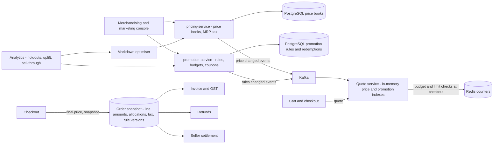
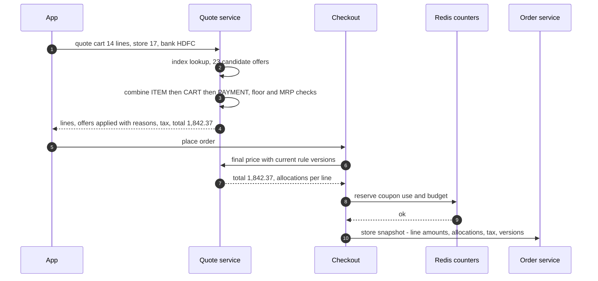
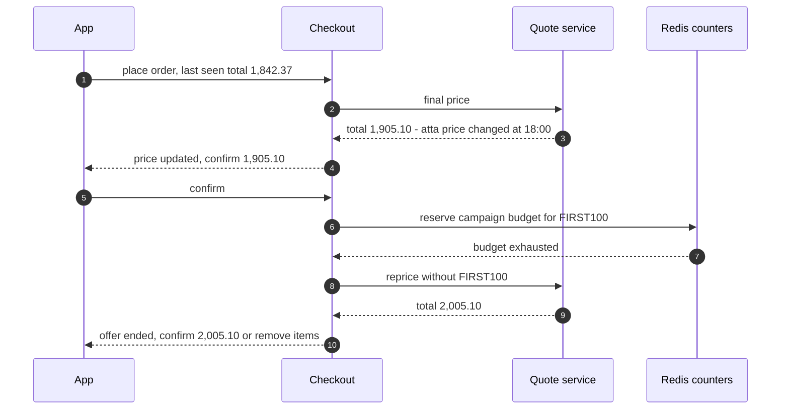
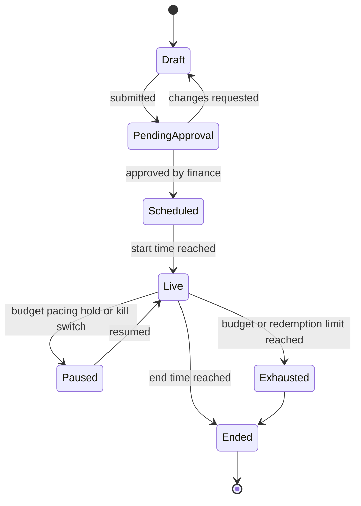

# 49. Case Study: Pricing, Promotions & Coupons Engine

!!! abstract "Chapter at a glance"
    **Reader bands:** B2 → B4 · **Prerequisites:** [Ch 04](../01-foundations/04-api-design.md) (API design), [Ch 45](45-payment-system.md) (ledger, refunds), [Ch 46](46-grocery-checkout-and-inventory-reservation.md) (checkout, coupon budgets as hot counters) · **What you will build:** `pricing-service` and `promotion-service` from the platform map ([Ch 00](../00-orientation/00-how-to-use-this-handbook.md)). They cover:

    - money arithmetic that never loses a paisa;
    - a promotion engine that finds the applicable offers among 20,000 in microseconds and combines them deterministically;
    - campaign budgets paced across a week and aimed at customers the coupon actually moves;
    - markdowns that turn expiring stock into margin instead of waste.

    [Ch 46](46-grocery-checkout-and-inventory-reservation.md) handled coupon budgets as hot counters. This chapter is about what a price *is* and how offers *combine*.

    - **L1: money is integers.** Across 200,000 carts:
        - Double rupees with `(long)(d*100)` gave **44,961** wrong invoice totals. Rounding at the end still left 3,352.
        - Integer paise gave 0.
        - Spreading a ₹75 coupon across the lines by rounding each share left 106,913 carts whose shares didn't add up to ₹75. The largest-remainder method left 0.
        - Refunds recomputed at refund time overpaid on 171,915 carts. Refunds of each line's stored share overpaid on **0**.
    - **L2: the promotion engine.** Across 20,020 promotions and 20,000 carts:
        - Scanning every promotion took 3.8 ms p50. An index by SKU, category and brand took **57 µs**.
        - "Apply every match" gave a different total for **19,594** carts depending on evaluation order, sold 247,854 lines below the margin floor, and charged customers ~20% of list price.
        - Explicit combination rules gave 0 and 0.
        - Choosing marketing's priority offer vs the customer's best offer is a **₹10.4M** (~12%) decision.
    - **L3: budget pacing (simulation).** A ₹5 lakh coupon:
        - First come, first served spent the budget in **13 hours**. Pacing kept it live for 164 of 168 hours, but bought the same ~1,160–1,190 incremental orders.
        - Targeting by predicted uplift took cost per incremental order from **₹430 to ₹234**.
    - **L4: perishable markdowns (simulation).**
        - No markdowns wasted 24,686 units.
        - A flat 30% off on the last day wasted 1,897 and added ₹9.1 lakh margin.
        - A per-SKU markdown that maximises expected revenue earned the most margin, **₹44.6 lakh vs ₹34.2 lakh**, with the least cannibalisation.

    · **Reading time:** 100 min + code

---

## 1. Introduction & Why It Matters

### 1.1 A story: the ₹0 order

On the first Big Savings Day, a customer's cart of ₹2,340 checked out at ₹0.00. Three things had lined up:

- A 25% brand offer on detergent.
- A 30% category offer on home care, which the engine also applied to the same line.
- A "₹200 off over ₹1,999" cart offer checked against the pre-discount total, plus a bank offer.

Each rule was correct on its own. Nobody had written down which rules could combine. By the time the screenshot went viral, 3,000 carts had been bought at a loss.

The same quarter:

- **Finance couldn't reconcile GST.** Invoice totals differed from the sum of line totals by a paisa or two on tens of thousands of orders, because amounts were `double`.
- **Refunds were wrong.** When a customer returned one item from a couponed order, the refund was the item's list price, so every return quietly refunded the coupon again.
- **The first-order coupon ran out by 10 am on day one of a week-long campaign**, mostly redeemed by customers who ordered every day anyway.
- **The Jayanagar store threw away 300 packets of milk and bread a week**, because nobody was allowed to mark down stock expiring tomorrow.

Pricing looks like arithmetic. It is actually **money correctness, rule combination, budget control and inventory economics**, and every mistake is paid for in cash.

!!! quote "The thesis of this chapter"
    **Money is integers** (paise), and any amount split across lines is split **exactly once** and **stored** (L1). **Promotions are indexed rules** that combine under **explicit, deterministic policies**: one offer per line per group, a fixed group order, and a margin floor. *Which* offer wins is a business decision, made on purpose (L2). **Budgets are paced** to traffic, and coupons are **targeted by incrementality**, not handed to whoever arrives first (L3). **Prices move with the inventory's clock**: markdowns sized per SKU recover margin from stock that would otherwise be waste (L4).

### 1.2 Where this lives in the grocery platform

| Concern | Owner | Data | Store |
|---|---|---|---|
| List prices per store/city, MRP | `pricing-service` | Price books, effective dates | PostgreSQL + Redis cache; `pricing.price.changed.v1` |
| Tax (GST by HSN) | `pricing-service` | Rates, rounding rules | Config with effective dates |
| Promotions and offers | `promotion-service` | Rules, targeting, priorities, budgets | PostgreSQL (source) → in-memory indexes |
| Coupons (codes) | `promotion-service` | Codes, limits, redemptions | PostgreSQL + Redis counters ([Ch 46](46-grocery-checkout-and-inventory-reservation.md)) |
| Quote / cart pricing | Pricing API | Price + promotions + tax → line amounts | Stateless compute |
| Final price record | Order | Line amounts, allocated discounts, tax | Order DB (immutable snapshot) |
| Campaign budgets and pacing | `promotion-service` | Spend, pacing multiplier | Redis + analytics |
| Markdowns | `pricing-service` + store ops | Expiry batches, markdown decisions | Inventory + pricing |

### 1.3 Learning objectives

By the end you will be able to:

- **Represent and split money correctly**: rounding, tax, proration and refunds (L1).
- **Design a promotion engine**: rule model, indexing, combination policy and determinism (L2).
- **Control campaign spend**: pacing and incrementality (L3).
- **Price perishables dynamically** with markdowns (L4).
- Handle price changes, quotes vs final prices, audit, and regulation (MRP, GST, dark patterns).

---

## 2. Core Concepts — Beginner to Deep

### 2.1 Intuition: the supermarket till receipt <span class="band b2">B2</span>

A till receipt is a small contract. Every line has a price and a discount. The totals add up exactly. The tax is computed per line by fixed rules. If you return one item, the cashier refunds what *you paid for that item*, not the shelf price. Behind the till, the store decided which offers may combine, how much each promotion may cost, and when to put the yellow "reduced" stickers on tomorrow's milk. This chapter builds that till and those decisions for millions of carts a day.

### 2.2 Requirements <span class="band b2">B2</span>

**Functional**

- Price books by store/city with effective dates; MRP ceilings on packaged goods (VERIFY: Legal Metrology (Packaged Commodities) Rules — selling above MRP is not permitted).
- Promotions: % off (SKU/category/brand), buy-X-get-Y, bundles, tiered cart discounts, bank/payment offers, coupon codes, first-order offers, free delivery.
- Targeting (new users, segments, cities), schedules, usage limits, budgets.
- Cart quote: line prices, applied offers with reasons, taxes, totals; "add ₹120 more for free delivery" hints.
- Final pricing at checkout, stored immutably on the order; refunds and seller settlement use it.

**Non-functional**

- Cart quote p99 < 50 ms (it runs on every cart change).
- **Deterministic**: the same cart and the same rules give the same price on every server.
- Exact money: sums reconcile to the paisa.
- Auditable: why this price, which rule, which version.

### 2.3 Estimation <span class="band b2">B2</span>

| Quantity | Estimate |
|---|---|
| SKUs × stores | 50k SKUs × 300 stores → up to 15M price points (mostly inherited from city price books) |
| Active promotions | 10k–50k (brands fund many) |
| Quotes | Every cart change: ~20–50k/s at peak |
| Orders | ~1.5M/day, ~15 lines each → 22M priced lines/day stored |
| Price changes | ~100k/day; bursts during sales |

Quotes are the hot path: pure computation over **in-memory indexes**, with no database calls per quote.

### 2.4 Money correctness ⭐ <span class="band b2">B2</span>

- **Integer minor units** (paise) in `long`, or `BigDecimal` with an explicit scale and rounding mode. **Never `double`.**
- **Rounding is a rule**: which mode (HALF_UP?), at which level (per line or per invoice), in which order (discount before tax). Tax rules may fix some of these (VERIFY GST invoice rules with finance).
- **Allocation**: a cart-level amount (coupon, delivery fee waiver, bank offer) is spread across lines once, using the **largest-remainder method**, so the shares sum exactly. This matters because tax applies to discounted line value, and refunds and seller payouts are per line.
- **Store it**: the order keeps each line's list price, allocated discounts, taxable value and tax. Refunds use the stored values.

L1 measured all of it:

| Check (200k carts) | Wrong |
|---|---|
| Double rupees, `(long)(d*100)` | **44,961** carts' invoice totals |
| Double rupees, `Math.round` at the end | 3,352 (every one a per-line tax landing on 0.4999… instead of 0.5) |
| Long paise | 0 |
| Coupon shares rounded independently | 106,913 carts don't sum to ₹75 |
| Largest remainder | 0 |
| Refund list price | 184,688 carts over-refunded, ₹1.39 Cr in total |
| Refund recomputed at refund time | 171,915 carts, ₹32 lakh |
| **Refund stored share** | **0** |

### 2.5 The promotion model ⭐ <span class="band b3">B3</span>

A promotion is data, not code:

```text
promotion:
  id, name, funding (platform | brand | bank), status, version
  schedule: starts_at, ends_at, days/hours
  targeting: cities, stores, segments (new user, lapsed), channels
  condition: line predicate (sku in / category / brand), min qty, cart threshold, payment instrument
  benefit: pct_off | flat_off | buy_x_get_y | fixed_price | free_delivery, cap
  combination: group (ITEM | CART | PAYMENT | SHIPPING), priority, stackable_with, excludes_discounted_items
  limits: per_customer, total_redemptions, budget
```

- **Groups** define the stacking policy. For example: at most one ITEM offer per line, one CART offer, one PAYMENT offer, one SHIPPING offer, applied in the order ITEM → CART → PAYMENT → SHIPPING.
- **Floors**: never price a line below a margin floor (unless the offer is funded by a brand that explicitly allows it), and never above MRP.
- **Versioned**: quotes record the promotion versions they used; orders keep them.

### 2.6 Indexing and evaluation ⭐ <span class="band b3">B3</span>

Evaluation is: find the candidates, filter them by targeting and schedule, then combine. L2:

| Engine | p50 | p99 | Order-dependent carts | Lines below floor | Customers pay |
|---|---|---|---|---|---|
| Scan all, apply every match | 3,818 µs | 7,822 µs | 19,594 | 247,854 | ₹2.21 Cr |
| Index, apply every match | **57 µs** | 181 µs | 19,594 | 247,854 | ₹2.21 Cr |
| Index + one item offer by priority, cart, bank, floor | 75 µs | 211 µs | **0** | **0** | ₹8.69 Cr |
| Index + best item offer per line | 86 µs | 237 µs | 0 | 0 | ₹7.65 Cr |

(List price total: ₹11.15 Cr.)

- **Inverted indexes** map SKU → offers, category → offers and brand → offers, plus a short list of cart and payment offers. Build them from the rules database, and hot-swap them on change (versioned snapshot, atomic reference swap).
- **"Apply every match" is a bug**, not a policy. It is order-dependent, so two servers can quote two prices. It stacks everything, and it breaks margin floors.
- **Priority vs best-for-customer** is a ~12% revenue decision in L2. Neither is wrong, but it must be chosen deliberately and shown to the customer ("best offer applied").
- **Harder combinatorics** (bundles that share items, "cheapest item free" across lines) become small optimisation problems. Bound them: evaluate a few candidate plans and keep the best, with a time budget.

### 2.7 Quotes vs final prices <span class="band b3">B3</span>

- **Cart quote**: fast and advisory. It may use cached prices seconds old.
- **Checkout price**: recomputed server-side with the current rules. If it differs from what the customer last saw, the customer sees the change before paying ([Ch 46](46-grocery-checkout-and-inventory-reservation.md)).
- **Order snapshot**: immutable line-level amounts with rule versions. Everything after checkout (invoice, GST filing, refunds, seller settlement in [Ch 45](45-payment-system.md)) reads the snapshot. Nothing recomputes it.

### 2.8 Budgets, pacing and incrementality ⭐ <span class="band b4">B4</span>

A coupon's cost is certain; its benefit is only the orders it *causes*. L3:

| Policy | Incremental orders | ₹ per incremental order | Hours live of 168 |
|---|---|---|---|
| First come, first served | 1,189 | 420 | **13** |
| Equal daily caps | 1,167 | 428 | 46 |
| Paced to traffic | 1,164 | 430 | **164** |
| Paced + targeted by predicted uplift | **2,135** | **234** | 161 |

- **Pacing** (probabilistic throttling with feedback every few minutes, as in ad budgets) spreads the spend over time. It fixes coverage and fairness, not efficiency. Feed known events (a TV ad, a festival) into the expected curve, or pacing will hold them back.
- **Incrementality**: most redemptions go to customers who would have ordered anyway. Uplift models target the persuadable, and **holdout groups** (customers who never see the offer) measure the real effect.
- **Budget enforcement** is still an atomic counter ([Ch 46](46-grocery-checkout-and-inventory-reservation.md) L1). Pacing decides *who sees* the offer; the counter decides who *gets* it.
- **Abuse**: new-account farming for first-order coupons, and coupon-code sharing. Use device and payment fingerprints, per-customer limits, and rate limits ([Ch 39](39-distributed-rate-limiter.md)).

### 2.9 Dynamic pricing and markdowns <span class="band b4">B4</span>

- **Perishables**: stock has a clock. A unit written off earns nothing; a unit sold at a markdown earns something. L4:

    | Policy | Waste | Gross margin | Cannibalised |
    |---|---|---|---|
    | No markdowns | 24,686 | ₹34.2 lakh | 0 |
    | 30% off on the last day | 1,897 | ₹43.3 lakh | 33,987 |
    | 50% off on the last day | 235 | ₹41.8 lakh | 32,336 |
    | **Per-SKU expected-revenue markdown** | 2,807 | **₹44.6 lakh** | **28,511** |

- **Optimise the right objective**: the best-margin policy wastes a little more than a flat 30%. If waste has its own cost (sustainability targets, disposal), put that cost in the objective.
- **Surge and personalised pricing**: dynamic delivery fees by demand are common. Personalised *product* prices raise fairness, trust and regulatory questions. The Consumer Protection (E-Commerce) Rules and the 2023 guidelines on dark patterns (drip pricing, false urgency) apply in India (VERIFY scope with legal).
- **Guardrails**: bounds per change, maximum change per day, MRP ceiling, human approval for large moves, and a kill switch.

### 2.10 Price changes and caches <span class="band b3">B3</span>

- Price books change with **effective timestamps**. Publish `pricing.price.changed.v1` events, and update Redis and the in-memory caches in the quote service. Checkout validates against the source of truth.
- **Bulk changes** at sale start: pre-publish them with a future effective time, so every node switches at the same moment and no midnight rush of writes is needed.
- **Audit**: who changed which price, when and why. Mistaken prices (₹9 instead of ₹999) need a fast rollback and a policy for honouring orders.

### 2.11 Interview framing <span class="band b4">B4</span>

"Design a coupon/promotion system" or "design pricing for an e-commerce platform". Cover:

- money representation;
- the rule model;
- indexing;
- a deterministic combination policy;
- quote vs final price vs snapshot;
- budgets and abuse;
- incrementality.

Staff-level signals:

- saying "apply every match is order-dependent";
- storing allocated discounts per line;
- measuring incrementality with holdouts;
- naming the MRP and dark-pattern constraints.

---

## 3. Architecture & Diagrams

### 3.1 Component view



### 3.2 Sequence: happy path, cart quote to order snapshot



### 3.3 Sequence: failure path, price changed and budget exhausted



### 3.4 State: a promotion's lifecycle



---

## 4. Design Document Excerpt: Pricing & Promotions Platform v2

!!! note "Design Document (excerpt) — Pricing & Promotions Platform v2"
    **Status:** Accepted · **Authors:** Pricing platform team · **Reviewers:** Finance, Tax, Legal, Marketing, Checkout, SRE

    | Field | Value |
    |---|---|
    | Context | `double` amounts broke GST reconciliation. "Apply every match" stacked offers into ₹0 orders. Refunds re-granted coupons. Coupons ran out in hours on non-incremental customers. Perishables were wasted. |
    | Decision | Integer paise everywhere, with largest-remainder allocation stored per line. Promotion rules as versioned data in groups, with a fixed combination order and margin/MRP floors. Inverted indexes hot-swapped in quote nodes. Best-for-customer within the ITEM group. Pacing plus uplift targeting for campaigns, with holdouts. Per-SKU expected-revenue markdowns for perishables, with guardrails. |
    | Related ADRs | ADR-350 Money = long paise, HALF_UP per line, discount allocated before tax (L1). ADR-351 Order snapshot is the only input to invoices, refunds and settlement (L1). ADR-352 Combination groups ITEM → CART → PAYMENT → SHIPPING, one per group, floors (L2). ADR-353 ITEM group picks the best offer for the customer (L2; Finance signed off on the ~12% difference). ADR-354 Campaign pacing every 15 min, uplift targeting, 5% holdout (L3). ADR-355 Markdown optimiser per SKU per day, max 50%, never above MRP (L4). |

    **Requirements.**

    - **R1:** 0 paise mismatches between invoice totals and line sums; allocations sum exactly.
    - **R2:** Quote p99 < 50 ms; identical results on every node for the same cart and rule version.
    - **R3:** No line below its margin floor unless it is brand-funded with explicit permission; never above MRP.
    - **R4:** Every campaign reports incremental orders against a holdout.
    - **R5:** Perishable waste reduced 80% without reducing gross margin.

    **Decisions in detail.**

    1. **Money (ADR-350/351).** A shared `Money` library, `long` paise, and banned `double` in pricing code by a static check. Snapshots carry `list`, `item_discount`, `cart_allocation`, `payment_allocation`, `taxable`, `tax`.
    2. **Engine (ADR-352/353).** The rules DB feeds a compiler that builds indexes; nodes swap atomically, and quotes record the index version. Bundles are evaluated with a bounded plan search (≤ 5 ms).
    3. **Campaigns (ADR-354).** The pacing controller writes a show-probability per campaign to Redis. Checkout reserves the budget atomically. Uplift models are retrained weekly.
    4. **Markdowns (ADR-355).** A nightly batch proposes; the store app confirms stickers and labels. The response model is learned from sell-through.

    **Consequences.**

    - Costs we accept: a rules compiler and index versions to operate; Finance governance of promotion groups; data science dependencies (uplift, markdown response models); legal review of dynamic pricing.
    - What we gain: exact money, deterministic prices, a campaign spend that buys orders, and less waste.

---

## 5. Hands-On Code — Level Ladder

!!! info "What's real here"
    All four labs are JDK 21 with no dependencies.

    - **L1** computes real arithmetic on 200,000 synthetic carts: `double` vs `long` vs `BigDecimal`, allocation and refunds.
    - **L2** is a real engine over 20,020 synthetic promotions, and its per-cart timings are measured.
    - **L3 and L4** are simulations with fixed seeds. The customer-response models (coupon uplift, markdown response) and the GST rates used are stated assumptions (VERIFY).

All labs are single-file JDK 21. Run them with `java -Dstdout.encoding=UTF-8 <File>.java`.

### L1 — Money is integers <span class="band b2">B2</span>

**Requirement:** "Every invoice total, discount split and refund must be exact to the paisa."

200,000 carts priced with `double` and with `long` paise. A ₹75 coupon is split across lines two ways, and each cart is then refunded line by line three ways.

```java title="MoneyL1.java"
// MoneyL1.java — run with: java MoneyL1.java   (JDK 21, no dependencies)
// MONEY IS INTEGERS. 200,000 grocery carts (fixed seed), 3–30 lines each, prices ₹5–₹900 with paise, GST 0/5/12/18%
// per line (rates here are illustrative — VERIFY per HSN code), and a ₹75 cart-level coupon on carts over ₹999.
//   M1 amounts as double rupees: line = price × qty, tax per line rounded to 2 decimals, totals summed as doubles
//   M2 amounts as long paise (BigDecimal only for the rate multiplication, rounded HALF_UP per line)
// Then the cart coupon must be spread over the lines, because GST applies to the discounted value of each line and a
// returned line must refund what was actually paid for it:
//   P1 each line gets round(coupon × line / cart) — rounded independently
//   P2 largest remainder: floor every share, then give the leftover paise to the largest fractional parts
// Finally the customer returns every line, one at a time:
//   R1 refund = the line's list price (ignores the coupon)
//   R2 refund = line price − share of coupon RECOMPUTED at refund time from the remaining cart (rounded)
//   R3 refund = line price − the share STORED on the order at checkout (P2)
// Measured: carts where the invoice total is off by at least one paisa, carts whose coupon shares don't add up to the
// coupon, and money refunded beyond what the customer paid.
import java.math.*;
import java.util.*;

public class MoneyL1 {
    record Line(long pricePaise, int qty, int gst) { long gross() { return pricePaise * qty; } }

    public static void main(String[] args) {
        Random r = new Random(49); int[] rates = {0, 5, 12, 18}; List<List<Line>> carts = new ArrayList<>();
        for (int c = 0; c < 200_000; c++) {
            List<Line> cart = new ArrayList<>(); int n = 3 + r.nextInt(18);
            for (int i = 0; i < n; i++) cart.add(new Line(500 + r.nextInt(39_500), 1 + (r.nextDouble() < 0.3 ? r.nextInt(5) : 0), rates[r.nextInt(4)]));
            carts.add(cart);
        }
        // M1 vs M2
        int wrongTotal = 0, wrongRounded = 0; long maxOff = 0;
        for (List<Line> cart : carts) {
            double d = 0; long exact = 0;
            for (Line l : cart) {
                double lineRupees = (l.pricePaise() / 100.0) * l.qty();
                double taxRupees = Math.round(lineRupees * l.gst() / 100.0 * 100) / 100.0;
                d += lineRupees + taxRupees;
                exact += l.gross() + tax(l.gross(), l.gst());
            }
            long dPaise = (long) (d * 100);                                    // how "₹%.2f" code often gets back to paise
            if (dPaise != exact) { wrongTotal++; maxOff = Math.max(maxOff, Math.abs(dPaise - exact)); }
            if (Math.round(d * 100) != exact) wrongRounded++;
        }
        System.out.println("200,000 carts, 3–20 lines, GST 0/5/12/18% per line, ₹75 coupon on carts over ₹999.\n");
        System.out.printf("   M1) double rupees, (long)(d*100):       %,7d carts with the invoice total wrong by at least 1 paisa (worst %d paise)%n", wrongTotal, maxOff);
        System.out.printf("   M1) double rupees, Math.round at the end: %,5d carts wrong%n", wrongRounded);
        System.out.printf("   M2) long paise:                          %,7d carts wrong%n%n", 0);
        // proration + refunds
        int p1Bad = 0, p2Bad = 0, eligible = 0; long p1Drift = 0;
        long[] over = new long[3]; int[] overCarts = new int[3];
        for (List<Line> cart : carts) {
            long total = cart.stream().mapToLong(Line::gross).sum(); if (total <= 99_900) continue; eligible++;
            long coupon = 7_500;
            long[] naive = new long[cart.size()]; long sumNaive = 0;
            for (int i = 0; i < cart.size(); i++) { naive[i] = Math.round((double) coupon * cart.get(i).gross() / total); sumNaive += naive[i]; }
            if (sumNaive != coupon) { p1Bad++; p1Drift += Math.abs(sumNaive - coupon); }
            long[] share = largestRemainder(cart, coupon, total);
            if (Arrays.stream(share).sum() != coupon) p2Bad++;
            long paid = total - coupon;
            long[] refunded = new long[3]; long remaining = total, remainingCoupon = coupon;
            for (int i = 0; i < cart.size(); i++) {
                long g = cart.get(i).gross();
                refunded[0] += g;
                long s = i == cart.size() - 1 ? remainingCoupon : Math.round((double) remainingCoupon * g / remaining);
                refunded[1] += g - s; remaining -= g; remainingCoupon -= s;
                if (remaining > 0 && remaining <= 99_900) { remainingCoupon = 0; }         // "coupon no longer applies" → recomputation stops deducting
                refunded[2] += g - share[i];
            }
            for (int k = 0; k < 3; k++) if (refunded[k] > paid) { over[k] += refunded[k] - paid; overCarts[k]++; }
        }
        System.out.printf("   %,d carts got the coupon; it must be spread over their lines:%n", eligible);
        System.out.printf("   P1) round each share independently:  %,7d carts whose shares don't add up to ₹75.00 (%,d paise adrift in total)%n", p1Bad, p1Drift);
        System.out.printf("   P2) largest remainder:               %,7d carts%n%n", p2Bad);
        System.out.println("   the customer returns every line, one at a time:");
        String[] names = {"R1) refund list price (ignore the coupon)", "R2) recompute coupon share at refund time", "R3) refund price − share stored at checkout"};
        for (int k = 0; k < 3; k++) System.out.printf("   %-46s %,7d carts refunded more than paid, ₹%,.2f in total%n", names[k], overCarts[k], over[k] / 100.0);
        System.out.println("\n   → binary doubles can't represent most paise, so totals drift, and '(long)(d * 100)' truncates the drift into a");
        System.out.println("     wrong invoice. Rounding at the end helps, but can't fix a per-line tax that landed on 0.4999… instead of 0.5.");
        System.out.println("     Keep money as integer paise (or BigDecimal with explicit rounding) end to end. A cart-level discount must be");
        System.out.println("     allocated to lines exactly once — largest remainder makes the shares add up — and STORED on the order, because");
        System.out.println("     GST, refunds and seller settlement all need 'what was actually paid for this line'. Recomputing at refund time");
        System.out.println("     gives a different answer as soon as the cart changes (here: the coupon's threshold stops applying).");
    }

    static long tax(long grossPaise, int rate) {
        return new BigDecimal(grossPaise).multiply(BigDecimal.valueOf(rate)).divide(BigDecimal.valueOf(100), 0, RoundingMode.HALF_UP).longValue();
    }

    static long[] largestRemainder(List<Line> cart, long amount, long total) {
        long[] s = new long[cart.size()]; long given = 0; Integer[] idx = new Integer[cart.size()]; long[] rem = new long[cart.size()];
        for (int i = 0; i < cart.size(); i++) { long num = amount * cart.get(i).gross(); s[i] = num / total; rem[i] = num % total; given += s[i]; idx[i] = i; }
        Arrays.sort(idx, (a, b) -> Long.compare(rem[b], rem[a]));
        for (int k = 0; k < amount - given; k++) s[idx[k]]++;
        return s;
    }
}
```

```text title="java -Dstdout.encoding=UTF-8 MoneyL1.java"
200,000 carts, 3–20 lines, GST 0/5/12/18% per line, ₹75 coupon on carts over ₹999.

   M1) double rupees, (long)(d*100):        44,961 carts with the invoice total wrong by at least 1 paisa (worst 3 paise)
   M1) double rupees, Math.round at the end: 3,352 carts wrong
   M2) long paise:                                0 carts wrong

   184,688 carts got the coupon; it must be spread over their lines:
   P1) round each share independently:  106,913 carts whose shares don't add up to ₹75.00 (131,714 paise adrift in total)
   P2) largest remainder:                     0 carts

   the customer returns every line, one at a time:
   R1) refund list price (ignore the coupon)      184,688 carts refunded more than paid, ₹13,851,600.00 in total
   R2) recompute coupon share at refund time      171,915 carts refunded more than paid, ₹3,200,345.28 in total
   R3) refund price − share stored at checkout          0 carts refunded more than paid, ₹0.00 in total

   → binary doubles can't represent most paise, so totals drift, and '(long)(d * 100)' truncates the drift into a
     wrong invoice. Rounding at the end helps, but can't fix a per-line tax that landed on 0.4999… instead of 0.5.
     Keep money as integer paise (or BigDecimal with explicit rounding) end to end. A cart-level discount must be
     allocated to lines exactly once — largest remainder makes the shares add up — and STORED on the order, because
     GST, refunds and seller settlement all need 'what was actually paid for this line'. Recomputing at refund time
     gives a different answer as soon as the cart changes (here: the coupon's threshold stops applying).
```

**Reading it:**

- **`double`** fails in two ways:
    - Truncating to paise loses a paisa on about 22% of carts.
    - Even rounding correctly at the end leaves 3,352 carts wrong. A separate check confirmed every one of them is a per-line tax that landed a hair below .5.
- **Allocation**: rounding each share independently leaves more than half the couponed carts' shares not adding up to ₹75.00. The largest-remainder method never does.
- **Refunds**: only the shares stored at checkout refund exactly what was paid.
    - Refunding list price re-grants the coupon every time.
    - Recomputing at refund time breaks when a return drops the cart below the coupon's threshold.

### L2 — The promotion engine <span class="band b3">B3</span>

**Requirement:** "Quote any cart in well under a millisecond, give the same price on every server, and never sell below the margin floor."

20,020 promotions and 20,000 carts, run through four engines.

```java title="PromoEngineL2.java"
// PromoEngineL2.java — run with: java PromoEngineL2.java   (JDK 21, no dependencies)
// WHICH OFFERS APPLY TO THIS CART, AND HOW DO THEY COMBINE? 50,000 SKUs in 800 categories and 2,000 brands; 20,000 live
// item promotions (fixed seed): % off a SKU list, % off a category, % off a brand, buy-2-get-1 on a SKU; plus 12 auto-
// applied cart offers (flat ₹ off over a threshold, half exclude already-discounted items) and 8 bank offers (10% up to
// ₹150, only when the customer pays with that bank; 60% of carts do). 20,000 carts of
// 4–25 lines. Rules of the business: at most one item-level offer per line, one cart offer, one bank offer, and no line
// may be sold below 60% of its price (the margin floor). Amounts in paise.
//   E1 scan all 20,000 promotions per cart; apply every match in the order they are stored
//   E2 index promotions by SKU, category and brand (plus the short cart-level list); same apply-everything logic
//   E3 index + a deterministic policy: ONE item offer per line — the highest-priority one (the order marketing set) —
//      then the best cart offer on eligible lines, then the bank offer; margin floor enforced
//   E4 E3, but the one item offer per line is the BEST one for the customer
// Measured: real evaluation time per cart, carts whose total changes if the promotions are evaluated in another order,
// lines priced below the floor, and what customers pay.
import java.util.*;

public class PromoEngineL2 {
    static final int SKUS = 50_000, CATS = 800, BRANDS = 2_000;
    enum T { SKU_PCT, CAT_PCT, BRAND_PCT, B2G1, CART_FLAT, BANK }
    record Promo(int id, T type, int target, int pct, long flat, long threshold, boolean excludesDiscounted, Set<Integer> skus) {}
    record Line(int sku, long price, int qty) {}
    static int[] cartBank; static int curBank;
    static int[] cat = new int[SKUS], brand = new int[SKUS];

    public static void main(String[] args) {
        Random r = new Random(49);
        for (int s = 0; s < SKUS; s++) { cat[s] = r.nextInt(CATS); brand[s] = r.nextInt(BRANDS); }
        List<Promo> promos = new ArrayList<>();
        for (int i = 0; i < 20_000; i++) {
            double x = r.nextDouble();
            if (x < 0.55) { Set<Integer> ss = new HashSet<>(); int n = 1 + r.nextInt(20); for (int k = 0; k < n; k++) ss.add(r.nextInt(SKUS)); promos.add(new Promo(i, T.SKU_PCT, -1, 5 + r.nextInt(31), 0, 0, false, ss)); }
            else if (x < 0.62) promos.add(new Promo(i, T.CAT_PCT, r.nextInt(CATS), 5 + r.nextInt(21), 0, 0, false, Set.of()));
            else if (x < 0.72) promos.add(new Promo(i, T.BRAND_PCT, r.nextInt(BRANDS), 5 + r.nextInt(26), 0, 0, false, Set.of()));
            else promos.add(new Promo(i, T.B2G1, -1, 0, 0, 0, false, Set.of(r.nextInt(SKUS))));
        }
        for (int i = 0; i < 12; i++) promos.add(r.nextInt(promos.size()), new Promo(20_000 + i, T.CART_FLAT, -1, 0, 5_000 + 2_500 * r.nextInt(7), 99_900 + 50_000 * r.nextInt(5), i % 2 == 0, Set.of()));
        for (int b = 0; b < 8; b++) promos.add(r.nextInt(promos.size()), new Promo(20_100 + b, T.BANK, b, 10, 15_000, 0, false, Set.of()));
        for (int i = 0; i < promos.size(); i++) { Promo p = promos.get(i); promos.set(i, new Promo(i, p.type(), p.target(), p.pct(), p.flat(), p.threshold(), p.excludesDiscounted(), p.skus())); }   // stored order = id
        // popular SKUs are where promotions and carts concentrate
        List<List<Line>> carts = new ArrayList<>(); cartBank = new int[20_000];
        for (int c = 0; c < 20_000; c++) { List<Line> cart = new ArrayList<>(); int n = 4 + r.nextInt(22);
            for (int k = 0; k < n; k++) cart.add(new Line((int) (Math.pow(r.nextDouble(), 3) * SKUS), 1_000 + r.nextInt(49_000), 1 + (r.nextDouble() < 0.25 ? 2 : 0)));
            cartBank[c] = r.nextDouble() < 0.6 ? r.nextInt(8) : -1; carts.add(cart); }
        // index
        Map<Integer, List<Promo>> bySku = new HashMap<>(), byCat = new HashMap<>(), byBrand = new HashMap<>(); List<Promo> cartLevel = new ArrayList<>();
        for (Promo p : promos) switch (p.type()) {
            case SKU_PCT, B2G1 -> { for (int s : p.skus()) bySku.computeIfAbsent(s, k -> new ArrayList<>()).add(p); }
            case CAT_PCT -> byCat.computeIfAbsent(p.target(), k -> new ArrayList<>()).add(p);
            case BRAND_PCT -> byBrand.computeIfAbsent(p.target(), k -> new ArrayList<>()).add(p);
            default -> cartLevel.add(p);
        }
        System.out.printf("%,d promotions (%d cart-level or bank), 20,000 carts of 4–25 lines; floor = 60%% of price.%n%n", promos.size(), cartLevel.size());
        long list = 0, lines = 0; for (List<Line> c : carts) for (Line l : c) { list += l.price() * l.qty(); lines++; }
        System.out.printf("   %,d lines; list-price total ₹%,.0f%n%n", lines, list / 100.0);
        System.out.printf("   %-62s %9s %9s %14s %12s %14s%n", "engine", "p50", "p99", "order-dependent", "lines below", "customers pay");
        System.out.printf("   %-62s %9s %9s %14s %12s %14s%n", "", "", "", "carts", "floor", "(total)");
        String[] names = {"E1) scan all promotions, apply every match in stored order", "E2) indexed lookup, apply every match in stored order",
                "E3) indexed + one item offer/line (priority), cart, bank, floor", "E4) E3 but the best item offer per line"};
        for (int e = 0; e < 4; e++) {
            long[] lat = new long[carts.size()]; int orderDep = 0, better = 0; long below = 0, pay = 0;
            for (int ci = 0; ci < carts.size(); ci++) {
                List<Line> cart = carts.get(ci);
                curBank = cartBank[ci]; long t0 = System.nanoTime();
                List<Promo> cand = e == 0 ? scan(promos, cart) : lookup(bySku, byCat, byBrand, cartLevel, cart);
                long[] res = e <= 1 ? applyAll(cart, cand) : plan(cart, cand, e == 3);
                lat[ci] = System.nanoTime() - t0;
                List<Promo> shuffled = new ArrayList<>(cand); Collections.shuffle(shuffled, new Random(ci));
                long[] res2 = e <= 1 ? applyAll(cart, shuffled) : plan(cart, shuffled, e == 3);
                if (res2[0] != res[0]) orderDep++;
                below += res[1]; pay += res[0];
            }
            Arrays.sort(lat);
            System.out.printf("   %-62s %6.1f µs %6.1f µs %,14d %,12d %,14.0f%n", names[e], lat[lat.length / 2] / 1e3, lat[(int) (lat.length * 0.99)] / 1e3, orderDep, below, pay / 100.0);
        }
        System.out.println("\n   → scanning every promotion per cart is the first thing to go: index promotions by what they target, and a cart");
        System.out.println("     only touches the few that could apply (~60x faster here). The harder problem is combination. 'Apply everything");
        System.out.println("     that matches' stacks offers nobody meant to stack (customers paid ~20% of list price), sells a quarter of a");
        System.out.println("     million lines below the margin floor, and gives a different total for almost every cart depending on evaluation");
        System.out.println("     order — two servers could quote two prices. Explicit combination rules (one offer per line, fixed group order, a");
        System.out.println("     floor) make pricing deterministic. WHICH single offer wins is then a business decision worth ~12% of revenue here:");
        System.out.println("     marketing's priority order (E3) or the customer's best deal (E4). Decide it on purpose, and write it down.");
    }

    static boolean matches(Promo p, Line l) {
        return switch (p.type()) { case SKU_PCT, B2G1 -> p.skus().contains(l.sku()); case CAT_PCT -> cat[l.sku()] == p.target(); case BRAND_PCT -> brand[l.sku()] == p.target(); default -> false; };
    }
    static List<Promo> scan(List<Promo> all, List<Line> cart) {
        List<Promo> out = new ArrayList<>();
        for (Promo p : all) { if (p.type() == T.CART_FLAT || p.type() == T.BANK) { out.add(p); continue; } for (Line l : cart) if (matches(p, l)) { out.add(p); break; } }
        return out;
    }
    static List<Promo> lookup(Map<Integer, List<Promo>> bySku, Map<Integer, List<Promo>> byCat, Map<Integer, List<Promo>> byBrand, List<Promo> cartLevel, List<Line> cart) {
        LinkedHashSet<Promo> out = new LinkedHashSet<>();
        for (Line l : cart) { out.addAll(bySku.getOrDefault(l.sku(), List.of())); out.addAll(byCat.getOrDefault(cat[l.sku()], List.of())); out.addAll(byBrand.getOrDefault(brand[l.sku()], List.of())); }
        out.addAll(cartLevel);
        List<Promo> list = new ArrayList<>(out); list.sort(Comparator.comparingInt(Promo::id)); return list;   // stored order
    }
    static long itemDiscount(Promo p, Line l, long current) {
        return p.type() == T.B2G1 ? (l.qty() >= 3 ? l.price() * (l.qty() / 3) : 0) : current * p.pct() / 100;
    }
    // naive: every matching promo, in the given order, on the running amounts; cart flat checks threshold on the running total
    static long[] applyAll(List<Line> cart, List<Promo> cand) {
        long[] amt = new long[cart.size()]; for (int i = 0; i < cart.size(); i++) amt[i] = cart.get(i).price() * cart.get(i).qty();
        long cartOff = 0;
        for (Promo p : cand) {
            if (p.type() == T.CART_FLAT) { long tot = Arrays.stream(amt).sum() - cartOff; if (tot > p.threshold()) cartOff += p.flat(); }
            else if (p.type() == T.BANK && p.target() == curBank) { long tot = Arrays.stream(amt).sum() - cartOff; cartOff += Math.min(p.flat(), tot * p.pct() / 100); }
            else for (int i = 0; i < cart.size(); i++) if (matches(p, cart.get(i))) amt[i] -= Math.min(amt[i], itemDiscount(p, cart.get(i), amt[i]));
        }
        long below = 0; for (int i = 0; i < cart.size(); i++) if (amt[i] < cart.get(i).price() * cart.get(i).qty() * 60 / 100) below++;
        return new long[]{Math.max(0, Arrays.stream(amt).sum() - cartOff), below};
    }
    static long[] plan(List<Line> cart, List<Promo> cand, boolean bestForCustomer) {
        int n = cart.size(); long[] amt = new long[n]; boolean[] disc = new boolean[n];
        for (int i = 0; i < n; i++) {
            Line l = cart.get(i); long gross = l.price() * l.qty(), best = 0;
            int bestId = Integer.MAX_VALUE;
            for (Promo p : cand) if (p.type() != T.CART_FLAT && p.type() != T.BANK && matches(p, l)) {
                long d = itemDiscount(p, l, gross); if (d == 0) continue;
                if (bestForCustomer) best = Math.max(best, d); else if (p.id() < bestId) { bestId = p.id(); best = d; }   // priority = stored order
            }
            best = Math.min(best, gross * 40 / 100);                                              // floor: at most 40% off
            amt[i] = gross - best; disc[i] = best > 0;
        }
        long total = Arrays.stream(amt).sum(), bestCart = 0, bestBank = 0;
        for (Promo p : cand) if (p.type() == T.CART_FLAT) {
            long eligible = 0; for (int i = 0; i < n; i++) if (!(p.excludesDiscounted() && disc[i])) eligible += amt[i];
            if (eligible > p.threshold()) bestCart = Math.max(bestCart, Math.min(p.flat(), eligible - eligible * 60 / 100));
        }
        total -= bestCart;
        for (Promo p : cand) if (p.type() == T.BANK && p.target() == curBank) bestBank = Math.max(bestBank, Math.min(p.flat(), total * p.pct() / 100));
        return new long[]{total - bestBank, 0};
    }
}
```

```text title="java -Dstdout.encoding=UTF-8 PromoEngineL2.java"
20,020 promotions (20 cart-level or bank), 20,000 carts of 4–25 lines; floor = 60% of price.

   291,017 lines; list-price total ₹111,537,653

   engine                                                               p50       p99 order-dependent  lines below  customers pay
                                                                                               carts        floor        (total)
   E1) scan all promotions, apply every match in stored order     3818.0 µs 7821.9 µs         19,594      247,854     22,128,688
   E2) indexed lookup, apply every match in stored order            57.4 µs  181.1 µs         19,594      247,854     22,128,688
   E3) indexed + one item offer/line (priority), cart, bank, floor   74.8 µs  210.7 µs              0            0     86,871,919
   E4) E3 but the best item offer per line                          86.4 µs  236.7 µs              0            0     76,485,232

   → scanning every promotion per cart is the first thing to go: index promotions by what they target, and a cart
     only touches the few that could apply (~60x faster here). The harder problem is combination. 'Apply everything
     that matches' stacks offers nobody meant to stack (customers paid ~20% of list price), sells a quarter of a
     million lines below the margin floor, and gives a different total for almost every cart depending on evaluation
     order — two servers could quote two prices. Explicit combination rules (one offer per line, fixed group order, a
     floor) make pricing deterministic. WHICH single offer wins is then a business decision worth ~12% of revenue here:
     marketing's priority order (E3) or the customer's best deal (E4). Decide it on purpose, and write it down.
```

**Reading it:**

- **Indexing** fixes speed (about 60x faster) but not correctness. E1 and E2 give identical, equally wrong prices.
- **"Apply every match"** charges about 20% of list price. It sells about 248k lines below the floor, and almost every cart's total depends on evaluation order.
- **Explicit groups and floors** (E3 and E4) are deterministic and safe, for about 20 µs more per cart.
- **E3 vs E4**: marketing's priority order vs the customer's best offer is a ₹1.04 Cr difference on this data. It is a business decision.

### L3 — Budget pacing and incrementality <span class="band b4">B4</span>

**Requirement:** "Make a ₹5 lakh coupon last the week and buy as many new orders as possible."

700,000 sessions with an evening peak and a TV-ad surge on day 4. The coupon's response model is an assumption (VERIFY with holdouts).

```java title="BudgetPacingL3.java"
// BudgetPacingL3.java — run with: java BudgetPacingL3.java   (JDK 21, no dependencies)
// A ₹5 LAKH CAMPAIGN: "₹100 off your next order", 7 days. 700,000 eligible app sessions (fixed seed) follow the usual
// daily curve (evening peak) with a TV ad on day 4 doubling traffic. Each session has a baseline chance to order
// (2–30%, from purchase history); seeing the coupon raises it by an uplift that is largest for mid-propensity customers
// and near zero for people who order every day anyway. Every redemption costs ₹100. The response model is an assumption
// (VERIFY with holdout experiments before trusting it).
//   P1 first come, first served until the budget is gone
//   P2 equal daily caps (budget / 7), first come each day
//   P3 pacing: show the coupon with probability p, adjusted every 15 minutes so spend follows the expected traffic curve
//      (feedback: overspending lowers p, underspending raises it)
//   P4 P3 + targeting: show it only to sessions whose predicted uplift is in the top half (an uplift model, with noise)
// Measured: budget spent, redemptions, INCREMENTAL orders (orders that happened because of the coupon), cost per
// incremental order, and how many hours of the week the offer was live.
import java.util.*;

public class BudgetPacingL3 {
    record Session(int minute, double base, double uplift, double predictedUplift) {}

    public static void main(String[] args) {
        Random r = new Random(49); List<Session> ss = new ArrayList<>();
        double[] hourW = {0.3, 0.2, 0.1, 0.1, 0.1, 0.2, 0.5, 1.0, 1.5, 1.6, 1.4, 1.3, 1.5, 1.4, 1.2, 1.1, 1.3, 1.8, 2.4, 2.8, 2.6, 2.0, 1.2, 0.6};
        double[] minuteW = new double[7 * 1440]; double sum = 0;
        for (int m = 0; m < minuteW.length; m++) { minuteW[m] = hourW[(m / 60) % 24] * (m / 1440 == 3 ? 2 : 1); sum += minuteW[m]; }
        double[] cdf = new double[minuteW.length]; double acc = 0; for (int m = 0; m < minuteW.length; m++) { acc += minuteW[m] / sum; cdf[m] = acc; }
        for (int i = 0; i < 700_000; i++) {
            double u = r.nextDouble(); int m = Arrays.binarySearch(cdf, u); if (m < 0) m = -m - 1; m = Math.min(m, minuteW.length - 1);
            double base = 0.02 + 0.28 * Math.pow(r.nextDouble(), 1.5);
            double uplift = 0.10 * Math.exp(-Math.pow((base - 0.10) / 0.06, 2));                       // peaks for base ≈ 10%
            ss.add(new Session(m, base, uplift, uplift * Math.exp(0.5 * r.nextGaussian())));
        }
        ss.sort(Comparator.comparingInt(Session::minute));
        double[] upl = ss.stream().mapToDouble(Session::predictedUplift).sorted().toArray(); double median = upl[upl.length / 2];
        // expected spend curve for pacing = traffic share by 15-minute block (from last week's traffic, which had no TV ad)
        double[] expectedShare = new double[7 * 96]; double tot = 0;
        for (int b = 0; b < expectedShare.length; b++) { expectedShare[b] = hourW[(b / 4) % 24]; tot += expectedShare[b]; }
        for (int b = 0; b < expectedShare.length; b++) expectedShare[b] /= tot;
        System.out.println("₹5,00,000 budget, ₹100 per redemption, 7 days, 700,000 eligible sessions (TV ad doubles day 4).\n");
        System.out.printf("   %-50s %11s %12s %12s %16s %11s %10s%n", "policy", "spent", "redemptions", "incremental", "₹ per incremental", "hours live", "day-4");
        System.out.printf("   %-50s %11s %12s %12s %16s %11s %10s%n", "", "", "", "orders", "order", "(of 168)", "spend");
        String[] names = {"P1) first come, first served", "P2) equal daily caps", "P3) paced to the expected traffic curve", "P4) P3 + show only to top-half predicted uplift"};
        for (int p = 0; p < 4; p++) {
            Random rr = new Random(7); long budget = 5_00_000, spent = 0, red = 0; double incr = 0; double prob = 1.0; boolean[] liveHour = new boolean[168]; long day4 = 0;
            double cumExpected = 0; int block = -1;
            for (Session s : ss) {
                int b = s.minute() / 15;
                while (block < b) { block++; cumExpected += expectedShare[block] * budget;
                    if (p >= 2) { double target = cumExpected; double err = (target - spent) / (budget * 0.02); prob = Math.max(0.01, Math.min(1.0, prob * Math.exp(0.5 * Math.tanh(err)))); } }
                if (spent + 100 > budget) continue;
                if (p == 1 && spent + 100 > budget / 7 * (s.minute() / 1440 + 1)) continue;
                if (p == 3 && s.predictedUplift() < median) continue;
                if (p >= 2 && rr.nextDouble() > prob) continue;
                liveHour[s.minute() / 60] = true;
                boolean orders = rr.nextDouble() < s.base() + s.uplift();
                if (orders) { spent += 100; red++; if (s.minute() / 1440 == 3) day4 += 100; incr += s.uplift() / (s.base() + s.uplift()); }
            }
            int hours = 0; for (boolean h : liveHour) if (h) hours++;
            System.out.printf("   %-50s ₹%,10d %,12d %,12.0f %16.0f %11d %9.0f%%%n", names[p], spent, red, incr, spent / Math.max(1, incr), hours, 100.0 * day4 / Math.max(1, spent));
        }
        System.out.println("\n   → a coupon mostly pays people who would have ordered anyway: of ~5,000 redemptions only ~1,200 are new orders.");
        System.out.println("     First come, first served spends the whole budget in the first 13 hours, on whoever opened the app then. Daily");
        System.out.println("     caps run dry every morning and never reach the evening peak. Pacing keeps the offer live all week — but it");
        System.out.println("     buys the SAME number of incremental orders: it fixes coverage and fairness, not efficiency. Note it also holds");
        System.out.println("     day 4 to its planned share (the plan didn't know about the TV ad — feed known events into the curve).");
        System.out.println("     Targeting by predicted uplift is what nearly halves the cost per incremental order. The uplift model is the");
        System.out.println("     hard part: validate it with holdout groups that never see the coupon.");
    }
}
```

```text title="java -Dstdout.encoding=UTF-8 BudgetPacingL3.java"
₹5,00,000 budget, ₹100 per redemption, 7 days, 700,000 eligible sessions (TV ad doubles day 4).

   policy                                                   spent  redemptions  incremental ₹ per incremental  hours live      day-4
                                                                                     orders            order    (of 168)      spend
   P1) first come, first served                       ₹   500,000        5,000        1,189              420          13         0%
   P2) equal daily caps                               ₹   499,900        4,999        1,167              428          46        14%
   P3) paced to the expected traffic curve            ₹   500,000        5,000        1,164              430         164        14%
   P4) P3 + show only to top-half predicted uplift    ₹   500,000        5,000        2,135              234         161        14%

   → a coupon mostly pays people who would have ordered anyway: of ~5,000 redemptions only ~1,200 are new orders.
     First come, first served spends the whole budget in the first 13 hours, on whoever opened the app then. Daily
     caps run dry every morning and never reach the evening peak. Pacing keeps the offer live all week — but it
     buys the SAME number of incremental orders: it fixes coverage and fairness, not efficiency. Note it also holds
     day 4 to its planned share (the plan didn't know about the TV ad — feed known events into the curve).
     Targeting by predicted uplift is what nearly halves the cost per incremental order. The uplift model is the
     hard part: validate it with holdout groups that never see the coupon.
```

**Reading it:**

- **First come, first served** spends the whole budget in 13 hours.
- **Daily caps** run dry each morning.
- **Pacing** keeps the offer live for 164 hours but buys the same ~1,160–1,190 incremental orders. It improves coverage, not efficiency.
- **Uplift targeting** nearly doubles the incremental orders for the same money.
- **Day 4**: every paced policy holds it to its planned 14% share, even though traffic doubled. Put known events in the plan.

### L4 — Markdowns for perishables <span class="band b3">B3</span>

**Requirement:** "Waste less of what expires tomorrow without giving away margin."

60 perishable SKUs over 90 days. The response to markdowns is an assumption (VERIFY with store tests).

```java title="MarkdownL4.java"
// MarkdownL4.java — run with: java MarkdownL4.java   (JDK 21, no dependencies)
// PRICING WHAT'S ABOUT TO EXPIRE. One dark store, 60 perishable SKUs (milk, bread, greens, cut fruit; shelf life 2–5
// days), 90 days, fixed seed. Each morning the store receives enough to cover expected demand + 20% safety stock; units
// are picked oldest-first. Daily demand is Poisson around each SKU's mean with a weekday pattern. On a unit's LAST
// sellable day it may be marked down by d. Assumed response (VERIFY with store tests): a markdown pulls extra buyers
// (+0.8 × d × mean demand) but also tempts full-price buyers of that SKU to switch (a share 1.2 × d of them buy the
// cheap unit instead). Cost is 62% of list price; wasted units are written off.
//   K1 no markdowns
//   K2 30% off on the last day
//   K3 50% off on the last day
//   K4 dynamic: each morning, per SKU, pick the markdown (0/10/20/30/40/50%) with the highest EXPECTED revenue today,
//      given last-day stock, fresher stock and expected demand (same response model)
// Measured: units wasted, revenue, gross margin (revenue − cost of everything received), and full-price sales lost to
// cannibalisation.
import java.util.*;

public class MarkdownL4 {
    public static void main(String[] args) {
        System.out.println("60 perishable SKUs, 90 days, cost 62% of price, oldest-first picking, 20% safety stock.\n");
        System.out.printf("   %-52s %13s %14s %14s %16s%n", "markdown policy", "units wasted", "revenue (₹)", "gross margin", "full-price sales");
        System.out.printf("   %-52s %13s %14s %14s %16s%n", "", "", "", "(₹)", "cannibalised");
        String[] names = {"K1) no markdowns", "K2) 30% off on the last day", "K3) 50% off on the last day", "K4) per-SKU markdown maximising expected revenue"};
        for (int k = 0; k < 4; k++) run(k, names[k]);
        System.out.println("\n   → without markdowns the safety stock becomes waste (24,686 units). Any last-day markdown recovers most of it —");
        System.out.println("     a unit sold at 70% beats a unit written off, because its cost is already sunk. Deeper isn't better: 50% off");
        System.out.println("     clears almost everything but earns less than 30%, giving away price on units that would have sold anyway.");
        System.out.println("     Choosing the markdown per SKU per day from expected revenue earns the most margin with the least");
        System.out.println("     cannibalisation, while wasting a little more than a flat 30% — it optimises margin, not waste. If waste has");
        System.out.println("     its own cost (a sustainability target, disposal fees), put it in the objective. The response parameters are");
        System.out.println("     assumptions; stores learn them from their own sell-through data.");
    }

    static void run(int policy, String name) {
        Random r = new Random(49); int skus = 60; double wasted = 0, revenue = 0, cost = 0, cannibal = 0;
        double[] mean = new double[skus], price = new double[skus]; int[] life = new int[skus];
        for (int s = 0; s < skus; s++) { mean[s] = 5 + r.nextDouble() * 40; price[s] = 25 + r.nextInt(150); life[s] = 2 + r.nextInt(4); }
        double[] week = {0.9, 0.85, 0.9, 0.95, 1.05, 1.25, 1.1};
        Random dem = new Random(4949);
        for (int s = 0; s < skus; s++) {
            Deque<int[]> stock = new ArrayDeque<>();                                            // {units, daysLeft} oldest first
            for (int d = 0; d < 90; d++) {
                double mu = mean[s] * week[d % 7];
                int onHand = stock.stream().mapToInt(x -> x[0]).sum();
                int receive = (int) Math.ceil(mu * 1.2);                                            // daily fresh batch
                stock.addLast(new int[]{receive, life[s]}); cost += receive * price[s] * 0.62;
                // last-day units
                int lastDay = 0; for (int[] b : stock) if (b[1] == 1) lastDay += b[0];
                int fresher = onHand + receive - lastDay;
                double disc = switch (policy) { case 1 -> 0.3; case 2 -> 0.5; case 3 -> chooseMarkdown(lastDay, fresher, mu); default -> 0; };
                if (lastDay == 0) disc = 0;
                int fullDemand = poisson(dem, mu), extra = disc > 0 ? poisson(dem, 0.8 * disc * mu) : 0;
                int switchers = 0; for (int i = 0; i < fullDemand; i++) if (disc > 0 && dem.nextDouble() < 1.2 * disc) switchers++;
                // discounted buyers take last-day units first
                int cheapWanted = extra + switchers, cheapSold = Math.min(cheapWanted, lastDay);
                takeOldest(stock, cheapSold); revenue += cheapSold * price[s] * (1 - disc);
                int unmetCheap = cheapWanted - cheapSold;                                      // switched but none left → buy full price
                int fullWanted = fullDemand - switchers + Math.min(unmetCheap, switchers);
                cannibal += Math.min(switchers, cheapSold);
                int fullSold = Math.min(fullWanted, stock.stream().mapToInt(x -> x[0]).sum());
                // full-price buyers: oldest-first picking (last-day units sold at full price if no markdown taken them)
                takeOldest(stock, fullSold); revenue += fullSold * price[s];
                // end of day: age, expire
                for (int[] b : stock) b[1]--;
                while (!stock.isEmpty() && stock.peekFirst()[1] <= 0) wasted += stock.pollFirst()[0];
                stock.removeIf(b -> b[0] == 0);
            }
        }
        System.out.printf("   %-52s %,13.0f %,14.0f %,14.0f %,16.0f%n", name, wasted, revenue, revenue - cost, cannibal);
    }

    // expected revenue today for each markdown, from the SAME response model the store believes (its estimate of mu)
    static double chooseMarkdown(int lastDay, int fresher, double mu) {
        double best = 0, bestRev = -1;
        for (double d : new double[]{0, 0.1, 0.2, 0.3, 0.4, 0.5}) {
            double extra = 0.8 * d * mu, switchers = 1.2 * d * mu, cheap = Math.min(extra + switchers, lastDay);
            double sold = Math.min(mu + extra, lastDay + fresher);
            double rev = cheap * (1 - d) + (sold - cheap);                                     // in units of list price
            if (rev > bestRev + 1e-9) { bestRev = rev; best = d; }
        }
        return best;
    }
    static void takeOldest(Deque<int[]> stock, int n) { for (int[] b : stock) { int t = Math.min(n, b[0]); b[0] -= t; n -= t; if (n == 0) break; } }
    static int poisson(Random r, double mu) { if (mu <= 0) return 0; double l = Math.exp(-mu), p = 1; int k = 0; do { k++; p *= r.nextDouble(); } while (p > l); return k - 1; }
}
```

```text title="java -Dstdout.encoding=UTF-8 MarkdownL4.java"
60 perishable SKUs, 90 days, cost 62% of price, oldest-first picking, 20% safety stock.

   markdown policy                                       units wasted    revenue (₹)   gross margin full-price sales
                                                                                                (₹)     cannibalised
   K1) no markdowns                                            24,686     13,958,747      3,421,187                0
   K2) 30% off on the last day                                  1,897     14,870,128      4,332,569           33,987
   K3) 50% off on the last day                                    235     14,719,355      4,181,795           32,336
   K4) per-SKU markdown maximising expected revenue             2,807     14,997,890      4,460,331           28,511

   → without markdowns the safety stock becomes waste (24,686 units). Any last-day markdown recovers most of it —
     a unit sold at 70% beats a unit written off, because its cost is already sunk. Deeper isn't better: 50% off
     clears almost everything but earns less than 30%, giving away price on units that would have sold anyway.
     Choosing the markdown per SKU per day from expected revenue earns the most margin with the least
     cannibalisation, while wasting a little more than a flat 30% — it optimises margin, not waste. If waste has
     its own cost (a sustainability target, disposal fees), put it in the objective. The response parameters are
     assumptions; stores learn them from their own sell-through data.
```

**Reading it:**

- **No markdowns** throws away 24,686 units.
- **A flat 30% off** recovers almost all of them and adds ₹9.1 lakh of margin.
- **50% off** clears more but earns less.
- **The per-SKU expected-revenue choice** earns the most (₹44.6 lakh) with the least cannibalisation. It wastes slightly more than flat 30% because it optimises margin. Add a waste cost if waste matters in itself.


---

## 6. Production Concerns

### 6.1 Failure modes

| Failure | Symptom | Mitigation |
|---|---|---|
| `double` money | Paise mismatches, GST reconciliation breaks (L1) | Integer paise; static checks |
| Independent rounding of shares | Allocations don't sum (L1) | Largest remainder |
| Recomputed refunds | Over-refunds (L1) | Stored line allocations |
| Full scan of promotions | Slow quotes (L2) | Inverted indexes |
| "Apply every match" | ₹0 orders, non-deterministic prices (L2) | Groups, order, floors |
| First-come coupons | Budget gone in hours (L3) | Pacing |
| Untargeted coupons | Paying for orders that would happen anyway (L3) | Uplift targeting, holdouts |
| No markdowns | Waste (L4) | Expiry-aware markdowns |
| Mistyped price | ₹9 for a ₹999 item | Bounds on change %, approval, kill switch |

### 6.2 Observability

- Quote latency and index version per node (detect split versions).
- Discount depth distribution per promotion; lines at the floor; orders below cost.
- Budget spend vs pacing plan; redemptions per customer/device; incrementality vs holdout.
- Allocation checks (sum = amount) as a runtime assertion; invoice vs line sum reconciliation.
- Waste and markdown sell-through per SKU and store.

### 6.3 Security, compliance and fairness

- Coupon codes: unguessable, rate-limited redemption attempts, per-customer and per-device limits.
- MRP ceiling, GST invoice correctness, dark-pattern rules for displayed prices and urgency (VERIFY with legal).
- Brand-funded promotions need contract terms and reporting (who pays which rupee), which the per-line allocations enable.
- Personalised pricing: document policy; avoid discriminatory attributes.

### 6.4 Performance

- Quote nodes keep price books and promotion indexes in memory; they rebuild on events and swap atomically.
- Precompute per-SKU candidate lists at index build time.
- Cache quotes by (cart hash, index version) for repeated cart views.

### 6.5 Cost

- Discounts are the biggest "cost" in this chapter, far above infrastructure: measure incrementality (L3).
- Brand funding shifts cost: track by funding source per line.
- Markdowns trade price for waste: optimise margin with a waste cost term (L4).

---

## 7. Anti-Patterns & Pitfalls

!!! danger "1. Money as double"
    44,961 of 200k invoices were off by a paisa or more (L1).

!!! danger "2. Rounding each share independently"
    The shares don't add up to the discount (L1).

!!! danger "3. Recomputing prices after the order"
    Refunds and settlements disagree with what was paid (L1).

!!! danger "4. Scanning every promotion per cart"
    Milliseconds per quote at 20k rules (L2).

!!! danger "5. Apply everything that matches"
    Order-dependent totals and ₹0 carts (L2).

!!! danger "6. No margin floor or MRP check"
    Loss-making or illegal prices.

!!! danger "7. Implicit offer priority"
    A ~12% revenue decision made by accident (L2).

!!! danger "8. First-come coupon budgets"
    Spent in hours on whoever arrived first (L3).

!!! danger "9. Measuring coupons by redemptions"
    Most redemptions weren't caused by the coupon (L3).

!!! danger "10. Pacing that ignores known events"
    It holds back the surge you paid for.

!!! danger "11. One flat markdown for everything"
    Either waste or given-away margin (L4).

!!! danger "12. Price changes without bounds or approval"
    One typo sells the store out at ₹9.

---

## 8. Interview Q&A

### Beginner <span class="band b2">B2</span>

??? question "Q1 [B2] ⭐ How should money be represented in a pricing system?"

    **30-second answer:** As integers in the smallest unit (paise) in a `long`, or as `BigDecimal` with an explicit scale and rounding mode, never `double`. Rounding rules (mode, level, order of discount and tax) are explicit and shared by every service.

    **Deep answer:** L1: `double` got 44,961 of 200,000 invoices wrong with truncation, and 3,352 even with rounding at the end.

    **Trade-offs I'd call out:** `long` is fast and simple; `BigDecimal` handles rates and currencies with less ceremony.

    **Follow-ups:**
    1. Multiple currencies? → Amount + currency code; minor units per currency.
    2. Percentages? → Multiply in `BigDecimal`, round once.

    **Red flags:** "`double` is fine if you round at the end."

??? question "Q2 [B2] ⭐ Design a coupon system — the main parts?"

    **30-second answer:** Coupon rules as data (conditions, benefit, limits, schedule, targeting); codes; validation and quoting in the pricing engine; atomic redemption against per-customer limits and budgets at checkout; release on cancellation; abuse controls; reporting with holdouts.

    **Deep answer:** L2 for evaluation, L3 for budgets; [Ch 46](46-grocery-checkout-and-inventory-reservation.md) for the atomic counters.

    **Trade-offs I'd call out:** Strict limits vs friction.

    **Follow-ups:**
    1. Code generation? → Random, unguessable, checksummed.
    2. Stacking coupons? → Group policy.

    **Red flags:** Validating coupons only in the client.

??? question "Q3 [B2] How do you split a cart-level discount across lines?"

    **30-second answer:** Proportionally to line value using the largest-remainder method: floor each share, then distribute the leftover paise to the largest fractional parts, so the shares sum exactly. Store each line's share on the order.

    **Deep answer:** L1: independent rounding broke 106,913 carts; largest remainder broke 0.

    **Trade-offs I'd call out:** Proportional by value vs by eligibility.

    **Follow-ups:**
    1. Why per line? → GST on discounted value, refunds, seller payouts.
    2. Ties? → Deterministic tie-break (line index).

    **Red flags:** Discounts only at the cart level.

??? question "Q4 [B2] How do refunds work for a discounted order?"

    **30-second answer:** Refund what was paid for the line: list price minus its stored allocated discounts plus its tax, from the order snapshot. Don't recompute from the current cart or rules.

    **Deep answer:** L1: refunding list price over-refunded every couponed cart; recomputing over-refunded 171,915; stored shares 0.

    **Trade-offs I'd call out:** Policy on partial returns breaking thresholds (usually: no clawback).

    **Follow-ups:**
    1. Return breaks the coupon threshold? → Policy decision, documented.
    2. Wallet vs source refund? → [Ch 45](45-payment-system.md).

    **Red flags:** Refunding list price.

### Intermediate <span class="band b2">B2</span>

??? question "Q5 [B2] ⭐ How does a promotion engine find applicable offers fast?"

    **30-second answer:** Compile rules into inverted indexes (SKU → offers, category → offers, brand → offers) plus a short list of cart/payment offers; for a cart, look up each line's candidates, filter by schedule and targeting, then combine. Keep indexes in memory and hot-swap them on rule changes.

    **Deep answer:** L2: 3.8 ms scanning vs 57 µs indexed for 20k promotions.

    **Trade-offs I'd call out:** Index build time and memory vs quote latency.

    **Follow-ups:**
    1. Rule change propagation? → Events, versioned rebuild.
    2. Targeting? → Precomputed segments per customer.

    **Red flags:** SQL queries per quote.

??? question "Q6 [B2] How should offers combine?"

    **30-second answer:** By explicit groups and order: e.g., at most one item offer per line, then one cart offer (possibly excluding discounted items), then one payment offer, then shipping; enforce margin floors and MRP; record which offers applied and why.

    **Deep answer:** L2: "apply every match" was order-dependent on 19,594 of 20,000 carts and broke floors on 247,854 lines.

    **Trade-offs I'd call out:** Generosity vs margin and predictability.

    **Follow-ups:**
    1. Brand wants to stack? → Explicit `stackable_with`.
    2. Explain to customer? → Offer reasons in the quote.

    **Red flags:** No stacking policy.

??? question "Q7 [B2] Why must pricing be deterministic?"

    **30-second answer:** Different servers (or retries) must quote the same price for the same cart and rules; otherwise customers see prices change between cart and checkout, support can't explain totals, and audits fail. Determinism needs fixed evaluation order, versioned rules, and tie-breaks.

    **Deep answer:** L2 order-dependence.

    **Trade-offs I'd call out:** None worth having.

    **Follow-ups:**
    1. Rule version skew across nodes? → Record version, reprice at checkout.
    2. Tests? → Property tests: shuffle rule order, same result.

    **Red flags:** Hash-map iteration order deciding prices.

??? question "Q8 [B2] Quote vs final price vs snapshot — what's the difference?"

    **30-second answer:** The quote is fast and advisory for cart views; the final price is recomputed authoritatively at checkout with current rules and shown if changed; the snapshot is the immutable per-line record on the order that every downstream process uses.

    **Deep answer:** §2.7.

    **Trade-offs I'd call out:** Quote freshness vs cost.

    **Follow-ups:**
    1. Price rises during checkout? → Show and confirm.
    2. Price drops? → Apply automatically.

    **Red flags:** Trusting client-sent prices.

??? question "Q9 [B2] How do you roll out a mass price change for a sale?"

    **30-second answer:** Pre-publish price books with a future effective time; nodes load them ahead and switch at that instant; bounds and approvals on large changes; monitoring of discount depth and orders below cost; kill switch and rollback.

    **Deep answer:** §2.10.

    **Trade-offs I'd call out:** Pre-loading memory vs just-in-time writes.

    **Follow-ups:**
    1. Mistaken price? → Rollback, honour policy.
    2. Clock skew? → Effective time checked against server time with tolerance.

    **Red flags:** Midnight bulk UPDATE.

### Senior <span class="band b3">B3</span>

??? question "Q10 [B3] ⭐ How do you stop a campaign budget from running out in hours?"

    **30-second answer:** Pace it: a controller adjusts the probability of showing the offer every few minutes so spend follows the expected traffic curve (with known events included), while the atomic budget counter enforces the hard limit.

    **Deep answer:** L3: first-come lasted 13 hours; pacing 164 of 168.

    **Trade-offs I'd call out:** Fairness over time vs grabbing early demand.

    **Follow-ups:**
    1. Surges? → Put known events in the plan.
    2. Multiple campaigns? → Per-campaign controllers, shared customer caps.

    **Red flags:** Daily caps that run dry every morning.

??? question "Q11 [B3] How do you know a coupon worked?"

    **30-second answer:** Measure incremental orders against a randomised holdout that never sees it; redemptions alone count people who would have bought anyway. Then target by predicted uplift.

    **Deep answer:** L3: ~5,000 redemptions → ~1,200 incremental; targeting cut cost per incremental order ₹430 → ₹234.

    **Trade-offs I'd call out:** Holdouts forgo some sales.

    **Follow-ups:**
    1. Holdout size? → Enough for significance, e.g. 5%.
    2. Long-term effects? → Retention cohorts.

    **Red flags:** "Redemptions = success".

??? question "Q12 [B3] How would you price perishables?"

    **30-second answer:** Track stock by expiry batch; each day, per SKU, choose a markdown for units near expiry by maximising expected revenue (or margin minus waste cost) given stock, demand and response estimates; bound it; learn response from sell-through.

    **Deep answer:** L4: margin ₹34.2 lakh with no markdowns, ₹43.3 lakh at a flat 30%, ₹44.6 lakh per-SKU.

    **Trade-offs I'd call out:** Waste vs margin vs cannibalisation.

    **Follow-ups:**
    1. Online vs store shelf? → Same stock, same decision.
    2. Customer trust? → Clear "best before" labels.

    **Red flags:** Deep flat markdowns everywhere.

??? question "Q13 [B3] How do you prevent coupon abuse?"

    **30-second answer:** Per-customer, device and payment-instrument limits; new-account risk signals (device fingerprint, phone age, address reuse); rate-limited code attempts; unguessable codes; release on cancellation only after checks; monitoring of redemption clusters.

    **Deep answer:** [Ch 39](39-distributed-rate-limiter.md) rate limiting; [Ch 46](46-grocery-checkout-and-inventory-reservation.md) counters.

    **Trade-offs I'd call out:** Friction for honest users.

    **Follow-ups:**
    1. Referral farming? → Graph analysis.
    2. Leaked codes? → Per-customer codes.

    **Red flags:** Only per-account limits.

??? question "Q14 [B3] How do brand-funded promotions change the design?"

    **30-second answer:** Every line's discount needs a funding source so the brand can be billed or settled; stacking rules may differ by funder; reporting per brand; contracts cap spend; the allocation per line makes it possible.

    **Deep answer:** Settlement uses the snapshot ([Ch 45](45-payment-system.md)).

    **Trade-offs I'd call out:** Complexity vs revenue share.

    **Follow-ups:**
    1. Disputes? → Snapshot + rule versions.
    2. Floors? → Brand-funded can go below platform floor.

    **Red flags:** Discounts without funding attribution.

### Architect <span class="band b4">B4</span>

??? question "Q15 [B4] ⭐ Design pricing and promotions for a large grocery platform."

    **30-second answer:** Price books with effective dates and MRP; promotion rules as versioned data with groups, floors and budgets; a rules compiler feeding in-memory indexes in stateless quote nodes; deterministic combination; checkout reprice and immutable snapshots with per-line allocations; pacing and uplift targeting for campaigns; markdown optimiser; audit and governance.

    **Deep answer:** §4, L1–L4.

    **Trade-offs I'd call out:** Flexibility for marketers vs determinism and safety.

    **Follow-ups:**
    1. Where does tax live? → Pricing, with effective-dated rates.
    2. Multi-seller? → Seller price books, platform offers.

    **Red flags:** Pricing logic spread across services.

??? question "Q16 [B4] How do you test a pricing engine?"

    **30-second answer:** Golden carts with expected totals reviewed by finance; property tests (rule order shuffles give the same result; allocations sum; no line below floor or above MRP); replay of production carts against a new engine version (shadow pricing) with diff reports; canary by store.

    **Deep answer:** [Ch 29](../03-production/29-testing-distributed-systems.md).

    **Trade-offs I'd call out:** Test data realism.

    **Follow-ups:**
    1. Diff tolerance? → Zero paise.
    2. Performance tests? → Worst-case carts.

    **Red flags:** Unit tests only.

??? question "Q17 [B4] What are the regulatory constraints on pricing in India?"

    **30-second answer:** Packaged goods can't be sold above MRP (Legal Metrology rules); GST invoices have format and rounding requirements; e-commerce rules require clear price display and prohibit dark patterns such as drip pricing and false urgency (2023 guidelines). Verify specifics with legal.

    **Deep answer:** VERIFY all of these; they change.

    **Trade-offs I'd call out:** Dynamic pricing ambition vs compliance.

    **Follow-ups:**
    1. Delivery fees? → Disclose before checkout.
    2. Surge fees? → Clear disclosure.

    **Red flags:** Unaware of MRP rules.

??? question "Q18 [B4] Should prices be personalised?"

    **30-second answer:** Personalised offers (coupons for segments) are common and defensible with clear rules; personalised base prices risk trust, fairness and regulatory problems. If done, use non-sensitive attributes, cap differences, audit for disparate impact, and be transparent.

    **Deep answer:** §2.9.

    **Trade-offs I'd call out:** Revenue vs trust.

    **Follow-ups:**
    1. Audit? → Distribution of prices paid by segment.
    2. Explainability? → Offer reasons.

    **Red flags:** Pricing by inferred willingness to pay without guardrails.

??? question "Q19 [B4] How do pricing and promotions interact with search and recommendations?"

    **30-second answer:** Search and feeds show prices and offer badges from cached price/promotion indexes; they must match checkout within tolerance; events keep them fresh; recommendations may use margin and promotions but must respect sponsored-content disclosure.

    **Deep answer:** [Ch 42](42-search-autocomplete.md), [Ch 43](43-home-feed-and-recommendations.md).

    **Trade-offs I'd call out:** Freshness vs load.

    **Follow-ups:**
    1. Stale badge? → Reprice at cart.
    2. Ranking by margin? → Guardrails for relevance.

    **Red flags:** Separate price logic in search.

??? question "Q20 [B4] What metrics prove the pricing platform is healthy?"

    **30-second answer:** Quote latency and version consistency; paise reconciliation errors (zero); lines below floor or above MRP (zero); discount spend vs plan; incremental orders per campaign vs holdout; waste and markdown sell-through; mistaken-price incidents.

    **Deep answer:** §6.2.

    **Trade-offs I'd call out:** Business metrics vs system metrics.

    **Follow-ups:**
    1. Page on? → Orders below cost spike.
    2. Weekly? → Campaign incrementality review.

    **Red flags:** Only latency metrics.

---

## 9. Summary & Practice

### Key takeaways

1. **Integer paise**, **largest-remainder allocation**, and a **stored snapshot** (L1).
2. **Indexed rules** with **explicit combination groups**, floors and a deliberate choice of which offer wins (L2).
3. **Pace budgets** and **target incrementality**, measured with holdouts (L3).
4. **Markdowns** sized per SKU recover margin from expiring stock (L4).
5. **Govern** price changes: bounds, approvals, MRP, disclosure.

### Decision cheat sheet

| Need | Choice |
|---|---|
| Money | `long` paise; HALF_UP per line; discount before tax |
| Cart-level discounts | Largest remainder, stored per line |
| Offer lookup | Inverted indexes, hot-swapped |
| Combination | ITEM → CART → PAYMENT → SHIPPING, one per group, floors |
| Which offer | Best-for-customer or priority, decided by Finance and documented |
| Budgets | Atomic counter + pacing controller |
| Effectiveness | Holdouts, uplift targeting |
| Perishables | Per-SKU expected-revenue markdowns, bounded |

### Exercises

1. **(B2)** In L1, implement allocation by eligible lines only (a coupon for fruit) and prove the sums still hold.
2. **(B3)** In L2, add a "buy any 3 from category, cheapest free" offer and bound its plan search.
3. **(B3)** In L3, add the TV ad to the expected curve and re-run the pacing.
4. **(B4)** In L4, add a waste cost of ₹10 per unit to K4's objective and see how the policy changes.
5. **(B4)** Design the promotion rules compiler, including versioning and rollback.

### Further reading

- Martin Fowler, *Patterns of Enterprise Application Architecture*: Money pattern.
- Radcliffe & Surry, *Real-world uplift modelling with significance-based uplift trees*.
- Google, *Budget pacing* papers (e.g. Agarwal et al., *Budget Pacing for Targeted Online Advertisements at LinkedIn*).
- Legal Metrology (Packaged Commodities) Rules; CCPA *Guidelines for Prevention and Regulation of Dark Patterns*, 2023 (VERIFY current versions).

### Related chapters

- [Ch 45 — Payment System](45-payment-system.md): ledger, refunds, settlement.
- [Ch 46 — Grocery Checkout](46-grocery-checkout-and-inventory-reservation.md): coupon budgets, checkout saga.
- [Ch 39 — Distributed Rate Limiter](39-distributed-rate-limiter.md): coupon abuse controls.
- [Ch 43 — Home Feed & Recommendations](43-home-feed-and-recommendations.md): offers in feeds.
